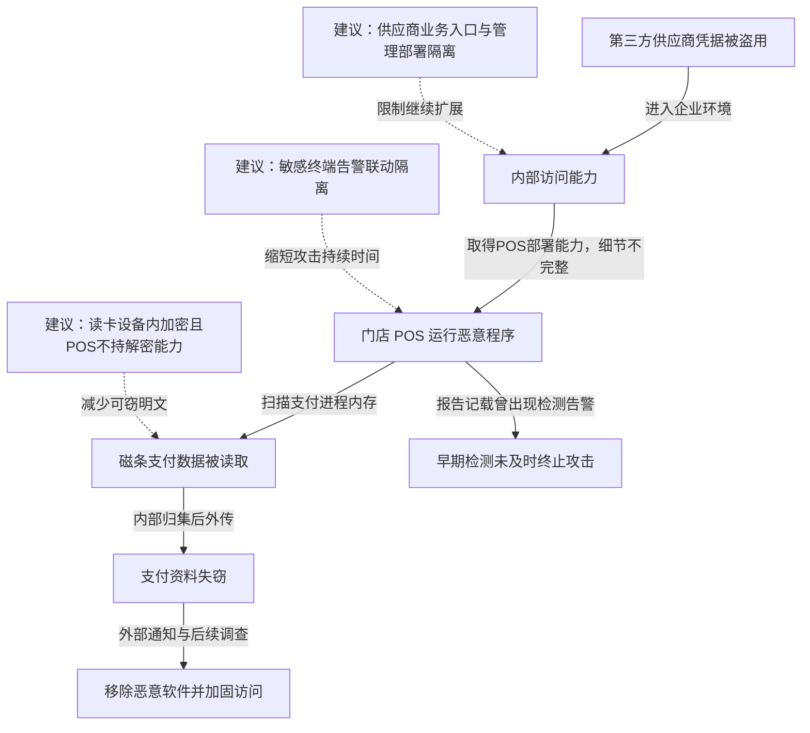

2013 年 11 月 27 日至 12 月 15 日，攻击者利用植入 Target 美国门店 POS 系统的恶意软件，窃取约 4000 万个信用卡和借记卡账户的支付资料；另有最多 7000 万人的姓名、地址、电话或邮箱等资料被窃。Target 确认攻击涉及第三方供应商凭据。攻击者进入企业环境后，把恶意程序部署到支付终端，读取支付过程中出现在内存里的磁条数据，再经内部节点归集并外传。Target 在获外部通知后调查并移除恶意软件。事件暴露了供应商身份、终端执行与敏感支付数据之间缺少足够限制的问题。[Target 2013 年 10-K：Data Breach](https://corporate.target.com/getmedia/47488c66-8bc8-41d6-834b-80513bba407a/Target_2013_10-K_Report.pdf)

## 从供应商账号到支付资料外传

下图结合 Target 自身披露与美国参议院商务委员会工作人员整理的攻击链。后者汇集了当时的调查报道与安全研究，并非完整公开取证镜像。供应商入口如何逐级取得 POS 部署权限仍有缺口，图中保留这一点。虚线是本文建议。

### 供应商登录不应成为支付终端管理的起点

公开攻击链将入口与暖通供应商 Fazio 的凭据联系起来。供应商正常访问用于业务往来，不应自然取得支付系统管理权限。关键跨越发生在进入企业环境之后：攻击者最终获得了足以在 POS 部署程序的能力。

中间并非一句“网络连通”就能解释。通常还需要可被访问的管理服务、可盗用的内部身份或软件分发权限；具体哪些条件在本案成立，公开记录并未逐项给出。防护分析因此应分别检查供应商入口允许的业务动作和终端管理接受的身份，不能把两端直接画成一条无需提权的连接。[参议院工作人员攻击链分析，第 3—6 页](https://www.commerce.senate.gov/wp-content/uploads/media/doc/2014%200325%20Target%20Kill%20Chain%20Analysis.pdf)

### 内存抓取绕过了只保护存储和传输的思路

POS 接受刷卡后，支付软件需要处理卡片数据。恶意程序在终端执行，能够在支付数据经过内存的阶段寻找可识别的磁条内容。即使某些文件已加密、向支付机构的连接已使用加密协议，终端进程能够读取的明文仍可能被同机恶意程序取得。

攻击者的能力从终端执行转换成支付资料读取，再通过内网归集减少直接出网的终端数量。这也解释了为什么只检查 POS 是否连接陌生公网地址可能漏掉外传：数据可以先进入一个内部收集节点，再由它送往外部。参议院分析记载了内存抓取、内部暂存及外传的分工，软件家族名称本身并不能代替对这些动作的解释。

### 告警出现与攻击被阻断之间缺少闭环

参议院报告记载，安全产品在 11 月底和 12 月初产生过相关告警，但未能及时终止活动；12 月外部机构通知后，Target 才展开关键调查和清理。Target 年报确认恶意软件已被移除并开展外部调查。[参议院报告：检测与处置环节](https://www.commerce.senate.gov/wp-content/uploads/media/doc/2014%200325%20Target%20Kill%20Chain%20Analysis.pdf)

这不是再加一个检测规则就能解释的问题。有效处置需要把“某终端运行可疑程序”关联到门店支付资产、数据读取和内部归集，形成能够限制进程、账号或网段的动作。

Target 年报还补充了一项清除细节：12 月 15 日处理了绝大多数收银机，但一台当时断开连接的收银机未被覆盖，此后仍有 56 名顾客的支付资料失窃。这说明集中分发清理任务之后，还要逐台核对离线终端的状态，确认它们重新上线前已完成处置。[Target 年报，Data Breach 章节](https://corporate.target.com/getmedia/47488c66-8bc8-41d6-834b-80513bba407a/Target_2013_10-K_Report.pdf)

## 关键突破、成因与防护

### 供应商入口之后还需要一个独立的终端管理边界

供应商账号应启用强认证、最小业务权限及访问期限，限制被盗凭据的价值。即便供应商账号已经失陷，支付终端也应只接受独立管理域的部署身份；供应商门户、办公网和终端管理平台不能共享足以绕行这一限制的管理员凭据。

终端可校验软件发布身份、批准的版本和执行路径，管理通道按设备与任务授权，集中部署需要记录目标及产物摘要。若攻击者控制了统一部署平台，单纯信任“管理服务器下发”仍会失效，重要发布还需经独立审批或终端侧允许策略。这样做会增加紧急维护成本，但能限制一次外部账号被盗演变成全门店部署。

### 支付数据需要在到达普通POS进程前就受到保护

常规补丁、应用控制和进程监控能够减少抓取程序执行。更直接的改造是让受控读卡设备在采集时加密，只有支付处理端持有解密能力；POS 应用只处理密文或令牌，不持有可还原整批卡数据的密钥。

该设计成立的条件是加密发生在普通终端软件能够读取之前，读卡设备、密钥注入和维护流程本身受到保护。如果在同一台失陷 POS 上先取得明文再加密，内存抓取窗口仍在。支付卡令牌化也不能自动保护采集到令牌生成之间的原始数据，需沿实际数据流核对。

### 高价值终端的告警需要预先限定可执行的处置

把全部告警交给人工判断，容易让重大异常淹没在噪声中。支付终端出现未经批准的程序、异常进程访问或向非业务节点汇集数据时，可以先阻断对应行为、隔离单台设备，保持其他收银点运行，并将处置日志发送到独立系统。

自动隔离同样会造成误报和业务损失，应依据证据强度选择动作，而不是对任何告警关闭整家门店。离线交易或替代终端也需要事先定义权限和核对流程。目的是让一次可信告警能及时压缩攻击者能力，同时控制对正常收款的影响。

## 参考资料

- [Target：2013 年 10-K，Data Breach](https://corporate.target.com/getmedia/47488c66-8bc8-41d6-834b-80513bba407a/Target_2013_10-K_Report.pdf)
- [美国参议院商务委员会工作人员：A Kill Chain Analysis of the 2013 Target Data Breach，2014-03-26](https://www.commerce.senate.gov/wp-content/uploads/media/doc/2014%200325%20Target%20Kill%20Chain%20Analysis.pdf)
- [Target：参议院听证补充答复，供应商访问与事件调查](https://www.judiciary.senate.gov/imo/media/doc/020414QFRs-Mulligan.pdf)
