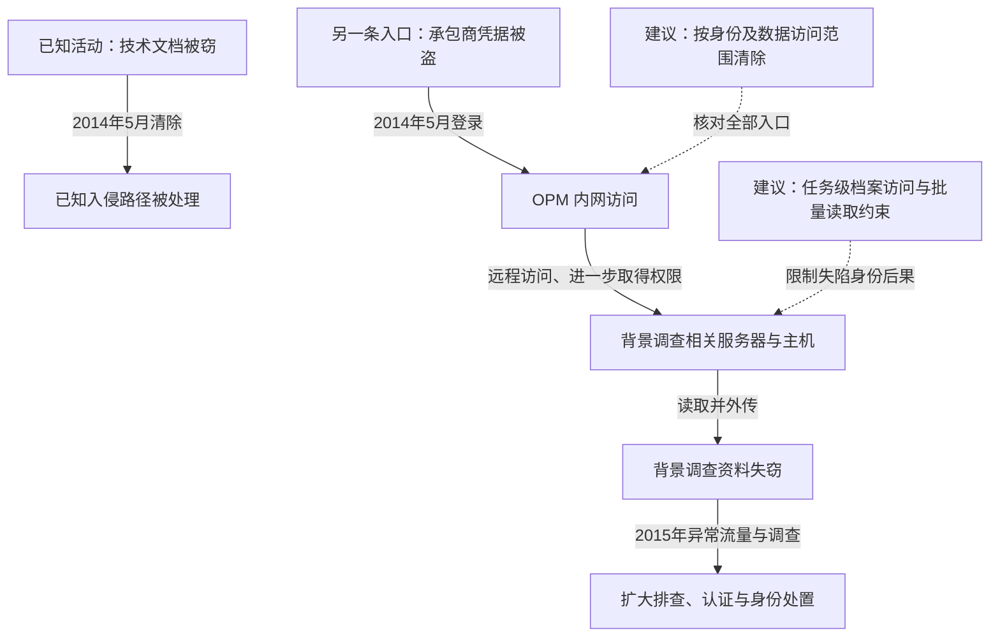

2015 年，美国人事管理局 OPM 披露人事和背景调查系统遭入侵，其中背景调查资料涉及约 2150 万人。攻击者使用被盗的承包商访问身份进入网络，取得更高权限后访问核心系统并外传数据。国会调查把相关活动追溯到此前数年，并发现 OPM 在 2014 年清理一条已知入侵路径时，未发现另一条已经建立的入口。背景调查材料包含个人经历及关系信息，损害因此不限于可更换的账号密码。OPM 随后更换访问控制、加强认证与监测，并为受影响人群提供长期身份保护服务。[OPM 2015 年财务报告](https://www.opm.gov/about-us/reports-publications/agency-archive/2015-agency-financial-report.pdf)说明影响口径，[国会调查](https://oversight.house.gov/release/committee-releases-year-long-investigative-report-opm-data-breaches/)说明过程及管理缺口。

## 一次清除为何没有终止另一条访问链

下图不将早期技术文档窃取与后来的背景资料外传画成同一个确定主体。两条活动存在可能联系，但决定处置失败的事实是：清除已知入口时，另一条入口仍在。

### 承包商账号带来的是已经获准的远程通路

背景调查需要政府与承包商协作，外部身份因业务需要获得 OPM 访问权限。根据国会的[关键时间线](https://oversight.house.gov/wp-content/uploads/2016/09/Timeline-of-Key-Events-.pdf)，攻击者在 2014 年 5 月 7 日使用背景调查承包商的 OPM 凭据建立据点。拥有这组凭据，首先意味着可使用相应入口，不能直接等同于已经读取全部档案。

后续记录包含远程桌面活动、访问背景调查服务器及取得更高权限。时间线将 2014 年 7—8 月的背景调查资料外传与其后的人事、指纹资料外传分别列出。不同数据集、时间和访问位置应分别关联，不能从一个账号登录事件推导出全部泄露都在同一天完成。

### 已知攻击者离开，不等于所有持久入口都被清除

2014 年 3 月，第三方通知 OPM 有数据外传。调查发现攻击者窃取了有关系统结构的技术文档；此类材料可能帮助理解主机、账号和核心服务，但公开证据不足以直接证明后来每一步均由这些文档驱动。

OPM 在 5 月 27 日执行清除，却没有识别 5 月 7 日已经建立的另一据点。这个时间关系比某个后门名字更能解释持续失陷：处置范围围绕正在监视的活动，未覆盖其他身份、访问路径和核心系统状态。2015 年新的异常网络线索使调查再次展开，才发现更大范围的数据损失。[国会时间线，第 1—2 页](https://oversight.house.gov/wp-content/uploads/2016/09/Timeline-of-Key-Events-.pdf)

### 背景档案的价值在于可关联的长期信息

OPM 报告中的约 2150 万人背景调查资料，也包括部分此前约 420 万人人事记录泄露涉及的人员。背景调查资料的敏感性也不同于普通邮箱列表：单份材料就可能涉及家庭、工作、财务及其他人员关系，集中读取后可以用于长期画像与定向接触。

信用监测能减轻部分身份盗用后果，但无法让已经失窃的人生经历和关系信息失效。因而对这类资产，保护重点应前移到读取权限和批量汇集，而非只在泄露后更换密码或发送通知。

## 关键突破、成因与防护

### 外部身份的工作需要没有转化为有限的数据能力

MFA、受管设备和承包商退出时撤销身份可以降低凭据复用风险。更深的限制是在数据服务端按调查任务提供档案访问：一个账号只能读取当前案件所需对象，批量统计通过专门的脱敏接口完成。访问条件应由独立授权服务依据案件分配核对，不能只依赖客户端声明用途。

承包商确有跨案件业务时，可用短期提升和限定数据域的授权满足需要。代价是案件分配、角色和数据标识必须一致；但这能让远程入口失陷后，攻击者不至于自然取得整个背景调查档案库。

### 系统管理员能力与敏感档案明文读取没有充分分离

加密数据库有助于保护丢失介质，但若同一服务器管理员可以取得数据库权限与解密材料，在线入侵仍可读明文。可把系统维护、数据库维护、档案检索和密钥操作拆成不同权限，在独立保护域保存密钥，并限制解密接口的对象和频率。

高敏感字段可以采用分区保管或用途受限的查询，把常规工作所需资料与完整原始档案分开。系统最终仍需处理明文，因此目标是减少可批量取得明文的主体和位置，而不是宣称加密后数据便永远不可泄露。

### 清除对象应是攻击能力，而不是已观察到的那组样本

处置需要从已失陷身份向外追踪：它登录过哪些服务、读取过什么凭据、创建过哪些账号或持久入口。重建主机、撤销会话、轮换可扩散秘密之后，再用独立认证和网络日志核对旧访问路径。

这种方法会增加停机和排查成本，但能够检验“另一条入口是否仍在”。若恢复结论只由受害环境自身报告，攻击者可以同时隐藏工具和保留有效身份。OPM 事件中，已知路径清除与整体系统恢复之间的落差，正发生在这里。

## 参考资料

- [美国众议院监督委员会：调查报告发布说明](https://oversight.house.gov/release/committee-releases-year-long-investigative-report-opm-data-breaches/)
- [国会调查关键时间线，第 1—2 页](https://oversight.house.gov/wp-content/uploads/2016/09/Timeline-of-Key-Events-.pdf)
- [OPM：2015 年机构财务报告，数据事件与保护措施](https://www.opm.gov/about-us/reports-publications/agency-archive/2015-agency-financial-report.pdf)
