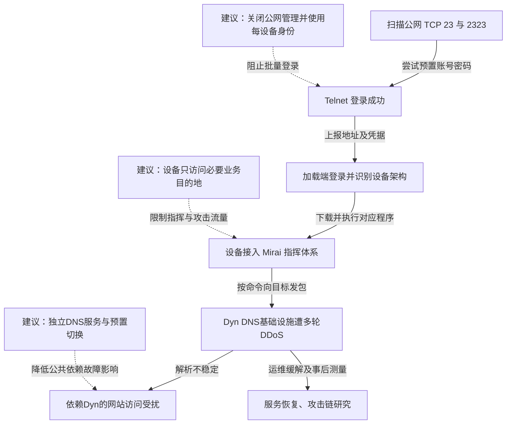

2016 年 10 月 21 日，DNS 服务商 Dyn 遭遇多轮大规模 DDoS 攻击，依赖其域名解析的网站出现访问异常。事后研究确认 Mirai 僵尸网络参与攻击：它在公网扫描开放 Telnet 的摄像头、录像机等物联网设备，使用预置弱口令登录，再加载适配处理器架构的程序，接受远程命令向目标发包。受影响网站自身未必遭到入侵，但共同的解析服务受扰，使用户无法可靠找到服务器。USENIX 研究测得 Mirai 在 2016 年末一度达到约 60 万台感染设备，这一全网峰值不是 Dyn 当天的攻击设备数。[Understanding the Mirai Botnet，USENIX Security 2017](https://www.usenix.org/system/files/conference/usenixsecurity17/sec17-antonakakis.pdf)

## 弱口令设备如何被组织成攻击基础设施

下图连接设备感染与 Dyn 服务受扰两条链。扫描、登录、加载和指挥依据研究论文的源码与测量分析；针对 Dyn 的流量中可能还包含其他来源，不能把每个请求都算作 Mirai 节点。虚线为本文建议。

### 扫描和感染由不同组件分工完成

Mirai 扫描器向伪随机公网 IPv4 地址的 TCP 23、2323 端口发起探测，发现 Telnet 后，从预置的 62 组凭据中选择组合尝试登录。成功后，它把地址和凭据送给报告服务器；独立加载程序再登录设备，识别系统环境，下载适配架构的恶意程序。[论文第 2 节：Botnet Structure & Propagation](https://www.usenix.org/system/files/conference/usenixsecurity17/sec17-antonakakis.pdf)

这一分工把找设备、取得登录能力和执行程序拆开，可以持续吸收不同厂商、不同处理器的设备。攻击无需逐台利用一个复杂内存漏洞；批量相同的管理身份以及暴露的远程终端服务，已经提供了可复用的入口。

### 一次登录变成了远程发包能力

植入程序连接控制体系，按命令发动攻击，同时继续扫描。样本会删除下载文件、改变进程名，并终止某些竞争进程。原始 Mirai 感染通常不跨重启持久化，但只要设备重新上线后仍开放同一个管理服务、沿用同一个密码，就能再次感染。

因此，“重启后看不到文件”不能作为处置终点。真正要切断的是重新登录和重新加载的条件。由于不同设备会把管理界面、Telnet 账号和固件内置账号分开保存，只改网页后台密码也未必改变攻击实际使用的身份。

### DNS成为多个网站共同承受的瓶颈

研究者观测到针对 Dyn 的多条攻击命令，涉及 DNS 端口上的 SYN 洪泛等流量。大量分散来源消耗链路、网络设备状态或服务处理能力，合法解析请求随之受影响。攻击并不要求篡改 DNS 记录，也不意味着下游网站服务器同时失陷。[论文第 6 节：Dyn 攻击测量](https://www.usenix.org/system/files/conference/usenixsecurity17/sec17-antonakakis.pdf)

受影响用户还可能重试查询，使服务看到的源地址和请求数量大于实际僵尸设备规模。多地域部署能承受单点故障，但如果各地仍依赖同一服务商的共同资源或控制面，分散部署不必然消除关联失效。攻击缓解与后续研究分别属于运营恢复和机制确认，不能把事后论文中的观察当作 Dyn 当天已部署的检测。

## 关键突破、成因与防护

### 批量共享的设备管理身份让扫描具有稳定收益

改强密码和关闭公网 Telnet 能直接阻断原始 Mirai 的主要感染路径。设备生产和交付时，还应避免通用内置密码，使用每台设备独立的初始身份，首次启用完成所有权绑定后才开放必要管理能力；不能让用户修改的只是一个界面账号，而系统另有固定维护账号。

即使业务确需远程维护，也可以通过受控管理网关、短期认证和明确的设备授权完成，设备本身不接受任意公网登录。网关失陷仍有风险，因此固件更新、调试与系统管理应分别授权，避免一个远程运维身份同时取得不可见的永久后门能力。

### 设备已失陷时，网络仍可限制它的攻击能力

修补固件、重置凭据和可信恢复用于清除访问。更进一步，摄像头或传感器通常只需访问少数业务服务，可以在设备之外限制出站目的地、协议与速率，并检测异常 Telnet 扫描。攻击程序取得设备管理员权限后，也不能自行修改上游网关的控制。

这种策略需要维护业务依赖，并可能影响点对点连接、更新服务或故障排查。若允许目的地本身被用于中继，或设备可通过放行的解析通道制造攻击，仍需按实际协议行为限制。控制的目标是缩小被盗设备能够联系和消耗的资源，而非仅在设备本机增加一个可被恶意进程关闭的规则。

### 网站需要在攻击前配置能够独立工作的解析路径

Dyn 一侧需要容量、流量清洗、协议限速和上游协作，具体选择取决于被耗尽的资源。下游网站则可以使用具有独立故障域的权威 DNS，提前同步区域数据、验证两边记录一致，并保护好修改 DNS 的管理身份。

攻击发生后再临时迁移，可能受父区委派、缓存和控制台可用性约束。TTL 调低也不保证现有缓存立即变化。预先验证多服务商权威解析和恢复操作，能够减少共同依赖带来的影响，但也会增加配置一致性和密钥管理成本；若两家服务共用同一易受攻击的管理入口，独立性仍不足。

## 参考资料

- [USENIX Security 2017：Understanding the Mirai Botnet，原始论文](https://www.usenix.org/system/files/conference/usenixsecurity17/sec17-antonakakis.pdf)
- [USENIX：作者、演讲及研究材料入口](https://www.usenix.org/conference/usenixsecurity17/technical-sessions/presentation/antonakakis)
