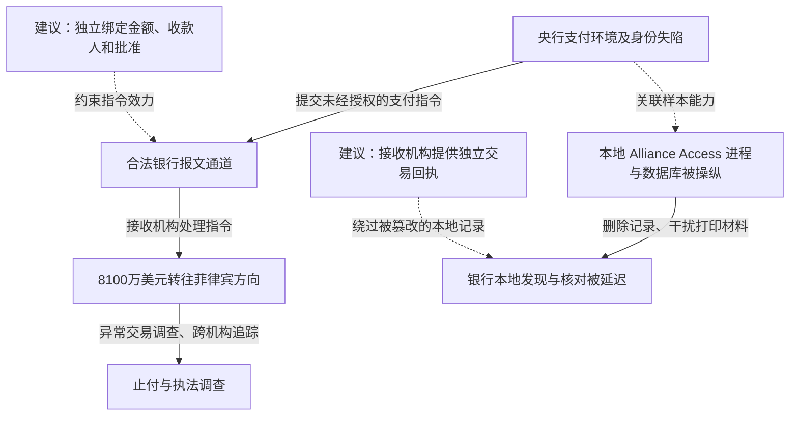

2016 年 2 月，攻击者入侵孟加拉央行的支付环境，冒用银行身份向纽约联邦储备银行提交转账指令，8100 万美元被转入菲律宾方向账户。美国司法部后续刑事材料将事件与朝鲜关联攻击活动联系起来。公开样本分析还发现专门针对本地 SWIFT Alliance Access 的恶意代码，用于绕过局部检查、删除记录和处理打印报文，使银行难以及时从本地对账材料发现异常。这是银行支付终端和身份失守，不能写成 SWIFT 全球通信网络被整体攻破。[司法部材料](https://www.justice.gov/archives/opa/pr/north-korean-regime-backed-programmer-charged-conspiracy-conduct-multiple-cyber-attacks-and)确认盗款事件，[BAE 技术分析](https://baesystemsai.blogspot.com/2016/04/two-bytes-to-951m.html)解释与案件有关联的工具能力。

## 资金转移与痕迹处理是两条协同路径

SWIFT 负责金融机构之间的报文传输，资金最终由账户所在机构根据指令处理。下图将已发生的盗款与研究者发现的掩盖工具分开：虚线一类是样本关联判断，另一类标明本文建议，不把样本分析补写成完整现场取证。

### 控制支付环境，才能让异常意图获得银行身份

攻击者必须先取得足以使用支付系统和身份材料的能力，才可能把自己的指令送入银行正常流程。公开材料没有完整展示每一步初始入侵与全部审批操作，因此这里不虚构钓鱼邮件、跳板配置或管理员口令来源。

已经确认的结果是，发出的指令带有银行身份并被接收处理。决定损害的边界不只是“能否登录 Windows”，而是支付系统如何把操作主体、交易内容和最终发报绑定。若远程控制终端可以复用已经登录的身份或改写待发指令，多名操作员曾经认证也未必保证最终报文内容由他们共同确认。

### 样本针对的是本地检查和记录，不是任意跨行转账算法

BAE 研究者分析了来自恶意样本库、被认为与案件相关的定制程序。程序寻找本地 Alliance Access 组件 `liboradb.dll`，修改一个条件跳转，使原本失败的检查按成功路径继续；它还通过本地数据库权限执行 SQL，定位并删除部分报文记录，处理用于打印的 PRT/PCL 内容。

两字节改动用于干预本地检查，数据库和打印操作则用于隐藏记录。完成盗款还依赖先前取得的系统权限、银行支付身份，以及外部机构对指令的接收与处理。[BAE：Two bytes to $951m](https://baesystemsai.blogspot.com/2016/04/two-bytes-to-951m.html)

### 同一台机器既发指令又证明指令正常，核验就失去独立性

银行日常依靠交易数据库、报文和打印回执对账。如果这些记录由已失陷的支付环境生成，攻击者就可能同时改变业务动作和操作人员看到的结果。数据被隐藏后，异常不一定马上出现在常规巡视中；跨时区、休假和后续资金转移会进一步压缩止付窗口。

这里的防御问题不是要求员工更认真地看打印纸，而是保证纸面和屏幕上的核验信息来自不受同一终端控制的证据源。

## 三个关键突破及其更深的限制方式

### 操作认证没有充分绑定最终交易语义

隔离支付终端、强化远程入口和保护凭据可以减少初始失陷。终端已被控制时，还需要独立的交易授权：批准端显示并签署收款人、账户、金额、币种和交易唯一标识，接收或发报服务校验签署内容与实际报文一致。

双人审批只有在两人使用的确认路径不会被同一管理身份改写时，才提供独立性。对新收款人、异常时间和大额交易，可设置独立确认与分级额度；额度按主体和时间累计，防止拆单规避。这会影响紧急大额支付速度，但能让终端控制权不再直接等同于任意转款权。

### 数据库维护权不应自动包含无痕改写业务事实的能力

限制数据库管理员、提高日志完整性、监测关键组件变化，可以发现样本中的本地操作。更深的结构是将已签署交易与外部发送回执写入独立、追加式审计存储，支付终端只能提交记录，不能删除或覆盖既有事件。

仅对本地日志做校验仍可能太晚：攻击者可能在记录生成前就修改内容。核验需同时引用接收机构实际收到的报文和结算账户变化，让一方失陷不能重写全链路事实。

### 本地删除记录不能改变外部资金已移动的结果

把交易回执、账户余额和收款人变更信息送到独立渠道，能够绕开被操纵的打印流程。止付、召回与冻结应围绕已经执行的具体交易组织，不能把撤回请求等同于资金已追回。

这类设计不能防止所有诈骗，尤其在独立批准者也被误导时仍可能失败。但它改变了攻击者的任务：仅控制支付机器已不够，还必须取得另一套能够批准具体交易、又能看到外部结果的能力。

## 参考资料

- [美国司法部：涉及孟加拉央行盗款的刑事指控说明，2018-09-06](https://www.justice.gov/archives/opa/pr/north-korean-regime-backed-programmer-charged-conspiracy-conduct-multiple-cyber-attacks-and)
- [BAE Systems：Two bytes to $951m，2016-04-25](https://baesystemsai.blogspot.com/2016/04/two-bytes-to-951m.html)
