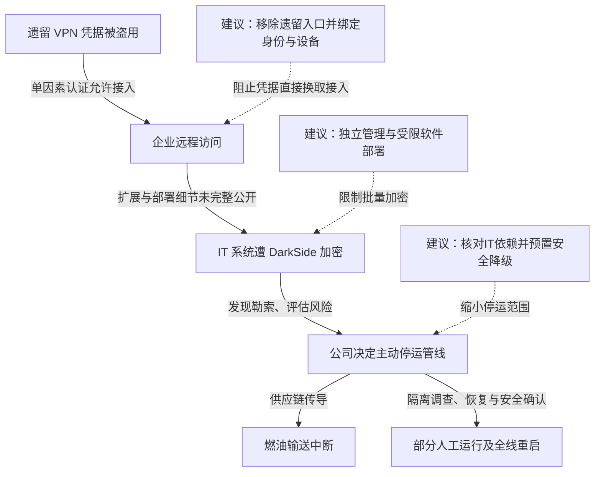

2021 年 5 月 7 日，Colonial Pipeline 发现 IT 系统遭勒索软件加密，随后主动停止约 5500 英里管线的运营，以防风险扩展并确认系统安全。FBI 将攻击与 DarkSide 勒索软件联系起来。公司负责人后来在参议院作证称，调查认为入口是一个原本不应继续使用、仅有单因素认证的遗留 VPN 账号；攻击者如何取得最初密码当时仍未查明。公司支付赎金，并在外部专家协助下恢复系统；5 月 13 日宣布全线重启并向所有市场恢复产品输送。事件对美国东海岸燃油供应造成冲击，核心因果是 IT 遭攻击后企业停运管线，而非已经证实管道控制器被恶意改写。[参议院听证记录，2021-06-08](https://www.govinfo.gov/content/pkg/CHRG-117shrg46569/html/CHRG-117shrg46569.htm)与[美国能源部事件记录](https://www.energy.gov/ceser/colonial-pipeline-cyber-incident)

## 被盗远程身份如何引发实体业务中断

下图实线依据听证与政府通报；从 VPN 进入到具体加密部署之间的提权、分发步骤未完整公开。虚线是本文建议。IT 与 OT 的网络分隔、业务运行依赖分别画出，避免把停运当作 OT 已遭入侵的证据。

### 一个仍然可用的旧账号保留了真实入口

听证中，CEO Joseph Blount 表示，涉事 VPN 只使用单因素认证。所谓遗留账号不是“配置文件还在硬盘上”这么简单，它仍能通过实际认证入口进入环境。攻击者取得密码后，可以被系统作为有效用户接纳。

从远程登录到批量加密通常还需要扩大文件访问、管理权限或执行范围，不能把一次 VPN 认证直接等同于全企业管理员权限。公开证词没有逐项给出本案的提权命令与分发工具，因此技术分析应保留这一段边界，重点核对为什么旧身份仍能使用，以及下一层权限如何限制。

### 加密IT后，公司在不确定性下选择停运

5 月 7 日发现攻击后，公司迅速停止管线运营。CEO 在听证中解释，若 OT 存在受影响的可能，就值得暂停并调查；他同时说明曾安排现场巡查、人工查看压力，并以有限方式运行部分管线。[听证记录：停运决策与人工运行](https://www.govinfo.gov/content/pkg/CHRG-117shrg46569/html/CHRG-117shrg46569.htm)

这体现了两种联系：一是 IT 与 OT 之间潜在的技术访问，二是管线运营对可信业务系统的实际依赖。即使网络隔离阻止了恶意程序直接进入控制网络，人员仍可能因为无法确认状态、无法使用必要 IT 服务而不能安全运营。把两者混为一谈，会导致错误地认为装一道防火墙就解决了所有停运风险。

### 重启要恢复系统，也要重新确认操作可信

公司支付赎金，希望增加尽快恢复的选择，同时开展外部调查与恢复。听证还记录了已从备份恢复的部分系统，以及对人工运行范围的讨论。能源部确认 5 月 13 日全线重新启动输送，并采取临时运输和燃料供应措施缓解影响。

6 月 7 日，美国司法部宣布查扣 63.7 枚相关比特币。这是执法追回进展；它不会自动修复遗留账号、恢复被加密系统或清除失窃凭据。[司法部：追回部分赎金](https://www.justice.gov/archives/opa/pr/department-justice-seizes-23-million-cryptocurrency-paid-ransomware-extortionists-darkside)

## 关键突破、成因与防护

### 远程入口治理必须以实际可登录的路径为准

给现有主入口启用 MFA 是必要动作，但本案说明还要找到仍能工作的旧入口。账号停用需要落实到 VPN 本地用户、外部身份映射、证书和备用认证，而非只从员工名册移除一项记录。应通过实际认证记录和受控登录验证，核对谁仍能从哪里接入。

即使密码已泄露，设备绑定的防钓鱼认证和按服务授权可以进一步限制转用。远程接入后不应获得通用内网访问；支付、运维或业务应用分别确认身份与权限。控制必须覆盖备用入口，否则攻击者会转向没有执行相同要求的旧设备或本地账号。

### 文件写入和软件分发能力需要独立于普通登录身份

补丁、终端检测和异常登录告警能够降低勒索软件落地机会。若某个办公身份已经失陷，还应限制其横向取得管理密钥、写入共享目录或批量执行任务的能力。备份保管、终端策略和软件部署应使用独立管理身份，避免一次域内失陷同时关掉保护并删除恢复副本。

不可变备份的价值还取决于恢复环境是否独立可信。若备份控制台沿用同一被盗管理员会话，或恢复服务器重新加入仍受控的身份域，攻击者仍可能继续加密。恢复应先清理可继续访问的身份、令牌和管理通道，再逐批恢复业务。

### 工业连续性既需要隔离，也需要经过验证的降级能力

IT 与 OT 分区应限制协议、方向、管理身份和远程维护，保持控制系统的独立安全能力。随后还要核对运营必需的数据、调度、交接和人员流程；技术网络隔开，但每次开工都要依赖受疑的集中身份服务，仍可能导致全面停运。

对能安全降级的工段，可以保留受限本地操作和离线记录，并预先定义运行时长、产能、现场人员与复核条件。人工运行并不一定比恢复自动化更快，也不能牺牲压力控制和安全规程。演练应帮助负责人判断何时可局部继续运营、何时必须停运，并提供能支撑判断的可信状态信息。

## 参考资料

- [美国参议院：Threats to Critical Infrastructure，2021-06-08 完整听证](https://www.govinfo.gov/content/pkg/CHRG-117shrg46569/html/CHRG-117shrg46569.htm)
- [美国能源部：Colonial Pipeline Cyber Incident](https://www.energy.gov/ceser/colonial-pipeline-cyber-incident)
- [美国司法部：2021-06-07 查扣部分赎金](https://www.justice.gov/archives/opa/pr/department-justice-seizes-23-million-cryptocurrency-paid-ransomware-extortionists-darkside)
