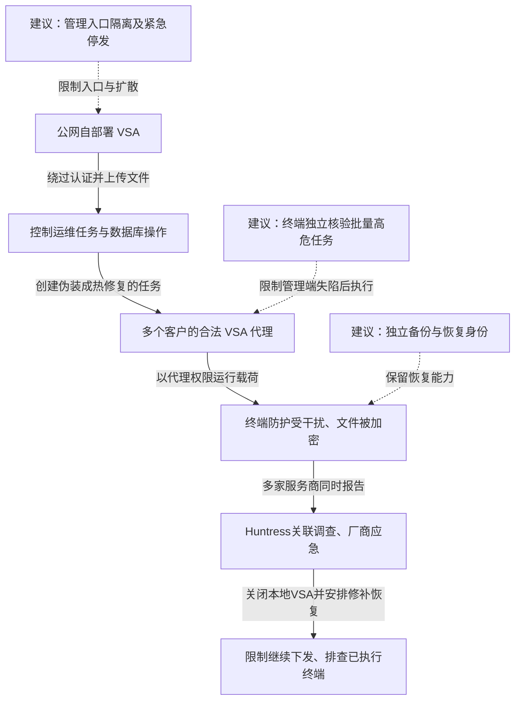

2021 年 7 月 2 日，REvil 攻击者利用 Kaseya VSA 的认证绕过、文件上传及代码执行链，控制部分客户自行部署的运维服务器，再借这些服务器向受管终端投放勒索软件。VSA 原本供托管服务商集中管理多家客户，攻击因而从少数管理入口扩大到下游企业。Kaseya 在 7 月 5 日披露的估计为约 800—1500 家下游企业受影响。厂商要求客户关闭本地 VSA，并暂停 SaaS 服务进行预防性检查，之后发布修补版本和恢复安排。[Kaseya 当时通报](https://www.kaseya.com/press-release/kaseya-responds-swiftly-to-sophisticated-cyberattack-mitigating-global-disruption-to-customers/)与 [Huntress 现场调查](https://www.huntress.com/blog/rapid-response-kaseya-vsa-mass-msp-ransomware-incident)分别提供影响范围和技术记录。

## 运维服务器怎样变成勒索软件分发器

下图将服务器入口和终端执行分开。实线为调查支持的能力变化；虚线为建议控制，接在能够限制的环节。

### 先拿到管理会话，再改变服务器准备下发的内容

VSA 不是普通内容网站。它保存设备关系并向代理分配脚本、补丁和管理动作。Huntress 将观察到的利用链概括为认证绕过、任意文件上传和代码执行；攻击者在取得会话后上传 `agent.crt` 与 `Screenshot.jpg`，后者参与日志清理、账户处理及数据库中的恶意任务安排。文件扩展名不能代表执行用途，决定性问题是上传内容进入了服务器执行和任务控制路径。[Huntress 复盘](https://www.huntress.com/blog/a-recap-of-events-and-lessons-learned-during-the-kaseya-vsa-supply-chain-attack)

DIVD 在事件前已经向厂商报告多个 VSA 缺陷，披露时间线显示不同问题、SaaS 与本地版本的修补进度并不相同。本案的利用链跨越会话、文件和任务处理。服务端认证旁路不经过正常管理员登录，因而需要在对应接口修复会话校验，不能只加强登录时的 MFA。[DIVD 披露记录](https://csirt.divd.nl/cases/DIVD-2021-00011/)

### 下游代理执行的是管理任务，内容却由攻击者决定

终端不必再被逐台扫描和利用。攻击者借 VSA 的正常分发关系安排名为热修复的操作，让已有代理把载荷带入客户环境。现场命令记录包含干扰 Defender、用 `certutil` 解码载荷和启动程序等动作；终端上的后续加载还利用合法程序加载恶意 DLL。这里真正的权限转换，是“能够修改中央任务”被下游解释成“可以执行任意高权限代码”。

传输来自平时使用的运维服务，代理和部分加载程序也可能是合法文件。只判断连接是否加密、进程是否签名、来源是否属于服务商，都没有核对本次任务是否符合客户同意的维护范围。Huntress 最初从多家托管服务商几乎同时遭勒索的报告中找到共同点，才把调查收敛到本地 VSA。[现场时间线与载荷分析](https://www.huntress.com/blog/rapid-response-kaseya-vsa-mass-msp-ransomware-incident)

### 关闭中央入口能停下新任务，已执行的载荷仍在终端

厂商要求关闭本地服务器，是为了迅速移除继续接受利用和下发任务的条件。SaaS 的预防性停机应与已经证实遭利用的本地部署分开理解。恢复也不能只给 VSA 打补丁：受管终端是否执行过载荷、其他凭据是否暴露、备份是否仍完整，决定客户能否重新接入管理服务。

## 决定损害规模的三处突破

### 一个可达入口持有跨客户的任务控制权

修补和限制公网管理入口能减少初始利用，但高权限集中本身解释了为何一次漏洞会跨客户放大。管理面应与普通业务面隔离，只接受受控入口访问；账户和任务作用域按客户拆分，避免一个服务会话天然覆盖全部租户。

即使管理服务器完全失陷，也可由客户控制的独立批准服务限制批量变更。批准对象应绑定任务内容摘要、目标设备集合和时间窗口，终端核验后执行。若批准密钥、策略和日志仍能被同一 VSA 管理身份任意修改，这个额外步骤只是另一张界面。代价是紧急维护和跨客户批量运维需要更明确的授权流程。

### 终端把“可信管理来源”当成了足够的执行理由

一般补丁需要高权限，不代表代理收到的每段脚本都应该具有相同能力。可将软件安装、命令执行、防护配置变更和凭据访问拆成不同动作；对停用防护、批量写入系统目录等行为，由终端自身策略或另一个受保护身份裁决。独立控制必须覆盖通过代理启动的子进程和 API，不能仅拦住用户手动打开终端。

这些措施不能保证恶意任务完全没有破坏力，但可以让攻击者控制管理端后，仍不能自行解除全部限制。对正常运维的影响主要是例外审批、任务预定义与终端兼容成本，需要和批量失陷后果一起权衡。

### 恢复系统若也受同一管理端支配，备份数量不能提供独立性

不可变或离线副本、单独的备份管理身份和干净恢复环境，可以保留业务重建能力。关键不在于复制了多少份，而在于受害代理和 VSA 身份是否也能删除、加密或改写这些副本。恢复时先确认任务源可信，再分批让终端重新接入，避免修好入口后继续执行已经排队的恶意操作。

## 参考资料

- [Huntress：Rapid Response — Mass MSP Ransomware Incident](https://www.huntress.com/blog/rapid-response-kaseya-vsa-mass-msp-ransomware-incident)
- [Huntress：事件经过与经验复盘](https://www.huntress.com/blog/a-recap-of-events-and-lessons-learned-during-the-kaseya-vsa-supply-chain-attack)
- [DIVD：Kaseya VSA 漏洞披露时间线](https://csirt.divd.nl/cases/DIVD-2021-00011/)
- [Kaseya：2021 年 7 月 5 日影响通报](https://www.kaseya.com/press-release/kaseya-responds-swiftly-to-sophisticated-cyberattack-mitigating-global-disruption-to-customers/)
