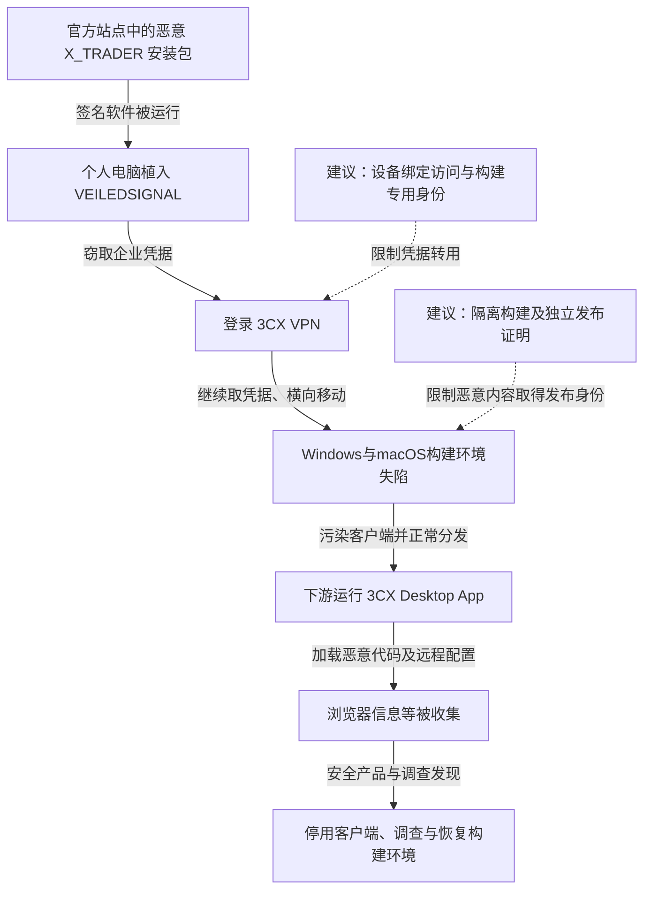

2023 年 3 月，3CX Desktop App 被发现含有恶意代码。Mandiant 与 3CX 的调查将其追溯到 2022 年一次上游供应链入侵：员工在个人电脑安装从 Trading Technologies 官方网站下载、具有有效签名的 X_TRADER，电脑因此感染 VEILEDSIGNAL。攻击者取得企业凭据后进入 3CX VPN，横向控制 Windows 和 macOS 构建环境，使恶意代码随 3CX 客户端分发给下游用户。调查把活动归为与朝鲜有关联的 UNC4736。受影响软件随后被要求停用或移除，厂商调查并重建相关安全控制。[3CX 公告](https://www.3cx.com/blog/news/mandiant-security-update2/)与 [Mandiant 调查](https://cloud.google.com/blog/topics/threat-intelligence/3cx-software-supply-chain-compromise)给出了从上游软件到下游构建的路径。

## 两个合法供应商把同一条入侵继续向下传递

下图突出两次信任转换：签名交易软件获得员工电脑执行权；失陷构建环境又让恶意内容获得 3CX 发布身份。实线为调查支持的主线，虚线为建议控制。

### 有效签名没有证明安装包内容安全

X_TRADER 虽已停止提供正常产品支持，2022 年仍可从其合法网站取得安装包。调查中的样本具有 Trading Technologies 的有效签名，安装后通过合法程序加载被替换的 DLL，再解密并运行 VEILEDSIGNAL。后门获得员工个人电脑的管理员级访问与驻留能力。[Mandiant 样本分析](https://cloud.google.com/blog/topics/threat-intelligence/3cx-software-supply-chain-compromise)

从员工角度看，下载位置和签名都符合常见检查。问题在于，签名只绑定了某份文件和签名身份，不能保证发布流程没有先被攻击者干预，也不能证明已停用软件仍适合在工作相关设备运行。

### 个人电脑上的企业凭据换成了内网访问

3CX 披露，最早发现的企业环境访问来自员工凭据的 VPN 登录，距个人电脑失陷两天。攻击者随后使用 Fast Reverse Proxy 等工具继续移动；其中一个工具被命名为 `MsMpEng.exe`，不能仅凭这个文件名就把它当成微软防护进程。

企业凭据把个人电脑上的执行能力转换成了公司网络访问。调查后续还发现更多凭据收集和构建环境失陷，说明 VPN 登录是起点而不是对所有构建权限的直接证明。[3CX：初始入口与横向移动](https://www.3cx.com/blog/news/mandiant-security-update2/)

### 构建机把攻击者代码包装成客户预期的软件

Windows 构建环境中，攻击者利用 IKEEXT 服务的 DLL 加载路径维持 LocalSystem 级驻留；macOS 环境则使用 POOLRAT 与 LaunchDaemons。两种平台的构建均遭影响，恶意内容因而进入了不同系统的客户端发布链。

下游 3CX 客户端包含多阶段恶意加载，SUDDENICON 从 GitHub 上的加密图标文件取得后续控制地址，再获取 ICONICSTEALER 收集浏览器资料。图标承担的是隐藏配置载体，不是用户点击图片后自动感染的漏洞。不同客户是否运行问题版本、恶意阶段是否激活、是否发生后续数据收集，需要用各自终端记录判断。[Mandiant：下游载荷与构建机证据](https://cloud.google.com/blog/topics/threat-intelligence/3cx-software-supply-chain-compromise)

## 关键突破、成因与防护

### 软件信任依赖发布者身份，缺少对执行用途的限制

维护软件清单、移除停用产品、限制个人设备处理企业秘密，可以减少入口。签名校验仍有价值，但应与软件用途、维护状态、行为和联网需求共同判断。

在下载来源已经可信但软件内容失守的情况下，终端仍可限制应用读取浏览器秘密、访问企业凭据或启动异常子进程。隔离运行交易软件会影响便利性，却能让一份恶意安装包不自然继承工作身份的全部能力。

### 企业身份可以从低可信设备转用到构建路径

防钓鱼 MFA 和设备绑定访问能阻止部分凭据转用，但前提是 VPN 和后续服务共同执行，而非只在一个门户校验。构建操作还应使用专门身份、受控工作站与短期权限，不让日常办公凭据在同一环境继续提升到发布基础设施。

网络分区需要核对可执行动作：只允许某台跳板访问构建机，但跳板上又保存全部管理员凭据，仍然会形成相同路径。身份隔离、密钥签发和构建操作日志应由独立管理域控制。

### 签名服务需要验证构建事实，而不只是接收一个文件

独立保存签名密钥能够减少私钥失窃，却不能阻止失陷构建机要求它给恶意产物签名。发布控制应把源码版本、依赖摘要、受控构建环境与产物哈希绑定，签名服务只接受满足批准条件的构建证明；重要版本可经独立重建或差异审查核对。

这仍依赖审批和构建证明链本身可信，也会增加构建成本。下游用户则需要限制软件运行能力并监测异常联网，而非把“来自官网且有签名”当作无条件放行。恢复时不仅替换安装包，还应清除构建驻留、撤销可被复制的凭据，并调查下游已运行代码产生的访问。

## 参考资料

- [3CX：Initial Intrusion Vector Found，2023-04-20](https://www.3cx.com/blog/news/mandiant-security-update2/)
- [Mandiant：由上一次供应链攻击引发的 3CX 入侵](https://cloud.google.com/blog/topics/threat-intelligence/3cx-software-supply-chain-compromise)
