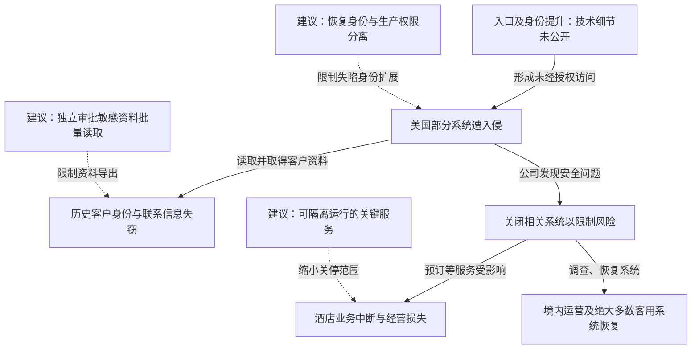

2023 年 9 月，MGM Resorts 发现美国部分系统遭到未经授权的访问，随后关闭相关系统以限制风险，酒店预订等业务因此受到影响。公司确认，攻击者取得部分在 2019 年 3 月之前与其交易的客户资料，包括姓名、联系方式、出生日期、驾照号码，少数客户还涉及社会保障号和护照号码。10 月 5 日披露时，境内物业运营已恢复正常，绝大多数面向客人的系统恢复。公司当时估计，事件使第三季度物业调整后 EBITDAR 减少约 1 亿美元，另产生不足 1000 万美元的一次性应对费用。前者是经营指标的负面影响，并非支付给攻击者的赎金。[MGM 向 SEC 提交的 8-K，Item 7.01](https://www.sec.gov/Archives/edgar/data/789570/000119312523251667/d461062d8k.htm)

## 从系统入侵到两类损害

本案需要分别解释客户资料被取走和经营活动受阻。公司公告确认了这两项后果，但没有公开可供逐步复核的初始利用、身份提升和横向移动记录。下图保留这段缺口；实线表示公司披露的经过，虚线表示本文建议。

### 服务台冒充是值得研究的路径，但不能充当本案取证记录

围绕本案流传的说法包括冒充员工联系服务台、重置认证因素，以及进入虚拟化基础设施。MGM 上述公开披露没有确认这些操作细节。

这一攻击机制本身有正式技术依据：FBI 与 CISA 在 Scattered Spider 联合通告中记录了冒充员工说服服务台重置密码或 MFA 的手法。恢复流程会替用户重新建立身份绑定，如果工作人员只依据姓名、职位、电话号码等容易取得的信息批准，新设备上的攻击者就可能通过正常登录。这里是在解释与本案相关的威胁路径，并非确认 MGM 必然依此失陷。[FBI/CISA 联合通告 AA23-320A](https://www.cisa.gov/news-events/cybersecurity-advisories/aa23-320a)

### 读取历史客户资料形成了独立于停机的损害

公司确认的是特定历史客户资料被取得。攻击者不必改动酒店订单，也能借助读取权限拿走可用于身份冒用的信息。公司关闭系统后，已经复制到外部的数据不会随服务恢复而收回，后续因此包括向受影响客户发通知、提供身份保护与信用监测。

从授权角度看，判断损害范围需要关注能读取哪些字段、能否跨客户检索、能否分页遍历或批量导出，而不只是攻击者是否拿到一个“管理员”角色。公开材料没有披露本案具体的数据库账号和导出接口，防护分析也不能预设某一产品配置就是失窃原因。

### 公司主动关停把入侵风险转换成了服务中断

8-K 明确把部分经营中断与应对期间的系统关闭联系起来，并提到网站、移动应用预订能力受到影响，9 月入住率为 88%，上年同期为 93%。公司选择关停以限制客户信息风险，这与“全部服务都被勒索软件加密”不是同一条因果链。

这种处置包含现实取舍：继续运行可能给攻击者留下访问能力，集中关停又会影响尚未确定失陷的业务。事件的经营影响说明，能够识别、切断单个身份或服务的权限，比只能在全开与全关之间选择更有价值。[MGM：经营恢复与客户通知](https://investors.mgmresorts.com/2023-10-05-MGM-RESORTS-UPDATE-ON-RECENT-CYBERSECURITY-ISSUE)

## 关键突破、成因与防护

以下措施是依据已确认后果及相关攻击机制提出的设计建议，不代表 MGM 已公布内部控制缺陷或采用了这些方案。

### 身份恢复能够重建登录能力，就需要比普通问询更强的授权

常规培训可以帮助服务台识别催促、冒充和异常话术，但无法保证工作人员永远识别正确。更有效的限制是让服务台无法单独把高权限账号交给一个新设备：恢复申请先经已有的可信因素或独立核验渠道确认，变更后撤销旧会话，并对敏感权限设置独立复核和等待期。

如果账号原有认证设备已经丢失，备用流程仍需存在，但应将“恢复一个可登录身份”和“恢复全部生产管理能力”分开。受限恢复会话可以处理个人账号事务，不能直接重置其他人的 MFA、修改身份提供商信任或访问生产密钥。执行这些限制的系统不应允许同一个服务台角色自行解除限制。

### 历史数据不应因为仍在系统里就可以被任意批量读取

给数据库加密和收紧账号权限是基础。如果业务服务能正常解密全部客户档案，控制该服务的攻击者仍可能调用同样的读取路径。

可以将日常业务所需字段与证件等高敏感字段分开提供，按具体业务事项授权单次查询；跨客户遍历、批量导出则由独立权限和审批控制。限制应在实际数据接口执行，而不只是在界面隐藏导出按钮。对于缺少持续业务用途的历史身份资料，停止收集或按规则删除，可以直接减少未来失窃的内容。保留期限和可用性要求需要由实际业务与适用规定共同确定。

### 关键服务需要能在核心身份系统受疑时安全降级

备份能够恢复文件，但不能自动恢复可信登录、跨系统接口和预订业务。演练应从“身份平台或管理入口已不可信”开始，核对仍能提供哪些服务、谁有权启动降级、怎样防止使用降级入口扩大访问。

一种可行设计是把关键现场服务和集中管理域分开，提供范围受限、时效明确的离线凭据或人工流程；恢复后再核对操作与账务。它会增加对账和运维成本，也可能暂时减少服务功能。其作用是让安全团队能够隔离可疑系统，同时保留经过设计的最低服务能力。

## 参考资料

- [MGM：2023-10-05 Form 8-K，Item 7.01](https://www.sec.gov/Archives/edgar/data/789570/000119312523251667/d461062d8k.htm)
- [MGM：Recent Cybersecurity Issue 更新](https://investors.mgmresorts.com/2023-10-05-MGM-RESORTS-UPDATE-ON-RECENT-CYBERSECURITY-ISSUE)
- [FBI/CISA：Scattered Spider，AA23-320A；用于解释相关手法](https://www.cisa.gov/news-events/cybersecurity-advisories/aa23-320a)
