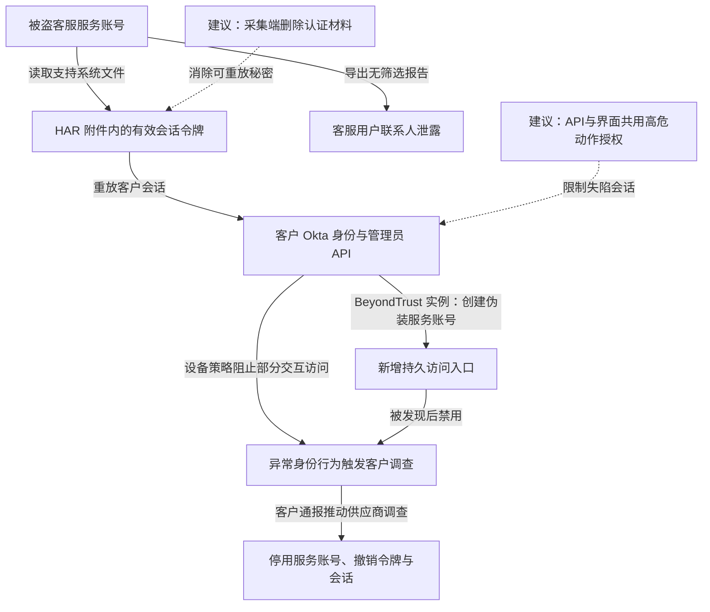

2023 年 9 月 28 日至 10 月 17 日，攻击者使用被盗的服务账号访问 Okta 客服系统，下载客户排障附件，并提取其中仍有效的会话令牌。Okta 在 11 月 3 日确认，文件访问涉及 134 家客户，令牌被用于劫持其中 5 家客户的合法会话。11 月 29 日，调查又发现攻击者导出过覆盖该客服系统全部用户的联系人报告，影响范围因此扩大；联系人泄露与管理员会话劫持是两条不同后果。Okta 停用涉事服务账号、终止会话并撤销附件中的令牌，受害客户也清除了攻击者取得的访问。[根因报告](https://sec.okta.com/articles/2023/11/unauthorized-access-oktas-support-case-management-system-root-cause/)和[后续更正](https://sec.okta.com/articles/october-security-incident-recommended-actions/)提供了这两个口径。

## 一份排障附件怎样跨回客户身份系统

下图将客服数据访问、令牌重放和客户侧实际处置分开；BeyondTrust 是公开披露路径的一个实例，不代表全部客户都经历相同动作。虚线是防护建议。

### 服务账号把排障资料集中成了可读取的秘密库

HAR 是浏览器网络请求记录，常用于复现登录失败和页面异常。它可能包含请求头、Cookie、重定向及响应内容，因而也可能保存已经完成 MFA 的会话。客户为了解决故障上传它，原本不等于同意客服系统取得可持续使用的管理员身份。

Okta 调查发现，涉事服务账号的用户名和密码被保存在一名员工的个人 Google 账号中，员工曾在公司电脑上登录该个人浏览器配置。厂商判断个人账号或个人设备失陷是凭据暴露的最可能路径。这项判断应停留在凭据来源解释，不能再补出未披露的窃密软件或钓鱼邮件。[Okta 根因报告](https://sec.okta.com/articles/2023/11/unauthorized-access-oktas-support-case-management-system-root-cause/)

### 重放会话跳过了登录挑战，后续动作却不一定被全部允许

令牌作为持有即可使用的凭据，在有效期内可让另一个客户端继承已认证身份。防钓鱼 MFA 能防止伪造登录，却不会自动让复制出去的旧会话失效。

BeyondTrust 在 10 月 2 日上传 HAR 后约半小时，观察到来自异常地址的管理员访问。其受管设备策略阻止了攻击者进入管理控制台，但底层 API 没有完全继承相同限制。攻击者经 API 创建了伪装成现有服务账号的 `svc_network_backup`，试图把短期会话转换为独立账户。安全团队发现后禁用新账号并撤销访问。[BeyondTrust 的实际时间线](https://www.beyondtrust.com/blog/entry/okta-support-unit-breach)

这段记录说明两项控制的实际边界：设备要求确实挡住了部分交互操作；如果 API 仍能用旧 Cookie 完成同样高风险的写入，限制就没有覆盖完整能力。不能把“控制台拒绝访问”写成整个身份平台未被操作，也不能据此推断下游客户资料已经全部外泄。

### 调查为什么先漏掉文件，再漏掉报告范围

Okta 最初按工单相关日志追查文件访问，但攻击者直接从文件页下载，产生的是另一类事件和记录 ID，调查因此约两周未识别这些下载。客户提供的异常 IP 才帮助调查定位到额外事件。

后来重建报告时，调查人员最初使用了模板筛选条件；攻击者运行的却是不加筛选的版本。重新比对下载文件大小后，Okta 才确认联系人报告覆盖更大范围，其中绝大多数用户只有姓名和邮箱。[11 月 29 日更正](https://sec.okta.com/articles/october-security-incident-recommended-actions/)没有把这些用户都列为令牌被盗或账号被接管者。

## 三次突破对应三道独立限制

### 排障数据不应携带可继续使用的身份

常规办法是提示客户清理 Cookie，但可复制的秘密一旦进入附件，就依赖上传者是否做对。更稳妥的设计是在采集端默认删除 `Authorization`、会话 Cookie 和令牌参数，再在接收端拒收残留认证材料；需要完整协议上下文时，用隔离测试身份复现，或将敏感原件置于单独、短时且有范围限制的访问流程。

字段黑名单不可能穷尽所有应用，未知头部和响应体仍可能含秘密。采集工具因此需要协议解析、敏感数据检测与人工复核的组合。不能把脱敏失败的代价继续交给普通客服存储承担。

### 会话的写入能力需要由资源端重新判断

客户可缩短高权限会话期限、绑定设备或网络上下文，并在新增身份提供方、注册认证因子、创建高权限账号等动作前重新认证。ASN 或 IP 绑定只能减少跨网络重放，不能阻止攻击者使用相同出口或已失陷的受管设备。

更深的控制是把高危变更授权放到界面和 API 共用的执行层，要求当前会话之外的证明或独立审批，且绑定具体变更内容。这样攻击者即使复制管理员 Cookie，也不能凭这枚 Cookie 修改决定下一次登录是否可信的规则。代价是管理员自动化与紧急恢复流程需要新的授权方式。

### 调查要以实际下载和执行对象为主线

工单打开、附件下载、报告导出是不同接口，不能用其中一个日志替代全部访问记录。供应商可将主体、对象 ID、下载字节数、筛选参数和会话关联记录到独立审计系统，调查时以实际数据出口重建范围。报表运行权限也应与日常支持权限分开，避免一个读取工单的服务账号顺便导出全部管理员联系人。

事件处置需要同时撤销客服账号、客户会话和新建访问入口。只重置被盗的服务账号密码，无法收回已经复制到攻击者环境的客户令牌。

## 参考资料

- [Okta：2023 年 11 月根因与修复说明](https://sec.okta.com/articles/2023/11/unauthorized-access-oktas-support-case-management-system-root-cause/)
- [Okta：联系人报告影响范围更正](https://sec.okta.com/articles/october-security-incident-recommended-actions/)
- [BeyondTrust：会话劫持与 API 操作时间线](https://www.beyondtrust.com/blog/entry/okta-support-unit-breach)
