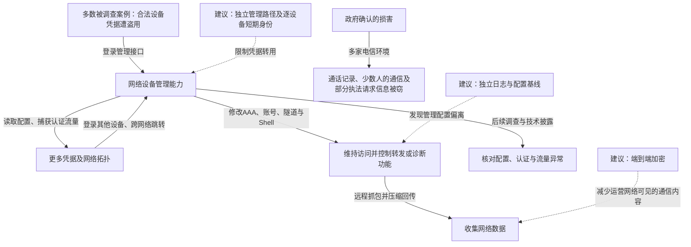

2024 年披露的 Salt Typhoon 活动涉及多家电信运营商的网络入侵。FBI 与 CISA 于 11 月 13 日确认，与中国有关联的攻击者窃取客户通话记录，取得少数主要涉及政府或政治活动人士的私人通信，并复制部分受法院授权执法请求涉及的信息。Cisco Talos 在 2025 年 2 月发表的后续调查中，记录了被盗合法凭据登录、设备配置外传、认证秘密获取、跨网络跳转和远程抓包等动作。该事件显示，攻击者控制网络管理能力后，可以借用运营商正常的配置和诊断功能长期收集信息，而不必在每一步部署新漏洞。[FBI/CISA 联合声明](https://www.fbi.gov/news/press-releases/joint-statement-from-fbi-and-cisa-on-the-peoples-republic-of-china-targeting-of-commercial-telecommunications-infrastructure)与 [Cisco Talos 技术调查](https://blog.talosintelligence.com/salt-typhoon-analysis/)

## 设备管理能力如何变成通信收集能力

这是一次跨多个受害环境的活动。下图归纳 Talos 观测到的能力和动作，不代表某一家运营商经历了全部步骤；政府确认的损害单独列出。实线为调查记载的动作或能力关系，虚线为本文建议。

### 被盗账号让攻击者以正常管理连接出现

Talos 表示，在所调查的 Cisco 设备入口中，绝大多数使用合法凭据；一个案例有证据提示可能利用 CVE-2018-0171。其调查没有发现新的 Cisco 漏洞。凭据最初如何取得，在不同环境并未全部确定。

因此不能把某个 IOS XE 漏洞写成所有运营商的共同入口。合法账号经过正常认证后，后续命令也可能看似普通维护操作。决定风险的是它能读取哪些配置、修改哪些认证设置、调用哪些抓包或 Shell 功能，而不只是登录是否成功。[Talos：Initial Access 与 Credential Use](https://blog.talosintelligence.com/salt-typhoon-analysis/)

### 配置文件既是拓扑资料，也可能携带下一批钥匙

攻击者经 TFTP、FTP 等方式取得设备配置。配置中的接口名称帮助识别上下游关系；弱保护的本地密码、SNMP 读写口令等认证材料，又能支持后续访问。Talos 还记录了对 SNMP、TACACS 和 RADIUS 流量及相关秘密的获取。

这形成了权限扩展循环：管理一台设备，读取可用于其他设备的秘密，再扩大可管理范围。仅给某台路由器更换本地管理员密码，不一定清除了已复制的共享认证秘密或其他设备账号。

### 跳转和配置修改让正常网络功能服务于窃取

调查记录包括修改 AAA/TACACS+ 服务器地址、创建本地账号、调整 ACL、建立 GRE 隧道、启用 Guest Shell，以及在 Linux 层增加 SSH 密钥或开启其他端口的 SSH 服务。攻击者还曾修改 loopback 地址，用它作为连接其他设备的源地址，从而越过依赖来源地址的限制。

Guest Shell 是设备提供的 Linux 运行环境，其用途本可包括管理扩展；在攻击者掌握权限后，它也能承载工具。Talos 发现的 JumbledPath 可经指定跳板在远端设备执行抓包，尝试清除沿途日志，再经另一组跳转取回压缩、加密的结果。设备同时承担跳板与数据出口，降低了仅按外部可疑 IP 追踪的有效性。[Talos：Configuration Modification 与 JumbledPath](https://blog.talosintelligence.com/salt-typhoon-analysis/)

### 观测到抓包不等于所有通信都以明文暴露

抓包位置、通信加密方式和端点控制情况决定能取得的内容。端到端加密能使运营网络中的攻击者难以直接读取正文，但不会自动隐藏连接时间、通信对象等元数据；通话记录、特定通信内容和执法请求信息也可能位于不同系统中。

## 关键突破、成因与防护

### 网络来源可信不能代替逐设备授权

修补已知漏洞、关闭不必要管理服务、给管理员启用强认证，都能减少入口。如果登录后还能读取全网共享凭据，或修改来源地址就被下游当作可信管理员，入口之后仍缺少限制。

管理连接应经独立路径，以设备绑定、短期身份和明确命令权限确认授权；不能只信任某个运营网段或跳板地址。修改 AAA、创建账号和开启抓包等高风险操作，应由独立管理服务批准并留痕。若设备已取得底层最高权限，它可能绕开本机限制，因此需要设备之外的网络约束、配置核对与必要的可信重建。

### 配置秘密不能让一台设备失陷扩大成全网访问

把弱口令换成强口令、使用更合适的密码保护方式是基础。还应减少设备间共享秘密，限制配置导出内容及权限，按设备或小范围分配认证材料。对仍需可逆使用的密钥，单纯改变配置中的编码形式并不能阻止已控制设备的攻击者取得其使用能力。

处置时需沿实际引用关系轮换：被读取的配置中包含哪些对端密钥，哪些认证服务器、备用本地账号或 SSH 密钥还可用于访问。轮换和重建应经可信管理环境执行，不能在攻击者仍能监听和读取配置的设备上不断分发新秘密。

### 日志与通信保护需要在设备失陷后仍然有用

攻击者能够清除本机日志、停用 Shell 或恢复表面配置，因此审计记录应及时送往独立管理域，并结合配置差异、认证记录及设备自身发起的流量核对。抓包、隧道和新监听端口尤其需要关联到批准的维护任务。

使用端到端加密能够减少网络设备受控后的正文泄露，但无法修复运营商管理面，也不替代端点安全。对必须在运营网络中处理的敏感资料，需要进一步限制查询、导出和留存。可行的恢复目标是重新建立可信管理路径、清除持续访问并减少网络可见的敏感内容，而不是只重启几台路由器。

## 参考资料

- [FBI/CISA：2024-11-13 电信基础设施入侵联合声明](https://www.fbi.gov/news/press-releases/joint-statement-from-fbi-and-cisa-on-the-peoples-republic-of-china-targeting-of-commercial-telecommunications-infrastructure)
- [Cisco Talos：2025-02-20 Salt Typhoon 技术调查](https://blog.talosintelligence.com/salt-typhoon-analysis/)
