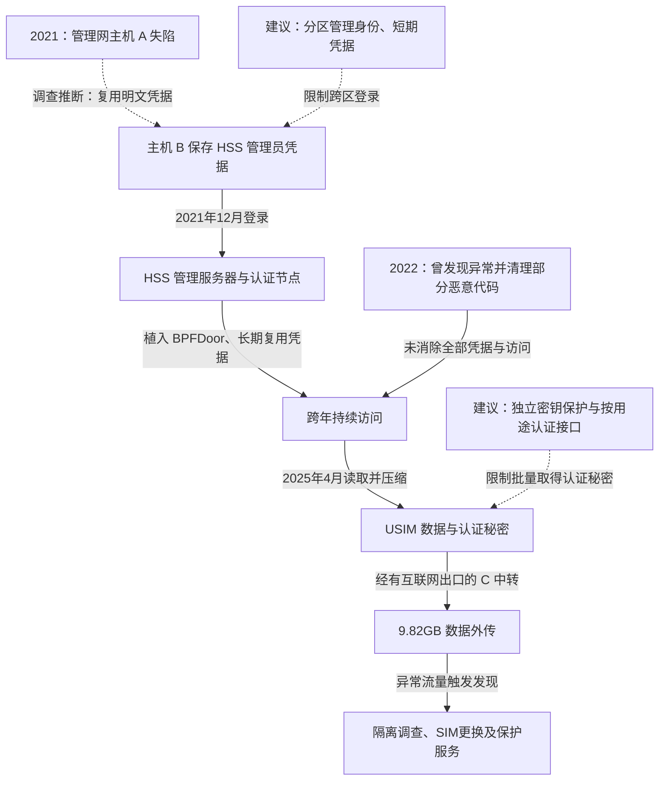

2025 年 4 月 18 日，韩国 SK Telecom 发现异常大流量外传，调查随后确认约 9.82GB、涉及 25 类 USIM 数据的约 2696 万条 IMSI 记录泄露。韩国科学技术信息通信部公布的最终调查将入侵追溯到 2021 年：攻击者从管理网主机取得其他服务器的明文凭据，进入 HSS 用户认证基础设施，部署 BPFDoor 等后门并长期复用未轮换的管理员密码，最后通过有互联网出口的中转主机外传。调查发现 28 台服务器感染；公司随后推出 SIM 更换或重置、保护服务及客户补偿措施。[政府最终调查](https://www.msit.go.kr/eng/bbs/view.do?bbsSeqNo=42&mId=4&mPid=2&nttSeqNo=1139&sCode=eng)与[公司后续措施](https://news.sktelecom.com/en/1979)分别说明攻击事实和响应。

## 管理网凭据如何一路通到移动认证数据

下图中的 A、B、C 沿用调查对主机的匿名称呼。A 到 B 的凭据复用属于调查推断，其余主线来自已恢复的登录、部署和外传记录；虚线防护标为建议。

### 第一个主机上的密码文件提供了下一台主机的登录能力

调查确认，2021 年 8 月 6 日，面向互联网的系统管理子网内主机 A 已被部署 CrossC2。A 保存其他管理主机的明文账号密码，相同凭据又出现在后续认证日志中，调查据此推断攻击者复用它们进入主机 B。公开调查没有给出 A 最初被攻破的具体漏洞，不能把 BPFDoor 当成最初入口。

B 又保存 HSS 管理服务器的管理员凭据。HSS 是移动网络中用于保存用户身份、签约与认证信息的关键系统，不是普通客户展示页面。攻击者在 2021 年 12 月进入该管理节点，并在相关节点植入后门；此时已从一般运维位置进入能够管理认证资料的高价值区域。[调查“攻击路径重建”](https://www.msit.go.kr/eng/bbs/view.do?bbsSeqNo=42&mId=4&mPid=2&nttSeqNo=1139&sCode=eng)

### 后门和多年有效的密码共同维持访问

攻击者在后续年份继续部署或更新恶意代码。后门提供隐蔽通信和执行位置，长期不变的管理员密码则允许在某个进程被清理后重新登录。持久性因此不能只用“发现了哪种木马”解释。

2022 年 2 月，公司曾因异常重启检查服务器并清除恶意代码，也发现了有关 HSS 管理节点的异常登录，但仅查看六份可用日志中的一份。调查将这次不充分处置列为损害扩大的原因。对攻击者而言，防守方移除了部分工具，却没有切断继续进入核心系统的身份基础。

### 外传借用了仍有互联网出口的中转节点

2025 年 4 月，攻击者访问三个 HSS 节点，压缩资料后通过主机 C 外传。读数据的主机与最终连接互联网的主机不是同一个，说明只看核心服务器有没有直接出网，无法判断资料能否离开。

调查还指出 USIM 认证密钥 Ki 以明文保存。IMSI 用于标识订户，Ki 则参与证明 SIM 身份；后者失窃会影响认证可信度。不能把数据泄露直接写成所有用户已被复制 SIM，但也不能只按普通通讯录泄露处置。公司提供更换、重置与网络侧保护，是在处理这些长期秘密可能已经离开系统后的风险。[SK Telecom 后续说明](https://news.sktelecom.com/en/1979)

## 关键突破、成因与防护

### 管理区之间以可搬运的密码维持信任

加密存放密码、轮换和 MFA 能减少直接复用，但如果解密权也在同一失陷主机，密码库仍可能被整体搬走。更有效的结构是按管理区拆分身份与授权，由独立凭据服务签发限时、限目标的会话；普通运维主机不保存通往 HSS 的长期通用管理员密码。

网络上还应让一般系统管理节点不能直接访问 HSS 管理服务，跨区维护只能经过可审计的专用路径。这会增加维护中转与故障应急成本，但能够让第一台服务器失陷后，攻击者仍需跨越另一道独立授权边界。

### 认证根秘密能够被普通服务器管理能力批量读取

数据库静态加密可防止脱机读取，却未必限制已经取得运行环境权限的攻击者。若业务程序可任意导出明文 Ki，攻击者控制该程序或管理身份后仍可能调用相同接口。

可将认证运算和密钥保管放入独立保护域，使日常系统只请求限定的认证操作，不接收完整密钥集合；批量导出、迁移和灾备另设受保护流程。仅把数据加密再把解密密钥放在旁边，无法改变这个能力关系。隔离设计还要保证认证容量、可用性和灾备兼容，不能以保护密钥为由让正常用户无法入网。

### 清理恶意文件没有撤销攻击者已经取得的身份

2022 年的异常本可用于追查凭据来源、跨区登录和同集群驻留。完整处置应先保全证据，再围绕受害身份追踪访问链，轮换相关凭据、重建高风险主机，并从独立日志核验旧入口不能继续使用。

日志和身份系统若仍由同一受害管理员控制，攻击者可以同时隐藏活动和伪造恢复迹象。将关键认证、配置与数据访问记录送往独立审计域，才能让清除结论不只来自被清除的机器。恢复判断应回答“哪项访问能力已被切断”，而不是只计算删掉了多少个后门。

## 参考资料

- [韩国 MSIT：SK Telecom 事件最终调查，攻击路径、USIM 数据和应急缺口](https://www.msit.go.kr/eng/bbs/view.do?bbsSeqNo=42&mId=4&mPid=2&nttSeqNo=1139&sCode=eng)
- [SK Telecom：2025 年 7 月客户保护与恢复措施](https://news.sktelecom.com/en/1979)
