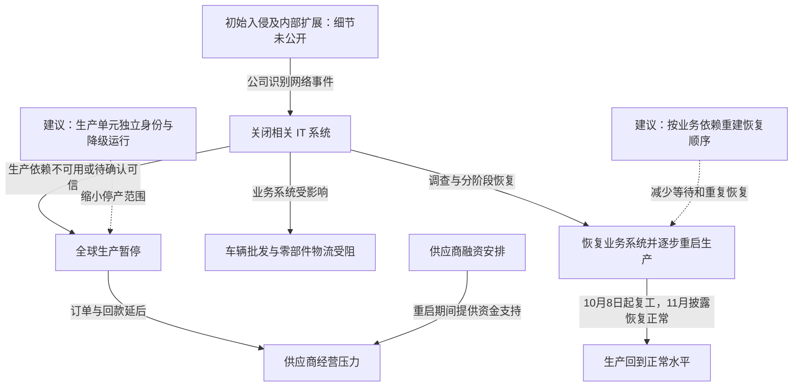

2025 年 9 月初，捷豹路虎（JLR）因网络安全事件关闭相关 IT 系统，全球生产随之暂停。公司后续确认部分数据受到影响；10 月 8 日开始分阶段重启生产，11 月 14 日披露生产已回到正常水平。事件不仅影响工厂，还波及车辆批发、零部件物流和依赖订单回款的供应商。JLR 在截至 9 月 30 日的季度结果中列出 1.96 亿英镑网络事件相关成本。公司没有在这些公告中公布可核验的攻击者身份或初始漏洞，不能把未经证实的勒索组织认领当作完整攻击经过。[JLR：11 月 14 日业绩与恢复公告](https://media.jlr.com/corporate/news/2025/11/jlr-performance-impacted-challenging-quarter)

## IT关停如何传导到整车生产

本案公开证据最充分的是损害与恢复过程，技术入口仍有缺口。下图实线表示公司披露的处置及后果；虚线表示本文提出的阻断或减损建议。图中不预设工厂 PLC、机器人控制器或安全联锁已经遭到攻击。

### 系统关闭是处置动作，生产停止是业务后果

公司最初的应对是关闭系统、联合专家调查，并逐次延长暂停生产的安排。9 月 16 日公告将暂停期延至 9 月 24 日；这只是当时的阶段安排，并非全部生产最终恢复日期。[JLR：9 月 16 日声明](https://media.jlr.com/corporate/news/2025/09/statement-cyber-incident-2)

在制造业，车间设备仍能通电并不意味着整车可以正常出厂。生产通常还依赖订单、物料、工艺版本、质量记录、供应商交付和身份服务。这里列举的是解释停产的常见依赖，不是对 JLR 内部拓扑的取证结论。公开公告足以说明 IT 事件能够通过业务依赖阻断生产，无需先假设攻击者改写了控制器程序。

### 数据风险与可用性风险同时存在

JLR 随后的公告表示部分数据受到影响，因此分析不能只停留在停机天数。恢复某项服务时，除了让进程启动，还需确认身份权限、配置和业务数据值得信任，否则可能把原有访问能力重新带回生产。[JLR：后续数据影响声明](https://media.jlr.com/corporate/news/2025/09/statement-cyber-incident-1)

攻击者若在企业管理域取得权限，可能利用正常的远程管理和业务接口继续移动；这是一种需要在恢复中排查的风险模型。现有公开材料不足以把它具体化成某个 VPN、虚拟化平台或数据库已遭控制，本文也不据此编写载荷和内部路径。

### 恢复需要让生产与资金循环一起重新运转

10 月公告给出了分阶段恢复生产的安排，而非某一天同时启动全部工厂。11 月业绩公告还列出车辆批发系统、全球零部件物流中心恢复，以及面向符合条件供应商的融资安排。这些措施说明，复工依赖的不只是车间计算机，还包括交付、销售和现金流。[JLR：10 月生产恢复安排](https://media.jlr.com/corporate/news/2025/10/jlr-volumes-down-challenging-quarter)

截至 9 月底季度的 1.96 亿英镑事件相关成本，与该季度收入下滑、税前亏损、额外融资额度分别是不同的财务口径。季度表现还受到车型切换、关税等因素影响，不能把整份财报的负面变化都计入攻击损失。

## 关键突破、成因与防护

本案没有公开足够的技术证据来认定某一具体漏洞是突破点。能够直接分析的是入侵风险如何被业务依赖放大，以及这些依赖怎样改造；以下均为本文建议。

### 管理域受疑时，生产单元需要保留自己的可信运行边界

网络分区和关闭不必要的远程入口能减少攻击传播，但如果每条生产线仍依赖同一个在线身份平台、集中配置服务或管理账号，分区之后也可能同时停摆。判断隔离是否有效，需要检查登录、工艺下发、质量记录和日常维护所用的实际凭据与接口。

对能够独立运行的生产单元，可以保留受控的本地身份、已批准的工艺版本及有限时长的离线生产能力。离线模式必须限制可制造的车型、批次和数量，记录操作并在恢复后核对；安全联锁和产品质量要求仍需满足。否则，为了保可用而开放的应急权限反而可能变成新的长期管理入口。

### 恢复顺序应依据业务依赖，而不只是服务器清单

增加备份、保留不可变副本，能够减少数据重建成本。恢复时还要先建立可信的管理工作站、身份、密钥、网络与日志，再恢复依赖它们的服务；在受疑身份平台仍能签发会话时，把业务服务器从备份拉起，可能重新接上攻击者。

可以为车辆交付、零部件发运和生产启动分别维护最小依赖集合，确认哪些服务可先以只读或受限模式运行。恢复演练应实际执行一笔订单、一次物料放行和一段质量追溯，而不是以虚拟机数量统计业务恢复程度。这种准备需要业务与安全团队共同维护，系统变更后也要同步更新。

### 供应商连续性是停产影响的一部分

只计算本公司的停机成本，容易低估长期暂停对供应商产能、人员和库存造成的压力。JLR 启动供应商融资安排，是实际应对的一部分；它缓解资金压力，不会直接清除攻击访问能力。

企业可以提前设计中断期间的订单确认、人工交付和付款核对渠道。备用渠道应使用预先登记的联系人、收款信息与独立复核，不能让一次业务中断同时迫使供应商接受临时邮件中的新银行账号。它既有助于恢复交付，也能避免攻击者借应急沟通继续实施付款欺诈。

## 参考资料

- [JLR：2025-09 数据影响声明](https://media.jlr.com/corporate/news/2025/09/statement-cyber-incident-1)
- [JLR：2025-09-16 暂停生产安排](https://media.jlr.com/corporate/news/2025/09/statement-cyber-incident-2)
- [JLR：2025-10 产量及分阶段恢复安排](https://media.jlr.com/corporate/news/2025/10/jlr-volumes-down-challenging-quarter)
- [JLR：2025-11-14 季度成本、供应商支持与恢复进展](https://media.jlr.com/corporate/news/2025/11/jlr-performance-impacted-challenging-quarter)
