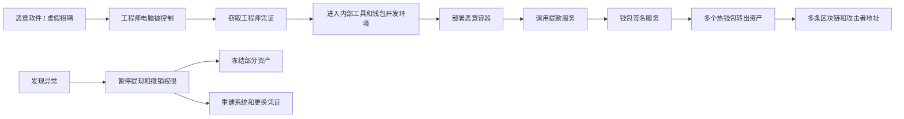

2026 年 10 月 29 日，币安多个热钱包在不到四个小时内转出约 63.4 亿美元数字资产。

目前公开信息没有显示钱包私钥泄露。攻击者先控制工程师电脑，再利用窃取的凭证和内部系统权限进入提款链路，最后让币安自己的钱包完成转账。钱包签名仍然有效，失效的是签名前后的信任链。系统接受了身份看起来合法的请求，却没有确认交易是否符合真实业务意图。

## 攻击从员工电脑开始

币安初步报告显示，攻击者从几个月前就开始准备。

6 月，一名钱包开发团队成员下载了被篡改的软件。9 月，另一名钱包软件工程师参加虚假招聘面试，并下载了恶意代码仓库。10 月 20 日，攻击者利用已经控制的电脑和币安内部 AI 工具，进一步进入钱包 DevOps 工程师和另一名钱包软件工程师的工作环境。

10 月 29 日，攻击者登录第二名工程师的电脑，使用第一名工程师的凭证部署容器并执行恶意脚本。币安称，攻击者随后通过内部提款服务提交未经授权的交易。[币安初步报告](https://www.binance.com/en/blog/community/3229153443759566763)和[路透社报道](https://www.reuters.com/world/binance-says-hackers-used-fake-job-interview-compromise-computer-before-63-2026-11-03/)披露了这条攻击路径。



独立链上分析显示，约 63 亿美元资产从 17 个热钱包流出，涉及九条区块链。[Bitquery 链上分析](https://bitquery.io/investigations/binance-hack)和[CSH 技术分析](https://csh.ac.at/news/the-binance-hot-wallet-hack-step-by-step/)对转账过程进行了还原。

## 合法签名如何完成非法转账

币安表示，目前没有证据证明钱包私钥泄露。多数异常转账仍由币安钱包自身完成签名。攻击者控制的可能是发起签名请求的系统，而不是私钥本身。

签名服务如果只检查请求账号、接口权限、交易格式和签名有效性，就可能放过一笔“身份合法、格式正确，但业务意图恶意”的交易。

热钱包签名服务还需要理解交易内容，至少识别向新地址转移大额资产、同时影响多个钱包和多个区块链、由新设备或新容器发起、改变账户代码或执行逻辑，以及绕过原有提款策略和审批流程等行为。

## EIP-7702 放大了以太坊部分的损失

以太坊部分的攻击使用了 EIP-7702。该机制允许普通账户通过签名授权，暂时执行某个智能合约的代码。

独立分析显示，攻击者向币安的一个以太坊热钱包提交了 50 个连续 nonce 对应的授权，其中一个授权与钱包当时的交易序号匹配。授权生效后，攻击者让该钱包执行清扫代码，一次转走大量 ETH、USDT 和其他代币。[链上交易分析](https://bitquery.io/investigations/binance-hack)显示了这部分过程。

EIP-7702 放大了已经存在的权限问题。对于高价值钱包，改变账户代码、委托新的合约逻辑和批量授权，都应该被视为高风险操作，进入独立审批、延迟生效或人工确认流程。

## 暂停提现没有马上结束攻击

币安发现异常后暂停提现、撤销权限，并与稳定币发行方、区块链项目和安全公司合作冻结资产。币安称约 28.5 亿美元资产被冻结或拦截。[币安初步报告](https://www.binance.com/en/blog/community/3229153443759566763)对此进行了说明。

但暂停提现只阻止新的用户提现进入系统。已经排队的任务、正在运行的容器、已经取得的服务权限和已经提交的链上授权，仍可能继续发挥作用。

路透社报道显示，部分未经授权的资产转移在提现暂停后仍然继续，最后一笔异常转账直到 23:56 UTC 才完成。币安在 10 月 30 日 00:10 UTC 清除了相关 EIP-7702 委托代码。

因此，钱包系统的应急处置需要覆盖完整执行链路：

```text
暂停新请求 → 清理队列 → 停止执行容器
→ 撤销服务账号 → 清除链上授权 → 切换钱包和签名环境
```

如果只能暂停前端入口，后台仍可能继续产生异常交易。

## 冻结资产只能减少损失

稳定币发行方可以冻结特定地址上的 USDT、USDC 等资产。Bitquery 分析显示，Tether、Circle、Arbitrum 以及其他项目冻结了约 27 亿美元资产。

这种能力有明显边界。攻击者可以在冻结生效前把资产转到新地址，兑换成 ETH 或 TRX，或者存入 DeFi 协议。BTC、ETH 等没有发行方控制的资产，也没有同样的冻结机制。

资产冻结提供了事后止损能力，无法替代钱包签名控制。最终损失有多大，仍然取决于攻击者能够继续调用提款和签名系统多长时间。

## 需要补上的三道防线

第一，拆开员工终端、开发部署和资产签名权限。工程师电脑被控制后，攻击者不应因此获得大额资产签名能力。

第二，让签名服务检查交易意图。签名系统需要理解账户代码变化、跨链批量转账、新地址大额转账和异常执行环境的风险。

第三，让紧急撤销覆盖已经开始执行的任务。撤销完成之后，旧凭证、旧会话、旧容器和旧链上授权都不能再产生新的业务副作用。

币安确认攻击者利用内部 AI 工具进入了钱包工程师的系统，但公开资料尚未披露该工具的具体权限和调用过程。因此，目前可以确认它处在攻击路径上，不能据此断定它是最初的入侵点。

## 如何验证防护是否有效

企业可以在隔离环境中搭建一条简化链路，测试上游系统被控制后是否还能继续产生业务结果：

```text
员工终端 → 内部工具 → 容器部署服务
→ 提款服务 → 签名服务 → 模拟区块链
```

测试重点包括工程师电脑被控制、部署容器被控制、EIP-7702 授权、多链异常同时出现、暂停提现后的队列执行，以及紧急撤销完成后的残余交易。

最重要的指标是：

> 撤销确认完成后，还有多少未经授权的高风险操作成功提交？

## 结语

币安事件的关键不在于某个新协议，也不在于一台电脑被攻破，而在于攻击者能够沿着员工终端、工程师凭证、内部工具、容器部署和提款服务一路走到钱包签名环节。

私钥没有泄露，签名流程仍然按照规则运行，但签名请求已经不再代表币安的真实业务意图。

企业需要守住的边界是：

> 员工终端、内部工具或部署容器被控制后，不能直接产生跨资产、跨链和批量业务副作用。

这条边界需要通过终端隔离、权限拆分、交易语义检查、独立签名审批和可验证的紧急撤销共同实现。

## 参考资料

- [Binance：Initial Findings and Response Update](https://www.binance.com/en/blog/community/3229153443759566763)
- [FBI：North Korea Responsible for $6 Billion+ Binance Attack](https://www.fbi.gov/investigate/cyber/alerts/2026/north-korea-responsible-for-6-billion-binance-attack)
- [Reuters：Binance hackers used fake job interview](https://www.reuters.com/world/binance-says-hackers-used-fake-job-interview-compromise-computer-before-63-2026-11-03/)
- [Bitquery：Binance Hack On-Chain Investigation](https://bitquery.io/investigations/binance-hack)
- [CSH：The Binance Hot Wallet Hack, Step by Step](https://csh.ac.at/news/the-binance-hot-wallet-hack-step-by-step/)
