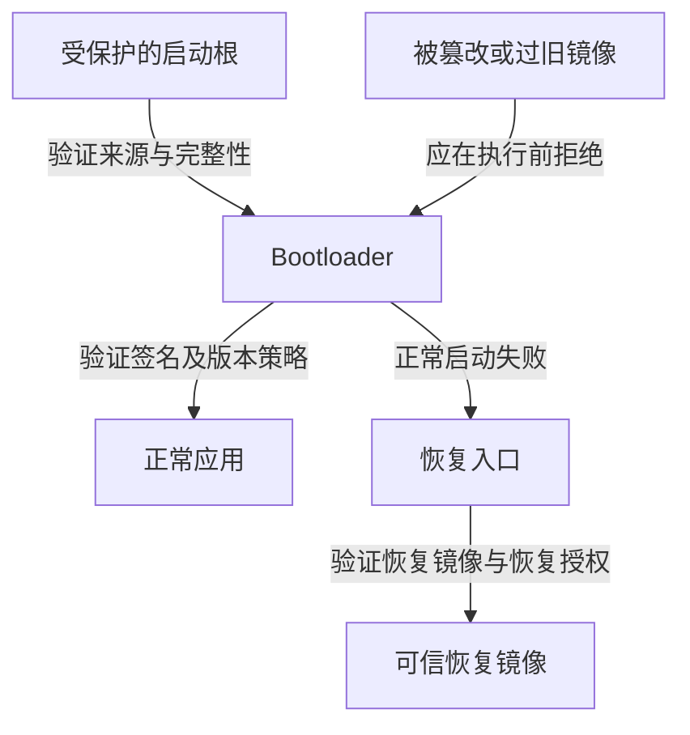

攻击者改写 Flash 后，设备下一次启动是否会接受被修改的软件，是安全启动需要回答的问题。这个问题不能只靠“升级包有签名”判断：升级程序可能验证了应用，恢复入口却直接运行另一份镜像；启动程序也可能接受签名正确但已经存在漏洞的旧版本。

## 实操：核对 ESP32 的启动安全配置与实际签名镜像

沿用[串口与备份操作](./01-IoT调试接口与量产权限.md)中的 ESP32 样机、端口和 esptool v4 环境。需要样机本身，以及厂商或项目构建产物中的独立 Bootloader、应用镜像和可信签名公钥。完整 Flash 副本、独立应用镜像和 OTA 包的格式不同，先核对分区表与烧录清单。

只有设备时，先完成安全状态与启动日志读取。拥有项目构建目录时，从烧录参数文件确定 Bootloader、分区表和应用的实际文件及偏移，再从签名配置取得对应公钥；只有厂商升级包时，先核对包格式与公开验证材料，不能把整个压缩包传给应用镜像解析器。缺少可信公钥时，可以识别签名块，但暂时不能确认发布身份。

### 读取硬件安全状态

```bash
espefuse.py --chip esp32 --port "$IOT_PORT" summary --format json --file efuses.json
espefuse.py --chip esp32 --port "$IOT_PORT" summary ABS_DONE_0 ABS_DONE_1 JTAG_DISABLE UART_DOWNLOAD_DIS SECURE_VERSION
```

对经典 ESP32，分别查看 Secure Boot V1/V2、调试与 UART 下载限制、最低安全版本。字段含义和支持程度需要结合芯片修订；例如 V2 与早期芯片的适配条件不同。读保护字段显示不可读，不能记成密钥为空。[eFuse summary 文档](https://docs.espressif.com/projects/esptool/en/release-v4/esp32/espefuse/summary-cmd.html)

接着通过 miniterm 复位采集启动日志，把芯片状态与 Bootloader 的实际校验信息对应起来。若安全启动未启用，先记录事实；这不是签名算法被绕过。

### 解析真实镜像并验证其发布身份

将从本项目发布目录取得的独立应用镜像保存为 `app-signed.bin`，可信发布公钥保存为 `release-public.pem`。以下文件名是本地材料名称，不是本文提供的样本。公钥必须来自独立可信的发布配置，不能把包内附带的任意公钥直接当作信任根。

```bash
python -m esptool --chip esp32 image_info app-signed.bin
espsecure.py signature_info_v2 app-signed.bin
espsecure.py verify_signature --version 2 --keyfile release-public.pem app-signed.bin
```

记录镜像格式、签名块与验证结果。V1、其他芯片或非 ESP 镜像需要换成对应工具；“未找到 V2 签名块”可能是对象或格式不对，不自动证明产品存在漏洞。镜像验证命令见 [espsecure 文档](https://docs.espressif.com/projects/esptool/en/release-v4/esp32/espsecure/index.html)。

### 从离线验证走到设备拒绝

离线验签成功后，再取得厂商实际发布的旧版本和测试发布流程产生的无效签名版本。在有串口恢复能力的专用样机上，通过产品原有升级入口分别尝试，保留升级响应、启动日志、实际运行版本和恢复路径。签名有效但安全版本过旧，应由防回退策略判断；无效签名应在执行前拒绝。

本节不执行烧写 eFuse。开启安全启动、撤销密钥或关闭下载口可能不可逆，需要按项目量产与返修方案单独实施。没有对应镜像、公钥或实机拒绝结果时，结论停留在已核对的配置与离线校验范围。

## 成立前提与能力变化

攻击者需要先影响待启动内容、启动选择或验证执行过程，再利用验证范围、版本策略或失败分支的缺口。典型回滚链是“写入旧的合法签名镜像 → 设备未执行安全版本限制 → 旧镜像启动 → 利用其中已知缺陷”。它与伪造签名、运行时利用和物理故障注入是不同路径。

## 从不可随意替换的根开始验证

典型信任链由不可随意修改的启动代码或受保护硬件状态开始，验证下一阶段，再由下一阶段验证后续软件。每一步都要回答：信任哪个密钥、验证哪些字节、失败后跳到哪里，以及验证结果能否被低权限软件改变。

以 ESP-IDF v5.3.4 的 ESP32 Secure Boot V2 为例，文档限定其适用于 ESP32 ECO3 及之后修订：ROM 验证第二阶段 Bootloader，Bootloader 验证应用镜像。签名私钥保留在发布侧，设备持有验证所需材料。这个实现例子说明了信任逐级传递的方式，不代表所有芯片都采用相同算法或密钥布局。[ESP32 Secure Boot V2](https://docs.espressif.com/projects/esp-idf/en/v5.3.4/esp32/security/secure-boot-v2.html)

安全启动验证的是软件来源与完整性。一个签名正确的程序仍可能存在命令注入、解析漏洞或错误授权；攻击者在运行时利用这些缺陷，并不需要先伪造固件签名。

## 三种经常被漏掉的旁路

第一种是未覆盖的启动对象。内核经过验证，但决定启动参数的配置、外部脚本或插件仍由攻击者控制，最终执行的行为就可能偏离已经验证的镜像。审计需要沿实际加载关系核对，不能只在升级包里找到一个签名文件就结束。

第二种是版本回滚。旧固件也可能带有合法签名，因此签名验证通过与版本仍被批准是不同判断。回滚保护需要设备知道最低可接受安全版本，而且攻击者不能通过改写普通配置把这个下限降回去。正常运维回退与禁止回到已知危险版本之间，需要产品明确区分。

第三种是故障与恢复路径。正常镜像验证失败后，设备若自动运行未验证的恢复镜像，就把验签失败变成了切换到弱入口的条件。攻击者未必需要破解密码算法，只需要影响启动路径选择。

## 恢复能力也需要自己的信任关系

NIST SP 800-193 将固件韧性分为保护、检测与恢复三部分。它讨论的是平台固件的一般原则；用于具体 IoT 产品时，应映射到对应芯片与存储设计，而不是直接宣称符合某个认证。[NIST SP 800-193](https://csrc.nist.gov/pubs/sp/800/193/final)

Trusted Firmware-A 的固件更新文档进一步展示了更新与恢复的分工：更新客户端、更新代理、启动阶段和备份能力承担不同职责。恢复程序也必须经过信任链约束，否则它会成为绕过正常发布授权的第二套加载器。[TF-A 固件更新设计](https://tf-a.docs.trustedfirmware.org/en/latest/components/firmware-update.html)



图中恢复入口不绕过验证。实际产品还应验证启动元数据，保证掉电不会让镜像槽位、版本状态和实际执行对象互相矛盾。

## 验证覆盖范围要落到实际执行的字节

审阅一个启动实现，可以逐项记录“待执行对象、验证者、信任材料、验证范围、失败行为”。重点不只在算法，也在边界：镜像长度能否受未验证字段控制，压缩或重定位后的内容怎样与验证对象对应，签名块里的公钥是否与受保护信任根绑定。

一种常见逻辑错误是仅验证“附带签名能被附带公钥验证”。如果攻击者可以同时替换镜像、公钥与签名，验证仍会成功；必须继续证明这把公钥是设备已经信任或被授权信任的公钥。

同样，验证与执行之间还存在时间窗口。若验签后从可被其他主体修改的存储重新加载对象，就要证明第二次加载的字节仍是验过的内容。受保护 RAM、验证后锁定写入或执行时完整性机制，分别适用于不同系统，不能只靠一次函数返回值替代。

实际记录还应包含失败分支是否默认拒绝、错误码是否被忽略，以及是否存在“调试构建才允许跳过”的条件。构建配置与芯片安全状态共同决定最终行为，源代码中存在验签函数只能证明实现线索。

## 更新成功和启动成功不能使用同一判据

写入结果、Bootloader 拒绝和应用运行结果分别记录。本篇沿信任根核对“哪些代码被允许执行”；更新事务、试运行确认与安全版本推进时机见 [OTA 更新](./09-IoT固件更新与回滚防护.md#ota-confirmation)。

## 用镜像矩阵定位验签与版本策略的差别

以下是建议的测试集合，不表示某个厂商已经通过或未通过这些测试：

| 测试对象 | 需要验证的行为 | 异常接受说明什么 |
| --- | --- | --- |
| 正文被修改、保留旧签名 | 执行前拒绝 | 内容与验证结果没有正确绑定 |
| 正文与签名均被替换，附带攻击者公钥 | 拒绝未获授权的信任根 | 只检查了签名数学关系 |
| 合法签名但低于最低安全版本 | 按安全版本策略拒绝 | 来源验证没有覆盖允许版本 |
| 正常应用失败后的恢复镜像 | 恢复镜像仍受信任链约束 | 失败分支绕过正常验证 |

若返回一个统一的“启动失败”，应结合启动日志、镜像标识和恢复状态区分失败位置。验签失败与应用启动后崩溃会产生不同后果：前者应在危险软件执行前结束，后者意味着软件已经进入运行阶段。日志缺失时需要保留这个证据缺口，不能仅凭设备没有联网推断拒绝发生在哪里。

## 有效的验证应覆盖拒绝与恢复

在隔离样机上建立镜像集合：合法新版本、已知旧版本、正文被修改、签名被修改、设备型号不匹配、恢复分区被替换。对每种镜像记录是否安装、是否启动、失败后进入何处，以及重新上电后的版本状态。

还要测试升级各阶段掉电、首次启动持续崩溃、配置损坏和正常镜像缺失。验收目标是设备拒绝未经授权的软件，同时仍能通过受信任的路径恢复；只证明“坏镜像没有启动”，不足以证明产品能够安全运维。

关联阅读：[OTA 更新与回滚防护](./09-IoT固件更新与回滚防护.md)、[物理侧信道与故障注入](./11-IoT物理侧信道与故障注入.md)。
