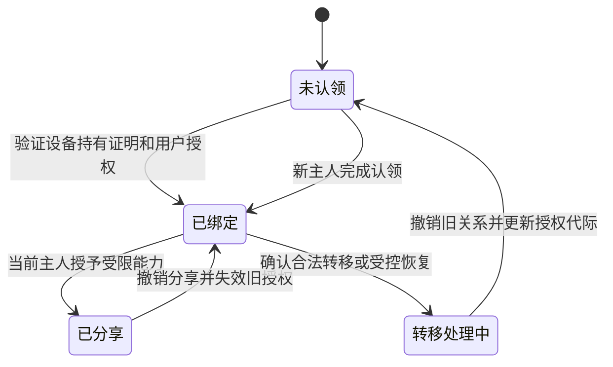

用户把设备从 App 列表中删除，设备本地却可能仍保存原账号的密钥；设备按键恢复出厂，云端分享关系又可能没有撤销。所有权转移要改变的是一组分布在不同系统中的权限，而不只是一个界面上的绑定标记。

## 实操：在真实设备上重放转移前的权限

准备一台可恢复的被测设备、两个自己的产品账号 A/B 和两台手机。A 先按官方流程完成绑定，B 保持未绑定。若产品支持家庭成员或分享，再准备一个自己的分享账号。使用 [Burp Repeater](https://portswigger.net/burp/documentation/desktop/tools/repeater)保存真实请求；无法代理的本地协议使用对应抓包与设备日志。

先从 App 的设备详情记录 A 所拥有设备的标识，另记实际设备上的序列号，确认请求操作的是这台样机。服务端不可见时，以 App 重新读取和设备物理状态作为外部结果；只有项目成员能取得队列与后台日志的步骤，放到对应服务侧继续定位。代理设置与请求定位见 [App 与云 API](./10-IoTApp与云API控制链路.md#capture-app-requests)。

### 先留存旧权限确实有效的基线

1. 用 A 读取状态并执行一次可观察的低风险动作，例如产品支持的指示灯设置；保存请求、响应、设备回读与时间。
2. 保存 A 的控制会话、分享关系和本地连接状态。请求原样重发一次，确认它确实能够执行，排除一次性请求本来就无法重放。
3. 用 B 的正常登录态尝试同一设备，保留“尚未拥有时”的结果。不要把 B 的设备 ID 换成任意陌生用户对象。

### 完成一次实际转移，再操作旧会话

按产品明确支持的流程让 A 解绑、B 重新认领；如果产品声明必须恢复出厂，就依说明执行并记录该步骤。B 成功读取并执行同一功能后，再在 A 的旧 App 和 Repeater 中分别重放原请求。

检查四项结果：云端是否拒绝、设备是否执行、旧媒体地址是否仍有效、旧账号是否还能新增分享或签发凭据。HTTP 200、设备列表消失和 App 弹出登录页都不能单独替代这四项判断。

若请求需要递增序号或当前挑战，先在 A 的仍存会话中通过真实 App 产生一个新请求，再检查被拒绝的是旧报文格式还是旧主体权限。一次性重放失败不能证明旧主人已失权。

### 把离线和部分成功单独重做

恢复设备到可重复的初始状态，分别做以下操作序列，每次只改变一个条件：设备在线转移；设备断网时撤销分享后再联网；A 仍保持本地蓝牙或局域网会话时转移；设备重启后再由旧账号请求；产品支持的配置备份恢复后再请求。

同一产品若同时支持解绑与本地重置，再分别执行“先解绑再重置”和“先重置再解绑”，检查中间状态是否留下旧权限。第三方自动化平台持有的授权单独重试，不能只观察主 App。

离线设备暂时无法接收撤销时，应核对产品定义的时效和离线权限边界。重新联网后仍执行旧主人请求，需要继续追踪设备缓存、消息队列和云端授权中的哪一层未更新。

### 保存能定位修复点的证据

每条证据写清账号角色、设备唯一标识、转移前后时间、请求来源、执行结果和重连状态；真实令牌保存在私有研究记录中，文章只保留脱敏结构。修复后让旧主体实际重试，同时确认新主人和仍有效的管理员能够正常操作。

多管理员产品按管理域逐一核对。Matter 设备移除一个 fabric 不等于移除全部管理员；不要用单账号解绑的结果推断整个设备已经恢复出厂。

## 成立前提与能力变化

攻击者通常至少拥有旧账号、被撤销的分享授权、可复制设备标识或设备接触能力中的一项；具体路径取决于平台是否错误接受绑定、解绑、登录或旧指令。需要证明未经授权的状态转换，或者权限应当失效之后仍实际控制设备，而不是只观察 App 列表是否删除。

## 设备身份、主人身份与控制授权分别成立

设备证书回答“这是不是某台被承认的设备”；账号登录回答“当前用户是谁”；绑定关系回答“谁可以管理这台设备”。分享、家庭成员、第三方自动化和维修权限又在绑定关系上继续派生。

设备是真的，不证明当前操作者是主人；用户已经登录，也不证明有权操作给定设备 ID。MAC、序列号或公开二维码可以帮助发现设备，但是否足以证明持有权，要看是否存在不可复制或额外确认机制。

这一分离也适用于 Matter。NIST 发表的 2023 年研究讨论了控制器被信任的方式与设备认证之间的不对称。它指出设备来源证明与控制器信任是不同问题，并分析恶意控制器的影响；这不等于“任何陌生人都能绕过配网接管设备”。[NIST Matter 控制器信任研究](https://www.nist.gov/publications/security-analysis-trust-controller-matter-protocol)

## 状态机缺口怎样把合法操作组合成接管

USENIX Security 2019 的设备—App—云交互研究，通过真实设备分析与模拟设备构造，研究了注册、绑定、登录和解绑的状态转换。论文发现某些历史平台接受与当前状态不相容的请求，或让参与方停留在不一致状态，从而形成设备劫持、替换或拒绝服务等结果。[原始论文](https://www.usenix.org/system/files/sec19-zhou.pdf)

这类问题不一定需要破解密码。一个请求单独看似合法，但如果“已绑定设备”仍接受新的绑定声明，或者云端已经解绑而设备长连接仍保留旧状态，攻击者就可能利用状态差异改变后续处理。

因此，测试对象应是操作序列：谁先解绑、设备是否在线、旧连接是否保留、新主人什么时候加入，而不能只逐个测试 API 的参数格式。

## 用授权代际表达转移，但不要只加一个字段

一种可评估的设计是给所有权维护单调递增的代际。以下是本文用于建模的字段，不是对现有协议的规定：

```text
DeviceID：稳定设备身份
OwnerID：当前管理主体
OwnershipEpoch：所有权发生安全变更时推进的代际
CommandID：一次业务动作的唯一标识
```

当设备转移到新主人，旧代际签发的控制令牌与待执行指令应失效。设备离线时，可以要求重新同步当前代际后再执行高风险动作；否则，云端完成转移并不能阻止设备继续接受缓存授权。

代际本身需要受保护。若普通接口能把它改回旧值，或者设备重启后只恢复了旧快照，模型就失去作用。增加字段必须同时定义谁更新、如何同步、失败时如何处理及如何防回滚。



这是建议的分析模型。真实产品还要定义争议恢复、遗失账号、设备报废和多管理员情形，不能强行压成单一主人字段。

## 为部分成功和离线状态规定明确结果

所有权转移通常跨数据库、消息队列和设备本地状态，不能假设每一项修改同时完成。以下是建议验证的中间状态：

| 中间状态 | 需要明确的行为 |
| --- | --- |
| 云端已转移，设备离线 | 高风险动作是否等待设备同步新授权 |
| 设备已重置，云端关系仍在 | 原账号能否重新下发控制或领取凭据 |
| 分享已撤销，消息仍在队列 | 消息是否携带并检查有效授权代际 |
| 新主人已认领，旧 App 仍登录 | 旧会话是否还能对该设备增加授权 |
| 旧备份被恢复 | 设备是否错误恢复已经失效的权限 |

如果转移事务失败，产品需要告诉用户目前谁仍有控制权，而不是只显示一次操作失败。对安全敏感设备，可以先暂停新的远程授权，再完成状态同步，但应保留产品所需的合法本地使用与恢复路径。

设备离线时无法同时保证立即全局撤销与所有离线功能继续可用。设计必须选择哪些能力可以依赖缓存授权、允许多长窗口，以及恢复联网后如何处理积压动作。这个取舍应成为产品行为，而不是偶发网络故障决定的结果。

## 用一条转移序列验证旧授权是否真正失效

从产品消息队列与请求日志保存转移前尚未执行的动作，完成合法转移后让设备重新联网。观察设备先同步当前权限还是先消费旧消息，再让旧主人尝试领取新控制凭据，由新主人执行正常动作作为对照。

旧消息被拒绝仍不够：若旧主人能重新领取当前有效凭据，旧账号仍保留控制权。新凭据领取被拒绝也不够：若设备先执行缓存消息，再同步当前权限，转移后的第一条旧动作仍可能生效。产品使用授权代际时，把实际日志中的前后代际与这些结果对应。

还要尝试恢复设备的旧配置备份，观察代际与本地授权是否被一起回滚。若设备没有可靠时间或防回滚存储，离线授权就需要明确的能力限制与重新同步策略；不能通过给普通配置增加一个字段来假定这类问题已经解决。

## 分享与恢复不应成为隐藏的永久管理员

短期访客、家庭成员、自动化平台和售后服务应得到不同范围的能力，并明确是否可以继续转授。仅撤销主 App 会话，可能没有撤销已经交给第三方的长期令牌。

恢复流程还要兼顾防盗与合法转售。如果按键即可清除一切所有权，盗取设备的人可能重新认领；如果永久依赖旧主人确认，二手设备又可能无法使用。产品应明确恢复证据、通知、等待期和高风险能力限制，而不是让本地重置偶然决定云端所有权。

## 验证必须让旧主人实际尝试操作

前述转移、离线与恢复结果均以旧主体再次读取、控制、增加成员或领取凭据的行为验收。保留当前合法主人和仍有效管理员的正常结果，确认撤销作用于正确的权限范围。

账号归属、流程跳过与条件竞争的通用机制见[逻辑缺陷](../15-业务安全与自动化滥用/逻辑缺陷.md)。设备专题进一步检查离线状态、所有权转移与本地凭据的生命周期。

关联阅读：[消息授权与旧指令](./06-IoT协议消息认证与授权.md)、[App 与云端控制链路](./10-IoTApp与云API控制链路.md)。
