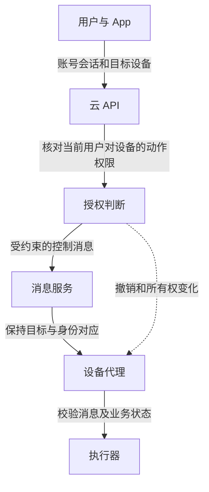

用户点击 App 中的一个开关，背后可能依次经过账号会话、云 API、设备注册表、消息 Broker、设备代理和执行器。每一层都可能认为上一层已经完成授权，最后却没有任何一层核对“这个用户现在是否有权让这台设备执行这个动作”。

## 实操：沿官方 App 的真实请求验证跨账号访问

准备两个自己的产品账号 A/B，分别绑定两台自己的设备，以及可供测试的低风险资源，例如状态、自己的短录制或配置。单设备产品可以先用“主人与未绑定账号”组合，不构造并不存在的云 API。

### 找到真实请求和资源标识 <!-- #capture-app-requests -->

先在浏览器管理台的 Network 或 Burp 中记录正常读取。手机 App 按 [PortSwigger 移动测试流程](https://portswigger.net/burp/documentation/desktop/mobile)配置代理与测试证书；有证书固定时使用厂商授权的调试构建或设备侧日志，不把抓不到请求解释成 API 安全。

浏览器场景先打开 Network，清空记录后只做一次“读取设备详情”，按时间、方法和响应内容定位请求；右键保存为 HAR 或送入 Repeater。手机场景把手机 Wi-Fi 代理指向工作机的 Burp 监听地址，先用手机浏览器访问测试页面，确认代理链路正常，再打开官方 App 重做同一操作。浏览器能通过代理而 App 失败时，继续核对 App 的证书信任、固定证书或独立传输协议；不要关闭 TLS 校验来掩盖原因。

A/B 分别使用独立 App 会话或浏览器配置，给保存请求标注账号与设备，避免把同一个登录态误当两账号测试。导出的 HAR、Cookie 和令牌保存在本地私有研究目录，不作为网站附件。

分别记录 A 读取 A 设备、B 读取 B 设备的请求，保存认证位置、设备标识、租户、录制对象、响应与时间。确认设备标识从列表、详情还是另一个接口取得；云端、局域网和中继请求分开标注。

### 原样重发成功后，一次替换一个对象

将 A 的真实请求发送到 Repeater，原样重发，确认仍能读取。保留 A 的认证，只把设备或录制标识替换成 B 正常请求里取得的对应值，再发送一次；其他签名与动态字段的关系需要沿真实协议核对。操作方法见 [Repeater 官方文档](https://portswigger.net/burp/documentation/desktop/tools/repeater)。

合法 A 访问 A、A 访问 B、B 访问 B、移除认证访问 B，四组都保存响应。检查实际资源内容与所属设备，而不只检查状态码。返回 200 的错误对象和返回 302 的真实下载 URL，需要继续追踪最终响应。

若标识在多个位置出现，分别检查路径、正文、查询参数与服务端签发的下载地址；不要一次修改所有字段后失去根因。请求签名不匹配导致拒绝，只说明本次变更未通过完整性检查，尚未证明对象级授权正确。

### 从云端响应追到设备动作

对可逆动作，先用合法主体通过 App 正常执行，再切换为未授权或已撤销主体重试。核对云端接受记录、消息下发、设备回执和设备当前状态。异步接口返回任务 ID 仅证明任务创建，不能证明设备已执行。

对签名下载 URL，在仍有效的时间内检查对象范围；过期失败与账号撤销生效分别判断。对设备换绑，复用[所有权转移](./08-IoT设备绑定与所有权转移.md)中的旧请求，观察是否仍能领取新地址或云端临时凭据。

### 形成可复核的请求组

保存原始请求的私有副本及脱敏后的差异，写清仅改变了哪个字段、哪个账号拥有哪个资源、最终读到或改变了什么。修复后重跑同一请求组，并验证合法业务继续可用。TLS、鉴权令牌和请求签名都应作为已确认的条件，不能替代资源授权的实际结果。

## 成立前提与能力变化

攻击者需要能发起某条控制或凭据请求，并利用账号、设备、消息或存储之间的错误授权扩大能力。最小链路是“请求到达 API → 目标设备授权被错误接受 → 下发消息或签发凭据 → 设备动作或数据访问”。设备 ID 泄露只有在后续被错误用作身份或授权证据时，才形成相应的扩展路径。

## 从实际控制链确定责任

可将一次远程控制拆成四项判断：当前请求代表哪个主体；主体对目标设备有什么权限；允许下发哪种动作；设备根据什么证据接受执行。认证与授权需要在能够掌握相应事实的位置完成。

云端通常掌握账号、租户和分享关系，因此不能只根据客户端提交的设备 ID 查找后转发。设备则应验证控制消息的可信来源、目标和必要的新鲜度；如果设备还提供本地控制路径，本地路径也需要与云端撤销意图协调。

图示是分析模型。它没有假设每个产品都采用云端消息 Broker，也没有把云端授权失陷后的设备侧检查当成无条件有效的补救。

## 设备标识不能充当领取凭据的证明

设备 ID、用户 ID 和序列号通常承担定位对象的作用。即使它们难以猜测，只要可能从分享、日志或消息中获得，就不应单独用于领取高权限凭据。

Bitdefender 在 2022 年的 Nooie 披露中指出，泄露的设备与用户标识可以继续被用于伪装设备，获取访问录制数据的云凭据。这是从标识泄露到身份误认、再到数据访问的能力变化，不能简化为“存储桶天然不安全”。研究者随后更新页面，记录厂商确认已经发布修复。[Nooie 原始披露](https://www.bitdefender.com/en-gb/blog/labs/vulnerabilities-identified-in-nooie-baby-monitor)

该报告定位到实际的 `/rest/v2/device/get_awstoken`：接口接收设备与用户标识并返回录制访问凭据。继续分析时分别问两件事：领取凭据前如何证明设备身份，签出的凭据是否只允许访问这台设备的对象。前一项失效允许冒充领取，后一项失效才进一步扩大到其他设备数据；修复需要在两个位置分别验证。

请求里存在 HMAC、时间戳或自定义 sign 字段，也不证明身份可靠。如果签名秘密可以从公开设备标识推导，攻击者就具备同样计算能力。时间戳可以限制一条消息被接受的时间范围，但不能弥补认证秘密本身不成立。

## App 中的不同材料有不同保密要求

可公开分发的 App 无法永久隐藏其中的通用常量。应用标识、公开客户端配置与真正的服务器秘密需要分开；发现一个 API key 后，应核对它是否拥有敏感权限，而不是仅凭名称认定整个云平台失陷。

用户会话、设备私钥和临时云凭据则代表具体能力。云端签发临时凭据时，应把目标资源、动作和有效时间限制到本次业务需要。短有效期可以缩短泄露后的窗口，但权限过大的短期凭据仍可能在窗口内造成严重影响。

媒体链路尤其需要检查接收目标：设备可能通过正常的加密连接，把视频传给攻击者指定的合法服务器。此时仅要求 HTTPS 不足以证明接收方正确；控制目的地的权限和接收服务身份同样重要。

## 用同一请求追踪每次权限转换

以下是用于审阅的假设请求：用户甲要求设备 A 上传一次诊断记录。云 API 不应只检查甲已经登录，还应核对甲对 A 的诊断权限；消息服务不应因此给甲任意设备的发布能力；设备也不应把“上传诊断”解释成允许读取任意路径。

如果上传需要临时存储凭据，可以把它限制到本次对象与必要动作，而不是给设备一项长期、跨设备的存储访问能力。对象路径和设备 ID 也不能仅由 App 自报后直接写入授权策略，应由可信关系确定。

| 跳转 | 应保留的约束 |
| --- | --- |
| 用户会话 → 云 API | 用户、租户、当前设备权限与动作范围 |
| 云 API → 消息服务 | 目标设备与允许发布的消息类型 |
| 消息服务 → 设备 | 消息来源、目标、新鲜度与业务状态 |
| 设备 → 存储服务 | 对象范围、操作类型和有效期 |

日志可以用统一动作标识串联这些跳转，同时避免记录令牌和私钥。排障时应能回答请求在哪一步被拒绝、是否已经产生消息、设备是否执行，以及哪些临时能力仍然有效。只保留网关访问日志，通常无法回答后半段问题。

## 跨设备授权缺陷怎样进入云凭据链

从产品实际的录制下载流程取得请求，保留用户甲的认证，只将对象换成用户乙自己的设备录制。后端需要先根据已认证用户核对对应资源权限，再考虑返回地址或临时凭据。如果只检查账号已登录，再按客户端提交的设备标识查询存储对象并签发凭据，就可能把普通账号扩展成跨设备读取能力。

校验应使用服务端确认的租户、设备与对象关系，并把授权结果约束到实际签发对象。即使返回了 403 或隐藏了 URL，也要检查凭据是否已经产生、是否留在响应其他字段，以及是否存在可绕过同一检查的 WebSocket 或消息接口。

更改设备 ID、对象名、分享状态与登录用户，每次只改变一个变量，能够帮助判断错误发生在身份、设备归属还是具体动作范围。修复后应观察存储服务的真实拒绝结果，不能只修改 App 展示。

## 消息服务的权限粒度影响撤销效果

AWS IoT Core 明确区分 Connect、Publish、Subscribe 和 Receive 等权限；其中 Receive 在消息交付时检查，订阅过滤器授权则在订阅操作时检查。这个例子说明“曾经订阅成功”与“此刻仍允许接收”可以是不同判断。[AWS IoT 权限动作](https://docs.aws.amazon.com/iot/latest/developerguide/iot-policy-actions.html)

产品应明确在哪些节点检查撤销：API 每次调用、Broker 消息交付、设备执行和临时凭据访问。只删掉 App 上的设备卡片，无法证明这些节点都已同步失效。

设备证书的激活、停用、撤销和转移也属于不同生命周期操作。处置时需要同时验证已有连接、新建连接和已经签发的业务凭据，不能只观察一个管理字段。[AWS IoT 客户端证书管理](https://docs.aws.amazon.com/iot/latest/developerguide/manage-device-cert.html)

## 验证跨账号、跨设备和时间变化

用前文保存的四组请求验收对象权限，再检查登出、分享撤销和换绑后，是否还能领取新的下载地址或存储凭据。已签发地址的到期时间另记；控制消息延迟执行与离线重连按[设备绑定](./08-IoT设备绑定与所有权转移.md)和[消息授权](./06-IoT协议消息认证与授权.md)继续追踪。

用户与设备归属检查可对照[逻辑缺陷](../15-业务安全与自动化滥用/逻辑缺陷.md)。若可控目的地进一步进入服务端请求能力，还需要核对[SSRF](../01-Web与服务端/SSRF.md)的入口与网络访问条件。

关联阅读：[消息协议授权](./06-IoT协议消息认证与授权.md)、[设备绑定与所有权转移](./08-IoT设备绑定与所有权转移.md)。
