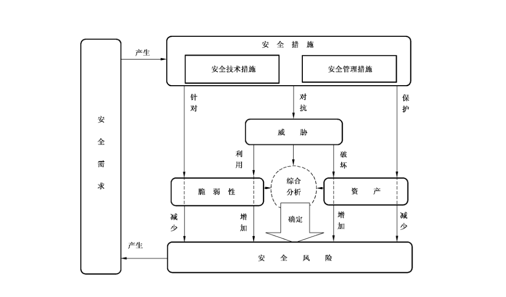
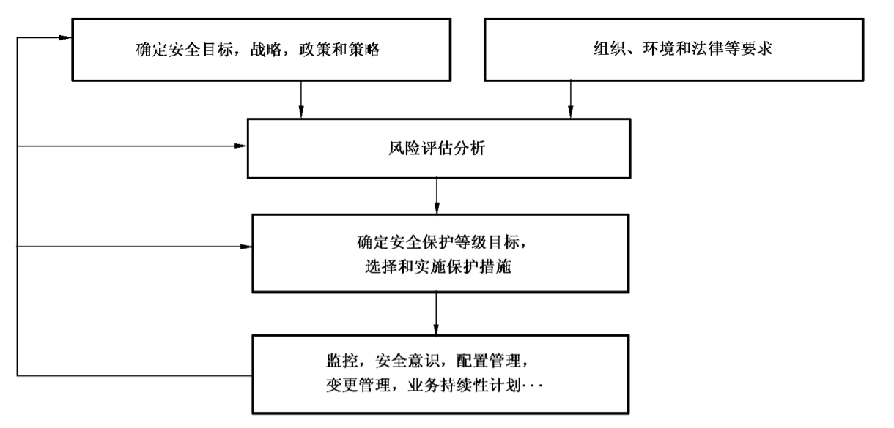

# GB/T 20269-2006 信息安全技术 信息系统安全管理要求

> 来源：[GB/T 20269-2006 国家标准详情](https://openstd.samr.gov.cn/bzgk/std/newGbInfo?hcno=797127310413D5E64517E951AA2CFCDF)；封面发布日期：2006-05-31；实施日期：2006-12-01。
> 官方 PDF SHA-256：fad34857e35c15cd1626e587fa841bc840d82a170fb7cb55d992785640238aea。
> 转写说明：依据官方 PDF 全部 66 页的渲染图像识别，以两次不同分辨率的页图 OCR 核对文字，并检查原页中的条款、表 A.1 的 98 个管理要素及图 B.1、图 B.2。省略封面、目录、页眉页脚和页码，合并印刷折行与跨页内容。原文中“信息安系统全监管”“带为操作”“应应由”等疑似排印错误照录；第 6 章部分引用与表 A.1 不一致，也按原文保留。正式引用请核对官方原文。

## 前言

本标准的附录 A、附录B是资料性附录。

本标准由全国信息安全标准化技术委员会提出并归口。

本标准起草单位：北京思源新创信息安全资讯有限公司，江南计算技术研究所技术服务中心。

本标准主要起草人：陈冠直、王志强、吉增瑞、景乾元、宋健平。

## 引言

信息安全等级保护从与信息系统安全相关的物理层面、网络层面、系统层面、应用层面和管理层面对信息和信息系统实施分等级安全保护。管理层面贯穿于其他层面之中，是其他层面实施分等级安全保护的保证。本标准对信息和信息系统的安全保护提出了分等级安全管理的要求，阐述了安全管理要素及其强度，并将管理要求落实到信息安全等级保护所规定的五个等级上，有利于对安全管理的实施、评估和检查。GB 17859—1999中安全保护等级的划分是根据对安全技术和安全风险控制的关系确定的，公通字［2004］66号文件中安全等级的划分是根据信息和信息系统受到破坏后，会对国家安全、社会秩序、经济建设和公共利益造成损害的程度确定的。两者的共同点是：安全等级越高，发生的安全技术费用和管理成本越高，从而预期能够抵御的安全威胁越大，建立起的安全信心越强，使用信息系统的风险越小。

本标准以安全管理要素作为描述安全管理要求的基本组件。安全管理要素是指，为实现信息系统安全等级保护所规定的安全要求，从管理角度应采取的主要控制方法和措施。根据GB 17859—1999对安全保护等级的划分，不同的安全保护等级会有不同的安全管理要求，可以体现在管理要素的增加和管理强度的增强两方面。对于每个管理要素，根据特定情况分别列出不同的管理强度，最多分为5级，最少可不分级。在具体描述中，除特别声明之外，一般高级别管理强度的描述都是在对低级别描述基础之上进行的。

信息系统是指由计算机及其相关和配套的设备、设施构成的，按照一定的应用目标和规则对信息进行存储、传输、处理的系统或者网络；信息是指在信息系统中存储、传输、处理的数字化信息。本标准涉及信息系统的管理者包括国家机关、事业单位、厂矿企业、公司、集团等各种类型和不同规模的组织机构，以下统称为“组织机构”。

信息系统在技术上采取何种安全机制应根据相关技术标准确定，本标准仅提出保证这些安全机制实施的管理要求。与技术密切的管理是技术实现的组成部分，如果信息系统根据具体业务及其安全需求未采用该技术，则不需要相应的安全管理要求。对与管理描述难以分开的技术要求会出现在管理要求中，具体执行需要参照相关技术标准。对于涉及国家秘密的信息和信息系统的保密管理，应按照国家有关保密的管理规定和相关标准执行。

本标准中有关信息系统安全管理要素及其强度与信息系统安全管理分等级要求的对应关系的说明参见附录A。为了帮助读者从安全管理概念角度理解和运用这些信息系统的安全管理要求，附录B给出了信息系统安全管理概念说明。

## 1 范围

本标准依据GB 17859—1999的五个安全保护等级的划分，规定了信息系统安全所需要的各个安全等级的管理要求。

本标准适用于按等级化要求进行的信息系统安全的管理。

## 2 规范性引用文件

下列文件中的条款通过本标准的引用而成为本标准的条款。凡是注日期的引用文件，其随后所有的修改单（不包括勘误的内容）或修订版均不适用于本标准，然而，鼓励根据本标准达成协议的各方研究是否可使用这些文件的最新版本。凡是不注日期的引用文件，其最新版本适用于本标准。

GB 17859—1999 计算机信息系统安全保护等级划分准则

- GB/T 20271—2006 信息安全技术 信息系统通用安全技术要求

## 3 术语和定义

GB 17859—1999确立的以及下列术语和定义适用于本标准。

### 3.1 完整性 integrity

包括数据完整性和系统完整性。数据完整性表征数据所具有的特性，即无论数据形式作何变化，数据的准确性和一致性均保持不变的程度；系统完整性表征系统在防止非授权用户修改或使用资源和防止授权用户不正确地修改或使用资源的情况下，系统能履行其操作目的的品质。

### 3.2 可用性 availability

表征数据或系统根据授权实体的请求可被访问与使用程度的安全属性。

### 3.3 访问控制 access control

按确定的规则，对实体之间的访问活动进行控制的安全机制，能防止对资源的未授权使用。

### 3.4 安全审计 security audit

按确定规则的要求，对与安全相关的事件进行审计，以日志方式记录必要信息，并作出相应处理的安全机制。

### 3.5 鉴别信息 authentication information

用以确认身份真实性的信息。

### 3.6 敏感性 sensitivity

表征资源价值或重要性的特性，也可能包含这一资源的脆弱性。

### 3.7 风险评估 risk assessment

通过对信息系统的资产价值/重要性、信息系统所受到的威胁以及信息系统的脆弱性进行综合分析，对信息系统及其处理、传输和存储的信息的保密性、完整性和可用性等进行科学识别和评价，确定信息系统安全风险的过程。

### 3.8 安全策略 security policy

主要指为信息系统安全管理制定的行动方针、路线、工作方式、指导原则或程序。

## 4 信息系统安全管理的一般要求

### 4.1 信息系统安全管理的内容

信息系统安全管理是对一个组织机构中信息系统的生存周期全过程实施符合安全等级责任要求的管理，包括：

- 落实安全管理机构及安全管理人员，明确角色与职责，制定安全规划；

- 开发安全策略；

- 实施风险管理；

- 制定业务持续性计划和灾难恢复计划；

- 选择与实施安全措施；

- 保证配置、变更的正确与安全；

- 进行安全审计；

- 保证维护支持；

- 进行监控、检查，处理安全事件；

- 安全意识与安全教育；

- 人员安全管理等。

### 4.2 信息系统安全管理的原则

a） 基于安全需求原则：组织机构应根据其信息系统担负的使命，积累的信息资产的重要性，可能受到的威胁及面临的风险分析安全需求，按照信息系统等级保护要求确定相应的信息系统安全保护等级，遵从相应等级的规范要求，从全局上恰当地平衡安全投入与效果。

b） 主要领导负责原则：主要领导应确立其组织统一的信息安全保障的宗旨和政策，负责提高员工的安全意识，组织有效安全保障队伍，调动并优化配置必要的资源，协调安全管理工作与各部门工作的关系，并确保其落实、有效。

c） 全员参与原则：信息系统所有相关人员应普遍参与信息系统的安全管理，并与相关方面协同、协调，共同保障信息系统安全。

d） 系统方法原则：按照系统工程的要求，识别和理解信息安全保障相互关联的层面和过程，采用管理和技术结合的方法，提高实现安全保障的目标的有效性和效率。

e） 持续改进原则：安全管理是一种动态反馈过程，贯穿整个安全管理的生存周期，随着安全需求和系统脆弱性的时空分布变化，威胁程度的提高，系统环境的变化以及对系统安全认识的深化等，应及时地将现有的安全策略、风险接受程度和保护措施进行复查、修改、调整以至提升安全管理等级，维护和持续改进信息安全管理体系的有效性。

f） 依法管理原则：信息安全管理工作主要体现为管理行为，应保证信息系统安全管理主体合法、管理行为合法、管理内容合法、管理程序合法。对安全事件的处理，应由授权者适时发布准确一致的有关信息，避免带来不良的社会影响。

g） 分权和授权原则：对特定职能或责任领域的管理功能实施分离、独立审计等实行分权，避免权力过分集中所带来的隐患，以减小未授权的修改或滥用系统资源的机会。任何实体（如用户、管理员、进程、应用或系统）仅享有该实体需要完成其任务所必须的权限，不应享有任何多余权限。

h） 选用成熟技术原则：成熟的技术具有较好的可靠性和稳定性，采用新技术时要重视其成熟的程度，并应首先局部试点然后逐步推广，以减少或避免可能出现的失误。

i） 分级保护原则：按等级划分标准确定信息系统的安全保护等级，实行分级保护；对多个子系统构成的大型信息系统，确定系统的基本安全保护等级，并根据实际安全需求，分别确定各子系统的安全保护等级，实行多级安全保护。

j） 管理与技术并重原则：坚持积极防御和综合防范，全面提高信息系统安全防护能力，立足国情，采用管理与技术相结合，管理科学性和技术前瞻性结合的方法，保障信息系统的安全性达到所要求的目标。

k） 自保护和国家监管结合原则：对信息系统安全实行自保护和国家保护相结合。组织机构要对自己的信息系统安全保护负责，政府相关部门有责任对信息系统的安全进行指导、监督和检查，形成自管、自查、自评和国家监管相结合的管理模式，提高信息系统的安全保护能力和水平，保障国家信息安全。

## 5 信息系统安全管理要素及其强度

### 5.1 策略和制度

#### 5.1.1 信息安全管理策略

##### 5.1.1.1 安全管理目标与范围

信息系统的安全管理需要明确信息系统的安全管理目标和范围，不同安全等级应有选择地满足以下要求的一项：

a） 基本的管理目标与范围：针对一般的信息系统应包括：制定包括系统设施和操作等内容的系统安全目标与范围计划文件；为达到相应等级技术要求提供相应的管理保证；提供对信息系统进行基本安全保护的安全功能和安全管理措施，确保安全功能达到预期目标，使信息免遭非授权的泄露和破坏，基本保证信息系统安全运行。

b） 较完整的管理目标与范围：针对在一定程度上涉及国家安全、社会秩序、经济建设和公共利益的一般信息和信息系统，在a）的基础上还应包括：建立相应的安全管理机构，制定相应的安全操作规程；制定信息系统的风险管理计划；提供对信息系统进行安全保护的比较完整的系统化安全保护的能力和比较完善的安全管理措施，从整体上保护信息免遭非授权的泄露和破坏，保证信息系统安全正常运行。

c） 系统化的管理目标与范围：针对涉及国家安全、社会秩序、经济建设和公共利益的信息和信息系统，在b）的基础上还应包括：提供信息系统安全的自动监视和审计；提供信息系统的认证、验收及使用的授权的规定；提供对信息系统进行强制安全保护的能力和设置必要的强制性安全管理措施，确保数据信息免遭非授权的泄露和破坏，保证信息系统安全运行。

d） 强制保护的管理目标与范围：针对涉及国家安全、社会秩序、经济建设和公共利益的重要信息和信息系统，在c）的基础上还应包括：提供安全策略和措施的程序化、周期化的评估，以及对明显的风险变化和安全事件的评估；实施强制的分权管理机制和可信管理；提供对信息系统进行整体的强制安全保护的能力和比较完善的强制性安全管理措施，保证信息系统安全运行。

e） 专控保护的管理目标与范围：针对涉及国家安全、社会秩序、经济建设和公共利益的重要信息和信息系统的核心系统，在d）的基础上还应包括：使安全管理计划与组织机构的文化有机融合，并能适应安全环境的变化；实施全面、可信的安全管理；提供对信息系统进行基于可验证的强制安全保护能力和完善的强制性安全管理措施，全面保证信息系统安全运行。

##### 5.1.1.2 总体安全管理策略

不同安全等级的信息系统总体安全策略应有选择地满足以下要求的一项：

a） 基本的安全管理策略：信息系统安全管理策略包括：依照国家政策法规和技术及管理标准进行自主保护；阐明管理者对信息系统安全的承诺，并陈述组织机构管理信息系统安全的方法；说明信息系统安全的总体目标、范围和安全框架；申明支持信息系统安全目标和原则的管理意向；简要说明对组织机构有重大意义的安全方针、原则、标准和符合性要求。

b） 较完整的安全管理策略：在a）的基础上，信息安全管理策略还包括：在信息安系统全监管职能部门的指导下，依照国家政策法规和技术及管理标准自主进行保护；明确划分信息系统（分系统/域）的安全保护等级（按区域分等级保护）；制定风险管理策略、业务连续性策略、安全培训与教育策略、审计策略等较完整的信息安全策略。

c） 体系化的安全管理策略：在b）的基础上，信息安全管理策略还包括：在接受信息系统安全监管职能部门监督、检查的前提下，依照国家政策法规和技术及管理标准自主进行保护；制定目标策略、规划策略、机构策略、人员策略、管理策略、安全技术策略、控制策略、生存周期策略、投资策略、质量策略等，形成体系化的信息系统安全策略。

d） 强制保护的安全管理策略：在c）的基础上，信息安全管理策略还包括：在接受信息系统安全监管职能部门的强制监督、检查的前提下，依照国家政策法规和技术及管理标准自主进行保护；制定体系完整的信息系统安全管理策略。

e） 专控保护的安全管理策略：在d）的基础上，信息安全管理策略还包括：在接受国家指定的专门部门、专门机构的专门监督的前提下，依照国家政策法规和技术及管理标准自主进行保护；制定可持续改进的信息系统安全管理策略。

##### 5.1.1.3 安全管理策略的制定

信息系统安全管理策略的制定，不同安全等级应有选择地满足以下要求的一项：

a） 基本的安全管理策略制定：应由安全管理人员为主制定，由分管信息安全工作的负责人召集，以安全管理人员为主，与相关人员一起制定基本的信息系统安全管理策略，包括总体策略和具体策略，并以文件形式表述。

b） 较完整的安全管理策略制定：应由信息安全职能部门负责制定，由分管信息安全工作的负责人组织，信息安全职能部门负责制定较完整的信息系统安全管理策略，包括总体策略和具体策略，并以文件形式表述。

c） 体系化的安全管理策略制定：应由信息安全领导小组组织制定，由信息安全领导小组组织并提出指导思想，信息安全职能部门负责具体制定体系化的信息系统安全管理策略，包括总体策略和具体策略，并以文件形式表述。

d） 强制保护的安全管理策略制定：应由信息安全领导小组组织并提出指导思想，由信息安全职能部门指派专人负责制定强制保护的信息系统安全管理策略，包括总体策略和具体策略，并以文件形式表述；涉密系统安全策略的制定应限定在相应范围内进行；必要时，可征求信息安全监管职能部门的意见。

e） 专控保护的安全管理策略制定：在d）的基础上，必要时应征求国家指定的专门部门或机构的意见，或者共同制定专控保护的信息系统安全管理策略，包括总体策略和具体策略。

##### 5.1.1.4 安全管理策略的发布

信息系统安全管理策略应以文档形式发布，不同安全等级应有选择地满足以下要求的一项：

a） 基本的安全管理策略的发布：安全管理策略文档应由分管信息安全工作的负责人签发，并向信息系统的用户传达，其形式应针对目标读者，并能够为读者接受和理解；

b） 较完整的安全管理策略的发布：在a）的基础上，安全管理策略文档应经过组织机构负责人签发，按照有关文件管理程序发布；

c） 体系化的安全管理策略的发布：在b）的基础上，安全管理策略文档应注明发布范围，并有收发文登记；

d） 强制保护的安全管理策略的发布：在c）的基础上，安全管理策略文档应注明密级，并在监管部门备案；

e） 专控保护的安全管理策略的发布：在d）的基础上，必要时安全管理策略文档应在国家指定的专门部门或机构进行备案。

#### 5.1.2 安全管理规章制度

##### 5.1.2.1 安全管理规章制度内容

应根据机构的总体安全策略和业务应用需求，制定信息系统安全管理的规程和制度，不同安全等级的安全管理规章制度的内容应有选择地满足以下要求的一项：

a） 基本的安全管理制度：应包括网络安全管理规定、系统安全管理规定、数据安全管理规定、防病毒规定、机房安全管理规定以及相关的操作规程等。

b） 较完整的安全管理制度：在a）的基础上，应增加设备使用管理规定、人员安全管理规定、安全审计管理规定、用户管理规定、风险管理规定、信息分类分级管理规定、安全事件报告规定、事故处理规定、应急管理规定和灾难恢复管理规定等。

c） 体系化的安全管理制度：在b）的基础上，应制定全面的安全管理规定，包括：机房、主机设备、网络设施、物理设施分类标记等系统资源安全管理规定；安全配置、系统分发和操作、系统文档、测试和脆弱性评估、系统信息安全备份和相关的操作规程等系统和数据库方面的安全管理规定；网络连接检查评估、网络使用授权、网络检测、网络设施（设备和协议）变更控制和相关的操作规程等方面的网络安全管理规定；应用安全评估、应用系统使用授权、应用系统配置管理、应用系统文档管理和相关的操作规程等方面的应用安全管理规定；人员安全管理、安全意识与安全技术教育、操作安全、操作系统和数据库安全、系统运行记录、病毒防护、系统维护、网络互联、安全审计、安全事件报告、事故处理、应急管理、灾难恢复和相关的操作规程等方面的运行安全管理规定；信息分类标记、涉密信息管理、文档管理、存储介质管理、信息披露与发布审批管理、第三方访问控制和相关的操作规程等方面的信息安全管理规定等。

d） 强制保护的安全管理制度：在c）的基础上，应增加信息保密标识与管理规定、密码使用管理规定、安全事件例行评估和报告规定、关键控制措施定期测试规定等；

e） 专控保护的安全管理制度：在d）的基础上，应增加安全管理审计监督规定等。

##### 5.1.2.2 安全管理规章制度的制定

安全管理制度的制定及发布，应有明确规定的程序，不同安全等级应有选择地满足以下要求的一项：

a） 基本的安全管理制度制定：应由安全管理人员负责制订信息系统安全管理制度，并以文档形式表述，由分管信息安全工作的负责人审批发布；

b） 较完整的安全管理制度制定：应由信息安全职能部门负责制订信息系统安全管理制度，并以文档形式表述，由分管信息安全工作的负责人审批，按照有关文档管理程序发布；

c） 体系化的安全管理制度制定：应由信息安全职能部门负责制订信息系统安全管理制度，并以文档形式表述，经信息安全领导小组讨论通过，由信息安全领导小组负责人审批发布，应注明发布范围并有收发文登记；

d） 强制保护的安全管理制度制定：应由信息安全职能部门指派专人负责制订信息系统安全管理制度，并以文档形式表述，经信息安全领导小组讨论通过，由信息安全领导小组负责人审批发布；信息系统安全管理制度文档的发布应注明密级，对涉密的信息系统安全管理制度的制定应在相应范围内进行；

e） 专控保护的安全管理制度制定：在d）的基础上，必要时，应征求组织机构的保密管理部门的意见，或者共同制定。

#### 5.1.3 策略与制度文档管理

##### 5.1.3.1 策略与制度文档的评审和修订

策略与制度文档的评审和修订，不同安全等级应有选择地满足以下要求的一项：

a） 基本的评审和修订：应由分管信息安全的负责人和安全管理人员负责文档的评审和修订；应通过所记录的安全事故的性质、数量以及影响检查策略和制度的有效性，评价安全管理措施对成本及应用效率的影响，以及技术变化对安全管理的影响；经评审，对存在不足或需要改进的策略和制度应进行修订，并按规定程序发布。

b） 较完整的评审和修订：应由分管信息安全的负责人和信息安全职能部门负责文档的评审和修订；应定期或阶段性审查策略和制度存在的缺陷，并在发生重大安全事故、出现新的漏洞以及机构或技术基础结构发生变更时，对策略和制度进行相应的评审和修订；对评审后需要修订的策略和制度文档，应明确指定人员限期完成并按规定发布。

c） 体系化的评审和修订：应由信息安全领导小组和信息安全职能部门负责文档的评审和修订；应对安全策略和制度的有效性进行程序化、周期性评审，并保留必要的评审记录和依据；每个策略和制度文档应有相应责任人，根据明确规定的评审和修订程序对策略进行维护。

d） 强制保护的评审和修订：应由信息安全领导小组和信息安全职能部门的专门人员负责文档的评审和修订，必要时可征求信息安全监管职能部门的意见；应对安全策略和制度的有效性进行程序化、周期性评审，并保留必要的评审记录和依据；每个策略和制度文档应有相应责任人，根据明确规定的评审和修订程序对策略进行维护；对涉密的信息安全策略、规章制度和相关的操作规程文档的评审和修订应在相应范围内进行。

e） 专控保护的评审和修订：在d）的基础上，必要时可请组织机构的保密管理部门参加文档的评审和修订，应征求国家指定的专门部门或机构的意见；应对安全策略和制度的有效性及时进行专项的评审，并保留必要的评审记录和依据。

##### 5.1.3.2 策略与制度文档的保管

对策略与制度文档，以及相关的操作规程文档的保管，不同安全等级应有选择地满足以下要求的一项：

a） 指定专人保管：对策略和制度文档，以及相关的操作规程文档，应指定专人保管；

b） 借阅审批和登记：在a）的基础上，借阅策略和制度文档，以及相关的操作规程文档，应有相应级别负责人审批和登记；

c） 限定借阅范围：在b）的基础上，借阅策略和制度文档，以及相关的操作规程文档，应限定借阅范围，并经过相应级别负责人审批和登记；

d） 全面严格保管：在c）的基础上，对涉密的策略和制度文档，以及相关的操作规程文档的保管应按照有关涉密文档管理规定进行；对保管的文档以及借阅的记录定期进行检查；

e） 专控保护的管理：在d）的基础上，应与相关业务部门协商制定专项控制的管理措施。

### 5.2 机构和人员管理

#### 5.2.1 安全管理机构

##### 5.2.1.1 建立安全管理机构

在组织机构中应建立安全管理机构，不同安全等级的安全管理机构应有选择地满足以下要求的一项：

a） 配备安全管理人员：管理层中应有一人分管信息系统安全工作，并为信息系统的安全管理配备专职或兼职的安全管理人员；

b） 建立安全职能部门：在a）的基础上，应建立管理信息系统安全工作的职能部门，或者明确指定一个职能部门兼管信息安全工作，作为该部门的关键职责之一；

c） 成立安全领导小组：在b）的基础上，应在管理层成立信息系统安全管理委员会或信息系统安全领导小组（以下统称信息安全领导小组），对覆盖全国或跨地区的组织机构，应在总部和下级单位建立各级信息系统安全领导小组，在基层至少要有一位专职的安全管理人员负责信息系统安全工作；

d） 主要负责人出任领导：在c）的基础上，应由组织机构的主要负责人出任信息系统安全领导小组负责人；

e） 建立信息安全保密管理部门：在d）的基础上，应建立信息系统安全保密监督管理的职能部门，或对原有保密部门明确信息安全保密管理责任，加强对信息系统安全管理重要过程和管理人员的保密监督管理。

##### 5.2.1.2 信息安全领导小组

信息系统安全领导小组负责领导本组织机构的信息系统安全工作，至少应行使以下管理职能之一：

a） 安全管理的领导职能：根据国家和行业有关信息安全的政策、法律和法规，批准机构信息系统的安全策略和发展规划；确定各有关部门在信息系统安全工作中的职责，领导安全工作的实施；监督安全措施的执行，并对重要安全事件的处理进行决策；指导和检查信息系统安全职能部门及应急处理小组的各项工作；建设和完善信息系统安全的集中控管的组织体系和管理机制。

b） 保密监督的管理职能：在a）的基础上，对保密管理部门进行有关信息系统安全保密监督管理方面的指导和检查。

##### 5.2.1.3 信息安全职能部门

信息安全职能部门在信息系统安全领导小组领导下，负责本组织机构信息系统安全的具体工作，至少应行使以下管理职能之一：

a） 基本的安全管理职能：根据国家和行业有关信息安全的政策法规，起草组织机构信息系统的安全策略和发展规划；管理机构信息系统安全日常事务，检查和指导下级单位信息系统安全工作；负责安全措施的实施或组织实施，组织并参加对安全重要事件的处理；监控信息系统安全总体状况，提出安全分析报告；指导和检查各部门和下级单位信息系统安全人员及要害岗位人员的信息系统安全工作；应与有关部门共同组成应急处理小组或协助有关部门建立应急处理小组实施相关应急处理工作。

b） 集中的安全管理职能：在a）的基础上，管理信息系统安全机制集中管理机构的各项工作，实现信息系统安全的集中控制管理；完成信息系统安全领导小组交办的工作，并向领导小组报告机构的信息系统安全工作。

#### 5.2.2 安全机制集中管理机构

##### 5.2.2.1 设置集中管理机构

信息系统安全机制集中管理机构（以下简称集中管理机构）既是技术实体，也是管理实体，应按照以下方式设立：

a） 集中管理机构人员和职责：应配备必要的领导和技术管理人员，应选用熟悉安全技术、网络技术、系统应用等方面技术人员，明确责任协同工作，统一管理信息系统的安全运行，进行安全机制的配置与管理，对与安全有关的信息进行汇集与分析，对与安全有关的事件进行响应与处置；应对分布在信息系统中有关的安全机制进行集中管理；应接受信息安全职能部门的直接领导。

##### 5.2.2.2 集中管理机构职能

a） 信息系统安全运行的统一管理：集中管理机构主要行使以下技术职能：

- 防范与保护：建立物理、支撑系统、网络、应用、管理等五个层面的安全控制机制，构成系统有机整体安全控制机制；统一进行信息系统安全机制的配置与管理，确保各个安全机制按照设计要求运行。

- 监控与检查：对服务器、路由器、防火墙等网络部件、系统安全运行性状态、信息（包括有害内容）的监控和检查；汇集各种安全机制所获取的与系统安全运行有关的信息，对所获取的信息进行综合分析，及时发现系统运行中的安全问题和隐患，提出解决的对策和方法。

- 响应与处置：事件发现、响应、处置、应急恢复，根据应急处理预案，作出快速处理；应对各种事件和处理结果有详细的记载并进行档案化管理，作为对后续事件分析的参考和可查性的依据。

- 安全机制集中管理控制（详见5.5.6），完善管理信息系统安全运行的技术手段，进行信息系统安全的集中控制管理。

- 负责接受和配合政府有关部门的信息安全监管工作。

b） 关键区域安全运行管理：在a）的基础上，集中管理机构对关键区域的安全运行进行管理，控制知晓范围，对获取的有关信息进行相应安全等级的保护。

c） 核心系统安全运行管理：在b）的基础上，集中管理机构应与有关业务应用的主管部门协调，定制更高安全级别的管理方式。

#### 5.2.3 人员管理

##### 5.2.3.1 安全管理人员配备

对安全管理人员配备的管理，不同安全等级应有选择地满足以下要求的一项：

a） 可配备兼职安全管理人员：安全管理人员可以由网络管理人员兼任；

b） 安全管理人员的兼职限制：安全管理人员不能兼任网络管理人员、系统管理员、数据库管理员等；

c） 配备专职安全管理人员：安全管理人员不可兼任，属于专职人员，应具有安全管理工作权限和能力；

d） 关键部位的安全管理人员：在c）的基础上，安全管理人员还应按照机要人员条件配备。

##### 5.2.3.2 关键岗位人员管理

对信息系统关键岗位人员的管理，不同安全等级应满足以下要求的一项或多项：

a） 基本要求：应对安全管理员、系统管理员、数据库管理员、网络管理员、重要业务开发人员、系统维护人员、重要业务应用操作人员等信息系统关键岗位人员进行统一管理；允许一人多岗，但业务应用操作人员不能由其他关键岗位人员兼任；关键岗位人员应定期接受安全培训，加强安全意识和风险防范意识。

b） 兼职和轮岗要求：业务开发人员和系统维护人员不能兼任或担负安全管理员、系统管理员、数据库管理员、网络管理员、重要业务应用操作人员等岗位或工作；必要时关键岗位人员应采取定期轮岗制度。

c） 权限分散要求：在b）的基础上，应坚持关键岗位人员“权限分散、不得交叉覆盖”的原则，系统管理员、数据库管理员、网络管理员不能相互兼任岗位或工作。

d） 多人共管要求：在c）的基础上，关键岗位人员处理重要事务或操作时，应保持二人同时在场，关键事务应多人共管。

e） 全面控制要求：在d）的基础上，应采取对内部人员全面控制的安全保证措施，对所有岗位工作人员实施全面安全管理。

##### 5.2.3.3 人员录用管理

对人员录用的管理，不同安全等级应有选择地满足以下要求的一项：

a） 人员录用的基本要求：对应聘者进行审查，确认其具有基本的专业技术水平，接受过安全意识教育和培训，能够掌握安全管理基本知识；对信息系统关键岗位的人员还应注重思想品质方面的考察。

b） 人员的审查与考核：在a）的基础上，应由单位人事部门进行人员背景、资质审查，技能考核等，合格者还要签署保密协议方可上岗；安全管理人员应具有基本的系统安全风险分析和评估能力。

c） 人员的内部选拔：在b）的基础上，重要区域或部位的安全管理人员一般可从内部符合条件人员选拔，应做到认真负责和保守秘密。

d） 人员的可靠性：在c）的基础上，关键区域或部位的安全管理人员应选用实践证明精干、内行、忠实、可靠的人员，必要时可按机要人员条件配备。

##### 5.2.3.4 人员离岗

对人员离岗的管理，不同安全等级应有选择地满足以下要求的一项：

a） 离岗的基本要求：立即中止被解雇的、退休的、辞职的或其他原因离开的人员的所有访问权限；

收回所有相关证件、徽章、密钥、访问控制标记等；收回机构提供的设备等。

b） 调离后的保密要求：在a）的基础上，管理层和信息系统关键岗位人员调离岗位，必须经单位人事部门严格办理调离手续，承诺其调离后的保密要求。

c） 离岗的审计要求：在b）的基础上，涉及组织机构管理层和信息系统关键岗位的人员调离单位，必须进行离岗安全审查，在规定的脱密期限后，方可调离。

d） 关键部位人员的离岗要求：在c）的基础上，关键部位的信息系统安全管理人员离岗，应按照机要人员管理办法办理。

##### 5.2.3.5 人员考核与审查

对人员考核与审查的管理，不同安全等级应有选择地满足以下要求的一项：

a） 定期的人员考核：应定期对各个岗位的人员进行不同侧重的安全认知和安全技能的考核，作为人员是否适合当前岗位的参考；

b） 定期的人员审查：在a）的基础上，对关键岗位人员，应定期进行审查，如发现其违反安全规定，应控制使用；

c） 管理有效性的审查：在b）的基础上，对关键岗位人员的工作，应通过例行考核进行审查，保证安全管理的有效性，并保留审查结果；

d） 全面严格的审查：在c）的基础上，对所有安全岗位人员的工作，应通过全面考核进行审查，如发现其违反安全规定，应采取必要的应对措施。

##### 5.2.3.6 第三方人员管理

对第三方人员的管理，不同安全等级应有选择地满足以下要求的一项：

a） 基本管理要求：应对硬件和软件维护人员、咨询人员、临时性的短期职位人员，以及辅助人员和外部服务人员等第三方人员签署包括不同安全责任的合同书或保密协议；规定各类人员的活动范围，进入计算机房需要得到批准，并有专人负责；第三方人员必须进行逻辑访问时，应划定范围并经过负责人批准，必要时应有人监督或陪同。

b） 重要区域管理要求：在重要区域，第三方人员必须进入或进行逻辑访问（包括近程访问和远程访问等）均应有书面申请、批准和过程记录，并有专人全程监督或陪同；进行逻辑访问应使用专门设置的临时用户，并进行审计。

c） 关键区域管理要求：在关键区域，一般不允许第三方人员进入或进行逻辑访问；如确有必要，除有书面申请外，可采取由机构内部人员带为操作的方式，对结果进行必要的过滤后再提供第三方人员，并进行审计；必要时对上述过程进行风险评估和记录备案，并对相应风险采取必要的安全补救措施。

#### 5.2.4 教育和培训

##### 5.2.4.1 信息安全教育

信息安全教育包括信息安全意识的培养教育和安全技术培训，不同安全等级应有选择地满足以下要求的一项：

a） 应知应会要求：应让信息系统相关员工知晓信息的敏感性和信息安全的重要性，认识其自身的责任和安全违例会受到纪律惩罚，以及应掌握的信息安全基本知识和技能等；

b） 有计划培训：在a）的基础上，应制定并实施安全教育和培训计划，培养信息系统各类人员安全意识，并提供对安全政策和操作规程的认知教育和训练等；

c） 针对不同岗位培训：在b）的基础上，针对不同岗位，制定不同的专业培训计划，包括安全知识、安全技术、安全标准、安全要求、法律责任和业务控制措施等；

d） 按人员资质要求培训：在c）的基础上，对所有工作人员的安全资质进行定期检查和评估，使相应的安全教育成为组织机构工作计划的一部分；

e） 培养安全意识自觉性：在d）的基础上，对所有工作人员进行相应的安全资质管理，并使安全意识成为所有工作人员的自觉存在。

##### 5.2.4.2 信息安全专家

可邀请或聘用信息安全专家，不同安全等级应有选择地满足以下要求的一项：

a） 听取信息安全专家建议：听取信息安全专家对于组织机构的信息系统安全方面的建议；组织专家参与安全威胁的评估，提供安全控制措施的建议，进行信息安全有效性评判，对安全事件给予专业指导和原因调查等。

b） 对信息安全专家的管理：在a）的基础上，对于邀请或聘用信息安全专家可以提供必要的组织机构内部信息，同时应告知专家这些信息的敏感性和保密性，并应采取必要的安全措施，保证提供的信息在安全可控的范围内。

### 5.3 风险管理

#### 5.3.1 风险管理要求和策略

##### 5.3.1.1 风险管理要求

风险管理作为等级保护的手段，在保证信息等级系统的最低保护能力的基础上，可根据风险确定增加某些管理要求。对风险管理，不同安全等级应有选择地满足以下要求的一项：

a） 基本风险管理：组织机构应进行基本的风险管理活动，包括编制资产清单，对资产价值/重要性进行分析，对信息系统面临的威胁进行初步分析，通过工具扫描的方式对信息系统的脆弱性进行分析，以简易的方式分析安全风险、选择安全措施。

b） 定期风险评估：在a）的基础上，针对关键的系统资源进行定期风险分析和评估；产生风险分析报告并向管理层提交。

c） 规范风险评估：在b）的基础上，在风险管理中，使用规范方法和经过必要的工作流程，进行规范化的风险评估，产生风险分析报告和留存重要过程文档，并向管理层提交。

d） 独立审计的风险管理：在c）的基础上，建立风险管理体系文件；针对风险管理过程，实施独立审计，确保风险管理的有效性。

e） 全面风险管理：在d）的基础上，使风险管理成为信息系统安全管理的有机组成部分，贯穿信息系统安全管理的全过程，并具有可验证性。

##### 5.3.1.2 风险管理策略

对风险管理策略，不同安全等级应有选择地满足以下要求的一项：

a） 基本的风险管理策略：应定期进行风险评估，安全风险分析和评估活动程序应至少包括信息安全风险管理和业务应用风险管理密切相关的内容，信息安全风险管理的基本观念和方法，以及风险管理的组织和资源保证等；

b） 风险管理的监督机制：在a）的基础上，应建立风险管理的监督机制，对所有风险管理相关过程的活动和影响进行评估和监控；应建立指导风险管理监督过程的指导性文档；

c） 风险评估的重新启动：在b）的基础上，应明确规定重新启动风险评估的条件，机构应能针对风险的变化重新启动风险评估。

#### 5.3.2 风险分析和评估

##### 5.3.2.1 资产识别和分析

对资产识别和分析，不同安全等级应有选择地满足以下要求的一项：

a） 信息系统的资产统计和分类：确定信息系统的资产范围，进行统计和编制资产清单（详见5.4. 2.1），并进行资产分类和重要性标识；

b） 信息系统的体系特征描述：在a）的基础上，根据对信息系统的硬件、软件、系统接口、数据和信息、人员等方面的分析和识别，对信息系统的体系特征进行描述，至少应阐明信息系统的使命、边界、功能，以及系统和数据的关键性、敏感性等内容。

##### 5.3.2.2 威胁识别和分析

对威胁的识别和分析，不同安全等级应有选择地满足以下要求的一项：

a） 威胁的基本分析：应根据以往发生的安全事件、外部提供的资料和积累的经验等，对威胁进行粗略的分析。

b） 威胁列表：在a）的基础上，结合业务应用、系统结构特点以及访问流程等因素，建立并维护威胁列表；由于不同业务系统面临的威胁是不同的，应针对每个或者每类资产有一个威胁列表。

c） 威胁的详细分析：在b）的基础上，考虑威胁源在保密性、完整性或可用性等方面造成损害，对威胁的可能性和影响等属性进行分析，从而得到威胁的等级；威胁等级也可通过综合威胁的可能性和强度的评价获得。

d） 使用检测工具捕捉攻击：在c）的基础上，对关键区域或部位进行威胁分析和评估，在业务应用许可并得到批准的条件下，可使用检测工具在特定时间捕捉攻击信息进行威胁分析。

##### 5.3.2.3 脆弱性识别和分析

对脆弱性识别和分析，不同安全等级应有选择地满足以下要求的一项：

a） 脆弱性工具扫描：应通过扫描器等工具来获得对系统脆弱性的认识，包括对网络设备、主机设备、安全设备的脆弱性扫描，并编制脆弱性列表，作为系统加固、改进和安全项目建设的依据；

可以针对资产组合、资产分类编制脆弱性列表和脆弱性检查表。

b） 脆弱性分析和渗透测试：在a）的基础上，脆弱性的人工分析至少应进行网络设备、安全设备以及主机系统配置检查、用户管理检查、系统日志和审计检查等；使用渗透测试应根据需要分别从组织机构的网络内部和网络外部选择不同的接入点进行；应了解测试可能带来的后果，并做好充分准备；针对不同的资产和资产组合，综合应用人工评估、工具扫描、渗透性测试等方法对系统的脆弱性进行分析和评估；对不同的方法和工具所得出的评估结果，应进行综合分析，从而得到脆弱性的等级。

c） 制度化脆弱性评估：在b）的基础上，坚持制度化脆弱性评估，应明确规定进行脆弱性评估的时间和系统范围、人员和责任、评估结果的分析和报告程序，以及报告中包括新发现的漏洞、已修补的漏洞、漏洞趋势分析等。

##### 5.3.2.4 风险分析和评估要求

对风险分析和评估，不同安全等级应有选择地满足以下要求的一项：

a） 经验的风险评估：应由用户和部分专家通过经验来判断风险，并对风险进行评估，形成风险评估报告，其中必须包括风险级别、风险点等内容，并确定信息系统的安全风险状况。

b） 全面的风险评估：在a）的基础上，应采用多层面、多角度的系统分析方法，由用户和专家对资产、威胁和脆弱性等方面进行定性综合评估，建议处理和减缓风险的措施，形成风险评估报告；

除风险状况外，在风险评估的各项步骤中还应生成信息系统体系特征报告、威胁评估报告、脆弱性评估报告和安全措施分析报告等；基于这些报告，评估者应对安全措施提出建议。

c） 建立和维护风险信息库：在b）的基础上，应将风险评估中的信息资产、威胁、脆弱性、防护措施等评估项信息综合到一个数据库中进行管理；组织机构应当在后续的项目和工具中持续地维护该数据库。

#### 5.3.3 风险控制

##### 5.3.3.1 选择和实施风险控制措施

对选择和实施风险控制措施，不同安全等级应有选择地满足以下要求的一项：

a） 基于安全等级标准选择控制措施：以信息系统及产品的安全等级标准对不同等级的技术和管理要求，选择相应等级的安全技术和管理措施，决定需要实施的信息系统安全控制措施；

b） 基于风险评估选择控制措施：在a）的基础上，根据风险评估的结果，结合组织机构对于信息系统安全的需求，决定信息系统安全的控制措施；

c） 基于风险评估形成防护控制系统：在b）的基础上，根据风险评估的结果，结合机构对于信息系统安全的需求，决定信息系统安全的控制措施；对相关的各种控制措施进行综合分析，得出紧迫性、优先级、投资比重等评价，形成体系化的防护控制系统。

#### 5.3.4 基于风险的决策

##### 5.3.4.1 安全确认

应对信息系统定期进行安全确认。对安全确认，不同安全等级应有选择地满足以下要求的一项：

a） 残余风险接受：针对信息系统的资产清单、威胁列表、脆弱性列表，结合已采用的安全控制措施，分析存在的残余风险；应形成残余风险分析报告，并由组织机构的高层管理人员决定残余风险是否可接受。

b） 残余风险监视：在a）的基础上，应编制出信息系统残余风险清单，并密切监视残余风险可能诱发的安全事件，并及时采取防护措施。

c） 安全风险再评估：在b）的基础上，采用系统化的方法对信息系统安全风险实施再次评估，通过再次评估，验证防护措施的有效性。

##### 5.3.4.2 信息系统运行的决策

对信息系统运行的决策，不同安全等级应有选择地满足以下要求的一项：

a） 信息系统运行的决定：信息系统的主管者或运营者应根据安全确认的结果，判断残余风险是否处在可接受的水平之内，并决定是否允许信息系统继续运行；

b） 信息系统受控运行：在a）的基础上，如果信息系统的残余风险不可接受，而现实情况又要求系统必须投入运行，且当前没有其他资源能胜任组织机构的使命，经过组织机构管理层的审批，可以临时批准信息系统投入运行，同时应采取相应的风险规避和监测控制措施，并明确风险一旦发生的责任陈述。

#### 5.3.5 风险评估的管理

##### 5.3.5.1 评估机构的选择

对评估机构选择，不同安全等级应有选择地满足以下要求的一项：

a） 按资质和信誉选择：应选择有国家主管部门认可的安全服务资质且有良好信誉的评估机构进行信息系统风险评估；

b） 在上级认可的范围内选择：应在经过本行业主管部门认可或上级行政领导部门批准的选择范围内，确定有国家主管部门认可的安全服务资质且有良好信誉的评估机构，进行信息系统风险评估；

c） 组织专门的评估：应按照国家主管部门有关管理规定选择可信评估机构，必要时应由国家指定专门部门、专门机构组织进行信息系统风险评估。

##### 5.3.5.2 评估机构保密要求

对评估机构的保密要求，不同安全等级应有选择地满足以下要求的一项：

a） 签署保密协议：评估机构人员应按照第三方人员管理要求（详见5.2.3.6）签署保密协议；

b） 专人监督检查：在a）的基础上，应有专人在整个评估过程中监督检查评估机构对保密协议的执行情况；

c） 制定具体办法：在b）的基础上，对专门评估组的保密要求应参照《中华人民共和国保守国家秘密法》的要求，结合实际情况制定具体实施办法。

##### 5.3.5.3 评估信息的管理

对评估信息的管理，不同安全等级应有选择地满足以下要求的一项：

a） 规定交接手续：提交涉及评估需要的资料、数据等各种信息，应规定办理交接手续，防止丢失；

b） 替换敏感参数：在a）的基础上，提交涉及评估需要的资料、数据等各种信息，必要时可以隐藏或替换核心的或敏感的参数；

c） 不得带出指定区域：在b）的基础上，所有提交涉及评估需要的资料、数据等各种信息，只能存放在被评估方指定的计算机内，不得带出指定办公区域。

##### 5.3.5.4 技术测试过程管理

新投入运行的信息系统或经过风险评估对安全机制有较大变动的信息系统应进行技术测试。对技术测试过程的管理，不同安全等级应有选择地满足以下要求的一项：

a） 必须经过授权：使用工具或手工进行技术测试，应事先提交测试的技术方案，并得到授权方可进行；

b） 在监督下进行：在a）的基础上，使用工具或手工进行技术测试，应在被测试方专人监督下按技术方案进行；

c） 由被评估方操作：在b）的基础上，使用工具或手工进行技术测试，可以采用由被评估方技术人员按技术方案进行操作，评估机构技术人员进行场外指导；

d） 过滤测试结果：在c）的基础上，使用工具或手工进行技术测试，应由被评估方技术人员按技术方案进行操作，对测试结果过滤敏感或涉及国家秘密信息后再交评估方分析。

### 5.4 环境和资源管理

#### 5.4.1 环境安全管理

##### 5.4.1.1 环境安全管理要求

对环境安全管理，不同安全等级应有选择地满足以下要求的一项：

a） 环境安全的基本要求：应配置物理环境安全的责任部门和管理人员；建立有关物理环境安全方面的规章制度；物理安全方面应达到 GB/T 20271—2006 中6.1.1的有关要求。

b） 较完整的制度化管理：在a）的基础上，应对物理环境划分不同保护等级的安全区域进行管理；

应制定对物理安全设施进行检验、配置、安装、运行的有关制度和保障措施；实行关键物理设施的登记制度；物理安全方面应达到 GB/T 20271—2006中6.2.1 的有关要求。

c） 安全区域标记管理：在b）的基础上，应对物理环境中所有安全区域进行标记管理，包括不同安全保护等级的办公区域、机房、介质库房等；介质库房的管理可以参照同等级的机房的要求；物理安全方面应达到 GB/T 20271—2006中6.3.1的有关要求。

d） 安全区域隔离和监视：在c）的基础上，应实施不同保护等级安全区域的隔离管理；出入人员应经过相应级别的授权并有监控措施；对重要安全区域的活动应实时监视和记录；物理安全方面应达到 GB/T 20271—2006中6.4.1 的有关要求。

e） 安全保障的持续改善：在d）的基础上，应对物理安全保障定期进行监督、检查和不断改进，实现持续改善；物理安全方面应达到 GB/T 20271—2006中6.5.1 的有关要求。

##### 5.4.1.2 机房安全管理要求

对机房安全管理，不同安全等级应有选择地满足以下要求的一项：

a） 机房安全管理的基本要求：应明确机房安全管理的责任人，机房出入应有指定人员负责，未经允许的人员不准进入机房；获准进入机房的来访人员，其活动范围应受到限制，并有接待人员陪同；机房钥匙由专人管理，未经批准，不准任何人私自复制机房钥匙或服务器开机钥匙；没有指定管理人员的明确准许，任何记录介质、文件材料及各种被保护品均不准带出机房，与工作无关的物品均不准带入机房；机房内严禁吸烟及带入火种和水源。

b） 加强对来访人员的控制：在a）的基础上，要求所有来访人员应经过正式批准，登记记录应妥善保存以备查；获准进入机房的来访人员，一般应禁止携带个人计算机等电子设备进入机房，其活动范围和操作行为应受到限制，并有机房接待人员负责和陪同。

c） 增强门禁控制手段：在b）的基础上，任何进出机房的人员应经过门禁设施的监控和记录，应有防止绕过门禁设施的手段；门禁系统的电子记录应妥善保存以备查；进入机房的人员应佩戴相应证件；未经批准，禁止任何物理访问；未经批准，禁止任何人移动计算机相关设备或带离机房。

d） 使用视频监控和专职警卫：在c）的基础上，机房所在地应有专职警卫，通道和入口处应设置视频监控点，24小时值班监视；所有来访人员的登记记录、门禁系统的电子记录以及监视录像记录应妥善保存以备查；禁止携带移动电话、电子记事本等具有移动互连功能的个人物品进入机房。

e） 采取防止电磁泄漏保护：在d）的基础上，对需要防止电磁泄漏的计算机设备配备电磁干扰设备，在被保护的计算机设备工作时电磁干扰设备不准关机；必要时可以使用屏蔽机房。屏蔽机房应随时关闭屏蔽门；不得在屏蔽墙上打钉钻孔，不得在波导管以外或不经过过滤器对屏蔽机房内外连接任何线缆；应经常测试屏蔽机房的泄漏情况并进行必要的维护。

##### 5.4.1.3 办公环境安全管理要求

对办公环境的安全管理，不同安全等级应有选择地满足以下要求的一项：

a） 办公环境安全管理基本要求：设置有网络终端的办公环境，是信息系统环境的组成部分，应防止利用终端系统窃取敏感信息或非法访问；工作人员下班后，终端计算机应关闭；存放敏感文件或信息载体的文件柜应上锁或设置密码；工作人员调离部门或更换办公室时，应立即交还办公室钥匙；设立独立的会客接待室，不在办公环境接待来访人员。

b） 办公环境安全管理增强要求：在a）的基础上，工作人员离开座位应将桌面上含有敏感信息的纸件文档放在抽屉或文件柜内；工作人员离开座位，终端计算机应退出登录状态、采用屏幕保护口令保护或关机。

c） 关键部位办公环境的要求：在b）的基础上，在关键区域或部位，应使相应的办公环境与机房的物理位置在一起，以便进行统一的物理保护。

#### 5.4.2 资源管理

##### 5.4.2.1 资产清单管理

对资产清单的管理，不同安全等级应有选择地满足以下要求的一项：

a） 一般资产清单：应编制并维护与信息系统相关的资产清单，至少包括以下内容：

- 信息资产：应用数据、系统数据、安全数据等数据库和数据文档、系统文件、用户手册、培训资料、操作和支持程序、持续性计划、备用系统安排、存档信息；

- 软件资产：应用软件、系统软件、开发工具和实用程序；

- 有形资产：计算机设备（处理器、监视器、膝上形电脑、调制解调器），通信设备（路由器、数字程控交换机、传真机、应答机），磁媒体（磁带和软盘），其他技术装备（电源，空调设备），家具和机房；

- 应用业务相关资产：由信息系统控制的或与信息系统密切相关的应用业务的各类资产，由于信息系统或信息的泄露或破坏，这些资产会受到相应的损坏；

- 服务：计算和通信服务，通用设备如供暖、照明、供电和空调等；

b） 详细的资产清单：在a）的基础上，应清晰识别每项资产的拥有权、责任人、安全分类以及资产所在的位置等；

c） 业务应用系统清单：在b）的基础上，应清晰识别业务应用系统资产的拥有权、责任人、安全分类以及资产所在的位置等；必要时应该包括主要业务应用系统处理流程和数据流的描述，以及业务应用系统用户分类说明。

##### 5.4.2.2 资产的分类与标识要求

对资产的分类与标识，不同安全等级应有选择地满足以下要求的一项：

a） 资产标识：应根据资产的价值/重要性对资产进行标识，以便可以基于资产的价值选择保护措施和进行资产管理等相关工作。

b） 资产分类管理：在a）的基础上，应对信息资产进行分类管理，对信息系统内分属不同业务范围的各类信息，按其对安全性的不同要求分类加以标识。对于信息资产，通常信息系统数据可以分为系统数据和用户数据两类，其重要性一般与其所在的系统或子系统的安全保护等级相关；用户数据的重要性还应考虑自身保密性分类，如：

- 国家秘密信息：秘密、机密、绝密信息；

- 其他秘密信息：受国家法律保护的商业秘密和个人隐私信息；

- 专有信息：国家或组织机构内部共享、内部受限、内部专控信息，以及公民个人专有信息；

- 公开信息：国家公开共享的信息、组织机构公开共享的信息、公民个人可公开共享的信息；

组织机构应根据业务应用的具体情况进行分类分级和标识，纳入规范化管理；不同安全等级的信息应当本着“知所必需、用所必需、共享必需、公开必需、互联通信必需”的策略进行访问控制和信息交换管理。

c） 资产体系架构：在b）的基础上，以业务应用为主线，用体系架构的方法描述信息资产；资产体系架构不是简单的资产清单，而是通过对各个资产之间有机的联系和关系的结构性描述。

##### 5.4.2.3 介质管理

对介质管理，不同安全等级应有选择地满足以下要求的一项：

a） 介质管理基本要求：对脱机存放的各类介质（包括信息资产和软件资产的介质）进行控制和保护，以防止被盗、被毁、被修改以及信息的非法泄漏；介质的归档和查询应有记录，对存档介质的目录清单应定期盘点；介质应储放在安全的环境中防止损坏；对于需要送出维修或销毁的介质，应防止信息的非法泄漏；对各类介质的保管应参照5.1.3.2相应要求执行。

b） 介质异地存放要求：在a）的基础上，根据所承载的数据和软件的重要程度对介质进行标识和分类，存放在由专人管理的介质库中，防止被盗、被毁以及信息的非法泄漏；对存储保密性要求较高的信息的介质，其借阅、拷贝、传输须经相应级别的领导批准后方可执行，并登记在册；存储介质的销毁必须经批准并按指定方式进行，不得自行销毁；介质应保留2个以上的副本，而且要求介质异地存储，存储地的环境要求和管理方法应与本地相同。

c） 完整性检查的要求：在b）的基础上，对重要介质的数据和软件必要时可以加密存储；对重要的信息介质的借阅、拷贝、分发传递须经相应级别的领导的书面审批后方可执行，并各种处理过程应登记在册，介质的分发传递采取保护措施；对于需要送出维修或销毁的介质，应首先删除信息，再重复写操作进行覆盖，防止数据恢复和信息泄漏；需要带出工作环境的介质，其信息应受到保护；对存放在介质库中的介质应定期进行完整性和可用性检查，确认其数据或软件没有受到损坏或丢失。

d） 加密存储的要求：在c）的基础上，对介质中的重要数据必须使用加密技术或数据隐藏技术进行存储；介质的保存和分发传递应有严格的规定并进行登记；介质受损但无法执行删除操作的，必须销毁；介质销毁在经主管领导审批后应由两人完成，一人执行销毁一人负责监销，销毁过程应记录。

e） 高强度加密存储的要求：在d）的基础上，对极为重要数据的介质应该使用高强度的加密技术或数据隐藏技术进行存储，并对有关密钥和数据隐藏处理程序严格保管。

##### 5.4.2.4 设备管理要求

对设备管理要求，不同安全等级应有选择地满足以下要求的一项：

a） 申报和审批要求：对于信息系统的各种软硬件设备的选型、采购、发放或领用，使用者应提出申请，报经相应领导审批，才可以实施；设备的选型、采购、使用和保管应明确责任人。

b） 系统化管理：在a）的基础上，要求设备有专人负责，实行分类管理；通过对资产清单（见5.4.2.1）的管理，记录资产的状况和资产使用、转移、废弃及其授权过程，保证设备的完好率。

c） 建立资产管理信息登记机制：在b）的基础上，对各种资产进行全面管理，提高资产安全性和使用效率；建立资产管理登记系统，提供资产分类标识、授权与访问控制、变更管理、系统安全审计等功能，为整个系统提供基础技术支撑。

### 5.5 运行和维护管理

#### 5.5.1 用户管理

##### 5.5.1.1 用户分类管理

对用户分类管理，不同安全等级应有选择地满足以下要求的一项：

a） 用户分类清单：应按审查和批准的用户分类清单建立用户和分配权限。用户分类清单应包括信息系统的所有用户的清单，以及各类用户的权限；用户权限发生变化时应及时更改用户清单内容；必要时可以对有关用户开启审计功能。用户分类清单应包括：

- 系统用户：指系统管理员、网络管理员、数据库管理员和系统运行操作员等特权用户；

- 普通用户：指 OA 和各种业务应用系统的用户；

- 外部客户用户：指组织机构的信息系统对外服务的客户用户；

- 临时用户：指系统维护测试和第三方人员使用的用户。

b） 特权用户管理：在a）的基础上，应对信息系统的所有特权用户列出清单，说明各个特权用户的权限，以及特权用户的责任人员和授权记录；定期检查特权用户的实际分配权限是否与特权用户清单符合；对特权用户开启审计功能。

c） 重要业务用户管理：在b）的基础上，应对信息系统的所有重要业务用户的列出清单，说明各个用户的权限，以及用户的责任人员和授权记录；定期检查重要业务用户的实际分配权限是否与用户清单符合；对重要业务用户开启审计功能。

d） 关键部位用户管理：在c）的基础上，应对关键部位用户采取逐一审批和授权的程序，并记录备案；定期检查这些用户的实际分配权限是否与授权符合，对这些用户开启审计功能。

##### 5.5.1.2 系统用户要求

对系统用户，不同安全等级应有选择地满足以下要求的一项：

a） 最小授权要求：系统用户应由信息系统的主管领导指定，授权应以满足其工作需要的最小权限为原则；系统用户应接受审计。

b） 责任到人要求：在a）的基础上，对重要信息系统的系统用户，应进行人员的严格审查，符合要求的人员才能给予授权；对系统用户应能区分责任到个人，不应以部门或组作为责任人。

c） 监督性保护要求：在b）的基础上，在关键信息系统中，对系统用户的授权操作，必须有两人在场，并经双重认可后方可操作；操作过程应自动产生不可更改的审计日志。

##### 5.5.1.3 普通用户要求

对普通用户，不同安全等级应有选择地满足以下要求的一项：

a） 普通用户的基本要求：应保护好口令等身份鉴别信息；发现系统的漏洞、滥用或违背安全行为应及时报告；不应透露与组织机构有关的非公开信息；不应故意进行违规的操作。

b） 处理敏感信息的要求：在a）的基础上，不应在不符合敏感信息保护要求的系统中保存和处理高敏感度的信息；不应使用各种非正版软件和不可信的自由软件。

c） 重要业务应用的要求：在b）的基础上，应在系统规定的权限内进行操作，必要时某些重要操作应得到批准；用户应保管好自己的身份鉴别信息载体，不得转借他人。

##### 5.5.1.4 机构外部用户要求

对机构外部用户，不同安全等级应有选择地满足以下要求的一项：

a） 外部用户一般要求：应对外部用户明确说明使用者的责任、义务和风险，并要求提供合法使用的声明；外部用户应保护口令等身份鉴别信息；外部用户只能是应用层的用户。

b） 外部特定用户要求：在a）的基础上，可对特定外部用户提供专用通信通道，端口，特定的应用或数据协议，以及专用设备等。

c） 外部用户的限制：在b）的基础上，在关键部位，一般不允许设置外部用户。

##### 5.5.1.5 临时用户要求

对临时用户，不同安全等级应有选择地满足以下要求的一项：

a） 临时用户的设置与删除：临时用户的设置和期限必须经过审批，使用完毕或到期应及时删除，设置与删除均应记录备案；

b） 临时用户的审计：在a）的基础上，对主要部位的临时用户应进行审计，并在删除前进行风险评估；

c） 临时用户的限制：在b）的基础上，在关键部位，一般不允许设置临时用户。

#### 5.5.2 运行操作管理

##### 5.5.2.1 服务器操作管理

对服务器操作的管理，不同安全等级应有选择地满足以下要求的一项：

a） 服务器操作管理基本要求：对服务器的操作应由授权的系统管理员实施；应按操作规程实现服务器的启动/停止、加电/断电等操作；维护服务器的运行环境及配置和服务设定；按 5.5.5.1的相关要求实现操作的身份鉴别管理。

b） 日志文件和监控管理：在a）的基础上，加强日志文件管理和监控管理。日志管理包括对操作系统、数据库系统以及业务系统等日志的管理和维护；监控管理包括监控系统性能，如监测CPU 和内存的利用率、检测进程运行及磁盘使用情况等。

c） 配置文件管理：在b）的基础上，加强配置文件管理，包括服务器的系统配置和服务设定的配置文件的管理，定期对系统安全性进行有效性评估和检查，及时发现系统的新增缺陷或漏洞。

##### 5.5.2.2 终端计算机操作管理

对终端计算机操作的管理，不同安全等级应有选择地满足以下要求的一项：

a） 终端计算机操作管理基本要求：用户在使用自己的终端计算机时，应设置开机、屏幕保护、目录共享口令；非组织机构配备的终端计算机未获批准，不能在办公场所使用；及时安装经过许可的软件和补丁程序，不得自行安装及使用其它软件和自由下载软件；未获批准，严禁使用 Modem 拨号、无线网卡等方式或另辟通路接入其他网络；身份鉴别机制按照5.5.5.1相关要求处理。

b） 重要部位的终端计算机管理：在a）的基础上，应有措施防止终端计算机机箱私自开启，如需拆机箱应在获得批准后由相关管理部门执行；接入保密性较高的业务系统的终端计算机不得直接接入低级别系统或网络。

c） 关键部位的终端计算机管理：在b）的基础上，终端计算机必须启用两个及两个以上身份鉴别技术的组合来进行身份鉴别；终端计算机应采用低辐射设备；每个终端计算机的管理必须由专人负责，如果多人共用一个终端计算机，应保证各人只能以自己的身份登录，并采用的身份鉴别机制。

##### 5.5.2.3 便携机操作管理

对便携机操作的管理，不同安全等级应有选择地满足以下要求的一项：

a） 便携机操作管理的基本要求：便携机需设置开机口令和屏保口令，口令标准等身份鉴别机制按照5.5.5.1 相关要求处理；因工作岗位变动不再需要使用便携机时，应及时办理资产转移或清退手续，并删除机内的敏感数据；在本地网络工作时应按5.5.2.2要求执行；在本地之外网络接入过的便携机，需要接入本地网络前应进行必要的安全检查。

b） 便携机远程操作的限制：在a）的基础上，在机构内使用的便携机，未获批准，严禁使用 Modem拨号、无线网卡等方式接入其他网络。

c） 重要应用的便携机的管理：在b）的基础上，在重要区域使用的便携机必须启用两个及两个以上身份鉴别技术的组合来进行身份鉴别；便携机离开重要区域时不应存储相关敏感或涉及国家秘密数据，必须带出时应经过有关领导批准并记录在案。

d） 有涉及国家秘密数据的便携机的管理：在c）的基础上，要求采用低辐射便携机；便携机在系统外使用时，没有足够强度安全措施不应使用 Modem 拨号或无线网卡等方式接入网络；机内的涉及国家秘密数据应采用一定强度的加密储存或采用隐藏技术，以减小便携机丢失所造成的损失；必要时应对便携机采取物理保护措施。

##### 5.5.2.4 网络及安全设备操作管理

对网络及安全设备操作的管理，不同安全等级应有选择地满足以下要求的一项：

a） 网络及安全设备操作基本要求：对网络及安全设备的操作应由授权的系统管理员实施；应按操作规程实现网络设备和安全设备的接入/断开、启动/停止、加电/断电等操作；维护网络和安全设备的运行环境及配置和服务设定；对实施网络及安全设备操作的管理员应按5.5.5.1的要求进行身份鉴别。

b） 策略配置及检查：在a）的基础上，管理员应按照安全策略要求进行网络及设备配置；应定期检查实际配置与安全策略要求的符合性。

c） 安全机制集中管理控制：在b）的基础上，应通过安全管理控制平台等设施对网络及安全设备的安全机制进行统一控制、统一管理、统一策略，保障网络正常运行。

##### 5.5.2.5 业务应用操作管理

对业务应用操作的管理，不同安全等级应有选择地满足以下要求的一项：

a） 业务应用操作程序和权限控制：业务应用系统应按 5.5.5.1 的要求对操作人员进行身份鉴别；业务应用系统的安全管理见5.5.5.5的要求；业务应用系统应能够以菜单等方式限制操作人员的访问权限；业务应用操作程序应形成正式文档，需要进行改动时应得到管理层授权；这些操作步骤应指明具体执行每个作业的指令，至少包括：

- 指定需要处理和使用的信息；

- 明确操作步骤，包括与其它系统的相互依赖性、操作起始和结束的时间；

- 说明处理错误或其它异常情况的指令，系统出现故障时进行重新启动和恢复的措施，以及在出现意外的操作或技术问题时需要技术支持的联系方法。

b） 业务应用操作的限制：在a）的基础上，对重要的业务应用操作应根据特别许可的权限执行：业务应用操作应进行审计。

c） 业务应用操作的监督：在b）的基础上，关键的业务应用操作应有2人同时在场或同时操作，并对操作过程进行记录。

##### 5.5.2.6 变更控制和重用管理

对变更控制和重用的管理，不同安全等级应有选择地满足以下要求的一项：

a） 变更控制的申报和审批：任何变更控制和设备重用必须经过申报和审批才能进行，同时还应注意以下要求：

- 注意识别重大变更，并进行记录；

- 评估这些变更的潜在影响；

- 向所有相关人员通报变更细节；

- 明确中止变更并从失败变更中恢复的责任和处理方法；

- 重用设备中原有信息的清除。

b） 制度化的变更控制：在a）的基础上，制度化的变更控制和设备重用还应包括：对操作系统、数据库、应用系统、人员、服务等的变更控制应制度化；对所有计划和制度执行情况进行定期或不定期的检查；对安全策略和管理计划的修订；对基于变更和设备重用的各种规章制度的修订和完善；建立运行过程管理文档，书面记录相关的管理责任及工作程序。

c） 变更控制的一致性管理：在b）的基础上，一致性的变更控制和设备重用还应包括：对信息系统的任何变更必须考虑全面安全事务一致性；更改方案应得到系统主管领导的审批；操作系统与应用系统的控制更改程序应相互配合；通过审计日志和过程记录，记载更改中的所有有关信息；更改后将变更结果书面通知所有有关部门和人员，以便进行相应的调整。

d） 变更控制的安全审计：在c）的基础上，变更控制的安全审计还应包括：建立系统更改操作的审批程序和操作流程，防止随意更改而开放危险端口或服务；对重要的变更控制应实施独立的安全审计，并对全面安全事务一致性进行检查和评估；系统更改的日志记录和设备重用记录应妥善保存。

e） 变更的安全评估：在d）的基础上，变更控制的安全审计还应包括：针对所有变更和设备重用进行安全评估；应采取相应保证措施，对变更计划和效果进行持续改善。

##### 5.5.2.7 信息交换管理

对信息交换管理，不同安全等级应有选择地满足以下要求的一项：

a） 信息交换的基本管理：在信息系统上公布信息应符合国家有关政策法规的规定；对所公布的信息应采取适当的安全措施保护其完整性；应保护业务应用中的信息交换的安全性，防止欺诈、合同纠纷以及泄露或修改信息事件的发生。

b） 信息交换的规范化管理：在a）的基础上，还应包括在组织机构之间进行信息交换应建立安全条件的协议，根据业务信息的敏感度，明确管理责任，以及数据传输的最低安全要求。

c） 不同安全区域之间信息传输的管理：在b）的基础上，还应包括对于信息系统内部不同安全区域之间的信息传输，应有明确的安全要求。

d） 高安全信息向低安全域传输的管理：在c）的基础上，还应包括对高安全信息向低安全域的传输应经过组织机构领导层的批准，明确部门和人员的责任，并采取的安全专控措施。

#### 5.5.3 运行维护管理

##### 5.5.3.1 日常运行安全管理

对日常运行安全管理，不同安全等级应有选择地满足以下要求的一项：

a） 系统运行的基本安全管理：应通过正式授权程序委派专人负责系统运行的安全管理；应建立运行值班等有关安全规章制度；应正确实施为信息系统可靠运行而采取的各种检测、监控、审计、分析、备份及容错等方法和措施；应对运行安全进行监督检查；应明确各个岗位人员对信息系统各类资源的安全责任；应明确信息系统安全管理人员和普通用户对信息系统资源的访问权限；对信息系统中数据管理应保证技术上能够达到 GB/T 20271—2006中6.1.3的有关要求。

b） 系统运行的制度化管理：在a）的基础上，应按风险管理计划和操作规程定期对信息系统的运行进行风险分析与评估，并向管理层提交正式的风险分析报告。为此应实行系统运行的制度化管理，包括：

- 对病毒防护系统的使用制定管理规定（见5.5.5.6）；

- 制定应用软件安全管理规章制度，应用软件的采购应经过批准，对应用软件的安全性应进行调查，未经验证的软件不得运行；对应用软件的使用采取授权管理，没有得到许可的用户不得安装、调试、运行、卸载应用软件，并对应用软件的使用进行审计；

- 制定外部服务方对信息系统访问的安全制度，对外部服务方访问系统可能发生的安全性进行评估，采取安全措施对访问实施控制，与外部服务方签署安全保密合同，并要求有关合同不违背总的安全策略；

- 安全管理负责人应会同信息系统应用各方制定应急计划和灾难恢复计划，以及实施规程，并进行必要验证、实际演练和技术培训；对所需外部资源的应急计划要与有关各方签署正式合同，合同中应规定服务质量，并包括安全责任和保密条款；

- 制定安全事件处理规程，保证在短时间内能够对安全事件进行处理；

- 制定信息系统的数据备份制度，要求指定专人负责备份管理，保证信息系统自动备份和人工备份的准确性、可用性；

- 制定有关变更控制制度，保证变更后的信息系统能满足既定的安全目标（见5.5.2.6）；

- 制定运行安全管理检查制度，定期或不定期对所有计划和制度执行情况进行监督检查，并对安全策略和管理计划进行修订；接受上级或国家有关部门对信息系统安全工作的监督和检查；

- 根据组织机构和信息系统出现的各种变化及时修订、完善各种规章制度；

- 建立严格的运行过程管理文档，其中包括责任书、授权书、许可证、各类策略文档、事故报告处理文档、安全配置文档、系统各类日志等，并保证文档的一致性；

- 对信息系统中数据管理应保证技术上能够达到GB/T 20271—2006 中 6.2.3的有关要求。

c） 系统运行的风险控制：在b）的基础上，使用规范的方法对信息系统运行的有关方面进行风险控制，包括要求对关键岗位的人员实施严格的背景调查和管理控制，切实落实最小授权原则和分权制衡原则，关键安全事务要求双人共管；对外部服务方实施严格的访问控制，对其访问实施监视，并定期对外部服务方访问的风险进行分析和评估；要求有专人负责应急计划和灾难恢复计划的管理工作，保证应急计划和灾难恢复计划有效执行；要求系统中的关键设备和数据采取可靠的备份措施；要求保证各方面安全事务管理的一致性；对信息系统中数据管理应保证技术上能够达到 GB/T 20271—2006 中6.3.3的有关要求。

d） 系统运行的安全审计：在c）的基础上，应建立风险管理质量管理体系文件，并对系统运行管理过程实施独立的审计，保证安全管理过程的有效性；信息系统生存周期各个阶段的安全管理工作应有明确的目标、明确的职责（见5.8），实施独立的审计；应对病毒防护管理制度实施定期和不定期的检查；应对外部服务方每次访问信息系统的风险进行控制，实施独立的审计；定期对应急计划和灾难恢复计划的管理工作进行评估；对使用单位的安全策略、安全计划等安全事务的一致性进行检查和评估；对信息系统中数据管理应保证技术上能够达到 GB/T 20271—2006中6.4.3的有关要求。

e） 系统运行的全面安全管理：在d）的基础上，应将风险管理作为机构业务管理的组成部分，对风险管理活动和信息系统生存周期各个阶段的安全实施全面管理；应制定全面的应急计划和灾难恢复计划管理细则，并通过持续评估，保证应急计划和灾难恢复计划的有效性；应对所有变更进行安全评估，保证变更控制计划的不断完善；对信息系统中数据管理应保证技术上能够达到 GB/T 20271—2006中6.5.3的有关要求。

##### 5.5.3.2 运行状况监控

对运行状况监控，不同安全等级应有选择地满足以下要求的一项：

a） 日志管理：所有的系统日志应保留一定期限，不能被改变，只允许授权用户访问；日志应有脱机保存的介质；信息系统应使用统一的时间，以确保记录日志准确；日志应定期处理并产生报告；

审计日志须经授权方可查阅；应告知用户某些行为是会被审计的。

b） 监视服务器安全性能：在a）的基础上，监视与安全机制相关的服务器性能变化，包括：监测CPU 和内存的利用率；检测进程运行，发现对资源消耗大的进程，并提出解决方案；监测磁盘使用情况，主要是指数据库的容量变化和日志文件的大小变化。

c） 监视网络安全性能：在b）的基础上，应建立信息系统安全机制集中管理机构（见5.2.2）完成网络安全性能和其他信息的监视。

d） 对关键区域的监视：在c）的基础上，安全机制集中管理机构应对关键区域和关键业务应用系统运行的监视，并与主管部门共同制定具体的管理办法。

e） 对核心数据的监视：在d）的基础上，安全机制集中管理机构应对关键区域和关键业务应用系统核心数据进行监视，并与主管部门共同制定具体的管理办法，经上一级负责人的批准执行。

##### 5.5.3.3 软件硬件维护管理

对软件、硬件维护的管理，不同安全等级应有选择地满足以下要求的一项：

a） 软件、硬件维护的责任：应明确信息系统的软件、硬件维护的人员和责任，规定维护的时限，以及设备更新和替换的管理办法；制定有关软件、硬件维修的制度。

b） 涉外维修的要求：在a）基础上，对需要外出维修的设备，应经过审批，磁盘数据应进行删除；外部维修人员进入机房维修，应经过审批，并有专人负责陪同。

c） 可监督的维修过程：在b）基础上，应对重要区域的数据和软件系统进行必要的保护，防止因维修造成破坏和泄漏；应对维修过程及有关现象记录备案。

d） 强制性的维修管理：在c）基础上，一般不应允许外部维修人员进入关键区域；应根据维修方案和风险评估的结果确定维修方式，可采用更新设备的方法解决。

##### 5.5.3.4 外部服务方访问管理

对外部服务方访问管理，不同安全等级应有选择地满足以下要求的一项：

a） 外部服务方访问的审批控制：对外部服务方访问的要求，应经过相应的申报和审批程序。

b） 外部服务方访问的制度化管理：在a）的基础上，应对外部服务方访问建立相应的安全管理制度；外部服务方访问应签署保密合同。

c） 外部服务方访问的风险评估：在b）的基础上，应对外部服务方访问进行风险分析和评估；应对外部服务方访问实施严格控制；应对外部服务方访问实施监视。

d） 外部服务方访问的强制管理：在c）的基础上，在重要安全区域，应对外部服务方每次访问进行风险控制；必要时应外部服务方的访问进行限制。

#### 5.5.4 外包服务管理

##### 5.5.4.1 外包服务合同

a） 外包服务合同基本要求：对由组织机构外部服务商承担完成的外包服务，应签署正式的书面合同，至少包括：

- 对符合法律要求的说明，如数据保护法规；

- 对外包服务的风险的说明，包括风险的来源、具体风险描述和风险的影响，明确如何维护并检测组织的业务资产的完整性和保密性；

- 对外包服务合同各方的安全责任界定，应确保外包合同中的参与方（包括转包商）都了解各自的安全责任；

- 对控制安全风险应采用的控制措施的说明，包括物理和逻辑两个方面，应明确使用何种物理和逻辑控制措施，限制授权用户对组织的敏感业务信息的访问，以及为外包出去的设备提供何种级别的物理安全保护；

- 对外包服务风险发生时应采取措施的说明，如在发生灾难事故时，应如何维护服务的可用性；

- 对外包服务的期限、中止的条件和善后处理的事宜以及由此产生责任问题的说明；

- 对审计人员权限的说明。

##### 5.5.4.2 外包服务商

对外包服务商，不同安全等级应有选择地满足以下要求的一项：

a） 外包服务商的基本要求：应选择具有相应服务资质并信誉好的外包服务商；

b） 在既定的范围内选择外包服务商：对较为重要的业务应用，应在行业认可或者是经过上级主管部门批准的范围内，选择具有相应服务资质并信誉好的可信的外包服务商；

c） 外包服务的限制要求：关键的或涉密的业务应用，一般不应采用外包服务方式。

##### 5.5.4.3 外包服务的运行管理

外包服务的运行管理，不同安全等级应有选择地满足以下要求的一项：

a） 外包服务的监控：对外包服务的业务应用系统运行的安全状况应进行监控和检查，出现问题应遵照合同规定及时处理和报告；

b） 外包服务的评估：在a）的基础上，对外包服务的业务应用系统运行的安全状况应定期进行评估，当出现重大安全问题或隐患时应进行重新评估，提出改进意见，直至停止外包服务。

#### 5.5.5 有关安全机制保障

##### 5.5.5.1 身份鉴别机制管理要求

对身份鉴别机制的管理，不同安全等级应有选择地满足以下要求的一项：

a） 身份鉴别机制管理基本要求：对网络、操作系统、数据库系统等系统管理员和应用系统管理员以及普通用户，应明确使用和保护身份鉴别机制的责任；应指定安全管理人员定期进行检查，对身份鉴别机制的管理应保证 GB/T 20271—2006 中6.1.3.1所采用的安全技术能达到其应有的安全性要求。

b） 身份鉴别机制增强要求：在a）的基础上，应采用不可伪造的鉴别信息进行身份鉴别；鉴别信息应进行相应的保护；对身份鉴别机制的管理应保证 GB/T 20271—2006 中 6.2.3.1所采用的安全技术能达到其应有的安全性要求。

c） 身份鉴别和认证系统的管理维护：在b）的基础上，应采用有关身份鉴别和认证系统的管理维护措施；对身份鉴别机制的管理应保证 GB/T 20271—2006 中 6.3.3.1所采用的安全技术能达到其应有的安全性要求。

d） 身份鉴别和认证管理的强制保护：在c）的基础上，应采用多鉴别机制进行身份鉴别，操作过程需要留有操作记录和审批记录，必要时应两人以上在场才能进行；对身份鉴别机制的管理应保证 GB/T 20271—2006 中6.4.3.1所采用的安全技术能达到其应有的安全性要求。

e） 身份鉴别和认证管理的专项管理：在d）的基础上，与相关业务部门共同制定专项管理措施；对身份鉴别机制的管理应保证 GB/T 20271—2006中6.5.3.1所采用的安全技术能达到其应有的安全性要求。

##### 5.5.5.2 访问控制机制管理要求

对访问控制机制的管理，不同安全等级应有选择地满足以下要求的一项：

a） 自主访问控制机制的管理：应根据自主访问控制机制的要求，由授权用户为主、客体设置相应访问的参数。

b） 自主访问控制审计管理：在a）基础上，应将自主访问控制与审计密切结合，实现对自主访问控制过程的审计，使访问者必须为自己的行为负责；并保证最高管理层对自主访问控制管理的掌握。

c） 强制访问控制的管理：在b）基础上，应将强制访问控制与审计密切结合，实现对强制访问控制过程的审计；应根据强制访问控制机制的要求，由授权的安全管理人员通过专用方式为主、客体设置标记信息；可采用集中式、分布式和混合式等基本的访问控制管理模式，对分布在信息系统的不同计算机系统上实施同一安全策略的访问控制机制，设置一致的主、客体标记信息；

应根据信息系统的安全需求，确定实施系统级、应用级、用户级的审计跟踪。

d） 访问控制的监控管理：在c）基础上，对访问控制进行监控管理，对系统、用户或环境进行持续性检查；对实时性强的活动加强监控，包括每日或每周对审计跟踪（如有关非法登录尝试）的检查；注意保护和检查审计跟踪数据，以及用于审计跟踪分析的工具。

e） 访问控制的专项控制：在d）基础上，应具有严格的用户授权与访问控制措施；对访问控制机制的设置进行专项审批，并由独立的安全管理人员对网络、系统和应用等方面的访问控制机制进行独立的有效性评估和检查。

##### 5.5.5.3 系统安全管理要求

对操作系统和数据库管理系统的安全管理，不同安全等级应有选择地满足以下要求的一项：

a） 系统安全管理基本要求：应对不同安全级别的操作系统和数据库管理系统按其安全技术和机制的不同要求实施相应的安全管理；应通过正式授权程序委派专人负责系统安全管理；建立系统安全配置、备份等安全管理规章制度；按规章制度的要求进行正确的系统安全配置、备份等操作，及时进行补丁升级。

b） 基于审计的系统安全管理：在a）的基础上，应对系统进行日常安全管理，包括对用户安全使用进行指导和审计等；应依据操作规程确定审计事件、审计内容、审计归档、审计报告；对授权用户应采用相应身份鉴别机制（见5.5.5.1）进行鉴别，并遵照规定的登录规程登录系统和使用许可的资源；应对系统工具的使用进行授权管理和审计；应对系统的安全弱点和漏洞进行控制；应依据变更控制规程对系统的变更进行控制；应及时对系统资源和系统文档进行安全备份。

c） 基于标记的系统安全管理：在b）的基础上，应根据访问控制安全策略的要求，全面考虑和统一设置、维护用户及主、客体的标记信息；设置和维护标记信息的操作应由授权的系统安全员通过系统提供的安全员操作界面实施；对可能危及系统安全的系统工具进行严格的控制；应制定严格的变更控制制度，保证变更不影响应用系统的可用性、安全性，保证变更过程的有效性、可审计性和可恢复性；应对操作系统资源和系统文档进行标记、安全备份，并制定、实施应急安全计划。

d） 基于强制的系统安全管理：在c）的基础上，应按系统内置角色强制指定系统安全管理责任人；

应保证系统管理过程的可审计性；应定期对操作系统安全性进行评估。

e） 基于专控的系统安全管理：在d）的基础上，应保证系统的安全管理工作在多方在场并签署责任书情况下进行；应使用经过验证的系统软件，确保使用者熟悉系统的操作流程，并对操作人员的操作过程实施监视。

##### 5.5.5.4 网络安全管理要求

对网络系统的安全管理，不同安全等级应有选择地满足以下要求的一项：

a） 网络安全管理基本要求：应对不同安全级别的网络按其安全技术和机制的不同要求实施相应的安全管理；应通过正式授权程序指定网络安全管理人员；应制定有关网络系统安全管理和配置的规定，保证安全管理人员按相应规定对网络进行安全管理。

b） 基于规程的网络安全管理：在a）的基础上，应按有关规程对网络安全进行定期评估，不断完善网络安全策略，建立、健全网络安全管理规章制度，包括：

- 制定使用网络和网络服务的策略。依据总体安全方针、策略制定允许提供的网络服务、制定网络访问许可和授权管理制度、保证信息系统网络连接和服务的安全技术正确实施；

- 制定网络安全教育和培训计划，保证信息系统的各类用户熟知自己在网络安全方面的安全责任和安全规程；

- 建立网络访问授权制度，保证经过授权的用户才能在指定终端，使用指定的安全措施，按设定的可审计路由访问许可的网络服务；

- 对安全区域外部移动用户的网络访问实施严格的审批制度，实施用户安全认证和审计技术措施，保证网络连接的可靠性、保密性，保证用户对外部连接的安全性负责；

- 定义与外部网络连接的接口边界，建立安全规范，定期对外部网络连接接口的安全进行评估，对通过外部连接的可信信息系统之间的网络信息提供加密服务，有关加密设备和算法的使用按国家有关规定执行；

- 对外进行公共服务的信息系统，应采取严格的安全措施实施访问控制，保证外部用户对服务的访问得到控制和审计，并保证外部用户对特定服务的访问不危及内部信息系统的安全，对外传输的数据和信息要经过审查，防止内部人员通过内外网的边界泄露敏感信息；

- 对可能从内部网络向外发起的连接资源（如 Modem 拨号接入 Internet）实施严格控制，建立连接资源使用授权制度，建立检查制度防止信息系统使用未经许可和授权的连接资源；

- 不同安全保护等级的信息系统网络之间的连接按访问控制策略实施可审计的安全措施，如使用防火墙、安全路由器等，实现必要的网络隔离；

- 保证网络安全措施的日常管理责任到人，并对网络安全措施的使用进行审计；

- 按网络设施和网络服务变更控制制度执行网络配置变更控制；

- 建立网络安全事件、事故报告处理流程，保证事件和事故处理过程的可审计性；

- 对网络连接、网络安全措施、网络设备及操作规程定期进行安全检查和评估，提交正式的网络安全报告；

- 信息系统的关键网络设备设施应有必要的备份。

c） 基于标记的网络安全管理：在b）的基础上，针对网络安全措施的使用建立严格的审计、标记制度，保证安全措施配有具体责任人负责网络安全措施的日常管理；指定网络安全审计人员，负责安全事件的标记管理，网络安全事件的审计；对审计活动进行控制，保证网络设施或审计工具提供的审计记录完整性和可用性；对可用性要求高的网络指定专人进行不间断的监控，并能及时处理安全事故。

d） 基于强制监督的网络安全管理：在c）的基础上，建立的独立安全审计，对网络服务、网络安全策略、安全控制措施进行有效性检查和监督；保证网络安全管理人员达到相应的资质；信息系统网络之间的连接应使用可信路径。

e） 基于专控的网络安全管理：在d）的基础上，要求至少有两名以上的网络安全管理人员实施网络安全管理事务，并保证网络安全管理本身的安全风险得到控制；信息系统网络之间的连接严格控制在可信的物理环境范围内。

##### 5.5.5.5 应用系统安全管理要求

对应用系统安全管理，不同安全等级应有选择地满足以下要求的一项：

a） 应用系统安全管理基本要求：应对不同安全级别的应用系统按其安全技术和机制的不同要求实施相应的安全管理；应通过正式授权程序委派专人负责应用系统的安全管理，应明确管理范围、管理事务、管理规程，以及应用系统软件的安全配置、备份等安全工作；应结合业务需求制定相关规章制度，并严格按照规章制度的要求实施应用系统安全管理。

b） 基于操作规程的应用系统安全管理：在a）的基础上，应制定并落实应用系统的安全操作规程，包括：

- 指定信息安全管理人员，依据信息安全操作规程，负责信息的分类管理和发布；

- 对任何可能超越系统或应用程序控制的实用程序和系统软件都应得到正式的授权和许可，并对使用情况进行登记。保证对应用系统信息或软件的访问不影响其他信息系统共享信息的安全性；

- 应用系统的内部用户，包括支持人员，应按照规定的程序办理授权许可，并根据信息的敏感程度签署安全协议，保证应用系统数据的保密性、完整性和可用性；

- 应指定专人负责应用系统的审计工作，保证审计日志的准确性、完整性和可用性；

- 组织有关人员定期或不定期对应用系统的安全性进行审查，并根据应用系统的变更或风险变化提交正式的报告，提出安全建议；

- 对应用系统关键岗位的工作人员实施资质管理，保证人员的可靠性和可用性；

- 制定切实可用的应用系统及数据的备份计划和应急计划，并由专人负责落实和管理；

- 制定应用软件安全管理规章制度，包括应用软件的开发和使用等管理（见5.8）。

c） 基于标记的应用系统安全管理：在b）的基础上，应对应用软件的使用采取授权、标记管理制度；未授权用户不得安装、调试、运行、卸载应用软件，并对应用软件的使用进行审计；应定期或不定期对应用系统的安全性进行评估，并根据应用系统的变更或风险变化提交正式的评估报告，提出安全建议，修订、完善有关安全管理制度和规程；应用系统的开发人员不得从事应用系统日常运行和安全审计工作；操作系统的管理人员不得参与应用系统的安全配置管理和应用管理。

d） 基于强制的应用系统安全管理：在c）的基础上，要求建立独立的应用安全审计，对应用系统的总体安全策略、应用系统安全措施的设计、部署、维护和运行管理进行检查；审计人员仅实施审计工作，不参与系统的其他任务，确保授权用户范围内的使用，防止信息的泄漏。

e） 基于专控的应用系统安全管理：在d）的基础上，应对应用系统的安全状态实施周期更短的审计、检查和操作过程监督，并保证对应用系统的安全措施能适应安全环境的变化；应与应用系统主管部门共同制定专项安全措施。

##### 5.5.5.6 病毒防护管理要求

对病毒防护管理，不同安全等级应有选择地满足以下要求的一项：

a） 病毒防护管理基本要求：通过正式授权程序对病毒防护委派专人负责检查网络和主机的病毒检测并保存记录；使用外部移动存储设备之前应进行病毒检查；要求从不信任网络上所接收的文件或邮件，在使用前应首先检查是否有病毒；及时升级防病毒软件；定期进行总结汇报病毒安全状况。

b） 基于制度化的病毒防护管理：在a）的基础上，制定并执行病毒防护系统使用管理、应用软件使用授权安全管理等有关制度；应检查网络内计算机病毒库的升级情况并进行记录；对非在线的内部计算机设备及其他移动存储设备，以及外来或新增计算机做到入网前进行杀毒和补丁检测。

c） 基于集中实施的病毒防护管理：在b）的基础上，实行整体网络统一策略、定期统一升级、统一控制，紧急情况下增加升级次数；对检测或截获的各种高风险病毒进行及时分析处理，提供相应的报表和总结汇报；采取对系统所有终端有效防范病毒或恶意代码引入的措施。

d） 基于监督检查的病毒防护管理：在c）的基础上，针对病毒防护管理制度执行情况，以及病毒防护的安全情况，进行定期或不定期检查。

##### 5.5.5.7 密码管理要求

对密码管理，不同安全等级应有选择地满足以下要求的一项：

a） 密码算法和密钥管理：应按国家密码主管部门的规定，对信息系统中使用的密码算法和密钥进行管理；应按国家有关法律法规要求，对信息系统中包含密码的软、硬件信息处理模块的进、出口进行管理；应按国家密码主管部门的规定，对密码算法和密钥实施分等级管理。

b） 以密码为基础的安全机制的管理：在a）的基础上，应对信息系统中以密码为基础的安全机制实施分等级管理。

#### 5.5.6 安全集中管理

##### 5.5.6.1 安全机制集中控管

对安全机制集中控管，不同安全等级应有选择地满足以下要求的一项：

a） 安全机制集中控管基本要求：能够对信息系统所涉及的计算机、网络以及应用系统的安全机制实施统一管理、统一监控、统一审计、协同防护，发挥安全机制的整体作用，提高安全防护的等级和水平，主要包括：

- 建立一体化和开放性平台，将多家不同类型的安全产品整合到一起，进行统一的管理配置和监控；能够提供标准的接口，兼容所在信息系统的不同厂商产品的管理、访问和连接问题，使第三方产品能够整合到系统中；

- 根据安全策略生成的安全规则，提供整个信息系统安全策略的统一管理和实施，具备对被管安全设施的配置/性能/故障等基本的管理功能，具备对安全资源（安全补丁/攻击模式库/安全策略等）管理能力，集中管理和审计能力；

- 安全机制整合主要包括安全事件管理、风险管理以及安全策略管理。

b） 安全机制分层分级联和控管：在a）的基础上，根据网络结构，按照分布式多层次的管理结构，进行分层分级联合方式的集中安全管理。

##### 5.5.6.2 安全信息集中管理

对安全信息的集中管理，不同安全等级应有选择地满足以下要求的一项：

a） 安全信息集中管理的基本要求：主要包括：

- 将信息系统所涉及的计算机、网络以及应用系统的安全信息实施统一管理、综合分析，发挥安全信息的整体作用；

- 具有集中分析、浏览和汇集存储从各安全组件传送来的经初步处理过的安全数据的功能，提供可视化报表和安全事件分析过程，以及安全事件的管理与辅助分析机制。

b） 对关键区域安全信息的集中管理：在a）的基础上，通过对关键区域安全信息的集中管理，应能够对关键区域的安全信息的处理，采用相应安全级别的访问控制和保护措施。

c） 对核心区域安全信息的集中管理：在b）的基础上，应根据核心区域安全信息的需要，通过对安全信息的集中管理，与有关主管部门共同制定专项的安全控制和保护措施。

##### 5.5.6.3 安全机制整合要求

对安全机制整合的要求，主要包括：

a） 安全机制整合的一般功能：

- 资产信息管理：实现对所管辖的设备和系统对象的管理，包括资产管理、拓扑管理和资源管理；将其所辖设备资产信息按其重要程度分类登记入库，并为其他安全管理提供信息接口；提供资产信息的维护和查询。

- 网络异常流量监控：通过实时监控重要网络链路的流量状况，能够统计各个网络/网段中的流量、网络资源的占用情况等，出现异常事件可以多种方式实现自动报警；能够对目标网络的流量监测和历史数据进行和保存辅助分析；在发现网络异常流量时进行威胁来源和目标的准确定位。

- 安全事件监控管理：包括系统状态监控、日志收集、实时事件监控、实时事件报警/响应和事件的关联分析与报告；通过监控网络设备、主机系统等日志信息，以及安全产品的报警信息等，及时发现正在和已经发生的安全事件；通过安全响应机制采取措施，保证网络和业务系统的安全可靠运行；审计分析包括日志查询和统计、关联分析及报告生成。

- 脆弱性管理：进行补丁库管理和补丁检测与分发；实现对网络中主机系统和网络设备安全脆弱性信息的收集和管理，通过远程和本地脆弱性评估工具及时收集和分析网络中各个系统的最新安全风险动态。

- 安全策略管理：包括全局策略管理和系统配置管理；安全策略管理对象应涵盖所管辖的网络设备、主机系统和安全设施，提供安全管理人员登录身份鉴别和访问控制机制；实现基本网络安全策略模板的制订和分发；安全策略管理内容应包括账号、认证、访问控制、审计、应用与软件升级、备份和恢复等策略。

- 安全预警管理：根据收集的风险数据提供网络安全风险的趋势分析报表，包括漏洞的分布范围、受影响的系统情况、可能的严重程度等内容；根据监控的安全事件提供网络中主要的攻击对象分布、攻击类型分布等分析；能够根据预先定义数据格式、预警信息的级别和类型等策略，自动生成预警信息，并以预定方式通知有关系统管理员；预警信息应存档，并可提供查询。

##### 5.5.6.4 安全机制整合的处理方式

对安全机制整合的处理方式，主要包括：

a） 安全机制整合的主要工作方式：

- 自动处理：将能够预料的安全问题及其处理办法（如系统弱点漏洞、恶意攻击方式、病毒感染方式、网络故障和违规操作、防火墙与入侵检测设备联动等）存入安全知识库并形成相应的处理规则，当事件出现时，系统将根据处理规则进行自动处理；

- 人工干预处理：按事件级别进行人工干预处理，主要包括技术咨询、数据恢复、系统恢复、系统加固、现场问题处理、跟踪攻击源、处理报告提交等；

- 远程处理：在观察到安全事件发生时或收到下级转交的要求协助解决的安全故障时，可以提供处理方案，也还可以通过远程操作直接对发生故障的系统进行问题诊断和处理；

- 辅助决策分析处理：根据预先收集、整理安全事件的资料，以及根据事件类型、出现事件的设备、事件发生的频繁度，事件的危害程度等因素进行分析的方法存入知识库中；运行时将调用知识库对实时收到的系统安全事件进行辅助分析，系统根据事件重要程度顺序自动显示，供人工处置或系统自动处理；

- 记录和事后处理：在信息系统运行时收集并记录所有的安全事件和报警信息，记录的事件和信息将作为事后分析的依据。

### 5.6 业务连续性管理

#### 5.6.1 备份与恢复

##### 5.6.1.1 数据备份和恢复

对数据备份和恢复，不同安全等级应有选择地满足以下要求的一项：

a） 数据备份的内容和周期要求：应明确说明需定期备份重要业务信息、系统数据及软件等内容和备份周期；确定重要业务信息的保存期以及其它需要保存的归档拷贝的保存期；采用离线备份或在线备份方案，定期进行数据增量备份；可使用手工或软件产品进行备份和恢复；对数据备份和恢复的管理应保证 GB/T 20271—2006中6.1.2.4所采用的安全技术能达到其应有的安全性要求。

b） 备份介质及其恢复的检查要求：在a）的基础上，应进行数据和局部系统备份；定期检查备份介质，保证在紧急情况时可以使用；应定期检查及测试恢复程序，确保在预定的时间内正确恢复；应根据数据的重要程度和更新频率设定备份周期；应指定专人负责数据备份和恢复，并同时保存几个版本的备份；对数据备份和恢复的管理应保证 GB/T 20271—2006中6.2.2.5所采用的安全技术能达到其应有的安全性要求。

c） 备份和恢复措施的强化管理：在b）的基础上，必要时应采用热备份方式保存数据，同时定期进行数据增量备份和应用环境的离线全备份；应分别指定专人负责不同方式的数据备份和恢复，并保存必要的操作记录；对数据备份和恢复的管理应保证 GB/T 20271—2006中 6.3.2.6所采用的安全技术能达到其应有的安全性要求。

d） 关键备份和恢复的操作过程监督：在c）的基础上，根据数据实时性和其他安全要求，采用本地或远地备份方式，制定适当的备份和恢复方式以及操作程序，必要时对备份后的数据采取加密或数据隐藏处理，操作时要求两名工作人员在场并登记备案；对数据备份和恢复的管理应保证GB/T 20271—2006 中 6.4.2.6所采用的安全技术能达到其应有的安全性要求。

##### 5.6.1.2 设备和系统的备份与冗余

对设备和系统的备份与冗余，不同安全等级应有选择地满足以下要求的一项：

a） 设备备份要求：应实现设备备份与容错；指定专人定期维护和检查备份设备的状况，确保需要接入系统时能够正常运行；应根据实际需求限定备份设备接入的时间。

b） 系统热备份与冗余要求：在a）的基础上，应实现系统热备份与冗余，并指定专人定期维护和检查热备份和冗余设备的运行状况，定期进行切换试验，确保需要时能正常运行；应根据实际需求限定系统热备份和冗余设备切换的时间。

c） 系统远地备份要求：在b）的基础上，选择远离市区的地方或其他城市，建立系统远地备份中心，确保主系统在遭到破坏中断运行时，远地系统能替代主系统运行，保证信息系统所支持的业务系统能按照需要继续运行。

#### 5.6.2 安全事件处理

##### 5.6.2.1 安全事件划分

对安全事件划分，不同安全等级应有选择地满足以下要求的一项：

a） 安全事件内容和划分：安全事件是指信息系统五个层面所发生的危害性情况，包括事故、故障、病毒、黑客攻击性活动、犯罪活动、信息战等；通常可能包括（但不限于）不可抗拒的事件、设备故障事件、病毒爆发事件、外部网络入侵事件、内部信息安全事件、内部误用和误操作等事件。

安全事件的处置需要贯穿整个安全管理的全过程，应依据安全事件对信息系统的破坏程度、所造成的社会影响及涉及的范围，确定具体信息系统安全事件处置等级的划分原则。

b） 安全事件处置制度：在a）的基础上，建立信息安全事件分等级响应、处置的制度；根据不同安全保护等级的信息系统中发生的各类事件制定相应的处置预案，确定事件响应和处置的范围、程度及适用的管理制度等；信息安全事件发生后，按预案分等级进行响应和处置；在发现或怀疑系统或服务出现安全漏洞或受到威胁时，应按照安全事件处置要求处理。

c） 安全事件管理程序：在b）的基础上，应明确安全事件管理责任，制定相关程序，应考虑以下要求：

- 制定处理预案：针对各种可能发生的安全事件制定相应的处理预案；

- 分析原因：注意分析和鉴定事件产生的原因，制定防止再次发生的补救措施；

- 收集证据：收集审计记录和类似证据，包括内部问题分析，用作与可能违反合同或违反规章制度的证据；

- 处理过程控制：严格控制恢复过程和人员，只有明确确定身份和获得授权的人员才允许访问正在使用的系统和数据，详细记录采取的所有紧急措施，及时报告有关部门，并进行有序的审查，以最小的延误代价确认业务系统和控制的完整性；

- 总结吸取教训：对发生的安全事件的类型、规模和损失进行量化和监控；用来分析重复发生的或影响很大的事故或故障，改进控制措施降低事故发生的频率和损失；

- 责任划分和追究：应对安全事件的有关管理或执行责任或者责任范围进行划分和追究，使得没有人在其责任范围内所犯的错误能够逃脱检查。

##### 5.6.2.2 安全事件报告和响应

对安全事件报告和响应，不同安全等级应有选择地满足以下要求的一项：

a） 安全事件报告和处理程序：信息安全事件实行分等级响应、处置的制度；安全事件应尽快通过适当的管理渠道报告，制定正式的报告程序和事故响应程序；使所有员工知道报告安全事件程序和责任；信息安全事件发生后，根据其危害和发生的部位，迅速确定事件等级，并根据等级启动相应的响应和处置预案；事件处理后应有相应的反馈程序。

b） 安全隐患报告和防范措施：在a）的基础上，增加对安全弱点和可疑事件进行报告；告知员工未经许可测试弱点属于滥用系统；对于还不能确定为事故或者入侵的可疑事件应报告；对于所有安全事件的报告应记录在案归档留存。

c） 强化安全事件处理的责任：在b）的基础上，要求安全管理机构或职能部门负责接报安全事件报告，并及时进行处理，注意记录事件处理过程；对于重要区域或业务应用发生的安全事件，应注意控制事件的影响；应追究安全事件发生的技术原因和管理责任，写出处理报告，并进行必要的评估。

#### 5.6.3 应急处理

##### 5.6.3.1 应急处理和灾难恢复

应急处理和灾难恢复，不同安全等级应有选择地满足以下要求的一项：

a） 应急处理的基本要求：应对信息系统的应急处理有明确的要求，制定具体的应急处理措施；安全管理人员应协助分管领导落实应急处理措施。

b） 应急处理的制度化要求：在a）的基础上，应制定总体应急计划和灾难恢复计划并由应急处理小组负责落实；制定针对关键应用系统和支持系统的应急计划和灾难恢复计划并进行测试；对计划涉及人员进行培训，保证这些人员具有相应执行能力；与应急需要外部有关单位应签订合同；制定安全事件处理制度；制定系统信息和文档备份制度等等。

c） 应急处理的检查要求：在b）的基础上，信息安全领导小组应有人负责或指定专人负责应急计划和实施恢复计划管理工作；信息系统安全机制集中管理机构应协助应急处理小组负责具体落实；检查或验证应急计划和灾难恢复计划，保证应急计划和灾难恢复计划能够有效执行。

d） 应急处理的强制保护要求：在c）的基础上，针对应急计划和灾难恢复计划实施进行独立审计；

针对应急计划和灾难恢复计划进行定期评估，不断改进和完善。

e） 应急处理的持续改进要求：在d）的基础上，制定包括全面管理细则的应急计划和灾难恢复计划；基于应急计划和灾难恢复计划和安全策略，进行可验证的操作过程监督。

##### 5.6.3.2 应急计划

对应急计划，不同安全等级应满足以下要求：

a） 应急计划框架，包括以下内容：

- 制定应急计划策略，明确制定应急计划所需的职权和相应的管理部门；

- 进行业务影响分析，识别关键信息系统和部件，确定优先次序；

- 确定防御性控制，减小系统中断的影响，提高系统的可用性；注意采取措施，减少应急计划生存周期费用；

- 制定恢复策略，确保系统可以在中断后快速和有效的恢复；

- 制定信息系统应急计划，包括恢复受损系统所需的指导方针和规程；

- 计划测试、培训和演练，发现计划的不足，培训技术人员；

- 计划维护，有规律地更新适应系统发展；

- 制定灾难备份计划，以及启动方式。

##### 5.6.3.3 应急计划的实施保障

对应急计划的实施保障，不同安全等级应有选择地满足以下要求的一项：

a） 应急计划的责任要求：应对明确应急计划的组织和实施人员，使其知道在应急计划实施过程中各自的责任；

b） 应急计划的能力要求：在a）的基础上，对系统相关的人员进行培训，知道如何以及何时使用应急计划中的控制手段及恢复策略，保证执行应急计划应具有的能力；

c） 应急计划的系统化管理：在b）的基础上，进行系统化管理用于实施和维护整个组织的应急计划体系，并记录计划实施过程；确保应急计划的执行有足够资源的保证；

d） 应急计划的监督措施：在c）的基础上，从风险评估开始，考虑所有的运行管理过程，识别可能引起业务过程中断的事件，应有业务资源和业务过程管理者的参与和监督；

e） 应急计划的持续改进：在d）的基础上，应针对计划的正确性和完整性进行定期检查，在计划发生重大变化时应立即检查；根据业务应用的重要程度的不同，不断对计划内容和规程进行评估和完善。

### 5.7 监督和检查管理

#### 5.7.1 符合法律要求

##### 5.7.1.1 知晓适用的法律

对知晓适用的法律，不同安全等级应有选择地满足以下要求的一项：

a） 知晓适用的法律并防止违法行为：组织机构应认识对于信息系统应用范畴适用的所有法律法规；对信息系统的设计、操作、使用和管理，以及信息管理方面应规避法律法规禁区，防止出现违法行为；应保护组织机构的数据信息和个人信息隐私；对于详细而准确的法律要求应从组织机构的法律顾问，或者合格的法律从业人员处获得帮助。

b） 防止对信息处理设备的滥用：在a）的基础上，应有措施防止对信息处理设备的滥用，以免危害机构和社会的利益。

c） 遵照法规要求使用密码技术：在b）的基础上，信息系统中采用的加密技术应使用国家主管部门批准的算法，采用其他密码技术也应符合国家有关法规的要求。

##### 5.7.1.2 知识产权管理

对知识产权的管理，不同安全等级应有选择地满足以下要求的一项：

a） 知识产权保护的基本要求：应当建立关于尊重知识产权的策略，并形成书面文档，涉及软件开发的工作人员和承包商应做到符合和遵守相关的法律、法规，应防止发生侵犯版权的行为；

b） 重要应用系统软件的保护：在a）的基础上，在信息系统中，如果重要应用系统软件是外包开发的，应注意明确软件版权有关问题，应防止发生因软件升级或改造引起侵犯软件版权的行为；

c） 关键业务应用的软件版权：在b）的基础上，对关键业务应用，必要时应要求必须使用具有自主知识产权的软件，以保护关键业务应用的安全。

##### 5.7.1.3 保护证据记录

对保护证据记录，不同安全等级应满足以下要求：

a） 保护机构的重要记录：应明确规定组织机构的重要记录的内容范围，如财务记录、数据库记录、审计日志等等；应按照法律法规的要求保护组织机构的重要记录，防止丢失、毁坏和被篡改；被作为证据的记录，信息的内容和保留的时间应遵守国家法律法规的规定。

#### 5.7.2 依从性检查

##### 5.7.2.1 检查和改进

对检查和改进，不同安全等级应有选择地满足以下要求的一项：

a） 检查和改进的基本要求：要求组织机构定期对安全管理活动的各个方面进行检查和评估工作；

对照组织机构的安全策略和管理制度做到自管、自查、自评，并应落实责任制。

b） 制度化的检查和改进：在a）的基础上，建立检查和改进制度，定期检查实施的所有安全程序是否遵从了组织机构制定的安全方针和政策，检查信息系统在技术方面是否依从了安全标准，根据检查过程中发现的不足对安全管理体系进行不断改进；做到接受国家监管和自我管理相结合。

##### 5.7.2.2 安全策略依从性检查

对安全策略依从性检查，不同安全等级应有选择地满足以下要求的一项：

a） 对系统管理员的检查：应定期检查安全策略的遵守情况，重点检查信息系统的网络、操作系统、数据库系统等系统管理员，保证其在应有责任范围内能够正确地执行所有安全程序，以及能够正确遵从组织机构制定的安全策略。

b） 全面和系统化的检查：在a）的基础上，对信息系统各个岗位应进行定期检查操作规程和管理程序的执行情况，确保遵从组织机构的安全策略；检查范围应包括信息系统本身，以及系统供应商、信息和信息资产的所有者、用户和管理层，保证其符合安全策略和标准。

c） 操作过程监督和持续改进：在 b）的基础上，检查有关系统使用情况和操作等监控过程；根据检查结果，对信息系统安全管理体系和安全管理执行过程存在的问题进行不断改进。

##### 5.7.2.3 技术依从性检查

对技术依从性检查，不同安全等级应有选择地满足以下要求的一项：

a） 技术依从性检查的要求，按照信息系统应达到相应安全保护等级技术要求定期进行检查，根据检查信息系统对安全实施标准的符合情况进行初步评价并形成意见。

b） 技术依从性检查的手段：在a）的基础上，对硬件和软件的检验，以及技术依从检查应由有能力的、经过授权的人员来进行；对于技术测试应由有经验的系统工程师手工或使用软件包进行并生成检测结果，经技术专家解释并产生技术报告；应根据检查结果，对存在的缺陷进行不断改进。

c） 技术依从性检查的控制：在b）的基础上，对关键区域或涉密系统的技术依从性检查应严格控制，并注意对有关检测过程和检测结果的安全进行保护。

#### 5.7.3 审计及监管控制

##### 5.7.3.1 审计控制

对审计监督控制，不同安全等级应有选择地满足以下要求的一项：

a） 审计机构及职能：应有独立的审计机构或人员对组织机构的安全管理体系、信息系统的安全风险控制、管理过程的有效性和正确性进行审计；对审计过程进行控制，应制定审计的工作程序和规范化工作流程，将审计活动周期化，同时加强安全事件发生后的审计。

b） 系统审计过程要求：在a）的基础上，应对系统的审计活动进行规划，尽量减小中断业务流程的风险；系统审计过程控制要求，审计的范围必须经过授权并得到控制，审计所需的资源应明确定义并保证可用性，应审计和记录所有的访问，对所有的流程、需求和责任都应文档化。

c） 系统审计工具保护要求：在b）的基础上，应对系统审计工具进行保护，防止误用造成危害；审计工具应与开发系统和运行系统分开管理；应明确审计工具的适用范围，使用过程应经过批准，应记录审计工具的所有使用过程，应明确审计工具的保存方式、责任人员等。

##### 5.7.3.2 监管控制

组织机构应接受和协助政府有关部门对不同安全保护级别的信息和信息系统实行不同强度的监管控制，不同安全等级应有选择地满足以下要求的一项：

a） 自主保护：依照国家有关法规和GB 17859—1999第一级的要求进行自主保护；

b） 指导保护：在信息安全监管职能部门指导下依照国家有关法规和 GB 17859—1999第二级的要求进行自主保护；

c） 监督保护：依照国家有关法规和 GB 17859—1999第三级的要求进行自主保护，信息安全监管职能部门对其进行监督、检查；

d） 强制保护：依照国有关法规和 GB17859—1999第四级的要求进行自主保护，信息安全监管职能部门对其进行强制监督、检查；

e） 专控保护：依照国家有关法规和GB 17859—1999第五级的要求进行自主保护，国家指定专门部门、专门机构进行专门监督。

#### 5.7.4 责任认定

##### 5.7.4.1 审计结果的责任认定

对审计结果的责任认定，不同安全等级应有选择地满足以下要求的一项：

a） 明确审计结果的责任：对于5.7.1、5.7.2、5.7.3审计及监管过程发现的问题应限期解决，同时要认定技术责任和管理责任，明确责任当事人，会同有关部门提出问题解决办法和责任处理意见。

b） 明确审计结果中的领导责任：在a）的基础上，应对审计及监管过程发现的问题认定相关领导者的责任，组织机构领导层应就此提出问题解决办法和责任处理意见，以及监督问题解决情况。

c） 明确审计结果处理的复查责任：在b）的基础上，应对审计及监管过程发现问题的处理结果进行必要的复查，并明确进行审计及监管复查的期限和责任。

##### 5.7.4.2 审计及监管者责任的认定

对审计及监管者责任的认定，不同安全等级应有选择地满足以下要求的一项：

a） 按规定要求定期审计的责任：审计及监管者应按有关监督和检查的规定定期进行审计，逾期未进行审计及监管，使本应审计的问题因未审计而造成信息系统损失，应承担相应的责任；

b） 审计及监管不得力的责任：在a）的基础上，审计及监管者虽能够按有关监督和检查的规定进行审计，但因未能及时发现本应审计出问题而造成信息系统损失的，应承担相应的责任；

c） 审计结果处理的跟踪责任：在b）的基础上，审计及监管者应对审计及监管过程发现问题的处理结果进行必要的跟踪检查直至问题的解决，如因未进行跟踪检查而造成损失的，应承担相应的责任。

### 5.8 生存周期管理

#### 5.8.1 规划和立项管理

##### 5.8.1.1 系统规划要求

对系统规划要求，不同安全等级至少应满足以下要求的一项或多项：

a） 系统建设和发展计划：组织机构信息系统的管理者应对信息系统的建设和改造，以及近期和远期的发展制定工作计划，并应得到组织机构管理层的批准。

b） 信息系统安全策略规划：在a）的基础上，应制定安全策略规划并得到组织机构管理层的批准；

安全策略规划主要包括信息系统的总体安全策略、安全保障体系的安全技术框架和安全管理策略等；能够为信息系统安全保障体系的规划、建设和改造提供依据，使管理者和使用者都了解信息系统安全防护的基本原则和策略，知道应采用的各种技术和管理措施对抗各种威胁。

c） 信息系统安全建设规划：在b）的基础上，在安全策略规划的指导下，制定安全建设和安全改造的规划，并应得到组织机构管理层的批准；在统一规划引导下，通过调整网络结构、添加保护措施和改造应用系统等，达到信息安全保障系统建设的要求，保证信息系统的正常运行和组织机构的业务稳定发展。

##### 5.8.1.2 系统需求的提出

对系统需求的提出，不同安全等级至少应满足以下要求的一项或多项：

a） 业务应用的需求：信息系统应用部门或业务部门需要开发新的业务应用系统或更改已运行的业务应用系统时，应分析该新业务将会产生的经济效益和社会效益，确定其重要性，并以书面形式提出申请。

b） 系统安全的需求：在a）的基础上，信息系统的安全管理职能部门应根据信息系统的安全状况和存在隐患的分析，以及信息安全评估结果等提出加强系统安全的具体需求，并以书面形式提出申请。安全需求的分析和说明包括（但不限于）以下内容：

- 组织机构的业务特点和需求；

- 威胁、脆弱性和风险的说明；

- 安全的要求和保护目标。

c） 系统规划的需求：在b）的基础上，信息系统的管理者应根据信息系统安全建设规划的要求，提出当前应进行安全建设和安全改造的具体需求，并以书面形式提出申请。

##### 5.8.1.3 系统开发的立项

对系统开发的立项，不同安全等级至少应满足以下要求的一项或多项：

a） 系统开发立项的基本要求：接到系统需求的书面申请，必须经过主管领导的审批，或者经过管理层的讨论批准，才能正式立项；

b） 可行性论证要求：对于规模较大的项目，接到系统需求的书面申请，必须组织有关部门负责人和有关安全技术专家进行可行性论证，通过论证后由主管领导审批，或者经过管理层的讨论批准，才能正式立项；

c） 系统安全性评价要求：在b）的基础上，对于重要的项目，接到系统需求的书面申请，必须组织有关部门负责人和有关安全技术专家进行项目安全性评价，在确认项目安全性符合要求后由主管领导审批，或者经过管理层的讨论批准，才能正式立项。

#### 5.8.2 建设过程管理

##### 5.8.2.1 建设项目准备

对建设项目准备，不同安全等级至少应满足以下要求的一项或多项：

a） 确定项目负责人：对信息系统建设和改造项目应明确指定项目负责人，监督和管理项目的全过程；

b） 制定项目实施计划：在a）的基础上，应制定详细的项目实施计划，作为项目管理过程的依据；

c） 制定监理管理制度：在b）的基础上，要求将安全工程项目过程有效程序化；建立工程实施监理管理制度；应明确指定项目实施监理负责人。

##### 5.8.2.2 工程项目外包要求

对工程项目外包要求，不同安全等级至少应满足以下要求的一项或多项：

a） 具有服务资质的厂商：对信息系统工程项目外包，应选择具有服务资质的信誉较好的厂商，要求其已获得国家主管部门的资质认证并取得许可证书、能有效实施安全工程过程、有成功的实施案例。

b） 可信的具有服务资质的厂商：在a）的基础上，对重要的信息系统工程项目外包，应在主管部门指定或特定范围内选择具有服务资质的信誉较好的厂商，并应经实践证明是安全可靠的厂商。

c） 对项目的保护和控制程序：在b）的基础上，对应废止和暂停的项目，要确保相关的系统设计、文档、代码等的安全；对应销毁过程要进行安全控制；还应制定控制程序对项目进行保护，包括：

- 代码的所有权和知识产权；

- 软件开发过程的质量控制要求；

- 代码质量检测要求；

- 在安装之前进行测试以检测特洛伊代码。

d） 工程项目外包的限制：在c）的基础上，对于安全保护等级较高的信息系统工程项目，一般不应采取工程项目外包方式。

##### 5.8.2.3 自行开发环境控制

对自行开发环境控制，不同安全等级至少应满足以下要求的一项或多项：

a） 开发环境与运行环境物理分开：对自行开发信息系统的建设和改造项目时，应明确要求开发环境与实际运行环境做到物理分开，建立完全独立的两个环境；开发及测试活动也应尽可能分开。

b） 系统开发文档和软件包的控制：在a）的基础上，系统开发文档应当受到保护和控制；必要时，经管理层的批准，才允许使用系统开发文档；系统开发文档的访问在物理或逻辑上应当予以控制；一般不鼓励对非自行开发的软件包进行修改，必须改动时应注意：

- 内置的控制措施和整合过程被损害的风险；

- 由于软件的改动对将来的维护带来影响；

- 应保留原始软件，并在完全一样的复制件上进行改动；

- 所有的改动应经过充分的测试并形成文件，以便必要时用于将来的软件升级。

c） 对程序资源库的控制：在b）的基础上，为了减少计算机程序被破坏的可能性，应严格控制对程序资源库的访问；至少可以采用以下控制措施：

- 程序资源库不应被保存在运行系统中；

- 技术开发人员不应具有对程序资源库不受限制的访问权；

- 程序源库的更新和向程序员发布的程序源应经授权；

- 应保留程序的所有版本，程序清单应被保存在一个安全的环境中；

- 应保存对所有程序资源库访问的审计记录。

d） 系统开发保密性的控制：在c）的基础上，对于安全保护等级较高的信息系统建设项目及涉密项目，应对开发全过程采取相应的保密措施，对参与开发的有关人员进行保密教育和管理。

##### 5.8.2.4 安全产品使用要求

a） 信息安全产品使用分级管理：信息安全产品包括构成信息系统安全保护功能的信息技术硬件、软件、固件设备，以及安全检查、检测验证工具等，应按安全等级标准要求进行设计开发和检测验证；三级以上安全产品实行定点生产备案和出口实行审批制度；信息系统使用的信息安全产品应按照相应的安全保护等级的要求选择相应等级的产品。

##### 5.8.2.5 建设项目测试验收

对建设项目测试验收要求，不同安全等级至少应满足以下要求的一项或多项：

a） 功能和性能测试要求：应明确对信息系统建设和改造项目进行功能及性能测试，保证信息系统建设项目的可用性；进行必要的安全性测试；应指定项目测试验收负责人。

b） 安全性测试要求：在a）的基础上，应明确信息系统建设和改造项目的安全系统需要进行安全测试验收，并规定安全测试验收负责人；测试验收前，应制订测试和接收标准，并在接收前对系统进行测试；管理者应确保新系统的接收要求和标准被清晰定义并文档化；对安全系统的测试至少包括：

- 对组成系统的所有部件进行安全性测试；

- 对系统进行集成性安全测试；

- 对业务应用进行安全测试等。

c） 进一步的验收要求：在c）的基础上，在信息系统建设和改造项目验收时至少还应考虑：

- 性能和计算机容量的要求；

- 错误恢复和重启程序，以及应急计划；

- 制定并测试日常的操作程序以达到规定的标准；

- 实施业经同意的安全控制措施；

- 有效的指南程序；

- 已经考虑了新系统对组织机构的整体安全产生影响的证据；

- 操作和使用新系统的培训。

#### 5.8.3 系统启用和终止管理

##### 5.8.3.1 新系统启用管理

对新的信息系统或子系统、信息系统设备启用的管理，不同安全等级至少应满足以下要求的一项或多项：

a） 新系统启用的申报和审批：在新的信息系统或子系统、信息系统设备在启用以前，应经过正式测试验收，由使用者或管理者提出申请，经过相应领导审批才能正式投入使用，具体程序按照有关主管部门的规定执行；

b） 新系统启用前的试运行：在a）的基础上，应进行一定期限的试运行，并得到相应领导和技术负责人认可才能正式投入使用，并形成文档备案；

c） 新系统的安全评估：在b）的基础上，组织有关管理者、技术负责人、用户和安全专家，对新的信息系统或子系统、信息系统设备的试运行进行专项安全评估，得到认可并形成文档备案才能正式投入使用；

d）新系统运行的审计跟踪：在c）的基础上，在任何新的信息系统或子系统、信息系统设备正式投入使用的一定时间内，应进行审计跟踪，定期对审计结果做出风险评价，对安全进行确认以决定是否能够继续运行，并形成文档备案。

##### 5.8.3.2 终止运行管理

对现有信息系统或子系统、信息系统设备终止运行管理，不同安全等级至少应满足以下要求的一项或多项：

a） 终止运行的申报和审批：任何现有信息系统或子系统、信息系统设备需要终止运行时，应由使用者或管理者提出申请并说明原因及采取的保护措施，经过相应领导审批才能正式终止运行，具体程序按照有关主管部门的规定执行；

b） 终止运行的信息保护：在a）的基础上，在任何新的信息系统或子系统、信息系统设备需要终止运行以前，应进行必要数据和软件备份，对终止运行的设备进行数据清除，并得到相应领导和技术负责人认可才能正式终止运行，并形成文档备案；

c） 终止运行的安全保护：在b）的基础上，应采取必要的安全措施，并进行数据和软件备份，对终止运行的设备进行不可恢复的数据清除，如果存储设备损坏则必须采取销毁措施，在得到相应领导和技术负责人认可才能正式终止运行，并形成文档备案。

## 6 信息系统安全管理分等级要求

### 6.1 第一级：用户自主保护级

#### 6.1.1 管理目标和范围

本级为用户自主保护级，实施基本的管理，进行自主保护。适用于一般的信息和信息系统，其受到破坏后，会对公民、法人和其他组织的权益有一定影响，但不危害国家安全、社会秩序、经济建设和公共利益。本级管理要求达到具有初步的安全管理措施，建立基本的信息系统管理制度和信息系统人员管理制度，具有自主访问控制的措施和身份鉴别功能，对用户自身所创建的数据信息进行安全保护，要求具有保护数据信息和系统的完整性不受破坏的措施，能够保证被授权的用户随时可以访问信息。通过管理活动保证信息系统安全保护等级达到GB 17859—1999的本级要求。（见5.1.1.1a））

#### 6.1.2 政策和制度要求

本级要求如下：

a） 总体安全管理策略：应包括基本的信息安全管理策略；由安全管理人员为主制定，安全管理策略文档应由分管信息安全工作的负责人签发，并向信息系统的用户传达。（见5.1.1.2a），5.1.1.3a），5.1.1.4a））

b） 安全管理规章制度：应包括基本的安全管理制度和操作规程；由安全管理人员起草，分管信息安全工作的负责人审批发布。（见5.1.2.1a），5.1.2.2a））

c） 策略与制度文档管理：由分管信息安全的负责人和安全管理人员负责文档的评审和修订；策略与制度文档由专人保管。（见5.1.3.1a），5.1.3.2a））

#### 6.1.3 机构和人员管理要求

本级要求如下：

a） 组织机构应在管理层中有一人分管信息系统安全工作，并为信息系统的安全管理配备独立的安全管理人员。（见5.2.1.1a））

b） 对人员的管理包括：安全管理人员可以由网络管理人员兼任；对关键岗位应制定基本的管理要求；对人员录用应进行简历和专业能力检查；对人员离岗立即中止所有访问，收回证件、密钥等；定期对各个岗位人员进行安全认知技能的考核；对各类第三方人员签署有关安全责任的合同或保密协议，进入办公区域应划定范围，进入计算机房需要得到批准，进行逻辑访问时应划定范围并经过批准，且有人陪同。（见 5.2.3.1a），5.2.3.2a），5.2.3.3a），5.2.3.4a），5.2.3.5a），5.2.3.6a））

c） 组织机构应对员工进行信息安全及其责任的应知应会的教育；应听取信息安全专家的建议。（见 5.2.4.1a），5.2.4.2a））

#### 6.1.4 风险管理要求

本级要求如下：

a） 风险管理要求和策略：能够进行基本的风险管理，包括编制资产清单，重要性分析，威胁的初步分析，用工具扫描进行脆弱性分析，能够简单分析安全风险和选择安全措施。（见5.3.1.1a））

b） 风险分析和评估要求：应对信息系统的资产进行统计和分类，根据重要程度对资产进行标识；

根据以往的安全事件和经验对威胁进行基本分析；通过扫描器等工具来获得对系统脆弱性的认识；分析和编制脆弱性列表；可以由用户和专家通过经验对风险进行评价，形成评估报告。

（见 5.3.2.1a），5.3.2. 2a），5.3.2.3a），5.3.2.4a））

c） 风险控制要求：用基线选择的方法决定安全控制措施。（见 5.3.3.1a））

d） 基于风险的决策要求：应形成残余风险分析报告，并由组织机构高层管理决定风险的接受；基于这一判断决定是否允许信息系统运行。（见5.3.4.1a），5.3.4.2a））

e） 风险评估的管理要求：根据资质和信誉选择评估机构；要求评估机构人员签署保密协议；提交评估资料应规定交接手续；进行技术测试必须经过授权。（见 5.3. 5.1a），5.3.5.2a），5.3.5.3a），5.3.5.4a））

#### 6.1.5 环境和资源管理要求

本级要求如下：

a） 环境安全管理要求：组织机构应通过正式授权程序委派责任部门或专人负责物理安全工作，需要建立有关规章制度，包括对机房安全管理规定基本要求；信息系统的物理环境安全方面的设施应达到 GB/T 20271—2006中6.1.1的有关要求。（见5.4.1.1a），5.4.1.2a））

b） 资源管理要求：组织机构应编制并维护与信息系统相关的资产清单；对资产进行重要性标识；规定存放重要数据和软件的介质管理的基本要求；对设备管理要求，各种软硬件设备的选型、采购、发放或领用，使用者应提出申请，报经相应领导审批，才可以实施；设备的选型、采购、使用和保管应有责任人。（见5.4.2.1a），5.4.2.2a），5.4.2.3a），5.4.2.4a））

#### 6.1.6 操作和维护管理要求

本级要求如下：

a） 用户管理包括：对用户分类管理，编制用户分类清单，依据清单建立用户和分配权限；要求系统用户坚持最小授权原则；规定普通用户的基本要求；对组织机构外部用户要有合法使用的声明；要求临时用户的设置与删除必须经过审批和记录备案。（见 5.5.1.1a），5.5. 1.2a），5.5.1.3a），5.5. 1.4a），5.5.1.5a））

b） 运行操作管理包括：要求对服务器操作应注意启动/停止、配置保护、口令方式的身份鉴别等基本管理；对终端计算机应设置开机、屏幕保护等口令，软件安装等要求；制定便携机操作的基本要求；对网络及安全设备操作的管理员身份鉴别的要求；对业务应用操作进行访问权限控制；要求在正式运行系统中任何变更控制必须经过申报和审批；信息发布必须符合国家有关政策法规的要求。（见5.5.2.1a），5.5.2.2a），5.5.2.3a），5.5.2.4a），5.5.2.5a），5.5.2.6a），5.5.2.7a））

c） 运行维护管理包括：通过正式授权程序委派专人负责系统运行及其安全；安全管理人员应协同应用部门对信息系统运行进行安全管理；对运行状况监控应进行日志保护和查阅管理；软件硬件维护要求明确维护人员及其责任，并规定维修时限；对外部服务方访问必须经过审批。（见5.5.3.1a），5.5.3.2a），5.5.3.3a），5.5.3.4a））

d） 对外包服务的管理应包括：外包服务的风险识别、相应安全制度的制定与实施，并以此为依据签署正式的书面合同；应选择有资质且信誉好的外包服务商；对外包服务的业务应用系统运行应进行监控和检查。（见5.5.4.1a），5.5.4.2a），5.5.4.3a））

e） 有关安全机制的保障包括：应对系统管理员和普通用户明确使用和保护身份鉴别机制的责任；

对访问控制策略管理要求应明确访问控制策略的定义和授权管理；对操作系统指定安全管理的责任人，进行正确的用户管理配置；制定有关网络系统安全管理和配置的规定；对应用系统指定安全责任人，进行正确的配置；应指定人员检查网络和主机的病毒检测并保存记录。（见5.5.5.1a），5.5.5.2a），5.5.5.3a），5.5.5.4a），5.5.5.5a），5.5.5.6a））

#### 6.1.7 业务连续性管理要求

本级要求如下：

a） 业务连续性管理包括：数据备份和恢复策略要求规定不同业务应用的系统层面和应用层面需要备份的内容和周期；确定采用离线备份或在线备份方案。（见5.6.1.1a））

b） 安全事件处理要求：根据组织机构自身的实际情况对安全事件划分成不同的安全等级，为事件的报告和处理提供依据；应规定正式的报告程序和事故响应程序；要求所有员工知道报告安全事件程序和责任；事件处理后应有适当的反馈程序。（见 5.6.2.1a），5.6.2.2a））

c） 应急处理要求：应规定应急处理和灾难恢复要求，对信息系统的应急处理有明确的程序，制定具体的应急处理措施；按照应急计划框架要求制定应急处理计划；为应急计划的实施保障要求明确应急计划的组织和实施人员及其责任；安全管理人员应协助分管领导落实应急处理措施。

（见 5.6.3. 1a），5.6.3.2a）.5.6.3.3a））

#### 6.1.8 监督和检查管理要求

本级要求如下：

a） 应知晓适用的法律并防止违法行为；建立关于尊重知识产权的策略，并形成书面文档；保护证据记录，要求保护机构的重要记录，明确需要保护的内容范围。（见 5.7.1. 1a），5. 7.1.2a），5.7.1.3a））

b） 监督控制要求：依照国家政策法规和技术及管理标准进行自主保护。（见5.7.3.2a））

#### 6.1.9 生存周期管理要求

本级要求如下：

a） 规划和立项管理：信息系统的管理者应建立信息系统建设和发展计划；应用部门或业务部门可以提出业务应用的需求，必须经过主管领导的审批或者经过管理层的讨论批准，才能正式立项。（见 5.8.1.1a），5.8.1.2a），5.8.1.3a））

b） 建设过程管理：要求信息系统建设项目明确指定项目负责人；信息系统工程项目外包，应选择具有服务资质的信誉较好的厂商；对自行开发的应明确要求开发环境与实际运行环境物理分开；对安全产品使用要求应按照相应的安全保护等级的要求选择相应等级的产品；对建设项目测试验收要求进行功能和性能测试，指定建设项目测试验收负责人。（见 5.8.2.1a），5.8.2.2a），5.8.2.3a），5.8.2.4a），5.8.2.5a））

c） 系统启用和终止管理：要求新的信息系统或子系统、信息系统设备启用应经过相应领导审批才能正式投入使用；现有信息系统或子系统、信息系统设备需要终止运行，应说明原因及采取的保护措施，经过相应领导审批才能正式终止运行。（见5.8.3.1a），5.8.3.2a））

### 6.2 第二级：系统审计保护级

#### 6.2.1 管理目标和范围

本级为系统审计保护级，实施操作规程管理，进行指导保护。适用于一定程度上涉及国家安全、社会秩序、经济建设和公共利益的一般信息和信息系统，其受到破坏后，会对国家安全、社会秩序、经济建设和公共利益造成一定损害。在满足第一级的管理要求的基础上，本级管理要求达到具有基于操作规程的安全管理措施，还应建立信息管理制度、信息安全产品采购与使用等必须的管理制度；具有基本的网络基础设施与边界保护；具有更细粒度的自主访问控制措施，能够解决非授权的访问；要求基本保护信息不被非法窃取，具有保护数据信息和系统的完整性不受破坏的措施；被授权的用户随时可以访问信息并对自己的行为负责；具有初步的监控措施和初步的响应与恢复措施，并实施信息系统生存周期的全程管理。通过管理活动保证信息系统达到 GB 17859—1999的本级要求。（见5.1.1.1b））

#### 6.2.2 政策和制度要求

在满足第一级的管理要求的基础上，本级要求如下：

a） 总体安全管理策略：应包括较完整的安全管理策略，由信息安全职能部门负责制定，安全管理策略文档应由组织机构负责人签发，按照有关文件管理程序发布；（见5.1.1.2b），5.1.1.3b），5.1.1.4b））

b） 安全管理规章制度：应包括制定较完整的安全管理制度和操作规程，由信息安全职能部门负责制定，分管信息安全工作的负责人签发，按有关文件管理程序发布；（见5.1.2.1b），5.1.2.2b））

c） 策略与制度文档管理：对策略与制度文档应应由分管信息安全的负责人和信息安全职能部门负责文档的评审和修订，需要借阅应有相应级别负责人审批和登记。（见 5.1.3.1b），5.1.3.2b））

#### 6.2.3 机构和人员管理要求

在满足第一级的管理要求的基础上，本级要求如下：

a） 组织机构应建立管理信息安全工作的职能部门；负责起草信息系统的安全策略和发展规划，管理安全日常事务，负责安全措施的实施或组织实施，组织并参加对安全重要事件的处理；监控信息系统安全总体状况，指导和检查各部门和下级单位信息系统安全工作。（见5.2.1.1b），5.2.1.3a））

b） 人员管理要求：应提出安全管理人员和其他关键岗位人员的兼职限制要求；对关键岗位人员采取定期轮岗；人员录用时应进行必要的审查与考核；关键岗位人员调离岗位应承诺保密义务；应定期对关键岗位人员进行审查。（见5.2.3.1b），5.2.3.2b），5.2.3.3b），5.2.3.4b），5.2.3.5b），5.2.3.6a））

c） 教育和培训要求：有计划培养员工安全意识，以及对安全策略和操作规程的培训。（见5.2.4.1b），5.2.4.2a））

#### 6.2.4 风险管理要求

在满足第一级的管理要求的基础上，本级要求如下：

a） 风险管理要求和策略：针对关键系统资源的定期风险分析和评估；制定基本的风险管理策略，给予必要的组织和资源保证。（见5.3.1.1b），5.3.1.2a））

b） 风险分析和评估要求：增加针对每个或者每类资产的威胁列表；应对信息系统进行脆弱性人工分析和渗透测试，对各种指标进行综合分析，得到脆弱性的等级；进行全面的风险评价，判断风险的优先级，建议处理风险的措施，最终形成风险评估报告和有关中间结果。（见5.3.2.1a），5.3.2.2b），5.3.2.3b），5.3.2.4b））

c） 风险处理和减缓要求：根据风险评估的结果决定信息安全的控制措施；（见5.3.3.1b））

d） 基于风险的决策要求：应形成残余风险分析报告，并密切注意残余风险的变化，及时处理；由机构高层管理决定风险的接受，应采取相应的风险规避措施，控制信息系统的运行。（见5.3.4.1b），5.3.4.2b））

e） 风险评估的管理要求：应在经过本行业主管认可或上级行政领导部门批准的范围内选择具有国家主管部门认可的安全服务资质的评估机构；应监督检查评估机构的保密协议执行情况；提交评估资料必要时可以隐藏或替换敏感参数；进行技术测试应在监督下按技术方案进行。（见5.3.5.1b），5.3.5.2b），5.3.5.3b），5.3.5.4b））

#### 6.2.5 环境和资源管理要求

在满足第一级的管理要求的基础上，本级要求如下：

a） 环境安全管理要求：应对物理环境划分不同等级安全区域进行管理；规定对来访人员的控制措施；规定办公环境安全管理的基本要求；指定专人负责物理安全区和物理设施的日常安全管理，制定设施购置计划、验收、运行、维护、处置管理制度，监督、检查物理设施安全管理制度的落实。所有物理设施要分类编目，指定物理设施安全责任人；信息系统的物理环境安全方面的设施应达到 GB/T 20271—2006 中 6.2.1的有关要求。（见 5. 4.1.1b），5. 4. 1.2b），5.4.1.3a））

b） 资源管理要求：应编制详细的资产清单，包括资产拥有权、责任人、安全分类以及资产所在的位置等；根据信息资产分类方式对信息资产进行分类管理；对数据和软件介质进行标识和分类存储在由专人管理的介质库或档案室中，要求重要介质异地存储；通过对资产清单的管理，记录资产的状况和使用、转移、废弃及其授权过程，保证设备的完好率。（见5. 4.2.1b），5.4.2.2b），5.4.2.3b），5.4.2.4b））

#### 6.2.6 操作和维护管理要求

在满足第一级的管理要求的基础上，本级要求如下：

a） 用户管理要求：应编制特权用户清单，说明权限，并进行审计；对系统用户应责任到人；对普通用户应规定处理敏感信息的要求；对外部特定外部用户应采用专用通信通道，端口，协议，专用设备等措施；对主要部位的临时用户应进行审计。（见5.5.1.1b），5.5.1.2b），5.5.1.3b），5.5.1.4b），5.5.1.5b））

b） 运行操作管理要求：对服务器应注意日志文件管理和监控系统性能；便携机应规定远程操作等限制要求；对网络及安全设备应进行策略配置符合性的检查；重要的业务应用操作应根据上级的指令要求执行并进行审计；对变更控制管理应制度化，建立管理文档；组织机构之间进行信息交换应建立包括安全条件的协议。（见 5.5.2.1b），5.5.2.2a），5.5.2.3b），5.5.2.4b），5.5.2.5b），5.5.2.6b），5.5.2.7b））

c） 运行维护管理要求：应实行系统运行的制度化管理；对运行状况监控要求监视服务器系统性能；设备外出维修应审批，磁盘数据必须删除；外部维修人员进入机房应经过审批并专人陪同；

对外部服务方访问进行制度化管理。（见5.5.3.1b），5.5.3.2b），5.5.3.3b），5.5.3.4b））

d） 外包服务管理要求：应在行业认可或上级批准的范围内选择外包服务商；对外包服务的业务应用系统运行应定期评估，出现重大安全问题应及时处理，直至停止外包服务。

（见 5.5.4.1a），5.5.4.2b），5.5.4.3b））

e） 有关安全机制的保障要求包括：应对身份鉴别机制有强度要求，并指定安全管理人员定期进行检查；应根据实际情况选择合适的访问控制管理模式，并保证最高管理层对访问控制管理的掌握；系统安全管理要求包括操作系统配置、使用的审计等；网络安全管理要求进行针对网络使用的审计监控和评估；应用系统安全要求基于安全操作规程的管理和信息的分类管理；要求进行制度化的病毒防护管理；密码管理要求必须符合国家法律规定，对密码算法和密钥实施分等级管理。（见5. 5.5. 1b），5.5. 5.2b），5.5.5.3b）， 5.5. 5.4b）， 5. 5. 5.5b）， 5. 5. 5.6b），5.5.5.7a））

#### 6.2.7 业务连续性管理要求

在满足第一级的管理要求的基础上，本级要求如下：

a） 备份与恢复要求：数据备份和恢复策略要求对备份介质和恢复功能定期检查；设备和系统冗余策略要求专人定期检查备用设备，并限定系统恢复的时间。（见5.6.1.1b），5.6.1.2a））

b） 安全事件处理要求：具有完善的安全事件处置制度，安全事件报告和处理要求对安全弱点和可疑事件，以及还不能确定为事故或者入侵的可疑事件应报告。（见5.6.2.1b），5.6.2.2b））

c） 应急处理要求：应急处理和灾难恢复要求进行制度化管理并由应急处理小组负责落实；进行系统化管理用于开发和维护整个组织的应急计划体系；为保证应急计划的执行应对系统相关的人员进行培训。（见 5.6.3.1b），5.6.3.2a），5.6.3.3b））

#### 6.2.8 监督和检查管理要求

在满足第一级的管理要求的基础上，本级要求如下：

a） 符合法律要求：机构应有措施防止对信息处理设备的滥用；对重要应用系统软件，应防止发生因软件升级或改造引起侵犯软件版权的行为。（见5.7.1.1b），5.7.1.2b），5.7.1.3a））

b） 依从性检查要求：应定期对安全管理进行检查和评估，安全策略依从性要求检查信息系统的管理者对安全策略的遵守情况；技术依从性要求定期检查系统安全保障措施与安全实施标准的符合性。（见 5.7.2.1a），5.7.2.2a），5.7.2.3a））

c） 审计及监管要求：应有独立的审计机构对组织机构的安全管理职责体系、信息系统的安全风险控制等进行审计；在信息安全监管职能部门指导下依照国家政策法规和技术及管理标准进行自主保护。（见5.7.3.1a），5.7.3.2b））

d） 责任认定要求：应对监督和审查发现的问题限期解决，并认定技术责任和管理责任以及责任当事人，有关部门提出问题解决办法和责任处理意见；对监管者逾期未进行解决，促使本应避免问题造成信息系统损失的应承担相应责任。（见 5.7.4.1a），5.7.4.2a））

#### 6.2.9 生存周期管理要求

在满足第一级的管理要求的基础上，本级要求如下：

a） 规划和立项管理：信息系统的管理者应建立安全策略规划；安全管理职能部门应提出加强系统安全的具体需求，进行可行性论证，经过管理层的批准后正式立项。（见 5.8.1.1b），5.8.1.2b），5.8.1.3b））

b） 建设过程管理：要求信息系统建设项目应制定详细的项目实施计划，作为项目管理的依据；对重要的信息系统工程项目外包，应选择经实践证明是安全可靠的厂商；系统开发文档应当受到保护和控制；对项目测试验收要求，应明确项目的安全系统需要进行安全测试验收。（见 5.8.2.1b），5.8.2.2b），5.8.2.3b），5.8.2.4a），5.8.2.5b））

c） 系统启用和终止管理：要求新的信息系统或子系统、信息系统设备启用应进行一定的试运行，并得到相应领导和技术负责人认可，才能正式投入使用；现有信息系统或子系统、信息系统设备需要终止运行，应进行必要数据和软件备份，对终止运行的设备进行数据清除，并得到相应领导和技术负责人认可才能正式终止运行。（见 5.8.3.1b），5.8.3.2b））

### 6.3 第三级：安全标记保护级

#### 6.3.1 管理目标和范围

本级为安全标记保护级，实施制度化管理，进行监督保护。适用于涉及国家安全、社会秩序、经济建设和公共利益的信息和信息系统，其受到破坏后，会对国家安全、社会秩序、经济建设和公共利益造成较大损害。在实现第二级管理目标的基础上，本级管理要求达到具有完好定义的安全管理措施，还应建立等级保护产品采购与使用等完善的管理制度；要求信息系统的用户明确安全责任；要求能够保护核心计算环境、网络基础设施与边界；具有较严格的用户权限与访问控制措施和防止信息窃取的措施，较好的保护重要信息及其处理方法的准确性和完整性；具有较好的监控措施（审记、异常检测）和基本的响应与恢复措施；明确规定系统日志的检查、系统穿透性测试和对内与对外的安全审计。通过管理活动保证信息系统达到 GB 17859—1999的本级要求。（见5.1.1.1c））

#### 6.3.2 政策和制度要求

在满足第二级的管理要求的基础上，本级要求如下：

a） 总体安全管理策略：应包括建立体系化的信息安全管理策略，由信息安全领导小组组织制定，组织机构负责人签发，文档应注明发布范围，并有收发文登记；（见 5.1.1.2c），5.1.1.3c），5.1.1.4c））

b） 安全管理规章制度：应包括体系化的安全管理制度，由信息安全职能部门负责制订，由信息安全领导小组负责人审批发布，应注明发布范围并有收发文登记；（见 5.1.2.1c），5.1.2.2c））

c） 策略与制度文档管理：应由信息安全领导小组和信息安全职能部门负责文档的评审和修订；限定借阅范围，并经过相应级别负责人审批和登记。（见5.1.3.1c），5.1.3.2c））

#### 6.3.3 机构和人员管理要求

在满足第二级的管理要求的基础上，本级要求如下：

a） 应成立信息安全领导小组，领导全组织机构的信息安全管理工作。（见5. 2. 1.1c），5.2.1. 2a），5.2.1.3b））

b） 设立信息系统安全机制集中管理机构，接受管理信息安全工作的职能部门领导，配备必要的领导和技术管理人员；负责信息系统安全的集中控制管理，行使防范与保护、监控与检查、响应与处置职能，统一管理信息系统的安全，应统一进行信息系统安全机制的配置与管理；应汇集各种安全机制所获取的与系统安全运行有关的信息；根据应急处理预案作出快速处理；应对安全事件和处理结果进行管理；建立安全管理控制平台，完善管理信息系统安全运行的技术手段；负责接受和配合政府有关部门的信息安全监管工作。（见 5.2.2.1a），5.2.2.2a））

c）人员管理要求：安全管理人员不可兼任；坚持关键岗位人员“权限分散、不得交叉覆盖”的原则；

重要部位的人员录用可从内部符合条件人员选拔；涉密人员调离应进行离岗审计和经过脱密；对关键岗位人员的工作进行安全管理有效性检查；在重要区域第三方人员访问应有书面申请、批准和过程记录，有专人全程陪同，并进行审计。（见 5.2.3. 1c），5. 2. 3.2c），5.2.3. 3c），5.2.3.4c），5.2.3.5c），5.2.3.6b））

d） 教育和培训要求：针对不同岗位进行安全策略和技术要求等不同培训；对不同岗位制定和实施安全培训计划，并对安全培训计划进行维护和评估；对信息安全专家提供信息应告知其敏感性和保密性，并采取必要的安全措施，保证提供的信息在安全可控的范围内。

（见 5.2.4.1c），5.2.4.2b））

#### 6.3.4 风险管理要求

在满足第二级的管理要求的基础上，本级要求如下：

a） 风险管理要求和策略：应采用规范方法进行评估；应建立风险管理的监督机制和管理程序。

（见 5.3.1.1c），5.3.1.2b））

b） 风险分析和评估要求：通过对信息系统每类资产的识别，对信息系统的体系特征进行描述；根据威胁源在保密性、完整性或可用性等方面造成损害，对威胁威进行详细分析：应对信息系统的脆弱性进行制度化的测试和分析；在进行全面的风险评价基础上，建立和维护风险信息库。

（见 5.3.2. 1b），5.3.2.2c），5.3.2.3c），5.3.2.4c））

c） 风险处理和减缓要求：根据风险评估的结果决定信息安全的控制措施，通过综合分析形成体系化的防护控制系统。（见5.3.3.1c））

d） 基于风险的决策要求：对信息系统安全风险实施二次评估，验证防护措施的有效性；由机构高层管理决定风险的接受，应采取相应的风险规避措施，控制信息系统的运行。（见 5.3.4.1c），5.3.4.2b））

e） 风险评估的管理要求：涉及评估的资料只能存放指定计算机内，不得带出指定区域；进行技术测试可由本机构人员按技术方案进行操作，评估机构技术人员进行场外指导。

（见 5.3.5.1b），5.3.5.2b），5.3.5.3c），5.3.5.4c））

#### 6.3.5 环境和资源管理要求

在满足第二级的管理要求的基础上，本级要求如下：

a） 环境安全管理要求：对物理环境中不同安全保护等级的安全区域进行标记管理；对出入标记安全区的员工验证标记，对出入安全区的活动进行监视和记录；所有物理设施要设置安全标记；

设立门禁设施的监控和记录，应有防止绕过门禁设施的控制措施；应规定工作人员离开座位的要求；信息系统的物理环境安全方面的设施应达到 GB/T 20271—2006中 6.3.1 的有关要求。

（见 5.4.1. 1c），5.4.1.2c），5.4.1.3b））

b） 资源管理要求：业务应用系统应在资产清单中体现，包括每个业务应用系统的功能作用、业务流程和数据流程，以及其中资产拥有权、责任人、安全分类以及资产所在的位置等；以业务应用为主线描述信息资产体系框架；对重要介质的数据和软件应进行完整性检查，必要时可以加密存储；对各种资产进行全面管理，提高资产安全性和使用效率；建立资产管理登记机制。（见5.4.2.1c），5.4.2.2c），5.4.2.3c），5.4.2.4c））

#### 6.3.6 操作和维护管理要求

在满足第二级的管理要求的基础上，本级要求如下：

a） 用户管理要求：应对重要业务用户的列出清单，说明权限，开启审计；在关键部位，对系统用户任何操作必须两人在场，并产生审计记录；规定普通的重要业务应用的要求；在关键部位，一般不允许设置外部用户和临时用户。（见 5.5.1. 1c），5.5.1.2c）， 5. 5. 1.3c），5. 5.1.4c），5.5.1.5c））

b） 运行操作管理要求包括：服务器管理主要包括对系统配置和服务设定应根据安全管理机构的统一安全策略结合应用需求进行并定期检查；重要部位终端计算机和便携机要求启用两个以上技术组合来进行身份鉴别，对拆机箱和接入系统做出管理规定；网络及安全设备应通过安全机制集中管理统一控制；关键的业务应用操作应有2人同时在场或同时操作，并进行审计；对正式运行的信息系统的任何变更必须考虑全面安全事务一致性问题；对不同安全区域之间信息传输应有明确的要求。（见5.5.2.1c），5.5.2.2b），5.5.2.3c），5.5.2.4c），5.5.2.5c），5.5.2.6c），5.5.2.7c））

c） 运行维护管理要求：应使用规范的方法对信息系统的各个方面进行风险控制；对运行状况监控要求安全机制集中管理控制；重要区域的软件硬件维护要求对数据和软件系统进行必要的保护，并对维修备案；针对外部服务方访问进行风险分析和评估。（见5.5.3.1c），5.5.3.2c），5.5.3.3c），5.5.3.4c））

d） 外包服务管理要求：关键的或涉密的业务应用一般不应采用外包服务方式。（见5.5.4.2c））

e） 有关安全机制保障要求包括：身份鉴别机制管理应明确身份鉴别及认证系统的管理维护的内容和范围；访问控制策略管理应根据需求确定访问控制的跟踪审计；系统安全管理应基于系统加固措施和审计监控；网络安全管理应基于审计和标记，以及网络安全审计人员的配置；应用系统安全管理应基于标记信息访问控制，以及不同备份策略的制定；要求病毒防护采取集中实施和管理；应对信息系统中以密码为基础的安全机制应按国家密码主管部门的规定管理。（见5.5.5. 1c），5.5.5.2c），5.5.5.3c），5.5. 5.4c），5.5.5.5c），5.5.5.6c），5.5.5.7b））

f） 安全机制集中管理：能够对网络系统、安全设备、主机系统、重要应用实施集中控管；建立一体化和开放性平台，将多家不同类型的安全产品整合到一起，进行统一的管理配置和监控；能够对网络系统、网络安全设备以及主要应用实施统一的安全策略、集中管理、集中审计；要求对安全机制整合，实现网络异常流量监控、安全事件监控管理、脆弱性管理、安全策略管理、安全预警管理；主要工作方式包括自动处理、人工干预处理、远程处理、辅助决策分析处理、记录和事后处理等。（见 5.5.6.1a），5.5.6.2a），5.5.6.3a），5.5.6.4a））

#### 6.3.7 业务连续性管理要求

在满足第二级的管理要求的基础上，本级要求如下：

a） 备份与恢复要求：数据备份和恢复策略要求采用热备份方式；应指定专人定期维护和检查系统冗余运行状况，并限定系统切换的时间；应维护检查热备份使用设备和系统冗余运行状况，确保需要接入和切换时系统能够正常运行。（见5.6.1.1c），5.6.1.2b））

b） 安全事件处理要求：明确安全事件管理责任，制定安全事件管理程序；安全事件报告和处理要求安全管理职能部门负责接报安全事件报告，并及时进行处理。（见5.6.2.1c），5.6.2.2c））

c） 应急处理要求：应急处理和灾难恢复要求信息安全领导小组应有人负责或指定专人负责应急计划和实施恢复计划管理工作；信息系统安全机制集中管理机构应协助应急处理小组负责具体落实；应急计划的实施保障要求有足够资源的保证。（见 5.6.3.1c），5.6.3.2a），5.6.3.3c））

#### 6.3.8 监督和检查管理要求

在满足第二级的管理要求的基础上，本级要求如下：

a） 符合法律要求：加密控制规则应符合国家有关法规的要求；对关键业务应用，必要时应要求必须使用具有自主知识产权的软件，以保护关键业务应用的安全。（见 5.7.1. 1c），5.7.1.2c），5.7. 1.3a））

b） 依从性检查要求：应形成制度化的检查和改进；安全策略依从性检查要求对机构内的所有领域内的各个岗位应进行定期检查；技术依从性检查应由有经验的系统工程师手工或使用软件工具进行。（见5.7.2.1b），5.7.2.2b），5.7.2.3b））

c） 审计及监管要求：应对系统的审计的活动进行规划，系统审计过程控制应要求审计的范围应经过同意和得到控制；依照国家政策法规和技术及管理标准进行自主保护，信息安全监管职能部门对其进行监督、检查。（见5.7.3.1b），5.7.3.2c））

d） 责任认定要求：应对审计发现的问题认定领导责任，领导层应提出问题解决办法和责任处理意见；对审计及监管者应对已审计过，但未能及时发现本应审计出问题而造成信息系统损失的承担责任。（见5.7.4.1b），5.7.4.2b））

#### 6.3.9 生存周期管理要求

在满足第二级的管理要求的基础上，本级要求如下：

a） 规划和立项管理：信息系统的管理者应在安全策略规划的指导下，制定安全建设和安全改造的规划，并应得到组织机构管理层的批准；信息系统的管理者应根据信息系统安全建设规划的要求，提出当前应进行安全建设和安全改造的具体需求；对于重要的项目，必须安全性评价，在确认项目安全性符合要求后经过管理层的讨论批准，才能正式立项。（见5.8.1.1c），5.8.1.2c），5.8.1.3c））

b） 建设过程管理：要求将信息系统建设项目过程有效程序化；建立工程实施监理管理制度；应明确指定项目实施监理负责人；对工程项目外包要求对应废止和暂停的项目，要确保相关的系统设计、文档、代码等的安全；对应销毁过程要进行安全控制；还应制定控制程序进行保护；对自行开发时应当严格控制对程序资源库的访问；对建设项目测试验收要求，除测试外还要全面检查。（见 5.8.2.1c），5.8.2.2c），5.8.2.3c），5.8.2.4a），5.8.2.5c））

c） 系统启用和终止管理：要求新的信息系统或子系统、信息系统设备启用应进行试运行，并经过专项安全评估得到认可，才能正式投入使用；现有信息系统或子系统、信息系统设备需要终止运行，应采取必要的安全措施，进行数据和软件备份，对终止运行的设备进行不可恢复的数据清除，如果存储设备损坏则必须采取销毁措施，并得到相应领导和技术负责人认可才能正式终止运行。（见 5.8.3.1c），5.8.3.2c））

### 6.4 第四级：结构化保护级

#### 6.4.1 管理目标和范围

本级为结构化保护级，实施规范化管理，进行强制保护。适用于涉及国家安全、社会秩序、经济建设和公共利益的重要信息和信息系统，其受到破坏后，会对国家安全、社会秩序、经济建设和公共利益造成严重损害。在实现第三级管理目标的基础上，本级管理要求达到具有量化控制的安全管理措施，建立完善的信息系统安全管理制度；对关键的控制措施要根据其风险制定严格测试计划；对内外明显的风险变化应立即组织风险评估；要求能够保护核心的局域计算环境，具有可信的网络基础设施与边界，具有严格的用户权限与访问控制措施；具有防止各种手段的信息泄漏和窃取措施，保证信息及其处理方法的准确性和完整性；保证被授权的用户随时可以访问信息，保证责任（抗抵赖性，对自己的行为负责），具有完善的监控措施（强审记、异常检测）和基本的响应与恢复措施。通过定期的安全评估提示工作人员关注其相关安全责任；强制实施分权管理机制；提供可信设施管理；增强配置管理控制。保证系统具有强壮的抗渗透能力。通过管理活动保证信息系统达到 GB 17859—1999的本级要求。（见5.1.1.1d））

#### 6.4.2 政策和制度要求

在满足第三级的管理要求的基础上，本级要求如下：

a） 总体安全管理策略：应包括强制保护的信息安全管理策略，由信息安全领导小组组织并提出指导思想，由信息安全职能部门指派专人负责制定强制保护的信息系统安全管理策略，必要时可征求信息安全监管职能部门的意见；安全管理策略文档应注明密级，并在监管部门备案。（见5.1.1.2d），5.1.1.3d），5.1.1.4d））

b） 安全管理规章制度：应包括制定强制保护的信息安全管理制度，应由信息安全职能部门指派专人负责制订信息系统安全管理制度，应注明密级并控制发布范围。（见 5.1.2.1d），5.1.2.2d））

c） 策略与制度文档管理：应由信息安全领导小组和信息安全职能部门的专门人员负责文档的评审和修订，必要时可征求信息安全监管职能部门的意见；对涉密文档的保管应按照有关涉密文档管理规定进行。（见5.1.3.1d），5.1.3.2d））

#### 6.4.3 机构和人员管理要求

在满足第三级的管理要求的基础上，本级要求如下：

a） 安全管理机构要求：组织机构主要负责人应出任信息安全领导小组负责人。（见5.2.1.1d），5.2. 1.2a），5.2.1.3b））

b） 信息系统安全机制集中管理机构要求：对关键区域的安全运行进行管理，控制知晓范围，对获取的有关信息进行相应安全等级的保护。（见5.2.2.1a），5.2.2.2b））

c） 人员管理要求：关键区域或部位的安全管理人员应选用精干内行忠实可靠的人员；关键岗位人员处理重要事务或操作时应保持二人同时在场，关键事务应多人共管；应对所有安全岗位人员实施全面的背景审查和管理控制；一般不允许第三方人员进入机房或进行逻辑访问。（见5.2.3. 1d），5.2.3.2d），5.2.3. 3d），5.2.3.4d），5.2.3. 5d），5.2.3.6c））

d） 教育和培训要求：对所有员工的资质进行检查和评估，使相应的安全教育成为组织机构工作计划的一部分。（见5.2.4.1d），5.2.4.2b））

#### 6.4.4 风险管理要求

在满足第三级的管理要求的基础上，本级要求如下：

a） 风险管理要求和策略：应建立风险管理质量管理体系，进行独立审计；要求机构能够做到针对风险的变化重新启动风险评估。（见5.3.1.1d），5.3.1.2c））

b） 风险分析和评估要求：对关键区域或部位进行威胁分析和评估，在业务应用许可并得到批准的条件下，应使用检测工具在特定时间捕捉攻击信息进行分析；其他同第三级要求。（见5.3.2.1b），5.3.2.2d），5.3.2.3c），5.3.2.4c））

c） 风险处理和减缓要求：同第三级要求。（见 5.3.3.1c））

d） 基于风险的决策要求：同第三级要求。（见5.3.4.1c），5.3.4.2b））

e） 风险评估的管理要求：应按照国家主管部门有关管理规定选择可信评估机构，必要时应由国家指定专门部门、专门机构组织进行信息系统风险评估；结合实际情况制定具体保密要求及实施办法；由本机构人员进行技术测试操作并对测试结果过滤敏感或涉及国家秘密信息后再交评估方分析。（见 5.3.5.1c），5.3.5.2c），5.3.5.3c），5.3.5.4d））

#### 6.4.5 环境和资源管理要求

在满足第三级的管理要求的基础上，本级要求如下：

a） 环境安全管理要求：实施不同等级安全区域的隔离管理；机房使用视频监控和专职警卫；规定关键部位办公环境的要求；建立出入审计、登记管理制度，保证出入得到明确授权，并出入人员持有授权书，授权书中要明确出入的目的、操作的对象、操作的步骤和操作的结果证明；对出入标记安全区的活动进行不间断实时监视记录；建立出入安全检查制度，保证出入人员没有携带危及信息系统安全的设施或物品；信息系统的物理环境安全方面的设施应达到 GB/T 20271- 2006 中6.4.1的有关要求。（见5.4.1.1d），5.4.1.2d），5.4.1.3c））

b） 资源管理要求：对重要数据的介质必须加密存储；介质的保存和分发传递按照机要件管理方法处理；其他同第三级要求。（见 5.4.2.1c），5.4.2.2c），5.4.2.3d），5.4.2.4c））

#### 6.4.6 操作和维护管理要求

在满足第三级的管理要求的基础上，本级要求如下：

a） 用户管理要求：应对关键部位用户逐一审批和授权，定期检查符合性，并开启审计功能。（见5.5.1.1d） ，5.5.1.2c），5.5.1.3c），5.5.1.4c），5.5.1.5c））

b） 运行操作管理要求：关键部位的终端计算机必须启用两个及两个以上身份鉴别技术的组合来进行身份鉴别，终端计算机应采用低辐射设备，每个终端计算机的管理必须由专人负责；对便携机操作要求包括应采用低辐射设备，机内的涉及国家秘密数据应采用一定强度的加密储存或采用隐藏技术；变更控制管理要求实施的独立的安全审计，并进行一致性检查；涉密信息在其安全区域之外传输应经过批准并明确责任，还应采取必要的安全措施。（见5.5.2.1c），5.5.2.2c），5.5.2.3d），5.5.2.4c），5.5.2.5c），5.5.2.6d），5.5.2.7d））

c） 运行维护管理要求：应对系统运行管理过程实施独立的审计，保证安全管理过程的有效性；运行状况监控应对关键区域和关键业务应用系统运行的监视；软件硬件维护要求一般不允许外部维修人员进入关键区域；应对外部服务方每次访问都应进行风险控制，必要时应不允许外部服务方的访问。（见 5.5.3.1d），5.5.3.2d），5.5.3.3d），5.5.3.4d））

d） 外包服务管理要求：同第三级要求。（见5.5.4.2c））

e） 有关安全机制保障要求包括：身份鉴别机制管理要求进行身份鉴别和认证管理的强制保护；访问控制策略管理要求进行访问控制的监控管理，检查和保护审计数据和工具；系统安全管理要求基于强身份鉴别；网络安全管理要求基于独立安全审计；应用系统安全管理要求基于独立审计和工作隔离；病毒防护管理要求进行监督检查。（见 5.5.5.1d），5.5.5.2d），5.5.5.3d），5.5.5.4d），5.5.5.5d），5.5.5.6d），5.5.5.7b））

f） 安全机制集中管理要求：根据网络结构要求，能够按照分布式多层次的管理结构，进行分层级联方式的集中安全管理；应对关键区域网络安全信息的处理和访问具有相应安全级别的控制和保护措施；对关键区域或涉密网络，可限制网络用户非法入网，对网络主机进行地址绑定、定位检测等控制措施。（见5.5.6.1b），5.5.6.2b），5.5.6.3a），5.5.6.4a））

#### 6.4.7 业务连续性管理要求

在满足第三级的管理要求的基础上，本级要求如下：

a） 备份与恢复要求：数据备份和恢复策略要求定制如远地系统备份等适当方式和恢复方式以及操作程序，必要时对备份后的数据采取加密处理，操作时要求两人在场并备案；建立远地系统备份中心，确保主系统在遭到破坏时远地系统能替代主系统运行。（见 5.6. 1.1d），5.6. 1.2c））

b） 安全事件处理要求：同第三级要求。（见 5.6.2.1c），5.6.2.2c））

c） 应急处理要求：应急处理和灾难恢复要求实施的独立审计；应急计划的实施保障要求进行业务连续性要求分析。（见 5.6.3.1d），5.6.3.2a），5.6.3.3d））

#### 6.4.8 监督和检查管理要求

在满足第三级的管理要求的基础上，本级要求如下：

a） 符合法律要求同第三级要求。（见5.7.1.1c），5.7.1.2c），5.7.1.3a））

b） 依从性检查要求：安全策略依从性检查应是持续改进过程；对关键区域或涉密系统的技术依从性检查，应注意对有关检测过程和检测结果的安全进行保护。（见5.7.2.1b），5.7.2.2c），5.7.2.3c））

c） 审计及监管要求：应对系统审计工具进行保护，明确审计工具的保存方式、责任人员等；应对系统审计活动进行规划，减小中断业务流程的风险，对所有的流程、需求和责任都应文档化；依照国家政策法规和技术及管理标准进行自主保护，信息安全监管职能部门对其进行强制监督、检查。（见 5.7.3.1c），5.7.3.2d））

d） 责任认定要求：应对审计发现问题的处理结果进行复查，并明确复查的期限和责任；对审计及监管者应对审计发现问题的处理结果进行跟踪检查，对未进行跟踪检查而造成损失的应承担责任。（见5.7.4.1c），5.7.4.2c））

#### 6.4.9 生存周期管理要求

在满足第三级的管理要求的基础上，本级要求如下：

a） 规划和立项管理：同第三级要求。（见 5.8.1.1c），5.8.1.2c），5.8.1.3c））

b） 建设过程管理：对于安全保护等级较高的信息系统工程项目，一般不应采取工程项目外包方式；对于安全保护等级较高的信息系统建设项目及涉密项目，应对开发全过程采取相应的保密措施，对参与开发的有关人员进行保密教育和管理。（见 5.8.2.1c），5.8.2.2d），5.8.2.3d），5.8.2.4a），5.8.2.5c））

c） 系统启用和终止管理：要求新的信息系统或子系统、信息系统设备正式投入使用的一定时间内，应进行审计跟踪，定期对审计结果做出风险评价，对安全进行确认决定是否能够继续运行，并形成文档备案。（见 5.8.3.1d），5.8.3.2c））

### 6.5 第五级：访问验证保护级

#### 6.5.1 管理目标和范围

本级为访问验证保护级，实施持续改进管理，进行专控保护。适用于涉及国家安全、社会秩序、经济建设和公共利益的重要信息和信息系统的核心子系统，其受到破坏后，会对国家安全、社会秩序、经济建设和公共利益造成特别严重损害。在实现第四级管理目标的基础上，本级管理要求达到具有自我持续改进的安全管理措施，建立完善的信息系统安全管理制度；要求有持续完善的安全计划、安全规程、安全措施，不断化解信息系统的安全风险；要求能够保护核心的局域计算环境，具有可信的网络基础设施与边界，具有严格的用户权限与访问控制措施；具有防止各种手段的信息泄漏和窃取措施，确保被授权的用户随时可以访问信息，确保责任（抗抵赖性，对自己的行为负责），严密的监控措施（强审记、异常检测），具有较好的响应与恢复措施；对信息系统的安全实施全面质量管理。通过管理活动保证信息系统达到 GB 17859—1999本级的要求。（见5.1.1.1e））

#### 6.5.2 政策和制度要求

在满足第四级的管理要求的基础上，本级要求如下：

a） 总体安全管理策略：应包括专控保护的信息安全管理策略，必要时应征求国家指定的专门部门或机构的意见，或者共同制定，必要时安全管理策略文档应在国家指定的专门部门或机构进行备案；（见 5.1.1.2e），5.1.1.3e），5.1.1.4e））

b） 安全管理规章制度：应包括制定专控保护的信息安全管理制度，应征求组织机构的保密管理部门的意见或者共同制定；（见，5.1.2.1e），5.1.2.2e））

c） 策略与制度文档管理：必要时可请组织机构的保密管理部门参加文档的评审和修订，对文档的保管应与相关业务部门协商制定专项控制的管理措施。（见5.1.3.1e），5.1.3.2e））

#### 6.5.3 机构和人员管理要求

在满足第四级的管理要求的基础上，本级要求如下：

a） 安全管理机构要求：应建立信息安全保密管理部门，加强对信息安全管理重要过程和管理人员的监督管理；信息安全领导小组应指导和检查该部门的各项工作；（见5.2.1.1e），5.2.1.2b），5.2.1.3b））

b） 信息系统安全集中管理机构对核心系统安全运行的管理：应与有关业务应用的主管部门协调，定制更高安全级别的管理方式；（见5.2.2.1a,5.2.2.2c））

c） 人员管理要求：应具有针对内部人员全面控制的保证措施，实施针对所有岗位工作人员全面安全质量管理；使所有人员都能理解并有能力执行规定的安全管理要求，保证所有人员达到相应岗位的安全资质；（见 5.2.3.1d），5.2.3.2e），5.2.3.3d），5.2.3.4d），5.2.3.5d），5.2.3.6c））

d） 教育和培训要求：针对所有工作人员进行相应资质管理，并使安全意识成为所有工作人员的自觉存在。（见5.2.4.1e），5.2.4.2b））

#### 6.5.4 风险管理要求

在满足第四级的管理要求的基础上，本级要求如下：

a） 风险管理要求和策略：应针对风险管理活动，实施全面的质量管理；（见 5.3.1.1e），5.3.1.2c））

b） 风险分析和评估要求：同第三级要求；（见5.3.2.1b），5.3.2.2d），5.3.2.3c），5.3.2.4c））

c） 风险处理和减缓要求：同第四级要求；（见5.3.3.1c））

d） 基于风险的决策要求：同第四级要求；（见5.3.4.1c），5.3.4.2b））

e） 风险评估的管理要求：同第四级要求。（见 5.3.5.1c），5.3.5.2c），5.3.5.3c），5.3.5.4d））

#### 6.5.5 环境和资源管理要求

在满足第四级的管理要求的基础上，本级要求如下：

a） 环境安全管理要求：对物理安全的保障有持续的改善；对物理安全保障应定期进行监督、检查和不断改进；采取防止电磁泄漏保护的措施；信息系统的物理环境安全方面的设施应达到GB/T 20271—2006中 6.5.1的有关要求；（见5.4.1.1e），5.4.1.2e），5.4.1.3c））

b） 资源管理要求：对极为重要数据的介质可以使用数据隐藏技术进行存储；其他同第四级要求。（见 5.4.2.1c），5.4.2.2c），5.4.2.3e），5.4.2.4c））

#### 6.5.6 操作和维护管理要求

在满足第四级的管理要求的基础上，本级要求如下：

a） 用户管理：同第四级要求；（见5.5.1.1d），5.5.1.2c），5.5.1.3c），5.5.1.4c），5.5.1.5c））

b） 运行操作管理要求：应针对所有变更进行安全评估；对变更计划和效果持续改善采取相应保证措施；（见 5.5.2.1c），5.5.2.2c），5.5.2.3d） ，5.5.2.4c），5.5.2.5c），5.5.2.6e），5.5.2.7d））

c） 运行维护管理要求：对系统运行进行全面的质量管理；对核心数据的监视应与主管部门共同制定具体的管理办法；（见 5.5.3.1d），5.5.3.2e），5.5.3.3d），5.5.3.4d））

d） 外包服务管理：同第四级要求；（见5.5.4.2c））

e） 有关安全机制保障要求包括：身份鉴别机制管理要求进行身份鉴别和认证管理的专项控制；访问控制策略管理要求对访问控制进行专项审批和检查；系统安全管理要求实施人机操作监视；

网络安全管理要求基于网络物理隔离；应用系统安全管理要求适应环境要求，进行周期更短的安全审计和检查；（见 5.5.5.1e），5.5.5.2e），5.5.5.3e），5.5.5.4e），5.5.5.5e），5.5.5.6d），5.5.5.7b））

f） 安全机制集中管理：应根据核心区域网络安全信息的需要，与有关主管部门共同制定专项的安全控制和保护措施；其他同第四级要求。（见5.5.6.1b），5.5.6.2c），5.5.6.3a），5.5.6.4a））

#### 6.5.7 业务连续性管理要求

在满足第四级的管理要求的基础上，本级要求如下：

a） 备份与恢复：同第四级要求；（见5.6.1.1d），5.6.1.2c））

b） 安全事件处理：同第四级要求；（见 5.6.2.1c），5.6.2.2c））

c） 应急处理要求：应急处理和灾难恢复要求进行持续评估和改进；对应急计划的正确性和完整性进行检查，不断评估和完善。（见 5.6.3.1e），5.6.3.2a），5.6.3.3e））

#### 6.5.8 监督和检查管理要求

在满足第四级的管理要求的基础上，本级要求如下：

a） 符合法律要求：同第四级要求；（见5.7.1.1c），5.7.1.2c），5.7.1.3a））

b） 依从性检查：同第四级要求；（见5.7.2.1b），5.7.2.2c），5.7.2.3c））

c） 审计及监管要求：依照国家政策法规和技术及管理标准进行自主保护，国家指定专门部门、专门机构进行专门监督；（见5.7.3.1c），5.7.3.2e））

d） 责任认定：同第四级要求。（见5.7.4.1c），5.7.4.2c））

#### 6.5.9 生存周期管理要求

在满足第四级的管理要求的基础上，本级要求如下：

a） 规划和立项管理：同第四级要求；（见 5.8.1.1c），5.8.1.2c），5.8.1.3c））

b） 建设过程管理：同第四级要求；（见 5.8.2.1c），5.8.2.2d），5.8.2.3d），5.8.2.4a），5.8.2.5c））

c） 系统启用和终止管理：同第四级要求。（见5.8.3.1d），5.8.3.2c））

## 附录 A（资料性附录）安全管理要素及其强度与安全管理分等级要求的对应关系

根据第5章和第6章的规定，信息系统安全管理要素及其强度与信息系统安全管理分等级要求的对应关系见表A.1。在该表中将安全管理要素的结构分为三个层次，为便于说明将第一层称为类，第二层称为族，第三层为具体的安全管理要素。

**表 A.1 安全管理要素及其强度与安全管理分等级要求的对应关系**

| 类 | 族 | 管理要素 | 一级 | 二级 | 三级 | 四级 | 五级 |
| --- | --- | --- | --- | --- | --- | --- | --- |
| 5.1 政策和制度 | 5.1.1 信息安全管理策略 | 5.1.1.1 安全管理目标与范围 | a） | b） | c） | d） | e） |
|  |  | 5.1.1.2 总体安全管理策略 | a） | b） | c） | d） | e） |
|  |  | 5.1.1.3 安全管理策略的制定 | a） | b） | c） | d） | e） |
|  |  | 5.1.1.4 安全管理策略的发布 | a） | b） | c） | d） | e） |
|  | 5.1.2 安全管理规章制度 | 5.1.2.1 安全管理规章制度内容 | a） | b） | c） | d） | e） |
|  |  | 5.1.2.2 安全管理规章制度的制定 | a） | b） | c） | d） | e） |
|  | 5.1.3 策略与制度文档管理 | 5.1.3.1 策略与制度文档的评审和修订 | a） | b） | c） | d） | e） |
|  |  | 5.1.3.2 策略与制度文档的保管 | a） | b） | c） | d） | e） |
| 5.2 机构和人员管理 | 5.2.1 安全管理机构 | 5.2.1.1 建立安全管理机构 | a） | b） | c） | d） | e） |
|  |  | 5.2.1.2 信息安全领导小组 |  |  | a） | a） | b） |
|  |  | 5.2.1.3 信息安全职能部门 |  | a） | b） | b） | b） |
|  | 5.2.2 安全机制集中管理机构 | 5.2.2.1 设置集中管理机构 |  |  | a） | a） | a） |
|  |  | 5.2.2.2 集中管理机构职能 |  |  | a） | b） | c） |
|  | 5.2.3 人员管理 | 5.2.3.1 安全管理人员配备 | a） | b） | c） | d） | d） |
|  |  | 5.2.3.2 关键岗位人员管理 | a） | b） | c） | d） | e） |
|  |  | 5.2.3.3 人员录用管理 | a） | b） | c） | d） | d） |
|  |  | 5.2.3.4 人员离岗 | a） | b） | c） | d） | d） |
|  |  | 5.2.3.5 人员考核与审查 | a） | b） | c） | d） | d） |
|  |  | 5.2.3.6 第三方人员管理 | a） | b） | c） | c） | c） |
|  | 5.2.4 教育和培训 | 5.2.4.1 信息安全教育 | a） | b） | c） | d） | e） |
|  |  | 5.2.4.2 信息安全专家 | a） | a） | b） | b） | b） |
| 5.3 风险管理 | 5.3.1 风险管理要求和策略 | 5.3.1.1 风险管理要求 | a） | b） | c） | d） | e） |
|  |  | 5.3.1.2 风险管理策略 |  | a） | b） | c） | c） |
|  | 5.3.2 风险分析和评估 | 5.3.2.1 资产识别和分析 | a） | a） | b） | b） | b） |
|  |  | 5.3.2.2 威胁识别和分析 | a） | b） | c） | d） | d） |
|  |  | 5.3.2.3 脆弱性识别和分析 | a） | b） | c） | c） | c） |
|  |  | 5.3.2.4 风险分析和评估要求 | a） | b） | c） | c） | c） |
|  | 5.3.3 风险控制 | 5.3.3.1 选择和实施风险控制措施 | a） | b） | c） | c） | c） |
|  | 5.3.4 基于风险的决策 | 5.3.4.1 安全确认 | a） | b） | c） | c） | c） |
|  |  | 5.3.4.2 信息系统运行的决策 | a） | a） | b） | b） | b） |
|  | 5.3.5 风险评估的管理 | 5.3.5.1 评估机构的选择 | a） | b） | b） | c） | c） |
|  |  | 5.3.5.2 评估机构保密要求 | a） | a） | b） | c） | c） |
|  |  | 5.3.5.3 评估信息的管理 | a） | b） | c） | c） | c） |
|  |  | 5.3.5.4 技术测试过程管理 | a） | b） | c） | d） | d） |
| 5.4 环境和资源管理 | 5.4.1 环境安全管理 | 5.4.1.1 环境安全管理要求 | a） | b） | c） | d） | e） |
|  |  | 5.4.1.2 机房安全管理要求 | a） | b） | c） | d） | e） |
|  |  | 5.4.1.3 办公环境安全管理要求 |  | a） | b） | c） | c） |
|  | 5.4.2 资源管理 | 5.4.2.1 资产清单管理 | a） | b） | c） | c） | c） |
|  |  | 5.4.2.2 资产的分类与标识要求 | a） | b） | c） | c） | c） |
|  |  | 5.4.2.3 介质管理 | a） | b） | c） | d） | e） |
|  |  | 5.4.2.4 设备管理要求 | a） | b） | c） | c） | c） |
| 5.5 运行和维护管理 | 5.5.1 用户管理 | 5.5.1.1 用户分类管理 | a） | b） | c） | d） | d） |
|  |  | 5.5.1.2 系统用户要求 | a） | b） | c） | c） | c） |
|  |  | 5.5.1.3 普通用户要求 | a） | b） | c） | c） | c） |
|  |  | 5.5.1.4 机构外部用户要求 | a） | b） | c） | c） | c） |
|  |  | 5.5.1.5 临时用户要求 | a） | b） | c） | c） | c） |
|  | 5.5.2 运行操作管理 | 5.5.2.1 服务器操作管理 | a） | b） | c） | c） | c） |
|  |  | 5.5.2.2 终端计算机操作管理 | a） | a） | b） | c） | c） |
|  |  | 5.5.2.3 便携机操作管理 | a） | b） | c） | d） | d） |
|  |  | 5.5.2.4 网络及安全设备操作管理 | a） | b） | c） | c） | c） |
|  |  | 5.5.2.5 业务应用操作管理 | a） | b） | c） | c） | c） |
|  |  | 5.5.2.6 变更控制和重用管理 | a） | b） | c） | d） | e） |
|  |  | 5.5.2.7 信息交换管理 | a） | b） | c） | d） | d） |
|  | 5.5.3 运行维护管理 | 5.5.3.1 日常运行安全管理 | a） | b） | c） | d） | e） |
|  |  | 5.5.3.2 运行状况监控 | a） | b） | c） | d） | e） |
|  |  | 5.5.3.3 软件硬件维护管理 | a） | b） | c） | d） | d） |
|  |  | 5.5.3.4 外部服务方访问管理 | a） | b） | c） | d） | d） |
|  | 5.5.4 外包服务管理 | 5.5.4.1 外包服务合同 | a） | a） |  |  |  |
|  |  | 5.5.4.2 外包服务商 | a） | b） | c） | c） | c） |
|  |  | 5.5.4.3 外包服务的运行管理 | a） | b） |  |  |  |
|  | 5.5.5 有关安全机制保障 | 5.5.5.1 身份鉴别机制管理要求 | a） | b） | c） | d） | e） |
|  |  | 5.5.5.2 访问控制机制管理要求 | a） | b） | c） | d） | e） |
|  |  | 5.5.5.3 系统安全管理要求 | a） | b） | c） | d） | e） |
|  |  | 5.5.5.4 网络安全管理要求 | a） | b） | c） | d） | e） |
|  |  | 5.5.5.5 应用系统安全管理要求 | a） | b） | c） | d） | e） |
|  |  | 5.5.5.6 病毒防护管理要求 | a） | b） | c） | d） | d） |
|  |  | 5.5.5.7 密码管理要求 |  | a） | b） | b） | b） |
|  | 5.5.6 安全集中管理 | 5.5.6.1 安全机制集中控管 |  |  | a） | b） | b） |
|  |  | 5.5.6.2 安全信息集中管理 |  |  | a） | b） | c） |
|  |  | 5.5.6.3 安全机制整合要求 |  |  | a） | a） | a） |
|  |  | 5.5.6.4 安全机制整合的处理方式 |  |  | a） | a） | a） |
| 5.6 业务连续性管理 | 5.6.1 备份与恢复 | 5.6.1.1 数据备份和恢复 | a） | b） | c） | d） | d） |
|  |  | 5.6.1.2 设备和系统的备份与冗余 |  | a） | b） | c） | c） |
|  | 5.6.2 安全事件处理 | 5.6.2.1 安全事件划分 | a） | b） | c） | c） | c） |
|  |  | 5.6.2.2 安全事件报告和响应 | a） | b） | c） | c） | c） |
|  | 5.6.3 应急处理 | 5.6.3.1 应急处理和灾难恢复 | a） | b） | c） | d） | e） |
|  |  | 5.6.3.2 应急计划 | a） | a） | a） | a） | a） |
|  |  | 5.6.3.3 应急计划的实施保障 | a） | b） | c） | d） | e） |
| 5.7 监督和检查管理 | 5.7.1 符合法律要求 | 5.7.1.1 知晓适用的法律 | a） | b） | c） | c） | c） |
|  |  | 5.7.1.2 知识产权管理 | a） | b） | c） | c） | c） |
|  |  | 5.7.1.3 保护证据记录 | a） | a） | a） | a） | a） |
|  | 5.7.2 依从性检查 | 5.7.2.1 检查和改进 |  | a） | b） | b） | b） |
|  |  | 5.7.2.2 安全策略依从性检查 |  | a） | b） | c） | c） |
|  |  | 5.7.2.3 技术依从性检查 |  | a） | b） | c） | c） |
|  | 5.7.3 审计及监管控制 | 5.7.3.1 审计控制 |  | a） | b） | c） | c） |
|  |  | 5.7.3.2 监管控制 | a） | b） | c） | d） | e） |
|  | 5.7.4 责任认定 | 5.7.4.1 审计结果的责任认定 |  | a） | b） | c） | c） |
|  |  | 5.7.4.2 审计及监管者责任的认定 |  | a） | b） | c） | c） |
| 5.8 生存周期管理 | 5.8.1 规划和立项管理 | 5.8.1.1 系统规划要求 | a） | b） | c） | c） | c） |
|  |  | 5.8.1.2 系统需求的提出 | a） | b） | c） | c） | c） |
|  |  | 5.8.1.3 系统开发的立项 | a） | b） | c） | c） | c） |
|  | 5.8.2 建设过程管理 | 5.8.2.1 建设项目准备 | a） | b） | c） | c） | c） |
|  |  | 5.8.2.2 工程项目外包要求 | a） | b） | c） | d） | d） |
|  |  | 5.8.2.3 自行开发环境控制 | a） | b） | c） | d） | d） |
|  |  | 5.8.2.4 安全产品使用要求 | a） | a） | a） | a） | a） |
|  |  | 5.8.2.5 建设项目测试验收 | a） | b） | c） | c） | c） |
|  | 5.8.3 系统启用和终止管理 | 5.8.3.1 新系统启用管理 | a） | b） | c） | d） | d） |
|  |  | 5.8.3.2 终止运行管理 | a） | b） | c） | c） | c） |

注：表中“管理强度与等级保护”一级、二级、三级、四级、五级列表项内的 a）、b）、c）、d）、e）表示“管理要素”列表项内对应行的标题下的 a）、b）、c）、d）、e）列项内容，详见第 5 章描述。

## 附录 B（资料性附录）信息系统安全管理概念说明

### B.1 主要安全因素

信息系统的主要安全因素和各因素之间的关系如图 B.1所示。

#### B.1.1 资产

主要包括：

- 支持设施（例如，建筑、供电、供水、空调等）；

- 硬件资产（例如，计算机设备如：处理器、监视器、膝上型电脑、调制解调器，通信设施如：路由器、交换机、传真机、应答机，存储媒体如磁盘、光盘等）；

- 信息资产（例如，数据库和数据文档，系统文件，用户手册，培训资料，操作和支持程序，持续性计划，备用系统安排，访问信息等）；

- 软件资产（例如，应用软件，系统软件，开发工具和实用程序等）；

- 生产能力或服务能力；

- 人员；

- 无形资产（例如，信誉，形象等）；

- 等。

#### B.1.2 威胁

主要包括自然威胁和人为威胁。

自然威胁有地震、雷击、洪水、火灾、静电、鼠害和电力故障等。

人为威胁分为：

- 盗窃类型的威胁，如偷窃设备、窃取数据、盗用计算资源等；

- 破坏类型的威胁，如破坏设备、破坏数据文件、引入恶意代码等；

- 处理类型的威胁，如插入假的输入、隐瞒某个输出、电子欺骗、非授权改变文件、修改程序和更改设备配置等；

- 操作错误和疏忽类型的威胁，如数据文件的误删除、误存和误改、磁盘误操作等；

- 管理类型威胁，如安全意识淡薄、安全制度不健全、岗位职责混乱、审计不力、设备选型不当、人事管理漏洞等；

- 等。

#### B.1.3 脆弱性

与资产相关的脆弱性包括物理布局、组织、规程、人事、管理、行政、硬件、软件或信息等的弱点；与系统相关的脆弱性如分布式系统易受伤害的特征等。

#### B.1.4 意外事件影响

影响资产安全的事件，无论是有意或是突发，其后果可能毁坏资产，破坏信息系统，影响保密性、完整性、可用性和可控性等。可能的间接后果包括危及国家安全，社会稳定，造成经济损失，破坏组织或机构的社会形象等。

#### B.1.5 风险

风险是某种威胁利用暴露系统脆弱性对组织或机构的资产造成损失的潜在可能性。风险由意外事件发生的概率及发生后可能产生的影响两种指标来评估。

由于保护措施的局限性，信息系统总会面临或多或少的残留风险，组织或机构应考虑对残留风险的接受程度。

#### B.1.6 保护措施

保护措施是对付威胁，减少脆弱性，限制意外事件影响，检测意外事件并促进灾难恢复而实施的各种实践、规程和机制的总称。应考虑采用保护措施实现下述一种或多种功能：预防、延缓、阻止、检测、限制、修正、恢复、监控以及意识性提示或强化。保护措施作用的区域可以包括物理环境、技术环境（如硬件、软件和通信）、人事和行政。保护措施可为：访问控制机制、抗病毒软件、加密、数字签名、防火墙、监控和分析工具、备用电源以及信息备份等。

选择保护措施时要考虑由组织或机构运行环境决定的影响安全的因素，例如，组织的、业务的、财务的、环境的、人事的、时间的、法律的、技术的边界条件以及文化的或社会的因素等。

### B.2 安全管理的过程

#### B.2.1 安全管理过程模型

安全管理是一个不断发展，不断修正的过程，贯穿于信息系统生存周期，涉及到信息系统管理层面、物理层面、网络层面、操作系统层面、应用系统层面的安全风险、安全措施、安全运行、安全配置等管理。

对信息系统上述几个层面的安全管理是保证信息系统安全技术、安全工程、安全运行正确、安全、有效的基础。

在安全管理过程模型中，每个阶段的管理工作重点不同，要求不同。

安全管理过程模型如图B.2所示。

#### B.2.2 安全目标

防止涉密信息的失密、泄密和窃密，以及敏感或涉及国家秘密信息的丢失和泄露，防止数据的非授权修改、丢失和破坏，防止系统能力的丧失、降低，防止欺骗，保证信息及系统的可信度和资产的安全。

#### B.2.3 安全保护等级的确定

信息系统的使用单位主管应根据国家有关法律法规、信息系统所处理信息的安全要求和运行安全要求确定信息系统的保护需求，并确定保证等级，并按照 GB/T 20271—2006（信息系统技术要求）和本标准的管理要求实施不同阶段、不同等级的安全保护。

#### B.2.4 安全风险分析与评估

##### B.2.4.1 目的

识别需要控制和可接受的风险，并形成风险分析评估报告。

##### B.2.4.2 原则

安全风险分析时应依据有关的信息系统安全标准和规定，采用多层面、多角度的系统分析方法，制定详细的分析计划和分析步骤，避免遗漏，以保证结果的可靠和科学，并形成文档，做到有据可查。

##### B.2.4.3 内容与范围

信息系统安全组织、制度和人员情况，信息系统的体系结构，策略与技术运用，安全设施布控及外包服务状况，动态安全运行状况等。

##### B.2.4.4 分析过程

包括：

- 资产识别和分析：包括信息及信息系统的分类、识别要保护的资产及价值、分析信息资产之间的相互依赖性等；

- 威胁识别和分析：分析系统存在的威胁；

- 脆弱性识别和分析：分析系统存在的脆弱性；

- 风险分析和评估分析：包括可能的入侵者和入侵活动的影响、编制安全风险分析报告等。

#### B.2.5 制定安全策略

##### B.2.5.1 目的

为保证信息系统的安全提供框架，提供安全管理的方法，规定各部门要遵守的规范及应负的责任，为信息系统的安全具体实施提供依据和基础。以调动、协调和组织各方面的资源共同保障信息系统的安全。

##### B.2.5.2 原则

安全策略应由信息系统使用单位的相关部门负责制定，该部门由使用单位的主管成员和专业安全技术人员以及来自该单位不同部门的相关成员组成。有条件的部门，可聘请安全专家。安全策略在制定时应兼顾结构上的系统性、内容上的可理解性、技术上的可实现性、管理上的可执行性。安全策略应与时俱进，定期加以调整和更新。

##### B.2.5.3 内容

包括：

- 信息系统中要保护的所有资产以及每件资产的重要性，对信息系统中的要素或资产进行分类，分类应体现各类资产的重要程度，所面临的主要威胁，并规定它们的受保护等级；

- 明确每个人在信息安全保护中的责任和义务，以便有效地组织全员协同工作；

- 确定保护信息系统中各类资产的具体方法，如对于实体可以采用隔离、防辐射、防自然灾害的措施，对于数据信息可以采用授权访问控制技术，对于网络传输可以采用安全隧道技术等；

- 为了确保任务的落实，提高安全意识和警惕性，应规定相关的奖惩条款，并建立监管机制，以保证各项条款的严格执行。

#### B.2.6 安全需求分析

##### B.2.6.1 目的

提高信息系统安全服务和安全机制等安全保障措施的有效性和针对性，并形成安全需求分析报告。

##### B.2.6.2 原则

包括：

- 结合实际：针对信息系统的实际环境和安全目标提出安全要求；

- 依据标准：为了保证质量，做到有据可查，安全需求分析应符合有关标准；

- 分层分析：从涉及的策略、体系结构、技术、管理等各个层次逐次进行分析；

- 动态反馈：安全需求分析是一个不断发展的过程，随着系统更新换代或功能扩展、内部环境和外部环境的变化，安全需求随之发生变化。安全需求分析应保持结果的有效性、适应性，保证分析方法的科学性和系统性，安全需求分析过程应与系统发展过程同步。

##### B.2.6.3 内容

包括：

- 管理层面：根据组织和机构的实际情况，确定管理机构或部门的形态和规模，并明确其目标、原则、任务、功能和人员配置等；

- 物理层面：根据组织或机构的实际情况，确定各类实体财产的安全级别，以及需要保护的程度和方法；

- 系统层面：明确操作平台应具备的安全级别，以及为达到所要求的级别，应选用的操作系统等；

- 网络层面：根据信息系统的业务方向，分析系统的网络，特别是网络边界的安全需求，确定应采用的防护体系；

- 应用层面：基于网络的应用以及应用供应商的多样性和复杂性，相应的安全防护体系和技术措施不尽相同，需要根据实际情况来确定、选择其安全需求。

#### B.2.7 安全措施的实施

##### B.2.7.1 目的

实现安全防护体系，保证达到工程要求。

##### B.2.7.2 原则

包括：

- 遵从保质、经济、高效的原则，正确选择实施单位，依据一份详细、准确、完备的文档化实施计划或方案，对实施过程进行严格控制；

- 对方案要详细说明安全过程各个阶段的建设目标、工作内容、施工人员、任务分工、进度安排、产品选型、产品采购、资金投入等情况，并给出每一项的依据和理由，分析每项工作的作用、意义和局限性，明确实施各方的工作关系、责权和协调协同机制；

- 对实施方案进行评审时既要兼顾整体，又要注意细节，严格对照组织或机构的安全策略、安全需求和实际情况进行检验，并对所有的备选方案进行认真的分析比较，确保选中的方案达到设想的要求和标准；

- 在安全措施实施过程中，所采用的技术与产品应经过严格的测试选型，符合国家信息安全方面的法律法规，特别是涉及密码技术的产品，应严格按照国家和主管部门的有关规定选型和采购；

- 实施应按照有关工程要求进行；

- 如本单位没有实施条件，应选择具备相应资质和合适、可靠的实施单位来实施信息系统安全措施。

#### B.2.8 安全实施过程的监理

##### B.2.8.1 目的

在安全实施过程中建立安全监理制度，检验施工单位的质量水平和责任心，保证工程各阶段的质量。

##### B.2.8.2 原则

包括：

- 从实施的规范、流程、进度等方面进行监督与检查，确保各环节的质量；

- 安全监理单位或个人应是经过有关部门批准的第三方中立机构或具有相应资质的个人，保证安全措施实施按照合理的流程与技术标准进行，保证实施过程的有效性；

- 实施前的监理：对所选安全产品的真实性、质量、到货时间进行检查；对工程实施人员进行身份及资质审查；对实施单位的具体实施步骤及每个步骤中的具体实施计划文档进行审查；对实施单位开始实施工程的时间和完工的时间进行事前记录；

- 实施中的监理：对工程实施进度进行计划和督促，防止延误工期；对工程实施过程的真实性和与方案的符合性进行监督；对工程实施人员的身份在实施过程中进行再检查；对软硬件产品在工程实施中的完好性和真实性进行检查；对工程实施中已完成的部分进行局部验收，发现问题令其及时纠正；对实施人员的能力和态度进行审查；对于敏感性、关键性信息系统，应由该组织或机构委派专人在现场实施全过程监控，负责零事故的安全保障；

- 实施后的监理：对是否达到相应的安全级别进行严格验收；对产品配置的合理性、有效性进行验收；对安全配置是否影响系统的性能进行验收；对实施的进度进行验收；对信息系统的安全现状进行测试与评估；聘请安全专家或有关安全部门对信息系统的安全现状进行评估；

- 安全措施实施过程检查的结果应由实施和检查单位法人代表和检查人员签字，以便有关部门和使用单位检查。

#### B.2.9 信息系统的安全审计

##### B.2.9.1 目的

检验、监督安全工作的落实情况，确保信息系统达到 GB 17859—1999要求的相应安全等级。

##### B.2.9.2 原则

包括：

- 根据国家有关部门的具体规定实施信息系统的安全检查工作，实施独立审计；

- 信息系统的各应用单位有关人员或组织除实施自查外，应积极配合国家有关部门对所用系统实施安全检查；

- 对技术上的安全措施要通过其使用、配置情况，检查它们是否达到了有关的要求。检查的方法有多种，例如，通过查看系统的日志，分析出系统在运行过程中遇到的意外情况以及使用情况；或者对安全措施进行测试，查看它们能否达到规定的安全水平等；

- 对安全管理的检查，可以通过审阅有关机构或人员的工作记录，规定他们定期进行总结汇报，并对检查的结果进行核实，还可以发动单位内的所有人员对管理机构的运作进行监督；

- 对人员安全意识的检查可以通过问卷、座谈等方式进行，并建立定期考核制度；

- 建立不定期的抽查制度，避免作弊行为或虚假的检查结果。

##### B.2.9.3 内容

包括：

- 安全策略的检查：检查结构上的系统性、内容上的可理解性、技术上的可实现性、管理上的可执行性；

- 技术措施的检查：根据有关的技术标准，结合实际情况，分析安全措施的保护能力及能够满足需求的程度，并进一步研究该项措施在当前环境和将来环境中的作用以及可行性；涉及多个技术领域时，检查过程中需要聘请相关专业专家共同参与，并将检查结果形成详细准确的报告，再由小组进行论证评审，以确定该措施当前的有效性；涉及密码技术时，检查密码体制、密码产品和密钥管理体系的使用和管理是否符合国家有关部门的规定；

- 管理措施的检查：主要是检查安全管理机构是否健全，管理职能和管理职责是否明确，有关的政策、法规、制度、规定是否完善，人员的安全意识如何，相关的安全教育和培训工作开展的怎样，效果如何。

#### B.2.10 生存周期管理

##### B.2.10.1 目的

对信息系统实施生存周期全程管理。

##### B.2.10.2 原则

- 计划阶段：通过风险分析明确安全需求，确定安全目标，制定安全策略，拟定安全要求的性能指标；

- 实施阶段：依据安全要求选择相应的安全措施，采购或设计安全系统，根据工程要求实施和部署，并对安全措施进行验证、验收；

- 运行维护阶段：通过检查、检测、审计和对风险变更的监视和评估保证运行安全；

- 生存周期结束阶段：对信息系统的信息进行安全处置。

## 参考文献

- ［1］ GB/T 19715.1—2005 信息技术 信息技术安全管理指南 第1部分：信息技术安全概念和模型（ISO/IEC 13335-1:1996,IDT）

- ［2］ GB/T 19715.2—2005 信息技术 信息技术安全管理指南 第2部分：管理和规划信息技术安全（ISO/IEC 13335-2:1997,IDT）

- ［3］ GB/T 19716—2005 信息技术 信息安全管理实用规则（ISO/IEC 17799:2000,MOD）
