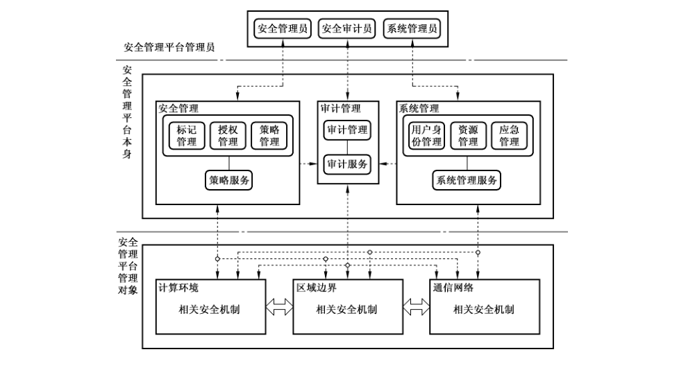
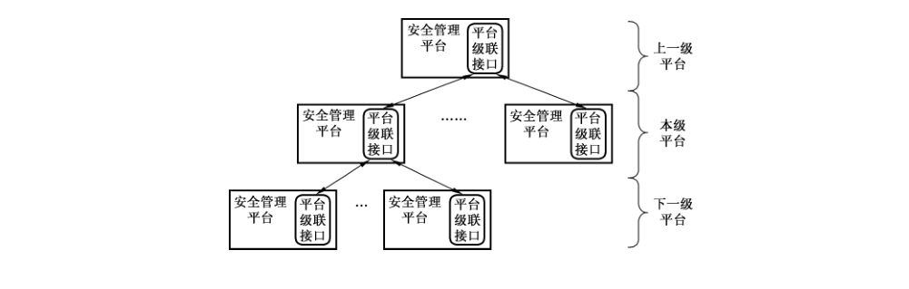
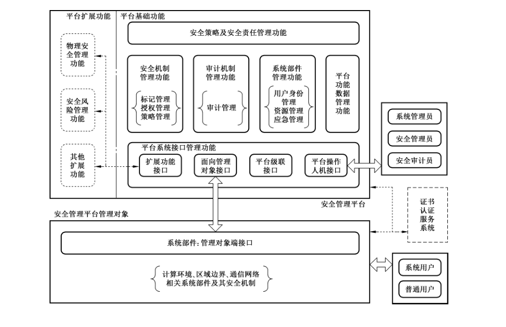
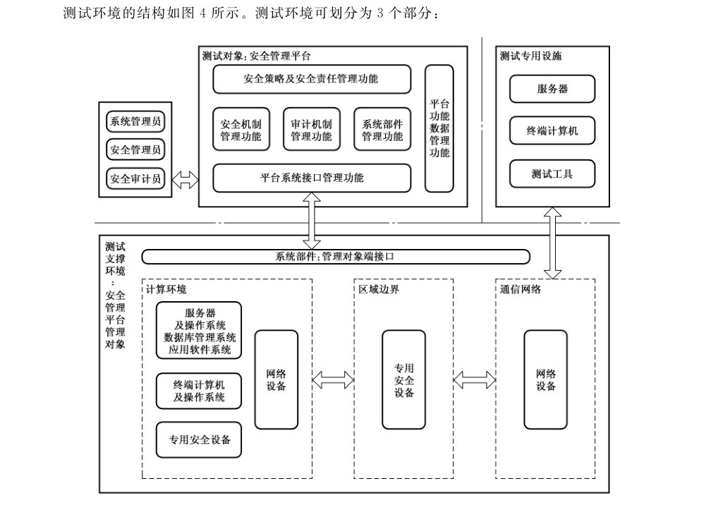
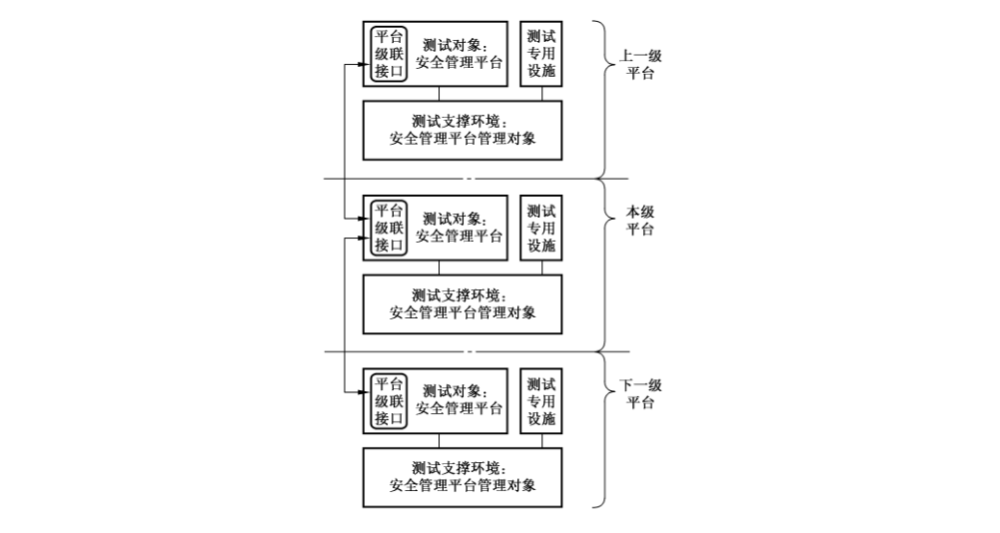
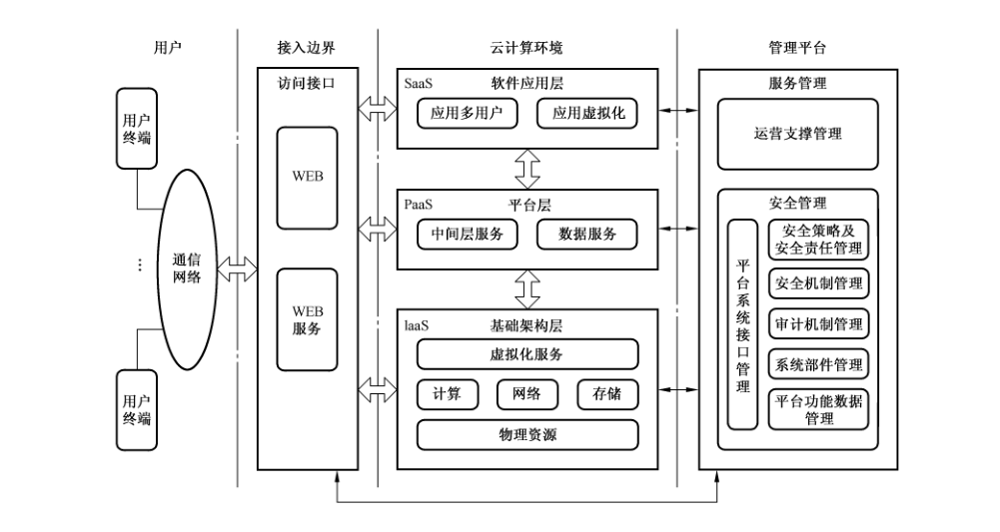

# GB/T 34990-2017 信息安全技术 信息系统安全管理平台技术要求和测试评价方法

> 来源：[GB/T 34990-2017 国家标准详情](https://openstd.samr.gov.cn/bzgk/std/newGbInfo?hcno=B389DE3115263E5122B924DD9354970B)；发布日期：2017-11-01；实施日期：2018-05-01。
> PDF SHA-256：ddf58be42d646bbf97fb24d612b4514f57f1e18bf414b2dac8b80e36fe1e2064。
> 转写说明：对照官方 PDF 全部 74 页图像逐页校正；省略封面、目录、页眉、页脚和页码，合并跨页内容。表 A.1、B.1—B.3、D.1—D.2 已按原图重建，图 1—图 5 和图 C.1 保留原图。正式引用请核对官方原文。

## 前言

本标准按照 GB/T 1.1—2009给出的规则起草。

请注意本文件的某些内容可能涉及专利。本文件的发布机构不承担识别这些专利的责任。

本标准由全国信息安全标准化技术委员会（SAC/TC 260）提出并归口。

本标准起草单位：公安部第一研究所、北京中科网威信息技术有限公司、北京江南天安科技有限公司、公安部计算机信息系统安全产品质量监督检验中心、浙江远望电子有限公司、中国电信股份有限公司北京研究院、北京凝思科技有限公司、北京启明星辰信息技术股份有限公司、北京赛博兴安科技有限公司、北京华热科技发展有限公司、北京初志科技有限公司、北京聆云信息技术有限公司。

本标准主要起草人：胡志昂、陈冠直、景乾元、殷国强、张翔、苏智睿、张笑笑、傅如毅、刘兵、明旭、胡托任、王磊、李大鹏、李清玉。

## 引言

本标准中，安全管理平台是能够满足国家信息安全管理需要，体现组织管理层意志，以信息安全策略和管理责任为主线，以信息系统的系统部件管理、安全机制管理、审计机制管理为主要手段，以信息安全管理对象识别、安全策略设置、安全机制监控、安全事件处置为主要工作过程，实现信息安全管理和信息安全技术有机结合的安全管理中心的关键技术支撑性产品。安全管理平台适用于不同安全保护等级的信息系统，更有益于关键信息基础设施的安全集中管理。

本标准依据国家信息安全等级保护要求，提出了统一管理安全机制的平台，规定了安全管理平台的技术要求和测试评价方法。本标准的第4 章安全管理平台概述，明确了基本原理、管理对象、使用环境和安全等级。第5章安全管理平台的功能要求，阐述了功能构成、基础功能、扩展功能；其中基础功能，包括安全策略及安全责任管理功能要求、系统部件管理功能要求、安全机制管理功能要求、审计机制管理功能要求、平台功能数据管理功能要求、平台系统接口功能要求，平台级联功能要求；扩展功能，包括物理安全管理、安全风险管理和其他扩展功能要求。第6章安全管理平台的安全要求及保障要求，阐述了平台自身的安全要求、保障要求。第7章安全管理平台的测试评价方法，阐述了测试评价范围、平台功能测试。本标准的附录均为资料性附录，其中，附录 A阐述了安全管理平台技术要求安全等级划分，附录B阐述了平台对各类管理对象的控制过程说明，附录C阐述了安全管理平台在云计算中的应用，附录D阐述了信息系统安全机制参考。

## 1 范围

本标准规定了安全管理平台的基于信息安全策略和管理责任的系统管理、安全管理、审计管理等功能，以及对象识别、策略设置、安全监控、事件处置等过程的平台功能要求，平台自身的安全要求、保障要求，以及测试评价方法。

本标准适用于安全管理平台的规划、设计、开发和检测评估，以及在信息系统安全管理中心中的应用。

## 2 规范性引用文件

下列文件对于本文件的应用是必不可少的。凡是注日期的引用文件，仅注日期的版本适用于本文件。凡是不注日期的引用文件，其最新版本（包括所有的修改单）适用于本文件。

- GB 17859—1999 计算机信息系统 安全保护等级划分准则

- GB/T 18018 信息安全技术 路由器安全技术要求

- GB/T 20269—2006 信息安全技术 信息系统安全管理要求

- GB/T 20270 信息安全技术 网络基础安全技术要求

- GB/T 20272 信息安全技术 操作系统安全技术要求

- GB/T 20273 信息安全技术 数据库管理系统安全技术要求

- GB/T 20275 信息安全技术 网络入侵检测系统技术要求和测试评价方法

- GB/T 20279 信息安全技术 网络和终端隔离产品安全技术要求

- GB/T 20281 信息安全技术 防火墙安全技术要求和测试评价方法

- GB/T 20945 信息安全技术 信息系统安全审计产品技术要求和测试评价方法

- GB/T 20984—2007 信息安全技术 信息安全风险评估规范

- GB/T 21028 信息安全技术 服务器安全技术要求

- GB/T 21050 信息安全技术 网络交换机安全技术要求（评估保证级 3）

- GB/T 21052 信息安全技术 信息系统物理安全技术要求

- GB/T 22081 信息技术 安全技术 信息安全管理实用规则

- GB/T 22239—2008 信息安全技术 信息系统安全等级保护基本要求

- GB/T 24363 信息安全技术 信息安全应急响应计划规范

- GB/T 25055 信息安全技术 公钥基础设施安全支撑平台技术框架

- GB/T 25069—2010 信息安全技术 术语

- GB/T 25070—2010 信息安全技术 信息系统等级保护安全设计技术要求

- GB/T 28451 信息安全技术 网络型入侵防御产品技术要求和测试评价方法

- GB/T 28452—2012 信息安全技术 应用软件系统通用安全技术要求

- GB/T 28453—2012 信息安全技术 信息系统安全管理评估要求

- GB/T 29240 信息安全技术 终端计算机通用安全技术要求与测试评价方法

- GB/T 29244 信息安全技术 办公设备基本安全要求

- GB/T 29828 信息安全技术 可信计算规范 可信连接架构

- GB/T 31499 信息安全技术 统一威胁管理产品技术要求和测试评价方法

- GB/Z 20986 信息安全技术 信息安全事件分类分级指南

- GB 50174 电子信息系统机房设计规范

## 3 术语和定义

GB 17859—1999 和 GB/T 25069—2010界定的以及下列术语和定义适用于本文件。

### 3.1 安全管理平台 security management platform

对信息系统的安全策略以及执行该策略的安全计算环境、安全区域边界和安全通信网络等方面的安全机制实施统一管理的平台。

### 3.2 安全机制 security mechanism

实现安全功能，提供安全服务的一组有机组合的基本方法。

> ［GB/T 25069—2010定义2.2.1.5］

### 3.3 安全策略 security policy

用于治理组织及其系统内在安全上如何管理、保护和分发资产（包括敏感信息）的一组规则、指导和实践，特别是那些对系统安全及相关元素具有影响的资产。

> ［GB/T 25069—2010定义2.3.2］

### 3.4 策略基准 policy bench

针对系统部件上的安全机制，按照国家相关法律法规和信息安全技术标准要求并符合组织的安全方针，用自然语言描述的管理策略条文，包括系统管理策略基准、安全管理策略基准、审计管理策略基准。

### 3.5 策略规则 policy rule

根据策略基准编写的系统部件上安全机制能识别的程序指令或形式语言语句，包括系统管理配置规则、安全管理策略规则、审计管理策略规则。

### 3.6 信息安全事件 information security incident

由单个或一系列意外或有害的信息安全事态所组成的，极有可能危害业务运行和威胁信息安全。

> ［GB/T 25069—2010定义2.1.53］

### 3.7 信息安全事态 information security event

被识别的一种系统、服务或网络状态的发生，表明一次可能的信息安全策略违规或某些防护措施失效，或者一种可能与安全相关但以前不为人知的一种情况。

> ［GB/T 25069—2010定义2.1.54］

### 3.8 安全审计 security audit

对信息系统的各种事件及行为实行监测、信息采集、分析，并针对特定事件及行为采取相应的动作。

> ［GB/T 25069—2010定义2.2.1.8］

### 3.9 安全计算环境 secure computing environment

对信息系统的信息进行存储、处理及实施安全策略的相关部件。

> 注：安全计算环境按照保护能力划分为第一级至第五级安全计算环境。

### 3.10 安全区域边界 secure area boundary

对信息系统的安全计算环境边界，以及安全计算环境与安全通信网络之间实现连接并实施安全策略的相关部件。

> 注：安全区域边界按照保护能力划分为第一级至第五级安全区域边界。

### 3.11 安全通信网络 secure communication network

对信息系统安全计算环境之间进行信息传输及实施安全策略的相关部件。

> 注：安全通信网络按照保护能力划分为第一级至第五级安全通信网络。

### 3.12 应用软件系统 application software system

信息系统的重要组成部分，是指信息系统中对特定业务进行处理的软件系统。

> ［GB/T 28452—2012定义3.1.1］

### 3.13 敏感标记 sensitivity label

表示主体/客体安全级别和安全范畴的一组信息。

> 注：在可信计算基中把敏感标记作为强制访问控制决策的依据。

> ［GB/T 25069—2010定义2.2.1.93］

## 4 安全管理平台概述

### 4.1 安全管理平台基本原理

依据 GB/T 20269—2006 中“5.5.6 安全集中管理”有关安全机制集中控管、安全信息集中管理、安全机制整合要求和处理方式的要求，以及GB/T 25070—2010中 6.3.4、7.3.4 和8.3.4“安全管理中心设计技术要求”有关系统部件管理、安全机制管理、审计机制管理的要求，本标准将安全管理平台（以下简称“平台”）定位为在信息系统安全机制集中管理，成为安全管理中心的关键技术支撑性产品，为实现自动化、智能化安全管理提供支持。

依据 GB/T 25070—2010，平台的基本原理如图1所示，通过“一个中心”（安全管理中心）管理下的“三重保护”（计算环境、区域边界和通信网络）体系框架，构建安全机制和策略，形成信息系统的安全保护环境。安全保护环境的结构与流程可分安全管理流程与访问控制流程。本标准主要针对平台本身的技术实现，如安全管理流程主要由安全管理员、系统管理员和安全审计员通过安全管理平台执行，分别实施系统维护、安全策略制定和部署、审计记录分析和结果响应等。

图1中平台管理对象部分中计算环境、区域边界和通信网络的技术设计应遵照 GB/T 25070—2010实现，如访问控制流程应在系统运行时执行，实施自主访问控制、强制访问控制等。

信息系统中安全计算环境、安全区域边界、安全通信网络是依靠操作系统、数据库管理系统、网络设备和专用安全设备的安全机制实现的；应用系统安全是在上述系统安全保护环境基础上，依靠应用软件中的安全机制实现的；物理环境安全是依靠相关设备、设施及其控制系统的安全机制实现的。

在本标准中，系统部件包括服务器、终端计算机、网络设备、专用安全设备、其他联网设备等物理设备和虚拟设备，以及上述设备运行的操作系统、数据库管理系统和应用软件系统。其中，专用安全设备是指防火墙、入侵检测、恶意代码防范、密码技术设备等；其他联网设备包括信息系统中联网的办公设备和联网的物理安全设施。联网的办公设备包括用于产生或处理电子或其他媒体文件的设备，主要是指具有打印、扫描、传真、复印中的一项或多项功能的设备。联网的物理安全设施包括物理环境安全相关设备、设施及其控制系统。

平台的日常运行应由组织机构授权的系统管理员负责，安全管理员、系统管理员、安全审计员分别在其授权范围内进行操作。

平台通过安全策略及安全责任、系统部件、安全机制、审计机制、平台功能数据、平台系统接口、平台级联等管理功能实施对平台管理对象的控制，主要完成：

a） 对信息系统中各个系统部件及其用户的识别；

b） 根据安全策略对系统部件及其用户进行系统、安全、审计的功能配置；

c） 对系统部件及其用户在系统运行中的状态进行监控、分析；

d） 对监控过程中发现的安全事件进行响应和处置。

平台应对信息安全监管部门进行检查及处理信息安全事件提供一定的支持，也可对信息安全测评部门进行安全测评提供一定的支持。

### 4.2 安全管理平台管理对象

平台管理对象（以下简称管理对象）可划分为系统管理对象、安全管理对象、审计管理对象。平台通过对管理对象的集中管理，实现对信息系统的计算环境、区域边界、通信网络、业务应用和物理环境的安全管理。其中：

a） 系统管理对象包括信息系统的系统部件及其用户，其中用户包括系统用户和普通用户；

b） 安全管理对象包括系统管理对象的安全机制，依据 GB/T 25070—2010主要有：

1） 计算环境安全机制：用户身份鉴别、自主访问控制、标记与强制访问控制、系统安全审计、用户数据完整性保护、用户数据保密性保护、客体安全重用、恶意代码防范、程序可执行保护；

2） 区域边界安全机制：区域边界访问控制、区域边界包过滤、区域边界协议过滤、区域边界安全审计、区域边界恶意代码防范、区域边界完整性保护；

3） 通信网络安全机制：通信网络安全审计、通信网络数据传输完整性保护、通信网络数据传输保密性保护、通信网络可信接入保护等；

c） 审计管理对象包括对系统管理对象和安全管理对象的所有安全审计机制，即根据安全审计策略对审计记录进行分类，提供按时间段开启和关闭相应类型的安全审计机制，对各类审计记录进行存储、管理、查询和分析，并及时处理。

### 4.3 安全管理平台使用环境

平台可由相关的服务器、终端计算机、网络设备、专用安全设备等（以下简称平台设备），以及实现平台功能要求和安全要求的所有应用软件系统（以下简称平台应用系统）组成。

平台可用于组织机构内部信息系统及其关联的局域网、城域网系统的安全管理，也可支持组织机构跨地域的广域网系统的安全管理。

平台的典型使用环境主要包括：

a） 平台本身，应具有唯一的平台标识信息；

b） 管理对象，应具有唯一的管理对象标识信息；在图1中信息系统中的平台管理对象已映射为计算环境、区域边界、通信网络的安全机制；

c） 平台与管理对象之间的通信网络，实现安全管理相关数据流和控制流的传输，上行信息（由管理对象流向平台）多为安全监测信息，下行信息（由平台流向管理对象）多为安全控制信息。

还应允许平台的级联使用，如图2所示。

### 4.4 安全管理平台安全等级

选择平台的安全等级应根据其所管理的信息系统中计算环境、区域边界和通信网络中最高安全等级确定，应不低于它们的最高安全等级。为适应信息系统安全管理的需要，降低平台安全防护的成本，本标准将平台安全等级划分为两个等级：基本级和增强级，达到增强级所有要求的平台才能判定为增强级。

基本级平台适用于对 GB/T 22239—2008中第一级、第二级信息系统中安全机制进行集中管理；增强级平台适用于对 GB/T 22239—2008中第三级、第四级信息系统中安全机制进行集中管理。第五级信息系统中安全机制的集中管理要求另行制定。

平台技术要求的安全等级划分可参见附录 A中表 A.1所示。

## 5 功能要求

### 5.1 功能构成

平台的功能构成如图3所示。

平台的功能由基础功能和扩展功能组成，具体包括：

a） 平台的基础功能：包括安全策略及安全责任管理功能、系统部件管理功能、安全机制管理功能、审计机制管理功能、平台功能数据管理功能、平台系统接口功能以及平台级联功能等，实现对信息系统的计算环境、区域边界、通信网络、业务应用和物理环境中的管理对象识别、安全策略设置、安全机制监控、安全事件处置；

b） 平台的扩展功能：是基础功能的延伸，如物理安全管理功能、安全风险管理功能等，其他扩展功能可根据需要和实现的可能性确定；

c） 平台对其管理对象的控制过程：可包括管理对象识别过程、管理策略设置过程、运行状态监控过程和事件响应处置过程等（参见附录 B）；平台在实施这些过程时，会受到安全策略及安全责任管理功能的控制，具体依据存放在平台功能数据管理功能的相关数据集中；获取许可后，这些过程将根据需要可通过系统部件管理功能、安全机制管理功能、审计机制管理功能得到执行，所产生的各种信息将记录在平台功能数据管理功能的相关数据集中；平台系统接口管理功能为上述功能的实现奠定了基础；

d） 平台功能数据：为平台运行保障、安全管理、安全审计提供支撑，主要包括用户管理数据集、系统部件数据集，管理策略数据集、策略错误数据集、异常判断规则数据集、异常事态记录数据集、事件处置预案数据集、事件处置报告数据集、备份记录数据集、逻辑接口数据集、管理依据数据集，平台管理用户数据集、平台级联数据集等；

e） 证书认证服务系统：涉及身份鉴别、设备认证、可信连接等方面功能的实现，可由证书认证服务系统提供支持应符合 GB/T 25055 的规定。

本标准仅对平台的基础功能和主要扩展功能提出要求。有关平台使用和平台对其管理对象的控制过程中，对管理策略规则的制定及与平台交互操作流程等内容，可作应用指南另行制定。

本标准所述的安全管理平台在云计算中的应用参见附录C。

### 5.2 基础功能

#### 5.2.1 安全策略及安全责任管理功能要求

##### 5.2.1.1 组织的机构、角色、责任和权限

平台应维护组织中信息安全管理的角色、责任和权限等相关信息。

基本级功能要求，包括：

a） 组织机构信息应包括组织中承担信息安全管理工作机构的信息，具体机构的设置可参考GB/T 20269—2006 要求；

b） 角色信息应包括：负责信息安全工作主管领导角色，负责安全管理平台日常运行的平台管理员角色信息；

c） 平台管理员角色包括特权安全管理员角色、系统管理员角色、安全审计员角色，以及特权管理员角色指派并分配的非特权安全管理员角色、系统管理员角色、安全审计员角色，具体人员的设置可参考 GB/T 20269—2006 要求；

d） 责任和权限信息应包括：各个角色在安全管理平台中的责任、权限和范围；

e） 角色行为依据包括：信息安全管理工作中涉及的所有正式文件、会议决议、批示、指令、通知、审批记录等；

f） 应将上述组织的机构、角色、责任、权限、管理依据及其过程记录等信息存入管理依据数据集；

增强级功能要求，在基本级要求基础上无增加要求。

##### 5.2.1.2 组织的安全策略管理

平台应提供对组织的安全策略管理的支持功能。

基本级功能要求，包括：

a） 平台应记录组织批准的信息安全方针：

1） 信息安全方针应关注法律法规、组织业务战略、合同、当前和预期的信息安全威胁环境等方面产生的要求；

2） 信息安全方针应包括涉及以下内容的陈述：

——信息安全目标和原则的定义，以指导所有信息安全有关的活动；

——把信息安全管理方面的一般和特定责任的分配给已定义的角色；

——处理偏差和意外的过程；

b） 平台记录的信息安全策略应依据组织的信息安全方针制定，通常由特定主题的策略予以支持，具体在系统部件基本管理功能要求（5.2.2）、安全机制管理功能要求（5.2.3）、审计机制管理功能要求（5.2.4）、平台功能数据管理功能要求（5.2.5）、平台系统接口功能要求（5.2.6）、平台级联功能要求（5.2.7）中阐述，相关安全机制内容可参见附录 D；

增强级功能要求，在基本级要求基础上无增加要求。

##### 5.2.1.3 组织的信息安全责任制度管理

平台应记录依据信息安全方针要求制定的信息安全责任制度，作为平台各类管理员的行为依据，并存入管理依据数据集。

基本级功能要求，包括：

a） 规范安全管理活动中的各类管理内容的安全管理制度；

b） 规范各角色下用户的日常管理操作所建立的操作规程、信息安全责任制度；

c） 构成全面信息安全管理制度体系的其他相关管理制度、操作规程等。

增强级功能要求，在基本级要求基础上无增加要求。

##### 5.2.1.4 平台管理员用户管理

平台应对其各类管理员用户账户及权限实现管理的功能。

基本级功能要求，包括：

a） 平台系统由具有特权的系统管理员负责安装，在首次启动后自动产生具有特权的系统管理员、安全管理员、安全审计员3个用户；

b） 具有特权的系统管理员负责平台自身的运行，新管理员账户的建立，即非特权系统管理员、安全管理员、安全审计员用户；

c） 具有特权的安全管理员负责为非特权系统管理员、安全管理员、安全审计员用户授权，如管理对象识别、安全策略设置、安全机制监控、安全事件处置等权限；

d） 具有特权的安全管理员可为非特权系统管理员、安全管理员、安全审计员用户分配各自对管理对象的管理范围，如管理哪些系统部件及其安全机制；

e） 具有特权的安全审计员负责对具有特权的系统管理员和安全管理员以及非特权的管理员用户行为进行审计；

f） 非特权系统管理员、安全管理员、安全审计员分别负责在其授权范围内进行平台功能操作；

g） 应将上述管理员用户信息存储到平台管理用户数据集；

增强级功能要求，在基本级要求基础上无增加要求。

##### 5.2.1.5 平台管理员安全责任管理

平台应依据平台管理用户数据集、管理依据数据集中的记录，判定各类管理员的可操作行为。

基本级功能要求，包括：

a） 系统管理员、安全管理员、安全审计员的操作行为应在授权范围内，并依据管理依据数据集中的记录，执行系统管理策略设置、安全管理策略设置、审计管理策略设置等关键操作；

b） 对于试图执行非授权操作或管理依据数据集中没有记录的操作时，平台应不予执行并作为责任违规事件报警；

c） 责任违规报警记录应存入异常事态记录数据集。

增强级功能要求，在基本级要求基础上无增加要求。

#### 5.2.2 系统部件管理功能要求

##### 5.2.2.1 系统策略集中管理

平台应实现系统策略集中管理的相关功能。系统部件管理功能应实现对信息系统安全保护环境中的计算环境、区域边界、通信网络实施集中管理和维护，包括用户身份管理、资源管理、异常情况处理等。

基本级功能要求，包括：

a） 应提供通过系统管理员对系统的资源和运行进行配置、控制和管理的功能，包括用户身份管理、系统资源配置、系统加载和启动、系统运行的异常处理，数据和设备的备份与恢复等；

b） 应对系统管理员进行身份鉴别，只允许其在平台上通过特定的命令或操作界面进行系统管理操作，并对这些操作进行审计；

增强级功能要求，在基本级要求基础上增加下列要求：

c） 应支持管理本地和异地灾难备份与恢复等。

##### 5.2.2.2 系统管理对象识别

平台应提供系统管理员对系统管理对象识别的操作界面及功能。

基本级功能要求，包括：

a） 应以人工或自动方式识别所有系统管理对象，建立初始的系统部件数据集和用户管理数据集：

1） 对所有识别的系统管理对象在平台上建立唯一标识；

2） 与已识别的系统管理对象连接时，应采用受控的口令或具有相应安全强度的其他机制进行身份鉴别；

3） 应将已识别的系统部件的标识、安全等级信息等相关信息存储到系统部件数据集；

4） 应在5.2.2.2a）2）的基础上，获取所有用户（包括系统用户和普通用户）管理信息，将用户标识及其相关信息存储到用户管理数据集；

b） 在建立初始的系统部件数据集和用户管理数据集后，平台应及时对新增加系统管理对象（如新接入的系统部件、新开通的用户）进行识别：

1） 对于经组织批准的新增加的系统管理对象，应按照 a）的要求维护相关数据集，并执行平台对管理对象的其他控制过程；

2） 对于未经组织批准的违规增加的系统管理对象，应将相关信息存储到异常事态记录数据集，转入系统事件响应处置；

增强级功能要求，在基本级要求基础上增加下列要求：

c） 与已识别的系统管理对象连接时，应采用受控的口令、基于生物特征的数据、数字证书以及其他具有相应安全强度的两种或两种以上的组合机制进行身份鉴别；

d） 应对系统部件中的指定进程进行识别。

##### 5.2.2.3 系统管理策略设置

平台应提供系统管理员对系统管理策略设置的系统管理操作界面及功能。

基本级功能要求，包括：

a） 设定系统管理策略基准和策略规则：

1） 应设置系统部件上的系统管理策略基准；

2） 应按系统管理策略基准形成每个系统部件的相应系统管理策略规则；

3） 应设置系统部件上各个用户的系统管理策略基准；

4） 应按用户的系统管理策略基准形成每个用户的相应系统管理策略规则；

5） 应提供对上述系统管理策略规则与系统管理策略基准的符合性检查的功能界面，并保存系统管理员的检查确认信息；

6） 应将设置的系统管理策略基准及策略规则存储到管理策略数据集；

b） 对每个系统管理对象以人工或自动方式设置系统管理策略规则：

1） 应向系统部件下发系统管理策略规则，完成相应设置并确保其生效；

2） 应向系统部件下发用户的系统管理策略规则，完成相应设置并确保其生效；

c） 对系统管理对象的策略规则进行完整性验证：

1） 应能读取每个系统部件及其用户已生效的系统管理策略规则信息；

2） 应能将读取的系统管理策略规则信息与管理策略数据集中的策略规则进行对比验证；

3） 应对验证结果发现不一致的进行记录、提示或报警，报警记录存储到策略错误数据集；

增强级功能要求，在基本级要求基础上增加下列要求：

d） 应通过平台以自动方式向系统部件及其用户下发系统管理策略规则，并完成设置；

e） 上述系统管理策略规则设置的系统管理对象应细化到指定进程。

##### 5.2.2.4 系统部件运行监控

平台应提供系统管理员对系统部件运行状况监控的系统管理操作界面及功能。

基本级功能要求，包括：

a） 设置系统监控规则：

1） 应设置对系统部件及其用户的监测范围，如重点、分区、分安全等级监视等；

2） 应设置对系统部件及其用户的监测方式，如自动或人工监测、监测频度、并行监测或巡检等方式；

3） 应将设置的系统监控规则存储到监控规则数据集；

b） 设置系统异常判断规则：

1） 应对系统管理对象行为违背所规定的系统管理策略规则判为异常；

2） 应依据系统部件数据集、用户管理数据集、管理策略数据集，与系统部件及其用户实际的系统管理策略规则进行比对，出现不一致时判为异常；

3） 应对系统资源（如 CPU 占用率、存储空间、网络流量等）设置异常判断指标，对违背指标的判为异常；

4） 应将设置的系统异常判断规则存储到异常判断规则数据集；

5） 应对上述异常按 GB/Z 20986 进行等级划分；

c） 监控系统管理策略规则及运行状态：

1） 应获取系统部件及其用户的系统管理策略规则及运行状态信息并记录，运行状态如系统加载和启动、系统资源变动、系统备份及恢复等；

2） 应按照异常判断规则检查上述系统管理策略规则及运行状态信息，对系统异常事态记录并报警；

3） 应按照异常判断规则检查系统部件的数量及属性变化，对系统异常事态记录并报警；

4） 应监测新增加系统管理对象（如新接入的系统部件、新开通的用户），并与系统部件数据集和用户管理数据集核对，如核对出错的应将相关信息存储到异常事态记录数据集，转入系统事件响应处置；

5） 应通过网络流量的监测，发现网络存在的异常和威胁；

6） 应将系统异常事态记录存储到异常事态记录数据集；

7） 应支持系统管理员对发现的系统异常事态及报警采取应对措施；

d） 应提供对系统监控规则、系统异常判断规则、系统异常事态记录等监测记录的查询、统计，及报表输出功能；

增强级功能要求，在基本级要求基础上增加下列要求：

e） 应对系统管理策略规则及运行状态监控发现的异常事态及报警采取自动应对措施；

f） 应对监测记录的查询统计提供一定的辅助统计分析工具和风险分析工具；

g） 上述系统运行状况监控的系统管理对象应细化到指定进程。

##### 5.2.2.5 系统事件响应处置

平台应提供系统管理员对系统事件响应处置的操作界面及功能。

基本级功能要求，包括：

a） 应提供设置系统事件处置预案的模板：

1） 预案框架符合 GB/T 24363 要求；

2） 预案对系统管理中出现的事件按 GB/Z 20986 进行分类分级；

3） 预案内容包括启动条件、执行人及其联系方式；

4） 编制完成的预案存储到事件处置预案数据集；

b） 当系统运行状况监控产生报警时，应提供响应处置界面，并展示审计产生的安全事件记录信息，以支持判定启动系统事件相应处置预案的决策（如由系统管理员确认）并记录；

c） 对违规增加的系统管理对象（如违规接入的系统部件、违规开通的用户），应提供阻止其接入或开通的功能；

d） 应参照 b）提供接受人工报警和系统事件处置的功能；

e） 应对系统事件处置过程及结果进行记录，形成处置报告，并存储到事件处置报告数据集；

增强级功能要求，在基本级要求基础上无增加要求。

##### 5.2.2.6 系统变更管理

平台应提供系统管理员对系统变更管理的操作界面及功能。

基本级功能要求，包括：

a） 应支持对以下系统变更进行管理，包括平台已投入运行的系统管理策略（含平台和系统管理对象上的策略基准、策略规则），系统监控规则、系统异常判断规则、系统事件处置预案、系统备份和恢复策略等的变更，以及系统部件的系统软件升级、补丁和特征库等相关数据更新；

b） 对已投入运行的系统管理策略进行变更后，应验证系统管理对象上变更后的策略规则得到有效执行；

c） 应对变更过程产生记录，包括变更的发起者、审批者、变更时间及其他相关信息，并保存变更前和变更后的数据，存储到审计记录数据集；

d） 在系统变更不成功或有回退要求时，应能回退到变更前状态并记录；

e） 应对系统变更影响范围内的用户进行提示或通报。

增强级功能要求，在基本级要求基础上无增加要求。

##### 5.2.2.7 灾难备份及恢复管理

平台应提供系统管理员对系统灾难备份及恢复的操作界面及功能。

基本级功能要求：无；

增强级功能要求：

a） 应提供管理本地和异地灾难备份与恢复策略设置；

b） 应提供管理本地和异地灾难备份操作的提示功能；

c） 应对本地和异地灾难备份和恢复过程进行记录，存储到备份记录数据集；

d） 应提供本地和异地灾难备份和恢复检测和状态查询等功能；

e） 可支持本地和异地灾难备份和恢复操作。

#### 5.2.3 安全机制管理功能要求

##### 5.2.3.1 安全策略集中管理

平台应实现安全策略集中管理的相关功能。安全机制管理功能应作为信息系统的安全控制中枢，主要实施标记管理、授权管理及策略管理等，通过制定相应的系统安全策略，要求计算环境、区域边界和通信网络中系统部件的安全机制有效执行，从而实现对整个信息系统的集中管理。

基本级功能要求，包括：

a） 应提供安全管理员对系统部件中访问控制的主体进行授权，配置一致的安全策略的功能，并确保授权和安全策略的完整有效；

b） 对安全机制的安全管理策略设置，应覆盖到系统管理对象的具有设置功能的所有安全机制；对安全机制的监测，应覆盖到系统管理对象的所有安全机制；

c） 应对安全管理员进行身份鉴别，只允许其通过特定的命令或操作界面进行安全管理操作，并进行审计；

d） 信息系统中联网的办公设备安全管理策略应符合 GB/T 29244 要求；

增强级功能要求，在基本级要求基础上增加下列要求：

e） 应在对安全管理员进行身份鉴别和权限控制的基础上，通过特定操作界面进行安全标记（即对系统中访问控制的主体、客体设置统一的敏感标记），并确保安全标记、授权和安全策略的完整有效；

f） 应按安全标记和强制访问控制规则，对确定主体访问客体的操作进行控制，且强制访问控制主体的粒度为用户级，客体的粒度为文件或数据库表级；

g） 应确保安全计算环境内的所有主、客体具有一致的敏感标记信息，并实施相同的强制访问控制规则。

##### 5.2.3.2 安全管理对象识别

平台应提供安全管理员对系统管理对象的安全机制识别的操作界面及功能。

基本级功能要求，包括：

a） 应对已识别的系统管理对象的安全机制进行识别并唯一标识；

b） 应对已识别的系统管理对象的安全机制标识等相关信息存储到系统部件数据集；

c） 应在连接系统管理对象并通过身份鉴别后，能够读取安全机制的安全策略规则等信息；

d） 应在连接系统管理对象并通过身份鉴别后，获取所有用户（包括系统用户和普通用户）安全管理信息，并存储到用户管理数据集；

增强级功能要求，在基本级要求基础上增加下列要求：

e） 应对系统管理对象中有关安全机制的指定进程进行识别。

##### 5.2.3.3 安全管理策略设置

平台应提供安全管理员对安全管理策略设置的操作界面及功能。

基本级功能要求，包括：

a） 设定安全管理策略基准和策略规则：

1） 应设置系统部件安全机制的安全管理策略基准；

2） 应按安全管理策略基准形成每个系统部件安全机制的相应安全管理策略规则；

3） 应设置系统部件上各个用户的安全管理策略基准；

4） 应按用户安全管理策略基准形成每个用户的相应安全管理策略规则；

5） 应提供对上述安全管理策略规则与安全管理策略基准的符合性检查的功能界面，并保存安全管理员的检查确认信息；

6） 应将设置的安全策略基准及安全策略规则存储到管理策略数据集；

b）对每个安全管理对象以人工或自动方式设置安全管理策略规则：

1） 应向系统部件下发安全管理策略规则，完成相应设置并确保其生效；

2） 应向系统部件下发用户安全管理策略规则，完成相应设置并确保其生效；

c） 对安全管理对象的安全管理策略规则以人工或自动方式进行完整性验证：

1） 应读取每个系统部件安全机制已生效的安全管理策略规则和每个用户已生效的安全管理策略规则；

2） 应将读取的安全管理策略规则与管理策略数据集中相应策略规则进行比对验证并记录；

3） 应对验证结果发现不一致的进行记录、提示或报警，报警记录存储到策略错误数据集；

增强级功能要求，在基本级要求基础上增加下列要求：

d） 应以自动方式对系统部件下发安全机制的安全管理策略规则，对每个用户下发安全管理策略规则，并完成设置；

e） 应以自动方式验证安全管理策略规则设置的完整性；

f） 应为安全管理员提供安全标记和强制访问控制安全管理策略设置功能；

g） 上述安全管理策略规则设置的安全管理对象应细化到指定进程。

##### 5.2.3.4 安全机制运行监控

平台应提供安全管理员对安全机制运行监控的操作界面及功能。

基本级功能要求，包括：

a） 设置安全监控规则：

1） 应设置系统部件的安全机制、用户等监测范围，如重点、分区、分安全等级监视等；

2） 应设置系统部件的安全机制、用户等监测方式，如自动或人工监测、监测频度、并行监测或巡检等方式；

3） 应将设置的安全监控规则存储到监控规则数据集；

b） 设置安全异常判断规则：

1） 应对安全管理对象行为违背所规定的安全管理策略规则判为异常；

2） 应依据系统部件数据集、用户管理数据集、管理策略数据集，与系统部件及其用户实际的安全管理策略规则进行比对，出现不一致时判为异常；

3） 应将设置的安全异常判断规则存储到异常判断规则数据集；

4） 应对上述异常按 GB/Z 20986 进行等级划分；

c） 监控安全管理策略规则的完整性及其执行状态：

1） 应获取系统部件的安全管理策略规则，按照安全异常判断规则检查并记录，发现异常则生成安全异常事态记录并报警；

2） 应获取安全机制的运行状态（安全管理策略规则的执行状态），按照安全异常判断规则检查并记录，发现异常则生成安全异常事态记录并报警；

3） 应监测系统部件安全机制的数量及属性变化，按照异常判断规则检查并记录，发现异常则生成安全异常事态记录并报警；

4） 应将安全异常事态记录存储到异常事态记录数据集；

5） 应支持安全管理员对发现的安全异常事态及报警采取应对措施；

d） 应提供对安全监控规则、安全异常判断规则、安全异常事态记录等监测记录的查询、统计，及报表输出功能；

增强级功能要求，在基本级要求基础上增加下列要求：

e） 应对安全管理策略规则及安全机制运行状态监控发现的异常事态及报警采取自动应对措施；

f） 应对监测记录的查询统计提供一定的辅助统计分析工具和风险分析工具；

g） 应提供对安全标记和强制访问控制执行状态的监测功能；

h） 上述安全机制运行状况监控的安全管理对象应细化到指定进程。

##### 5.2.3.5 安全事件响应处置

平台应提供安全管理员对安全事件响应处置的操作界面及功能。

基本级功能要求，包括：

a） 应提供设置安全事件处置预案的模板：

1） 预案框架符合 GB/T 24363 要求；

2） 预案对安全管理中出现的事件按 GB/Z 20986—2007进行分类分级；

3） 预案内容包括启动条件、执行人及其联系方式；

4） 编制完成的预案存储到事件处置预案数据集；

b） 当安全机制运行监控产生报警时，应提供响应处置界面，并展示审计产生的安全事件记录信息，以支持判定启动安全事件相应处置预案的决策（如由安全管理员确认）并记录；

c） 应参照b）提供人工报警和安全事件处置的功能；

d） 应对安全事件处置过程及结果进行记录，形成处置报告，并存储到事件处置报告数据集；

增强级功能要求，在基本级要求基础上无增加要求。

##### 5.2.3.6 安全变更管理

平台应提供安全管理员对安全变更管理的操作界面及功能。

基本级功能要求，包括：

a） 安全变更范围包括平台已投入运行的安全管理策略（包括平台和安全管理对象上的策略基准、策略规则），安全监控规则、安全异常判断规则、安全事件处置预案等的变更；

b） 对已投入运行的安全管理策略进行变更后，应验证安全管理对象上变更后的策略规则得到有效执行；

c） 安全变更时，应对变更过程产生记录，包括变更的发起者、审批者、变更时间及其他相关信息，并保存变更前和变更后的数据，存储到审计记录数据集；

d） 安全变更不成功或有需求时，应回退到变更前状态并记录；

e） 应对安全变更影响范围内的用户进行提示或通报；

增强级功能要求，在基本级要求基础上无增加要求。

#### 5.2.4 审计机制管理功能要求

##### 5.2.4.1 审计策略集中管理

平台应实现审计策略集中管理的相关功能。审计机制管理功能应作为信息系统的监督中枢，通过制定审计策略，要求计算环境、区域边界、通信网络中的审计机制有效执行，实现对整个信息系统的行为审计，确保用户无法抵赖违反系统安全策略的行为，同时为应急处理提供依据。

基本级功能要求，包括：

a） 应提供通过安全审计员对分布在系统各个组成部分的安全审计机制进行集中管理的功能，包括根据安全审计策略对审计记录进行分类，提供按时间段开启和关闭相应类型的安全审计机制，对各类审计记录进行存储、管理和查询等，能对确认的违规行为及特定安全事件及时进行报警；

b） 应对安全审计员进行身份鉴别，并只允许其通过特定的命令或操作界面进行安全审计操作；

增强级功能要求，在基本级要求基础上增加下列要求：

c） 应终止安全事件涉及的违例进程；

d） 应支持对审计记录应进行分析，并根据分析结果进行及时处理。

##### 5.2.4.2 审计管理对象识别

平台应提供安全审计员对审计管理对象识别的操作界面及功能。

基本级功能要求，包括：

a） 应对已识别的系统管理对象及其安全机制的审计机制进行识别并唯一标识；

b） 应对已识别的系统管理对象及其安全机制的审计机制标识等相关信息存储到系统部件数据集；

c） 应在连接系统管理对象并通过身份鉴别后，能够读取审计机制的审计管理策略规则等信息；

d） 应在c）的基础上，获取所有用户（包括系统用户和普通用户）审计管理信息，并存储到用户管理数据集；

增强级功能要求，在基本级要求基础上增加下列要求：

e） 应对系统管理对象及其安全机制中审计对象的指定进程进行识别；

##### 5.2.4.3 审计管理策略设置

平台应提供安全审计员对审计管理策略设置的操作界面及功能。

基本级功能要求，包括：

a） 设定审计管理策略基准和策略规则：

1） 应设置系统部件审计机制的审计管理策略基准；

2） 应按安全管理策略基准形成每个系统部件审计机制的相应审计管理策略规则；

3） 应设置系统部件上各个用户的审计管理策略基准；

4） 应按用户审计管理策略基准形成每个用户审计管理策略规则；

5） 应提供对上述审计管理策略规则与审计管理策略基准的符合性检查的功能界面，并保存安全审计员的检查确认信息；

6） 应将设置的审计管理策略基准及策略规则存储到管理策略数据集；

b） 对每个审计管理对象以人工或自动方式设置审计管理策略规则：

1） 应向系统部件下发审计管理策略规则，完成相应设置并确保其生效；

2） 应向系统部件下发用户审计管理策略规则，完成相应设置并确保其生效；

c） 对审计管理对象的审计管理策略规则以人工或自动方式进行完整性验证：

1） 应读取每个系统部件审计机制已生效的审计管理策略规则和每个用户已生效的审计管理策略规则；

2） 应将读取的审计管理策略规则与管理策略数据集中相应策略规则进行比对验证并记录，对发现不一致的应提示或报警，报警记录存储到策略错误数据集；

增强级功能要求，在基本级要求基础上增加下列要求：

d） 应以自动方式对系统部件下发审计机制的审计管理策略规则，对每个用户下发审计管理策略规则，并完成设置；

e） 上述审计管理策略规则设置的审计管理对象应细化到指定进程。

##### 5.2.4.4 审计机制运行监控

平台应提供安全审计员对审计机制运行监控的操作界面及功能。

基本级功能要求，包括：

a） 设置审计监控规则：

1） 应设置系统部件的审计机制的监测范围，如服务器及终端计算机操作系统、网络设备、应用软件、数据库系统的审计机制等，以及一般监控目标、重点监控目标和不同安全等级监控目标等；

2） 应设置系统部件的审计机制的监测方式，如按时间启动或关闭审计机制等；

3） 应将设置的审计监控规则存储到监控规则数据集；

b） 设置审计异常判断规则：

1） 应对审计发现结果中的审计管理对象行为违背所规定的审计管理策略规则判异常；

2） 应依据系统部件数据集、用户管理数据集、管理策略数据集，与系统部件及其用户实际的审计管理策略规则进行比对，出现不一致时判为异常；

3） 应将设置的审计异常判断规则存储到异常判断规则数据集；

4） 应对上述异常按 GB/Z 20986—2007进行等级划分；

c） 审计记录的保存

1） 应根据审计管理策略规则，对获取的所有系统部件及其用户的审计记录，集中存储到平台的审计记录数据集，或分布式存放；

2） 应根据审计管理策略规则，对获取的所有系统部件及其用户的审计记录保存一定期限；

d） 监控审计管理策略规则的完整性及其执行状态：

1） 应获取系统部件及其用户的审计管理策略规则，按照审计异常判断规则检查并记录，发现异常则生成审计异常事态记录并报警；

2） 应获取审计机制的运行状态，按照审计异常判断规则检查并记录，发现异常则生成审计异常事态记录并报警；

3） 应监测系统部件及其用户的审计机制的数量及属性变化，按照审计异常判断规则检查并记录，发现异常则生成审计异常事态记录并报警；

4） 应将审计异常事态记录存储到异常事态记录数据集；

5） 应支持安全审计员对发现的审计异常事态及报警采取应对措施；

e） 监控被审计的系统管理对象、安全管理对象的行为：

1） 当出现异常事态报警时，结合异常事态记录数据集，确定违规的系统管理对象或安全管理对象；

2） 读取确定的违规管理对象（即系统部件及其用户）的审计记录，形成相应管理对象违规行为的事件记录信息；

3） 当并发出现多个异常事态报警时，应按报警等级的优先顺序，由相应系统管理员或安全管理员处理；

4） 应将 5.2.4.4e）1）、5.2.4.4e）2）产生的安全事件信息存储到安全事件记录数据集；

5） 应支持安全审计员对被审计的系统管理对象、安全管理对象的违规行为采取阻止措施；

f） 应提供支持威胁识别和分析功能：

1） 分析平台收集的相关入侵检测日志、防火墙日志、系统日志、防病毒日志和安全事件历史记录等，识别已发生和正在发生的威胁；

2） 对照平台已定义的威胁列表，对威胁相关要素进行适合性分析，识别系统可能面临的安全威胁；

3） 通过平台已发现管理对象的脆弱性，反推利用该脆弱性的威胁在当前安全控制措施下是否存在；

g） 应提供对审计监控规则、审计异常判断规则、审计异常事态记录、审计记录、事件记录信息等监测记录的查询、统计，及报表输出功能；

增强级功能要求，在基本级要求基础上增加下列要求：

h） 应对审计管理策略规则及审计机制运行状态监控发现的审计异常事态及报警采取自动应对措施；

i） 应对被审计的系统管理对象、安全管理对象的违规行为采取自动阻止措施；

j） 上述审计机制运行状况监控的审计管理对象应细化到指定进程。

##### 5.2.4.5 审计事件响应处置

平台应提供安全审计员对审计事件响应处置的操作界面及功能。

基本级功能要求，包括：

a） 应提供设置审计事件处置预案的模板：

1） 预案框架符合 GB/T 24363 要求；

2） 预案对审计管理中出现的事件按 GB/Z 20986—2007 进行分类分级；

3） 预案内容包括启动条件、执行人及其联系方式；

4） 编制完成的预案存储到事件处置预案数据集；

b） 当审计机制运行监控产生报警时，应提供响应处置界面，以支持判定启动审计事件相应处置预案的决策（如由安全审计员确认）并记录；

c） 应参照b）提供人工报警和审计事件处置的功能；

d） 应对审计事件处置过程及结果进行记录，形成处置报告，并存储到事件处置报告数据集；

增强级功能要求，在基本级要求基础上无增加要求。

##### 5.2.4.6 审计变更管理

平台应提供安全审计员对审计变更管理的操作界面及功能。

基本级功能要求，包括：

a） 审计变更范围包括平台已投入运行的审计管理策略（包括平台和审计管理对象上的策略基准、策略规则），审计监控规则、审计异常判断规则、审计事件处置预案等的变更；

b） 对已投入运行的审计管理策略进行变更后，应验证审计管理对象上变更后的策略规则得到有效执行；

c） 审计变更时，应对变更过程产生记录，包括变更的发起者、审批者、变更时间及其他相关信息，并保存变更前和变更后的数据，存储到审计记录数据集；

d） 审计变更不成功，应回退到变更前状态并记录；

e） 应对审计变更影响范围内的用户进行提示或通报；

增强级功能要求，在基本级要求基础上无增加要求。

#### 5.2.5 平台功能数据管理功能要求

##### 5.2.5.1 数据策略集中管理

平台应实现平台功能数据策略集中管理的相关功能。

基本级功能要求，包括：

a） 应提供对从各个管理对象、级联平台收集到的数据及自身产生的数据（统称平台功能数据）进行集中管理的功能；

b） 应通过系统管理员、安全管理员、安全审计员在各自权限范围内对不同类型数据分别进行管理；

c） 应对系统管理员、安全管理员、安全审计员进行身份鉴别，并只允许其通过特定的命令或操作界面进行数据管理操作；

增强级功能要求，在基本级要求基础上增加下列要求：

d） 应支持对数据进行分析处理，并能根据分析结果发现异常；

e） 可支持数据备份恢复、灾备系统操作的集中管理。

##### 5.2.5.2 数据分类

平台功能数据分为运行保障数据、安全管理数据、安全审计数据三类。其中，部分重要数据结构应按照 GB/T 25070—2010中附录B的“B.3 重要数据结构”的规范制定。

基本级功能要求，包括：

a） 运行保障数据由系统管理员负责维护，包括用户管理数据集、系统部件数据集、管理策略数据集、策略错误数据集、异常判断规则数据集、异常事态记录数据集、事件处置预案数据集、事件处置报告数据集、备份记录数据集、逻辑接口数据集、管理依据数据集、平台管理用户数据集、平台级联数据集等系统部件管理相关部分内容；

b） 安全管理数据由安全管理员负责维护，包括用户管理数据集、系统部件数据集、管理策略数据集、策略错误数据集、异常判断规则数据集、异常事态记录数据集、事件处置预案数据集，事件处置报告数据集等安全机制管理相关部分内容；

c） 安全审计数据由安全审计员负责维护，包括用户管理数据集、系统部件数据集、管理策略数据集、策略错误数据集、异常判断规则数据集、异常事态记录数据集、事件处置预案数据集、事件处置报告数据集等审计机制管理相关部分内容；

增强级功能要求，在基本级要求基础上无增加要求。

##### 5.2.5.3 数据存储

平台应提供平台功能数据的存储功能。

基本级功能要求，包括：

a） 应提供平台功能数据的数据结构，可采用数据库管理系统、文件管理系统等存储数据；

b） 应根据安全策略为数据量较大的数据集（如异常事态记录数据集、审计记录数据集）设定存储策略（如时间段），并提供足够存储空间；

c） 当数据集存储空间达到指定阈值时，应报警并提供导出到其他存储设备的措施；

d） 对获取的所有系统部件及其用户的审计记录采取分布式存放时，应在平台审计记录数据集中维护和保存相应的数据索引；

增强级功能要求，在基本级要求基础上增加下列要求：

e） 应支持采用加密方式进行数据存储；

f） 应支持采用压缩、聚类机制对数据进行存储；

g） 应支持平台存储数据的备份恢复的集中管理。

##### 5.2.5.4 数据应用

平台应为系统管理员、安全管理员、安全审计员提供平台功能数据的相关应用功能。

基本级功能要求，包括：

a） 应提供授权的系统管理员进行运行保障数据查询、统计、分析的功能；

b）应提供授权的安全管理员进行安全管理数据查询、统计、分析的功能；

c） 应提供授权的安全审计员进行审计数据查询、统计、分析的功能；

d） 应提供通过数据查询、统计、分析结果形成数据分析报告的功能；

增强级功能要求，在基本级要求基础上增加下列要求：

e） 应提供辅助分析处理工具，支持对数据进行分析处理，并能根据分析结果发现异常态势；

f） 应支持根据标识、用户行为等特征进行检索及关联分析。

##### 5.2.5.5 信息可视化管理

平台应基于平台功能数据提供平台功能相关可视化管理功能，将数据信息和知识转化为一种视觉形式，充分利用信息系统管理者对可视模式快速识别的自然能力。

基本级功能要求，包括：

a） 应按照平台的系统管理、安全管理、审计管理功能中的对象识别、策略设置、安全监控、事件处置过程，包括平台功能数据等信息描述和平台及其管理对象系统结构的可视化、过程可视化和结果可视化；

b）平台提供的可视化管理，应明确告知管理者：

1） 平台及其管理对象系统结构、工作过程的变化，便于早期发现异常情况；

2） 操作要点及步骤，防止人为失误或遗漏，并始终维持正常状态；

3） 直观显示异常情况，使安全事态等现象容易暴露，便于事先预防和消除各类安全隐患；

c） 应在平台功能及其工作过程中提供交互和可视化控制操作界面。

增强级功能要求，在基本级要求基础上无增加要求。

#### 5.2.6 平台系统接口功能要求

##### 5.2.6.1 平台接口策略集中管理

平台应实现接口策略集中管理的相关功能。有关接口的具体功能、类型及其数据结构，可作为接口规范另行制定。

基本级功能要求，包括：

a） 应具备面向管理对象接口、平台操作人机接口、平台级联接口等独立的物理接口，以及内部的扩展功能接口；

b） 面向管理对象接口应有若干个，用于平台与信息系统的系统部件等的网络连接，通过该接口实现对各个管理对象的系统部件管理功能、安全机制管理功能、审计机制管理功能，每个接口对应信息系统中一个安全等级的系统；

c） 平台操作人机接口用于平台与系统管理员、安全管理员、安全审计员终端计算机或平台自身控制台的连接，实现各个管理员的系统部件管理、安全机制管理、审计机制管理操作；

d） 平台级联接口用于本级平台与上下级平台的连接；

e） 扩展功能接口用于平台基础功能与扩展功能之间的连接，所有扩展功能的实现应基于基础功能中的安全控制措施，使其不能直接访问管理对象；

增强级功能要求，在基本级要求基础上无增加要求。

##### 5.2.6.2 面向管理对象接口

面向管理对象接口应具备以下管理功能：

基本级功能要求，包括：

a） 应提供多个独立物理接口，对各接口定义相应的安全等级，且仅对应信息系统中一个安全等级的系统的管理对象的连接；

b） 物理接口之间应相互隔离，确保信息系统中各个不同安全等级的系统之间互联所采取的安全隔离策略不受影响；

c） 应提供与系统部件连接的逻辑接口，该逻辑接口是与各种类型系统部件连接的专用程序；

d） 逻辑接口应提供对相应管理对象的识别、策略部署、监测信息收集、控制等功能，以及对管理对象中的用户进行管理和监控的功能；

e） 应提供逻辑接口与各种类型系统部件连接有关信息的配置功能；

f） 应将逻辑接口信息存储到逻辑接口数据集；

g） 应对流经各逻辑接口的数据流具有识别和监测功能，对不符合逻辑接口定义的数据阻止并报警，产生审计记录，存储到审计记录数据集；

h）逻辑接口应与相应的管理对象端逻辑接口间采用专用通信协议，并对系统部件采取认证等安全控制措施；

增强级功能要求，在基本级要求基础上增加下列要求：

i） 应按照 GB/T 29828要求，建立面向管理对象接口与相应的管理对象端接口间的可信连接；

##### 5.2.6.3 平台操作人机接口

平台操作人机接口应具备以下管理功能：

基本级功能要求，包括：

a） 应具有用于连接管理员终端计算机的独立物理接口，并与平台的其他物理接口具有隔离措施；

b） 应定义管理员逻辑接口，用于实现平台与系统管理员、安全管理员、安全审计员终端计算机或平台自身控制台之间操作控制以及相关信息交换；

c） 应提供与管理员终端计算机有关信息的配置功能，包括管理员终端计算机设备认证及 MAC地址绑定；

d） 应将管理员逻辑接口信息记录到逻辑接口数据集；

e） 根据管理员逻辑接口定义，对流经接口的数据流应具有监测和识别功能，对不符合逻辑接口定义的数据阻止并报警，产生审计记录，存储到审计记录数据集；

增强级功能要求，在基本级要求基础上增加下列要求：

f） 应按照 GB/T 29828 要求，建立平台操作人机接口与管理员终端计算机的可信连接；

##### 5.2.6.4 平台级联接口

平台应有一个与上级平台级联的独立物理接口，多个与下级平台级联的独立物理接口。平台的级联接口应具备以下管理功能：

基本级功能要求，包括：

a） 与上级平台级联接口：

1） 与上级平台级联的独立物理接口应与平台的其他物理接口具有隔离措施；

2） 应具有接收上级平台相关管理策略部署，并将接收的相关管理策略存储到管理策略数据集；

3） 应具有向上级平台发送相关信息（如监控信息等）的功能；

4） 应提供与上级平台连接有关信息的配置功能，包括与上级平台设备认证及MAC地址绑定；

b） 与下级平台级联接口：

1） 与下级平台级联的独立物理接口应与平台的其他物理接口具有隔离措施；

2） 应具有接收下级平台的相关信息（如监控信息等），并将接收的相关信息分别存储到本级安全管理平台的相关数据集；

3） 应具有向下级平台发送相关管理策略部署的功能，对拟下发的相关管理策略存储到管理策略数据集；

4） 应提供与下级平台连接有关信息的配置功能，包括与下级平台设备认证及MAC地址绑定；

c） 级联接口监测：

1） 对流经接口的数据流应具有监测和识别功能；

2） 对不符合平台级联相关安全策略的数据应阻止并报警，产生审计记录，存储到审计记录数据集；

增强级功能要求，在基本级要求基础上增加下列要求：

d） 应按照 GB/T 29828要求，建立平台级联接口与上下级平台的可信连接。

##### 5.2.6.5 扩展功能接口

平台的扩展功能接口是安全管理平台内部接口，应具备以下管理功能：

基本级功能要求，包括：

a） 扩展功能接口应由一组基础功能调用的专用程序组成，受平台安全功能控制及保护；

b）应提供支持扩展功能实现的基础功能调用的专用程序接口，以确保扩展功能不对管理对象直接访问；

增强级功能要求，在基本级要求基础上无增加要求。

##### 5.2.6.6 管理对象端接口

管理对象端接口应提供与平台连接的逻辑接口，该逻辑接口是系统部件自身原有的功能模块，或是由平台提供并在系统部件上安装运行的代理程序，应具备以下功能：

基本级功能要求，包括：

a） 应支持平台对其识别的功能，对平台发出的识别信息作出正确应答，向平台发送系统部件自身的标识信息；

b） 应支持平台部署策略规则的功能，接受平台发来的策略规则部署信息，并自动完成相关策略规则设置并执行；

c） 应具有向平台发送监测信息的功能，依据平台发来的监测策略向平台发送系统部件中的相关实际配置及监测记录信息；

d） 应具有接受平台控制的功能，依据平台发来的控制指令执行相应操作；

e） 应支持平台对管理对象中的用户进行管理和监控的功能；

f） 与平台之间的连接，应采用专用通信协议；

g） 应支持平台对系统部件认证的安全控制措施；

增强级功能要求，在基本级要求基础上增加下列要求：

h）应按照GB/T 29828要求，建立平台端面向管理对象逻辑接口与相应的管理对象端逻辑接口间的可信连接。

#### 5.2.7 平台级联功能要求

##### 5.2.7.1 平台级联策略集中管理

级联是上下级平台之间的连接，通过级联接口实现，完成上级平台对下级多个平台管理的信息系统的集中管理，可允许多层级联。

基本级功能要求，包括：

a） 平台应建立和维护平台级联关系信息并存储到平台级联数据集，包括本平台的上级平台和所有下级平台的标识信息及相关配置信息；

b） 平台应具备设置平台级联安全策略并存储到管理策略数据集，以及向指定下级平台下发策略基准和策略规则的功能；

c） 平台应具备接收上级平台下发的策略基准和策略规则的功能，并提供执行上级策略的操作界面；

d） 平台应具备根据上级平台的监控规则向上级平台发送相关监控信息，以及接收下级平台发送的监控信息的功能；

增强级功能要求，在基本级要求基础上增加下列要求：

e） 下级平台具有对接收到的策略基准和策略规则自动执行的功能；

##### 5.2.7.2 管理策略下发

平台级联管理策略下发应具备以下功能。

基本级功能要求，包括：

a） 平台应根据相应管理员指令向指定的下级平台发送系统管理策略基准及策略规则、安全管理策略基准及策略规则、审计管理策略基准及策略规则，并记录下发行为，存储在本级平台的审计记录数据集；

b） 平台应接收由上级平台下发的系统管理策略基准及策略规则、安全管理策略基准及策略规则、审计管理策略基准及策略规则，并存储在本级平台相应的管理策略数据集；

c） 平台应根据收到的策略基准和策略规则，由相应管理员在指定时间内完成操作，将结果记录并上报；

增强级功能要求，在基本级要求基础上增加下列要求：

d） 平台接收到上级平台下发的策略基准和策略规则，应在指定时间内自动执行，将结果记录并上报。

##### 5.2.7.3 监控信息上传

平台级联监控信息上传应具备以下功能。

基本级功能要求，包括：

a） 平台应根据上级平台监控规则向上级平台发送系统、安全、审计等相关监控信息，并记录上传行为；

b） 平台应接收由下级平台传来的系统、安全、审计等相关监控信息，并存储在本级平台的审计记录数据集，对于其中的安全事件记录到安全事件数据集；

c） 平台应及时向上级平台发送本平台和所有下级平台的相关配置的变更信息；

d） 平台应对接收到的监控信息按照审计响应处置要求执行；

增强级功能要求，在基本级要求基础上无增加要求。

##### 5.2.7.4 级联数据存储

平台级联数据存储应具备以下功能。

基本级功能要求，包括：

a） 平台应保存本平台的上级平台和所有下级平台的标识信息及相关配置信息，并存储到平台级联数据集；

b） 平台接收到下级平台的相关配置的变更信息，应存储到平台级联、系统部件设备、管理策略等相关数据集；

c） 当采取分级存储或在管理对象中存储的数据存储方式时，本平台应建立和维护数据存储索引信息，并存储到平台级联数据集。

增强级功能要求，在基本级要求基础上无增加要求。

### 5.3 扩展功能

#### 5.3.1 物理安全管理

##### 5.3.1.1 机房安全策略集中管理

平台应实现信息系统机房安全集中管理策略的相关功能。

a） 应提供通过系统管理员对机房安全相关物理设施系统的资源和运行进行配置、控制和管理的功能，按照 GB 50174 要求，包括：

1） 对机房内部安全防护监控措施的监测，

2） 对机房防火、机房供配电、机房空调降温、机房防水防潮、机房接地与防雷、机房电磁防护等监控措施的监测，

3） 对机房人员、机房分区和机房门禁的监测，

4） 对机房防火报警和灭火系统、紧急供电备用供电及不间断供电、电磁泄漏发射防护等监控措施的监测；

b） 应对系统管理员进行身份鉴别，只允许其通过特定的命令或操作界面进行机房安全管理操作，并对这些操作进行审计。

##### 5.3.1.2 通信线路安全策略集中管理

平台应实现信息系统的通信线路安全集中管理策略的相关功能。

a） 应提供通过系统管理员对通信线路安全相关物理设施系统的资源和运行进行配置、控制和管理的功能，按照 GB 50174 要求，包括：

1） 对通信线路安全防护监控管理措施的监测；

2） 对发现通信线路被截获的监控管理措施的监测；

3） 对防止通信线路被截获的监控管理措施的监测；

b） 应对系统管理员进行身份鉴别，只允许其通过特定的命令或操作界面进行通信线路安全管理操作，并对这些操作进行审计。

##### 5.3.1.3 设备安全策略集中管理

平台应实现信息系统的设备安全集中管理策略的相关功能。

a） 应提供通过系统管理员对物理设备、设施的安全及正常运行进行控制和管理的功能，包括：

1） 根据设备清单提供设备安全保护管理功能，如防盗、防毁等措施；

2） 提供对设备运行状态及安全保护措施的监控手段，具有异常报警功能；

3） 对设备检修、更换进行记录；

b） 应对系统管理员进行身份鉴别，只允许其通过特定的命令或操作界面进行设备安全管理操作，并对这些操作进行审计。

##### 5.3.1.4 记录介质安全策略集中管理

平台应实现信息系统的记录介质安全集中管理策略的相关功能。

a） 应提供通过系统管理员对信息系统设备中内部数据介质进行监控和保护的功能；

b） 应对系统管理员进行身份鉴别，只允许其通过特定的命令或操作界面进行设备安全管理操作，并对这些操作进行审计。

##### 5.3.1.5 物理安全集中管理功能实现

安全管理平台的机房安全、通信线路安全、设备安全、记录介质安全等物理安全集中管理功能，应参照基础功能的对象识别、策略设置、运行监控、响应处置等过程要求实现。

#### 5.3.2 安全风险管理

##### 5.3.2.1 风险识别记录

平台可按照 GB/T 28453—2012中7.1规划立项管理评估要求、7.2设计实施管理评估要求、7.3运行维护管理评估要求、7.4终止处置管理评估要求的有关“风险管理”内容，提供平台的风险识别、风险评估、风险处置过程及相关功能。

平台应提供信息系统风险识别记录管理功能。宜建立以下记录：

a） 资产识别记录：根据进行风险评估的范围和边界，包括责任人、地点、功能等组成部分的清单，依据5.2.2.2 的有关信息建立要进行风险管理的资产列表、与资产相关的业务过程及其相关性的列表；

b） 威胁识别记录：根据 5.2.2.4、5.2.3.4、5.2.4.4 有关事件信息，以及从资产责任人、用户以及其他来源获取的有关威胁的信息，包括外部的威胁目录，建立识别了威胁类型和来源的威胁列表；

c） 现有控制措施识别记录：根据5.2.2.3所采取的控制措施、5.2.2.5安全事件处置等获得的有关信息，建立所有现有的和计划的控制措施及其实施和使用状态的列表；

d） 脆弱性识别记录：根据已建立的a）资产识别记录、b）威胁识别记录和c）现有控制措施识别记录，建立与资产、威胁和控制措施有关的脆弱性列表、待评审的与任何已识别的威胁无关的脆弱性列表；

e） 影响识别记录：根据资产列表、业务过程列表，与资产相关的威胁和脆弱性以及相关性列表，建立与资产和业务过程相关的事件场景及其影响的列表。

##### 5.3.2.2 风险评估结果

应具有建立风险评估结果记录的功能，宜按照 GB/T 20984—2007中5.7.2要求，建立以下记录：

a） 影响评估记录：根据已识别的相关事件场景列表，如威胁、脆弱性、受影响的资产和业务过程，建立按照资产和影响准则表达的事件场景评估结果列表；

b） 事件可能性评估：根据已识别的相关事件场景列表，以及所有现有的和已计划的控制措施及其有效性、实施和使用状况的列表，建立评估事件场景的可能性记录；

c） 风险级别估算：根据事件场景列表，建立被赋予级别值的风险列表；

d） 风险评价：根据被赋予级别值的风险列表和风险评价准则，建立与导致这些风险的事件场景相关的，依据风险评价准则按优先顺序排列的风险列表。

##### 5.3.2.3 风险处置方案

应具有风险处置方案建立、实施和监视的功能，宜建立以下记录：

a） 风险处理措施确认：根据风险处理备选措施列表，风险处理成本效益分析报告，风险处理残余风险分析报告，风险处理备选措施应急计划，制定风险处理措施列表；

b） 风险处理方案编制：根据风险处理措施列表，风险处理计划，制定风险处理方案并提供查询使用；

c） 风险处理措施实施：执行风险处理方案时，应形成风险处理实施记录，风险处理实施报告；

d） 风险管理监视、评审和改进：根据从风险管理活动中获得的所有风险信息，必要和适当时，持续监视、评审和改进信息安全风险管理过程。

#### 5.3.3 其他扩展功能

其他扩展功能也是在基础功能上的延伸，如信息系统运维安全管理、相关业务管理，以及支持大数据分析功能等。

各种扩展功能模块应通过扩展功能接口连接，并经过基础功能中的安全控制措施，不准许直接访问平台的管理对象。

平台可为用户提供二次开发的软件应用接口。

## 6 安全要求及保障要求

### 6.1 安全要求

#### 6.1.1 身份鉴别

##### 6.1.1.1 平台用户标识

平台应对自身用户实现标识管理的安全功能。

基本级安全要求，包括：

a） 应对用户进行标识，通常仅包括管理员用户，如系统管理员、安全管理员、安全审计员；

b） 在对每一个用户注册到系统时，采用用户名和用户标识符标识用户身份；

c） 应确保在系统整个生存周期平台用户标识的唯一性，并将平台用户标识与安全审计相关联；

d） 应对用户标识信息进行管理、维护，确保其不被非授权地访问、修改或删除。

增强级安全要求，在基本级要求基础上无增加要求。

##### 6.1.1.2 平台用户鉴别

平台应对自身用户实现身份鉴别管理的安全功能。

基本级安全要求，包括：

a） 应在每次用户登录系统时，采用受控的口令或具有相应安全强度的其他机制进行用户身份鉴别；

b）应检测并防止使用伪造或复制的鉴别信息，检测或防止当前用户从任何其他用户处复制的鉴别数据的使用；

c） 应对用户鉴别信息进行管理、维护，确保其不被非授权的访问、修改或删除，对鉴别数据进行保密性和完整性保护；

增强级安全要求，在基本级要求基础上增加下列要求：

d） 应在每次用户登录系统时，采用受安全管理中心控制的基于生物特征、口令、数字证书以及其他具有相应安全强度的两种或两种以上的组合机制进行用户身份鉴别；

e） 应提供一次性使用鉴别数据的鉴别机制，防止与已标识过的鉴别机制有关的鉴别数据的重用；

f） 应提供不同的鉴别机制，用于鉴别特定事件（如下发策略规则等）的用户身份，并根据所描述的多种鉴别机制如何提供鉴别的规则，来鉴别任何用户所声称的身份；

g） 应有能力规定需要重新鉴别用户的事件，即在需要重新鉴别的条件成立时，对用户进行重新鉴别。例如，终端用户操作超时被断开后，重新连接时需要进行重新鉴别。

##### 6.1.1.3 平台用户鉴别失败处理

平台应对自身用户实现身份鉴别失败处理的安全功能。

基本级安全要求，包括：

a） 应为不成功的鉴别尝试（包括尝试次数和时间的阈值）定义一个限制值，并明确规定达到该值时所应采取的动作，如报警、锁定用户、退出登录界面等；

b） 应针对检测出现相关的不成功鉴别尝试的次数与所规定的数目（接近限制值的某个值）相同的情况等，进行预先定义的处理。

增强级安全要求，在基本级要求基础上无增加要求。

##### 6.1.1.4 平台用户-主体绑定

平台应对自身用户实现用户-主体绑定的安全功能。

基本级安全要求，无；

增强级安全要求，包括：

a） 在平台安全功能控制范围之内，对一个已标识和鉴别的用户，应通过用户-主体绑定将该用户与为其服务的主体（如进程）相关联，从而将该用户的身份与该用户的所有可审计行为相关联，以实现用户行为的可查性。

##### 6.1.1.5 平台设备标识

平台应对平台设备实现标识管理的安全功能。

基本级安全要求：

a） 应对平台设备进行标识；

b） 应确保在系统整个生存周期设备标识的唯一性，可将设备标识与安全审计相关联；

c） 应对设备标识信息进行管理、维护，确保其不被非授权的访问、修改或删除。

增强级安全要求，在基本级要求基础上无增加要求。

##### 6.1.1.6 平台设备鉴别

平台应对平台设备实现设备鉴别管理的安全功能。

基本级安全要求，包括：

a） 应在平台设备接入时进行鉴别，防止非法接入；

b） 设备鉴别信息应是不可见的，不易仿造的，应检测并防止使用伪造或复制的鉴别信息；

c） 应对设备鉴别信息进行管理、维护，确保其不被非授权的访问、修改或删除。

增强级安全要求，在基本级要求基础上无增加要求。

##### 6.1.1.7 平台设备鉴别失败处理

平台应对平台设备实现设备鉴别失败处理的安全功能。

基本级安全要求，包括：

a） 应对不成功的设备鉴别尝试（包括尝试次数和时间的阈值）的值进行预先定义，以及明确规定达到该值时所应采取的动作。

增强级安全要求，在基本级要求基础上无增加要求。

#### 6.1.2 抗抵赖

##### 6.1.2.1 抗原发抵赖

平台应实现抗原发抵赖的安全功能。

基本级安全要求，包括：

a） 在平台对管理对象下发管理策略规则时，应在接到接收者（管理对象）的请求时，能就传输的数据产生原发证据，证明该数据的发送由该原发者所为（选择性原发证明）；

增强级安全要求，在基本级要求基础上增加下列要求：

b） 在平台对管理对象下发管理策略规则时，应对传输的数据产生原发证据，证明该数据的发送由该原发者所为（强制性原发证明）；

c） 在平台获取管理对象的相关监测信息时，应在接到接收者（平台）的请求时，能就传输的数据产生原发证据，证明该数据的发送由该原发者所为（选择性原发证明）。

##### 6.1.2.2 抗接收抵赖

平台应实现抗接收抵赖的安全功能。

基本级安全要求，包括：

a） 在平台对管理对象下发管理策略规则时，应在接到原发者（平台）的请求时，能就传输的数据产生接收证据，证明该数据的接收由该接收者所为（选择性接收证明）；

增强级安全要求，在基本级要求基础上增加下列要求：

b） 在平台对管理对象下发管理策略规则时，应在任何时候对传输的数据产生接收证据，证明该数据的接收由该接收者所为（强制性接收证明）；

c） 在平台对管理对象的相关监测信息时，应在接到原发者（管理对象）的请求时，能就传输的数据产生接收证据，证明该数据的接收由该接收者所为（选择性接收证明）。

#### 6.1.3 访问控制

##### 6.1.3.1 自主访问控制

平台应实现自主访问控制的安全功能。

基本级安全要求，包括：

a） 应在安全策略控制范围内，使平台用户对其创建的客体（管理对象及其管理策略规则，以及相应数据集的相关内容）具有相应的访问操作权限，并只能将这些权限的部分或全部授予其他同类型平台用户；

b） 访问操作包括对管理对象及其管理策略规则的创建、读、写、修改和删除等；

增强级安全要求，在基本级要求基础上无增加要求。

##### 6.1.3.2 标记和强制访问控制

平台应实现标记和强制访问控制的安全功能。

基本级安全要求，无；

增强级安全要求，包括：

a） 在对安全管理员进行身份鉴别和权限控制的基础上，应由安全管理员通过特定操作界面对主体（发起访问的平台用户或进程）、客体（管理对象及其管理策略规则，以及相应数据集的相关内容）进行安全标记；

b） 应按安全标记和强制访问控制规则，对确定主体访问客体的操作进行控制；

c） 应确保在平台安全功能控制范围之内的所有主、客体具有一致的标记信息，并实施相同的强制访问控制规则。

#### 6.1.4 安全审计

##### 6.1.4.1 系统安全审计

平台应实现系统安全审计功能。

基本级安全要求，包括：

a） 审计范围应覆盖到平台所有服务器和终端计算机上的每个操作系统用户和数据库用户；

b）审计内容应包括用户行为、系统资源的异常使用和重要系统命令的使用等系统内重要的相关安全事件，存储到平台审计记录数据集，并对特定安全事件进行报警；

c） 审计记录应包括事件的日期、时间、位置、类型、用户或进程标识、管理对象标识和结果等；

增强级安全要求，在基本级要求基础上增加下列要求：

d） 应能够根据记录数据进行分析，并生成审计报表。

##### 6.1.4.2 网络安全审计

平台应实现网络安全审计功能。

基本级安全要求，包括：

a） 审计范围应覆盖到平台运行所必需的所有网络设备、专用安全设备，并在平台区域边界设置审计机制，对确认的违规行为及时报警。

b） 审计内容应包括的运行状况、网络流量、用户行为等，进行日志记录并存储到平台审计记录数据集；

c） 审计记录应包括事件的日期、时间、位置、事件类型、用户或进程标识、管理对象标识和结果、源地址、目的地址等；

增强级安全要求，在基本级要求基础上增加下列要求：

d） 应能够根据记录数据进行分析，并生成审计报表；

##### 6.1.4.3 应用安全审计

平台应实现应用安全审计功能。

基本级安全要求，包括：

a） 审计范围应覆盖到对平台应用系统及其运行状况的审计；

b） 审计内容应包括针对管理员的操作行为，以及平台应用软件系统发生的安全事件，存储到平台审计记录数据集，并对特定安全事件进行报警；

c） 审计记录应包括事件的日期、时间、位置、事件类型、用户或进程标识、管理对象标识和结果等；

增强级安全要求，在基本级要求基础上增加下列要求：

d） 应能够根据记录数据进行分析，并生成审计报表。

##### 6.1.4.4 系统时间同步

平台应实现系统时间同步功能。

基本级功能要求，包括：

a） 应提供平台和管理对象的所有相关信息处理的时钟与单一基准的一个时间源同步功能；

增强级安全要求，在基本级要求基础上无增加要求。

##### 6.1.4.5 审计保护

平台应实现审计保护功能。

基本级安全要求，包括：

a） 应保护审计记录，避免受到未预期的删除、修改或覆盖等；

增强级安全要求，在基本级要求基础上增加下列要求：

b）应保护审计进程，避免受到未预期的中断。

#### 6.1.5 完整性保护

##### 6.1.5.1 存储数据完整性

平台应实现存储数据完整性保护的安全功能。

基本级安全要求，包括：

a） 对存储在平台内的平台功能数据和平台自身安全功能数据（统称平台数据）进行完整性保护，可采用常规校验机制；

b） 应对存储在平台内的平台数据在读取操作时进行完整性检测，及时发现数据完整性被破坏的情况，支持报警功能；

c） 平台功能数据只能通过平台程序进行添加、读取等操作，不准许直接进行修改；

d） 平台功能数据的变更只能通过变更程序进行修改；

e） 当采取平台分级存储或在管理对象中存储的数据存储方式时，应对下级平台存储或管理对象存储提出数据存储完整性要求；

增强级安全要求，在基本级要求基础上增加下列要求：

f） 应对存储在平台内的平台数据进行完整性保护，采用密码机制支持的完整性校验机制或其他具有相应安全强度的完整性校验机制；

g） 应对存储在平台内的平台数据在读取操作时进行完整性检测，并在检测到完整性错误时，采取必要的恢复措施。

##### 6.1.5.2 传输数据完整性

平台应实现传输数据完整性保护的安全功能。

基本级安全要求，包括：

a） 对平台与安全管理对象之间传输的平台数据提供完整性保护，可采用由密码技术支持的完整性校验机制或具有相应强度的其他安全机制；

b） 应对经网络传输的平台数据在传输过程中进行完整性检测，及时发现以某种方式传送或接收的用户数据被篡改、删除、插入等情况，支持报警功能；

增强级安全要求，在基本级要求基础上增加下列要求：

c） 对平台与安全管理对象之间传输的平台数据提供完整性保护，应采用由密码技术支持的完整性校验机制或具有相应强度的其他安全机制；

d） 应对经网络传输的平台数据在传输过程中进行完整性检测，及时发现以某种方式传送或接收的用户数据被篡改、删除、插入等情况，支持报警功能，并在检测到完整性错误时，采取必要的恢复措施。

##### 6.1.5.3 处理数据完整性

平台应实现数据处理过程完整性保护的安全功能。

基本级安全要求，包括：

a） 对平台处理过程中的数据，可采用由密码技术支持的完整性校验机制或具有相应强度的其他安全机制；

b）应对平台中处理过程中的数据，通过“回退”进行完整性保护，允许对所定义的操作序列进行回退；

增强级安全要求，在基本级要求基础上增加下列要求：

c） 对平台中处理过程中的数据，应采用由密码技术支持的完整性校验机制或具有相应强度的其他安全机制。

##### 6.1.5.4 边界完整性检查

平台应实现边界完整性检查的安全功能。

基本级安全要求，包括：

a） 应在平台区域边界设置访问控制机制，实施相应的访问控制策略，对进出区域边界的数据信息进行控制，阻止非授权访问；

b） 应在平台区域边界探测非法外联、非法接入和入侵行为，并及时报警；

增强级安全要求，在基本级要求基础上增加下列要求：

c） 应对平台区域边界所探测到的非法外联、非法接入和入侵行为，准确定出位置，并进行有效阻断。

##### 6.1.5.5 系统完整性检查

平台应实现系统完整性检查的安全功能。

基本级安全要求，包括：

a） 应在平台系统启动时对相关的平台设备等及其网络连接进行完整性检查；

b） 应在平台系统启动时对平台应用系统进行完整性检查；

增强级安全要求，在基本级要求基础上增加下列要求：

c） 应在平台系统启动时对平台与管理对象间的网络连接进行完整性检查。

##### 6.1.5.6 接口完整性检查

平台应实现接口完整性检查的安全功能。

基本级安全要求，包括：

a） 平台的面向管理对象接口、平台操作人机互联接口、平台级联接口间不准许存在物理连接；

b） 各个面向管理对象接口相互之间不准许存在任何物理连接和逻辑连接。

增强级安全要求，在基本级要求基础上无增加要求。

#### 6.1.6 保密性保护

##### 6.1.6.1 存储数据的保密性

平台应实现存储数据的保密性保护功能。

基本级安全要求，包括：

a） 对存储在平台的用户身份鉴别数据等安全功能相关数据，可采用密码技术支持的保密性保护机制进行保护，确保除具有访问权限的合法用户外，其余任何用户不能获得该数据；

增强级安全要求，在基本级要求基础上增加下列要求：

b） 对存储在平台的用户身份鉴别数据等安全功能相关数据，以及其他重要数据，应采用密码技术支持的保密性保护机制进行保护。

##### 6.1.6.2 传输数据的保密性

平台应实现传输数据的保密性保护功能。

基本级安全要求，包括：

a） 平台对平台和安全管理对象之间传输的用户身份鉴别数据等安全功能相关数据，可采用由密码技术支持的保密性保护机制或具有相应强度的其他安全机制进行保护，确保数据在传输过程中不被泄漏和窃取；

增强级安全要求，在基本级要求基础上增加下列要求：

b） 平台对平台和安全管理对象之间传输的用户身份鉴别数据等安全功能相关数据，以及其他重要数据，应采用由密码技术支持的保密性保护机制或具有相应强度的其他安全机制进行保护，确保数据在传输过程中不被泄漏和窃取。

##### 6.1.6.3 客体安全重用

平台应实现客体重用的保护功能。

基本级安全要求，包括：

a） 应采用具有安全客体复用功能的系统软件或具有相应功能的信息技术产品；

b） 应对用户使用的客体资源，在这些客体资源重新分配前，对其原使用者的信息进行清除，以确保信息不被泄露。

增强级安全要求，在基本级要求基础上无增加要求。

#### 6.1.7 入侵及恶意代码防范

##### 6.1.7.1 入侵防范

平台应实现入侵防范的安全功能。

基本级安全要求，包括：

a） 平台中使用的操作系统应遵循最小安装的原则，仅安装需要的组件和应用程序，并通过设置升级服务器等方式保持系统补丁及时得到更新；

b）应在平台区域边界对攻击行为进行监控报警，如端口扫描、强力攻击、后门攻击、拒绝服务攻击、缓冲区溢出攻击、IP 碎片攻击等；

增强级安全要求，在基本级要求基础上增加下列要求：

c） 应对平台区域边界攻击行为记录入侵的源IP、目的IP、类型、时间等；

d） 应对重要程序受到破坏后具有恢复的措施；

##### 6.1.7.2 恶意代码防范

平台应实现恶意代码防范的保护功能。

基本级安全要求，包括：

a） 平台中使用的服务器、终端计算机应安装防恶意代码软件，在平台区域边界对恶意代码进行检测和清除；

b） 应维护恶意代码库的升级和检测系统的更新，支持防恶意代码的统一管理；

增强级安全要求，在基本级要求基础上增加下列要求：

c） 应对恶意代码有免疫能力；

#### 6.1.8 软件容错及资源控制

##### 6.1.8.1 软件容错

平台应实现软件容错的安全功能。

基本级安全要求，包括：

a） 平台应用系统应具有数据有效性检验功能；

b） 在故障发生时，平台应用系统应继续提供一部分功能，确保能够实施必要的措施；

增强级安全要求，在基本级要求基础上增加下列要求：

c） 应提供自动保护功能，当故障发生时自动保护当前所有状态，保证平台应用系统能够进行恢复。

##### 6.1.8.2 资源控制

平台应对实现资源控制的安全功能。

基本级安全要求，包括：

a） 当平台应用系统的通信双方中的一方在一段时间内未作任何响应，另一方应能够自动结束会话；

b） 应对平台应用系统的最大并发会话连接数进行限制；

c） 应对平台应用系统单个账户的多重并发会话进行限制；

增强级安全要求，在基本级要求基础上增加下列要求：

d） 应对一个时间段内可能的并发会话连接数进行限制；

e） 应对平台应用系统一个访问账户或一个请求进程占用的资源分配最大限额和最小限额；

f） 应对平台应用系统服务水平降低到预先规定的最小值进行检测和报警；

g） 应提供服务优先级设定功能，并在安装后根据安全策略设定访问账户或请求进程的优先级，根据优先级分配系统资源。

#### 6.1.9 可信路径

##### 6.1.9.1 通信保护

平台应对通信实现可信保护功能。

基本级安全要求，无；

增强级安全要求：

a） 平台与管理对象间的可信路径，应提供真实的端点标识，并保护通信数据免遭修改和泄漏；

b） 应采用由密码技术支持的可信网络连接机制，通过对连接到网络的设备进行可信检验，确保接入网络的设备真实可信，防止设备的非法接入；

##### 6.1.9.2 程序可执行保护

平台应对应用程序实现可执行保护功能。

基本级安全要求，无；

增强级安全要求，包括：

a） 应构建从操作系统到平台应用系统的信任链，采用可信计算等技术，在系统运行过程中进行可执行程序的完整性检验，防范恶意代码等攻击，并在检测到其完整性受到破坏时采取有效的恢复措施。

#### 6.1.10 密码支持

平台所使用的密码技术应符合国家有关规定。

基本级安全要求，包括：

a） 应根据密码强度与信息系统安全保护等级匹配的原则，按国家密码主管部门的规定，分级配置具有相应等级密码管理的密码支持。

增强级安全要求，在基本级要求基础上无增加要求。

### 6.2 保障要求

#### 6.2.1 配置与设备选型

##### 6.2.1.1 配置管理

平台开发过程中应进行配置管理。

基本级保障要求，包括：

a） 开发商应使用配置管理系统，为平台产品的不同版本提供唯一的标识；

b） 开发商应针对不同平台产品（用户）提供唯一的授权标识；

c） 要求配置项应有唯一标识；

d） 开发商应提供配置管理文档；

增强级保障要求，在基本级要求基础上增加下列要求：

e） 开发商提供的配置管理文档应包括一个配置管理计划，配置管理计划应描述如何使用配置管理系统，实施的配置管理应与配置管理计划相一致；

f） 配置管理范围应包括系统交付与运行文档、开发文档、指导性文档、生命周期支持文档、测试文档、脆弱性分析文档和配置管理文档，并描述配置管理系统是如何跟踪这些配置项的，从而确保它们的修改是在一个正确授权的可控方式下进行的。

##### 6.2.1.2 平台硬件设备

平台硬件设备选型应符合下列要求：

基本级保障要求，包括：

a） 平台硬件设备指组成平台的硬件设备，如服务器、终端计算机、网络设备等；

b） 应将平台硬件设备信息存储到平台设备数据集；

c） 服务器应符合 GB/T 21028中第三级安全技术要求；

d） 终端计算机应符合 GB/T 29240中第三级安全技术要求；

e） 网络设备中，网络交换机应符合 GB/T 21050 要求，路由器应符合GB/T 18018中第二级安全技术要求。

增强级保障要求，在基本级要求基础上无增加要求。

##### 6.2.1.3 平台系统软件

平台系统软件选型应符合下列要求：

基本级保障要求，包括：

a） 安全管理平台的服务器、终端计算机应使用安全操作系统及安全数据库管理系统；

b） 应将上述系统软件信息存储到平台设备数据集；

c） 安全操作系统是指符合 GB/T 20272第三级及以上要求的操作系统；

d） 安全数据库管理系统是指符合 GB/T 20273第三级及以上要求的数据库管理系统。

增强级保障要求，在基本级要求基础上无增加要求。

#### 6.2.2 交付与运行

##### 6.2.2.1 产品交付

平台产品交付应符合下列要求：

基本级保障要求，包括：

a） 开发商应确保平台产品的交付、安装、配置和使用是可控的；

b） 开发商应以文件方式说明平台产品的安装，配置和启动的过程；

c） 平台系统安装指南应详尽描述平台产品的安装，配置和启动运行所必需的基本步骤；

d） 上述过程中不应向非产品使用者提供网络拓扑信息；

增强级保障要求，在基本级要求基础上无增加要求。

##### 6.2.2.2 平台运行环境部署

平台运行环境部署应符合下列要求：

基本级保障要求，包括：

a） 平台运行环境的部署，是指与之关联的信息系统中服务器及终端计算机系统、网络设备、专用安全设备及其他相关设施中执行的各种安全机制，以及应用软件系统中的安全机制的部署，应是有效的和合理的；

b） 平台与上述管理对象之间的通信是可信的，并且对信息系统原有网络区域划分及其边界防护不产生影响，对原网络正常通信不产生长时间固定影响；

c） 平台运行环境的服务器及终端计算机应采用安全操作系统；

d） 平台面向管理对象接口的配置只能由唯一授权的系统管理员进行管理；

增强级保障要求，在基本级要求基础上增加下列要求：

e） 平台运行环境的配置应符合信息系统相应安全保护等级的要求；

f） 平台相关的服务器、终端计算机、网络设备、专用安全设备等硬件设备应经过国家监管部门的安全审查，确保自主可控。

#### 6.2.3 开发

##### 6.2.3.1 功能设计

平台功能设计符合下列要求：

基本级保障要求，包括：

a） 应使用非形式化风格来完备地描述平台功能及其接口，功能设计应当是内部一致的，并且应描述所有接口的使用目的与方法，还要提供结果例外情况和错误信息的细节；

b） 功能设计还应完备地表示平台安全功能的基本原理；

增强级保障要求，在基本级要求基础上增加下列要求：

c） 应使用半形式化风格来完备地描述平台安全功能及其接口，必要时可由非形式化、解释性的文字来支持。

##### 6.2.3.2 安全策略模型化

平台开发中应建立安全策略模型。

基本级保障要求，包括：

a） 通过建立基于安全集中管理策略的安全策略模型，并建立功能设计、安全策略模型和安全集中管理策略之间的对应性的方法，确保功能设计中的安全功能实施安全集中管理策略；

b） 平台的安全策略模型应是非形式化的，并描述所有可以模型化的安全集中管理策略的规则与特征；

c） 安全策略模型应包括一个基本原理，阐明该模型与所有可模型化的安全集中管理策略是一致的、完备的；

d） 安全策略模型和功能设计之间的对应性阐明应说明功能设计中的安全功能与安全策略模型是一致的、完备的；

e） 应基于风险管理思想，根据安全管理平台的特定应用场景需抵御的威胁、需要保护的资产以及存在的安全风险，对安全策略模型进行必要的调整和完善；

增强级保障要求，在基本级要求基础上增加下列要求：

f） 除上述要求外，要求所提供的安全策略模型应是半形式化的。

##### 6.2.3.3 概要设计

平台在开发过程中应进行概要设计。

基本级保障要求，包括：

a） 应通过对平台安全功能的每个子系统的功能及其相互关系的描述，实现安全功能要求；

b） 应对每个子系统以非形式化的方法来一致性地描述其安全功能的体系结构，及所提供的安全功能及其相互关系；

c） 应标识安全功能要求的任何基础性的硬件、固件和/或软件，并且通过这些硬件、固件和/或软件所实现的保护机制，来提供平台功能；

d） 应标识平台安全功能的子系统的所有接口，并标明哪些接口是外部可见的，还应标明所有接口的使用目的与方法，并提供例外情况和错误信息的细节；

增强级保障要求，在基本级要求基础上增加下列要求：

e）概要设计的表示应是半形式化的，并对平台安全功能的每个子系统提供所有结果的完整细节。

##### 6.2.3.4 详细设计

平台在开发过程中应进行详细设计。

基本级保障要求，包括：

a） 应对平台安全功能的每一个模块描述它的目的、功能、接口、依赖性和所有安全功能的实现；

b） 详细设计的表示应是非形式化的，内在一致的，并以模块术语描述；描述每一个模块的目的；以所提供的安全功能和对其他模块的依赖性术语定义模块间的相互关系；描述如何提供每一个安全功能的实施；

c） 标识平台安全功能模块的所有接口，标识哪些接口是外部可见的，以及描述安全功能模块所有接口的目的与方法，必要时，应提供影响、例外情况和错误信息的细节；

增强级保障要求，在基本级要求基础上增加下列要求：

d） 详细设计的表示应是半形式化的，并在必要时提供所有结果的完备细节、例外情况和错误信息。

##### 6.2.3.5 安全功能内部结构

平台在开发过程中应对平台安全功能进行结构设计。

基本级保障要求，包括：

a） 应采用模块化、层次化进行平台安全功能的内部结构设计，达到简化安全功能设计，并可分析的程度；

b）应以模块化方法设计和构建平台安全功能模块，标识并描述每一个安全功能模块的目的、接口、参数和影响，使独立的模块间避免不必要的交互作用；

c） 应以分层的方式设计和构建平台安全功能模块，应使系统安全功能局部的复杂度最小化，以加强访问控制策略，使交互作用最小化，使其复杂性降低；

增强级保障要求，在基本级要求基础上无增加要求。

##### 6.2.3.6 实现表示

平台在开发时应说明平台安全功能的实现表示。

基本级保障要求，包括：

a） 应以源代码、固件或硬件等来表述平台安全功能的具体符号表示，从而可以获得系统安全功能内部的详细工作情况；

b） 应无歧义地为选定的平台安全功能子集定义一个详细级别的安全功能实现表示，并且实现表示应当是内在一致的；

增强级保障要求，在基本级要求基础上增加下列要求：

c） 应为整个平台安全功能提供实现表示，并应描述各部分之间的关系。

##### 6.2.3.7 表示的对应性

对平台功能设计、概要设计、详细设计、实现表示等相邻表示之间应具有严格的对应性。

基本级保障要求，包括：

a） 应在所提供的平台安全功能表示的所有相邻对之间提供其对应性分析，对每个相邻对，应当阐明较为抽象的安全功能表示的所有相关安全功能在较不抽象的安全表示中得到正确而完备地细化；

增强级保障要求，在基本级要求基础上增加下列要求：

b） 除上述非形式化对应性要求外，当平台安全功能表示的两个相邻对的各部分均以半形式化来描述时，其对应性说明也应是半形式化的。

#### 6.2.4 指导性文档

##### 6.2.4.1 平台系统安装指南

开发商应提供针对平台系统安装指南。

基本级保障要求，包括：

a） 安装指南应描述管理员可使用的管理功能和接口；

b） 安装指南应描述怎样以安全的方式管理平台产品；

c） 对于在安全处理环境中应进行控制的功能和特权，安装指南应提出相应的警告；

d） 安装指南应描述所有受控制的硬件、操作系统、数据库系统、网络系统等安全参数，并给出合适的参数值；

e） 安装指南应包含安全功能如何相互作用的指导；

f） 安装指南应描述在平台的安全安装过程中可能要使用的所有配置选项；

g） 安装指南应能指导管理员在平台的安装过程中产生一个安全的配置。

增强级保障要求，在基本级要求基础上无增加要求。

##### 6.2.4.2 管理员操作指南

开发商应提供管理员操作指南（包括系统管理员、安全管理员、安全审计员）。

基本级保障要求，包括：

a） 管理员操作指南应描述管理员用户可用的功能和接口；

b） 管理员操作指南应包含使用平台提供的安全功能和指导；

c） 管理员操作指南应包含平台操作、安全规则配置等的指令集；

d） 管理员操作指南应清晰地阐述平台安全运行中各个管理员所应负的职责，包含平台在安全使用环境中对管理员操作行为的假设；

e） 管理员操作指南应提出平台安全操作中与管理员操作有关的IT 环境的所有安全要求；

增强级保障要求，在基本级要求基础上无增加要求。

#### 6.2.5 测试

##### 6.2.5.1 功能测试

开发商应测试平台产品的功能，并记录结果。

基本级保障要求，包括：

a） 开发商在提供平台产品时应同时提供该产品的测试文档；

b）测试文档应由测试计划、测试过程描述和测试结果，以及具体的测试用例组成；

c） 测试文档应确定将要测试的产品功能，并描述将要达到的测试目标；

d） 测试过程的描述应确定将要进行的测试，并描述测试每一安全功能的实际情况；

e） 测试文档的测试结果应给出每一项测试的预期结果；

f） 开发商的测试结果应证明每一项安全功能和设计目标相符。

增强级保障要求，在基本级要求基础上无增加要求。

##### 6.2.5.2 测试覆盖面分析报告

开发商应提供对平台产品测试覆盖范围的分析报告。

基本级保障要求，包括：

a） 测试覆盖面分析报告应证明测试文件中确定的测试项目可覆盖平台产品的所有安全功能。

增强级保障要求，在基本级要求基础上增加下列要求：

b） 测试覆盖的分析结果应表明测试文档中所标识的测试与功能规范中所描述的系统的安全功能之间的对应性是完备的。

##### 6.2.5.3 测试深度分析报告

开发商应提供对平台产品的测试深度的分析报告。

基本级保障要求，包括：

a） 测试深度分析报告应证明测试文件中确定的测试能充分表明平台产品的运行符合安全功能规范；

增强级保障要求，在基本级要求基础上增加下列要求：

b） 深度分析应证实测试文档中所标识的测试足以证实该系统的功能是依照其高层设计运行的。

##### 6.2.5.4 独立性测试

开发商应对平台产品进行独立性测试。

基本级保障要求，包括：

a） 开发商应提供证据证明，开发商提供的平台产品经过独立的第三方测试并通过。

增强级保障要求，在基本级要求基础上增加下列要求：

b） 开发商应提供适合测试的系统，提供的测试集合应与其自测系统功能时使用的测试集合相一致；

c） 开发商应提供一组相当的资源，用于安全功能的抽样测试。

#### 6.2.6 脆弱性评定

##### 6.2.6.1 隐蔽信道分析

开发商应对平台通过对隐蔽信道的严格搜索，标识出可识别的隐蔽信道，并以文档形式描述。

基本级保障要求，包括：

a） 标识的隐蔽存储信道，并估算它们的带宽；

b） 用于确定隐蔽存储信道存在的过程，以及进行隐蔽存储信道分析所需要的信息；

c） 隐蔽存储信道分析期间所作的全部假设；

d） 最坏情况下对隐蔽存储信道带宽进行估算的方法；

e） 每个可标识的隐蔽存储信道的最大可利用情形；

f） 用封锁和/或限制带宽和/或审计等，对所标识的隐蔽存储信道进行处理的措施。

增强级保障要求，在基本级要求基础上无增加要求。

##### 6.2.6.2 防止误用

开发商应提供指南性文档，防止误用。

基本级保障要求，包括：

a） 应防止对平台产品安全功能以不安全的方式进行使用或配置而不为人们所察觉，使对平台安全功能无法检测的不安全配置和安装，操作中人为的或其他错误造成的安全功能解除、无效或者无法激活，以及导致进入无法检测的不安全状态的风险达到最小；

b） 应提供必要的指南性文档，防止提供冲突、误导、不完备或不合理的指南；

c） 在指南性文档中，应确定对平台产品的所有可能的操作方式（包含失败后和操作失误后的操作）、它们的后果以及对于保持安全操作的意义；

d） 指南性文档中还应列出所有目标环境的假设以及所有外部安全措施（包含外部程序的、物理的或人员的控制）的要求。指南性文档应是完整的、清晰的、一致的、合理的。

增强级保障要求，在基本级要求基础上无增加要求。

##### 6.2.6.3 安全功能强度评估

开发商应对产品进行安全功能强度评估。

基本级保障要求，无；

增强级产品保障要求：

a） 开发商应对指导性文档中所标识的每个具有安全功能强度声明的安全机制进行安全功能强度分析，并说明安全机制达到或超过定义的最低强度级别或特定功能强度度量。

##### 6.2.6.4 脆弱性分析

开发商应对产品进行脆弱性分析。

基本级保障要求，包括：

a） 开发商应从用户可能破坏安全策略的明显途径出发，对平台产品的各种功能进行分析并提供文档。对被确定的脆弱性，开发商应明确记录采取的措施；

b） 对每一条脆弱性，应有证据显示在使用平台产品的环境中该脆弱性不能被利用。在文档中，还需证明经过标识脆弱性的平台产品可以抵御明显的穿透性攻击；

c） 脆弱性分析文档应明确指出产品已知的安全隐患、能够侵犯产品的已知方法以及如何避免这些隐患被利用。

增强级保障要求，在基本级要求基础上无增加要求。

#### 6.2.7 生命周期支持

开发商应对产品进行全生命周期支持。

基本级保障要求，包括：

a） 开发商应提供开发安全文件；

b） 开发安全文件应描述在平台产品的开发环境中，为保护平台产品设计和实现的保密性和完整性，而在物理上、程序上、人员上以及其他方面所采取的必要的安全措施；

c） 应跟踪和纠正平台安全功能的缺陷，并提供缺陷信息和纠正缺陷所采取的策略和过程；

d） 应明确定义用于开发、分析和实现 SSOIS 的工具，如编程语言、文档、实现标准和其他支持SSOIS 运行的程序库等；

e） 开发安全文件还应提供在平台产品的开发和维护过程中执行安全措施的证据。

增强级保障要求，在基本级要求基础上无增加要求。

## 7 测试评价方法

### 7.1 测试评价范围

对平台产品测试评价应包括平台产品功能、安全功能和安全保障等方面。鉴于平台产品的复杂性，本标准仅提出平台产品功能的测试评价方法，对平台的安全功能和安全保障的测试，以分别满足 6.1和6.2的要求为目的，不再作专门规定。

测试环境的结构如图 4 所示。测试环境可划分为 3 个部分：

a） 测试对象：安全管理平台本身；

b） 测试支撑环境：即模拟的安全管理对象，应建立计算环境、区域边界、通信网络，在其中部署必要的系统部件，包括服务器、终端计算机、网络设备、专用安全设备和其他联网设备，以及上述设备运行的操作系统、数据库管理系统和应用软件系统，并按照 GB/T 25070—2010 要求部署了相应的安全机制。

c） 测试专用设施：测试专用的服务器、终端计算机，以及测试使用的专用工具。

在级联功能测试时，应采用级联测试环境，由上一级平台、下一级平台以及本级平台三级组成，如图5所示。

### 7.2 平台功能测试

#### 7.2.1 安全策略及安全责任管理功能测试

##### 7.2.1.1 组织的机构、角色、责任和权限管理测试

测试方法：

a） 检查是否有组织机构信息输入界面，包括组织信息、角色信息、平台管理员及其责任和权限信息、角色行为依据信息的输入和管理功能；

b） 应按 5.2.1.1要求准备相应模拟数据，输入并为后续测试做准备；

c） 按各角色检查其责任和权限依据信息；

结果及评价：

a） 具有组织机构信息输入和管理界面，相关数据能够输入，并能对输入数据进行管理和存储；

b） 应能在管理依据数据集中按各角色查到其责任和权限依据信息；

实现上述功能a）~b）判定为基本级、增强级均符合。

##### 7.2.1.2 组织的安全策略管理测试

测试方法：

a） 检查是否有组织安全策略信息输入和管理界面；

b） 应按5.2.1.2要求准备相应模拟数据，输入并为后续测试做准备；

c） 按各角色检查其组织安全策略依据信息；

结果及评价：

a） 具有组织安全策略输入和管理界面，相关数据能够输入，并能对输入数据进行管理和存储；

b） 应能在管理依据数据集中按各角色查到其组织安全策略依据信息；

实现上述功能a）～b）判定为基本级、增强级均符合。

##### 7.2.1.3 组织的信息安全责任制度管理测试

测试方法：

a） 检查是否有安全责任制度信息输入和管理界面；

b） 应按5.2.1.3要求准备相应模拟数据，输入并为后续测试做准备；

c） 按各角色检查其安全责任制度依据信息；

结果及评价：

a） 具有信息输入和管理界面，相关数据能够输入，并能对输入数据进行管理和存储；

b） 应能在管理依据数据集中按各角色查到其安全责任制度依据信息；

实现上述功能a）～b）判定为基本级、增强级均符合。

##### 7.2.1.4 平台管理员用户管理测试

测试方法：

a） 在系统安装后，检查是否有特权系统管理员、安全管理员、安全审计员三个用户；

b）用特权系统管理员身份尝试分别建立非特权系统管理员、安全管理员、安全审计员用户；

c） 用特权安全管理员身份尝试分别非特权系统管理员、安全管理员、安全审计员用户授权，分配各自对管理对象的管理范围；

d） 以非特权系统管理员、安全管理员、安全审计员用户身份尝试操作，对授权及管理范围进行验证；

e） 以特权安全审计员身份尝试操作，读取具有特权的系统管理员和安全管理员以及非特权的管理员的审计记录；

f） 应检查上述各管理员用户信息；

结果及评价：

a） 系统安装后能产生特权系统管理员、安全管理员、安全审计员用户；

b） 特权系统管理员能够建立非特权系统管理员、安全管理员、安全审计员用户；

c） 特权安全管理员能够为非特权系统管理员、安全管理员、安全审计员用户授权，且验证结果正确；

d） 特权安全审计员能够读取审计记录，且记录内容与审计对象实际操作行为相符；

e） 应能在平台管理用户数据集中按各管理员用户查到其权限、管理范围等信息；

实现上述功能 a）～e）判定为基本级、增强级均符合。

##### 7.2.1.5 平台管理员安全责任管理测试

测试方法：

a） 以系统管理员、安全管理员、安全审计员用户身份检查操作依据，尝试按照操作依据及授权进行操作；

b）以系统管理员、安全管理员、安全审计员用户身份尝试没有操作依据的操作；

结果及评价：

a） 系统管理员、安全管理员、安全审计员进行有依据的授权范围内操作能正常执行；

b） 对于非授权和没有操作依据的操作，应不予执行并报警，且可在异常事态记录数据集中查到；

实现上述功能a）～b）判定为基本级、增强级均符合。

#### 7.2.2 系统部件管理功能测试

##### 7.2.2.1 系统策略集中管理测试

测试方法：

a） 检查是否有系统部件管理功能操作界面，是否包括用户身份管理、资源管理、异常情况处理等功能；

b） 检查系统管理员是否对系统的资源和运行具有配置、控制和管理的功能，以及灾备与恢复功能；

c） 检查是否具有对系统管理员的身份鉴别和操作审计功能；

d） 检查是否具有支持管理本地和异地灾难备份与恢复的功能；

结果及评价：

a） 具备系统部件管理功能操作界面；

b） 系统管理员具有进行配置、控制和管理等功能；

c） 具有对系统管理员的身份鉴别和操作审计功能；

d） 具有支持管理本地和异地灾难备份与恢复的功能；

实现上述功能a）~c）判定基本级符合，实现a）~d）判定增强级符合。

##### 7.2.2.2 系统管理对象识别测试

测试方法：

a） 检查是否能够识别所有的系统管理对象，并建立唯一标识，建立初始的系统部件数据集和用户管理数据集；

b） 对系统管理对象进行连接，检查是否进行相应强度的身份鉴别；

c） 检查系统部件的标识、安全等级等相关信息是否存储到系统部件数据集；

d） 使用模拟组织批准增加系统管理对象的数据，存入管理依据数据集；

e） 增加系统管理对象，检查是否能够识别，是否根据管理依据数据集中有关组织批准的信息进行相应处理；

f） 检查是否对系统部件中的指定进程能够识别；

结果及评价：

a） 从系统管理员界面检查能查询到所有的系统管理对象，并具有唯一标识；

b） 对系统管理对象的连接具有采用受控的口令或具有相应安全强度的其他机制的身份鉴别；

c） 在系统部件数据集和用户管理数据集能查询到上述信息；

d） 能够识别新增的系统管理对象，对经批准增加的能在系统部件数据集看到相关信息，对未经批准的能在异常事态记录数据集看到相关信息；

e） 对系统管理对象的连接具有采用受控的口令、基于生物特征的数据、数字证书以及其他具有相应安全强度的两种或两种以上的组合机制的身份鉴别；

f） 对系统部件中的指定进程能够识别；

实现上述功能a）~d）判定基本级符合，实现a）~f）判定为增强级符合。

##### 7.2.2.3 系统管理策略设置测试

测试方法：

a） 检查是否具有设置系统部件上系统管理策略基准的操作界面；

b） 检查是否具有将系统部件的系统管理策略基准转化成管理策略规则的操作界面；

c） 检查是否具有设置系统部件上用户的系统管理策略基准的操作界面；

d） 检查是否具有将系统部件上用户的系统管理策略基准转化成管理策略规则的操作界面；

e） 使用模拟数据，分别在上述操作界面输入和操作；

f） 检查是否具有系统管理策略规则与系统管理策略基准的符合性检查的功能界面；

g） 检查是否能将输入的系统管理策略规则发送到指定系统部件，并设置成功且有效运行；

h）检查在管理策略数据集中是否能查询到上述系统管理策略相关信息；

i） 检查是否能够将系统管理策略规则自动发送到相应系统部件，并设置成功且有效运行；

j） 检查系统管理策略规则的设置是否能细化到指定进程；

结果及评价：

a） 具有设置系统部件上的系统管理策略的操作界面，并能实际输入；

b） 具有系统管理策略符合性检查的操作界面；

c） 能够将输入的系统管理策略规则发送到指定系统部件，并设置成功和有效运行，且得到验证；

d） 在管理策略数据集中能查询到上述系统管理策略相关信息；

e） 能够将系统管理策略规则自动发送到相应系统部件，并设置成功且有效运行；

f） 系统管理策略规则的设置能细化到指定进程；

实现上述功能a）~d）判定为基本级符合，实现a）～f）判定为增强级符合。

##### 7.2.2.4 系统部件运行监控测试

测试方法：

a） 检查是否具有设置系统监控规则和设置系统异常判断规则的操作界面；

b） 使用模拟数据，在上述操作界面进行输入；

c） 检查是否能够读取指定系统部件的系统管理策略规则，与管理策略数据集中的策略规则进行比对，验证是否一致；

d） 通过测试专用设施或手动对指定系统部件制造违规事件，检查监控系统部件运行状况，是否具有系统异常事态记录和报警的功能；

e） 检查是否具有监控信息查询、统计，及报表输出功能；

f） 检查系统管理策略规则及运行状态监控发现的异常事态及报警是否能够采取自动应对措施；

g） 检查是否具有监测记录的辅助统计分析工具和风险分析工具；

h）检查系统运行状况监控是否能够细化到指定进程；

结果及评价：

a） 具有设置系统监控规则和设置系统异常判断规则的操作界面，并能实际输入数据；

b） 具有监控系统管理策略规则的操作界面，且验证结果准确；

c） 具有监控系统部件运行状况功能，且正确出现系统异常事态记录和报警；

d） 具有监控信息查询、统计，及报表输出功能；

e） 对监控发现的异常事态及报警能够采取自动应对措施；

f） 系统运行状况监控能够细化到指定进程；

实现上述功能a）~d）判定为基本级符合，实现a）~f）判定为增强级符合。

##### 7.2.2.5 系统事件响应处置测试

测试方法：

a） 检查是否具有设置系统事件处置预案的模板和操作界面；

b） 使用模拟数据，在上述操作界面进行输入；

c） 通过测试专用设施或手动对指定系统部件制造违规事件，产生系统异常事态报警，检查是否具有响应处置界面，并展示审计产生的安全事件记录信息的功能；

d） 通过测试专用设施或手动违规接入的系统部件、违规开通的用户，检查是否具有阻止功能；

e） 检查对系统事件处置过程及结果是否产生记录和处置报告；

f） 检查是否具有接受人工报警和系统事件处置的功能；

结果及评价：

a） 具有设置系统事件处置预案的模板和操作界面，并能实际输入；

b） 具有响应处置界面，并正确展示审计产生的安全事件记录信息；

c） 具有阻止违规接入的系统部件、违规开通的用户的功能；

d） 对系统事件处置过程及结果已产生记录和处置报告，并在事件处置报告数据集中能查到；

e） 具有接受人工报警和系统事件处置的功能；

实现上述功能a）～e）判定为基本级、增强级均符合。

##### 7.2.2.6 系统变更管理测试

测试方法：

a） 检查是否具有系统变更管理的操作界面，以及对变更影响提示或通报的界面；

b） 检查系统管理对象上变更后的策略规则是否得到有效执行；

c） 使用模拟数据，进行变更操作，并进行回退操作；

结果及评价：

a） 具有系统变更管理的操作界面，以及对变更影响提示或通报的界面；

b） 系统管理对象上变更后的策略规则能够有效执行；

c） 能够进行变更操作，具有回退功能，验证变更结果正确；

实现上述功能a）～c）判定为基本级、增强级均符合。

##### 7.2.2.7 灾难备份及恢复管理测试

测试方法：

a） 检查是否具有管理本地和异地灾难备份与恢复策略设置的操作界面；

b） 进行备份与恢复操作，检查是否产生备份与恢复过程记录；

c） 检查是否能够查询备份与恢复操作状态信息；

结果及评价：

a） 具有管理本地和异地灾难备份与恢复策略设置的操作界面从系统管理员界面，以及备份提示信息；

b） 能够产生备份与恢复过程记录；

c） 能够查询备份与恢复操作状态信息；

实现上述功能 a）～c）判定为增强级符合。

#### 7.2.3 安全机制管理功能测试

##### 7.2.3.1 安全策略集中管理测试

测试方法：

a） 检查是否有安全机制管理功能操作界面，是否包括授权管理及策略管理等功能；

b） 检查安全管理员是否对系统部件中访问控制的主体进行授权，配置一致的安全策略的功能；

c） 检查安全管理策略设置，是否覆盖到系统管理对象的具有设置功能的所有安全机制；

d） 检查是否对安全管理员进行身份鉴别，是否只允许其通过特定的命令或操作界面进行安全管理操作，是否对安全管理员操作进行审计；

e） 检查是否能够对联网的办公设备进行安全管理；

f） 检查安全管理员是否能够通过特定操作界面对计算环境的系统部件中访问控制的主体、客体进行统一标记；

g） 检查是否按安全标记和强制访问控制规则，实现对确定主体访问客体的操作进行控制；

结果及评价：

a） 具备系统部件管理功能操作界面，包括授权管理及策略管理等功能；

b） 能够对系统部件中访问控制的主体进行授权，配置一致的安全策略的功能；

c） 安全管理策略设置，能够覆盖到系统管理对象的具有设置功能的所有安全机制；

d） 对安全管理员进行了身份鉴别，限定了权限，具有审计功能；

e） 能够对联网的办公设备进行安全管理，其安全管理策略符合 GB/T 29244 要求；

f） 能够对计算环境的系统部件中访问控制的主体、客体进行统一标记；

g） 能够按安全标记和强制访问控制规则，实现对确定主体访问客体的操作进行控制；

实现上述功能a）～d）判定为基本级符合，实现a）～g）判定增强级符合。

##### 7.2.3.2 安全管理对象识别测试

测试方法：

a） 检查是否具有安全管理员对系统管理对象的安全机制识别的操作界面；

b） 检查是否能够识别系统管理对象的安全机制，建立唯一标识，并将标识等相关信息存储到系统部件数据集；

c） 连接系统管理对象并通过身份鉴别后，检查是否能够读取安全机制的安全策略规则等信息；

d） 连接系统管理对象并通过身份鉴别后，检查是否能够读取所有用户安全管理信息，并存储到用户管理数据集；

e） 检查是否能够对系统管理对象中有关安全机制的指定进程进行识别；

结果及评价：

a） 具有安全管理员对系统管理对象的安全机制识别的操作界面；

b）能够识别系统管理对象的安全机制，并建立了唯一标识，且在系统部件数据集中看到标识等信息；

c） 能够读取指定系统管理对象安全机制的安全策略规则等信息；

d） 能够读取指定系统管理对象所有用户安全管理信息，且在用户管理数据集中看到用户安全管理信息；

e） 能够对系统管理对象中有关安全机制的指定进程进行识别；

实现上述功能a）~d）判定为基本级符合，实现a）～e）判定为增强级符合。

##### 7.2.3.3 安全管理策略设置测试

测试方法：

a） 检查是否具有安全管理员对安全管理策略设置的操作界面；

b） 检查是否具有设置指定系统部件安全机制的安全管理策略基准和形成相应安全管理策略规则的操作界面；

c） 检查是否具有设置指定系统部件用户的安全管理策略基准和形成相应安全管理策略规则的操作界面；

d） 使用模拟数据，在上述操作界面进行输入；

e） 检查是否能将输入的安全管理策略规则发送到指定系统部件及其用户，并设置成功且有效运行；

f） 通过操作检查是否具有安全管理策略规则与安全管理策略基准的符合性检查的功能；

g） 通过操作检查是否安全管理员提供了安全标记和强制访问控制安全管理策略设置功能；

h） 检查上述安全管理策略规则设置的安全管理对象是否细化到指定进程；

结果及评价：

a） 具有设置系统部件上安全机制和用户的安全管理策略的操作界面，并能实际输入；

b） 具有安全管理策略符合性检查的操作界面；

c） 能够将输入的安全管理策略规则发送到指定系统部件及其用户，并设置成功和有效运行，且得到验证；

d） 在管理策略数据集中能查询到上述安全管理策略相关信息；

e） 能够以自动方式将输入的安全管理策略规则发送到指定系统部件及其用户，并设置成功和有效运行，且自动完成验证；

f） 具有为安全管理员提供安全标记和强制访问控制安全管理策略设置功能，并操作成功；

g） 上述安全管理策略规则设置的安全管理对象能够细化到指定进程。

实现上述功能a）~d）判定为基本级符合，实现a）～g）判定增强级符合。

##### 7.2.3.4 安全机制运行监控测试

测试方法：

a） 检查是否具有设置安全监控规则和设置安全异常判断规则的操作界面；

b） 使用模拟数据，在上述操作界面进行输入；

c） 检查是否能够读取指定系统部件的安全管理策略规则，与管理策略数据集中的策略规则进行比对，验证是否一致；

d） 通过测试专用设施或手动对指定系统部件制造违规事件，检查监控系统部件安全机制运行状况，是否具有安全异常事态记录和报警的功能；

e） 检查是否具有监控信息查询、统计，及报表输出功能；

f） 检查对安全监控发现的异常事态及报警能否采取自动应对措施；

g） 检查对安全监测记录的查询是否具有统计分析工具和风险分析工具；

h） 检测对安全标记和强制访问控制执行是否具有监测功能；

i） 检测对安全机制运行监控的安全管理对象是否能够细化到指定进程；

结果及评价：

a） 具有设置安全监控规则和设置安全异常判断规则的操作界面，并能输入数据；

b） 具有监控安全管理策略规则的操作界面，且验证结果准确；

c） 具有监控系统部件安全机制运行状况功能，且正确出现安全异常事态记录和报警；

d） 具有监控信息查询、统计，及报表输出功能；

e） 对监控发现的异常事态及报警能具有自动应对措施；

f） 对监测记录的查询具有统计分析和风险分析工具；

g） 对安全标记和强制访问控制执行具有监测功能；

h） 对安全机制运行监控的安全管理对象能够细化到指定进程；

实现上述功能a）~d）判定为基本级符合，实现a）～h）判定增强级符合。

##### 7.2.3.5 安全事件响应处置测试

测试方法：

a） 检查是否具有设置安全事件处置预案的模板和操作界面；

b） 使用模拟数据，在上述操作界面进行输入；

c） 通过测试专用设施或手动对指定系统部件的安全机制制造违规事件，产生系统异常事态报警，检查是否具有响应处置界面，并展示审计产生的安全事件记录信息的功能；

d） 检查对安全事件处置过程及结果是否产生记录和处置报告；

e） 检查是否具有接受人工报警和安全事件处置的功能；

结果及评价：

a） 具有设置系统事件处置预案的模板和操作界面，并能实际输入；

b） 具有响应处置界面，并正确展示审计产生的安全事件记录信息；

c） 对安全事件处置过程及结果已产生记录和处置报告，并在事件处置报告数据集中能查到；

d） 具有接受人工报警和安全事件处置的功能；

实现上述功能a）~d）判定为基本级、增强级均符合。

##### 7.2.3.6 安全变更管理测试

测试方法：

a） 检查是否具有安全变更管理的操作界面，以及对变更影响提示或通报的界面；

b） 检查安全管理对象上变更后的策略规则是否得到有效执行；

c） 使用模拟数据，进行变更操作，并进行回退操作；

结果及评价：

a） 具有系统变更管理的操作界面，以及对变更影响提示或通报的界面；

b） 安全管理对象上变更后的策略规则能够有效执行；

c） 能够进行变更操作，具有回退功能，验证变更结果正确；

实现上述功能a）～c）判定为基本级、增强级均符合。

#### 7.2.4 审计机制管理功能测试

##### 7.2.4.1 审计策略集中管理测试

测试方法：

a） 检查是否有审计机制管理功能操作界面，是否能够通过制定审计策略，要求计算环境、区域边界、通信网络中的审计机制有效执行；

b） 检查安全审计员是否对分布在系统中的安全审计机制进行管理，包括审计记录管理、审计机制开启和关闭、事件报警等；

c） 检查是否对安全审计员进行身份鉴别，是否只允许其通过特定的命令或操作界面进行安全审计操作；

d） 检查是否能够终止安全事件涉及的违例进程；

e） 检查是否具有审计记录分析和及时处理功能；

结果及评价：

a） 具备审计机制管理功能操作界面，包括授权管理及策略管理等功能；

b） 安全审计员能够对分布在系统中的安全审计机制进行管理，包括审计记录管理、审计机制开启和关闭、事件报警等；

c） 安全审计员登录时进行身份鉴别，且只允许其通过特定的命令或操作界面进行安全审计操作；

d） 能够终止安全事件涉及的违例进程；

e） 具有审计记录分析和及时处理功能；

实现上述功能a）～c）判定为基本级符合，实现 a）～e）判定为增强级符合。

##### 7.2.4.2 审计管理对象识别测试

测试方法：

a） 检查是否具有安全审计员对系统管理对象及其安全机制的审计机制识别的操作界面；

b）检查是否能够识别系统管理对象及其安全机制的审计机制，建立唯一标识，并将标识等相关信息存储到系统部件数据集；

c） 连接系统管理对象并通过身份鉴别后，检查是否能够读取审计机制的审计策略规则等信息；

d） 连接系统管理对象并通过身份鉴别后，检查是否能够获取所有用户（包括系统用户和普通用户）审计管理信息，并存储到用户管理数据集；

e） 检查是否能够对系统管理对象及其安全机制中审计对象的指定进程进行识别；

结果及评价：

a） 具有安全审计员对系统管理对象及其安全机制的审计机制识别的操作界面；

b） 能够识别系统管理对象及其安全机制的审计机制，并建立了唯一标识，且在系统部件数据集中看到标识等信息；

c） 能够读取指定系统管理对象及其安全机制的审计机制的审计策略规则等信息；

d） 能够读取指定系统管理对象所有用户审计管理信息，且在用户管理数据集中查询到相关信息；

e） 能够对系统管理对象及其安全机制中审计对象的指定进程进行识别；

实现上述功能a）～d）判定为基本级符合，实现a）～e）判定为增强级符合。

##### 7.2.4.3 审计管理策略设置测试

测试方法：

a） 检查是否具有安全审计员对审计管理策略设置的操作界面；

b） 检查是否具有设置指定系统部件审计机制的审计管理策略基准和形成相应审计管理策略规则的操作界面；

c） 检查是否具有设置指定系统部件用户的审计管理策略基准和形成相应审计管理策略规则的操作界面；

d） 使用模拟数据，在上述操作界面进行输入；

e） 检查是否能将输入的审计管理策略规则发送到指定系统部件及其用户，并设置成功且有效运行；

f） 检查是否具有审计管理策略规则与审计管理策略基准的符合性检查的功能；

g） 检查审计管理策略规则设置的审计管理对象是否能够细化到指定进程；

结果及评价：

a） 具有设置系统部件上安全机制和用户的审计管理策略的操作界面，并能进行输入；

b） 具有审计管理策略符合性检查的操作界面；

c） 能够将输入的审计管理策略规则发送到指定系统部件及其用户，并设置成功和有效运行，且得到验证；

d） 在管理策略数据集中能查询到上述审计管理策略相关信息；

e） 能够以自动方式将输入的审计管理策略规则发送到指定系统部件及其用户，并设置成功和有效运行，且自动完成验证；

f） 审计管理策略规则设置的审计管理对象能够细化到指定进程；

实现上述功能a）~d）判定为基本级符合，实现a）～f）判定为增强级符合。

##### 7.2.4.4 审计机制运行监控测试

测试方法：

a） 检查是否具有设置审计监控规则和设置审计异常判断规则的操作界面；

b） 使用模拟数据，在上述操作界面进行输入；

c） 检查是否能够读取指定系统部件的审计管理策略规则，与管理策略数据集中的策略规则进行比对，验证是否一致；

d） 通过测试专用设施或手动对指定系统部件及其审计机制制造违规事件，检查设置的审计监控规则和审计异常判断规则是否有效，是否具有审计异常事态记录和报警的功能；

e） 通过测试专用设施或手动对指定系统部件及其安全机制制造违规事件，检查被审计的系统管理对象、安全管理对象的行为，是否产生违规行为的事件记录信息；

f） 检查是否具有支持威胁识别和分析的功能；

g） 检查是否具有审计监控信息查询、统计，及报表输出功能；

h）检查对监控发现的异常事态及报警能否采取自动应对措施；

i） 检查对被审计的系统管理对象、安全管理对象的违规行为是否能够采取自动阻止措施；

j） 检测对审计机制运行监控的审计管理对象是否能够细化到指定进程；

结果及评价：

a） 具有设置审计监控规则和设置审计异常判断规则的操作界面，并能输入数据；

b） 能够读取指定系统部件的审计管理策略规则，与管理策略数据集比对验证一致；

c） 验证设置的审计监控规则和审计异常判断规则有效，且具有记录和报警的功能；

d） 能够对被审计的系统管理对象、安全管理对象的行为产生违规行为的事件记录信息；

e） 具有支持威胁识别和分析的功能；

f） 具有审计监控信息查询、统计，及报表输出功能；

g） 对监控发现的异常事态及报警能够采取自动应对措施；

h）对被审计的系统管理对象、安全管理对象的违规行为能够采取自动阻止措施；

i） 对审计机制运行监控的审计管理对象能够细化到指定进程；

实现上述功能a）～e）判定为基本级符合，实现a）～h）判定为增强级符合。

##### 7.2.4.5 审计事件响应处置测试

测试方法：

a） 检查是否具有设置审计事件处置预案的模板和操作界面；

b） 使用模拟数据，在上述操作界面进行输入；

c） 通过测试专用设施或手动对指定系统部件的审计机制制造违规事件，产生审计异常事态报警，检查是否具有响应处置界面，并展示审计产生的审计事件记录信息的功能；

d） 检查对审计事件处置过程及结果是否产生记录和处置报告；

e） 检查是否具有接受人工报警和审计事件处置的功能；

结果及评价：

a） 具有设置审计事件处置预案的模板和操作界面，并能实际输入；

b） 具有响应处置界面，并正确展示审计产生的审计事件记录信息；

c） 对审计事件处置过程及结果已产生记录和处置报告，并在事件处置报告数据集中能查到；

d） 具有接受人工报警和审计事件处置的功能；

实现上述功能a）~d）判定为基本级、增强级均符合。

##### 7.2.4.6 审计变更管理测试

测试方法：

a） 检查是否具有审计变更管理的操作界面，以及对变更影响提示或通报的界面；

b） 检查审计管理对象上变更后的策略规则是否得到有效执行；

c） 使用模拟数据，进行变更操作，并进行回退操作；

结果及评价：

a） 具有审计变更管理的操作界面，以及对变更影响提示或通报的界面；

b） 审计管理对象上变更后的策略规则能够有效执行；

c） 能够进行变更操作，具有回退功能，验证变更结果正确；

实现上述功能a）～c）判定为基本级、增强级均符合。

#### 7.2.5 数据管理功能测试

##### 7.2.5.1 数据策略集中管理测试

测试方法：

a） 检查是否能从各个管理对象、级联平台收集及管理数据，并管理平台自身产生的数据；

b） 检查是否有对平台功能数据集中管理界面，通过界面各个管理员是否能对各自权限范围内的数据进行管理操作；

c） 检查系统管理员、安全管理员、安全审计员在使用特定命令或登录管理界面时是否进行身份鉴别；

d） 检查是否具有数据分析及结果异常分析的功能；

e） 检查是否具有数据备份恢复、灾备系统操作的集中管理功能；

结果及评价：

a） 具有对平台自身产生的数据和收集的数据进行集中管理的功能；

b） 具有数据集中管理界面，各个管理员能对各自权限范围内的数据进行管理操作；

c） 各个管理员在使用特定命令或登录管理界面时进行了身份鉴别；

d） 具有数据分析并根据分析结果发现异常的功能；

e） 具有对数据备份恢复、灾备系统操作的集中管理功能。

实现上述功能a）~c）判定为基本级符合，实现a）~e）判定为增强级符合。

##### 7.2.5.2 数据分类测试

测试方法：

a） 检查是否包含运行保障、安全管理、安全审计等相应数据集；

b） 检查系统管理员、安全管理员、安全审计员通过特定命令或管理界面分别维护各数据集中的相应数据是否成功；

结果及评价：

a） 具有运行保障数据，并仅能由授权的系统管理员维护；

b） 具有安全管理数据，并仅能由授权的安全管理员维护；

c） 具有安全审计数据，并仅能由授权的安全审计员维护；

实现上述功能a）～c）判定为基本级、增强级均符合。

##### 7.2.5.3 数据存储测试

测试方法：

a） 检查各数据集的数据结构；

b） 检查数据集的存储空间及空间饱和告警功能；

c） 检查是否具有数据集的分布存储策略和数据索引；

d） 检查对数据存储是否具有加密、压缩、聚类等功能；

e） 检查是否具有对数据进行备份恢复的集中管理功能；

结果及评价：

a） 具有平台功能数据的数据结构；

b） 具有对数据集的存储空间检测功能，并能设定存储策略；

c） 具有对数据集存储空间达到指定阈值时的报警导出到其他存储设备的功能；

d） 具有在分布式存放审计记录时，在平台审计记录数据集中维护和保存相应的数据索引功能；

e） 具有采用加密方式进行数据存储的功能；

f） 具有采用压缩、聚类机制对数据进行存储的功能；

g） 具有平台存储数据的备份恢复的集中管理功能。

实现上述功能a）~d）判定为基本级符合，实现a）～g）判定为增强级符合。

##### 7.2.5.4 数据应用测试

测试方法：

a） 根据安全策略规则检查系统管理员、安全管理员、安全审计员的数据操作权限，是否分别具有运行保障数据、安全管理数据、审计数据的查询、统计、分析的功能；

b） 检查是否能通过数据查询、统计、分析结果形成数据分析报告；

c） 检查是否具有辅助分析功能，并根据结果发现异常态势；

d） 检查是否能根据标识、用户行为等特征进行检索及关联分析；

结果及评价：

a） 授权系统管理员具有运行保障数据查询、统计、分析的功能；

b） 授权安全管理员具有安全管理数据查询、统计、分析的功能；

c） 授权安全审计员具有审计数据查询、统计、分析的功能；

d） 具有通过数据查询、统计、分析结果形成数据分析报告的功能；

e） 具有提供辅助分析处理工具，对数据进行分析处理，并能根据分析结果发现异常的功能；

f） 具有根据标识、用户行为等特征进行检索及关联分析的功能。

实现上述功能a）~d）判定为基本级符合，实现a）～f）判定为增强级符合。

##### 7.2.5.5 信息可视化管理测试

测试方法：

a） 检查是否提供了平台功能及其工作过程中交互和可视化控制操作界面；

b） 检查是否具有平台功能数据等信息描述和平台及其管理对象系统结构的可视化、过程可视化和结果可视化功能；

c） 检查在平台的系统管理、安全管理、审计管理功能中是否对对象识别、策略设置、安全监控、事件处置过程进行了可视化管理；

d） 检查平台提供的可视化管理，是否反映了平台及其管理对象系统结构、工作过程的变化；

e） 检查平台提供的可视化管理，是否提示了操作要点及步骤，是否直观显示了异常情况；

结果及评价：

a） 具有平台功能及其工作过程中交互和可视化控制操作界面；

b） 具有平台功能数据等信息描述和平台及其管理对象系统结构的可视化、过程可视化和结果可视化功能；

c） 在平台的系统管理、安全管理、审计管理功能中具有对对象识别、策略设置、安全监控、事件处置过程的可视化管理；

d）平台的可视化管理反映了平台及其管理对象系统结构、工作过程的变化；

e） 平台的可视化管理提示了操作要点及步骤，直观显示了异常情况。

实现上述功能a）~e）判定为基本级、增强级均符合。

#### 7.2.6 接口管理功能测试

##### 7.2.6.1 平台接口策略集中管理

测试方法：

a） 检查是否有面向管理对象接口、平台操作人机接口、平台级联接口；

b） 检查面向管理对象接口、平台操作人机接口、平台级联接口是否相互隔离；

c） 检查是否具有扩展功能，检查扩展功能是否通过内部扩展功能接口实现；

结果及评价：

a） 具有不少于2个面向管理对象接口、1个平台操作人机接口、不少于2个平台级联接口等独立的物理接口；

b） 上述各个面向管理对象接口、平台操作人机接口、平台级联接口之间是相互隔离的；

c） 具有扩展功能接口，扩展功能通过内部扩展功能接口实现；

实现上述功能a）～c）判定为基本级、增强级均符合。

##### 7.2.6.2 面向管理对象接口测试

测试方法：

a） 检查是否具有对接口定义安全等级的功能；

b） 在测试支撑环境中的指定服务器安装各种类型常用操作系统、数据库管理系统，部署各种类型常用的网络设备、专用安全设备；

c） 检查接口是否能够与指定服务器的操作系统、数据库管理系统分别连接，是否实现对象识别、策略设置、运行监控等功能；

d） 检查接口是否能够与指定网络设备、专用安全设备分别连接，是否实现对象识别、策略设置、运行监控等功能；

e） 检查接口信息是否存储在逻辑接口数据集；

f） 检查面向管理对象接口与相应的管理对象端接口间是否建立了可信连接；

结果及评价：

a） 具有对接口能定义相应的安全等级的功能；

b） 对测试支撑环境中已安装的常用操作系统、数据库管理系统、网络设备、专用安全设备的型号、版本、生产厂商等列表，并记录测试结果；

c） 接口能够与指定常用操作系统、数据库管理系统、网络设备、专用安全设备连接，并具有对象识别、策略设置、运行监控等功能；

d） 逻辑接口信息能够从逻辑接口数据集中查到；

e） 面向管理对象接口具有与相应的管理对象端接口间建立可信连接的功能，符合 GB/T 29828要求；

实现上述功能a）～g）判定为基本级符合，实现a）～h）判定为增强级符合。

##### 7.2.6.3 平台操作人机接口测试

测试方法：

a） 检查该接口是否具有与系统管理员、安全管理员、安全审计员终端计算机或平台自身控制台之间操作控制以及相关信息交换的功能；

b） 检查是否具有管理员终端计算机有关信息的配置功能，包括管理员终端计算机设备认证及MAC地址绑定；

c） 检查是否具有将管理员逻辑接口信息记录到逻辑接口数据集的功能；

d） 检查是否具有平台操作人机接口与管理员终端计算机建立可信连接的功能；

结果及评价：

a） 该接口具有平台与系统管理员、安全管理员、安全审计员终端计算机或平台自身控制台之间操作控制以及相关信息交换功能；

b） 具有与管理员终端计算机有关信息的配置功能，包括管理员终端计算机设备认证及MAC地址绑定；

c） 具有将管理员逻辑接口信息记录到逻辑接口数据集的功能；

d） 平台操作人机接口具有与管理员终端计算机建立可信连接的功能，符合 GB/T 29828要求；

实现上述功能a）～e）判定为基本级符合，实现a）～f）判定为增强级符合。

##### 7.2.6.4 平台级联接口测试

本节仅测试级联接口的基本连接，其他功能测试见7.2.7。

测试方法：

a） 检查接口是否能与上级平台、下级平台连接；

b） 检查是否具有平台级联接口与上下级平台建立可信连接的功能。

结果及评价：

a） 该接口能与上级平台、下级平台连接；

b）该接口具有与上下级平台建立可信连接的功能，符合 GB/T 29828 要求。

实现上述功能a）判定为基本级符合，实现a）～b）判定增强级符合。

##### 7.2.6.5 扩展功能接口测试

测试方法：

a） 检查是否具有基础功能调用的专用程序；

b） 检查扩展功能是否采用基础功能调用的专用程序实现对管理对象的访问；

结果及评价：

a） 具有基础功能调用的专用程序；

b） 扩展功能采用基础功能调用的专用程序实现对管理对象的访问；

实现上述功能a）～b）判定为基本级、增强级均符合。

#### 7.2.7 级联功能测试

##### 7.2.7.1 平台级联策略集中管理测试

测试方法：

a） 检查是否具有级联管理操作界面，是否能建立和维护本平台的上级平台和下级平台的标识信息和相关配置信息，并存储到平台级联数据集；

b） 使用模拟数据，检查设置平台级联安全策略并存储到管理策略数据集的功能；

c） 检查是否具有向指定下级平台下发策略基准和策略规则的功能；

d） 使用模拟数据，检查是否具有根据上级平台的监控规则向上级平台发送监控信息，以及接收下级平台发送的监控信息的功能；

e） 检查本平台是否具有对接收到的上级平台策略基准和策略规则自动执行的功能；

结果及评价：

a） 具有级联管理操作界面，能建立和维护本平台的上级平台和下级平台的标识信息和相关配置信息，并存储到平台级联数据集；

b） 具有设置平台级联安全策略并存储到管理策略数据集的功能；

c） 具有向指定下级平台下发策略基准和策略规则的功能；

d） 具有根据上级平台的监控规则向上级平台发送监控信息，以及接收下级平台发送的监控信息的功能；

e） 具有对接收到的上级平台策略基准和策略规则自动执行的功能；

实现上述功能a）~d）判定为基本级符合，实现a）～e）判定为增强级符合。

##### 7.2.7.2 管理策略下发测试

测试方法：

a） 使用模拟数据，检查是否能分别以本级平台系统管理员、安全管理员、安全审计员身份通过操作界面向指定的下级平台发送系统管理策略基准及策略规则、安全管理策略基准及策略规则、审计管理策略基准及策略规则；

b） 检查本级平台是否对各管理员行为进行了正确记录并存储在本级平台的审计记录数据集；

c） 检查下级平台是否接收到本级平台下发的相关管理策略，是否存储在该平台相应的管理策略数据集；

d） 检查下级平台相应管理员是否对收到的策略基准和策略规则在指定时间内完成操作，是否具有执行下发的策略基准及策略规则的功能，且将结果记录并上报；

e） 检查下级平台相应管理员对收到的策略基准和策略规则未在指定时间内完成操作，是否具有提示功能；

f） 检查本级平台是否接收到下级平台上报的结果记录；

结果及评价：

a） 具有根据相应管理员指令向指定的下级平台发送管理策略基准及策略规则，并记录下发行为，存储在本级平台的审计记录数据集的功能；

b） 具有接收上级平台下发的管理策略基准及策略规则的功能，已存储在该平台管理策略数据集；

c） 具有根据收到的策略基准和策略规则，由相应管理员在指定时间内完成操作，将结果记录并上报的功能；

d） 具有接收上级平台下发的策略基准和策略规则，并在指定时间内自动执行，将结果记录上报的功能。

实现上述功能a）～c）判定为基本级符合，实现a）~d）判定为增强级符合。

##### 7.2.7.3 监控信息上传测试

测试方法：

a） 检查本平台是否能够根据上级平台监控规则向上级平台发送系统、安全、审计等相关监控信息，并记录上传行为；

b） 检查上级平台是否接收到本级平台系统、安全、审计等相关监控信息，是否存储在该平台的审计记录数据集，对于其中的安全事件记录到安全事件数据集；

c） 检查本平台是否及时向上级平台发送本平台和所有下级平台的相关配置的变更信息，分别在上级平台和下级平台检查是否接收相关配置的变更信息；

d） 检查平台是否对接收到的监控信息按照审计响应处置要求执行；

结果及评价：

a） 能够根据上级平台监控规则向上级平台发送系统、安全、审计等相关监控信息，并产生上传行为的记录；

b）能够接收到下级平台系统、安全、审计等相关监控信息，并存储在本平台的审计记录数据集，对于其中的安全事件能记录到安全事件数据集；

c） 能够向上级平台发送本平台和所有下级平台的相关配置的变更信息；

d） 能够对接收到的监控信息按照审计响应处置要求执行；

实现上述功能a）~d）判定为基本级、增强级均符合。

##### 7.2.7.4 级联数据存储测试

测试方法：

a） 检查是否保存了本平台的上级平台和所有下级平台的标识信息及相关配置信息，并存储到平台级联数据集；

b） 使用模拟数据，检查接收到下级平台的相关配置的变更信息，是否存储到平台级联、系统部件设备、管理策略等相关数据集；

c） 当采取分级存储或在管理对象中存储的数据存储方式时，检查本平台是否建立和维护数据存储索引信息，并存储到平台级联数据集；

结果及评价：

a） 能够保存本平台的上级平台和所有下级平台的标识信息及相关配置信息，并存储到平台级联数据集；

b） 能够接收到下级平台的相关配置的变更信息，并存储到平台级联、系统部件设备、管理策略等相关数据集；

c） 当采取分级存储或在管理对象中存储的数据存储方式时，本平台能建立和维护数据存储索引信息，并存储到平台级联数据集；

实现上述功能a）～c）判定为基本级、增强级均符合。

## 附录 A（资料性附录）

### 安全管理平台技术要求安全等级划分

安全管理平台技术要求的安全等级划分如表 A.1 所示。

**表 A.1 安全管理平台技术要求安全等级划分表**

| 类别 | 技术要求 | 基本级 | 增强级 |
| --- | --- | --- | --- |
| 基础功能：安全责任管理 | 组织的角色、责任和权限 | * | * |
| 基础功能：安全责任管理 | 组织的安全策略管理 | * | * |
| 基础功能：安全责任管理 | 组织的信息安全责任制度 | * | * |
| 基础功能：安全责任管理 | 平台管理用户管理 | * | * |
| 基础功能：安全责任管理 | 平台各类管理员安全责任管理 | * | * |
| 基础功能：系统管理功能要求 | 系统集中管理策略 | * | *+ |
| 基础功能：系统管理功能要求 | 系统管理对象识别 | * | *+ |
| 基础功能：系统管理功能要求 | 系统管理策略设置 | * | *+ |
| 基础功能：系统管理功能要求 | 系统运行状况监测 | * | *+ |
| 基础功能：系统管理功能要求 | 系统事件响应处置 | * | * |
| 基础功能：系统管理功能要求 | 系统变更管理 | * | *+ |
| 基础功能：系统管理功能要求 | 灾难备份及恢复管理 | — | *+ |
| 基础功能：安全管理功能要求 | 安全集中管理策略 | * | *+ |
| 基础功能：安全管理功能要求 | 安全管理对象识别 | * | *+ |
| 基础功能：安全管理功能要求 | 安全管理策略设置 | * | *+ |
| 基础功能：安全管理功能要求 | 安全机制运行监控 | * | *+ |
| 基础功能：安全管理功能要求 | 安全事件响应处置 | * | * |
| 基础功能：安全管理功能要求 | 安全变更管理 | * | *+ |
| 基础功能：审计管理功能要求 | 审计集中管理策略 | * | *+ |
| 基础功能：审计管理功能要求 | 审计管理对象识别 | * | *+ |
| 基础功能：审计管理功能要求 | 审计管理策略设置 | * | *+ |
| 基础功能：审计管理功能要求 | 审计机制运行监控 | * | *+ |
| 基础功能：审计管理功能要求 | 安全审计响应处置 | * | * |
| 基础功能：审计管理功能要求 | 审计变更管理 | * | *+ |
| 基础功能：数据管理功能要求 | 数据集中管理策略 | * | *+ |
| 基础功能：数据管理功能要求 | 数据分类 | * | * |
| 基础功能：数据管理功能要求 | 数据存储 | * | *+ |
| 基础功能：数据管理功能要求 | 数据查询 | * | *+ |

| 类别 | 技术要求 | 基本级 | 增强级 |
| --- | --- | --- | --- |
| 基础功能：系统接口功能要求 | 平台接口集中管理策略 | * | * |
| 基础功能：系统接口功能要求 | 面向管理对象接口 | * | *+ |
| 基础功能：系统接口功能要求 | 平台操作人机接口 | * | *+ |
| 基础功能：系统接口功能要求 | 平台级联接口 | * | *+ |
| 基础功能：系统接口功能要求 | 扩展功能接口 | * | *+ |
| 基础功能：系统接口功能要求 | 管理对象端接口 | * | *+ |
| 基础功能：平台级联功能要求 | 平台级联功能集中管理策略 | * | *+ |
| 基础功能：平台级联功能要求 | 管理策略下发 | * | *+ |
| 基础功能：平台级联功能要求 | 监控信息上传 | * | * |

原表的扩展功能等级栏合并了基本级和增强级两列，以下保留合并单元格中的标记。

| 类别 | 技术要求 | 等级标记 |
| --- | --- | --- |
| 扩展功能：物理安全管理 | 机房安全集中管理策略 | * |
| 扩展功能：物理安全管理 | 通信线路安全集中管理策略 | * |
| 扩展功能：物理安全管理 | 设备安全集中管理策略 | * |
| 扩展功能：物理安全管理 | 记录介质安全集中管理策略 | * |
| 扩展功能：物理安全管理 | 物理安全集中管理功能实现 | * |
| 扩展功能：安全风险管理 | 风险识别记录 | * |
| 扩展功能：安全风险管理 | 风险评估结果 | * |
| 扩展功能：安全风险管理 | 风险处置方案 | * |

| 类别 | 技术要求 | 基本级 | 增强级 |
| --- | --- | --- | --- |
| 安全要求：身份鉴别 | 平台用户标识 | * | * |
| 安全要求：身份鉴别 | 平台用户鉴别 | * | *+ |
| 安全要求：身份鉴别 | 平台用户鉴别失败处理 | * | * |
| 安全要求：身份鉴别 | 平台用户－主体绑定 | — | * |
| 安全要求：身份鉴别 | 平台设备标识 | * | * |
| 安全要求：身份鉴别 | 平台设备鉴别 | * | * |
| 安全要求：身份鉴别 | 平台设备鉴别失败处理 | * | * |
| 安全要求：抗抵赖 | 抗原发抵赖 | * | *+ |
| 安全要求：抗抵赖 | 抗接收抵赖 | * | *+ |
| 安全要求：访问控制 | 自主访问控制 | * | * |
| 安全要求：访问控制 | 标记和强制访问控制 | — | * |
| 安全要求：安全审计 | 系统安全审计 | * | *+ |
| 安全要求：安全审计 | 网络安全审计 | * | *+ |
| 安全要求：安全审计 | 应用安全审计 | * | *+ |
| 安全要求：安全审计 | 系统时间同步 | * | * |
| 安全要求：安全审计 | 审计保护 | * | *+ |
| 安全要求：完整性保护 | 存储数据的完整性 | * | *+ |

| 类别 | 技术要求 | 基本级 | 增强级 |
| --- | --- | --- | --- |
| 安全要求：完整性保护 | 传输数据的完整性 | * | *+ |
| 安全要求：完整性保护 | 处理数据的完整性 | * | *+ |
| 安全要求：完整性保护 | 边界完整性检查 | * | *+ |
| 安全要求：完整性保护 | 系统完整性检查 | * | *+ |
| 安全要求：完整性保护 | 接口完整性 | * | * |
| 安全要求：保密性保护 | 存储数据的保密性 | * | *+ |
| 安全要求：保密性保护 | 传输数据的保密性 | * | *+ |
| 安全要求：保密性保护 | 客体安全重用 | * | * |
| 安全要求：入侵及恶意代码防范 | 入侵防范 | * | *+ |
| 安全要求：入侵及恶意代码防范 | 恶意代码防范 | * | *+ |
| 安全要求：软件容错及资源控制 | 软件容错 | * | *+ |
| 安全要求：软件容错及资源控制 | 资源控制 | * | *+ |
| 安全要求：可信路径 | 通信保护 | — | * |
| 安全要求：可信路径 | 程序可执行保护 | — | * |
| 安全要求 | 密码支持 | * | * |
| 保障要求：配置与设备选型 | 配置管理 | * | *+ |
| 保障要求：配置与设备选型 | 平台硬件设备 | * | * |
| 保障要求：配置与设备选型 | 平台系统软件 | * | * |
| 保障要求：交付与运行 | 产品交付 | * | * |
| 保障要求：交付与运行 | 产品运行环境部署 | * | *+ |
| 保障要求：开发 | 功能设计 | * | *+ |
| 保障要求：开发 | 安全策略模型化 | * | *+ |
| 保障要求：开发 | 高层设计 | * | *+ |
| 保障要求：开发 | 底层设计 | * | *+ |
| 保障要求：开发 | 安全功能内部结构 | * | * |
| 保障要求：开发 | 实现表示 | * | *+ |
| 保障要求：开发 | 表示的对应性 | * | *+ |
| 保障要求：指导性文件 | 平台系统安装指南 | * | * |
| 保障要求：指导性文件 | 管理员操作指南 | * | * |
| 保障要求：测试 | 功能测试 | * | * |
| 保障要求：测试 | 测试覆盖面分析报告 | * | *+ |
| 保障要求：测试 | 测试深度分析报告 | * | *+ |
| 保障要求：测试 | 独立性测试 | * | *+ |
| 保障要求：脆弱性分析 | 指南检查 | * | * |
| 保障要求：脆弱性分析 | 安全功能强度评估 | — | * |
| 保障要求：脆弱性分析 | 脆弱性分析 | * | * |
| 保障要求 | 生命周期支持 | * | * |

> 注：—表示无要求，* 表示有基本要求，*+ 表示在基本要求基础上有增强要求。

## 附录 B（资料性附录）

### 平台对各类管理对象的控制过程说明

#### B.1 概述

平台实现的安全管理流程主要由安全管理员、系统管理员和安全审计员通过安全管理中心执行，分别实施系统维护、安全策略制定和部署、审计记录分析和结果响应等。其中：

a） 系统部件管理功能：负责对信息系统安全保护环境中的计算环境、区域边界、通信网络中系统部件实施集中管理和维护，包括用户身份管理、资源管理、异常情况处理等；

b） 安全机制管理功能：作为信息系统的安全控制中枢，主要实施标记管理、授权管理及策略管理等，通过制定相应的系统安全策略，并要求计算环境、区域边界和通信网络中系统部件的安全机制强制执行，从而实现对整个信息系统的集中管理；

c） 审计机制管理功能：作为信息系统的监督中枢，通过制定审计策略，并要求计算环境、区域边界、通信网络中的审计机制强制执行，实现对整个信息系统的行为审计，确保用户无法抵赖违反系统安全策略的行为，同时为应急处理提供依据。

平台对各类管理对象的控制过程在5.2.2、5.2.3、5.2.4提出了管理功能要求，下面仅对控制过程中可涉及的各种系统部件以及安全机制和审计机制的范围等作出简要说明。其中，事件响应处置过程在正文中已有说明，这里不再赘述。有关信息系统安全保护环境中的计算环境子系统、区域边界子系统、通信网络子系统应遵照GB/T 25070—2010中的要求执行。

本附录仅提供常用系统部件的有关信息。

#### B.2 管理对象识别过程的控制范围

平台对管理对象识别过程涉及的主要控制范围（如表 B.1 所示）说明如下：

**表B.1 平台对管理对象识别过程的控制范围**

| 管理对象 | 系统部件管理方面 | 安全机制管理方面 | 审计机制管理方面 | 参考标准 |
| --- | --- | --- | --- | --- |
| 服务器、终端计算机的操作系统 | 标识、操作系统类型、版本、系统配置、用户 | 操作系统的安全配置 | 操作系统的审计配置 | GB/T 20272 |
| 服务器的数据库管理系统 | 标识、数据库管理系统类型、版本、系统配置、用户 | 数据库管理系统的安全配置 | 数据库管理系统的审计配置 | GB/T 20273 |
| 应用软件系统 | 标识、应用软件系统名称、版本、可管理的系统配置、用户 | 应用软件系统可管理的安全配置 | 应用软件系统可管理的审计配置 | GB/T 28452—2012 |
| 路由器、交换机等网络设备（系统） | 标识、网络设备类型、型号、版本号、系统配置 | 网络设备的访问控制列表等配置 | 网络设备的审计配置 | GB/T 20270 |
| 防火墙系统 | 标识、防火墙类型、型号、版本号、系统配置 | 防火墙系统的安全配置 | 防火墙系统的审计配置 | GB/T 20281 |
| 入侵检测/防御系统 | 标识、入侵检测/防御系统类型、型号、版本号、系统配置 | 入侵检测/防御系统的安全配置 | 入侵检测/防御系统的审计配置 | GB/T 20275 GB/T 28451 |
| 安全审计系统 | 标识、安全审计系统类型、型号、版本号、系统配置 | 安全审计系统的安全配置 | 安全审计系统的审计配置 | GB/T 20945 |
| 统一威胁管理系统 | 标识、统一威胁管理系统类型、型号、版本号、系统配置 | 统一威胁管理系统的安全配置 | 统一威胁管理系统的审计配置 | GB/T 31499 |
| 网络和终端隔离设备 | 标识、隔离设备类型、型号、版本号、系统配置 | 隔离设备的安全配置 | 隔离设备的审计配置 | GB/T 20279 |
| 联网的办公设备 | 标识、办公设备类型、型号、版本号、系统配置 | 根据可提供功能确定 | 根据可提供功能确定 | GB/T 29244 |
| 联网的物理安全设施 | 标识、物理安全设施类型、型号、版本号、系统配置 | 根据可提供功能确定 | 根据可提供功能确定 | GB/T 21052 |

> 注：参考标准名称见参考文献。

#### B.3 管理策略设置过程的控制范围

平台对管理对象进行管理策略设置过程涉及的主要控制范围（见表 B.2）说明如下：

**表B.2 平台对管理对象进行管理策略设置过程的控制范围**

| 管理对象 | 系统部件管理方面 | 安全机制管理方面 | 审计机制管理方面 |
| --- | --- | --- | --- |
| 服务器、终端计算机的操作系统 | 操作系统的系统配置、用户身份标识 | 操作系统的安全配置、用户权限设置 | 操作系统的审计配置 |
| 服务器的数据库管理系统 | 数据库管理系统的系统配置、用户身份标识 | 数据库管理系统的安全配置、用户权限设置 | 数据库管理系统的审计配置 |
| 应用软件系统 | 应用软件系统可管理的系统配置、用户身份标识 | 应用软件系统可管理的安全配置、用户权限设置 | 应用软件系统可管理的审计配置 |
| 路由器、交换机等网络设备（系统） | 网络设备系统配置 | 网络设备的访问控制列表等配置 | 网络设备的审计配置 |
| 防火墙系统 | 防火墙的系统配置 | 防火墙系统的安全配置 | 防火墙系统的审计配置 |
| 入侵检测/防御系统 | 入侵检测/防御系统的系统配置 | 入侵检测/防御系统的安全配置 | 入侵检测/防御系统的审计配置 |
| 安全审计系统 | 安全审计系统的系统配置 | 安全审计系统的安全配置 | 安全审计系统的审计配置 |
| 统一威胁管理系统 | 统一威胁管理系统的系统配置 | 统一威胁管理系统的安全配置 | 统一威胁管理系统的审计配置 |
| 网络和终端隔离设备 | 隔离设备的系统配置 | 隔离设备的安全配置 | 隔离设备的审计配置 |
| 联网的办公设备 | 办公设备可管理的系统配置 | 根据可提供功能确定 | 根据可提供功能确定 |
| 联网的物理安全设施 | 物理安全设施可管理的系统配置 | 根据可提供功能确定 | 根据可提供功能确定 |

#### B.4 运行状态监控过程的控制范围

平台对管理对象运行状态监控过程涉及的主要控制范围（见表 B.3）说明如下：

**表B.3 平台对管理对象运行状态监控过程的控制范围**

| 管理对象 | 系统部件管理方面 | 安全机制管理方面 | 审计机制管理方面 |
| --- | --- | --- | --- |
| 服务器、终端计算机的操作系统 | 1）操作系统的系统配置和用户权限设置是否发生变化 2）服务器、终端计算机是否在线运行 3）是否有新接入的服务器、终端计算机设备 | 1）操作系统的安全配置是否发生变化 2）操作系统提供的监测信息 | 1）操作系统的审计配置是否发生变化 2）操作系统提供的审计信息 |
| 服务器的数据库管理系统 | 1）数据库管理系统的系统配置、用户权限设置是否发生变化 2）数据库管理系统是否在线运行 | 1）数据库管理系统的安全配置是否发生变化 2）数据库管理系统提供的监测信息 | 1）数据库管理系统的审计配置是否发生变化 2）数据库管理系统提供的审计信息 |
| 应用软件系统 | 1）应用软件系统可管理的系统配置、用户权限设置是否发生变化 2）应用软件系统是否在线运行 3）是否有新接入的应用软件系统 | 1）应用软件系统可管理的安全配置是否发生变化 2）应用软件系统提供的监测信息 | 1）应用软件系统可管理的审计配置是否发生变化 2）应用软件系统提供的审计信息 |
| 路由器、交换机等网络设备（系统） | 1）网络设备系统配置是否发生变化 2）是否出现网络异常流量 3）网络设备系统是否在线运行 4）是否有新接入的网络设备 | 1）网络设备的访问控制列表等配置是否发生变化 2）网络设备系统提供的监测信息 | 1）网络设备的审计配置是否发生变化 2）网络设备提供的审计信息 |
| 防火墙系统 | 1）防火墙的系统配置是否发生变化 2）防火墙系统是否在线运行 3）是否有新接入的防火墙系统 | 1）防火墙系统的安全配置是否发生变化 2）防火墙系统提供的监测信息 | 1）防火墙系统的审计配置是否发生变化 2）防火墙系统提供的审计信息 |
| 入侵检测/防御系统 | 1）入侵检测/防御系统的系统配置是否发生变化 2）入侵检测/防御系统是否在线运行 | 1）入侵检测/防御系统的安全配置是否发生变化 2）入侵检测/防御系统提供的监测信息，如网络攻击等 | 1）入侵检测/防御系统的审计配置是否发生变化 2）入侵检测/防御系统提供的审计信息 |
| 安全审计系统 | 1）安全审计系统的系统配置是否发生变化 2）安全审计系统是否在线运行 | 1）安全审计系统的安全配置是否发生变化 2）安全审计系统提供的监测信息 | 1）安全审计系统的审计配置是否发生变化 2）安全审计系统提供的审计信息 |
| 统一威胁管理系统 | 1）统一威胁管理系统的系统配置是否发生变化 2）统一威胁管理系统是否在线运行 | 1）统一威胁管理系统的安全配置是否发生变化 2）统一威胁管理系统提供的监测信息 | 1）统一威胁管理系统的审计配置是否发生变化 2）统一威胁管理系统提供的审计信息 |
| 网络和终端隔离设备 | 1）隔离设备的系统配置是否发生变化 2）隔离设备是否在线运行 | 1）隔离设备的安全配置是否发生变化 2）隔离设备提供的监测信息 | 1）隔离设备的审计配置是否发生变化 2）隔离设备提供的审计信息 |
| 联网的办公设备 | 1）办公设备可管理的系统配置是否发生变化 2）办公设备是否在线运行 3）是否有新接入的办公设备 | 根据提供的可管理功能确定 | 根据提供的可管理功能确定 |
| 联网的物理安全设施 | 1）物理安全设施可管理的系统配置是否发生变化 2）物理安全设施是否在线运行 3）是否有新接入的物理安全设施 | 根据提供的可管理功能确定 | 根据提供的可管理功能确定 |

## 附录 C（资料性附录）

### 安全管理平台在云计算中的应用

#### C.1 概述

云计算作为一种 IT 基础设施交付和使用模式，一种信息服务交付和使用模式，一种基于互联网共享信息资源的新型计算模式，近年来备受业界和各国政府关注。

安全问题是用户是否选择云计算的主要顾虑之一。本标准所述的安全管理平台在云计算中的应用如图C.1所示。

本附录将云计算概念模型（参见参考文献［2］）进一步抽象为4个部分，包括云计算环境部分、接入边界部分、用户部分、管理平台部分。

#### C.2 云计算环境部分

在云计算环境部分，主要包括IaaS、PaaS 和 SaaS 等典型的三类云计算服务模式：

a） IaaS 将硬件设备等基础资源，包括计算、存储和网络等，封装成服务供用户使用；

b） PaaS 是指将一个完整的应用开发平台，包括应用设计、应用开发、应用测试和应用托管（包括大数据服务），都作为一种服务提供给客户；

c） SaaS 是指将某些特定应用软件功能封装成服务，它只提供某些专门用途的服务调用。

在计算环境中，可根据这三类云计算服务模式划分为3个区域，即IaaS 基础架构层区域、PaaS平台层区域和 SaaS 软件应用层区域。

#### C.3 接入边界部分

在接入边界部分，服务使用者通过用户访问接口与服务提供者进行交互，通常包括 Web 和Web服务，提供用户身份鉴别等相关安全机制。

#### C.4 用户及通信网络部分

在用户及通信网络部分，包括通信网络和用户。随着云计算的逐步普及，浏览器已经不仅仅是一个客户端的软件，而逐步演变为承载着互联网的平台。浏览器与云计算的整合技术主要体现在两个方面：浏览器网络化与浏览器云服务。这些客户端包括移动电话、笔记本计算机、工作站等。

通信网络在公有云时是指互联网，在私有云时是指组织内部网络如企业网。

用户使用的浏览器以网络化作为其功能的标配之一，主要功能体现在用户可以登录浏览器，并通过自己的账号将个性化数据同步到服务端。用户在任何地方，只需要登录自己的帐号，就能够同步更新所有的个性内容，包括浏览器选项配置、收藏夹、网址记录、智能填表，密码保存等。

#### C.5 管理平台部分

在管理平台部分，包括运营支撑管理和安全管理。

a）运营支撑管理

运营支撑管理主要包括计量计费、服务水平协议（Service Level Agreement，简称 SLA）、部署管理、负载管理和监控、能效管理。其中，计量计费和 SLA 主要面向服务使用者，部署管理主要面向服务开发者，负载管理和能效管理用于自身的运营管理。

b）安全管理

安全管理主要包括跨云的身份鉴别、数据的安全存储、安全传输等方面。云计算中存在主要的数据安全问题和风险包括：数据存储及访问控制、数据传输保护、数据隐私及敏感信息保护、数据可用性、依从性管理等。云计算中应采取的相应数据安全管理技术机制包括：数据保护及隐私（Data Protection and Privacy）、身份及访问管理（Identity and Access Management，简称 IAM）、数据传输（Data Transportation）、可用性管理（Availability Management）、日志管理（Log Management）、审计管理（Audit Management）、依从性管理（Compliance Management）等。

#### C.6 安全管理平台的部署

本标准所述的安全管理平台主要承担云计算管理平台中的安全管理功能。

安全管理平台通过各个面向管理对象接口分别与IaaS 基础架构层区域、PaaS 平台层区域和 SaaS软件应用层区域连接，与接入边界连接。用于云计算相关部分的有关安全机制的管理。

## 附录 D（资料性附录）

### 信息系统安全机制参考

#### D.1 信息系统的安全技术机制

依据 GB/T 25070—2010规定，信息系统安全保护环境的设计通过安全计算环境、安全区域边界、安全通信网络以及安全管理中心的设计加以实现。其中安全计算环境、安全区域边界、安全通信网络的安全机制如表 D.1 所示。

**表 D.1 信息系统的安全技术机制列表**

| 适用范围 | 安全机制 | 第一级 | 第二级 | 第三级 | 第四级 | 产品类型 |
| --- | --- | --- | --- | --- | --- | --- |
| 安全计算环境 | 用户身份鉴别 | * | * | * | * | 操作系统、数据库管理系统、安全审计系统、终端安全管理、身份鉴别系统等 |
| 安全计算环境 | 自主访问控制 | * | * | * | * | 同上 |
| 安全计算环境 | 标记与强制访问控制 | — | — | * | * | 同上 |
| 安全计算环境 | 系统安全审计 | — | * | * | * | 同上 |
| 安全计算环境 | 用户数据完整性保护 | * | * | * | * | 同上 |
| 安全计算环境 | 用户数据保密性保护 | — | * | * | * | 同上 |
| 安全计算环境 | 客体安全重用 | — | * | * | * | 同上 |
| 安全计算环境 | 恶意代码防范 | * | * | — | — | 主机防病毒软件等 |
| 安全计算环境 | 程序可执行保护 | — | — | * | * | 操作系统等 |
| 安全区域边界 | 区域边界访问控制 | — | — | * | * | 防火墙、安全隔离与信息交换系统、安全网关等；防病毒网关、防非法外联系统、入侵检测系统等 |
| 安全区域边界 | 区域边界包过滤 | * | — | — | — | 同上 |
| 安全区域边界 | 区域边界协议过滤 | — | * | * | * | 同上 |
| 安全区域边界 | 区域边界安全审计 | — | * | * | * | 同上 |
| 安全区域边界 | 区域边界恶意代码防范 | * | * | — | — | 同上 |
| 安全区域边界 | 区域边界完整性保护 | — | * | * | * | 同上 |
| 安全通信网络 | 通信网络安全审计 | — | * | * | * | VPN、加密机、路由器等 |
| 安全通信网络 | 通信网络数据传输完整性保护 | * | * | * | * | 同上 |
| 安全通信网络 | 通信网络数据传输保密性保护 | — | * | * | * | 同上 |
| 安全通信网络 | 通信网络可信接入保护 | — | — | * | * | 同上 |

注：“—”表示无要求，“*”表示有要求。表中“同上”对应原表按组纵向合并的产品类型单元格。

#### D.2 信息安全的安全管理机制

依据 GB/T 22081 规定，对实现信息系统信息安全管理方面的安全机制进行简单描述，如表D.2所示。

**表D.2 信息安全的安全管理机制列表**

| 安全控制 |  | 描述 | 参考文献 |
| --- | --- | --- | --- |
| 信息安全策略 | 信息安全管理 | 依据业务要求和相关法律法规，为信息安全提供管理指导和支持；包括信息安全策略、信息安全策略的评审等控制 | GB/T 20269-2006中5.1 GB/T 22239—2008中 7.2.1 |
| 信息安全组织 | 内部组织 | 建立一个管理框架，以启动和控制组织内信息安全的实现和运行；包括信息安全的角色和责任、职责分离、与职能机构的联系、与特定相关方的联系、项目管理中的信息安全等控制 | GB/T 20269—2006 中 5.2.1；GB/T 22239—2008 中 7.2.2 |
| 信息安全组织 | 人力资源安全 | 确保员工和合同方意识到并履行其信息安全责任；包括管理责任、信息安全意识教育和培训、违规处理过程、任用终止或变更的责任等控制 | GB/T 20269—2006 中 5.2.3；GB/T 22239—2008 中 7.2.3 |
| 信息安全组织 | 移动设备和远程工作 | 确保移动设备远程工作及其使用的安全；包括移动设备策略、远程工作等控制 | GB/T 20269—2006 中 5.5.2.3 |
| 资产管理 | 有关资产的责任 | 识别组织资产并定义适当的保护责任；包括资产清单、资产的所属关系、资产的可接受使用、资产归还等控制 | GB/T 20269—2006 中 5.4.1；GB/T 22239—2008 中 7.2.5.2 |
| 资产管理 | 信息分级 | 确保信息按照其对组织的重要程度受到适当水平的保护；包括信息的分级、信息的标记、资产的处理等控制 | GB/T 20269—2006中5.4.1 GB/T 22239—2008 中 7.2.4.1 |
| 资产管理 | 介质处理 | 防止存储在介质中的信息遭受未授权的泄露、修改、移除或破坏；包括移动介质的管理、介质的处置、物理介质的转移等控制 | GB/T 20269—2006 中 5.4.1；GB/T 22239—2008 中 7.2.5.3 |
| 访问控制 | 访问控制的业务要求 | 限制对信息和信息处理设施的访问；包括访问控制策略、网络和网络服务的访问等控制 | GB/T 20269—2006 中 5.5.5 |
| 访问控制 | 用户访问管理 | 确保授权用户对系统和服务的访问，并防止未授权的访问；包括用户注册和注销、用户访问供给、特许访问权管理、用户的秘密鉴别信息管理、用户访问权的评审、访问权的移除或调整等控制 | GB/T 20269—2006 中 5.5.5 |
| 访问控制 | 用户责任 | 让用户承担保护其鉴别信息的责任；包括秘密鉴别信息的使用等控制 | GB/T 20269—2006 中 5.5.1 |
| 访问控制 | 系统和应用访问控制 | 防止对系统和应用的未授权访问；包括信息访问限制、安全登录规程、口令管理系统、特权实用程序的使用、程序源代码的访问控制等控制 | GB/T 20269—2006 中 5.5.5.5 |
| 密码 | 密码控制 | 确保适当和有效地使用密码技术以保护信息的保密性、真实性和（或）完整性；包括密码控制的使用策略、密钥管理等控制 | GB/T 20269—2006 中 5.5.5.7 GB/T 22239—2008 中 7.2.5.9 |
| 物理和环境安全 | 安全区域 | 防止对组织信息和信息处理设施的未授权物理访问、损坏和干扰；包括物理安全边界、物理入口控制、办公室房间和设施的安全保护、外部和环境威胁的安全防护、在安全区域工作、交接区等控制 | GB/T 20269—2006 中 5.4.1；GB/T 22239—2008 中 7.1.1.2 |
| 物理和环境安全 | 设备 | 防止资产的丢失、损坏、失窃或危及资产安全以及组织活动的中断；包括设备安置和保护、支持性设施、布缆安全、设备维护、资产的移动、组织场所外的设备与资产安全、设备的安全处置或再利用、无人值守的用户设备、清理桌面和屏幕策略等控制 | GB/T 20269—2006 中 5.4.2；GB/T 22239—2008 中 7.2.5.2 |
| 运行安全 | 运行规程和责任 | 确保正确、安全的运行信息处理设施；包括文件化的操作规程、变更管理、容量管理、开发测试和运行环境的分离等控制 | GB/T 20269—2006 中 5.5.2 |
| 运行安全 | 恶意软件防范 | 确保信息和信息处理设施防范恶意软件；包括恶意软件控制 | GB/T 20269—2006 中 5.5.5.6；GB/T 22239—2008 中 7.2.5.8 |
| 运行安全 | 备份 | 防止数据丢失；包括信息备份等控制 | GB/T 20269—2006 中 5.6.1；GB/T 22239—2008 中 7.2.5.11 |
| 运行安全 | 日志和监视 | 记录事态并生成证据；包括事态日志、日志信息的保护、管理员和操作员日志、时钟同步等控制 | GB/T 20269—2006 中 5.5.3.2；GB/T 22239—2008 中 7.2.5.5 |
| 运行安全 | 运行软件控制 | 确保运行系统的完整性；包括运行系统的软件安装等控制 | GB/T 20269—2006 中 5.7.3 |
| 运行安全 | 技术方面的脆弱性管理 | 防止对技术脆弱性的利用；包括技术方面脆弱性的管理、软件安装限制等控制 | GB/T 20269—2006 中 5.3.2.3 |
| 运行安全 | 信息系统审计的考虑 | 使审计活动对运行系统的影响最小化；包括信息系统审计的控制 | GB/T 20269—2006 中 5.7.3 |
| 通信安全 | 网络安全管理 | 确保网络中的信息及其支持性的信息处理设施得到保护；包括网络控制、网络服务的安全、网络中的隔离等控制 | GB/T 20269—2006 中 5.5.2.4；GB/T 22239—2008 中 7.2.5.6 |
| 通信安全 | 信息传输 | 维护在组织内及与外部实体间传输信息的安全；包括信息传输策略和规程、信息传输协议、电子消息发送、保密或不泄露协议等控制 | GB/T 20269—2006 中 5.5.5.4 |
| 信息安全事件管理 | 信息安全事件的管理和改进 | 确保采用一致和有效的方法对信息安全事件进行管理，包括对信息安全事态和弱点的沟通；包括责任和规程、报告信息安全事态、报告信息安全弱点、信息安全事态的评估和决策、信息安全事件的响应、从信息安全事件中学习、证据的收集等控制 | GB/T 20269—2006 中 5.6.2；GB/T 22239—2008 中 7.2.5.12 |
| 业务连续性管理的信息安全方面 | 信息安全的连续性 | 应将信息安全连续性纳入组织业务连续性管理之中；包括规划信息安全连续性、实现信息安全连续性、验证评审和评价信息安全连续性等控制 | GB/T 20269—2006 中 5.6 |
| 业务连续性管理的信息安全方面 | 冗余 | 确保信息处理设施的可用性；包括信息处理设施的可用性等控制 | GB/T 20269—2006 中 5.6.1.2 |
| 符合性 | 符合法律和合同要求 | 避免违反与信息安全有关的法律、法规、规章或合同义务以及任何安全要求；包括适用的法律和合同要求的识别、知识产权、记录的保护、隐私和个人可识别信息保护、密码控制规则等控制 | GB/T 20269—2006 中 5.7.1 |
| 符合性 | 信息安全评审 | 确保依据组织策略和规程来实现和运行信息安全；包括信息安全的独立评审、符合安全策略和标准、技术符合性评审等控制 | GB/T 20269—2006 中 5.7.2 |

## 参考文献

- ［1］ GB/T 20270—2006 信息安全技术 网络基础安全技术要求
- ［2］ GB/T 20275—2013 信息安全技术 网络入侵检测系统技术要求和测试评价方法
- ［3］ GB/T 20279—2015 信息安全技术 网络和终端隔离产品安全技术要求
- ［4］ GB/T 20281—2015 信息安全技术 防火墙安全技术要求和测试评价方法
- ［5］ GB/T 20945—2013 信息安全技术 信息系统安全审计产品技术要求和测试评价方法
- ［6］ GB/T 21052—2007 信息安全技术 信息系统物理安全技术要求
- ［7］ GB/T 22080—2016 信息技术 安全技术 信息安全管理体系要求
- ［8］ GB/T 22081—2016 信息技术 安全技术 信息安全管理实用规则
- ［9］ GB/T 28451—2012 信息安全技术 网络型入侵防御产品技术要求和测试评价方法
- ［10］ GB/T 31499—2015 信息安全技术 统一威胁管理产品技术要求和测试评价方法
- ［11］ 云计算标准化白皮书（中国电子技术标准化研究院，2013年6月）
