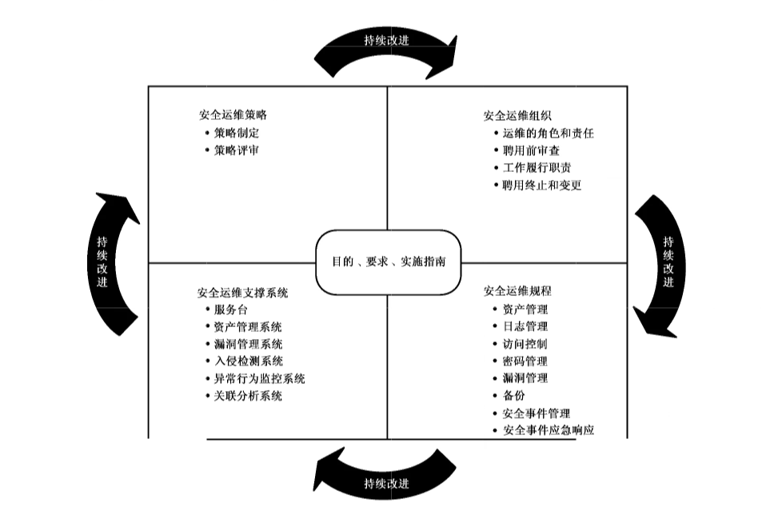

# GB/T 36626-2018 信息安全技术 信息系统安全运维管理指南

> 来源：[GB/T 36626-2018 国家标准详情](https://openstd.samr.gov.cn/bzgk/std/newGbInfo?hcno=667040D152BF91FA78ADA36C2CC71450)；发布日期：2018-09-17；实施日期：2019-04-01。
> 官方在线预览截图 SHA-256：dbc5f26eefc785ab75d87da680531c3ddf1b599b682b0f04a60ddc36d3adee85。
> 转写说明：基于官方在线预览的 17 页截图进行图像识别，逐页核对并校正文字、条目编号和章节层级；保留原图，省略封面、目录及页眉页脚。正式引用请核对官方原文。

## 前言

本标准按照 GB/T 1.1—2009 给出的规则起草。

请注意本文件的某些内容可能涉及专利。本文件的发布机构不承担识别这些专利的责任。

本标准由全国信息安全标准化技术委员会（SAC/TC 260）提出并归口。

本标准起草单位：浙江远望信息股份有限公司、中电长城网际系统应用有限公司、中国电子技术标准化研究院、国家信息中心、北京立思辰新技术有限公司、西安未来国际信息股份有限公司、广州赛宝认证中心服务有限公司。

本标准主要起草人：傅如毅、蒋行杰、上官晓丽、马洪军、闵京华、王惠莅、刘蓓、傅刚、白峰、邵森龙、金江焕、姚龙飞、刘京玲、赵伟、赵拓、陈盈、刘海迪。

## 1 范围

本标准提供了信息系统安全运维管理体系的指导和建议，给出了安全运维策略、安全运维组织的管理、安全运维规程和安全运维支撑系统等方面相关活动的目的、要求和实施指南。

本标准可用于指导各组织信息系统安全运维管理体系的建立和运行。

## 2 规范性引用文件

下列文件对于本文件的应用是必不可少的。凡是注日期的引用文件，仅注日期的版本适用于本文件。凡是不注日期的引用文件，其最新版本（包括所有的修改单）适用于本文件。

- GB/T 22081—2016 信息技术 安全技术 信息安全控制实践指南

- GB/T 29246—2017 信息技术 安全技术 信息安全管理体系 概述和词汇

- GB/T 31722—2015 信息技术 安全技术 信息安全风险管理

## 3 术语和定义

GB/T 29246—2017 界定的以及下列术语和定义适用于本文件。

### 3.1 威胁 threat

对资产或组织可能导致负面结果的一个事件的潜在源。

［GB/T 25069—2010，定义2.3.94］

### 3.2 信息系统安全运维 secure operation and maintenance of information systems

在信息系统经过授权投入运行之后，确保信息系统免受各种安全威胁所采取的一系列预先定义的活动。

### 3.3 安全策略 security policy

用于治理组织及其系统内在安全上如何管理、保护和分发资产（包括敏感信息）的一组规则、指导和实践，特别是那些对系统安全及相关元素具有影响的资产。

［GB/T 25069—2010，定义2.3.2］

### 3.4 规程 procedure

对执行一个给定任务所采取动作历程的书面描述。

［GB/T 25069—2010，定义2.1.7］

### 3.5 信息系统安全运维支撑系统 support system for secure operation and maintenance of information systems

用于支撑信息系统安全运维的辅助性系统工具。包括但不限于资产自动发现系统、配置管理系统、脆弱性扫描系统、补丁管理系统、入侵检测系统、异常行为监测系统、日志管理系统及大数据安全系统等。

## 4 缩略语

下列缩略语适用于本文件。

- ITIL：信息技术基础架构库（Information Technology Infrastructure Library）
- SIEM：安全信息和事件管理（Security Information and Event Management）
- IPS：入侵防御系统（Intrusion Prevention System）
- IDS：入侵检测系统（Intrusion Detection Systems）
- WAF：Web 应用防护系统（Web Application Firewall）

## 5 信息系统安全运维体系

### 5.1 安全运维模型

信息系统安全运维体系是一个以业务安全为目的的信息系统安全运行保障体系。通过该体系，能够及时发现并处置信息资产及其运行环境存在的脆弱性、入侵行为和异常行为。

信息系统安全运维模型如图1所示。

### 5.2 安全运维活动分类

安全运维体系涉及安全运维策略确定、安全运维组织管理、安全运维规程制定和安全运维支撑系统建设等四类活动。

安全运维策略明确了安全运维的目的和方法，主要包括策略制定和策略评审两个活动。

安全运维组织明确了安全运维团队的管理，包括运维的角色和责任、聘用前审查、工作履行职责、聘用终止和变更。

安全运维规程明确了安全运维的实施活动，包括资产管理、日志管理、访问控制、密码管理、漏洞管理、备份、安全事件管理、安全事件应急响应等。

安全运维支撑系统给出了主要的安全运维辅助性系统的工具。

### 5.3 安全运维活动要素

安全运维活动要素包含了目的、要求和实施指南三个方面。

目的部分描述了安全运维活动的意义。

要求部分描述了安全运维活动的指标要求。

实施指南描述了达成安全运维活动目标、实现安全运维要求的方法和手段。

### 5.4 安全运维管理原则

为了保证安全运维体系的可靠性和有效性，安全运维体系建设应遵循以下内容：

a）基于策划、实施、检查和改进的过程进行持续完善。可以根据信息系统的安全保护等级要求，对控制实施情况进行定期评估；

b）安全运维体系建设应兼顾成本与安全。根据业务安全需要，制定相应的安全运维策略、建立相应的安全运维组织、制定相应的安全运维规程及建设相应的安全运维支撑系统。

## 6 安全运维策略

### 6.1 安全运维策略制定

#### 6.1.1 目的

依据业务要求和相关法律法规，为信息系统安全运维提供原则与指导。

#### 6.1.2 要求

信息系统安全运维策略制定完成后，宜由管理者批准，并发布、传达给安全运维团队和其他相关人员。

#### 6.1.3 实施指南

在组织层面定义“信息系统安全运维策略”，用以明确信息系统安全运维的目标和方法。该策略由管理层批准，并指定机构管理其信息系统安全运维的目标和方法。

信息系统安全运维策略主要关注来自业务安全战略、安全运维目标、法律法规和合同、当前和预期的信息系统安全威胁环境等方面产生的要求。

信息系统安全运维策略主要涉及以下内容：

- a）信息系统安全运维目标和原则的定义：

  - 1）确定利益相关者的安全需求；

  - 2）确定组织的安全目标；

  - 3）进一步确定信息系统的安全目标；

  - 4）确定信息系统安全运维目标。

- b）根据已确定的信息系统安全运维目标，制定相应的安全运维策略，包括分层防护、最小特权、分区隔离、保护隐私和日志记录等。

- c）把信息系统安全运维管理方面的一般和特定责任分配给已定义的角色。

- d）处理偏差和意外的过程。

信息系统安全运维策略由以下相关的运维策略组成，包括但不限于：

a）资产管理；

b）信息系统安全分级；

c）访问控制；

d）物理和环境安全；

e）备份；

f）信息传输；

g）恶意软件防范；

h）脆弱性管理；

i）入侵管理；

j）异常行为管理；

k）密码控制；

l）通信安全。

这些策略采用适合的、可访问和可理解的形式传达给安全运维团队、组织内人员和外部相关方。

### 6.2 安全运维策略评审

#### 6.2.1 目的

确保安全运维策略的适宜性、充分性和有效性。

#### 6.2.2 要求

基于一定的时间间隔或当信息系统、信息系统环境或业务安全需求发生重大改变时，宜对信息系统安全运维策略进行评审。

#### 6.2.3 实施指南

指定专人负责策略的制定、评审和评价。

评估安全策略和信息系统安全运维方法的持续改进，以适应法律法规或技术环境、组织环境及业务状况发生的变化。

策略的修订由管理层批准。

## 7 安全运维组织的管理

### 7.1 安全运维的角色和责任

#### 7.1.1 目的

明确运维团队中的角色和责任。

#### 7.1.2 要求

定义和分配信息系统安全运维的所有角色及其责任。

#### 7.1.3 实施指南

信息系统安全运维组织应与信息系统安全运维策略相一致，应明确定义信息系统运行安全风险管理活动的责任，特别是可接受的残余风险的责任，还应定义信息系统保护和执行特定安全过程的责任。

明确运维人员负责的范围，包括下列工作：

a）识别和定义信息系统面临的风险；

b）明确信息系统安全责任主体，并形成相应责任文件；

c）明确运维人员应具备的安全运维的能力，使其能够履行信息系统安全运维责任；

d）参照 ITIL 提出的运维团队组织模式，建立三线安全运维组织体系。一线负责安全事件处理，快速恢复系统正常运行；二线负责安全问题查找，彻底解决存在的安全问题；三线负责修复设备存在的深层漏洞。

### 7.2 聘用前审查

#### 7.2.1 目的

确保聘用人员具有符合其角色的要求和技能。

#### 7.2.2 要求

按照岗位职责要求，宜对被任用者进行审查。

#### 7.2.3 实施指南

审查考虑以下内容：

a）有效的可接受的推荐材料（例如，组织出具和个人出具的文字材料等）；

b）申请人履历的验证（针对该履历的完备性和准确性）；

c）声称的学历、专业资质的证实；

d）其他的验证（例如，信用核查或犯罪记录核查等）。

### 7.3 工作履行职责

#### 7.3.1 目的

确保信息系统安全运维人员理解并履行信息系统安全运维职责。

#### 7.3.2 要求

安全运维人员宜按照已建立的策略、规程和工具进行安全运维工作。

#### 7.3.3 实施指南

建立岗位手册作为安全运维指南。岗位手册内容包括：

a）岗位职责；

b）工作模板；

c）工作流程；

d）支撑工具。

进行信息安全意识教育和培训。信息安全意识教育和培训包括：

a）信息安全意识培训旨在使安全运维人员了解信息系统安全风险及安全运维责任；

b）信息安全意识教育和技能培训方案按照组织的信息安全策略和相关规程建立。岗位技能培训旨在使安全运维人员和团队具备相应的岗位技能。

有正式的违规处理过程对违规的安全运维人员进行处罚。内容包括：

a）在没有最终确定违规之前，不能开始违规处理过程；

b）正式的违规处理过程宜确保对运维工程师给予了正确和公平的对待。无论违规是第一次或是已发生过，无论违规者是否经过适当地培训。

### 7.4 聘用终止和变更

#### 7.4.1 目的

在聘用变更或终止过程中保护组织的利益。

#### 7.4.2 要求

确定聘用终止或变更后不会引发信息系统安全事件。

#### 7.4.3 实施指南

聘用终止或变更意味着相应人员岗位职责和法律责任的终止。为了保护双方的权益，聘用终止或变更后应及时终止或变更相关人员的相应职责、权限和内容。

终止或变更的职责、权限和内容包括但不限于以下事项：

a）员工合同；

b）信息系统访问权限；

c）安全运维支撑系统访问权限。

## 8 安全运维规程

### 8.1 资产管理

#### 8.1.1 目的

识别与信息系统相关的所有资产，构建以资产为核心的安全运维机制。

#### 8.1.2 要求

及时识别资产及资产之间的关系。

#### 8.1.3 实施指南

将信息系统相关软硬件资产进行登记，形成资产清单文件并持续维护。资产清单要准确，实时更新并与其他清单一致。

为每项已识别的资产指定所属关系并分级。

明确资产（包括软硬件、数据等）之间的关系，包括部署关系、支撑关系、依赖关系。

确保实现及时分配资产所属关系的过程。资产在创立或转移到组织时分配其所有权并指定责任者。资产责任者对资产的整个生命周期负有适当的管理责任。

基于资产对业务的重要性，按 GB/T 31722—2015 中附录 B 的方法计算资产的价值。

基于已发现的安全漏洞或已发生的安全事件，总结并形成每一个设备或系统的安全检查清单。安全检查清单需要动态维护。

建立介质安全处置的正式规程，减小保密信息泄露给未授权人员的风险。包含保密信息介质的安全处置规程要与信息的敏感性相一致。考虑下列条款：

a）包含有保密信息的介质被安全地存储和处置，例如利用焚化或粉碎的方法，或者将数据擦除，供组织内其他应用使用；

b）有规程识别可能需要安全处置的项目；

c）将所有介质部件收集起来并进行安全处置，可能比试图分离出敏感部件更容易；

d）许多组织提供介质收集和处置服务，注意选择具有足够控制和经验的合适的外部方；

e）对处置的敏感项作记录，以便维护审核踪迹。

当大量处置介质时，考虑可导致大量不敏感信息成为敏感信息的集聚效应。

可能需要对包含敏感数据的已损坏设备进行风险评估以确定其部件是否可进行物理销毁，而不是被送修或废弃。

### 8.2 日志管理

#### 8.2.1 目的

发现攻击线索，或用作责任追究或司法证据。

#### 8.2.2 要求

全面收集并管理信息系统及相关设备的运行日志，包括系统日志、操作日志、错误日志等。

#### 8.2.3 实施指南

全面收集信息系统的运行日志，并进行归一化预处理，以便后续存储和处理。

原始日志信息和归一化处理后的日志信息分别进行存储。原始日志信息存储应进行防篡改签名，以便可以作为司法证据。已归一化的日志进行结构化存储，以便检索和深度处理。

对日志信息进行多种分析：

a）攻击线索查找分析：在系统受到攻击后，需要通过日志分析找到攻击源和攻击路径，以便清除木马和病毒，并恢复系统正常运行；

b）日志交叉深度分析：通过定期的交叉分析，以发现并阻断潜在攻击；

c）对攻击日志进行历史分析，发现攻击趋势，以实现早期防御。

### 8.3 访问控制

#### 8.3.1 目的

按照业务要求限制对信息和信息系统的访问。

#### 8.3.2 要求

基于业务和信息系统安全要求，应建立物理环境、设备、信息系统的访问控制策略，形成文件并进行评审。

#### 8.3.3 实施指南

信息系统安全责任者需要为特定用户角色确定适当的访问控制规则、访问权及限制，其详细程度和控制的严格程度反映相关的信息安全风险。

访问控制包括逻辑访问控制和物理访问控制。访问控制考虑下列内容：

a）业务应用的安全要求；

b）信息传播和授权的策略，例如：“需要知道”的原则和信息安全级别以及信息分级的需要；

c）系统和网络的访问权限和信息分级策略之间的一致性；

d）关于限制访问数据或服务的相关法律和合同业务；

e）在了解各种可用的连接类型的分布式和网络化环境中，访问权的管理；

f）访问控制角色的分离，例如访问请求、访问授权、访问管理；

g）访问请求的正式授权要求。

制定一个有关网络和网络服务使用的策略。该策略包括：

a）允许被访问的网络和网络服务；

b）确定允许哪些人访问哪些网络和网络服务的授权规程；

c）保护访问网络连接和网络服务的管理控制和规程；

d）访问网络和网络服务使用的手段；

e）访问各种网络服务的用户鉴别要求；

f）监视网络服务的使用。

实现正式的用户注册及注销过程，以便分配访问权。

管理用户 ID 过程包括：

a）使用唯一用户 ID，使得用户与其行为链接起来，并对其行为负责，在对于业务或操作而言，必要时，才允许使用共享 ID，并经过批准和形成文件；

b）立即禁用已离开组织的用户 ID，并在禁用一段时间后视情况进行删除；

c）定期识别并删除或禁用冗余的用户 ID；

d）确保冗余的用户 ID 不会分发给其他用户。

用于对用户 ID 访问权进行分配或撤销的配置过程包括：

a）针对信息系统或服务的使用，从系统或服务的责任者那里获得授权；

b）验证所授予的访问程度是否与访问策略相适宜，是否与职责分离等要求相一致；

c）确保授权过程完成之前，访问权未被激活；

d）维护一份集中式的访问权记录，记载所授予的用户 ID 要访问的信息系统和服务。

对访问的限制基于各个业务应用要求，并符合已制定的组织访问控制策略。

### 8.4 密码管理

#### 8.4.1 目的

使用适当的和有效的密码技术，以保护信息的保密性、真实性和完整性。

#### 8.4.2 要求

基于信息资产的重要性，应选用不同复杂度密码。

#### 8.4.3 实施指南

涉及密码算法的相关内容，按国家有关法规实施。涉及采用密码技术解决保密性、完整性、真实性、不可否认性需求的遵循密码相关国家标准和行业标准。

密码控制的使用策略按 GB/T 22081—2016 中 10.1.1 的要求。

### 8.5 漏洞管理

#### 8.5.1 目的

防止信息系统及其支撑软硬件系统的脆弱性被利用。

#### 8.5.2 要求

全面了解信息系统及其支撑软硬件系统存在的脆弱性，获取相关信息，评价组织对这些脆弱性的暴露状况并应采取适当的措施来应对相关风险。

#### 8.5.3 实施指南

可通过两种方式获取信息系统及其支撑软硬件系统存在的脆弱性或漏洞：

a）借助漏洞扫描工具对信息系统及其软硬件系统存在的漏洞进行扫描，以发现存在的脆弱性；

b）通过官方渠道及时了解信息系统及其支撑软硬件系统存在的脆弱性。

及时更新信息系统和相应的支撑软硬件设备，以保持系统处于安全状态。

先对更新进行测试，以避免更新出现问题导致业务中断。测试成功后，再正式部署系统更新包。

### 8.6 备份

#### 8.6.1 目的

防止信息丢失。

#### 8.6.2 要求

基于信息安全策略，制定备份策略，并保证备份的有效性和可靠性。

#### 8.6.3 实施指南

可根据业务数据的重要程度设定相应的备份策略。可选择的备份方式有完全备份、差异备份或增量备份；可选择的备份地点有同城备份或异地备份等。

对已备份的数据每月进行一次恢复演练，以保证备份的可用性和灾难恢复系统的可靠性。

### 8.7 安全事件管理及响应

#### 8.7.1 目的

确保快速、有效和有序地响应信息系统安全事件。

#### 8.7.2 要求

采用一致和有效的方法对信息系统安全事件进行管理，包括对安全事态和弱点的通告，并能对安全事件进行快速响应。

#### 8.7.3 实施指南

信息系统安全事件管理责任和规程考虑下列因素：

- a）建立管理责任以确保以下规程被制定并在组织内得到充分的交流：

  - 1）规划和准备事件响应的规程；

  - 2）监视、发现、分析、处理和报告信息安全事态和事件的规程；

  - 3）记录事件管理活动的规程；

  - 4）处理司法证据的规程；

  - 5）评估和决断信息系统安全事态以及评估安全弱点的规程；

  - 6）包括升级、事件的受控恢复、与内外部人员或组织沟通在内的响应的规程。

- b）所建立的规程确保：

  - 1）胜任的人员处理组织内的信息系统安全事件相关问题；

  - 2）建立安全事件发现和报告的联络点。

- c）报告规程包含：

  - 1）准备信息系统安全事态报告表格，以便在信息系统安全事态发生时支持报告行动和帮助人员在报告时记住所有必要的行动；

  - 2）在信息安全事态发生时所采取的规程，例如立刻注意到所有细节（诸如不合规或违规的类型、发生的故障、屏幕上的消息），并立刻向联络点报告和仅采取协调行动；

  - 3）根据已建立的正式纪律处罚制度处理安全违规的员工；

  - 4）适宜的反馈过程，以确保信息系统安全事态报告人员在问题被处理并关闭后得到结果的通知。

运维团队有责任尽可能快地报告信息系统安全事态。熟知报告信息安全事态的规程和联络点。可进行信息系统安全事态报告的情况如下：

a）无效的安全控制；

b）违背信息完整性、保密性或可用性的预期；

c）人为差错；

d）不符合策略或指南；

e）物理安全安排的违规；

f）不受控的系统变更；

g）软件或硬件的故障；

h）非法访问。

服务台使用已商定文件化的信息系统安全事态和事件分级尺度评估每个信息系统安全事态，并决定该事态是否该归于信息系统安全事件。事件的分级和优先级有助于标识事件的影响和程度。

详细记录评估和决策的结果，供日后参考和验证。

对信息系统安全事件的严重程度予以不同的响应，甚至启动应急响应。响应包括：

a）事件发生后尽快收集证据；

b）按要求进行信息安全取证分析；

c）按要求升级；

d）确保所有涉及的响应活动被适当记录，便于日后分析；

e）处理发现的导致或促使事件发生的信息系统安全弱点；

f）一旦事件被成功处理，正式将其关闭并记录。

制定内部规程，并在收集与处理用于纪律和法律目的的证据时遵守。这些规程考虑：

a）证据的安全；

b）人员的安全；

c）所涉及人员的角色和责任；

d）人员的能力；

e）文件化，并有数字签名；

f）简报。

## 9 安全运维支撑系统

### 9.1 信息系统安全服务台

#### 9.1.1 目的

对信息系统安全事件进行统一监控与处理。

#### 9.1.2 要求

建立一个集中的信息系统运行状态收集、处理、显示及报警的系统，并统一收集与处理信息系统用户问题反馈。

#### 9.1.3 实施指南

服务台具备以下功能：

a）能够收集并处理信息系统运行信息；

b）能够显示信息系统安全状态和安全事件；

c）能够对信息系统安全事件进行报警。

### 9.2 资产管理系统

#### 9.2.1 目的

发现、管理所有与信息系统运行相关的软硬件系统，建立资产清单和资产配置清单。

#### 9.2.2 要求

手工或借助自动化工具发现所有与信息系统运行相关的软硬件系统。

#### 9.2.3 实施指南

可以利用商业或开源系统自动发现资产。该系统具备以下功能：

a）资产特征库应持续更新；

b）应具有较高的自动发现率；

c）支持手工录入未能自动发现的软硬件系统；

d）能够输出资产清单及资产配置清单；

e）能够对资产及其配置信息进行查询、增加、修改和删除；

f）能够与其他信息化工具进行信息共享。

### 9.3 漏洞管理系统

#### 9.3.1 目的

及时修补信息系统存在的漏洞。

#### 9.3.2 要求

定时扫描信息系统相关资产脆弱性，并对发现的漏洞进行及时加固。

#### 9.3.3 实施指南

系统具备以下功能：

a）能够及时更新漏洞库；

b）能够发现系统存在的 1 day 漏洞；

c）能够发现不合规定的弱口令；

d）能够对发现的问题进行告警提醒；

e）能够对发现的漏洞进行补丁加固；

f）能够对脆弱性进行查询、增加、修改和删除等操作；

g）能够与其他系统共享信息。

### 9.4 入侵检测系统

#### 9.4.1 目的

及时发现并阻断入侵攻击，降低业务损失。

#### 9.4.2 要求

可以检测和阻断多种入侵方式。

#### 9.4.3 实施指南

系统具备以下功能：

a）通过防火墙、SIEM、IPS、IDS、WAF 等系统构建一个全方位入侵检测体系；

b）应能够与网络入侵检测系统的特征库互换信息；

c）能否有效检测并处置网络入侵、主机入侵、无线入侵等；

d）能够对发生的入侵事件进行查询；

e）能够与其他系统进行信息共享。

### 9.5 异常行为监测系统

#### 9.5.1 目的

及时发现存在的异常行为，以降低业务损失。

#### 9.5.2 要求

应及时发现存在的异常操作及行为。

#### 9.5.3 实施指南

系统具备以下功能：

a）能够及时更新异常行为特征库；

b）能够监测异常行为，并报警提醒；

c）能够对异常行为进行必要的阻断；

d）能够对已发生的异常行为进行查询；

e）能够与其他系统进行信息共享。

### 9.6 关联分析系统

#### 9.6.1 目的

对安全信息与安全事件进行关联分析，以此发现单一安全设备发现不了的安全问题。

#### 9.6.2 要求

应能够收集、管理和分析汇聚的安全相关数据。

#### 9.6.3 实施指南

关联分析系统具备以下功能：

a）能够对日志关联关系进行建模；

b）能够收集各种日志、事件等信息，形成汇聚的安全相关数据；

c）能够基于关联关系模型对安全大数据进行有效分析，以发现潜在威胁与攻击；

d）能够定时生成信息系统安全等级保护等相关标准符合性报告；

e）能够与其他系统共享信息。

## 参考文献

- ［1］ GB/T 20269—2006 信息安全技术 信息系统安全管理要求
- ［2］ GB/T 24405.1—2009 信息技术 服务管理 第1部分：规范（ISO/IEC 20000-1:2005，IDT）
- ［3］ GB/T 24405.2—2010 信息技术 服务管理 第2部分：实践规则（ISO/IEC 20000-2:2005，IDT）
- ［4］ GB/T 25069—2010 信息安全技术 术语
- ［5］ GB/T 28827.1—2012 信息技术服务 运行维护 第1部分：通用要求
- ［6］ GB/T 28827.2—2012 信息技术服务 运行维护 第2部分：交付规范
- ［7］ GB/T 28827.3—2012 信息技术服务 运行维护 第3部分：应急响应规范
