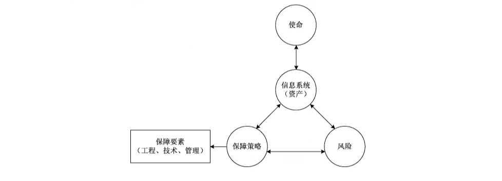
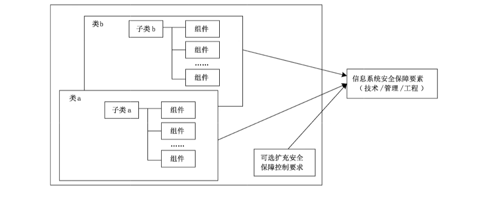
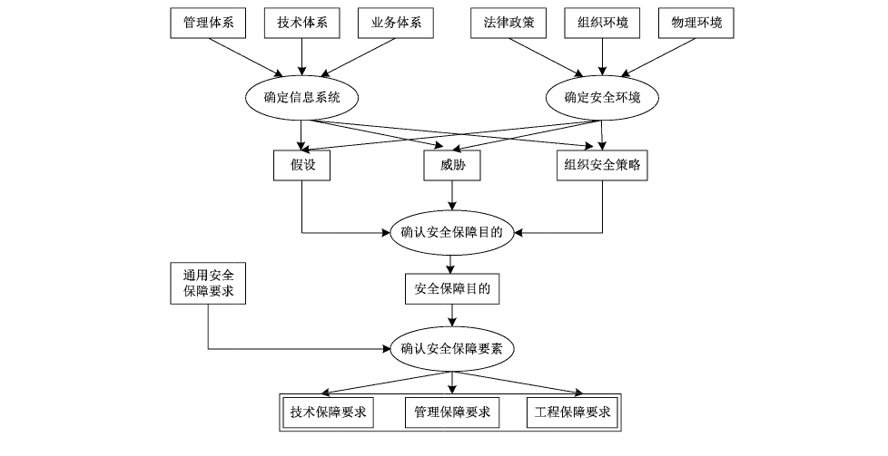
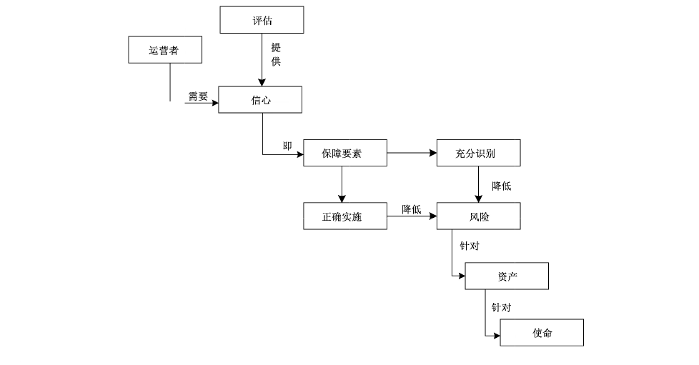
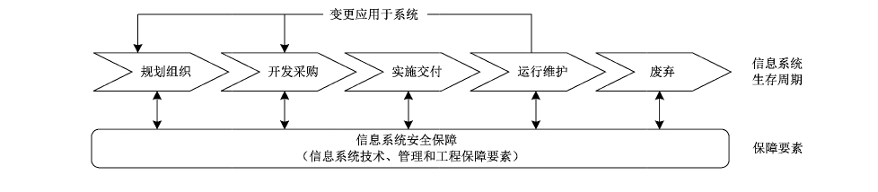
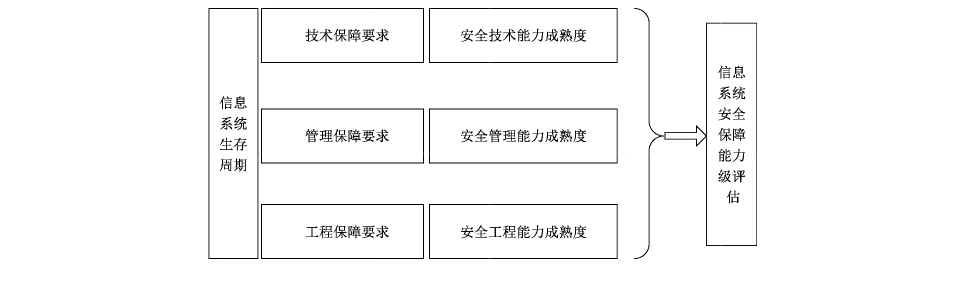

# GB/T 20274.1-2023 信息安全技术 信息系统安全保障评估框架 第1部分：简介和一般模型

> 来源：[GB/T 20274.1-2023 国家标准详情](https://openstd.samr.gov.cn/bzgk/std/newGbInfo?hcno=F1641F48FDCF9653116BFC23E2E20393)；发布日期：2023-03-17；实施日期：2023-10-01。
> 官方在线预览截图 SHA-256：a4744300d98249d466b81815571b139dd8ed623367bdd4ca66ad5b733a549d37。
> 转写说明：依据官方在线预览的全部 14 张页图逐页校核文字，保留七张原页图示。省略封面、目录、页眉、页脚与页码，合并跨页段落。正式引用请核对官方原文。

## 前言

本文件按照 GB/T 1.1—2020《标准化工作导则 第1部分：标准化文件的结构和起草规则》的规定起草。

本文件是 GB/T 20274《信息安全技术 信息系统安全保障评估框架》的第 1 部分。GB/T 20274 已经发布了以下部分：

- 第 1 部分：简介和一般模型；
- 第 2 部分：技术保障；
- 第 3 部分：管理保障；
- 第 4 部分：工程保障。

本文件代替 GB/T 20274.1—2006《信息安全技术 信息系统安全保障评估框架 第1部分：简介和一般模型》，与GB/T 20274.1—2006相比，除结构调整和编辑性改动外，主要技术变化如下：

a） 删除了不适用界限（见2006年版的第1章）；

b） 更改了“信息系统”和“信息系统安全保障”的定义，删除了其他术语，增加了“组织安全策略”术语和定义，删除了缩略语（见第3章，2006年版的3.1 和 3.2）；

c） 更改了目标读者的描述（见第 4 章，2006 年版的 4.2）；

d） 删除了“评估上下文”和“信息系统安全保障评估框架的文档结构”（见 2006 年版的 4.3 和 4.4）；

e） 将“一般模型”更改为“信息系统安全保障模型和等级”，增加了保障能力等级概念（见第 5 章，2006 年版的 5.1 和 5.2）；

f） 将“信息系统安全保障描述材料”更改为“信息系统安全保障要素”，删除了 ISPP 和 ISST 的内容（见第 6 章，2006 年版的 5.5）；

g） 删除了“信息安全整体和应用”和“安全保障要求的使用”（见2006 年版的5.3.4 和 5.5.3）；

h） 更改了“信息系统安全保障评估概念和关系”的图表及文字描述（见7.1,2006年版的5.3.2）；

i） 将“在信息系统生命周期中的安全保障”更改为“信息系统安全保障评估内容”（见7.2,2006年版的 5.2.2.2）；

j） 更改了“信息系统安全保障评估内容”的文字描述和图表内容（见7.2,2006年版的 5.3.3）；

k） 将“信息系统安全保障评估和评估结果”更改为“信息系统安全保障评估判定”，删除了有关 ISPP 和 ISST 相关的内容，增加了评估准则和保障等级判定要求（见 7.3，2006 年版的第 6 章）。

请注意本文件的某些内容可能涉及专利。本文件的发布机构不承担识别专利的责任。

本文件由全国信息安全标准化技术委员会（SAC/TC 260）提出并归口。

本文件起草单位：中国信息安全测评中心、国家信息技术安全研究中心、国家计算机网络与信息安全管理中心、公安部第一研究所、国家工业信息安全发展研究中心、国家信息中心、吉林信息安全测评中心、四川省信息安全测评中心、广东省信息安全测评中心、陕西省网络与信息安全测评中心、中国南方电网有限责任公司、南方电网数字电网集团有限公司、昆仑数智科技有限公司、泰康保险集团股份有限公司、中国医学科学院北京协和医院、华润数科控股有限公司、四川大学、北京百度网讯科技有限公司、浪潮云信息技术股份公司、浙江木链物联网科技有限公司、杭州安恒信息技术股份有限公司、沈阳东软系统集成工程有限公司、启明星辰信息技术集团股份有限公司、北京神州绿盟科技有限公司、鼎铉商用密码测评技术（深圳）有限公司、中国电子科技网络信息安全有限公司、山西轩辕信息安全技术有限公司。

本文件主要起草人：任望、邸丽清、江常青、李斌、徐秋伊、梁智溢、张普含、杜宇鸽、宋璟、谢丰、彭勇、孟晓阳、郭昊、刘占丰、昌彦伟、庞智、梁伟、宫月、王丹琛、张晓娜、陈禹、高强、李秋香、史大为、陈永刚、赵增振、于盟、张格、潘承亚、杨天识、陶蓉、吕华辉、明哲、滕征岑、刘磊、陈靓、万娟、卿粼波、王美玲、郭宾、王文佳、赵呈东、朱卫国、张敏、王海棠、唐晓莉、鲍捷、李滨丞、赵少飞、谭锐能、李智林、叶建伟。

本文件及其所代替文件的历次版本发布情况为：

- 2006 年首次发布为 GB/T 20274.1—2006；
- 本次为第一次修订。

## 引言

GB/T 20274《信息安全技术 信息系统安全保障评估框架》以 GB/T 18336《信息技术 安全技术 信息技术安全评估准则》为基础，从产品扩展到信息技术系统，并进一步同其他国内外信息系统安全领域的标准和规范进行结合，扩展和补充，以形成描述和评估信息系统安全保障内容和能力的通用框架。GB/T 20274 是指导信息系统安全保障评估的基础性和框架性标准，为从事信息系统安全保障工作的所有相关方（包括设计开发者、工程实施者、评估者、认证认可者等）提供一种标准化、规范化的通用描述语言、结构和方法。GB/T 20274 旨在给出信息系统安全保障的基本概念和模型，确立在技术、管理和工程方面的安全保障要求和能力等级要求，由四个部分构成。

- 第 1 部分：简介和一般模型。目的在于给出信息系统安全保障的基本概念和模型，提出信息系统安全保障评估的框架。
- 第 2 部分：技术保障。目的在于确立信息系统在技术方面的安全保障基本要求及相应的能力等级要求。
- 第 3 部分：管理保障。目的在于确立信息系统在管理方面的安全保障基本要求及相应的能力等级要求。
- 第 4 部分：工程保障。目的在于确立信息系统在工程方面的安全保障基本要求及相应的能力等级要求。

## 1 范围

本文件给出了信息系统安全保障的基本概念和模型，提出了信息系统安全保障评估框架。

本文件适用于指导系统建设者、运营者、服务提供者和评估者等开展信息系统安全保障工作。

## 2 规范性引用文件

下列文件中的内容通过文中的规范性引用而构成本文件必不可少的条款。其中，注日期的引用文件，仅该日期对应的版本适用于本文件；不注日期的引用文件，其最新版本（包括所有的修改单）适用于本文件。

- GB/T 18336.1—2015 信息技术 安全技术 信息技术安全评估准则 第 1 部分：简介和一般模型

- GB/T 25069—2022 信息安全技术 术语

## 3 术语和定义

GB/T 25069—2022 和 GB/T 18336.1—2015 中界定的以及下列术语和定义适用于本文件。

### 3.1 信息系统 information system

应用、服务、信息技术资产或其他信息处理组件的组合。

注1：信息系统通常由计算机或者其他信息终端及相关设备组成，并按照一定的应用目标和规则进行信息处理或过程控制。

注2：典型的信息系统如办公自动化系统、云计算平台/系统、物联网、工业控制系统以及采用移动互联网技术的系统等。

［来源：GB/T 29246—2017,2.39，有修改］

### 3.2 信息系统安全保障 information system security assurance

对信息系统的安全属性及功能、效率进行保障的一系列适当行为或过程。

### 3.3 组织安全策略 organizational security policies

组织为确保其运行而制定的若干安全规则、规程、实践和指南。

［来源：GB/T 25069—2022,3.817］

## 4 概述

与信息系统安全保障评估工作相关的相关方，一般包括信息系统建设者、信息系统运营者、服务提供者和评估者等。

信息系统建设者包括规划、设计和工程实施人员。建设者参考通用描述语言、方法和结构，从信息系统安全保障的技术、管理和工程领域来表达其信息系统安全保障要求。使用本文件能帮助建设者更好地描述其信息系统安全需求，编制符合其运行环境要求的信息系统安全保障方案和规范等。建设者可根据信息系统安全保障的评估，了解其信息系统安全保障的现状，并根据评估结果，进一步完善和持续改进其信息系统的安全保障能力。

信息系统运营者参考通用描述语言、方法和结构，从信息系统安全保障的技术和管理领域来表达其信息系统安全保障要求。运营者能使用本文件同信息系统的建设者等相关人员进行更加有效的沟通和相互理解。运营者可根据信息系统安全保障的评估，了解其信息系统安全保障的现状，还可根据评估结果，进一步完善和持续改进其信息系统的安全保障能力，获得其信息系统安全保障的信心。

服务提供者参考通用描述语言、方法和结构，从信息系统安全保障的技术、管理和工程领域来表达相关的信息系统安全保障要求，并与系统运营者和建设者进行有效的沟通和项目实施。

评估者参考本文件来定义信息系统安全保障评估的内容，并依据定义的评估内容开展信息系统安全保障评估工作。

## 5 信息系统安全保障模型和等级

### 5.1 保障概念

信息系统运行于特定的现实环境中，它从属某个组织，受到来自组织内部及外部环境的约束，因此，信息系统的安全保障除了要在充分分析信息系统本身的技术、业务、管理等特性的基础上提出相应的要求外，还要考虑这些约束条件产生的要求。

信息系统安全保障是针对信息系统在运行环境中所面临的各种风险，制定信息系统安全保障策略，设计并实现信息系统安全保障架构或模型，采取工程、技术、管理等安全保障要素，将风险减少至预定可接受的程度，从而保障其使命要求。保障策略是组织在对风险、资产和使命综合理解的基础上所作出的指导性文件。保障策略的制定，反映了组织对信息系统安全保障及其目标的理解，它的制定和贯彻执行对组织信息系统安全保障起着纲领性的指导作用。具体关系如图 1 所示。

### 5.2 保障模型

信息系统安全保障模型包含安全保障要素、生存周期和能力成熟度三个维度。安全保障要素是将保障策略具化到技术、管理和工程等不同层面形成的保障要求。生存周期维度是强调安全保障要素的识别要贯穿信息系统从规划组织、开发采购、实施交付、运行维护和废弃等生存周期阶段。信息系统安全保障能力等级是在确保安全保障要素充分性的基础上，通过能力成熟度来评价信息系统安全保障能力。信息系统安全保障模型如图 2 所示。

本模型主要特点为：

a） 强调信息系统安全保障要素的概念，信息系统的安全保障是通过综合技术、管理、工程的安全保障要素来实施和实现信息系统的安全保障策略，通过对信息系统的技术、管理、工程要求的评估，提供了对信息系统安全保障的信心；

b）强调信息系统安全保障的持续发展的动态安全模型，即强调信息系统安全保障需要贯穿于整个信息系统生存周期的全过程；

c） 通过能力成熟度等级来评价基于生存周期的过程安全保障要素的保障能力，从而达到保障组织执行其使命的根本目的。

### 5.3 保障能力等级

信息系统安全保障能力等级包含两个维度的要素，第一个维度是依据风险评估选择的信息系统安全保障要素（包含技术保障要求、管理保障要求和工程保障要求），这些安全保障要素的识别贯彻整个生存周期过程，能将风险降低到可接受的程度（即保障对策的充分性）。第二个维度是安全保障要素被正确实现的能力成熟度（即保障对策的正确性），如安全保障要素被实现的有序性、主动性、规范性、可量化性、可持续性等方面的度量。两个维度相结合进行评估，能充分定义信息系统安全保障的信心程度，即信息系统安全保障能力等级。

信息系统安全保障能力等级划分为五个等级，从低到高依次为：

a） 基本执行级：特征为随机、被动地实现基本实践，依赖个人经验，无法复制；

b） 计划跟踪级：特征为主动地实现了基本实践的计划与执行，但没有形成体系化；

c） 充分定义级：特征为基本实践的规范定义与执行；

d） 量化控制级：特征为建立了量化目标，基本实践的实现能进行度量与预测；

e） 持续优化级：特征为能根据组织的整体目标，不断改进和优化实现基本实践。

## 6 信息系统安全保障要素

### 6.1 信息系统安全保障要素的结构

安全保障要素根据安全技术、安全管理和安全工程领域的不同，分为安全技术保障要求、安全管理保障要求和安全工程保障要求。安全保障要素使用“类—子类—组件”层次化的结构。用户应根据风险评估的结果选择特定的安全保障要求。安全保障要素的不同结构之间的关系如图 3 所示。

安全保障类是最通用的一组安全保障要求的组合，类的所有成员关注同一个安全问题，区别在于覆盖不同的安全保障目的。根据安全保障要求所属领域的不同，分为安全技术保障类、安全管理保障类和安全工程保障类。类的成员被称为子类。

安全保障子类是若干组安全保障要求的组合，这些要求针对同一个安全保障目的，但在强度和程度上有所区别。安全技术保障类、安全管理保障类和安全工程保障类的子类分别为安全技术保障子类、安全管理保障子类和安全工程保障子类。子类的成员被称为安全保障组件，每个安全保障子类由一个或多个实现此安全保障目的的安全保障组件组成。

安全保障组件是描述一个明确的安全保障要求的集合，并且它是本文件定义的结构中所包含可选的最小安全保障要求集合。安全保障组件是实现其安全保障子类的安全保障目的的信息安全保障具体控制措施。根据安全保障要求所属领域的不同，分为安全技术保障组件、安全管理保障组件和安全工程保障组件。安全保障组件由可选的安全保障元素组成。

安全保障组件是实现安全保障目的的信息安全保障具体控制措施，安全保障组件间的依赖和安全保障组件允许的操作说明如下。

- a） 安全保障组件间的依赖。

  安全保障组件间可能存在依赖关系。当一个安全保障组件无法充分表达安全保障要求并且依赖于另一个安全保障组件的存在时，依赖关系就产生了。依赖关系可能存在于安全技术保障、安全管理保障和安全工程保障各自内部的组件之间，也可能存在于安全技术保障、安全管理保障和安全工程保障的组件之间。

- b） 安全保障组件允许的操作。

  安全保障组件依据本文件中定义的那样使用，或者通过使用安全保障组件允许的操作对安全保障组件进行裁剪，以满足特定的安全策略或对抗特定的威胁。安全保障组件说明并定义了组件是否允许“赋值”和“选择”操作、在哪些情况下能对组件使用这些操作以及使用这些操作的后果。任何安全保障组件都允许“反复”和“细化”操作。这四个操作如下所述：

  - 1） 反复：在不同操作时，组件多次使用；

  - 2） 赋值：当组件被应用时，规定所填入的参数；

  - 3） 选择：从组件表中选定若干项；

  - 4）细化：当组件被应用时，对组件增加细节。

### 6.2 信息系统安全保障要素的生成

#### 6.2.1 安全保障要素生成过程

图 4 给出了确认信息系统安全保障要素的一种方法例证，通过它能引申出安全保障要素。提供的例证并不限制生成信息系统安全保障要素具体的分析过程、开发方法、评估体制等。

#### 6.2.2 确定信息系统

为明确信息系统的特定范畴，信息系统运营者或建设者应从管理体系、技术体系和业务体系等方面进行分析和描述信息系统，进而识别相关的假设、威胁和组织安全策略等。

在管理体系中，应对信息系统现有的管理组织结构、所使用的相应规章制度和所涉及的重要资产进行描述。

a） 组织描述：描述组织内同信息系统相关的管理/使用/开发/集成/支持等，特别是相关安全保障管理的组织。

b）管理制度、法规描述：列出同信息系统管理相关的目前使用的相应规章制度和相关法规。

c） 系统资产描述：描述信息系统的物理资产（指信息系统中的各种硬件和物理设施等）、软件资产（应用软件和系统软件等）和信息资产（指在信息系统计划组织、开发采购、实施交付、运行维护和废弃这一信息系统生存周期过程中产生的同信息系统本身相关的有价值的信息以及信息系统所存储、处理和传输的各种相关的办公、管理和业务等信息）。

在技术体系中，应对现有的各种应用、相应的网络基础设施和所使用的技术标准进行描述。

业务体系从业务角度和应用角度出发，基于技术体系，对组织的主要业务应用应进行分类和描述，并通过业务流程和业务信息流（描述主要业务应用的接口和相应数据流，数据流描述应包括数据的类型以及数据传送的一般方式）来进一步解释。

#### 6.2.3 确定安全环境

安全环境包括所有的明确相关的法律政策、组织的策略、物理环境，它定义了信息系统的运行环境。

为建立安全环境，信息系统运营者应分析这些因素。

关于假设、安全威胁、组织安全策略的描述应注意以下内容：

a） 对假设的陈述：如果环境满足该假定，信息系统被认为是安全的；

b） 安全威胁的陈述：指明信息系统相关的安全分析中发现的所有威胁。

> 注1：本文件使用威胁动机、假定的攻击方法、作为攻击基础的任何弱点和被攻击的资产名称等词汇描述一个威胁。
>
> 对安全风险的评估是通过给出每一种威胁实际发生的可能性、该威胁成功实施的可能性以及可能造成的被破坏后果来实现的。

c） 组织安全策略的陈述：阐明相关的策略和规则。

> 注2：对特定的信息系统，可能明确提及这样的策略，然而对一般的信息系统，可能需要假设出组织的安全策略。

#### 6.2.4 确定安全保障目的

环境安全性分析结果被用来阐明安全目的，对抗其所面临的威胁，并说明被认定的组织化的安全策略和假设。安全保障目的应和已说明的信息系统运行的法律法规要求、组织环境要求和物理环境一致。

确定安全保障目的的意图是为了阐明所有的安全考虑并指出哪些安全方面的问题是直接由信息系统来处理，哪些由其环境来处理。这种归类基于工程判断、安全政策、经济因素和可接受的风险决策相结合的过程。

#### 6.2.5 确定安全保障要素

信息系统安全保障要素是将安全保障目的细化为一系列信息系统及其环境的安全保障要求，一旦这些要求得到满足，就能保证信息系统达到它的安全保障目的。

应分别从安全技术领域的技术保障要求、安全管理领域的管理保障要求以及安全工程领域的工程保障要求来提出安全保障要素。

## 7 信息系统安全保障评估框架

### 7.1 信息系统安全保障评估概念和关系

信息系统安全保障评估，就是在信息系统所处的运行环境中对信息系统安全保障的具体工作和活动进行客观的评估，通过信息系统安全保障评估所搜集的客观证据，向信息系统的所有相关方提供信息系统的安全保障工作能够实现其安全保障策略，能够将其所面临的风险降低到其可接受的程度的主观信心。信息系统安全保障评估的评估对象是信息系统，信息系统不仅包含了仅讨论技术的信息技术系统，还包括同信息系统所处的运行环境相关的人和管理等领域。信息系统安全保障是一个动态持续的过程，涉及信息系统整个生存周期，因此信息系统安全保障的评估也应提供一种动态持续的信心。

安全保障要素的充分识别及正确实施也是降低风险的一个重要前提。信息系统安全保障评估的概念和关系如图5所示。

### 7.2 信息系统安全保障评估内容

在信息系统安全保障模型中，信息系统的生存周期层面和安全保障要素层面不是相互孤立的，而是相互关联、密不可分的。它们之间的关系如图6所示。

在信息系统生存周期模型中，将信息系统的整个生存周期抽象成规划组织、开发采购、实施交付、运行维护和废弃五个阶段，并包含在运行维护阶段的变更产生的反馈，形成信息系统生存周期完整的闭环结构。在信息系统的生存周期中的任何时间点，都应综合信息系统安全保障的技术、管理和工程等安全保障要素对信息系统进行安全保障。

a） 规划组织阶段：由于组织的使命要求和业务要求产生了信息系统安全保障建设和使用的需求。

在此阶段，信息系统的风险及策略应加入至信息系统建设和使用的决策中，从信息系统建设的开始应综合考虑系统的安全保障要素，使信息系统的建设和信息系统安全保障的建设同步规划、同步建设和同步使用。

b） 开发采购阶段：此阶段是规划组织阶段的细化、深入和具体体现，在此阶段中，进行系统需求分析、考虑系统运行的需求、进行系统体系的设计以及相关的预算申请和项目准备等管理活动。

在此阶段，应基于系统需求和风险、策略将信息系统安全保障作为一个整体进行系统体系的设计和建设，以全局视野建立信息系统安全保障整体规划。组织根据具体要求，对系统整体的技术、管理安全保障或设计进行评估，以保证对信息系统的整体规划满足组织的建设要求和相关国家规定、行业准则和组织的其他要求。

c） 实施交付阶段：在此阶段，组织可通过对承建方进行安全服务资格要求和信息安全专业人员资格要求以确保施工组织的服务能力；组织还可通过信息系统安全保障的工程保障对实施施工过程进行监理和评估，最终确保所交付系统的安全性。

d） 运行维护阶段：信息系统进入运行维护阶段后，对信息系统的管理、运行维护和使用人员的能力等方面进行综合保障，是信息系统得以安全正常运行的根本保证。信息系统投入运行后并不是一成不变的，随着业务和需求的变更、外界环境的变更将产生新的要求或增强原有的要求，重新进入信息系统的初始化规划阶段。

e） 废弃阶段：当信息系统的保障不能满足现有要求时，信息系统进入废弃阶段。

信息系统安全保障的评估，是从信息系统安全保障的概念出发，在信息系统的生存周期内，根据组织的要求，在信息系统的安全技术、安全管理和安全工程领域内对信息系统的安全技术控制措施和技术架构能力、安全管理控制措施和管理能力、安全工程实施控制措施和工程实施能力进行综合评估，从而最终得出在其运行环境中信息系统安全保障措施满足其安全保障要求的符合性以及信息系统安全保障能力的评估。信息系统安全保障能力的评估是信息系统所提供的各项安全技术保障、安全管理保障、安全工程保障的实施、正确性、质量和能力进行保障（或信心）的强度和程度的特征，是对信息系统安全保障持续改进的能力特征的描述。信息系统安全保障能力等级是信息系统在其运行环境中，实施信息系统安全保障要素的具体实施情况和实施能力的反映。信息系统安全保障评估主要包括两方面的评估：信息系统在其运行环境中具体的安全保障要求相对于安全保障目的符合性和一致性的评估以及信息系统安全保障措施被正确和高质量实施的评估。信息系统安全保障评估的内容如图7所示。

### 7.3 信息系统安全保障评估判定

信息系统安全保障能力等级通过信息系统安全保障评估进行判定。在评估信息系统时，评估者应说明：

a） 信息系统所具备的安全保障要素是否具备充分性，能将面临的风险控制在可接受的范围内；

b） 信息系统所具备的安全保障要素是否被正确地设计和实现，并判定相应的等级。

评估者宜针对信息系统的工程保障、技术保障和管理保障三个层面独立进行评估，并给出相应评估结论。针对信息系统整体的评估，应综合工程、技术和管理三个层面的评估结果，三个层面中的最低保障能力等级作为整体信息系统的评估结果。

## 参考文献

- [1] GB/T 18336.2—2015 信息技术 安全技术 信息技术安全评估准则 第 2 部分：安全功能组件
- [2] GB/T 18336.3—2015 信息技术 安全技术 信息技术安全评估准则 第 3 部分：安全保障组件
- [3] GB/T 20261—2020 信息安全技术 系统安全工程 能力成熟度模型
- [4] GB/T 29246—2017 信息技术 安全技术 信息安全管理体系 概述和词汇
- [5] GB/Z 29830.1—2013 信息技术 安全技术 信息技术安全保障框架 第 1 部分：综述和框架
- [6] GB/Z 29830.2—2013 信息技术 安全技术 信息技术安全保障框架 第 2 部分：保障方法
- [7] GB/Z 29830.3—2013 信息技术 安全技术 信息技术安全保障框架 第 3 部分：保障方法分析
- [8] IATF Release 3.1 Information Assurance Technical Framework, National Security Agency Information Assurance Solutions Technical Directors, September, 2002
- [9] NIST SP800-53 Rev.5 Security and privacy controls for information systems and organizations
- [10] SSAM V2.0 System Security Engineering Capability Maturity Model SSE-CMM Appraisal Method, Version 2.0, April 16, 1999
- [11] SSE-CMM V2.0 System Security Engineering Capability Maturity Model SSE-CMM Model Description Document, Version 2.0, April 1, 1999
