# GB/T 20274.2-2008 信息安全技术 信息系统安全保障评估框架 第2部分：技术保障

> 来源：[GB/T 20274.2-2008 国家标准详情](https://openstd.samr.gov.cn/bzgk/std/newGbInfo?hcno=741A2E27E5612FD920E5D22C7019424F)。
> PDF SHA-256：9d7f851a5183e0d94604b1e7c956546641eb18a68782c5c8ed71a57d7eff288e。
> 转写说明：将官方 PDF 全部页面渲染为图像并用图像识别核对文字、标题、列表、图示和表格；省略页眉页脚及页码，合并跨页内容。复杂依赖关系表保留去除页眉页脚及页码后的官方页面图像。正式引用请核对原页面图像。

中华人民共和国国家标准信息安全技术信息系统安全保障评估框架第2部分：技术保障GB/T 20274.2—2008中国标准出版社出版发行北京复兴门外三里河北街16号邮政编码：100045网址 www.spc.net.cn电话：68523946 68517548中国标准出版社秦皇岛印刷厂印刷各地新华书店经销开本 880X1230 1/16 印张 6.25 字数 184 千字2008年11月第一版 2008年11月第一次印刷书号：155066•1-34998如有印装差错 由本社发行中心调换版权专有 ：侵权必究举报电话：（010）68533533

## 前言

GB/T 20274《信息安全技术 信息系统安全保障评估框架》分为以下四个部分：

- 第1部分：简介和一般模型
- 第2部分：技术保障
- 第3部分：管理保障
- 第4部分：工程保障

本部分是GB/T 20274的第2部分。

本部分的附录A和附录B为资料性附录。

本部分由全国信息安全标准化技术委员会提出并归口。

本部分起草单位：中国信息安全产品测评认证中心。

本部分主要起草人：吴世忠、王海生、陈晓桦、王贵驷、李守鹏、江常青、彭勇、张利、姚轶崭、邹琪、钱伟明、陆丽、班晓芳、李静、王庆、江典盛、孙成昊、门雪松、杜宇鸽、杨再山。

## 1 范围

GB/T 20274的本部分建立了信息系统安全技术保障的框架，确立了组织机构内启动、实施、维护、评估和改进信息安全技术体系的指南和通用原则。GB/T 20274 的本部分定义和说明了信息系统安全技术体系建设和评估中反映组织机构信息安全的技术体系架构能力级，以及组织机构信息系统安全的技术要求。

GB/T 20274 的本部分适用于启动、实施、维护、评估和改进信息安全技术体系的组织机构和涉及信息系统安全技术工作的所有用户、开发人员和评估人员。

## 2 规范性引用文件

下列文件中的条款通过GB/T 20274 的本部分的引用而成为本部分的条款。凡是注日期的引用文件，其随后所有的修改单（不包括勘误的内容）或修订版均不适用于本部分，然而，鼓励根据本部分达成协议的各方研究是否可使用这些文件的最新版本。凡是不注日期的引用文件，其最新版本适用于本部分。

- GB/T 20274.1 信息安全技术 信息系统安全保障评估框架 第1部分：简介和一般模型

## 3 术语和定义

GB/T 20274.1确定的术语和定义适用于 GB/T 20274的本部分。

## 4 本部分的结构

GB/T 20274的本部分的组织结构如下：

a） 第1章介绍了 GB/T 20274 的本部分的范围；

b）第2章介绍了GB/T 20274的本部分所规范引用的标准；

c） 第3章描述了适用于 GB/T 20274 的本部分的术语和定义；

d） 第4章描述了 GB/T 20274的本部分的组织结构；

e） 第5章描述了信息系统安全技术保障框架，并进一步概述了信息系统安全技术保障控制类域和安全技术体系架构能力级；

f） 第6章描述了信息安全技术保障控制类的规范描述结构和要求；

g） 第7章到第17章详述了提供信息安全技术保障控制类的11个信息安全技术保障控制类的详细要求；

h） 第18章描述了安全技术体系架构能力成熟度模型；

i） 附录A是资料性附录，进一步解释了安全技术要求；

j） 附录B是资料性附录，描述了分层多点的信息系统安全技术体系架构；

k）参考文献给出了 GB/T 20274的本部分的参考文献。

## 5 信息安全技术保障

### 5.1 安全技术保障概述

信息系统安全保障评估框架-安全技术保障主要用于评估信息系统中系统级的安全技术体系框架和安全技术解决方案，即对信息技术系统（信息技术系统：作为信息系统一部分的执行组织机构信息功能的用于采集、创建、通信、计算、分发、处理、存储和/或控制数据或信息的计算机硬件、软件和/或固件的任何组合）进行安全评估。在信息系统安全保障评估框架的技术、管理和工程保障中，安全技术保障同GB/T 18336《信息技术安全性评估准则》间有着最直接和紧密的关系；信息系统安全保障评估准的安全技术体系框架和安全技术解决方案直接建立在经过GB/T 18336 准则评估认可的产品和产品系统之上。

在信息系统安全保障评估框架安全技术保障中，它的评估对象（TOE）是构成信息系统的所有计算机硬件、软件和/或固件的任何组合。信息系统安全保障评估框架安全技术保障，首先要求信息系统的用户为其评估对象（即信息技术系统）建立和完善其安全技术体系架构；在完成其信息技术系统安全技术体系架构后，基于此安全技术体系架构，对信息技术系统进行高层分析、确定相关安全目的；最后用规范化的安全技术保障控制组件类进行描述。

### 5.2 安全技术体系架构能力级

安全技术体系架构构建过程，是组织机构根据其系统安全风险评估的结果和系统安全策略的要求，并参考相关安全技术体系架构的标准和最佳实践，结合组织机构信息技术系统的具体现状和需求，建立的符合组织机构信息技术系统安全战略发展规划的整体安全技术体系框架；它是组织机构信息技术系统安全战略管理的具体体现。安全技术体系架构能力是组织机构执行系统安全技术能力的整体反映，是组织机构在进行信息安全技术体系框架管理并达到预定成本，功能和质量目标的度量的体现。

### 5.3 安全技术保障控制要求范例

本条描述本部分中安全技术保障控制要求所使用的范例。图1和图2描述了范例的一些关键概念。本条为这些图和图中没有的其他关键概念提供文字描述。所讨论的关键概念以粗斜体突出表示。

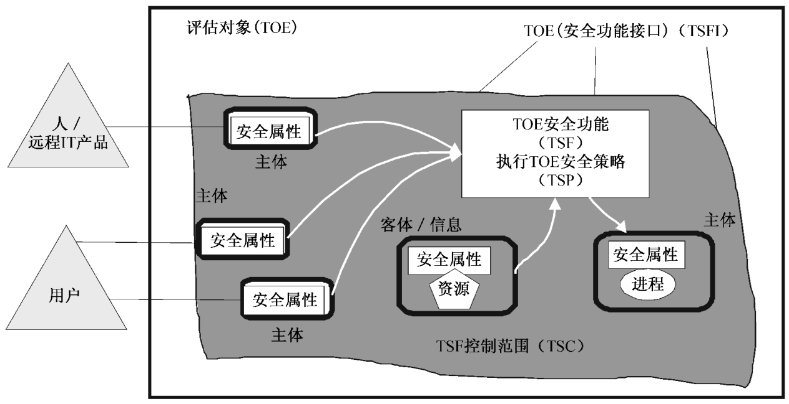

本部分是一个可为评估对象（TOE）规定安全功能要求的目录。TOE 是包含电子存储媒体（如磁盘）、外设（如打印机）和计算能力（如CPU 时间）等资源的IT 产品或系统（同时带有用户和管理员指南文档），可用于处理和存储信息，是被评估的对象。

TOE 评估主要关系到：确保对TOE 资源执行了规定的TOE 安全策略（TSP）。TSP定义了一些规则，通过这些规则 TOE 支配对其资源的访问，这样TOE就控制了其所有信息和服务。

而 TSP 又由多个安全功能策略（SFP）所构成。每一SFP有其控制范围，定义了该 SFP 控制下的主体、客体和操作。SFP由安全功能（SF）实现，SF 的机制执行该策略并提供必要的能力。

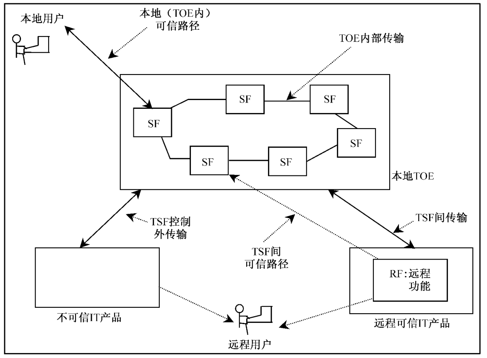

为正确执行 TSP 而必须依赖的TOE 中的那些部分，统称为TOE 安全功能（TSF）。TSF 包括实施安全所直接或间接依赖的 TOE 中的所有软件、硬件和固件。

参照监视器是实施 TOE 的访问控制策略的抽象机。参照确认机制 是参照监视器概念的实现，它具有以下特性：防篡改、一直运行、简单到能对其进行彻底的分析和测试。TSF 可能包括一个参照确认机制或 TOE 运行所需要的其他安全功能。

TOE 可能是一个包含硬件、固件和软件的单个产品，也可能是一个分布式产品，内部包括多个单独的部分，每一部分都为TOE提供一个特别的服务，并且通过一个内部通信信道与TOE 其他部分相连接。该信道可以与处理器总线一样小，也可能是包含在 TOE 中的一个内部网络。

当TOE 由多个部分组成时，TOE的每一部分可拥有自己的TSF 部分，此部分通过内部通信信道与TSF 的其他部分交换用户数据和 TSF数据。这种交互称为TOE 内部传输。在这种情况下，这些TSF 的分离部分抽象地形成一个复合的TSF 来实施TSP。

TOE接口可能限于特定的TOE使用，也可能允许通过外部通信信道与其他IT产品交互。这些与其他IT产品的外部交互可以采取两种形式：

a）“远程可信IT产品”的安全策略和本地 TOE 的TSP已在管理上进行了协调和评估。这种情况下的信息交换称为TSF 间传输，如同它们是在不同可信产品的TSF 之间。

b） 远程IT产品可能没有被评估，因此它的安全策略是未知的，如图1.2中所示的“不可信IT产品”。这种情况下的信息交换称为TSF 控制外传输，如同在远程IT 产品中没有TSF（或它的策略特性未知）。

可与 TOE或在TOE 中发生的、并服从 TSP规则的交互集合称为TSF 控制范围（TSC）。TSC 包括一组根据主体、客体和TOE 内的操作定义的交互集，但不必包括 TOE的所有资源。

一组交互式（人机接口）或编程（应用编程接口）接口，通过它，TSF 访问、调配 TOE 资源，或者从TSF 中获取信息，称TSF 接口（TSFI）。TSFI定义了为执行TSP而提供的TOE功能的边界。

用户在TOE 的外部，因此也在TSC 的外部。但为请求 TOE 执行服务，用户要通过 TSFI 和 TOE交互。本标准安全功能要求关心两种用户：人类用户和外部IT实体。人类用户进一步分为本地人类用户，他们通过TOE 设备（如工作站）直接与TOE交互，或远程人类用户，他们通过其他IT 产品间接与TOE交互。

用户和 TSF 间的一段交互期称为用户会话。可以根据各种考虑来控制用户会话的建立，如：用户鉴别、时段、访问TOE的方法和每个用户允许的并发会话数。

本标准使用术语“已授权”来表示用户具有执行某种操作所必需的权力或特权。因此术语“授权用户”表示允许用户执行 TSP定义的操作。

为表达需要管理员责任分离的要求，本标准相关的安全功能组件（来自子类 FMT_SMR）明确说明要求管理性角色。角色是预先定义的一组规则，这些规则建立起用户和TOE 间所允许的交互。TOE可以支持定义任意数目的角色。例如，与 TOE 安全运行相关的角色可能包括“审计管理员”和“用户账号管理员”。

TOE 包括可用于处理和存储信息的资源。TSF 的主要目标是完全并正确地对TOE所控制的资源和信息执行 TSP。

TOE 资源能以多种方式结构化和利用。但是，本标准作出了特殊区分，以允许规定所期望的安全特性。所有由资源产生的实体能以两种方式中的一种来表征：实体可能是主动的，意指他们是TOE 内部行为发生的原因，并导致对信息执行操作；实体也可能是被动的，意指它们是发出信息或存入信息的容器。

主动的实体称为主体。TOE 内可能存在以下几种类型的主体：

a） 代表授权用户，遵从 TSP 所有规则的那些实体（例如：UNIX 进程）；

b） 作为特定功能进程，可以轮流代表多个用户的那些实体（例如：在客户/服务器结构中可能找到的功能）；

c） 作为TOE 自身一部分的那些实体（例如：可信进程）。

本部分所述的安全功能针对上述列出的各种主体执行 TSP。

被动实体（即信息存储器）在本部分中被称作“客体”。客体是可以由主体执行操作的对象。在一个主体（主动实体）是某个操作的对象（例如进程间通信）的情况下，该主体也可以作客体。

客体可以包含信息。在FDP类中说明信息流控制策略时，需要这个概念。

用户、主体、信息和客体具有确定的属性，这些属性包括使TOE 正确运转的信息。有些属性，可能只是提示性信息（即，增加 TOE 的用户友好性），如文件名，而另一些属性，可能专为执行TSP 而存在，如访问控制信息，后面这些属性通常称为“安全属性”。在本部分中，属性一词将用作“安全属性”的简称，除非另有说明。但正如TSP 规定的那样，无论属性信息的预期目的如何，对属性加以控制还是必要的。

TOE 中的数据分为用户数据和TSF 数据，图3表明了这种关系。用户数据是存储在TOE 资源中的信息，用户可以根据 TSP 对其进行操作，而TSF 对它们并不附加任何特殊的意义。例如，电子邮件消息的内容是用户数据。TSF数据是在进行TSP决策时TSF使用的信息。如果 TSP 允许的话，TSF数据可以受用户的影响。安全属性、鉴别数据以及访问控制表都是 TSF 数据的例子。

有几个用于数据保护的 SFP，诸如访问控制 SFP 和信息流控制 SFP。实现访问控制SFP的机制，是基于控制范围内的主体属性、客体属性和操作来决定建立它们的策略，这些属性用于控制主体可以对客体执行的操作的规则集中。

实现信息流控制 SFP的机制，是基于控制范围内的主体和信息的属性以及制约主体对信息操作的一组规则来决定它们的策略。信息的属性，可能与容器属性相关联（也可能没有关联，如多级数据库），在信息移动时与其相随。

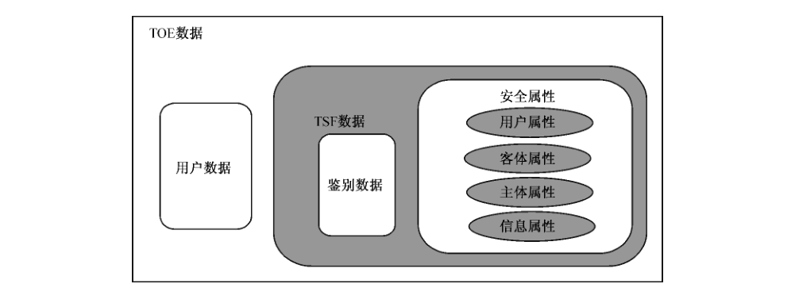

本部分涉及的两种特殊 TSF数据，鉴别数据和秘密，可以是但不必一定是相同的。

鉴别数据用于验证向 TOE 请求服务的用户声明的身份。最通用的鉴别数据形式是口令。口令要成有效的安全机制，依赖于对其进行保密。但是，不是所有形式的鉴别数据都需要保密，生物测定学鉴别设备（例如，指纹阅读器、视网膜扫描仪）就不依赖于数据保密，因为这些数据只有一个用户拥有，其他人不能伪造。

本部分功能要求中用到的术语“秘密”，对鉴别数据适用，对其他为执行一特定 SFP而必须保密的数据也同样适用。例如，依靠密码功能保护在信道中传输信息的保密性的可信信道机制，其强度应与用来保持密钥的秘密以防止未授权泄露的方法的强度相当。

因此，不是所有的鉴别数据都需要保密；也不是所有的秘密都被用作鉴别数据。图4说明了秘密和鉴别数据间的关系，指出了常见的鉴别数据和秘密的数据类型。

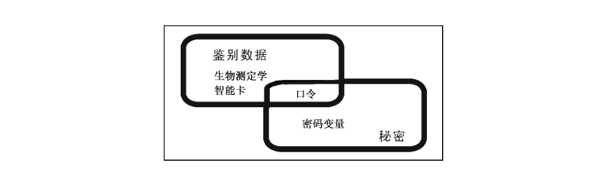

## 6 信息安全技术保障控制结构

### 6.1 综述

本章定义了本部分的技术要求的内容和形式，并为需要向 ISST 中添加新组件的组织提供指南。

技术要求以类、子类和组件来表达。

#### 6.1.1 信息安全技术保障控制类结构

图5以图表的形式阐明了安全技术保障控制类的结构。每个安全技术保障控制类包括一个类名、类介绍及一个或多个安全技术保障控制子类。

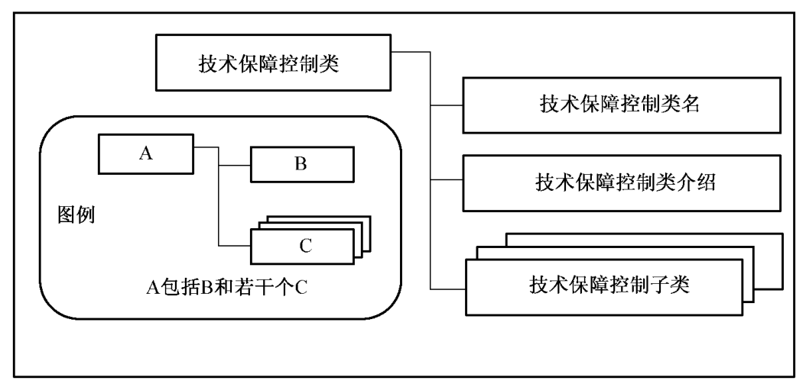

##### 6.1.1.1 类名

类名提供标识和划分安全技术保障控制类所必需的信息。每个安全技术保障控制类都有一个唯一的名称，类的分类信息由三个字符的简名组成。类的简名用于该类中的子类的简名规范中。

##### 6.1.1.2 类介绍

类介绍描述这些子类满足安全目标的通用意图或方法。安全技术保障控制类的定义不反映要求规范中的任何正式分类法。

类介绍用图来描述类中的子类和每个子类中组件的层次结构，见6.1.1 的解释。

#### 6.1.2 信息安全技术保障控制子类结构

图6以框图形式说明安全技术保障控制子类的结构。

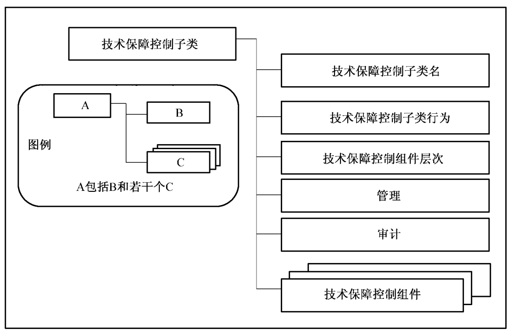

##### 6.1.2.1 子类名

子类名部分提供标识和划分安全技术保障控制子类所必需的分类和描述信息。每个安全技术保障控制子类有一个唯一的名称。子类的分类信息由七个字符的简名组成，开头三个字符与类名相同，后跟一个下划线和子类名，例如 XXX_YYY。唯一的简短子类名为组件提供主要的引用名。

##### 6.1.2.2 子类行为

**子类行为**

是对安全技术保障控制子类的行为的叙述性描述，陈述其安全目的，以及对技术要求的一般描述。以下是更详细的描述：

a） 子类的安全目的阐述在包含该子类的一个组件的TOE 的帮助下，可以解决的安全问题；

b）技术要求的描述总结组件中包含的所有安全要求。该描述针对PP、ST 和技术包的作者，他们希望评价该子类是否与他们的特定需求相关。

##### 6.1.2.3 组件层次

安全技术保障控制子类包含一个或多个组件，任何一个组件都可被选择包含在 PP、ST 和技术包中。本条的目的是，一旦子类被认为是用户安全要求的一个必要或有用的部分时，就应向用户提供选择恰当的安全技术保障控制组件的信息。

安全技术保障控制子类描述部分描述所用组件和它们的基本原理。组件的更多细节包含在每个组件中。

安全技术保障控制子类内组件间的关系可能是也可能不是层次化的。如果一个组件相对另一个组件提供更多的安全，那么该组件对另一个组件来说是有层次的。

如6.1.2条所述，子类的描述中提供了关于子类内组件层次结构的图示。

##### 6.1.2.4 管理

管理要求包含 PP/ST 作者应考虑的作为给定组件的管理活动的信息。管理要求在管理类（FMT）的组件里详述。

PP/ST 作者可以选择已指出的管理要求或者可以包括其他没有列出的管理要求，因而这些信息应认为是提示性的。

##### 6.1.2.5 审计

如果 PP/ST 中包含来自类 FAU（安全审计）中的要求，则审计要求包含供 PP/ST 作者选择的可审计的事件。这些要求包括按 FAU_GEN（安全审计数据产生）子类的组件所支持的以各种不同详细级别表示的安全相关事件。例如，一个审计记录可能包括下述行动：最小级——安全机制的成功使用；基本级——安全机制的成功使用以及所涉及到的安全属性的相关信息；详细级——所有对机制配置的改变，包括改变前后的实际配置值。

显然可审计事件的分类是层次化的。例如，当期望“基本级审计产生”时，所有标识为最小级和基本级的可审计事件都应通过适当的赋值操作包括在 PP/ST 内，只是高级事件仅仅比低级事件提供更多的细节。当期望“详细级审计产生”时，所有标识为最小级、基本级和详细级的可审计事件都应包括在 PP/ ST内。

FAU 类更详尽地解释了管理审计的规则。

#### 6.1.3 信息安全技术保障控制组件结构

图7描绘安全技术保障控制组件的结构。

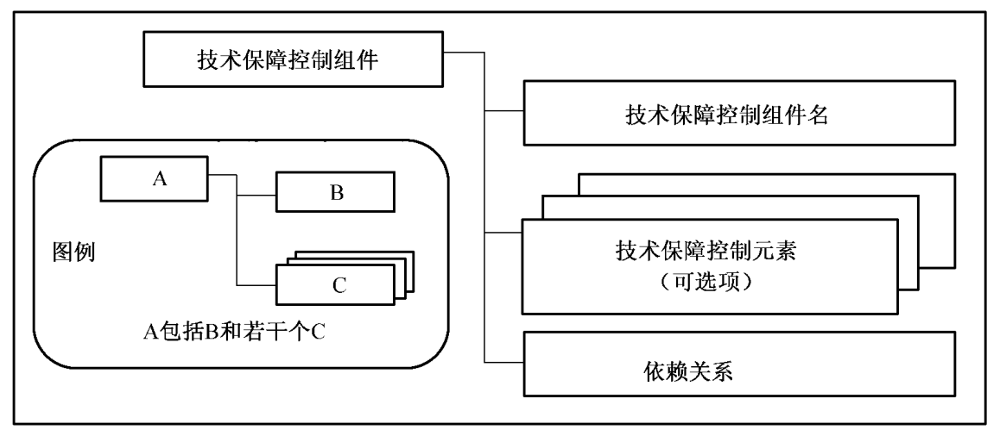

##### 6.1.3.1 组件标识

组件标识提供标识、分类、注册和交叉引用组件时所必需的描述性信息。下列各项作为每个安全技术保障控制组件的部分：

a） 一个唯一的名字，该名字反映了组件的目的。

b）一个简名，即安全技术保障控制组件名的唯一简写形式。简名作为分类、注册和交叉引用组件的主要引用名。简名反映出组件所属的类和子类以及在子类中组件的编号。

c） 一个从属于表。这个组件所从属于的其他组件列表，以及该组件可用来满足与所列组件间的依赖关系。

##### 6.1.3.2 技术元素

为每一组件提供了一组元素。每个元素都分别定义并且是相互独立的。

技术元素是一个安全技术要求，如果进一步划分将不会产生有意义的评估结果。它是 GB 20274.2中标识和认同的最小安全技术要求。

当建立包、PP或ST 时，不允许从一个组件中只选择一个或几个元素，必须选择组件的全部元素。

每个技术元素名都有一个唯一的简化形式。例如，元素名 FDP_IFF.4.2意义如下：F——技术要求，DP -—“用户数据保护”类，IFF——“信息流控制技术”子类，4—第四个组件，名为“部分消除非法信息流”，2-该组件的第2个元素。

##### 6.1.3.3 依赖关系

当一个组件本身不充分而要依赖于其他组件的技术，或依赖于与其他组件的交互才能正确发挥其技术时，就产生了安全技术保障控制组件间的依赖关系。

每个安全技术保障控制组件都提供一个对其他技术和保证组件的完整的依赖关系表。有些组件可能列出“无依赖关系”。所依赖的组件又可能依赖其他组件，组件中提供的列表是直接的依赖关系。这只是为该技术要求能正确完成其技术提供参考。间接依赖关系，也就是由所依赖组件产生的依赖关系，见本标准附录 A。值得注意的是，在某些情况下依赖关系可在提供的多个技术要求中选择，这些技术要求中的每一个都足以满足依赖关系（例如 FDP_UIT.1）。

依赖关系列表标识出，为满足与已标识组件相关的安全要求所必需的最少技术或保证组件。从属于已标识组件的那些组件也可用来满足依赖关系。

本部分指明的依赖关系是规范的，在 PP/ST 中它们必须得到满足。在特定的情况下这种依赖关系可能不适用，只要 PP/ST 作者在基本原理中说清不适用的理由，就可以在包、PP和ST 中不考虑依赖的组件。

#### 6.1.4 允许的安全技术保障控制组件操作

用于在 PP、ST 或技术包内定义要求的安全技术保障控制组件可以与本部分第5章～第17章中说明的完全一样，也可以经裁剪以满足特定的安全目的。但是，选择和裁剪这些安全技术保障控制组件是复杂的，因为必须考虑所标识组件依赖关系。因此这种裁剪只限于一组允许的操作。

每个安全技术保障控制组件都包括一个允许的操作列表。对所有安全技术保障控制组件，并非一切操作都是允许的。

允许的操作选自：

a） 反复：采用不同的操作多次使用同一组件；

b） 赋值：对指定参数的说明；

c） 选择：对列表中的一个或多个元素的说明；

d） 细化：增加细节。

6. 1.4.1 反复当需要覆盖同一要求的不同方面时（如，标识一个以上类型的用户），允许重复使用本标准的同一组件来覆盖每个方面。

##### 6.1.4.2 赋值

某些安全技术保障控制元素包含一些参数和变量，这些参数和变量使 PP/ST作者可以指定PP或ST 中包含的一个策略或一组值，以满足特定的安全目的。这些元素清楚地标识出每个参数及其可以分配给该参数的值。

元素任一方面的可接受值如能无歧义地描述和列举，就可用一个参数来表述。该参数可能是一个属性或规则，它把要求限定为一个确定的值或值的范围。例如，根据指定的安全目的，安全技术保障控制元素可以规定一给定的操作应执行数次。在这种情况下，赋值应提供用于该参数的次数或次数范围。

6. 1.4.3 选择这是为缩小一个组件元素的范围，从列表中选取一个或多个项目的操作。

##### 6.1.4.4 细化

对所有安全技术保障控制元素来说，为满足安全目的，允许 PP/ST 作者通过增加细节来限定可接受的实现集。元素的细化由这些增加的技术细节来组成。

在ST 中，可能需要就 TOE对术语“主体”和“客体”的含义作出有意义的解释，因此需要细化。

像其他操作一样，细化不增加任何完全新的要求。根据安全目的，它对要求、规则、常量和条件施以详细阐述、解释或特别的含义。细化应只是进一步限定实现要求所可能接受的技术或机制集，而不是增加要求。细化不允许建立新要求，因此不会增加与组件相关的依赖关系列表。PP/ST 作者必须注意，其他要求对该要求的依赖关系仍应得到满足。

### 6.2 组件分类

本部分中组件的分类不代表任何正式的分类法。

本部分包括子类和组件的分类，它们是基于相关的技术和目的的粗略分类，按字母顺序给出。每个类的开头是一个提示性框图，指出该类的分类法、类中的子类和子类中的组件。这个图对指示可能存在于组件间的层次关系是有用的。

在安全技术保障控制组件的描述中，有一段指出该组件和任何其他组件之间的依赖关系。

在每个类中，都有一个与图6类似的描述子类层次关系的图。在图8中，第1个子类（子类1）包括了三个有从属关系的组件，其中组件2和组件3都可以用来满足对组件1的依赖关系。组件3从属于组件2，并且可以用来满足对组件2的依赖关系。

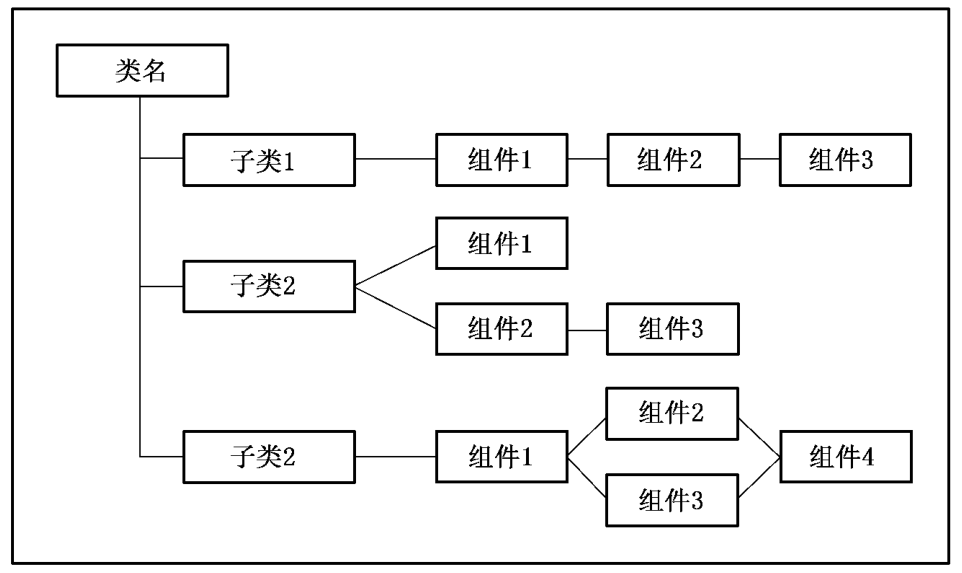

在子类2中有三个组件，这三个组件不全都有从属关系。组件1和组件2不从属于其他组件。组件3从属于组件2，可以用来满足对组件2的依赖关系，但不能满足对组件1的依赖关系。

在子类3中，组件2、3、4从属于组件1。组件2和3也都从属于组件1，但无可比性。组件4从属于组件2和3。

这些图的目的是补充子类中的文字说明，使关系的识别更容易。它们并不取代每个组件中的“

从属于：”注释，这些注释是对每个组件从属关系的强制声明。

#### 6.2.1 突出组件变化

子类中组件的关系约定以粗体字突出表示。粗体字约定所有新的要求用粗体表示。对于有从属关系的组件，当要求或依赖关系被增强或修改而超出前一组件的要求时，要用粗体字表示。另外，超出前一组件的任何新的或增强的允许操作，也使用粗体字突出表示。

## 7 FAU类：安全审计

安全审计包括识别、记录、存储和分析那些与安全相关活动（即由 TSP 控制的活动）有关的信息。

检查审计记录结果可用来判断发生了哪些安全相关活动以及哪个用户要对这些活动负责。

安全审计类分解见图9。

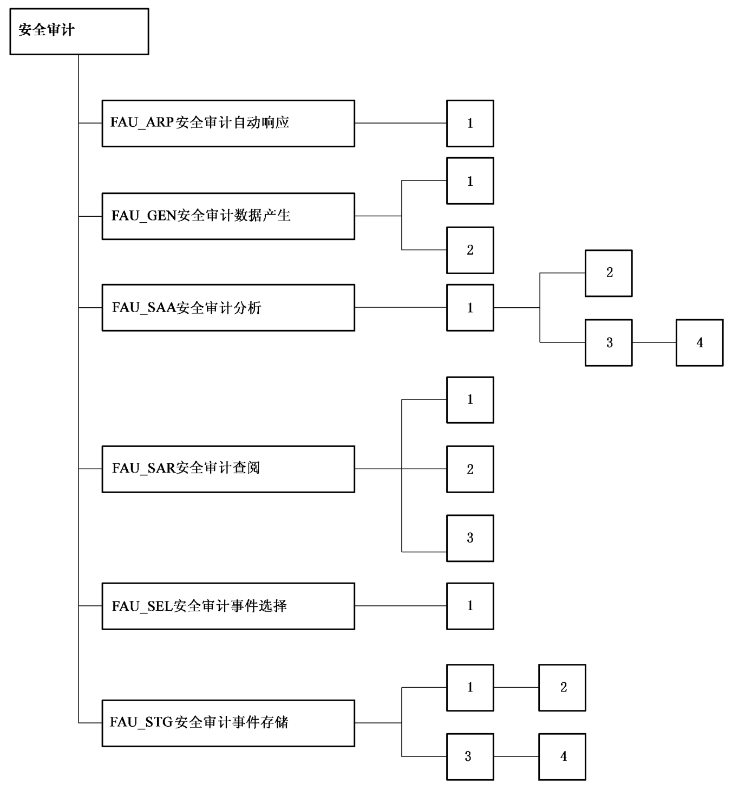

### 7.1 安全审计自动响应（FAU_ARP）

**子类行为**

本子类定义在检测到的事件表明可能有安全侵害发生时作出的应答。

**组件层次**

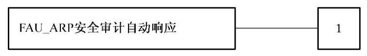

对于 FAU_ARP.1 安全警告，当检测到可能的安全侵害时 TSF 应采取行动。

**管理：FAU_ARP.1**

在管理功能 FMT 中考虑以下行动：

a） 对行动的管理（添加、移去、修改）。

**审计：FAU_ARP.1**

如果在 PP/ST 中包括 FAU_GEN 安全审计数据产生，那么以下行动应可审计：

a） 最小级：当即将发生安全侵害时采取的行动。

FAU_ARP. 1 安全警告

从属于：无其他组件。

依赖关系：FAU_SAA.1 潜在侵害分析

FAU_ARP.1.1 当检测到潜在的安全侵害时，TSF 应进行［赋值：最小扰乱行动表］。

### 7.2 安全审计数据产生（FAU_GEN）

**子类行为**

对于在 TSF 控制下发生的安全相关事件，本子类定义了记录其出现的要求。本子类确定审计的级别，列举 TSF 可审计的事件类型，以及应在各审计记录内提供的审计相关信息的最小集合。

**组件层次**

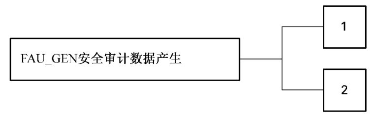

FAU_GEN.1 审计数据产生定义可审计事件的级别，并规定在每个记录中应记录的数据列表。

FAU_GEN.2 用户身份关联，TSF 应把可审计事件与单个用户身份相关联。

**管理：FAU_GEN.1,FAU_GEN.2**

尚无预见的管理活动。

**审计：FAU_GEN.1,FAU_GEN.2**

如果在 PP/ST 中包含 FAU_GEN 安全审计数据产生，此处不存在任何明确的可审计行动。

FAU_GEN. 1 审计数据产生

从属于：无其他组件。

依赖关系：FPT_STM. 1 可信时间戳

FAU_GEN. 1.1 TSF 应能为下述可审计事件产生审计记录：

a） 审计功能的启动和关闭；

b） 在［选择：最小级，基本级，详细级，未规定］审计级别以内的所有可审计事件；

c）［赋值：其他专门定义的可审计事件］。

FAU_GEN.1.2 TSF 应在每个审计记录中至少记录如下信息：

a） 事件的日期和时间，事件类型，主体身份，事件的结果（成功或失败）；

b） 对每种审计事件类型，基于 PP/ST 中功能组件的可审计事件定义的［赋值：其他审计相关信息］。

FAU_GEN.2 用户身份关联

从属于：无其他组件。

依赖关系：FAU_GEN.1 审计数据产生；

FIA_UID.1 标识定时。

FAU_GEN.2.1 TSF 应能将每个可审计事件与引起该事件的用户身份相关联。

### 7.3 安全审计分析（FAU_SAA）

**子类行为**

本子类定义，为寻找可能的或真正的安全侵害，用来分析系统活动和审计数据的自动化措施的要求。这种分析可用入侵检测来支持，或对即将来临的安全侵害作出自动应答。

基于检测结果，可采取 FAU_ARP子类指定的行为。

**组件层次**

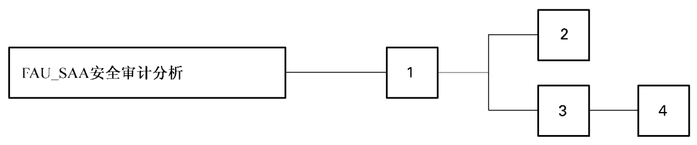

在FAU_SAA.1 潜在侵害分析中，需要一个基于固定规则集的基本门限检测。

在FAU_SAA.2基于轮廓的异常检测中，TSF 维护个人的系统使用轮廓，这里“轮廓”代表由轮廓目标组成员完成的历史使用模式。轮廓目标组是指与 TSF 交互的一个或多个人（如单个用户、共享一个身份或账号的用户、指定角色的用户、整个系统或网络节点的用户）。轮廓目标组的每个成员都被分配给一个单独的置疑等级，表明成员当前的行动与轮廓中已建立的使用模式的一致程度如何。此分析可在运行期间完成，或在信息采集后的批量分析阶段完成。

FAU_SAA.3简单攻击探测，TSF 应能检测到那些表明对 TSP 实施将产生重大威胁的特征事件的发生。对特征事件的搜索可以实时进行，也可以在信息采集后的批量分析阶段进行。

FAU_SAA. 4复杂攻击探测，TSF 应能描述并检测到多步骤入侵情景。TSF 应能根据已知的事件序列把系统事件（可能是由多个用户执行的）模拟成完整的入侵情景。TSF 应能指出特征事件或事件序列发生的时间，指出对TSP 的潜在侵害。

**管理：FAU_SAA.1**

在管理功能 FMT 中考虑以下行动：

a） 通过（添加/修改/删除）规则集中的规则来维护规则。

**管理：FAU_SAA.2**

在管理功能 FMT 中考虑以下行动：

a） 对轮廓目标组中的用户组进行维护（删除/修改/添加）。

**管理：FAU_SAA.3**

在管理功能 FMT中考虑以下行动：

a） 对系统事件的子集进行维护（删除/修改/添加）。

**管理：FAU_SAA.4**

在管理功能 FMT中考虑以下行动：

a） 对系统事件的子集进行维护（删除/修改/添加）；

b） 对系统事件的序列集进行维护（删除/修改/添加）。

**审计：FAU_SAA.1,FAU_SAA.2,FAU_SAA. 3,FAU_SAA. 4**

如果在 PP/ST 中包含了 FAU_GEN 安全审计数据产生，那么下述行动应为可审计：

a） 最小级：开启和关闭任何分析机制；

b） 最小级：以工具完成自动应答。

FAU_SAA. 1 潜在侵害分析

从属于：无其他组件。

依赖关系：FAU_GEN.1 审计数据产生

FAU_SAA. 1.1 TSF 应能用一系列的规则去监控审计事件，并根据这些规则指示出 TSP的潜在侵害。

FAU_SAA.1.2 TSF 应用下列规则来监控审计事件：

a） 已知的用来指示潜在安全侵害的［赋值：已定义的可审计事件的子集］的积累或组合；

b）［赋值：任何其他规则］。

FAU_SAA. 2 基于轮廓的异常检测

从属于：FAU_SAA.1

依赖关系：FIA_UID. 1 标识定时

FAU_SAA.2.1 TSF 应能维护系统使用轮廓。在这里个人轮廓代表［赋值：规定轮廓目标组］成员的历史使用模式。

FAU_SAA.2.2 TSF 应维护与每个用户相对应的置疑等级，这些用户的活动已记录在轮廓中。

在这里，“置疑等级”代表用户当前活动与轮廓中已建立的使用模式不一致的程度。

FAU_SAA.2.3 当用户的置疑等级超过门限条件［赋值：TSF 报告“异常”的条件］时，TSF 应能指出即将发生对TSP 的侵害。

FAU_SAA.3简单攻击探测

从属于：FAU_SAA.1

依赖关系：无依赖关系。

FAU_SAA. 3.1 TSF 应能维护预示对 TSP 侵害的以下特征事件［赋值：系统事件的一个子集］的内部表示。

FAU_SAA.3.2 TSF 应根据系统活动的记录来比较特征事件，这里系统活动可以通过对［赋值：用来决定系统活动的信息］检查而辨明。

FAU_SAA.3.3 当一个系统事件被发现与一个预示对TSP的潜在攻击的特征事件匹配时，TSF应指出对 TSP 的攻击即将到来。

FAU_SAA.4复杂攻击探测

从属于：FAU_SAA.3

依赖关系：无依赖关系。

FAU_SAA. 4.1 TSF 应能维护已知入侵情景的事件序列［赋值：已知攻击出现的系统事件序列表］和预示对 TSP 的潜在攻击的特征事件［赋值：系统事件的一个子集］的内部表示。

FAU_SAA.4.2 TSF 应比较系统活动的记录与特征事件和事件序列，这里的系统活动可以通过对［赋值：用来决定系统活动的信息］检查来辨明。

FAU_SAA. 4.3 当一个系统事件或事件序列被发现与一个预示对TSP 的潜在攻击的特征事件匹配时，TSF 应能指示出对 TSP的攻击即将到来。

### 7.4 安全审计查阅（FAU_SAR）

**子类行为**

本子类定义了为授权用户查阅审计数据提供审计工具的要求。

**组件层次**

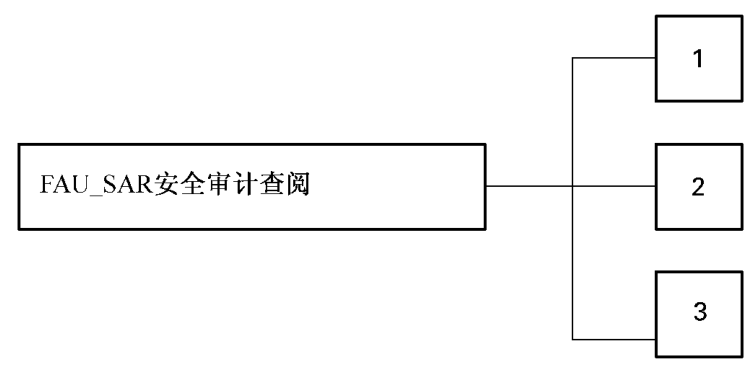

FAU_SAR.1 审计查阅，提供从审计记录中读取信息的能力。

FAU_SAR.2 有限审计查阅，要求除在 FAU_SAR.1 中确定的用户外，其他用户不能读取信息。

FAU_SAR.3可选审计查阅，要求审计查阅工具根据条件来选择要查阅的审计数据。

**管理：FAU_SAR.1**

在管理功能 FMT 中考虑以下行动：

a）维护（删除/修改/添加）对审计记录有读访问权的用户组。

**管理：FAU_SAR. 2,FAU_SAR. 3**

尚无预见的管理活动。

**审计：FAU_SAR.1**

如果在 PP/ST 中包含了 FAU_GEN 安全审计数据产生，那么下述行为应为可审计：

a） 基本级：从审计记录中读取信息。

**审计：FAU_SAR.2**

如果在 PP/ST 中包含了FAU_GEN 安全审计数据产生，那么下述行为应为可审计：

a） 基本级：尝试从审计记录中读取信息而未成功。

**审计：FAU_SAR.3**

如果在 PP/ST 中包含了 FAU_GEN 安全审计数据产生，那么下述行为应为可审计：

a） 详细级：用于查阅的各种参数。

FAU_SAR.1审计查阅本组件应为授权用户提供获得和解释信息的能力。用户是人时必须以人类可理解的方式表示信息；用户是外部IT 实体时必须以电子方式无歧义地表示信息。

从属于：无其他组件。

依赖关系：FAU_GEN.1审计数据产生

FAU_SAR. 1.1 TSF 应为［赋值：授权用户］提供从审计记录中读取［赋值：审计信息列表］的能力。

FAU_SAR. 1.2 TSF 应以便于用户理解的方式提供审计记录。

FAU_SAR.2 有限审计查阅

从属于：无其他组件。

依赖关系：FAU_SAR.1审计查阅FAU_SAR. 2.1 除具有明确读访问权限的用户外，TSF 应禁止所有用户对审计记录的读访问。

FAU_SAR.3 可选审计查阅

从属于：无其他组件。

依赖关系：FAU_SAR.1审计查阅

FAU_SAR.3.1 TSF 应根据［赋值：具有逻辑关系的条件］提供对审计数据进行［选择：搜索、分类、排序］的能力。

### 7.5 安全审计事件选择（FAU_SEL）

**子类行为**

本子类定义，在 TOE运行期间选择事件来审计的要求。它定义向可审计事件集中加入或从中排除事件的要求。

**组件层次**

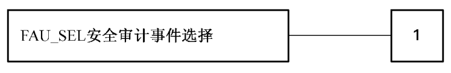

FAU_SEL.1选择性审计，要求根据由 PP/ST 作者规定的属性包括或排除来自审计事件集中事件的可能。

**管理：FAU_SEL.1**

在管理功能 FMT 中考虑以下行动：

a） 维护查阅/修改审计的权限。

**审计：FAU_SEL.1**

如果在 PP/ST 中包含了 FAU_GEN 安全审计数据产生，那么下述行为应是可审计的：

a） 最小级：对审计收集功能正在运行时出现的审计配置的所有修改。

FAU_SEL.1选择性审计

从属于：无其他组件。

依赖关系：FAU_GEN.1 审计数据产生FMT_MTD. 1 TSF 数据管理

FAU_SEL.1.1 TSF 根据以下属性包括或排除审计事件集中的可审计事件：

a）［选择：客体身份，用户身份，主体身份，主机身份，事件类型。］

b）［赋值：作为审计选择性依据的附加属性表。］

### 7.6 安全审计事件存储（FAU_STG）

**子类行为**

本子类定义TSF能够创建并维护安全审计迹的要求。

**组件层次**

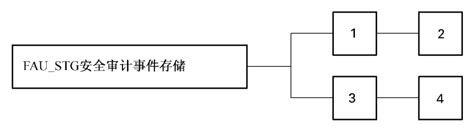

FAU_STG.1受保护的审计迹存储，该要求保护审计迹避免未授权的删除和/或修改。

FAU_STG.2审计数据可用性保证，规定 TSF 在意外情况出现时对审计数据维护的保证。

FAU_STG.3在审计数据可能丢失的情况下的行为，规定当超出审计迹门限时所采取的行动。

FAU_STG.4 防止审计数据丢失，规定当审计迹溢满时的行为。

**管理：FAU_STG.1**

尚无预见的管理活动。

**管理：FAU_STG.2**

在管理功能 FMT 中考虑以下行动：

a） 维护控制审计存储能力的参数。

**管理：FAU_STG.3**

在管理功能 FMT 中考虑以下行动：

a） 维护门限值；

b） 即将发生审计存储失败时，维护（删除/修改/添加）相应的行为。

**管理：FAU_STG.4**

在管理功能 FMT 中考虑以下行动：

a） 审计存储失败时，维护（删除/修改/添加）相应的行为。

**审计：FAU_STG. 1,FAU_STG.2**

如果在 PP/ST 中包含了 FAU_GEN 安全审计数据产生，此处就没有可审计的确定行为。

**审计：FAU_STG.3**

如果在 PP/ST 中包含了FAU_GEN 安全审计数据产生，那么下述行为应是可审计的：

a） 基本级：因超过门限而采取的行动。

**审计：FAU_STG.4**

如果在 PP/ST 中包含了 FAU_GEN 安全审计数据产生，那么下述行为应是可审计的：

a） 基本级：因审计存储失败而采取的行动。

FAU_STG. 1 受保护的审计迹存储

从属于：无其他组件。

依赖关系：FAU_GEN.1 审计数据产生

FAU_STG.1.1 TSF 应保护所存储的审计记录，以避免未授权的删除。

FAU_STG.1.2 TSF 应能［选择：防止，检测］对审计记录的修改。

FAU_STG.2 审计数据可用性保证

从属于：FAU_STG.1

依赖关系：FAU_GEN.1 审计数据产生

FAU_STG. 2.1 TSF 应保护所存储的审计记录，以避免未授权的删除。

FAU_STG.2.2 TSF 应能［选择：防止，检测］对审计记录的修改。

FAU_STG.2.3 当下述情况发生时：［选择：审计存储耗尽、失败、受攻击］，TSF应确保审计记录［赋值：保存审计记录的量度］不被破坏。

FAU_STG.3在审计数据可能丢失情况下的行为

从属于：无其他组件。

依赖关系：FAU_STG.1 受保护的审计迹存储

FAU_STG.3.1 如果审计迹超过［赋值：预定的限制］，TSF 应采取［赋值：在审计数据可能丢失情况下的行为］。

FAU_STG.4 防止审计数据丢失

从属于：FAU_STG.3

依赖关系：FAU_STG.1受保护的审计迹存储

FAU_STG.4.1 如果审计迹已满，TSF 应［选择：‘忽略可审计事件’，‘阻止产生除有特权的授权用户外的所有可审计事件’，‘覆盖所存储的最早的审计记录’］并进行［赋值：一旦审计存储失败所采取的其他行动］。

## 8 FCO类：通信

本类提供两个子类，专门用以确保在数据交换中参与方的身份。这些子类与确保信息传输的发起者的身份（原发证明）和确保信息传输的接收者的身份（接收证明）相关。这些子类既确保发起者不能否认发送过信息，又确保收信者不能否认收到过信息。

本类的组件构成分解如图10所示。

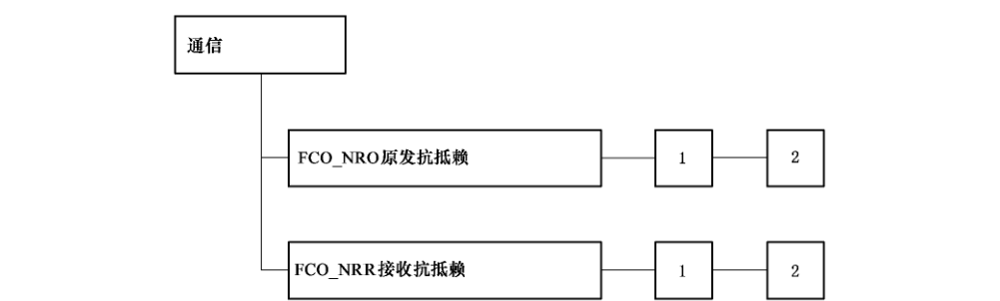

### 8.1 原发抗抵赖（FCO_NRO）

**子类行为**

原发抗抵赖确保信息的发起者不能成功地否认曾经发送过信息。本子类要求 TSF 提供一种方法来确保接收信息的主体在数据交换期间获得了证明信息原发的证据。此证据可由该主体或其他主体验证。

**组件层次**

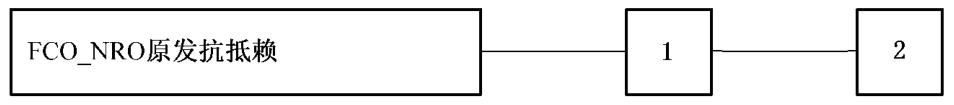

FCO_NRO.1 选择性原发证明，要求 TSF 为主体提供请求原发信息证据的能力。

FCO_NRO.2 强制原发证明，要求 TSF 总是对传输信息产生原发证据。

**管理：FCO_NRO.1,FCO_NRO.2**

在管理功能 FMT 中考虑以下行动：

a） 对改变信息类型、域、原发者属性和证据接收者的管理。

**审计：FCO_NRO.1**

如果在 PP/ST 中包含了 FAU_GEN 安全审计数据产生，那么下述行动应为可审计：

a） 最小级：请求产生原发证据的用户的身份；

b） 最小级：调用抗抵赖服务；

c） 基本级：标识所提供证据的信息、目的地及其拷贝；

d） 详细级：请求验证证据的用户的身份。

**审计：FCO_NRO.2**

如果在 PP/ST 中包含了 FAU_GEN 安全审计数据产生，那么下述行动应为可审计：

a） 最小级：调用抗抵赖服务；

b） 基本级：标识所提供证据的信息、目的地及其拷贝；

c） 详细级：请求验证证据的用户的身份。

FCO_NRO.1 选择性原发证明

从属于：无其他组件。

依赖关系：FIA_UID.1 标识定时

FCO_NRO.1.1 在［选择：原发者、接收者或［赋值：第三方列表］］请求时，TSF 应能对传输的［赋值：信息类型表］产生原发证据。

FCO_NRO.1.2 TSF 应能将信息原发者的［赋值：属性表］与证据适用的信息的［赋值：信息域表］相关联。

FCO_NRO.1.3 TSF 应能为给定［赋值：原发证据的限制］的［选择：原发者、接收者或［赋值：第三方列表］］提供验证信息原发证据的能力。

FCO_NRO.2 强制原发证明

从属于：FCO_NRO.1

依赖关系：FIA_UID.1 标识定时

FCO_NRO.2.1 TSF 在任何时候都应对［赋值：信息类型表］强制产生原发证据。

FCO_NRO.2.2 TSF 应能使信息原发者的［赋值：属性表］与证据适用的信息的［赋值：信息域表］相关联。

FCO_NRO.2.3 TSF 应能为给定［赋值：原发证据的限制］的［选择：原发者、接收者，［赋值：第三方列表］］提供验证信息原发证据的能力。

### 8.2 接收抗抵赖（FCO_NRR）

**子类行为**

接收抗抵赖确保信息的接收者不能成功地否认对信息的接收。本子类要求 TSF 提供一种方法来确保发送信息的主体在数据交换期间获得了证明信息接收的证据。此证据可由该主体或其他主体验证。

**组件层次**

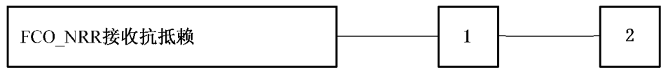

FCO_NRR. 1 选择性接收证明，要求 TSF 为主体提供请求信息接收证据的能力。

FCO_NRR.2 强制性接收证明，要求 TSF 总是对接收到的信息产生接收证据。

**管理：FCO_NRR. 1,FCO_NRR.2**

在管理功能 FMT 中考虑以下行动：

a） 对改变信息类型、域、原发者属性和证据的第三方接收者的管理。

**审计：FCO_NRR.1**

如果在 PP/ST 中包含了 FAU_GEN 安全审计数据产生，那么下述行动应可审计：

a） 最小级：请求产生提供接收证据的用户的身份；

b） 最小级：调用抗抵赖服务；

c） 基本级：标识所提供证据的信息、目的地及其拷贝；

d） 详细级：请求验证证据的用户的身份。

**审计：FCO_NRR.2**

如果在 PP/ST 中包含了 FAU_GEN 安全审计数据产生，那么下述行动应可审计：

a） 最小级：调用抗抵赖服务；

b） 基本级：标识所提供证据的信息、目的地及其拷贝；

c） 详细级：请求验证证据的用户的身份。

FCO_NRR.1 选择性接收证明

从属于：无其他组件。

依赖关系：FIA_UID. 1 标识定时

FCO_NRR.1.1 在［选择：原发者、接收者或［赋值：第三方列表］］请求时，TSF 应能对接收的［赋值：信息类型表］产生接收证据。

FCO_NRR. 1.2 TSF 应使将信息接收者的［赋值：属性表］，与证据适用的信息的［赋值：信息域表］相关联。

FCO_NRR.1.3 TSF 应能为给定［赋值：接收证据的限制］的［选择：原发者、接收者或［赋值：第三方列表］］提供验证信息接收证据的能力。

FCO_NRR.2 强制接收证明

从属于：FCO_NRR.1

依赖关系：FIA_UID. 1 标识定时

FCO_NRR.2.1 TSF 应对收到的［赋值：信息类型表］强制产生接收证据。

FCO_NRR. 2.2 TSF 应能使信息接收者的［赋值：属性表］与证据适用的信息的［赋值：信息域表］相关联。

FCO_NRR. 2.3 TSF 应能为给定［赋值：接收证据的限制］的［选择：原发者、接收者或［赋值：第三方列表］］提供验证信息接收证据的能力。

## 9 FCS 类：密码支持

TSF 可以利用密码功能来满足一些高级安全目的。这些功能包括（但不限于）：标识与鉴别，抗抵赖，可信路径，可信信道和数据分离。本类可用硬件、固件和/或软件来实现，在TOE执行密码功能时使用。

FCS类由两个子类组成：FCS_CKM 密钥管理和 FCS_COP 密码运算。FCS_CKM 子类解决密钥管理方面的问题，而 FCS_COP 子类则与密钥在运算中的使用情况有关。

本类的组件分解如图11所示。

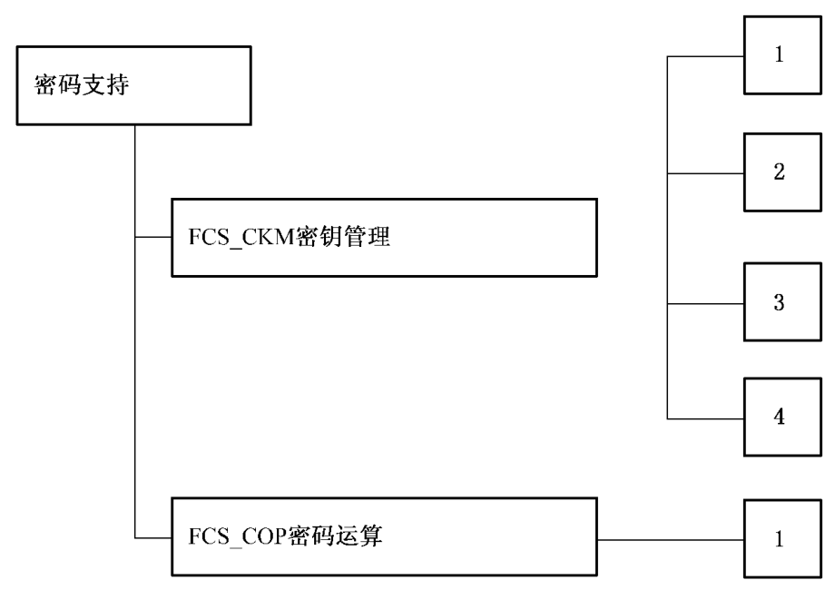

### 9.1 密钥管理（FCS_CKM）

**子类行为**

密钥在其整个生存期内都必须进行管理。为此，本子类定义了对以下几种操作的要求：密钥产生，密钥分发，密钥访问和密钥销毁。凡是存在对密钥进行管理的功能要求时，都必须包含本子类。

**组件层次**

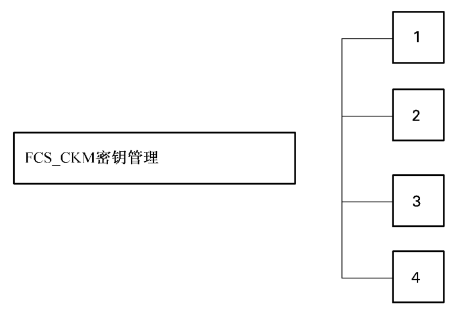

FCS_CKM.1密钥产生，要求根据基于某个指定标准的特定的算法和密钥长度来产生密钥。

FCS_CKM.2密钥分发，要求根据基于某个指定标准的特定的分发方法来分发密钥。

FCS_CKM.3密钥访问，要求根据基于某个指定标准的特定的访问方法来访问密钥。

FCS_CKM. 4 密钥销毁，要求根据基于某个指定标准的特定的销毁方法来销毁密钥。

**管理：FCS_CKM. 1,FCS_CKM.2,FCS_CKM.3,FCS_CKM.4**

在管理功能 FMT 中考虑以下行动：

a） 对修改密钥属性的管理。比如，密钥属性包括：用户、密钥类型（如公开密钥、私有密钥、秘密密钥）、有效期和使用（如数字签名、密钥加密、密钥协商、数据加密）。

**审计：FCS_CKM. 1,FCS_CKM.2,FCS_CKM.3,FCS_CKM. 4**

如果在 PP/ST 中包含了 FAU_GEN 安全审计数据产生，那么下述行动应是可审计的：

a） 最小级：操作成功和失败；

b） 基本级：除一切敏感信息（如秘密密钥或私有密钥）外的客体属性和客体值。

FCS_CKM. 1 密钥产生

从属于：无其他组件。

依赖关系：［FCS_CKM.2密钥分发FCS_COP. 1 密码运算］FCS_CKM.4 密钥销毁FMT_MSA. 2 保密的安全属性

FCS_CKM.1.1 TSF 应根据符合下述标准［赋值：标准列表］的特定的密钥产生算法［赋值：密钥产生算法］和特定的密钥长度［赋值：密钥长度］来产生密钥。

FCS_CKM.2 密钥分发

从属于：无其他组件。

依赖关系：［FDP_ITC. 1 不带安全属性的用户数据输入或FDP_ITC.2 带安全属性的用户数据输入或FCS_CKM.1 密钥产生］FCS_CKM.4 密钥销毁FMT_MSA.2 保密的安全属性

FCS_CKM.2.1 TSF 应根据符合标准［赋值：标准列表］的特定的密钥分发方法［赋值：密钥分发方法］来分发密钥。

FCS_CKM.3密钥访问

从属于：无其他组件。

依赖关系：［FDP_ITC. 1 不带安全属性的用户数据输入或FDP_ITC. 2 带安全属性的用户数据输人或FCS_CKM.1密钥产生］FCS_CKM. 4 密钥销毁FMT_MSA.2 保密的安全属性

FCS_CKM.3.1 TSF 应根据符合标准［赋值：标准列表］的特定的密钥访问方法［赋值：密钥访问方法］来执行［赋值：密钥访问类型］。

FCS_CKM. 4 密钥销毁

从属于：无其他组件。

依赖关系：［FDP_ITC.1 不带安全属性的用户数据输人或FDP_ITC.2 带安全属性的用户数据输入或FCS_CKM.1密钥产生］FMT_MSA.2 保密的安全属性

FCS_CKM. 4.1 TSF 应根据符合标准［赋值：标准列表］的特定的密钥销毁方法［赋值：密钥销毁方法］来销毁密钥。

### 9.2 密码运算（FCS_COP）

**子类行为**

为了保证密码运算的功能正确，必须按照特定的算法和一定长度的密钥来运算。凡有执行密码运算要求的，都需包含本子类。

密码运算通常包括：数据加密和/或解密、数字签名产生和/或验证、针对完整性的密码校验和产生和/或校验和检验、安全散列（信息摘要）、密钥加密和/或解密，以及密钥协商。

**组件层次**

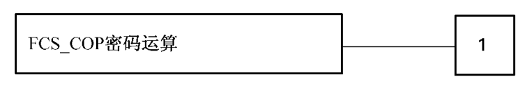

FCS_COP.1密码运算，要求根据基于指定标准的特定的算法和特定长度的密钥来进行密码运算。

**管理：FCS_COP.1**

尚无预见的管理活动。

**审计：FCS_COP.1**

如果在 PP/ST 中包含了 FAU_GEN 安全审计数据产生，那么下述行动应是可审计的：

a） 最小级：密码运算的成功、失败和类型；

b） 基本级：所有有效的密码运算模式、主体属性和客体属性。

FCS_COP.1密码运算

从属于：无其他组件。

依赖关系：［FDP_ITC.1 不带安全属性的用户数据输入或FDP_ITC. 2 带安全属性的用户数据输人或FCS_CKM. 1 密钥产生］FCS_CKM. 4 密钥销毁FMT_MSA. 2 保密的安全属性

FCS_COP.1.1 TSF 应根据符合标准［赋值：标准列表］的特定的密码算法［赋值：密码算法］和密钥长度［赋值：密钥长度］来执行［赋值：密码运算列表］。

## 10 FDP 类：用户数据保护

本类包含若干子类，这些子类规定了与保护用户数据相关的TOE安全功能要求和 TOE 安全功能策略。FDP 分为四组子类（将在下面列出），这些子类处理 TOE 内部在输入、输出和存储期间的用户数据，以及和用户数据直接相关的安全属性。

本类中的子类分成以下四组：

a） 用户数据保护安全功能策略：

1） FDP_ACC 访问控制策略；

2） FDP_IFC 信息流控制策略。

这些子类中的组件允许 PP/ST 作者命名用户数据保护安全功能策略，并定义该安全策略的控制范围，这对于说明安全目的是必要的。这些安全策略的名字将在所有余下的选择“访问控制SFP”或“信息流控制SFP”或为其赋值的功能组件中使用。已命名的访问控制和信息流控制SFP功能的规则将分别在 FDP_ACF 和 FDP_IFF 子类中定义。

b） 用户数据保护形式：

1） FDP_ACF 访问控制功能；

2） FDP_IFF 信息流控制功能；

3） FDP_ITT 内部TOE 传输；

4） FDP_RIP 残余信息保护；

5） FDP_ROL 反转；

6） FDP_SDI 存储数据的完整性。

c） 脱机存储、输入和输出：

1） FDP_DAU 数据鉴别；

2） FDP_ETC 输出到 TSF 控制之外；

3） FDP_ITC 从 TSF 控制之外输入。

这些子类内的组件说明进出安全功能控制范围时的可信传输。

d） TSF 间的通信：

1） FDP_UCT TSF 间用户数据传输的保密性保护；

2） FDP_UIT TSF 间用户数据传输的完整性保护。

这些子类内的组件说明TOE 的TSF 与其他可信IT 系统间的通信。

图12是本类的组件分解图。

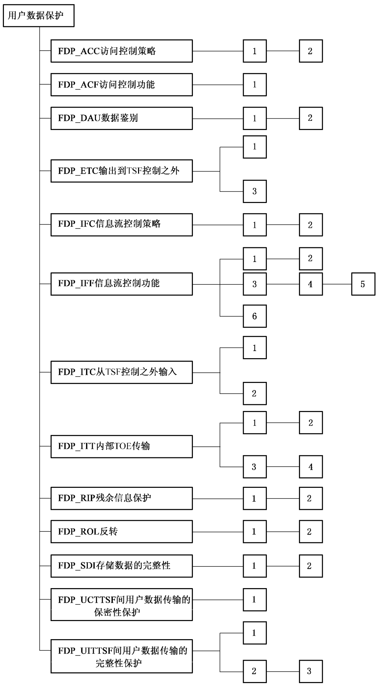

### 10.1 访问控制策略（FDP_ACC）

**子类行为**

本子类（通过名字）确定访问控制 SFP及其控制范围，这些策略组成了所确定的TSP 的访问控制部分。该控制范围包括三部分：策略控制下的主体、策略控制下的客体以及策略所覆盖的受控主体和受控客体间的操作。本标准允许存在多个策略，每个策略有一个唯一的名字。可通过为每个命名的访问控制策略反复使用本子类中的组件来实现。定义访问控制SFP功能的规则将在其他子类中定义，如FDP_ACF 和 FDP_SDI。在FDP-ACC中所确定的访问控制SFP 的名字将在所有余下的选择“访问控制 SFP”或为其赋值的功能组件中使用。

**组件层次**

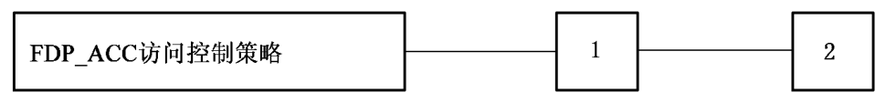

FDP_ACC. 1 子集访问控制，要求每个确定的访问控制 SFP适用于某个 TOE 客体子集上可能的操作子集。

FDP_ACC.2完全访问控制，要求每个确定的访问控制 SFP覆盖所有被该 SFP覆盖的所有主体和客体之间的操作。它甚至要求TSC 内的所有客体和操作都至少被一个确定的访问控制SFP所覆盖。

**管理：FDP_ACC.1,FDP_ACC.2**

本组件没有可预见的管理活动。

**审计：FDP_ACC.1,FDP_ACC.2**

如果 PP/ST包括了FAU_GEN 安全审计数据产生，那么就没有确定的可审计事件。

FDP_ACC.1 子集访问控制

从属于：无其他组件。

依赖关系：FDP_ACF.1 基于安全属性的访问控制

FDP_ACC. 1.1 TSF 应对［赋值：SFP覆盖的主体列表、客体列表及其他们之间的操作列表］执行［赋值：访问控制 SFP］。

FDP_ACC.2完全访问控制

从属于：FDP_ACC.1

依赖关系：FDP_ACF.1 基于安全属性的访问控制

FDP_ACC. 2.1 TSF 应对［赋值：SFP覆盖的主体列表和客体列表］以及它们之间的所有操作执行［赋值：访问控制 SFP］。

FDP_ACC. 2.2 TSF 应确保 TSC 内的所有主体和客体之间的所有操作将被一个访问控制SFP所覆盖。

### 10.2 访问控制功能（FDP_ACF）

**子类行为**

本子类描述能实现 FDP_ACC 中所命名的访问控制策略的特定功能的规则。FDP_ACC规定了策略控制的范围。

**组件层次**

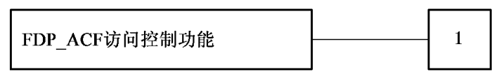

本子类说明这些策略的特征以及如何使用安全属性。本组件将用来描述功能规则，以实现 FDP_ ACC 中确定的 SFP。PP/ST 作者可以反复使用本组件以说明 TOE 中的多个策略。

FDP_ACF.1 基于安全属性的访问控制允许 TSF 执行基于安全属性和命名属性组的访问控制。

此外，TSF 有能力根据安全属性明确地授权或拒绝对某个对象的访问。

**管理：FDP_ACF.1**

在管理功能 FMT 中考虑以下行动：管理用于作出明确访问或拒绝访问决策的属性。

**审计：FDP_ACF.1**

如果 PP/ST 包括 FAU_GEN 安全审计数据产生，则以下事件应可审计：最小级：对 SFP覆盖的客体执行某操作的成功请求；

基本级：对 SFP覆盖的客体执行某操作的所有请求；

详细级：用于进行访问检查的特定安全属性。

FDP_ACF.1 基于安全属性的访问控制

从属于：无其他组件。

依赖关系：FDP_ACC. 1 子集访问控制FMT_MSA.3 静态属性初始化

FDP_ACF. 1.1 TSF 应基于［赋值：安全属性、命名的安全属性组］对客体执行［赋值：访问控制SFP ］。

FDP-ACF. 1.2 TSF 应执行以下规则，以决定受控主体与受控客体间的操作是否被允许：［赋值：在受控主体和受控客体中，通过对受控客体采取受控操作来管理访问的规则］。

FDP_ACF.1.3 TSF 应基于以下附加规则：［赋值：基于安全属性明确授权主体访问客体的规则］，授权主体对客体的访问。

FDP_ACF.1.4 TSF 应基于［赋值：基于安全属性明确拒绝主体访问客体的规则］明确拒绝主体对客体的访问。

### 10.3 数据鉴别（FDP_DAU）

**子类行为**

数据鉴别允许一个实体承担信息真实性的责任（如，通过数字签名）。本子类提供一种方法，以保证特定数据单元的有效性，并进而验证信息内容没有被伪造或篡改。与 FCO 类不同，本子类用于“静态”数据而不是正在传输的数据。

**组件层次**

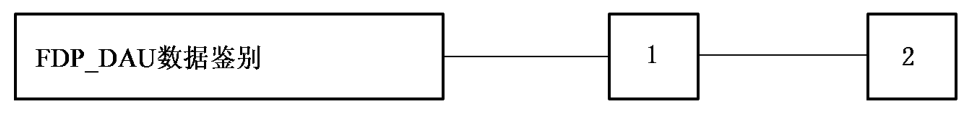

FDP_DAU.1 基本数据鉴别，要求TSF 能够保证客体（如文档）信息内容的真实性。

FDP_DAU.2 伴有保证者身份的数据鉴别，还另外要求TSF 能够产生提供真实性保证的主体身份。

**管理：FDP_DAU.1,FDP_DAU.2**

在管理功能 FMT 中考虑以下行动：

a） 系统中，要对其进行数据鉴别的客体，其赋值和修改应是可配置的。

**审计：FDP_DAU.1**

如果 PP/ST 包括 FAU_GEN 安全审计数据产生，则以下事件应可审计：

a） 最小级：有效证据的成功生成；

b） 基本级：有效证据未成功生成；

c） 详细级：请求证据的主体身份。

**审计：FDP_DAU.2**

如果 PP/ST 包括FAU_GEN 安全审计数据产生，则以下事件应可审计：

a） 最小级：有效证据的成功生成；

b） 基本级：有效证据未成功生成；

c） 详细级：请求证据的主体身份；

d） 详细级：产生证据的主体身份。

FDP_DAU.1 基本数据鉴别

从属于：无其他组件。

依赖关系：无依赖关系。

FDP_DAU.1.1 TSF 应提供产生保证［赋值：客体列表或信息类型列表］的有效性证据的能力。

FDP_DAU.1.2 TSF 应为［赋值：主体列表］提供能力，以验证指定信息有效的证据。

FDP_DAU.2 伴有保证者身份的数据鉴别

从属于：FDP_DAU.1

依赖关系：FIA_UID.1 标识定时

FDP_DAU.2.1 TSF 应提供产生保证［赋值：客体列表或信息类型列表］的有效性证据的能力。

FDP_DAU.2.2 TSF 应为［赋值：主体列表］提供一种能力，以验证指定信息有效的证据以及产生证据的用户身份。

### 10.4 输出到 TSF 控制之外（FDP_ETC）

**子类行为**

本子类定义从 TOE输出用户数据的功能，使得数据在输出后可以明确保留或忽略其安全属性和保护措施。这涉及对输出的限制以及安全属性与输出的用户数据之间的关联。

**组件层次**

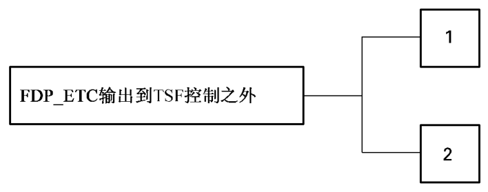

FDP_ETC.1 没有安全属性的用户数据输出，要求 TSF 在把用户数据输出到 TSF 之外时执行合适的 SFP。经由本功能输出的用户数据输出时没有输出相关的安全属性。

FDP_ETC. 2 有安全属性的用户数据输出，要求TSF 在把用户数据输出到 TSF 之外时执行合适的SFP。经由本功能输出的用户数据输出时将连同确切的安全属性一并输出。

**管理：FDP_ETC.1**

对本组件，尚无预见的管理活动。

**管理：FDP_ETC.2**

在管理功能 FMT 中考虑以下行动：

a） 一个已定义角色的用户可以配置附加的输出控制规则。

**审计：FDP_ETC.1,FDP_ETC.2**

如果 PP/ST 包括 FAU_GEN 安全审计数据产生，则以下事件应可审计：

a） 最小级：成功的信息输出；

b） 基本级：所有输出信息的尝试。

FDP_ETC.1没有安全属性的用户数据输出

从属于：无其他组件。

依赖关系：［FDP_ACC.1 子集访问控制，或FDP_IFC.1 子集信息流控制］

FDP_ETC.1.1 TSF 在SFP 控制下输出用户数据到 TSC 之外时，应执行［赋值：访问控制 SFP或信息流控制 SFP］。

FDP_ETC. 1.2 TSF 应输出没有关联安全属性的用户数据。

FDP_ETC.2有安全属性的用户数据输出

从属于：无其他组件。

依赖关系：［FDP_ACC. 1 子集访问控制，或FDP_IFC.1 子集信息流控制］

FDP_ETC. 2.1 TSF 在SFP 控制下输出用户数据到TSC 之外时，应执行［赋值：访问控制 SFP或信息流控制 SFP］。

FDP_ETC.2.2 TSF 应输出带有相关安全属性的用户数据。

FDP_ETC.2.3 TSF 在安全属性输出到TSC之外时，应确保其与输出的数据确切关联。

FDP_ETC.2.4 TSF 在用户数据从 TSC 输出时应执行［赋值：附加的输出控制规则］。

### 10.5 信息流控制策略（FDP_IFC）

**子类行为**

本子类（通过名字）确定信息流控制SFP及其控制范围，这些策略组成已确定的TSP 的信息流控制部分。该控制范围包括以下三个集合：策略控制下的主体、策略控制下的信息，以及引起受控信息流人、流出策略覆盖的受控主体的操作。本标准允许存在多个策略，每个策略有唯一的名字。这可以通过为每个命名的信息流控制策略反复使用本子类组件来实现。定义信息流控制 SFP功能的规则将在其他子类中定义，如 FDP_IFF 和 FDP_SDI。这里所确定的信息流控制SFP的名字将用于所有余下的有选择“信息流控制 SFP”或为其进行赋值操作的组件中。

TSF 机制根据信息流控制SFP控制信息的流向。通常不允许改变信息的安全属性的操作，因这将违背信息流控制 SFP。不过，如果明确指明，这种操作也可以作为信息流控制 SFP的例外得到允许。

**组件层次**

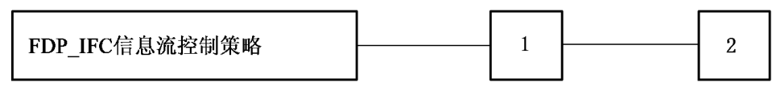

FDP_IFC.1 子集信息流控制，要求每个确定的信息流控制 SFP适用于 TOE 内某个信息流子集上的可能的操作子集。

FDP_IFC.2完全信息流控制，要求每个确定的访问控制 SFP覆盖被该 SFP覆盖的主体和信息上的所有操作，并进一步要求 TSC 的所有信息流和操作都至少被一个确定的信息流控制SFP覆盖。它与组件 FPT_RVM.1 的组合，要求一个参照监视器在这方面总是处于激发状态。

**管理：FDP_IFC.1,FDP_IFC.2**

对于本组件，尚无预见的管理活动。

**审计：FDP_IFC.1,FDP_IFC.2**

如果 PP/ST 包括 FAU_GEN 安全审计数据产生，则没有可以审计的确定事件。

FDP_IFC.1 子集信息流控制

从属于：无其他组件。

依赖关系：FDP_IFF.1 简单安全属性

FDP_IFC.1.1 TSF 应对［赋值：SFP覆盖的主体列表、信息列表和导致受控信息流人、流出受控主体的操作列表］执行［赋值：信息流控制 SFPJ。

FDP_IFC.2完全信息流控制

从属于：FDP_IFC.1

依赖关系：FDP_IFF.1简单安全属性

FDP_IFC.2.1 TSF 应对［赋值：主体列表和信息列表］以及所有导致信息流人、流出SFP所覆盖主体的操作执行［赋值：信息流控制 SFP］。

FDP_IFC.2.2 TSF 应确保所有导致 TSC 内的任意信息流入、流出 TSC 内的所有主体的操作被一个信息流控制 SFP覆盖。

### 10.6 信息流控制功能（FDP_IFF）

**子类行为**

本子类描述能实现在 FDP_IFC 中命名的信息流控制 SFP的特定功能的规则，同时规定该策略的控制范围。子类中包含两种要求：一是针对通用的信息流功能问题，再就是针对非法的信息流（如隐蔽信道）。之所以这样划分是因为，非法信息流涉及的问题在某种意义上与其余的信息流控制 SFP是泾渭分明的。根据其性质，它们将规避信息流控制 SFP，导致控制策略的违背，因而需要特定的功能限制或防止非法信息流的出现。

**组件层次**

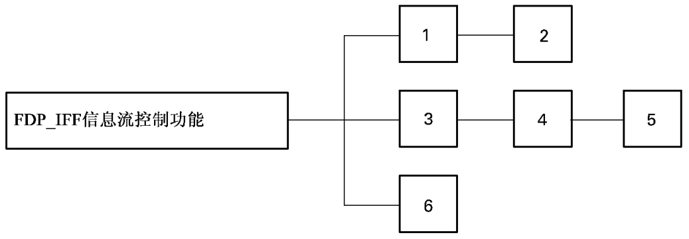

FDP_IFF.1简单安全属性，需要有关信息、导致信息流动的主体以及作为信息接收者的主体的安全属性。它规定该功能必须执行的规则，并描述该功能如何得到安全属性。

FDP_IFF.2分级安全属性，是在简单安全属性 FDP_IFF.1 的要求基础上进行的扩展。它要求TSP 中的所有信息流控制SFP使用形成点阵的分级安全属性。

FDP_IFF.3 受限的非法信息流，要求SFP覆盖非法信息流，但不必消除。

FDP_IFF. 4 部分消除非法信息流，要求 SFP覆盖部分（不必是全部）的非法信息流的消除。

FDP_IFF. 5 无非法信息流，要求 SFP覆盖所有非法信息流的消除。

FDP_IFF. 6 非法信息流监视，要求 SFP根据指定的和最大的容限监视非法信息流。

**管理：FDP_IFF.1,FDP_IFF.2**

在管理功能 FMT 中考虑以下行动：

a） 管理用于作出明确访问决定的属性管理：FDP_IFF.3,FDP_IFF. 4,FDP_IFF.5对这些组件，尚无预见的管理活动。

**管理：FDP_IFF.6**

在管理功能 FMT 中考虑以下行动：

a） 监视功能的启动或关闭；

b） 对出现监视的最大容量的修改。

**审计：FDP_IFF.1,FDP_IFF.2,FDP_IFF.5**

如果 PP/ST 包括FAU_GEN 安全审计数据产生，则下面的事件应可审计：

a） 最小级：允许请求的信息流的判决；

b） 基本级：对信息流请求的所有判决；

c） 详细级：用于做出信息流执行判决的特定安全属性；

d） 详细级：基于策略目标（如审计降级媒体），已流动信息的某些特定子集。

**审计：FDP_IFF.3,FDP_IFF.4,FDP_IFF.6**

如果 PP/ST 包括 FAU_GEN 安全审计数据产生，则以下事件应可审计：

a） 最小级：允许请求的信息流的判决；

b） 基本级：对信息流请求的所有判决；

c） 基本级：确定的非法信息流信道的使用；

d） 详细级：用于做出信息流执行判决的特定的安全属性；

e） 详细级：基于策略目标（如审计降级媒体），已流动信息的某些特定子集；

f） 详细级：对其估算的最大容量超过规定值的非法信息流信道的使用。

FDP_IFF.1简单安全属性

从属于：无其他组件。

依赖关系：FDP_IFC.1 子集信息流控制FMT_MSA. 3 静态属性初始化

FDP_IFF.1.1 TSF 应基于下列类型的主体和信息安全属性［赋值：最小数目和类型的安全属性］执行［赋值：信息流控制 SFP］。

FDP_IFF.1.2如果有下面的规则［赋值：对每一个操作，在主体和信息安全属性间必须有基于安全属性的关系］，TSF 应允许受控主体和受控信息之间存在经由受控操作的信息流。

FDP_IFF. 1.3 TSF 应执行［赋值：附加的信息流控制 SFP 规则］。

FDP_IFF.1.4 TSF 应提供下列［赋值：附加SFP能力列表］。

FDP_IFF. 1.5 TSF 应根据下列规则［赋值：基于安全属性，明确授权信息流的规则］明确授权信息流。

FDP_IFF.1.6 TSF 应根据下列规则［赋值：基于安全属性，明确拒绝信息流的规则］明确拒绝信息流。

FDP_IFF.2分级安全属性

从属于：FDP_IFF.1

依赖关系：FDP_IFC.1子集信息流控制FMT_MSA. 3 静态属性初始化

FDP_IFF. 2.1 TSF 应基于下列类型的主体和信息安全属性［赋值：最小数日和类型的安全属性］，执行［赋值：信息流控制 SFP ］。

FDP_IFF.2.2如果有下面基于安全属性间有序关系的规则［赋值：对每一个操作，在主体和信息安全属性间必须有基于安全属性的关系］，TSF 应允许受控主体和受控信息之间存在经由受控操作的信息流。

FDP_IFF. 2.3 TSF 应执行［赋值：附加的信息流控制 SFP规则］。

FDP_IFF. 2.4 TSF 应提供下列［赋值：附加 SFP能力列表］。

FDP_IFF.2.5 TSF 应根据下列规则［赋值：基于安全属性，明确授权信息流的规则］明确授权信息流。

FDP_IFF.2.6 TSF 应根据下列规则［赋值：基于安全属性，明确拒绝信息流的规则］明确拒绝信息流。

FDP_IFF.2.7 TSF 应对任意两个有效的信息流控制安全属性执行下面的关系：

a） 存在排序功能，也就是说，给定两个有效的安全属性，可判断它们是否相等，是否其中一个大于另一个，还是两者不可比较；

b） 在安全属性集中存在“最小上界”，也就是说，给定任意两个有效的安全属性，存在一个有效的安全属性大于或等于这两个有效安全属性；

c） 在安全属性集中存在“最大下界”，也就是说，给定任意两个有效的安全属性，存在一个有效的安全属性不大于这两个有效安全属性。

FDP_IFF.3 受限的非法信息流

从属于：无其他组件。

依赖关系：AVA_CCA.1 隐蔽信道分析FDP_IFC.1 子集信息流控制

FDP_IFF.3.1 TSF 应执行［赋值：信息流控制 SFP］，以限制［赋值：非法信息流类型］的容限为［赋值：最大容限］。

FDP_IFF.4 部分消除非法信息流

从属于：FDP_IFF.3

依赖关系：AVA_CCA.1 隐蔽信道分析FDP_IFC.1 子集信息流控制

FDP_IFF.4.1 TSF 应执行［赋值：信息流控制 SFP］，以限制［赋值：非法信息流类型］的容限为［赋值：最大容限］。

FDP_IFF.4.2 TSF 应避免［赋值：非法信息流类型］。

FDP_IFF.5无非法信息流

从属于：FDP_IFF.4

依赖关系：AVA_CCA.3详尽的隐蔽信道分析FDP_IFC.1 子集信息流控制

FDP_IFF. 5.1 TSF 应确保没有规避［赋值：信息流控制SFP名字］的非法信息流存在。

FDP_IFF.6 非法信息流监视

从属于：无其他组件。

依赖关系：AVA_CCA.1 隐蔽信道分析FDP_IFC.1 子集信息流控制

FDP_IFF.6.1 TSF 应执行［赋值：信息流控制SFP］，以监视［赋值：非法信息流类型］是否超过了［赋值：最大容限］。

### 10.7 从TSF 控制之外输入（FDP_ITC）

**子类行为**

本子类定义引入用户数据到TOE 内的机制，使得数据在输入时有合适的安全属性和保护措施。

涉及到对输入的限制、所需安全属性的确定以及对用户数据相关安全属性的解释。

**组件层次**

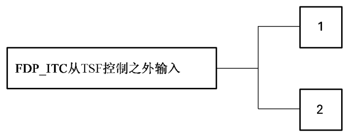

本子类包含两个组件，描述用于访问控制和信息控制策略的输入用户数据的安全属性的保持情况。

FDP_ITC.1 没有安全属性的用户数据输入，要求安全属性正确反映用户数据，且和客体分离。

FDP_ITC. 2 有安全属性的用户数据输入，要求安全属性正确反映用户数据，并且与从 TSC外输人的数据确切地联系在一起。

**管理：FDP_ITC.1,FDP_ITC.2**

在管理功能 FMT 中考虑以下行动：

a） 对用户数据输入的附加控制规则的修改。

**审计：FDP_ITC.1,FDP_ITC.2**

如果 PP/ST 包括FAU_GEN 安全审计数据产生，则以下事件应可审计：

a） 最小级：用户数据，包括任何安全属性的成功输人；

b） 基本级：用户数据，包括任何安全属性的所有输入尝试；

c） 详细级：授权用户提供的用于输入的用户数据的安全属性规范。

FDP_ITC.1 没有安全属性的用户数据输入

从属于：无其他组件。

依赖关系：［FDP_ACC. 1 子集访问控制，或FDP_IFC.1 子集信息流控制］FMT_MSA.3 静态属性初始化

FDP_ITC.1.1 TSF 在 SFP 控制下从TSC 之外输入用户数据时，应执行［赋值：访问控制 SFP或信息流控制 SFP］。

FDP_ITC. 1.2从 TSC 外部输入用户数据时，TSF应略去任何相关的安全属性。

FDP_ITC. 1.3 TSF 在SPF 控制下从 TSC外部输入用户数据时应执行下面的规则：［赋值：附加的输入控制规则］。

FDP_ITC.2 有安全属性的用户数据输入

从属于：无其他组件。

依赖关系：［FDP_ACC.1 子集访问控制，或FDP_IFC.1 子集信息流控制］［FDP_ITC.1 TSF 间的可信信道，或FTP_TRP.1 可信路径］FPT_TDC.1 TSF 间基本的 TSF 数据一致性

FDP_ITC. 2.1 TSF 在SFP 控制下从 TSC之外输入用户数据时，应执行［赋值：访问控制SFP或信息流控制 SFP］。

FDP_ITC. 2.2 TSF 应使用与输入的数据相关的安全属性。

FDP_ITC. 2.3 TSF 应确保使用的协议在安全属性和接收的用户数据之间提供了明确的联系。

FDP_ITC.2.4 TSF 应确保对输人的用户数据安全属性的解释与用户数据源的解释是一致的。

FDP_ITC.2.5 TSF 在SFP 控制下从 TSC 之外输入用户数据时应执行［赋值：附加的输入控制规则］。

### 10.8 TOE 内部传输（FDP_ITT）

**子类行为**

本子类提供当用户数据通过内部信道在TOE 各部分之间传递时，对数据进行保护的要求。和FDP_UCT 与 FDP_UIT 的不同之处在于，后两者为数据经外部信道在不同的TSF 间传递时提供保护；

而与 FDP_ETC 和 FDP_ITC 的不同之处则在于，它们描述的是数据进出 TSF 时的控制。

**组件层次**

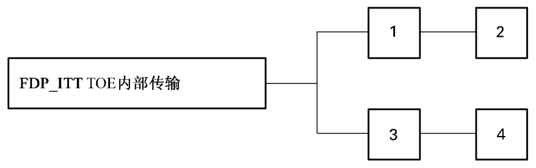

FDP_ITT.1 基本内部传输保护，要求用户数据在TOE 的各部分间传递时受保护。

FDP_ITT.2 属性分隔传输，除第一个组件的要求外，还要求基于与SFP 相关的属性值把数据分隔开。

FDP_ITT.3完整性监视，要求 SF 监视在 TOE各部分间传递的用户数据的完整性错误。

FDP_ITT. 4基于属性的完整性监视，是对第3个组件的扩展，它允许根据不同的与 SFP 相关的属性，进行完整性监视。

**管理：FDP_ITT.1,FDP_ITT.2**

在管理功能 FMT 中考虑以下行动：

a） 如果 TSF 提供多种方法保护在 TOE 的物理上分隔的部分间传递的用户数据，则TSF 应提供一个预定义的角色，使其有能力选择某种方法。

**管理：FDP_ITT.3,FDP_ITT.4**

在管理功能 FMT 中考虑以下行动：

a） 对于检测到完整性错误将采取的行动的规范应是可配置的。

**审计：FDP_ITT.1,FDP_ITT.2**

如果 PP/ST 包括FAU_GEN 安全审计数据产生，则以下事件是可审计的：

a） 最小级：用户数据的成功传输，包括所用的保护方法的标识；

b） 基本级：所有传输用户数据的尝试，包括所用的保护方法和所有出现的错误。

**审计：FDP_ITT.3,FDP_ITT.4**

如果 PP/ST包括FAU_GEN 安全审计数据产生，则以下事件是可审计的：

a） 最小级：用户数据的成功传输，包括所用的保护方法的标识；

b） 基本级：所有传输用户数据的尝试，包括所用的保护方法和所有出现的错误；

c） 基本级：未授权地改变完整性保护方法的尝试；

d） 详细级：检测到完整性错误后采取的行动。

FDP_ITT.1 基本内部传输保护

从属于：无其他组件。

依赖关系：［FDP_ACC. 1 子集访问控制，或FDP_IFC.1 子集信息流控制］FDP_ITT.1.1在TOE 物理上分隔的部分间传递用户数据时，TSF 应执行［赋值：访问控制SFP或信息流控制 SFP］，以防止［选择：泄露，篡改，丢失］。

FDP_ITT.2属性分隔传输

从属于：FDP_ITT.1

依赖关系：［FDP_ACC. 1 子集访问控制，或FDP_IFC.1 子集信息流控制］

FDP_ITT.2.1 在TOE 物理上分隔的部分间传递用户数据时，TSF 应执行［赋值：访问控制SFP或信息流控制 SFP］，以防止［选择：泄露，篡改，丢失］。

FDP_ITT.2.2在TOE 物理上分隔的部分间传递用户数据时，TSF 应基于下列值［赋值：需要分隔的安全属性］，将 SFP 控制的数据分隔开。

FDP_ITT.3 完整性监视

从属于：无其他组件。

依赖关系：［FDP-ACC.1 子集访问控制，或FDP_IFC.1 子集信息流控制］FDP_ITT. 1 基本内部传输保护FDP_ITT. 3.1在TOE 物理上分隔的部分间传递用户数据时，TSF 应执行［赋值：访问控制 SFP或信息流控制 SFP］，以监视是否有下列错误出现［赋值：完整性错误］。

FDP_ITT.3.2检测到数据完整性错误时，TSF 应［赋值：规定对完整性错误应采取的行动］。

FDP_ITT.4 基于属性的完整性监视

从属于：FDP_ITT.3

依赖关系：［FDP_ACC. 1 子集访问控制，或FDP_IFC.1 子集信息流控制］FDP_ITT.2 属性分隔传输FDP_ITT.4.1在TOE 的物理上分隔的部分间传递用户数据时，基于下面的属性［赋值：需要分隔传输信道的安全属性］，TSF 级执行［赋值：访问控制 SFP 或信息流控制SFP］，以监视是否有下列错误出现［赋值：完整性错误］。

FDP_ITT. 4.2检测到数据完整性错误时，TSF 应［赋值：规定对完整性错误应采取的行动］。

### 10.9 残余信息保护（FDP_RIP）

**子类行为**

本子类针对如下需要，即确保已经被删除的信息不再是可访问的，并且，新生成的客体确实不包含不应被访问的信息。本子类要求保护已逻辑删除或释放的信息，但信息仍旧可以保留在TOE内部。

**组件层次**

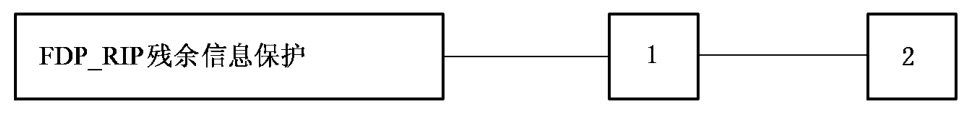

FDP_RIP.1 子集残余信息保护，要求TSF 确保任何资源的任何残余信息内容，在分配或释放资源时，对于 TSC 内已定义的客体子集而言是不可用的。

FDP_RIP.2 完全残余信息保护，要求TSF 确保在分配或释放资源时，任何资源的任何残余信息内容对于所有客体都是不可用的。

**管理：FDP_RIP. 1,FDP_RIP.2**

在管理功能 FMT 中考虑以下行动：

a） TOE 内，选择何时（如分配或释放时）执行残余信息保护是可以配置的。

**审计：FDP_RIP.1,FDP_RIP.2**

如果 PP/ST 包括FAU_GEN 安全审计数据产生，就没有确定的事件可审计。

FDP_RIP. 1 子集残余信息保护

从属于：无其他组件。

依赖关系：无依赖关系。

FDP_RIP.1.1 TSF 对下列客体［赋值：客体列表J［选择：分配或释放资源］时，应确保该资源任何以前的信息内容不再可用。

FDP_RIP.2 完全残余信息保护

从属于：FDP_RIP.1

依赖关系：无依赖性

FDP_RIP.2.1 TSF 应确保对所有客体［选择：分配或释放资源］时，使该资源任何以前的信息内容不再可用。

### 10.10 反转（FDP_ROL）

**子类行为**

反转操作涉及在一定条件的限制下（如时间长短），撒消上一次或一系列操作，并返回到某个以前的已知状态。反转提供了取消上一次或一系列操作结果的能力以保持用户数据的完整性。

**组件层次**

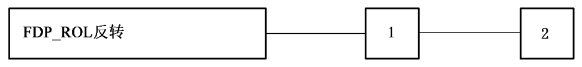

FDP_ROL.1基本反转，满足在确定的范围内，反转或撤消有限操作的需要。

FDP_ROL. 2高级反转，满足在确定的范围内，反转或撤消所有操作的需要。

**管理：FDP_ROL.1,FDP_ROL.2**

在管理功能 FMT 中考虑以下行动：

a） 限制反转可实施的边界，在TOE 内可以是一个可配置的条目；

实施反转操作的权限可以被限制到一个精心定义的角色。

**审计：FDP_ROL.1,FDP_ROL.2**

如果 PP/ST 包括FAU_GEN 安全审计数据产生，则以下事件应可审计：

a） 最小级：所有成功的反转操作；

b） 基本级：所有实施反转操作的尝试；

c） 详细级：所有实施反转操作的尝试，包括被反转的操作类型的标识。

FDP_ROL.1 基本反转

从属于：无其他组件。

依赖关系：［FDP_ACC. 1 子集访问控制，或FMT_IFC.1 子集信息流控制］

FDP_ROL.1.1 TSF 应执行［赋值：访问控制 SFP或信息流控制SFP］，以允许在［赋值：客体列表］上的［赋值：操作列表］的反转。

FDP_ROL.1.2 TSF 应允许在［赋值：反转可以实施的边界范围］内进行反转操作。

FDP_ROL.2 高级反转

从属于：FDP_ROL.1

依赖关系：［FDP_ACC.1 子集访问控制，或FMT_IFC.1 子集信息流控制］

FDP_ROL. 2.1 TSF 应执行［赋值：访问控制 SFP或信息流控制SFP］，以允许在［赋值：客体列表］上的所有操作的反转。

FDP_ROL.2.2 TSF 应允许在［赋值：反转可以实施的边界范围］内进行反转操作。

### 10.11 存储数据的完整性（FDP_SDI）

**子类行为**

本子类提供了对存储在 TSC内部的用户数据保护的要求。完整性错误可能会影响存放在内存中的，或存储设备中的数据。本子类与TOE 内部传输 FDP_ITT 不同之处，后者保护的是数据在TOE 内部传输时的完整性。

**组件层次**

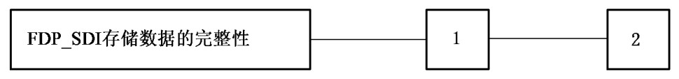

FDP_SDI.1 存储数据的完整性监视，要求 SF 监视存储在TSC内的用户数据是否出现已确定的完整性错误。

FDP_SDI.2存储数据的完整性监视与行动，则是在 FDP_SDI.1 的基础上增加了附加的能力，允许在检测到某错误时，采取相应的行动。

**管理：FDP_SDI.1**

本组件没有可预见的管理活动。

**管理：FDP_SDI.2**

在管理功能 FMT 中考虑以下行动：

a） 可以配置在检测到完整性错误时所要采取的行动。

**审计：FDP_SDI.1**

如果 PP/ST 包括FAU_GEN安全审计数据产生，则以下事件应可审计：

a） 最小级：检测用户数据完整性的成功尝试，包括指示检测结果；

b） 基本级：检测用户数据完整性的所有尝试，如果完成的话，还包括指示检测结果；

c） 详细级：出现的完整性错误的类型。

**审计：FDP_SDI.2**

如果 PP/ST 包括 FAU_GEN 安全审计数据产生，则以下事件应可审计：

a） 最小级：检测用户数据完整性的成功尝试，包括指示检测结果；

b） 基本级：检测用户数据完整性的所有尝试，如果完成有的话，还包括指示检测结果；

c） 详细级：发生的完整性错误的类型；

d） 详细级：检测到完整性错误时所采取的行动。

FDP_SDI.1 存储数据完整性监视

从属于：无其他组件。

依赖关系：无依赖关系。

FDP_SDI. 1.1 TSF 应基于下列属性［赋值：用户数据属性］对所有客体，监视存储在 TOE 内的用户数据是否出现［赋值：完整性错误］。

FDP_SDI.2 存储数据的完整性监视与行动

从属于：FDP_SDI.1

依赖关系：无依赖关系。

FDP_SDI. 2.1 TSF 应基于下列属性［赋值：用户数据属性］对所有客体，监视存储在 TOE 内的用户数据是否出现［赋值：完整性错误］。

FDP_SDI. 2.1 检测到完整性错误时，TSF 应［赋值：采取的行动］。

### 10.12 TSF 间用户数据传输的保密性保护（FDP_UCT）

**子类行为**

本子类定义当用户数据通过外部信道在不同的TOE之间，或是在不同的 TOE用户之间传递时，确保用户数据保密性的要求。

**组件层次**

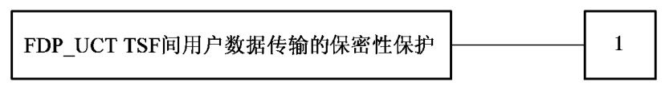

FDP_UCT.1基本的数据交换保密性，目的是为用户数据提供保护，防止其在传输过程中被泄露。

管理：FDP-UCT.1对本组件，没有可预见的管理活动。

**审计：FDP_UCT.1**

如果 PP/ST 包括 FAU_GEN 安全审计数据产生，则以下事件应可审计：

a） 最小级：使用数据交换机制的任何用户或主体的身份；

b） c） 基本级：企图使用用户数据交换机制的任何未授权用户或主体的身份；

c） 基本级：对确定被传输或接收的用户数据有用的名字或其他索引信息的引用，可能包括与信息相关联的安全属性。

FDP_UCT.1 基本的效据交换保密性

从属于：无其他组件。

依赖关系：［FTP-ITC.1 TSF 间的可信信道，或FTP_TRP.1 可信路径］［FDP_ACC. 1 子集访问控制，或FDP_IFC.1 子集信息流控制］

FDP_UCT.1.1 TSF 应执行［赋值：访问控制SFP或信息流控制SFP］，使得能以某种防止未授权泄露的方式［选择：传送，接收］客体。

### 10.13 TSF 间用户数据传输的完整性保护（FDP_UIT）

**子类行为**

本子类定义用户数据在 TSF 和其他可信IT 系统间传输时，提供完整性并从可检测的错误中恢复的要求。本子类至少监视用户数据针对篡改的完整性，此外，还支持检测到完整性错误时采取的各种纠正方法。

**组件层次**

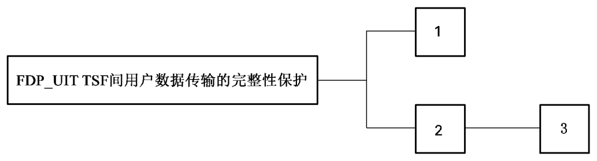

FDP_UIT.1 数据交换的完整性，解决对被传输的用户数据的篡改、删除、插入和重用等错误的检测。

FDP_UIT.2 原发端数据交换恢复，解决由接收端TSF 借助于原发端可信IT 系统，恢复原始的用户数据。

FDP_UIT.3 接受端数据交换恢复，解决由接收端 TSF 自己，无需原发端可信IT 系统的任何帮助，恢复原始的用户数据。

**管理：FDP_UIT. 1,FDP_UIT. 2,FDP_UIT.3**

对本组件，尚无预见的管理活动。

**审计：FDP_UIT.1**

如果 PP/ST包括FAU_GEN 安全审计数据产生，则以下事件应可审计：

a） 最小级：使用数据交换机制的任何用户或主体的身份；

b） c） 基本级：企图使用用户数据交换机制的任何未授权用户或主体的身份；

c） 基本级：对确定被传输或接收的用户数据有用的名字或其他索引信息的引用，可能包括和信息相联的安全属性；

d） 基本级：任何确定的阻塞用户数据传输的尝试；

e） 详细级：任何检测到的用户数据传输中的篡改类型或后果。

**审计：FDP_UIT.2,FDP_UIT.3**

如果 PP/ST 包括 FAU_GEN 安全审计数据产生，则以下事件应可审计：

a） 最小级：使用数据交换机制的任何用户或主体的身份；

b） 最小级：从错误中成功的恢复，包括检测到的错误类型；

c） 基本级：企图使用用户数据交换机制的任何未授权用户或主体的身份；

d） 基本级：对确定被传输或接收的用户数据有用的名字或其他索引信息的引动，可能包括和信息相联的安全属性；

e） 基本级：任何确定的阻塞用户数据传输的尝试；

f）详细级：任何检测到的用户数据传输中的篡改类型或后果。

FDP_UIT.1 数据交换完整性

从属于：无其他组件。

依赖关系：［FDP-ACC.1 子集访问控制，或FDP_IFC.1 子集信息流控制］［FTP_ITC.1 TSF 间的可信信道，或FTP_TRP.1 可信路径］

FDP_UIT. 1.1 TSF 应执行［赋值：访问控制SFP或信息流控制SFP〕，使得能以某种方式［选择：传送，接收］用户数据，保护数据避免［选择：篡改，删除，插入，重用］错误。

FDP_UIT. 1.2 TSF 应能根据收到的用户数据判断，是否出现了［选择：篡改，删除，插人，重用］。

FDP_UIT.2 原发端数据交换恢复

从属于：无其他组件。

依赖关系：［FDP_ACC. 1 子集访问控制，或FDP_IFC.1 子集信息流控制］FDP_UIT.1 数据交换完整性FTP_ITC. 1 TSF 间的可信信道

FDP_UIT.2.1 TSF 应执行［赋值：访问控制 SFP或信息流控制SFP］，以便能在原发端可信IT系统的帮助下，从［赋值：可恢复的错误列表］中恢复。

FDP_UIT.3 接受端数据交换恢复

从属于：FDP_UIT.2

依赖关系：［FDP_ACC. 1 子集访问控制，或FDP_IFC.1 子集信息流控制］FDP_UIT.1 数据交换完整性FTP_ITC.1 TSF 间的可信信道

FDP_UIT.3.1 TSF 应执行［赋值：访问控制 SFP或信息流控制SFP］，使得可以在没有任何源可信IT 系统的帮助下，从［赋值：可恢复的错误列表］中恢复。

## 11 FIA类：标识和鉴别

本类中的子类提出建立和验证所声称的用户身份的功能要求。

需要通过标识和鉴别确保用户与正确的安全属性相关联（如身份、组、角色、安全或完整性等级）。

授权用户的无歧义标识以及安全属性与用户和主体的正确关联是实施预定安全策略的关键。本类中的子类处理：用户身份的确定和验证、确定它们与TOE 交互的权利，以及每个授权用户安全属性的正确关联。其他类（如用户数据保护、安全审计）的有效性建立在对用户的正确标识和鉴别基础上。

标识和鉴别类分解见图 13。

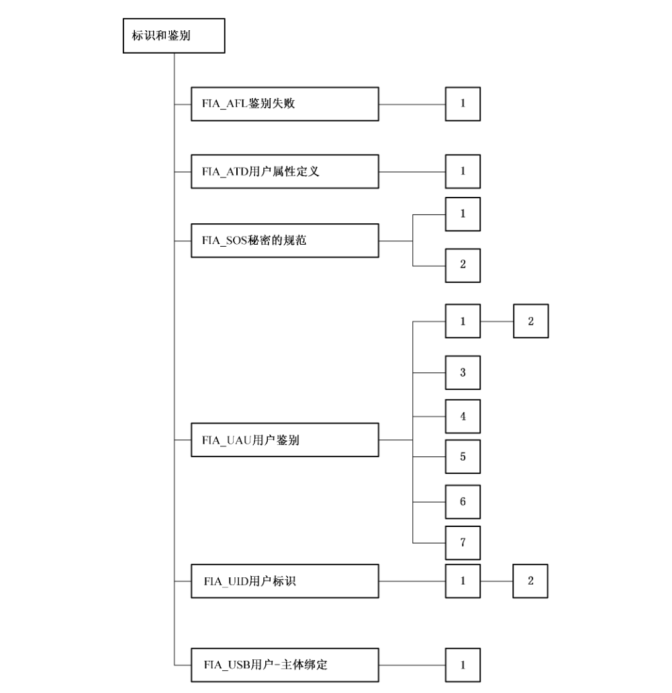

### 11.1 鉴别失败（FIA_AFL）

**子类行为**

本子类要求为不成功的鉴别尝试次数定义值，以及鉴别尝试失败时TSF 的行动。参数包括但不限于，失败的鉴别尝试次数和时间门限值。

**组件层次**

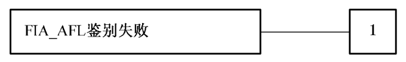

FIA_AFL.1 要求 TSF 能够在用户鉴别尝试失败了指定的次数后，终止会话建立进程。此外，它还要求会话建立进程终止后，直到管理员定义的条件出现前，TSF 能够使用户账号无效，或者使进行尝试的登录点无效（如，某工作站）。

**管理：FIA_AFL.1**

在管理功能 FMT中考虑以下行动：

a） 管理失败的鉴别尝试门限值；

b） 管理鉴别失败时将要采取的行动。

**审计：FIA_AFL.1**

如果 PP/ST 中包括 FAU_GEN 安全审计数据产生，下列事件应可审计：

a） 最小级：未成功鉴别尝试达到门限值及所采取的行动（如，使终端无效），及随后（适当时）还原到正常状态（如，重新使终端有效）。

FIA_AFL.1 鉴别失败处理

从属于：无其他组件。

依赖关系：FIA_UAU.1 鉴别定时FIA_AFL.1.1当与［赋值：鉴别事件列表］相关的［赋值：数日］次不成功鉴别尝试出现时，TSF应加以检测。

FIA_AFL.1.2当达到或超过所定义的不成功鉴别尝试的次数时，TSF 应［赋值：行动列表］。

### 11.2 用户属性定义（FIA_ATD）

**子类行为**

所有授权用户可能都有一组除用户身份外的安全属性用来执行 TSP。本子类定义用于支持TSP所需的将用户安全属性与用户相关联的要求。

**组件层次**

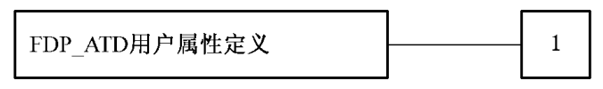

FIA_ATD.1 用户属性定义，允许对每个用户的用户安全属性分别加以维护。

**管理：FIA_ATD.1**

在管理功能 FMT 中考虑以下行动：

a） 如果赋值中如此指明的话，授权管理员应能够为用户定义附加的安全属性。

**审计：FIA_ATD. 1**

如果 PP/ST 中包含 FAU_GEN 安全审计数据产生，无确定的可审计行动。

FIA_ATD.1 用户属性定义

从属于：无其他组件。

依赖关系：无依赖关系。

FIA_ATD.1. 1 TSF 应保存属于每个用户的下列安全属性：［赋值：安全属性列表］。

### 11.3 秘密的规范（FIA_SOS）

**子类行为**

本子类定义对所提供的秘密执行规定的质量量度以及生成满足规定的量度的秘密的机制方面的要求。

**组件层次**

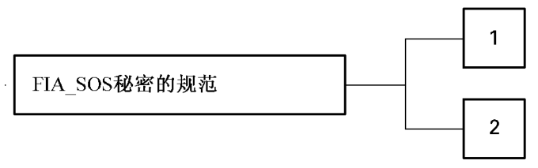

FIA_SOS.1 秘密的验证，要求 TSF 验证秘密满足规定的质量量度。

FIA_SOS. 2秘密的TSF 生成，要求TSF能够产生满足规定的质量量度的秘密。

**管理：FIA_SOS. 1**

在管理功能 FMT 中考虑以下行动：

a） 管理用于验证秘密的量度。

**管理：FIA_SOS.2**

在管理功能 FMT 中考虑以下行动：

a） 管理用于产生秘密的量度。

**审计：FIA_SOS. 1,FIA_SOS.2**

如果 PP/ST 中包括 FAU_GEN 安全审计数据产生，下列事件应可审计：

a） 最小级：TSF 对所有已测试秘密的拒绝；

b） 基本级：TSF 对所有已测试秘密的拒绝或接受；

c） 详细级：对所定义质量量度的所有改动的标识。

FIA_SOS. 1 秘密的验证

从属于：无其他组件。

依赖关系：无依赖关系。

FIA_SOS. 1.1 TSF 应提供一种机制以验证秘密满足［赋值：一个确定的质量量度］。

FIA_SOS. 2 秘密的TSF 生成

从属于：无其他组件。

依赖关系：无依赖关系。

FIA_SOS. 2.1 TSF 应提供一种机制以产生满足［赋值：一个确定的质量量度］的秘密。

FIA_SOS. 2.2 TSF 应能够为［赋值：TSF功能列表］使用TSF 产生的秘密。

### 11.4 用户鉴别（FIA_UAU）

**子类行为**

本子类定义TSF 所支持的用户鉴别机制的类型，和作为用户鉴别机制基础所需要的属性。

**组件层次**

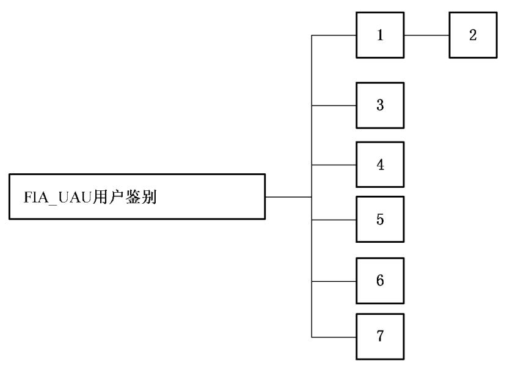

FIA_UAU. 1 鉴别定时，允许用户在其身份被鉴别前执行某些行动。

FIA_UAU.2 在任何行动前的用户鉴别，要求用户在TSF 允许任何行动之前，先鉴别它们自己。

FIA_UAU.3 不可伪造的鉴别，要求鉴别机制能够检测和防止使用伪造或复制的鉴别数据。

FIA_UAU. 4一次性鉴别机制，要求使用一次性鉴别数据的鉴别机制。

FIA_UAU. 5多重鉴别机制，要求提供和使用不同的鉴别机制，为特定的事件鉴别用户的身份。

FIA_UAU.6 重鉴别，要求有能力说明哪些事件用户需要被重新鉴别。

FIA_UAU.7 受保护的鉴别反馈，要求在鉴别期间，只提供给用户有限的反馈信息。

**管理：FIA_UAU.1**

在管理功能 FMT 中考虑以下行动：

a） 管理员对鉴别数据的管理；

b） 相关用户对鉴别数据的管理；

c） 用户鉴别前可执行的行动列表的管理。

**管理：FIA_UAU.2**

在管理功能 FMT 中考虑以下行动：

a） 管理员对鉴别数据的管理；

b） 与鉴别数据相关的用户，对鉴别数据的管理。

**管理：FIA_UAU.3,FIA_UAU. 4,FIA_UAU.7**

尚无预见的管理活动。

**管理：FIA_UAU.5**

在管理功能 FMT 中考虑以下行动：

a） 鉴别机制的管理；

b） 鉴别规则的管理。

**管理：FIA_UAU.6**

在管理功能 FMT 中考虑以下行动：

a） 如果一个授权管理员能请求重鉴别，则管理包含重鉴别请求。

**审计：FIA_UAU.1**

如果 PP/ST 中包括 FAU_GEN 安全审计数据产生，下列事件应可审计：

a） 最小级：使用鉴别机制失败；

b） 基本级：所有对鉴别机制的使用；

c） 详细级：用户鉴别前，执行的所有由 TSF促成的行动。

**审计：FIA_UAU.2**

如果 PP/ST 中包括 FAU_GEN 安全审计数据产生，下列事件应可审计：

a） 最小级：使用鉴别机制失败；

b） 基本级：所有对鉴别机制的使用。

**审计：FIA_UAU.3**

如果 PP/ST 中包括 FAU_GEN 安全审计数据产生，下列事件应可审计：

a） 最小级：欺骗性鉴别数据的发现；

b） 基本级：对欺骗性的数据立即采取的所有措施和检查结果。

**审计：FIA_UAU.4**

如果 PP/ST 中包括 FAU_GEN 安全审计数据产生，下列事件应可审计：

a） 最小级：重用鉴别数据的企图。

**审计：FIA_UAU.5**

如果 PP/ST 中包括 FAU_GEN 安全审计数据产生，下列事件应可审计：

a） 最小级：鉴别的最终判决；

b） 基本级：每个被激活机制的结果以及最终判决。

**审计：FIA_UAU.6**

如果 PP/ST 中包括 FAU_GEN 安全审计数据产生，下列事件应可审计：

a） 最小级：重鉴别失败；

b） 基本级：所有重鉴别尝试。

**审计：FIA_UAU.7**

尚无预见的可审计事件。

FIA_UAU. 1 鉴别定时

从属于：无其他组件。

依赖关系：FIA_UID.1 标识定时FIA_UAU.1.1在用户鉴别前，TSF应允许代表用户的［赋值：TSF 促成的行动列表］被执行。

FIA_UAU.1.2在允许任何其他代表用户的TSF 促成的行动执行前，TSF 应要求该用户已被成功鉴别。

FIA_UAU.2 任何行动前的用户鉴别

从属于：FIA_UAU.1

依赖关系：FIA_UID. 1 标识定时FIA_UAU.2.1在允许任何代表用户的其他TSF 促成的行动执行前，TSF 应要求该用户已被成功鉴别。

FIA_UAU.3 不可伪造的鉴别

从属于：无其他组件。

依赖关系：无依赖关系。

FIA_UAU.3.1 TSF 应［选择：检测，防止］一切 TSF 用户伪造的鉴别数据的使用。

FIA_UAU.3.2 TSF 应［选择：检测，防止］从任何其他 TSF 用户处拷贝的鉴别数据的使用。

FIA_UAU. 4一次性鉴别机制

从属于：无其他组件。

依赖关系：无依赖关系。

FIA_UAU.4.1 TSF 应防止与［赋值：确定的鉴别机制］有关的鉴别数据的重用。

FIA_UAU.5 多重鉴别机制

从属于：无其他组件。

依赖关系：无依赖关系。

FIA_UAU. 5.1 TSF 应提供［赋值：多重鉴别机制列表］以支持用户鉴别。

FIA_UAU. 5.2 TSF 应根据［赋值：描述多重鉴别机制如何提供鉴别的规则］鉴别一切用户所声称的身份。

FIA_UAU.6 重鉴别

从属于：无其他组件。

依赖关系：无依赖关系。

FIA_UAU.6.1 在［赋值：需要重鉴别的条件列表］条件下，TSF 应重新鉴别用户。

FIA_UAU. 7 受保护的鉴别反馈

从属于：无其他组件。

依赖关系：FIA_UAU.1 鉴别定时FIA_UAU. 7.1 鉴别进行时，TSF 应仅向用户提供［赋值：反馈列表］。

### 11.5 用户标识（FIA_UID）

**子类行为**

本子类定义在什么条件下要求用户在执行任何其他由 TSF 促成的要有用户标识的行动之前，先标识他们自己。

**组件层次**

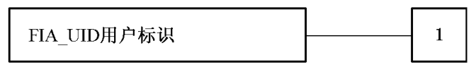

FIA_UID.1 标识定时，允许用户在被 TSF 标识前，执行某些行动。

FIA_UID.2 任何行动前的用户标识，在TSF 允许任何行动之前，要求用户标识他们自己。

**管理：FIA_UID.1**

在管理功能 FMT 中考虑以下行动：

a） 对用户身份的管理；

b） 如果一个授权管理员能够改变在标识前所允许的行动，那么对行动列表的管理。

**管理：FIA_UID.2**

在管理功能 FMT 中考虑以下行动：

a） 用户身份的管理。

**审计：FIA_UID. 1,FIA_UID.2**

如果 PP/ST 中包括 FAU_GEN 安全审计数据产生，下列事件应可审计：

a） 最小级：用户标识机制的使用失败，包括所提供的用户身份；

b） 基本级：用户标识机制的所有使用，包括所提供的用户身份。

FIA_UID.1 标识定时

从属于：无其他组件。

依赖关系：无依赖关系。

FIA_UID. 1.1在用户被标识之前，TSF 应允许执行代表用户的［赋值：TSF 促成的行动列表］。

FIA_UID.1.2在允许代表用户的其他TSF促成的任何行动之前，TSF 应要求用户被成功标识。

FIA_UID. 2 任何行动前的用户标识

从属于：FIA_UID.1

依赖关系：无依赖关系。

FIA_UID.2.1在允许任何代表用户的其他TSF 促成的行动之前，TSF 应要求用户标识自己。

### 11.6 用户_主体绑定（FIA_USB）

**子类行为**

一个已鉴别了的用户，为了使用TOE，一般要先激活一个主体。用户的安全属性则（全部或部分地）与该主体相关联。本子类定义建立和维护用户的安全属性与代表用户活动的主体间的关联的要求。

**组件层次**

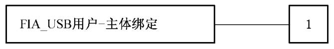

FIA_USB. 1 用户-主体绑定，要求维持用户的安全属性与代表用户活动的主体间的关联。

**管理：FIA_USB.1**

在管理功能 FMT 中考虑以下行动：

a） 授权管理员可以定义默认的主体安全属性。

**审计：FIA_USB.1**

如果 PP/ST 中包括 FAU_GEN 安全审计数据产生，下列事件应可审计：

a） 最小级：用户安全属性与一个主体绑定的失败（如，创建一个主体）；

b） 基本级：用户安全属性与一个主体绑定的成功与失败（如，创建一个主体的成功与失败）。

FIA_USB. 1用户-主体绑定

从属于：无其他组件。

依赖关系：FIA_ATD. 1用户属性定义

FIA_USB.1.1 TSF 应将合适的用户安全属性与代表用户活动的主体相关联。

## 12 FMT类：安全管理

本类目的是规定 TSF 几个方面的管理：安全属性、TSF 数据和功能、可说明不同的管理角色及其相互作用，如能力的分离。

本类有几个目的：

a） 管理TSF 数据，例如旗标；

b） 管理安全属性，例如访问控制表和能力表；

c） 管理TSF 功能，例如功能的选择，影响 TSF 行为的规则或条件；

d） 定义安全角色。

安全管理类分解见图14。

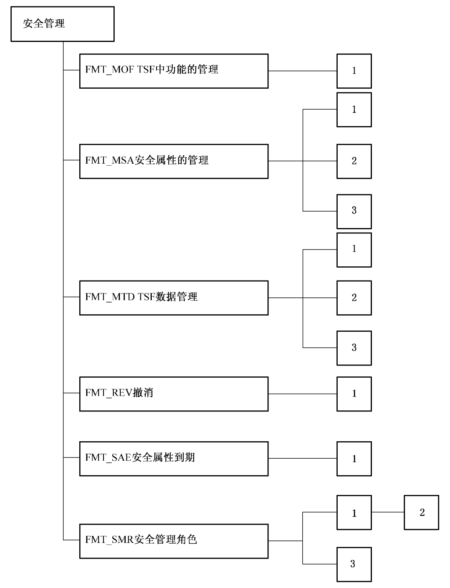

### 12.1 TSF 中功能的管理（FMT_MOF）

**子类行为**

本子类允许授权用户控制 TSF 中功能的管理。例如审计功能和多重鉴别功能都是TSF 中的功能实例。

**组件层次**

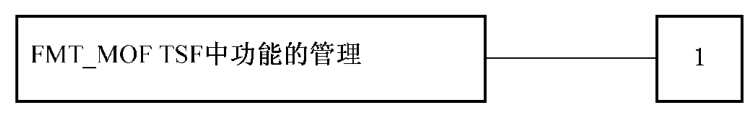

FMT_MOF. 1 安全功能行为的管理，允许授权用户（角色）管理TSF 中使用规则或具有指定可管理条件的功能的行为。

**管理：FMT_MOF.1**

在管理功能 FMT 中考虑以下行动：

a） 管理可以与TSF 中的功能相互作用的角色组。

**审计：FMT_MOF.1**

如果 PP/ST 中包括 FAU_GEN 安全审计数据产生，下列事件应可审计：

a） 基本级：TSF 中功能行为的所有改动。

FMT_MOF.1 安全功能行为的管理

从属于：无其他组件。

依赖关系：FMT_SMR.1 安全角色

FMT_MOF. 1.1 TSF 应仅限于［赋值：已识别授权角色］对功能［赋值：功能列表］具有［选择：确定其行为，禁止，允许，修改其行为］的能力。

### 12.2 安全属性的管理（FMT_MSA）

**子类行为**

本子类允许授权用户控制安全属性的管理。这种管理可能包括查看和修改安全属性的能力。

**组件层次**

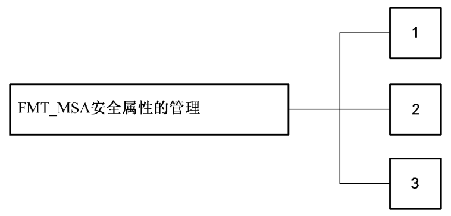

FMT_MSA. 1 安全属性的管理，允许授权用户（角色）管理指定的安全属性。

FMT_MSA.2安全的安全属性，确保赋给安全属性的值针对安全状态是有效的。

FMT_MSA. 3 静态属性初始化，确保安全属性的默认值实际上设成了适当的允许或禁止。

**管理：FMT_MSA. 1**

在管理功能 FMT 中考虑以下行动：

a） 管理可以和安全属性交互的角色组。

**管理：FMT_MSA.2**

尚无预见的额外管理活动。

**管理：FMT_MSA.3**

在管理功能 FMT 中考虑以下行动：

a） 管理可以指定初始值的角色组；

b） 对于某给定的访问控制 SFP，管理默认值的允许或限制设置。

**审计：FMT_MSA.1**

如果 PP/ST 中包括 FAU_GEN 安全审计数据产生，下列事件应可审计：

a） 基本级：所有对安全属性值的改动。

**审计：FMT_MSA.2**

如果 PP/ST 中包括 FAU_GEN 安全审计数据产生，下列事件应可审计：

a） 最小级：对某安全属性，所有提供和被拒绝的值；

b） 详细级：对某安全属性，所有提供和接受的安全值。

**审计：FMT_MSA. 3**

如果 PP/ST 中包括 FAU_GEN 安全审计数据产生，下列事件应可审计：

a） 基本级：对允许或限制规则的默认设置的修改；

b） 基本级：所有对安全属性的初始值的修改。

FMT_MSA. 1 安全属性的管理

从属于：无其他组件。

依赖关系：［FDP_ACC.1子集访问控制，或FDP_IFC.1 子集信息流控制］FMT_SMR. 1 安全角色

FMT_MSA.1.1 TSF 应执行［赋值：访问控制SFP，信息流控制SFP］，以仅限于［赋值：已标识的授权角色］能够对安全属性［赋值：安全属性列表］［选择：改变默认值，查询，修改，删除，［赋值：其他操作丁。

FMT_MSA. 2 安全的安全属性

从属于：无其他组件。

依赖关系：ADV_SPM.1非形式化的TOE 安全策略模型［FDP_ACC. 1子集访问控制，或FDP_IFC.1 子集信息流控制］FM'T_MSA. 1 安全属性的管理FMT_SMR. 1 安全角色

FMT_MSA.2.1 TSF 应确保安全属性只接受安全的值。

FMT_MSA.3 静态属性初始化

从属于：无其他组件。

依赖关系：FMT_MSA.1 安全属性的管理FMT_SMR. 1 安全角色

FMT_MSA. 3.1 TSF 应执行［赋值：访问控制 SFP，信息流控制 SFP］，以便为用于执行SFP的安全属性提供［选择：受限的，许可的，其他特性］默认值。

FMT_MSA. 3.2 TSF 应允许［赋值：已标识授权角色］为生成的客体或信息指定替换性的初始值以代替原来的默认值。

### 12.3 TSF 数据的管理（FMT_MTD）

**子类行为**

本子类允许授权用户（角色）控制 TSF数据的管理。这里的 TSF数据包括审计信息、时钟、系统配置和其他 TSF 配置参数。

**组件层次**

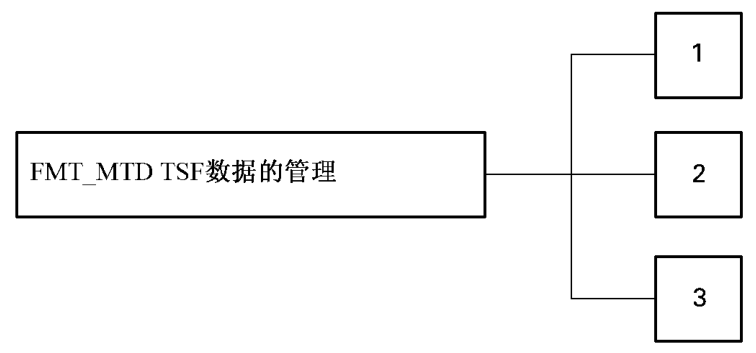

FMT_MTD. 1 TSF 数据的管理，允许授权用户管理 TSF 数据。

FMT_MTD.2 TSF 数据限值的管理，说明如果达到或超过了TSF 数据的限值所应采取的行动。

FMT_MTD.3 安全的TSF 数据，确保赋给 TSF数据的值针对安全状态而言是有效的。

**管理：FMT_MTD.1**

在管理功能 FMT 中考虑以下行动：

a） 管理可以和 TSF 数据相互作用的角色组。

**管理：FMT_MTD.2**

在管理功能 FMT 中考虑以下行动：

a） 管理可以和 TSF 数据的限值相互作用的角色组管理：FMT_MTD.3尚无预见的额外管理活动。

**审计：FMT_MTD. 1**

如果 PP/ST 中包括 FAU_GEN 安全审计数据产生，下列事件应可审计：

a） 基本级：所有对TSF 数据的值的改动。

**审计：FMT_MTD.2**

如果 PP/ST 中包括 FAU_GEN 安全审计数据产生，下列事件应可审计：

a） 基本级：所有对 TSF 数据的限值的改动；

b） 基本级：在超出该限值时，对一切所要采取的行动的修改。

**审计：FMT_MTD.3**

如果 PP/ST 中包括 FAU_GEN 安全审计数据产生，下列事件应可审计：

a） 最小级：所有被拒绝的 TSF数据的值。

FMT_MTD. 1 TSF 数据的管理

从属于：无其他组件。

依赖关系：FMT_SMR. 1 安全角色

FMT_MTD.1.1 TSF 应仅限于［赋值：已标识的授权角色］能够对［赋值：TSF数据列表］［选择：改变默认值，查询，修改，删除，清空，［赋值：其他操作］］。

FMT_MTD. 2 TSF 数据限值的管理

从属于：无其他组件。

依赖关系：FMT_MTD.1 TSF 数据的管理FMT_SMR. 1 安全角色

FMT_MSA. 2.1 TSF 应仅限于［赋值：已识别的授权角色］说明对［赋值：TSF 数据列表］的限值。

FMT_MSA. 2.2 如果 TSF 数据达到或超过了指明的限值，TSF 应采取下面的行动：［赋值：要采取的行动］。

FMT_MTD.3 安全的 TSF 数据

从属于：无其他组件。

依赖关系：ADV_SPM. 1 非形式化 TOE 安全策略模型FMT_MTD.1TSF 数据的管理

FMT_MSA. 3.1 TSF 应确保 TSF 数据只接受安全的值。

### 12.4 撤消（FMT_REV）

**子类行为**

本子类涉及 TOE 内各种实体的安全属性的撒消。

**组件层次**

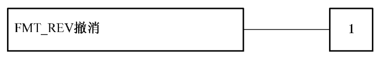

FMT_REV.1撤消，提供对某一时刻将实施的安全属性的撤消。

**管理：FMT_REV.1**

在管理功能 FMT 中考虑以下行动：

a） 管理能够调用撤消安全属性这一功能的角色组；

b） 管理可能发生撤消的用户、主体、客体和其他资源列表；

c） 管理撤消规则。

**审计：FMT_REV.1**

如果 PP/ST 中包括 FAU_GEN 安全审计数据产生，下列事件应可审计：

a） 最小级：撒消安全属性失败；

b） 基本级：所有撤消安全属性的尝试。

FMT_REV.1 撤消

从属于：无其他组件。

依赖关系：FMT_SMR.1 安全角色

FMT_REV.1.1 TSF 应仅限于［赋值：已标识的授权角色］能够撤消 TSC 内与［选择：用户，主体，客体，其他附加资源］相关联的安全属性。

FMT_REV. 1.2 TSF 应执行规则［赋值：撤消规则说明］。

### 12.5 安全属性到期（FMT_SAE）

**子类行为**

本子类涉及对安全属性的有效性实施时间限制的能力。

**组件层次**

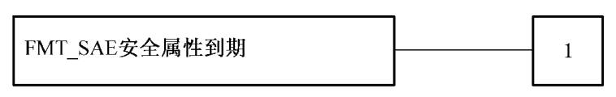

FMT_SAE.1时限授权，为授权用户提供对指定的安全属性说明有效期的能力。

**管理：FMT_SAE.1**

在管理功能 FMT中考虑以下行动：

a） 管理支持有效期的安全属性表；

b） 如果到期，将要采取的行动。

**审计：FMT_SAE.1**

如果 PP/ST 中包括 FAU_GEN 安全审计数据产生，下列事件应可审计：

a） 基本级：属性有效期的说明；

b） 基本级：因属性到期而采取的行动。

FMT_SAE.1 时限授权

从属于：无其他组件。

依赖关系：FMT_SMR.1 安全角色FPT_STM. 1 可靠时间戳

FMT_SAE.1.1 TSF 应仅限于［赋值：已标识的授权角色］能够为［赋值：支持有效期的安全属性列表］说明有效期。

FMT_REV. 1.2对每个这样的安全属性，在超过指定的安全属性的有效期后，TSF 应能够［赋值：对每一安全属性将要采取的行动列表］。

### 12.6 安全管理角色（FMT_SMR）

**子类行为**

本子类目的是控制对用户指定不同角色。这些角色的安全管理能力将在本类的其他子类中描述。

**组件层次**

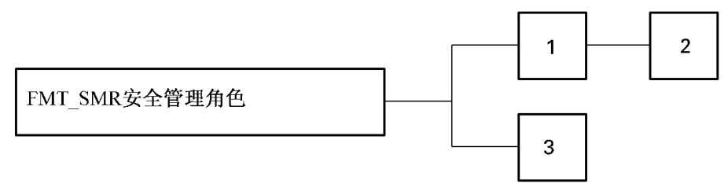

FMT_SMR. 1 安全角色，说明TSF 认同的与安全相关的角色。

FMT_SMR.2 安全角色限制，除了对角色的说明外，还有控制角色之间关系的规则。

FMT_SMR.3 承担角色，要求向 TSF 明确请求承担某个角色。

**管理：FMT_SMR.1**

在管理功能 FMT 中考虑以下行动：

a） 管理构成角色的一部分的用户组。

**管理：FMT_SMR.2**

在管理功能 FMT 中考虑以下行动：

a） 管理构成角色一部分的用户组；

b） 管理角色必须满足的条件。

**管理：FMT_SMR.3**

尚无预见的额外管理活动。

**审计：FMT_SMR. 1**

如果 PP/ST中包括 FAU_GEN 安全审计数据产生，下列事件应可审计：

a） 最小级：对构成角色一部分的用户组的修改；

b） 详细级：对角色权限的每一次使用。

**审计：FMT_SMR.2**

如果 PP/ST 中包括 FAU_GEN 安全审计数据产生，下列事件应可审计：

a） 最小级：对构成角色一部分的用户组的修改；

b） 最小级：由于对角色所给定的条件，尝试使用某角色失败；

c） 详细级：对角色权限的每一次使用。

**审计：FMT_SMR.3**

如果 PP/ST 中包括 FAU_GEN 安全审计数据产生，下列事件应可审计：

a） 最小级：承担角色的明确请求。

FMT_SMR. 1 安全角色

从属于：无其他组件。

依赖关系：FIA_UID.1 标识定时

FMT_SMR. 1. 1 TSF 应维护角色［赋值：已标识的授权角色］。

FMT_SMR. 1.2 TSF 应能够把用户和角色关联起来。

FMT_SMR. 2 安全角色限制

从属于：FMT_SMR.1

依赖关系：FIA_UID.1 标识定时

FMT_SMR.2.1 TSF 应维护角色［赋值：已标识的授权角色］。

FMT_SMR. 2.2 TSF 应能够把用户和角色关联起来。

FMT_SMR.2.3 TSF 应确保条件［赋值：不同角色的条件］得到满足。

FMT_SMR. 3 承担角色

从属于：无其他组件。

依赖关系：FMT_SMR.1 安全角色

FMT_SMR.3.1 TSF 应要求承担下列角色［赋值：角色了的明确请求。

## 13 FPR类：隐秘

此类包括隐秘要求。这些要求为用户提供其身份不被其他用户发现或滥用的保护。

隐秘类分解见图15。

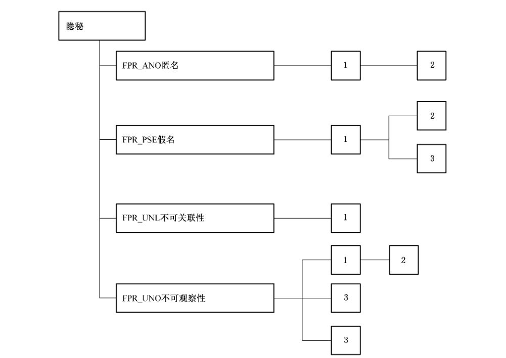

### 13.1 匿名（FPR_ANO）

**子类行为**

本子类确保一用户在使用资源或服务时不暴露其身份。匿名要求提供了用户身份的保护。匿名需要对用户的身份提供保护。匿名并不保护主体的身份。

**组件层次**

FPR_ANO.1 匿名，要求其他用户或主体不能确定与某个主体或操作所绑定的那一用户的身份。

FPR_ANO.2 无征求信息的匿名，通过确保 TSF 不询问用户身份来增强 FPR_ANO.1 的要求。

**管理：FPR_ANO. 1,FPR_ANO.2**

对这些组件，没有可预见的管理行动。

**审计：FPR_ANO. 1,FPR_ANO. 2**

如果在 PP/ST 中FAU_GEN 安全审计数据产生，则下面的行动应是可审计的。

a） 最小级：匿名机制的调用。

FPR_ANO.1 匿名

从属于：无其他组件。

依赖关系：无依赖关系。

FPR_ANO.1.1 TSF 应确保［赋值：用户或主体集］不能确定与［赋值：主体或操作或客体列表］绑定的真实用户名。

FPR_ANO.2 无征求信息的匿名。

从属于：FPR_ANO.1

依赖关系：无依赖关系。

FPR_ANO. 2.1 TSF 应确保［赋值：用户或主体集］不能确定与［赋值：主体或操作或客体列表］绑定的真实用户名。

FPR_ANO.2.2 TSF 应提供［赋值：服务列表］给［赋值：主体列表］，而不询问真实的用户名。

### 13.2 假名（FPR_PSE）

**子类行为**

本子类确保一用户在使用资源或设备时不暴露其用户身份，但仍能对该次使用负责。

**组件层次**

FPR_PSE. 1 假名，要求一组用户或主体不能确定与主体或操作绑定的用户身份，但是该用户仍能对其行为负责。

FPR_PSE. 2 可逆假名，要求 TSF 能根据所提供的化名确定初始用户身份。

FPR_PSE.3 化名假名，要求 TSF 能根据用户化名的构造规则来确定用户身份。

**管理：FPR_PSE. 1,FPR_PSE. 2, FPR_PSE. 3**

对这些组件没有可能预知的管理行为。

**审计：FPR_PSE.1,FPR_PSE.2,FPR_PSE.3**

如果 PP/ST 中包括 FAU_GEN 安全审计数据产生，下面的行动应是可审计的。

a） 最小级：请求辨析用户身份的主体/用户应被审计。

FPR_PSE.1 假名

从属于：无其他组件。

依赖关系：无依赖关系。

FPR_PSE. 1.1 TSF 应确保［赋值：用户或主体集］不能确定与［赋值：主体或操作或客体列表］绑定的真实用户名。

FPR_PSE.1.2 TSF 应能提供真实用户名的［赋值：化名的数目］个化名给［赋值：主体列表］。

FPR_PSE.1.3 TSF 应［选择：决定一用户的化名，接受该用户的化名］和验证它是否符合［赋值：化名的量度］FPR_PSE.2 可逆假名

从属于：FPR_PSE.1

依赖关系：FIA_UID.1 标识定时

FPR_PSE.2.1 TSF 应确保［赋值：用户或主体集］不能确定与［赋值：主体或操作或客体列表］绑定的真实用户名。

FPR_PSE.2.2 TSF 应能提供真实用户名的［赋值：化名的数目］个化名给［赋值：主体列表］。

FPR_PSE.2.3 TSF 应能［选择：决定一用户的化名，接受该用户的化名］和验证它是否符合［赋值：化名的量度］。

FPR_PSE.2.4 TSF 应对［选择：授权用户，［赋值：可信主体列表了提供只在以下〔赋值：各种条件列表］下基于提供的化名来决定用户身份的能力。

FPR_PSE.3 化名假名

从属于：FPR_PSE.1

依赖关系：无依赖关系。

FPR_PSE.3.1 TSF 应确保［赋值：用户或主体集］不能确定与［赋值：主体或操作或客体列表］绑定的真实用户名。

FPR_PSE.3.2 TSF 应能提供真实用户名的［赋值：化名的数目］个化名给［赋值：主体列表］。

FPR_PSE.3.3 TSF 应能［选择：决定一用户的化名，接受该用户的化名］和验证它是否符合［赋值：化名的量度］。

FPR_PSE.3.4 TSF 应能给真实用户名提供一化名，它应当与在以下［赋值：各种列表］下以前提供的化名相同，要不然提供的化名应与以前提供的化名毫不相关。

### 13.3 不可关联性（FPR_UNL）

**子类行为**

本子类确保一用户可多次使用资源和服务，但任何人都不能将这些使用联在一起。

**组件层次**

FPR_UNL. 1 不可关联性，要求用户或主体不能确定是否同一个用户在系统中进行了某种特定的操作。

**管理：FPR_UNL.1**

在管理功能 FMT 中考虑以下行动。

不可关联功能的管理。

**审计：FPR_UNL.1**

如果 PP/ST 中包括 FAU_GEN 安全审计数据产生，下面的行动应是可审计的。

a） 最小级：不可关联性机制的调用。

FPR_UNL. 1 不可关联性

从属于：无其他组件。

依赖关系：无依赖关系。

FPR_UNL.1.1 TSF 应确保［赋值：用户或主体集］不能确定是否［赋值：操作列表］选择：由同一用户引起，与如下［赋值：关系列表］有关］。

### 13.4 不可观察性（FPR_UNO）

**子类行为**

本子类确保一用户在使用资源和服务时其他人尤其是第三方不能观察到该资源和服务正被使用。

**组件层次**

FPR_UNO.1 不可观察性，要求用户或主体不能确定一个操作是否在执行。

FPR_UNO.2 影响不可观察性的信息的分配，要求TSF 能提供专门的机制以防止 TOE 内有关隐秘信息的集中。当出现安全性损害时，如此的集中可能会影响到不可观察性。

FPR_UNO.3 无征求信息的不可观察性，要求 TSF 不要试图获得可能会损害不可观察性的有关隐秘信息。

FPR_UNO. 4 授权用户可观察性，要求TSF 能够提供给一个或多个授权用户观察资源或服务使用情况的能力。

**管理：FPR_UNO.1, FPR_UNO.2**

在管理功能 FMT 中考虑以下行动：

a） 不可观察性功能的行为的管理。

**管理：FPR_UNO. 3**

对这些组件没有可预知的管理活动。

**管理：FPR_UNO. 4**

在管理功能 FMT 中考虑以下行动：

a） 有能力决定操作发生的授权用户列表。

**审计：FPR_UNO.1, FPR_UNO.2**

如果在 PP/ST 中包括 FAU_GEN 安全审计数据产生，下面的行动应是可审计的。

a） 最小级：调用不可观察性机制。

**审计：FPR_UNO.3**

没有可预见的可审计事件。

**审计：FPR_UNO.4**

如果在 PP/ST 中包括 FAU_GEN 安全审计数据产生，下面的行动应是可审计的。

a） 最小级：用户或主体对资源或服务使用的观察行为。

FPR_UNO. 1 不可观察性

从属于：无其他组件。

依赖关系：无依赖关系。

FPR_UNO.1. 1 TSF 应确保［赋值：用户或主体列表］不能观察由［赋值：受保护的用户或主体列表］对［赋值：客体列表］进行的操作［赋值：操作列表］。

FPR_UNO.2 影响不可观察性的信息的分配

从属于：FPR_UNO.1

依赖关系：无依赖关系。

FPR_UNO.2.1 TSF 应确保［赋值：用户或主体列表］不能观察由［赋值：受保护的用户或主体列表］对［赋值：客体列表］进行的操作［赋值：操作列表］。

FPR_UNO. 2.2 TSF 应在TOE 的不同部分中分配［赋值：不可观察性相关信息］，使得在信息的生存期间，下列条件成立：［赋值：条件列表］。

FPR_UNO.3无征求信息的不可观察性

从属于：无其他组件。

依赖关系：FPR_UNO.1 不可观察性。

FPR_UNO.3. 1 TSF 应当在没有征求任何［赋值：隐秘相关信息］的情况下为［赋值：主体列表］提供［赋值：服务列表］。

FPR_UNO.4 授权用户可观察性

从属于：无其他组件。

依赖关系：无依赖关系。

FPR_UNO.4.1 TSF 应提供［赋值：授权用户集］观察［赋值：资源或服务列表］使用情况的能力。

## 14 FPT 类：TSF 保护

本类包含了多个功能要求子类。一方面与提供 TSF（和特定 TSP 无关）的机制的完整性和管理有关，另一方面与 TSF 数据（和TSP数据的特定内容无关）的完整性有关。在某种意义下，FPT类的子类可能出现与FDP类（用户数据保护）中完全相同的组件，它们甚至用相同的机制来实现。但是，FDP 主要针对用户数据的保护，而 FPT则针对TSF数据的保护。实际上，FPT 类的组件对保证 TOE 中的SFP 不被篡改和旁路是必需的。

从 FPT类的观点看，TSF 有以下三大部分：

a） TSF抽象机，它可以是虚拟的，也可以是物理机器，这取决于评估执行时特定的TSF 实现。

b） TSF实现，在抽象机上执行并实现执行 TSP的机制。

c） TSF数据，这是指导执行 TSP 的管理数据库。

TSF 保护类分解见图16。

### 14.1 根本抽象机测试（FPT_AMT）

**子类行为**

本子类定义了 TSF 用来验证所作的安全假定而进行测试的要求，这些安全假定是与 TSF 所依赖的根本抽象机有关的。这种“抽象的”机器既可以是硬件/固件平台，也可以是某些已知的并经评价的软硬件结合构成的虚拟机。

**组件层次**

FPT_AMT.1 抽象机测试，提供了对根本抽象机的测试。

管理：FPT _AMT.1在管理功能 FMT中考虑以下行动：

a） 抽象机测试产生条件的管理，比如初始启动期间、规定的时间间隔或在某些特定条件下。

b） 恰当的时间间隔管理。

审计：FPTAMT.1如果 PP/ST 中包含 FAU_GEN 安全审计数据产生，下列行动应审计：

a） 基本级：抽象机的测试执行和测试结果。

FPT_AMT. 1 抽象机测试

从属于：无其他组件。

依赖关系：无依赖关系。

FPT_AMT.1.1 TSF 应运行一组测试［选择：初始化启动期间，正常运转时周期性地，授权用户提出请求时，其他条件］来验证 TSF 所依赖的抽象机所提供的安全假定是否正确运行。

### 14.2 失败保护（FPT_FLS）

**子类行为**

本子类要求确保当TSF 中确定的失败类型出现时，该TOE 不会违背其 TSP。

**组件层次**

本子类仅有一个组件，FPT_FLS. 1 带保存安全状态的失败，要求TSF 当确定的失败出现时保存一个安全状态。

**管理：FPT_FLS. 1**

尚无可预知的管理活动。

**审计：FPT_FLS.1**

如果 PP/ST 中包含FAU_GEN 安全审计数据产生，下列行动应是可审计的：

a） 基本级：TSF 失败。

FPT_FLS.1 带保存安全状态的失败

从属于：无其他组件。

依赖关系：ADV_SPM.1 非形式化的TOE 安全策略模型

FPT_FLS.1.1 TSF 在下列失败发生时应保存一个安全状态［赋值：TSF 的失败类型列表］。

### 14.3 输出 TSF 数据的可用性（FPT_ITA）

**子类行为**

本子类定义了一些规则，这些规则防止 TSF 数据在该 TSF 与一远程可信IT 系统之间移动时失去其可用性。这些数据可能是 TSF 的关键数据，如口令、密钥、审计数据或 TSF 可执行的代码。

**组件层次**

本子类由一个组件组成：FPT_ITA.1 在所定义可用性量度范围内的TSF 间的可用性。本组件要求TSF 以确定的可能性程度，确保向远程可信 IT 系统提供的 TSF 数据的可用性。

**管理：FPT_ITA.1**

在管理功能 FMT 中考虑以下行动：

a） 管理对远程可信IT 系统必须可用的TSF数据类型列表。

**审计：FPT_ITA.1**

如果 PP/ST 中包含FAU_GEN 安全审计数据产生，下列行动应是可审计的：

a） 最小级：TOE 要求 TSF 数据时，TSF 数据不存在。

FPT_ITA.1 在所定义可用性量度范围内的 TSF 间的可用性

从属于：无其他组件。

依赖关系：无依赖关系。

FPT_ITA. 1.1 在下述条件［赋值：确保可用性的条件］下，TSF 应确保提供给［赋值：所定义可用性量度范围］内的远程可信 IT 系统的［赋值：TSF 数据类型列表］的可用性。

### 14.4 输出 TSF 数据的保密性（FPT_ITC）

**子类行为**

本子类定义了保护TSF数据在TSF 与远程可信IT 系统之间传输时，不被未授权泄露的规则。这些数据可以是TSF 的关键数据，如口令、密钥、审计数据或 TSF 的可执行代码。

**组件层次**

本子类仅有一个组件，FPT_ITC.1 传输过程中 TSF 间的保密性，它要求 TSF 确保数据在TSF 与远程可信IT 系统间传输时不被泄露。

**管理：FPT_ITC.1**

尚无可预见的管理活动。

**审计：FPT_ITC.1**

即使 PP/ST 中包含 FAU_GEN 安全审计数据产生，也没有确定的活动可审计。

FPT_ITC.1 传输过程中 TSF 间的保密性

从属于：无其他组件。

依赖关系：无依赖关系。

FPT_ITC.1.1 在TSF数据从 TSF 到远程可信IT 系统的传输过程中，TSF 应保护所有的TSF数据不被未授权泄漏。

### 14.5 输出 TSF 数据的完整性（FPT_ITI）

**子类行为**

这子类定义了一些保护规则，防止 TSF 数据在 TSF 与远程可信IT 系统的传输过程中被未授权修改。这些数据可以是 TSF 的关键数据，如口令、密钥、审计数据或TSF 的可执行代码。

**组件层次**

FPT_ITI.1 TSF 间修改的检测，假设远程可信IT 系统知道所使用的机制，则本组件提供了检测在TSF 与远程可信 IT 系统间传输的 TSF 数据是否在传输过程中被修改的能力。

FPT_ITI.2 TSF 间修改的检测与改正，假设远程可信IT 系统知道所使用的机制，则本组件提供了让远程可信IT 系统不仅可以检测到 TSF 数据的修改，还可以更正被修改数据的能力。

**管理：FPT_ITI.1**

尚无可预见的管理活动。

**管理：FPT_ITI.2**

在管理功能 FMT 中考虑以下行动：

a） 管理TSF数据的类型，本类 TSF 数据若在传输期间被修改，TSF 应试图将其改正；

b） 管理TSF数据在传输过程中被修改后，TSF能采取的行动类型。

**审计：FPT_ITI.1**

如果 PP/ST 中包含 FAU_GEN 安全审计数据产生，下列行动应是可审计的：

a） 最小级：检测传输的 TSF 数据的修改；

b） 基本级：根据检测到的传输 TSF数据被修改情况所采取的行动。

**审计：FPT_ITI.2**

当 PP/ST 中有 FAU_GEN 安全审计数据产生时，须进行下列审计：

a） 最小级：检测传输 TSF 数据是否被修改；

b） 基本级：根据检测到的传输 TSF 数据被修改情况所采取的行动；

c） 基本级：改正机制的使用。

FPT_ITI.1 TSF 间修改的检测

从属于：无其他组件。

依赖关系：无依赖关系。

FPT_ITI.1.1 TSF 应提供在下列量度范围内：［赋值：已定义的修改量度］，检测TSF 与远程可信IT 系统间传输的所有TSF 数据是否被修改的能力。

FPT_ITI.1.2 TSF 应提供验证在 TSF 与远程可信IT 系统间传输的所有 TSF 数据的完整性及执行如果检测到修改所采取的［赋值：采取的行动］的能力。

FPT_ITI.2 TSF 间修改的检测与改正

从属于：FPT_ITI.1

依赖关系：无依赖关系。

FPT_ITI.2.1 TSF 应提供在下列量度范围内［赋值：定义的修改量度］，检测 TSF 与远程可信 IT系统间传输的所有 TSF 数据被修改的能力。

FPT_ITI.2.2 TSF 应提供验证在 TSF 与远程可信IT 系统间传输的所有 TSF 数据的完整性执行，如果检测到修改所采取的［赋值：采取的行动］的能力。

FPT_ITI.2.3 TSF 应提供改正在TSF 与远程可信IT 系统间传输的被修改的［赋值：修改类型］所有 TSF 数据的能力。

### 14.6 TOE 内 TSF数据的传输（FPT_ITT）

**子类行为**

：本子类提供了旨在使TSF 数据当其通过内部信道在TOE 的分离部分间传输时受到保护的要求。

**组件层次**

FPT_ITT.1 内部 TSF 数据传输的基本保护，要求对在 TOE 的分离部分间传输的 TSF 数据进行保护。

FPT_ITT.2 TSF 数据传输的分离，要求 TSF 在传输过程中把用户数据从 TSF 数据中分离出来。

FPT_ITT.3 TSF 数据完整性的监视，要求监视在 TOE 分离部分间传输的TSF 数据的确定的完整性错误。

**管理：FPT_ITT.1**

在管理功能 FMT 中考虑以下行动：

a） 管理 TSF 要防止的修改类型；

b） 管理用来保护在TSF 不同部分间传输的数据的保护机制。

**管理：FPT_ITT.2**

在管理功能 FMT 中考虑以下行动：

a） 管理TSF 要防止的修改类型；

b） 管理用来保护在 TSF 不同部分间传输的数据的保护机制；

c） 管理分离机制。

**管理：FPT_ITT.3**

在管理功能 FMT 中考虑以下行动：

a） 管理TSF 要防止的修改类型；

b） 管理用来保护在 TSF 不同部分间传输的数据的保护机制；

c） 管理 TSF 试图要检测的 TSF 数据的修改类型；

d） 管理将采取的行动。

**审计：FPT_ITT.1,FPT_ITT.2**

如果 PP/ST 中包含 FAU_GEN 安全审计数据产生，没有可审计的确定的行动。

**审计：FPT_ITT.3**

如果 PP/ST 中包含 FAU_GEN 安全审计数据产生，下列行动应是可审计的：

a） 最小级：检测 TSF 数据的改动；

b） 基本级：检测到完整性错误后采取的行动。

FPT_ITT. 1 内部 TSF 数据传输的基本保护

从属于：无其他组件。

依赖关系：无依赖关系。

FPT_ITT. 1.1 TSF 应保护 TSF 数据在 TOE 的分离部分间传输时不被［选择：泄漏，修改］。

FPT_ITT.2 TSF 数据传输的分离

从属于：FPT_ITT.1

依赖关系：无依赖关系。

FPT_ITT.2.1 TSF 应保护 TSF 数据在 TOE 的分离部分间传输时不被［选择：泄漏，修改］。

FPT_ITT.2.2 当数据在不同的TOE 部分间传输时，TSF 应将用户数据从 TSF 数据中分离出来。

FPT_ITT.3 TSF 数据完整性监视

从属于：无其他组件。

依赖关系：FPT_ITT. 1 内部 TSF 数据传输的基本保护

FPT_ITT.3.1 TSF 应能检测在 TOE 的分离部分间传输的TSF 数据的［选择：数据的修改，数据的替换，数据的重排，数据的删除，［赋值：其他完整性错误］］。

FPT_ITT.3.2 检测到数据的完整性错误后，TSF应采取下列行动：［赋值：规定采取的行动］。

### 14.7 TSF 物理保护（FPT_PHP）

**子类行为**

TSF 物理保护组件指限制对TSF 的未授权的物理访问及阻止并抵抗对TSF 未授权的物理修改及替换。

本子类组件的要求确保了TSF 不被物理篡改和干扰。若满足了这些组件的要求，TSF 就可以用一种可检测出物理篡改或对物理篡改执行抵抗的方式封装起来并使用。如果没有这些组件，在物理危险无法避免的环境中 TSF 的保护功能就会失效。关于 TSF 如何对物理篡改企图作出反应，本子类也提供了的要求。

**组件层次**

FPT_PHP.1 物理攻击的被动检测，提供指示 TSF 设备或TSF 元件遭到篡改的功能。但是检测到篡改后不会自动进行提示，授权用户必须激活安全管理功能或手动检查以判断篡改是否发生。

FPT_PHP. 2 物理攻击报告，对确定的一个物理侵入子集提供自动篡改报告。

FPT_PHP.3 物理攻击抵抗，提供防止或抵抗对 TSF设备和TSF 元件的物理篡改的功能。

**管理：FPT_PHP.1,FPT_PHP.3**

没有可预见的管理活动。

**管理：FPT_PHP.2**

在管理功能 FMT 中考虑以下行动：

a） 管理获取入侵报告的用户或角色；

b）管理一系列设备，这些设备向指定的用户或角色报告入侵。

**管理：FPT_PHP.3**

在管理功能 FMT 中考虑以下行动：

a） 管理对物理篡改的自动应答。

**审计：FPT_PHP.1**

如果 PP/ST 中包含 FAU_GEN 安全审计数据产生，如下行动应是可审计的：

a） 最小级：用IT 手段检测入侵。

**审计：FPT_PHP.2**

如果 PP/ST 中给FAU_GEN 安全审计数据产生，如下行动应是可审计的：

a） 最小级：检测入侵。

**审计：FPT_PHP.3**

如果 PP/ST 中包含 FAU_GEN 安全审计数据产生，没有确定的可审计的行动。

FPT_PHP.1 物理攻击的被动检测

从属于：无其他组件。

依赖关系：FMT_MOF.1 安全功能行为管理

FPT_PHP.1.1 对可能危及 TSF 的安全的物理篡改提供明确的检测。

FPT_PHP.1.2 为TSF 提供判断 TSF 设备或 TSF 元件是否已被物理篡改的能力。

FPT_PHP.2 物理攻击报告

从属于：FPT_PHP.1

依赖关系：FMT_MOF.1 安全功能行为管理

FPT_PHP.2.1 对可能危及 TSF 的安全的物理篡改提供明确的检测。

FPT_PHP.2.2 为TSF 提供判断 TSF 设备或 TSF 元件是否已被物理篡改的能力。

FPT_PHP.2.3 对［赋值：需主动检测的TSF 设备及元件列表］，TSF 应监视这些设备和元件，并当其发生物理篡改时通报给［赋值：指定的用户或角色］。

FPT_PHP. 3 物理攻击抵抗

从属于：无其他组件。

依赖关系：无依赖关系。

FPT_PHP.3.1 TSF 应通过自动应答来抵抗对［赋值：TSF 设备/元件列表］的［赋值：各种物理篡改］，以遵从 TSP。

### 14.8 可信恢复（FPT_RCV）

**子类行为**

本子类的要求确保 TSF能确定TOE 是在没有减弱安全的状况下启动的，并在运行中断后能在不减弱保护的情况下恢复。因为TSF 的启动状态决定了对后续状态的保护，故本子类是很重要的。

**组件层次**

FPT_RCV.1 手工恢复，容许 TOE 只提供人工干预以返回安全状态的机制。

FPT_RCV.2 自动恢复，至少对一种类型的服务中断，在无人工干预的情况下能恢复到安全状态；对其他类型服务中断的恢复可以要求人工干预。

FPT_RCV.3 无过度损失的自动恢复，也提供自动恢复，但通过不容许被保护客体的过度损失来加强要求。

FPT_RCV.4 功能恢复，在特定的SF级别上恢复，保障成功完成恢复或将 TSF 数据回到一个安全状态。

**管理：FPT_RCV.1**

在管理功能 FMT 中考虑以下行动：

a） 管理在维护模式下谁能够获得恢复能力。

**管理：FPT_RCV.2,FPT_RCV.3**

在管理功能 FMT 中考虑以下行动：

a） 管理在维护模式下谁能够获得恢复能力；

b） 管理通过自动化过程来处理的失败及服务中断列表。

**管理：FPT_RCV.4**

没有可预见的管理活动。

**审计：FPT_RCV.1,FPT_RCV.2,FPT_RCV.3**

如果 PP/ST 中含有 FAU_GEN 安全审计数据产生，如下行动应是可审计的：

a） 最小级：出现失败或服务中断；

b） 最小级：恢复正常运行；

c） 基本级：失败或服务中断类型。

**审计：FPT_RCV.4**

如果 PP/ST 中含有 FAU_GEN 安全审计数据产生，如下行动应是可审计的：

a） 最小级：如有可能，安全功能失败后，不能返回到安全状态的可能性；

b） 基本级：如有可能，检测安全功能的失败情况。

FPT_RCV.1 手工恢复

从属于：无其他组件。

依赖关系：FPT_TST.1 TSF测试AGD_ADM.1 管理员指南ADV_SPM.1 非形式化的TOE安全策略模型FPT_RCV.1.1 发生失败或服务中断后，TSF 应进入维护方式，该方式提供将 TOE返回到一个安全状态的能力。

FPT_RCV. 2 自动恢复

从属于：FPT_RCV.1

依赖关系：FPT_TST.1 TSF 测试AGD_ADM.1 管理员指南ADV_SPM. 1 非形式化 TOE 安全策略模型

FPT_RCV.2.1 当不能从失败或服务中断自动恢复时，TSF 应进入维护方式，该方式提供将TOE返回到一个安全状态的能力。

FPT_RCV.2.2 对［赋值：失败/服务中断列表］，TSF 应确保通过自动化过程使 TOE返回到一个安全状态。

FPT_RCV.3 无过度损失的自动恢复

从属于：FPT_RCV.2

依赖关系：FPT_TST.1 TSF 测试AGD_ADM.1 管理员指南ADV_SPM. 1 非形式化的TOE 安全策略模型

FPT_RCV.3.1 当不能从失败或服务中断自动恢复时，TSF 应进入维护方式，该方式提供将TOE返回到一个安全状态的能力。

FPT_RCV.3.2 对［赋值：失败/服务中断列表］，TSF 应确保通过自动化过程使 TOE 返回到一个安全状态。

FPT_RCV.3.3 TSF 提供的从失败或服务中断状态恢复的功能，应确保 TSC 内的TSF 数据或客体在无过度［赋值：数量］损失的情况下恢复到初始状态。

FPT_RCV.3.4 TSF 应提供决定客体能否被恢复的能力。

FPT_RCV.4 功能恢复

从属于：无其他组件。

依赖关系：ADV_SPM.1 非形式化的 TOE 安全策略模型

FPT_RCV. 4.1 TSF 应确保［赋值：SF 和失败情况列表］有如下特性，即SF或者被成功完成，或者对指明的失败情况恢复到一致的安全状态。

### 14.9 重放检测（FPT_RPL）

**子类行为**

本子类解决对各种类型实体（如消息、服务请求及应答）的重放检测及随后的改正行动。只要检测出重放，就可以有效地避免重放。

**组件层次**

本子类仅有一个组件，FPT_RPL.1重放检测，它要求 TSF 能够检测出确定实体的重放。

**管理：FPT_RCV.1**

在管理功能 FMT 中考虑以下行动：

a） 管理应该检测出其重放的确定实体列表；

b） 管理发生重放时须采取的行动列表。

**审计：FPT_RCV.1,FPT_RCV.2**

如果 PP/ST 中包含 FAU_GEN 安全审计数据产生，如下行动应是可审计的：

a） 基本级：检测重放攻击；

b） 详细级：对特定情况采取的行动。

FPT_RPL.1 重放检测

从属于：无其他组件。

依赖关系：无依赖关系。

FPT_RPL.1.1 TSF 应检测以下实体的重放［赋值：确定实体列表］。

FPT_RPL. 1.2 检测到重放时，TSF 应执行［赋值：具体操作列表］。

### 14.10 参照仲裁（FPT_RVM）

**子类行为**

本子类要求解决传统参照监视器的“一直运行”这一方面。本子类的目的是对一个给定的 SFP，确保要求执行策略的所有行动，都必须由TSF 根据SFP加以确认。如果TSF 中执行该 SFP的部分也满足来自 FPT_SEP（域分离）和 ADV_INT（TSF 内部）的合适组件的要求，那么 TSF 的该部分就为SFP提供了一个“参照监视器”。

当且仅当不可信主体所请求的有关任何或全部SFP 的所有可执行行动（例如：访问客体）在成功前都要被TSF确认，实现该 SFP的TSF 才能提供有效抵抗非授权操作的保护。如果一个可被TSF执行的操作，被不正确地执行或旁路，则该 SFP 的整体执行将受危害。这样，主体就可通过多种未授权的途径旁路掉该 SFP（例如逃避对主体或客体的存取校验、旁路掉对保护措施由应用程序执行的客体的校验、将存取权保留到超过其预定的生存期、旁路掉对被审计行动的审计或旁路掉鉴别）。注意，某些主体，对 SFP而言也称作“可信主体”，他们自己执行该 SFP或许是可信的，并旁路掉该 SFP的仲裁。

**组件层次**

本子类仅有一个组件，FPT_RVM.1 TSP 的不可旁路性，它要求对 TSP 中的所有SFP都不可旁路。

**管理：FPT_RVM.1**

没有可预见的管理活动。

**审计：FPT_RVM.1**

如果 PP/ST 中包含 FAU_GEN 安全审计数据产生，无确定的行动是可审计的。

FPT_RVM.1 TSP 的不可旁路性

从属于：无其他组件。

依赖关系：无依赖关系。

FPT_RVM.1.1 TSF 应确保在 TSC 内允许继续执行每一项功能前，TSP 的执行功能都被成功激活。

### 14.11 域分离（FPT_SEP）

**子类行为**

本子类的组件确保 TSF 自己的执行时至少有一个安全域可用，并保护该 TSF 不被不可信主体从外部干扰篡改（如修改 TSF 编码或数据结构）。满足本子类要求的 TSF 具有自我保护能力，即不可信主体将不能修改或破坏该 TSF。

本子类的要求如下：

a） 将TSF 的安全域（“保护域”）的资源和该域外的主体及不受约束的实体分离开，使得保护域外的实体不能观察或修改保护域内的 TSF数据或TSF 编码。

b） 域间的传输是受控的，不能随意地进入保护域或随意从保护域返回。

c） 通过传地址方式传到保护域的用户或应用参数，应通过保护域地址空间进行确认；而通过传值方式传到保护域的那些用户或应用参数，则应通过该保护域所期望的值进行确认。

d） 除了通过 TSF 控制的共享部分外，主体的安全域是不同的。

**组件层次**

FPT_SEP. 1 TSF 域分离，为TSF 提供不同的的保护域，并在TSC内将主体分离。

FPT_SEP.2 SFP 域分离，要求对 TSF 进一步细分成不同的域，一些是针对作策略参照监视器的SFP的确定集合，一个是针对 TSF 剩余部分，也有一些是针对 TOE 内的非 TSF 部分。

FPT_SEP.3 完全的参照监视器，要求有针对TSP执行的不同的域，有针对 TSF 剩余部分的域，还有针对TOE 内的非TSF 部分的域。

**管理：FPT_SEP.1,FPT_SEP.2,FPT_SEP.3**

没有可预见的管理活动。

**审计：FPT_SEP.1,FPT_SEP.2,FPT_SEP.3**

如果 PP/ST 中包含 FAU_GEN 安全审计数据产生，无确定的活动可审计的。

FPT_SEP.1 TSF 域分离

从属于：无其他组件。

依赖关系：无依赖关系。

FPT_SEP. 1.1 TSF 应为自身执行时维护一个安全域，防止不可信主体的干扰和篡改。

FPT_SEP.1.2 TSF 应分离TSC 内各主体的安全域。

FPT_SEP.2 SFP 域分离

从属于：FPT_SEP.1

依赖关系：无依赖关系。

FPT_SEP. 2.1 TSF 的未隔离部分应为自身执行时维护一个安全域，防止不可信主体的干扰和篡改。

FPT_SEP.2.2 TSF 应分离 TSC 内各主体的安全域。

FPT_SEP.2.3 TSF 应在一个安全域中为其自身执行维护与［赋值：访问控制或信息流控制 SFP列表］有关的TSF部分，以防止他们被相对于这些 SFP 而言的不可信主体和 TSF剩余部分的干扰和篡改。

FPT_SEP.3 完全的参照监视器

从属于：FPT_SEP.2

依赖关系：无依赖关系。

FPT_SEP.3.1 TSF 的未隔离部分应为自身执行维护一个安全域，防止不可信主体的干扰和篡改。

FPT_SEP. 3.2 TSF 应分离 TSC 内各主体的安全域。

FPT_SEP.3.3 TSF 应在一个安全域中其自身执行，维护执行访问控制或信息流控制 SFP的TSF 部分，以防止他们被相对于 TSP 而言的不可信主体和 TSF 剩余部分的干扰和篡改。

### 14.12 状态同步协议（FPT_SSP）

**子类行为**

分布式系统由于存在系统各部分间潜在的状态差别及通信延迟等问题，因而比单一系统复杂得多。

大多数情况下，分布式功能间的状态同步涉及到交换协议，而不是一个简单的操作。当在这些协议的分布式环境中存在蓄意的危害时，就需要更为复杂的防御协议。

FPT_SSP 对TSF 的某些关键安全功能使用该可信的协议提出了要求。FPT_SSP 确保 TOE 的两个分布部分（如主机）在完成与安全有关的活动后，状态保持同步。

**组件层次**

FPT_SSP. 1 简单的可信回执，只要求数据接收者给出简单回执。

FPT_SSP.2 相互的可信回执，要求对交换数据相互回执。

**管理：FPT_SSP.1,FPT_SSP.2**

没有可预见的管理活动。

**审计：FPT_SSP. 1, FPT_SSP. 2**

如果 PP/ST 中包含 FAU_GEN 安全审计数据产生，如下行动应是可审计的：

a） 最小级：接收期待的回执时，发生失败。

FPT_SSP. 1 简单的可信回执

从属于：无其他组件。

依赖关系：FPT_ITT. 1 内部 TSF 数据传输的基本保护

FPT_SSP.1.1 当TSF 的另一部分发出请求时，TSF 应对接收到未经修改的TSF 数据给出回执。

FPT_SSP.2 相互的可信回执

从属于：FPT_SSP.1

依赖关系：FPT_ITT.1 内部 TSF 数据传输的基本保护

FPT_SSP.2. 1 当TSF 的另一部分发出请求时，TSF 应对接收到未经修改的TSF 数据给出回执。

FPT_SSP. 2.2 TSF 应通过回执来确保 TSF 的有关部分知道在其各部分间传输数据处于正确状态。

### 14.13 时间戳（FPT_STM）

**子类行为**

本子类对 TOE 内可靠的时间戳功能提出要求。

**组件层次**

本子类仅有一个组件，FPT_STM.1 可靠的时间戳，要求TSF 为TSF功能提供可靠的时间戳。

**管理：FPT_STM.1**

在管理功能 FMT 中考虑以下行动：

a） 时间管理。

**审计：FPT_STM.1**

如果 PP/ST 中包含FAU_GEN 安全审计数据产生，如下行动应是可审计的：

a） 最小级：时间的变动；

b） 详细级：提供时间戳。

FPT_STM. 1 可靠的时间戳

从属于：无其他组件。

依赖关系：无依赖关系。

FPT_STM. 1.1 TSF 应能为自身的应用提供可靠的时间戳。

### 14.14 TSF 间 TSF数据的一致性（FPT_TDC）

**子类行为**

在分布式或复合系统环境下，TOE 或许需要与其他可信 IT 系统交换 TSF 数据（如与数据有关的SFP 属性、审计信息、标识信息等等）。本子类定义了一些要求，这些要求是关于TOE的TSF 及不同的可信IT 系统间共享这些属性并对其作出一致性解释。

**组件层次**

FPT_TDC.1 TSF 间基本 TSF 数据的一致性，要求 TSF 提供确保 TSF 间属性的一致性的能力。

**管理：FPT_TDC.1**

没有可预见的管理活动。

**审计：FPT_TDC.1**

如果 PP/ST 中包含FAU_GEN 安全审计数据产生如下行动应是可审计的：

a） 最小级：成功使用 TSF 数据一致性机制；

b） 基本级：使用TSF数据一致性机制；

c） 基本级：标识已解释的 TSF数据；

d） 基本级：检测被修改的 TSF数据。

FPT_TDC. 1 TSF 间基本 TSF 数据的一致性

从属于：无其他组件。

依赖关系：无依赖关系。

FPT_TDC.1.1当TSF 与其他可信IT 系统共享 TSF 数据时，TSF 应提供对［赋值：TSF数据类型列表］一致性解释的能力。

FPT_TDC.1.2当解释来自其他可信IT 系统的TSF 数据时，TSF 应使用［赋值：TSF 使用的解释规则列表」。

### 14.15 TOE 内TSF数据复制的一致性（FPT_TRC）

**子类行为**

本子类的要求用以确保在 TOE 内部复制 TSF数据的一致性。当TOE 的内部不同部分间的信道不能工作时，这些 TSF 数据就可能不一致，如果 TOE 内部被构造成网络，而一部分网络连接又断掉了，则当那些部分失去正常工作能力时，就会发生这种不一致的情况。

**组件层次**

本子类仅有一个组件，FPT_TRC.1 内部 TSF 的一致性，要求TSF 确保在多点复制时，TSF 数据的一致性。

**管理：FPT_TRC.1**

没有可预见的管理活动。

**审计：FPT_TRC.1**

如果 PP/ST 中给FAU_GEN 安全审计数据产生如下行动应是可审计的：

a） 最小级：重新连接时恢复一致性；

b） 基本级：检测 TSF数据间的不一致性。

FPT_TRC.1 内部TSF 的一致性

从属于：无其他组件。

依赖关系：FPT_ITT. 1 内部 TSF 数据传输的基本保护

FPT_TRC. 1.1 TSF 应确保 TOE 各部分间的 TSF 数据复制的一致性。

FPT_TRC.1.2 当包含复制的TSF 数据的TOE 部分断开时，TSF 应确保在处理任何对［赋值：依赖于 TSF 数据复制一致性的SF 列表］的请求前，来自重建连接的复制的TSF 数据的一致性。

### 14.16 TSF 自检（FPT_TST）

**子类行为**

本子类定义了一些关于 TSF 自检的要求，这些检测与期待的正确操作有关，如执行功能的接口和TOE 关键部分的抽样算术运算。这些检测可在启动时进行，或周期性地进行，或应授权用户的请求进行，或满足其他条件时进行。TOE根据自检结果所采取的行动在其他子类中定义。

本子类要求也用于检测由多种失败造成的 TSF 可执行码（如TSF 软件）和 TSF 数据腐败，这些失败并不需要TOE 停止工作（这将由别的子类处理）。因为这些失败不可避免，故必须执行这些检查。

这些失败可能是由不可预见的失败方式或硬件、固件、软件设计的某些忽略所造成，或由于逻辑的或物理保护的不适当导致 TSF 恶意腐败所造成。

**组件层次**

FPT_TST.1 TSF 检测，提供对TSF 正确操作的测试能力。这些检测可在启动时进行，或周期性地进行，或当授权用户要求时，或满足别的条件时进行。同时也提供对TSF数据及可执行码的完整性的验证能力。

**管理：FPT_TST.1**

在管理功能 FMT 中考虑以下行动：

a）管理TSF 自检产生条件，如初始化启动期间、固定间隔或特定条件；

b） 适当地管理时间间隔。

**审计：FPT_TST.1**

如果 PP/ST 中包含 FAU_GEN 安全核查数据产生如下行动应是可审计的：

a） 基本级：执行 TSF 自检及检测结果。

FPT_TST.1 TSF 检测

从属于：无其他组件。

依赖关系：FPT_AMT.1 抽象机测试

FPT_TST.1.1 TSF 应运行一套自检［选择：初始化启动期间，正常工作期间周期性地，授权用户要求，满足［赋值：产生自检的条件］］以表明 TSF 操作的正确性。

FPT_TST.1.2 TSF 为授权用户提供对 TSF 数据完整性的验证能力。

FPT_TST.1.3 TSF 为授权用户提供对存储的 TSF 可执行代码完整性的验证能力。

## 15 FRU类：资源利用

本类提供三子类，它们支持所需资源（诸如处理能力或存储能力）的可用性。容错子类提供保护以防止由 TOE失败引起的资源不可用。服务优先级子类确保资源将被分配到更重要的和时间要求更紧迫的任务中，而且不能被优先级低的任务所独占。资源分配子类提供可用资源的使用限制，从而防止用户独占资源。

资源利用类分解见图 17。

### 15.1 容错（FRU_FLT）

**子类行为**

本子类的要求确保 TOE 即便出现故障事件也将维持正常运转。

**组件层次**

FRU_FLT.1 降级容错，要求 TOE 在确定的故障事件下能继续正确运行确定的能力。

FRU_FLT.2 受限容错，要求 TOE 在确定的故障事件下能继续正确运行全部能力。

**管理：FRU_FLT.1,FRU_FLT.2**

没有可预见的管理活动。

**审计：FRU_FLT.1**

如果 PP/ST 中包含FAU_GEN 安全审计数据产生，以下行动应是可审计的：

a） 最小级：TSF 检测出的任何故障；

b）基本级：由于一故障而中断的所有TOE能力。

**审计：FRU_FLT.2**

如果 PP/ST 中包含FAU_GEN 安全审计数据产生，以下行动应是可审计的：

a） 最小级：TSF 检测出的任何故障。

FRU_FLT.1 降级容错

从属于：无其他组件。

依赖关系：FPT_FLS. 1 带保存安全状态的失败

FRU_FLT. 1.1 当以下故障［赋值：故障类型列表］发生时，TSF 应确保［赋值：TOE 能力列表］能运行。

FRU_FLT.2 受限容错

从属于：FRU_FLT.1

依赖关系：FPT_FL.S.1 带保存安全状态的失败

FRU_FLT.2.1 当以下故障［赋值：故障类型列表］发生时，TSF 应能确保所有TOE 能力均能运行。

### 15.2 服务优先级（FRU_PRS）

**子类行为**

该子类要求允许 TSF 能控制用户或主体对TSC 内资源的使用，以便TSC 内的高优先级活动总是能得以完成，而不受低优先级活动的过分干扰或延迟。

**组件层次**

FRU_PRS. 1 有限服务优先级，提供主体使用TSC 内某个资源子集的优先级。

FRU_PRS.2 完全服务优先级，提供主体使用TSC内全部资源的优先级。

**管理：FRU_PRS.1,FRU_PRS.2**

在管理功能 FMT 中考虑以下行动：

a） 在TSF 中每个主体优先级的分配。

**审计：FRU_PRS.1,FRU_PRS.2**

如果 PP/ST 中包含FAU_GEN 安全审计数据产生，以下行动应是可审计的：

a） 最小级：对基于使用配置中优先级的操作的拒绝；

b） 基本级：包括服务功能的优先级在内的配置功能的所有尝试运用。

FRU_PRS. 1 有限服务优先级

从属于：无其他组件。

依赖关系：无依赖关系。

FRU_PRS.1.1 TSF 应给在 TSF 中的每个主体分配一种优先级。

FRU_PRS.1.2 TSF 应确保对［赋值：受控资源］的每次访问都应该基于主体所分配的优先级进行协调。

FRU_PRS. 2 完全服务优先级

从属于：FRU_PRS.1

依赖关系：无依赖关系。

FRU_PRS.2.1 TSF 应给在TSF 中的每个主体分配一种优先级。

FRU_PRS. 2.2 TSF 应确保对所有可共享资源的每次访问都应基于主体所分配的优先级进行协调。

### 15.3 资源分配（FRU_RSA）

**子类行为**

本子类的要求允许TSF 控制用户和主体对资源的使用，使得不因未授权地独占资源而出现拒绝服务。

**组件层次**

FRU_RSA. 1最高配额，要求配额机制确保用户和主体将不会独占某种受控的资源。

FRU_RSA. 2最低和最高配额，要求配额机制确保用户和主体，至少获得最小的规定资源且不会独占受控资源。

**管理：FRU_RSA.1**

在管理功能 FMT 中考虑以下行动：

a） 由管理者为用户组、单个用户或主体规定某资源的最大使用限度。

**管理：FRU_RSA.2**

在管理功能 FMT 中考虑以下行动：

a） 由一管理者为用户组、单个用户或主体规定某资源的最小和最大使用限度。

**审计：FRU_RSA. 1, FRU_RSA.2**

如果 PP/ST 中包含FAU_GEN 安全审计数据产生，以下行动应是可审计的。

a） 最小级：由于资源的限制导致分配操作的拒绝；

b） 基本级：对TSF 控制资源的资源分配功能的所有尝试使用。

FRU_RSA. 1 最高配额

从属于：无其他组件。

依赖关系：无依赖关系。

FRU_RSA. 1.1 TSF 应对以下资源：［赋值：受控资源］强制进行最高配额分配，这些资源是［选择：单个用户，预定义用户组，主体］能［选择：同时地，在规定的时间间隔内］使用的。

FRU_RSA.2 最低和最高配额

从属于：FRU_RSA.1

依赖关系：无依赖关系。

FRU_RSA. 2.1 TSF 应对以下资源：［赋值：受控资源］强制进行最高配额分配，这些资源是［选择：个体用户，定义的用户组，主体］能［选择：同时地，规定的时间间隔内］使用的。

FRU_RSA. 2.2 TSF 应确保每个［赋值：受控资源］最低量的供应，这些资源是［选择：个体用户，定义的用户组，主体］能［选择：同时地，规定的时间间隔内］使用的。

## 16 FTA类：TOE 访问

本类规定用以用户会话建立控制的功能要求。图18给出了本类中子类的分解情况。

### 16.1 可选属性范围限定（FTA_LSA）

**子类行为**

本子类定义了用户选取用于某会话的会话安全属性范围限定的要求。

**组件层次**

FTA_LSA.1 可选属性范围限定，为TOE 在会话建立期间提供了限制会话安全属性范围的要求。

**管理：FTA_LSA.1**

在管理功能 FMT 中考虑以下行动：

a） 管理者对会话安全属性范围的管理。

**审计：FTA_LSA.1**

如果 PP/ST 中包含FAU_GEN 安全审计数据产生，以下行动应是可审计的。

a） 最小级：选择某种会话安全属性的所有失败尝试；

b） 基本级：选择某种会话安全属性的所有尝试；

c） 详细级：获取每种会话安全属性的值。

FTA_LSA.1 可选属性范围限定

从属于：无其他组件。

依赖关系：无依赖关系。

FTA_L.SA.1. 1 TSF 应基于［赋值：属性］限制会话安全属性［赋值：会话安全属性］的范围。

### 16.2 多重并发会话限定（FTA_MCS）

**子类行为**

本子类定义了同一用户并发会话的数量限制要求。

**组件层次**

FTA_MCS. 1 多重并发会话的基本限定，提供了适用于 TSF 内所有用户的限定。

FTA_MCS. 2每个用户属性的多重并发会话限定，通过要求有能力基于相关安全属性限制并发会话数量来扩展 FTA_MCS. 1 多重并发会话基本限定。

**管理：FTA_MCS. 1**

在管理功能 FMT 中考虑以下行动：

a） 管理者所允许的用户并发会话的最大数量的管理。

**管理：FTA_MCS.2**

在管理功能 FMT 中考虑以下行动：

a） 管理者所允许的用户并发会话的最大数量支配规则的管理。

**审计：FTA_MCS. 1,FTA_MCS.2**

如果 PP/ST 中包含FAU_GEN 安全审计数据产生，以下行动应是可审计的：

a） 最小级：基于多重并发会话限定对新会话的拒绝。

b） 详细级：获取当前并发用户会话数目和用户安全属性。

FTA_MCS. 1 多重并发会话的基本限定

从属于：无其他组件。

依赖关系：FIA_UID. 1 标识定时

FTA_MCS. 1.1 TSF 应限制属于同一用户的并发会话的最大数量。

FTA_MCS. 1.2 TSF 缺省应强制限制每个用户的会话次数［赋值：缺省数］。

FTA_MCS. 2 每个用户属性的多重并发会话的限定

从属于：FTA_MCS. 1

依赖关系：FIA_UID.1 标识定时

FTA_MCS. 2.1 TSF 应依据规则［赋值：并发会话最大数目的规则］对属于同一用户的并发会话最大数目加以限定。

FTA_MCS. 2.2 TSF 缺省应强制限制每个用户的会话次数［赋值：缺省数］。

### 16.3 会话锁定（FTA_SSL）

**子类行为**

本子类定义要求TSF 提供TSF 原发的和用户原发的交互式会话的锁定和解锁能力。

**组件层次**

FTA_SSL.1 TSF 原发会话锁定，包括在用户处于不活动状态超过规定时间后的系统原发交互会话锁定。

FTA_SSL.2 用户原发锁定，提供用户锁定和解锁其本身的交互会话的能力。

FTA_SSL. 3 TSF 原发终止，在用户处于不活动状态一段时间后，TSF 有能力终止此会话。

**管理：FTA_SSL.1**

在管理功能 FMT 中考虑以下行动：

a） 规定用户处于不活动状态时间，在此时间之后某个用户将被锁定；

b） 规定用户处于不活动状态的缺省时间，在此时间之后用户将被锁定；

c） 会话解锁前发生事件的管理。

**管理：FTA_SSL.2**

在管理功能 FMT 中考虑以下行动：

a） 会话解锁前发生事件的管理。

**管理：FTA_SSL.3**

在管理功能 FMT 中考虑以下行动：

a） 规定用户处于不活动状态时间，在此时间之后某个用户的交互会话将被终止；

b） 规定用户处于不活动状态的缺省时间，在此时间之后用户的交互会话将被终止。

**审计：FTA_SSL.1, FTA_SSL.2**

如果 PP/ST 中包含 FAU_GEN 安全审计数据产生，以下行动应是可审计的。

a） 最小级：审计被会话锁定机制所产生的交互会话锁定事件；

b） 最小级：交互式会话的成功解锁；

c） 基本级：对交互式会话解锁的各种尝试。

**审计：FTA_SSL.3**

如果 PP/ST 中包含FAU_GEN 安全审计数据的产生，以下行动应是可审计的。

a） 最小级：审计被会话锁定机制所产生的交互会话终止事件。

FTA_SSL.1 TSF 原发会话锁定

从属于：无其他组件。

依赖关系：FIA_UAU.1 鉴别定时

FTA_SSL.1.1 TSF 应在［赋值：用户处于不活动状态的时间间隔］后，通过以下方法锁定一交互式会话：

a）清除或覆写显示设备，使当前的内容不可读；

b）禁止用户数据访问/显示设备等任何活动。

FTA_SSL.1.2 TSF 应要求在会话解锁之前发生以下事件：［赋值：发生的事件］。

FTA_SSL.2 用户原发锁定

从属于：无其他组件。

依赖关系：FIA_UAU.1 鉴别定时

FTA_SSL.2.1 TSF 应允许通过以下方法实现对用户自己的交互会话的用户原发锁定：

a）清除或覆写显示设备，使当前的内容不可读；

b）禁止用户数据访问/显示设备等任何活动。

FTA_SSL.2.2 TSF 应要求在会话解锁之前发生下列事件，［赋值：发生的事件］

FTA_SSL.3 TSF 原发终止

从属于：无其他组件。

依赖关系：无依赖关系。

FTA_SSL.3.1 TSF 应在［赋值：用户处于不活动状态的时间间隔］之后终止一交互式会话。

### 16.4 TOE 访问旗标

**子类行为**

本子类定义了向用户显示有关适当使用TOE 的可配置劝告性警示信息的要求。

**组件层次**

FTA_TAB.1 缺省的TOE 访问旗标，给出了 TOE访问旗标的要求。该旗标应在会话的对话建立之前予以显示。

**管理：FTA_TAB.1**

在管理功能 FMT 中考虑以下行动：

a） 授权管理者对旗标的维护。

**审计：FTA_TAB.1**

没有可预见的可审计事件。

FTA_TAB. 1 缺省的 TOE 访问旗标

从属于：无其他组件。

依赖关系：无依赖关系。

FTA_TAB.1.1 在建立一用户会话之前，TSF 应显示有关未授权使用TOE 的劝告性警示信息。

### 16.5 TOE 访问历史（FTA_TAH）

**子类行为**

本子类要求TSF 在成功的会话建立之后，应向用户显示访问该用户账号的成功的和不成功的访问尝试的历史。

**组件层次**

FTA_TAH.1 TOE 访问历史，要求TOE 显示以前的会话建立尝试的相关信息。

**管理：FTA_TAH.1**

没有可预见的管理活动。

**审计：FTA_TAH.1**

没有可预见的可审计事件。

FTA_TAH. 1 TOE 访问历史

从属于：无其他组件。

依赖关系：无依赖关系。

FTA_TAH. 1.1 一旦会话成功建立，TSF 应向用户显示上一次成功的会话建立的［赋值：日期，时间，方法，位置］。

FTA_TAH.1.2 一旦会话成功建立，TSF 应向用户显示上一次不成功的会话建立尝试的［赋值：日期，时间，方法，位置］和从上一次成功的会话建立以来的不成功的尝试的次数。

FTA_TAH. 1.3 TSF 在没有给用户查看访问历史信息的机会的情况下，不应从用户接口删除该信息。

### 16.6 TOE 会话建立（FTA_TSE）

**子类行为**

本子类定义了拒绝允许用户与TOE建立会话的要求。

**组件层次**

FTA_TSE. 1 TOE 会话建立，提供了基于属性拒绝用户访问 TOE 的要求。

**管理：FTA_TSE.1**

在管理功能 FMT 中考虑以下行动：

a） 授权管理者对会话建立条件的管理。

**审计：FTA_TSE.1**

如果 PP/ST 中包含FAU_GEN安全审计数据产生，以下行动应是可审计的：

a） 最小级：由于会话建立机制产生的拒绝会话建立事件。

b） 基本级：用户会话建立的所有尝试事件。

c） 详细级：获取所选的访问参数值（例如访问位置、访问时间）。

FTA_TSE.1 TOE 会话建立

从属于：无其他组件。

依赖关系：无依赖关系。

FTA_TSE.1.1 TSF 应能基于［赋值：属性］拒绝会话建立。

## 17 TP 类：可信路径/信道

本类中的子类提供关于用户和 TSF 之间可信通信路径，以及关于 TSF 和其他可信IT 系统之间可信通信信道的要求。可信路径和信道有以下一般特点：——通信路径使用内部和外部通信信道构成（对组件适当的话），它将 TSF 数据和命令的确定子集与余下的 TSF 和用户数据分开。

-—通信路径的启用可由用户或 TSF 来发起（对组件适当的话）。

——通信路径有能力保证，用户正在同正确的TSF通信，并且 TSF 也正在同正确的用户通信（对组件适当的话）。

在本范例中，可信信道是可以由该信道的任何一端发起的一条通信信道，并且提供该信道两端身份的抗抵赖特性。

可信路径为用户提供了一种方式以便用户可通过一个直接与 TSF 交互的信任通道来执行其功能。

可信路径通常用于初始标识或鉴别等用户活动，但也可能用于用户会话过程中的其他时刻。可信路径的信息交换可以由用户或TSF 发起。应确保经可信路径的用户应答受到保护，不会被不可信应用所修改或泄露给不可信应用。

图19给出了本类中子类的分解情况。

### 17.1 TSF 间可信信道（FTP_ITC） {#171-tsf-间可信信道fip_itc}

**子类行为**

本子类定义为执行关键的安全操作，在TSF 和其他可信IT 系统之间建立一可信信道的要求。每当存在TOE 和其他可信IT 系统之间的用户或TSF数据的保密通信的要求时，就应包括本子类。

**组件层次**

FTP_ITC. 1 TSF 间可信信道，要求 TSF 在它自身和另一个可信IT 系统之间提供一条可信信道。

**管理：FTP_ITC.1**

在管理功能 FMT 中考虑以下行动：

a） 如果支持的话，配置需要可信信道的行动。

**审计：FTP_ITC.1**

如果 PP/ST 中包含 FAU_GEN 安全审计数据产生，下列行动应可审计。

a） 最小级：可信信道功能的失败；

b） 最小级：失败的可信信道功能的原发者及目标的标识；

c） 基本级：可信信道功能的所有使用尝试；

d） 基本级：所有可信信道功能的原发者及目标的标识。

FTP_ITC.1 TSF 间可信信道

从属于：无其他组件。

依赖关系：无依赖关系。

FTP_ITC.1.1 TSF 应在它自身和一远程可信IT 系统之间提供一条通信信道，此信道在逻辑上与其他通信信道不同，并且对其端点提供确定的标识，以及保护信道中数据免遭修改和泄露。

FTP_ITC. 1.2 TSF 应允许［选择：TSF，远程的可信IT系统］经可信信道发起通信。

FTP_ITC.1.3 对于［赋值：可信信道所要求的功能列表］，TSF 应经可信信道发起通信。

### 17.2 可信路径（FTP_TRP）

**子类行为**

本子类定义建立和维护到或来自用户或TSF 的可信通信的要求。任何与安全有关的交互活动可能都要求可信路径。可信路径的信息交换可以由用户在与TSF 交互期间发起，或者 TSF 可能经一条可信路径与用户建立通信。

**组件层次**

FTP_TRP.1 可信路径，对 PP/ST 作者定义的一组事件，要求在TSF 和用户之间提供一条可信路径。用户或 TSF 均有能力发起该可信路径。

**管理：FTP_TRP.1**

在管理功能 FMT 中考虑以下行动：

a） 如果支持的话，配置需要可信路径的行动。

**审计：FTP_TRP.1**

如果 PP/ST 中包含 FAU_GEN 安全审计数据产生，下列行动应可审计：

a） 最小级：可信路径功能的失败；

b） 最小级：如果有的话，与所有可信路径故障相关的用户标识；

c） 基本级：所有可信路径功能的使用尝试；

d） 基本级：如果有的话，与所有可信路径的启用相关的用户标识。

FTP_TRP.1 可信路径

从属于：无其他组件。

依赖关系：无依赖关系。

FTP_TRP.1.1 TSF 应在它自身和［选择：远程，本地］用户之间提供一条通信路径，此路径在逻辑上与其他通信路径不同，并且对其端点提供确定的标识，以及保护通信数据免遭修改或泄露。

FTP_TRP.1.2 TSF 应允许［选择：TSF，本地用户，远程用户］经可信路径发起通信。

FTP_TRP.1.3 对于［选择：初始化用户鉴别，［赋值：可信路径所要求的其他服务］TSF 应要求使用可信路径。

## 18 安全技术架构能力成熟度级

### 18.1 概述

安全技术体系架构是对组织机构信息技术系统的安全技术体系的整体构建描述。安全技术架构能力是拥有信息技术系统的组织机构根据其系统安全风险评估的结果和系统安全策略的要求，并参考相关安全技术体系架构的标准和最佳实践，结合组织机构信息技术系统的具体现状和需求，建立的符合组织机构信息技术系统安全战略发展规划的整体安全技术体系框架；它是组织机构信息技术系统安全战略管理的具体体现。安全技术体系架构能力是组织机构执行系统安全技术能力的整体反映，是组织机构在进行信息安全技术体系框架管理并达到预定成本、功能和质量目标的度量的体现。

安全技术架构能力成熟度是组织机构建立和完善信息技术系统安全技术体系架构能力的反映。一个组织机构一般可随意以他们所选择的方式和次序来计划、跟踪、定义、控制和改进他们的系统安全技术架构构建过程。然而，由于一些较高级别的通用实践依赖于较低级别的实践，因此组织机构应在试图达到较高级别的系统安全技术体系架构之前，应首先实现较低级别的系统安全技术体系架构的构建实践过程。

### 18.2 安全技术架构能力成熟度级说明

此章包含了可应用于所有建立和完善信息技术系统安全技术体系架构的实施。这些实施可用于确定组织机构建立和完善安全技术体系架构的能力级别。

实施划分为如下的能力级别：

a） 能力级别0：未实施；

b） 能力级别1：基本执行；

c） 能力级别2：计划和跟踪；

d） 能力级别3：充分定义；

e） 能力级别4：量化控制；

f） 能力级别5：持续改进。

#### 18.2.1 能力级别0——未实施

未实施级别。在这个级别中，组织机构可能已经采用了一些具体的安全技术保障控制措施，但从整体上而言，组织机构并没有考虑整体的系统安全技术体系架构。

#### 18.2.2 能力级别1——基本执行级

基本执行级别。在这个级别中，组织机构正在进行一些非正式的系统安全技术体系架构过程。

本能力级别的特征是：

a） 安全技术体系架构过程是随意和非正式的；

b） 某些技术体系架构过程得以定义；

c） 在技术和业务领域，没有统一一致的安全技术体系架构过程；

d） 安全技术体系架构的成功依赖于某些个人的工作；

e） 工作的质量不能保持稳定一致；

f） 在安全技术体系架构过程和可能的过程改进中几乎不存在沟通。

#### 18.2.3 能力级别2——计划和跟踪级

计划和跟踪级别。在这个级别中，组织机构正在开发系统安全技术体系架构。

本能力级别的特征是：

a） 组织机构已经建立和文档化了基本的系统安全技术体系架构；

b） 职责已经分配，相关工作正在进行；

c） 安全技术体系架构过程已经开发了清晰的角色和职责；

d） 对组织机构当前状态有清晰的理解；

e） 已经标识了安全技术的原则、基线和目标。

#### 18.2.4 能力级别3——充分定义级

充分定义级别。在这个级别中，组织机构有计划和跟踪的安全技术体系架构，包括详细的书面流程和技术参考模型。

本能力级别的特征是：

a） 安全技术体系架构得到了充分的定义和沟通；

b） 安全技术体系架构的设计基于某种可重复的，结构化的方法；

c） 安全技术体系架构过程的大部分内容得到了执行；

d） 差距分析、移植计划、技术参考模型、标准轮廓得以完成；

f） 在进行项目时，考虑了成本收益；

g） 标识了目标和方法；

h） 定期提供了培训和意识教育；

i） 安全技术体系架构是安全战略规划和预算过程的综合组成部分。

#### 18.2.5 能力级别4——量化控制级

量化控制级别。在这个级别中，安全技术体系架构过程在组织机构中是可管理和可测量的。

本能力级别的特征是：

a） 安全技术体系架构已用于指导开发和采购；

b） 安全技术体系架构的设计基于某种可重复的，半形式化的方法；

c） 安全技术体系架构定期进行升级以更新安全体系架构的内容，并且基于所得到的反馈和经验教训调整战略规划和预算过程；

d） 根据安全技术体系架构的标准对安全技术体系架构进行了评审审核；

e） 同安全技术体系架构过程相关的质量度量是可以观察和测量的。这些度量包括产安全技术架构新版本的周期时间、技术环境的稳定性，以及实施新安全系统或升级应用或系统安全的时间；

f） 组织机构人员理解安全技术体系架构及其使用。

#### 18.2.6 能力级别5——持续改进级

持续改进级别。在这个级别中，安全技术体系架构过程得以持续改进。

本能力级别的特征是：

a） 安全技术体系架构的设计基于某种形式化的方法；

b） 在安全技术体系架构中，安全技术体系架构的度量用于驱动持续的过程改进；

c） 此过程也为业务过程重组和其他特征提供输入。

## 附录A（资料性附录）安全技术要求应用注释

本附录包含本部分的正文中定义的子类和组件的资料性指南，用户、开发人员和评估人员使用类、子类及组件等，可能需要这些指南。为了便于查找，本附录中类、子类和组件的表示与标准正文中的表示相似。但本附录中类、子类和组件的结构和本部分正文中的不同，因为本附录只是提示性的。

### A.1 注释的结构

本章定义与信息系统安全保障技术要求相关的注释的内容和表示。

#### A.1.1 类结构

下面的图 A.1说明本附录中的安全技术保障控制类结构。

##### A.1.1.1 类名

这是本部分中定义的类的唯一名字。

##### A.1.1.2 类介绍

本附录中的类介绍提供使用类中的子类和组件的有关信息，该信息使用图解方式提供，这些图解描述每个类的组织，以及每个子类中组件间的层次关系。

#### A.1.2 子类结构

图A.2用图解形式说明应用注释的安全技术保障控制子类结构。

##### A.1.2.1 子类名

这是本部分中定义的子类的唯一名字。

##### A.1.2.2 用户注释

用户注释包含安全技术保障控制子类潜在的用户感兴趣的附加信息，潜在用户包括使用安全技术保障控制组件的PP、ST 和技术包的作者，以及 TOE 的开发者。说明是提示性的，可能涉及使用限制的警告，以及使用组件时应当特别注意的方面。

##### A.1.2.3 评估者注释

评估者注释包含 TOE开发者与评估者感兴趣的信息，该TOE声称符合子类中某一组件。表示是提示性的，可覆盖评估TOE时，需特别注意的各个方面。其中可包括澄清含义，说明表达要求的方式，以及评估者特别感兴趣的警告和说明等信息。

用户注释和评估者注释部分不是强制性的，仅在适当时出现。

#### A.1.3 组件结构

图 A.3说明应用注释的安全技术保障控制组件结构。

##### A.1.3.1 组件标识

这是本部分中定义的组件的唯一名字。

##### A.1.3.2 组件原理与应用注释

任何与组件有关的特定信息都可在本部分中找到。

组件原理包括在特定级别下细化原理一般说明的细节，且应仅在要求加强该级别的情况下使用。

应用注释包含用属于指定组件的限制陈述说明的附加细节。这种细化可适合于 A.1.2部分所描述的用户注释或评估者注释。这种细化可用于解释依赖关系的性质（例如，共享信息或共享操作）。

本部分不是必须的，仅在适当时出现。

##### A.1.3.3 允许的操作

每个组件的这部分内容包括与该组件所允许的操作有关的建议。

本部分不是必须的，仅在适当时出现。

### A.2 依赖关系表

表A.1-安全技术保障控制组件依赖关系表，说明安全技术保障控制组件的直接、间接和可选的依赖关系。作为安全技术保障控制组件的依赖组件的每一个组件都在表中占据一列。每个安全技术保障控制组件都在表中占据一行。表格单元中的值表示行中标的组件是直接要求列中标的组件（用“X”表示），间接要求列中标的组件（用“—”表示），还是可选要求列中标的组件（用“O”表示）。例如，FDP_ETC.1具有可选依赖关系，要求出现FDP_ACC.1或FDP_IFC.1，所以如果出现了FDP_ACC.1，就不必出现FDP_IFC.1，反之亦然。如果表格单元为空，则该组件不依赖于另一个组件。

## 附录B（资料性附录）分层多点信息系统安全体系结构

### B.1 概述

系统安全技术体系架构是对组织机构信息技术系统的安全技术体系的整体构建描述。安全技术架构能力是拥有信息技术系统的组织机构根据其系统安全风险评估的结果和系统安全策略的要求，并参考相关安全技术体系架构的标准和最佳实践，结合组织机构信息技术系统的具体现状和需求，建立的符合组织机构信息技术系统安全战略发展规划的整体安全技术体系框架；它是组织机构信息技术系统安全战略管理的具体体现。安全技术体系架构能力是组织机构执行系统安全技术能力的整体反映，是组织机构在进行信息安全技术体系框架管理并达到预定成本、功能和质量目标的度量的体现。

安全技术体系架构过程的目标是建立可持续改进的安全技术体系架构的能力，在本附录中，将提供一个分层多点的信息系统安全技术体系架构的模型供信息系统的所有者进行参考。

在本附录所提及的分层多点信息系统安全体系技术架构模型的讨论主要包含两部分的内容：

a） 信息技术系统 TOE 的分析模型：要建立信息系统安全技术体系架构，首先必须对现有的信息技术系统进行分析解构，信息技术系统TOE 分析模型就是帮助信息技术系统所有者对其信息技术系统进行分析，以进一步建立其安全技术体系架构；

b） 分层多点安全技术体系架构介绍：在信息技术系统TOE 分析模型的基础上，对分层多点安全技术体系架构进行介绍和说明。

### B.2 信息技术系统TOE 的分析模型

信息系统安全保障安全技术保障的主要应用领域是对信息系统安全技术方案以及对处于运行状态的信息系统安全技术体系进行评估。建立安全技术保障评估对象的分析模型是进行信息系统安全保障技术评估的前提和基础，没有一个通用完备、可扩展的评估对象分析模型，就无法为信息系统安全保障技术评估建立一个普遍适用的评估方法和内容。

信息技术系统千变万化，有各种各样的分类方式，为从技术角度建立一个通用的评估对象分析模型，在本标准中将信息系统抽象成一个基本完备的信息系统分析模型（参见图B.1信息技术系统分析模型）。从信息技术系统分析模型出发，完成对整个信息技术系统的整体评估。

### B.3 分层多点安全技术体系架构介绍

在建立了信息系统安全保障评估框架安全技术保障的评估对象分析模型后，就可以进一步描述分层多点安全技术体系架构。

分层多点安全技术体系架构，也称为深度防御安全技术体系架构，它通过以下方式将防御能力分布至整个信息系统中：

a） 多点技术防御。在对手可以从内部或外部多点攻击一个目标的前提下，多点技术防御通过对以下多个防御核心区域的防御以达到抵御所有方式的攻击的目的：

1） 网络和基础设施。为了确保可用性，局域网和广域网通信网络需要进行保护以抵抗各种攻击，例如：拒绝服务攻击等。为了确保保密性和完整性，需要保护在这些网络上传送的信息以及流量的特征以防止非故意的泄露；

2） 边界。为了抵御主动的网络攻击，边界需要提供更强的边界防御，例如流量过滤和控制以及人侵检测；

3） 计算环境。为了抵御内部、近距离的分布攻击，主机和工作站需要提供足够的访问控制。

b） 分层技术防御。即使最好的可得到的信息安全保障产品也有其固有弱点。其最终结果将使对手能找到一个可探查的脆弱性。一个有效的措施是在对手和目标间使用多层防御机制。

为了减少这些攻击成功的可能性和对成功攻击的承受能力，每种机制应代表一种唯一的障碍并同时包括保护和检测方法。例如：在外部和内部边界同时使用嵌套的防火墻并配合以人侵检测就是分层技术防御的一个实例。

c） 强健性。通过信息安全保障所保护的内容和应用点的威胁程度，为每个信息安全保障成员指定其安全强健性（力量和保障）功能值。

d） 支撑性基础设施。支撑性基础设施是为网络、边界和计算环境中信息安全保障机制运行提供服务的支撑性设施，它包括：公钥基础设施以及检测和响应基础设施。

1） 公钥基础设施。提供一种通用的联合处理方式，以便安全地创建、分发和管理公钥证书和传统的对称密钥，使它们能够网络、边界和计算环境提供安全服务。这些服务能够对发送者和接受者的完整性进行可靠验证，并可以避免在未获授权的情况下泄露和更改信息。公钥基础设施必须支持受控的互操作性，并与各用户团体所建立的安全策略保持一致；

2） 检测和响应基础设施。检测和响应基础设施能够迅速检测并响应入侵行为。它也提供便于结合其他相关事件观察某个事件的“汇总”性能。另外，它也允许分析员识别潜在的行为模式或新的发展趋势。

必须提醒的是，信息系统的安全保障不仅仅依赖于技术，它需要集成的技术和非技术防御手段。一个可接受级别的信息安全保障依赖于人员、管理、技术和工程的综合。

图 B.2描述了分层多点安全技术体系结构。

分层多点安全技术体系架构为信息系统安全保障评估提供了框架指南和进一步分析所需的区域划分指南。在具体的技术方案实践中，应从使命和需求的实际情况出发制定适合组织机构要求的安全技术体系架构方案。

## 参考文献

- ［1］ GB/T 19000—2000 质量管理体系 基础和术语（idt ISO 9000:2000）
- ［2］ GB/T 19001—2000 质量管理体系 要求（idt ISO 9001:2000）
- ［3］ GB/T 19004—2000 质量管理体系 业绩改进指南（idt ISO 9004:2000）
- ［4］ ISO/IEC TR 15443-1:2005, A framework for IT Security assurance—Part 1: Overview and framework.
- ［5］ ISO/IEC TR 15443-2:2005, A framework for IT Security assurance—Part 2: Assurance methods.
- ［6］ ISO/IEC WD 15443-3, A framework for IT security assurance—Part 3: Analysis of assurance methods.
- ［7］ ISO/IEC PDTR 19791:2004, Information technology—Security techniques—Security assessment of operational systems.
- ［8］ Information Assurance Technical Framework, Release 3.1, National Security Agency Information Assurance Solutions Technical, September 2002.
- ［9］ NSTISSI No. 4009 National Information Systems Security（INFOSEC）Glossary.
- ［10］ Carnegie Mellon University/Software Engineering Institute, CMU/SEI-2002-TR-011, CMMIˢᴹ for Systems Engineering, Software Engineering, Integrated Product and Process Development, and Supplier Sourcing（CMMI-SE/SW/IPPD/SS, V1.1）Continuous Representation, CMMI Product Team, March 2002.
- ［11］ Carnegie Mellon University/Software Engineering Institute, CMU/SEI-2002-TR-012, CMMIˢᴹ for Systems Engineering, Software Engineering, Integrated Product and Process Development, and Supplier Sourcing（CMMI-SE/SW/IPPD/SS, V1.1）Staged Representation, CMMI Product Team, March 2002.
- ［12］ Department of Defense Technical Reference Model, Version 2.0, 9 April 2001.
- ［13］ Department of Defense Technical Architecture Framework for Information Management, Volume 1: Overview, Version 3.0, 30 April 1996.
- ［14］ DoD Architecture Framework, Version 1.0, DoD Architecture Framework Working Group, August 2003.
