# GB/T 20274.3-2008 信息安全技术 信息系统安全保障评估框架 第3部分：管理保障

> 来源：[GB/T 20274.3-2008 国家标准详情](https://openstd.samr.gov.cn/bzgk/std/newGbInfo?hcno=D97554030230FAAB54D41C924CC01BF7)；封面发布日期：2008-07-18；实施日期：2008-12-01。
> 官方 PDF SHA-256：7e5793a7c080e55337ce73e074c89cfa3110e99ab36e2dc0f226cc3be2f90432。
> 依据官方 PDF 全部 64 页的页面图像转写与校核；省略封面、目录、页眉、页脚和分页，合并印刷折行；图 1—17 保留为从原文页面裁出的图像。

## 前言

GB/T 20274《信息系统安全保障评估框架》分为以下四个部分：

- 第 1 部分：简介和一般模型；

- 第 2 部分：技术保障；

- 第 3 部分：管理保障；

- 第 4 部分：工程保障。

本部分是GB/T 20274的第3部分。

本部分由全国信息安全标准化技术委员会提出并归口。

本部分起草单位：中国信息安全产品测评认证中心。

本部分主要起草人：吴世忠、王海生、陈晓桦、王贵驷、李守鹏、江常青、彭勇、张利、姚轶崭、班晓芳、李静、王庆、邹琪、钱伟明、江典盛、陆丽、孙成昊、门雪松、杜宇鸽、杨再山。

## 1 范围

GB/T 20274 的本部分建立了信息系统安全管理保障的框架，确立了组织机构内启动、实施、维护、评估和改进信息安全管理的指南和通用原则。本部分定义和说明了信息系统安全管理保障中反映组织机构信息安全管理保障能力的安全管理能力级，以及提供组织机构信息安全管理保障内容的管理保障控制类要求。

本部分适用于涉及信息系统安全管理工作的组织机构的所有用户、开发者和评估者。

## 2 规范性引用文件

下列文件中的条款通过GB/T 20274的本部分的引用而成为本部分的条款。凡是注日期的引用文件，其随后所有的修改单（不包括勘误的内容）或修订版均不适用于本部分，然而，鼓励根据本部分达成协议的各方研究是否可使用这些文件的最新版本。凡是不注日期的引用文件，其最新版本适用于本部分。

- GB/T 20274.1 信息安全技术 信息系统安全保障评估框架 第1部分：简介和一般模型

## 3 术语和定义

GB/T 20274.1确立的以及以下术语和定义适用于 GB/T 20274 的本部分。

### 3.1 控制

管理风险的方法，包括策略、流程、指南、实践或组织机构结构，控制可以是管理的、技术的或工程的。

注1：控制也是控制措施、保护措施的同义语。

注2：本部分中，主要讨论管理风险的管理方面的控制，即管理控制。

### 3.2 信息处理设施

信息处理设施是所有服务或基础设施，或放置它们的物理场所。

## 4 本部分的结构

GB/T 20274 的本部分的组织结构如下：

a） 第1章介绍了 GB/T 20274 的本部分的范围；

b） 第2章介绍了 GB/T 20274的本部分所规范引用的标准；

c） 第3章描述了适用于 GB/T 20274 的本部分的术语和定义；

d） 第4章描述了 GB/T 20274的本部分的组织结构；

e） 第5章描述了信息系统安全管理保障框架，并进一步概述了管理保障控制类和管理能力级；

f）第6章描述了信息安全管理保障控制类的规范描述结构和要求；

g） 第7章到第18 章详述了提供信息安全管理保障内容的12个信息安全管理保障控制类的详细要求；

h） 第19章详述了反应组织机构信息安全管理保障能力的安全管理能力级；

i） 参考文献给出了 GB/T 20274的本部分的参考文献。

## 5 信息安全管理保障框架

### 5.1 信息管理保障概述

本标准第 1 部分中提出了信息安全保障模型（参见本标准第 1 部分图 3），在模型中，描述了信息系统安全中保障要素（技术、工程、管理和人员）、信息特征和生命周期三者的关系。

信息安全管理保障框架是信息系统安全保障框架的一个重要组成部分，它充分反映了以风险和策略为核心、覆盖信息系统整个生命周期的信息安全保障框架的核心思想，同时也结合了信息安全管理保障的特殊内容和要求，建立了信息安全管理保障的能力成熟度模型。

信息安全管理保障能力成熟度模型包含了两个相互依赖的维度，即“安全管理保障控制维”和“安全管理保障能力成熟度级维”，它反映了信息安全管理保障要求的信息安全管理保障控制要求和信息安全管理能力成熟度要求这两个方面的要求。

a） “安全管理保障控制维”由信息安全管理保障控制组成，它建立了组织机构信息安全管理保障框架的内容和工作范围。信息安全管理保障控制使用类—子类—组件的层次化结构，每个信息安全管理保障控制类反映了信息安全管理保障特定领域工作的范围和内容，是信息安全管理保障特定领域工作最佳实践的总结。在本部分中，共包含了12个信息安全管理保障控制类，它们解决了信息安全管理保障中“做什么”这个关于内容和范围的答复。

b）“安全管理保障能力成熟度级维”由六级能力成熟度级别组成，它代表了组织机构实施信息安全管理保障控制的能力。安全管理保障能力成熟度级同特定的安全管理保障控制类相结合，解决了信息安全管理保障中“做得如何好”这个关于能力的答复，同时能力成熟度的持续改进机制也为组织机构提供了可以持续改进的长效机制。

通过设置这两个相互依赖的维，信息安全管理保障框架在各个能力级别上覆盖了整个安全活动范围。

重要的是，信息安全管理保障框架并不意味着在一个组织在其信息系统生命周期的安全管理实践中必须执行这个模型中所描述的所有过程，也不意味着执行通用实践的要求。一个组织机构一般可依据其自身特点选择合适的方式和次序来计划、跟踪、定义、控制和改进它们的过程。然而，由于一些较高级别的通用实践依赖于较低级别的通用实践，因此组织机构应在试图达到较高级别之前，应首先实现较低级别通用实践。

### 5.2 信息安全管理保障控制

信息安全管理保障控制建立了组织机构信息安全管理保障框架的内容和工作范围。在信息系统安全保障评估框架第一部分简介和一般模型中，给出了信息系统安全的三维结构图，即描述了信息系统安全中保障要素（技术、工程、管理和人员）、信息特征和生命周期三者的关系。信息系统安全管理保障作为保障要素的一个组成部分，不仅同同处于一个平面的其他保障要素有关联，信息系统安全管理保障更通过深入至信息系统生命周期的每一个阶段从而保证信息的保密性、完整性和可用性来实现信息系统的安全。因此，为了完整地对信息系统管理进行评估，就需要将安全管理本身作为评估对象 TOE，以风险和策略为核心，并基于信息系统的生命周期分别针对其每一个阶段的重点建立各种信息安全管理控制，以确保在信息系统生命周期的整体安全，从而保证了信息系统的安全性。图1描述了信息系统安全管理保障控制框架。

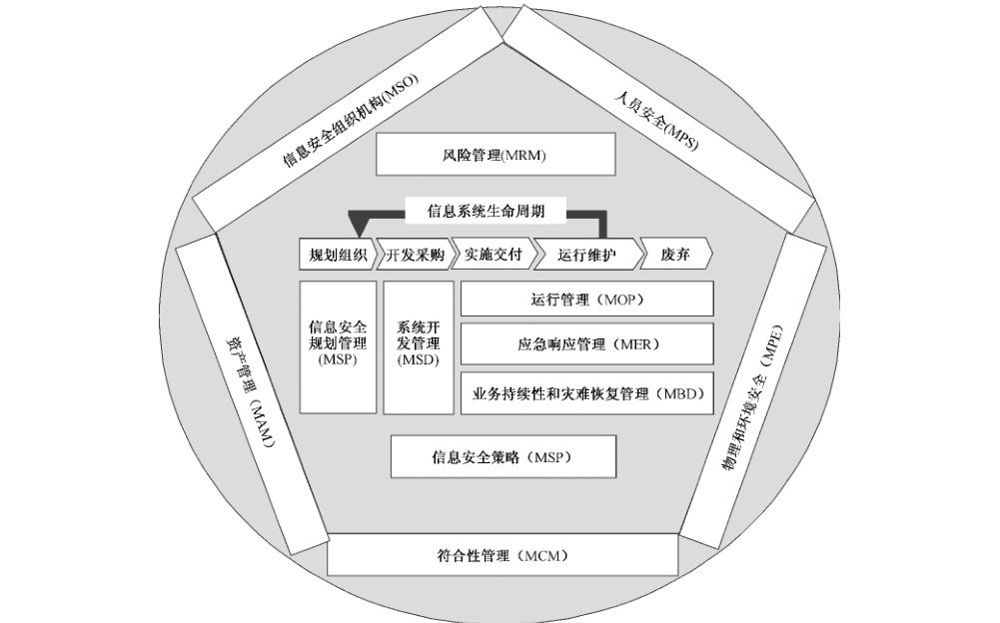

从图1可见，信息系统安全管理保障控制框架包括三个部分：

a） 信息系统安全管理保障应以风险和策略为核心。这也是信息系统安全保障的核心，因此信息安全策略（MSP）和风险管理（MRM）安全保障控制类作为独立的安全管理保障控制类并作为所有其他安全管理保障控制类的核心，充分反映了这一基础概念。

b） 信息安全管理保障应覆盖信息系统整个生命周期。信息系统典型的生命周期模型分为规划组织、开发采购、实施交付、运行维护、废弃五个阶段应用于系统产生的闭合循环周期结构。因此，与之对应并结合了组织机构信息系统的特殊要求，提供了信息安全规划管理（MIP）、系统开发管理（MSD）、运行管理（MOP）、应急响应管理（MER）以及业务持续和灾难恢复管理（MBD）信息安全管理保障控制类。

c） 信息系统安全保障管理基础为所有信息系统安全保障管理提供基础的支持。从信息系统安全保障管理的角度来看，组织机构的信息安全组织机构（MSO）、人员安全（MPS）、资产管理（MAM）、物理和环境安全（MPE）以及符合性管理（MCM）是所有信息系统安全管理保障活动所必须依赖的基础。

通过上述信息系统安全保障管理框架模型的建立，即信息系统安全保障管理评估对象 TOE 的建立，就可以分别对这些具体的信息系统安全保障管理的工作产品或管理过程能力进行评估以达到对信息系统安全性评估管理评估的具体操作实践和目的。

### 5.3 信息安全保障管理能力级

在管理保障控制组件中，给出了信息安全管理所涉及的管理保障控制类，它是信息安全管理过程中提炼出来的最佳的实践反映。管理能力是遵循一个管理过程可达到的可量化范围，通过对组织机构执行安全管理每个管理保障控制类能力反映了组织机构在执行信息安全管理达到预定的成本、功能和质量目标上的度量。

在管理保障中，信息安全管理能力级模型将列出并描述安全管理的各个能力级别，这样通过对安全管理保障控制类的执行范围和每个相应安全管理保障控制类的执行能力的综合，就可以更完善地对组织机构信息安全管理进行科学、公正、可度量分级的评估。

在本部分的信息安全管理能力成熟度级中，共分为以下六个级别：

a） 能力级别 0：未实施；

b） 能力级别1：基本执行；

c） 能力级别2：计划和跟踪；

d） 能力级别3：充分定义；

e） 能力级别4：量化控制；

f） 能力级别5：持续改进。

关于信息安全管理能力成熟度级的详细描述，参见本部分的第19章。

## 6 信息安全管理保障控制类结构

### 6.1 概述

本章定义了本部分所使用的信息安全管理保障类的结构。信息安全管理保障类以管理保障控制类、管理保障控制子类、管理保障控制组件以及可选的管理增强元素来表达。

### 6.2 管理保障控制类结构

每个管理保障控制类包括一个管理保障控制类名、管理保障控制类介绍以及一个或多个管理保障控制子类。图2描述了本部分中所使用的管理保障控制类的结构。

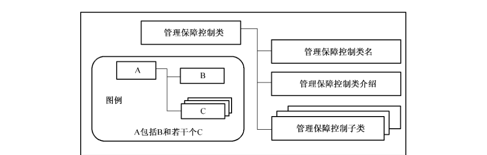

管理保障控制类结构的详细描述如下：

a） 管理保障控制类名：管理保障控制类名提供了标识和划分管理保障控制类所必需的信息，每个管理保障控制类都有一个唯一的名称。管理保障控制类的分类信息由三个英文字符的简名组成，此简名将用于该管理保障控制类的子类的简名规范中；

b） 管理保障控制类介绍：管理保障控制类介绍部分提供了该管理保障控制类定义、要求和目的等的整体描述。管理保障控制类介绍中用图来具体描述此控制类中的子类、组件组成结构；

c） 管理保障控制子类：管理保障控制子类部分对该管理保障控制类所包含的子类进行了详细描述。一个管理保障控制类包含了一个或多个管理保障控制子类。

### 6.3 管理保障控制子类结构

每个管理保障控制子类包含一个管理保障控制子类名、一个安全保障管理目的和一个或多个实现此安全管理保障目的的管理保障控制组件控制措施组成。图3描述了管理保障控制子类的描述结构。

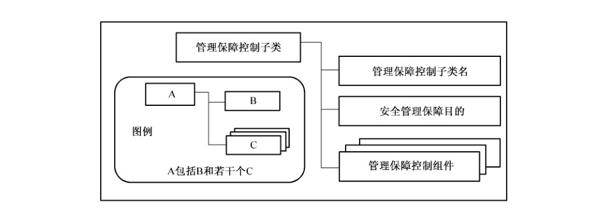

管理保障控制子类结构的详细描述如下：

a） 管理保障控制子类名：管理保障控制子类名部分提供了标识和划分管理保障控制子类所必需的分类和描述信息，每个管理保障控制子类有一个唯一的名称。管理保障控制子类的分类信息由七个英文字符的简名组成，前三个英文字符与其所属的管理保障控制类名相同，第四个字符是下划线用于连接管理保障控制类名和管理保障控制子类名，最后三个英文字符是管理保障控制子类名，例如 XXX_YYY。唯一的简名管理保障控制子类名为管理保障控制组件提供了引用名；

b） 安全保障管理目的：安全管理保障目的描述了此管理保障控制子类所要达到的目的；

c） 管理保障控制组件：一个管理保障控制子类包含了一个或多个管理保障控制组件。管理保障控制组件是实现安全管理保障目的的信息安全保障管理控制措施。

### 6.4 管理保障控制组件结构

管理保障控制组件是实现安全管理保障目的的信息安全保障管理控制措施。每个管理保障控制组件包括一个管理保障控制组件名、一个管理保障控制组件控制、一个可选的管理保障控制组件注解和一个或多个可选的管理增强元素组成。图4描述了管理保障控制组件的描述结构。

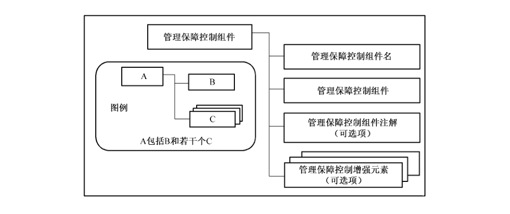

管理保障控制组件结构的详细描述如下：

a） 管理保障控制组件名：管理保障控制组件名用于标识管理保障控制组件。管理保障控制组件的简名是由管理保障控制子类名，后面使用句点作为连接符，在句点连接符后用阿拉伯数字按顺序标明不同的组件；

b） 管理保障控制组件控制：管理保障控制组件控制部分定义了满足其管理保障控制子类安全管理保障目的特定的控制措施；

c） 管理保障控制组件注解：可选的管理保障控制组件注解部分为该管理保障控制组件提供了进一步描述性的解释说明以及实施该控制措施的最佳实践的建议等。管理保障控制组件注解中所提供的最佳实践等内容可能不一定适合所有的情况，本部分的使用者可以根据其自身信息安全管理保障的特殊需求和要求使用其他更合适的实施方法；

<ol className="standard-subclauses">
<li>
d） 管理增强元素：可选的管理增强元素为管理保障控制组件提供了控制强度的措施。管理增强元素主要用于两种情况：
<ol className="standard-subclauses">
<li>
1） 为管理保障控制组件提供附加但相关的控制；和/或
</li>
<li>
2） 增加管理保障控制组件的强度。
</li>

</ol>
当组织机构基于风险评估的结果，考虑损失的潜在影响而需要更强大的保护或者需求对管理保障控制组件进行加强时，可以选择管理增强元素以增加管理保障控制组件的强度。管理增强元素的简名是由管理保障控制组件名，后面用句点作为连接符，在句点连接符后用阿拉伯数字按顺序标明不同的元素。
</li>

</ol>

### 6.5 允许的操作

本部分安全管理保障控制组件可以像在本部分中定义的那样使用，或者通过使用安全保障控制组件允许的操作，对安全保障管理控制组件进行裁剪，以满足特定的安全策略或对付特定的威胁。安全管理保障控制组件标识并定义了组件是否允许“赋值”、“选择”和“细化”等操作，在哪些情况下可对组件使用这些操作，以及使用这些操作的后果。这两种允许的操作如下所述：

a） 赋值：当组件被应用时，允许规定所填入的参数；

b） 选择：允许从组件表中选定若干项；

c） 反复：允许一个组件与不同的操作一起多次使用；

d） 细化：允许增加细节。

一些需要的操作可以在ISPP 内完成（整体或部分地），或者留在ISST 内完成，不过所有操作必须在ISST 内完成。

## 7 MRM 管理保障控制类：风险管理

信息安全管理保障是以风险和策略为核心。本类的目的是建立一套风险管理体系，通过对象确立、风险评估、风险控制三个基本步骤，并将沟通与监控贯穿于这三个步骤中，进行信息安全风险管理与防范，将系统风险降低到可接受的水平。

图5描述了风险管理管理保障控制类的组成结构。

### 7.1 对象确立（MRM_TEM）

#### 7.1.1 安全保障管理目的

根据要保护系统的业务目标和特性，确定风险管理对象。

识别信息系统资产，并评价资产价值。

根据信息系统安全需求，确定风险评价准则。

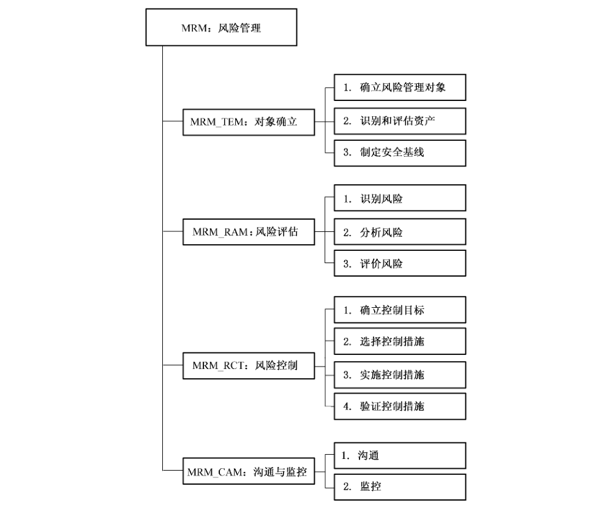

#### 7.1.2 MRM_TEM.1 确定风险管理对象

##### 7.1.2.1 管理保障控制组件控制

确定信息安全风险管理的范围和对象，以及对象的特性和安全要求。

##### 7.1.2.2 管理保障控制组件注解

确定风险管理对象时应综合考虑组织机构的使命、业务、组织结构、管理制度和技术平台，以及国家、地区或行业的相关政策、法律、法规和标准等。

风险管理对象确定后，应进行进一步的对象调查，主要包括：

a） 信息系统调查：调查风险管理对象的业务目标、业务特性、管理特性、技术特性；

b） 信息系统分析：分析信息系统的体系结构和关键要素；

c） 信息安全分析：分析信息系统的安全环境和安全要求。

#### 7.1.3 MRM_TEM.2 识别和评价资产

##### 7.1.3.1 管理保障控制组件控制

识别与风险管理对象相关的系统资产，并根据资产安全价值进行估值。

##### 7.1.3.2 管理保障控制组件注解

对资产估价的过程也就是对资产保密性、完整性和可用性影响分析的过程。应从敏感性、关键性和昂贵性等方面制定一个资产价值尺度（资产评估标准），以明确如何对资产进行赋值。

#### 7.1.4 MRM_TEM.3 制定安全基线

##### 7.1.4.1 管理保障控制组件控制

组织机构应在风险评估前制定系统安全基线。

##### 7.1.4.2 管理保障控制组件注解

所谓安全基线是指满足信息系统的基本安全要求，使系统达到一定安全水平的一组安全控制措施。

制定系统安全基线是有效实施风险评估的前提，制定系统安全基线时应考虑系统使命、系统安全环境、国家法律法规和系统所属行业的安全要求。

### 7.2 风险评估（MRM_RAM）

#### 7.2.1 安全保障管理目的

识别、分析和评价信息系统所面临的风险。

#### 7.2.2 MRM_RAM.1 识别风险

##### 7.2.2.1 管理保障控制组件控制

组织机构应识别信息系统面临的威胁和存在的脆弱性。

##### 7.2.2.2 管理保障控制组件注解

组织机构应参照威胁库，识别系统资产所面临的威胁；参照漏洞库，识别系统资产存在的脆弱性。

#### 7.2.3 MRM_RAM.2分析风险

##### 7.2.3.1 管理保障控制组件控制

组织机构应分析威胁源动机、威胁行为的能力、脆弱点被利用的可能性以及脆弱点被利用后对系统造成的影响。

##### 7.2.3.2 管理保障控制组件注解

组织机构应根据信息系统调查结果和可能面临的威胁，从利益、复仇、好奇和自负等驱使因素，分析威胁源动机的强弱；从攻击的强度、广度、速度和深度等方面，分析威胁行为能力的高低；按威胁/脆弱性对，分析脆弱性被威胁利用的难易程度；从资产损失、使命妨碍和人员伤亡等方面，分析影响程度的深浅。

#### 7.2.4 MRM_RAM.3评价风险

##### 7.2.4.1 管理保障控制组件控制

组织机构应评价威胁源动机的等级、威胁行为能力的等级、脆弱性被利用的等级、资产价值等级和影响程度等级，并综合评价风险等级。

##### 7.2.4.2 管理保障控制组件注解

组织机构应汇总前期调查结果和等级列表，从风险评估算法库中选择合适的风险评估算法，综合评价风险的等级。风险评估算法库是各种风险评估算法的汇集，包括公认算法和自创算法。

评价等级级数可以根据评价对象的特性和实际评估的需要而定，如〈高、中、低〉三级，〈很高、较高、中等、较低、很低〉五级等。

### 7.3 风险控制（MRM_RCT）

#### 7.3.1 安全保障管理目的

依据风险评估结果，选择并实施恰当的安全措施，将风险控制在可接受的范围内。

#### 7.3.2 MRM_RCT. 1确立控制目标

##### 7.3.2.1 管理保障控制组件控制

组织机构应确定可接受风险等级，判断现存风险是否可接受，确立风险控制目标。

##### 7.3.2.2 管理保障控制组件注解

组织机构应依据系统安全基线，确定可接受风险的等级，即把风险评估得出的风险等级划分为可接受和不可接受两种。依据风险接受等级，判断现存风险是否可接受。不可接受风险就是风险控制目标。

#### 7.3.3 MRM_RCT. 2选择控制措施

##### 7.3.3.1 管理保障控制组件控制

组织机构应选择风险控制方式和风险控制措施。

##### 7.3.3.2 管理保障控制组件注解

组织机构应依据系统安全基线和风险控制目标，选择合适的风险控制方式（包括规避方式、转移方式和降低方式），并说明选择的理由以及被选控制方式的使用方法和注意事项等。并进一步选择风险控制措施，并说明选择的理由以及被选控制措施的成本、使用方法和注意事项等。

#### 7.3.4 MRM_RCT. 3实施控制措施

##### 7.3.4.1 管理保障控制组件控制

制定风险控制实施计划，实施风险控制措施。

##### 7.3.4.2 管理保障控制组件注解

组织机构应依据系统安全基线、风险控制目标、风险控制方式，制定风险控制实施计划。风险控制实施计划包括风险控制的范围、对象、目标、实施方法、成本预算和进度安排等，在实施风险控制措施时应记录实施的过程和结果。

#### 7.3.5 MRM_RCT. 4验证控制措施

##### 7.3.5.1 管理保障控制组件控制

验证风险控制的结果是否满足信息系统的安全要求。

##### 7.3.5.2 管理保障控制组件注解

验证可采取审查、测试、评审等手段，既可以由机构内部完成，也可以委托外部专业机构来完成，这主要取决于信息系统的性质和机构自身的专业能力。

验证风险控制措施时，应结合所采取控制措施对业务的重要性以及业务遭受损失后所带来的影响。

审核通过的依据有两个：

a） 信息系统的残余风险是可接受的；

b） 安全措施（包括风险评估和风险控制）满足信息系统当前业务的安全需求。

### 7.4 沟通与监控（MRM_CAM）

#### 7.4.1 安全保障管理目的

为对象确立、风险评估、风险控制的实施提供人员沟通机制和过程控制。

#### 7.4.2 MSP_CAM.1 沟通

##### 7.4.2.1 管理保障控制组件控制

涉及风险管理的相关人员应注重风险管理过程中的沟通。

##### 7.4.2.2 管理保障控制组件注解

应为直接参与风险管理人员提供交流途径，以保持他们之间的协调一致，共同实现安全目标；为所有相关人员提供学习途径，以提高他们的风险意识、知识和技能，配合实现安全目标。

#### 7.4.3 MSP_CAM.2 监控

##### 7.4.3.1 管理保障控制组件控制

组织机构应跟踪风险管理对象自身或所处环境的变化，采取适当的措施进行控制和纠正，以保证风险控制措施的有效性。

##### 7.4.3.2 管理保障控制组件注解

在贯穿对象确立、风险评估、风险控制的监控过程中，组织机构应关注：

a） 过程质量管理。应监视和控制风险管理过程，以保证过程的有效性；

b） 成本效益管理。应分析和平衡成本效益，以保证成本的有效性；

c） 结果的有效性。应监控信息系统自身或环境的变化使得现有控制措施是否失效。

## 8 MSP 管理保障控制类：信息安全策略

信息安全管理保障是以风险和策略为核心。信息安全保障策略体系规范和指导了整个组织机构的信息安全保障工作。信息安全策略管理保障控制类提供了信息安全策略在制定和维护方面的管理，为信息安全提供符合业务要求和相关法律法规的管理指导和支持。

图6描述了信息安全策略管理保障控制类的组成结构。

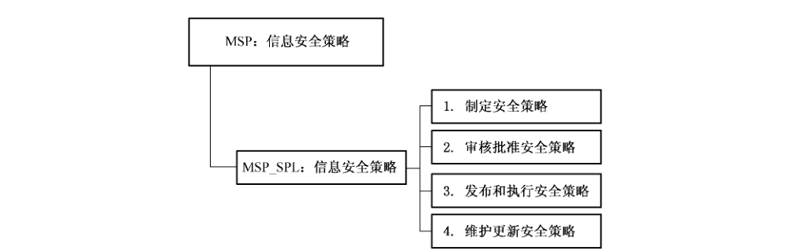

### 8.1 信息安全策略（MSP_SPL）

#### 8.1.1 安全保障管理目的

通过定义一套规则来规范信息安全体系的建设、运行和管理，为信息安全建设指明方向，使信息安全工作符合业务要求和相关的法律法规要求。

管理层应建立清晰的安全策略，安全策略应符合组织机构的业务目标。通过在整个组织机构中发布和维护信息安全策略可以表明管理层对信息安全的支持力度和信息安全承诺。

#### 8.1.2 MSP_SPL.1 制定安全策略

##### 8.1.2.1 管理保障控制组件控制

组织机构应制定安全策略文件。

##### 8.1.2.2 管理保障控制组件注解

制定信息安全策略时，应考虑如下几点：

a） 确定应用范围。在制订安全策略之前一个必要的步骤是确认该策略所应用的范围，例如是在整个组织还是在某个部门。如果没有明确范围就制订策略无异于无的放矢；

b） 获得管理支持。获得管理层的支持，不仅可以从管理层获得足够的承诺，可以为后面的工作铺平道路，还可以了解组织总体上对安全策略的重视程度，而且与管理层的沟通也是将安全工作进一步导向更理想状态的一个契机；

c） 进行安全分析。在安全分析中应确定需要保护的信息资产，信息资产的价值、需要方法的威胁源、受到攻击的可能性，在攻击发生时可能造成的损失，能够采取什么防范措施，防范措施的成本和效果评估等等；

d） 关键人员参与。在制定信息安全策略时至少应有技术部门和业务部门的人员参与，应共同探讨安全分析结果，在这些会议上应该向这些人员灌输在分析阶段所得出的结论并争取这些人员的认同。如果有其他属于安全策略应用范围内的业务单位，也应该让其加入到这项工作；

e）信息安全策略文件应符合国家、信息安全主管单位、行业、上级主管机关的法律法规要求；信息安全策略文件应符合组织机构的业务要求和风险管理的要求，参考相关的信息安全标准和相似组织的安全管理经验；

> 转写注：上文“需要方法的威胁源”保留原文用字。

f） 信息安全策略的内容应有别于技术方案，信息安全策略只是描述一个组织保证信息安全途径的指导性文件，它不涉及具体技术实现细节，只需要指出要完成的目标。

#### 8.1.3 MSP_SPL.2 审核批准安全策略

##### 8.1.3.1 管理保障控制组件控制

安全策略文件应由组织机构决策层审核批准。

##### 8.1.3.2 管理保障控制组件注解

负责审批的管理者应与IT 部门、业务部门人员进行充分沟通，必要时还可以聘请专家进行咨询，以便对安全策略的正确性、有效性做出正确的决策。

#### 8.1.4 MSP_SPL.3 发布与落实安全策略

##### 8.1.4.1 管理保障控制组件控制

安全策略文件应向组织机构全体员工发布，各级员工应以安全策略为指导进行日常工作。

##### 8.1.4.2 管理保障控制组件注解

信息安全策略文件应通过组织机构的主要信息发布渠道进行广泛发布，例如组织的内部信息系统、例会、培训活动等等。

信息安全策略文件只是描述保证组织机构信息安全的指导性文件，应在其指导下建立各项安全规章制度和操作流程，使安全策略能够在组织机构中成功执行。

#### 8.1.5 MSP_SPL.4 维护更新安全策略

##### 8.1.5.1 管理保障控制组件控制

应定期或当系统发生重大变更时审核安全策略以保持策略的适用性、充分性和有效性。

##### 8.1.5.2 管理保障控制组件注解

组织机构中应设置一名管理人员负责对安全策略适用性、充分性和有效性进行审核和评价。当组织机构的组织体系、业务环境、技术环境发生变化时，对安全的需求也会发生变化，组织的安全策略需要进行相应地调整。为了在发生变化时，安全策略和控制措施能够及时反映这种变化，应组织定期和非定期的安全审核。

安全审核主要依据：

a） 来自IT 部门和业务部门等相关方的反馈意见；

b） 所采取预防和改进措施的效果；

c） 以前的安全审核结论；

d） 信息安全策略的符合性；

e） 影响组织机构信息安全管理方法发生变化的因素，包括组织机构物理环境、业务环境、资源可用性、技术环境以及合同或法律法规方面的因素；

f） 威胁和脆弱性的变化趋势；

g） 曾经发生的信息安全事件；

h） 有关权威机构的建议。

安全审核的结果应包括：

a） 组织机构信息安全管理方法的改进；

b） 控制目标和控制措施的改进；

c） 资源和职责分配方面的改进。

应维护安全审核的记录。

改进的策略应得到管理层的批准。

## 9 MSO 管理保障控制类：信息安全组织机构

信息安全组织机构是信息安全管理的基础，需要得到组织机构最高管理层的承诺和支持，建立完善的信息安全组织结构。建立相应的岗位、职责和职权，建立完善的内部和外部沟通协作组织和机制，同组织机构内部和外部信息安全保障的所有相关方进行充分沟通、学习、交流和合作等。进一步将信息安全融至组织机构的整个环境和文化中，使信息安全真正满足安全策略和风险管理的要求，实现保障组织机构资产和使命的最终目的。

图7描述了信息安全组织机构管理保障控制类的组成结构。

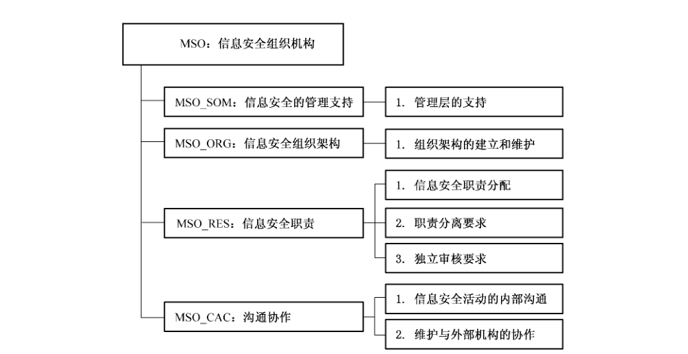

### 9.1 信息安全的管理支持（MSO_SOM）

#### 9.1.1 安全保障管理目的

管理层应提供保障和支持，提供清晰的指导，明确安全职责，协调和审核组织机构内安全。

#### 9.1.2 MSO_IOA.1 管理层的支持

##### 9.1.2.1 管理保障控制组件控制

管理层在组织机构内通过清晰的指导、明确信息安全职责的分配和确认，提供对安全的主动支持。

##### 9.1.2.2 管理保障控制组件注解

管理层应：

a） 确保标识了信息安全目标，且安全目标满足组织机构要求并落实至相关的过程中；

b） 规划、审核和批准信息安全策略；

c） 审核信息安全策略实施的有效性；

d） 为安全提供清晰地方向以及可见的管理支持；

e） 提供信息安全所需的资源；

f） 在组织机构内批准信息安全的特定角色和职责；

g） 确保信息安全控制的实施在整个组织机构中的协调。

管理层应对获取的信息安全的建议和需求进行论证，并在整个组织机构内审核和协调建议的结果。

根据组织机构规模的不同，此职责可以由专门的管理机构来处理或者由现有的管理机构来处理，例如由董事会负责。

### 9.2 信息安全组织架构（MSO_ORG）

#### 9.2.1 安全保障管理目的

组织机构应建立完善的信息安全组织体系，以启动和控制组织机构内的信息安全。

#### 9.2.2 MSO_ORG. 1 组织架构的建立和维护

##### 9.2.2.1 管理保障控制组件控制

形成架构清晰的信息安全保障组织机构，保持整体组织结构的稳定性。

##### 9.2.2.2 管理保障控制组件注解

安全保障组织机构应：

1） 结合行政组织结构，建立由决策层、管理层、执行层组成的信息安全保障组织；

2） 高级行政管理层有责任组织建设信息安全保障组织；

3） 聘用或启用较稳定的人员从事信息安全保障有关工作，以维持组织整体结构稳定性；

4） 信息系统骨干工作人员在较长时期内保持工作稳定；

5） 信息系统骨干工作人员基于适当的培训长期保持具有能够胜任工作的技术水平；

6） 应有正式的合同文本以及人事相关规定；

7） 确保提供信息安全需要的基础资源和投资；

8） 信息系统工作人员具备安全意识并能得到适度的行为监控。

### 9.3 信息安全职责（MSO_RES）

#### 9.3.1 安全保障管理目的

组织机构应有清晰的和恰当的安全职责划分和职责到人，保证信息安全措施的落实。

#### 9.3.2 MSO_RES. 1 信息安全职责分配

##### 9.3.2.1 管理保障控制组件控制

应清晰地定义组织机构的所有的信息安全职责，并保证各项职责明确到人。

##### 9.3.2.2 管理保障控制组件注解

信息安全职责的分配应根据信息安全策略来完成。应清晰地标识保护个人资产和执行特定安全活动的职责。如果必要，此职责应使用更详细的指南来补充以用于特定地点和信息处理设施。应清晰地定义保护资产和执行特定安全过程的本地职责，例如业务持续性规划。

分配具有安全职责的个人可以将安全任务委托给其他人。但他们仍旧保留职责并且应确定所有委托的任务得以正确地执行。

应清晰地描述个人所负责的内容，特别是包括下列内容：

a） 应标识并清晰地定义每个特定的与系统相关的资产和安全活动；

b） 应为每个资产或安全活动指定责任人，并且给出书面证明；

c） 应清晰地定义和文档化授权级别。

#### 9.3.3 MSO_RES. 2职责分离要求

##### 9.3.3.1 管理保障控制组件控制

组织机构应分离某些任务的管理、执行和职责范围，加强监督力度，以降低非法修改或误用职权带来的风险。

##### 9.3.3.2 管理保障控制组件注解

考虑职责分离应注意以下内容：

a） 不允许独自一人在没有经过授权或未经过检查的情况下访问、修改或使用资产；

b） 应把事件的授权与执行分开，如对关键数据的修改的审批与执行必须分开；

c） 组织机构一定要保持安全审计独立；

d） 在无法实现职责分离的情况下，组织机构应当考虑其他控制措施，例如监控、审计跟踪和监督管理。

#### 9.3.4 MSO_RES. 3 独立审计要求

##### 9.3.4.1 管理保障控制组件控制

应在计划的时间间隔或在对安全实施有重要变更时，对组织机构信息系统安全及其控制策略（如，信息安全的控制目标、策略、过程、流程等）进行独立审核。

##### 9.3.4.2 管理保障控制组件注解

管理层应发起独立审核。这种独立审核对确保组织机构管理信息安全策略的持续合适性、充分性和有效性是必要的。这种审核应包括对改进机会的评估，以及对安全方案变更需求的评估，包括策略和控制目标。

这种审核应由独立于被审核部门的人员来执行，例如，内部审计部门、独立的管理人员或专门从事此类审核的第三方机构。执行这些审核的人员应拥有相应的技能和经验。

应记录独立审核的结果并将其汇报至发起审核的管理层。

如果独立审核标识了组织机构管理信息安全的方案和实施是不充分的、或者不符合信息安全策略文件中所描述的信息安全方向时，管理层应考虑对其进行纠正。

### 9.4 沟通协作（MSO_CAC）

#### 9.4.1 安全保障管理目的

组织机构应该根据业务持续性和风险评估的需要，建立和维护内部与外部组织机构的有效沟通和协作机制。

#### 9.4.2 MSO_CAC. 1信息安全活动的内部协调

##### 9.4.2.1 管理保障控制组件控制

在组织机构内，应建立一个内部协调机制以保证信息安全活动的有效沟通和实施。

##### 9.4.2.2 管理保障控制组件注解

通常，信息安全协调应包括经理、用户、管理员、应用设计者、审计人员和安全人员，以及在保险、法律问题、人力资源、IT 或风险管理等领域的人员和专家的协调和协作。这种活动包括：

a） 确保安全活动的执行符合信息安全策略；

b） 标识如何处理不符合项；

c） 批准信息安全的方法和流程，例如风险评估、信息分类；

d） 标识重要的威胁变化以及信息和信息处理设施对威胁的暴露；

e） 评估信息安全控制的充分性并协调其实施；

f） 有效地在整个组织机构内推动信息安全教育、培训和意识；

g） 评价从监控中收到的信息，审核信息安全事故，推荐响应所标识的信息安全事故所采取的合适的行动。

如果组织机构没有使用一个单独的跨职能部门的团队，例如由于组织机构规模的原因，则上面所描述的活动应由其他合适的管理机构或个人承担。

#### 9.4.3 MSO_CAC.2 维护与外部机构的协作

##### 9.4.3.1 管理保障控制组件控制

应建立同组织机构系统和业务相关的各有关职能机构、运营商、服务方等的沟通和协作，维护与外部机构协作的及时性和有效性。

##### 9.4.3.2 管理保障控制组件注解

保持与信息安全有关执法机构、管理机关（如，执法、消防、监管机构等），在信息安全法律法规方面服从其管理和指导。

保持与相关服务方（如，因特网服务提供商（ISP）的支持、电信运营商、产品提供商等）的有效沟通和协作，保证当异常事件发生时的及时沟通和问题解决。

应建立有效的信息获取和更新渠道，以跟上信息安全的最新发展。确保对信息安全环境的理解是最新和完整的；接收告警的早期预警、同攻击和脆弱性相关的建议和补丁；共享和交换有关新技术、产品、威胁或脆弱性的信息等。

沟通活动包含以下内容：

a） 指派具有联络能力的人员负责联系工作；

b） 建立外部联络清单以及联络方式，并定期核实有效性；

c） 制定与外部组织间的有关协调通信和恢复活动的计划；

d） 保存与外部联系以及协作的沟通记录。

## 10 MPS管理保障控制类：人员安全

人员安全是信息安全管理的基础。应建立规范的人员安全管理，对组织机构的聘用人员进行严格的审查，明确人员的安全职责和保密要求。加强人员的安全意识培训和教育，并建立考核和奖惩机制，使信息安全融至组织机构的整个环境和文化中，减少有意、无意的内、外部威胁，确保组织机构顺利完成系统使命。

图8描述了人员安全管理保障控制类的组成结构。

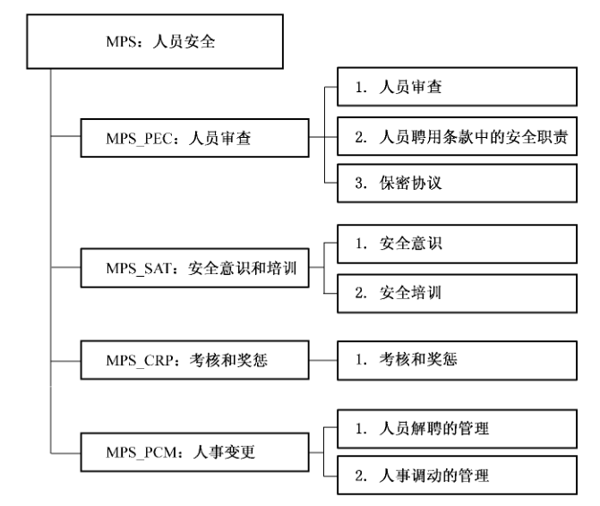

### 10.1 人员审查（MPS_PEC）

#### 10.1.1 安全保障管理目的

确保聘用的员工、合约方和用户能够符合聘用要求，并能理解其安全责任，以降低偷窃、欺骗或误用对系统造成的风险。

#### 10.1.2 MPS_PEC.1 人员审查

##### 10.1.2.1 管理保障控制组件控制

应根据相关的法律、法规和道德以及业务的需求、要访问信息的类别以及所认识到的风险，来对所有应聘人员进行背景验证检查。

##### 10.1.2.2 管理保障控制组件注解

审查应包含下列内容：

a） 要有满意的推荐人，例如，一个业务上行为的推荐，一个关于个人品德的推荐；

b） 检查应聘人员的简历（是否完整和准确）；

c） 确认有没有考取所称述的学历及职业资格；

d） 独立的身份检查（护照或其他文件）；

e） 更多的细节检查，例如诚信问题和犯罪记录。

对接触信息处理设备，特别是要处理敏感信息（例如财务信息或特别机要信息）设备的人员的审查要更加严格，应考虑更多的细节。

应为确认检查的流程定义标准和限制（谁可以合法检查并于何时何因如何进行验证检查）。

应对承包人和用户执行审查过程。如果承包人是通过中介机构介绍的，在与中介机构的合同中应明确定义中介机构的审查职责，当没有进行审查或是审查结果给出了令人质疑理由时应定义中介机构需遵循的通告流程。同样的，同第三方的协议应明确定义各自的职责和通告审查的流程。

当组织机构考虑内部岗位的候选人时，在搜集和处理人员信息时应符合法律规定的权限。在执行审查活动之前，应通知候选人。

#### 10.1.3 MPS_PEC.2 人员聘用条款中的安全责任

##### 10.1.3.1 管理保障控制组件控制

聘用条款中应说明员工信息安全的责任，并确保同应聘者进行清晰地沟通。

如适当，这些责任应在聘用期满后持续一段时间，还应包括员工如果不领会安全要求所要采取的培训等措施。

##### 10.1.3.2 管理保障控制组件注解

聘用条款应反映组织机构的安全策略并说明以下情况：

a） 所有员工、合约方和用户在对信息处理设施的敏感信息进行存取时，应事先标识信息的保密性或签署保密协议；

b） 员工、合约方和任何其他用户的合法责任和权力，例如，关于版权保护和数据保护立法；

c） 信息责任的分配和组织机构资产的管理关系到信息系统和员工、承包人和用户的服务；

d） 员工、合约方或用户在接收其他公司或外部信息时的处理的职责；

e） 组织机构在处理个人信息时的职责，包括组织机构雇佣过程中或最终的信息；

f） 应定义在组织外面办公的前提和职责，以及正常的外部工作时间，例如在家工作；

g） 若员工、合约方或用户忽略了组织机构的安全要求后应采取的措施。

组织机构应确保员工、合约方和用户对合约中关于访问权限的信息安全条款达成一致意见，这些访问权限是他们访问组织机构中与信息系统和信息服务相关的资产所需的访问权限。

在可能的情况下，聘用条款中还应包含预先定义的聘用之后的职责。

#### 10.1.4 MPS_PEC.3 保密协议

##### 10.1.4.1 管理保障控制组件控制

所有和信息系统安全相关人员均应当签署保密协议。保密协议的要求应反应组织机构对信息的保护。

##### 10.1.4.2 管理保障控制组件注解

保密协议的要求应考虑下列内容：

a） 所要保护的信息的定义（例如：保密的信息）；

b） 协议预期的持续时间，包括不确定的需要维护的保密性事件；

c） 协议终止时需采取的行动；

d） 限制职责和措施来避免信息泄露（像“必须知道”）；

e） 与机密信息的保护相关所有权、商业机密、知识产权等信息；

f） 用户得到准许后通过签字来使用机密信息；

g） 正确利用审计和监控活动来获得机密信息；

h） 报告未授权的机密信息泄露的通告的程序；

i） 信息的期限在协议终止时被收回或销毁；

j） 万一协议毁灭后所采取的措施。

基于组织机构的安全要求，保密性和抗抵赖性还需包含其他元素。

保密协议应遵从所有适用的法律和现有的公平规则。

保密协议的需求应定期的复查并当发生变化时改变这些需求。

### 10.2 安全意识和培训（MPS_SAT）

#### 10.2.1 安全保障管理目的

确保员工、合约方和用户了解信息安全威胁的存在，以及他们的安全责任，并获取必要的安全技能。

#### 10.2.2 MPS_SAT. 1安全意识

##### 10.2.2.1 管理保障控制组件控制

应对用户进行安全意识的教育和培训，确保信息系统的所有合法用户了解信息安全的基本要求，必要性以及他们所担负的安全责任。

##### 10.2.2.2 管理保障控制组件注解

组织机构应依据自己具体的需求和工作人员授权访问的信息系统来确定安全意识培训内容，制定培训计划，维持信息安全意识。培训应覆盖机构内部所有能够访问信息和系统的个人。

#### 10.2.3 MPS_SAT. 2 安全培训

##### 10.2.3.1 管理保障控制组件控制

组织机构应确定每个工作人员在信息系统中的安全角色和职责，在工作人员访问系统之前给他们提供恰当的信息系统安全培训，之后应以［附值：组织规定的频率］继续培训。

##### 10.2.3.2 管理保障控制组件注解

组织机构应确保系统管理员，系统行政管理人员和其他有权访问系统层软件的人员在执行各自的任务前进行了必要的技术培训。

### 10.3 考核和奖惩（MPS_CRP）

#### 10.3.1 安全保障管理目的

通过适当的考核和奖罚机制，对人员进行激励和约束，减少人对系统造成的风险。

#### 10.3.2 MPS_CRP. 1 考核和奖惩

##### 10.3.2.1 管理保障控制组件控制

应建立人员的考核和奖惩机制，对人员行为和能力进行考核，并对遵守和违反组织机构安全策略及程序的员工进行奖励或处罚。

##### 10.3.2.2 管理保障控制组件注解

在没有明确发生了安全破坏时，不应执行处罚过程。

这些处罚过程确保了公平公正的处罚那些被怀疑或蓄意对安全造成严重破坏的员工。处罚过程应规定在事件发生后应考虑给商务带来的影响。对严重的明知故犯的程序应立即免去其职责，访问权限和特权，并有必要立即遣送出场地。

### 10.4 人事变更（MPS_PCM）

#### 10.4.1 安全保障管理目的

确保在雇员离职或转岗以及合约方和用户解约时能够得到合理安排，避免由于管理失控增加对系统的风险。

#### 10.4.2 MPS_PCM.1人员解聘的管理

##### 10.4.2.1 管理保障控制组件控制

应明确定义和指派雇佣关系的终止和变更职责。一旦聘用、合约终止，所有员工、合约方和用户应交还其所拥有的所有组织机构资产，删除其对信息和信息处理设施的所有访问权限。

##### 10.4.2.2 管理保障控制组件注解

雇佣终止时应遵循现有的安全需求和法律责任要求，保密性协议和雇佣条款中规定的职责应在指定的时间继续生效。

在雇员、承包方或第三方的合同中应规定雇佣关系终止后职责和责任是否有效。

职责和雇佣关系变更应该与职责和雇佣关系的终止在管理方式上相同。应该合理管理新的职责和雇佣关系。

#### 10.4.3 MPS_PCM. 2人事调动的管理

##### 10.4.3.1 管理保障控制组件控制

组织机构在人员在组织机构内的不同位置进行调动时，应重新对用户的资产和权限进行重新评估和分配。

##### 10.4.3.2 管理保障控制组件注解

组织机构在人员在组织机构内的不同位置进行调动时，重新分配授予权限，并进行相应的操作，如：重发钥匙、鉴别卡、通行证；关闭账户建立新的账户；改变系统访问授权等。

## 11 MAM 管理保障控制类：资产管理

资产管理是信息安全管理的基础，同时也是信息安全保证的重要内容，组织机构应通过规范资产的管理和使用来保障资产的安全，来保证系统的安全，最终保障组织机构使命。

图9描述了资产管理管理保障控制类的组成结构。

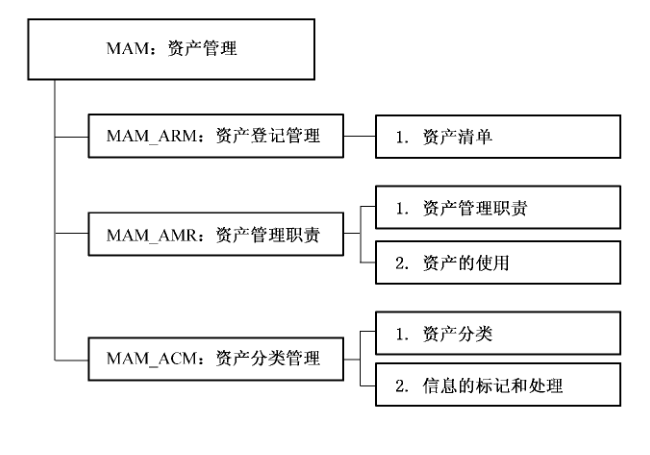

### 11.1 资产登记管理（MAM_ARM）

#### 11.1.1 安全保障管理目的

清晰了解组织机构所有的有形和无形资产。

#### 11.1.2 MAM_ARM.1资产清单

##### 11.1.2.1 管理保障控制组件控制

应清晰地识别和确认所有资产，应制定并维护一份重要资产清单。

##### 11.1.2.2 管理保障控制组件注解

组织机构应识别和确认所有资产并记录资产的重要程度等必要信息。各部门应负责维护各自范围之内的重要资产清单，组织机构应保留一份完整的资产汇总清单。

资产清单应包含所有的必要信息，应包括资产的类型、格式、位置、备份信息、许可信息和业务值等，以便进行应急响应和灾难恢复等工作。在资产清单中，每个资产的所有权和信息分类应该是经过认同的，并被文档化。基于资产的重要程度、业务值和安全分类，应识别与资产重要程度相对应的保护级别。

### 11.2 资产管理职责（MAM_AMR）

#### 11.2.1 安全保障管理目的

维持并实施适当的保护措施保护组织机构的资产。所有重要的信息资产应有负责人，并有选定的所有者，并有制定适当控制责任。

#### 11.2.2 MAM_AMR.1资产管理职责

##### 11.2.2.1 管理保障控制组件控制

同信息处理设施相关的所有信息和资产都应指定到机构中的部门，对所拥有的资产负责。对同信息处理设施相关的信息和资产的登记和使用都应实施适当控制。

##### 11.2.2.2 管理保障控制组件注解

对信息系统内部所有的重要资产（例如硬件、软件、操作系统、数据、信息等）建立健全的管理架构，并规定相应资产责任人，对责任人的权责进行规定。实施控制的责任可以委派。每个资产的所有权和分类应该是经过认同的，并被文档化。

资产所有者应负责：

a） 确保同信息处理设施相关的信息和资产都被恰当地分级；

b） 考虑到使用的访问控制策略，定义访问控制内容和访问分类方法并定期审查。

所有权可以分配给：

a） 一个业务过程；

b） 一组活动；

c） 一个应用；

d） 一组数据。

#### 11.2.3 MAM_AMR.2 资产的使用

##### 11.2.3.1 管理保障控制组件控制

应规范同信息处理设施相关的信息和资产的可接受使用的管理。

##### 11.2.3.2 管理保障控制组件注解

所有员工、合约方和第三方用户应遵循同信息处理设施相关的信息和资产的可接受使用的规章制度，包括但不限于：

a） 使用电子邮件和互联网的规章制度；

b） 使用移动设备，特别是在组织机构边界外使用移动设备时的指南。

具体的规章制度和指南应由相关的管理部门提供。使用或访问组织机构资产的员工、合约方和第三方用户应该知道在使用同信息处理设施相关的信息和资产以及相应的资源时有哪些限制。应该对其使用的信息处理资源和在职责范围内使用的方法负责。

### 11.3 资产分类管理（MAM_ACM）

#### 11.3.1 安全保障管理目的

确保系统的资产依据不同程度的敏感度及重要性得到相应级别的保护。

#### 11.3.2 MAM_ACM. 1资产分类

##### 11.3.2.1 管理保障控制组件控制

组织机构的资产包括有形的物理资产和无形的信息资产，组织机构不仅需要对有形的物理资产进行分类，还应根据信息对组织机构的价值、法律要求、敏感性和关键性等对信息进行分类。

##### 11.3.2.2 管理保障控制组件注解

信息的分类及相关保护控制的制定，应结合业务共享和限制信息的需求，以及这些需求所关联的业务冲击。

定义某信息的每个项目的责任，并定期检查这些分类的责任，应该是由信息的持有者，或原作者负责。所指信息是指，例如文件、数据记录、数据文件或磁盘等。

分类的指导方针应包括最初的分类协定，随着时间重新分配等级，并与预先的访问控制策略相一致。

定义资产的类别是资产所有者的责任，定期的复审和确保更新并在合适的级别。这种分类应考虑聚合效应。

要考虑的有类别的数目，以及分类后有什么好处。过于复杂的方法日后可能变得繁琐、使用不经济或显得不实际。应小心如何解释其他组织机构的文件上的分类标签，有可能同一种或类似的标签有不同的定义。

#### 11.3.3 MAM_ACM. 2信息的标记和处理

##### 11.3.3.1 管理保障控制组件控制

应该制定并实施一组恰当的标注及处理信息流程，流程应符合组织机构所采用的分类方法。

##### 11.3.3.2 管理保障控制组件注解

信息标识流程应覆盖物理和电子形式的信息资产。

按组织机构所采用的分类方法，制定合适的程序来标注及处理信息是很重要的。

系统带有被分类为敏感或重要信息的输出，应（再输出）有适当的分类标签注明。标签应按 7.2.1的分类规定注明。要考虑分类标签的物件有：打印报表、屏幕显示、记录介体（磁带、磁盘、CD等）、电子消息及文件转移。

物理标签一般是适当的标签形式，但是，某些信息资产，例如电子形式的文档，不能物理标注，应使用电子标注。对每个分类级别来说，处理流程的定义应涉及到安全处理，存储，传输，删除和毁灭。这也同样包括保管的流程和任何出入的安全相关事件。

同其他组织机构的共享信息的协议应确定信息的分类级别，并说明分类标签。

## 12 MPE 管理保障控制类：物理和环境安全

物理和环境安全是保障基础设施安全的基础。组织机构应保证物理安全区域安全，建立严格的物理访问控制措施，以防止非法访问、危害及干扰系统运行。基础设施是系统的重要资产，应在防火、防水、温湿度、防雷等方面做到安全防护，保证基础设施安全，保证系统持续运行。

图10描述了物理和环境安全管理保障控制类的组成结构。

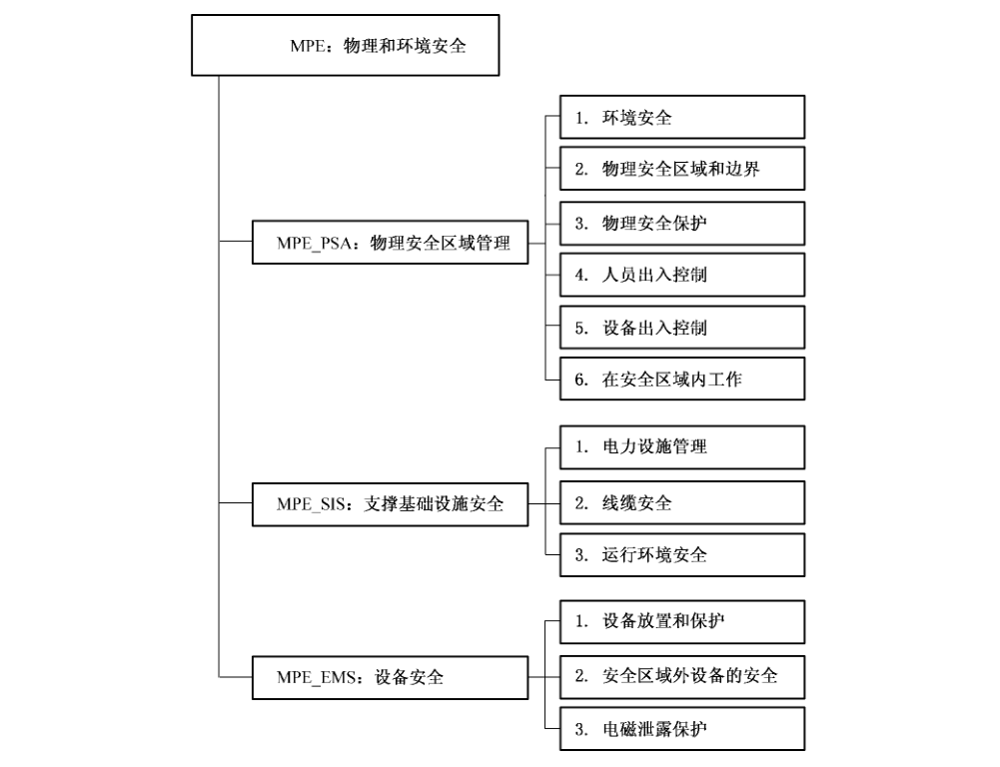

### 12.1 物理安全区域管理（MPE_PSA）

#### 12.1.1 安全保障管理目的

应有物理的保护防止对基础设施和信息的非法访问、危害和干扰。对重要或敏感的业务信息处理设备应放在安全的地方，并在规定的安全边界处用恰当的安全障碍和控制措施进行保护。

#### 12.1.2 MPE_PSA. 1 环境安全

##### 12.1.2.1 管理保障控制组件控制

安全区域的选择和设计应考虑火灾、洪水、地震、爆炸、骚乱及其他形式的自然或人为灾害导致的破坏，还应考虑相关的卫生、安全条例标准及周边的各种安全威胁。

##### 12.1.2.2 管理保障控制组件注解

选择和设计机房等安全区域的地理位置时，应考虑火灾、洪水、地震等因素，远离地震带、避免处于低洼地带等；另外，同时也需要考虑周边环境，远离加油站等易燃易爆危险场所等。

#### 12.1.3 MPE_PSA. 2 物理安全区域和边界

##### 12.1.3.1 管理保障控制组件控制

应根据不同的安全保护需求，划分不同的安全区域，实施不同等级的安全管理。

##### 12.1.3.2 管理保障控制组件注解

要根据不同安全需要划分安全区域。如办公区和关键业务区，涉密区和不涉密区等。应该使用安全边界（例如墙、门卡或人工接待室）来保护包含信息和信息处理设施的区域。

以下是建立适当的物理安全边界的指导原则：

a） 应明确定义安全边界；

b） 安全边界在物理上要坚固可靠；

c） 严格限制对安全区域和大楼的访问，仅允许授权人员进入；

d） 设置物理障碍，防止对安全区域的未授权访问和环境污染；

e） 安全边界上的所有应急出口都应该关闭，并设置报警装置；

f） 应按照专业标准安装并定期测试防盗入侵检测系统、防火探测警报系统、电视监视系统等安全设施。未被使用区域的告警装置也应开启。

#### 12.1.4 MPE_PSA.3 物理安全保护

##### 12.1.4.1 管理保障控制组件控制

应设计和应用安全区域和设施的物理安全防护。

##### 12.1.4.2 管理保障控制组件注解

公司应实施以下措施对安全区域和设施进行物理保护：

a） 制定在安全区域内应遵守的规章制度，对区域内人员行为提出安全要求；

b） 建筑物应不引人注目，并尽量减少其用途的标示。建筑物内外不应设置明显的表明信息处理活动的标志；

c） 无人值守时，门窗都应关闭，底层窗户应考虑设置外部防护；

d） 未使用的安全区域应采取物理方式锁闭，并定期检查。

#### 12.1.5 MPE_PSA.4人员出入控制

##### 12.1.5.1 管理保障控制组件控制

应通过合适的入口控制来保护安全区域以确保只有授权人员才允许访问。

##### 12.1.5.2 管理保障控制组件注解

无论内部员工还是外部人员，只有经过授权才可以进入安全区域。公司应实施以下措施对安全区域的出入进行控制：

a） 安全区域的访问者应办理出入手续并接受监督或检查，应记录其进入和离开的日期和时间。

访问者的访问目的必须经过批准，并只允许访问经授权的目标。访问者应被告知该区域的安全要求及有关应急程序；

b） 重要的安全区域应仅限于授权人员访问，并使用身份识别技术（例如门禁卡、个人识别码等）对所有访问活动进行授权和验证。所有访问活动的审计跟踪记录应被安全地保管；

c） 所有内部员工都应佩戴明显的、可视的身份识别证明，并应主动向那些无公司员工陪伴的陌生人和未佩戴可视标志的人员提出质疑；

d） 安全区域的访问权应被定期审查和更新。

#### 12.1.6 MPE_DES. 5 设备出入控制

##### 12.1.6.1 管理保障控制组件控制

应对带离安全区域的设备、信息或软件进行控制。

##### 12.1.6.2 管理保障控制组件注解

应考虑下列指导方针：

a） 未经授权，设备、信息或软件都不能带离安全区域；

b） 员工、合约方和用户在获准带离资产之前要经过清晰标识；

c） 应设置带离设备的时间限制，并在归还时按要求进行检查；

d） 记录设备带离和归还的时间；

e） 未经授权，外来的设备、信息或软件都不能带入安全区域。

#### 12.1.7 MPE_PSA.6 在安全区域中工作的控制

##### 12.1.7.1 管理保障控制组件控制

应制定安全区域工作的物理保护的管理规定，对在安全区域内工作的人员及被授权进入安全区域的其他人员加强管理。

##### 12.1.7.2 管理保障控制组件注解

应考虑下列指导方针：

a） 明确基本安全原则；

b） 工作人员应仅在“需要知道”时才了解安全区域的存在或者发生的活动；

c） 出于安全原因和防止恶意破坏，在安全区域内应避免不受监督的工作；

d） 除非经过授权，否则不允许使用摄影、摄像、音频、视频及其他记录设备；

e） 安全区域内，具有不同安全要求的区域之间需要设置额外的安全边界，以控制物理访问。

### 12.2 支撑基础设施安全（MPE_SIS）

#### 12.2.1 安全保障管理目的

所有的支撑设施，如电力、水、加热/通风和空调都应满足系统的需要。应定期对支撑设施进行检查，并进行适当的测试来确保其正常的功能，减少发生故障和失败的风险。

#### 12.2.2 MPE_SIS. 1 电力设施管理

##### 12.2.2.1 管理保障控制组件控制

应防止由于电力故障导致对设备的损害。

##### 12.2.2.2 管理保障控制组件注解

要根据设备厂商的说明提供匹配的电力供应。

对一些要求严格系统要配备不间断电源（UPS）可保证停电的情况下保持系统的持续运行，或按顺序关掉系统。电力持续性计划应覆盖 UPS失败的处理活动。如果系统要求在长时间电力中断的持续运行则应考虑配备备份发电机。还应为发电机提供足够的燃料储备来保证长时间的供电。UPS 和发电机应根据厂商说明进行定期检查和适当的测试以确保其能力。另外，还可考虑多路供电，如果地点够大，还可考虑不同的变电站。

紧急情况下的电力切断开关应安装靠近设备机房的紧急出口处，以方便在发生紧急情况时能够迅速断电。应配备电力中断后的应急照明设备。

a） 电源必须符合公司和设备制造商的技术规范；

b） 采用多路供电、配备 UPS、备用发电机等方法，避免电源单点故障；

c） 定期维护和检查供电设备，UPS应有充足容量，发电机应配备充足的燃料；

d） 机房的紧急出口处必须安装联动的应急开关，以便在发生紧急情况时能够迅速断电；

e） 配备应急照明设备；

f） 所有建筑和外部通信线路都应安装雷电防护装置；

g） 已知的停电计划应提前通知有关部门，防止无准备的断电造成不必要的损失。

#### 12.2.3 MPE_SIS.2 线缆安全

##### 12.2.3.1 管理保障控制组件控制

电力和通信电缆由于携带数据或是信息设备支撑，应该予以保护防止被侦听和破坏。

##### 12.2.3.2 管理保障控制组件注解

应遵循以下指导方针保护线缆安全：

<ol className="standard-subclauses">
<li>
a） 电力电缆和通信电缆应尽可能隐藏于地下，并尽量采取充分的备用保护措施；
</li>
<li>
b） 应采取措施防止通信电缆被非授权的侦听和破坏，如使用电缆管道或避免线路经过公共区域；
</li>
<li>
c） 电力电缆应与通信电缆分离，避免互相干扰；
</li>
<li>
d） 定期对电缆线路进行维护、检查和测试，及时发现故障隐患；
</li>
<li>
e） 对于重要的或敏感的系统应采取更进一步的控制措施，包括：
<ol className="standard-subclauses">
<li>
1） 将线缆检查点、接头等放在带有加强保护装置的导线槽、房间、箱子内；
</li>
<li>
2） 采用备用线路或传输媒介；
</li>
<li>
3） 使用光缆；
</li>
<li>
4） 使用电磁屏蔽来保护电缆；
</li>
<li>
5） 定期通过扫描和物理检查方式连接至缆线的非法设备。
</li>

</ol></li>

</ol>

为防止传输失败，通信设施应包含相应的冗余措施，例如两条互备份或负载均衡的线路，以在其中一条线路中断时不会中断通信和业务。

#### 12.2.4 MPE_SIS. 3运行环境安全

##### 12.2.4.1 管理保障控制组件控制

应采取相应的防火、防水、防尘、防雷、温湿度控制等控制措施为设备与介质提供适宜的环境，并提供相应的环境监控，以避免由于环境因素造成对设备和介质的损害。

##### 12.2.4.2 管理保障控制组件注解

a） 采取相应的控制措施，尽量降低环境因素对信息处理设施带来的潜在威胁。例如：爆炸、火灾、水灾、烟雾、温湿度、灰尘、静电、震动、化学作用、照明等。

b） 监控有可能对信息处理设施造成不良影响的环境条件。

c） 防火设备/系统包括，但不限于喷淋装置系统、手式灭火器、固定防火水龙头和烟雾探测。

d） 组织机构防止信息系统受到暴露水管或其他水资源渗漏所带来的灾害，确保可以控制主要的闸门，并能够正常工作，有具体的责任人负责。

e） 应维持信息系统设备所处环境的温度和湿度，使之保持在一个可接受的水平。

f） 在整个建筑上安装防雷保护，并在所有引入的电源和通信线缆处安装防雷装置。

g） 特殊环境下的设备，应考虑采用特殊的保护方法。例如：采用防爆灯罩、键盘隔膜等。

h） 禁止在网络与信息处理设施附近的进餐、饮水及抽烟等活动。

### 12.3 设备安全（MPE_EMS）

#### 12.3.1 安全保障管理目的

应防止由于资产的丢失、损害、被盗或老化等造成对组织活动的中断；防止设备受到物理和环境的威胁；防止受到未授权的破坏。

#### 12.3.2 MPE_EMS. 1设备放置和保护

##### 12.3.2.1 管理保障控制组件控制

为避免环境威胁和未经授权访问的影响，应将设备与介质的放置安全并予以保护。

##### 12.3.2.2 管理保障控制组件注解

应考虑下列指导方针以保护设备：

a） 设备布局应尽量减少对工作区的不必要的访问；

b） 敏感数据的信息处理与存储设施必须放置在可有效监控的范围内；

c） 重要的网络与信息处理设施的放置应尽量降低使用中的过失风险；

d） 对处理敏感信息设备，应加以保护以最小化的减少信息泄漏的风险；

e） 备用设备和备份介质应放在与主要运行场所保持安全距离的安全区域内，以防止因主要运行场所受灾而引起的损失；

f） 危险或易燃物品应安全存放，与安全区域保持一定的安全距离。一般情况下，在安全区域内不得存放大量的、短期内不使用的材料和物品。

设备或介质如因工作需要带离安全区域，更要注意对其进行保护。

一些固定在部门安全区域外的设备，同样要注意物理防护。

#### 12.3.3 MPE_EMS.2安全区域外设备的安全

##### 12.3.3.1 管理组件控制

应对工作在机构范围之外的非固定设备采取安全控制措施。

##### 12.3.3.2 管理组件注解

信息存储和处理设备包括所有形式的个人电脑、组织者、移动电话、smart 存储卡、纸张或其他形式，当它们被带回家或带到正常工作区域之外时应进行控制。

应考虑下列指导方针保护非固定设备的安全：

a） 在工作区域之外的信息处理设备的所有权和使用权都经过授权；

b） 在工作区域之外的设备和媒体不能在无人看管的情况下放置在公共区；手提电脑在携带过程中予以保护，如，使用手提箱，采取必要的伪装等；

c） 在任何时候都必须严格遵守厂商对设备的保护说明，如，防止暴露在强辐射环境；

d） 通过风险评估确定应对家庭办公进行控制，如，上锁的文件柜，清理桌面，控制电脑，控制与办公室的安全信息交流。

#### 12.3.4 MPE_EMS.3 电磁泄漏保护

##### 12.3.4.1 管理保障控制组件控制

应根据信息资产的保护要求，应对信息处理设施采取相应的电磁防辐射措施。

##### 12.3.4.2 管理保障控制组件注解

计算机系统在实际的应用中采用的防泄漏措施有：

a） 选用低辐射的设备；

b） 利用噪声干扰源；

c） 采取屏蔽措施；

d） 距离保护；

e） 采用微波吸收材料等。

## 13 MCM 管理保障控制类：符合性管理

符合性管理是信息安全保障的基础。组织机构应建立有效的监督体系以监督验证信息系统安全保障工作对相关法律法规、政策标准等要求以及组织机构所制定的信息安全策略体系的符合性以及执行的效果。

图11 描述了符合性管理管理保障控制类的组成结构。

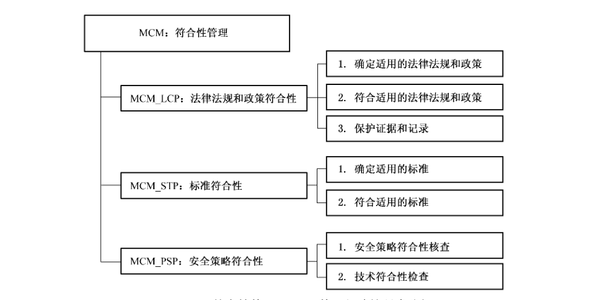

### 13.1 法律法规和政策符合性（MCM_LCP）

#### 13.1.1 安全保障管理目的

确保系统与信息安全相关的国家政策、法律法规、行政法规和相关合同等要求的符合性。

#### 13.1.2 MCM_LCP.1确定适用的法律法规和政策

##### 13.1.2.1 管理保障控制组件控制

组织机构应明确标识信息安全保障相关的所有国家、信息安全主管机构、上级部门的法律、法规、政策等的要求，并确保信息系统的设计、操作、使用及管理应符合相关法律、法规或合同中同信息安全相关的要求。

##### 13.1.2.2 管理保障控制组件注解

组织机构应确定、收集和整理与信息安全保障相关的所有国家、信息安全主管机构、上级部门的法律、法规、政策等要求，并保持相关文件的更新。

组织机构可根据业务要求和风险管理的要求，为某一类信息系统、特定的某个信息系统或信息系统的一部分确定、收集和整理相关的法律要求。

应向内部或外部的法律顾问和职业法律人士咨询符合法律要求的具体建议。当组织机构涉及跨国信息其他相关的跨国要求时，组织机构应考虑不同国家立法和文化差异的不同，特别需要注意和考虑的是，当信息的创建、传输、处理和使用跨越不同国家或者涉及多个国家、多个组织机构时，组织机构应考虑多国的法律方面的要求的不同，并综合考虑相应文化差异。

为了满足这些需求应定义相应的具体控制措施和个人职责，并将其文档化。

#### 13.1.3 MCM_LCP.2 符合适用的法律、法规、政策

##### 13.1.3.1 管理保障控制组件控制

应确保信息系统的设计、操作、使用及管理应符合相关法律、法规或合同的安全要求。

应该在信息系统的建设和运行中明确定义和说明所有有关法定的、条例规定的或合同的要求，并明确满足这些要求的特定控制措施和相关责任。

##### 13.1.3.2 管理保障控制组件注解

对法律、法规和政策的符合性，组织机构应考虑以下内容：

<ol className="standard-subclauses">
<li>
a） 知识产权

组织机构应明确规定有关知识产权的识别、授权、使用和检查等方面的要求，以确保符合相关法律规定。

组织机构应重视版权的管理和私有信息的拷贝相关的问题，以遵守相关法律法规或合同的要求。

涉及知识产权内容应考虑以下内容：
<ol className="standard-subclauses">
<li>
1） 公开宣布知识产权的权利符合性策略，在策略中定义软件和信息产品的合法使用方法；
</li>
<li>
2） 仅通过正规渠道获取软件，确保不侵犯版权；
</li>
<li>
3） 维护知识产权权利保护意识，对违反知识产权保护行为的人员给予处罚；
</li>
<li>
4） 维护授权许可所有权、主磁盘、手册等的证明文件及证据；
</li>
<li>
5） 实施控制，保证实际使用者的数目不会超出所容许的最大用户数目；
</li>
<li>
6） 进行检查，确保只安装合法的软件和取得授权许可的产品；
</li>
<li>
7） 制定遵守授权协议的策略；
</li>
<li>
8） 制定清除或转移软件到其他用户的策略；
</li>
<li>
9） 使用合适的审计工具；
</li>
<li>
10） 遵守从公用网获取的软件及信息的限期和条件；
</li>
<li>
11） 除非版权法允许，否则不许将商业电子产品（电影等）复制、转换到其他格式或解压缩；
</li>
<li>
12） 除非版权法允许，否则不许完全或部分拷贝书、文章、报告和其他文档。
</li>

</ol></li>
<li>
b） 加密技术控制的规定

组织机构在使用加密控制措施时应符合所有相关的协议、法律和法规，应考虑以下情况：
<ol className="standard-subclauses">
<li>
1） 有加密功能的计算机软硬件在进口和出口时的限制；
</li>
<li>
2） 加密技术的使用限制；
</li>
<li>
3） 为了确保信息内容保密，硬件或软件加密了信息，但国家信息主管机关使用强制访问或自主访问方法可以访问这些信息。
</li>

</ol></li>
<li>
c） 数据和隐私保护

组织机构应按照法律、法规或合同中规定的要求保证数据和个人信息的隐私。组织机构应建立数据保护和隐私策略和控制措施，并下达到所有涉及信息处理的人员。另外，还可采用适当的技术措施来实施对数据和个人信息的保护。
</li>
<li>
d） 资质要求

在信息系统的建设过程中，对信息安全集成人员、系统集成商和服务商的资质、所采用的信息安全产品以及工程实施过程的要求应当符合国家相关法律、标准和行政管理的要求。
</li>
<li>
e） 其他要求

要符合对非法信息和恶意代码控制的相关要求。
</li>

</ol>

#### 13.1.4 MCM_LCP.3 保护证据和记录

##### 13.1.4.1 管理保障控制组件控制

组织机构应保护其重要的证据和记录，防止重要证据和记录的丢失、破坏或假冒，并且确保其符合相关法律法规、标准政策、合同以及业务要求。

##### 13.1.4.2 管理保障控制组件注解

组织机构应按记录类型对记录分类，例如会计记录、数据库记录、交易日志、审计日志及操作流程，每类都需要写明保留期限及存储介质的种类，例如纸、单片缩影胶片、磁盘或光盘。任何用密钥加密的或数字签名的归档文件，都应该安全地保存，并记录保存能够解密的文档。

组织机构应考虑储存记录的介质性能下降的可能性。储存及处理程序应按生产商的规格实施。长时间存储，建议使用纸质和胶片。

如果选用电子存储介质，要保证在整个保存期间都可以访问数据，以免因技术更新而丢失数据。

组织机构应该选择合适的数据储存系统，使所需数据在可接受的时间段内以可接受的格式检索。

系统的储存和处理措施应该保证能够清楚地识别记录，识别国家、地方法律法规规定的记录保存期限。如果组织机构不需要这些记录数据时，系统应允许销毁。

要达到保护记录的目标，组织机构内应采取以下的步骤：

1） 应制定记录及信息的保存、储存、处理和清除的策略；

2） 应制定保存时间表，确定哪些重要记录种类需要保存，保存时间有多长；

3） 应该维护重要信息来源的清单；

4） 要实施适当的控制来保护重要的记录保证信息不被丢失、破坏及假冒。

### 13.2 标准的符合性（MCM_STP）

#### 13.2.1 安全保障管理目的

确保信息安全管理工作与国际、国内、行业的相关标准的符合性，以便于同测评机构、开发商和用户之间的有效沟通和结果的互认。

#### 13.2.2 MCM_STP. 1确定适用的标准

##### 13.2.2.1 管理保障控制组件控制

组织机构应明确、收集和整理信息安全管理工作遵循的国际、国内、行业的相关标准，并保持相关文件的更新。

##### 13.2.2.2 管理保障控制组件注解

应对相关的信息安全管理工作遵循的国际、国内、行业的相关标准进行收集和整理，并分析其适用性和有效性。有些标准可直接引用，有些标准则需要增加补充说明才可使用，而有些标准可以用来做参考。

#### 13.2.3 MCM_STP.2 符合适用的标准

##### 13.2.3.1 管理保障控制组件控制

组织机构应在系统的建设和运行中遵循适用的国际、国内、行业的相关标准要求。

##### 13.2.3.2 管理保障控制组件注解

所有有关标准的要求，应该在信息系统的建设和运行中被明确定义及说明，并明确满足这些要求的特定控制措施和相关责任。

### 13.3 安全策略符合性（MCM_PSP）

#### 13.3.1 安全保障管理目的

组织机构应确保系统符合组织机构的安全策略和安全技术要求。

#### 13.3.2 MCM_PSP.1安全策略符合性核查

##### 13.3.2.1 管理保障控制组件控制

管理层应确定在自己负责范围之内正确执行所有安全程序，还要定期检查机构内所有部门，以保证机构的安全策略及标准正确实施。信息系统的拥有者应积极配合接受定期检查。

##### 13.3.2.2 管理保障控制组件注解

组织机构应定期核查自己的系统是否符合组织机构信息安全策略体系及其他安全要求。

如果核查后发现不符合应：

a） 寻找不符合的原因；

b） 是否需要采取行动来评估，使不符合性不再发生；

c） 确定并实施恰当的纠正行为；

d） 验证所采取的纠正行为。

所实施的核查和纠正性的行动都应记录，并将核查结果通报给相关部门和人员。

#### 13.3.3 MCM_PSP.2 技术符合性的检查

##### 13.3.3.1 管理保障控制组件控制

组织机构应定期检查信息系统安全实施与标准的符合性。

##### 13.3.3.2 管理保障控制组件注解

技术符合性检查包括检查正在使用的系统，以保证硬件及软件的控制已正确实施。

技术符合性检查应该由有经验的系统工程师手工进行（如需要，利用合适的软件工具），或使用自动软件包生成技术报告，并交由技术专家负责解释。

如果使用渗透测试和脆弱性评估，应谨慎从事，因为这种行为可能会破坏系统安全。应计划、记录整个测试过程，测试过程应是可重复的。

技术符合性检查应由有经验、合法的人员进行，或是在这些专家的指导下进行。

## 14 MSP 管理保障控制类：信息安全规划管理

信息安全建设是信息化的有机组成部分，必须与信息化同步规划、同步建设。应在信息系统生命周期的第一个阶段计划组织阶段综合考虑信息安全的规划并将其作为信息系统规划的有机组成部分。

图12描述了信息安全规划管理管理保障控制类的组成结构。

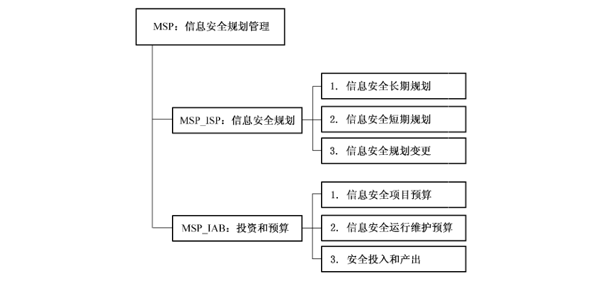

### 14.1 信息安全规划（MSP_ISP）

#### 14.1.1 安全保障管理目的

组织机构应建立完善的信息安全规划管理体系，以规划和指导组织机构的信息安全保障工作。

信息安全规划应基于组织机构的业务要求和风险管理的要求，它包括组织机构对信息安全所建立的长期规划和短期规划，这些规划是组织机构整体规划的综合组成部分。

#### 14.1.2 MSP_ISP.1 信息安全长期规划

##### 14.1.2.1 管理保障控制组件控制

应制定信息安全长期规划。

##### 14.1.2.2 管理保障控制组件注解

信息安全长期规划应由负责信息安全管理的人员和负责业务流程的人员共同制定。为了保证信息安全长期规划的有效性、适用性，应建立一种反馈机制，使组织内外受此规划影响的所有相关人员和组织机构能够针对规划及时反馈信息，来进一步改进规划。同时，应制定长期规划实施流程，采用结构化的方法建立一个标准的规划结构。

规划制定者应采用结构化的规划结构制定长期规划流程。制定信息安全规划时应考虑风险评估结果，包括业务、环境、技术和人力资源的风险。

#### 14.1.3 MSP_ISP.2 信息安全短期规划

##### 14.1.3.1 管理保障控制组件控制

长期规划制定者应能够将信息安全长期规划合理分解，形成信息安全短期规划。

##### 14.1.3.2 管理保障控制组件注解

信息安全短期规划应确保在同信息安全长期规划保持一致的基础上能够分配到合适的信息安全建设资源。应进行短期规划的可行性研究，以确保短期规划的可操作性。

#### 14.1.4 MSP_ISP. 3信息安全规划变更

##### 14.1.4.1 管理保障控制组件控制

应根据信息系统内部和外部环境的发展变化，适时地维护更新信息安全规划。

##### 14.1.4.2 管理保障控制组件注解

内部环境变化主要包括：

a） 组织机构自身业务发展变化；

b） 信息系统运行环境发生变化。

外部环境变化主要包括：

a） 信息技术的发展变化；

b） 国家出台的法律法规以及新的行业要求。

### 14.2 投资和预算（MSP_IAB）

#### 14.2.1 安全保障管理目的

组织机构在信息安全长期规划和短期规划的指导下，为信息安全项目建立合理的投资和预算管理。

#### 14.2.2 MSP_IAB. 1 信息安全项目预算

##### 14.2.2.1 管理保障控制组件控制

在规划设计和预算的文件中应包含信息安全保障项目。

##### 14.2.2.2 管理保障控制组件注解

无。

#### 14.2.3 MSP_IAB.2 信息安全运行维护预算

##### 14.2.3.1 管理保障控制组件控制

组织机构应进行信息安全运行维护年度预算，确保年度预算与信息安全的长期和短期规划保持一致。

##### 14.2.3.2 管理保障控制组件注解

无。

#### 14.2.4 MSP_IAB. 3 安全投入和产出

##### 14.2.4.1 管理保障控制组件控制

组织机构应监督控制信息安全保障方面的经费支出，考察支出费用和收益的比例。

##### 14.2.4.2 管理保障控制组件注解

决策层和管理层应建立费用监控流程，并与年度预算紧密结合。另外，也应汇总由于信息安全保障的实施所带来的可能收益。费用监控的对象主要是组织机构的财务部门，财务部门应记录、处理和报告同信息安全活动相关的费用。

信息安全保障方面的投资应同业务发展保持协调一致，应有相应的管理控制措施保证协调目标的实现。同时应分析采取信息安全保障措施所带来的收益。

## 15 MSD 管理保障控制类：系统开发管理

信息安全应综合至系统开发的整个生命周期中，组织机构在系统的需求分析、设计、实施和交付中应综合信息安全的考虑。

图13描述了系统开发管理保障控制类的组成结构。

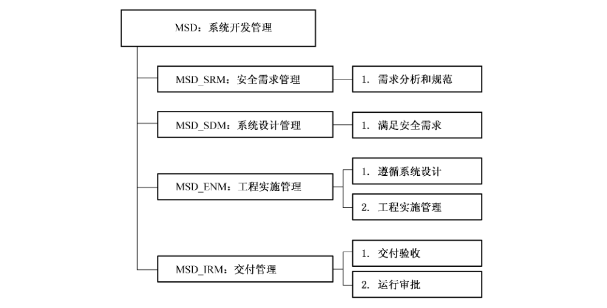

### 15.1 安全需求管理（MSD_SRM）

#### 15.1.1 安全保障管理目的

组织机构应确保安全是信息系统的必要组成部分。组织机构应在系统开发的需求分析阶段识别系统的所有安全要求，并经商讨后合理的安全要求文档化，以作为信息系统整个业务的综合组成部分。

#### 15.1.2 MSD_SRM.1 需求分析和规范

##### 15.1.2.1 管理保障控制组件控制

组织机构应根据信息安全相关法律法规、政策标准的要求和业务需求，在系统开发的需求分析阶段，综合考虑、分析安全需求，并将安全需求分析的结果文档化作为系统开发需求的一个综合组成部分。

##### 15.1.2.2 管理保障控制组件注解

应针对计算机信息系统的实际环境和安全目标提出安全需求。

在进行需求分析时应考虑信息系统建设和运行中应遵守的国家法律、法规、标准的约束以及行业要求。

制定安全需求时应从涉及的策略、体系结构、技术、管理等各个层次逐次进行分析。

组织机构应考虑到重要信息资产的商业价值的安全要求及控制的商业价值，及在安全失效的情况下所蒙受的商业损失。

组织机构应在信息系统项目的早期阶段就将信息系统和过程的安全要求综合进来。在系统实施和维护阶段中，在设计阶段就引入安全控制措施将会极大地减少费用。

安全需求分析是一个不断发展的过程，随着系统更新换代或功能扩展、内部环境和外部环境的变化，安全需求随之发生变化。安全需求分析应保持结果的有效性、适应性，保证分析方法的科学性和系统性，安全需求分析过程应与系统发展过程同步。

### 15.2 系统设计管理（MSD_SDM）

#### 15.2.1 安全保障管理目的

组织机构应根据系统安全需求分析的结果，将系统的安全考虑综合至系统的设计中。

组织机构应能标识出在系统设计过程中潜在的安全风险，为设计说明中的安全性设计提供评判依据，确保系统设计阶段的重要环节均能得到较好的安全风险控制。

#### 15.2.2 MSD_SDM. 1 满足安全需求

##### 15.2.2.1 管理保障控制组件控制

信息系统的设计应能满足需求分析阶段所得出的安全需求。

##### 15.2.2.2 管理保障控制组件注解

系统设计应满足系统应用需求和安全需求，应指明高层设计和安全需求的对应关系，确保所有的安全需求都有高层设计来满足。

### 15.3 工程实施管理（MSD_ENM）

#### 15.3.1 安全保障管理目的

实现安全防护体系，满足信息系统安全工程的要求。

#### 15.3.2 MSD_ENM.1 遵循系统设计

##### 15.3.2.1 管理保障控制组件控制

组织机构应依据系统设计方案，制定工程实施方案。

##### 15.3.2.2 管理保障控制组件注解

无。

#### 15.3.3 MSD_ENM. 2工程实施管理

##### 15.3.3.1 管理保障控制组件控制

应依据工程实施方案，对工程实施过程进行严格控制。

##### 15.3.3.2 管理保障控制组件注解

工程实施方案应详细说明安全过程各个阶段的建设目标、工作内容、施工人员、任务分工、进度安排、产品选型、产品采购、资金投入等情况，并给出每一项的依据和理由，分析每项工作的作用、意义和局限性，明确实施各方的工作关系、责权和协调协同机制。

工程实施过程中，与供应商签订的采购合同应能够表明系统采购满足了系统设计方案。当系统采购的安全功能不能满足系统设计方案的要求时，在重新购买产品时应考虑这种风险并制定相应的控制措施。

所采用的技术与产品应经过严格的测试选型，符合国家信息安全方面的法律法规，特别是涉及密码技术的产品，应严格按照国家和主管部门的有关规定选型和采购。

对所采购的软件在测试其应用功能的基础上，还应测试其安全功能和安全特性，测试应用控制是否实现设计中要求的安全功能。例如在需要使用密码技术时，是否使用了符合国家规定的密码技术。在测试期间应防止暴露敏感信息。

应对程序源代码和软件开发文档进行访问控制。

在安全措施实施过程中，所采用的技术与产品应经过严格的测试选型，符合国家信息安全方面的法律法规，特别是涉及密码技术的产品，应严格按照国家和主管部门的有关规定选型和采购。

实施过程应按照本标准第4部分的要求进行。

如本单位没有实施条件，应选择具备相应资质和合适、可靠的实施单位来实施信息系统安全措施。

### 15.4 交付管理（MSD_IRM）

#### 15.4.1 安全保障管理目的

保证信息系统在正式运行之前的完整交付。

#### 15.4.2 MSD_IRM. 1 交付验收

##### 15.4.2.1 管理保障控制组件控制

依据系统验收标准，严格交付验收过程。

##### 15.4.2.2 管理保障控制组件注解

在信息系统交付验收时，应测试系统的安全功能和安全性能是否能满足预定要求。应检查在质量管理、用户操作培训、试运行和应急响应以及售后服务体系等方面的情况。

信息系统交接时应对运行维护人员进行系统使用培训，并提交如系统使用白皮书、系统FAQ等说明文档。

#### 15.4.3 MSD_IRM. 2运行审批

##### 15.4.3.1 管理保障控制组件控制

信息系统在正式运行之前应得到组织机构的授权。组织机构的高级管理人员签署并批准。

##### 15.4.3.2 管理保障控制组件注解

组织机构在安全认可之前应评估信息系统内部所使用的安全控制措施，以检验现有控制措施正确实施的程度、是否按照计划实施，产生的输出结果是否满足系统的安全需求。

负责审批的管理者应与系统安全员、系统管理人员、系统使用人员进行充分沟通，必要时还可以聘请专家进行咨询，以便对系统是否可以投入运行做出正确决策。

进行系统审批时既要兼顾整体，又要注意细节，严格对照组织或机构的安全策略、安全需求和实际情况进行检验，确保系统建设达到了预定的要求和标准。

系统运行审批结果通常有三种：授权系统全面运行，临时批准运行，拒绝对运行进行授权。

## 16 MOP 管理保障控制类：运行管理

组织机构应建立完善的信息和通信技术运行管理体系，通过访问控制，漏洞管理、审计和监控管理，系统的安全配置以及系统的维护等措施，确保信息处理设施正确、安全地运行。

图14 描述了运行管理管理保障控制类的组成结构。

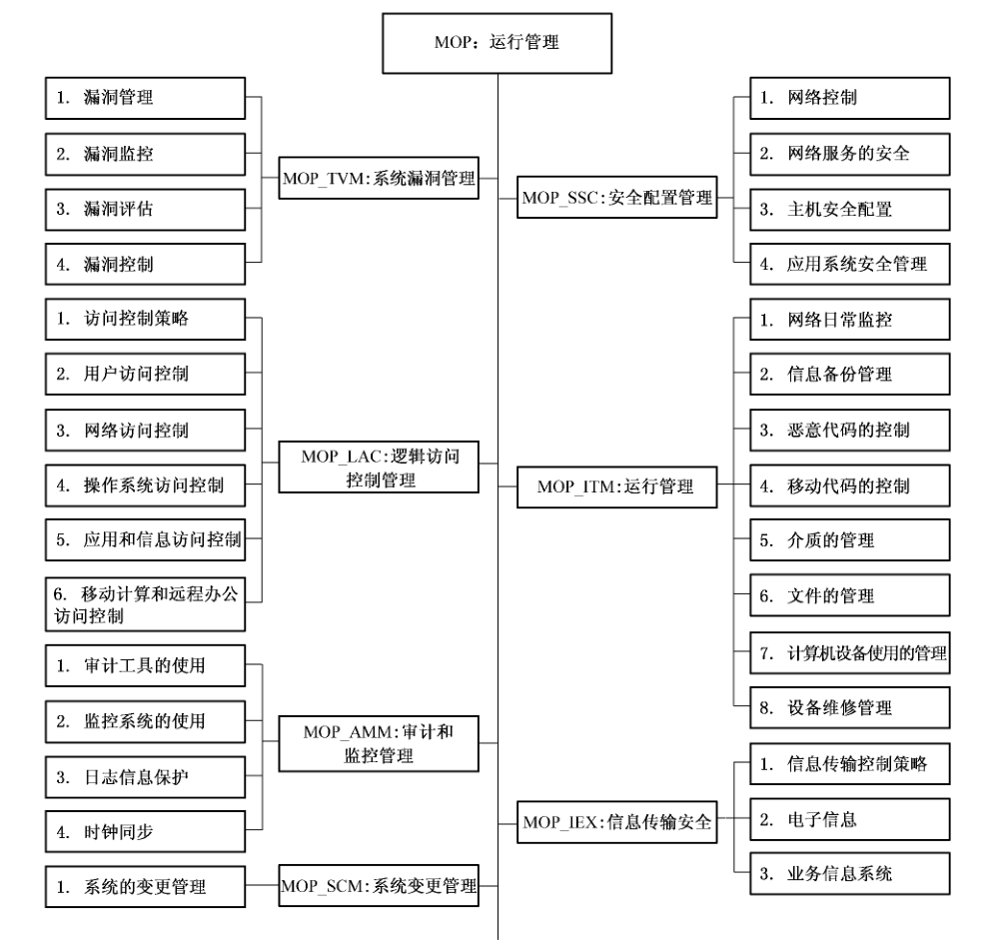

### 16.1 系统漏洞管理（MOP_TVM）

#### 16.1.1 安全保障管理目的

减少来自于已发布的技术漏洞攻击所产生的风险。

#### 16.1.2 MOP_TVM.1 漏洞管理

##### 16.1.2.1 管理保障控制组件控制

组织结构应以有效的、系统化的和可重复的方式实施技术漏洞管理，并且应采取测量措施以确定其有效性。

##### 16.1.2.2 管理保障控制组件注解

对漏洞的管理应考虑以下方面：

a） 组织机构应定义和建立同技术漏洞管理相关的岗位和职责，包括漏洞监控、漏洞风险评估、打补丁、效果跟踪和所需的所有协调职责；

b） 对技术漏洞的管理应包含至所使用的操作系统和所有其他应用中；

c） 应定期监控和评估技术漏洞管理过程，以确保其有效性和高效性；

d） 应对所采取的所有操作保留审计日志；

e） 有效的技术漏洞管理的前提是有一份完整的资产清单。支持技术漏洞管理所需的特定信息包括软件厂商、版本号、部署的当前状态（例如，哪个系统上安装了哪些软件）以及组织机构内负责此软件的人员。

#### 16.1.3 MOP_TVM.2 漏洞监控

##### 16.1.3.1 管理保障控制组件控制

组织结构应及时获得自己所使用信息系统技术漏洞的最新信息。

##### 16.1.3.2 管理保障控制组件注解

a） 应及时识别出软件和其他技术中与技术漏洞相关的信息资源，并维持这些信息资源的更新（应基于资产清单中的变更进行更新，或者在发现了新的、有用的资源时进行变更）；

b） 应该为技术漏洞的响应定义一个时间期限要求。

#### 16.1.4 MOP_TVM.3漏洞评估

##### 16.1.4.1 管理保障控制组件控制

针对获取的漏洞最新信息对暴露于此类漏洞的风险进行评估，制定相应的措施以解决相关的风险。

##### 16.1.4.2 管理保障控制组件注解

应首先解决高风险的系统。

#### 16.1.5 MOP_TVM. 4漏洞控制

##### 16.1.5.1 管理保障控制组件控制

一旦已经识别了潜在的技术漏洞，组织机构应标识相关的风险和所要采取的行动，采取及时适当的措施来响应潜在的技术漏洞。

##### 16.1.5.2 管理保障控制组件注解

<ol className="standard-subclauses">
<li>
a） 针对技术漏洞采取的行动包括对脆弱系统打补丁和/或应用其他控制；
</li>
<li>
b） 根据需要解决的技术漏洞的紧急性，应根据同变更管理相关的控制或遵守信息安全事故响应流程来执行行动；
</li>
<li>
c） 如果有可用的补丁，应对安装补丁相关的风险进行评估（应将漏洞所导致的风险同安装补丁的风险进行比较）；
</li>
<li>
d） 在安装补丁前，应对补丁进行测试和评估，以确保这些补丁有效，并且不会造成不兼容；
</li>
<li>
e） 如果没有可用的补丁，应考虑其他控制，例如：
<ol className="standard-subclauses">
<li>
1） 关闭同漏洞相关的服务；
</li>
<li>
2） 在网关修改或增加访问控制，如设置防火墙等；
</li>
<li>
3） 增加监控以检测或预防现实的攻击；
</li>
<li>
4） 加强漏洞的意识。
</li>

</ol></li>

</ol>

### 16.2 逻辑访问控制管理（MOP_LAC）

#### 16.2.1 安全保障管理目的

组织机构应基于业务和安全要求来控制对信息、信息处理设施和业务过程的访问，防止非法访问造成对系统的破坏。

#### 16.2.2 MOP_LAC.1访问控制策略

##### 16.2.2.1 管理保障控制组件控制

组织机构应基于业务和安全要求来建立访问控制策略并审核此策略。

##### 16.2.2.2 管理保障控制组件注解

访问控制策略应清晰地描述每个用户或用户组的访问控制规则和访问权限。访问控制规则应从逻辑访问和物理访问两方面考虑。

制定策略时应考虑下面内容：

a） 具体业务应用的安全要求；

b） 识别所有涉及到业务应用和信息风险的信息；

c） 信息分发和授权的策略；

d） 访问控制与不同信息系统的信息分类策略间的一致性问题；

e） 数据访问保护方面的相关法律和合同义务；

f） 组织机构中普通工作岗位的用户访问要求；

g） 在分布式网络环境下所有可用连接的访问权限管理；

h） 访问控制角色的分离，例如，存取要求、存取权限和存取管理；

i） 正式授权访问请求的要求；

j） 定期审核访问控制的要求；

k） 删除访问权限。

#### 16.2.3 MOP_LAC.2用户访问控制

##### 16.2.3.1 管理保障控制组件控制

组织机构应确保只有授权用户才能访问信息系统，禁止未授权访问。

为防止非法访问信息系统和服务，组织机构应根据已有的访问控制要求管理内部和外部人员的访问权限。

##### 16.2.3.2 管理保障控制组件注解

对用户访问权限的管理应从以下几个方面进行控制：

<ol className="standard-subclauses">
<li>
a） 用户注册

组织机构应建立正式的信息系统访问权限授权流程。授权流程应覆盖用户访问生命周期的所有阶段，从最初的新用户注册一直到最终不再需要访问信息系统的用户取消注册。

对用户的访问控制应包括：
<ol className="standard-subclauses">
<li>
1） 每个用户都应使用唯一的用户账号，确保能跟踪到唯一的用户，并能对自己的行为负责；
</li>

</ol>
只有由于业务和运行的需要才使用用户组账号，用户组账号应得到批准并记录在案；
<ol className="standard-subclauses">
<li>
2） 验证用户是否从管理部门获得访问权限，并获得了系统拥有者对使用信息系统的授权；
</li>
<li>
3） 验证授予的访问权限是否符合业务目标的要求和系统的安全策略要求；
</li>
<li>
4） 给授权用户一个书面的访问权限声明；
</li>
<li>
5） 要求用户签署声明，表明他们已经理解了访问的限制条件；
</li>
<li>
6） 服务提供商只有获得了授权，才能提供用户对系统访问；
</li>
<li>
7） 维护一个使用服务的注册人员记录；
</li>
<li>
8） 如果用户的角色或工作岗位发生变化或离职，应立即删除或锁定该用户的访问权限；
</li>
<li>
9） 定期检查冗余的用户 ID 和账号，并删除或锁定冗余信息；
</li>
<li>
10） 确保其他用户不知道冗余的用户 ID 和账号。
</li>

</ol></li>
<li>
b） 特权管理

特权是指使用户超越系统或应用控制对信息系统拥有特殊的权限，如：系统管理员权限可对系统参数进行配置或对一般用户访问权限进行管理。由于特权的非法使用会对系统造成严重破坏，所以应特别注意控制特殊访问权限的分配，要在履行一般用户登记程序外，进行额外控制：
<ol className="standard-subclauses">
<li>
1） 特权在内部人员中的分配应该明确；
</li>
<li>
2） 特权分配应遵循“最小化”原则，并在完成任务后及时收回；
</li>
<li>
3） 保持授权过程记录；
</li>
<li>
4） 保持全部特权分配记录。
</li>

</ol></li>
<li>
c） 口令管理

应提示或强制用户选择与使用强壮口令，并提醒其对口令的保密职责。不应该将口令以无保护形式存储在计算机系统内。
</li>
<li>
d） 评审

定期对普通用户和特权用户访问权限进行评审，对评审结果予以记录。
</li>

</ol>

#### 16.2.4 MOP_LAC.3 网络访问控制

##### 16.2.4.1 管理保障控制组件控制

组织机构应制定网络访问控制策略，采用网络隔离、强制路径、用户身份鉴别、网点身份鉴别、网络路由控制、网络服务安全等手段加强网络访问控制。

##### 16.2.4.2 管理保障控制组件注解

对网络的访问控制可从以下方面进行考虑：

a） 网络控制策略应包括在访问控制策略中；

b） 应根据网络服务的安全要求，对网络的互联程度进行控制；

c） 识别需要强制控制的路径，据此来限制网络内每个节点的路由选择；

d） 采用身份鉴别技术来鉴别远程用户对系统的访问，例如口令；

e） 采用网点身份鉴别技术鉴别与远程计算机系统相连的设施；

f） 确保每次使用端口前先经过授权，并记录使用情况。关闭不使用的端口；

g） 采用硬件或软件设备进行路由控制；

h） 网络系统安全管理员应按照明确规定的网络服务安全属性值进行参数配置和维护管理，如防火墙配置清单。

#### 16.2.5 MOP_LAC. 4 操作系统访问控制

##### 16.2.5.1 管理保障控制组件控制

组织机构应选择安全性较高的操作系统，并对操作系统进行合理配置，保证其访问控制能力。

##### 16.2.5.2 管理保障控制组件注解

组织机构应识别和验证用户身份，记录访问情况；通过口令和账号管理确保用户使用高质量的口令，并限制用户访问内容和访问时间。

#### 16.2.6 MOP_LAC.5应用和信息访问控制

##### 16.2.6.1 管理保障控制组件控制

敏感系统应有专用的或隔离的计算机环境，并对应用系统的访问进行控制。

##### 16.2.6.2 管理保障控制组件注解

敏感系统应运行在专用的或隔离的计算机环境中，可采用物理隔离（专用的运行环境或独立网络）或逻辑隔离的方式来实现隔离。

应考虑对应用系统的访问限制要求，实现如下控制：

a） 应用系统应提供访问控制功能菜单；

b） 应限制用户对无权访问的信息和系统功能的了解；

c） 应控制用户访问权，例如，限制读、写、删除以及执行权限；

d） 组织机构应确保处理敏感信息的应用系统输出仅包含与输出使用有关的信息，并且仅仅发送到授权的终端。

#### 16.2.7 MOP_LAC.6 移动计算和远程办公访问控制

##### 16.2.7.1 管理保障控制组件控制

组织机构应制定恰当的移动计算和远程办公访问控制策略，并采用合适的安全措施来降低使用移动计算和通讯设备的风险。

##### 16.2.7.2 管理保障控制组件注解

组织机构应制定移动计算设施的安全使用规定，对使用者进行安全意识教育。

组织机构应制定远程工作的控制程序，对远程工作活动进行授权管理。

### 16.3 审计和监控管理（MOP_AMM）

#### 16.3.1 安全保障管理目的

组织机构应充分发挥系统审计功能，并把其对系统的影响降到最低。

#### 16.3.2 MOP_AMM.1审计工具的使用

##### 16.3.2.1 管理保障控制组件控制

在进行审计时，组织机构应采取一些控制措施保护正在使用的系统及审计工具，也应采取一些保护措施来保证审计工具的完整性。应防止滥用审计工具。

##### 16.3.2.2 管理保障控制组件注解

组织机构应保护对系统审计工具（软件或数据文件）的访问，防止审计工具被滥用或被破坏。审计工具应与开发环境和运行系统分开，不能放在磁带库或用户使用区中，除非有额外的保护。

##### 16.3.2.3 其他信息

入侵检测系统和网络管理系统是对外部控制，系统管理员可利用来监控系统和网络管理活动的符合性。

#### 16.3.3 MOP_AMM. 2 监控系统的使用

##### 16.3.3.1 管理保障控制组件控制

组织机构应实施对信息处理设施和系统的操作和运行监控，并定期审核监控结果（日志信息）。

##### 16.3.3.2 管理保障控制组件注解

为了便于对系统运行进行有效的监控，同时也便于调查研究安全事件，应要求对操作人员的操作行为以及系统的运行情况进行详细记录，并对监控结果进行定期、独立的审核。对系统的监控可通过人工或自动的方式进行。

系统的监控级别应由风险评估结果确定。组织机构的监控活动应遵守相关的法律要求。监控活动应关注以下细节：

<ol className="standard-subclauses">
<li>
a） 授权访问的细节：
<ol className="standard-subclauses">
<li>
1） 用户 ID；
</li>
<li>
2） 重要事件的日期和时间；
</li>
<li>
3） 时间类型；
</li>
<li>
4） 文件存取；
</li>
<li>
5） 使用的规划/效用。
</li>

</ol></li>
<li>
b） 所有的特权操作，例如：
<ol className="standard-subclauses">
<li>
1） 特权账户的使用，例如：超级用户，root 用户，管理员，操作员；
</li>
<li>
2） 系统启动和中止；
</li>
<li>
3） I/O 设备安装/分离。
</li>

</ol></li>
<li>
c） 非授权访问企图，例如：
<ol className="standard-subclauses">
<li>
1） 失败的或被拒绝的用户活动；
</li>
<li>
2） 失败的或被拒绝的活动包括数据和其他资源；
</li>
<li>
3） 违反访问策略和网关或防火墙的通告；
</li>
<li>
4） 来自入侵检测系统的警报。
</li>

</ol></li>
<li>
d） 系统警报或失败：
<ol className="standard-subclauses">
<li>
1） 控制台或消息警报；
</li>
<li>
2） 系统日志异常；
</li>
<li>
3） 网络管理警报；
</li>
<li>
4） 访问控制系统的警报。
</li>

</ol></li>
<li>
e） 已改变或企图改变系统安全的设置和控制。
</li>

</ol>

应依据风险评估所确定的需求决定审核监控结果的频度。风险因素应包括：

a） 应用过程的危险程度；

b） 信息的价值、敏感度；

c） 系统被渗透和误用的历史以及系统暴露出的脆弱点；

d） 系统互连区域（尤其是公网的连接）；

e） 禁用日志功能。

#### 16.3.4 MOP_AMM. 3 日志信息保护

##### 16.3.4.1 管理保障控制组件控制

应对日志设备和日志信息进行保护防止窜改和非授权访问，以确保获取信息的完整性和真实有效性。

##### 16.3.4.2 管理保障控制组件注解

应针对非授权的修改和操作的以下问题对日志设施实施控制：

a） 改变了记录的信息类型；

b） 日志文件被修改或删除；

c） 日志存储空间溢出，导致事件记录失败或复写了原来的事件记录。

按照记录归档策略，或收集和保留证据的要求，一些审计日志可能要求归档。

要对系统日志进行保护，因为如果数据被修改或被删除了，它们的存在则可能导致错误的安全判断。

#### 16.3.5 MOP_AMM.4 时钟同步

##### 16.3.5.1 管理组件控制

一个组织或一个安全系统的所有相关信息处理系统要采用统一的正确时间源，保持时钟同步。

##### 16.3.5.2 管理组件注解

时钟和时间同步对于网络与信息系统的安全具有重要意义，时钟同步是保证系统完整性和可用性的必要条件，时间同步对业务、审计等工作非常重要。公司应采取有效的技术和管理措施，保证系统时钟和时间同步，例如采用统一的时钟和时间源系统。

### 16.4 安全配置管理（MOP_SSC）

#### 16.4.1 安全保障管理目的

确保对系统的网络、网络服务、主机以及应用系统实施安全的规则配置和管理，避免由于规则配置不当对系统造成威胁和破坏。

#### 16.4.2 MOP_NSM. 1 网络控制

##### 16.4.2.1 管理保障控制组件控制

应充分控制和管理网络，以保护免受威胁以及维护使用网络的系统和应用的安全，包括在传送中的信息。

##### 16.4.2.2 管理保障控制组件注解

网络管理员应实施控制以确保网络中信息的安全以及所连接的服务免受非授权访问的保护。特别应考虑下列内容：

a） 在合适时，网络的运行职责应同计算机运行职责进行分离；

b） 应建立远程设备管理的职责和流程，保护在用户区域的设备；

c） 应建立特殊的控制保护传输在公网或其他无线网络上数据的完整性和机密性，保护所连接的系统和应用；具体的控制可能需要维持网络服务可用并和计算机相连；

d） 应用适当的日志和监控，记录相关的安全事件；

e） 管理工作应被紧密协调，一方面是让业务尽量使用服务，另一方面是保证控制在整个信息处理架构都有效用。

#### 16.4.3 MOP_NSM.2网络服务的安全

##### 16.4.3.1 管理保障控制组件控制

识别整个网络服务的安全特征，服务级别和管理要求，包含任何网络服务协议，无论这些服务是内部或外部提供的。

##### 16.4.3.2 管理保障控制组件注解

网络服务提供者的能力是以一种安全的方式管理所协商的服务，应当有规则地进行监控，并同意恰当地进行审计。

识别特定服务的安全管理需要，如安全特征，服务级别和管理需求。组织应当确保网络提供商实施了这些方式。

#### 16.4.4 MOP_NSM. 3 主机安全配置

##### 16.4.4.1 管理保障控制组件控制

主机的配置应遵循合理的规则和标准。

##### 16.4.4.2 管理保障控制组件注解

对主机进行安全配置，保护主机不被非授权用户访问和操作，可从以下方面进行控制：

a） 在使用前，由提供者修改默认参数设置；

b） 取消或者限制某些特定的功能和服务。例如冗余的服务、附加的通信、特权实体和命令；

c） 根据特定用户或情况，限制对系统特权实体和主机参数的访问，并记录日志；

d） 取消不必要或不安全的用户 ID，例如在 UNIX 或者 Windows NT 系统中的“guest”用户；

e） 激活超时机制，在链接保持非活动状态一段时间后，锁定会话，再次使用要求用户重新登录；

f） 记录所有访问和使用日志，以备日后查询；

g） 应确保及时识别操作系统的技术弱点，制定相应解决方案，尽快实施解决方案；

h） 制定更新管理原则，确保关键软件能定期更新，例如补丁包和安全修复。

#### 16.4.5 MOP_NSM. 4应用系统安全管理

##### 16.4.5.1 管理保障控制组件控制

应用系统应设计有适当的访问控制、数据保护、审计跟踪记录或活动日志等安全功能。对投入使用的应用系统，应确保开启了所有安全功能并进行正确配置和使用。

##### 16.4.5.2 管理保障控制组件注解

无。

### 16.5 系统变更管理（MOP_SCM）

#### 16.5.1 安全保障管理目的

组织机构应有效控制信息处理设施变更和系统变更。

#### 16.5.2 MOP_SCM. 1 系统的变更管理

##### 16.5.2.1 管理保障控制组件控制

系统的信息处理设施、系统、应用软件以及系统配置参数等的变更都应受到严格的控制和管理。

##### 16.5.2.2 管理保障控制组件注解

系统的变更管理包括对信息处理设施、系统软件、应用软件以及系统配置参数等的变更控制。

对于系统的变更控制，应特别考虑下列内容：

a） 标识和记录系统的变化；

b） 变更要经过的正式批准；

c） 制定和实施变更计划和变更测试；

d） 评估变更后造成的影响，包括安全影响；

e） 与所有相关人员沟通变更细节；

f） 回退流程，包括系统的变更不成功和发生不可预见事件时，应遵循的终止变更和恢复流程以及相关的人员职责。

### 16.6 IT运行管理（MOP_ITM）

#### 16.6.1 安全保障管理目的

组织机构应执行日常的 IT 管理，维护信息和信息处理设施的完整性、可用性、保密性。

#### 16.6.2 MOP_ITM. 1 网络日常监控

##### 16.6.2.1 管理保障控制组件控制

定期监控系统的运行状况，及时发现隐患，确保系统的有效运行。

##### 16.6.2.2 管理保障控制组件注解

定期监控系统的日常运行情况，查看网络的流量，线路、端口状态，协议分布情况，网络设备运行状态，系统性能状况等，可通过人工方式或使用工具辅助执行。

在日常监控中，发现异常情况要及时采取控制措施。

记录、统计系统的正常、异常运行时的各项参数值，以便在出现故障情况时，提供对比分析的依据。

#### 16.6.3 MOP_ITM.2信息备份管理

##### 16.6.3.1 管理保障控制组件控制

组织机构应备份信息和软件，并根据已定义的备份策略定期测试备份数据。

##### 16.6.3.2 管理保障控制组件注解

组织机构应建立日常的备份流程，执行已定义的备份策略，备份复制数据并预演定期恢复。组织机构应提供足够的备份设施，以确保在介质失效后能恢复所有重要的信息和软件。

备份信息时应考虑下列内容：

a） 应定义备份信息的备份粒度；

b） 应有准确而完整的备份记录和文档化的恢复流程；

c） 备份的程度（例如，完全或部分备份）和备份频率应该符合组织机构的业务要求、相关信息的安全要求；

d） 应将备份存放到远端场地，其与主场地的距离应足以避免任何灾难性事件造成的破坏；

e） 备份信息的物理和逻辑保护级别应与主场地的相应保护级别一致；对主场地介质使用的控制措施同样可以应用到备份场地；

f） 应定期测试备份介质，以确保在必要时可以紧急使用；

g） 应定期验证和测试恢复流程，以确保流程有效，在运行恢复流程时能在指定的时间内完成流程；

h） 当对系统的保密性要求较高时，应使用加密手段保护备份信息。

组织机构应定期测试备份措施，以确保这些措施满足可业务持续性计划的要求。对关键系统，备份内容应包括系统信息、应用和数据的备份，使得当系统发生灾难性事件时能够完全恢复。

组织机构应确定重要业务信息的保留时间以及需要永久保留的备份信息。

#### 16.6.4 MOP_ITM.3 恶意代码的控制

##### 16.6.4.1 管理保障控制组件控制

软件和信息处理设施易引入恶意代码，组织机构应保护软件和信息的完整性，防止在系统中引入恶意代码。组织机构应探测、防护和控制恶意代码，并实施正确的用户意识流程。信息系统应使用能够自动更新的恶意代码保护措施。

##### 16.6.4.2 管理保障控制组件注解

组织机构应在重要信息系统的出入口处（例如，防火墙、邮件服务器、远端访问服务器）以及网络上的工作站、服务器或移动计算设备处都使用病毒保护机制。组织机构应使用病毒保护机制来检测和消除恶意代码（例如病毒、蠕虫、木马）。这些恶意代码通过以下方式传输：（i）通过电子邮件、电子邮件附件、访问 Internet、可移动介质或其他方式；（ii）利用信息系统的脆弱性传输。当符合组织机构配置管理策略和流程的病毒防护新版本可用时，组织机构就更新病毒保护机制（包括最新的病毒定义）。考虑使用多个供货商的病毒保护软件（例如，边界设备和服务器使用一个供货商的产品，工作站使用另一个供货商的产品）。

#### 16.6.5 MOP_ITM. 4 移动代码的控制

##### 16.6.5.1 管理保障控制组件控制

当组织机构使用授权的移动代码时，应确保其符合已定义的安全策略，禁止执行未授权移动代码。

##### 16.6.5.2 管理保障控制组件注解

为防止执行了未授权移动代码，应考虑下面的行为：

a） 在逻辑隔离的环境中执行移动代码；

b） 模块化任何可用的移动代码；

c） 激活一个可用的技术方法，确保其能够管理移动代码；

d） 控制访问移动代码的工具是可用的；

e） 为鉴别移动代码进行加密控制。

#### 16.6.6 MOP_ITM.5 介质的管理

##### 16.6.6.1 管理保障控制组件控制

应对信息介质进行有效的控制和物理保护，防止文档、计算机介质（例如：磁带、磁盘）、输入/输出数据和系统文件的非授权暴露、修改、去除和破坏以及对业务活动的中断。

##### 16.6.6.2 管理保障控制组件注解

可移动介质，即移动硬盘、磁带、磁盘、卡带以及纸质等，在管理可移动介质时，应考虑下列控制措施：

a） 包含重要、敏感或关键信息的可移动介质不得在无保护措施情况下存放，以防丢失；

b） 删除可重复使用介质中不再需要的信息；

c） 对移动介质时使用进行授权，并保留相关记录，以便进行审计跟踪；

d） 所有介质应按制造商的要求储存在安全的环境中；

e） 对可移动介质进行注册，限制数据丢失的可能性；

f） 当介质不再需要时，应采用安全的方式对介质进行废弃，将敏感信息泄漏的风险减到最低。

在物理介质的运输过程中，应考虑介质中包含信息的保护，以防止非授权访问、误用或破坏。应考虑下列内容以保护信息介质在场地之间的传送：

a） 应使用可靠的传输或信使；

b） 应对信使进行授权管理；

c） 应编制流程来确认信使的标识；

d） 应进行充分的包装以符合厂商的规范并使介质的内容免受由于运输所导致的物理破坏，例如保护介质免受由于暴露在过热、潮湿或电磁区域而产生的引起介质有效性和可用性的环境因素的影响；

e） 在需要时应采用相关的控制以保护敏感信息免受非授权的暴露或修改。

#### 16.6.7 MOP_ITM.6 文件的管理

##### 16.6.7.1 管理保障控制组件控制

对系统文档进行保护，防止未授权访问。

##### 16.6.7.2 管理保障控制组件注解

为了系统文档的安全，考虑下面的细节：

a） 应安全地储存系统说明文档；

b） 将访问系统说明文档的人员限制在最低范围内，并由所有者进行授权；

c） 对放置到公用网上的、或通过公用网提供的系统说明文档，应有适当的保护。

#### 16.6.8 MOP_ITM. 7 计算机设备使用的管理

##### 16.6.8.1 管理保障控制组件控制

信息系统计算机设备应在整体设计上通过使用一套优化的方法和过程，能更好地实现服务。

系统运行环境中的计算机，应采用规范统一的规则进行标识和使用，保持与其他的设备协调一致、正常工作。

##### 16.6.8.2 管理保障控制组件注解

对运行环境中的所有计算机设备的管理都应：

a） 使用一致的命名规则，例如计算机地址、终端位置和用户标识；

b） 单点运行；

c） 使用户能够通过单点登录对多个系统进行访问，并且从单点对其进行管理；

d） 尽量减少手工的交互。

#### 16.6.9 MOP_ITM. 8 设备维修保养

##### 16.6.9.1 管理保障控制组件控制

应对设备实施正确的维护确保其可用性和完整性，确保设备内敏感信息的安全。

##### 16.6.9.2 管理保障控制组件注解

应考虑下列设备维护的指导方针：

<ol className="standard-subclauses">
<li>
a） 应按照设备维护手册的要求或有关维护的程序对设备进行维修保养。
</li>
<li>
b） 对设备的维修应该：
<ol className="standard-subclauses">
<li>
1） 选择具备一定维修技能的维修人员；
</li>
<li>
2） 对维修人员进行授权控制；
</li>
<li>
3） 对发现的问题和纠正措施进行记录。
</li>

</ol></li>
<li>
c） 对设备的保养应该：
<ol className="standard-subclauses">
<li>
1） 按照供应商推荐的保养时间间隔和规范进行保养；
</li>
<li>
2） 当将设备送外进行保养时，须对设备内的敏感信息进行保护；
</li>
<li>
3） 对保养情况进行记录。
</li>

</ol></li>
<li>
d） 对所有类型设备在报废处理或重用之前要进行检查，确保敏感数据和授权软件被移走或被安全清除，如，采用适当的清除或复写方法确保原始数据不可被获取，而不能仅采用标准删除或格式化功能。
</li>

</ol>

### 16.7 信息传输安全（MOP_IEX）

#### 16.7.1 安全保障管理目的

在一个组织内和任何外部实体之间进行信息和数据传输时，应维持信息和软件的安全。

#### 16.7.2 MOP_IEX.1 信息传输控制策略

##### 16.7.2.1 管理保障控制组件控制

组织机构之间的信息和软件传输应当基于一份正式的传输策略，按照传输协议执行，并与任何相关的法律规定一致。

##### 16.7.2.2 管理保障控制组件注解

当使用电子通信设备进行信息传输需要考虑下面的问题：

a） 保护信息在传输过程中不被打断，复制，修改，错误路由和毁坏；

b） 防止恶意代码通过电子通信进行传输；

c） 防止附件形式的敏感性电子信息；

d） 提供电子通信设备的安全使用指南；

e） 在使用无线通信时，应考虑其带来的特定风险；

f） 采用密码技术，来保护信息的机密性、完整性和真实性；

g） 不要将重要和敏感信息遗漏在打印设备上，如复写纸、打印机和传真机，以防被其他非授权人员利用；

h） 控制相关的发送通信设备，如自动向外部邮件地址发送电子邮件；

i） 提供所有业务相应的持续性和使用指南，包括与相应的法律、法规一致的信息；

j） 员工、服务方和其他用户的职责不能危及到组织机构的安全；

k） 提醒人员应当具有适当的警惕。

#### 16.7.3 MOP_IEX.2 电子消息

##### 16.7.3.1 管理保障控制组件控制

组织机构应当保护电子消息当中的信息。

##### 16.7.3.2 管理保障控制组件注解

使用指南中对电子信息的安全考虑应当包括：

a） 防止信息被非授权访问，修改或拒绝服务；

b） 确保信息传输地址正确；

c） 服务的通用可靠性和可用性；

d） 法律考虑，如电子签名的使用；

e） 在使用外部公共服务之前，需要予以批准，如实时信息或文件共享；

f） 对来自外网访问的鉴别控制的强壮性。

#### 16.7.4 MOP_IEX.3 业务信息系统

##### 16.7.4.1 管理保障控制组件控制

组织机构应采取安全控制措施，保护相关的业务信息系统的内部连通的安全性。

##### 16.7.4.2 管理保障控制组件注解

组织机构应考虑业务的连通性和安全性：

a） 了解管理和审计系统的脆弱性，以及组织机构在什么地方进行信息共享；

b） 业务通信系统中的信息的脆弱性；

c） 制定安全策略和适当控制措施，管理共享信息；

d） 如果系统不支持分级保护，则不能接受分类的敏感业务信息和分类文档；

e） 控制与所选择的个人相关的访问日志信息，如敏感项目当中的人员工作；

f） 对允许使用系统的人员，承包商和业务合伙人的分类；

g） 限制使用设备的用户类别；

h） 识别用户身份，如组织机构的员工或其他签约用户；

i） 维护系统的持续性和备份信息；

j） 回滚需求和安排。

## 17 MBD 管理保障控制类：业务持续性和灾难恢复管理

业务持续性管理是指通过预防及恢复措施的结合使用，把业务因灾难或安全故障（例如，由于天灾、意外、设备失效及故意破坏）的停顿降到可接受的程度。组织机构应分析灾难、安全故障及服务停顿的影响，以便制订及实施业务持续性和灾难恢复计划来保证业务进程能够在规定时间内恢复。

图15描述了业务持续性和灾难恢复管理管理保障控制类的组成结构。

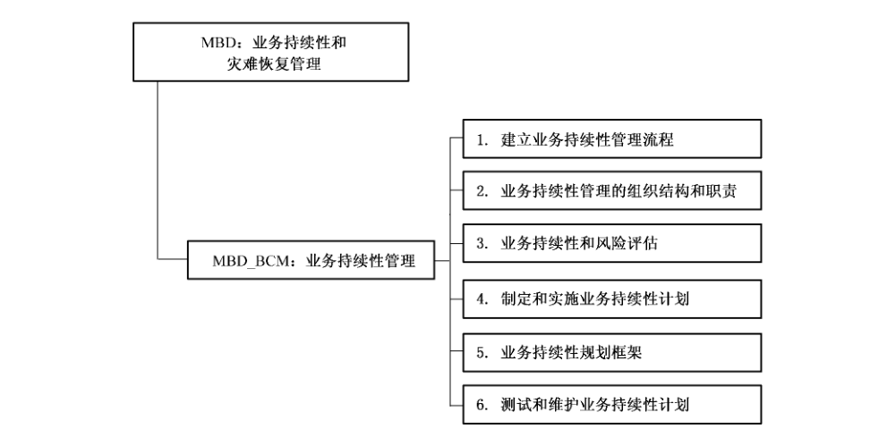

### 17.1 业务持续性管理（MBD_BCM）

#### 17.1.1 安全保障管理目的

防止业务过程中断，保护关键业务流程不会受信息系统重大失效或自然灾害的影响，并确保及时恢复。

通过业务持续性管理过程的实施，综合使用预防及恢复控制，把因灾难或安全故障（例如，来自于天灾、意外、设备故障及故意破坏行动）而造成的业务中断降低到可接受的程度。

应分析灾难、安全故障及业务中断的影响。应开发和实施持续性计划以保证业务过程能够在所需的时间范围内恢复。应经常修改和实践这些计划，使之最终变成所有其他管理过程的不可分割的一部分。

#### 17.1.2 MBD_BCM. 1建立业务持续性管理流程

##### 17.1.2.1 管理保障控制组件控制

组织机构应建立业务持续性管理流程，满足组织机构在信息安全方面的业务持续性需求。

##### 17.1.2.2 管理保障控制组件注解

业务持续性管理流程应关注：

a） 在识别关键业务过程并排列优先顺序的基础上，根据风险发生的可能性及其产生的影响来判定公司所面临的风险；

b） 识别与关键业务过程相关的所有资产；

c） 了解信息安全事件对业务中断所造成的影响；

d） 考虑将购置适当的保险作为业务持续性计划的一部分；

e） 考虑采取预防性和规避性的风险控制措施；

f） 充分利用金融、组织、技术和环境资源来满足信息安全需求；

g） 确保人身安全以及信息处理设施和组织机构的财产安全；

h） 制定满足信息安全需求的业务持续性计划，并与业务持续性策略保持一致；

i） 定期测试和更新业务持续性计划；

j） 确保业务持续性管理能够融入组织机构的运作流程和组织结构中，业务持续性管理职责应由组织机构内适当级别的管理层负责签署。

#### 17.1.3 MBD_BCM.2业务持续管理的组织结构和职责

##### 17.1.3.1 管理保障控制组件控制

组织机构应建立业务持续性管理组织结构，并明确其职责。

##### 17.1.3.2 管理保障控制组件注解

业务持续性管理组织机构由业务、技术和行政等部门的人员组成，通常分为决策层、管理层、执行层。具体职责如下：

a） 决策层：审核并批准经费预算、业务持续性策略和灾难恢复预案；组织管理业务持续性计划的测试和演练；批准灾难恢复预案的执行；

b） 管理层：进行业务持续性的需求分析；提出并落实业务持续性策略和等级；制定业务持续性计划和灾难恢复预案；

c） 执行层：进行业务持续性计划的教育、培训和演练；适时更新业务持续性计划；当事故发生时，控制所造成的损失，及时恢复信息系统及其业务功能，评估危害程度；进行日常的运行维护管理。

#### 17.1.4 MBD_BCM.3 业务持续性与风险评估

##### 17.1.4.1 管理保障控制组件控制

组织机构应识别引起业务过程中断的信息安全事件，并分析中断发生的可能性和造成的影响。

##### 17.1.4.2 管理保障控制组件注解

业务持续性的信息安全方面是确认会导致业务进程中断的事件，例如设备故障、人员误操作、偷窃、火灾、自然灾害和恐怖主义行为等。通过实施风险评估，考虑中断发生时间、破坏程度和所需要的恢复时间来判定中断发生的可能性和对系统造成的影响。

在进行业务持续性风险评估过程中，需要业务资源和业务过程的拥有者全力参与，应考虑所有业务过程，而不仅仅限于信息处理设备，并且评估结果应具体到信息安全方面。应将不同类型的风险联系起来，进而获得一个完整的组织机构业务持续性需求。在进行评估时应该参照标准和组织机构的目标来识别风险、量化风险并对风险进行优先级排序。

应依据风险评估的结果制定业务持续性战略，以决定业务持续性管理的全部方法。

#### 17.1.5 MBD_BCM.4制定和实施业务持续计划

##### 17.1.5.1 管理保障控制组件控制

应制定和实施业务持续性计划，以确保关键业务过程中断或失效后能够在规定的时间内和要求的等级上恢复系统运行，并确保信息的可用性。

##### 17.1.5.2 管理保障控制组件注解

在制定业务持续性计划时应考虑以下几方面：

a） 确定所有人员的职责和业务持续性流程；

b） 确定信息和服务的可接受损失度；

c） 在限定的时间范围内能够实施恢复业务、保证信息可用的流程，特别要关注内部与外部的业务依赖关系；

d） 完全恢复的操作流程；

e） 将已达成一致意见的流程和过程文档化；

f） 由具有合适教育背景的员工负责紧急程序及处理，包括危机管理。

在制定业务持续性计划过程中应关注系统业务目标，例如在可接受的时间段内恢复用户指定的服务；应考虑计划实施过程中所需要的服务及资源，包括人员安排、非信息处理资源、以及信息处理设备的备份管理。其中备份管理还包括与第三方相互签署的协议。

业务持续性计划应关注组织机构的脆弱点，因此计划中应关注需要保护的敏感信息。业务持续性计划的副本应存放到距离足够远的远端站点，以避免主站点发生灾难对计划副本的影响。在管理上应确保计划副本能够实时更新，与主站点受到同样的安全保护级别。执行业务持续性计划所需的其他设备也都应存储在远端站点。

如果使用了临时备用站点，此站点的安全控制保障级应与主站点的保障级相同。

#### 17.1.6 MBD_BCM.5 业务持续规划框架

##### 17.1.6.1 管理保障控制组件控制

应建立一个单独的业务持续性计划框架，以确保所有计划的一致性，以维护信息安全要求的一致性并识别测试和维护的优先级。

##### 17.1.6.2 管理保障控制组件注解

每个业务持续性计划应描述保持业务持续性的方法，例如应有确保信息或信息系统可用性的方法。

每个计划也应明确说明启动计划的条件，以及计划每一部分的负责执行人。当有新的需求时，任何现有的紧急流程，例如废弃计划或回滚安排都应适当调整。组织机构的变更管理应包括这些流程的变更，以确保能够正确处理业务持续性事件。

每个计划应有一个具体负责人。紧急流程、手工回退计划和恢复计划都属于业务资源、业务过程拥有者的职责。对于可选择性的技术服务，例如信息处理和通信设施的恢复操作，应该属于服务提供者的职责。

一个业务持续性规划框架应满足信息安全需求并考虑以下方面：

a） 启动计划的条件：启动计划前要进行哪些工作（如何评估环境情况，有谁参与等等）；

b） 紧急程序：在发生严重干扰业务操作的事故后应采取哪些行动；

c） 回滚程序：将重要业务活动或支持性服务转移到备用临时站点时应采取的行动，以及在规定时间范围内使业务恢复正常运行应采取的措施；

d） 恢复程序：返回到正常业务操作应采取的措施；

e） 维护时间表：规定了如何测试以及在什么时间测试，并规定了计划维护过程；

f） 意识及教育培训：让员工更好地了解业务持续性过程，确保过程持续有效；

g） 个人职责：谁负责，执行计划的哪部分，必要时应指定候补人员；

h） 能够执行紧急、回滚和恢复流程的关键资产和资源。

#### 17.1.7 MBD_BCM.6 测试和维护业务持续性计划

##### 17.1.7.1 管理保障控制组件控制

应该定期测试和更新计划，以确保计划最新且有效。

##### 17.1.7.2 管理保障控制组件注解

在测试业务持续性计划时应确保所有参与成员都知道自己在业务连续性计划中各自的职责，计划启动后知道他们的角色。

业务连续性计划的测试安排应表明计划中的每一项如何被测试，什么时间进行测试。

应该使用多种不同的测试技术，以确保计划可以在真实环境中实施。所包括的技术有：

a） 不同场景的桌面测试（采用中断实例来讨论业务恢复的安排）；

b） 模拟（特别是培训人员在事故或危机后的管理角色）；

c） 技术恢复测试（保证信息系统可以有效地恢复）；

d） 在后备站点测试恢复情况（在远离主站点的地方并行地运行业务恢复过程）；

e） 测试供应商的设施及服务（确保外部提供的服务及产品都符合合同中规定的承诺）；

f） 完全演习（测试组织机构、人员、设备及处理过程是否能够应付业务中断的情况）。

这些技术可用于任何组织机构。应该记录测试结果。

应该规定定期审查每个业务持续性计划。如果在业务安排上出现人员变更，但在业务持续性计划中还没有反映出，就应该更新持续性计划。变更控制过程应当确保能够分发更新的计划并且通过定期审查整个计划进而改进计划。

增加新设备、系统升级会引起业务持续性计划的更新，也可能在下面几方面引起变更：

a） 人员；

b） 地址和电话号码；

c） 业务战略；

d） 地点、设施和资源；

e） 法律；

f） 合约人、供应商和主要客户；

g） 风险（运行和经济方面）。

## 18 MER 管理保障控制类：应急响应管理

应急响应管理并有效的解决事故，尽量减少它们对业务的影响，减小类似事故再次发生的风险。

应该按照一种正规的流程来妥善处理各类事件（包括故障、掉电、过载、用户或者计算机工作人员操作失误、违规存取）。

图16描述了应急响应管理管理保障控制类的组成结构。

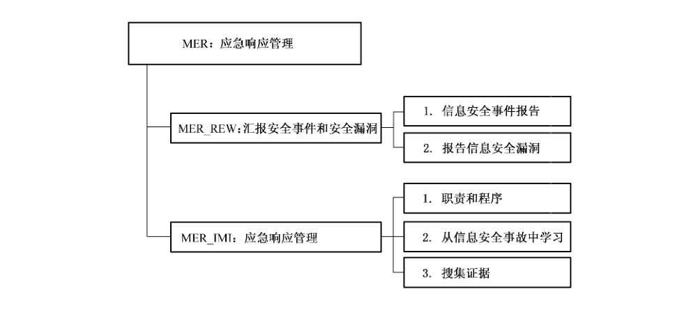

### 18.1 汇报安全事件和安全漏洞（MER_REW）

#### 18.1.1 安全保障管理目的

确保能够及时沟通同信息系统有关的安全事件和漏洞。

#### 18.1.2 MER_REW.1 信息安全事件报告

##### 18.1.2.1 管理保障控制组件控制

应通过恰当的管理途径尽快报告信息安全事件。确保与信息系统相关的安全事件和漏洞信息能够传达到每个人，并能够及时采取正确的行动。

应该有事件汇报和改进流程。所有员工、协约人和第三方用户应该知道不同类型安全事件和漏洞信息的汇报流程。要求信息安全事件和漏洞信息应该尽快汇报给指定的联系方。

##### 18.1.2.2 管理保障控制组件注解

应当建立一个正式的信息安全事件汇报流程，以及事件响应和改进流程，规定一旦接到信息安全事件报告应采取的措施。应该建立汇报信息安全事件时的联系方式，应确保组织机构内部所有人员都知道此联系方式，联系方始终可用并能够提供充分和及时的响应。

所有员工、合约方和第三方用户应该意识到他们尽快汇报信息安全事件的职责，也应该知道与联系方报告信息安全事件的流程。报告流程应该包括：

<ol className="standard-subclauses">
<li>
a） 恰当的反馈过程。这种反馈过程用来确保信息安全事件处理结束后通知处理结果；
</li>
<li>
b） 信息安全事件汇报形式。一旦发生信息安全事件，这种汇报形式支持汇报行为，帮助汇报人员记住所有必要的行为；
</li>
<li>
c） 需采取的行动。一旦发生信息安全事件，需采取以下行动：
<ol className="standard-subclauses">
<li>
1） 立即记录所有重要的细节（例如，破坏的类型、引起的功能故障、屏幕显示信息、异常行为）；
</li>
<li>
2） 不要采取个人行为，应立即向联系方报告；
</li>

</ol></li>
<li>
d） 对引起安全事故的雇员、合约人和第三方用户建立处罚流程。
</li>

</ol>

#### 18.1.3 MER_REW.2 报告信息安全漏洞

##### 18.1.3.1 管理保障控制组件控制

应要求所有的员工、承包方和第三方用户注意并报告系统或服务中已发现或疑似的安全漏洞。

##### 18.1.3.2 管理保障控制组件注解

为了阻止信息安全事故的发生，所有员工、合约方和第三方用户应该尽快将系统漏洞信息汇报给他们的管理部门，或者直接汇报给服务提供商。

### 18.2 应急响应管理（MER_IMI）

#### 18.2.1 安全保障管理目的

确保使用持续有效的方法管理信息安全事故。

#### 18.2.2 MER_IMI. 1 职责和程序

##### 18.2.2.1 管理保障控制组件控制

应建立管理职责和程序，以快速、有效和有序地响应信息安全事故。

##### 18.2.2.2 管理保障控制组件注解

除了汇报信息安全事件和漏洞，还应该使用系统监控、警告监控和漏洞监控措施检测信息安全事故。下面对信息安全事故管理流程提供指导：

<ol className="standard-subclauses">
<li>
a） 应当建立处理不同信息安全事故的流程，包括：
<ol className="standard-subclauses">
<li>
1） 信息系统失效、丧失服务能力；
</li>
<li>
2） 恶意代码；
</li>
<li>
3） 拒绝服务；
</li>
<li>
4） 由于业务数据不完整或不准确导致的错误；
</li>
<li>
5） 机密性和完整性受到破坏；
</li>
<li>
6） 系统误用；
</li>

</ol></li>
<li>
b） 除了持续性计划，流程还应当包括：
<ol className="standard-subclauses">
<li>
1） 分析并寻找事故原因的；
</li>
<li>
2） 处理办法；
</li>
<li>
3） 必要时，为防止事故再次发生，应该采取的计划和实施过程；
</li>
<li>
4） 与受事故影响的部门和恢复事故的部门进行沟通；
</li>
<li>
5） 将事故汇报给相关的权力机关；
</li>

</ol></li>
<li>
c） 应搜集审计追踪证据，并保证其安全，可以用来：
<ol className="standard-subclauses">
<li>
1） 内部问题分析；
</li>
<li>
2） 用作辩论证据。这些证据用来证明可能违反合约或规定的要求；
</li>
<li>
3） 与软件和服务商协商赔偿问题；
</li>

</ol></li>
<li>
d） 应该认真、正式地控制安全事故的恢复行为。流程应该确保：
<ol className="standard-subclauses">
<li>
1） 只有经过明确识别的授权人员才允许访问运行系统和数据；
</li>
<li>
2） 采取的所有紧急行为都应详细记录；
</li>
<li>
3） 紧急行为应该汇报给相关的管理部门，并得到审查；
</li>
<li>
4） 业务系统的完整性和控制措施应该在最短的时间间隔得到确认。
</li>

</ol></li>

</ol>

信息安全事故的管理目标应该与整个系统管理相一致。应该确保负责信息安全事故管理的人员理解机构组织处理信息安全事故的优先级。

#### 18.2.3 MER_IMI.2 从信息安全事故中学习

##### 18.2.3.1 管理保障控制组件控制

应建立能够量化和监控信息安全事故的类型、数量、成本的机制。

##### 18.2.3.2 管理保障控制组件注解

应该使用信息安全事故评估中获得的信息识别可能再次发生的事故和对系统影响较大的事故。

#### 18.2.4 MER_IMI.3 搜集证据

##### 18.2.4.1 管理保障控制组件控制

事故发生后，应根据相关法律的规定（无论是民法还是刑法）跟踪个人或组织的行动，应搜集、保留证据，并以符合法律规定的形式提交。

##### 18.2.4.2 管理保障控制组件注解

对组织机构或个人某行动时，需要足够的证据支持。当进行内部纪律问题的活动时，内部程序将会描述需要的证据。

当行动涉及到法律，无论是民事或刑事，所出示的证据要与法律所要求的吻合，或与负责审理该案的法庭的规定吻合。一般的规定有：

a） 证据的适用性：证据是否能够作为法庭证据；

b） 证据的分量：证据的质量及完整性。

要使证据随时适用，组织机构应检查自己的信息系统在准备证据时，遵守所有的公布了的标准或行为准则。

为了得到高质量和具有完备性的证据，需要一个高质量的证据追踪表。一般来说，这样的追踪表可以在以下条件下建立起来：

a） 如果是纸张文件：原始版本要被安全地保存，并有记录由谁发现、在哪儿发现、何时发现及见证发现的证人。要仔细调查原始版本没有被篡改；

b） 在计算机存储介质上的信息：应确保可移动节制的拷贝、磁盘或内存中的信息随时可用。应妥善保存拷贝过程中所有活动的记录，应有人见证整个拷贝过程。应安全地保存介质和日志的拷贝。

任何有争议的工作只应该在证据材料的拷贝版本中执行。应该保护所有证据材料的完整性。应该由值得信赖的人员监督证据材料的拷贝行为。应该将什么时间、什么地点执行拷贝，谁执行的拷贝，拷贝时使用的工具都进行日志。

## 19 安全管理能力级说明

### 19.1 概述

在安全管理要求中根据信息系统生命周期阐述了信息系统安全保障管理所涉及的相关管理保障控制类，管理保障控制类的基本实践覆盖了信息系统安全保障管理的主要工作范围。在本章的安全管理能力中，描述了每个管理保障控制类的实施能力要求。本章节首先介绍信息系统安全保障管理能力的6个能力级别，然后根据信息系统的要求，在最后给出本标准对信息安全管理所有过程类的能力级别要求图。

安全管理能力体系结构的设计是可在整个安全管理范围内决定安全管理的能力成熟性。这个体系结构的目标是清晰地在信息系统生命周期中分离出安全管理的基本特征。为了保证这种分离，这个模型是两维的，分别称为“类”和“能力”，

a） 类维是由本标准中所有定义安全管理的管理保障控制组件（即安全管理保障控制类）构成。这些实施活动称为“管理保障控制组件”，即“管理保障控制类”；

b） 能力维代表组织能力。这一维由信息安全管理和制度化能力构成。这些实施活动被称作“公共特征”，可在广泛的类中应用。执行一个公共特征是一个组织能力的标志。

通过设置这两个相互依赖的维，安全管理能力模型在各个能力级别上覆盖了整个安全活动范围。

重要的是，安全管理能力模型并不意味着在一个组织在其信息系统生命周期的安全管理实践中必须执行这个模型中所描述的任何过程。也不意味着执行通用实践的专门要求。一个组织机构一般可随意以他们所选择的方式和次序来计划、跟踪、定义、控制和改进他们的过程。然而，由于一些较高级别的通用实践依赖于较低级别的通用实践，因此组织机构应在试图达到较高级别之前，应首先实现较低级别通用实践。

### 19.2 安全管理能力级别说明

本章包含了可应用于所有信息系统安全管理保障控制类的通用实施。这些通用实施可在管理保障控制类评定中用于确定任何管理保障控制类的能力级别。通用实施依据公共特征和能力级别进行分组。

通用实施划分为如下的能力级别：

a） 能力级别0：未实施；

b） 能力级别1：基本执行；

c） 能力级别2：计划和跟踪；

d） 能力级别3：充分定义；

e） 能力级别4：量化控制；

f） 能力级别5：持续改进。

#### 19.2.1 能力级别0——未实施

未实施级别没有公共特征。在这个级别中通常不能成功执行管理保障控制类中的基本实施。此管理保障控制类的工作成果或记录不能证实基本实施的执行。

#### 19.2.2 能力级别1——基本执行

管理保障控制类的基本实施通常被执行。基本实施的执行可能未经严格的计划和跟踪，而是基于个人的知识和努力。此管理保障控制类的工作成果或记录可证实基本实施的执行。组织内的个人可识别出一个行动应被执行，并同意这个行动会在需要时执行。

本能力级别包含下列公共特征：

<ol className="standard-subclauses">
<li>
a） 公共特征1.1——执行基本实践：此公共特征的通用实施只是对于某些信息安全管理的方面依赖于工作人员的经验及个人意识进行。然而，所进行工作的一致性、性能和质量存在不稳定性或者不可重复性；
<ol className="standard-subclauses">
<li>
1） GP 1.1.1——执行管理：对于某些管理保障控制类能够进行管理，然而，管理实践并不能够完全覆盖所需的管理保障控制类。
</li>

</ol></li>

</ol>

#### 19.2.3 能力级别2——计划和跟踪

在这一级别上，对于管理保障控制类基本实践进行了良好规划和确定，建立了完整的安全策略—程序与管理制度—实施手册和指南三层信息安全管理体系。该公共特征的通用实践注重于组织标准管理的制度化，这些规划和制度符合相关的标准和需求，使组织的信息安全管理工作有据可依，一个组织机构的标准管理可能需要裁剪以适合特定环境的使用，所以如何进行裁剪也应考虑。与非正式实施级别间的主要区别是管理保障控制类实施被良好规划和指导。

本能力级别包含下列公共特征：

<ol className="standard-subclauses">
<li>
a） 公共特征 2.1——安全策略：此通用实践引入了信息安全管理的总体方针。它的目的是建立在组织机构中信息安全保障工作的总体目标和指导性文件。安全策略规定了组织信息安全保障工作的工作内容，以及要求所有员工必须遵守安全策略，它应适用于组织内涉及IT 的所有员工（例如：评估小组、网络小组和威胁分析小组）。
<ol className="standard-subclauses">
<li>
1） GP 2.1.1——安全目标：设定组织的总体安全目标；
</li>
<li>
2） GP 2.1.2——安全组织：确定了信息安全保障的组织体系及其基本职责；
</li>
<li>
3） GP 2.1.3——惩戒：对违反安全策略的处罚；
</li>
<li>
4） GP 2.1.4——特定主题策略：对组织内所需的信息安全保障工作内容分主题确定。
</li>

</ol></li>
<li>
b） 公共特征 2.2——程序及管理制度文件：一旦建立安全策略，组织机构必须提供其安全策略的具体管理措施，为落实安全策略的工作内容，分配资源。
<ol className="standard-subclauses">
<li>
1） GP 2.2.1——对于组织所需的管理实践，必须有文档化的程序文件和管理制度来确定。
</li>

</ol></li>
<li>
c） 公共特征 2.3——实施手册和指南、实施记录：为了实施完成信息安全保障工作，有一套具体的指南文件。
<ol className="standard-subclauses">
<li>
1） GP 2.3.1——用户手册及管理员手册：对于某些具体的信息安全运行与维护工作，制定了操作手册。
</li>

</ol></li>

</ol>

#### 19.2.4 能力级别3——充分定义

在这一级别，根据制定的信息安全管理体系，能够切实进行信息安全管理工作。完整实施的依据就是信息安全管理体系。这一级别与上一级别的主要区别在于对管理体系所规定和要求的工作切实进行，而且具有完整的实施记录可追踪。

该能力级别包括以下公共特征：

<ol className="standard-subclauses">
<li>
a） 公共特征3.1——知识保证：对于管理体系规定的工作已经分配到个人，且具有完成工作必备的专业知识和安全意识。
<ol className="standard-subclauses">
<li>
1） GP 3.1.1——管理标准化：为组织文档化一个管理或管理保障控制类规范，描述了如何实现管理保障控制类的基本实践。
</li>

</ol></li>
<li>
b） 公共特征 3.2——执行已定义的管理：此公共特征的这些通用实践注重于充分定义管理的可重复执行。因此它们解决了针对缺陷的制度化管理的使用、管理结果的复查审阅，并解决了管理执行及其结果数据的使用。这些通用实践构成了协调管理行动的重要基础。
<ol className="standard-subclauses">
<li>
1） GP 3.2.1——使用充分定义的管理：在管理保障控制类的实施中使用充分定义的管理；
</li>
<li>
2） GP 3.2.2——执行缺陷复查：对管理保障控制类的相应工作能进行记录；
</li>
<li>
3） GP 3.2.3——记录数据：记录的数据能够充分反映工作的成果和内容。
</li>

</ol></li>
<li>
c） 公共特征 3.3——协调管理实施
<ol className="standard-subclauses">
<li>
1） GP 3.3.1——执行组内协调：在一个管理保障控制类行动组内的协调沟通；
</li>
<li>
2） GP 3.3.2————执行组间协调：协调组织内不同组间的协调沟通；
</li>
<li>
3） GP 3.3.3——执行外部协调：协调同外部组之间的协调沟通。
</li>

</ol></li>

</ol>

#### 19.2.5 能力级别4——量化控制

收集、分析执行的详细记录数据。这将通向对管理能力和改进能力的检查。这个级执行的管理是客观的，工作结果的质量是可通过定性和定量方式测量的。这一级与充分定义级的主要区别在于定义的管理实践进行审查并通过定性和定量的指标对管理实践的效果进行验证。

本能力级别包含下列公共特征：

<ol className="standard-subclauses">
<li>
a） 公共特征 4.1——建立可测量的指标：该公共特征的通用实践注重于就组织管理实施效果而言建立可测量指标。因此这个公共特征提出了管理实践评价指标的建立。这些通用实践为客观地执行管理提供了必须的基础。
<ol className="standard-subclauses">
<li>
1） GP 4.1.1——建立评价指标：为组织标准管理保障控制类的实施效果建立可测量的评价指标。
</li>

</ol></li>
<li>
b） 公共特征 4.2——跟踪执行：本通用实践是用于搜集管理相关的测量，以此作为建立一个标准化的管理能力的基础。修正行动用于精炼当前管理以确保创建最有效的标准。
<ol className="standard-subclauses">
<li>
1） GP 4.2.1——使用测量跟踪：适用测量跟踪管理保障控制类的状态；
</li>
<li>
2） GP 4.2.2——采取修正措施：当管理与计划间有重大差别时适当地采取修正措施。
</li>

</ol></li>

</ol>

#### 19.2.6 能力级别5——持续改进

在这个级别上，基于组织的业务目标建立了管理有效性和效率的量化执行目标。针对这些目标的持续性管理改进是通过执行已定义的管理和创新性的思路和技术的量化反馈开始的。这一级与量化控制级的主要区别在于已定义的管理和标准基于对这些管理变化效果的量化理解，进行连续调整和改进。

本能力级别包含下列公共特征：

<ol className="standard-subclauses">
<li>
a） 公共特征 5.1——改进组织机构的能力：该公共特征的通用实践注重于在整个组织范围内对标准管理的使用进行比较和在这些不同使用之间进行比较。当这些管理被使用时，寻找改进标准管理的机会，分析产生的缺陷以识别对标准管理的其他可能改进。因此，这个公共特征对管理的有效性建立了目标、标识对标准管理的改进以及分析对标准管理的可能变更。这些通用实践构成了改进管理有效性的必要基础。
<ol className="standard-subclauses">
<li>
1） GP 5.1.1——建立管理有效性目标：根据组织的业务目标和当前管理能力，为改进标准管理保障控制类的管理有效性建立量化目标；
</li>
<li>
2） GP 5.1.2——持续改进标准管理：通过改变组织机构的标准管理保障控制类持续地改进管理，从而提高其有效性。
</li>

</ol></li>
<li>
b） 公共特征 5.2——改进管理有效性：该公共特征的通用实践注重于制定处于受控改进的连续状态下的标准管理。
<ol className="standard-subclauses">
<li>
1） GP 5.2.1——执行因果分析：执行缺陷的因果分析；
</li>
<li>
2） GP 5.2.2——减少差错起因：有选择的减少已定义管理中缺陷产生的原因；
</li>
<li>
3） GP 5.2.3——持续改进已定义管理：通过改变已定义管理来连续地改进管理实施，以提高其有效性。
</li>

</ol></li>

</ol>

### 19.3 信息系统安全保障管理能力级别应用

通过对信息安全管理保障控制类的执行范围要求和每个管理保障控制类的执行能力评级，可以在信息系统安全保护轮廓中对特定信息系统安全保障管理进行科学、规范、有可比度量标准的要求。

图 17 就是某个信息系统安全保障管理能力要求级别图实例。

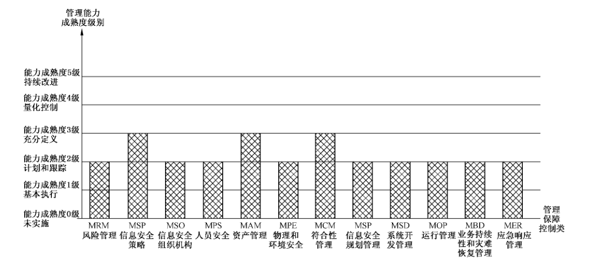

## 参考文献

- ［1］ GB/T 19000—2000 质量管理体系 基础和术语（idt ISO 9000:2000）
- ［2］ GB/T 19001—2000 质量管理体系 要求（idt ISO 9001:2000）
- ［3］ GB/T 19004—2000 质量管理体系 业绩改进指南（idt ISO 9004:2000）
- ［4］ 国务院信息化工作办公室 重要信息系统灾难恢复指南
- ［5］ ISO/IEC 17799:2005 Information technology—Security techniques—Code of practice for information security management
- ［6］ ISO/IEC 13335-1: 2004 Information technology—Security techniques—Management of information and communications technology security (MICTS)—Part 1: Concepts and models for information and communications technology security management
- ［7］ ISO/IEC 4th WD 13335-2: 2004, Management of information and communications technology security (MICTS)—Part 2: Techniques for information and communications technology security risk management
- ［8］ ISO/IEC 1st CD 18028-1: 2004, Information technology—Security techniques—IT network security—Part 1: Network security management
- ［9］ ISO/IEC FCD 18028-2: 2004, Information technology—Security techniques—IT network security—Part 2: Network security architecture
- ［10］ ISO/IEC FCD 18028-3: 2004, Information technology—Security techniques—IT network security—Part 3: Securing communications between networks using security gateways
- ［11］ ISO/IEC 18028-4: 2005, Information technology—Security techniques—IT network security—Part 4: Remote access
- ［12］ ISO/IEC 1st CD 18028-5: 2004, Information technology—Security techniques—IT network security—Part 5: Securing communications across networks using Virtual Private Networks
- ［13］ NIST Special Publication 800-18, Guide for Developing Security Plans for Information Technology Systems, November 2001
- ［14］ NIST Special Publication 800-30 Risk Management Guide for Information Technology Systems, January 2002
- ［15］ NIST Special Publication 800-34 Continuity Planning Guide for Information Technology System, June 2002
- ［16］ NIST Special Publication 800-50, Building an Information Security Awareness and Training Program, October 2003
- ［17］ NIST Special Publication 800-64, Security Considerations in the Information System Development Life Cycle, October 2003
- ［18］ NIST Special Publication 800-53, Recommended Security Controls for Federal Information Systems, February 2005
- ［19］ OECD Guidelines for Security of Information Systems and Networks: ‘Toward a Culture of Security’, 2002
- ［20］ NSTISSI No. 4009 National Information Systems Security (INFOSEC) Glossary
- ［21］ Carnegie Mellon University/Software Engineering Institute, CMU/SEI-2002-TR-011, CMMI SM for Systems Engineering, Software Engineering, Integrated Product and Process Development, and Supplier Sourcing (CMMI-SE/SW/IPPD/SS, V1.1) Continuous Representation, CMMI Product Team, March 2002
- ［22］ Carnegie Mellon University/Software Engineering Institute, CMU/SEI-2002-TR-012, CMMI SM for Systems Engineering, Software Engineering, Integrated Product and Process Development, and Supplier Sourcing (CMMI-SE/SW/IPPD/SS, V1.1) Staged Representation, CMMI Product Team, March 2002
- ［23］ System Security Engineering Capability Maturity Model (SSE-CMM) Model Description Document, Version 3.0, June 15, 2003
- ［24］ System Security Engineering Capability Maturity Model (SSE-CMM) Appraisal Method, Version 2.0, April 16, 1999
- ［25］ Information Assurance Technical Framework, Release 3.1, National Security Agency Information Assurance Solutions Technical, September 2002
- ［26］ CoBIT, 3rd Edition, Management Guidelines, COBIT Steering Committee and the IT Governance Institute™, July 2000
- ［27］ CoBIT, 3rd Edition, Audit Guidelines, COBIT Steering Committee and the IT Governance Institute™, July 2000
- ［28］ CoBIT, 3rd Edition, Control Objectives, COBIT Steering Committee and the IT Governance Institute™, July 2000
