# GB/T 20274.4-2008 信息安全技术 信息系统安全保障评估框架 第4部分：工程保障

> 来源：[GB/T 20274.4-2008 国家标准详情](https://openstd.samr.gov.cn/bzgk/std/newGbInfo?hcno=7FC3E408D2CDD2F314E3B8F95A4C3D11)；封面发布日期：2008-07-18；实施日期：2008-12-01。
> 官方 PDF SHA-256：fc3ec859fbc594d68c08a707b6ae0af4c7645640b623c41b8ff16fe21aa3cc38。
> 依据官方 PDF 全部 52 页的页面图像转写与校核；省略封面、目录、页眉、页脚和分页，合并印刷折行；表 1 重建为 Markdown 表格，图 1—23 保留为从原文页面裁出的图像。

## 前言

GB/T 20274《信息安全技术 信息系统安全保障评估框架》分为以下四个部分：

- 第 1 部分：简介和一般模型；
- 第 2 部分：技术保障；
- 第 3 部分：管理保障；
- 第 4 部分：工程保障。

本部分是 GB/T 20274 的第 4 部分。

本部分由全国信息安全标准化技术委员会提出并归口。

本部分起草单位：中国信息安全产品测评认证中心。

本部分主要起草人：吴世忠、王海生、陈晓桦、王贵驷、李守鹏、江常青、彭勇、张利、姚铁锋、班晓芳、李静、王庆、邹琪、钱伟明、江典盛、陆丽、孙成昊、门雪松、杜宇鸽、杨再山。

## 1 范围

GB/T 20274的本部分建立了信息系统安全工程保障的框架，确立了组织机构启动、实施、维护、评估和改进信息安全工程的指南和通用原则。GB/T 20274的本部分定义和说明了信息系统安全工程保障工作中反映组织机构信息安全工程保障能力的安全工程能力级，以及提供组织机构信息安全工程保障内容的安全工程保障控制类要求。

GB/T 20274 的本部分适用于启动、实施、维护、评估和改进信息安全工程的组织机构和涉及信息系统安全工程工作的所有用户、开发人员和评估人员。

## 2 规范性引用文件

下列文件中的条款通过GB/T 20274 的本部分的引用而成为本部分的条款。凡是注日期的引用文件，其随后所有的修改单（不包括勘误的内容）或修订版均不适用于本部分，然而，鼓励根据本部分达成协议的各方研究是否可使用这些文件的最新版本。凡是不注日期的引用文件，其最新版本适用于本部分。

- GB/T 20274.1 信息安全技术 信息系统安全保障评估框架 第1部分：简介和一般模型

## 3 术语和定义

GB/T 20274.1确定的以及以下术语和定义适用于 GB/T 20274 的本部分。

### 3.1.1 确认 validation

解决方案满足用户的运行安全需求。

### 3.1.2 验证 verification

解决方案满足安全要求。

## 4 本部分的结构

GB/T 20274的本部分的组织结构如下：

a） 第1章介绍了 GB/T 20274 的本部分的范围；

b） 第2章介绍了 GB/T 20274的本部分所规范引用的标准；

c） 第3章描述了适用于 GB/T 20274 的本部分的术语和定义；

d） 第4章描述了 GB/T 20274的本部分的组织结构；

e） 第5章描述了信息系统安全工程保障框架，并进一步概述了工程保障控制类和工程能力级；

f）第6章描述了信息安全工程保障控制类的规范描述结构和要求；

g） 第7章到第9章详述了提供信息安全工程保障内容的3个信息安全工程类的详细要求；

h） 第10章详述了反应组织机构信息安全工程保障能力的安全工程能力级；

i） 参考文献给出了 GB/T 20274的本部分的参考文献。

## 5 信息系统安全工程保障框架

### 5.1 信息系统安全工程保障概述

本标准第 1 部分中提出了信息安全保障模型（参见本标准第 1 部分图 3），在模型中，描述了信息系统安全中保障要素（技术、工程、管理和人员）、安全特征和生命周期三者的关系。

信息安全工程保障框架是信息系统安全保障框架的一个重要组成部分，信息安全工程保障主要涉及同信息系统安全工程建设实施相关的工程保障内容和要求，信息系统安全工程保障结合了信息安全工程保障建设的特殊内容和要求，建立了信息安全管理保障的能力成熟度模型。

信息安全工程保障能力成熟度模型包含了两个相互依赖的维度，即“安全工程保障控制维”和“安全工程保障能力成熟度级维”，它反映了信息安全工程保障在控制措施和能力成熟度这两个方面的要求。

a） “安全工程保障控制维”由信息安全工程保障控制组成，它建立了组织机构信息安全工程保障框架的内容和工作范围。信息安全工程保障控制使用类—子类—组件的层次化结构，每个信息安全工程保障控制类反映了信息安全工程保障特定领域工作的范围和内容，是信息安全工程保障特定领域工作最佳实践的总结。在本部分中，共包含了 3 个信息安全工程保障控制类，它们给出了信息安全工程保障中“做什么”这个关于内容和范围的答复；

b） “安全工程保障能力成熟度级维”由六级能力成熟度级别组成，它代表了组织机构实施信息安全工程保障控制的能力。安全工程保障能力成熟度级同特定的安全工程保障控制类相结合，给出了信息安全工程保障中“做得如何好”这个关于能力的答复，同时能力成熟度方法也为组织机构提供了可以持续改进的长效机制。

通过设置这两个相互依赖的维，信息安全工程保障框架在各个能力级别上覆盖了整个安全工程活动范围。

### 5.2 信息系统安全工程保障控制

#### 5.2.1 信息系统安全工程保障控制类

本部分中将信息系统安全工程划分为三个基本的过程域（即信息系统安全工程保障控制类）：风险、工程和保障。虽然这些域决不是互相独立的，但可以分开考虑它们。在最简单的级别中，风险过程识别并优先级排序对开发出的产品或系统的内在危险。安全工程过程与其他工程学科共同作用来决定和实施危险引起的问题的解决方案。最后，保障过程建立对安全解决方案的信心并将这种信心传递给用户。

#### 5.2.2 信息系统安全工程生命周期

信息系统安全更强调在整个生命周期中融入安全并强调动态可持续改进的能力发展，在信息系统安全工程过程中，主要是基于信息系统安全工程的生命周期思想有效地提炼出信息系统安全工程的生命周期中的一些关键的过程域，通过对这些过程域的基本实施的要求，覆盖信息系统安全工程的整个生命周期，再通过每个过程域中执行通用实践的能力实践、改进每个过程域的执行能力。这样才能真正有效、科学、可重复、可不断改进地、动态发展地实现信息系统安全保障的目标。

安全工程过程生命周期包含以下根据信息流向划分的安全工程阶段：挖掘安全需求、定义安全要求、设计体系结构、详细安全设计、实现系统安全和有效性评估。有效性评估贯穿整个信息系统工程过程的所有阶段，以确保系统能够满足用户需求。图1反映工程过程中各活动之间的关系，箭头表明各活动之间的信息流向，而不是活动的顺序或时限。

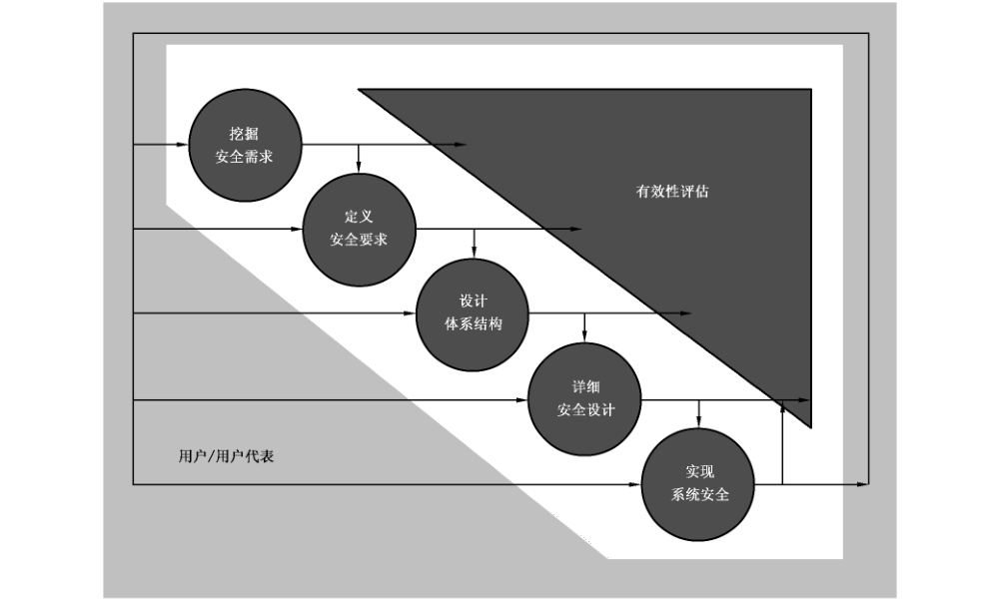

#### 5.2.3 安全工程生命周期和过程域对应关系

安全工程生命周期同过程域关系如表1：

**表 1 安全工程生命周期和过程域对应表**

| 生命周期 | 描述 | 相关安全工程保障控制子类 |
| --- | --- | --- |
| 挖掘安全需求 | 本阶段建立项目组织，了解系统的上下文环境，决定开始进行安全工程，制定初步计划和预算等。本阶段帮助用户挖掘并理解完成系统的任务和业务所需的信息保护需求。信息保护需求的确定建立在对系统的安全风险分析的基础上。 | 风险过程（PRM）：系统定义（PRM_SDF）、评估威胁（PRM_ATT）、评估脆弱性（PRM_AVL）、评估影响（PRM_AIM）、评估安全风险（PRM_ASR） |
| 定义安全要求 | 本阶段将已识别出来的信息保护需求落实到各子系统中，包括开发系统安全上下文、初步的系统安全运行设想和安全要求基线等。 | 工程过程（PEN）：确定安全要求（PEN_ISR） |
| 设计体系结构 | 本阶段进行分析候选体系结构、分配安全服务和选择安全机制，从而完成安全功能分析和落实。选择适用的组件或元件并把安全功能分配给这些元件，同时描述这些元件之间的关系。 | 工程过程（PEN）：提供安全输入（PEN_PSI）、高层安全设计（PEN_HSD） |
| 详细安全设计 | 本阶段分析设计的约束条件、分析折衷办法，进行详细的系统和安全设计并考虑生命周期支持。检查所有系统安全需求落实到了组件。最终的详细安全设计结果为实现系统提供充分的组件和接口描述信息。 | 工程过程（PEN）：详细安全设计（PEN_DSD） |
| 实现系统安全 | 本阶段把系统设计转移到运行，参与对所有系统问题的多学科综合分析，并为认证认可活动提供输入。例如，验证系统已经实现了对抗威胁评估中识别出的威胁；追踪与系统实现和测试活动相关的信息保护保障机制；为系统生命周期支持计划、运行规程、培训材料维护提供输入。本阶段信息系统已到位并开始运行，通过定期的评估和不断监视系统的安全状况，确定如何获得更高的安全性能和效率等来满足用户变化的安全需求，进行软硬件升级和修改并进行相应的测试。 | 工程过程（PEN）：安全工程实施（PEN_SEE）、协调安全（PEN_COS）、监视安全态势（PEN_MSP）、管理安全控制（PEN_MSC） |
| 有效性评估 | 本阶段关注信息保护的有效性——系统是否能够保证其处理的信息的保密性、完整性、可用性、鉴别和不可否认性，确保成功完成使命。 | 保障过程（PAS）：验证和确认安全（PAS_VVS）、建立保障论据（PAS_EAE） |

### 5.3 信息系统安全工程能力成熟度级别

在工程过程组件中，给出了信息安全工程过程所涉及的过程域，它是信息安全工程过程中提炼出来的实践的最佳反映。工程过程能力是遵循一个工程过程所能达到的可量化范围，通过对组织机构执行安全工程每个过程域能力反映了组织机构在执行信息安全工程达到预定的成本、功能和质量目标上的度量。

在工程保障中，安全工程过程能力模型将列出并描述安全工程过程的各个能力级别，这样通过对安全工程过程域的执行范围和每个相应安全工程过程域的执行能力的综合，就可以更完善地对组织机构信息安全工程过程进行科学、公正、可度量、分级的评估。

## 6 信息安全工程保障控制类结构

### 6.1 概述

本章定义了本部分所使用的信息安全工程保障控制类的结构。信息安全工程保障控制类以安全工程保障控制类、安全工程保障控制子类、安全工程保障控制组件来表达。

### 6.2 安全工程保障控制类结构

每个安全工程保障控制类包括一个安全工程保障控制类名、安全工程保障控制类介绍以及一个或多个安全工程保障控制子类。图2描述了本部分中所使用的安全工程保障控制类的结构。

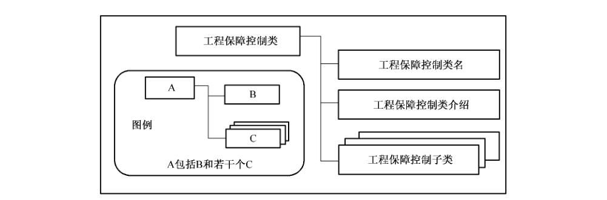

安全工程保障控制类结构的详细描述如下：

a） 安全工程保障控制类名：安全工程保障控制类名提供了标识和划分安全工程保障控制类所必需的信息，每个安全工程保障控制类都有一个唯一的名称。安全工程保障控制类的分类信息由三个英文字符的简名组成，此简名将用于该安全工程保障控制类的子类的简名规范中；

b） 安全工程保障控制类介绍：安全工程保障控制类介绍部分提供了该安全工程保障控制类定义、要求和目的等的整体描述。安全工程保障控制类介绍中用图来具体描述此域中的子类、组件组成结构；

c） 安全工程保障控制子类：安全工程保障控制子类部分对该安全工程保障控制类所包含的子类进行了详细描述。一个安全工程保障控制类包含了一个或多个安全工程保障控制子类。

### 6.3 安全工程保障控制子类结构

一个安全工程保障控制类包含了一个或多个安全工程保障控制子类。每个安全工程保障控制子类包含一个安全工程保障控制子类名、一个安全保障工程目的和一个或多个实现此安全工程保障目的的安全工程保障控制组件（控制措施）。图3描述了安全工程保障控制子类的描述结构。

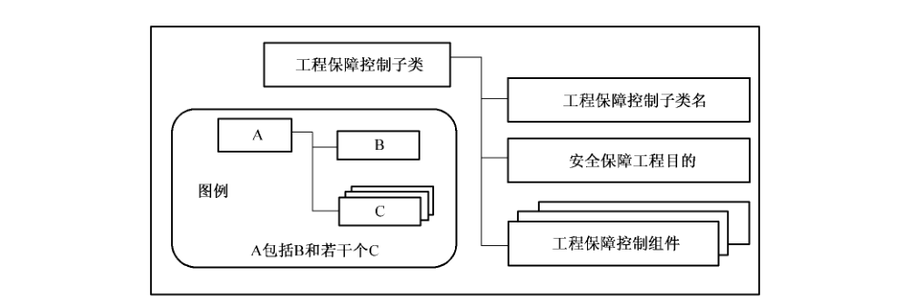

安全工程保障控制子类结构的详细描述如下：

a） 安全工程保障控制子类名：安全工程保障控制子类名部分提供了标识和划分安全工程保障控制子类所必需的分类和描述信息，每个安全工程保障控制子类有一个唯一的名称。安全工程保障控制子类的分类信息由七个英文字符的简名组成，前三个英文字符与其所属的安全工程保障控制类名相同，第四个字符是下划线用于连接安全工程保障控制类名和安全工程保障控制子类名，最后三个英文字符是安全工程保障控制子类名，例如XXX_YYY。唯一的简名安全工程保障控制子类名为安全工程保障控制组件提供了引用名；

b） 安全保障工程目的：安全工程保障目的描述了此安全工程保障控制子类所要达到的目的；

c） 安全工程保障控制组件：一个安全工程保障控制子类包含了一个或多个安全工程保障控制组件。安全工程保障控制组件就是实现安全工程保障目的的信息安全保障工程控制措施。

### 6.4 安全工程保障控制组件结构

安全工程保障控制组件是实现安全工程保障目的的信息安全保障工程控制措施。每个安全工程保障控制组件包括一个安全工程保障控制组件名、一个安全工程保障控制组件控制和一个可选的安全工程保障控制组件注解。图4描述了安全工程保障控制组件的描述结构。

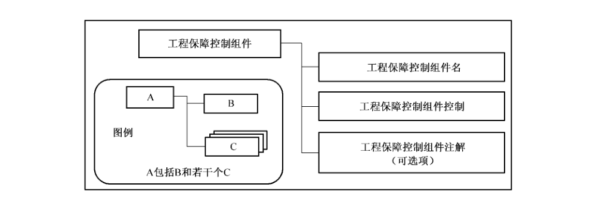

安全工程保障控制组件结构的详细描述如下：

a） 安全工程保障控制组件名：安全工程保障控制组件名用于标识安全工程保障控制组件。安全工程保障控制组件的简名是由安全工程保障控制组件名，后面使用句点作为连接符，在句点连接符后用阿拉伯数字按顺序标明不同的组件构成的。

b） 安全工程保障控制组件控制：安全工程保障控制组件控制部分定义了满足其安全工程保障控制子类安全工程保障目的特定的控制措施。

c） 安全工程保障控制组件注解：可选的安全工程保障控制组件注解部分为该安全工程保障控制组件提供了进一步描述性的解释说明，以及实施该控制措施的最佳实践的建议等。安全工程保障控制组件注解中所提供的最佳实践等内容可能不一定适合所有的情况，本部分的使用者也可以根据其自身信息安全工程保障的特殊需求和要求使用其他更合适的实施方法。

## 7 PRM 安全工程保障控制类：风险过程

### 7.1 风险过程安全工程保障控制类介绍

安全工程的一个主要目标是降低风险。风险评估是识别尚未发生的问题的过程。风险的评估是通过检查威胁的可能性、脆弱性并考虑意外事件的潜在影响。可能性是不确定的因素，所以它会因特定的环境而不同。这意味着可能性只能在一定的限制下进行预测。另外，评估特定风险的影响也具有不确定性，因为意外事件可能不像所预料的那样出现。这些因素可能有很大的不确定性影响到预测的正确性，所以安全的规划和评定就会很难。这个问题的一个不完全解决方法是用技术手段来检测意外事件的发生。

意外事件由三项构成：威胁、脆弱性和影响。脆弱性是资产可能被威胁利用的属性，也包括弱点。

如果威胁或脆弱性其一不存在，就不会有意外事件，也就没有风险。风险管理是评估和量化风险并设定组织的风险可接受程度的过程。管理风险是安全管理的重要部分。

通过保护措施的实施降低风险，风险可以描述威胁、脆弱性、影响，或者风险本身。然而，降低所有风险或完全根除任一特定风险都是不可能的。这主要是因为风险降低的成本，以及相关的不确定性。

因此，总是必须接受一些残余风险。在不确定性很高的情况下，由于不能精确地描述风险，接受风险会有很大问题。信息安全工程的过程域包括确保服务提供方组织进行分析威胁、脆弱性、影响，并综合这些活动所得到的威胁、脆弱性和影响信息进行风险分析，然后得到风险信息。

风险过程说明见图5。

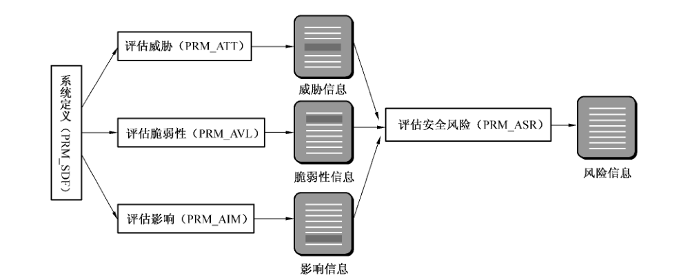

### 7.2 系统定义（PRM_SDF）

#### 7.2.1 安全工程保障目的

系统定义安全工程保障控制子类的目的是识别信息系统的任务和使命，即系统的任务要求和它所要达到的能力，这些能力包括系统应执行的功能、所需的接口及这些接口相关的能力、所要处理的信息、所支持的运行结构以及运行的威胁等。

图6描述了系统定义（PRM_SDF）安全工程保障控制子类组成结构。

#### 7.2.2 PRM_SDF. 1 详细系统描述

##### 7.2.2.1 安全工程保障控制组件控制

描述信息系统的目的、任务和使命；信息系统的信息类划分、边界、信息流；信息系统的业务体系、技术体系和管理体系等。

##### 7.2.2.2 安全工程保障控制组件注解

详细系统描述实际上就是确定 STOE 的过程，这是非常重要的一个步骤，是后续各个步骤的基础。

因为只有明确定义和描述系统的范围等性质，对系统的分析才有意义，才能准确和有效。

应按照 GB/T 20274第1部分附录C的图C.1信息系统安全保障评估信息系统描述规范中的要求，描述信息系统的使命，信息系统的环境、评估边界和接口、安全域；再分别从信息系统的管理体系、技术体系、业务体系等角度对信息系统进行详细描述。

### 7.3 评估威胁（PRM_ATT）

#### 7.3.1 安全工程保障目的

评估威胁安全工程保障控制子类的目标是对系统安全的威胁进行标识和特征化。

评估威胁安全工程保障控制子类的目的在于标识安全威胁及其性质和特征。

本安全工程保障控制子类产生的威胁信息将与评估脆弱性得到的脆弱性信息以及评估影响得到的影响信息一起用于评估安全风险中。虽然收集威胁、脆弱性和影响信息的活动被分组为几个单独的过程域，但它们是互相依赖的。其目标是要得到足以用作判定的威胁、脆弱性和影响的组合。因此，确定威胁调查的范围应结合相应的脆弱性和影响。

威胁容易变化，所以必须定期监视威胁，以确保一直维持理解本过程域产生的结果。

图7描述了评估威胁（PRM_ATT） 安全工程保障控制子类组成结构。

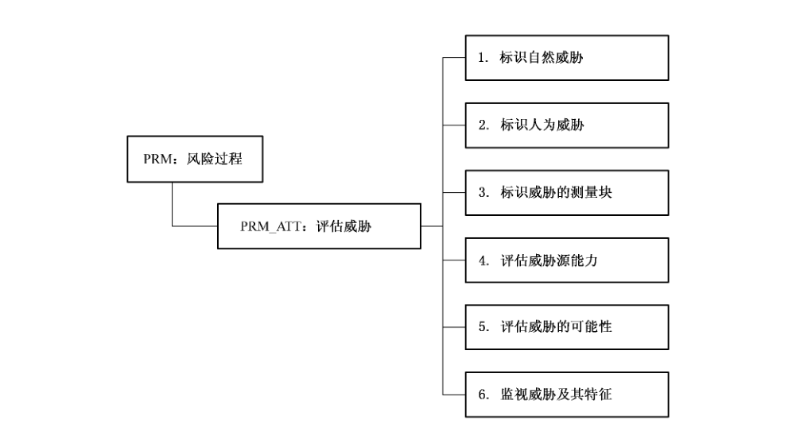

#### 7.3.2 PRM_ATT. 1 标识自然威胁

##### 7.3.2.1 安全工程保障控制组件控制

标识由自然原因引起的威胁。

由自然原因引起的威胁，包括地震、海啸和台风。不过，并非有威胁的所有自然灾害都会在所有地方发生。例如，在大量内陆中心地带就不可能出现台风。因此，重要的是标识出在特定地方到底会发生哪一种具有威胁的自然灾害。

##### 7.3.2.2 安全工程保障控制组件注解

评估所需的大量信息可以从实际清单和自然现象数据库中获得。这些信息是具有价值的，它们也可能很通用而要谨慎使用这些信息——可能需要根据特定环境来描述。

标识自然威胁的工作产品示例如下：

a） 适用的自然威胁表——文档化自然威胁的特征和可能性的表格。

#### 7.3.3 PRM_ATT.2 标识人为威胁

##### 7.3.3.1 安全工程保障控制组件控制

标识出无意的或有意的人为原因所引起的威胁。

人为原因引起的威胁基本上有两种：一是由意外原因引起的威胁；二是由有意行为引起的威胁。某些人为威胁在目标环境中并不适用，应在进一步分析后予以取消。

标识人为威胁的工作产品示例如下：

a） 威胁情景描述——描述威胁是如何工作的。

b） 威胁严重性估计——衡量威胁的可能性。

##### 7.3.3.2 安全工程保障控制组件注解

有时，描绘威胁将会如何发生的情景，有助于理解故意威胁。一般人为威胁数据库的使用，应考虑它们的完整性和关联性。

#### 7.3.4 PRM_ATT.3 标识威胁的测量块

##### 7.3.4.1 安全工程保障控制组件控制

标识特定环境中合适的测量块和适用范围。

大多数的自然威胁和许多人为威胁都有其与之相关的测量块。大多数情况下，整个的测量块并不适用于特定情况。因此，在特定情况下，有时需要最大化事件发生概率，有时需要最小化事件发生的概率，这样考虑才恰当。

##### 7.3.4.2 安全工程保障控制组件注解

在对某一特定威胁没有可接受的度量标准单位时，应生成针对该位置的度量标准单位。恰当的话，应该在测试表关系中对相关范围和度量标准单位进行描述。

标识威胁的测量块的工作产品示例如下：

a） 威胁表，包括测量块和所在位置范围。

#### 7.3.5 PRM_ATT. 4 评估威胁源能力

##### 7.3.5.1 安全工程保障控制组件控制

评估人为威胁的威胁源的能力和动机。

本安全工程保障控制组件集确定成功对系统进行攻击的潜在的人类敌对势力的才能和能力。才能指的是敌对者的攻击知识（例如，他们是否拥有知识、经过训练）。能力则衡量一个有才能的敌手能够进行攻击的可能性（例如，他们是否拥有资源）。

##### 7.3.5.2 安全工程保障控制组件注解

人为的故意威胁在很大程度上取决于威胁源的能力以及供威胁支配的资源。因此，经验欠缺的黑客如果获得了经验丰富、能力高的黑客的工具，将会造成更危险的威胁，但话说回来，还是不如经验丰富的黑客自己来使用更危险。但是，缺乏经验的黑客又可能造成非故意的伤害，经验丰富的黑客则不会。

除威胁源的能力之外，对威胁源所拥有资源的评估，应该与威胁源的攻击动机一起考虑，因为攻击的动机大小往往与目标资产的吸引力有关。

威胁可能按顺序或并发地多次进行攻击来达到其预期目标。应考虑顺序或并发的多次攻击的影响，威胁场景研究有助于此。

评估威胁源能力的工作产品示例如下：

a） 威胁源描述———能力评估和描述。

#### 7.3.6 PRM_ATT.5 评估威胁的可能性

评估威胁事件发生的可能性。

##### 7.3.6.1 安全工程保障控制组件控制

评估威胁事件发生的可能性是怎样的。对自然事件发生的机会以及故意行为或个别意外事件的评估中，需要考虑多种因素。考虑的诸多因素并不一定要进行计算或衡量，只需要报告中有一致的度量标准。

##### 7.3.6.2 安全工程保障控制组件注解

这是一件复杂的概率计算，因为许多因素的概率都是变化的。就评估的准确性和有效性而言，任何可能性的估计都是不确定的因素。应分别报告各个可能性评估的不确定性以避免混淆。无论如何，度量和可能性都将存在不确定性。通常，保持各个不确定因素分别描述则会更有效，这也是一种混合的表示法，分开处理以便进一步分析数据的时候，能够分辨出是对工作数据本身还是对数据的不确定性的处理。

a） 威胁事件可能性评估——描述威胁的可能性的报告。

#### 7.3.7 PRM_ATT.6 监视威胁及其特征

监视威胁分布情况及威胁特征的不断变化。

##### 7.3.7.1 安全工程保障控制组件控制

任何位置和状态下的威胁分布情况都是动态的。新的威胁可能变得相关，而现有威胁的特征也可能发生变化。因此有规律地监视现有威胁及其特征并检查新的威胁很重要。本安全工程保障控制组件与标识协调机制（PEN_ISR）中的“监视威胁、脆弱性、影响和环境变化”安全工程保障控制组件的一般监视活动紧密相连。

##### 7.3.7.2 安全工程保障控制组件注解

由于威胁可能发生变化，因此在特定环境中可能多次进行评估。但是，重复进行威胁评估不能代替对威胁的监视。

a） 威胁监控报告——描述威胁监控结果的文档。

b） 威胁变化报告———描述威胁分布情况变化的文档。

### 7.4 评估脆弱性（PRM_AVL）

#### 7.4.1 安全工程保障目的

标识和特征化系统的安全脆弱性。

评估安全脆弱性的目标是获得对一给定环境中系统安全脆弱性的理解。

评估安全脆弱性的目的在于标识和特征化系统的安全脆弱性。本安全工程保障控制组件包括分析系统资产、定义具体的脆弱性，以及系统脆弱性的全面评估。与安全风险和脆弱性评估相关的术语因上下文环境而不同。在本标准中，“脆弱性”除了传统所说的弱点、安全漏洞或可能被威胁攻击的系统中的信息流外，还指系统可能被恶意利用的方面。这些脆弱性独立于任何特定的威胁或攻击。可以在系统的生命周期中的任何时候执行这一系列脆弱性评估活动，来支持在已知环境中的对系统进行开发、维护或运行等决策。

图8描述了评估脆弱性（PRM_AVL）安全工程保障控制子类组成结构。

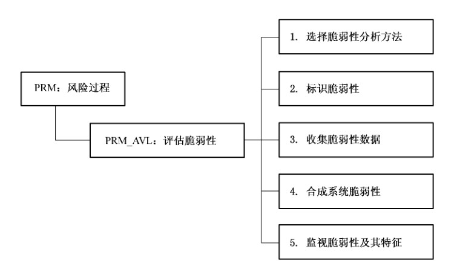

#### 7.4.2 PRM_AVL.1 选择脆弱性分析方法

选择用于标识和特征化给定环境中安全系统脆弱性的方法、技术和标准。

##### 7.4.2.1 安全工程保障控制组件控制

本组件包括定义系统建立安全脆弱性的方法，这种方法允许标识和特征化安全脆弱性，包括根据威胁及其可能性、运行功能、安全要求或其他相关过程域对脆弱性进行分类和优先级排列。通过标识分析的深度和广度，安全工程师和顾客可以确定评估范围是否包括目标系统以及分析的全面性。应在预先安排和指定时间内，在一个已知的并记录有配置的框架内进行分析。分析的方法论应包括预期结果，应清楚地描述分析的具体目标。

##### 7.4.2.2 安全工程保障控制组件注解

脆弱性分析方法可以是现有的、经裁剪的，也可以是专门针对系统运行和给定环境定制的。分析方法通常以 PRM_ATT“评估安全风险“中的风险分析方法论为基础或相一致。要注意的是并不提供有关威胁、能力和价值的理解，这时的方法论必须针对其范围或采用一系列可用假设条件。

分析脆弱性的方法可以是定量的或定性的。通常的脆弱性分析反映可能性。攻击结果可以书面报告的形式表达，攻击本身可以论述证明。

至少有两种不同的方法来标识脆弱性。这两种方法为基于分析的方法或基于测试的方法。基于测试的方法对于标识现存的脆弱性，且测试内容中含有已知威胁，是很好的方法。基于分析的方法，对于标识新的脆弱性则是最好的方法，那些脆弱性并不会立即被利用但会随另一安全问题的出现而被利用。

选择脆弱性分析方法论时还可考虑的其他选择包括基于定量或定性的方法，还应该考虑对分析和测量的完整性的控制能力。

工作产品示例：

a） 脆弱性分析方法——发现和描述系统安全脆弱性的方法，包括分析、报告和跟踪过程。

b） 脆弱性分析格式—为保证方法规范化，描述脆弱性分析结果的格式。

c） 攻击方法论和工作原理——包括执行攻击测试的目标和方法。

d） 攻击规程——执行攻击测试的详细步骤。

e） 攻击计划——包括资源、时间安排和攻击方法论的描述。

f） 穿透研究——以标识未知脆弱性为目标的攻击场景的分析和实施。

g） 攻击场景—描述将要进行尝试的具体攻击。

#### 7.4.3 PRM_AVL.2 标识脆弱性

标识系统安全脆弱性。

##### 7.4.3.1 安全工程保障控制组件控制

系统的安全和非安全的相关部分中都可能存在系统脆弱性。支持安全功能或与安全机制配合的非安全机制中经常有可利用的脆弱性。应遵循选择脆弱性分析方法（PRM_AVL.1）中的攻击场景方法，以便能确认脆弱性。应记录发现的所有系统脆弱性。

##### 7.4.3.2 安全工程保障控制组件注解

在本实践中，脆弱性被看成是系统的固有问题，而不考虑任何威胁的可能性。可以参照威胁分析的结果来对脆弱性进行优先级排列。攻击不可重现，使开发对策的难度较大。

可根据 PRM_ASR“评估安全风险“中优先级排列的功能、PEN_ISR“确定安全要求”中的业务优先级和目标来标识脆弱性。此外，PRM_AIM“评估影响”中的资产也必须计算在内。

工作产品示例：

a） 描述系统面临的各种攻击的脆弱性清单。

b） 包括攻击测试结果的穿透轮廓（例如脆弱性）。

#### 7.4.4 PRM_AVL. 3 收集脆弱性数据

收集与脆弱性性质相关的数据。

##### 7.4.4.1 安全工程保障控制组件控制

脆弱性具有其自身的性质，本安全工程保障控制组件意在收集与这些性质相关的数据。脆弱性的测量块可以与 PRM_ATT.3“标识威胁的测量块”中的威胁的测量块相同。应标识并收集脆弱性被利用的难易程度以及脆弱性出现的可能性的数据。

##### 7.4.4.2 安全工程保障控制组件注解

通过本活动收集起来的脆弱性数据以后将被用在 PRM_ASR“评估安全风险”。因此，以一种易于PRM_ASR 使用的格式收集和存贮脆弱性数据显得非常重要。无论如何，度量和可能性都将存在不确定性。通常，保持各个不确定因素分别描述则会更有效，分开处理以便进一步分析数据的时候，能够分辨出是对工作数据本身还是对数据的不确定性的处理。

工作产品示例：

a） 脆弱性性质表——记录系统或产品脆弱性特征的表。

#### 7.4.5 PRM_AVL.4 合成系统脆弱性

评估系统脆弱性并将特定脆弱性及各种特定脆弱性的组合结果进行综合收集。

##### 7.4.5.1 安全工程保障控制组件控制

分析脆弱性或脆弱性的组合会让系统产生的问题。应分析脆弱性的附加特征，例如脆弱性被利用的可能性以及成功利用脆弱性的机会。分析结果也可包括处置合成的脆弱性的推荐方法。

##### 7.4.5.2 安全工程保障控制组件注解

需要收集脆弱性分析和攻击的结果。应足够详细地标识和文件描述发现的所有脆弱性及其被利用的潜在可能性，以便客户做出有关对策的决定。

工作产品示例：

a） 脆弱性评估报告——包括定性或定量描述让系统产生问题的脆弱性，同时包括攻击的可能性、成功的可能性及攻击产生的影响。

b） 攻击报告——记录攻击的结果及结果的分析的报告，其中包括已发现的脆弱性、被利用的潜在可能性和推荐的处置方法等。

#### 7.4.6 PRM_AVL. 5 监视脆弱性及其特征

监视脆弱性的不断变化及其特征的变化。

##### 7.4.6.1 安全工程保障控制组件控制

任何位置和状态下的脆弱性分布情况都是动态的。新的脆弱性会变得有相互关系，现有脆弱性的特征可能变化。因此，监视现有脆弱性及其特征并定期检查新的脆弱性很重要。本安全工程保障控制组件与 PEN_MSP.2 监视威胁、脆弱性、影响、风险和环境变化的一般监视活动紧密相连。

##### 7.4.6.2 安全工程保障控制组件注解

由于脆弱性可能发生变化，在给定环境中可能多次进行评估活动。但是，重复的脆弱性评估不能代替对脆弱性的监视。

工作产品示例：

a） 脆弱性监视报告———描述脆弱性监视结果的文档。

b） 脆弱性变化报告——描述新的或变化了的脆弱性的文档。

### 7.5 评估影响（PRM_AIM）

#### 7.5.1 安全工程保障目的

评估影响的目的在于标识对系统的影响，并评估影响发生的可能性。影响可能是有形的，例如收入的损失或经济惩罚；也可能是无形的，例如声誉和信誉的损失。

本安全工程保障控制子类的目标是标识和特征化风险对系统的安全影响。

图9描述了评估影响（PRM_AIM）安全工程保障控制子类组成结构。

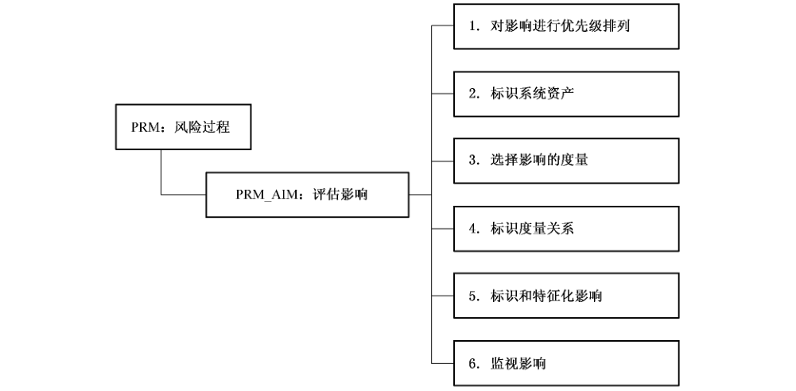

#### 7.5.2 PRM_AIM. 1 对影响进行优先级排列

标识、分析并优先级排列系统的运行、业务或任务能力。

##### 7.5.2.1 安全工程保障控制组件控制

标识、分析并优先级排列系统的运行、业务或任务，也应考虑对业务战略的影响。这将可能改变和缓解组织可能遭受的影响，进而会改变其他控制子类或组件得出的风险优先级排列次序。因此当计算潜在影响时把这些影响包括在内很重要。本组件与PEN_ISR“确定安全要求”的活动相关。

##### 7.5.2.2 安全工程保障控制组件注解

功能性和信息资产可理解为它们在给定环境中具有的价值和关键性。价值可以是运行的重要性、密级、敏感度，或预期的运行及系统的使用反映出的资产的其他价值意义。关键性可理解为对系统运行、人类生活、运行成本以及其他关键因素的影响，在运行环境中功能受到损害、修改或不可用。资产也可根据合适的安全要求进行定义。例如，资产可定义为客户清单的保密性、办公室间通信的可用性或薪资信息的完整性。许多资产是无形的或隐性的。所选风险评估方法应说明怎样评价能力和资产的值，并进行优先级排列。

工作产品示例：

a） 系统优先级清单和影响的修改者。

b） 系统能力轮廓—描述系统能力及其对系统目标的重要性。

#### 7.5.3 PRM_AIM.2 标识系统资产

标识和特征化支持系统的关键运行能力或安全目标的系统资产。

##### 7.5.3.1 安全工程保障控制组件控制

标识支持系统的安全目标或关键能力（运行，业务或任务功能）所必需的系统资源和数据。通过评估给定环境中每项资产提供支持的重要性，来定义每项资产。

##### 7.5.3.2 安全工程保障控制组件注解

广义的资产包括系统中的人、环境、技术和基础设施，还包括数据和资源；不仅包括信息，而且也包括各个子系统（例如，通信、数据恢复、应用，以及打印资源）。资产的重要性可理解为其在给定环境中的支持能力的价值和关键性。资产不必一定是安全性机制；它们可以包括支持与安全性机制相关的安全功能或工作的非安全机制。有时，本组件是对PEN_PSI“提供安全输入”和 PAS_VVS“验证和确认安全“中工作的复查。

工作产品示例：

a） 产品资产分析——包括标识产品资产及对系统运行的重要性。

b） 系统资产分析——包括标识系统资产及对系统运行的重要性。

#### 7.5.4 PRM_AIM. 3 选择影响的度量

选择用于评估影响的度量。

##### 7.5.4.1 安全工程保障控制组件控制

有许多度量标准可用来衡量事件的影响。最好预先确定哪种度量标准适用于当前的特定系统。

##### 7.5.4.2 安全工程保障控制组件注解

数量有限但一致的度量标准比不一致的度量标准更易于处理。影响的定量或定性评估方法可从以下几个方面考虑，例如：

a） 计算经济成本；

b） 根据经验划分严重程度等级，例如从1到10；

c） 或者使用形容词，例如低、中、高。

工作产品示例：

a） 选择影响的度量。

#### 7.5.5 PRM_AIM.4 标识度量关系

标识所选评估影响的度量标准之间的关系以及所需度量标准转换因子。

##### 7.5.5.1 安全工程保障控制组件控制

评估影响可能需要使用不同的度量标准。必须找出不同度量标准之间的关系，以保证在整个影响评估中对所有暴露所使用方法的一致性。有时，有必要把各种度量标准方法组合起来，以便能够产生出统一的结果。因此需要建立产生统一结果的方法。这通常因系统不同而不同。当使用定性的度量标准时，在综合阶段也需要有定性因子合并的指南。

##### 7.5.5.2 安全工程保障控制组件注解

例如，若某暴露是陨石推毁一栋房屋，那么潜在的影响便是要花费＄100,000重建这栋房屋。另一种影响可能是因6个月后才能重建好房屋而导致无处安身的损失。可以将这两种影响合并起来，如果每月租房需要＄250，此暴露总影响便是＄101,500。

工作产品示例：

a） 影响度量标准关系表——描述度量标准之间的关系。

b） 影响度量标准合并规则——描述合并影响度量标准的规则。

#### 7.5.6 PRM_AIM. 5 标识和特征化影响

利用多重度量标准或统一度量标准标识和特征化意外事件的意外影响。

##### 7.5.6.1 安全工程保障控制组件控制

从 PRM_AIM.1（对影响进行优先级排列）和 PRM_AIM.2（标识系统资产）中标识出的资产和能力出发标识出产生损害的后果。对于每种资产，后果可能为损坏、泄密、不通或消失。对能力的影响可能包括中断、延迟或削弱。

创建了相对完整的度量关系表之后，可以使用在 PRM_AIM.3（选择影响的度量）和 PRM_AIM. 4（标识度量关系）中标识出的度量来特征化影响。这一步需要研究精算表，年鉴或其他资源，还应考虑每种影响的度量的不确定性。

##### 7.5.6.2 安全工程保障控制组件注解

评估影响以 PRM_AIM.3（选择影响的度量）中确定的影响度量标准为依据，影响的组合以 PRM_AIM.4（标识度量关系）中建立的规则为依据。在大多数情况下，度量标准以及特定环境下具体影响发生的可能性都存在一定的不确定性。通常，保持各个不确定因素分别描述则会更有效，分开处理以便进一步分析数据的时候，能够分辨出是对工作数据本身还是对数据的不确定性的处理。

工作产品示例：

a） 暴露影响列表——潜在影响及相应度量的列表。

#### 7.5.7 PRM_AIM.6 监视影响

监视影响的不断变化。

##### 7.5.7.1 安全工程保障控制组件控制

任何位置和状态下，影响都是动态的。新的影响可能产生相互关系。因此，监视现有影响并定期检查新的影响很重要。本安全工程保障控制组件与 PEN_MSP.2 监视威胁、脆弱性、影响、风险和环境变化的一般监视活动紧密相连。

##### 7.5.7.2 安全工程保障控制组件注解

由于影响会发生变化，因此在给定环境中可能反复、多次进行影响评估。但是，重复的影响评估不能代替对影响的监视。

工作产品示例：

a） 影响监视报告——描述监视影响的结果。

b） 影响变化报告——描述影响的变化情况。

### 7.6 评估安全风险（PRM_ASR）

#### 7.6.1 安全工程保障目的

评估安全风险的目标是获得对给定环境中的系统运行相关的安全风险的理解，并按照既定方法论对风险进行优先级排列。

评估安全风险的目的是标识给定环境中系统的安全风险。本安全保障控制子类着重要基于对能力情况以及资产相对威胁的脆弱情况的理解来确定这些风险。本活动特别包括标识和评估暴露发生的可能性。“暴露”是指会造成重大损害的威胁、脆弱性和影响的组合。可以在系统的生命周期中的任何时候执行这一系列风险评估活动，来支持在已知环境中的对系统进行开发、维护或运行等决策。

图10描述了评估安全风险（PRM_ASR）安全工程保障控制子类组成结构。

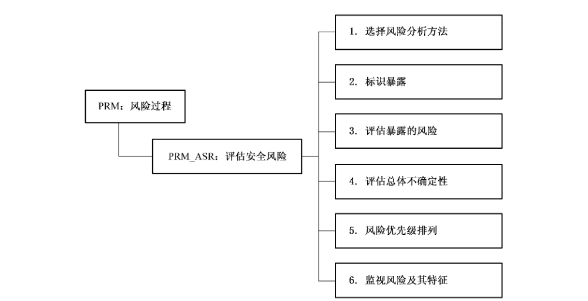

#### 7.6.2 PRM_ASR. 1 选择风险分析方法

选择在给定环境中分析、评估、比较和优先级排列系统的安全风险的方法、技术和标准。

##### 7.6.2.1 安全工程保障控制组件控制

本组件定义用于标识给定环境中系统安全风险的方法，可以用这种方法分析、评估和比较安全风险。应该依据威胁、运行功能、系统脆弱性、潜在损失、安全需求等相关问题，得到对风险进行分类和分级的方案。

##### 7.6.2.2 安全工程保障控制组件注解

这种方法可以是现有的，经裁剪的，或针对系统运行和给定环境的特定方法。风险评估的方法论应与威胁、脆弱性和影响的评估方法论互相衔接。

工作产品示例：

a） 风险评估方法——描述对标识和特征化风险的方法。

b） 风险评估格式—描述归档和跟踪风险的格式，包括风险的描述、重要性和相关性。

#### 7.6.3 PRM_ASR. 2 标识暴露

标识威胁/脆弱性/影响三元组（暴露）。

##### 7.6.3.1 安全工程保障控制组件控制

标识暴露的目的在于找出威胁和脆弱性的组合中的相关项，进而标识出现威胁和脆弱性造成的影响。在选择系统保护措施时必须考虑这些暴露。

##### 7.6.3.2 安全工程保障控制组件注解

本组件取决于威胁、脆弱性和影响各个安全工程控制子类的输出。

工作产品示例：

a） 系统暴露清单——描述该系统的暴露。

#### 7.6.4 PRM_ASR. 3 评估暴露的风险

评估每项暴露的风险。

##### 7.6.4.1 安全工程保障控制组件控制

标识暴露出现的可能性。

##### 7.6.4.2 安全工程保障控制组件注解

暴露的可能性是威胁的可能性与脆弱性的可能性所产生的暴露的可能性的综合。大多数情况下，也必须将特定的、一定数量的或绝大多数影响的可能性计算在内。无论如何，度量标准都存在不确定性。保持各个不确定因素分别描述则会更有效，分开处理以便进一步分析数据的时候，能够分辨出是对工作数据本身还是对数据的不确定性的处理。这会影响到应对风险所采取的战略。本组件使用了从PRM_ATT.5（评估威胁的可能性）、PRM_AVL.3（收集脆弱性数据）和 PRM_AIM.5（标识和特征化影响）中通过多种度量或一种统一度量方法收集的可能性数据。

工作产品示例：

a） 暴露风险清单——计算出的风险列表。

b） 暴露优先级表—计算出的风险的优先级列表。

#### 7.6.5 PRM_ASR.4 评估总体不确定性

评估暴露的风险的总体不确定性。

##### 7.6.5.1 安全工程保障控制组件控制

每项风险本身都具有不确定性。总体的风险不确定性是 PRM_ATT. 5（评估威胁的可能性）、PRM -AVL. 3（收集脆弱性数据）、PRM_AIM. 5（标识和特征化影响）中所标识的威胁、脆弱性、影响及其特征的不确定性的总和。本组件与“PAS_EAE 建立保证论据”中的作为保障可以改变和降低不确定性的活动紧密相关。

##### 7.6.5.2 安全工程保障控制组件注解

如果不确定性没有与暴露发生的可能性分开考虑，那么安全措施的实施将达不到效果，或者降低了实际上没必要去降低的风险。

工作产品示例：

a） 具有不确定性的暴露的风险—表明对风险的衡量具有不确定性的风险列表。

#### 7.6.6 PRM_ASR. 5 风险优先级排列

按优先级排列风险。

##### 7.6.6.1 安全工程保障控制组件控制

应根据组织优先级、发生的可能性、所具有的不确定性和可用资金来对已标识的风险进行排序。可以降低、避免、转移或接受风险。也可以组合使用这些风险处理方式。降低，可以针对威胁、脆弱性、影响或风险本身。应根据 PEN_MSC“确定安全要求”中标识的风险承担者的需求、业务优先级和整体系统架构来选择处理方式。

##### 7.6.6.2 安全工程保障控制组件注解

这一步骤极为复杂并常常需要多次重复。安全措施可能要对付多种风险或多种威胁、脆弱性和影响。这方面的工作可能对改变需要对付的风险的顺序具有影响。因此，本安全工程保障控制组件与PEN_ISR“确定安全要求”和 PEN_PSI“提供安全输入”密切相关。

工作产品示例：

a） 风险优先级清单——一个按优先级排列的风险清单。

b） 安全措施需求清单—能够帮助减轻风险的潜在的安全措施的清单。

c） 优先顺序的关系——一个优先级框架的描述文档。

#### 7.6.7 PRM_ASR.6 监视风险及其特征

监视风险分布情况的不断变化及其特征的变化。

##### 7.6.7.1 安全工程保障控制组件控制

任何情形下风险的分布情况都是动态的。新的风险可能变得相互关联，同时现存风险的特征可能变化。因此，监视现存风险及其特征、定期检查新的风险很重要。本组件与 PEN_MSP.2“监视威胁、脆弱性、影响、风险和环境的变化”中的一般监视活动密切相关。

##### 7.6.7.2 安全工程保障控制组件注解

因为风险会变化，可以在给定环境下多次进行风险评估活动。但是，反复的风险评估不能代替监视风险。

监视风险及其特征工作产品示例如下：

a） 风险监视报告——描述当前风险分布情况的报告。

b） 风险变化报告——描述系统的运行能力及其对系统目标的重要性。

## 8 PEN 安全工程保障控制类：工程过程

### 8.1 工程过程安全工程保障控制类介绍

安全工程和其他工程学科一样，是一个贯穿概念、设计、实施、测试、验收、运行、维护和废弃的过程。

在整个过程中，安全工程师必须与系统工程组的其他部分密切工作。信息安全工程保障强调安全工程师是大团队的一部分，而且需与其他学科的工程师协作他们的活动。这有助于确保安全是较大过程的重要组成部分，而不是分离、独立的活动。

使用从上述风险过程得到的信息，以及其他关于系统需求的信息、相关法律和策略，安全工程师与客户一起识别安全需求。识别了需求后，安全工程师识别并跟踪具体的要求。

制定安全问题的解决方案的过程一般包括识别可选方案，评价可选方案以决定哪个最好。将此活动与其余工程过程相结合的难度在于，选择解决方案不能仅考虑安全。而是有很多其他必须要考虑的因素，包括成本、性能、技术风险和使用简便。特别应该注意这些决策以免再返回。产生的分析结果也是保障工作的重要基础。

在生命周期的后期，安全工程师要确保产品和系统根据先前的风险被恰当地配置，以确保新的风险不会使系统运行在不安全状态。

工程过程安全工程保障控制类介绍见图 11。

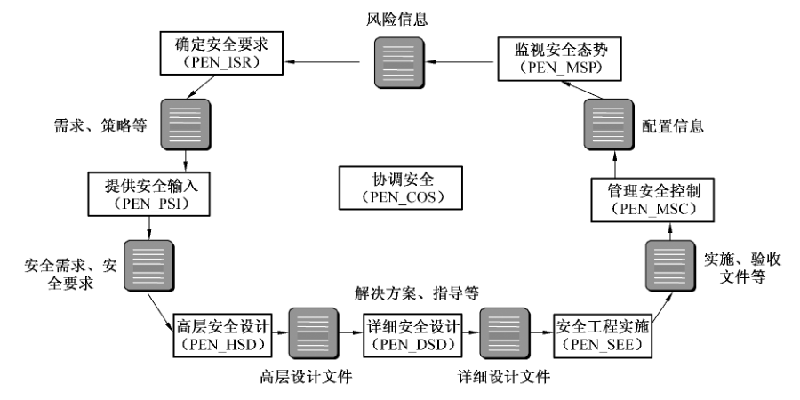

### 8.2 确定安全要求（PEN_ISR）

#### 8.2.1 安全工程保障目的

确定安全要求的目的是要明确地标识系统的安全需求。确定安全要求涉及定义系统的安全基础，以满足所有法律、策略和组织的安全要求。这些需求根据预期的系统运行安全环境上下文、组织当前安全性和系统环境、标识出的一系列安全目标进行裁剪。定义一系列系统安全要求作为批准系统安全的基线。

确定安全要求的目标是包括客户在内的各方对安全需求达成共同理解。

图12 描述了确定安全要求（PEN_ISR）安全工程保障控制子类组成结构。

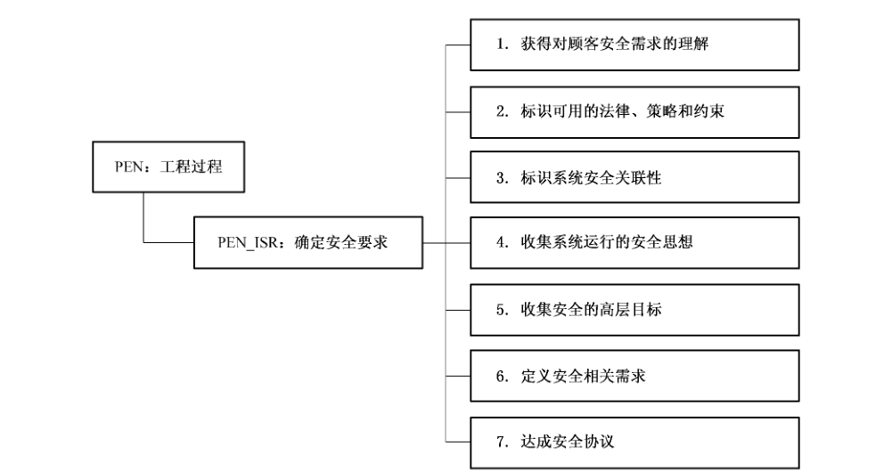

#### 8.2.2 PEN_ISR. 1 获得对客户安全需求的理解

##### 8.2.2.1 安全工程保障控制组件控制

应获得对客户安全需求的理解。

本安全工程保障控制组件的目的是要收集全面理解客户的安全需求所需的所有信息。这些需求受到安全风险对客户的重要性的影响。系统将要运行的预期环境也影响客户的安全需求。

##### 8.2.2.2 安全工程保障控制组件注解

术语“客户”可以指产品、系统或服务的具体接受者，或者也可以指市场调查或产品目标的一般接受者。可能需要标识和区分不同的用户群。例如，普通用户可能有与管理员不同的需求。

工作产品示例：

a） 客户的安全需求的陈述——客户对安全要求的高层描述。

#### 8.2.3 PEN_ISR.2 标识可用的法律、策略和约束

##### 8.2.3.1 安全工程保障控制组件控制

应标识出管理系统的法律、策略、标准、外部影响和约束。

本安全工程保障控制组件的目的是要收集所有影响到系统安全的所有外部影响。适用性的决定应标识支配系统预期环境的法律、规章、策略和商业标准。应决定全局和本地策略之间优先权。必须标识由系统客户设置于系统的安全要求，并提炼隐含的安全要求。

##### 8.2.3.2 安全工程保障控制组件注解

当系统将穿越多个物理区域时需要仔细考虑。不同国家和不同类型的业务应用的法律和规章之间可能发生冲突。作为标识过程的一部分，冲突应最小化，应标识并尽可能解决冲突。

工作产品示例：

a） 安全约束——法律、策略、规章，以及其他影响系统安全的约束。

b） 安全轮廓———安全环境（威胁、组织策略）；安全目标（例如，要对抗的威胁）；安全功能和保障要求；按照满足目标的要求而进行系统开发的基本原理。

#### 8.2.4 PEN_ISR. 3 标识系统安全关联性

##### 8.2.4.1 安全工程保障控制组件控制

标识系统的用途以便确定安全上下文环境。

本安全工程保障控制组件的目的是要标识系统上下文如何影响安全。这涉及理解系统的用途（例如，情报的、金融的、医药的）。为安全考虑描述所处理的任务和运行场景。本阶段需要对系统面临的或可能遭受的威胁的高层理解。为可能对安全的影响而描述性能和功能要求。为隐含的安全要求而检查运行约束条件。

环境可能也包括与其他组织或系统的接口，以便定义系统的安全边界。确定接口的要素包括安全边界的内部和外部。

许多组织外部的因素也不同程度影响组织的安全需求。这些因素包括政治倾向以及政治焦点的变化、技术开发、经济影响、全球事件和信息战。由于这些因素都不是静态的，需要监视和定期评估变化带来的潜在影响。

##### 8.2.4.2 安全工程保障控制组件注解

系统的安全边界并不一定等同于系统边界。例如，安全边界可能包含系统所处的设备和运行系统的人，而系统边界可能止于人机接口。扩展安全边界，就可以将物理方法作为除纯技术方法之外有效的访问控制的安全措施。

工作产品示例：

a） 预期的威胁环境—对需要保护的系统资产的所有已知或预测的威胁；包括威胁源（专业知识、可用资源、动机），攻击（方法、所利用的脆弱性、时机），资产。

b） 评估对象—描述将要评估其安全特性（的系统或产品类型、预期的应用、一般特性、使用局限）。

#### 8.2.5 PEN_ISR. 4 收集系统运行的安全思想

##### 8.2.5.1 安全工程保障控制组件控制

收集系统运行的高层安全思想。

本安全工程保障控制组件的目的是要开发整个企业的高层安全思想，包括角色、职责、信息流、资产、资源、人员保护和物理保护。此描述应包括讨论如何在系统要求的约束下管理企业。特别在运行安全概念中提供系统的这一思想，应包括系统架构、规程和环境的高层安全思想。系统开发环境的要求也在本阶段获得。

##### 8.2.5.2 安全工程保障控制组件注解

无。

工作产品示例：

a） 运行安全概念—系统的高层安全思想（角色、职责、资产、信息流、规程）。

b） 概念性的安全架构——概念性角度的安全架构，参见 PEN_PSI.3中的安全架构。

#### 8.2.6 PEN_ISR. 5 收集安全的高层目标

##### 8.2.6.1 安全工程保障控制组件控制

收集定义系统安全性的高层目标。

本基本实践的目的是要标识应满足怎样的安全目标，以便为系统在其运行环境中提供足够的安全性。在 PAS_EAE“建立保证证据”中确定的系统的保障目标，可能影响安全目标。

##### 8.2.6.2 安全工程保障控制组件注解

目标应尽可能与任何具体实现无关。如果由于必须面对的现存环境而出现特定的约束，应在 PEN_PSI“提供安全输入”中得出成熟的工程可选方案的安全约束和考虑时确定。安全目标应作为系统和信息的可用性、可追究性、真实性、保密性、完整性和可靠性要求的最小化描述。

工作产品示例：

a） 运行的/环境的安全策略—如何在组织内外管理、保护和分发资产的规则、指示和实践。

b） 系统安全策略——系统或产品如何管理、保护和分发资产的规则、指示和实践。

#### 8.2.7 PEN_ISR.6 定义安全相关需求

##### 8.2.7.1 安全工程保障控制组件控制

定义一致的一系列定义了系统所执行的保护的说明。

本安全工程保障控制组件的目的是要定义系统的安全要求。本实践应确保每项要求都与适用的策略、法律、标准、安全要求和系统的约束相一致。这些要求应完整定义系统的安全需求，包括非技术性的要求。通常需要定义或指定对象的逻辑或物理边界，以确保涵盖了所有方面。要求应与系统的目标影射或关联。应清晰简明地规定安全要求且不应互相矛盾。只要可能，安全应最小化对系统功能和性能的影响。安全要求应为评估系统在其预期环境中的安全性的提供基础。

##### 8.2.7.2 安全工程保障控制组件注解

许多要求适用于多个学科，所以极少数要求专注安全。因此，本安全工程控制类要求与其他学科进行大量协调以确切得出系统安全是怎样的。这些交互性的活动在 PEN_COS“协调安全”中描述。

工作产品示例：

a） 安全要求——直接影响系统安全运行或贯彻指定安全策略的要求。

b） 可追溯性矩阵——安全需求、到要求、到解决方案（例如，架构、涉及、实施）和到测试及测试结果的影射。

#### 8.2.8 PEN_ISR. 7 达成安全协议

##### 8.2.8.1 安全工程保障控制组件控制

达成对具体安全要求符合客户需求的协议。

本安全工程保障控制组件的目的是要在所有各方之间达成安全要求的共识。标识出一般客户群而非特定客户时，要求应满足一系列目标。指定的安全要求应是管理策略、法律和用户需求的完整、一致的反映。应标识出问题并再处理直到达成共识。

##### 8.2.8.2 安全工程保障控制组件注解

确保所有相关方真正理解了所同意的安全要求并且有相同的理解，这很重要。需要非常小心地确保过程中安全要求对所有相关方来说是一回事。

工作产品示例：

a） 认可的安全目标——对抗标识出的威胁和/或与标识出的安全策略（由客户认可）相一致的固定意向。

b） 安全要求基线——所有各方（特别是客户）在特定里程碑处同意的一系列最小安全要求。

### 8.3 高层安全设计（PEN_HSD）

#### 8.3.1 安全工程保障目的

信息系统的高层安全设计包括系统的体系结构、设计和实现的需求，制定相应的设计原则和建议、安全体系结构建议、保护的原则，得到安全模型、安全体系结构，进行可靠性分析；确定所有的安全机制都能对应到高层安全设计，并且所有的高层安全设计都有具体的安全机制来保证。

图 13描述了高层安全设计（PEN_HSD）安全工程保障控制子类组成结构。

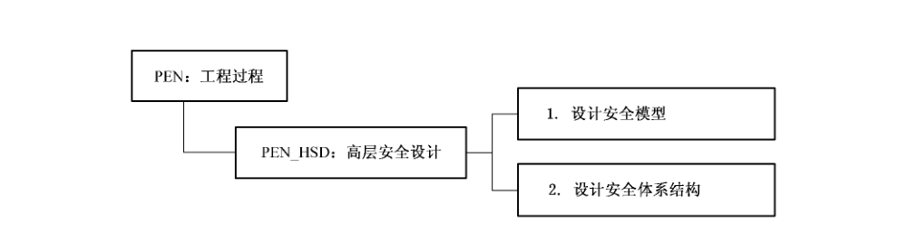

#### 8.3.2 PEN_HSD.1 设计安全模型

##### 8.3.2.1 安全工程保障控制组件控制

为当前特定的信息系统设计安全模型，描述系统的安全原理。

##### 8.3.2.2 安全工程保障控制组件注解

分析信息系统业务及安全要求，分解安全功能要求，选择系统结构、系统组件、内部外部接口、信息流方向、环境等，设计安全模型。

通常要求来自信息模型、功能模型和行为模型。信息模型说明将要处理的信息的类型以及如何处理。功能模型说明应用系统将要提供的任务和功能。行为模型说明状态转变时和转变后应用所处的状态。系统设计描述用户的要求和系统内部的行为，然后将两者进行影射，说明系统内部行为如何满足用户的要求。

工作产品示例：

a） 安全设计文档——包括系统中的资产和信息流的详细资料，以及描述将会贯彻安全的或与安全相关的系统功能。

b） 安全模型—系统贯彻安全策略的正式表述；必须标识控制系统如何管理、保护和分发信息的一系列规则和实践；有时这些规则可以用精确的数学术语表示。

#### 8.3.3 PEN_HSD.2 设计安全体系结构

##### 8.3.3.1 安全工程保障控制组件控制

为当前特定的信息系统设计安全体系结构。

##### 8.3.3.2 安全工程保障控制组件注解

将信息系统进行安全功能分解、选择能够实现特定功能的组件形式，描述每个子系统所提供的安全功能。安全体系结构着重于系统体系结构的安全方面，描述与系统安全有关的规则、基本概念、功能和服务。体系结构设计定义了主要结构和组件之间的相互关系。

本安全工程保障控制子类涉及与安全相关的需要进行分解、分析和重组，直到标识出有效的可选体系结构。

工作产品示例：

a） 安全架构——关注于系统架构的安全方面，描述与系统的安全相关的原则、基本概念、功能和服务。

b） 依赖性分析（安全措施的关系和依存关系）—描述安全服务和机制如何相互关联和互相依赖来为整个系统产生有效的安全性；标识哪些方面还需要安全措施。

### 8.4 详细安全设计（PEN_DSD）

#### 8.4.1 安全工程保障目的

本安全工程保障控制类信息系统安全工程师分析设计的约束条件，分析折衷办法，进行详细的系统和安全设计并考虑生命周期支持。信息系统安全工程师检查所有系统安全需求落实到了组件。最终的详细安全设计结果为实现系统提供充分的组件和接口描述信息。

图14描述了详细安全设计（PEN_DSD） 安全工程保障控制子类组成结构。

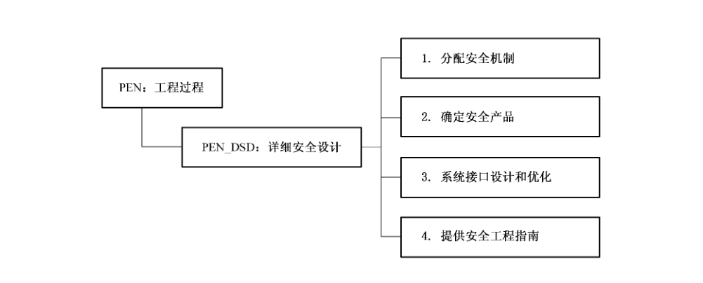

#### 8.4.2 PEN_DSD. 1 分配安全机制

##### 8.4.2.1 安全工程保障控制组件控制

将高层设计中的思想具体落实为具体的安全机制。

##### 8.4.2.2 安全工程保障控制组件注解

确定所有的安全机制都能对应到高层安全设计，并且所有的高层安全设计都有具体的安全机制来保证。将安全机制细分到子系统、组件和元素。

工作产品示例：

a） 安全设计标准——有关整个系统或产品设计做决策所需的安全约束和考虑。

b） 安全实施规则——应用于系统或产品实施的安全约束和考虑（例如，具体机制的使用，编码的标准）。

c） 文档要求——标识支持安全要求所需的具体文档（例如，管理员手册、用户手册、具体设计文档）。

#### 8.4.3 PEN_DSD.2 确定安全产品

##### 8.4.3.1 安全工程保障控制组件控制

根据高层设计和分配的安全机制等要求，从可选的安全产品中选择最适合的产品。

##### 8.4.3.2 安全工程保障控制组件注解

根据系统的需求，按照一定的依据给出候选产品列表。根据系统的需求，确定需要定制的安全产品列表和他们的技术指标和功能要求。

工作产品示例：

a） 安全产品选型要求——说明能够满足系统安全要求的产品或组件所应具有的最低安全功能和安全保障要求。

#### 8.4.4 PEN_DSD.3 系统接口设计和优化

##### 8.4.4.1 安全工程保障控制组件控制

对系统设计中的接口进行设计和优化。

##### 8.4.4.2 安全工程保障控制组件注解

设计安全系统与其他系统之间、各个安全类之间的接口，并进行优化。

工作产品示例：

a） 系统优化指南——描述系统优化的理由和具体方法。

b） 系统配置指导——确保系统运行满足安全目标的系统配置指导。

#### 8.4.5 PEN_DSD.4 提供安全工程指南

##### 8.4.5.1 安全工程保障控制组件控制

为参与工程的各方提供安全工程指南。

##### 8.4.5.2 安全工程保障控制组件注解

为工程实施者提供体系结构建议、设计建议、安全体系结构建议、保护原则和设计原则描述文档，为系统工程实施提供指南。本安全工程保障控制组件的目的是要开发安全指南并提供给工程组。工程组使用安全工程指南来做出选择架构、设计和实施的决定。

所需指南的数量及其详细程度取决于知识、经验和其他工程学科对安全的熟悉程度。通常大多数指南可能与开发环境相关更甚于开发中的系统。

工作产品示例：

a） 架构建议 ——包括支持开发满足安全要求的系统架构的原则或约束。

b） 设计建议——包括指导系统设计的原则或约束。

c） 实施建议——包括指导系统实施的原则或约束。

d） 安全架构建议——包括定义系统安全特征的原则或约束。

e） 保护原理—如何贯彻安全的高层描述，包括自动的、物理的、人员的和管理的机制。

f） 设计标准、原理和原则——如何设计系统的约束（例如，最小权限、安全隔离控制措施）。

g） 编码的标准——如何实现系统的约束。

### 8.5 安全工程实施（PEN_SEE）

#### 8.5.1 安全工程保障目的

本安全工程保障控制类信息系统安全工程师把系统设计转移到运行，参与对所有系统问题的多学科综合分析，并为认证认可活动提供输入。例如验证系统已经实现了对抗威胁评估中识别出的威胁；追踪与系统实现和测试活动相关的信息保护保障机制；为系统生命周期支持计划、运行规程、培训材料维护提供输入。

图15描述了安全工程实施（PEN_SEE）安全工程保障控制子类组成结构。

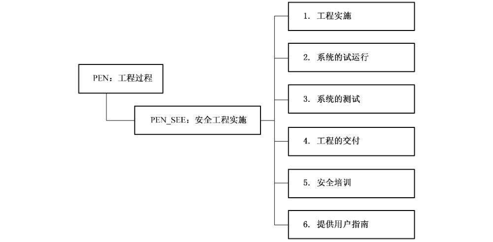

#### 8.5.2 PEN_SEE.1 工程的实施

##### 8.5.2.1 安全工程保障控制组件控制

按照项目计划和具体实施方案进行安全工程的实施。

##### 8.5.2.2 安全工程保障控制组件注解

制定实施建议（包括指导系统实现的规则或约束），根据实施建议和系统的详细安全设计文档制定工程实施计划，并按照预定的经用户和有关方同意后的计划进行工程实施，给出实施情况描述文档。

工作产品示例：

a） 安全实施规则——应用于系统或产品实施的安全约束和考虑（例如，具体机制的使用，编码的标准）。

b）项目计划——项目管理所需的计划，包括质量保证计划、进度计划、成本控制计划、人力资源管理计划、项目风险管理计划等。

#### 8.5.3 PEN_SEE.2 系统的试运行

##### 8.5.3.1 安全工程保障控制组件控制

对完成的安全系统进行试运行。

##### 8.5.3.2 安全工程保障控制组件注解

应对系统进行试运行，检查系统的稳定性和可靠性，并对试运行过程中出现的问题进行整改，给出工程整改报告和试运行情况报告。

工作产品示例：

a） 试运行记录和报告——系统在试运行期间的运行状态记录，如有必要，对发生的重大事件进行报告。

#### 8.5.4 PEN_SEE.3 系统的测试

##### 8.5.4.1 安全工程保障控制组件控制

制定测试计划，对所完成的系统进行安全测试。

##### 8.5.4.2 安全工程保障控制组件注解

工程实施方实施的系统应经过相应的评估，以获得客户的认可，并由测试方给出测试报告。要计划测试的覆盖范围、测试深度、测试方法的有效性，给出详细的测试方案，按照方案进行测试。

工作产品示例：

a） 系统测试计划——根据安全目标制定测试计划。

b） 系统测试报告——系统测试的报告，标识出系统成功完成的预期任务以及与安全要求不符的方面。

#### 8.5.5 PEN_SEE.4 工程的交付

##### 8.5.5.1 安全工程保障控制组件控制

系统交付给用户，包括相关的说明和指南等。

##### 8.5.5.2 安全工程保障控制组件注解

交付和运行规范涉及与安全交付、安装及信息系统的操作使用有关的措施、程序和标准，以确保信息系统提供的安全保护在传输、安装、启动和运行过程中没有被侵害。给用户提交相应文档以确保用户拥有系统安全运行所需的相关知识。

工作产品示例：

a） 系统演示和交接。

b） 用户手册—描述系统和为其使用的安全指南所提供的安全机制。

c） 安全轮廓——安全环境（威胁、组织策略）；安全目标（例如，要对抗的威胁）；安全功能和保障要求；按照满足目标的要求而进行系统开发的基本原理。

d） 系统配置指导——确保系统运行满足安全目标的系统配置指导。

#### 8.5.6 PEN_SEE.5 安全培训

##### 8.5.6.1 安全工程保障控制组件控制

对用户进行系统安全及安全运行维护相关知识的培训。

##### 8.5.6.2 安全工程保障控制组件注解

在组织的安全工程过程需要提供培训。安全培训的目的在于确保项目和组织拥有必要的知识和技能来达到项目和组织的目标。要确保这些只可能从员工得到的至关重要的资源的有效应用，必须先识别组织内对知识和技能的要求，以及特定项目的或组织的要求（诸如那些与紧急项目或技术、新产品、过程和政策有关的要求）。所需的技能和知识可以通过在组织内进行培训，和及时地从组织外部来源中获得。可获得技术和知识的外部来源包括：用户资源、临时雇员、新雇员、顾问和次承包商。另外，知识还可从主题专家那里获得。要计划培训、准备培训教材、对培训的有效性进行评估，维护培训的记录。

工作产品示例：

a） 培训计划。

b） 培训记录。

c） 培训的考核——对培训的效果进行考核，可以是口头问答形式，也可以使用正式的考卷。

d） 复查培训效果——对培训的效果进行复查，以利于确定以后的培训内容和培训计划。

#### 8.5.7 PEN_SEE. 6 提供用户指南

##### 8.5.7.1 安全工程保障控制组件控制

向运行系统的用户和管理员提供安全指南。

本安全工程保障控制组件的目的是要开发安全指南并提供给系统用户和管理员。本运行指南告诉用户和管理员安全地安装、配置、操作和废弃系统必须做什么。为确保这成为可能，应在生命周期早期开始开发运行安全指南。

##### 8.5.7.2 安全工程保障控制组件注解

给用户提交相应文档以确保用户拥有系统安全运行所需的相关知识，避免不必要的误操作和失误造成的安全事故。

开发环境可被看作是系统开发的运行环境。

工作产品示例：

a） 管理员手册——描述系统管理员安全地安装，配置和废弃系统的职责和权限。

b） 用户手册—描述系统和为其使用的安全指南所提供的安全机制。

### 8.6 提供安全输入（PEN_PSI）

#### 8.6.1 安全工程保障目的

提供安全输入的目的是为系统架构者、设计者、实施者或用户提供他们所需的安全信息。信息包括安全架构、设计或实施可选方案以及安全指南。应根据 PEN_ISR“确定安全要求”中标识的安全需求，开发、分析、提供并与组织成员协调这些输入。

本安全工程保障的目标是：

a） 检查与安全相关的所有系统问题，并根据安全目标解决这些问题。

b）项目组的所有成员都理解安全问题，他们才能各司其职。

c） 解决方案反映了提供的安全输入。

图16 描述了提供安全输入（PEN_PSI）安全工程保障控制子类组成结构。

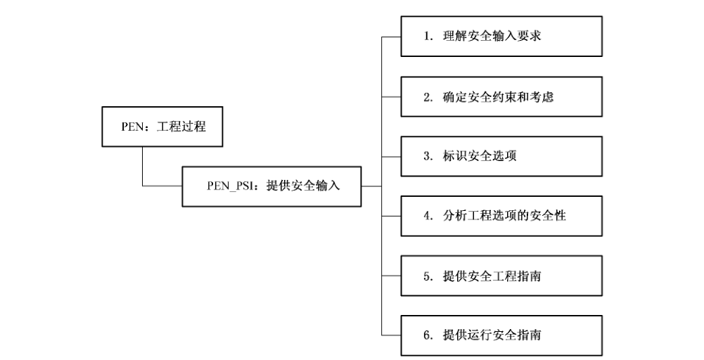

#### 8.6.2 PEN_PSI. 1 理解安全输入要求

##### 8.6.2.1 安全工程保障控制组件控制

与设计者、开发者以及用户合作来确保参与方对安全输入需求有共同的理解。

安全工程与其他学科相协调来决定有助于那些学科的安全输入的类型。安全输入包括各类指南、设计、文档，以及其他学科需要考虑的与安全相关的概念。输入可以采用多种形式，包括文档、备忘录、电子邮件、培训和咨询。

这些输入基于 PEN_ISR“确定安全要求”中的需求。例如，可能需要为软件工程师开发一系列安全规则。其中一些输入与环境相关更甚于系统。

##### 8.6.2.2 安全工程保障控制组件注解

保障目标可能对具体的安全需求有影响，尤其是对于作为附属的本方面。它们也为安全需求提供额外的理由。因此，安全工程需要向其他学科提供如何产生证据的指南。

工作产品示例：

a） 安全工程与其他学科之间的协议——安全工程如何为其他学科提供输入的定义（例如，文档、备忘录、培训、咨询）。

b）所需输入的描述——提供安全输入的每项机制的标准定义。

#### 8.6.3 PEN_PSI. 2 确定安全约束和考虑

##### 8.6.3.1 安全工程保障控制组件控制

确定工程选择方案所需的安全约束和考虑。

本安全工程保障控制组件的目的是要标识出用于得出成熟的工程可选方案的所有安全约束和考虑。安全工程组进行分析以确定要求、设计、实施、配置和文档化的所有安全约束和考虑。标识约束可以在系统生命周期的所有时间。可以以多种不同的抽象程度来标识。注意这些约束既可能是积极的（总是如此），也可能是消极的（决不如此）。

##### 8.6.3.2 安全工程保障控制组件注解

这些约束和考虑用于标识安全可选方案（PRM_AIM. 3）以及提供安全工程指南（PRM_AIM. 5）。

约束和考虑的主要来源是 PEN_ISR“确定安全要求”中标识出的安全要求。

工作产品示例：

a） 安全设计标准—有关整个系统或产品设计做决策所需的安全约束和考虑。

b） 安全实施规则——应用于系统或产品实施的安全约束和考虑（例如，具体机制的使用，编码的标准）。

c） 文档要求——标识支持安全要求所需的具体文档（例如，管理员手册、用户手册、具体设计文档）。

#### 8.6.4 PEN_PSI. 3 标识安全选项

##### 8.6.4.1 安全工程保障控制组件控制

标识安全工程问题的可选方案。

本安全工程保障控制组件的目的是要标识安全工程问题的可选方案。本过程是反复进行的，并将安全要求转化到实施中。这些解决方案可以有多种形式，例如架构、模型和原型。本安全工程保障控制组件涉及分解、分析和重组安全要求直至标识出有效的可选解决方案。

##### 8.6.4.2 安全工程保障控制组件注解

解决办法选项包括体系结构、设计和实现方法。在确定安全约束和考虑后这些安全选项应与所标识的约束和考虑协调一致（PRM_AIM.2（标识系统资产））。这些选项也作为折衷比较的一部分（PRM_AIM. 4）。这一活动是与提供安全工程指南（PRM_AIM. 5（标识和特征化影响））有关系的，一旦择优选定了选项，对其他工程科目的指南也是必需的。

可选的解决方案包括架构、设计和实施的解决方案。这些安全可选方案应与确定安全约束和考虑（PEN_PSI.2）时标识出的约束和考虑相一致。可选方案也是平衡比较（PEN_PSI. 4）的一部分。本活动与提供安全工程指南（PEN_PSI. 5）相关，一旦选定了优选方案，就需要给其他工程学科的指南。

工作产品示例：

a） 系统架构的安全观——抽象描述满足安全要求的系统架构中的关键元素之间的关系。

b） 安全设计文档——包括系统中的资产和信息流的详细资料，以及描述将会贯彻安全的或与安全相关的系统功能。

c） 安全模型——系统贯彻安全策略的正式表述；必须标识控制系统如何管理、保护和分发信息的一系列规则和实践；有时这些规则可以用精确的数学术语表示。

d） 安全架构——关注于系统架构的安全方面，描述与系统的安全相关的原则、基本概念、功能和服务。

e） 依赖性分析（安全措施的关系和依存关系）——描述安全服务和机制如何相互关联和互相依赖来为整个系统产生有效的安全性；标识哪些方面还需要安全措施。

#### 8.6.5 PEN_PSI. 4 分析工程选项的安全性

##### 8.6.5.1 安全工程保障控制组件控制

应用安全约束和考虑来分析和优先级排列工程可选方案。

本安全工程保障控制组件的目的是要分析和按优先级排列工程可选解决方案。使用确定安全约束和考虑（PEN_PSI.2）中标识出的安全约束和考虑，安全工程师可以评估每个工程可选解决方案并为工程组提出建议。安全工程师也应考虑来自其他工程组的工程指南。

这些工程可选解决方案不局限于以标识出的安全可选解决方案（PEN_PSI. 3），也可以包括来自其他学科的可选解决方案。

##### 8.6.5.2 安全工程保障控制组件注解

无。

工作产品示例：

a） 平衡研究结果和建议——考虑 PEN_PSI.2中提供的安全约束和考虑，分析所有工程可选解决方案。

b） 决定之间平衡研究结果——贯穿产品、系统或过程的生命周期的各种决定的结果，关注于为了满足其他目标（例如，成本、功能性）而可能降低安全要求的方面。

#### 8.6.6 PEN_PSI. 5 提供安全工程指南

##### 8.6.6.1 安全工程保障控制组件控制

向其他工程组提供安全指南。

本安全工程保障控制组件的目的是要开发安全指南并提供给工程组。工程组使用安全工程指南来做出选择架构、设计和实施的决定。

##### 8.6.6.2 安全工程保障控制组件注解

所需指南的数量及其详细程度取决于知识、经验和其他工程学科对安全的熟悉程度。通常大多数指南可能与开发环境相关更甚于开发中的系统。

工作产品示例：

a） 架构建议——包括支持开发满足安全要求的系统架构的原则或约束。

b） 设计建议——包括指导系统设计的原则或约束。

c） 实施建议——包括指导系统实施的原则或约束。

d） 安全架构建议——包括定义系统安全特征的原则或约束。

e） 保护原理———如何贯彻安全的高层描述，包括自动的、物理的、人员的和管理的机制。

f）设计标准、原理和原则——如何设计系统的约束（例如，最小权限、安全隔离控制措施）。

g） 编码的标准——如何实现系统的约束。

#### 8.6.7 PEN_PSI. 6 提供运行安全指南

##### 8.6.7.1 安全工程保障控制组件控制

向运行系统的用户和管理员提供安全指南。

本安全工程保障控制组件的目的是要开发安全指南并提供给系统用户和管理员。本运行指南告诉用户和管理员安全地安装、配置、操作和废弃系统必须做什么。为确保这成为可能，应在生命周期早期开始开发运行安全指南。

##### 8.6.7.2 安全工程保障控制组件注解

开发环境可被看作是系统开发的运行环境。

工作产品示例：

a） 管理员手册——描述系统管理员安全地安装、配置和废弃系统的职责和权限。

b） 用户手册—描述系统和为其使用的安全指南所提供的安全机制。

c） 安全轮廓———安全环境（威胁、组织策略）；安全目标（例如，要对抗的威胁）；安全功能和保障要求；按照满足目标的要求而进行系统开发的基本原理。

d） 系统配置指导——确保系统运行满足安全目标的系统配置指导。

### 8.7 监视安全态势（PEN_MSP）

#### 8.7.1 安全工程保障目的

监视安全态势的目的是要确保标识和报告所有的违规、尝试违规或可能导致违背安全的错误。监视外部和内部环境的所有可能影响系统安全的因素。

监视安全态势的目标是：

a） 检测和跟踪内部外部安全事件。

b） 按照策略响应事故。

c） 按照安全目标标识和处理运行安全态势的变更。

图17描述了监视安全态势（PEN_MSP）安全工程保障控制子类组成结构。

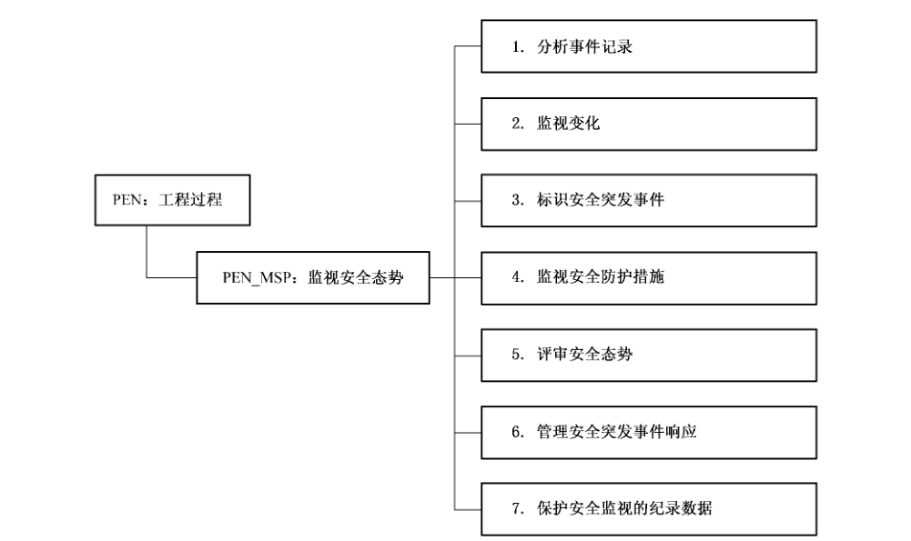

#### 8.7.2 PEN_MSP. 1 分析事件记录

##### 8.7.2.1 安全工程保障控制组件控制

分析事件记录来确定事件的起因、如何处理事件，以及将来可能出现的事件。

检查安全相关信息的历史记录和事件记录（由日志记录组成）。应标识感兴趣的事件以及关联事件和各种记录的因素。于是多条事件记录可以被融合为一条记录。

##### 8.7.2.2 安全工程保障控制组件注解

许多审计日志倾向于包含单个事件相关的信息，尤其是在分布式/网络环境中，通常一个事件在网络中的多个位置留下痕迹，为了确保单独的记录有价值并有利于完整理解事件及其行为，多个单独的日志记录需要融合为一个单个的事件记录。

可以对单个记录和多个记录进行分析。分析相同类型的多个记录通常使用统计或趋势分析方法。

虽然通常是分析相同类型的多个事件记录，也可以针对日志记录和融合为一的事件记录，分析不同类型的多个记录。

应为日志记录和融合为一的事件记录确定警告，例如基于单独出现情况的行动请求。分析中也需包括开发环境的日志和事件记录。

工作产品示例：

a） 每项事件的描述——标识检测到的事件的来源、影响和重要性。

b） 形成日志记录和来源——来自各种来源的安全事件记录。

c） 事件标识参数——描述哪个事件是而哪个事件不是收集自系统的各个部分。

d） 所有当前日志记录报警状态列表——标识所有单个日志记录的行动请求。

e） 所有当前事件报警状态列表——标识所有有多个日志记录形成的事件的行动请求。

f） 所有发生过的报警状态的定期报告——综合来自多个系统报警列表并进行初步分析。

g） 日志分析和总结——对近期发生的报警进行分析，为更广泛的用途而报告结果。

#### 8.7.3 PEN_MSP.2 监视变化

##### 8.7.3.1 安全工程保障控制组件控制

监视威胁、脆弱性、影响、风险和环境的变化。

检查任何可能正面或负面影响当前安全态势效果的变更。

任何系统实现的安全应与其内部、外部环境相关的威胁、脆弱性、影响和风险相关联。这些都不是静态的，变更会影响系统安全的有效性和适当性。必须监视所有变更，分析变更以评估它们对安全有效性的重要程度。

##### 8.7.3.2 安全工程保障控制组件注解

内部、外部来源和开发、运行环境都应检查。

当发现变更就应触发响应，通常重新进行风险分析或其中一部分。参见 PRM_ASR“评估安全风险”

工作产品示例：

a） 变更报告——标识可能影响系统安全态势的任何外部内部变更。

b） 变更重要程度的定期评估——分析安全态势的变更以确定其影响和所需的响应。

#### 8.7.4 PEN_MSP.3 标识安全突发事件

##### 8.7.4.1 安全工程保障控制组件控制

标识安全相关的事故。

确定是否发生了安全事故，标识详细情况，如果有必要的话产生一份报告。检测安全事故可能使用历史事件数据、系统配置数据、完整性工具和其他的系统信息。由于某些事故的发生持续一段很长的时间，所以此分析很可能要随时间推移对比系统的状态。

##### 8.7.4.2 安全工程保障控制组件注解

安全事故在开发和运行环境中都可能发生。这些事故可能以不同方式影响开发中的或运行中的系统。黑客和恶意代码（病毒、蠕虫等）产生的恶意的技术性攻击必须采用不同于保护免受随机事件的方法。需要分析系统配置和状态来检测攻击。需要准备、测试响应计划并付诸实际行动。许多技术性攻击需要预先确定的快速响应以最小化损害不断传播。多数情况下，不协调的响应会导致情况更糟。在必要的时候，应标识和定义响应（PEN_MSP.6）。

工作产品示例：

a） 事故列表和定义——标识通用安全事故并以易认同的方式进行描述。

b） 事故响应指导——描述对发生的安全事故的适当响应。

c） 事故报告———描述发生了什么事故及所有详细资料，包括事故来源、产生的损害、采取的响应措施，以及需进一步采取的行动。

d） 每项检测到的入侵事件的报告——描述每项检测到的入侵事件及所有详细资料，包括来源、产生的损害、采取的响应措施，以及需进一步采取的行动。

e） 定期的事故总结—近期安全事故的总结，指出趋势、需要加强安全的领域，以及降低安全度可能节省的成本。

#### 8.7.5 PEN_MSP.4 监视安全防护措施

##### 8.7.5.1 安全工程保障控制组件控制

监视安全保护措施的性能和功能的有效性。

检查保护措施的性能，以标识保护措施性能的变化。

##### 8.7.5.2 安全工程保障控制组件注解

应监视保护开发和运行环境的保护措施。使用后许多保护措施可能处于不恰当或失效的状态。许多保护措施能指示出它们的当前状态、效果和维护要求。这三个方面全部都需要定期检查。

工作产品示例：

a） 定期保护措施状态（记录）—描述现有保护措施的状态，以便检测可能的错误配置或其他问题。

b） 定期保护措施状态总结——现有保护措施的状态的总结，指出趋势、所需改进，以及降低安全度可能节省的成本。

#### 8.7.6 PEN_MSP. 5 评审安全态势

##### 8.7.6.1 安全工程保障控制组件控制

检查系统的安全态势来标识必要的变更。

系统的安全态势会因威胁环境、运行需求和系统配置的变化而变化。本实践复查实施安全的原因，以及其他原则实施安全的要求。

##### 8.7.6.2 安全工程保障控制组件注解

应根据当前运行环境和发生的变更检查安全态势。如果其他事件（例如变更）没有触发安全整体检查，应该根据上次检查的时间间隔来触发检查。时间触发的检查应符合策略和规则。检查应重新评估当前安全的充分性以及当前风险接受级别的恰当性。检查应根据组织的安全评估方法，参见 PRM_ASR评估安全风险。与检查运行环境一样的方式，系统创建所处的开发环境也应定期检查。实际上，开发环境也可以看作是系统开发的运行环境。

工作产品示例：

a） 安全检查—包括当前安全风险环境的描述、现在的安全态势，以及分析两者是否协调。

b） 风险接受程度检查—授权机构的声明：运行系统的风险是可接受的。

#### 8.7.7 PEN_MSP.6 管理安全突发事件响应

##### 8.7.7.1 安全工程保障控制组件控制

管理对安全突发事件的响应。

通常，系统的持续可用性是很关键的。许多事件不能预防，因此响应破坏的能力是必需的。应急计划要求标识系统失去功能性的最大时间；标识系统功能的关键元件；标识和开发恢复战略和计划；计划的测试；计划的维护。

有时，意外事件计划包括事故响应和对抗敌对源（例如病毒、黑客等）的活动。

##### 8.7.7.2 安全工程保障控制组件注解

未来的事件不可能预知，必须管理它们，除非它们不引起混乱。如果情况出乎意料，应提交到适当的业务管理决策层。

工作产品示例：

a） 系统恢复优先级列表——描述当事故引起故障时保护和复原系统功能的顺序。

b） 测试日程表———为确保安全功能和规程可操作并熟悉而进行系统定期测试的日期。

c） 测试结果——描述定期测试的结果以及为保持系统安全应采取什么行动。

d） 维护日程表——所有系统维护（包括升级和预防）的日期，并与测试日程表结合起来。

e） 事故报告——描述发生了什么事故以及所有相关详细情况，包括事故来源、所有破坏、采取的响应，以及要进一步采取的措施。

f） 定期检查—描述定期检查系统安全性所要执行的规程，包括哪些人参加、进行哪些检查，包含哪些输出结果。

g） 应急计划——标识系统宕机的最大可接受时间、系统的关键元件、系统恢复的战略和计划、业务恢复、情况的管理，以及计划的测试和维护规程。

#### 8.7.8 PEN_MSP.7 保护安全监视的记录数据

##### 8.7.8.1 安全工程保障控制组件控制

确保适当地保护了安全监视的记录数据。

如果监视活动的结果不可靠那么就没意义了。本活动包括相关日志、审计报告及相关分析的封装和归档。

##### 8.7.8.2 安全工程保障控制组件注解

大多数监视活动包括审计和产生输出结果。输出可以立即处理或记录下来供以后分析和进一步处理。应设计日志的内容以帮助理解事故时发生了什么和检测趋势的变化。应根据策略和规则来管理输出日志。日志必须可靠并防止被篡改或意外破坏。如果日志满了，必须用新日志替换或清空。当日志改变时，应移除任何不需要的记录，并进行压缩。应封装日志以防不知不觉的改变，日志还应归档一定期限。

工作产品示例：

a） 所有日志列表及其保存期——标识安全监视记录数据保存的地方以及何时可以销毁。

b） 应归档定期日志现场检查结果——描述遗失的报告并标识适当的响应。

c） 归档日志的用途—标识归档日志的用户，包括访问时间、目的和所有注解。

d） 定期测试随机选取的归档日志的有效性和可用性的结果——分析随机选取的日志并确定是否完整、正确和可用，以确保对系统安全的充分监视。

### 8.8 管理安全控制（PEN_MSC）

#### 8.8.1 安全工程保障目的

管理安全控制的目的是确保系统预想的安全已被集成到系统设计中，最终的运行状态中的系统也确实达到了这种安全要求。

管理安全控制的目标是正确配置和使用了安全控制措施。

图18描述了管理安全控制（PEN_MSC）安全工程保障控制子类组成结构。

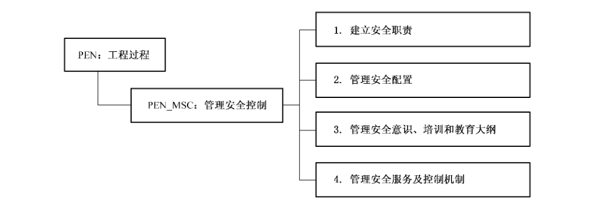

#### 8.8.2 PEN_MSC. 1 建立安全职责

##### 8.8.2.1 安全工程保障控制组件控制

建立安全控制措施的职责和可确认性，并传达到组织中的每个人。

安全的某些方面可以在常规管理框架下进行管理，然而另外一些方面则需要更专业的管理。

规程应确保用可追溯并被授权执行的职责来管理安全问题，也应确保所采用的任何安全控制措施都清晰并持续起作用。另外，还应确保无论采用什么组织结构都传达到不仅是组织结构内部而是整个组织范围。

##### 8.8.2.2 安全工程保障控制组件注解

有些组织建立安全工程工作组负责解决安全问题。另外一些组织任命安全工程的领导，他负责确保达到了安全目标。

工作产品示例：

a） 安全组织结构表———标识与安全相关的组织成员及其角色。

b） 安全角色描述文档——描述与安全相关的组织角色及其职责。

c） 安全职责描述文档——详细描述每一项职责，包括期望出现的什么输出和如何检查和使用这个输出。

d） 详细描述安全责任可追溯的文档—描述谁为安全问题负责，确保所有风险都有人负责。

e） 详细描述安全授权的文档——标识允许组织的每个成员做什么。

#### 8.8.3 PEN_MSC. 2 管理安全配置

##### 8.8.3.1 安全工程保障控制组件控制

管理系统安全控制措施的配置。

所有设备的安全配置都需要管理。本基本实践认为系统安全很大程度上依赖于相关的组件（硬件、软件和规程），常规的配置管理不能了解使系统安全所需的相互依赖关系。

##### 8.8.3.2 安全工程保障控制组件注解

维护系统安全控制措施的配置情况是复杂的工作，尤其是对大型分布式系统。对安全维护来说，某些配置本身就是至关重要的。有效的安全需要记录与安全控制机制相关的信息，这些安全控制机制组成了系统并且其他学科一般不使用。同样，必须评估对现存系统的变更，以确定对整个系统安全态势的影响。

需要制定规程———特别是在分布环境——以确保软件或应用程序的特定模块的所有副本版本都相同且合适。另外，尤其是软件本身在网络中分发时，至关重要的是要确保软件在分发过程中没有被损坏。这些要求适用于所有软件。

本安全工程保障控制组件应确保软件仅完成预期的功能；保持封装版本；软件的所有副本都相同；确认进行了更新；了解并维护安全控制措施的配置。

工作产品示例：

a） 所有软件更新的记录—跟踪许可证、序列号，以及系统的所有软件和软件更新信息，包括日期、人员职责和变更的描述。

b） 所有分发问题的记录——描述软件分发中的遇到的任何问题，以及这些问题是如何解决的。

c） 系统安全配置——描述系统硬件、软件和通信当前状态的数据库，包括他们的位置、分配给个体的任务，以及相关信息。

d） 系统安全配置的变更—描述系统安全配置的任何变化的数据库，包括变更执行者的姓名、变更的描述、变更的原因以及变更执行的时间。

e） 所有确认的软件更新记录——跟踪软件更新的数据库，包括变更的描述、执行变更者的姓名，以及执行的时间。

f） 可信软件分发的定期总结——描述近期可信软件分发活动，注明遇到的困难和行为。

需求的安全变更——跟踪因安全原因或对安全有效而作的系统需求的任何变更，以便有助于确保变更及其作用是有意图的。

g） 设计文档的安全变更——跟踪因安全原因或对安全有效而作的系统设计的任何变更，以便有助于确保变更及其作用是有意图的。

h）控制的实施—描述系统安全控制措施的实施，包括详细的配置。

i） 安全检查——描述相对于预计的控制措施实施，系统安全控制措施的当前状态。

j） 控制措施的取消——描述移除或停用安全控制措施的规程。

k）控制的实施—描述系统安全控制措施的实施，包括详细的配置。

#### 8.8.4 PEN_MSC.3 管理安全意识、培训和教育大纲

##### 8.8.4.1 安全工程保障控制组件控制

管理所有用户和管理员的安全意识、培训和教育程序。

所有员工的安全意识、培训和教育需要以与其他意识、培训和教育相同的方式进行管理。

##### 8.8.4.2 安全工程保障控制组件注解

在这里的上下文中，术语“用户”不仅包括直接在系统上工作的那些人，还包括所有直接或间接从系统获得信息的人，以及所有技术管理员和行政管理人员。

用户要理解安全适度的原由以及具体安全机制或控制措施的原由，这是极其重要的。另外，用户应懂得如何正确使用这些安全机制或控制措施也是很重要的。因此，当引入新的机制和控制措施时，用户需要初始化、定期更新和修正阶段。所有用户都需要有安全意识，一些用户需要使用安全机制的培训，少数用户需要更深入的安全知识——也就是安全教育的对象。

工作产品示例：

a） 用户对安全培训教材的意见—描述安全意识和培训教材的效果，可用性和适用性。

b） 所有意识、培训和教育的记录以及培训结果——跟踪用户对组织安全和系统安全的理解。

c） 用户安全知识、意识和培训程度的定期再评估——检查组织对安全的理解，标识将来可能需要更加关注的领域。

d） 意识、培训和教育教材的记录——收集将来可以在整个组织中重复使用的、可以与组织其他培训教材相结合的安全培训教材。

#### 8.8.5 PEN_MSC.4 管理安全服务及控制机制

##### 8.8.5.1 安全工程保障控制组件控制

管理对安全服务和控制机制的定期维护和管理。

安全服务和机制的一般管理类似于其他服务和机制的管理。包括保护服务和机制不受有意或无意的破坏的措施，成文时要符合法律和策略的要求。

##### 8.8.5.2 安全工程保障控制组件注解

这些服务的例子比如标识和鉴别（I&A）、访问仲裁/控制和密钥管理等。

每项安全服务必须包括建立适当的安全参数、执行这些参数、监视和分析性能，以及调整参数。

这些要求特定适用于一些安全服务，例如，用于用户和授权数据的维护的标识和鉴别服务，用于权限维护的访问控制服务。

信息资产，资产的子集，定义为组织的硬件、软件和数据。一些信息资产可能需要移除敏感部分，以便之后可以用于较低敏感场合。净化过程确保信息仅发布给需要知道的人。可以通过降低信息密级或有选择地移除特定的敏感信息来实现。

即使用其他信息覆盖后，电子介质仍然可能保留残留的信息痕迹。有些介质在用于其他较低敏感场合之前可能需要净化。一旦磁介质的有效生命期到了，应该采用恰当的方法来处理残留的敏感信息，这可能需要毁坏介质。净化、降级和废弃要求的具体细节要根据特定的组织和可适用的规则。

工作产品示例：

a） 维护和管理日志——对系统的安全机制的维护、完整性检查和运行检查的记录。

b） 维护和管理的定期检查—包括对近期系统安全管理和维护工作的分析。

c） 管理和维护的不足——跟踪系统安全管理和维护的问题，以便标识还需要哪些工作。

d） 管理和维护的异常——包括描述对正常管理和维护规程来说的异常，包括异常的原因和异常的持续时间。

e） 敏感信息列表—描述系统中的各种类型的信息以及应如何保护这些信息。

f）敏感介质列表——描述系统中存储信息的各种类型的介质以及应如何保护这些介质。

g） 净化、降级和废弃——描述确保当信息敏感度降低或净化或废弃介质时没有引入不必要的风险的规程。

### 8.9 协调安全（PEN_COS）

#### 8.9.1 安全工程保障目的

协调安全的目的是确保各方了解并参与到安全工程活动中。安全工程不可能孤立地取得成功，所以本活动很关键。协调包括在所有项目人员和外部组之间保持开放的沟通。可以使用各种机制在各方之间协调和沟通安全工程的决定和建议，这些机制包括备忘录、文档、电子邮件、会议和工作小组。

协调安全的目标：

a） 项目组的所有成员深入了解并参与到安全工程活动中以发挥其作用。

b） 沟通和整理安全决定和建议。

图19描述了协调安全（PEN_COS） 安全工程保障控制子类组成结构。

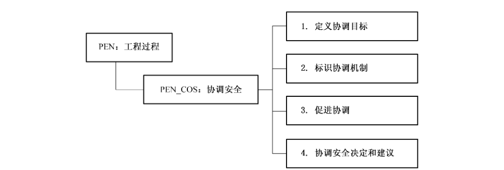

#### 8.9.2 PEN_COS. 1 定义协调目标

##### 8.9.2.1 安全工程保障控制组件控制

定义安全工程协调目标和相互关系。

许多组需要了解并参与到安全工程活动中。通过检查项目结构、信息需求和项目要求，决定与这些组共享信息的目标。建立与其他组的关系和义务。成功的关系有很多种形式，但必须所有参与方接受。

##### 8.9.2.2 安全工程保障控制组件注解

协调目标和关系应在项目尽早阶段定义，以确保很好地建立沟通主线。所有工程组应定义日复一日运行（例如，参加检查、参加培训、检查设计）中安全工程师的角色。如果没做到这点，将增加安全某个关键方面缺失的风险。

工作产品示例：

a） 信息共享协议——描述组之间共享信息的过程，标识参与方、介质、格式、期望值和频率。

b） 工作组成员和进度表—描述组织的工作组，包括成员、成员的角色、用途、议程和后勤。

c） 组织的标准——描述不同工作组之间及与客户沟通安全信息的过程和规程。

#### 8.9.3 PEN_COS. 2 标识协调机制

##### 8.9.3.1 安全工程保障控制组件控制

标识安全工程的协调机制。

有很多方法可以在所有工程组中共享安全工程的决定和建议。本活动标识项目安全协调的不同方法。

很多安全人员在同一个项目工作是很常见的。在这种情况下，所有安全工程师应朝一个共同的目标努力工作。需要如此进行接口标识、安全机制选择、培训和发展工作，以确保放入运行系统中时每个安全组件都按预期运行。另外，所有安全工程组必须理解安全工程工作和工程活动，以便清晰地将安全集成到系统中。客户也必须了解安全相关的事件和活动，以确保标识并适当处理了要求。

##### 8.9.3.2 安全工程保障控制组件注解

无。

工作内容示例：

a） 沟通计划——包括要共享的信息、会议时间、供工作组和其他组成员使用的过程和规程。

b） 沟通基础设施要求——标识工作组成员与其他组有效地共享信息所需的基础设施和标准。

c） 会议报告、消息、备忘录的模版—描述各种文档的格式，以确保标准化和工作效率。

#### 8.9.4 PEN_COS.3 促进协调

##### 8.9.4.1 安全工程保障控制组件控制

促进安全工程协调。

成功的关系有赖于良好促进。不同优先权的不同组之间的沟通可能会产生冲突。本安全工程保障控制组件确保以恰当的、建设性的方式解决争端。

##### 8.9.4.2 安全工程保障控制组件注解

无。

工作产品示例：

a） 解决冲突的规程—标识有效解决组织实体内部和之间冲突的方式。

b） 会议议程、目的、任务项—描述会议讨论的主题，着重要说明目的和任务项。

c） 项目跟踪—标识进行和解决任务项的计划，包括职责、进度表和优先级。

#### 8.9.5 PEN_COS.4 协调安全决定和建议

##### 8.9.5.1 安全工程保障控制组件控制

用标识出的机制去协调有关安全的决定和建议。

本基本实践的目的在于在各种安全工程组织、其他工程组织、外部实体及其他合适的部门中沟通安全决定和建议。

##### 8.9.5.2 安全工程保障控制组件注解

无。

工作内容示例：

a） 决定———通过会议报告、备忘录、工作组会议纪要、电子邮件、安全指南或公告牌将有关安全的决定告诉有关工作组。

b） 建议——通过会议报告、备忘录、工作组会议纪要、电子邮件、安全指南或公告牌将有关安全的建议通报给有关工作组。

## 9 PAS 安全工程保障控制类：保障过程

### 9.1 保障过程安全工程保障控制类介绍

保障是指安全需求得到满足的信心度。它是安全工程的重要产物。保障有很多形式。安全工程过程保障提供了一个方面：安全工程过程结果可重复性的信心。这种信心的基础是一个成熟的组织比一个不成熟的组织更可能重复结果。不同形式的保障之间的详细关系是研究中的主题。

保障不增加任何附加控制措施对抗安全风险，但它提供这样的信心：已经实施的控制措施将减少已预料到的风险。

也可以将保障看作这样的信心：保护措施将按预期功能运行。这种信心源自正确性和有效性。正确性是指保护措施按照设计实现要求。有效性是指保护措施提供的安全足以满足用户的安全需求。机制的强度也起了部分作用，但被所要的保护和保障水平给冲淡了。

保障通常以论据的形式出现。论据包括一系列关于系统属性的声明。这些声明由证据支持。证据常常为文档形式，在安全工程活动的正常过程中形成。

安全工程过程的活动本身包括了产生保障的相关证据。例如，过程文档可以表明开发遵循了很好定义的、成熟的、需持续改进的工程过程。安全验证和确认对建立产品或系统的可信赖性起非常重要的作用。

过程域中的许多工作产品将成为证据或成为证据的一部分。现代统计学的过程控制提出，可以通过关注产生产品的过程，成本效率更高、重复地的生产质量更高和保障更高的产品。组织实践的成熟度会影响并有助于过程。

保障过程安全工程保障控制类的说明见图 20。

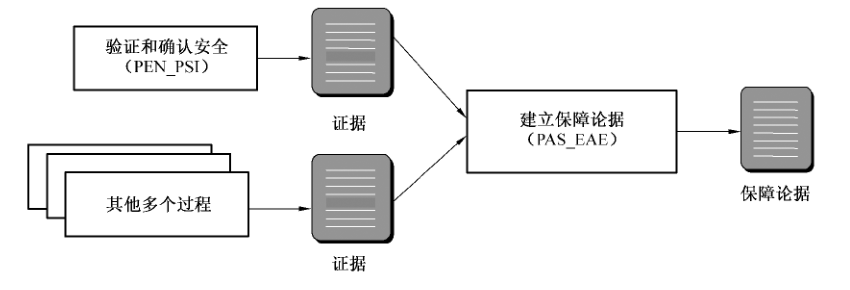

### 9.2 验证和确认安全（PAS_VVS）

#### 9.2.1 安全工程保障目的

验证和确认安全的目的是要确保解决方案验证和确认了安全。通过观察、演示、分析和测试，根据的安全要求、架构和设计来验证解决方案。根据客户的运行安全需求来确认解决方案。

验证和确认安全的目标：

a） 解决方案满足安全要求。

b） 解决方案满足用户的运行安全需求。

图21 描述了验证和确认安全（PAS_VVS）安全工程保障控制子类组成结构。

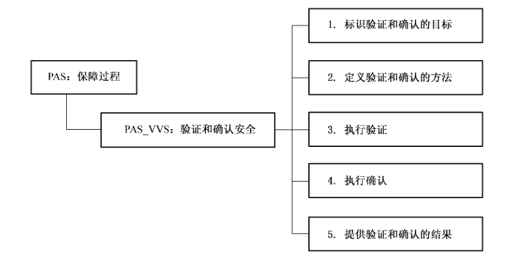

#### 9.2.2 PAS_VVS. 1 标识验证和确认的目标

##### 9.2.2.1 安全工程保障控制组件控制

标识用于验证和确认的解决方案。

本安全工程保障控制组件的目的是要分别标识验证和确认的对象。验证说明正确实施了解决方案，而确认说明解决方案是有效的。这涉及在整个生命周期与所有工程组协调。

##### 9.2.2.2 安全工程保障控制组件注解

要求、设计、架构、实施、硬件、软件和测试计划等工作产品的验证和确认非常抽象和复杂。也可以验证和确认与系统的运行和维护相关工作产品，包括系统配置、用户文档、培训材料和应急响应计划。

工作产品示例：

a） 验证和确认的计划——定义验证和确认工作（包括资源、进度表、要进行验证和确认的工作产品）。

#### 9.2.3 PAS_VVS.2 定义验证和确认方法

##### 9.2.3.1 安全工程保障控制组件控制

定义验证和确认每种解决方案的方法及严密程度。

本安全工程保障控制组件的目的是要定义验证和确认每种解决方案的方法及严密程度。标识方法涉及选择如何验证和确认每项要求。严密程度应表明验证和确认工作的详细审查应如何严格，同时也受到来自 PAS_EAE“建立保证证据”的保障战略的输出的影响。例如，有些项目可能要求粗略检查与要求的一致性，而另外一些可能要求更严格的检查。

方法学也应包括，从客户运行安全需求，到安全要求、解决方案、验证和确认结果的持续可追溯的方法。

##### 9.2.3.2 安全工程保障控制组件注解

验证和确认的方法应与系统整体验证和确认的方法一致。这将需要有效的协调和交互。协调活动在 PEN_COS“协调安全”中描述。

工作产品示例：

a） 测试、分析、演示和观察的计划——定义验证和确认所使用的方法（例如，测试、分析）和严密程度（例如，非正式或正式的方法）。

b） 测试规程———定义测试每项解决方案所采取的步骤。

c） 追溯方法——描述将如何从客户的安全需求和要求开始追溯验证和确认的结果。

#### 9.2.4 PAS_VVS.3 执行验证

##### 9.2.4.1 安全工程保障控制组件控制

验证解决方案贯彻了先前抽象的要求。

本安全工程保障控制组件的目的是要验证解决方案是正确的，通过说明它实现了先前抽象的要求，包括 PAS_EAE“建立保证证据”中的保障要求。有很多验证要求的方法，包括测试、分析、观察和演示。

所使用的方法在 PAS_VVS.2“定义验证和确认的方法”中标识。不仅要检查单独的要求，还要检查整体系统。

##### 9.2.4.2 安全工程保障控制组件注解

无。

工作产品示例：

a） 来自测试、分析、演示和观察的原始数据——来自验证解决方案满足要求所使用的任何方法的结果。

b） 问题报告——验证解决方案满足要求中发现的矛盾。

#### 9.2.5 PAS_VVS.4 执行确认

##### 9.2.5.1 安全工程保障控制组件控制

确认解决方案，表明解决方案满足了先前抽象的需求，最终满足了客户的运行安全需求。

本安全工程保障控制组件的目的是要确认解决方案满足先前抽象的需求。确认说明解决方案有效地满足了这些需求。有很多方法确认满足了这些需求，包括在运行或典型测试设置环境中测试解决方案。所使用的方法在PAS_VVS.2“定义验证和确认的方法”中标识。

##### 9.2.5.2 安全工程保障控制组件注解

本实践涉及可追溯性。

工作产品示例：

a） 问题报告——确认解决方案满足安全需求中发现的矛盾。

b） 矛盾—解决方案没能满足安全需求的方面。

c） 无效的解决方案——没能满足客户的安全需求的解决方案。

#### 9.2.6 PAS_VVS. 5 提供验证和确认的结果

##### 9.2.6.1 安全工程保障控制组件控制

为其他工程组收集验证和确认结果。

本安全工程保障控制组件的目的是要收集并提供验证和确认的结果。应以易于理解和使用的方式提供验证和确认的结果。应追溯结果，以表明从需求、到要求、到解决方案和到测试结果的可追溯性没有丧失。

##### 9.2.6.2 安全工程保障控制组件注解

无。

工作产品示例：

a） 测试结果———测试结果的文档。

b） 可追溯性矩阵——安全需求、到要求、到解决方案（例如，架构、涉及、实施）和到测试及测试结果的影射。

### 9.3 建立保证证据（PAS_EAE）

#### 9.3.1 安全工程保障目的

建立保证论据的目的是要清楚地传达已经满足了客户的安全需求。保证论据是一系列固定的保证目标，这些保证目标是由来自各种来源和抽象程度的保障证据的组合所支持。

本过程包括标识和定义保证要求；证据的产生和分析活动；以及支持保证要求所需的其他证据活动。另外，要收集、包装和准备呈现这些活动收集到的证据。

本安全保障控制子类的目标是工作产品和过程清楚地提供已经满足了客户安全需求的证据。

图22 描述了建立保证证据（PAS_EAE）安全工程保障控制子类组成结构。

#### 9.3.2 PAS_EAE. 1 标识保证目标

##### 9.3.2.1 安全工程保障控制组件控制

由客户确定保证目标，标识系统所需的信心度。系统安全保证目标描述贯彻系统安全策略的信心度。目标的充分性由开发者、集成者和客户确定。

标识新的以及修改已有的安全保证目标要与所有安全组织协调一致，包括工程组织内的组以及工程组织外的组（例如，客户、系统安全认证者、用户）。

安全保证目标要更新以反映变更。修改安全保证目标的变更的例如：客户、系统安全认证者或用户可接受的风险级别的变更，需求或需求的解释的变更。

必须沟通以明确安全保证目标。如有必要应适当进行解释。

##### 9.3.2.2 安全工程保障控制组件注解

不强制使用具体的声明时，如果可以说明保障目标或将保障目标用与具体保障声明相联系，以达到或满足保障目标，也是有益的。这有助于消除误解和歧义。

工作产品示例：

a） 安全保障目标的陈述——标识客户对系统安全的信心度的要求。

#### 9.3.3 PAS_EAE. 2 定义保证策略

##### 9.3.3.1 安全工程保障控制组件控制

定义所有保证目标对应的安全保证策略。

安全保证策略的目的是要规划并确保实施和正确贯彻安全目标。通过安全保证策略的实施产生的证据应对系统安全度量足够管理安全风险有适度信心。需要通过安全策略的开发和制定，来有效地管理保证活动。提早标识和定义保证需求是产生必要的支撑证据的关键。通过持续的外部协调，理解和监视客户保障需求的满意度，确保高质量的保障。

##### 9.3.3.2 安全工程保障控制组件注解

安全保障目标与 PEN_COS“协调安全”中定义的所有受影响的内部工程组和外部工程组（例如，客户、系统安全认证者或用户）协调一致。

定义保证策略工作产品示例如下：

a） 安全保证策略—描述达到客户的安全保证目标的计划并标识责任方。

#### 9.3.4 PAS_EAE.3 控制保证证据

##### 9.3.4.1 安全工程保障控制组件控制

标识和控制安全保证证据。

通过与所有安全工程过程域交互作用来标识不同抽象程度的证据，按照安全保证策略中所定义的那样收集安全保证证据。控制这些证据以确保已有工作产品流行开来以及与安全保证目标的相关性。

##### 9.3.4.2 安全工程保障控制组件注解

保证工作产品可以来自系统、架构、设计、实施、工程过程、物理开发环境和物理运行环境。

控制保证证据的工作产品示例：

a） 安全保障证据仓库（例如，数据库、工程笔记、测试结果、证据日志）——储存在开发、测试和使用中产生的所有证据。可以采用数据库、工程笔记、测试结果、证据日志的形式。

#### 9.3.5 PAS_EAE. 4 分析证据

##### 9.3.5.1 安全工程保障控制组件控制

安全保障证据的分析。

进行保证证据分析，以提供这样的信心：收集的证据满足安全目标进而满足客户的安全需求。保证证据的分析决定若要推断满意地实施了安全特征和机制，系统安全工程和安全验证过程是否足够充分和全面。另外，分析证据以确保工程结果相对基线系统是全面、正确的。如果保证证据不充分，这种分析可能有必要对系统和支撑安全目标的安全工作产品及过程进行修正。

##### 9.3.5.2 安全工程保障控制组件注解

一些保障证据只能通过其他系统工程结果合并产生或通过其他保障合并推断。

分析证据的工作产品示例如下：

a） 保障证据分析结果——标识和总结库内证据的长处和弱点。

#### 9.3.6 PAS_EAE. 5 提供保证证据

##### 9.3.6.1 安全工程保障控制组件控制

提供说明满足了客户的安全需求的安全保障论据。

开发全面的保证论据来说明与安全保证目标一致并提供给客户。保证论据是一系列固定的由不同抽象程度的保证证据组合支撑的保障目标。应检查保证论据的证据展示的不足和满足安全保证目标的不足。

##### 9.3.6.2 安全工程保障控制组件注解

高层安全保障论据可以是已满足相应标准的目标。保障论据还可能说明已经如何应对系统面临的威胁。每项保障目标由相应、充分的证据支撑以满足适当的检验标准。本论据可供客户、系统安全认证者和用户使用。

提供保证证据的工作产品示例如下：

a） 有证据支撑的保证论据——由各种保证证据支撑的结构化的一系列保证目标。

## 10 安全工程保障控制类能力级

### 10.1 概述

安全工程能力体系结构的设计是可在整个安全工程过程范围内决定安全工程过程的能力成熟度。

这个体系结构的目标是清晰地在信息系统生命周期中分离出安全工程的基本特征。为了保证这种分离，这个模型是两维的，分别称为“域”和“能力”，

a） 域维是由本标准中所有定义安全工程的过程组件（即安全工程过程域）构成。这些实施活动称为“过程组件”，即“过程域”

b） 能力维代表组织能力。这一维由信息安全管理和制度化能力构成。这些实施活动被称作“公共特征”，可在广泛的域中应用。执行一个公共特征是一个组织能力的标志。

通过设置这两个相互依赖的维，安全工程能力模型在各个能力级别上覆盖了整个安全活动范围。

重要的是，安全工程过程能力模型并不意味着在一个组织在其信息系统生命周期的安全管理实践中必须执行这个模型中所描述的任何过程。也不意味着执行通用实践的专门要求。一个组织机构一般可随意以他们所选择的方式和次序来计划、跟踪、定义、控制和改进他们的过程。然而，由于一些较高级别的通用实践依赖于较低级别的通用实践，因此组织机构应在试图达到较高级别之前，应首先实现较低级别通用实践。

### 10.2 安全工程能力级别说明

此章包含了可应用于所有信息系统安全安全工程保障控制类的通用实施。这些通用实施可在过程域评定中用于确定任何过程域的能力级别。通用实施依据公共特征和能力级别进行分组。

通用实施划分为如下的能力级别：

a） 能力级别 0：未实施；

b） 能力级别1：基本执行；

c） 能力级别2：计划跟踪；

d） 能力级别3：充分定义；

e） 能力级别4：量化控制；

f）能力级别5：持续改进。

#### 10.2.1 能力级别0——未实施

未实施级别没有公共特征。在这个级别中通常不能成功执行过程域中的基本实施。此过程域的工作产品不易辨别或使用。

#### 10.2.2 能力级别1——基本执行

过程域的基本实施通常被执行。基本实施的执行可能未经严格的计划和跟踪，而是基于个人的知识和努力。此过程域的工作产品可证实基本实施的执行。组织内的个人可识别出一个行动应被执行，并同意这个行动会在需要时执行。此过程域的工作产品是可识别的。

本能力级别包含下列公共特征：

a） 公共特征1.1——执行基本实践：此公共特征的通用实施只是保证过程域的基本实施以某种方式执行。然而，所产生的工作产品的一致性、性能和质量会因已有的控制的特别本质而存在极大的差异。

1） GP1.1.1——执行过程：执行一个实现过程域的基本实践的过程，从而为用户提供工作产品和/或服务。

#### 10.2.3 能力级别2——计划跟踪

在这一级别上，过程域基本实践的执行是经计划并被跟踪的。依据特定步骤的执行被验证。工作产品符合指定的标准和需求。测量被用于跟踪过程域的执行情况，因此，使组织能够基于实际实施活动进行过程。与非正式实施级别间的主要区别是过程域实施被计划和过程。

本能力级别包含下列公共特征：

a） 公共特征 2.1——计划执行：此通用实践引入了第一级的可测量的成熟度（例如：一个计划）。

它的目的是建立在供应商组织机构中所使用的基准能力。此计划并不必成为组织机构的标准化过程，但它们应适用于特定人员组（例如：评估小组、网络小组和威胁分析小组）。

1） GP2.1.1——分派资源：为执行过程域提供充份的资源（包括时间、工具和人）。

2） GP2.1.2 分配责任：为开发工作产品和/或提供过程域服务分配责任。

3） GP2.1.3 文档化过程：将过程域执行的方法形成标准化和/或程序化文档。

4） GP2.1.4 提供工具：为支持过程域的执行提供适当的工具。

5） GP2.1.5 保证培训：保证过程域执行人员获得适当的过程执行方面的培训。

6） GP2.1.6 规划过程：计划过程域的执行。

b） 公共特征 2.2—规范化执行：一旦建立一套基准文档，组织机构必须提供其实现级别2所对应实施的相关证据。

1） GP2.2.1——使用计划、标准和流程：在执行过程域中，使用文档化的计划、标准和/或程序。

2） GP2.2.2 进行配置过程：将过程域工作产品适当的置于版本控制和/或配置过程下。

c） 公共特征 2.3 验证执行：本通用实践是级别2行动的确认和验证。

1） GP2.3.1 验证过程符合性：验证过程与可用标准和/或程序的符合性。

2） GP2.3.2 审计工作产品：验证工作产品与可适用的标准和/或需求的一致性。

d） 公共特征2.4——跟踪执行：本通用实践是用于搜集过程相关的测量，以此作为建立一个标准化的过程能力的基础。修正行动用于精炼当前过程以确保创建最有效的标准。

1） GP2.4.1——使用测量跟踪：适用测量跟踪过程域的状态。

2） GP2.4.2——采取修正措施：当过程与计划间有重大差别时适当地采取修正措施。

#### 10.2.4 能力级别3——充分定义

在这一级别，基本实践使用已批准的、裁剪的标准和文档化的过程版本按照充分定义的过程执行。

充分定义的过程是依据对文档化的标准过程进行裁剪并经批准的过程版本。这一过程与计划和跟踪级的主要区别在于利用组织范围内而不是独立行动的过程标准来过程和规划。

该能力级别包括以下公共特征：

a） 公共特征3.1——定义标准过程：该公共特征的通用实践注重于组织标准过程的制度化。制度化过程的起因和基础可能是一个或多个相似过程在特定项目中的成功应用。一个组织机构的标准过程可能需要裁剪以适合特定环境的使用，所以如何进行裁剪也应考虑。因此，为组织提出了标准过程的文档和为满足特定用途对标准过程进行裁剪。这些通用过程形成了执行已定义过程的基础。

1）GP3.1.1——过程标准化：为组织文档化一个过程或过程族，描述了如何实现过程域的基本实践。

2） GP3.1.2—裁剪标准过程：裁剪组织机构的标准过程族以建立一个满足专门用途的特定需要的定义过程。

b） 公共特征3.2——执行已定义的过程：此公共特征的这些通用实践注重于充分定义过程的可重复执行。因此它们解决了针对缺陷的制度化过程的使用、过程结果和工作产品的复查审阅，并解决了过程执行及其结果数据的使用。这些通用实践构成了协调过程行动的重要基础。

1） GP3.2.1——使用充分定义的过程：在过程域的实施中使用充分定义的过程。

2） GP3.2.2 执行缺陷复查：对过程域的相应工作产品进行缺陷复查。

3） GP3.2.3 使用充分定义的数据：使用执行已定义过程的数据。

c） 公共特征 3.3 协调安全实施

1） GP3.3.1 执行组内协调：在一个过程域行动组内的协调沟通。

2） GP3.3.2 执行组间协调：协调组织内不同组间的协调沟通。

3） GP3.3.3 执行外部协调：协调同外部组之间的协调沟通。

#### 10.2.5 能力级别4——量化控制

收集、分析执行的详细测量。这将通向对过程能力和改进能力的量化理解以进行可预测的执行。

这个级执行的过程是客观的，工作产品的质量是量化的。这一级与充分定义级的主要区别在于定义的过程是定量的理解和控制。

本能力级别包含下列公共特征：

a） 公共特征 4.1——建立可测量的质量目标：该公共特征的通用实践注重于就组织过程开发的工作产品而言建立可测量目标。因此这个公共特征提出了质量目标的建立。这些通用实践为客观地执行过程提供了必须的基础。

1） GP4.1.1——建立质量目标：为组织标准过程族的工作产品建立可测量的质量目标。

b） 公共特征 4.2—客观地过程执行：该公共特征的通用实践注重于确定过程能力的量化测量并使用量化测量来进行过程。这个公共特征提出了确定量化过程能力和以量化测量作为修正行动的基础。这些通用实践构成了获得持续改进能力的必要基础。

1） GP4.2.1——确定过程能力：量化地确定已定义过程的过程能力。

2） GP4.2.2—使用过程能力：当过程未按过程能力执行时，适当地采取修正行动。

#### 10.2.6 能力级别5——持续改进

在这个级别上，基于组织的业务目标建立了过程有效性和效率的量化执行目标。针对这些目标的持续性过程改进是通过执行已定义的过程和创新性的思路和技术的量化反馈开始的。这一级与定量控制级的主要区别在于已定义的过程和标准过程基于对这些过程变化效果的量化理解，进行连续调整和改进。

本能力级别包含下列公共特征：

a） 公共特征5.1——改进组织机构的能力：该公共特征的通用实践注重于在整个组织范围内对标准过程的使用进行比较和在这些不同使用之间进行比较。当这些过程被使用时，寻找改进标准过程的机会，分析产生的缺陷以识别对标准过程的其他可能改进。因此，这个公共特征对过程的有效性建立了目标、标识对标准过程的改进以及分析对标准过程的可能变更。这些通用实践构成了改进过程有效性的必要基础。

1） GP5.1.1——建立过程有效性目标：根据组织的业务目标和当前过程能力，为改进标准过程族的过程有效性建立量化目标。

2） GP5.1.2—持续改进标准过程：通过改变组织机构的标准过程持续地改进过程，从而提高其有效性。

b） 公共特征5.2—改进过程有效性：该公共特征的通用实践注重于制定处于受控改进的连续状态下的标准过程。

1） GP5.2.1——执行因果分析：执行缺陷的因果分析。

2） GP5.2.2——减少差错起因：有选择的减少已定义过程中缺陷产生的原因。

3） GP5.2.3 持续改进已定义过程：通过改变已定义过程来连续地改进过程实施，以提高其有效性。

### 10.3 信息系统安全工程能力级别要求

通过对安全工程保障控制类的执行范围要求和每个过程域的执行能力评级，可以在信息系统安全保护轮廓中对特定信息系统安全管理进行科学、规范、有可比度量标准的要求。图23就是某个信息系统安全工程能力要求级别图示例。

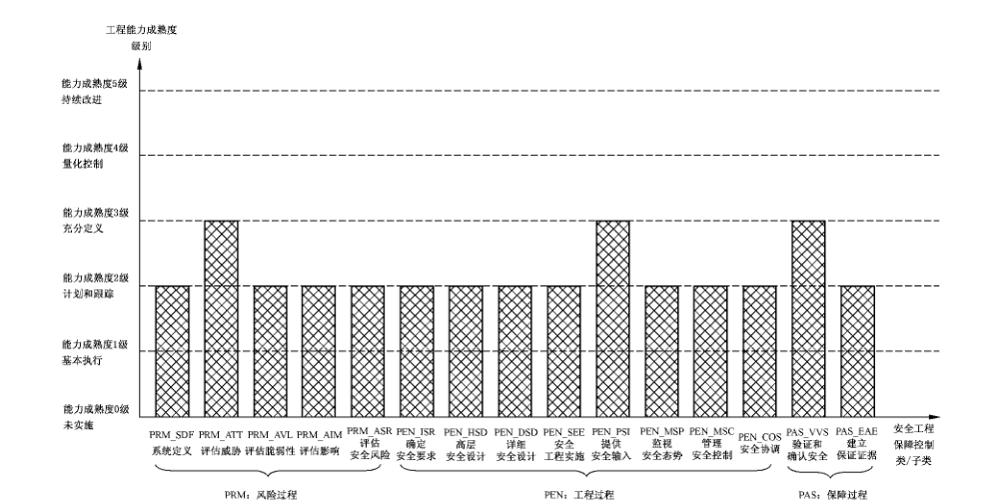

## 参考文献

- ［1］ GB/T 19000—2000 质量管理体系 基础和术语（idt ISO 9000:2000）
- ［2］ GB/T 19001—2000 质量管理体系 要求（idt ISO 9001:2000）
- ［3］ GB/T 19004—2000 质量管理体系 业绩改进指南（idt ISO 9004:2000）
- ［4］ System Security Engineering Capability Maturity Model (SSE-CMM) Model Descritpion Document, Version 3.0, June 15, 2003.
- ［5］ System Security Engineering Capability Maturity Model (SSE-CMM) Appraisal Method, Version 2.0, April 16, 1999.
- ［6］ NIST Special Publication 800-18, Guide for Developing Security Plans for Information Technology Systems, November 2001.
- ［7］ NIST Special Publication 800-30, Risk Management Guide for Information Technology Systems, January 2002.
- ［8］ NIST Special Publication 800-34, Continuity Planning Guide for Information Technology System, June 2002.
- ［9］ NIST Special Publication 800-50, Building an Information Security Awareness and Training Program, October 2003.
- ［10］ NIST Special Publication 800-64, Security Considerations in the Information System Development Life Cycle, October 2003.
- ［11］ NIST Special Publication 800-53, Recommended Security Controls for Federal Information Systems, Feberuary 2005.
- ［12］ NSTISSI No. 4009, National Information Systems Security (INFOSEC) Glossary.
- ［13］ Carnegie Mellon University/Software Engineering Institute, CMU/SEI—2002-TR-011, CMMI℠ for Systems Engineering, Software Engineering, Integrated Product and Process Development, and Supplier Sourcing (CMMI-SE/SW/IPPD/SS, V1.1) Continuous Representation, CMMI Product Team, March 2002.
- ［14］ Carnegie Mellon University/Software Engineering Institute, CMU/SEI—2002-TR-012, CMMI℠ for Systems Engineering, Software Engineering, Integrated Product and Process Development, and Supplier Sourcing (CMMI-SE/SW/IPPD/SS, V1.1) Staged Representation, CMMI Product Team, March 2002.
- ［15］ Information Assurance Technical Framework, Release 3.1, National Security Agency Information Assurance Solutions Technical, September 2002.
- ［16］ CoBIT, 3rd Edition, Management Guidelines, COBIT Steering Committee and the IT Governance Institute™, July 2000.
- ［17］ CoBIT, 3rd Edition, Audit Guidelines, COBIT Steering Committee and the IT Governance Institute™, July 2000.
- ［18］ CoBIT, 3rd Edition, Control Objectives, COBIT Steering Committee and the IT Governance Institute™, July 2000.
