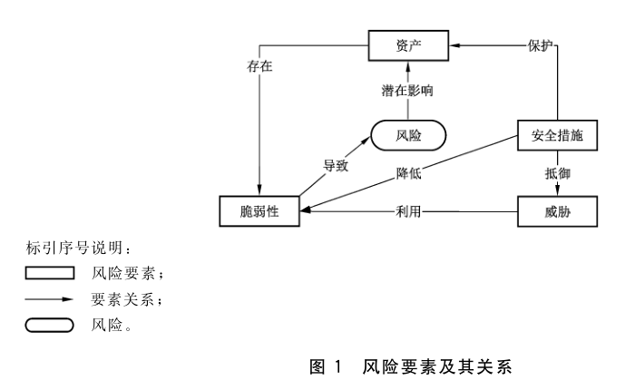
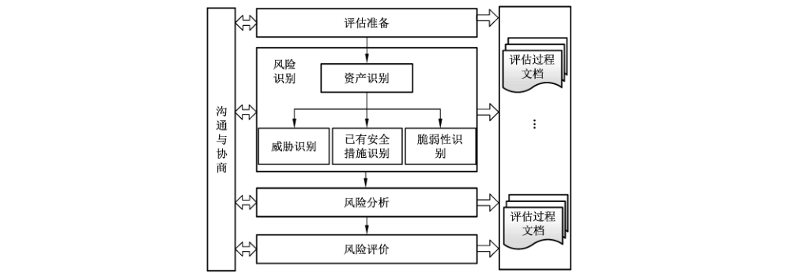
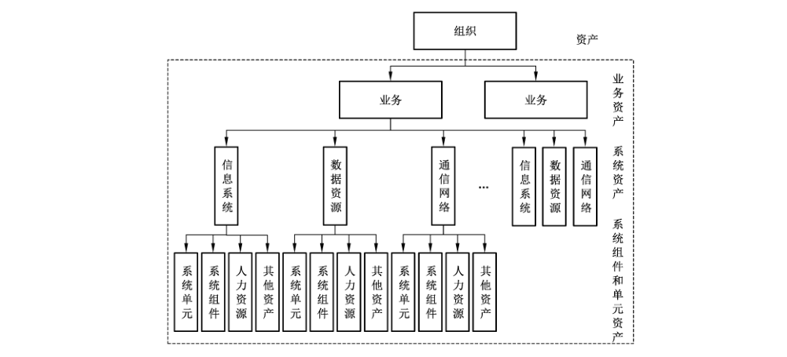

# GB/T 20984-2022 信息安全技术 信息安全风险评估方法

> 来源：[GB/T 20984-2022 国家标准详情](https://openstd.samr.gov.cn/bzgk/std/newGbInfo?hcno=FDA38AB7D08A715C6B6D69DFDEABB2C0)；封面发布日期：2022-04-15；实施日期：2022-11-01。
> PDF SHA-256：c3e9c6ba390b2b593465e2918a609617a4016ee37bb5c0e97bdddd75aa070123。
> 转写说明：逐页对照官方 PDF 的 30 页图像校核文字、列表、表格和图示；保留 3 幅原图，合并跨页内容，省略封面、目录、页眉、页脚和页码。正式引用请核对原 PDF。

## 前言

本文件按照 GB/T 1.1—2020《标准化工作导则 第1部分：标准化文件的结构和起草规则》的规定起草。

本文件代替 GB/T 20984—2007《信息安全技术 信息安全风险评估规范》，与 GB/T 20984—2007 相比，除结构调整和编辑性改动外，主要技术变化如下：

a） 增加了“业务”和“信息系统生命周期”（见 3.4 和 3.7）；

b） 删除了“业务战略”的术语和定义（见 2007年版的3.4）；

c） 删除了“资产”“资产价值”“可用性”“保密性”“信息系统”“完整性”“残余风险”“安全事件”“威胁”和“脆弱性”的术语和定义（见 2007 年版的 3.1、3.2、3.3、3.5、3.8、3.10、3.12、3.14、3.17 和 3.18）；

d） 更改了风险评估框架及流程中的风险要素关系、风险分析原理和评估实施流程（见第4章，2007年版的第4章）；

e） 更改了风险评估实施过程中风险要素识别和关联分析内容（见 5.2 和 5.3，2007 年版的 5.2、5.3、5.4、5.5 和 5.6）；

f） 将原标准中评估对象生命周期各阶段的风险评估和风险评估的工作形式调整到规范性附录 A 和资料性附录 B 中（见附录 A 和附录 B，2007 年版的第 6 章和第 7 章）。

请注意本文件的某些内容可能涉及专利。本文件的发布机构不承担识别专利的责任。

本文件由全国信息安全标准化技术委员会（SAC/TC 260）提出并归口。

本文件起草单位：国家信息中心、北京安信天行科技有限公司、信息产业信息安全测评中心、北京信息安全测评中心、中国信息安全测评中心、中国网络安全审查技术与认证中心、中国电子技术标准化研究院、公安部信息安全等级保护评估中心、公安部第一研究所、上海观安信息技术股份有限公司、成都民航电子技术有限责任公司、河南金盾信安检测评估中心有限公司、深圳市南山区政务服务数据管理局、云南公路联网收费管理有限公司、国网宁夏电力有限公司、国网新疆电力有限公司。

本文件主要起草人：禄凯、詹榜华、陈永刚、刘丰、陈青民、赵增振、张益、高亚楠、任金强、刘龙涛、刘德林、刘凯俊、孙明亮、杜宇鸽、翟亚红、王惠莅、任卫红、彭海龙、李秋香、安佳伟、马勇、张军、汤志强、段明磊、杨童、肖强、张宏杰、刘育辰、陈涛、李峰。

本文件及其所代替文件的历次版本发布情况为：

- 2007 年首次发布为 GB/T 20984—2007；
- 本次为第一次修订。

## 1 范围

本文件描述了信息安全风险评估的基本概念、风险要素关系、风险分析原理、风险评估实施流程和评估方法，以及风险评估在信息系统生命周期不同阶段的实施要点和工作形式。

本文件适用于各类组织开展信息安全风险评估工作。

## 2 规范性引用文件

下列文件中的内容通过文中的规范性引用而构成本文件必不可少的条款。其中，注日期的引用文件，仅该日期对应的版本适用于本文件；不注日期的引用文件，其最新版本（包括所有的修改版）适用于本文件。

- GB/T 25069 信息安全技术 术语

- GB/T 33132—2016 信息安全技术 信息安全风险处理实施指南

## 3 术语和定义、缩略语

### 3.1 术语和定义

GB/T 25069 界定的以及下列术语和定义适用于本文件。

#### 3.1.1 信息安全风险 information security risk

特定威胁利用单个或一组资产脆弱性的可能性以及由此可能给组织带来的损害。

> 注：它以事态的可能性及其后果的组合来度量。

［来源：GB/T 31722—2015,3.2］

#### 3.1.2 风险评估 risk assessment

风险识别、风险分析和风险评价的整个过程。

［来源：GB/T 29246—2017,2.71］

> 注：本文件专指信息安全风险评估。

#### 3.1.3 组织 organization

具有自身的职责、权威和关系以实现其目标的个人或集体。

> 注：组织的概念包括但不限于个体经营者、公司、法人、商行、企业、机关、合伙关系、慈善机构或院校，或者其部分或组合，无论注册成立与否、是公共的还是私营的。

［来源：GB/T 29246—2017，2.57，有修改］

#### 3.1.4 业务 business

组织为实现某项发展规划而开展的运营活动。

> 注：该活动具有明确的目标，并延续一段时间。

#### 3.1.5 安全需求 security requirement

为保证组织业务规划的正常运作而在安全措施方面提出的要求。

#### 3.1.6 安全措施 security control

保护资产、抵御威胁、减少脆弱性、降低安全事件的影响，以及打击信息犯罪而实施的各种实践、规程和机制。

#### 3.1.7 信息系统生命周期 information system lifecycle

信息系统的各个生命阶段，包括规划阶段、设计阶段、实施阶段、运行维护阶段和废弃阶段。

［来源：GB/T 31509—2015,3.1.2］

#### 3.1.8 自评估 self-assessment

由评估对象所有者自身发起，组成机构内部的评估小组，依据国家有关法规与标准，对评估对象安全管理进行评估的活动。

［来源：GB/T 28453—2012,3.2，有修改］

#### 3.1.9 检查评估 inspection assessment

由评估对象所有者的上级主管部门、业务主管部门或国家相关监管部门发起，依据国家有关法规与标准，对评估对象安全管理进行的评估活动。

［来源：GB/T 28453—2012,3.3，有修改］

### 3.2 缩略语

下列缩略语适用于本文件。

App：应用程序（Application）

IT：信息技术（Information Technology）

PaaS：平台即服务（Platform as a Service）

UPS：不间断电源（Uninterrupted Power Supply）

VPN：虚拟专用网络（Virtual Private Network）

## 4 风险评估框架及流程

### 4.1 风险要素关系

风险评估中基本要素的关系如图1所示。风险评估基本要素包括资产、威胁、脆弱性和安全措施，并基于以上要素开展风险评估。

开展风险评估时，基本要素之间的关系如下：

a） 风险要素的核心是资产，而资产存在脆弱性；

b） 安全措施的实施通过降低资产脆弱性被利用难易程度，抵御外部威胁，以实现对资产的保护；

c） 威胁通过利用资产存在的脆弱性导致风险；

d） 风险转化成安全事件后，会对资产的运行状态产生影响。

风险分析时，应综合考虑资产、脆弱性、威胁和安全措施等基本因素。

### 4.2 风险分析原理

风险分析原理如下：

a） 根据威胁的来源、种类、动机等，并结合威胁相关安全事件、日志等历史数据统计，确定威胁的能力和频率；

b） 根据脆弱性访问路径、触发要求等，以及已实施的安全措施及其有效性确定脆弱性被利用难易程度；

c） 确定脆弱性被威胁利用导致安全事件发生后对资产所造成的影响程度；

d） 根据威胁的能力和频率，结合脆弱性被利用难易程度，确定安全事件发生的可能性；

e） 根据资产在发展规划中所处的地位和资产的属性，确定资产价值；

f） 根据影响程度和资产价值，确定安全事件发生后对评估对象造成的损失；

g） 根据安全事件发生的可能性以及安全事件造成的损失，确定评估对象的风险值；

h）依据风险评价准则，确定风险等级，用于风险决策。

### 4.3 风险评估流程

风险评估的实施流程如图2所示。风险评估流程应包括如下内容。

a） 评估准备，此阶段应包括：

1） 确定风险评估的目标；

2） 确定风险评估的对象、范围和边界；

3） 组建评估团队；

4） 开展前期调研；

5） 确定评估依据；

6） 建立风险评价准则；

7） 制定评估方案。

组织应形成完整的风险评估实施方案，并获得组织最高管理者的支持和批准。

b） 风险识别，此阶段应包括：

1） 资产识别（见5.2.1）；

2） 威胁识别（见 5.2.2）；

3） 已有安全措施识别（见 5.2.3）；

4） 脆弱性识别（见 5.2.4）。

c） 风险分析，此阶段依据识别的结果计算得到风险值。

d） 风险评价，此阶段依据风险评价准则确定风险等级。

沟通与协商和评估过程文档管理贯穿于整个风险评估过程。风险评估工作是持续性的活动，当评估对象的政策环境、外部威胁环境、业务目标、安全目标等发生变化时，应重新开展风险评估。

风险评估的结果能够为风险处理提供决策支撑，风险处理是指对风险进行处理的一系列活动，如接受风险、规避风险、转移风险、降低风险等。风险处理按照 GB/T 33132—2016开展。

## 5 风险评估实施

### 5.1 风险评估准备

组织实施风险评估是一种战略性的考虑，其结果将受到组织规划、业务、业务流程、安全需求、系统规模和结构等方面的影响。因此，在风险评估实施前应准备以下工作。

a） 在考虑风险评估的工作形式、在生命周期中所处阶段和被评估单位的安全评估需求的基础上，确定风险评估目标。附录 A 给出了评估对象生命周期各阶段的风险评估内容，附录B给出了风险评估的工作形式描述。

b） 确定风险评估的对象、范围和边界。

c） 组建评估团队、明确评估工具。附录C给出了风险评估的工具。

d） 开展前期调研。

e） 确定评估依据。

f） 建立风险评价准则：组织应在考虑国家法律法规要求及行业背景和特点的基础上，建立风险评价准则，以实现对风险的控制与管理。

风险评价准则应满足以下要求：

1） 符合组织的安全策略或安全需求；

2） 满足利益相关方的期望；

3） 符合组织业务价值。

建立风险评价准则的目的包括但不限于：

4） 对风险评估的结果进行等级化处理；

5） 能实现对不同风险的直观比较；

6） 能确定组织后期的风险控制策略。

g） 制定评估方案。

h） 获得最高管理者支持。评估方案需得到组织最高管理者的支持和批准。

### 5.2 风险识别

#### 5.2.1 资产识别

##### 5.2.1.1 概述

资产识别是风险评估的核心环节。资产按照层次可划分为业务资产、系统资产、系统组件和单元资产，如图3所示。因此资产识别应从三个层次进行识别。

##### 5.2.1.2 业务识别

###### 5.2.1.2.1 识别内容

业务是实现组织发展规划的具体活动，业务识别是风险评估的关键环节。业务识别内容包括业务的属性、定位、完整性和关联性识别。业务识别主要识别业务的功能、对象、流程和范围等。业务的定位主要识别业务在发展规划中的地位。业务的完整性主要识别其为独立业务或非独立业务。业务的关联性识别主要识别与其他业务之间的关系。表1提供了一种业务识别内容的参考。

**表1 业务识别内容表**

| 识别内容 | 示例 |
| --- | --- |
| 属性 | 业务功能、业务对象、业务流程、业务范围、覆盖地域等 |
| 定位 | 发展规划中的业务属性和职能定位、与发展规划目标的契合度、业务布局中的位置和作用、竞争关系中竞争力强弱等 |
| 完整性 | 独立业务：业务独立，整个业务流程和环节闭环；非独立业务：业务属于业务环节的某一部分，可能与其他业务具有关联性 |
| 关联性 | 关联类别：并列关系（业务与业务间并列关系包括业务间相互依赖或单向依赖，业务间共用同一信息系统，业务属于同一业务流程的不同业务环节等）、父子关系（业务与业务之间存在包含关系等）、间接关系（通过其他业务，或者其他业务流程产生的关联性等）；关联程度：如果被评估业务遭受重大损害，将会造成关联业务无法正常开展，此类关联为紧密关联，其他为非紧密关联。 |

业务识别数据应来自熟悉组织业务结构的业务人员或管理人员。业务识别既可通过访谈、文档查阅、资料查阅，还可通过对信息系统进行梳理后总结整理进行补充。

###### 5.2.1.2.2 业务重要性赋值

应根据业务的重要程度进行等级划分，并对其重要性进行赋值。表2提供了一种业务重要性赋值的参考。

**表2 业务重要性赋值表**

| 赋值 | 标识 | 定义 |
| --- | --- | --- |
| 5 | 很高 | 业务在规划中极其重要，在发展规划中的业务属性及职能定位层面具有重大影响，在规划的发展目标层面中短期目标或长期目标中占据极其重要的地位 |
| 4 | 高 | 业务在规划中较为重要，在发展规划中的业务属性及职能定位层面具有较大影响，在规划的发展目标层面中短期目标或长期目标中占据极其重要的地位 |
| 3 | 中等 | 业务在规划中具有一定重要性，在发展规划中的业务属性及职能定位层面具有一定影响，在规划的发展目标层面中短期目标或长期目标中占据重要的地位 |
| 2 | 低 | 业务在规划中具有一定重要性，在发展规划中的业务属性及职能定位层面影响较低，在规划的发展目标层面中短期目标或长期目标中占据一定的地位 |
| 1 | 很低 | 业务在规划中具有一定重要性，在发展规划中的业务属性及职能定位层面影响很低，在规划的发展目标层面中短期目标或长期目标中占据较低的地位 |

业务的关联性会对业务的重要性造成影响。若被评估业务与高于其重要性赋值的业务具有紧密关联关系，则该业务重要性赋值应在原赋值基础上进行赋值调整。附录 D中表D.1 给出了一种存在紧密关联业务影响时的业务重要性赋值调整方法。

##### 5.2.1.3 系统资产识别

###### 5.2.1.3.1 识别内容

系统资产识别包括资产分类和业务承载性识别两个方面。表3给出了系统资产识别的主要内容描述。系统资产分类包括信息系统、数据资源和通信网络，业务承载性包括承载类别和关联程度。

**表3 系统资产识别表**

| 识别内容 | 示例 |
| --- | --- |
| 分类 | 信息系统：信息系统是指由计算机硬件、计算机软件、网络和通信设备等组成的，并按照一定的应用目标和规则进行信息处理或过程控制的系统。典型的信息系统如门户网站、业务系统、云计算平台、工业控制系统等。 数据资源：数据是指任何以电子或者非电子形式对信息的记录。数据资源是指具有或预期具有价值的数据集。在进行数据资源风险评估时，应将数据活动及其关联的数据平台进行整体评估。数据活动包括数据采集、数据传输、数据存储、数据处理、数据交换、数据销毁等。 通信网络：通信网络是指以数据通信为目的，按照特定的规则和策略，将数据处理结点、网络设备设施互连起来的一种网络。将通信网络作为独立评估对象时，一般是指电信网、广播电视传输网和行业或单位的专用通信网等以承载通信为目的的网络。 |
| 业务承载性 | 承载类别：系统资产承载业务信息采集、传输、存储、处理、交换、销毁过程中的一个或多个环节。 关联程度：业务关联程度（如果资产遭受损害，将会对承载业务环节运行造成的影响，并综合考虑可替代性）、资产关联程度（如果资产遭受损害，将会对其他资产造成的影响，并综合考虑可替代性）。 |

###### 5.2.1.3.2 系统资产价值赋值

系统资产价值应依据资产的保密性、完整性和可用性赋值，结合业务承载性、业务重要性，进行综合计算，并设定相应的评级方法进行价值等级划分，等级越高表示资产越重要。表4中给出了系统资产价值等级划分的描述。资产保密性、完整性、可用性赋值以及业务承载性赋值方法见附录 D。

**表4 系统资产价值等级表**

| 等级 | 标识 | 系统资产价值等级描述 |
| --- | --- | --- |
| 5 | 很高 | 综合评价等级为很高，安全属性破坏后对组织造成非常严重的损失 |
| 4 | 高 | 综合评价等级为高，安全属性破坏后对组织造成比较严重的损失 |
| 3 | 中等 | 综合评价等级为中，安全属性破坏后对组织造成中等程度的损失 |
| 2 | 低 | 综合评价等级为低，安全属性破坏后对组织造成较低的损失 |
| 1 | 很低 | 综合评价等级为很低，安全属性破坏后对组织造成很小的损失，甚至忽略不计 |

##### 5.2.1.4 系统组件和单元资产识别

###### 5.2.1.4.1 识别内容

系统组件和单元资产应分类识别，系统组件和单元资产分类包括系统组件、系统单元、人力资源和其他资产。表5给出了系统组件和单元资产识别的主要内容描述。

**表5 系统组件和单元资产识别表**

| 分类 | 示例 |
| --- | --- |
| 系统单元 | 计算机设备：大型机、小型机、服务器、工作站、台式计算机、便携计算机等。 存储设备：磁带机、磁盘阵列、磁带、光盘、软盘、移动硬盘等。 智能终端设备：感知节点设备（物联网感知终端）、移动终端等。 网络设备：路由器、网关、交换机等。 传输线路：光纤、双绞线等。 安全设备：防火墙、入侵检测/防护系统、防病毒网关、VPN 等。 |
| 系统组件 | 应用系统：用于提供某种业务服务的应用软件集合。 应用软件：办公软件、各类工具软件、移动应用软件等。 系统软件：操作系统、数据库管理系统、中间件、开发系统、语句包等。 支撑平台：支撑系统运行的基础设施平台，如云计算平台、大数据平台等。 服务接口：系统对外提供服务以及系统之间的信息共享边界，如云计算 PaaS 层服务向其他信息系统提供的服务接口等。 |
| 人力资源 | 运维人员：对基础设施、平台、支撑系统、信息系统或数据进行运维的网络管理员、系统管理员等。 业务操作人员：对业务系统进行操作的业务人员或管理员等。 安全管理人员：安全管理员、安全管理领导小组等。 外包服务人员：外包运维人员、外包安全服务或其他外包服务人员等。 |
| 其他资产 | 保存在信息媒介上的各种数据资料：源代码、数据库数据、系统文档、运行管理规程、计划、报告、用户手册、各类纸质的文档等。 办公设备：打印机、复印机、扫描仪、传真机等。 保障设备：UPS、变电设备、空调、保险柜、文件柜、门禁、消防设施等。 服务：为了支撑业务、信息系统运行、信息系统安全，采购的服务等。 知识产权：版权、专利等。 |

###### 5.2.1.4.2 系统组件和单元资产价值赋值

系统组件和单元资产价值应依据其保密性、完整性、可用性赋值进行综合计算，并设定相应的评级方法进行价值等级划分，等级越高表示资产越重要。表6中给出了系统组件和单元资产价值等级划分的描述。资产保密性、完整性、可用性赋值方法见附录 D。

**表6 系统组件和单元资产价值等级表**

| 等级 | 标识 | 系统组件和单元资产价值等级描述 |
| --- | --- | --- |
| 5 | 很高 | 综合评价等级为很高，安全属性破坏后对业务和系统资产造成非常严重的影响 |
| 4 | 高 | 综合评价等级为高，安全属性破坏后对业务和系统资产造成比较严重的影响 |
| 3 | 中等 | 综合评价等级为中，安全属性破坏后对业务和系统资产造成中等程度的影响 |
| 2 | 低 | 综合评价等级为低，安全属性破坏后对业务和系统资产造成较低的影响 |
| 1 | 很低 | 综合评价等级为很低，安全属性破坏后对业务和系统资产造成很小的影响，甚至忽略不计 |

#### 5.2.2 威胁识别

##### 5.2.2.1 威胁识别内容

威胁识别的内容包括威胁的来源、主体、种类、动机、时机和频率。

在对威胁进行分类前，应识别威胁的来源。威胁来源包括环境、意外和人三类，附录E给出了威胁识别的参考方法。表E.1给出了一种威胁来源的分类方法。

根据威胁来源的不同，威胁可划分为信息损害和未授权行为等威胁种类。表E.2给出了一种威胁种类划分的参考。

威胁主体依据人为和环境进行区分，人为的分为国家、组织团体和个人，环境的分为一般的自然灾害、较为严重的自然灾害和严重的自然灾害。

威胁动机是指引导、激发人为威胁进行某种活动，对组织业务、资产产生影响的内部动力和原因。

威胁动机可划分为恶意和非恶意，恶意包括攻击、破坏、窃取等，非恶意包括误操作、好奇心等。表E.3给出了一种威胁动机分类的参考。

威胁时机可划分为普通时期、特殊时期和自然规律。

威胁频率应根据经验和有关的统计数据来进行判断，综合考虑以下四个方面，形成特定评估环境中各种威胁出现的频率：

a） 以往安全事件报告中出现过的威胁及其频率统计；

b） 实际环境中通过检测工具以及各种日志发现的威胁及其频率统计；

c） 实际环境中监测发现的威胁及其频率统计；

d） 近期公开发布的社会或特定行业威胁及其频率统计，以及发布的威胁预警。

##### 5.2.2.2 威胁赋值

威胁赋值应基于威胁行为，依据威胁的行为能力和频率，结合威胁发生的时机，进行综合计算，并设定相应的评级方法进行等级划分，等级越高表示威胁利用脆弱性的可能性越大。表7中给出了威胁赋值等级划分的描述。

**表7 威胁赋值表**

| 等级 | 标识 | 威胁赋值描述 |
| --- | --- | --- |
| 5 | 很高 | 根据威胁的行为能力、频率和时机，综合评价等级为很高 |
| 4 | 高 | 根据威胁的行为能力、频率和时机，综合评价等级为高 |
| 3 | 中等 | 根据威胁的行为能力、频率和时机，综合评价等级为中 |
| 2 | 低 | 根据威胁的行为能力、频率和时机，综合评价等级为低 |
| 1 | 很低 | 根据威胁的行为能力、频率和时机，综合评价等级为很低 |

威胁能力是指威胁来源完成对组织业务、资产产生影响的活动所具备的资源和综合素质。组织及业务所处的地域和环境决定了威胁的来源、种类、动机，进而决定了威胁的能力；应对威胁能力进行等级划分，级别越高表示威胁能力越强，表E.4给出了一种特定威胁行为能力赋值的参考。其中，威胁动机对威胁能力有调整作用。

威胁的种类和资产决定了威胁的行为。表E.5给出了威胁行为列表的参考，E.6 给出了一种资产、威胁种类、威胁行为关联分析的示例。

威胁出现的频率应进行等级化处理，不同等级分别代表威胁出现频率的高低。等级数值越大，威胁出现的频率越高。威胁的频率应参考组织、行业和区域有关的统计数据进行判断。表E.7给出了一种威胁频率的赋值方法。其中，威胁时机对威胁频率有调整作用。

#### 5.2.3 已有安全措施识别

安全措施可以分为预防性安全措施和保护性安全措施两种。预防性安全措施可以降低威胁利用脆弱性导致安全事件发生的可能性，保护性安全措施可以减少安全事件发生后对组织或系统造成的影响。

在识别脆弱性的同时，评估人员应对已采取的安全措施的有效性进行确认。安全措施的确认应评估其有效性，即是否真正地降低了系统的脆弱性，抵御了威胁。

#### 5.2.4 脆弱性识别

##### 5.2.4.1 脆弱性识别内容

如果脆弱性没有对应的威胁，则无需实施控制措施，但应注意并监视他们是否发生变化。相反，如果威胁没有对应的脆弱性，也不会导致风险。应注意，控制措施的不合理实施、控制措施故障或控制措施的误用本身也是脆弱性。控制措施因其运行的环境，可能有效或无效。

脆弱性可从技术和管理两个方面进行审视。技术脆弱性涉及IT 环境的物理层、网络层、系统层、应用层等各个层面的安全问题或隐患。管理脆弱性又可分为技术管理脆弱性和组织管理脆弱性两方面，前者与具体技术活动相关，后者与管理环境相关。

脆弱性识别可以以资产为核心，针对每一项需要保护的资产，识别可能被威胁利用的脆弱性，并对脆弱性的严重程度进行评估；也可以从物理、网络、系统、应用等层次进行识别，然后与资产、威胁对应起来。脆弱性识别的依据可以是国际或国家安全标准，也可以是行业规范、应用流程的安全要求。对应用在不同环境中的相同的脆弱性，其影响程度是不同的，评估方应从组织安全策略的角度考虑，判断资产的脆弱性被利用难易程度及其影响程度。同时，应识别信息系统所采用的协议、应用流程的完备与否、与其他网络的互联等。

对不同的识别对象，其脆弱性识别的具体要求应参照相应的技术或管理标准实施。表8给出了一种脆弱性识别内容的参考。

**表8 脆弱性识别内容表**

| 类型 | 识别对象 | 识别方面 |
| --- | --- | --- |
| 技术脆弱性 | 物理环境 | 从机房场地、机房防火、机房供配电、机房防静电、机房接地与防雷、电磁防护、通信线路的保护、机房区域防护、机房设备管理等方面进行识别 |
| 技术脆弱性 | 网络结构 | 从网络结构设计、边界保护、外部访问控制策略、内部访问控制策略、网络设备安全配置等方面进行识别 |
| 技术脆弱性 | 系统软件 | 从补丁安装、物理保护、用户账号、口令策略、资源共享、事件审计、访问控制、新系统配置、注册表加固、网络安全、系统管理等方面进行识别 |
| 技术脆弱性 | 应用中间件 | 从协议安全、交易完整性、数据完整性等方面进行识别 |
| 技术脆弱性 | 应用系统 | 从审计机制、审计存储、访问控制策略、数据完整性、通信、鉴别机制、密码保护等方面进行识别 |
| 管理脆弱性 | 技术管理 | 从物理和环境安全、通信与操作管理、访问控制、系统开发与维护、业务连续性等方面进行识别 |
| 管理脆弱性 | 组织管理 | 从安全策略、组织安全、资产分类与控制、人员安全、符合性等方面进行识别 |

脆弱性赋值时包括两部分，一部分是脆弱性被利用难易程度赋值，一部分是影响程度赋值。

##### 5.2.4.2 脆弱性被利用难易程度赋值

脆弱性被利用难易程度赋值需要综合考虑已有安全措施的作用。一般来说，安全措施的使用将降低系统技术或管理上脆弱性被利用难易程度，但安全措施确认并不需要和脆弱性识别过程那样具体到每个资产、组件的脆弱性，而是一类具体措施的集合。

依据脆弱性和已有安全措施识别结果，得出脆弱性被利用难易程度，并进行等级化处理，不同的等级代表脆弱性被利用难易程度高低。等级数值越大，脆弱性越容易被利用。表9给出了脆弱性被利用难易程度的一种赋值方法。

**表9 脆弱性被利用难易程度赋值表**

| 等级 | 标识 | 定义 |
| --- | --- | --- |
| 5 | 很高 | 实施了控制措施后，脆弱性仍然很容易被利用 |
| 4 | 高 | 实施了控制措施后，脆弱性较容易被利用 |
| 3 | 中等 | 实施了控制措施后，脆弱性被利用难易程度一般 |
| 2 | 低 | 实施了控制措施后，脆弱性难被利用 |
| 1 | 很低 | 实施了控制措施后，脆弱性基本不可能被利用 |

##### 5.2.4.3 影响程度赋值

影响程度赋值是指脆弱性被威胁利用导致安全事件发生后对资产价值所造成影响的轻重程度分析并赋值的过程。识别和分析资产可能受到的影响时，需要考虑受影响资产的层面。可从业务层面、系统层面、系统组件和单元三个层面进行分析。

影响程度赋值需要综合考虑安全事件对资产保密性、完整性和可用性的影响。影响程度赋值采用等级划分处理方式，不同的等级分别代表对资产影响的高低。等级数值越大，影响程度越高。表10给出了影响程度的一种赋值方法。

**表10 影响程度赋值表**

| 等级 | 标识 | 定义 |
| --- | --- | --- |
| 5 | 很高 | 如果脆弱性被威胁利用，将对资产造成特别重大损害 |
| 4 | 高 | 如果脆弱性被威胁利用，将对资产造成重大损害 |
| 3 | 中等 | 如果脆弱性被威胁利用，将对资产造成一般损害 |
| 2 | 低 | 如果脆弱性被威胁利用，将对资产造成较小损害 |
| 1 | 很低 | 如果脆弱性被威胁利用，将对资产造成的损害可以忽略 |

### 5.3 风险分析

组织应在风险识别基础上开展风险分析，风险分析应：

a） 根据威胁的能力和频率，以及脆弱性被利用难易程度，计算安全事件发生的可能性；

b） 根据安全事件造成的影响程度和资产价值，计算安全事件发生后对评估对象造成的损失；

c） 根据安全事件发生的可能性以及安全事件发生后造成的损失，计算系统资产面临的风险值；

d） 根据业务所涵盖的系统资产风险值综合计算得出业务风险值。

具体风险计算过程见附录F。

### 5.4 风险评价

#### 5.4.1 系统资产风险评价

根据风险评价准则对系统资产风险计算结果进行等级处理。表11给出了一种系统资产风险等级划分方法。

**表11 系统资产风险等级划分表**

| 等级 | 标识 | 描述 |
| --- | --- | --- |
| 5 | 很高 | 风险发生的可能性很高，对系统资产产生很高的影响 |
| 4 | 高 | 风险发生的可能性很高，对系统资产产生中等及高影响； 风险发生的可能性高，对系统资产产生高及以上影响； 风险发生的可能性中，对系统资产产生很高影响 |
| 3 | 中等 | 风险发生的可能性很高，对系统资产产生低及以下影响； 风险发生的可能性高，对系统资产产生中及以下影响； 风险发生的可能性中，对系统资产产生高、中、低影响 |
| 2 | 低 | 风险发生的可能性中，对系统资产产生很低影响； 风险发生的可能性低，对系统资产产生低及以下影响； 风险发生的可能性很低，对系统资产产生中、低影响 |
| 1 | 很低 | 风险发生的可能性很低，发生后对系统资产几乎无影响 |

#### 5.4.2 业务风险评价

根据风险评价准则对业务风险计算结果进行等级处理，在进行业务风险评价时，可从社会影响和组织影响两个层面进行分析。社会影响涵盖国家安全，社会秩序，公共利益，公民、法人和其他组织的合法权益等方面；组织影响涵盖职能履行、业务开展、触犯国家法律法规、财产损失等方面。表12给出了一种基于后果的业务风险等级划分方法。

**表12 业务风险等级划分表**

| 等级 | 标识 | 描述 |
| --- | --- | --- |
| 5 | 很高 | 社会影响：a）对国家安全、社会秩序和公共利益造成影响；b）对公民、法人和其他组织的合法权益造成严重影响。 组织影响：a）导致职能无法履行或业务无法开展；b）触犯国家法律法规；c）造成非常严重的财产损失。 |
| 4 | 高 | 社会影响：对公民、法人和其他组织的合法权益造成较大影响。 组织影响：a）导致职能履行或业务开展受到严重影响；b）造成严重的财产损失。 |
| 3 | 中等 | 社会影响：对公民、法人和其他组织的合法权益造成影响。 组织影响：a）导致职能履行或业务开展受到影响；b）造成较大的财产损失。 |
| 2 | 低 | 组织影响：a）导致职能履行或业务开展受到较小影响；b）造成一定的财产损失。 |
| 1 | 很低 | 组织影响：造成较少的财产损失。 |

### 5.5 沟通与协商

风险评估实施团队应在风险评估过程中与内部相关方和外部相关方保持沟通并对沟通内容予以记录，沟通的内容应包括：

a） 为理解风险及相关问题和决策而就风险及其相关因素相互交流信息和意见；

b） 相关方已表达的对风险事件的关注、意见以及相应的反应。

### 5.6 风险评估文档记录

#### 5.6.1 风险评估文档记录要求

记录风险评估过程的相关文档，应符合以下要求（包括但不限于）：

a） 确保文档发布前是得到批准的；

b） 确保文档的更改和现行修订状态是可识别的（有版本控制措施）；

c） 确保文档的分发得到适当控制，并确保在使用时可获得有关版本的适用文档；

d） 防止作废文档的非预期使用，若因任何目的需保留作废文档时，应对这些文档进行适当的标识。

对于风险评估过程中形成的相关文档，还应规定其标识、存储、保护、检索、保存期限以及处置所需的控制。相关文档是否需要以及详略程度由组织的管理者来决定。

#### 5.6.2 风险评估文档

风险评估文档是指在风险评估过程中产生的过程文档和结果文档，包括（但不仅限于此）：

a） 风险评估方案：阐述风险评估目标、范围、人员、评估方法、评估结果的形式和实施进度等；

b） 资产识别清单：根据组织所确定的资产分类方法进行资产识别，形成资产识别清单（包括业务资产、系统资产、系统组件和单元资产），明确资产的责任人和责任部门；

c） 重要资产清单：根据资产识别和赋值的结果，形成重要资产列表，包括重要资产名称、描述、类型、重要程度、责任人、责任部门等；

d） 威胁列表：根据威胁识别和赋值的结果，形成威胁列表，包括威胁来源、种类、威胁行为、能力和频率等；

e） 已有安全措施列表：对已采取的安全措施进行识别并形成已有安全措施列表，包括已有安全措施名称、类型、功能描述及实施效果等；

f） 脆弱性列表：根据脆弱性识别和赋值的结果，形成脆弱性列表，包括具体脆弱性的名称、描述、类型、被利用难易程度及影响程度等；

g） 风险列表：根据威胁利用脆弱性导致安全事件的情况，形成风险列表，包括具体风险的名称、描述等；

h） 风险评估报告：对风险评估过程和结果进行总结，详细说明评估对象、风险评估方法、资产、威胁、脆弱性和已有安全措施的识别结果、风险分析、风险统计和结论等内容；

i） 风险评估记录：风险评估过程中的各种现场记录应可复现评估过程，以作为产生歧义后解决问题的依据。

## 附录 A（资料性）评估对象生命周期各阶段的风险评估

### A.1 概述

风险评估应贯穿于评估对象生命周期各阶段中。评估对象生命周期各阶段中涉及的风险评估原则和方法是一致的，但由于各阶段实施内容、对象、安全需求不同，使得风险评估的对象、目的、要求等各方面也有所不同。在规划设计阶段，通过风险评估以确定评估对象的安全目标；在建设验收阶段，通过风险评估以确定评估对象的安全目标达成与否；在运行维护阶段，要持续的实施风险评估以识别评估对象面临的不断变化的风险和脆弱性，从而确定安全措施的有效性，确保安全目标得以实现。因此，每个阶段风险评估的具体实施应根据该阶段的特点有所侧重的进行。

### A.2 规划阶段的风险评估

规划阶段风险评估的目的是识别评估对象的业务规划，以支撑评估对象安全需求及安全规划等。

规划阶段的评估应能够描述评估对象建成后对现有业务模式的作用，包括技术、管理等方面，并根据其作用确定评估对象建设应达到的安全目标。

本阶段评估中，资产、脆弱性不需要识别；威胁应根据未来应用对象、应用环境、业务状况、操作要求等方面进行分析。评估着重在以下几方面：

a） 是否依据相关规则，建立了与业务规划相一致的安全规划，并得到最高管理者的认可；

b） 是否依据业务建立与之相契合的安全策略，并得到最高安全管理者的认可；

c） 系统规划中是否明确评估对象开发的组织、业务变更的管理、开发优先级；

d） 系统规划中是否考虑评估对象的威胁、环境，并制定总体的安全方针；

e） 系统规划中是否描述评估对象预期使用的信息，包括预期的信息系统、资产的重要性、潜在的价值、可能的使用限制、对业务的支持程度等；

f） 系统规划中是否描述所有与评估对象安全相关的运行环境，包括物理和人员的安全配置，以及明确相关的法规、组织安全策略、专门技术和知识等。

规划阶段的评估结果应体现在评估对象整体规划或项目建议书中。

### A.3 设计阶段的风险评估

设计阶段的风险评估需要根据规划阶段所明确的运行环境、业务重要性、资产重要性，提出安全功能需求。设计阶段的风险评估结果应对设计方案中所提供的安全功能符合性进行判断，作为实施过程风险控制的依据。

本阶段评估中，应详细评估设计方案中面临威胁的描述，将评估对象使用的具体设备、软件等资产及其安全功能形成需求列表。对设计方案的评估着重在以下几方面：

a） 设计方案是否符合评估对象建设规划，并得到最高管理者的认可；

b） 设计方案是否对评估对象建设后面临的威胁进行了分析，重点分析来自物理环境和自然的威胁，以及由于内、外部入侵等造成的威胁；

c） 设计方案中的安全需求是否符合规划阶段的安全目标，并基于威胁的分析，制定评估对象的总体安全策略；

d） 设计方案是否采取了一定的手段来应对可能的故障；

e） 设计方案是否对设计原型中的技术实现以及人员、组织管理等方面的脆弱性进行评估，包括设计过程中的管理脆弱性和技术平台固有的脆弱性；

f） 设计方案是否考虑随着其他系统接入而可能产生的风险；

g） 系统性能是否满足用户需求，并考虑到峰值的影响，是否在技术上考虑了满足系统性能要求的方法；

h） 应用系统（含数据库）是否根据业务需要进行了安全设计；

i） 设计方案是否根据开发的规模、时间及系统的特点选择开发方法，并根据设计开发计划及用户需求，对系统涉及的软件、硬件与网络进行分析和选型；

j） 设计活动中所采用的安全控制措施、安全技术保障手段对风险的影响。在安全需求变更和设计变更后，也需要重复这项评估。

设计阶段的评估可以以安全建设方案评审的方式进行，判定方案所提供的安全功能与信息技术安全技术标准的符合性。评估结果应体现在评估对象需求分析报告或建设实施方案中。

### A.4 实施阶段的风险评估

实施阶段风险评估的目的是根据安全需求和运行环境对系统开发、实施过程进行风险识别，并对建成后的安全功能进行验证。根据设计阶段分析的威胁和制定的安全措施，在实施及验收时进行质量控制。

基于设计阶段的资产列表、安全措施，实施阶段应对规划阶段的安全威胁进行进一步细分，同时评估安全措施的实现程度，从而确定安全措施能否抵御现有威胁、脆弱性的影响。实施阶段风险评估主要对业务及其相关信息系统的开发、技术与产品获取，系统交付实施两个过程进行评估。开发、技术与产品获取过程的评估要点包括：

a） 法律、政策、适用标准和指导方针：直接或间接影响评估对象安全需求的特定法律；影响评估对象安全需求、产品选择的政府政策、国际或国家标准；

b） 评估对象的功能需要：安全需求是否有效地支持系统的功能；

c） 成本效益风险：是否根据评估对象的资产、威胁和脆弱性的分析结果，确定在符合相关法律、政策、标准和功能需要的前提下选择最合适的安全措施；

d） 评估保证级别：是否明确系统建设后应进行怎样的测试和检查，从而确定是否满足项目建设、实施规范的要求。

### A.5 交付阶段的风险评估

系统交付实施过程的评估要点包括：

a） 根据实际建设的系统，详细分析资产、面临的威胁和脆弱性；

b） 根据系统建设目标和安全需求，对系统的安全功能进行验收测试；评价安全措施能否抵御安全威胁；

c） 评估是否建立了与整体安全策略一致的组织管理制度；

d） 对系统实现的风险控制效果与预期设计的符合性进行判断，如存在较大的不符合，应重新进行评估对象安全策略的设计与调整。

本阶段风险评估可以采取对照实施方案和标准要求的方式，对实际建设结果进行测试、分析。

### A.6 运行阶段的风险评估

运行维护阶段风险评估的目的是了解和控制运行过程中的安全风险，是一种较为全面的风险评估。

评估内容包括对真实运行的资产、威胁、脆弱性等各方面。

a） 资产评估：包括对业务、系统资产、系统组件和单元资产的评估。业务评估包括业务定位、业务关联性、完整性、业务流程分析；系统资产评估包括系统分类和业务承载连续性的评估；系统组件和单元资产是在真实环境下较为细致的评估，包括实施阶段采购的软硬件资产、系统运行过程中生成的信息资产、相关的人员与服务等，本阶段资产识别是前期资产识别的补充与增加。

b） 威胁评估：应全面地分析威胁的可能性和严重程度。对威胁导致安全事件的评估可以参照威胁来源动机、能力和安全事件的发生频率。

c） 脆弱性评估：是全面的脆弱性评估。包括运行环境中物理、网络、系统、应用、安全保障设备、管理等各方面的脆弱性。技术脆弱性评估可以采取核查、扫描、案例验证、渗透性测试的方式实施；安全保障设备的脆弱性评估，应包括安全功能的实现情况和安全保障设备本身的脆弱性；

管理脆弱性评估可以采取文档、记录核查等方式进行验证。

d） 风险计算：根据本文件的相关方法，对风险进行定性或定量的风险分析，描述不同业务、系统资产的风险高低状况。

运行维护阶段的风险评估应定期执行；当组织的业务流程、系统状况发生重大变更时，也应进行风险评估，重大变更包括以下情况（但不限于）：

a） 增加新的应用或应用发生较大变更；

b） 网络结构和连接状况发生较大变更；

c） 技术平台大规模的更新；

d） 系统扩容或改造；

e） 发生重大安全事件后，或基于某些运行记录怀疑将发生重大安全事件；

f） 组织结构发生重大变动对系统产生了影响。

### A.7 废弃阶段的风险评估

废弃阶段风险评估着重在以下几方面：

a） 确保硬件和软件等资产及残留信息得到了适当的处置，并确保系统组件被合理地丢弃或更换；

b） 如果被废弃的系统是某个系统的一部分，或与其他系统存在物理或逻辑上的连接，还需考虑系统废弃后与其他系统的连接是否被关闭；

c） 如果在系统变更中废弃，除对废弃部分外，还应对变更的部分进行评估，以确定是否会增加风险或引入新的风险；

d） 是否建立了流程，确保更新过程在一个安全、系统化的状态下完成。

本阶段应重点对废弃资产对组织的影响进行分析，并根据不同的影响制定不同的处理方式。对由于系统废弃可能带来的新的威胁进行分析，并改进新系统或管理模式。对废弃资产的处理过程应在有效的监督之下实施，同时对废弃的执行人员进行安全教育，评估对象的维护技术人员和管理人员均应参与此阶段的评估。

## 附录 B（资料性）风险评估的工作形式

### B.1 自评估

自评估是指评估对象的拥有、运营或使用单位发起的对本单位进行的风险评估。自评估应在本文件的指导下，结合评估对象特定的安全要求实施。周期性进行的自评估可以在评估流程上适当简化，重点针对自上次评估后评估对象发生变化后引入的新威胁，以及脆弱性的完整识别，以便于两次评估结果的对比。但评估对象发生 A.6 中所列的重大变更时，应依据本文件进行完整的评估。

自评估可由发起方实施或委托风险评估服务技术支持方实施。由发起方实施的评估可以降低实施的费用、提高相关人员的安全意识，但可能由于缺乏风险评估的专业技能，其结果不够深入准确；同时，受到组织内部各种因素的影响，其评估结果的客观性易受影响。委托风险评估服务技术支持方实施的评估，过程比较规范、评估结果的客观性比较好，可信程度较高；但由于受到行业知识技能及业务了解的限制，对评估对象的了解，尤其是在业务方面的特殊要求存在一定的局限。由于引入风险评估服务技术支持方本身就是一个风险因素，因此，对其背景与资质、评估过程与结果的保密要求等方面应进行控制。

此外，为保证风险评估的实施，与评估对象相连的相关方也应配合，以防止给其他方的使用带来困难或引入新的风险。

### B.2 检查评估

检查评估是指评估对象上级管理部门组织的或国家有关职能部门开展的风险评估。

检查评估可依据本文件的要求，实施完整的风险评估过程。检查评估也可在自评估实施的基础上，对关键环节或重点内容实施抽样评估，包括以下内容（但不限于）：

a） 自评估队伍及技术人员审查；

b） 自评估方法的检查；

c） 自评估过程控制与文档记录检查；

d） 自评估资产列表审查；

e） 自评估威胁列表审查；

f） 自评估脆弱性列表审查；

g） 现有安全措施有效性检查；

h） 自评估结果审查与采取相应措施的跟踪检查；

i） 自评估技术技能限制未完成项目的检查评估；

j） 上级关注或要求的关键环节和重点内容的检查评估；

k） 软硬件维护制度及实施管理的检查；

l） 突发事件应对措施的检查。

检查评估也可委托风险评估服务技术支持方实施，但评估结果仅对检查评估的发起单位负责。由于检查评估代表了主管机关，涉及评估对象也往往较多，因此，要对实施检查评估机构的资质进行严格管理。

## 附录 C（资料性）风险评估的工具

### C.1 概述

风险评估工具是风险评估的辅助手段，是保证风险评估结果可信度的一个重要因素。风险评估工具的使用不但在一定程度上解决了手动评估的局限性，最主要的是它能够将专家知识进行集中，使专家的经验知识被广泛地应用。

根据在风险评估过程中的主要任务和作用原理的不同，风险评估的工具可以分成风险评估与管理工具、系统基础平台风险评估工具、风险评估辅助工具三类。风险评估与管理工具是一套集成了风险评估各类知识和判据的管理信息系统，以规范风险评估的过程和操作方法；或者是用于收集评估所需要的数据和资料，基于专家经验，对输入输出进行模型分析。系统基础平台风险评估工具主要用于对信息系统的主要部件（如操作系统、数据库系统、网络设备等）的脆弱性进行分析，或实施基于脆弱性的攻击。

风险评估辅助工具则实现对数据的采集、现状分析和趋势分析等单项功能，为风险评估各要素的赋值、定级提供依据。

### C.2 风险评估与管理工具

风险评估与管理工具大部分是基于某种标准方法或某组织自行开发的评估方法，可以有效地通过输入数据来分析风险，给出对风险的评价并推荐控制风险的安全措施。

风险评估与管理工具通常建立在一定的模型或算法之上，风险由业务重要性、资产重要性、所面临的威胁以及威胁所利用的脆弱性来确定；也有的通过建立专家系统，利用专家经验进行分析，给出专家结论。这种评估工具需要不断进行知识库的扩充。

此类工具实现了对风险评估全过程的实施和管理，包括：评估对象基本信息获取、业务信息获取、资产信息获取、脆弱性识别与管理、威胁识别、风险计算、评估过程与评估结果管理等功能。评估的方式可以通过问卷的方式，也可以通过结构化的推理过程，建立模型、输入相关信息，得出评估结论。通常这类工具在对风险进行评估后都会有针对性地提出风险控制措施。

根据实现方法的不同，风险评估与管理工具可以分为三类。

a） 基于信息安全标准的风险评估与管理工具。目前，市面上存在多种不同的风险分析标准或指南，不同的风险分析方法侧重点不同，例如本文件、GB/T 31509、NIST SP 800-30、ISO/IEC 27005、ISO/IEC 13335 等。以这些标准或指南的内容为基础，分别开发相应的评估工具，完成遵循标准或指南的风险评估过程。

b） 基于知识的风险评估与管理工具。基于知识的风险评估与管理工具并不仅仅遵循某个单一的标准或指南，而是将各种风险分析方法进行综合，并结合实践经验，形成风险评估知识库，以此为基础完成综合评估。它还涉及来自类似组织的最佳实践，主要通过多种途径采集相关信息，识别组织的风险和当前的安全措施；与特定的标准或最佳实践进行比较，从中找出不符合的地方；按照标准或最佳实践的推荐选择安全措施以控制风险。

c） 基于模型的风险评估与管理工具。基于标准或基于知识的风险评估与管理工具，都使用了定性分析方法或定量分析方法，或者将定性与定量相结合。定性分析方法是目前广泛采用的方法，需要凭借评估方的知识、经验和直觉，或者业界的标准和实践，风险的各个要素定级。定性分析法操作相对容易，但也可能因为评估方经验和直觉的偏差而使分析结果失准。定量分析则对构成风险的各个要素和潜在损失水平赋予数值或货币金额，通过对度量风险的所有要素进行赋值，建立综合评价的数学模型，从而完成风险的量化计算。定量分析方法准确，但前期建立系统风险模型较困难。定性与定量结合分析方法就是将风险要素的赋值和计算，根据需要分别采取定性和定量的方法完成。

基于模型的风险评估与管理工具是在对系统各组成部分、安全要素充分研究的基础上，对典型系统的资产、威胁、脆弱性建立量化或半量化的模型，根据采集信息的输入，得到评价的结果。

### C.3 系统基础平台风险评估工具

系统基础平台风险评估工具包括脆弱性扫描工具、渗透性测试工具、代码审计工具、移动应用安全测试工具、工控安全测试工具、机房检测工具等。

脆弱性扫描工具又称为安全扫描器、漏洞扫描仪等，主要用于识别网络、操作系统、数据库系统的脆弱性。通常情况下，这些工具能够发现软件和硬件中已知的脆弱性，以决定系统是否易受已知攻击的影响。脆弱性扫描工具是目前应用最广泛的风险评估工具，主要完成操作系统、数据库系统、网络协议、网络服务等的安全脆弱性检测功能，目前常见的脆弱性扫描工具有以下几种类型：

a） 基于网络的扫描器：在网络中运行，能够检测如防火墙错误配置或连接到网络上的易受攻击的网络服务器的关键漏洞；

b） 基于主机的扫描器：发现主机的操作系统、特殊服务和配置的细节，发现潜在的用户行为风险，如密码强度不够，也可实施对文件系统的检查；

c） 基于平台的扫描器：能够发现平台存在的脆弱性，平台包括云平台、大数据平台等；

d） 分布式网络扫描器：由远程扫描代理、对这些代理的即插即用更新机制、中心管理点三部分构成，用于企业级网络的脆弱性评估，分布和位于不同的位置、城市甚至不同的国家；

e） 数据库脆弱性扫描器：对数据库的授权、认证和完整性进行详细的分析，也可以识别数据库系统中潜在的脆弱性。

渗透性测试工具是根据脆弱性扫描工具扫描的结果进行模拟攻击测试，判断被非法访问者利用的可能性。这类工具通常包括黑客工具、脚本文件。渗透性测试的目的是检测已发现的脆弱性是否真正会给系统或网络带来影响。通常渗透性工具与脆弱性扫描工具一起使用，并可能会对被评估系统的运行带来一定影响。

代码审计工具是通过对程序源代码逐条进行检查和分析，发现这些源代码缺陷引发的安全漏洞，并提供代码修订措施和建议。

App 安全测试工具是通过对 App 的代码、会话、数据、通信等进行安全测试，以发现 App 中存在的脆弱性的工具。

工控安全测试工具是对工业控制系统的网络和应用进行安全性测试，以发现工业控制系统中存在的脆弱性的工具。

### C.4 风险评估辅助工具

科学的风险评估需要大量的实践和经验数据的支持，这些数据的积累是风险评估科学性的基础。

风险评估过程中，可以利用一些辅助性的工具和方法来采集数据，帮助完成现状分析和趋势判断。

a） 国家漏洞库、专业机构发布的漏洞与威胁统计数据。

b） 检查列表和基线检查工具：检查列表是基于特定标准或基线建立的，对特定系统进行审查的项目条款。通过检查列表，操作者可以快速定位系统目前的安全状况与基线要求之间的差距，该检查工作可以通过基线检查工具实现。

c） 网络入侵检测系统：全流量威胁检测系统、基于日志的失陷检测工具和入侵检测系统等通过部署检测引擎，收集、处理整个网络中的通信信息，以获取可能对网络或主机造成危害的入侵攻击事件；帮助检测各种攻击试探和误操作；同时也可以作为一个警报器，提醒管理员发生的安全状况。

d） 态势感知系统：态势感知系统通过综合分析网络安全要素，评估安全状况，预测其发展趋势，以可视化的方式展现给用户，并给出相应的报表和应对措施；它的相应报表可以作为安全现状数据，并用于分析威胁情况。

e） 安全审计工具：用于记录网络行为，分析系统或网络安全现状；它的审计记录可以作为风险评估中的安全现状数据，并可用于判断评估对象威胁信息的来源。

f） 拓扑发现工具：通过接入点接入被评估网络，完成被评估网络中的资产发现功能，并提供网络资产的相关信息，包括操作系统版本、型号等。拓扑发现工具主要是自动完成网络硬件设备的识别、发现功能。

g） 资产信息收集系统：通过提供调查表形式，完成被评估信息系统数据、管理、人员等资产信息的收集功能，了解到组织的主要业务、重要资产、威胁、管理上的缺陷、采用的控制措施和安全策略的执行情况。此类系统主要采取电子调查表形式，需要被评估系统管理人员参与填写，并自动完成资产信息获取。

h） 机房检测工具：对机房环境进行检测的一类工具，用以发现当前机房的情况，具体包括温度检测、湿度检测等。

i） 其他：如用于评估过程参考的评估指标库、知识库、漏洞库、算法库、模型库等。

## 附录 D（资料性）资产识别

### D.1 业务重要性赋值调整表

业务重要性赋值调整见表 D.1。

**表 D.1 业务重要性赋值调整表**

| 赋值 | 标识 | 定义 |
| --- | --- | --- |
| 5 | 很高 | 业务重要性为4，紧密关联业务的重要性为5，该业务重要性调整为5 |
| 4 | 高 | 业务重要性为3，紧密关联业务的重要性为4以上（含），该业务重要性调整为4 |
| 3 | 中等 | 业务重要性为2，紧密关联业务的重要性为3以上（含），该业务重要性调整为3 |
| 2 | 低 | 业务重要性为1，紧密关联业务的重要性为2以上（含），该业务重要性调整为2 |

### D.2 资产保密性赋值方法

根据资产在保密性上的不同要求，将其分为5个不同的等级，分别对应资产在保密性上应达成的不同程度或者保密性缺失时对资产造成的影响。表 D.2 提供了一种保密性赋值的参考。

**表 D.2 资产保密性赋值表**

| 赋值 | 标识 | 定义 |
| --- | --- | --- |
| 5 | 很高 | 资产的保密性要求非常高，一旦丢失或泄露会对资产造成重大的或无法接受的影响 |
| 4 | 高 | 资产的保密性要求较高，一旦丢失或泄露会对资产造成较大影响 |
| 3 | 中等 | 资产的保密性要求中等，一旦丢失或泄露会对资产造成影响 |
| 2 | 低 | 资产的保密性要求较低，一旦丢失或泄露会对资产造成轻微影响 |
| 1 | 很低 | 资产的保密性要求非常低，一旦丢失或泄露会对资产造成的影响可以忽略 |

### D.3 资产完整性赋值方法

根据资产在完整性上的不同要求，将其分为5个不同的等级，分别对应资产在完整性上应达成的不同程度或者完整性缺失时对资产造成的影响。表 D.3 提供了一种完整性赋值的参考。

**表D.3 资产完整性赋值表**

| 赋值 | 标识 | 定义 |
| --- | --- | --- |
| 5 | 很高 | 资产的完整性要求非常高，未经授权的修改或破坏会对资产造成重大的或无法接受的影响 |
| 4 | 高 | 资产的完整性要求较高，未经授权的修改或破坏会对资产造成较大影响 |
| 3 | 中等 | 资产的完整性要求中等，未经授权的修改或破坏会对资产造成影响 |
| 2 | 低 | 资产的完整性要求较低，未经授权的修改或破坏会对资产造成轻微影响 |
| 1 | 很低 | 资产的完整性要求非常低，未经授权的修改或破坏对资产造成的影响可以忽略 |

### D.4 资产可用性赋值方法

根据资产在可用性上的不同要求，将其分为5个不同的等级，分别对应资产在可用性上应达成的不同程度或者可用性缺失时对资产造成的影响。表 D.4 提供了一种可用性赋值的参考。

**表D.4 资产可用性赋值表**

| 赋值 | 标识 | 定义 |
| --- | --- | --- |
| 5 | 很高 | 资产的可用性要求非常高，合法使用者对资产的可用度达到年度99.9%以上，或系统不准许中断 |
| 4 | 高 | 资产的可用性要求较高，合法使用者对资产的可用度达到每天90%以上，或系统允许中断时间小于 10 min |
| 3 | 中等 | 资产的可用性要求中等，合法使用者对资产的可用度在正常工作时间达到70%以上，或系统允许中断时间小于30 min |
| 2 | 低 | 资产的可用性要求较低，合法使用者对资产的可用度在正常工作时间达到25%以上，或系统允许中断时间小于 60 min |
| 1 | 很低 | 资产的可用性要求非常低，合法使用者对资产的可用度在正常工作时间低于25% |

### D.5 系统资产业务承载性赋值方法

根据系统资产对所承载业务的影响不同，将其分为5个不同的等级，分别对应系统资产在业务承载性上应达成的不同程度或者资产安全属性被破坏时对业务的影响程度。表 D.5 提供了一种系统资产业务承载性赋值的参考。

**表 D.5 系统资产业务承载性赋值表**

| 等级 | 标识 | 描述 |
| --- | --- | --- |
| 5 | 很高 | 资产对于某种业务的影响非常大，其安全属性破坏后可能对业务造成非常严重的损失 |
| 4 | 高 | 资产对于某种业务的影响比较大，其安全属性破坏后可能对业务造成比较严重的损失 |
| 3 | 中等 | 资产对于某种业务的影响一般，其安全属性破坏后可能对业务造成中等程度的损失 |
| 2 | 低 | 资产对于某种业务的影响较低，其安全属性破坏后可能对业务造成较低的损失 |
| 1 | 很低 | 资产对于某种业务的影响较低，其安全属性破坏后对业务造成很小的损失，甚至忽略不计 |

## 附录 E（资料性）威胁识别

### E.1 威胁来源分类

威胁来源分类见表 E.1。

**表E.1 威胁来源列表**

| 来源 | 描述 |
| --- | --- |
| 环境 | 断电、静电、灰尘、潮湿、温度、鼠蚁虫害、电磁干扰、洪灾、火灾、地震、意外事故等环境危害或自然灾害 |
| 意外 | 非人为因素导致的软件、硬件、数据、通信线路等方面的故障，或者依赖的第三方平台或者信息系统等方面的故障 |
| 人为 | 人为因素导致资产的保密性、完整性和可用性遭到破坏 |

### E.2 威胁种类

威胁种类见表 E.2。

**表 E.2 威胁种类列表**

| 种类 | 描述 |
| --- | --- |
| 物理损害 | 对业务实施或系统运行产生影响的物理损害 |
| 自然灾害 | 自然界中所发生的异常现象，且对业务开展或者系统运行会造成危害的现象和事件 |
| 信息损害 | 对系统或资产中的信息产生破坏、篡改、丢失、盗取等行为 |
| 技术失效 | 信息系统所依赖的软硬件设备不可用 |
| 未授权行为 | 超出权限设置或授权进行操作或者使用的行为 |
| 功能损害 | 造成业务或系统运行的部分功能不可用或者损害 |
| 供应链失效 | 业务或系统所依赖的供应商、接口等不可用 |

### E.3 威胁动机分类

威胁动机分类见表 E.3。

**表E.3 威胁动机分类表**

| 分类 | 动机 |
| --- | --- |
| 恶意 | 挑战、叛乱、地位、金钱利益、信息销毁、信息非法泄露、未授权的数据更改、勒索、摧毁、非法利用、复仇、政治利益、间谍、获取竞争优势等 |
| 非恶意 | 好奇心、自负、无意的错误和遗漏（例如，数据输入错误、编程错误）等 |

### E.4 特定威胁行为能力赋值

特定威胁行为能力赋值见表 E.4。

**表E.4 特定威胁行为能力赋值表**

| 赋值 | 标识 | 描述 |
| --- | --- | --- |
| 3 | 高 | 恶意动力高，可调动资源多；严重自然灾害 |
| 2 | 中 | 恶意动力高，可调动资源少；恶意动力低，可调动资源多；非恶意或意外，可调动资源多；较严重自然灾害 |
| 1 | 低 | 恶意动力低，可调动资源少；非恶意或意外；一般自然灾害 |

### E.5 威胁行为、种类、来源对应

威胁行为、种类、来源对应见表 E.5。

**表E.5 威胁行为、种类、来源对应表**

| 种类 | 威胁行为 | 威胁来源 |
| --- | --- | --- |
| 物理损害 | 火灾、水灾、污染 | 环境、人为、意外 |
| 物理损害 | 重大事故、设备或介质损害、灰尘、腐蚀、冻结、静电、灰尘、潮湿、温度、鼠蚁虫害 | 环境、人为、意外 |
| 物理损害 | 电磁辐射、热辐射、电磁脉冲 | 环境、人为、意外 |
| 自然灾害 | 地震、火山、洪水、气象灾害 | 环境 |
| 信息损害 | 对阻止干扰信号的拦截、远程侦探、窃听、设备偷窃、回收或废弃介质的检索、硬件篡改、位置探测、信息被窃取、个人隐私被入侵、社会工程事件、邮件勒索、数据篡改、恶意代码 | 人为 |
| 信息损害 | 内部信息泄露、外部信息泄露、来自不可信源数据、软件篡改 | 人为、意外 |
| 技术失效 | 空调或供水系统故障 | 人为、意外 |
| 技术失效 | 电力供应失去 | 环境、人为、意外 |
| 技术失效 | 外部网络故障 | 人为、意外 |
| 技术失效 | 设备失效、设备故障、软件故障 | 意外 |
| 技术失效 | 信息系统饱和、信息系统可维护性破坏 | 人为、意外 |
| 未授权行为 | 未授权的设备使用、软件的伪造复制、数据损坏、数据的非法处理 | 人为 |
| 未授权行为 | 假冒或盗版软件使用 | 人为、意外 |
| 功能损害 | 操作失误、维护错误 | 意外 |
| 功能损害 | 网络攻击、权限伪造、行为否认（抵赖）、媒体负面报道 | 人为 |
| 功能损害 | 权限滥用 | 人为、意外 |
| 功能损害 | 人员可用性破坏 | 环境、人为、意外 |
| 供应链失效 | 供应商失效 | 人为、意外 |
| 供应链失效 | 第三方运维问题、第三方平台故障、第三方接口故障 | 人为、意外 |

### E.6 威胁种类、资产、威胁行为关联分析示例

威胁种类、资产、威胁行为关联分析示例见表 E.6。

**表 E.6 威胁种类、资产、威胁行为关联分析示例表**

| 资产 | 种类 | 威胁行为 |
| --- | --- | --- |
| 硬件设备，如服务器、网络设备 | 软硬件故障 | 设备硬件故障，如服务器损害、网络设备故障 |
| 机房 | 物理环境影响 | 机房遭受地震，火灾等 |
| 信息系统 | 网络攻击 | 非授权访问网络资源、非授权访问系统资源等 |
| 外包服务人员 | 人员安全失控 | 滥用权限非正常修改系统配置或数据、滥用权限泄露秘密信息等 |
| 组织形象 | 网络攻击 | 媒体负面报道 |

### E.7 威胁频率的赋值方法

威胁频率赋值方法见表 E.7。

**表E.7 威胁频率赋值表**

| 等级 | 标识 | 描述 |
| --- | --- | --- |
| 5 | 很高 | 出现的频率很高；或在大多数情况下几乎不可避免；或可以证实经常发生过 |
| 4 | 高 | 出现的频率较高；或在大多数情况下很有可能会发生；或可以证实多次发生过 |
| 3 | 中等 | 出现的频率中等；或在某种情况下可能会发生；或被证实曾经发生过 |
| 2 | 低 | 出现的频率较小；或一般不太可能发生；或没有被证实发生过 |
| 1 | 很低 | 威胁几乎不可能发生；仅可能在非常罕见和例外的情况下发生 |

## 附录 F（资料性）风险计算示例

在识别业务 B 并对其重要性赋值、识别系统资产 A 及其业务承载连续性后对资产价值 Va 赋值、识别系统组件和单元资产 C 后对其资产价值 Vc 赋值、识别威胁的能力和频率并对其威胁值 T 赋值，识别安全措施和脆弱性后并对脆弱性被利用难易程度 Av 和影响程度 Di 赋值，采用适当的计算方法与工具确定安全事件发生的可能性和损失，并进行风险计算。

a） 计算安全事件发生的可能性。

根据威胁赋值及脆弱性被利用难易程度，计算威胁利用脆弱性导致安全事件发生的可能性，即：

安全事件发生的可能性 = L［威胁赋值，脆弱性被利用难易程度］= L（T，Av）。

在具体评估中，应综合攻击者技术能力（专业技术程度、攻击设备等）、脆弱性被利用难易程度（可访问时间、设计和操作知识公开程度等）、资产吸引力等因素来判断安全事件发生的可能性。

b） 计算安全事件发生后的损失。

根据资产价值及安全事件影响程度，计算安全事件一旦发生后的损失，即：

安全事件造成的损失 = F［资产价值，影响程度］= F（Vc，Di）。

安全事件的发生造成的损失不仅仅是针对该资产本身，还可能影响业务的连续性；不同安全事件的发生对组织造成的影响也是不一样的。

c） 计算系统资产风险值。

根据计算出的安全事件发生的可能性以及安全事件造成的损失，计算系统资产风险值，即：

风险值 = R［安全事件发生的可能性，安全事件造成的损失］= R（L（T，Av），F（Vc，Di））。

d） 计算业务风险值。

应根据业务所涵盖的系统资产风险综合计算得出业务风险值，即：

业务风险值 = Rb［系统资产风险值，系统资产风险值，…，系统资产风险值］= Rb（RA1，RA2，…，RAn）。

其中，Rb 表示业务风险计算函数；RA1、RA2、…、RAn 表示业务所涵盖系统资产的风险值。

评估方可根据自身情况选择相应的风险计算方法计算风险，将安全事件发生的可能性与安全事件的损失进行运算得到风险值。

## 参考文献

- ［1］ GB/T 22240—2020 信息安全技术 网络安全等级保护定级指南

- ［2］ GB/T 28453—2012 信息安全技术 信息系统安全管理评估要求

- ［3］ GB/T 29246—2017 信息技术 安全技术 信息安全管理体系 概述和词汇

- ［4］ GB/T 30279—2020 信息安全技术 网络安全漏洞分类分级指南

- ［5］ GB/T 31509—2015 信息安全技术 信息安全风险评估实施指南

- ［6］ GB/T 31722—2015 信息技术 安全技术 信息安全风险管理

- ［7］ ISO 31000 Risk Management Guidelines

- ［8］ ISO/IEC 13335 Information technology—Guidelines for the management of IT security

- ［9］ ISO/IEC 27005 Information technology—Security techniques—Information security risk management

- ［10］ NIST Special Publication 800-26 Security Self-Assessment Guide for Information Technology Systems

- ［11］ NIST Special Publication 800-30 Risk Management Guide for Information Technology Systems
