# GB/T 24364-2023 信息安全技术 信息安全风险管理实施指南

> 来源：[GB/T 24364-2023 国家标准详情](https://openstd.samr.gov.cn/bzgk/std/newGbInfo?hcno=24DB172E929C1DD3A1134C6505A3829F)；封面发布日期：2023-05-23；实施日期：2023-12-01。
> 官方 PDF SHA-256：9bd2eb67c3351ce8dc45aa077c1f255f3488eb3696167085466f9c70ea738157。
> 依据官方 PDF 全部 56 页的页面图像转写与校核；省略封面、目录、页眉、页脚和分页，合并跨页表格及印刷折行。

## 前言

本文件按照 GB/T 1.1—2020《标准化工作导则 第1部分：标准化文件的结构和起草规则》的规定起草。

本文件代替 GB/Z 24364—2009《信息安全技术 信息安全风险管理指南》，与 GB/Z 24364—2009 相比，除结构调整和编辑性改动外，主要技术变化如下：

a） 标准对象和范围由面向信息系统修改为风险管理对象（见第 1 章）；

b） 删除了“可用性”“保密性”“完整性”“风险”“风险处理”的术语和定义（见 2009 年版的 3.1、3.2、3.4、3.5、3.7）；

c） 增加了信息安全风险管理框架，增加了风险管理原则、保障机制、保障措施、管理能力等内容（见第 4 章）；

d） 更改了信息安全风险管理的内容和过程（见 9.1，2009 年版的 4.2）；

e） 更改了语境建立流程，引入基本准则确定内容等（见 9.2，2009 年版的第 5 章）；

f） 更改了风险评估相关内容（见 9.3，2009 年版的第 6 章）；

g） 将监控审查改为监视与评审，并将相关内容更改（见 9.6，2009 年版的第 9 章）；

h） 更改了沟通与咨询相关内容（见 9.7，2009 年版的第 10 章）；

i） 删除了各生命周期阶段风险管理内容（见 2009 年版第 11 章、第 12 章、第 13 章、第 14 章、第 15 章）；

j） 更改了风险处置相关内容（见 9.2、9.4，2009 年版的第 7 章）。

请注意本文件的某些内容可能涉及专利。本文件的发布机构不承担识别专利的责任。

本文件由全国信息安全标准化技术委员会（SAC/TC 260）提出并归口。

本文件起草单位：国家信息中心、中国电子科技集团公司第十五研究所、北京安信天行科技有限公司、北京天融信网络安全技术有限公司、中国信息安全测评中心、中国网络安全审查技术与认证中心、深信服科技股份有限公司、北京信息安全测评中心、公安部第一研究所、公安部第三研究所、北京国信京宁信息安全科技有限公司、上海观安信息技术股份有限公司、郑州轻工业大学、河南农业大学、深圳市信息安全管理中心、广州市信息安全测评中心、深圳市龙华区政务服务数据管理局、深圳华晟九思科技有限公司。

本文件主要起草人：禄凯、陈永刚、赵增振、葛晓囡、陈青民、杨剑、刘润一、杜宇鸽、陈杨国、刘德林、程瑜琦、李媛、马江涛、李秋香、陈盼、陈一博、张益、刘健、刘丰、任金强、王焱、张锐卿、董安波、刘永杰、朱润酥、高杰、汤志强、朱建兴、李尚号。

本文件及其所代替文件的历次版本发布情况为：

- 2009 年首次发布为 GB/Z 24364—2009；
- 本次为第一次修订。

## 引言

目前，信息安全风险管理标准主要包括：

- GB/T 24364—2023《信息安全技术 信息安全风险管理指南》；
- GB/T 26333—2010《工业控制网络安全风险评估规范》；
- GB/T 31722—2015《信息技术 安全技术 信息安全风险管理》（ISO/IEC 27005:2008，IDT）；
- GB/T 31509—2015《信息安全技术 信息安全风险评估实施指南》；
- GB/T 33132—2016《信息安全技术 信息安全风险处理实施指南》；
- GB/T 36637—2018《信息安全技术 ICT 供应链安全风险管理指南》；
- GB/T 20984—2022《信息安全技术 信息安全风险评估方法》；
- ISO 31000:2018《风险管理 指南》；
- ISO/IEC 27005:2018《信息技术 安全技术 信息安全风险管理》。

本文件作为信息安全风险管理标准之一，在修订过程中依据国家信息安全风险管理相关的政策并参考 GB/T 31722—2015、ISO 31000:2018、ISO/IEC 27005:2018 等标准，为组织的信息安全风险管理实施提供了更加具体的指导，包括信息安全风险管理的目标、原则、保障机制、保障措施、能力和过程等内容，表1给出了本文件与 ISO 31000:2018、GB/T 31722—2015、ISO/IEC 27005:2018 标准的风险管理过程的对应关系。

然而，本文件不指定信息安全风险管理的特定实施细节，组织可根据自身风险管理范围、风险管理语境或所处行业来确定其风险管理实施细节。其现有的方法也可在本文件描述的框架下使用，以满足风险管理工作的要求。

**表1 风险管理过程对应关系表**

| ISO 31000:2018 | GB/T 31722—2015 | ISO/IEC 27005:2018 | 本文件 |
| --- | --- | --- | --- |
| 范围、语境、准则 | 语境建立 | 环境创建 | 语境建立 |
| 风险评估 | 风险评估 | 风险评估 | 风险评估 |
| 风险处置 | 风险处置 | 风险处置 | 风险处置 |
| — | 风险接受 | — | 批准留存 |
| 沟通与咨询 | 风险沟通 | 沟通与咨询 | 沟通与咨询 |
| 监督与评审 | 风险监视与评审 | 监测与评审 | 监视与评审 |
| 记录与报告 | — | — | 批准留存 |

注：在本文件的第 9 章，对信息安全风险管理实施过程的概念、工作内容等进行了详细阐述。

## 1 范围

本文件确立了信息安全风险管理的实施框架，描述了信息安全风险管理的原则、保障机制、保障措施、能力和过程，提供了每个管理过程的实施要点和工作形式。

本文件适用于各类组织开展信息安全风险管理工作。

## 2 规范性引用文件

下列文件中的内容通过文中的规范性引用而构成本文件必不可少的条款。其中，注日期的引用文件，仅该日期对应的版本适用于本文件；不注日期的引用文件，其最新版本（包括所有的修改单）适用于本文件。

- GB/T 20984—2022 信息安全技术 信息安全风险评估方法

- GB/T 24363—2009 信息安全技术 信息安全应急响应计划规范

- GB/T 25069—2022 信息安全技术 术语

- GB/T 29246—2017 信息技术 安全技术 信息安全管理体系 概述和词汇

- GB/T 31509 信息安全技术 信息安全风险评估实施指南

- GB/T 31722—2015 信息技术 安全技术 信息安全风险管理

- GB/T 38645—2020 信息安全技术 网络安全事件应急演练指南

## 3 术语和定义、缩略语

### 3.1 术语和定义

GB/T 25069—2022、GB/T 29246—2017、GB/T 31722—2015 和 GB/T 20984—2022 中界定的术语和定义适用于本文件。

#### 3.1.1 信息安全风险 information security risk

特定威胁利用单个或一组资产脆弱性的可能性以及由此可能给组织带来的损害。

> 注：以事态的可能性及其后果的组合来度量。

［来源：GB/T 25069—2022,3.681］

#### 3.1.2 风险管理 risk management

指导和控制组织相关风险的协调活动。

［来源：GB/T 29246—2017,2.76］

#### 3.1.3 业务 business

组织为实现某项发展战略而开展的运营活动。

> 注：该活动具有明确的目标，并延续一段时间。

［来源：GB/T 20984—2022，3.1.4］

#### 3.1.4 语境 context

组织寻求实现其目标的内外部环境。

> 注：内部语境可以包括如下方面：

- 治理、组织结构、角色和职责；
- 策略、目标和要实现它们的战略；
- 在资源和知识方面的能力［如资本、时间、人员、过程、系统和技术］；信息系统、信息流和决策过程（正式的和非正式的）；
- 与内部利益相关方的关系及其认知和价值观；
- 组织的文化；
- 组织采用的标准、指南和模型；
- 契约关系的形式和程度。

外部语境可以包括如下方面：

- 文化、社会、政治、法律、法规、金融、技术、经济、自然和竞争环境，无论是国际的、国家的、地区的或地方的；
- 影响组织目标的关键驱动力和趋势；
- 与外部利益相关方的关系及其认知和价值观。

［来源：GB/T 29246—2017，2.27，2.42，有修改］

### 3.2 缩略语

下列缩略语适用于本文件。

- APT：高级持续性威胁（Advanced Persistent Threat）
- MAC 地址：物理地址（Media Access Control）
- IDC：互联网数据中心（Internet Data Center）

## 4 信息安全风险管理实施框架

信息安全风险管理的目标是在确保安全合规的前提下，平衡组织发展与信息安全之间的关系。通过全面识别风险、科学评价风险、合理处置风险和持续监视风险，将风险控制到可接受程度。促进业务安全、持续、稳定运行，提升组织数字化应用水平，增强可持续发展能力。遵循分级管理、全面管理、动态调整、科学合理等管理原则，建立健全信息安全风险管理保障机制、保障措施，并在资产识别、威胁识别、脆弱性识别、已有措施有效性评价、风险分析与评价、风险处置、风险监测预警和风险信息共享等风险管理能力的基础上，执行语境建立、风险评估、风险处置、批准留存、监视与评审和沟通与咨询等风险管理过程，以实现信息安全风险管理目标。图1给出了组织开展信息安全风险管理工作的实施框架。

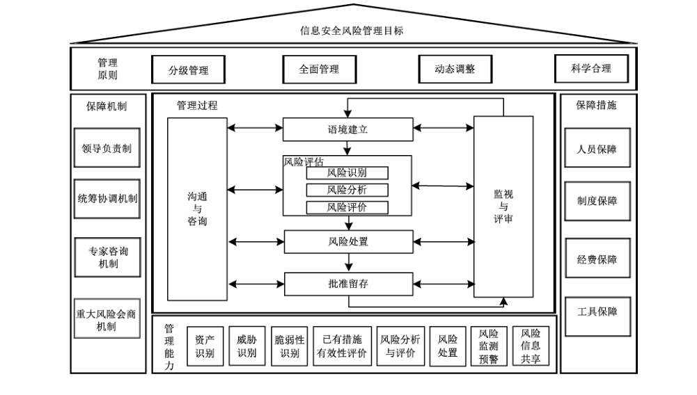

## 5 信息安全风险管理原则

### 5.1 分级管理

组织宜根据风险发生的可能性，风险发生后对国家安全、社会秩序、公共利益以及公民、法人和其他组织的合法权益等产生的影响程度，依据风险评价准则对风险进行合理分级。

### 5.2 全面管理

根据需要对网络和系统安全风险、数据安全风险、个人信息安全风险、供应链安全风险、新技术新应用安全风险等进行全面识别、控制和监视。同时，对信息安全风险管理涉及的过程、方法、人员和工具等进行全面管理。

### 5.3 动态调整

组织通过持续监视风险要素变化和风险管理过程，适应相关法律法规、政策、主管部门、自身业务相关要求和技术运行环境的变化，动态调整风险管理的对象、准则、风险处置措施等内容，持续优化和提升风险管理能力。

### 5.4 科学合理

基于组织面临的信息安全形势和环境，综合考虑信息安全投入和收益、风险可接受程度，以促进业务的安全、持续、稳定运行为视角，平衡安全与发展之间的关系，实现信息安全风险管理的科学性和合理性。

## 6 信息安全风险管理保障机制

### 6.1 领导负责制

组织宜依据国家和行业相关要求，结合本组织的特点和管理要求，明确高层领导负责信息安全风险管理工作。具体工作包括但不限于：

a） 明确组织的信息安全风险管理主要目标、基本要求、工作任务和保护措施；

b） 建立和落实信息安全风险管理责任制，把信息安全风险管理工作纳入重要议事日程，明确工作机构和职责，加大人力、财力、物力的支持和保障力度；

c） 领导组织的信息安全保护和重大风险处置工作，牵头解决重要问题；

d） 统筹推动组织信息安全风险管理工作与组织业务发展相融合。

### 6.2 统筹协调机制

明确组织信息安全风险管理工作的责任部门和统筹协调职责。具体工作包括但不限于：

a） 牵头组织的信息安全风险管理，建立健全风险管理制度体系，拟定年度信息安全风险管理计划，协调各相关部门和人员按职责参与风险管理工作；

b）组织推动信息安全风险管理的风险评估、风险处置、批准留存、监视与评审、沟通与咨询等工作；

c） 组织开展信息安全宣传教育，采取多种方式提升组织人员的信息安全意识和网络安全能力；

d） 牵头开展组织的信息安全风险信息通报、报送、共享和报告工作；

e） 统筹落实专家咨询和重大风险会商机制；

f） 统筹落实信息安全风险管理资源保障。

### 6.3 专家咨询机制

组织根据信息安全风险管理的需要组建风险管理专家库，为信息安全风险管理工作提供技术咨询。

具体工作包括但不限于：

a） 对信息安全风险管理制度的合理性和实用性进行论证和审定，对存在的不足和需要改进的管理制度提出修订建议；

b） 对信息安全风险处置方案、处置措施和应急方案等进行评审、论证和审定，并提出改进建议；

c） 对信息安全重大风险进行研判，提出应对和改进建议。

### 6.4 重大风险会商机制

组织通过明确重大风险会商的参与人员、会商召集、会商决议内容、会商决议处置跟踪、重大风险解除等相关工作以建立重大风险会商机制。具体工作包括但不限于：

a） 参与会商人员包括风险管理主要责任人、组织内各部门的主要负责人，必要时也可邀请利益相关方负责人和专家参与会商；若需要向主管、监管部门汇报时，可邀请主管、监管部门参与会商；

b） 会商活动对重大风险的类别、预警级别、预警范围、起始时间、可能影响范围、警示事项、应采取的措施和时限要求，以及该项重大风险处置责任人、处置原则和方案、处置资源配套等做出决议；

c） 会商决议及时发布到相关责任人；

d） 重大风险处置结束后，再次进行会商确定是否解除风险，判断可以解除的，及时通告相关人员解除风险；

e） 明确会商活动纪要和结果存档保存的时间，以便后续审计、查阅。

## 7 信息安全风险管理保障措施

### 7.1 人员保障

组织通过配备人员、开展培训等工作，满足信息安全风险管理工作针对不同岗位、不同能力的相关需求，具体人员保障措施主要包括但不限于：

a） 根据信息安全风险管理需求设置不同的岗位和技能要求，配备足够的人员开展工作；

b） 加强内部信息安全风险管理相关专业人才队伍建设，建立健全人才发现、培养、选拔和任用机制；

c） 通过不同的培训方式让组织内部全体员工了解并认同组织的信息安全风险管理目标和原则，提升信息安全风险管理意识；

d） 根据组织需求和组织技术能力现状，可引入外部服务单位协助组织开展日常风险管理活动；

e） 组建内部和外部相融合的专家库资源。

### 7.2 制度保障

建立符合组织信息安全风险管理需求的制度体系是组织信息安全风险管理活动开展的有效保障，主要内容包括但不限于：

a） 阐明机构信息安全风险管理工作的总体目标、范围、原则、框架和要求等；

b） 明确信息安全风险管理活动中各类人员的岗位和职责；

c） 明确信息安全风险管理活动所需的操作规程；

d） 形成和保存信息安全风险管理所产生的信息文档；

e） 明确信息安全风险管理工作的绩效评价和奖惩。

### 7.3 经费保障

组织内部为信息安全风险管理活动提供必要的资金保障，各类经费主要包括但不限于：

a）风险处置类经费，为消减、转移、规避风险所采取的安全措施需花费的经费。如购买网络安全保险、网络层安全防护设备、主机层安全防护设备、应用层安全防护设备、数据层安全防护设备等；

b） 人员教育培训经费，包括信息安全风险意识培训、风险管理人员技能提升与资格认证、演练竞赛等相关经费等；

c） 工具采购类经费，为开展威胁识别、脆弱性识别、风险监测预警等活动所需工具采购经费。如采购威胁情报、态势感知系统、漏洞扫描系统、渗透测试工具等；

d） 风险管理相关的服务经费，包括但不限于：风险评估、渗透测试、漏洞扫描等服务的经费。

### 7.4 工具保障

组织通过配备信息安全风险管理相关工具，以保证信息安全风险管理工作的开展，提升风险管理的效果。主要工具包括但不限于：

a） 风险管理类，基于标准的风险评估和管理工具、基于知识的风险评估和管理工具、基于模型的风险评估和管理工具等；

b）风险检查评估类，检查列表和基线检查工具、脆弱性扫描工具、渗透性测试工具、代码审计工具、移动应用安全测试工具、工业控制系统安全测试工具、机房检测工具等；

c） 风险防护类，防火墙、网络入侵检测系统、web 应用防火墙、防病毒等；

d） 专业机构发布的漏洞与威胁统计数据、评估指标库、知识库、漏洞库、算法库、模型库等。

## 8 信息安全风险管理能力

### 8.1 资产识别能力

能针对风险管理范围内的业务资产、系统资产、系统单元和组件3个层次进行资产识别，从识别活动的操作规范制定、设备和工具配备以及人员组建3个方面建立资产识别能力。

a） 宜具备指导组织开展资产识别的操作方法、识别指南和相关表单，明确组织业务完整性识别和关联程度计算、业务重要性赋值、资产价值赋值等方法，并保持更新机制，持续提高资产识别能力。

b） 宜具备资产管理配置库、资产主动探测和被动扫描类工具等，能识别出设备类型、设备品牌、设备型号、开放端口和版本等信息，并对资产进行全面管理。

c） 人员宜了解资产识别相关标准，熟悉资产识别方法，具备依据识别结果输出资产分类、资产评价以及重要资产识别的能力。

### 8.2 威胁识别能力

能从威胁的来源、动机、途径、可能性及影响等方面全面、客观、准确识别威胁，从流程规范制定、工具配备以及人员组建3个方面建立威胁识别能力。

a） 宜制定威胁识别方法和操作指南，确定威胁赋值标准，并保持更新机制。

b） 宜具备威胁情报收集、态势感知、APT 攻击检测、网络安全监测等工具，能识别出威胁来源、攻击路径、攻击强度、发生频率等。

c） 人员宜了解并掌握威胁监测和识别方法，熟悉相关工具使用知识和技能，具备依据识别结果输出威胁列表和完成威胁赋值的能力。

### 8.3 脆弱性识别能力

能以业务为核心，针对威胁，从技术和管理两个方面进行脆弱性识别，梳理资产可能被威胁利用的脆弱点，从流程规范制定、工具配备以及人员组建3个方面建立脆弱性识别能力。

a） 宜具备脆弱性识别的方法、操作指南和相关表单，具备脆弱性赋值方法和指南，并保持更新机制。

b） 宜具备配置核查、协议分析、漏洞扫描、源代码安全分析等工具，并能识别出物理层、网络层、系统层、应用层等层面的安全问题或隐患。

c） 人员宜了解和掌握脆弱性相关的标准，熟悉识别方法流程、操作指南、工具使用相关的知识，具备跟踪漏洞最新发展状况、依据识别结果输出脆弱性列表、依据脆弱性被利用难易程度赋值和影响程度赋值的能力。

### 8.4 已有措施有效性评价能力

能从降低威胁利用脆弱性导致安全事件发生的可能性和（或）减少安全事件发生后对组织造成的影响两个方面对已有措施有效性进行评价。从评价方法、工具配备以及人员3个方面建立已有安全措施有效性评价能力。

a） 宜具备已有安全措施有效性的评价方法、评价模型、操作指南和相关评价指标，具备从抵御或震慑威胁、阻断攻击路径、弥补或消减脆弱性、转移安全事件发生后的影响等维度对已有安全措施实施效果进行数据采集的方法和有效性评价的算法，并保持持续更新。

b） 宜具备数据采集、数据分析、安全补丁测试、备份恢复测试、攻击拦截测试等工具，可对已有安全措施实现网络攻击拦截、病毒查杀、威胁震慑、脆弱性消除以及备份文件有效性等的效果进行判断。

c） 人员宜了解和掌握已有安全措施有效性评价相关标准，熟悉评价方法和流程、操作指南、工具使用等相关知识和技能，了解已有安全措施的防护目的、防护对象和范围、防护方式、防护效果数据采集方法、有效性评价模型和评价算法等方面的知识，并能依据采集的数据和评价模型开展评价工作。

### 8.5 风险分析与评价能力

能根据风险识别的结果，通过选用的风险计算模型对系统风险和业务风险进行计算、分析，具备依据风险评价准则对风险进行等级划分的能力。从计算和评价方法、工具配备以及人员组建三个方面建立风险分析与评价能力。

a） 宜具备风险计算和分析的方法、计算模型和操作指南，具备合理的、可操作的系统风险和业务风险评价准则，并保持持续更新。

b） 宜具备风险计算和评价工具、评价指标配置库等，可对风险识别的结果进行自动计算，并进行合理的评价和等级划分。

c） 人员宜了解和掌握风险分析与评价相关标准，熟悉分析与评价的方法流程、操作指南、工具使用相关知识和技能，具备风险计算、风险调整、风险评价结果合理性判断等能力。

### 8.6 风险处置能力

能在风险处置准备、风险处置实施和风险处置效果评价等阶段，从处置措施、处置工具、处置团队3个方面建立风险处置能力。

a） 宜具备完善的风险处置方法、流程、指南和相关表单，能持续跟踪信息安全攻防技术发展现状，能及时了解新技术、新应用的安全风险及应对措施，能根据组织的业务特点形成可落地且有效的风险处置措施。

b） 宜具有风险处置配置库，可实现对已知风险处置措施的查询和维护，并对配置库持续更新。

c） 人员宜了解和掌握风险处置常识和专业知识，持续跟踪最新的信息安全相关法律法规，了解常见的信息安全保障模型，具备风险处置成本效益分析知识，具备专项研判专家队伍和技术力量，具备测试、实施风险处置措施和编制风险处置报告的能力。

### 8.7 风险监测预警能力

能结合组织自身情况，从监测预警流程、监测预警技术体系以及监测预警机构和人员3个方面建立监测预警能力。

a） 宜制定监测预警流程，结合监测预警机构和人员设置情况以及监测预警范围，制定适用本组织实际情况的监测预警流程，划分预警级别，制定包括组织内部预警与组织相关单位、上级主管单位或外部监管机构预警等一种或多种组合的预警流程。

b） 宜构建覆盖管理范围内的监测预警技术体系，具备安全事件监测、运行状态监测、威胁监测、策略与配置监测的技术能力，具备监测数据采集、汇总、处理、分析能力，及定位网络安全事件、影响范围、涉及对象的能力，具备支持定义预警流程和自动化预警的能力。

c） 宜设置监测预警机构和人员，明确监管预警机构的权利和义务，明确各级各部门负责监测、预警和响应预警的责任人，不同人员根据岗位职责不同，宜具备监测预警系统及其相关设备的使用和操作能力，具备日志分析、事件定位、事态研判、预警通知等能力。

### 8.8 风险信息共享能力

能基于风险评估、风险监控预警和风险监视相关工作成果，从风险信息共享流程和规范、风险信息系统或工具和途径以及风险信息共享机构和人员3个方面建立风险信息共享能力。

a） 宜建立风险信息共享流程和规范。根据共享场景、参与角色和共享信息的内容，确定类别级别、选择共享模式、制定共享策略规程等，如建立共享清单、保护共享信息、监督评价、持续共享、利用调整共享以及终止信息共享等。

b）宜具备风险信息共享系统或工具，相关系统和工具的信息共享接口、共享模式、角色和获取信息范围控制能力应符合相关国家、行业或区域标准规定。

c） 宜具有风险信息共享机构和人员，明确信息风险共享机构的权利和义务，信息风险共享相关人员具备利用、汇总、关联、分析、验证、处理、保护和发布风险信息的能力。

## 9 信息安全风险管理过程

### 9.1 概述

#### 9.1.1 信息安全风险管理的内容和过程

信息安全风险管理包括语境建立、风险评估、风险处置、批准留存、监视与评审和沟通与咨询6个方面的内容。语境建立、风险评估、风险处置和批准留存是信息安全风险管理的4个基本步骤，监视与评审和沟通与咨询则贯穿于这4个基本步骤中，见图2。

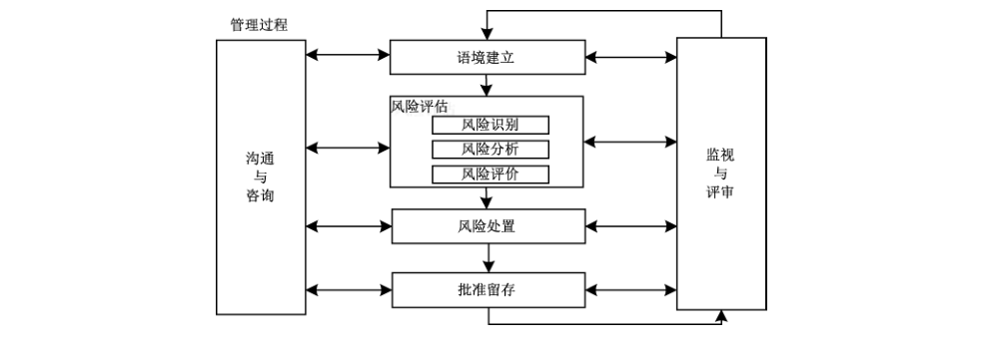

第一步是语境建立，确定风险管理的对象和范围，实施风险管理准备，进行相关信息的调查和分析，明确风险管理对象的安全要求。第二步是风险评估，针对确立的风险管理对象所面临的风险进行识别、分析和评价。第三步是风险处置，依据风险评估的结果，选择并执行合适的安全措施来降低风险的过程。第四步是批准留存，机构的决策层依据风险评估和风险处置的结果是否满足风险管理对象的安全要求，做出是否认可风险管理活动的决定，并将结果留存。当风险管理对象的业务目标和特性发生变化或面临新的风险时，需要再次进入上述4个步骤，形成一次新的循环。监视与评审包括对上述4个主体步骤的监视和评审。监视是定期或不定期对风险管理过程的运行情况进行查看，了解风险管理过程的执行情况，持续监测风险的变化，及时进行风险预警和风险处置，评审是对监视的结果进行分析和评价，从而确定风险管理过程的有效性，并持续改进。沟通与咨询为上述4个步骤中相关方提供沟通和咨询。沟通与咨询是通过相关方之间交换和/或共享关于风险的信息，就如何管理风险达成一致的活动。

沟通是在相关方需要时为其提供学习途径，以保持参与人员之间的协调一致，共同实现安全目标。咨询是为所有相关方提供学习途径，以增强风险意识、知识和技能，配合实现安全目标。语境建立、风险评估、风险处置、批准留存、监视与评审、沟通与咨询构成了一个螺旋式上升的循环，使得风险管理对象在自身和环境的变化中能不断应对新的安全需求和风险。

#### 9.1.2 信息安全风险管理相关人员的角色和责任

信息安全风险管理是基于风险的信息安全管理。因此，信息安全风险管理涉及人员，既包括信息安全风险管理的直接参与人员，也包括风险管理对象的相关人员。表2对信息安全风险管理相关人员的角色和责任进行了归纳和分类。

**表2 信息安全风险管理相关人员的角色和责任**

| 层面 | 风险管理对象参与人员：角色 | 内外部 | 责任 | 信息安全风险管理参与人员：角色 | 内外部 | 责任 |
| --- | --- | --- | --- | --- | --- | --- |
| 决策层 | 决策人员 | 内 | 负责风险管理对象的重大决策和总体规范 | 决策人员 | 内 | 负责信息安全风险管理的重大决策、总体规划和批准留存 |
| 管理层 | 管理人员 | 内 | 负责风险管理对象各方面的管理、组织和协调 | 管理人员 | 内 | 负责信息安全风险管理各过程中的管理、组织和协调 |
| 执行层 | 规划设计人员 | 内或外 | 负责风险管理对象的规划和设计 | 执行人员 | 内或外 | 负责信息安全风险管理的具体规划、设计和实施 |
| 执行层 | 建设人员 | 内或外 | 负责风险管理对象的建设和实施 | 执行人员 | 内或外 | 负责信息安全风险管理的具体规划、设计和实施 |
| 执行层 | 运行人员 | 内或外 | 负责风险管理对象的日常运行和操作 | 执行人员 | 内或外 | 负责信息安全风险管理的具体规划、设计和实施 |
| 执行层 | 维护人员 | 内或外 | 负责风险管理对象的日常维护，包括维修和升级 | 执行人员 | 内或外 | 负责信息安全风险管理的具体规划、设计和实施 |
| 执行层 | 监视人员 | 内 | 负责风险管理对象的监视、控制、预警和应急处理 | 监视人员 | 内 | 负责信息安全风险管理过程、成本和结果的监视和控制 |
| 支持层 | 支持人员 | 外 | 为风险管理对象提供专业技术支持，包括咨询、培训、测评和工具定制等服务 | 支持人员 | 外 | 为信息安全风险管理提供专业技术支持，包括咨询、培训、测评和工具定制等服务 |
| 用户层 | 使用人员 | 内或外 | 利用风险管理对象完成自身的任务 | 使用人员 | 内或外 | 遵循信息安全风险管理的原则和过程使用风险管理对象，并反馈信息安全风险管理的效果 |

### 9.2 语境建立

#### 9.2.1 语境建立概述

##### 9.2.1.1 语境建立的概念

语境建立是信息安全风险管理的第一步，确定风险管理的对象和范围，确立实施风险管理的准备，进行相关信息的调查和分析。

##### 9.2.1.2 语境建立的目的

语境建立是为了明确信息安全风险管理的范围和对象，以及对象的特性和安全要求，对信息安全风险管理工作进行规划和准备，保障后续风险管理活动顺利进行。

##### 9.2.1.3 语境建立的依据

国家、地区或行业的相关法律、法规、政策和标准以及风险管理对象的业务目标、特性、外部和内部环境都是语境建立的必要依据。

#### 9.2.2 语境建立过程

##### 9.2.2.1 语境建立过程概述

语境建立的过程包括风险管理准备、风险管理对象调查与分析、信息安全要求分析3个工作阶段，各阶段输出文档见附录A中A.1。在信息安全风险管理过程中，语境建立过程是一次信息安全风险管理主循环的起始，为风险评估提供输入，监视与评审和沟通与咨询贯穿其3个阶段，见图3。

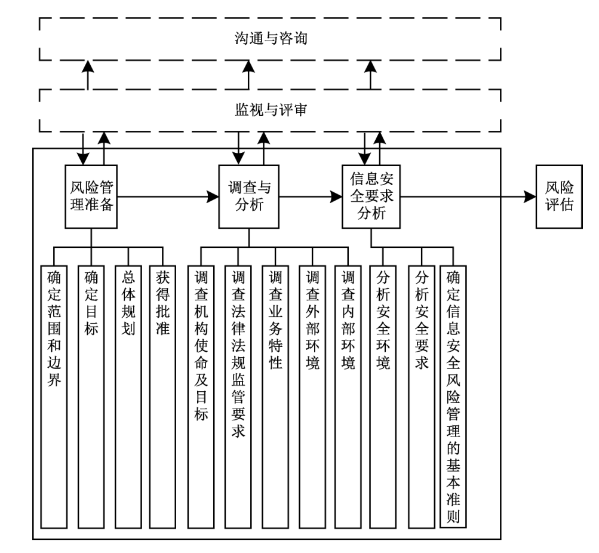

##### 9.2.2.2 风险管理准备

如图4所示，风险管理准备阶段的工作过程和内容如下。

a） 确定风险管理范围和边界，以确保在风险管理中考虑所有相关业务、资产。此外，需要识别边界以解决通过这些边界可能产生的风险。

收集有关组织的信息，以确定其所处的环境及其与信息安全风险管理过程的相关性。

定义范围和边界时，考虑以下信息：

1） 组织的业务目标、发展战略和方针；

2） 国家、地区或行业的相关政策、法律、法规和标准的规定；

3） 业务流程；

4） 组织的职能和结构；

5） 组织的信息安全方针；

6） 组织对风险管理的总体方法；

7） 信息资产，包括数据、个人信息等；

8） 组织的地点及其地理特征；

9） 影响组织的制约因素；

10） 利益相关方的期望；

11） 社会文化环境；

12） 接口（即与环境的信息交流）。

b） 确定信息安全风险管理的目标。

c） 总体规划。制定风险管理总体规划，包括风险管理的目标、意义、范围、基本准则、组织结构、经费预估和实施计划等。

当制定风险管理实施计划时，包括以下内容：

1） 实施团队架构、各团队负责人、可能涉及的部门；

2） 每个阶段的时间、涉及地点、具体包含和除外的内容；

3） 各阶段负责人、入口及出口标准、预期在每一步流程中取得的成果；

4） 需要的资源、责任和记录；

5） 预算；

6） 对过程实施监视的监视内容及规则；

7） 实施过程需要遵守的原则、最终完成标准等。

d） 获得批准。上述所有内容确定后，风险管理总体规划应得到组织最高管理者的支持和批准；由决策层对管理层和执行层进行传达。

##### 9.2.2.3 调查与分析

如图5所示，风险管理对象调查阶段的工作过程和内容如下。

a） 调查机构使命及目标。了解机构的使命，包括战略背景和业务目标等，从中明确支持机构完成其使命的风险管理对象的业务目标。

b）调查法律法规及监管要求等。了解与企业业务相关的国家、地区或行业的相关法律、法规、政策和标准。

c） 调查业务特性。了解机构的业务，包括业务内容和业务流程等，从中明确支持机构业务运营的风险管理对象的业务特性、可能涉及的信息资产及载体类别。

d） 调查外部环境。组织的地点及其地理特征，企业外部利益相关方的期望，影响组织业务安全的制约因素。

e） 调查内部环境。包括组织风险管理的思路、方法、控制策略、风险偏好等方面的内容。

f） 汇总上述调查结果，形成描述报告，其中包含机构使命及目标，法律、法规及监管要求，业务特性，外部环境和内部环境等方面的内容。

调查方式包括问卷回答、人员访谈、现场考察、辅助工具等多种形式，根据实际情况灵活采用和结合使用。

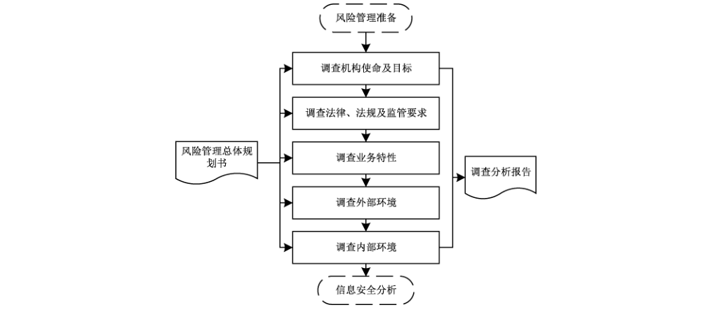

##### 9.2.2.4 信息安全要求分析

如图6所示，信息安全要求分析阶段的工作过程和内容如下。

a） 分析风险管理对象的安全环境。依据国家、地区或行业的相关法律、法规、政策和标准，考虑合作伙伴的合同要求，对风险管理对象的安全保障环境进行分析，明确环境因素对风险管理对象安全方面的影响和要求。

b）分析风险管理对象的安全要求。依据风险管理对象的描述报告和分析报告，结合上述安全环境的分析结果，分析和提出对风险管理对象的安全要求，包括保护范围、保护等级以及与相关法律法规或行业标准的符合性要求等。

c） 确定信息安全风险管理的基本准则。基于第5章的内容，选择或设置适合当前风险管理对象的风险管理原则，与风险管理实施框架相一致，并基于风险管理对象的安全环境和安全要求进行针对性设计。具体如下：

1）风险评价准则。在考虑国家信息安全监管要求及行业背景和特点的基础上，建立风险评价准则，以实现对风险的控制与管理。

2） 风险可接受准则。根据被评估对象风险评估结果，依据国家相关信息安全要求，组织收集相关方的信息安全诉求，明确风险处置对象应达到的最低保护要求，结合组织的风险可承受程度，确定风险可接受准则。风险可接受准则的划分如下：

- 风险等级为很高或高的风险建议进行处置，对于现有处置措施技术不成熟的，建议加强监视；
- 风险等级为中的风险可根据成本效益分析结果确定，对于处置成本无法承受或现有处置措施技术不成熟的，可持续跟踪、逐步解决；
- 风险等级为低或很低的风险可选择接受，但应综合考虑组织所处的政策环境、外部相关方要求和组织的安全目标等因素。

d） 汇总上述分析结果，形成风险管理对象的安全要求分析报告，其中包含风险管理对象的安全环境、安全要求和风险管理基本准则等方面的内容。

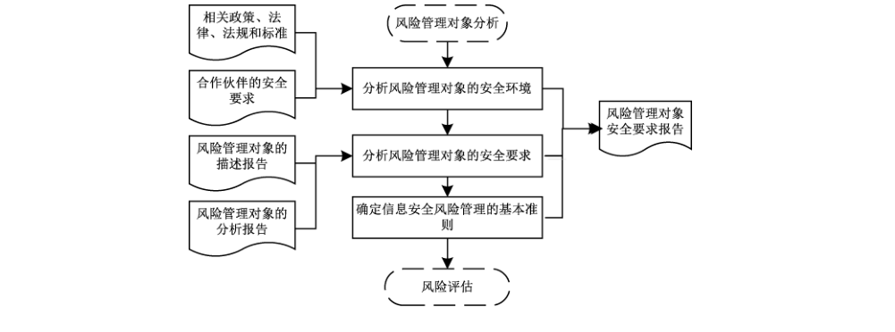

### 9.3 风险评估

#### 9.3.1 风险评估概述

##### 9.3.1.1 风险评估的概念

风险评估是信息安全风险管理的第二步，针对确立的风险管理对象所面临的风险进行识别、分析和评价。

本章仅对风险评估作框架性说明，详细内容见 GB/T 20984—2022 和 GB/T 31509。

##### 9.3.1.2 风险评估的目的

信息安全风险管理要依靠风险评估的结果来确定随后的风险处置和批准留存活动。风险评估使得组织能准确定位风险管理的策略、实践和工具，能将安全活动的重点放在重要的问题上，能选择成本效益合理的和适用的安全对策。

##### 9.3.1.3 风险评估的作用范围

风险评估只是为信息安全活动提供一个方向，并不会导致重大的信息安全改进。不管评估方法有多详细和多专业，也只能描述风险状态，而不会改进组织的安全状态。组织只有利用评估结果持续地进行改进活动，实现风险有效管理，才能使组织的安全状态得到改善。

#### 9.3.2 风险评估过程

##### 9.3.2.1 风险评估过程概述

风险评估的过程包括风险评估准备、风险要素识别、风险分析和风险评价4个阶段，各阶段输出文档见 A.2。在信息安全风险管理过程中，接受语境建立的输出，为风险处置提供输入，监视与评审和沟通与咨询贯穿其4个阶段，见图7。

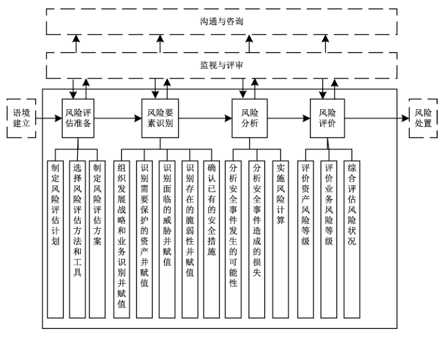

##### 9.3.2.2 风险评估准备

如图8所示，风险评估准备阶段的工作过程和内容如下。

a） 制定风险评估计划。依据语境建立输出的文档，制定风险评估的实施计划，包括风险评估的目的、意义、范围、目标、组织结构、经费预算和进度安排等，形成风险评估计划书。风险评估计划书需要得到风险管理对象和信息安全风险管理决策层的认可和批准。

b）选择风险评估方法和工具。具体依据 GB/T 20984—2022附录C执行。

c） 制定风险评估方案。依据语境建立输出的文档，整合风险评估计划书、风险评估方法和工具列表，确定风险评估的实施方案，包括风险评估的工作过程、输入数据和输出结果等，形成风险评估方案。风险评估方案需要得到风险管理对象和信息安全风险管理管理层的认可和批准。

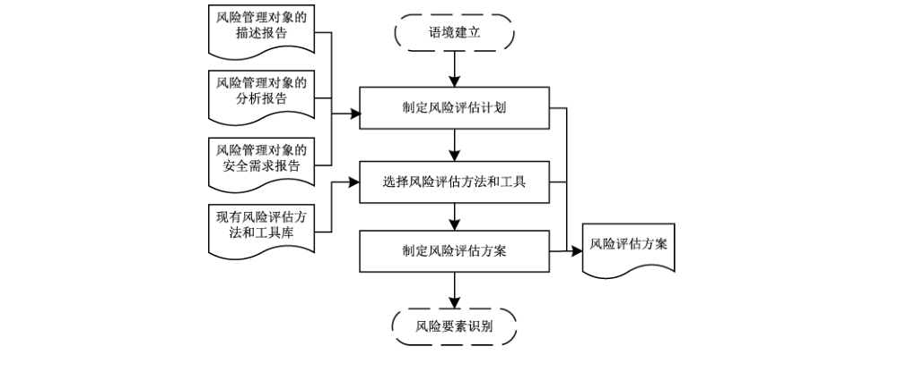

##### 9.3.2.3 风险要素识别

如图9所示，风险识别要素阶段的工作过程和内容如下。

a） 识别业务重要性并赋值。依据 GB/T 20984—2022 中 5.2.1.2和 GB/T 31509执行。

b） 识别需要保护的资产并赋值。依据 GB/T 20984—2022中 5.2.1 和 GB/T 31509执行。

c） 识别面临的威胁并赋值。依据 GB/T 20984—2022 中 5.2.2 和 GB/T 31509执行。

d） 识别存在的脆弱性并赋值。依据 GB/T 20984—2022 中 5.2.4和GB/T 31509执行。

e） 确认已有的安全措施。依据 GB/T 20984—2022中 5.2.3 和 GB/T 31509执行。

风险要素的识别方式包括文档审查、人员访谈、现场考察、辅助工具等多种形式，可以根据实际情况灵活采用和结合使用。

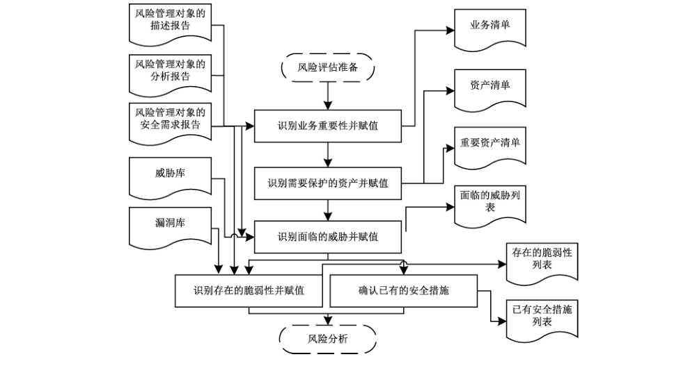

##### 9.3.2.4 风险分析

如图10所示，风险分析阶段的工作过程和内容如下。

a） 分析安全事件发生的可能性。依据面临的威胁列表和存在的脆弱性列表，根据威胁属性（威胁发生频率、威胁能力程度等）及脆弱性属性（脆弱性被利用程度等），计算威胁利用脆弱性导致安全事件发生的可能性。

b）分析安全事件造成的损失。依据存在的脆弱性列表和需要保护的资产列表，根据业务属性（业务重要性程度等）、资产属性（资产重要性程度等）及脆弱性属性（脆弱性影响程度等），计算安全事件一旦发生后造成的损失。

c） 实施风险计算。依据GB/T 20984—2022附录F执行。

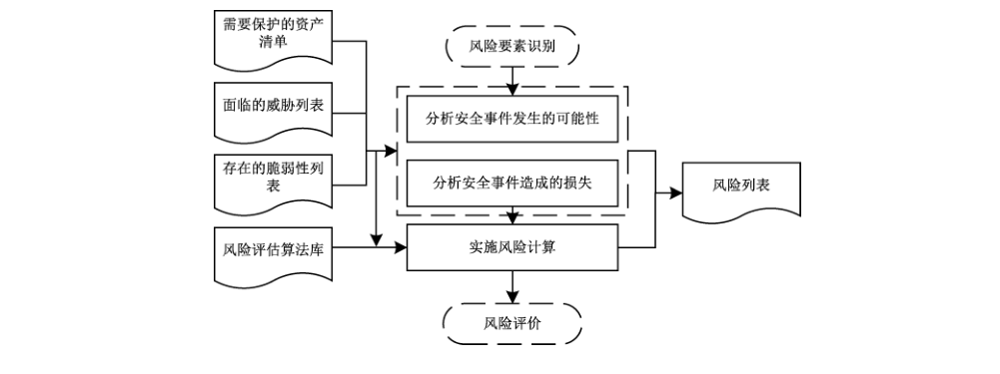

##### 9.3.2.5 风险评价

如图11所示，风险评价阶段的工作过程和内容如下。

a） 评价资产风险的等级。依据GB/T 20984—2022中 5.4.1 和 GB/T 31509执行。

b） 评价业务风险的等级。依据GB/T 20984—2022中 5.4.2 和 GB/T 31509执行。

c） 综合评价风险状况。汇总各项输出文档和风险程度等级列表，综合评价风险状况，形成风险评估报告。

d） 形成风险评估记录。汇总风险评估过程中的各种现场记录和问题，后期可复现评估过程，以作为产生歧义后解决问题的依据。

评价等级级数可以根据评价对象的特性和实际评估的需要而定，如〈高、中、低〉3级，〈很高、较高、中等、较低、很低〉5级等。

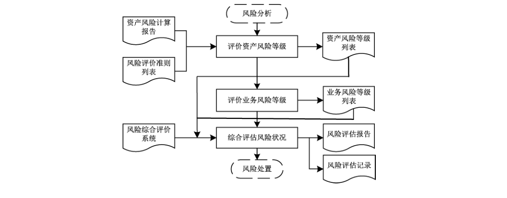

### 9.4 风险处置

#### 9.4.1 风险处置概述

##### 9.4.1.1 风险处置的概念

风险处置是信息安全风险管理的第三步，依据风险评估的结果，选择并执行合适的安全措施来更改风险的过程。

##### 9.4.1.2 风险处置的目的

风险处置的目的是依据风险评估的结果，针对不同类型、不同规模、不同概率的风险，采取相应的对策、措施或方法，使风险损失对组织、业务或风险管理对象的影响降到最小限度。

##### 9.4.1.3 风险处置的方式

风险处置方式主要包括风险规避、风险转移、风险消减和风险接受4种方式。

a） 风险规避：可能的情况下停止有风险的活动，消除风险源头或通过不使用存在风险的资产避免风险的发生。

b）风险转移：通过将面临风险的资产或其价值转移到更安全的地方，或者转移给能有效管理特定风险的另一方，来改变风险发生的可能或风险发生的后果，也可采用购买保险、分包合作的方式分担风险。

c） 风险消减：通过对面临风险的资产采取保护措施来降低风险，使残余风险再被评估时能达到可接受的级别。可以从构成风险的5个方面（即威胁源、威胁行为、脆弱性、资产和影响）采取保护措施来降低风险。

d） 风险接受：在明显满足组织发展战略和业务安全发展的条件下，有意识地、客观地选择对风险不采取进一步的处置措施，接受风险可能带来的结果。

##### 9.4.1.4 风险处置的角色和职责

信息安全风险处置需要组建团队，分清角色，明确职责。风险处置团队可分为管理层和执行层。其中，管理层负责审查风险处置目标、批准风险处置方案并认可风险处置结果，执行层负责确定风险处置目标、编制风险处置方案并在风险处置方案获得批准后负责实施。必要时，可聘请相关专业的专家组成专家小组，指导风险处置工作。

#### 9.4.2 风险处置过程

##### 9.4.2.1 风险处置过程概述

风险处置的过程包括风险处置准备、风险处置实施、风险处置效果评价3个阶段，各阶段输出文档见A.3。

第一个阶段风险处置准备，可包括组建风险处置团队、确定风险处置范围目标、明确风险可接受准则、选择风险处置方式、明确风险处置资源和制定风险处置计划并得到管理层批准等活动；第二个阶段风险处置实施，可包括准备风险处置备选措施、成本效益和残余风险分析、处置措施风险分析及制定应急计划、确定风险处置方式和措施、编制风险处置方案、风险处置措施测试、实施风险处置措施和编制风险处置报告等活动；第三个阶段风险处置效果评价，可包括制定评价原则和方案、开展评价实施工作、残余风险接受声明和编制持续改进方案等活动。

风险处置工作是持续性的活动，当风险处置对象的政策环境、业务目标、安全目标和特性发生变化时，需要再次进入上述步骤。风险处置在信息安全风险管理过程中，接受风险评估的输出，为批准留存提供输入，监视与评审和沟通与咨询贯穿其各个阶段，见图12。

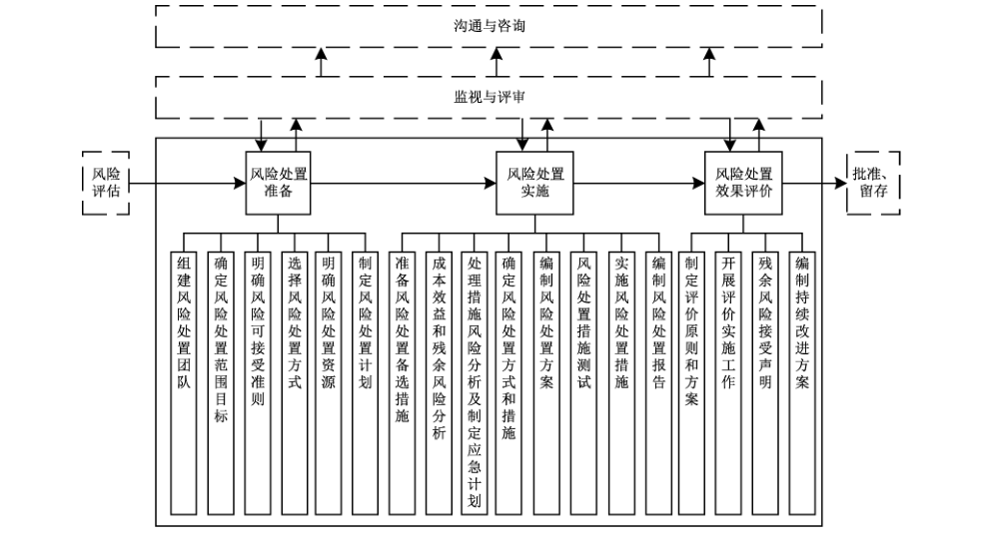

##### 9.4.2.2 风险处置准备

如图13所示，风险处置准备的工作过程和内容如下。

a） 组建风险处置团队。信息安全风险处置是基于风险的信息系统的一种安全管理过程，因此风险处置团队既包括信息安全风险管理的直接参与人员，也包括其他相关人员。信息安全风险处置主要划分为管理层和执行层，管理层负责信息安全风险处置的决策、总体规划和批准监督，各过程中的管理、组织和协调工作；执行层负责信息安全风险处置的具体规划、设计和实施、过程监督、记录并反馈实施效果。如果采用的风险转移方式中涉及第三方单位，将其纳入风险处置团队。

b） 确定风险处置范围目标。依据风险评估报告，确定可处置的风险范围和目标，即把风险评估得出的风险等级划分为可接受和不可接受两种，形成风险接受等级划分表。例如分成治理层的组织战略风险、管理层的业务过程风险、执行层的系统风险。

c） 选择风险处置方式。根据风险可接受准则，明确需要处置的风险和可接受的残余风险，对于需要处置的风险，初步确定每种风险拟采取的处置方式，形成风险处置列表。风险处置方式见9.4.1.3所述。

d） 明确风险处置资源。根据既定的风险处置目标，明确风险处置涉及的部门、人员和资产以及需要增加的设备、软件、工具等所需资源。

e） 制定风险处置计划。处置计划应包含（但不限于）：风险处置范围、依据、目标、方式、所需资源等。风险处置计划需得到组织最高管理者的批准。

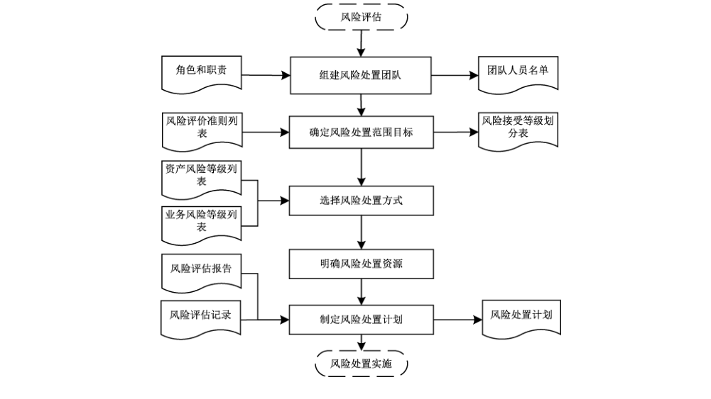

##### 9.4.2.3 风险处置实施

如图 14所示，风险处置实施阶段的工作过程和内容如下。

a） 准备风险处置措施。依据组织的使命，并遵循国家、地区或行业的相关法律、法规、政策和标准的规定，依据风险评估报告，按照风险处置计划，选择对应的风险处置措施，编制风险处置措施列表。

b）成本效益和残余风险分析。针对风险处置目标，结合组织实际情况，依据最佳收益原则选择适当的处置方案。依据组织的风险评估准则对可接受的、不予处置的残余风险进行分析。对于成本效益分析可以采用定量分析和定性分析两种方法。对于定量分析首先需要确定各资产价值，为各个风险输入资产价值，确定资产面临的损坏程度，之后估计发生的可能性，进而以损失价值与发生概率相乘计算出预期损失。由于评估无形资产的主观性本质，没有量化风险的精确算法，宜根据组织情况明确成本和效益的一到两个关键值，并设立期望值，进而选择可行方案（案例见附录 B）。

c） 处置措施风险分析及制定应急计划。对每项处置措施实施可能带来的风险进行分析，确认是否会因为处置措施不当或其他原因引入新的风险。制定应急计划，对仍会残留的风险和可能继发的风险，以及主动接受的风险和不可预见的风险进行技术和人员储备。

d） 确定风险处置方式和措施。在完成成本效益分析和残余风险分析后，对每项风险选定一种或者几种处置措施，完成最终的风险处置措施列表。

e） 编制风险处置方案。依据组织的使命和相关规定，结合风险处置依据和目标、范围和方式、处置措施、成本效益分析、残余风险分析以及风险处置团队分工，编制风险处置方案。

f） 风险处置措施测试。风险处置措施测试是在风险处置措施正式实施前，验证风险处置措施是否符合风险处置目标，判断措施的实施是否会引入新的风险，同时检验应急计划是否有效。

g） 实施风险处置措施。在完成风险处置措施的测试工作后，按照风险处置方案实施具体的风险处置措施。在实施过程中，实施风险处置的操作人员应对具体的操作内容进行记录、验证实施效果，并签字确认，形成风险处置实施的记录（记录格式见附录 B），以便后期回溯和责任认定。

h）编制风险处置报告。记录风险处置措施的实施过程和结果，形成风险处置实施报告，在整个组织内部传达风险管理的活动和成果，为决策提供信息，改进风险管理活动，协助与利益相关方的互动，包括对风险管理活动负有责任的相关方、用户和主管部门。

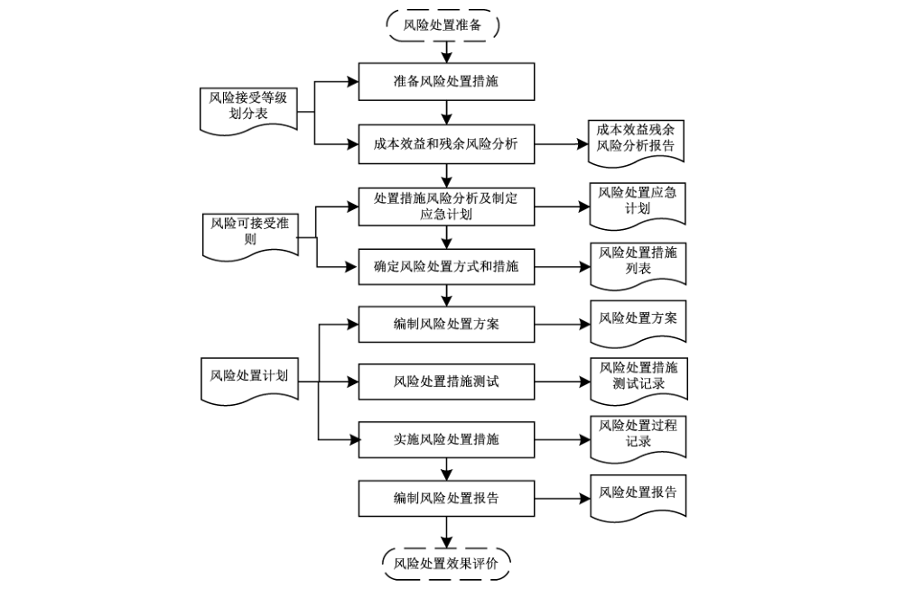

##### 9.4.2.4 风险处置效果评价

如图15所示，风险处置效果评价阶段的工作过程和内容如下。

a） 制定评价原则和方案。评价原则可包括风险处置目标实现原则、安全投入合理准则以及其他效果评价准则。评价方案包括评价方法、评价目标、评价内容、团队组成和总体工作计划。为有效实施风险处置效果评价，宜根据风险处置前期的风险评估和风险处置成果，确定评价对象、评价目标、评价方法与评价准则、评价项目负责人及团队组成，做好评价工作总体计划，并编制评价方案。评价方案应通过专家评审，并获得组织管理层和风险处置实施团队相关利益方的认可。其中，评价方法根据风险处置结果不同可以分为残余风险评价方法和效益评价方法，根据评价对象不同可以分为控制措施有效性评价方法和整体风险控制有效性评价方法：

1） 残余风险评价方法：遵照 GB/T 20984—2022中提供的流程和方法，评价实施风险处置后的残余风险。

2） 效益评价方法：通过分析安全措施产生的直接和间接的经济社会效益与安全投入之间的成本效益比、所实施的安全措施的成本效益比与可替代安全措施的成本效益比的比值等对所采取的安全措施的效益进行评价。

3） 控制措施有效性评价方法：针对每个所选择的控制措施采用残余风险评价方法和效益评价方法。

4） 整体风险控制有效性评价方法：基于业务的风险控制评价，结合风险评估报告中相关信息，综合评价实施风险处置措施后，残余安全风险可接受程度以及安全投入的合理性。

b） 开展评价实施工作。组建风险处置效果评价实施团队，团队成员包括风险处置实施负责人员、评价人员、监督人员等。处置实施负责人员配合评价人员开展评价工作，如组织和协调工作；评价人员依据评价方案对风险处置实施结果进行评价并编制评价效果报告，将评价结果与相关方进行沟通；监督人员监视评价过程，确保评价过程客观公正。

c） 残余风险是否可接受。对于可接受的残余风险，要形成残余风险接受声明，并经风险管理决策层和管理层的认可批准；对于不可接受的残余风险，需继续进行风险处置，直至可接受。对于处置后仍不符合风险接受准则的残余风险，组织宜根据风险处置的成本收益等因素，经风险管理决策层和管理层的认可批准后，调整风险接受准则，或给出接受该残余风险的理由。

d） 编制持续改进方案。根据风险处置效果评价报告，针对需要持续改进的风险编制改进方案，为风险管理的批准留存提供重要依据。

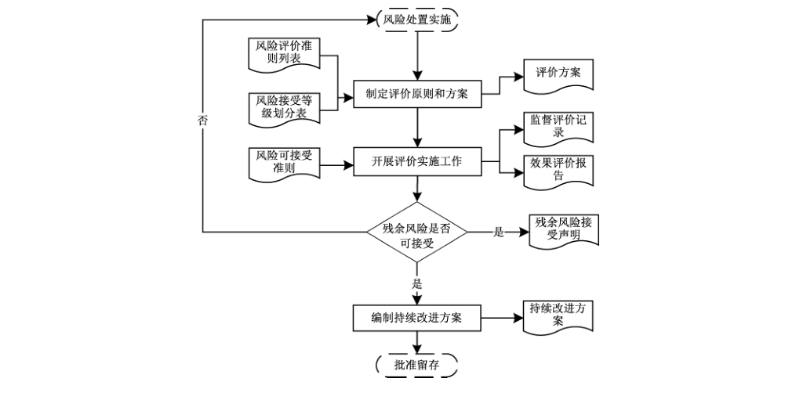

### 9.5 批准留存

#### 9.5.1 批准留存概述

##### 9.5.1.1 批准留存的概念

批准留存是信息安全风险管理的第四步，批准是指组织的决策层依据风险评估和风险处置的结果是否满足组织的方针目标和信息安全要求，做出是否认可风险管理活动的决定；留存是指将风险管理所产生的信息形成文档保存。

批准应由组织内部或更高层的主管组织的决策层来执行。文档留存由风险管理各个环节的执行人员形成文档，并保持文档的完整及对适当的人员可用。

##### 9.5.1.2 批准留存的原则和依据

风险评估结果和风险处置结果的批准原则是：

a） 业务优先：组织的风险关注的是对组织业务可能造成的不良影响或带来机会的风险；

b） 风险可控：合理利用风险和控制风险，使其为组织的发展带来良性支持；

c） 成本适宜：做到成本效益符合组织相关方的利益诉求；

d） 措施有效：采取的风险控制措施力求实效。

风险评估结果和风险处置结果的批准依据是：

a） 风险评价准则；

b） 风险接受准则；

c） 信息安全方针与目标；

d） 支持风险处置的资源保障能力。

风险管理的文档留存原则是：

a） 保全证据：风险管理全过程的文档得到留存；

b） 统一规范：核心文档采用统一的模板格式；

c） 简明易读：文档描述清晰，语义易于理解；

d） 适度使用：控制文档在合适的范围内使用，特别是风险评估报告要严格控制使用范围。

#### 9.5.2 批准留存过程

##### 9.5.2.1 概述

批准留存过程包括批准申请、批准处置和文档留存3个阶段，各阶段输出文档见 A.4。在信息安全风险管理过程中，接受风险处置的输出后进入风险因素的监视，风险管理的监视与评审和沟通与咨询贯穿其3个阶段，见图16。

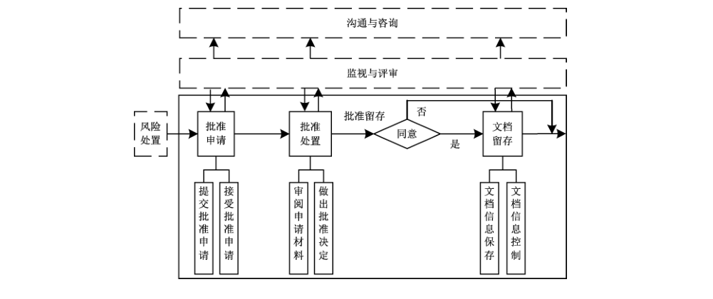

##### 9.5.2.2 批准申请

如图17所示，批准申请阶段的工作过程和内容如下。

a） 提交批准申请。申请者填写批准申请书后，连同批准材料一并提交给批准机构。批准材料内容包括风险管理过程中输出的文档、软件和硬件等结果。批准申请书内容包括批准的范围、对象和期望，以及申请者的基本信息和签字等。批准机构由在风险管理对象和信息安全风险管理的决策层中负责重大决定的主管者构成。

b）受理批准申请。批准机构接收批准申请书和审核结论报告并审查通过后，返回批准受理回执。批准受理回执内容包括同意受理、补充材料的要求和提交时间（如果需要），以及批准机构的名称和签章等。

##### 9.5.2.3 批准处理

如图18所示，批准处理阶段的工作过程和内容如下。

a） 审阅批准材料。批准机构依据机构的使命和风险管理对象的安全要求报告，按照批准的原则、规定和程序，对批准材料进行审阅，与相关人员进行讨论和沟通，为批准决定做准备。

b） 做出批准决定。批准机构按照批准的原则、规定和程序，判断风险管理对象的安全要求是否得到满足，机构的信息安全保障级别是否达到其使命所需要的等级，依此做出批准决定，形成批准决定书，交付申请者。批准决定书内容包括批准的范围、对象、意见、结论（即是否通过）和有效期，以及批准机构的名称和签章等。如果通过批准，则留存，并根据残余风险情况更新机构的应急计划，定期开展应急演练，具体依据 GB/T 24363—2009 和 GB/T 38645—2020 执行；否则，结束本次信息安全风险管理的循环，启动新一轮循环进行改进。

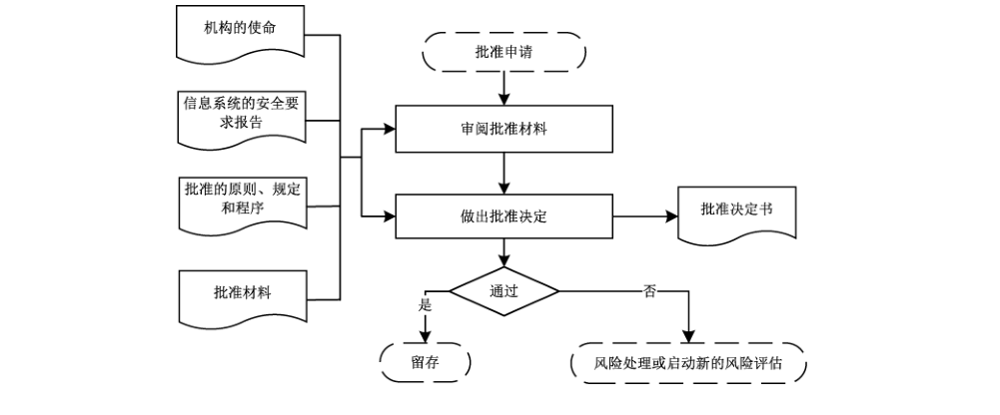

##### 9.5.2.4 文档留存

如图19所示，文档留存阶段的工作过程和内容如下。

a） 文档信息收集。如果风险评估结果和风险处置结果得到批准，文档管理员发起文档信息收集活动，各阶段的项目责任人员负责按照文档管理规范，将所有的文档信息整理后统一提交给文档管理员。提交的文档信息至少包括各阶段的工作成果，如风险管理程序、语境建立沟通记录、语境分析报告、风险评估报告、风险处置计划、风险控制有效性评价记录，批准信息等。

b） 文档信息控制。所收集的文档信息应妥善保存，确保信息可用，并得到适度控制，具体包括：

1） 文档质量评审：收集文档后，至少从文档内容的完整性、文档格式规范性等方面进行质量评审；

2） 归档：对通过文档评审的文档进行统一归档，归档按照组织的文档控制过程执行；

3） 保存：根据文档的类型采取必要措施进行保存，对电子版的文档信息必要时采取加密措施进行保存，确保文档信息的机密性和完整性，采取适当的备份措施，确保文档的可用性；

4） 文档使用控制：原则上文档信息在原有工作范围内使用，扩大使用范围应得到批准，特别是风险评估报告和风险处置计划应严格控制使用范围；

5） 文档作废处理：当文档作废后，应根据文档的不同级别采取适当的处理措施，包括销毁、发布作废公告等。

### 9.6 监视与评审

#### 9.6.1 监视与评审概述

##### 9.6.1.1 监视与评审的概念

监视与评审包括对风险因素和信息安全风险管理循环的4个主体步骤（即语境建立、风险评估、风险处置和批准留存）的监视和评审。监视是定期或不定期对风险管理过程的运行情况进行查看，了解风险管理过程的执行情况。评审是对监视的结果进行分析和评价，从而确定风险管理过程的有效性（有效性包括执行情况和执行效果），最后得出评价结果文件，以持续改进风险管理工作。

##### 9.6.1.2 监视与评审的内容

风险因素的监视和评审包括语境建立过程中关注的内外部环境以及风险评估过程中识别信息的变化，包括但不限于以下方面和内容：

a） 风险管理范围的变化，包括新的资产、新的部门等；

b） 评估对象价值的变化，比如业务的变动带来的价值变化；

c） 新的或变化的威胁，或之前未评价的威胁信息；

d） 新发现的或者是变化的脆弱点；

e） 残余风险的变化，比如风险接受原则变化带来的残余风险处置的变化；

f） 网络安全预警的变化，比如评估对象价值和威胁的变化带来预警级别和流程的变化；

g） 风险发生带来的后果的变化；

h）新发布的相关法律、法规、行业监管要求和标准；

i） 相关组织架构的变化；

j） 管理层的变化；

k）相关方要求的变化。

风险管理的监视和评审包括以下方面和内容：

a） 风险管理过程的执行情况；

b） 风险因素识别的全面性和合理性；

c） 风险管理目标的实现情况；

d） 风险处置计划的实施情况；

e） 风险控制措施的运行有效性；

f） 风险控制成本效益的合理性；

g） 风险评估原则和风险接受原则的合理性；

h） 当前风险评估方法的有效性和产生结果的一致性，以及新的风险评估方法的适用性。

#### 9.6.2 监视与评审过程

##### 9.6.2.1 监视与评审过程概述

风险因素的监视与评审过程贯穿于信息安全风险管理的整个过程中，通过监视和评审获得风险因素变化的结果，从而启动新的风险管理活动。如图20所示，监视与评审记录内容包括风险因素的变化描述和分析评价结果，包括是否启动新的风险管理活动，输出文档见 A.5。

风险管理的监视与评审过程贯穿于信息安全风险管理的语境建立、风险评估、风险处置和批准留存这4个基本步骤，并分别输出相应的监视与评审记录，见图21。监视与评审记录内容包括监视和评审的范围、对象、时间、过程、结果和措施等。

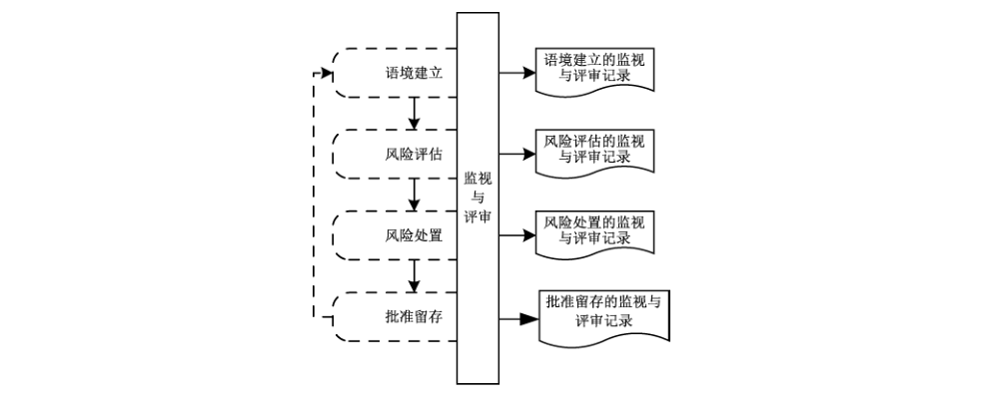

##### 9.6.2.2 语境建立过程的监视与评审

表3汇总了语境建立过程中各阶段的监视与评审内容。

**表3 语境建立过程的监视与评审**

| 阶段 | 监视与评审内容 |
| --- | --- |
| 风险管理准备 | 风险管理总体规划书制定的过程及其相关文档 |
| 风险管理对象调查与分析 | 风险管理对象调查与分析的过程及其相关文档 |
| 信息安全要求分析 | 信息安全要求分析的过程及其相关文档 |

##### 9.6.2.3 风险评估过程的监视与评审

表4汇总了风险评估过程中各阶段的监视与评审内容。

**表4 风险评估过程的监视与评审**

| 阶段 | 监视与评审内容 |
| --- | --- |
| 风险评估准备 | 风险评估的计划制定、方案确定以及方法和工具选择的过程及其相关文档 |
| 风险要素识别 | 业务、资产、威胁、脆弱性和已有安全措施识别的过程及其相关文档 |
| 风险分析 | 安全事件发生可能性分析、安全事件造成的损失分析和风险计算的过程及其相关文档 |
| 风险评价 | 资产风险等级评价、业务风险等级评价、风险状况综合评价以及风险评估报告生成的过程及其文档 |

##### 9.6.2.4 风险处置过程的监视与评审

表5汇总了风险处置过程中各阶段的监视与评审内容。

**表5 风险处置过程的监视与评审**

| 阶段 | 监视与评审内容 |
| --- | --- |
| 风险处置准备 | 风险处置范围目标确定、风险可接受准则确定、风险处置方式选择、风险处置资源确定和风险处置计划制定的过程及其相关文档 |
| 风险处置实施 | 风险处置措施准备、成本效益和残余风险分析、处理措施风险分析及应急计划制订、风险处置方式和措施确定、风险处置方案编制、风险处置措施测试、风险处置措施实施和风险处置报告编制的过程及其相关文档 |
| 风险处置效果评价 | 评价原则和方案制定、开展评价实施工作、残余风险接受声明和持续改进方案编制的过程及其相关文档 |

##### 9.6.2.5 批准留存过程的监视与评审

表6汇总了批准留存过程中各阶段的监视与评审内容。

**表6 批准留存过程的监视与评审**

| 阶段 | 监视与评审内容 |
| --- | --- |
| 批准申请 | 批准申请和受理的过程及其相关文档 |
| 批准处理 | 审阅批准材料和批准决定做出的过程及其相关文档 |
| 文档留存 | 收集的文档及文档管理的相关文档 |

##### 9.6.2.6 评价结果文件

风险评价结果文件是风险管理过程结束后的输出文档，是根据监视与评审记录对风险管理工作的总结，使组织的风险管理能力得到提高，主要内容包括：

a） 总结风险管理工作的不足，确定不符合组织要求的风险管理工作，制定必要的更改和改进措施，以降低风险、提高效率、降低长期成本等；

b） 分析相关措施的有效性，纠正风险管理中的错误，优化风险管理工作流程，提升风险管理能力，以满足风险管理及利益相关方的预期；

c） 实施改进措施时形成有关记录和有关证据。

### 9.7 沟通与咨询

#### 9.7.1 沟通与咨询概述

##### 9.7.1.1 沟通与咨询的概念

沟通与咨询为信息安全风险管理主循环的4个步骤（即语境建立、风险评估、风险处置和批准留存）中相关方提供沟通和咨询。沟通与咨询是通过相关方之间交换和/或共享关于风险的信息，就如何管理风险达成一致的活动。沟通是为所有参与人员提供交流途径，以保持参与人员之间的协调一致，共同实现安全目标。咨询是相关方需要时为其提供学习途径，以增强风险意识、知识和技能，配合实现安全目标。

##### 9.7.1.2 沟通与咨询的意义

相关方对风险的认识可能会有所不同，很可能根据各自对风险的感知来判断风险的可接受性。

保证信息安全风险管理活动顺利和有效地进行，相关方行动的协调和一致以及相关知识和技能的熟练掌握是十分关键的因素。通过畅通的交流和充分的沟通，保持行动的协调和一致；通过有效的培训和方便的咨询，保证行动者具有足够的知识和技能。

##### 9.7.1.3 沟通与咨询的目标

沟通与咨询包括以下方面和目标：

a） 确保组织风险管理的结果；

b） 收集风险信息；

c） 分享风险评估结果并提出处理计划；

d） 避免或减少因相关方之间缺乏相互了解而导致的信息安全漏洞发生和后果；

e） 支持决策制定；

f） 获取新的信息安全知识；

g） 与其他各方协调并计划应对措施，以减少任何事件的后果；

h） 让相关方对风险有责任感；

i） 提高认识。

##### 9.7.1.4 沟通与咨询的方式

沟通与咨询的双方角色不同，所采取的方式有所不同。有关信息安全风险管理相关人员的角色和责任的划分参见表2。表7给出了不同层面人员之间沟通与咨询的方式。

**表7 沟通与咨询的方式**

| 发出方 / 接受方 | 决策层 | 管理层 | 执行层 | 支持层 | 用户层 |
| --- | --- | --- | --- | --- | --- |
| 决策层 | 交流 | 指导和检查 | 指导和检查 | 表态 | 表态 |
| 管理层 | 汇报 | 交流 | 指导和检查 | 宣传和介绍 | 宣传和介绍 |
| 执行层 | 汇报 | 汇报 | 交流 | 宣传和介绍 | 培训和咨询 |
| 支持层 | 培训和咨询 | 培训和咨询 | 培训和咨询 | 交流 | 培训和咨询 |
| 用户层 | 反馈 | 反馈 | 反馈 | 反馈 | 交流 |

沟通与咨询的各种方式说明如下：

a） 指导和检查：机构上级对下级工作的指导和检查，用以保证工作质量和效率，适用决策层对管理层、决策层对执行层和管理层对执行层；

b） 表态：机构高层支持信息安全风险管理的对外表态，用以得到外界认同和支持，适用于决策层对支持层和决策层对用户层；

c） 汇报：机构下级对上级做工作汇报，用以得到上级认可，适用于管理层对决策层、执行层对决策层和执行层对管理层；

d） 宣传和介绍：机构的风险管理对象和信息安全风险管理的对外宣传和介绍，用以得到外界支持和配合，适用于管理层对支持层、管理层对用户层和执行层对支持层；

e）培训和咨询：专业人员对信息安全风险管理相关方的培训和咨询，用以提高人员的安全意识、知识和技能，适用于执行层对用户层、支持层对决策层、支持层对管理层和支持层对执行层；

f） 反馈：机构风险管理对象使用者对机构信息安全风险管理的意见反馈，用以了解实施效果和用户需求，适用于用户层对决策层、用户层对管理层、用户层对执行层和用户层对支持层；

g） 交流：同级或同行之间的对等交流，用以共享信息和协调工作，适用于决策层对决策层、管理层对管理层、执行层对执行层、支持层对支持层和用户层对用户层。

#### 9.7.2 沟通与咨询过程

##### 9.7.2.1 沟通与咨询过程概述

沟通与咨询的过程贯穿于信息安全风险管理的语境建立、风险评估、风险处置和批准留存这4个基本步骤，并分别输出相应的沟通与咨询记录，如图22所示。沟通与咨询记录内容包括沟通和咨询的范围、对象、时间、内容和结果等，具体见 A.6。

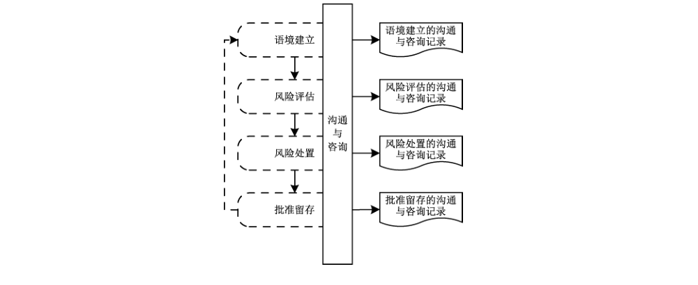

##### 9.7.2.2 语境建立过程的沟通与咨询

###### 9.7.2.2.1 面向参与人员的沟通

表8汇总了语境建立过程中各阶段的沟通参与人员和涉及内容。

**表8 语境建立过程的沟通**

| 阶段 | 风险管理对象参与人员 | 信息安全风险管理参与人员 | 涉及内容 |
| --- | --- | --- | --- |
| 风险管理准备 | 决策层 | 决策层、管理层 | 确定风险管理范围和边界、信息安全风险管理的目标、信息安全风险管理的基本准则、风险管理总体规划并获得批准的过程及其相关文档 |
| 调查与分析 | 管理层、执行层 | 管理层、执行层、支持层 | 调查机构使命及目标、调查法律法规及监管要求等、调查业务特性、调查外部环境、形成调查分析报告的过程及其相关文档 |
| 信息安全分析 | 管理层、执行层 | 管理层、执行层、支持层 | 分析风险管理对象的安全环境、分析风险管理对象的安全要求、形成风险管理对象的安全要求分析报告的过程及其相关文档 |

###### 9.7.2.2.2 面向相关方的咨询

在语境建立的整个过程中，为所有相关方提供有关语境建立的咨询和培训等。

##### 9.7.2.3 风险评估过程的沟通与咨询

###### 9.7.2.3.1 面向参与人员的沟通

表9汇总了风险评估过程中各阶段的沟通参与人员和涉及内容。

**表9 风险评估过程的沟通**

| 阶段 | 风险管理对象参与人员 | 信息安全风险管理参与人员 | 涉及内容 |
| --- | --- | --- | --- |
| 风险评估准备 | 决策层 | 决策层、管理层 | 风险评估的计划制定、方案确定以及方法和工具选择的过程及其相关文档 |
| 风险要素识别 | 管理层、执行层 | 执行层、支持层 | 业务、资产、威胁、脆弱性和已有安全措施识别的过程及其相关文档 |
| 风险分析 | 管理层、执行层 | 执行层、支持层 | 安全事件发生可能性分析、安全事件造成的损失分析和风险计算的过程及其相关文档 |
| 风险评价 | 管理层、执行层 | 管理层、执行层、支持层 | 风险评价准则、资产风险等级、业务风险等级、风险评估报告的形成过程及其相关文档 |

###### 9.7.2.3.2 面向相关方的咨询

在风险评估的整个过程中，为所有相关方提供有关风险评估的咨询和培训等。

##### 9.7.2.4 风险处置过程的沟通与咨询

###### 9.7.2.4.1 面向参与人员的沟通

表10汇总了风险处置过程中各阶段的沟通参与人员和涉及内容。

**表10 风险处置过程的沟通**

| 阶段 | 风险管理对象参与人员 | 信息安全风险管理参与人员 | 涉及内容 |
| --- | --- | --- | --- |
| 风险处置准备 | 决策层、管理层 | 决策层、管理层、执行层、支持层 | 风险处置范围目标、风险可接受准则、风险处置方式、风险处置资源、风险处置计划的形成过程及其相关文档 |
| 风险处置实施 | 管理层、执行层 | 管理层、执行层、支持层 | 准备风险处置措施、成本效益和残余风险分析、处理措施风险分析及制定应急计划、确定风险处置方式和措施、编制风险处置方案、风险处置措施测试、实施风险处置措施、编制风险处置报告的过程及其相关文档 |
| 风险处置效果评价 | 管理层、执行层 | 管理层、执行层、支持层 | 制定评价原则和方案、开展评价实施工作、残余风险接受声明、编制持续改进方案的过程及其相关文档 |

###### 9.7.2.4.2 面向相关方的咨询

在风险处置的整个过程中，为所有相关方提供有关风险处置的咨询和培训等。

##### 9.7.2.5 批准留存过程的沟通与咨询

###### 9.7.2.5.1 面向参与人员的沟通

表11汇总了批准留存过程中各阶段的沟通参与人员和涉及内容。

**表11 批准留存过程的沟通**

| 阶段 | 风险管理对象参与人员 | 信息安全风险管理参与人员 | 涉及内容 |
| --- | --- | --- | --- |
| 批准申请 | 管理层 | 决策层、管理层、执行层 | 提交批准申请、受理批准申请的过程及其相关文档 |
| 批准处理 | 决策层、管理层 | 决策层、管理层 | 审阅批准材料、做出批准决定的过程及其相关文档 |
| 文档留存 | 管理层、执行层 | 管理层、执行层 | 文档信息收集、文档信息控制的过程及其相关文档 |

###### 9.7.2.5.2 面向相关方的咨询

在批准留存的整个过程中，为所有相关方提供有关批准留存的咨询和培训等。

## 附录 A（资料性）文档输出

### A.1 语境建立文档

表 A.1 列出了语境建立过程的输出文档及其内容。输出文档的数量、名称和主要内容可以根据机构具体情况进行增加、删减或修改，但需要涵盖表 A.1 中文档内容部分规定的内容。

**表A.1 语境建立过程的输出文档及其内容**

| 阶段 | 输出文档 | 文档内容 |
| --- | --- | --- |
| 风险管理准备 | 风险管理总体规划书 | 风险管理的目标、意义、范围、基本准则、组织结构、经费预算和实施计划安排等 |
| 调查与分析 | 调查分析报告 | 风险管理对象的业务目标、业务特性、管理特性和技术特性等 |
| 信息安全要求分析 | 风险管理对象安全要求报告 | 风险管理对象的保护范围、保护等级等 |

### A.2 风险评估文档

表 A.2 列出了风险评估过程的输出文档及其内容。输出文档的数量、名称和主要内容可以根据机构具体情况进行增加、删减或修改，但需要涵盖表 A.2 中文档内容部分规定的内容。

**表A.2 风险评估过程的输出文档及其内容**

| 阶段 | 输出文档 | 文档内容 |
| --- | --- | --- |
| 风险评估准备 | 风险评估方案 | 整合风险评估计划、方法和工具，阐述风险评估目标、范围、人员、评估方法、评估结果的形式和实施进度等 |
| 风险识别 | 业务重要性清单 | 根据组织所确定的业务分类方法进行业务识别，形成业务清单和重要性赋值 |
| 风险识别 | 资产清单 | 根据组织所确定的资产分类方法进行资产识别，形成资产清单，明确资产的责任人和责任部门 |
| 风险识别 | 重要资产清单 | 根据资产识别和赋值的结果，形成重要资产列表，包括重要资产名称、描述、类型、重要程度、责任人、责任部门等 |
| 风险识别 | 威胁列表 | 根据威胁识别和赋值的结果，形成威胁列表，包括威胁来源、种类、威胁行为、能力和频率等 |
| 风险识别 | 脆弱性列表 | 根据脆弱性识别和赋值的结果，形成脆弱性列表，包括具体脆弱性的名称、描述、类型及严重程度等 |
| 风险识别 | 已有安全措施列表 | 对已采取的安全措施进行识别并形成已有安全措施列表，包括已有安全措施名称、类型、功能描述及实施效果等 |
| 风险分析 | 风险列表 | 根据威胁利用脆弱性导致安全事件的情况，形成风险列表，包括具体风险的名称、描述等 |
| 风险评价 | 风险评价准则 | 建立风险评价准则，包括风险结果等级化处理、风险比较、风险处置策略 |
| 风险评价 | 资产风险等级列表 | 根据资产面临的风险值和风险评价准则，对风险计算结果进行等级处理，形成资产的风险名称、等级 |
| 风险评价 | 业务风险等级列表 | 根据资产风险等级和风险评价准则，对风险计算结果进行等级处理，形成业务的风险名称、等级 |
| 风险评价 | 风险评估报告 | 对风险评估过程和结果进行总结，详细说明被评估对象、风险评估方法、业务、资产、威胁、脆弱性、已有安全措施的识别结果、风险分析、风险统计和结论等内容 |
| 风险评价 | 风险评估记录 | 风险评估过程中的各种现场记录作为附件，可复现评估过程，以作为产生歧义后解决问题的依据 |

### A.3 风险处置文档

表 A.3 列出了风险处置过程的输出文档及其内容。输出文档的数量、名称和主要内容可以根据机构具体情况进行增加、删减或修改，但需要涵盖表 A.3 中文档内容部分规定的内容。

**表A.3 风险处置过程的输出文档及其内容**

| 阶段 | 输出文档 | 文档内容 |
| --- | --- | --- |
| 风险处置准备 | 风险处置计划 | 包含风险处置范围、依据、目标、方式、所需资源等 |
| 风险处置准备 | 风险处置计划批准表 | 风险处置计划获得组织最高管理者的批准 |
| 风险处置准备 | 风险处置备选措施列表 | 依据每种风险的处理方式确定对应的风险处置措施 |
| 风险处置实施 | 风险处置成本效益分析报告 | 成本分析因素包括硬件、软件、人力、时间、维护和外包；效益分析因素包括政治影响、社会效益、合规性和经济效益 |
| 风险处置实施 | 风险处置残余风险分析报告 | 包括残余风险的可接受性，不可接受时的后续处理 |
| 风险处置实施 | 风险处置备选措施应急计划 | 包括处理措施面临的主要风险、主要应对措施、明确的负责人、完成时间和进行的状态 |
| 风险处置实施 | 风险处置措施选择列表 | 包括所有处理措施的成本、效益和残余风险 |
| 风险处置实施 | 风险处置方案 | 包括风险处置范围、对象、目标、组织结构、成本预算和进度安排，并对每项处理措施的实施方法、使用工具、潜在风险、回退方法、应急计划以及各项处理措施的监督和审查方法及人员进行明确说明 |
| 风险处置实施 | 风险处置措施测试报告 | 包括风险处置目标的符合性、新的风险引入可能性、应急恢复方案的有效性 |
| 风险处置实施 | 风险处置实施记录 | 包括具体操作内容的记录、实施效果验证 |
| 风险处置实施 | 风险处置实施报告 | 包括风险处置质量、进度、费用等，以及过程中的监视和评价 |
| 风险处置效果评价 | 风险处置效果评价方案 | 至少应包括评价对象、评价目标、评价依据、评价方法与评价准则、评价项目负责人及团队组成、评价工作的进度安排等 |
| 风险处置效果评价 | 风险处置效果评价报告 | 包括评价风险处置的效果，给出的改进建议等 |
| 风险处置效果评价 | 风险处置后续改进方案 | 包括需要改进时的后续改进方案 |

### A.4 批准留存文档

表 A.4 列出了批准留存过程的输出文档及其内容。输出文档的数量、名称和主要内容可以根据机构具体情况进行增加、删减或修改，但需要涵盖表 A.4 中文档内容部分规定的内容。

**表A.4 批准留存过程的输出文档及其内容**

| 阶段 | 输出文档 | 文档内容 |
| --- | --- | --- |
| 批准申请 | 批准申请书 | 批准的范围、对象和期望，以及申请者的基本信息和签字等 |
| 批准处理 | 批准决定书 | 批准的范围、对象、意见、结论（即是否通过）和有效期，以及批准机构的名称和签章等 |
| 留存 | 留存说明 | 留存的对象、内容等 |

### A.5 监视与评审文档

表 A.5 列出了监视与评审过程的输出文档及其内容。输出文档的数量、名称和主要内容可以根据机构具体情况进行增加、删减或修改，但需要涵盖表 A.5 中文档内容部分规定的内容。

**表A.5 监视与评审过程的输出文档及其内容**

| 过程 | 输出文档 | 文档内容 |
| --- | --- | --- |
| 语境建立 | 语境建立的监视与评审记录 | 语境建立过程中监视和审查的范围、对象、时间、过程、结果和措施等 |
| 风险评估 | 风险评估的监视与评审记录 | 风险评估过程中监视和审查的范围、对象、时间、过程、结果和措施等 |
| 风险处置 | 风险处置的监视与评审记录 | 风险处置过程中监视和审查的范围、对象、时间、过程、结果和措施等 |
| 批准留存 | 批准留存的监视与评审记录 | 批准留存过程中监视和审查的范围、对象、时间、过程、结果和措施等 |

### A.6 沟通与咨询文档

表 A.6 列出了沟通与咨询过程的输出文档及其内容。输出文档的数量、名称和主要内容可以根据机构具体情况进行增加、删减或修改，但需要涵盖表 A.6 中文档内容部分规定的内容。

**表A.6 沟通与咨询过程的输出文档及其内容**

| 过程 | 输出文档 | 文档内容 |
| --- | --- | --- |
| 语境建立 | 语境建立的沟通与咨询记录 | 语境建立过程中沟通与咨询的范围、对象、时间、内容和结果等 |
| 风险评估 | 风险评估的沟通与咨询记录 | 风险评估过程中沟通与咨询的范围、对象、时间、内容和结果等 |
| 风险处置 | 风险处置的沟通与咨询记录 | 风险处置过程中沟通与咨询的范围、对象、时间、内容和结果等 |
| 批准留存 | 批准留存的沟通与咨询记录 | 批准留存过程中沟通与咨询的范围、对象、时间、内容和结果等 |

## 附录 B（资料性）风险处置实践示例

### B.1 示例

A 公司是隶属于交通运输行业的大型国有企业。近年来，在公司高层领导的推进下，公司的信息化水平突飞猛进，信息资源的整合、共享和利用水平有效提升。公司所有核心业务均实现了网上流转，信息系统的基础性、全局性、全员性作用日益增强。

×××信息系统承载着该公司的×××业务，其安全状况直接影响到该公司业务能否正常运行，因此公司聘请了第三方专业的信息安全评估机构，对×××信息系统开展了信息安全风险评估工作。

×××信息系统运行在公司内网，与互联网物理隔离，系统基本部署情况如图 B.1 所示。由于业务连续性程度要求较高，关键网络设备、网络链路、核心服务器均采用了热备的方式。

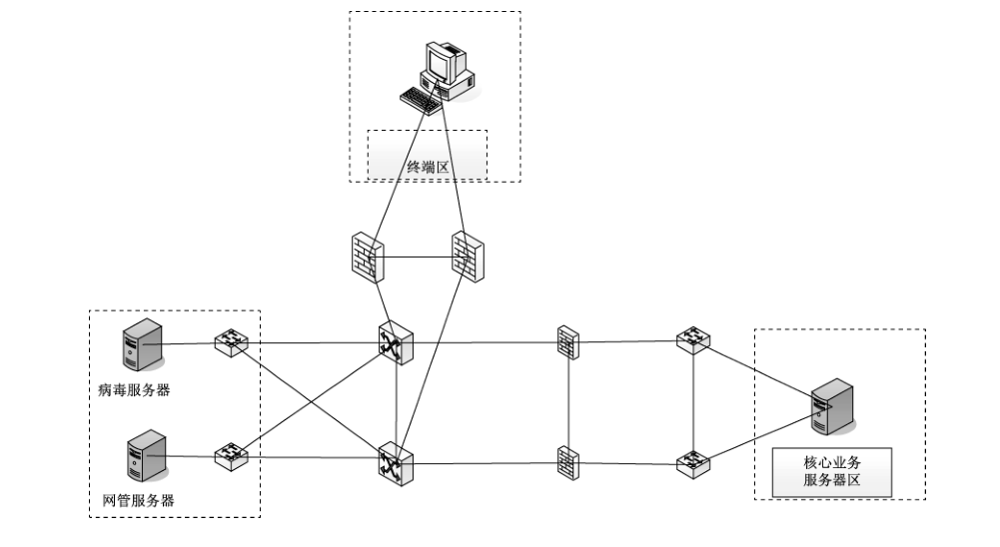

通过对×××系统的风险评估，在管理安全、物理环境安全、网络安全、主机安全、应用安全和数据安全几个层面均发现了一些风险点，具体见表 B.1。

**表B.1 风险列表**

| 风险点编号 | 安全层面 | 风险描述 | 风险值 |
| --- | --- | --- | --- |
| R1 | 管理安全 | 重要业务数据未实现场外备份 | 3 |
| R2 | 管理安全 | 安全意识教育培训未定期开展 | 1 |
| R3 | 物理环境安全 | 机房未对来访人员严格执行审批、登记流程 | 3 |
| R4 | 网络安全 | 远程管理采用 telnet 方式 | 2 |
| R5 | 网络安全 | 没有对网络中的终端进行 MAC 地址绑定 | 3 |
| R6 | 应用安全 | 对终端用户输入内容验证不严格，造成业务系统宕机 | 4 |
| R7 | 应用安全 | 口令验证机制不严格，允许弱口令存在 | 4 |
| R8 | 数据安全 | 控制指令在网络采用明文传输 | 2 |
| R9 | 主机安全 | 未关闭 Windows 自动播放功能，恶意代码易通过自动播放功能散播病毒 | 3 |
| R10 | 主机安全 | 存在匿名空连接，空连接可能帮助黑客远程枚举本地账号，获得服务器控制权 | 3 |

第三方安全评估机构给出了安全处理建议，具体见表B.2。

**表B.2 风险处置建议**

| 风险点编号 | 安全层面 | 风险描述 | 处置建议 |
| --- | --- | --- | --- |
| R1 | 管理安全 | 重要业务数据未实现场外备份 | 降低风险 |
| R2 | 管理安全 | 安全意识教育培训未定期开展 | 接受风险 |
| R3 | 物理环境安全 | 机房未对来访人员严格执行审批、登记流程 | 降低风险 |
| R4 | 网络安全 | 远程管理采用 telnet 方式 | 降低风险 |
| R5 | 网络安全 | 没有对网络中的终端进行 MAC 地址绑定 | 降低风险 |
| R6 | 应用安全 | 对终端用户输入内容验证不严格，造成业务系统宕机 | 降低风险 |
| R7 | 应用安全 | 口令验证机制不严格，允许弱口令存在 | 降低风险 |
| R8 | 数据安全 | 控制指令在网络采用明文传输 | 接受风险 |
| R9 | 主机安全 | 未关闭 Windows 自动播放功能，恶意代码易通过自动播放功能散播病毒 | 降低风险 |
| R10 | 主机安全 | 存在匿名空连接，空连接可能帮助黑客远程枚举本地账号，获得服务器控制权 | 降低风险 |

### B.2 风险处置准备

根据第三方机构提交的风险评估报告和风险处置建议，公司责成信息中心根据国家安全主管部门要求、交通运输行业安全要求和公司的实际安全需求，制定相应的风险处置计划。

根据公司要求，信息中心以主管信息安全工作的副主任为组长，抽调下属处室的管理和技术人员，组建了风险处置团队，并设定了在满足国家安全政策和交通运输行业安全要求的前提下，有效解决×××系统面临的安全风险，提升业务安全保障水平的处理目标。经过讨论，风险处置小组确定，本次风险处置工作要围绕×××系统开展，评估发现的所有风险都将纳入本次的处理范围，并初步确定了风险接受原则：

a） 风险等级高于（含）3 的，为不可接受风险，均需采取安全措施予以处理。若无法处理，则需说明原因，并通过专家论证会的形式予以论证；

b） 风险等级为 2 的，需通过成本分析决定风险是否可以接受；

c） 风险等级为 1 的，为可接受风险，不再予以处理。

根据前述决定，风险处置小组制定了风险处置计划，见表 B.3。

**表 B.3 ×××系统风险处置计划**

| 项目 | 内容 |
| --- | --- |
| 风险处置计划编号* | …… |
| 风险处置目标 | …… |
| 风险处置依据 | …… |
| 风险处置范围 | …… |
| 风险编号*、风险等级 | R7、4 |
| 风险描述* | 应用系统口令验证机制不严格，允许弱口令存在 |
| 拟处理方式ᵃ | 风险降低 |
| 建议的安全措施* | 对应用程序代码进行改造，增加控制用户口令长度、复杂度、使用期限、重合率等功能，并在新系统发布后，启用该设置。同时，将应用程序与公司的统一认证平台相连接，实现统一认证和授权管理 |
| 涉及资产 | 应用程序，统一认证平台 |
| 所需资源 | 需要增加应用程序改造费用 |
| 配套措施说明 | 需要对《×××应用系统安全使用管理规定》进行完善，增加相关认证登录方式和口令使用要求 |
| 采取措施后的预期效果 | 使得利用应用系统验证机制薄弱，通过口令猜解或暴力破解等方式进行的攻击成功率大幅度下降 |
| 风险编号*、风险等级 | ……、…… |
| 风险描述* | …… |
| 拟处理方式ᵃ | …… |
| 建议的安全措施* | …… |
| 所需资源 | …… |
| 配套措施说明 | …… |
| 采取措施后的预期效果 | …… |

> 注：标有“*”的内容来自表 B.2。
>
> ᵃ 若拟采取的处置方式同制定的风险接受原则不符，则需另行申述。

风险处置计划提交公司主管信息安全工作的副总审阅后，在风险处置计划批准表上签署意见，见表B.4。

**表 B.4 ×××系统风险处置计划批准表**

| 类别 | 项目 | 内容 |
| --- | --- | --- |
| 基本信息 | 风险处置计划编号 | …… |
| 风险统计 | 高风险（风险数值＝5） | 0 |
| 风险统计 | 中风险（3≤风险数值≤4） | 8 |
| 风险统计 | 低风险（风险数值＜3） | 2 |
| 处理方式统计 | 风险降低 | 9 |
| 处理方式统计 | 风险转移 | 0 |
| 处理方式统计 | 风险接受 | 1 |
| 处理方式统计 | 风险规避 | 0 |
| 批复意见 | 批复意见 | …… |
| 批复意见 | 未批准计划对应风险编号（若有）* |  |
| 批复意见 | 备注 |  |

> 注：标有“*”的内容来自表 B.2。

### B.3 风险处置实施

#### B.3.1 概述

通过综合考虑本单位的实际情况，并参考了信息系统风险评估报告、风险处置目标列表和风险处置计划，制定了风险处置备选措施列表，对于可接受风险不再进行重复描述，参见表 B.5。

**表B.5 风险处置备选措施列表**

| 风险点编号 | 安全层面 | 风险描述 | 处置建议 | 备选处置措施 |
| --- | --- | --- | --- | --- |
| R1 | 管理安全 | 重要业务数据未实现场外备份 | 降低风险 | 1. 建立可靠的同城异地备份中心，进行数据同步备份工作 2. 租用 IDC 机房一个机柜，进行数据的同步备份 3. 采用人工方式备份数据到同城的第二个办公区域，定期进行数据恢复测试 |
| R3 | 物理环境安全 | 机房未对来访人员严格执行审批、登记流程 | 规避风险 | 1. 建立完善的机房出入管理办法，设置机房出入专人管理，并进行管理制度的落地 2. 采购更严格的身份认证系统，并对人员访问范围进行多个区域的划分，设置机房出入专人管理，限定严格的审批和登记流程 |
| R5 | 网络安全 | 没有对网络中的终端进行 MAC 地址绑定 | 降低风险 | 1. 采取技术手段，对终端进行 MAC 地址绑定 2. 采购实名接入设备，对网络中终端的联网行为进行接入实名认证 |
| R6 | 应用安全 | 对终端用户输入内容验证不严格，造成业务系统宕机 | 转移风险 | 1. 禁止非法终端用户登录应用系统 2. 与终端用户签订《风险控制说明》 3. 要求应用系统开发商对系统进行二次开发，对输入的内容进行严格的验证，确保系统安全 |
| R7 | 应用安全 | 口令验证机制不严格，允许弱口令存在 | 转移风险 | 1. 采用双因子认证方式，加强口令的安全 2. 采取有效措施，严格限制弱口令用户登录应用系统 |
| R9 | 主机安全 | 未关闭 Windows 自动播放功能，恶意代码易通过自动播放功能散播病毒 | 降低风险 | 禁用 Windows 操作系统自动播放的相关服务 |
| R10 | 主机安全 | 存在匿名空连接，空连接可能帮助黑客远程枚举本地账号，获得服务器控制权 | 降低风险 | 禁用 Windows 操作系统的默认共享，并设置强口令 |

#### B.3.2 成本效益分析报告

**×××系统风险处置措施成本效益分析报告**

**第一章 概述**

根据单位的总体安全防护策略要求，同时对各项风险处置措施进行成本分析，在××月××日至××月××日期间组织了信息中心、财务室和相关采购人员，对所有备选的措施进行效益分析，得出总体成本效益分析，见表1。

**表1 风险处置措施列表**

| 风险点编号 | 安全层面 | 风险描述 | 处置建议 | 处理措施 |
| --- | --- | --- | --- | --- |
| R1 | 管理安全 | 重要业务数据未实现场外备份 | 降低风险 | 采用人工方式备份数据到同城的第二个办公区域，定期进行数据恢复测试 |
| R3 | 物理环境安全 | 机房未对来访人员严格执行审批、登记流程 | 规避风险 | 采购更严格的身份认证系统，并对人员访问范围进行多个区域的划分，设置机房出入专人管理，限定严格的审批和登记流程 |
| R5 | 网络安全 | 没有对网络中的终端进行 MAC 地址绑定 | 降低风险 | 采取技术手段，对终端进行 MAC 地址绑定 |
| R6 | 应用安全 | 对终端用户输入内容验证不严格，造成业务系统宕机 | 转移风险 | 与终端用户签订《风险控制说明》 |
| R7 | 应用安全 | 口令验证机制不严格，允许弱口令存在 | 转移风险 | 采用双因子认证方式，加强口令的安全 |
| R9 | 主机安全 | 未关闭 Windows 自动播放功能，恶意代码易通过自动播放功能散播病毒 | 降低风险 | 禁用 Windows 操作系统自动播放的相关服务 |
| R10 | 主机安全 | 存在匿名空连接，空连接可能帮助黑客远程枚举本地账号，获得服务器控制权 | 降低风险 | 禁用 Windows 操作系统的默认共享，并设置强口令 |

**第二章 详细分析说明**

根据 R1 风险“重要业务数据未实现场外备份”的 3 种解决措施，各自优势和资金投入评估如下：

1. 建立可靠的同城异地备份中心，进行数据同步备份工作。安全性和可靠性最高，并可实现单位内部所有系统的数据管理，备份数据的实时性较高，自助可控性较强和维护方便。但是资金投入较大，预计建设费用 5 000 万元，后期每年需要 500 万元左右的维护费用。

2. 租用 IDC 机房一个机柜，进行数据的同步备份。安全性和可靠性相对较高，基本可以实现该系统重要业务数据的场外备份要求，并且备份数据的实时性较高。但是进出 IDC 机房维护程序复杂，预计每年投入费用 10 万元。

3. 采用人工方式备份数据到同城的第二个办公区域，定期进行数据恢复测试。该项工作投入最少，由于业务数据量基本可以通过两张光盘进行刻录，包括人员携带数据同步等可通过日常工作顺便进行，按照每周进行一次备份，每年投入 500 元即可。

通过综合评估数据的重要性，建立实时数据的备份中心投入过大，暂不适合。对于在IDC 机房租用问题，考虑到数据保密的管理和投入偏高因素，待后期实现数据更好的保密和业务数据重要性更高后再考虑，因此决定选用第三种方式，即可满足要求，投入相对较少。

（其他风险分析……）

**第三章 总结**

通过总体的分析，选取了最适合的措施，总体预算成本约 45 万元，其中设备采购费用 30 万元，人工费用 15 万元。

#### B.3.3 残余风险分析报告

**×××系统风险处置残余风险分析报告**

**第一章 概述**

在完成成本效益分析后，需要对降低和转移后的残余风险进行分析，确保遗留的风险在可接受范围内。

**第二章 残余风险详细分析说明**

通过成本效益分析，针对 R1 风险“重要业务数据未实现场外备份”的解决措施暂定为“采用人工方式备份数据到同城的第二个办公区域，定期进行数据恢复测试”，目前该项措施残余的风险包括：

- 数据的实时备份效果较差，存在系统本地备份不可用后，数据无法完全恢复到瘫痪前的最终状态；
- 备份介质管理存在隐患，由于使用光盘进行存储，可能由于人为或者其他原因导致损坏，备份数据无法使用；
- 人员在进行数据携带过程中，存在将数据拷贝到个人电脑中，导致数据被窃取的风险。

综合考虑目前残留的风险带来的损失，这些风险是可以接受的。

**第三章 总结**

通过残余风险分析，成本效益分析后选择的处置措施遗留的风险均在可接受范围内，无需进行修改和调整。

#### B.3.4 风险处置方案

**×××系统风险处置方案**

对风险处置的范围、对象、目标、组织结构、成本预算和进度安排，并对每项处理措施的实施方法、使用工具、潜在风险、回退方法、应急计划以及各项处理措施的监督和核实人员进行说明。

**第一章 概述**

×××系统风险处置的主要目标是通过安全整改和管理制度完善等措施，确保对现存的 8 项不可接受风险进行规避、降低和转移。风险处置范围和对象包括×××系统相关的机房、服务器、终端、管理制度等。

**第二章 项目团队**

项目团队按照项目经理负责制，划分制度建设组、系统建设组、策略调整组，各项工作由项目经理统一安排。

**第三章 工作进度安排**

为保障风险处置工作不会影响正常业务运行，对于策略调整等存在一定安全风险的工作将安排在周五实施，一旦出现风险则在周末进行应急处置。具体时间安排见表1。

**表1 风险处置措施实施进度安排**

| 序号 | 时间 | 内容 | 人员 | 备注 |
| --- | --- | --- | --- | --- |
| 1 | ××月××日 | 虚拟机系统，搭建生产指挥系统的备用系统 | 张三 |  |
| 2 | ××月××日至××月××日 | 采购更严格的身份认证系统，并进行部署 | 李四 |  |
| 3 | ××月××日 | …… |  |  |
| 4 | ××月××日 | …… |  |  |

**第四章 处置流程**

风险处置的流程如下：

- 对重要的应用系统、数据库等进行必要的备份；
- 系统配置调试之前重启系统并测试应用，以确保服务器本身不存在故障；
- 按照风险处置方案实施操作；
- 完成之后重启系统并测试应用；
- 确认应用无故障后，各方签字确认。

风险处置措施退回方案与风险处置措施记录单见表2和表3。

**表2 风险处置措施回退方案（以 R9 风险为例）**

| 项目 | 内容 |
| --- | --- |
| 名称 | 禁用 Windows 操作系统自动播放的相关服务 |
| 当前状态 | 未禁用 Windows 操作系统自动播放的相关服务 |
| 实施方案 | 以 Windows 7 操作系统为例，点击“开始菜单”，然后选择右边的“默认程序”。在“默认程序”设置面板中，选择“更改自动播放设置”即可打开 Windows 7 系统的“更改自动播放”设置面板。见下图。取消勾选框，并对所要限制的媒体设置为不执行操作。 |
| 实施目的 | 降低光盘或其他存储介质自动播放导致其中存在的病毒程序运行，降低计算机感染病毒的风险 |
| 实施风险 | 无 |
| 回退方案 | 恢复到版本更新前状态，勾选“为所有媒体和设备使用自动播放” |
| 执行人员 | □×××单位　□第三方服务公司 |

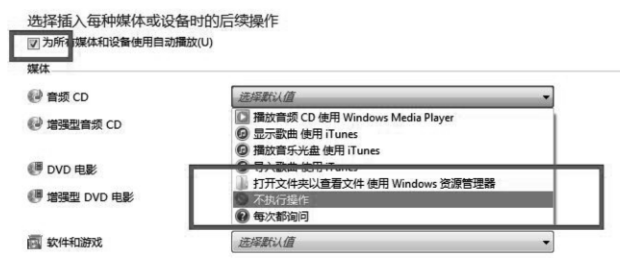

**表3 风险处置措施实施记录单**

| 阶段 | 项目 | 内容 |
| --- | --- | --- |
| 准备阶段 | 名称 | 禁用 Windows 操作系统自动播放的相关服务 |
| 准备阶段 | 系统当前状态 | 未禁用 Windows 操作系统自动播放的相关服务 |
| 准备阶段 | 存在风险 | 光盘或其他存储介质自动播放导致其中存在的病毒程序运行 |
| 准备阶段 | 实施方案 | 以 Windows 7 操作系统为例，点击“开始菜单”，然后选择右边的“默认程序”。在“默认程序”设置面板中，选择“更改自动播放设置”即可打开 Windows 7 系统的“更改自动播放”设置面板。见上图。取消勾选框，并对所要限制的媒体设置为不执行操作。 |
| 准备阶段 | 实施风险 | 无 |
| 准备阶段 | 回退措施 | 恢复到版本更新前状态，勾选“为所有媒体和设备使用自动播放” |
| 准备阶段 | 是否处理 | □执行处理　□不执行处理 |
| 准备阶段 | 相关单位 | 应用开发商、系统运维商、安全服务公司 |
| 实施阶段 | 备份工作 | 此项工作不需要进行数据备份；☑成功　□失败；实施人员：张三；年　月　日 |
| 实施阶段 | 处理实施 | 按照操作实施，策略设置成功；☑成功　□失败；实施人员：李四；年　月　日 |
| 实施阶段 | 重启验证 | 重启终端运行正常，未出现无法启动或者报错信息；☑成功　□失败；实施人员：王五；年　月　日 |
| 确认阶段 | 应用开发商 | 不需要应用开发商确认；签字：　年　月　日 |
| 确认阶段 | 系统运维商 | 操作系统正常，未出现问题，风险处置成功；签字：　年　月　日 |
| 确认阶段 | 安全服务商 | 加固解决了××风险，经验证漏洞修复，风险处置成功；签字：　年　月　日 |
| 确认阶段 | 系统主管单位 | 同意；签字：　年　月　日 |

#### B.3.5 风险处置实施报告

**风险处置实施报告**

**第一章 概述**

通过风险评估，××系统发现了 10 个风险点，其中 2 个风险点为可接受风险，对于不可接受风险进行了处理，整个处理过程分为 5 个阶段，分别为前期准备、测试、风险处置实施、结果确认和报告编制。

**第二章 风险处置说明**

整个风险处置实施过程在信息中心的统一管理下进行，系统开发商、安全服务商和系统运维商共同参与配置，整体项目工期耗时 3 个月。

第一阶段：……

第二阶段：……

……

**第三章 风险处置结果**

通过风险处置工作，系统的风险降到了可以接受的范围。

附件：各风险处置记录单。参见前述记录单。

### B.4 风险处置评价

**×××系统风险处置效果评价报告**

**第 1 章 概述**

**1.1 评价依据**

《×××信息系统风险处置实施报告》

**1.2 评价对象**

对×××信息系统风险的处理效果进行评价，具体风险及其处理方式参见风险处置措施列表。

**1.3 评价方法**

本次处理效果评价采取措施有效性评价与整体风险评价相结合的方式评价效果，参见表1。

**表1 风险处置措施评价方法表**

| 风险点编号 | 安全层面 | 风险描述 | 处理措施 | 评价方法 | 评价测试指南 | 处理措施有效性评价原则 |
| --- | --- | --- | --- | --- | --- | --- |
| R1 | 管理安全 | 重要业务数据未实现场外备份 | 采用人工方式备份数据到同城的第二个办公区域，定期进行数据恢复测试 | 访谈、查看、测试 | 1. 查看相关的数据备份制度要求，对备份的周期、备份的类型、备份的测试等是否有要求； 2. 访谈相关的管理人员，是否明确了备份工作职责； 3. 查看备份操作的登记记录； 4. 查看备份介质的存放环境、保护措施等； 5. 查看数据恢复测试记录； 6. 在仿真环境中进行数据恢复测试，并比较恢复数据与真实生产数据的一致性 | 如果第 6 项测试恢复成功，且恢复数据与真实生产数据之间的一致性达到 100%，则该措施有效 |
| R2 | 管理安全 | …… |  |  |  |  |
| …… |  |  |  |  |  |  |

**1.4 评价团队**

……

**第 2 章 风险处置效果评价实施**

**2.1 措施有效性评价**

根据采集的评价记录，对风险处置控制措施的有效性进行评价，参见表2。

**表2 风险处置控制措施有效性评价结果表**

| 风险点编号 | 风险描述 | 处理措施 | 有效性 | 评价记录 |
| --- | --- | --- | --- | --- |
| R1 | 重要业务数据未实现场外备份 |  | 有效 |  |
| …… | …… |  | …… |  |
| R7 | 口令验证机制不严格，允许弱口令存在 |  | 基本有效 |  |
| …… | …… |  | …… |  |

**2.2 整体风险评价**

根据残余风险评估的结果，对整体风险进行评价，参见表3。

**表3 风险再评价表**

| 风险点编号 | 安全层面 | 剩余风险描述 | 风险值 |
| --- | --- | --- | --- |
| …… | 应用安全 | …… |  |
| R11 | 应用安全 | 基于口令的身份鉴别，易遭受暴力破解 | 3 |
| …… |  | …… |  |

**第 3 章 结论与改进建议**

**3.1 评价结论**

根据评价分析可以得知，本次风险处置共对 9 项风险采取了风险降低处理方式，由评价结果可知，其中的 8 项均达到了预期的处理目标，风险降低到了可接受程度，有 1 项处理效果未达到预期的处理目的。整体分析可知，本次风险处置基本达到了预期的安全目标。

**3.2 未达标原因分析**

……

**3.3 改进建议**

……

## 参考文献

- ［1］GB/T 22239—2019 信息安全技术 网络安全等级保护基本要求
- ［2］ISO/IEC 27005:2018 Information technology—Security techniques—Information Security management
- ［3］ISO 31000:2018 Risk management—Guidelines
