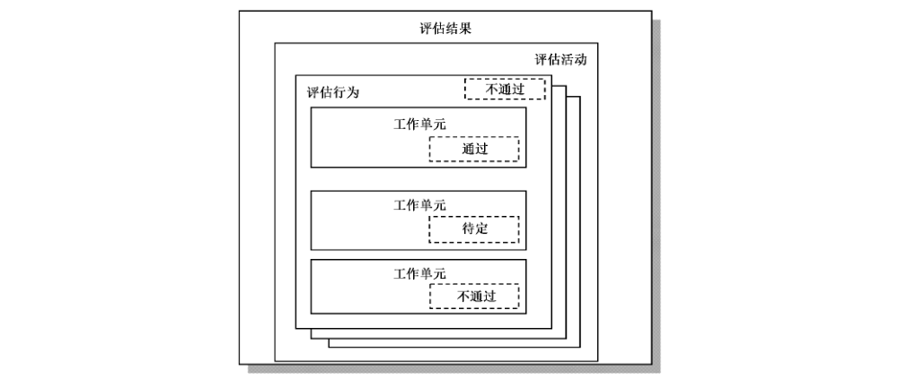
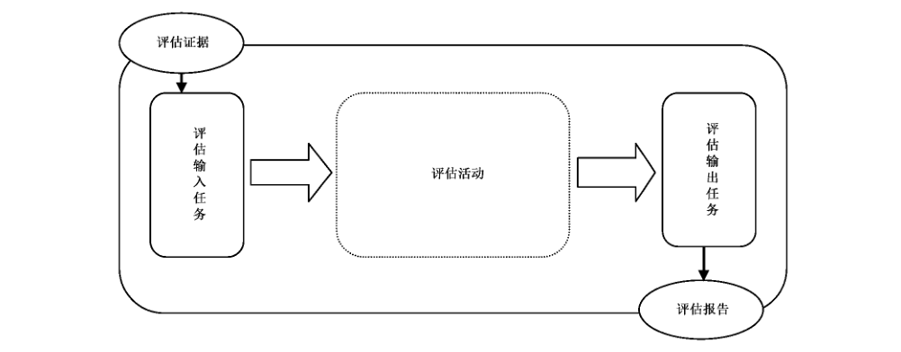
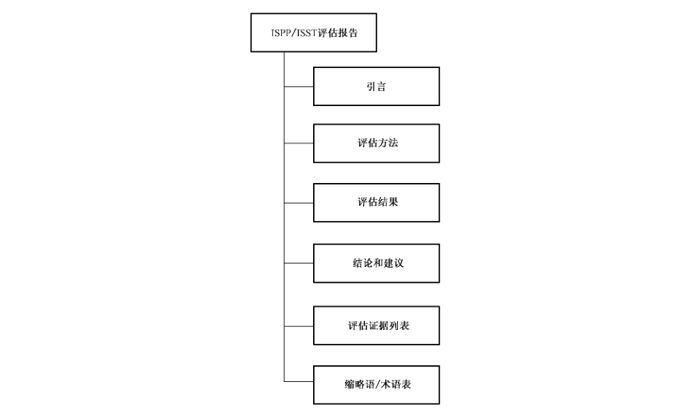
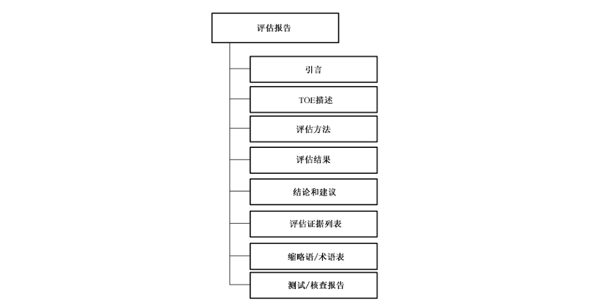

# GB/T 30273-2013 信息安全技术 信息系统安全保障通用评估指南

> 来源：[GB/T 30273-2013 国家标准详情](https://openstd.samr.gov.cn/bzgk/std/newGbInfo?hcno=522252CAC7EEC6BD32B556CB0578FE9D)。
> PDF SHA-256：2386816523ba0733c68d1782cb8980d0d6ebb4ca38978ad8ce9b4c9546a24882。
> 转写说明：将官方 PDF 全部页面渲染为图像并用图像识别核对文字、标题、列表、图示和表格；省略页眉页脚及页码，合并跨页内容。正式引用请核对原页面图像。

> 转写说明：原标准中的重复编号、异常措辞和引用按原版保留；转写修复不改写规范性内容。

## 前言

本标准按照GB/T 1.1—2009给出的规则起草。

本标准由全国信息安全标准化技术委员会（SAC/TC 260）提出并归口。

本标准主要起草单位：中国信息安全测评中心、华北计算技术研究所、中国信息安全测评中心华中测评中心。

本标准主要起草人：江常青、张利、姚轶崭、佟鑫、班晓芳、翁正军、王鸿娴。

## 引言

本标准是GB/T 20274 系列标准《信息安全技术 信息系统安全保障评估框架》的配套指南文件。

本标准的目标读者是采用GB/T 20274系列标准对信息系统进行安全性评估的评估者以及评估申请者、开发者、ISPP/ISST 编制者。

## 1 范围

本标准描述了评估者在使用GB/T 20274系列标准所定义的准则进行评估时需要完成的评估活动，为评估者在具体评估活动中的评估行为和活动提供指南。

本标准适用于采用GB/T 20274系列标准对信息系统进行安全性的评估和对ISPP/ISST 的评估。

## 2 规范性引用文件

下列文件对于本文件的应用是必不可少的。凡是注日期的引用文件，仅注日期的版本适用于本文件。凡是不注日期的引用文件，其最新版本（包括所有的修改单）适用于本文件。

- GB/T 20274.1—2006 信息安全技术 信息系统安全保障评估框架 第1部分：简介和一般模型

- GB/T 20274.2—2008 信息安全技术 信息系统安全保障评估框架 第2 部分：技术保障

- GB/T 20274.3—2008 信息安全技术 信息系统安全保障评估框架 第3部分：管理保障

- GB/T 20274.4—2008 信息安全技术 信息系统安全保障评估框架 第4部分：工程保障

## 3 术语和定义

下列术语和定义适用于本文件。

### 3.1 核查 check

评估者采用简单比较形成一个裁决。

> 注：使用此动词的语句描述了需要核查的内容。

### 3.2 评估交付件 evalution deliverable

评估者为执行一个或多个评估活动所必需的，来自申请者或开发者的任何资源。

### 3.3 评估证据 evaluation evidence

有形的评估交付件。

### 3.4 评估报告 evaluation technical report

由评估者编写的以文档形式记录总体裁决及其理由的报告。

### 3.5 检查 examination

评估者采用专业技能分析形成一个裁决。

> 注：使用此动词的语句表明哪些是需要分析的以及什么样的性质需要分析。

### 3.6 解释 interpretation

对标准内容的一种澄清或详述。

### 3.7 方法论 methodology

用于安全评估的原则、程序和过程。

### 3.8 总体裁决 overall verdict

评估者关于评估结果是通过还是不通过的决定。

### 3.9 记录 record

足够详细地记载程序、事件、观察结果、所了解事项和结果的一个书面描述，以使得评估过程中执行的工作能够在以后重建。

### 3.10 报告 reporting

将评估结果和支持性材料编写到评估报告或测试/核查报告中。

### 3.11 体制 scheme

由评估机构制定的执行评估行为的一套准则、规范和方法。

### 3.12 测试 testing

通过对评估对象按照预定的方法/工具使其产生特定的行为，获取证据以证明被测对象安全保障措施是否有效的一种方法。

### 3.13 评估对象 target of evaluation

指信息系统，是用于采集、处理、存储、传输、分发和部署信息的整个基础设施、组织结构、人员等的总和。

### 3.14 裁决 verdict

评估者发布一个关于工作单元、评估行为或评估活动是通过、不通过，还是待定的决定。

### 3.15 工作单元 work unit

评估工作的最基本行为。

> 注：与GB/T 20274.2—2008、GB/T 20274.3—2008 和 GB/T 20274.4—2008保障组件有关。每个评估行为由一个或多个工作单元组成，这些工作单元又按保障组件进行分组。

## 4 符号和缩略语

下列缩略语适用于本文件：

- ISAL：信息系统保障级（Information System Assurance Level）

- ISPP：信息系统保护轮廓（Information System Protection Profile）

- ISST：信息系统安全目标（Information System Security Target）

- IT：信息技术（Information Technology）

- SOF：功能强度（Strength of Function）

- SF：安全功能（Security Function）

- SFP：安全功能策略（Security Function Policy）

- TOE：评估对象（Target of Evaluation）

- TSC:TSF 控制范围（TSF Scope of Control）

- TSF:TOE 安全功能（TOE Security Functions）

- TSP: TOE 安全策略（TOE Security Policy）

## 5 概述

### 5.1 GB/T 20274 系列标准和本标准结构之间的关系

GB/T 20274 系列标准和本标准的结构之间有直接的关系，图1表明GB/T 20274 系列标准类、子类、组件的结构与本标准活动、评估行为和工作单元之间的对应关系。

### 5.2 评估裁决

评估者根据 GB/T 20274系列标准以及依据其产生的ISPP 和 ISST 的要求而不是本标准的要求给予裁决，给予裁决的最小结构是组件。作为执行相应评估行为及其组成工作单元的结果，每个适用的GB/T 20274 系列标准组件都会被赋予一个裁决。

在规范的评估中，本标准认可三种裁决结果：裁决结果为“通过”，如果评估者完成了本标准评估工作单元并确定关于经受评估的 ISPP、ISST 或TOE 的要求都已满足；

裁决结果“待定”，如果评估者未完成本标准评估工作单元；

裁决结果“不通过”，如果评估者完成了本标准评估工作单元并确定关于经受评估的 ISPP、ISST或TOE的要求未满足。

当且仅当所有工作单元裁决都为“通过”，总体裁决才为“通过”。在图2所示的示例中，如果一个评估工作单元的裁决为“不通过”，则相应评估行为、评估活动的裁决和最终裁决都为“不通过”。

## 6 通用评估模型

### 6.1 评估模型概述

一般地，一个评估工作应包括评估输入任务、评估活动和评估输出任务3个部分内容，如图3所示。

评估输入任务是评估者在接收到评估证据之后，进行的评估证据管理。评估证据可以随着评估类型的不同而变化。同时，每项任务又关系到一些评估活动，这些评估活动是标准化的，包括ISPP评估、ISST评估和 TOE评估三种类型。评估输出任务产生评估结果，评估结果可以是评估报告或测试/核查报告。ISPP 评估、ISST 评估和 TOE 评估都有输入任务和输出任务，它们与评估证据的管理和评估报告的生成有关。

### 6.2 评估输入任务

#### 6.2.1 目的

评估输入任务是确保评估者有正确版本的评估证据，并且证据得到了充分地保护。否则，就不能保证评估的准确性，也不能保证评估结果是可重复和可再现的。

#### 6.2.2 评估证据的管理

##### 6.2.2.1 配置控制

评估者应执行评估证据的配置控制。在收到每项评估证据后，能够对其进行标识和定位，并且能够确定评估者是否拥有文档的特定版本。当评估者持有评估证据时，评估者应保护评估证据，防止证据被变更或丢失。

##### 6.2.2.2 证据处置

在完成总体裁决后，对评估证据的处置应用以下一个或几个方法来进行：

a） 归还评估证据；

b） 存档评估证据；

c） 销毁评估证据。

##### 6.2.2.3 保密性

在评估过程中，评估者可能接触到申请者和开发者的一些商业性敏感信息（例如 TOE 设计信息、专门工具），还可能接触到一些政府敏感信息。评估者应维护评估证据的保密性。申请者和评估者可以互相协商一些附加要求（例如保密协议），只要这些要求和该评估体制协调一致。

保密性要求可能会影响评估工作的许多方面，包括对评估证据的接收、处理、存储和处置。

### 6.3 评估活动

评估活动是评估者根据评估证据判断信息系统是否满足信息系统安全保障措施要求和安全保障级要求的一系列活动。本标准的第8章介绍了执行ISPP 评估必需的评估活动；第9章介绍了了执行ISST 评估必需的评估活动；第10章介绍了对安全保障措施评估所需的评估活动；第11章介绍了评估ISAL1 至 ISAL5所需的评估活动。

### 6.4 评估输出任务

#### 6.4.1 目的

评估者应执行以下两个任务：

a） 编写测试/核查报告（根据评估工作需要）；

b）编写评估报告。

评估活动可能还需要额外的评估报告。本标准只规定了报告所需最少的内容，并不排除在这些报告中加入其他附加信息。

#### 6.4.2 编写测试/核查报告

测试/核查报告为评估者提供证据，用来澄清或识别评估中的某些问题。

测试/核查报告应包含以下信息：

a） 被评估的 ISPP/ISST 或TOE的标识；

b） 在哪一个评估任务/活动期间产生了测试/核查项；

c） 测试/核查的方法与内容；

d） 问题严重程度估计；

e）整改建议。

测试/核查报告的预期读者和处理报告的程序取决于报告内容的性质和评估体制。评估体制可根据所要求的信息和分发的不同，区分测试/核查报告的不同类型，或者定义附加类型。

#### 6.4.3 编写评估报告

##### 6.4.3.1 目的

评估者应提供评估报告，用来描述总体裁决的依据。

本标准定义了评估报告的最少内容要求，但评估体制可以提出附加的内容、特定的陈述和结构要求。例如，可以要求评估报告中包含某些介绍性材料（例如免责声明和版权声明条款）。

##### 6.4.3.2 ISPP/ISST 评估报告

###### 6.4.3.2.1 概述

ISPP/ISST 评估报告所需要的最少内容如图4所示。在构建评估报告文档的结构大纲时，该图可以用作指南。

评估者应报告评估体制的标识符。评估体制标识符（例如标志）是明确地标识负责评估机构的信息。

评估者应报告评估报告的配置控制标识符。评估报告的配置控制标识符包含标识评估报告的信息（例如名称、日期、版本号）。

评估者应报告 ISPP/ISST 配置控制标识符（例如名称、日期、版本号），以标识出哪一个 ISPP/ISST正在被评估。

评估者应报告开发者的身份，以标识出谁负责产生该 ISPP/ISST。

评估者应报告申请者的身份，以标识出谁负责向评估者提供评估证据。

评估者应报告评估者的身份，以标识出谁执行评估并且对评估裁决负责。

###### 6.4.3.2.2 评估方法

评估者应报告所使用的评估方法、技术、工具和标准。评估者可以注明在评估 ISPP/ISST 时所使用的评估准则、方法和解释。

评估者应报告所有对评估结果有影响的假设和限制。

评估者可在报告中加入与法律法规、组织机构、保密性等相关的信息。

###### 6.4.3.2.3 评估结果

评估者应针对组成ISPP评估活动中的每个评估行为，给出所做的裁决结果和支持裁决结果的基本原则，作为执行相应评估行为和评估活动的结果。

> 注：基本原则应使用GB/T 20274系列标准、解释说明和已确认过的评估证据来证明评估裁决是正确的，并指出评估证据如何满足或不满足评估标准的每个方面。基本原则包括对所做工作、所使用方法以及结果推导的描述。

###### 6.4.3.2.4 结论和建议

评估者应报告评估的结论。

评估者应提供一些对申请者、开发者可能有用的建议。这些建议可以包括在评估期间发现的ISPP的缺陷。

###### 6.4.3.2.5 评估证据列表

评估者应报告每项评估证据的以下信息：

a） 评估证据提供者（例如开发者、申请者）；

b） 标题；

c） 唯一索引（例如发布日期、版本号）。

###### 6.4.3.2.6 缩略语/术语表

评估者应报告评估报告中使用的所有缩略语或缩写词。

已由 GB/T 20274系列标准或本标准定义的术语在评估报告中不需要重复。

##### 6.4.3.3 TOE 评估报告

###### 6.4.3.3.1 概述

本条描述 TOE 评估报告所需要的最少内容。TOE 评估报告的内容如图5所示；在构建评估报告文档的结构大纲时，该图可以用作指南。

评估者应报告评估体制的标识符（例如标志），以明确地标识负责评估机构的信息。

评估者应报告评估报告的配置控制标识符，包含有标识评估报告的信息（例如名称、日期和版本号）。

评估者应报告 TOE 配置控制标识符，以标识出哪些正在被评估。

如果 ISST 声明 TOE遵从一个或几个 ISPP 的要求，则评估报告应声明所遵从的ISPP。

ISPP 引言中应含有能唯一地标识出 ISPP 的信息（例如标题、日期、版本号）。

评估者应报告开发者的身份，以标识出谁负责产生该 TOE。

评估者应报告申请者的身份，以标识出谁负责向评估者提供评估证据。

评估者应报告评估者的身份，以标识出谁执行评估并且对评估裁决负责。

###### 6.4.3.3.2 TOE 描述

评估者应报告 TOE 描述，包括信息系统描述、信息系统技术、管理和业务体系的详细描述。

###### 6.4.3.3.3 评估方法

评估者应报告所使用的评估方法、技术、工具和标准。

评估者可以注明在评估 TOE 时所使用的评估准则、方法和解释，注明在执行测试时所使用的设备。

评估者应报告所有对评估结果有影响的假设和限制。

评估者可在报告中加入与法律法规、组织机构、保密性等相关的信息。

###### 6.4.3.3.4 评估结果

对于每个 TOE 评估活动，评估者应报告：

a） 评估活动名称；

b） 对组成该活动的每个评估行为所做的裁决和支持性基本原理，作执行相应评估行为及其组成工作单元的结果。

基本原理应使用 GB/T 20274系列标准、解释说明和已检查过的评估证据来证明评估裁决是正确的，并指出证据如何满足准则的每个方面或者为什么没有满足准则要求。基本原理包括对所做工作、所使用方法以及结果推导等的描述。基本原理可以详细到评估方法工作单元这种程度。

评估者应报告工作单元明确需要的所有信息。

###### 6.4.3.3.5 结论和建议

评估者应报告评估的结论，评估结论将涉及判定 TOE 是否已经满足其相关 ISST。

评估者应提供一些对申请者、开发者可能有用的建议。这些建议可以包括在评估期间发现的信息系统的缺陷。

###### 6.4.3.3.6 评估证据列表

评估者应报告每项评估证据的以下信息：

a） 评估证据提供者（例如开发者、申请者）；

b） 标题；

c） 唯一索引（例如发布日期、版本号）。

###### 6.4.3.3.7 缩略语/术语表

评估者应报告评估报告中使用的所有缩略语或缩写词。

已由 GB/T 20274 系列标准或本标准定义的术语在评估报告中不需要重复。

###### 6.4.3.3.8 测试/核查报告

评估者应报告在评估期间产生的并能够唯一标识测试/核查报告及其状态的完整列表。该列表应包含测试/核查报告的标识符、标题或其内容的摘要。

## 7 信息系统保护轮廓评估

### 7.1 概述

每一个 ISPP评估的要求和方法都是相同的，不考虑 ISPP 中提出的 ISAL。

### 7.2 目的

ISPP 的评估方法建立在GB/T 20274.1—2006附录 A中 ISPP 内容的基础上。

ISPP定义了某种类型信息系统与实现无关的一组系统级安全保障要求。在ISPP 的描述中，应确定其安全保障要求。安全保障要求应能执行已定义的组织安全策略，并能对抗限定前提下确定的安全威胁。

ISPP 的评估是为了确定 ISPP 是否是：

a） 完备的：安全要求应能对抗每个被确定的安全威胁，并实现所有的组织安全策略；

b） 合理的：针对被确定的安全威胁和组织安全策略，所述安全保障要求是合适的；

c） 连贯的：ISPP 应是连贯的；

d）一致的：ISPP应是内在一致的。

### 7.3 评估相关要求

完备的ISPP 评估应包括以下活动：

a） 评估输入任务；

b） ISPP 评估活动，包含以下活动：

1） ISPP 引言的评估；

2） 安全环境的评估；

3） 信息系统描述的评估；

4） 安全保障目的的评估；

5） 安全保障要求的评估；

6） 符合性声明的评估。

c） 评估输出任务。

### 7.4 评估活动

#### 7.4.1 ISSP 引言的评估

##### 7.4.1.1 目的

本条的目的是确定ISPP 引言是否完整并与ISPP 的其他部分是否保持一致，以及是否正确标识了ISPP。

##### 7.4.1.2 输入

ISPP 文档。

##### 7.4.1.3 评估行为

工作单元 1:ISPP 标识

评估者应核查ISPP 引言，是否提供了必要的标识信息以识别、注册和交叉引用 ISPP。

评估者应确定 ISPP 标识信息包括：

a） 控制和唯一标识 ISPP 的必要信息（例如 ISPP标题、版本号、出版日期、作者和申请机构）；

b） 用于开发 ISPP 的GB/T 20274系列标准版本信息；

c） 注册信息，如果 ISPP在评估前已注册；

d） 交叉引用，如果 ISPP 与其他 ISPP（s）有关联；

e） 评估体制要求的其他信息。

工作单元 2:ISPP 概述

评估者应核查 ISPP引言，是否以叙述形式提供了 ISPP概述。

ISPP概述应为ISPP 内容提供概要描述（更详细的描述在信息系统描述中提供），且应详细到能使ISPP的使用者确定 ISPP是否是他所需要的。

工作单元3：连贯性

评估者应检查ISPP引言，以确定它是连贯的。

如果 ISPP引言的正文和陈述结构能为其目标读者理解，那么ISPP引言就是连贯的。

工作单元 4：一致性

a） 评估者应检查 ISPP 引言，以确定它是内在一致的：ISPP概述应为 ISPP 内容提供概要描述，因此有关内在一致性分析会集中在ISPP概述上。

一致性分析指南见附录 A.1。

b） 评估者应检查ISPP 引言，以确定 ISPP引言与ISPP的其他部分是一致的：评估者应确定ISPP概述提供了 TOE 描述的精确概括。评估者特别应确定ISPP概述与信息系统描述是一致的，且没有陈述或暗示存在评估范围之外的安全特征；

评估者还应确定 GB/T 20274 系列标准一致性声明与 ISPP 的其他部分一致。

一致性分析指南见附录 A.1。

#### 7.4.2 信息系统描述的评估

##### 7.4.2.1 目的

本条的目的是确定信息系统描述是否包含了有助于理解TOE 的相关信息，确定该描述是否是完备的和一致的。

ISPP 中的信息系统描述部分可以帮助了解评估对象的安全保障要求。在信息系统安全保障评估框架中，评估对象是信息系统整体或信息系统技术、工程和管理领域。无论是信息系统整体还是信息系统某一领域，在评估对象描述中都应先给出整个信息系统的完整描述，然后再对评估对象作进一步描述。

评估对象的描述提供了用于评估的背景。在评估对象描述中给出的信息将用于在评估过程中识别不一致的地方。由于一般不指明特定的实现，因此描述的评估对象特性可能是假设的。评估对象描述的具体内容可参考 GB/T 20274.1 的附录内容。

##### 7.4.2.2 输入

ISPP 文档。

##### 7.4.2.3 评估行为

工作单元 1：系统使命描述

评估者应检查信息系统描述，以确定它描述了信息系统的使命。

工作单元2：信息系统概述

评估者应检查信息系统描述，以确定它对信息系统进行了整体描述：

a） 评估者应确定信息系统描述是否给出了对信息系统的标识的描述；

b） 评估者应确定信息系统描述是否给出了对信息系统环境的描述；

c） 评估者应确定信息系统描述是否给出了对信息系统评估边界和接口的描述；

d） 评估者应确定信息系统描述是否给出了信息系统安全域的描述。

工作单元3：信息系统详细描述

评估者应确定信息系统描述是否对包含在信息系统中的评估对象进行了进一步描述：

a） 评估者应确定信息系统描述中是否包含了对信息系统技术体系的描述，应检查信息系统描述中是否包含对信息系统适用的技术标准、网络基础设施、技术应用等方面的描述；

b） 评估者应确定信息系统描述中是否包含了对信息系统管理体系的描述，应检查信息系统描述中是否包含对组织机构、管理制度及法规、系统资产等方面的描述；

c） 评估者应检查信息系统描述中是否包含了对信息系统业务体系的描述，应检查信息系统描述中是否包含对主要业务应用、业务流程和业务信息流等方面的描述。

工作单元4：连贯性

评估者应检查ISPP，以确定信息系统描述是连贯的。如果信息系统描述的陈述结构和正文能为TOE 的目标读者（即评估者和用户）理解的话，信息系统描述就是连贯的。

工作单元5：一致性

a） 评估者应检查 ISPP，以确定 TOE 的描述是内在一致的。

评估者应注意，ISPP 的这一节仅用于定义TOE的目的。

一致性分析指南见附录 A.1。

b）评估者应检查 ISPP，以确定信息系统描述与ISPP 的其他部分是一致的。

评估者尤其应确定信息系统描述不包括那些评估范围以外的安全威胁、安全特征或TOE的配置。

一致性分析指南见附录 A.1。

#### 7.4.3 安全环境的评估

##### 7.4.3.1 目的

本条的目的是确定在ISPP中安全环境的陈述是否为有关 TOE及其预期应用环境的安全问题提供了清晰、一致的定义。

##### 7.4.3.2 输入

ISPP 文档。

##### 7.4.3.3 评估行为

工作单元 1：假设

评估者应检查安全环境的陈述，以确定它标明并解释了所有假设。这些假设可以分成TOE预期使用方面的假设和 TOE使用环境方面的假设。

a） 评估者应确定 TOE 预期使用的假设阐明了 TOE 预期使用的各个方面，如：TOE 预期应用，需要 TOE保护的资产的潜在价值，以及使用TOE 可能存在的限制。

b） 评估者应确定 ISPP 中对 TOE预期使用的所有假设都进行了详细解释，以保证用户确定其预期使用与这些假设相匹配。

评估者确定 TOE使用环境的假设包括物理、人员、连接性方面：

1） 物理方面：包括为了使 TOE 以安全方式行使其功能，而对TOE 的物理位置或附加的外围设施而做的所有假设。

例如：假设管理员控制台严格限制在管理员个人范围内；假设TOE所有文件的存储只能在TOE运行的工作站上进行。

2） 人员方面：包括为了使TOE 以安全方式行使其功能，而对在安全环境内的用户和 TOE管理员，或其他个人（包括具有潜在威胁的主体）所做的所有假设。

例如：假设用户具有特殊技能或专门技术；或用户具有确定的最小权限；管理员每月更新防病毒数据库。

3） 连接性方面：包括为了使TOE 以安全方式行使其功能，而对TOE与其他信息系统或产品（硬件、软件、固件或它们的组合）之间连接的所有假设。

例如：假设存储TOE产生的日志文件至少需要100 MB 的外部磁盘空间；假设 TOE是在特定工作站上运行的唯一的非操作系统应用程序；假设 TOE 的软驱是禁用的；假设 TOE不会连接到任何不可信的网络。

工作单元 2：威胁

评估者应确定TOE 使用环境的所有假设都得到详细的解释，使用户能够确定他们的预期环境与假设环境相匹配。

a） 如果没有清楚地理解这些假设，最终可能导致TOE 在不能安全行使其功能的环境中使用。

评估者应检查安全环境的陈述，以确定所有威胁都被标识并得以解释。

b） 如果 TOE 和其环境安全目的只源于组织的安全策略和假设，那么ISPP 中就可以不含安全威胁陈述，如果 ISPP 不包括安全威胁陈述，则该工作单元不适用，并视满足。

c） 评估者应确定所有已标识的安全威胁都用已标识安全威胁主体、攻击和攻击的资产的术语进行了清楚的解释。

d） 评估者还应确定安全威胁主体可在专业技术、可用资源和动机等方面具有表征，攻击可在攻击方法、可利用的脆弱性和时机等方面具有表征。

工作单元3：组织安全策略

评估者应检查安全环境陈述，以确定它标识并解释了所有组织安全策略。

如果 TOE 及其环境的安全目的只源于假设和威胁，那么 ISPP中就可以不包含组织安全策略。如果ISPP 中不包含组织安全策略陈述，则该工作单元不适用，并视为满足。

a） 评估者应确定组织安全策略陈述是否遵循 TOE 及其环境的应遵守的规则、惯例或指南，这些规则、惯例或指南是由控制TOE使用环境的组织制定的。例如，组织安全策略可能要求口令生成和加密应符合国家政府制定的标准。

b） 评估者应确定ISPP 中对所有组织安全策略都进行了详细解释，以便读者能够清晰的理解以及在允许跟踪安全目的时，应对安全策略进行清楚表述。

工作单元 4：连贯性

评估者应检查安全环境的陈述，以确定它是连贯的。如果安全环境描述的结构和正文能为TOE的目标读者（即评估者和用户）理解的话，安全环境描述就是连贯的。

工作单元5：一致性

评估者应检查安全环境的表述，以确定它是内在一致的。

表征安全环境内在不一致性的示例：

a） 安全环境的表述包含这样一种威胁，其攻击方法不在威胁主体的能力范围内；

b） 安全环境的表述包含“TOE 不与因特网相连”这样的组织安全策略，其威胁主体是来自因特网的入侵者的威胁。

一致性分析指南见附录 A.1。

#### 7.4.4 安全保障目的的评估

##### 7.4.4.1 目的

本条的目的是确定安全目的描述是否完整和一致，并确定安全目的是否能对抗已标识的威胁，达到确定的组织安全策略并遵循规定的假设。

##### 7.4.4.2 输入

ISPP 文档。

##### 7.4.4.3 评估行为

工作单元 1：安全环境

评估者应检查安全保障目的陈述，确认其是否定义了TOE 及其环境的安全保障目的。评估者应确定是否明确地说明每个安全保障目的的适用对象。

工作单元 2：连贯性

评估者应检查安全保障目的的表述，以确定它是连贯的。

如果安全保障目的的正文和陈述结构能为其目标读者（如评估者和用户）所理解，那么安全保障目的的表述就是连贯的。

工作单元3：完备性

评估者应检查安全保障目的的表述，以确定它是完备的。

如果安全保障目的足以对抗所有已标识的安全威胁，并能覆盖所有已标识的组织安全策略和假设，那么安全保障目的是完备的。

工作单元4：一致性

评估者应检查安全保障目的的表述，以确定它是内在一致的。

如果安全保障目的之间不相冲突，安全保障目的表述就是内在一致的。有这样一个冲突的例子：两个安全保障目的，一个是“用户身份信息永远不会被发布”，另一个则是“其他用户可以获得该用户的身份信息”。

一致性分析指南见附录 A.1。

#### 7.4.5 安全保障要求的评估

##### 7.4.5.1 目的

本条的目的是确定安全保障要求（包括信息系统安全保障技术要求、信息系统安全保障管理要求、信息系统安全保障工程要求）是否完整和一致，并为信息系统的建设提供充分的依据，以达到其安全保障目的。

##### 7.4.5.2 输入

ISPP 文档。

##### 7.4.5.3 评估行为

工作单元1：概要描述

评估者应核查安全保障要求的叙述，是否给出了信息系统整体的安全保障要求的概要性描述；

工作单元2：安全技术保障要求ISPP 中的安全技术保障要求评估主要包括：

a） 评估者应核查安全技术保障要求的叙述，是否标识了从 GB/T 20274.2—2008中的安全技术保障要求组件中抽取的那些安全技术组件和安全技术能力成熟度要求。

评估者应确定从 GB/T 20274.2—2008中的安全技术保障要求组件中抽取的所有安全技术保障要求以及安全技术能力成熟度要求是否都已明确标识。

b） 评估者应核查涉及的每个 TOE 安全技术保障要求组件的正确性。

评估者应确定 GB/T 20274.2—2008是否包含文中涉及的安全技术保障要求组件。

c） 评估者应核查从 GB/T 20274.2—2008中抽取出的安全技术保障要求组件，在ISPP 中是否得以正确重现。

评估者应确定在没有对允许操作进行检查的情况下，安全技术保障要求叙述是否正确地重现了这些要求。

工作单元3：安全管理保障要求ISPP 中的安全管理保障要求评估主要包括：

a） 评估者应核查安全管理保障要求的叙述，是否标识了从 GB/T 20274.3—2008 安全管理保障要求组件中抽取的那些安全管理组件和安全管理能力成熟度要求。

评估者应确定从 GB/T 20274.3—2008 安全管理保障要求组件中抽取的所有安全管理保障要求以及安全管理能力成熟度要求是否都已明确标识。

b）评估者应核查涉及的每个安全管理保障要求组件的正确性。

评估者应确定 GB/T 20274.3—2008是否包含文中涉及的安全管理保障要求组件。

c） 评估者应核查从 GB/T 20274.3—2008中抽取出的安全管理保障要求组件，在 ISPP 中是否得以正确重现。

评估者应确定在没有对允许操作进行检查的情况下，安全管理保障要求叙述是否正确地重现了这些要求。

工作单元 4：安全工程保障要求ISPP 中的安全工程保障要求评估主要包括：

a） 评估者应核查安全工程保障要求的叙述，是否标识了从 GB/T 20274.4—2008 安全工程保障要求组件中抽取的那些安全工程组件和安全工程能力成熟度要求。

评估者应确定从 GB/T 20274.4—2008 安全工程保障要求组件中抽取的所有安全工程保障要求以及安全工程能力成熟度要求是否都已明确标识。

b） 评估者应核查涉及的每个安全工程保障要求组件的正确性。

评估者应确定 GB/T 20274.4—2008是否包含文中涉及的安全工程保障要求组件。

c） 评估者应核查从 GB/T 20274.4—2008中抽取出的安全工程保障要求组件，在ISPP 中是否得以正确重现。

评估者应确定在没有对允许操作进行检查的情况下，安全工程保障要求叙述是否正确地重现了这些要求。

工作单元 5：组件操作ISPP 中的组件操作主要包括：

a） 评估者应核查信息系统安全保障要求的所有操作都被标识。

GB/T 20274.2—2008 技术组件允许的操作是赋值、反复、选择和细化。赋值和选择操作只允许用于组件中特别指定的地方。反复和细化能用于所有技术组件。

GB/T 20274.3—2008管理组件和 GB/T 20274.4—2008工程组件允许的操作是反复和细化。

b） 评估者应确定所有操作都在使用该操作的组件中被标出。完成的操作和未完成的操作应通过排版、周围的文本或其他方式加以明显区分。

c） 评估者应检查信息系统安全保障要求的表述，确定是否正确实施了操作。

评估者应比较每条陈述和导出陈述的元素，以确定：

1） 对于赋值操作，所选的参数或变量值符合赋值要求的指定类型；

2） 对于选择操作，选择项是在元素选择部分中指定的一项或多项；评估者也应确定所选项是否符合要求；

3） 对于细化操作，组件以这样的方式细化：满足细化要求的TOE 也满足非细化要求。如果细化的要求超过该界限，就被认为是扩展要求；

4） 对于反复操作，组件内的每个反复操作各不相同（至少一个组件的某个元素不同于另一个组件的对应元素），或这个组件应用于 TOE的不同部分。

d） 评估者应检查是否标识了ISPP中信息系统安全保障要求的所有未完成操作。

评估者应确定所有操作都在使用该操作的组件中被标出。完成的操作和未完成的操作应通过排版、周围的文本或其他方式加以明显区分。

工作单元6：依赖性ISPP 中的组件依赖性主要包括：

a） 评估者应检查安全保障要求的陈述，以确定安全保障要求使用的组件间的要求的依赖性被满足。

依赖性可以通过安全保障要求陈述中的相关组件的内涵（或分出的层次）来满足，或作为一个要求，由TOE 的运行环境来满足。

尽管GB/T 20274通过依赖性内涵相关分析提供支持，但不应用来证明没有其他依赖性。

如涉及“所有客体”或“所有主体”的元素与列出这些客体或主体的另一个元素或元素集的细化间存在依赖性。

运行环境中必要的安全要求的依赖性应在ISPP 中陈述并得到满足。

b） 评估者应检查安全保障要求的陈述，以确定对于没有满足安全要求依赖性的每一种情况都作了适当的证明。例如：给定了已知安全保障目的，评估者应确认这个理由解释了不必包括依赖性原因。

评估者应确认不满足依赖性并没有妨碍安全保障要求充分体现安全保障目的。例如：当一个TOE 有这样一个安全保障目的——“鉴别失败时，应将用户的身份、时间和日期记录下来”且采用 FAU_GEN.1（审计数据产生）作为满足这个安全保障目的的功能要求。FAU_GEN.1 包含了与 FPT_STM.1（可靠时间戳）的依赖性。由于 TOE 不包含时钟机制，FPT_STM.1 则被ISPP 作者定义为运行环境要求。ISPP 作者用这样一个理由说明这个要求没有得到满足：“在特定环境下，可能会攻击时间戳机制，因此环境就不能传送可靠的时间戳。然而，一些安全威胁主体没有执行依赖时间戳机制的能力，而且由这样的安全威胁主体实施的攻击可能会通过记录攻击的时间和日期来分析”。

工作单元7：连贯性

评估者应检查安全保障要求陈述，以确定其连贯性。如果安全保障要求描述的陈述结构和正文能为TOE 的目标读者（即评估者和用户）所理解的话，安全保障要求陈述就是连贯的。

工作单元 8：完备性

评估者应检查安全保障要求陈述，以确定它们是完备的。

如果评估者判定安全保障要求足以保证所有安全保障目的的满足，则安全保障要求陈述就是完备的。

工作单元9：一致性

评估者应检查安全保障要求陈述，以确定它们是内在一致的。

如果评估者确定安全要求都互不冲突那么安全要求陈述就是内在一致的。

一致性分析指南见 A.1。

#### 7.4.6 符合性声明的评估

##### 7.4.6.1 目的

ISPP 的符合性声明包括安全保障目的符合性声明和安全保障要求的符合性声明。本条的目的是评估 ISPP的符合性声明是否给出了评估 ISPP 的依据。

##### 7.4.6.2 输入

ISPP文档。

##### 7.4.6.3 评估行为

###### 7.4.6.3.1 安全保障目的的符合性声明

工作单元1：完备性

评估者应检查安全保障目的符合性声明，以确定是否TOE 的所有安全保障目的都能追溯到TOE能够对抗的已标识威胁，或TOE 遵循的组织安全策略。

评估者应确定 TOE的每个安全保障目的能追溯到至少一个威胁或组织安全策略。

不能追溯就意味着安全保障目的符合性声明是不完备的、威胁或组织安全策略的表述是不完备的，或TOE 的安全保障目的没有实际意义。

评估者应检查安全保障目的符合性声明，以确定环境安全保障目的是否能追溯到TOE 环境能够对抗的已标识的威胁，或TOE环境遵循的组织安全策略，TOE 环境应满足的假设。

评估者应确定环境的每个安全保障目的能追溯到至少一个假设、威胁或组织安全策略。

不能追溯就意味着安全保障目的符合性声明是不完备的，威胁、假设或组织安全策略的表述是不完备的，或环境的安全目的没有实际意义。

工作单元 2：假设

评估者应检查安全保障目的符合性声明，以确定环境安全保障目的都有适于覆盖对应假设的适当理由。

如果没有环境安全目的追溯到对应假设，本工作单元为失败。

假设可以是有关TOE预期使用的假设，也可以是有关TOE 预期使用环境的假设。

评估者应确定有关TOE应用环境的假设理由能够证明，如果实现了追溯到假设的所有环境安全保障目的，那么环境就与假设一致。

> 注：安全保障目的符合性声明中提供的从环境安全保障目的到假设的映射，可能是证明的一部分，但是其本身不构成证明。甚至在环境安全保障目的仅是对假设的重述情形下，也需要说明对应的理由。

工作单元3：威胁

评估者应检查安全保障目的符合性声明，以确定TOE 安全保障目的都有适于对抗其对应安全威胁的适当理由。

如果没有TOE 安全保障目的能追溯到对应的威胁，则本工作单元为失败。

评估者应确定有关安全威胁的论证能够阐明，如果所有能追溯到安全威胁的TOE 安全保障目的都达到，那么就消除了这个威胁，或是这种威胁降低到可以接受的水平，或是这种威胁得到适当地减轻。

消除安全威胁的例子如下：

a） 消除使用来自安全威胁主体的攻击方法的能力；

b） 通过威慑方法，消除安全威胁主体的动机；

c） 消除安全威胁主体（如移走经常导致网络崩溃的机器）。

降低安全威胁的例子如下：

a） 在攻击方法上限制安全威胁主体；

b） 限制安全威胁主体的攻击机会；

c） 减少成功发起攻击的可能性；

d） 要求安全威胁主体有更高的专业知识或更多的资源。

减轻安全威胁后果的例子如下：

a） 资产的经常备份；

b） 拥有 TOE 备份；

c） 经常改变通讯会话使用的密钥，这样可以相对减小密钥被攻破的机会。

> 注：安全保障目的符合性声明中提供的从TOE 安全保障目的到安全威胁的映射，可能是理由的一部分，但是其本身不构成证明。即使在 TOE 安全保障目的仅仅反映防止特定安全威胁被发现的情形下，还是需要说明对应的理由，但是在这种情况下这个理由是最基本的。

工作单元 4：组织安全策略

评估者应检查安全保障目的符合性声明，以确定安全保障目的都有适于满足对应的组织安全策略的适当理由。

如果没有 TOE 安全保障目的能追溯到相应的组织安全策略，本工作单元为失败。

评估者应确定采用组织安全策略的理由能够证明，如果实现了追溯到组织安全策略的所有 TOE安全保障目的，那么就实现了组织安全策略。

> 注：安全保障目的符合性声明中提供的从安全保障目的到组织安全策略的映射，可能是证明的一部分，但是其本身不构成证明。即使在安全保障目的仅反映实现特定的组织安全策略的情形下，也还需要说明对应的理由。

###### 7.4.6.3.2 安全保障要求的符合性声明

工作单元1：完备性

评估者应检查安全要求符合性声明，以确定安全保障要求（信息系统和环境）适于满足安全保障目的，并能够追溯到安全保障目的。

评估者应确定每个安全保障要求至少能映射到一个安全保障目的。

如果不能映射，则表明安全要求符合性声明是不完备的，安全保障目的是不完备的，或安全保障要求没有实际意义。

工作单元2：合理性

评估者应检查安全要求符合性声明，是否充分证明了安全保障要求是恰当的。

评估者应确定安全要求符合性声明充分证明了安全环境和安全保障目的陈述充分地导出了管理要求和工程要求。

可能包含的理由如：

a） 在ISST 声称符合的ISPP 中出现的管理要求和工程要求；

b） 评估体制、政府或其他组织实施的特定要求；

c） 与安全技术保障要求相关的管理要求和工程要求；

d） 与TOE一起使用的系统/产品的管理要求；

e） 用户的要求。

工作单元 3：相互支持

评估者应检查安全要求符合性声明，以确定它表明该组安全保障要求形成一个互相支持的整体。

本工作单元要求评估者考虑这种可能性：因缺乏其他安全保障要求的支持，安全保障目的实际上不能实现。

由于存在这样的情况：安全保障要求A依赖安全保障要求 B，而B通过定义支持A，所以本工作单元建立在前面工作单元依赖性分析的基础上。

评估者应确定安全要求符合性声明能够表明安全保障要求在必要的时候互相支持，即使没有迹象表明这些要求之间存在依赖性。例如：

a） 防止其他安全功能要求的旁路，如 FDP_RVM.1；

b） 防止其他安全功能要求的篡改，如 FPT_SEP；

c） 防止其他安全功能要求的失效，如 FPT_MOF.1；

d） 激活挫败其他安全功能要求的攻击的探测，如FAU 类的组件。

在分析时评估者应考虑已执行的操作是否影响要求间的相互支持。

工作单元4：一致性

评估者应检查安全要求符合性声明，以确定它表明该组安全保障要求是一致的。

评估者应确定在不同安全保障要求应用到同一类型的事件、操作、数据和实施的测试等情况下，这些要求可能会互相冲突，此时应提供适当的证明来说明事实并非如此。

如果ISST 包含用户匿名方面的要求，则需要阐明这些要求不冲突。单个用户审计的可审计事件与用户匿名的操作无关。

一致性分析指南见 A.1。

## 8 信息系统安全目标评估

### 8.1 概述

由于ISST 为TOE 评估活动提供依据和评估背景，所以 ISST 评估应在所有TOE 评估活动之前进行。鉴于 TOE 评估过程中有关发现可能会引起ISST 的变化，因此可能会到 TOE 评估完成后，才形成ISST 评估的最终裁定。

本章所述的评估方法是建立在GB/T 20274.1—2006中特别在附录B ISST 规范中进行详细说明的ISST 要求基础上。

### 8.2 目的

ISPP定义了对于特定类型信息系统的安全保障要求和规范。因此，需要在 ISST 的描述中，确定其安全保障要求，包括信息系统安全保障的技术要求、管理要求、工程要求和它们的综合要求以及该信息系统所要达到的安全目标；在给定的前提下，该安全保障要求应能够实现已定义的组织安全策略，并能对抗已定义的威胁。此外，还要定义信息系统为正确对抗威胁和实现组织安全策略提供保证而采取的安全保障措施。

ISST 的评估是为了确定 ISST 是否是：

a） 完备的：所述安全功能能对抗每个威胁，并实现所有的组织安全策略；

b） 合理的：针对威胁和组织安全策略而言，所述安全功能是适当的，且保证措施为安全功能正确实现提供充分的保证；

c） 一致的：ISST 应是内在一致的；

d） 连贯的：ISST 应是连贯的；

e） 精确实现：如果ISST 声称与一个或多个 ISPP符合，那么该 ISST 肯定是所有相关ISPP的完全、精确的实现。这样，在评估ISST 时可以重复使用这些ISPP的评估结果。

### 8.3 评估要求

完备的ISST 评估应包括以下活动：

a） 评估输入任务；

b） ISST 评估活动，包含以下活动：

1） ISST 引言的评估；

2） 信息系统描述的评估；

3） 安全环境的评估；

4） 安全保障目的的评估；

5） 安全保障要求的评估；

6） TOE 概要规范的评估；

7） ISPP声明的评估；

8） 符合性声明的评估。

c） 评估输出任务。

在进行 ISST 评估应注意：

a） 尽管通常所述的活动有可能同时进行，但是评估者应考虑活动之间的依赖性。

b） 不是所有的ISST 评估都要进行ISPP声明的评估，只有做了ISPP声明才需要进行ISPP声明的评估。

c） 如果ISST 声称与已评估的ISPP保持一致，且很大程度依赖ISPP 的内容，那么在实施上述评估活动时，可以使用ISPP的评估结果。特别在评估安全环境的描述、安全保障目的和信息系统安全保障要求时可以重复使用ISPP评估结果。在ISST 中允许包含与多个ISPP保持一致的声明。

### 8.4 评估活动

#### 8.4.1 ISST 引言的评估

##### 8.4.1.1 目的

本条的目的是确定ISST引言是否完整并与ISST 的其他部分保持一致，以及是否正确标识了ISST。

##### 8.4.1.2 输入

ISST 文档。

##### 8.4.1.3 评估行为

工作单元 1:ISST 标识

评估者应核查ISST引言，以确定其是否提供了必要的ISST 标识信息以控制和识别ISST 和与ISST 相关的 TOE。

评估者应确定 ISST标识信息包括：

a） 控制和唯一标识 ISST 的必要信息（例如 ISST标题、版本号、出版日期和作者）；

b） 控制和唯一标识与ISST 相关的TOE 的必要信息（例如 TOE 的标识、TOE版本号）；

c） 用于开发 ISST 的GB/T 20274 系列标准版本信息；

d） 评估体制要求的其他信息。

工作单元 2:ISST概述

评估者应核查 ISST 引言，以叙述形式提供 ISST 概述。

ISST概述应为ISST 内容提供概要描述（更详细的描述在信息系统描述中提供），且详细到能使潜在的用户确定 TOE（和 ISST 的其余部分）是否是他所需要的。

工作单元3：符合性声明

评估者应核查ISST 引言，确认其是否包含 TOE 与GB/T 20274 系列标准符合性的声明。

a） 评估者应确定符合性声明与GB/T 20274.1—2006 的6.4中定义的一样。

b） 评估者确定符合性声明包含与 GB/T 20274.2—2008符合或与GB/T 20274.2—2008扩展内容一致的声明。

c） 评估者确定符合性声明包含与 GB/T 20274.3 —2008符合或 GB/T 20274.3—2008增加、扩展内容相一致的声明。

d） 评估者确定符合性声明包含与GB/T 20274.4—2008符合或GB/T 20274.4—2008增加、扩展内容相一致的声明。

e） 如果声明与ISPP一致，评估者就应确定此声明与哪个或哪些ISPP保持一致。

工作单元 4：连贯性

评估者应检查ISST 引言，以确定它是连贯的。

如果 ISST 引言的正文和结构能为其目标读者理解，那么 ISST 引言就是连贯的。

工作单元5：一致性

a） 评估者应检查ISST 引言，以确定它是内在一致的。

ISST 概述为ISST 内容提供概要描述，因此有关内在一致性分析会自然集中在ISST概述上。

一致性分析指南见 A.1。

b） 评估者应检查ISST 引言，以确定ISST 引言与ISST 其他部分的一致性。

评估者应确定ISST 概述提供 TOE的精确概括。评估者特别应确定 ISST 概述与信息系统描述的一致性，且没有陈述或暗示存在评估范围之外的安全特征。

评估者还应确定GB/T20274一致性声明与ISST 的其他部分一致。

一致性分析指南见 A.1。

#### 8.4.2 信息系统描述的评估

##### 8.4.2.1 目的

本条的目的是确定信息系统描述是否包含了有助于理解 TOE 的目的和功能的相关信息，以及确定该描述是否完整和一致。

##### 8.4.2.2 输入

ISST 文档。

##### 8.4.2.3 评估行为

工作单元1：使命描述

评估者应检查信息系统描述，以确定它是否描述了 TOE 的使命。

评估者应确定信息系统描述是否描述了建设信息系统的目的和意义，是否能够帮助读者全面理解信息系统的高层要求。

工作单元 2：信息系统概述

评估者应检查信息系统描述，以确定它是否对所要评估的信息系统进行概括性说明和描述。描述内容是否包括以下几个方面：

a） 信息系统标识：应给出系统的正式名称和标识。系统标识包括其名称、所属的组织机构及其地点和包含最终用户的组织机构及其地点等相关信息；

b） 信息系统环境描述：描述的运行环境以及系统开发，集成和维护的环境；

c） 信息系统评估边界和接口描述：描述所要评估系统的边界和相应的外部接口，此描述应用图表或文字清晰地描述和界定所要评估的系统部件和边界；

d） 信息系统安全域描述：根据系统的重要性（描述系统的重要性以及系统的可接受的风险级别）、数据的分类和密级（描述系统所处理的数据类型和机密级别）和系统用户（描述使用系统的用户描述）等方面划分系统的安全域。

评估者应确定信息系统描述对相关部分进行了详细讨论，且详细到使读者对其能够全面理解的程度。如果 TOE与信息系统不完全相同，评估者应确定信息系统描述充分描述了 TOE与信息系统之间的物理关系。

工作单元3：信息系统详细描述

评估者应检查信息系统描述，以确定它是否对信息系统进行了详细描述。

a） 评估者应确定信息系统描述是否包含了对管理体系的描述；描述是否包含下述内容：

1） 组织机构描述：描述同信息系统相关的管理/使用/开发/集成/支持组织机构的描述，特别是相关安全管理保障的组织机构的描述；

2） 管理制度、法规描述：列出同信息系统安全管理相关的目前使用的相应规章制度和相关法规；

3） 资产描述：描述了信息系统的物理资产（指信息系统中的各种硬件、软件和物理设施）和信息资产（指在信息系统计划组织、开发采购、实施交付、运行维护和废弃这一信息系统系统生命周期过程中产生的同信息系统系统本身相关的有价值的信息以及信息系统所存储、处理和传输的各种相关的办公、管理和业务等信息）。

b） 评估者应确定信息系统描述是否包含了对技术体系的描述，描述是否包含下述内容：

1） 基础设施描述：描述了系统的网络层次等网络体系结构说明；

2） 应用描述：描述用户信息系统的各种应用说明；

3） 技术标准描述：列出相关技术应用等所适用的技术标准。

c） 评估者应确定信息系统描述是否包含了对业务体系的描述，描述是否包含下述内容：

1） 业务应用描述：列出组织机构的主要业务应用并进行描述；

2） 流程描述：基于组织机构的管理结构等，描述业务的流程；

3） 信息流描述：描述主要业务应用的接口和相应数据流，数据流描述应包括数据的类型以及数据传送的一般方式。

工作单元4：连贯性

评估者应检查 ISST，以确定信息系统描述是连贯的。

如果信息系统描述的陈述结构和正文能被 TOE 的目标读者（即评估者和用户）理解的话，信息系统描述就是连贯的。

工作单元 5：一致性

a） 评估者应检查 ISST，以确定 TOE 的描述是内在一致的。

一致性分析指南见 A.1。

b）评估者应检查 ISST，以确定信息系统描述与ISST 的其他部分是一致的。

评估者尤其应确定信息系统描述不包括ISST 范围以外的威胁、安全特征或 TOE的配置。

一致性分析指南见 A.1。

#### 8.4.3 安全环境的评估

##### 8.4.3.1 目的

本条的目的是确定ISST 中对安全环境的陈述，是否对有关 TOE与其预期应用环境的安全问题提供了清晰、一致的定义。

##### 8.4.3.2 输入

ISST 文档。

##### 8.4.3.3 评估行为

工作单元1：假设

评估者应检查安全环境的陈述，以确定它标明并解释了所有假设。

这些假设可以分成TOE预期使用方面的假设和TOE 使用环境方面的假设。

评估者应确定 TOE 预期使用的假设，阐明TOE 预期使用的以下方面，如：TOE 预期应用、需要TOE 保护的资产的潜在价值、使用TOE 可能存在的限制。评估者应确定ISST 中对TOE 预期使用的所有假设都进行了详细解释，以保证用户能确定其预期使用与这些假设相符合。

如果没有清楚理解这些假设，最终可能导致用户在非希望的环境中使用 TOE。

评估者应确定 TOE 使用环境的假设包括物理、人员和连接性方面：

a） 物理方面包括为了使TOE以安全方式行使其功能，而对TOE 的物理位置或附加的外围设施而做的所有假设。例如假设管理员控制台严格限制在管理员个人范围内；假设TOE所有文件的存储只能在 TOE运行的工作站上进行；

b） 人员方面包括为了使TOE 以安全方式行使其功能，而对在安全环境内的用户和 TOE管理员，或其他个人（包括具有潜在威胁的主体）所做的所有假设。例如假设用户具有特殊技能或专门技术，或用户具有确定的最小权限，管理员每月更新防病毒数据库；

c） 连接性方面包括为了使TOE 以安全方式行使其功能，而对TOE与其他在TOE之外的信息系统或产品（硬件、软件、固件或它们的组合）之间连接的所有假设。例如假设存储TOE产生的日志文件至少需要100MB的外部磁盘空间，TOE 假设是在特定工作站上运行的唯一的非操作系统应用程序，假设 TOE 的软驱是禁用的，假设TOE 不会连接到任何不可信的网络。

评估者应确定 TOE使用环境的所有假设都得到详细的解释，使用户能够确定他们的预期环境与假设环境相符合。如果没有清楚理解这些假设，最终可能导致TOE 在不能安全行使其功能的环境中使用。

工作单元2：威胁

评估者应检查安全环境的陈述，以确定所有威胁都被标识并得以解释。

如果 TOE 和其环境安全保障目的只源于组织的安全策略和假设，那么 ISST 中就可以不含威胁陈述，如果 ISST 不包括威胁陈述，则该工作单元不适用，并视为满足。

评估者应确定所有已标识的威胁都用已标识威胁主体、攻击和攻击的资产的术语进行了清楚解释。

评估者还应确定威胁主体可在专业技术、可用资源和动机等方面表明特征，攻击可在攻击方法、可利用的脆弱性和时机等方面表明特征。

工作单元3：组织安全策略

评估者应检查安全环境陈述，以确定它标识并解释了所有组织安全策略。

如果 TOE及其环境的安全保障目的只源于假设和威胁，那么ISST 中就可以不包含组织安全策略陈述。如果ISST 中不包含组织安全策略陈述，则该工作单元不适用，并视为满足。

评估者应确定组织安全策略陈述遵循了 TOE 及其环境应遵守的规则、惯例或指南，这些规则、惯例或指南是由控制TOE使用环境的组织制定的。例如，组织安全策略可能要求口令生成和加密应符合相应的国家标准。

评估者应确定ISST 中对每个组织安全策略都进行了详细解释，以便读者能够清晰理解；为使安全保障目的能够追溯到组织安全策略，应对组织安全策略进行清楚地表述。

工作单元 4：连贯性

评估者应检查安全环境的陈述，以确定它是连贯的。

如果安全环境描述的结构和正文能为 TOE的目标读者（即评估者和用户）理解的话，安全环境描述就是连贯的。

工作单元 5：一致性

评估者应检查安全环境的陈述，以确定它是内在一致的。

表征安全环境内在不一致性的示例：

a） 安全环境的表述包含这样一种威胁，其攻击方法不在威胁主体的能力范围内；

b） 安全环境的表述包含“TOE 不与因特网相连”这样的组织安全策略，和其威胁主体是来自因特网的入侵者。

一致性分析指南见 A.1。

#### 8.4.4 安全保障目的的评估

##### 8.4.4.1 目的

本条的目的是确定安全目的描述是否完整和一致，并确定安全目的是否能对抗已标识的威胁，实现已标识的组织安全策略并遵循规定的假设。

##### 8.4.4.2 输入

ISST 文档。

##### 8.4.4.3 评估行为

工作单元 1：安全环境

a） 评估者应核查安全保障目的陈述，确认其是否定义了 TOE及其环境的安全保障目的。

b） 评估者应确定是否明确地说明每个安全保障目的是适用于 TOE，还是环境，或者两者都适用。

工作单元2：完备性

评估者应检查安全保障目的陈述，以确定它是完备的。

如果安全保障目的足以对抗所有已标识的威胁，并能覆盖所有已标识的组织安全策略和假设，那么安全保障目的是完备的。

工作单元3：连贯性

评估者应检查安全保障目的陈述，以确定它是连贯的。

如果安全保障目的的正文和陈述结构能为其目标读者所理解，那么安全保障目的的表述就是连贯的。

工作单元4：一致性

评估者应检查安全保障目的表述，以确定它是内在一致的。

如果安全保障目的之间不互相冲突，安全保障目的就是内在一致的。有这样一个冲突的例子：两个安全保障目的，一个是“用户身份信息永远不会被发布”，另一个则是“其他用户可以获得该用户的身份信息”。

一致性分析指南见 A.1。

#### 8.4.5 安全保障要求的评估

##### 8.4.5.1 目的

本条的目的是确定安全保障要求（包括信息系统安全保障要求、信息系统安全保障技术要求、信息系统安全保障管理要求、信息系统安全保障工程要求、）是否完整和一致，同时作为TOE开发的基础，这些要求是充分的。

##### 8.4.5.2 输入

ISST 文档。

##### 8.4.5.3 评估行为

工作单元1：概要描述

评估者应检查安全保障要求的叙述，是否给出信息系统整体安全保障要求的概要性描述。

工作单元 2：安全技术保障要求

a） 评估者应核查安全技术保障要求的叙述，是否标识了从 GB/T 20274.2—2008安全技术保障要求组件中抽取的那些安全技术组件和安全技术能力成熟度要求。

评估者应确定从 GB/T 20274.2—2008 安全技术保障要求组件中抽取的所有安全技术保障要求以及安全技术能力成熟度要求是否都已明确标识。

b）评估者应核查涉及的每个安全技术保障要求组件和安全技术能力成熟度要求的正确性。

评估者应确定 GB/T 20274.2—2008是否包含文中涉及的安全技术保障要求组件。

评估者应确定ISPP 是否包含文中涉及的安全技术保障要求组件。

C） 评估者应核查从 GB/T 20274.2—2008中抽取出的安全技术保障要求组件和安全技术能力成熟度要求，在ISST 中得以正确重现。

评估者应确定在没有对允许操作进行检查的情况下，安全技术保障要求叙述是否正确地重现了这些要求。

工作单元3：安全管理保障要求

a） 评估者应核查安全管理保障要求的陈述，是否标识了从 GB/T 20274.3—2008 安全管理保障要求组件中抽取出的那些安全管理组件和安全管理能力成熟度要求。

评估者应确定从 GB/T 20274.3—2008 安全技术保障要求组件中抽取的所有管理安全管理要求以及安全技术能力成熟度要求是否都已被标识。

b） 评估者应核查涉及的每个安全管理保障要求组件的正确性。

评估者应确定GB/T 20274.3—2008是否包含文中涉及的安全管理保障要求组件。

c） 评估者应核查从 GB/T 20274.3—2008中抽取出的安全管理保障要求组件和安全管理能力成熟度要求，在ISST 中得以正确重现。

评估者应确定在没有对允许操作进行检查的情况下，安全管理保障要求叙述是否正确地重现了这些要求。

工作单元 4：安全工程保障要求

a） 评估者应核查安全工程保障要求的陈述，是否标识了从 GB/T 20274.4—2008安全工程保障要求组件中抽取出的那些安全工程组件和安全工程能力成熟度要求。

评估者应确定从 GB/T 20274.4—2008 安全工程保障要求组件中抽取的所有工程安全管理要求以及安全工程能力成熟度要求是否都已被标识。

b） 评估者应核查涉及的每个安全工程保障要求组件和安全工程能力成熟度要求的正确性。

评估者应确定 GB/T 20274.4—2008是否包含文中涉及的安全工程保障要求组件。

评估者应确定ISPP 是否包含文中涉及的 TOE 安全工程保障要求组件。

c） 评估者应核查从 GB/T 20274.4—2008中抽取出的安全工程保障要求组件和安全工程能力成熟度要求，在 ISST 中得以正确重现。

评估者应确定在没有对允许操作进行检查的情况下，安全工程保障要求叙述正确地重现了这些要求。

工作单元 5：组件操作

a） 评估者应核查安全保障要求的所有操作都被标识。

GB/T 20274.2—2008 技术组件允许的操作是赋值、反复、选择和细化。赋值和选择操作只允许用于组件中特别指定的地方。反复和细化能用于所有安全技术保障组件。

GB/T 20274.3—2008安全管理保障组件和GB/T 20274.4—2008安全工程保障组件允许的操作是反复和细化。

评估者应确定所有操作都在使用该操作的组件中被标出。可以通过排版、周围的文本或其他方式来标识。

b） 评估者应检查安全保障要求的表述，确定实施了所有的赋值和选择操作。

评估者应确定所有组件中的所有赋值和选择操作都完全实施，或没有完全实施时有适当的证明。

c） 评估者应检查ISST，以确定所有操作已正确执行。

评估者应比较每条陈述和导出陈述的元素，以确定：

1） 对于赋值操作，所选的参数或变量值符合赋值要求的指定类型；

2） 对于选择操作，选择项是在元素选择部分中指定的一项或多项，评估者也应确定所选项适合要求；

3） 对于细化操作，组件以这样的方式细化，即满足细化要求的 TOE 也满足非细化要求。如果细化的要求超过该界限，就被认为是扩展要求。对于细化，TSP模型只需要覆盖访问控制；

如果访问控制策略是 TSP的唯一策略，那么这就是有效的细化。如果 TSP中还有标识和鉴别策略，而且只有访问控制需要被模型化，那么这就不是一个有效的细化。

4） 对于反复操作，组件内的每个反复操作各不相同（至少一个组件的某个元素不同于另一个组件的对应元素），或这个组件应用于 TOE 的不同部分。

工作单元6：连贯性

评估者应检查安全保障要求陈述，以确定其连贯性。

如果安全保障要求描述的结构和正文能为 TOE 的目标读者（即评估者和用户）理解的话，安全保障要求陈述就是连贯的。

工作单元7：完备性

评估者应检查安全保障要求陈述，以确定它们是完备的。

如果所有要求的操作都已完成，且评估者判定安全保障要求足以保证所有安全保障目的的满足，则安全要求陈述就是完备的。

工作单元8：一致性

评估者应检查安全保障要求陈述，以确定它们是内在一致的。

该项检查利用前面的结果，特别是评估者对安全保障要求符合性声明的检查结果。

如果评估者确定安全保障要求都互不冲突，那么安全保障要求陈述就是内在一致的。

一致性分析指南见 A.1。

#### 8.4.6 TOE 概要规范的评估

##### 8.4.6.1 目的

本条的目的是确定其是否为安全功能和安全保证措施提供了清晰完备的高层定义，该定义满足指定的TOE 安全要求。

##### 8.4.6.2 输入

ISST 文档。

##### 8.4.6.3 评估行为

工作单元1：完整描述

评估者应核查 TOE概要规范是否对信息系统整体安全目标进行了完整描述。

工作单元2：安全技术保障

评估者核查信息系统安全技术保障陈述，主要包括：

a） 评估者应核查信息系统安全技术保障陈述，确定其是否包含信息系统安全技术控制和安全技术能力成熟度要求。

评估者应核查信息系统安全技术保障陈述，以确定每个安全技术控制能够回溯到至少一个安全技术控制要求。

如果不能映射则表明TOE概要规范是不完备的，安全技术控制要求是不完备的，或者表明安全技术控制是不完备的。

b） 评估者应核查信息系统安全技术保障陈述，以确定它是不是以非形式化的方式描述的，且详细程度达到了可以理解其意图的水平。

c） 评估者应检查TOE 概要规范符合性声明，以确定对于每个安全技术控制要求而言，它都包含了证明安全技术控制恰好满足安全技术控制要求的合适理由。

如果没有安全技术控制追溯到安全技术控制要求，则本工作单元为不通过。

评估者确定有关安全技术控制要求的证明阐明了：如果所有追溯到安全技术控制要求的安全技术控制都已实现，则该安全技术控制要求就得到满足。

评估者还确定每个可追溯到安全技术控制要求的安全技术控制，当其实现时，实际上促成了安全技术控制要求的满足。

> 注：将 TOE概要规范中提供的安全技术控制追溯到安全技术控制要求，可以作为证明的一部分，但其本身并不构成证明。

工作单元3：安全管理保障

评估者核查信息系统安全管理保障陈述，主要包括：

a） 评估者应核查信息系统安全管理保障陈述，确定其是否包含信息系统安全管理控制要求和安全管理能力成熟度要求。

评估者应核查信息系统安全管理保障陈述，以确定每个安全管理控制能够回溯到至少一个安全管理控制要求。

如果不能映射则表明TOE 概要规范是不完备的，安全管理控制要求是不完备的，或者表明安全管理控制。

b） 评估者应核查信息系统安全管理保障陈述，以确定它是不是以非形式化的方式描述的，且详细程度达到了可以理解其意图的水平。

工作单元 4：安全工程保障

评估者核查信息系统安全工程保障陈述，主要包括：

a） 评估者应核查信息系统安全工程保障陈述，确定其是否包含信息系统安全工程控制要求和安全工程能力成熟度要求。

评估者应核查信息系统安全工程保障陈述，以确定每个安全工程控制能够回溯到至少一个安全工程控制要求。

如果不能映射则表明TOE 概要规范是不完备的，安全工程控制要求是不完备的，或者表明安全工程控制。

b）评估者应核查信息系统安全工程保障陈述，以确定它是不是以非形式化的方式描述的，且详细程度达到了可以理解其意图的水平。

工作单元 5：完备性

评估者应检查 TOE概要规范，以确定它是完备的。

如果评估者判定安全技术控制、安全管理控制和安全工程控制足以保证满足指定的安全保障要求，那么 TOE 概要规范是完备的。

工作单元6：连贯性

评估者应检查 TOE概要规范，以确定它是连贯的。

如果 TOE 概要规范的正文和陈述结构能够为其目标读者（如评估者和开发者）理解的，TOE概要规范就是连贯的。

工作单元7：一致性

评估者应检查TOE 概要规范，以确定它是内在一致的。

如果评估者确定安全技术控制、安全管理控制和安全工程控制之间没有导致TOE安全目的不能完全满足的冲突，那么TOE概要规范就是内在一致的。

#### 8.4.7 ISPP 声明的评估

##### 8.4.7.1 目的

本条的目的是确定ISST 是否是ISPP的一个正确实例，该ISPP 是ISST所声明符合的，适用于 ISST 中声明符合一个或多个 ISPP 的情形。

##### 8.4.7.2 输入

本活动的输入包括：

a） ISST 文档；

b） ISST 声称所符合的 ISPP（s）。

##### 8.4.7.3 评估行为

工作单元 1:ISPP 引用

评估者应核查每个 ISPP声明是否标识了所符合的ISPP。

评估者应确定所有参考的ISPP 都已被清晰标识（例如通过名称和版本号或ISPP 引言中的标识）。

工作单元 2:ISPP 剪裁

评估者应核查每个 ISPP声明是否确定了信息系统安全保障保证要求，这些信息系统安全保障保证要求满足 ISPP允许的操作或进一步证明符合ISPP要求。

ISST 不需重述那些没有任何更改的ISPP中的安全要求陈述。但如果ISPP 安全功能要求包括未完成的操作，或ISST 作者已对所有ISPP 安全要求实施细化操作，那么这些要求应在ISST 中明确指出。

工作单元 3:ISPP 附加项

评估者应核查ISPP 附加项，主要包括：

a） 评估者应核查每个ISPP 声明是否标识了补充ISPP 所包含安全目的和信息系统安全保障要求的那些安全目的和信息系统安全保障要求。

评估者应确定包含在ISST 中、而不含在ISPP中的所有安全目的和安全要求都明确标出。

b） 对每个ISPP声明，评估者应检查ISST，以确定所有基于 ISPP 中信息系统安全保障要求而实施的操作都在ISPP的范围之内。

本工作单元不仅包括ISPP 中未完成的赋值或选择操作，还包括对ISPP中安全要求的细化操作。

#### 8.4.8 符合性声明的评估

##### 8.4.8.1 目的

本条的目的是评估ISST 的符合性声明是否给出了评估 ISST 的依据。

##### 8.4.8.2 输入

ISST 文档。

##### 8.4.8.3 评估行为

###### 8.4.8.3.1 安全保障目的的符合性声明

工作单元1：完备性

评估者应检查安全保障目的符合性声明，以确定是否 TOE 的所有安全保障目的都能追溯到 TOE能够对抗的已标识威胁，或TOE 遵循的组织安全策略。

评估者应确定 TOE的每个安全保障目的能追溯到至少一个威胁或组织安全策略。

不能追溯就意味着安全保障目的符合性声明是不完备的、威胁或组织安全策略的表述是不完备的，或TOE的安全保障目的没有实际意义。

评估者应检查安全保障目的符合性声明，以确定环境安全保障目的是否能追溯到TOE 环境能够对抗的已标识的威胁，或TOE 环境遵循的组织安全策略，TOE 环境应满足的假设。

评估者应确定环境的每个安全保障目的能追溯到至少一个假设，威胁或组织安全策略。

不能追溯就意味着安全保障目的符合性声明是不完备的，威胁、假设或组织安全策略的表述是不完备的，或环境的安全目的没有实际意义。

工作单元 2：假设

评估者应检查安全保障目的符合性声明，以确定环境安全保障目的都有适于覆盖对应假设的适当理由。

如果没有环境安全目的追溯到对应假设，本工作单元为失败。

假设可以是有关TOE 预期使用的假设，也可以是有关TOE预期使用环境的假设。

评估者应确定有关TOE预期使用的假设理由能够证明，如果实现了追溯到假设的所有环境安全保障目的，那么就支持预期的使用。

评估者应确定达到可以追溯到TOE预期使用的假设的所有环境安全保障目的时，这些安全保障目的实际上支持了预期的使用。

评估者应确定有关TOE应用环境的假设理由能够证明，如果实现了追溯到假设的所有环境安全保障目的，那么环境就与假设一致。

> 注：安全保障目的符合性声明中提供的从环境安全保障目的到假设的映射，可能是证明的一部分，但是其本身不构成证明。甚至在环境安全保障目的仅仅是对假设的重述情形下，还是需要说明对应的理由。

工作单元 3：威胁

评估者应检查安全保障目的符合性声明，以确定 TOE 安全保障目的都有适于对抗其对应安全威胁的适当理由。

如果没有TOE 安全保障目的能追溯到对应的威胁，则本工作单元为失败。

评估者应确定有关安全威胁的论证能够阐明，如果所有能追溯到安全威胁的TOE 安全保障目的都达到，那么就消除了这个威胁，或是这种威胁降低到可以接受的水平，或是这种威胁得到适当地减轻。

消除安全威胁的例子如下：

a） 消除使用来自安全威胁主体的攻击方法的能力；

b） 通过威慑方法，消除安全威胁主体的动机；

c） 消除安全威胁主体（如移走经常导致网络崩溃的机器）。

降低安全威胁的例子如下：

a） 在攻击方法上限制安全威胁主体；

b） 限制安全威胁主体的攻击机会；

c） 减少成功发起攻击的可能性；

d） 要求安全威胁主体有更高的专业知识或更多的资源。

减轻安全威胁后果的例子如下：

a） 资产的经常备份；

b） 拥有 TOE备份；

c） 经常改变通信会话使用的密钥，这样可以相对减小密钥被攻破的机会。

> 注：安全保障目的符合性声明中提供的从TOE 安全保障目的到安全威胁的映射，可能是理由的一部分，但是其本身不构成证明。即使在 TOE 安全保障目的仅仅反映防止特定安全威胁被发现的情形下，还是需要说明对应的理由。

工作单元 4：组织安全策略

评估者应检查安全保障目的符合性声明，以确定安全保障目的都有适于满足对应的组织安全策略的适当理由。

如果没有 TOE 安全保障目的能追溯到相应的组织安全策略，本工作单元为失败。

评估者应确定采用组织安全策略的理由能够证明，如果实现了追溯到组织安全策略的所有 TOE安全保障目的，那么就实现了组织安全策略。

> 注：安全保障目的符合性声明中提供的从安全保障目的到组织安全策略的映射，可能是证明的一部分，但是其本身不构成证明。即使在安全保障目的仅仅反映实现特定的组织安全策略的情形下，还是需要说明对应的理由。

###### 8.4.8.3.2 安全保障要求的符合性声明

工作单元1：完备性

评估者应检查安全要求符合性声明，以确定安全保障要求（信息系统和环境）适于满足安全保障目的，并能够追溯到安全保障目的。

评估者应确定每个安全保障要求至少能映射到一个安全保障目的。

如果不能映射，则表明安全要求符合性声明是不完备的，安全保障目的是不完备的，或安全保障要求没有实际意义。

工作单元2：合理性

评估者应检查安全要求符合性声明，是否充分证明了安全保障要求是恰当的。

评估者应确定安全要求符合性声明充分证明，安全环境和安全保障目的陈述充分地导出了管理要求和工程要求。

可能包含的理由如：

a） 在ISST 声称符合的ISPP 中出现的管理要求和工程要求；

b） 评估体制、政府或其他组织实施的特定要求；

c） 与安全技术保障要求相关的管理要求和工程要求；

d） 与TOE一起使用的系统/产品的管理要求；

e） 用户的要求。

工作单元 3：相互支持

评估者应检查安全要求符合性声明，以确定它表明该组安全保障要求形成一个互相支持的整体。

本工作单元要求评估者考虑这种可能性：因缺乏其他安全保障要求的支持，安全保障目的实际上不能实现。

由于存在这样的情况，安全保障要求A依赖安全保障要求 B，而B通过定义支持A，所以本工作单元建立在前面工作单元依赖性分析的基础上。

评估者应确定安全要求符合性声明能够表明安全保障要求在必要的时候互相支持，即使没有迹象表明这些要求之间存在依赖性。例如：

a） 防止其他安全功能要求的旁路，如 FDP_RVM.1；

b） 防止其他安全功能要求的篡改，如 FPT_SEP；

c） 防止其他安全功能要求的失效，如 FPT_MOF.1；

d） 激活挫败其他安全功能要求的攻击的探测，如FAU 类的组件。

在分析时评估者应考虑已执行的操作是否影响要求间的相互支持。

工作单元 4：一致性

评估者应检查安全要求符合性声明，以确定它表明该组安全保障要求是一致的。

评估者应确定在不同安全保障要求应用到同一类型的事件、操作、数据和实施的测试等情况下，这些要求可能会互相冲突，此时应提供适当的证明来说明事实并非如此。

如果 ISST 包含用户匿名方面的要求，则需要阐明这些要求不冲突。单个用户审计的可审计事件与用户匿名的操作无关。

一致性分析指南见 A.1。

###### 8.4.8.3.3 TOE 概要规范的符合性声明

工作单元 1：安全技术保障要求

评估者应检查TOE概要规范符合性声明，以确定对于每个安全技术控制要求而言，它都包含了证明安全技术控制恰好满足安全技术控制要求的合适理由。

如果没有安全技术控制追溯到安全技术控制要求，则本工作单元为不通过。

评估者确定有关安全技术控制要求的证明阐明了，如果所有追溯到安全技术控制要求的安全技术控制都已实现，则该安全技术控制要求就得到满足。

> 注：将TOE概要规范中提供的安全技术控制追溯到安全技术控制要求，可以作为证明的一部分，但其本身并不构成证明。

工作单元 2：安全管理保障要求

评估者应检查TOE 概要规范符合性声明，以确定对于每个安全管理控制要求而言，它都包含了证明安全管理控制恰好满足安全管理控制要求的合适理由。

如果没有安全管理控制追溯到安全管理控制要求，则本工作单元为不通过。

评估者确定有关安全管理控制要求的证明阐明了，如果所有追溯到安全管理控制要求的安全管理控制都已实现，则该安全管理控制要求就得到满足。

> 注：将 TOE概要规范中提供的安全管理控制追溯到安全管理控制要求，可以作为证明的一部分，但其本身并不构成证明。

工作单元3：安全工程保障要求

评估者应检查TOE 概要规范符合性声明，以确定对于每个安全工程控制要求而言，它都包含了证明安全工程控制恰好满足安全工程控制要求的合适理由。

如果没有安全工程控制追溯到安全工程控制要求，则本工作单元为不通过。

评估者确定有关安全工程控制要求的证明阐明，如果所有追溯到安全工程控制要求的安全工程控制都已实现，则该安全工程控制要求就得到满足。

> 注：将 TOE概要规范中提供的安全工程控制追溯到安全工程控制要求，可以作为证明的一部分，但其本身并不构成证明。

## 9 信息系统安全保障措施评估

### 9.1 信息系统安全技术保障措施评估

#### 9.1.1 概述

信息系统安全技术保障要求的评估是建立在GB/T 20274.2—2008 基础之上的，以技术保障要求中的类作为评估 TOE 中技术保障要求的基础，子类作为评估活动，技术组件作为评估时的工作单元。

#### 9.1.2 目的

本标准是对信息系统安全保障技术要求的评估提供指导性信息，以帮助评估者确定信息系统中采用的安全技术保障措施是否有效地符合了 TOE 中己申明的安全保障技术要求。

#### 9.1.3 安全审计

本条是评估TOE 的安全审计机制是否符合 GB/T 20274.2—2008中安全审计（FAU）类的要求。

##### 9.1.3.1 安全审计自动应答（FAU_ARP）

###### 9.1.3.1.1 目的

本条的目的是评估信息系统的可审计事件自动响应机制。

###### 9.1.3.1.2 输入

本活动的输入包括：

a） ISST 文档；

b） 信息系统安全策略；

c） 信息系统技术方案；

d） 信息系统风险评估文档；

e） 其他有关文档资料。

###### 9.1.3.1.3 评估行为

工作单元：FAU_ARP.1 安全警告

a） 评估者应检查评估证据以确定组织机构是否规定了当TOE遭遇到潜在的安全侵害时，TOE的安全警告机制所应采取的扰乱行动。例如，当发生安全事件时，TOE通知授权用户，授权用户使产生潜在安全侵害的主体失效。

b）评估者应测试当TOE 检测到安全侵害事件时，安全警告机制是否采取规定的扰乱行动。

##### 9.1.3.2 安全审计数据产生（FAU_GEN）

###### 9.1.3.2.1 目的

本条的目的是评估TOE 产生安全审计数据的机制。

###### 9.1.3.2.2 输入

a） ISST 文档；

b） 信息系统安全策略；

c） 信息系统技术方案；

d） 信息系统风险评估文档；

e） 信息系统审计记录；

f） 其他有关文档资料。

###### 9.1.3.2.3 评估行为

工作单元 1:FAU_GEN.1审计数据产生

a） 评估者应检查评估证据以确定：

1） 组织机构定义的可审计事件；

审计活动可能会影响信息系统的性能，组织机构应确定信息系统的哪些组成部分需要参与审计活动，并且哪些事件是可审计事件。信息系统的组成部分可能包含以下组成部分，但不仅限于所述，例如：大型机、服务器（例如：数据库服务器、电子邮件服务器、WEB服务器等）、工作站、网络部件（例如：防火墻、网关、路由器等）、操作系统、中间件、应用系统。

2） 审计数据的产生；

TSF 是否对规定的可审计事件生成审计记录；

TSF 是否对审计功能的启动和关闭生成审计记录。

3） 审计记录的内容；

审计记录是否至少包含审计数据产生组件中所要求的审计内容；例如：事件发生的日期和时间，可审计事件的类型（及其他审计相关信息），主体身份，事件的结果（成功或失败）。

b） 评估者应测试信息系统实现的审计数据产生机制。

工作单元 2:FAU_GEN.2 用户身份关联

评估者应测试产生安全审计数据时，审计功能是否可将审计事件与引起该事件的主体身份相关联。

##### 9.1.3.3 安全审计分析（FAU_SAA）

###### 9.1.3.3.1 目的

本条的目的是评估信息系统的安全审计分析机制。

###### 9.1.3.3.2 输入

本活动的输入包括：

a） ISST 文档；

b） 信息系统安全策略；

c） 信息系统技术方案；

d） 信息系统风险评估文档；

e） 其他有关文档资料。

###### 9.1.3.3.3 评估行为

工作单元 1:FAU_SAA.1 潜在侵害分析

a） 评估者应检查评估证据以确定：审计功能在监视和分析系统活动及审计数据时所采用的机制；

b） 评估者应测试TOE是否是基于一组固定的规则监视和分析审计数据及系统活动。

工作单元 2:FAU_SAA.1 基于轮廓的异常检测

a） 评估者应检查评估证据以确定：审计功能在监视和分析系统活动及审计数据时所采用的机制；

1） TSF 是否可对系统使用轮廓进行维护；

2） TSF 是否可对用户的“置疑等级”进行设置和修改。“置疑等级”代表该用户的当前活动与轮廓中已建立的使用模式不一致的程度；

3） 当用户的“置疑等级”超过规定的报告异常活动的门限条件时，TSF 是否可指出即将发生的违背安全策略的事件。

b）评估者应测试 TOE 是否是基于系统轮廓（用户、行为、置疑等级）检测违反安全策略的行为。

工作单元3:FAU_SAA.3 简单攻击探测

a） 评估者应检查评估证据以确定：审计功能在监视、分析系统活动和审计数据时所采用的机制；

1） TSF 是否可对“特征事件”的内部表示进行维护，“特征事件”代表系统事件的一个子集，这些事件的发生可能预示着 TOE 中发生了违反安全策略的行为；

2） TSF 是否可用“特征事件”与可辩别的系统活动记录进行比较，这些记录是从决定系统活动的检测信息中产生；

3） 在发现一个系统事件与“特征事件”相匹配时，TSF 是否可报告即将发生的违背安全策略的行为。

b）评估者应测试TOE 实现的简单攻击探测机制。

工作单元 4:FAU_SAA.4 复杂攻击探测

a） 评估者应检查评估证据以确定：

1） TSF 是否可对“已知入侵情景的事件序列”和“违犯安全策略的特征事件集”的内部表示进行维护；

- 已知入侵情景的事件序列：系统事件列表，它们表示发生了已知的渗透攻击；

- 特征事件集：代表系统事件的一个子集，这些事件的发生可能预示着产生了违反安全策略的行为。

2） TSF 是否可用“特征事件”和“事件序列”与可辩别的系统活动记录进行比较，这些记录是从决定系统活动的检测信息中产生；

3） 在发现一个系统事件与“特征事件”或“事件序列”相匹配时，TSF 是否可报告即将发生的违背安全策略的行为。

b）评估者应测试TOE 实现的复杂攻击探测机制。

##### 9.1.3.4 安全审计查阅（FAU_SAR）

###### 9.1.3.4.1 目的

本条的目的是评估信息系统的安全审计查阅机制。

###### 9.1.3.4.2 输入

本活动的输入包括：

a） ISST 文档；

b） 信息系统安全策略；

c） 信息系统技术方案；

d） 信息系统风险评估文档；

e） 信息系统审计记录；

f） 其他有关文档资料。

###### 9.1.3.4.3 评估行为

工作单元 1:FAU_SAR.1审计查阅

a） 评估者应确定审计功能是否提供查阅审计数据的工具；

b）评估者应确定查阅的审计数据是否为用户可理解的形式。

工作单元 2:FAU_SAR.2 有限审计查阅

a） 评估者应检查评估证据，以确定组织机构是否指派了可查阅审计数据的人员；

b） 评估者应确定信息系统是否是仅允许授权人员查阅审计数据。

工作单元3:FAU_SAR.3 可选审计查阅

评估者应确定审计数据查阅工具是否具备可选择性查阅审计数据的能力。

##### 9.1.3.5 安全审计事件选择（FAU_SEL）

###### 9.1.3.5.1 目的

本条的目的是评估信息系统对安全审计事件选择的机制。

###### 9.1.3.5.2 输入

本活动的输入包括：

a） ISST 文档；

b） 信息系统安全策略；

c） 信息系统技术方案；

d） 信息系统风险评估文档；

e） 信息系统审计记录；

f） 其他有关文档资料。

###### 9.1.3.5.3 评估行为

工作单元：FAU_SEL.1选择性审计

a） 评估者应检查评估证据以确定，TSF 是否可根据属性（客体身份、用户身份、主体身份、主机身份、事件类型、或其他属性等）包括或排除审计事件集中的可审计事件；

b）评估者应确定审计功能是否具备选择可审计事件的能力。

##### 9.1.3.6 安全审计事件存储（FAU_STG）

###### 9.1.3.6.1 目的

本条的目的是评估信息系统存储安全审计数据的机制。

###### 9.1.3.6.2 输入

本活动的输入包括：

a） ISST 文档；

b） 信息系统安全策略；

c） 信息系统技术方案；

d） 信息系统风险评估文档；

e） 其他有关文档资料。

###### 9.1.3.6.3 评估行为

工作单元 1:FAU_STG.1受保护的审计迹存储

a） 评估者应检查评估证据以确定：

1） 组织机构是否在相关文档中规定了保护对审计信息作未授权的访问、修改和删除；

2） TSF 是否实现了限制审计信息的未授权删除；

3） TSF 是否实现了防止或检测对审计信息作未授权的修改；

b） 评估者应测试 TOE实现的受保护的审计迹存储机制。

工作单元 2:FAU_STG.2审计数据可用性保证

a） 评估者应检查评估证据以确定：

1） 组织机构是否在相关文档中规定了保护对审计信息作未授权的访问、修改和删除；

2） TSF 是否实现了限制未授权删除审计数据；

3） TSF 是否实现了防止或检测对审计信息作未授权的修改；

4） TSF 是否可保证在审计数据可用性保证技术组件中列举的事件发生时（例如，审计迹耗尽、存储失败或受到攻击），在规定的度量内保存的审计数据的有效性；

例如，度量值为“100 000”，代表存储至少100 000条审计记录，在审计迹耗尽、存储失败或受到攻击时，应保证有100 000条审计记录没被破坏。

b）评估者应测试 TOE 实现的保证审计数据可用性的机制。

工作单元3:FAU_STG.3 在审计数据可能丢失情况下的行为

a） 评估者应检查评估证据以确定：

1） 组织机构是否为保存审计数据分配了足够的存储空间；

2） 组织机构是否规定了当审计迹超过预置的限度时应采取的保护行为，以防止审计数据丢失。例如通知授权用户。

b）评估者应测试审计功能是否在审计数据可能丢失情况下采取了规定的动作。

工作单元 4:FAU_STG.4 防止审计数据丢失

a） 评估者应检查评估证据以确定：

1） 组织机构是否为保存审计数据分配了足够的存储空间；

2） TSF 对在审计迹满时，所采取的处理机制是否符合安全审计事件存储子类中防止审计数据丢失技术组件的要求（例如，“忽略可审计事件”或者“阻止产生可审计事件（对有特权的授权用户除外）”或者“覆盖所存储的最早的审计记录”），并且采取一定的保护措施，例如通知授权用户。

b） 评估者应测试TOE 防止审计数据丢失的保护机制。

#### 9.1.4 通信

本条评估 TOE 的通信机制是否符合 GB/T 20274.2—2008中通信（FCO）类的要求。

##### 9.1.4.1 原发抗抵赖（FCO_NRO）

###### 9.1.4.1.1 目的

本条的目的是评估信息系统的原发抗抵赖机制。

###### 9.1.4.1.2 输入

本活动的输入包括：

a） ISST 文档；

b） 信息系统安全策略；

c） 信息系统技术方案；

d） 信息系统风险评估文档件；

e） 其他有关文档资料。

###### 9.1.4.1.3 评估行为

工作单元1:FCO_NRO.1选择性原发证明

a） 评估者应检查评估证据以确定：

1） 当原发者（接收者或者第三方）请求原发证据时，TSF 是否有能力对所传送的信息（例如：电子 email 消息等）生成原发证据；

2） TSF 是否可将申请证据的信息域（例如消息体）和信息原发者的属性（例如，原发者身份、发送时间和发送位置）进行关联；

3） TSF 是否可在原发者（接收者或者第三方）验证信息原发证据时，按规定的限制条件对原发证据进行验证（例如，规定的一个条件是“对证据的验证应在24h内进行”）。

b） 评估者应测试TOE实现的选择性原发证明机制。

工作单元 2:FCO_NRO.2强制性原发证明

a） 评估者应检查评估证据以确定：

1） TSF 是否有能力对所传送的信息（例如电子 email 消息等）在任何时候强制生成原发证据；

2） TSF 是否可将申请证据的信息域（例如消息体）和信息原发者的属性（例如，原发者身份、发送时间和发送位置）进行关联；

3） TSF 是否可在原发者（接收者或者第三方）验证信息原发证据时，按规定的限制条件对原发证据进行验证（例如，规定的一个条件是“对证据的验证应在24h 内进行”）；

b）评估者应测试 TOE 实现的强制性原发证明机制。

##### 9.1.4.2 接收抗抵赖（FCO_NRR）

###### 9.1.4.2.1 目的

本条的目的是评估信息系统的接收抗抵赖机制。

###### 9.1.4.2.2 输入

本活动的输入包括：

a） ISST 文档；

b） 信息系统安全策略；

c） 信息系统技术方案；

d） 信息系统风险评估文档件；

e） 其他有关文档资料。

###### 9.1.4.2.3 评估行为

工作单元1:FCO_NRR.1 选择性接收证明

a） 评估者应检查评估证据以确定：

1） 当原发者（接收者或者第三方）请求接收证据时，TSF 是否有能力对所传送的信息（例如，电子 email 消息等）生成接收证据；

2） TSF 是否可将申请证据的信息域（例如消息体）和信息接收者的属性（例如，接收者身份、接收时间和接收位置）进行关联；

3） TSF 是否可在原发者（接收者或者第三方）验证信息接受证据时，按规定的限制条件对接收证据进行验证（例如，规定的一个条件是“对证据的验证应在24h 内进行”）。

b） 评估者应测试TOE 实现的选择性接收证明机制。

工作单元 2:FCO_NRR.2强制性接收证明

a） 评估者应检查评估证据以确定：

1） TSF 是否有能力对所传送的信息（例如电子 email 消息等）在任何时候强制生成接收证据；

2） TSF 是否可将申请证据的信息域（例如消息体）和信息接收者的属性（例如，接收者身份、接收时间和接收位置）进行关联；

3） TSF 是否可在原发者（接收者或者第三方）验证信息接收证据时，按规定的限制条件对接收证据进行验证（例如，规定的一个条件是“对证据的验证应在24h 内进行”）。

b） 评估者应测试 TOE实现的强制性接收证明机制。

#### 9.1.5 密码支持

本条评估 TOE 的密码支持机制是否符合 GB/T 20274.2—2008中密码支持（FCS）类的要求。

##### 9.1.5.1 密钥管理（FCS_CKM）

###### 9.1.5.1.1 目的

本条的目的是评估信息系统的密钥管理机制。

###### 9.1.5.1.2 输入

本活动的输入包括：

a） ISST 文档；

b） 信息系统安全策略；

c） 信息系统技术方案；

d） 信息系统风险评估文档件；

e） 其他有关文档资料。

###### 9.1.5.1.3 评估行为

工作单元 1:FCS_CKM.1密钥产生

评估者应检查评估证据以确定在产生密钥时，TSF 是否是遵循规定标准的密钥生成算法和密钥长度来生成密钥。

工作单元 2:FCS_CKM.2 密钥分发

评估者应检查评估证据以确定在分发密钥时，TSF 是否是遵循规定标准的密钥分发方法来分发密钥。

工作单元3:FCS_CKM.3密钥访问

评估者应检查评估证据以确定在执行密钥访问时，TSF 是否是遵循规定标准的密钥访问方法来访问密钥。

工作单元 4:FCS_CKM.4密钥销毁

评估者应检查评估证据以确定在销毁密钥时，TSF 是否是遵循规定标准的密钥销毁方法来销毁密钥。

##### 9.1.5.2 密码运算（FCS_COP）

###### 9.1.5.2.1 目的

本条的目的是评估信息系统的密码运算机制。

###### 9.1.5.2.2 输入

本活动的输入包括

a） ISST 文档；

b） 信息系统安全策略；

c） 信息系统技术方案；

d） 信息系统风险评估文档；

e） 其他有关文档资料。

###### 9.1.5.2.3 评估行为

工作单元：FCS_COP.1 密码运算

评估者应检查评估证据以确定在执行密码运算时，TSF 是否是遵循规定标准的密码算法和密钥长度来进行密码运算。

#### 9.1.6 用户数据保护

本条评估TOE 的用户数据保护机制是否符合 GB/T 20274.2—2008中用户数据保护（FDP）类的要求。

##### 9.1.6.1 访问控制策略（FDP_ACC）

###### 9.1.6.1.1 目的

本条的目的是评估信息系统的访问控制策略机制。

###### 9.1.6.1.2 输入

本活动的输入包括：

a） ISST 文档；

b） 信息系统安全策略；

c） 信息系统技术方案；

d） 信息系统风险评估文档；

e） 其他有关文档资料。

###### 9.1.6.1.3 评估行为

工作单元 1:FDP_ACC.1 子集访问控制

a） 评估者应检查评估证据以确定 TSF 是否可对指定的主体、客体及 SFP所涵盖的受控主体和受控客体间的操作执行访问控制 SFP；

b） 评估者应测试 TOE 实现的子集访问控制。

工作单元 2:FDP_ACC.2完全访问控制

a） 评估者应检查评估证据以确定：

1） TSF 是否可对指定的主体和客体执行访问控制 SFP，并且 SFP涵盖主体和客体间的所有操作；

2） TSF 是否可保证在TSC 内的任何主体和客体之间的任一操作都由一个访问控制SFP所涵盖。

b）评估者应测试 TOE实现的完全访问控制。

##### 9.1.6.2 访问控制功能（FDP_ACF）

###### 9.1.6.2.1 目的

本条的目的是评估信息系统的访问控制功能机制。

###### 9.1.6.2.2 输入

本活动的输入包括：

a） ISST 文档；

b） 信息系统安全策略；

c） 信息系统技术方案；

d） 信息系统风险评估文档；

e） 其他有关文档资料。

###### 9.1.6.2.3 评估行为

工作单元：FDP_ACF.1 基于安全属性的访问控制

a） 评估者应检查评估证据以确定：

1） TSF 是否可基于指定的安全属性（例如，时间、位置、ACL 等）或命名的安全属性组对客体执行访问控制 SFP，在 FDP_ACC组件中定义访问控制 SFP和该策略的控制范围；

2） TSF 是否是通过对受控客体采取受控操作来管理访问的规则，以决定受控主体和受控客体间的操作是否被允许；

3） TSF 是否是基于安全属性明确授权主体访问客体的规则授权主体对客体的访问；

4） TSF 是否是基于安全属性明确拒绝主体访问客体的规则拒绝主体对客体的访问。

b）评估者应测试 TOE 实现的基于安全属性的访问控制机制。

##### 9.1.6.3 数据鉴别（FDP_DAU）

###### 9.1.6.3.1 目的

本条的目的是评估信息系统的数据鉴别机制。

###### 9.1.6.3.2 输入

本活动的输入包括：

a） ISST 文档；

b） 信息系统安全策略；

c） 信息系统技术方案；

d） 信息系统风险评估文档；

e） 其他有关文档资料。

###### 9.1.6.3.3 评估行为

工作单元 1:FDP_DAU.1 基本数据鉴别

a） 评估者应检查评估证据以确定：

1） TSF 是否具备生成证据的能力，该证据可作为验证指定的客体（或信息类型）有效性的保证书；

2） TSF 是否为指定的主体提供验证证据的能力，以验证指定信息的有效性。

例如：可通过单向散列函数（密码校验和、指纹、信息摘要），对一个确定的文档产生一个散列值，用于验证文档信息内容的有效性或真实性。

b）评估者应测试TOE实现的基本数据鉴别机制。

工作单元 2:FDP_DAU.2 伴有保证者身份的数据鉴别

a） 评估者应检查评估证据以确定：

1） TSF 是否具备生成证据的能力，该证据可作为验证指定的客体（或信息类型）有效性的保证书；

2） TSF 是否为指定的主体提供验证证据的能力，以验证指定信息的有效性，并且可提供生成证据的用户身份（例如：可信的第三方）。

b） 评估者应测试 TOE实现的伴有保证者身份的数据鉴别机制。

##### 9.1.6.4 输出到 TSF 控制之外（FDP_ETC）

###### 9.1.6.4.1 目的

本条的目的是评估从信息系统输出用户数据的机制。

###### 9.1.6.4.2 输入

本活动的输入包括：

a） ISST 文档；

b） 信息系统安全策略；

c） 信息系统技术方案；

d） 信息系统风险评估文档；

e） 其他有关文档资料。

###### 9.1.6.4.3 评估行为

工作单元 1:FDP_ETC.1没有安全属性的用户数据输出

a） 评估者应检查评估证据以确定：

1） 当输出用户数据在 TSC 之外时，TSF 是否执行访问控制 SFP 或信息流控制SFP来控制用户数据的输出；

2） TSF 是否只输出用户数据，不输出与用户数据关联的安全属性。

b）评估者应测试TOE 实现的没有安全属性的用户数据输出机制。

工作单元 2:FDP_ETC.2带有安全属性的用户数据输出

a） 评估者应检查评估证据以确定：

1） 在输出用户数据在 TSC之外时，TSF 是否执行访问控制 SFP或信息流控制 SFP来控制用户数据的输出；

2） TSF 是否输出用户数据和与用户数据关联的安全属性；

3） 在输出用户数据在 TSC 之外时，TSF 是否保证将所输出的用户数据与其安全属性准确的关联；

4） 在输出用户数据在 TSC之外时，TSF 是否执行其他的输出控制规则。

b）评估者应测试TOE实现的带有安全属性的用户数据输出机制。

##### 9.1.6.5 信息流控制策略（FDP_IFC）

###### 9.1.6.5.1 目的

本条的目的是评估信息系统的信息流控制策略的机制。

###### 9.1.6.5.2 输入

本活动的输入包括：

a） ISST 文档；

b） 信息系统安全策略；

c） 信息系统技术方案；

d） 信息系统风险评估文档；

e） 其他有关文档资料。

###### 9.1.6.5.3 评估行为

工作单元 1:FDP_IFC.1子集信息流控制

a） 评估者应检查评估证据以确定：TSF 是否可对指定的主体、信息及 SFP所涵盖的导致受控信息流入、流出受控主体的操作执行信息流控制 SFP；

b） 评估者应测试TOE 实现的制定子集信息流控制策略机制。

工作单元 2:FDP_IFC.2完全信息流控制

a） 评估者应检查评估证据以确定：

1） TSF 是否可对指定的主体和信息执行信息流控制 SFP，并且SFP涵盖导致信息流入、流出主体的所有操作；

2） TSF 是否可保证导致TSC 内的任意信息流入、流出 TSC 内的任意主体的每一项操作都被一个信息流控制 SFP 覆盖。

b） 评估者应测试 TOE 实现的制定完全信息流控制策略机制。

##### 9.1.6.6 信息流控制功能（FDP_IFF）

###### 9.1.6.6.1 目的

本条的目的是评估信息系统的信息流控制功能。

###### 9.1.6.6.2 输入

本活动的输入包括：

a） ISST 文档；

b） 信息系统安全策略；

c） 信息系统技术方案；

d） 信息系统风险评估文档；

e） 其他有关文档资料。

###### 9.1.6.6.3 评估行为

工作单元 1:FDP_IFF.1 简单安全属性

a） 评估者应检查评估证据以确定：

1） TSF 是否可基于指定类型的主体和信息的安全属性（例如：主体标识符、主体敏感性标签、信息敏感性标签等）执行信息流控制 SFP，在 FDP_IFC 中定义信息流控制 SFP的名称和控制范围；

2） TSF 是否是允许在受控主体之间经由受控操作引起信息流的前提条件是：对每一个操作，在主体和信息安全属性间应拥有基于安全属性的关系；

3） TSF 是否可执行附加的信息流控制SFP规则；

4） TSF 若可执行附加的信息流控制 SFP规则，TSF 是否提供了附加 SFP的能力；

5） TSF 明确准许信息流动的规则是否是：基于安全属性，明确准许信息的流动；

6） TSF 明确拒绝信息流动的规则是否是：基于安全属性，明确拒绝信息的流动。

b）评估者应测试 TOE实现的简单安全属性机制。

工作单元 2:FDP_IFF.2分级安全属性

a） 评估者应检查评估证据以确定：

1） TSF 是否可基于指定类型的主体和信息的安全属性（例如：主体标识符、主体敏感性标签、信息敏感性标签等）执行信息流控制 SFP，在FDP_IFC 中定义信息流控制 SFP的名称和控制范围；

2） TSF 是否是允许在受控主体之间经由受控操作引起信息流的前提条件是：对每一个操作，在主体和信息安全属性间应拥有基于安全属性的关系，安全属性的关系安全属性间的有序关系；

3） TSF 是否可执行附加的信息流控制 SFP规则；

4） TSF 若可执行附加的信息流控制 SFP规则，TSF 是否提供了附加 SFP的能力；

5） TSF 明确准许信息流动的规则是否是：基于安全属性，明确准许信息的流动；

6） TSF 明确拒绝信息流动的规则是否是：基于安全属性，明确拒绝信息的流动；

7） 对任意两个有效的信息流控制安全属性，TSF 是否遵守下面的规则：

- 存在排序功能，可对给定的两个有效的安全属性进行比较，以判断它们之间的关系是相等，或其中一个大于另一个，还是两者不可比较；

- 在一组安全属性集中存在“最小上界”，即：对给定的任意两个有效的安全属性，存在一个有效的安全属性大于或等于这两个有效安全属性；

- 在一组安全属性集中存在“最大下界”，即：对给定的任意两个有效的安全属性，存在一个有效的安全属性小于或等于这两个有效安全属性。

b） 评估者应测试TOE实现的分级安全属性机制。

工作单元3:FDP_IFF.3 受限的非法信息流

a） 评估者应检查评估证据以确定：TSF 是否执行信息流控制 SFP，以限制指定类型的非法信息流的流量不超过规定的最大容限；

b）评估者应测试TOE 实现的受限的非法信息流机制。

工作单元 4:FDP_IFF.4 部分消除非法信息流

a） 评估者应检查评估证据以确定：

1） TSF 是否可执行信息流控制 SFP，以限制指定类型的非法信息流的流量不超过规定的最大容限；

2） TSF 是否可防止指定类型的非法信息流；

b） 评估者应测试 TOE 实现的部分消除非法信息流机制。

工作单元 5:FDP_IFF.5无非法信息流

评估者应检查评估证据以确定：TSF 是否可确保在指定的信息流控制 SFP下的信息流中不存在非法信息流。

工作单元 6:FDP_IFF.6 非法信息流监视

a） 评估者应检查评估证据以确定：TSF 执行了信息流控制 SFP，以监视指定类型的非法信息流是否超过了指定的最大容限；

b） 评估者应测试TOE 实现的非法信息流监视机制。

##### 9.1.6.7 从 TSF 控制之外输入（FDP_ITC）

###### 9.1.6.7.1 目的

本条的目的是评估用户数据导入 TOE 时的机制。

###### 9.1.6.7.2 输入

本活动的输入包括：

a） ISST 文档；

b） 信息系统安全策略；

c） 信息系统技术方案；

d） 信息系统风险评估文档；

e） 其他有关文档资料。

###### 9.1.6.7.3 评估行为

工作单元 1:FDP_ITC.1 没有安全属性的用户数据输入

a） 评估者应检查评估证据以确定：

1） 当从TSC 外输入用户数据时，TSF 是否执行访问控制 SFP或信息流控制 SFP来控制用户数据的输入；

2） 当从 TSC 外输入用户数据时，TSF 是否不输入用户数据的任何安全属性；

3） 当从 TSC外输入用户数据时，TSF 是否执行其他的输入控制规则。

b） 评估者应测试TOE实现的没有安全属性的用户数据输入机制。

工作单元 2:FDP_ITC.2 有安全属性的用户数据输入

a） 评估者应检查评估证据以确定：

1） 当从 TSC 外输入用户数据时，TSF 是否执行访问控制 SFP 或信息流控制SFP来控制用户数据的输入；

2） TSF 是否输入用户数据和输入与用户数据相关联的安全属性；

3） TSF 是否保证所使用的协议可在安全属性和接收到的用户数据之间提供明确的关联；

4） TSF 是否可保证对输入的用户数据安全属性的解释与用户数据源的使用意图一致；

5） 当从 TSC外输入用户数据时，TSF 是否执行其他的输入控制规则。

b）评估者应测试 TOE 实现的有安全属性的用户数据输入机制。

##### 9.1.6.8 TOE 内部传输（FDP_ITT）

###### 9.1.6.8.1 目的

本条的目的是评估信息系统的 TOE 内部传输机制。

###### 9.1.6.8.2 输入

本活动的输入包括：

a） ISST 文档；

b） 信息系统安全策略；

c） 信息系统技术方案；

d） 信息系统风险评估文档；

e） 其他有关文档资料。

###### 9.1.6.8.3 评估行为

工作单元 1:FDP_ITT.1 基本的内部传送保护

a） 评估者应检查评估证据以确定：当在 TOE 物理上分隔的部分间传递用户数据时，TSF 是否执行访问控制 SFP 或信息流控制 SFP，以防止用户数据泄露、修改或可用性丢失；

b） 评估者应测试 TOE 实现的基本的内部传送保护机制。

工作单元 2:FDP_ITT.2 属性分隔传送

a） 评估者应检查评估证据以确定：

1） 当在 TOE物理上分隔的部分间传递用户数据时，TSF 是否执行访问控制 SFP或信息流控制 SFP，以防止用户数据泄露、修改或可用性丢失；

2） 当在TOE 物理上分隔的部分间传递用户数据时，由SFP 控制的用户数据，TSF 是否可按照指定的安全属性值对用户数据进行分隔；

例如，当分别传送具有不同拥有者的用户数据时，可用用户数据所有者的身份值来决定分隔传送的数据。或许在传送用户数据时，可使用不同的逻辑或物理信道来实现对用户数据的分隔。

b）评估者应测试TOE 实现的属性分隔传送机制。

工作单元3:FDP_ITT.3完整性监视

a） 评估者应检查评估证据以确定：

1） 当在 TOE 物理上分隔的部分间传递用户数据时，TSF 是否执行访问控制SFP或信息流控制 SFP，以监视出现的规定的数据完整性错误，例如，数据篡改、数据替换、数据不可恢复的排序改变、数据重放、不完全的数据等完整性错误；

2） 当检测到一个数据完整性错误时，TSF 是否采取规定的动作，例如，忽略用户数据、重新请求数据，重新路由通过其他线路传输等。

b） 评估者应测试TOE 实现的完整性监视机制。

工作单元 4:FDP_ITT.4 基于属性的完整性监视

a） 评估者应检查评估证据以确定：

1） 当在TOE 物理上分隔的部分间传递用户数据时，TSF 是否执行访问控制SFP或信息流控制 SFP，以监视基于指定的安全属性值在不同的信道中被传送的用户数据的完整性；

2） 当检测到一个数据完整性错误时，TSF 是否采取规定的动作，例如，忽略用户数据、重新请求数据、重新路由通过其他线路传输等。

b） 评估者应测试 TOE实现的基于属性的完整性监视机制。

##### 9.1.6.9 残余信息保护（FDP_RIP）

###### 9.1.6.9.1 目的

本条的目的是评估信息系统的残余信息保护机制。

###### 9.1.6.9.2 输入

本活动的输入包括：

a） ISST 文档；

b） 信息系统安全策略；

c） 信息系统技术方案；

d） 信息系统风险评估文档；

e） 其他有关文档资料。

###### 9.1.6.9.3 评估行为

工作单元 1:FDP_RIP.1 子集残余信息保护

评估者应检查评估证据以确定：为TOE 中指定的客体分配资源或释放资源时，TSF 是否可保证任何以前的信息内容不可再重用。

例如：客体 A是一个文件，客体B是驻留该文件的一个磁盘。如果客体A 被删除，即使客体A仍是客体B的一部分，但客体“A”中的信息应受残余信息保护的控制。

工作单元 2:FDP_RIP.2完全残余信息保护

评估者应检查评估证据以确定：为TOE 中的所有客体分配资源或释放资源时，TSF 是否可保证任何以前的信息内容不可再重用。

##### 9.1.6.10 回滚（FDP_ROL）

###### 9.1.6.10.1 目的

本条的目的是评估信息系统的回退机制。

###### 9.1.6.10.2 输入

本活动的输入包括：

a） ISST 文档；

b） 信息系统安全策略；

c） 信息系统技术方案；

d） 信息系统风险评估文档件；

e） 其他有关文档资料。

###### 9.1.6.10.3 评估行为

工作单元 1:FDP_ROL.1 基本回退

a） 评估者应检查评估证据以确定：

1） TSF 是否允许按照访问控制SFP或信息流控制SFP 回退在指定信息或客体上执行的指定操作；

2） TSF 是否设置了执行回退操作的限制条件，例如：可以回退在过去的2min 内所执行的操作；

3） 在执行回退操作时，TSF 是否遵守回退操作的限制条件。

b） 评估者应测试 TOE 实现的基本回退机制。

工作单元 2:FDP_ROL.2高级回退

a） 评估者应检查评估证据以确定：

1） TSF 是否允许按照访问控制 SFP或信息流控制SFP 回退在指定信息或客体上执行的所有操作；

2） TSF 是否设置了执行回退操作的限制条件，例如：可以回退在过去的2 min 内所执行的操作；

3） 在执行回退操作时，TSF 是否遵守回退操作的限制条件。

b） 评估者应测试 TOE实现的高级回退机制。

##### 9.1.6.11 存储数据的完整性（FDP_SDI）

###### 9.1.6.11.1 目的

本条的目的是评估信息系统存储数据的完整性机制。

###### 9.1.6.11.2 输入

本活动的输入包括：

a） ISST 文档；

b） 信息系统安全策略；

c） 信息系统技术方案；

d） 信息系统风险评估文档件；

e） 其他有关文档资料。

###### 9.1.6.11.3 评估行为

工作单元 1:FDP_SDI.1 存储数据完整性监视

a） 评估者应检查评估证据以确定：对TSC内的所有客体中存储的用户数据，TSF 是否可基于指定的用户数据属性监视可能出现的指定的完整性错误；

b） 评估者应测试TOE 实现的存储数据完整性监视机制。

工作单元 2:FDP_SDI.2 存储数据完整性监视和反应

a） 评估者应检查评估证据以确定：

1） 对TSC 内所有客体中存储的用户数据，TSF 是否可基于指定的用户数据属性监视可能出现的指定的完整性错误；

2） 当存储数据时，若出现了指定的完整性错误，TSF 是否规定了处理行为；

3） 当检测到存储的用户数据出现完整性错误时，TSF 是否采取规定的动作。

b） 评估者应测试TOE 实现的存储数据完整性监视和反应机制。

##### 9.1.6.12 TSF 间用户数据保密性传送保护（FDP_UCT）

###### 9.1.6.12.1 目的

本条的目的是评估信息系统传输用户数据时的保密性机制。

###### 9.1.6.12.2 输入

本活动的输入包括：

a） ISST 文档；

b） 信息系统安全策略；

c） 信息系统技术方案；

d） 信息系统风险评估文档；

e） 其他相关资料或记录。

###### 9.1.6.12.3 评估行为

工作单元：FDP_UCT.1 基本的数据交换保密性

a） 评估者应检查评估证据以确定：在 TOE 和其他可信信息系统/产品间发送或接受用户数据时，TSF 是否执行了规定的访问控制SFP 或信息流控制SFP，以保护用户数据被未授权的泄露；

b） 评估者应测试 TOE 实现的基本的数据交换保密性机制。

##### 9.1.6.13 TSF 间用户数据完整性传送保护（FDP_UIT）

###### 9.1.6.13.1 目的

本条的目的是评估信息系统传输用户数据时的完整性机制。

###### 9.1.6.13.2 输入

本活动的输入包括：

a） ISST 文档；

b） 信息系统安全策略；

c） 信息系统技术方案；

d） 信息系统风险评估文档；

e） 其他有关文档资料。

###### 9.1.6.13.3 评估行为

工作单元 1:FDP_UDI.1 数据交换完整性

a） 评估者应检查评估证据以确定：

1） 在TOE 和其他可信信息系统/产品间发送或接受用户数据时，TSF 是否执行了规定的访问控制 SFP 或信息流控制SFP，以防止用户数据被篡改（删除、插入或重用）；

2） 在用户数据的接收端，TSF 是否可判断用户数据出现了篡改（删除、插入或重用）错误。

b）评估者应测试TOE实现的数据交换完整性机制。

工作单元 2:FDP_UDI.2 原发端数据交换恢复

a） 评估者应检查评估证据以确定：

1） 从指明的传输错误中恢复原始用户数据时，TSF 是否执行了规定的访问控制SFP或信息流控制 SFP，以确定哪些数据可被恢复以及如何恢复；

2） 在原发端可信信息系统/产品的帮助下，TSF 是否可从指明的数据完整性错误中恢复原始用户数据。

b） 评估者应测试TOE 实现的原发端数据交换恢复机制。

工作单元 3:FDP UDI.3 接收端数据交换恢复

a） 评估者应检查评估证据以确定：

1） 从指明的传输错误中恢复原始用户数据时，TSF 是否执行了规定的访问控制SFP或信息流控制 SFP，以确定哪些数据能被恢复以及如何恢复；

2） 在没有原发端可信信息系统/产品的帮助下，TSF 是否可从指明的数据完整性错误中恢复原始用户数据。

b） 评估者应测试 TOE 实现的接收端数据交换恢复机制。

#### 9.1.7 标识和鉴别

本条评估 TOE 的标识和鉴别机制是否符合GB/T 20274.2—2008中标识和鉴别（FIA）类的要求。

##### 9.1.7.1 鉴别失败（FIA_AFL）

###### 9.1.7.1.1 目的

本条的目的是评估信息系统的鉴别失败处理机制。

###### 9.1.7.1.2 输入

本活动的输入包括：

a） ISST 文档；

b） 信息系统安全策略；

c） 信息系统技术方案；

d） 信息系统风险评估文档；

e） 其他有关文档资料。

###### 9.1.7.1.3 评估行为

工作单元：FIA_AFL.1 鉴别失败处理

a） 评估者应检查评估证据以确定：

1） 组织机构是否规定了允许不成功鉴别尝试的参数值，例如，允许的不成功鉴别尝试的最大次数；

2） 当鉴别尝试达到或超过规定的允许不成功鉴别尝试的最大次数时，组织机构是否规定了应采取的处理行为，例如，使尝试登录的终端失效、用户账号失效或向管理员报警等；

3） 在鉴别失败时，TSF 是否采取了规定的行动。

b） 评估者应测试TOE实现的鉴别失败处理机制。

##### 9.1.7.2 用户属性定义（FIA_ATD）

###### 9.1.7.2.1 目的

本条的目的是评估信息系统的用户属性定义机制。

###### 9.1.7.2.2 输入

本活动的输入包括：

a） ISST 文档；

b） 信息系统安全策略；

c） 信息系统技术方案；

d） 信息系统风险评估文档；

e） 其他有关文档资料。

###### 9.1.7.2.3 评估行为

工作单元：FIA_ATD.1 用户属性定义

a） 评估者应检查评估证据以确定：

1） TSF 是否可根据执行TSP 的要求定义用户安全属性，例如“许可”“权限”等；

2） TSF 是否可维护单个用户的安全属性。

b） 评估者应测试 TOE 实现的用户属性定义机制。

##### 9.1.7.3 秘密的规范（FIA_SOS）

###### 9.1.7.3.1 目的

本条的目的是评估信息系统秘密的规范。

###### 9.1.7.3.2 输入

本活动的输入包括：

a） ISST 文档；

b） 信息系统安全策略；

c） 信息系统技术方案；

d） 信息系统风险评估文档；

e） 其他有关文档资料。

###### 9.1.7.3.3 评估行为

工作单元 1:FIA_SOS.1秘密的验证

a） 评估者应检查评估证据以确定：

1） TOE 使用的秘密的质量量度；

2） TSF 是否按照规定的质量量度验证用户生成的秘密的正确性。

b） 评估者应测试TOE 实现的秘密验证机制。

工作单元 2:TSF秘密的生成（FIA_SOS.2）

a） 评估者应检查评估证据以确定：

1） TSF 是否可生成满足规定质量量度的秘密；

2） TSF 所生成的秘密是否是满足一定质量量度，并且符合指定的安全功能所需要的秘密。

b） 评估者应测试 TOE 实现的TSF 秘密的生成机制。

##### 9.1.7.4 用户鉴别（FIA_UAU）

###### 9.1.7.4.1 目的

本条的目的是评估信息系统的用户鉴别机制。

###### 9.1.7.4.2 输入

本活动的输入包括：

a） ISST 文档；

b） 信息系统安全策略；

c） 信息系统技术方案；

d） 信息系统风险评估文档；

e）其他有关文档资料。

###### 9.1.7.4.3 评估行为

工作单元 1:FIA_UAU.1 鉴别定时

a） 评估者应检查评估证据以确定：

1） 组织机构是否规定了用户被鉴别前在TOE 中可执行的动作，例如，可执行的动作仅是了解信息系统使命的必要内容，如 TOE 的联机帮助信息；

2） 对TOE执行的其他动作，TSF 是否都要对用户进行鉴别。

b） 评估者应测试用户在没有被成功鉴别之前，TSF 是否仅允许用户对TOE 执行规定的动作。

工作单元 2:FIA_UAU.2 任何行动前的用户鉴别

a） 评估者应检查评估证据以确定对TOE执行所有动作之前，TSF 是否都要对用户进行鉴别；

b） 评估者应测试TOE 实现的任何行动前的用户鉴别机制。

工作单元3:FIA_UAU.3 不可伪造的鉴别

a） 评估者应检查评估证据以确定：

1） TSF 是否可检测或防止用户使用伪造的鉴别数据；

2） TSF 是否可检测或防止用户使用从任何其他用户处复制的鉴别数据。

b）评估者应测试 TOE 实现的不可伪造的鉴别机制。

工作单元4:FIA_UAU.4一次性鉴别机制

a） 评估者应检查评估证据以确定 TOE 的鉴别机制所使用的鉴别数据是否是一次性的，TSF 是否可防止鉴别数据的重复使用；

b）评估者应测试 TOE实现的一次性鉴别机制。

工作单元 5:FIA_UAU.5 多重鉴别机制

a） 评估者应检查评估证据以确定：

1） 对用户的鉴别，TSF 是否提供了多重鉴别机制，例如，口令机制、生物测定（视网膜扫描）、S/Key 机制；

2） TSF 是否可根据规定的规则使用多重鉴别机制来鉴别用户，这些规则描述了每一鉴别机制如何提供鉴别以及每一鉴别机制的使用时机。

例如：规定的规则列表中“对特殊权限的用户，使用口令机制和生物测定机制，只有两者都鉴别成功后，这次鉴别才成功；对所有其他用户只使用口令机制。”

b）评估者应测试 TOE 实现的多重鉴别机制。

工作单元 6:FIA_UAU.6 重鉴别

a） 评估者应检查评估证据以确定：TSF 是否可根据“需要重鉴别的条件列表”重新鉴别用户，例如：“一般用户在1天之内至少被鉴别1次；管理员可指定经常被重鉴别，但不要比每10 min 1 次更频繁”；

b） 评估者应测试TOE 实现的重鉴别机制。

工作单元7:FIA_UAU.7 受保护的鉴别反馈

a） 评估者应检查评估证据以确定：

1） TOE 实现的鉴别过程中的反馈信息，例如，对输入的口令字符，在接收区域显示“哑元”（如星号），不显示原始字符；

2） 在鉴别时，TSF 是否仅提供鉴别反馈信息。

b） 评估者应测试 TOE 实现的受保护的鉴别反馈机制。

##### 9.1.7.5 用户标识（FIA_UID）

###### 9.1.7.5.1 目的

本条的目的是评估信息系统的用户标识机制。

###### 9.1.7.5.2 输入

本活动的输入包括：

a） ISST 文档；

b） 信息系统安全策略；

c） 信息系统技术方案；

d） 信息系统风险评估文档；

e） 其他有关文档资料。

###### 9.1.7.5.3 评估行为

工作单元 1:FIA_UID.1 标识定时

a） 评估者应检查评估证据以确定：

1） 组织机构是否规定了用户被标识前在TOE 中可执行的动作；

2） 对TOE执行的其他动作，TSF 是否都要对用户进行标识。

b） 评估者应测试用户在没有被成功标识之前，TSF 是否仅允许用户对TOE执行规定的动作。

工作单元 2:FIA_UID.2 任何行动前的用户标识

1） 评估者应检查评估证据以确定：对 TOE 执行所有动作之前，TSF 是否都要对用户进行标识；

2） 评估者应测试TOE 实现的任何行动前的用户标识机制。

##### 9.1.7.6 用户_主体绑定（FIA_USB）

###### 9.1.7.6.1 目的

本条的目的是评估信息系统的用户_主体绑定机制。

###### 9.1.7.6.2 输入

本活动的输入包括：

a） ISST 文档；

b） 信息系统安全策略；

c） 信息系统技术方案；

d） 信息系统风险评估文档；

e） 其他有关文档资料。

###### 9.1.7.6.3 评估行为

工作单元：FIA_USB.1 用户-主体绑定

a） 评估者应检查评估证据以确定：

1） TSF 是否将规定的用户安全属性关联到代表用户活动的主体上；

2） 如果规定了初始规则，TSF 是否按照初始规则将用户安全属性与用户主体进行关联；

3） 如果规定了变更规则，TSF 是否执行管理用户安全属性与用户主体间进行关联的变更规则。

b） 评估者应测试TOE实现的用户-主体绑定机制。

#### 9.1.8 安全管理

本条评估 TOE 的安全管理机制是否符合 GB/T 20274.2—2008中安全管理（FMT）类的要求。

##### 9.1.8.1 TSF 中功能的管理（FMT_MOF）

###### 9.1.8.1.1 目的

本条的目的是评估信息系统对 TSF 中功能的管理机制。

###### 9.1.8.1.2 输入

本活动的输入包括：

a） ISST 文档；

b） 信息系统安全策略；

c） 信息系统技术方案；

d） 信息系统风险评估文档；

e） 其他有关文档资料。

###### 9.1.8.1.3 评估行为

工作单元：FMT_MOF.1 安全功能行为的管理

a） 评估者应检查评估证据以确定：TSF 是否具备仅允许授权用户或角色对指定安全功能进行管理的能力（例如：确定安全功能的行为，禁止某个安全功能，允许某个安全功能，修改安全功能的行为；审计系统管理员启动或停止审计功能。）

b） 评估者应测试信息系统实现的安全功能行为的管理机制。

##### 9.1.8.2 安全属性的管理（FMT_MSA）

###### 9.1.8.2.1 目的

本条的目的是评估信息系统的安全属性管理机制。

###### 9.1.8.2.2 输入

本活动的输入包括：

a） ISST 文档；

b） 信息系统安全策略；

c） 信息系统技术方案；

d） 信息系统风险评估文档；

e） 其他有关文档资料。

###### 9.1.8.2.3 评估行为

工作单元 1:FMT_MSA.1 安全属性的管理

a） 评估者应检查评估证据以确定：TSF 是否具备仅允许授权用户或角色对规定的安全属性（例如，用户所属的组、用户承担的角色、进程的优先权）进行管理的能力（例如，改变安全属性的默认值、查询安全属性的值、修改或删除安全属性的值或其他操作）；

b） 评估者应测试信息系统实现的安全属性的管理机制。

工作单元 2:FMT_MSA.1 安全的安全属性

a） 评估者应检查评估证据以确定：TSF 是否可使安全属性仅接受安全的值。所有可以接受的安全属性值的组合都使 TOE 处于一种安全状态；

b） 评估者应测试信息系统实现的安全的安全属性机制。

工作单元 3:FMT_MSA.3 静态属性初始化

a） 评估者应检查评估证据以确定：

1） TSF 是否为执行访问控制 SFP 和信息流控制SFP 提供安全属性的默认值（受限、许可、或其他特性）；

2） 当创建客体或信息时，TSF 是否允许指定的授权用户或角色指定初始值选项替代安全属性的默认值。

b）评估者应测试信息系统实现的静态属性初始化机制。

##### 9.1.8.3 TSF 数据的管理（FMT_MTD）

###### 9.1.8.3.1 目的

本条的目的是评估信息系统的TSF 数据的管理机制。

###### 9.1.8.3.2 输入

本活动的输入包括：

a） ISST 文档；

b） 信息系统安全策略；

c） 信息系统技术方案；

d） 信息系统风险评估文档；

e） 其他有关文档资料。

###### 9.1.8.3.3 评估行为

工作单元 1:FMT_MTD.1 TSF 数据的管理

a） 评估者应检查评估证据以确定：TSF 是否具备仅允许授权用户或角色对规定的TSF 数据（例如，当前的时间、审计迹大小等）进行管理的能力（例如，改变默认值、查询、修改或删除或其他操作）；

b）评估者应测试信息系统实现的 TSF 数据的管理机制。

工作单元 2:FMT_MTD.2 TSF 数据限值的管理

a） 评估者应检查评估证据以确定：

1） TSF 是否具备仅允许授权用户或角色对 TSF 数据的限制值进行修改的能力，例如：可修改审计迹大小的限值；

2） 当TSF 数据达到或超过规定的限值时，TSF 是否规定处理的行为；

3） 当TSF 数据达到或超过规定的限值时，TSF 是否采取规定的动作，例如：当审计迹达到或超过规定的审计迹限值时，TSF 通知授权用户。

b） 评估者应测试信息系统实现的 TSF 数据限值的管理机制。

工作单元 3:FMT_MTD.3 安全的TSF数据

a） 评估者应检查评估证据以确定：TSF 是否对TSF 数据仅接受安全的值，即：保证赋于 TSF 数据的值就安全状态而言是有效的。

b） 评估者应测试TOE 实现的安全的TSF数据机制。

##### 9.1.8.4 撤消（FMT_REV）

###### 9.1.8.4.1 目的

本条的目的是评估信息系统的撤消机制。

###### 9.1.8.4.2 输入

本活动的输入包括：

a） ISST 文档；

b） 信息系统安全策略；

c） 信息系统技术方案；

d） 信息系统风险评估文档；

e） 其他有关文档资料。

###### 9.1.8.4.3 评估行为

工作单元：FMT_REV.1 撤消

a） 评估者应检查评估证据以确定：

1） TSF 是否具备使授权用户或角色在 TSC 内有对用户、主体或客体的安全属性执行撤消操作的能力；

2） TSF 是否可按照撤消操作的规则对用户、主体或客体的安全属性执行撤消操作，例如，“对相关资源作下一次操作之前”可执行撤消操作。

b） 评估者应测试信息系统实现的撤消机制。

##### 9.1.8.5 安全属性到期（FMT_SAE）

###### 9.1.8.5.1 目的

本条的目的是评估信息系统安全属性有效期机制。

###### 9.1.8.5.2 输入

本活动的输入包括：

a） ISST 文档；

b） 信息系统安全策略；

c） 信息系统技术方案；

d） 信息系统风险评估文档；

e） 其他有关文档资料。

###### 9.1.8.5.3 评估行为

工作单元：FMT_SAE.1 时限授权

a） 评估者应检查评估证据以确定：

1） TSF 是否具备可使授权用户或角色对支持有效期的安全属性规定有效期的能力；

2） 当规定的安全属性的有效期到时，TSF 是否可按照规定的动作对已到期的对象采取相应的行动。

例如：创建用户账号时，定义用户账号的有效期安全属性；当用户账号的有效期限达到时，规定采取行动“清除该账号”。

b） 评估者应测试TOE 实现的时限授权机制。

##### 9.1.8.6 安全管理角色（FMT_SMR）

###### 9.1.8.6.1 目的

本条的目的是评估信息系统的安全管理角色机制。

###### 9.1.8.6.2 输入

本活动的输入包括：

a） ISST 文档；

b） 信息系统安全策略；

c） 信息系统技术方案；

d） 信息系统风险评估文档；

e） 其他有关文档资料。

###### 9.1.8.6.3 评估行为

工作单元 1:FMT_SMR.1 安全角色

a） 评估者应检查评估证据以确定：

1） 组织机构是否建立了适当的责任分工（例如，系统管理、配置管理、网络安全等），并且职责的分配在利益上互相不冲突；

2） TSF 是否可维护安全角色（例如，系统管理员，审计员等）；

3） TSF 是否可为个人账号分配安全角色。

b） 评估者应测试TOE实现的安全角色机制。

工作单元 2:FMT_SMR.2 安全角色限制

a） 评估者应检查评估证据以确定：

1） 组织机构是否建立了适当的责任分工（例如，系统管理、配置管理、网络安全等），并且职责的分配在利益上互相不冲突；

2） TSF 是否可维护安全角色（例如，系统管理员、审计员等）；

3） TSF 是否可为个人账号分配安全角色；

4） 在为个人账号分配安全角色时，TSF 是否设立角色分配限制条件，例如，一个账号不能同时承担审计员和系统管理员两种角色；

5） 在为个人账号分配安全角色时，TSF 是否执行规定的角色分配限制条件。

b）评估者应测试TOE 实现的安全角色限制机制。

工作单元 3:FMT_SMR.3 承担角色

a） 评估者应检查评估证据以确定：用户承担一角色时，TSF 是否要求用户明确的请求承担该角色；例如：当一用户明确请求承担系统管理员角色时，TSF 才赋予该用户系统管理员所具有的能力。

b） 评估者应测试TOE实现的承担角色机制。

#### 9.1.9 隐私

本条评估 TOE 的隐私机制是否符合 GB/T 20274.2—2008中隐私（FPR）类的要求。

##### 9.1.9.1 匿名（FPR_ANO）

###### 9.1.9.1.1 目的

本条的目的是评估信息系统的匿名机制。

###### 9.1.9.1.2 输入

本活动的输入包括：

a） ISST 文档；

b） 信息系统安全策略；

c） 信息系统技术方案；

d） 信息系统风险评估文档；

e） 其他有关文档资料。

###### 9.1.9.1.3 评估行为

工作单元 1:FPR_ANO.1匿名

a） 评估者应检查评估证据以确定：TSF 是否可保护规定的用户或主体的真实用户名，即：在该用户或主体与指定的主体、操作或客体关联时其真实姓名可不被泄露，例如“在投票表决应用系统中，主体的真正用户名应受到保护”；

b）评估者应测试 TOE 实现的匿名机制。

工作单元 2:FPR_ANO.2无征求信息的匿名

a） 评估者应检查评估证据以确定：

1） TSF 是否可对规定的用户或主体提供匿名保护，即在该用户或主体与规定的主体、操作或客体关联时其真实姓名可不被泄露；

2） TSF 是否可对指定的主体提供规定的服务，主体在使用该服务时不询问真实的用户名。

b） 评估者应测试TOE实现的无征求信息的匿名机制。

##### 9.1.9.2 假名（FPR_PSE）

###### 9.1.9.2.1 目的

本条的目的是评估信息系统的假名机制。

###### 9.1.9.2.2 输入

本活动的输入包括：

a） ISST 文档；

b） 信息系统安全策略；

c） 信息系统技术方案；

d） 信息系统风险评估文档；

e） 其他有关文档资料。

###### 9.1.9.2.3 评估行为

工作单元 1:FPR_PSE.1使用假名

a） 评估者应检查评估证据以确定：

1） TSF 是否可保护规定的用户或主体的真实用户名，即在该用户或主体与规定的主体、操作或客体关联时其真实姓名可不被泄露；

2） TSF 是否可指定主体的真实用户名提供一定数目（一或多个）的化名；

3） TSF 或用户为真实用户名生成的化名是否符合化名的量度。

b） 评估者应测试TOE 实现的使用假名机制。

工作单元 2:FPR_PSE.2可逆假名

a） 评估者应检查评估证据以确定：

1） TSF 是否可保护规定的用户或主体的真实用户名，即在该用户或主体与规定的主体、操作或客体关联时其真实姓名可不被泄露；

2） TSF 是否可指定主体的真实用户名提供一定数目（一或多个）的化名；

3） TSF 或用户为真实用户名生成的化名是否符合化名的量度；

4） TSF 是否提供了可根据化名确定用户身份的能力，即在一定的条件下，授权用户或规定的可信主体可根据化名确定用户的真实身份。

b） 评估者应测试TOE 实现的可逆假名机制。

工作单元 3:FPR_PSE.3 化名假名

a） 评估者应检查评估证据以确定：

1） TSF 是否可保护规定的用户或主体的真实用户名，即在该用户或主体与规定的主体、操作或客体关联时其真实姓名可不被泄露；

2） TSF 是否可指定主体的真实用户名提供一定数目（一或多个）的化名；

3） TSF 或用户真实用户名生成的化名是否符合化名的量度；

4） TSF 是否可按照化名引用规则，以决定在何种场合下对真实用户名引用同一化名，在何种场合下对真实用户名引用不同的化名。例如：当用户登录到相同的主机上时，使用唯一的化名。

b）评估者应测试系统提供的化名假名机制。

##### 9.1.9.3 不可关联性（FPR_UNL）

###### 9.1.9.3.1 目的

本条的目的是评估信息系统的不可关联性机制。

###### 9.1.9.3.2 输入

本活动的输入包括：

a） ISST 文档；

b） 信息系统安全策略；

c） 信息系统技术方案；

d） 信息系统风险评估文档；

e）其他有关文档资料。

###### 9.1.9.3.3 评估行为

工作单元：FPR_UNL.1 不可关联性

a） 评估者应检查评估证据以确定 TSF 是否可使指定的用户或主体不能判断出执行某些具体操作的发起者，或不能从某些具体的操作中推断出某种关系；

例如，当一个用户多次的使用一些资源和服务时，其他的人不能将这些使用关联在一起。

b） 评估者应测试系统实现的不可关联性机制。

##### 9.1.9.4 不可观察性（FPR_UNO）

###### 9.1.9.4.1 目的

本条的目的是评估信息系统的不可观察性机制。

###### 9.1.9.4.2 输入

本活动的输入包括：

a） ISST 文档；

b） 信息系统安全策略；

c） 信息系统技术方案；

d） 信息系统风险评估文档；

e） 其他有关文档资料。

###### 9.1.9.4.3 评估行为

工作单元 1:FPR_UNO.1 不可观察性

a） 评估者应检查评估证据以确定：TSF 是否可使规定的用户或主体不能观察到，受保护的用户或主体对指定的客体进行的规定操作，例如，当一个用户使用一个资源或服务时，第三方不能观察到该资源或服务正在被使用；

b） 评估者应测试系统实现的不可观察性机制。

工作单元 2:FPR_UNO.2影响不可观察性的信息的分配

a） 评估者应检查评估证据以确定：

1） TSF 是否可使规定的用户或主体不能观察到，受保护的用户或主体对指定的客体进行的规定操作；

2） TSF 是否可在TOE 的不同部分间分派与不可观察性有关的信息，并且在信息的整个生命周期内要保持这种情形；

例如，与用户隐私有关的信息在TOE 内是分布式的，这样攻击者可能就不知道应将 TOE的哪一部分作为攻击目标，或者是否需要攻击TOE 的多个部分。

b） 评估者应测试系统实现的影响不可观察性的信息的分配机制。

工作单元3:FPR_UNO.3无征求信息的不可观察性

a） 评估者应检查评估证据以确定：TSF 是否对指定的主体提供规定的服务，在使用这些服务时不需要涉及与私密性相关的信息；

b）评估者应测试系统实现的无征求信息的不可观察性机制。

工作单元 4:FPR_UNO.4 授权用户可观察性

a） 评估者应检查评估证据以确定：TSF 是否可为指定的授权用户提供观察资源或服务使用情况的能力；

b）评估者应测试系统实现的授权用户可观察性机制。

#### 9.1.10 TSF 保护

本条评估 TOE的TSF 保护机制是否符合 GB/T 20274.2—2008 中 TSF 保护（FPT）类中的要求。

##### 9.1.10.1 基本抽象机测试（FPT_AMT）

###### 9.1.10.1.1 目的

本条的目的是评估信息系统的基本抽象机测试机制。

###### 9.1.10.1.2 输入

本活动的输入包括：

a） ISST 文档；

b） 信息系统安全策略；

c） 信息系统技术方案；

d） 信息系统风险评估文档；

e） 其他有关文档资料。

###### 9.1.10.1.3 评估行为

工作单元：FPT_AMT.1 抽象机测试

a） 评估者应检查评估证据以确定：TSF 是否可（在初始化启动期间、正常运转时周期性地、由授权用户提出请求时）执行一组测试以验证 TSF 所依赖的抽象机所提供的安全假定可正确运行；抽象机：可以是一个硬件/固件平台或者是底层的且先前已评估的硬件/软件组合构成的一个虚拟机。对抽象机的测试可使用上电测试，受载测试等。

b） 评估者应测试TOE 实现的抽象机测试机制。

##### 9.1.10.2 抗失败安全（FPT_FLS）

###### 9.1.10.2.1 目的

本条的目的是评估信息系统的抗失败安全机制。

###### 9.1.10.2.2 输入

本活动的输入包括：

a） ISST 文档；

b） 信息系统安全策略；

c） 信息系统技术方案；

d） 信息系统风险评估文档；

e） 其他有关文档资料。

###### 9.1.10.2.3 评估行为

工作单元：FPT_FLS.1 带保持安全状态的失败

a） 评估者应检查评估证据以确定TSF 是否在安全功能发生某些类型的失败时，使TOE仍能保持在一个安全状态下；

“安全状态”表示在此状态下 TSF 数据是一致的，TSF 仍可继续正确执行 TSP。

b） 评估者应测试TOE 实现的带保持安全状态的失败处理机制。

##### 9.1.10.3 输出 TSF 数据的可用性（FPT_ITA）

###### 9.1.10.3.1 目的

本条的目的是评估信息系统的输出 TSF 数据的可用性机制。

###### 9.1.10.3.2 输入

本活动的输入包括：

a） ISST 文档；

b） 信息系统安全策略；

c） 信息系统技术方案；

d） 信息系统风险评估文档；

e） 其他有关文档资料。

###### 9.1.10.3.3 评估行为

工作单元：FPT_ITA.1在所定义可用性量度范围内的 TSF 间的可用性

a） 评估者应检查评估证据以确定在 TSF 与远程可信任信息系统/产品之间传输 TSF 数据（例如：口令、密钥、审计数据）时，TSF 是否在确保可用性的条件下（例如：在信息系统和远程可信任信息系统/产品之间应建立一个连接），针对不同类型的TSF 数据所定义的可用性量度值内可保证 TSF 数据的可用性；

b） 评估者应测试TOE 实现的可用性量度范围内的 TSF 间的可用性的保护机制。

##### 9.1.10.4 输出 TSF数据的保密性（FPT_ITC）

###### 9.1.10.4.1 目的

本条的目的是评估信息系统的输出TSF 数据的保密性机制。

###### 9.1.10.4.2 输入

本活动的输入包括：

a） ISST 文档；

b） 信息系统安全策略；

c） 信息系统技术方案；

d） 信息系统风险评估文档；

e） 其他有关文档资料。

###### 9.1.10.4.3 评估行为

工作单元：FPT_ITC.1传输过程中TSF间的保密性

a） 评估者应检查评估证据以确定：在TSF 与远程可信任信息系统/产品之间传输 TSF 数据（例如：口令、密钥、审计数据）时，TSF 是否可保护 TSF 数据不被泄露；

b）评估者应测试 TOE 实现的传输过程中 TSF 间的保密性机制。

##### 9.1.10.5 输出 TSF 数据的完整性（FPT_ITI）

###### 9.1.10.5.1 目的

本条的目的是评估信息系统的输出 TSF数据的完整性机制。

###### 9.1.10.5.2 输入

本活动的输入包括：

a） ISST 文档；

b） 信息系统安全策略；

c） 信息系统技术方案；

d） 信息系统风险评估文档；

e） 其他有关文档资料。

###### 9.1.10.5.3 评估行为

工作单元1:FPT_ITI.1TSF 间修改的检测

a） 评估者应检查评估证据以确定：

1） 在TSF 和远程可信任信息系统/产品之间传输 TSF 数据（例如，口令、密钥、审计数据）时，TSF 是否可根据“修改度量标准”检测对TSF 数据的修改。修改度量标准：定义的所期望的修改检测强度；

2） TSF 是否可验证在TSF 与远程可信信息系统间传输的所有TSF 数据的完整性；

3） 如果检测到 TSF 数据已被修改时，TSF 是否有相应的处理行为，例如忽略 TSF 数据，要求原发可信系统/产品再一次发送 TSF 数据等。

b） 评估者应测试TOE 实现的 TSF 间修改的检测机制。

工作单元 2:FPT_ITI.2 TSF 间修改的检测与改正

a） 评估者应检查评估证据以确定：

1） 在TSF 和远程可信任信息系统/产品之间传输 TSF 数据（例如，口令、密钥、审计数据）时，TSF 是否可根据“修改度量标准”检测对 TSF 数据的修改；

2） TSF 是否可验证在TSF 与远程可信信息系统间传输的所有TSF 数据的完整性；

3） 如果检测到 TSF数据已被修改时，TSF 是否具备采取相应动作的能力，例如：忽略 TSF数据，要求原发可信系统/产品再一次发送TSF 数据等；

4） 在规定的修改类型内，TSF 是否可对检测到已被修改的TSF 数据进行恢复。

b）评估者应测试 TOE 实现的 TSF 间修改的检测与改正机制。

##### 9.1.10.6 TOE 内TSF 数据的传送（FPT_ITT）

###### 9.1.10.6.1 目的

本条的目的是评估信息系统的TOE 内TSF 数据的传送机制。

###### 9.1.10.6.2 输入

本活动的输入包括：

a） ISST 文档；

b） 信息系统安全策略；

c） 信息系统技术方案；

d） 信息系统风险评估文档；

e） 其他有关文档资料。

###### 9.1.10.6.3 评估行为

工作单元 1:FPT_ITT.1 内部TSF 数据传输的基本保护

a） 评估者应检查评估证据以确定通过内部信道在TOE 不同部分间传输 TSF 数据时，TSF 是否可防止泄露或修改被传输的 TSF数据；

b）评估者应测试 TOE 实现的内部 TSF 数据传输的基本保护机制。

工作单元 2:FPT_ITT.2 TSF 数据传输的分离

a） 评估者应检查评估证据以确定：

1） 通过内部信道在 TOE 不同部分间传输 TSF 数据时，TSF 是否可防止泄露或修改被传输的 TSF 数据；

2） 当在 TOE 不同部分间传输 TSF 数据与用户数据的混合数据时，TSF 是否可将用户数据和 TSF 数据分开。

b） 评估者应测试 TOE 实现的TSF 数据传输的分离机制。

工作单元 3:FPT_ITT.3 TSF数据完整性的监视

a） 评估者应检查评估证据以确定：

1） 通过内部信道在 TOE 不同部分间传输 TSF 数据时，TSF 是否可监测被传输的TSF 数据的完整性，例如，在传输 TSF数据时，可监视的完整性错误：对数据的修改、替换、重排、删除或任何其他的类型的变更；

2） 当检测到数据完整性错误时，TSF 是否可采取相应的处理动作。

b） 评估者应测试TOE实现的TSF数据完整性的监视机制。

##### 9.1.10.7 TSF 物理保护（FPT_PHP）

###### 9.1.10.7.1 目的

本条的目的是评估信息系统的TSF物理保护机制。

###### 9.1.10.7.2 输入

本活动的输入包括：

a） ISST 文档；

b） 信息系统安全策略；

c） 信息系统技术方案；

d） 信息系统风险评估文档；

e） 其他有关文档资料。

###### 9.1.10.7.3 评估行为

工作单元 1:FPT_PHP.1 物理攻击的被动检测

a） 评估者应检查评估证据以确定：

1） TSF 是否可对危及TSF 安全的物理攻击（例如，机械攻击、辐射、温度改变）做明确检测，是赋予授权用户验证侵害是否发生的职责，TSF 具备为授权用户提供检测被篡改的能力；

2） 在TSF 设备或TSF 元件已被物理篡改时，TSF 是否具有判断的能力（例如一个基于硬件对电路检测的系统，当授权用户按下一个按钮时，若电路是断开的，一个发光二级管就亮了）。

b） 评估者应测试TOE 实现的物理攻击的被动检测机制。

工作单元 2:FPT_PHP.2 物理攻击报告

a） 评估者应检查评估证据以确定：

1） TSF 是否可对危及TSF 安全的物理攻击（例如，机械攻击、辐射、温度改变）做明确检测；

2） TSF 是否具有判断TSF 设备或TSF 元件已被物理篡改的能力；

3） TSF 是否可监视需要主动检测的 TSF 设备及元件，在该类 TSF 设备或 TSF 元件遭受到物理篡改时，TSF 是否可通知指定的授权用户或角色。

b）评估者应测试TOE实现的物理攻击报告机制。

工作单元3:FPT_PHP.3物理攻击抵抗

a） 评估者应检查评估证据以确定：对指定的 TSF 设备或TSF 元件子集，TSF 是否可对物理篡改的特定情节（例如，观察、分析或修改）自动作出响应；

b） 评估者应测试 TOE 实现的物理攻击抵抗机制。

##### 9.1.10.8 可信恢复（FPT_RCV）

###### 9.1.10.8.1 目的

本条的目的是评估信息系统的可信恢复机制。

###### 9.1.10.8.2 输入

本活动的输入包括：

a） ISST 文档；

b） 信息系统安全策略；

c） 信息系统技术方案；

d） 信息系统风险评估文档；

e） 其他有关文档资料。

###### 9.1.10.8.3 评估行为

工作单元 1:FPT_RCV.1手工恢复

a） 评估者应检查评估证据以确定：当TOE发生指定的失败或服务中断时（例如：电力故障、审计耗尽、任何失效或中断），TSF 是否可进人一种维护模式，在该模式下 TOE 具备可恢复到一个安全状态的能力；

b） 评估者应测试 TOE 实现的手工恢复机制。

工作单元 2:FPT_RCV.2 自动恢复

a） 评估者应检查评估证据以确定：

1） 当TOE 不能从指定的失败或服务中断中自动恢复时，TSF 是否可进入一种维护模式，在该模式下 TOE 具备可恢复到一个安全状态的能力；

2） 当TOE 发生指定的失败或服务中断时，TSF 是否可通过自动化过程使TOE返回到一个安全状态。

b） 评估者应测试TOE实现的自动恢复机制。

工作单元3:FPT_RCV.3无过度损失的自动恢复

a） 评估者应检查评估证据以确定：

1）当TOE 不能从指定的失败或服务中断中自动恢复时，TSF 是否可进入一种维护模式，在该模式下 TOE 具备可恢复到一个安全状态的能力；

2） 当TOE 发生列举的失败或服务中断时，TSF 是否可通过自动化过程使 TOE返回到一个安全状态；

3） 由TSF 提供的从失败或服务中断状态下的恢复功能，TSF 是否可保证损失的TSF数据或TSC 内的客体是在规定的度量范围内，并使TOE 恢复到安全初始状态。在规定的度量范围内损失的 TSF 数据或TSC 内的客体数量是可接受的；

4） TSF 是否具备判断客体应具有的能力已被恢复的能力。

b） 评估者应测试TOE 实现的无过度损失的自动恢复机制。

工作单元 4:FPT_RCV.4 功能恢复

a） 评估者应检查评估证据以确定：TSF 是否可确保对列举的安全功能和失败情景进行完备的恢复，即：安全功能或者可成功地执行完成，或者对指明的失败情景恢复到一致且安全的状态；

b）评估者应测试TOE 实现的功能恢复机制。

##### 9.1.10.9 重放检测（FPT_RPL）

###### 9.1.10.9.1 目的

本条的目的是评估信息系统的重放检测机制。

###### 9.1.10.9.2 输入

本活动的输入包括：

a） ISST 文档；

b） 信息系统安全策略；

c） 信息系统技术方案；

d） 信息系统风险评估文档；

e） 其他有关文档资料。

###### 9.1.10.9.3 评估行为

工作单元：FPT_RPL.1 重放检测

评估者应检查评估证据以确定：

1） TSF 是否可对规定类型的实体（例如，消息、服务请求、服务响应和用户会话等）进行重放行为的检测；

2） 当检测到重放行为时，TSF 是否可采取相应的动作（例如忽略被重放的实体，请求确认实体的来源，并且终止重放实体的原发主体）。

b）评估者应测试 TOE 实现的重放检测机制。

##### 9.1.10.10 参照仲裁（FPT_RVM）

###### 9.1.10.10.1 目的

本条的目的是评估信息系统的参照仲裁机制。

###### 9.1.10.10.2 输入

本活动的输入包括：

a） ISST 文档；

b） 信息系统安全策略；

c） 信息系统技术方案；

d） 信息系统风险评估文档；

e） 其他有关文档资料。

###### 9.1.10.10.3 评估行为

工作单元：FPT_RVM.1 TSP 的不可旁路性

a） 评估者应检查评估证据以确定 TSF 是否可使 TSP 中的所有 SFP都不被旁路，即在TSC内的每一项功能可以继续执行之前，执行TSP 的功能都要被调用并且执行成功；

b） 评估者应测试 TOE 实现的TSP的不可旁路性机制。

##### 9.1.10.11 域分离（FPT_SEP）

###### 9.1.10.11.1 目的

本条的目的是评估信息系统的域分离机制。

###### 9.1.10.11.2 输入

本活动的输入包括：

a） ISST 文档；

b） 信息系统安全策略；

c） 信息系统技术方案；

d） 信息系统风险评估文档；

e） 其他有关文档资料。

###### 9.1.10.11.3 评估行为

工作单元 1:FPT_SEP.1 TSF 域分离

a） 评估者应检查评估证据以确定：

1） TSF 是否为自身的执行提供了保护域，以防止 TSF 受到不可信主体的干扰和篡改（例如：修改 TSF 代码或 TSF 数据结构）；

2） TSF 是否在TSC 中各主体之间划分了不同的安全域。

b） 评估者应测试 TOE 实现的TSF 域分离机制。

工作单元 2:FPT_SEP.2 SFP 域分离

a） 评估者应检查评估证据以确定：

1） TSF 是否为TSF 中执行SFP的部分提供了保护域，以防止该部分受到不可信主体的干扰和篡改；

2） TSF 是否在 TSC 中各主体之间划分了不同的安全域；

3） TSF 是否为TSF 中涉及访问控制策略和信息流控制策略的部分提供了保护域，以防止该部分受到 TSF 中的剩余部分及相对于这些 SFP 而言是不可信的主体的干扰和篡改。

b） 评估者应测试 TOE 实现的 SFP 域分离机制。

工作单元 3:FPT_SEP.3完全的参照监视器

a） 评估者应检查评估证据以确定：

1） TSF 是否为TSF 中执行SFP的部分提供了保护域，以防止该部分受到不可信主体的干扰和篡改；

2） TSF 是否在TSC 中各主体之间划分了不同的安全域；

3） TSF 是否为TSF 中执行访问控制策略和信息流控制策略的部分提供了保护域，以防止该部分受到 TSF 中的剩余部分及相对于这些 SFP 而言是不可信的主体的干扰和篡改。

b） 评估者应测试TOE实现的完全的参照监视器机制。

##### 9.1.10.12 状态同步协议（FPT_SSP）

###### 9.1.10.12.1 目的

本条的目的是评估分布式信息系统的状态同步协议机制。

###### 9.1.10.12.2 输入

本活动的输入包括：

a） ISST 文档；

b） 信息系统安全策略；

c） 信息系统技术方案；

d） 信息系统风险评估文档；

e） 其他有关文档资料。

###### 9.1.10.12.3 评估行为

工作单元 1:FPT_SSP.1 简单的可信回执

a） 评估者应检查评估证据以确定：在TOE（例如：分布式系统）的不同部分间传输 TSF 数据时，TSF 是否可为接收方接收到了未被修改的TSF 数据提供确认；

b） 评估者应测试 TOE 实现的简单的可信回执机制。

工作单元 2:FPT_SSP.2 相互的可信回执

a） 评估者应检查评估证据以确定：

1） 在TOE（例如：分布式系统）的不同部分间传输 TSF 数据时，TSF 是否可为接收方接收到了未被修改的 TSF 数据提供确认回执，同时为发送方向接收方发送已收到回执的确认；

例如：TSF 的本地部分发送一些数据到TSF 的远程部分。TSF 的远程部分确认已成功地收到了该数据，并发送一收到回执，同时请求发送方发送已收到了这一回执的确认。

2） 在传输数据时若采用相互确认的技术，TSF 是否可确保在 TOE的各部分之间传输数据时，各部分可确认对方是处于数据传输的正确状态。

b） 评估者应测试TOE实现的相互的可信回执机制。

##### 9.1.10.13 时间戳（FPT_STM）

###### 9.1.10.13.1 目的

本条的目的是评估信息系统的时间戳。

###### 9.1.10.13.2 输入

本活动的输入包括：

a） ISST 文档；

b） 信息系统安全策略；

c） 信息系统技术方案；

d） 信息系统风险评估文档；

e） 其他有关文档资料。

###### 9.1.10.13.3 评估行为

工作单元：FPT_STM.1 可靠的时间戳

a） 评估者应检查评估证据以确定：TOE 时间戳的来源，TSF 是否可提供可靠的时间戳，例如：在审计记录中时间戳（包括：日期和时间）的来源；

b）评估者应测试 TOE 实现的时间戳生成机制。

##### 9.1.10.14 TSF 间 TSF数据的一致性（FPT_TDC）

###### 9.1.10.14.1 目的

本条的目的是评估信息系统与其他可信信息系统交换 TSF 数据保持一致性的机制。

###### 9.1.10.14.2 输入

a） ISST 文档；

b） 信息系统安全策略；

c） 信息系统技术方案；

d） 信息系统风险评估文档；

e） 其他有关文档资料。

###### 9.1.10.14.3 评估行为

工作单元：FPT_TDC.1 TSF 间基本TSF 数据的一致性

a） 评估者应检查评估证据以确定：

1） 在TOE 与其他可信信息系统/产品之间进行 TSF 数据（例如，审计信息、标识信息等）交换时，对规定的TSF 数据类型，TSF 是否可将在各系统中的不同数据解释进行一致性转换；

例如，在两个不同的系统中，对TSF数据可能有不同的内部约定。为了使两个不同的系统，在交换 TSF 数据时，接收方可正确理解和使用 TSF 数据。不同的系统之间应使用一个预先建立好的协议来进行 TSF 数据交换；

2） TSF 是否可使用预先定义好的解释规则解释来自其他可信信息系统/产品的TSF 数据；

b） 评估者应测试 TOE 实现的TSF 间基本TSF 数据的一致性机制。

##### 9.1.10.15 TOE 内 TSF 数据复制的一致性（FPT_TRC）

###### 9.1.10.15.1 目的

本条的目的是评估信息系统的TOE 内TSF 数据复制的一致性机制。

###### 9.1.10.15.2 输入

本活动的输入包括：

a） ISST 文档；

b） 信息系统安全策略；

c） 信息系统技术方案；

d） 信息系统风险评估文档；

e） 其他有关文档资料。

###### 9.1.10.15.3 评估行为

工作单元：FPT_TRC.1 内部 TSF 的一致性

a） 评估者应检查评估证据以确定：

1） TSF 是否可保证在 TOE 各部分间复制TSF 数据时的一致性；

2） 在复制TSF数据时，当 TOE 中执行TSF 数据部分复制的连接被断开了，在重新连接后，规定的安全功能（承担 TSF 数据的复制工作）在请求开始继续复制之前，TSF 是否可保证已被复制的数据是一致的；

b） 评估者应测试 TOE 实现的内部TSF 的一致性机制。

##### 9.1.10.16 TSF 自检（FPT_TST）

###### 9.1.10.16.1 目的

本条的目的是评估信息系统的TSF 自检机制。

###### 9.1.10.16.2 输入

本活动的输入包括：

a） ISST 文档；

b） 信息系统安全策略；

c） 信息系统技术方案；

d） 信息系统风险评估文档；

e） 其他有关文档资料。

###### 9.1.10.16.3 评估行为

工作单元：FPT_TST.1 TSF 检测

a） 评估者应检查评估证据以确定：

1） TSF 是否可运行一套自检程序（在初始化启动期间、正常工作期间周期性地、授权用户要求或其他条件满足时），以证明 TSF 或TSF 某些组成部分的操作的正确性；

2） TSF 是否可为授权用户提供验证 TSF 数据或 TSF 各部分完整性的能力；

3） TSF 是否可为授权用户提供对存储的TSF 可执行代码完整性的进行验证能力；

b） 评估者应测试TOE 实现的 TSF 检测机制。

#### 9.1.11 资源利用

本条评估 TOE 的资源利用机制是否符合 GB/T 20274.2—2008中资源利用（FRU）类的要求。

##### 9.1.11.1 容错（FRU_FLT）

###### 9.1.11.1.1 目的

本条的目的是评估信息系统的容错机制。

###### 9.1.11.1.2 输入

本活动的输入包括：

a） ISST 文档；

b） 信息系统安全策略；

c） 信息系统技术方案；

d） 信息系统风险评估文档件；

e） 其他有关文档资料。

###### 9.1.11.1.3 评估行为

工作单元 1:FRU_FLT.1 低容错

a） 评估者应检查评估证据以确定：TSF 是否可在规定的系统故障发生期间或发生之后（例如：计算机房进水、电力短暂中断、CPU 或主机崩溃），TOE的某些指定能力仍可运转；

b） 评估者应测试 TOE 实现的低容错机制。

工作单元 2:FRU_FLT.2 受限容错

a） 评估者应检查评估证据以确定：TSF 是否可在规定的系统故障发生期间或发生之后（例如：计算机房进水、电力短暂中断、CPU 或主机崩溃），TOE 的所有能力仍可运转；

b） 评估者应测试 TOE 实现的受限容错机制。

##### 9.1.11.2 服务优先级（FRU_PRS）

###### 9.1.11.2.1 目的

本条的目的是评估信息系统的服务优先级机制。

###### 9.1.11.2.2 输入

本活动的输入包括：

a） ISST 文档；

b） 信息系统安全策略；

c） 信息系统技术方案；

d） 信息系统风险评估文档件；

e） 其他有关文档资料。

###### 9.1.11.2.3 评估行为

工作单元 1:FRU_PRS.1 有限的服务优先级

a） 评估者应检查评估证据以确定：

1） TSF 是否可以为TSF 中的每个主体指定优先级别；

2） TSF 是否可基于主体的优先级别调度TSF 中的主体每次对受控资源的访问。

b）评估者应测试 TOE 实现的有限服务优先级机制。

工作单元 2:FRU_PRS.2完全的服务优先级

a） 评估者应检查评估证据以确定：

1） TSF 是否可以为 TSF 中的每个主体指定优先级别；

2） TSF 是否可基于主体的优先级别调度TSF 中的主体每次对所有可共享资源的访问。

b） 评估者应测试 TOE 实现的完全服务优先级机制。

##### 9.1.11.3 资源分配（FRU_RSA）

###### 9.1.11.3.1 目的

本条的目的是评估信息系统的资源分配机制。

###### 9.1.11.3.2 输入

本活动的输入包括：

a） ISST 文档；

b） 信息系统安全策略；

c） 信息系统技术方案；

d） 信息系统风险评估文档件；

e） 其他有关文档资料。

###### 9.1.11.3.3 评估行为

工作单元 1:FRU_RSA.1最高配额

a） 评估者应检查评估证据以确定：TSF 是否可对用户（用户组、主体或三者的结合）限制使用受控资源时的最高配额（例如：磁盘空间、内存、带宽等），以便用户（用户组、主体或三者的结合）可同时或在规定时间间隔内使用受控资源；

b） 评估者应测试TOE 实现的最高配额机制。

工作单元 2:FRU_RSA.1最低和最高配额

a） 评估者应检查评估证据以确定：

1） TSF 是否可对用户（用户组、主体或三者的结合）限制使用受控资源时的最高配额（例如，磁盘空间、内存、带宽等），以便用户（用户组、主体或三者的结合）可同时或在指定时间间隔内使用受控资源；

2） TSF 是否可对用户（用户组、主体或三者的结合）分配使用受控资源时的最低配额（例如：磁盘空间、内存、带宽等），以便用户（用户组、主体或三者的结合）可同时或在指定时间间隔内使用受控资源。

b） 评估者应测试TOE 实现的最低和最高配额机制。

#### 9.1.12 TOE 访问

本条评估 TOE 的TOE 访问机制是否符合 GB/T 20274.2—2008中 TOE 访问（FTA）类的要求。

##### 9.1.12.1 可选属性范围限定（FTA_LSA）

###### 9.1.12.1.1 目的

本条的目的是评估信息系统的可选属性范围限定机制。

###### 9.1.12.1.2 输入

本活动的输入包括：

a） ISST 文档；

b） 信息系统安全策略；

c） 信息系统技术方案；

d） 信息系统风险评估文档件；

e） 其他有关文档资料。

###### 9.1.12.1.3 评估行为

工作单元：FTA_LSA.1 可选属性范围限定

a） 评估者应检查评估证据以确定：TSF 是否可基于属性（例如，访问时间、访问方式、访问地点、用户身份等）限制在与TOE建立会话时，会话的安全属性范围；

例如：允许一个用户在正常的工作时间（基于访问时间）内建立一个“秘密会话”，在除此之外的时间里，该用户与 TOE 建立会话时可能会受到限定，用户会话所具备的安全属性可能是非机密的，即只可能建立“非机密会话”。

b） 评估者应测试TOE 实现的限制会话安全属性范围的机制。

##### 9.1.12.2 多重并发会话限定（FTA_MCS）

###### 9.1.12.2.1 目的

本条的目的是评估信息系统的多重并发会话限定机制。

###### 9.1.12.2.2 输入

本活动的输入包括：

a） ISST 文档；

b） 信息系统安全策略；

c） 信息系统技术方案；

d） 信息系统风险评估文档件；

e） 其他有关文档资料。

###### 9.1.12.2.3 评估行为

工作单元 1:FTA_MCS.1多重并发会话的基本限定

a） 评估者应检查评估证据以确定：

1） 组织机构是否规定了允许同一用户与TOE建立会话时的最大并发数；

2） TSF 是否可基于规定的最大并发会话数限制同一用户与 TOE建立会话；

3） 在缺省情况下，TSF 是否为每个用户与 TOE建立会话时限定了缺省次数。

b） 评估者应测试TOE 实现的多重并发会话的基本限定机制。

工作单元 2:FTA_MCS.2 基于每个用户属性的多重并发会话限定

a） 评估者应检查评估证据以确定：

1） TSF 是否可基于一些规则规定允许同一用户与TOE建立会话时的最大并发数；

例如：基于用户属性（例如：用户角色）规定允许同一用户与TOE建立会话的最大并数；

如果用户的角色为“administrator”，则允许的最大并发会话数为4，其他角色允许的最大并发会话数为2；

2） 在缺省情况下，TSF 是否为每个用户与TOE 建立会话时限定了缺省次数。

b） 评估者应测试 TOE 实现的基于每个用户属性的多重并发会话限定机制。

##### 9.1.12.3 会话锁定（FTA_SSL）

###### 9.1.12.3.1 目的

本条的目的是评估信息系统的会话锁定机制。

###### 9.1.12.3.2 输入

本活动的输入包括：

a） ISST 文档；

b） 信息系统安全策略；

c） 信息系统技术方案；

d） 信息系统风险评估文档件；

e） 其他有关文档资料。

###### 9.1.12.3.3 评估行为

工作单元 1:FTA_SSL.1 TSF 原发会话锁定

评估者应检查评估证据以确定：

1） 组织机构是否规定了在访问 TOE 时用户不活动的会话锁定时间间隔；

2） TSF 是否可在规定的用户不活动时间间隔后锁定一个交互式会话，并且使显示设备的当前内容不可读；

3） TSF 是否可在执行规定的动作后，解除已锁定的交互式会话的锁定状态。

b）评估者应测试 TOE 实现的TSF 原发会话锁定机制。

工作单元 2:FTA_SSL.2用户原发会话锁定

a） 评估者应检查评估证据以确定：

1） 组织机构是否规定了在访问 TOE 时用户不活动的会话锁定时间间隔；

2） TSF 是否可在规定的用户不活动时间间隔后启动会话锁定机制；

3） TSF 是否具备可使用户直接启动会话锁定机制的能力；

4） TSF 是否可在用户重新执行了规定的动作后（例如：标识与鉴别），解除用户会话被锁定的状态。

b）评估者应测试TOE 实现的用户原发会话锁定机制。

工作单元 3:FTA_SSL.3 TSF 原发会话终止

a） 评估者应检查评估证据以确定：

1） 组织机构是否规定了在访问TOE 时的不活动的会话（例如：远程会话）的终止时间间隔；

2） TSF 是否可在规定的用户不活动的时间间隔后终止一个交互式会话。

b） 评估者应测试 TOE 实现的 TSF 原发会话终止机制。

##### 9.1.12.4 TOE 访问旗标（FTA_TAB）

###### 9.1.12.4.1 目的

本条的目的是评估信息系统的 TOE访问旗标机制。

###### 9.1.12.4.2 输入

本活动的输入包括：

a） ISST 文档；

b） 信息系统安全策略；

c） 信息系统技术方案；

d） 信息系统风险评估文档件；

e） 其他有关文档资料。

###### 9.1.12.4.3 评估行为

工作单元：FTA_TAB.1 缺省的 TOE 访问旗标

a） 评估者应检查评估证据以确定：

1） 组织机构是否规定了 TOE 的使用警示信息；

2） TOE 的使用警示信息在使用前是否已得到组织机构的批准；

3） 在准予使用者访问TOE之前，TSF 是否显示了使用警示信息。

例如：用户正在访问×××信息系统警示信息：

- XXX信息系统的使用也许被监视、录音、审计；

- XXX信息系统禁止不经授权的使用，等等；

- XXX信息系统的使用表明已同意被监视和录音；

b） 评估者应测试TOE 实现的缺省的TOE访问旗标机制。

##### 9.1.12.5 TOE 访问历史（FTA_TAH）

###### 9.1.12.5.1 目的

本条的目的是评估信息系统的 TOE访问历史机制。

###### 9.1.12.5.2 输入

本活动的输入包括：

a） ISST 文档；

b） 信息系统安全策略；

c） 信息系统技术方案；

d） 信息系统风险评估文档件；

e） 其他有关文档资料。

###### 9.1.12.5.3 评估行为

工作单元：FTA_TAH.1 TOE 访问历史

a） 评估者应检查评估证据以确定：

1） 在会话成功建立时，TSF 是否可向用户显示上一次成功登录 TOE 的日期、时间（或方式、位置）；

2） 在会话成功建立时，TSF 是否可向用户显示上一次不成功尝试登录TOE 的日期、时间（或方式、位置）和不成功尝试的次数；

3） 在没有向用户提供审阅访问历史信息的时机时，TSF 是否可从用户界面擦除显示的信息。

b）评估者应测试 TOE 实现的TOE访问历史机制。

##### 9.1.12.6 TOE 会话建立（FTA_TSE）

###### 9.1.12.6.1 目的

本条的目的是评估信息系统的TOE会话建立机制。

###### 9.1.12.6.2 输入

本活动的输入包括：

a） ISST 文档；

b） 信息系统安全策略；

c） 信息系统技术方案；

d） 信息系统风险评估文档；

e） 其他有关文档资料。

###### 9.1.12.6.3 评估行为

工作单元：FTA_TSE.1 TOE 会话建立

a） 评估者应检查评估证据以确定：TSF 是否具备可基于属性（例如：访问时间、访问方式、访问地点、用户身份等）拒绝与TOE建立会话的能力；

b） 评估者应测试TOE实现的TOE会话建立机制。

#### 9.1.13 可信路径/信道

本条评估 TOE 的可信路径/信道机制是否符合 GB/T 20274.2—2008 中可信路径/信道（FTP）类的要求。

##### 9.1.13.1 TSF 间可信信道（FTP_ITC）

###### 9.1.13.1.1 目的

本条的目的是评估信息系统 TSF 间可信信道机制。

###### 9.1.13.1.2 输入

本活动的输入包括：

a） ISST 文档；

b） 信息系统安全策略；

c） 信息系统技术方案；

d） 信息系统风险评估文档；

e） 其他有关文档资料。

###### 9.1.13.1.3 评估行为

工作单元：FTP_ITC.1 TSF 间可信信道

a） 评估者应检查评估证据以确定：

1） TSF 是否可在自身与远程可信系统之间提供一条通信信道，该信道在逻辑上与其他通信信道完全不同，它对其端点提供确定的标识，并且保护信道中数据免遭修改和泄露；

2） TSF 是否允许 TSF 自身或远程可信信息系统经可信信道发起通信；

3） 对规定的需要经可信信道通信的功能项，TSF 是否是经可信信道发起通信。

b）评估者应测试 TOE 实现的TSF 间可信信道机制。

##### 9.1.13.2 可信路径（FTP_TRP）

###### 9.1.13.2.1 目的

本条的目的是评估信息系统的可信路径机制。

###### 9.1.13.2.2 输入

本活动的输入包括：

a） ISST 文档；

b） 信息系统安全策略；

c） 信息系统技术方案；

d） 信息系统风险评估文档；

e） 其他有关文档资料。

###### 9.1.13.2.3 评估行为

工作单元：FTP_TRP.1 可信路径

a） 评估者应检查评估证据以确定：

1） 组织机构是否规定了用户与 TOE 中的哪些安全功能之间需要建立可信的通信路径，例如：用户鉴别、重鉴别安全功能；

2） 组织机构规定的需要建立可信通信路径的安全功能是否包含鉴别及重鉴别功能；

3） TSF 是否可在自身与（本地或远程）用户之间提供一条通信路径，该路径在逻辑上与其他通信路径完全不同，它对其端点提供确定的标识，并且保护通信中的数据免遭修改和泄露；

4） TSF 是否允许 TSF 本身或（本地或远程）用户经可信路径发起通信；

5） TSF 是否允许需要建立可信通信路径的服务使用可信路径。

b） 评估者应测试TOE 实现的可信路径机制。

### 9.2 信息系统安全管理保障措施评估

#### 9.2.1 概述

信息系统安全管理保障要求的评估内容是建立在GB/T 20274.3—2008 要求基础之上的，以管理保障要求中的类作为评估TOE 中管理保障要求的基础，子类作为评估活动，管理组件作为评估时的工作单元。

#### 9.2.2 目的

本条是对信息系统安全保障管理要求的评估提供指导性信息，以帮助评估者确定信息系统中采用的管理安全措施是否是有效地符合了 TOE 中己申明的安全保障管理要求。

#### 9.2.3 风险管理评估活动

信息系统安全管理保障是以风险和策略为核心。本类的目的是评估组织机构是否建立了一套风险管理体系，通过对象确立、风险评估和风险控制三个基本步骤，并将沟通与监控贯穿于这三个步骤中，进行信息安全风险管理与防范，将系统风险降低到可接受的水平。

##### 9.2.3.1 对象确立的评估（MRM_TEM）

###### 9.2.3.1.1 目的

评估组织机构是否要保护系统的业务目标和特性，确定风险管理对象；是否识别信息系统资产，并评价资产价值；是否根据信息系统安全需求，确定风险评价准则。

###### 9.2.3.1.2 输入

本活动的输入包括：

a） 相关的系统资产资料；

b） 管理制度和技术平台；

c） 国家，地区或行业的相关政策、法律、法规和标准。

###### 9.2.3.1.3 评估行为

工作单元 1:MRM_TEM.1 风险管理对象确定

评估者应检查组织机构在确定风险管理对象时是否综合考虑组织机构的使命、业务、组织结构、管理制度和技术平台，以及国家、地区或行业的相关政策、法律、法规和标准等，是否进行了下述活动：

1） 进行信息系统调查：调查风险管理对象的业务目标、业务特性、管理特性、技术特性；

2） 进行信息系统分析：分析信息系统的体系结构和关键要素；

3） 进行信息安全分析：分析信息系统的安全环境和安全要求。

工作单元 2:MRM_TEM.2 资产识别和评价

a） 评估者应检查组织机构是否识别了与风险管理对象相关的系统资产，是否根据资产安全价值进行了估值。

b） 评估者应检查组织机构对资产保密性、完整性和可用性影响分析的过程，是否从敏感性、关键性和昂贵性等方面制定了资产价值尺度（资产评估标准），是否对资产进行了明确的赋值。

工作单元3:MRM_TEM.3 安全基线制定

评估者应检查组织机构是否在风险评估前制定了系统安全基线，所制定的系统安全基线是否考虑了系统使命、系统安全环境、国家法律法规和系统所属行业的安全要求。

##### 9.2.3.2 风险评估（MRM_RAM）

###### 9.2.3.2.1 目的

评估组织机构是否识别、分析和评价了信息系统所面临的风险。

###### 9.2.3.2.2 输入

本活动的输入包括：

a） 信息系统风险评估文档；

b） 其他有关文档资料。

###### 9.2.3.2.3 评估行为

工作单元 1:MRM_RAM.1风险识别

评估者应检查组织机构是否能识别信息系统面临的威胁和存在的脆弱性；

评估者应检查信息系统风险评估文档及其他有关文档资料，确认其是否识别了系统资产所面临的威胁，是否识别了信息系统资产存在的脆弱性。

工作单元 2:MRM_RAM.2风险分析

评估者应检查组织机构是否对威胁源动机、威胁行为的能力、脆弱点被利用的可能性以及脆弱点被利用后对系统造成的影响进行分析。

根据信息系统调查结果和可能面临的威胁，从利益、复仇、好奇和自负等驱使因素，分析威胁源动机的强弱；应从攻击的强度、广度、速度和深度等方面，分析威胁行为能力的高低；应按威胁/脆弱性分析脆弱性被威胁利用的难易程度；应从资产损失、使命妨碍和人员伤亡等方面，分析影响程度的深浅。

工作单元3:MRM_RAM.3 风险评价

评估者应检查组织机构是否评价了威胁源动机的等级、威胁行为能力的等级、脆弱性被利用的等级、资产价值等级和影响程度等级，是否进行了综合的评价风险的等级。

##### 9.2.3.3 风险控制（MRM_RCT）

###### 9.2.3.3.1 目的

评估组织机构是否针对风险评估结果，选择并实施了恰当的安全措施，是否可将风险控制在可接受的范围内。

###### 9.2.3.3.2 输入

本活动的输入包括：

a） 风险等级评价表；

b） 风险控制措施；

c） 风险控制实施计划；

d） 风险控制措施实施时过程和结果的记录；

e） 控制措施验证报告。

###### 9.2.3.3.3 评估行为

工作单元1:MRM_RCT.1控制目标确立

a） 评估者应检查组织机构是否确定了可接受风险的等级，判断现存风险是否可接受，确立风险控制目标。

b） 评估者应检查组织机构是否依据系统安全基线，确定了可接受风险的等级，是否把风险评估得出的风险等级划分为可接受和不可接受两种。是否将不可接受风险视为风险控制目标。

工作单元2:MRM_RCT.2 控制措施选择

评估者应检查组织机构是否为不可接受风险选择了风险控制方式和风险控制措施。

评估者应检查组织机构是否依据系统安全基线和风险控制目标，选择合适的风险控制方式（包括规避方式、转移方式和降低方式），是否说明选择的理由以及被选控制方式的使用方法和注意事项等。

是否选择了风险控制措施，并说明选择的理由以及被选控制措施的成本、使用方法和注意事项等。

工作单元3:MRM_RCT.3控制措施实施

评估者应检查组织机构是否制定了风险控制实施计划，实施风险控制措施。

评估者应检查组织机构是否依据系统安全基线、风险控制目标和风险控制方式，制定风险控制实施计划。风险控制实施计划中是否包括风险控制的范围、对象、目标、实施方法、成本预算和进度安排等，在实施风险控制措施时是否记录了实施的过程和结果。

工作单元 4:MRM_RCT.4控制措施验证

评估者应检查组织机构验证风险控制的结果是否满足信息系统的安全要求，是否有控制措施验证报告。

##### 9.2.3.4 沟通与监控（MRM_CAM）

###### 9.2.3.4.1 目的

a） 评估组织机构是否为对象确立；

b） 风险评估和风险控制的实施提供人员沟通机制和过程控制。

###### 9.2.3.4.2 输入

本活动的输入包括：

a） 风险管理过程的会议记录；

b） 培训记录和监控记录。

###### 9.2.3.4.3 评估行为

工作单元 1:MSP_CAM.1 沟通

评估者应询问组织机构涉及风险管理的相关人员是否注重在风险管理过程中的沟通。

评估者应确认组织机构是否为直接参与风险管理人员提供交流途径；是否为所有相关人员提供学习途径，以提高他们的风险意识、知识和技能，配合实现安全目标。

工作单元 2:MSP_CAM.2监控评估者应检查组织机构是否跟踪风险管理对象自身或所处环境的变化，采取适当的措施进行控制和纠正，以保证风险控制措施的有效性。在对象确立、风险评估和风险控制的监控过程中，组织机构是否关注：

a） 过程质量管理：监视和控制风险管理过程，以保证过程的有效性；

b） 成本效益管理：分析和平衡成本效益，以保证成本的有效性；

c） 结果的有效性：监控信息系统自身或环境的变化以保证现有控制措施的有效性。

#### 9.2.4 信息安全策略评估活动

信息系统安全保障策略体系规范和指导了整个组织机构的信息安全保障工作。信息安全策略类提供了信息安全策略在制定和维护方面的管理，为信息安全提供符合业务要求和相关法律法规的管理指导和支持。

##### 9.2.4.1 信息安全策略（MSP_SPL）

###### 9.2.4.1.1 目的

评估组织机构是否通过定义一套规则来规范信息安全体系的建设、运行和管理，为信息安全建设指明方向，使信息安全工作符合业务要求和相关的法律法规要求。评估组织机构是否建立清晰的安全策略，安全策略是否符合组织机构的业务目标。验证在整个组织机构中发布和维护信息安全策略是否可以表明管理层对信息安全的支持和信息安全承诺。

###### 9.2.4.1.2 输入

本活动的输入包括：

a） 安全策略文件；

b） 安全策略维护与更新记录。

###### 9.2.4.1.3 评估行为

工作单元1:MSP_SPL.1 安全策略制定

a） 评估者应检查组织机构是否编制了安全策略文件。

b） 评估者应检查组织机构评估信息安全策略时，是否考虑如下几点：

1）确定应用范围。在评估安全策略之前一个必要的步骤是确认该策略所应用的范围，例如是在整个组织还是在某个部门。如果没有明确范围就制订策略无异于无的放矢；

2） 获得管理支持。获得管理层的支持，不仅可以从管理层获得足够的承诺，可以为后面的工作铺平道路，还可以了解组织总体上对安全策略的重视程度，而且与管理层的沟通也是将安全工作进一步导向更理想状态的一个契机；

3） 进行安全分析。在安全分析中确定需要保护的信息资产，信息资产的价值、需要方法的威胁源和受到攻击的可能性，在攻击发生时可能造成的损失，能够采取什么防范措施，防范措施的成本和效果评估等；

4） 关键人员参与。在制定信息安全策略时至少应有技术部门和业务部门的人员参与，应共同探讨安全分析结果并取得一致。应向这些人员灌输在分析阶段所得出的结论并争取这些人员的认同。如果有其他属于安全策略应用范围内的业务单位，也应让其加入到这项工作。

工作单元 2:MSP_SPL.2 安全策略审核与批准

评估者应检查组织机构的安全策略文件是否经过组织机构决策层审核和批准。

工作单元 3:MSP_SPL.3 安全策略发布与落实

评估者应检查组织机构是否向全体员工发布了安全策略文件，各级员工是否以安全策略为指导进行日常工作。

工作单元 4:MSP_SPL.4 安全策略维护与更新

评估者应检查组织机构是否定期或在系统发生重大变更时，审核安全策略以保持策略的适用性、合理性和有效性。

#### 9.2.5 信息安全组织机构评估活动

信息安全组织机构是信息安全管理的基础，需要得到组织机构最高管理层的承诺和支持，建立完善的信息安全组织结构。建立相应的岗位、职责和职权，建立完善的内部和外部沟通协作组织和机制，同组织机构内部和外部信息安全保障的所有相关方进行充分沟通、学习、交流和合作等。进一步将信息安全融至组织机构的整个环境和文化中，使信息安全真正满足安全策略和风险管理的要求，实现保障组织机构资产和使命的最终目的。

##### 9.2.5.1 信息安全的管理支持（MSO_SOM）

###### 9.2.5.1.1 目的

评估组织机构是否为建立信息安全小组提供了保障和支持。

###### 9.2.5.1.2 输入

信息安全职责的分配文件。

###### 9.2.5.1.3 评估行为

工作单元：MSO_IOA.1 管理层的支持

a） 评估者应检查组织机构是否通过清晰的指导、明确信息安全职责的分配和确认，提供对安全的主动支持。

b） 评估者应检查组织机构管理层是否：

1） 明确了信息安全目标，且安全目标满足组织机构要求并落实至相关的过程中；

2） 规划、审核和批准信息安全策略；

3） 审核信息安全策略实施的有效性；

4） 为安全提供清晰的方向以及可见的管理支持；

5） 提供信息安全所需的资源；

6） 在组织机构内批准信息安全的特定角色和职责；

7）确保信息安全控制的实施在整个组织机构中的协调。

c） 评估者应检查组织机构管理层是否对获取的信息安全的建议和需求进行论证，并在整个组织机构内审核和协调建议得出结果。

##### 9.2.5.2 信息安全组织架构（MSO_ORG）

###### 9.2.5.2.1 目的

评估组织机构是否建立了完善的信息安全组织体系，以启动和控制组织机构内的信息安全。

###### 9.2.5.2.2 输入

信息安全组织机构方案。

###### 9.2.5.2.3 评估行为

工作单元：MSO_ORG.1组织架构的建立和维护

a） 评估者应检查组织机构是否形成架构清晰的信息安全组织机构，保持整体组织结构的稳定性。

b） 评估者应检查组织机构是否：

1） 结合行政组织结构，建立由决策层、管理层、执行层组成的信息安全组织机构；

2） 高级行政管理层有责任组织建设信息安全组织机构；

3） 聘用或启用较稳定的人员从事信息安全有关工作，以维持组织整体结构稳定性；

4） 信息系统骨干工作人员在较长时期内保持工作稳定；

5） 信息系统骨干工作人员基于适当的培训长期保持具有能够胜任工作的技术水平；

6） 应有正式的合同文本以及人事相关规定；

7） 确保提供信息安全需要的基础资源和投资；

8） 信息系统工作人员具备安全意识并能得到适度的行为监控。

##### 9.2.5.3 信息安全职责（MSO_RES）

###### 9.2.5.3.1 目的

评估组织机构是否为信息安全组织机构内的岗位分配了相应的职责。

###### 9.2.5.3.2 输入

本活动的输入包括：

a） 资产或安全活动指定责任人的书面证明；

b） 独立审核的记录。

###### 9.2.5.3.3 评估行为

工作单元 1:MSO_RES.1 信息安全职责分配

a） 评估者应检查组织机构是否清晰地定义了组织机构的所有的信息安全职责。

b） 评估者应检查组织机构是否清晰地标识了保护个人资产和执行特定安全活动的职责。

c） 评估者应检查组织机构是否清晰地描述了个人所负责的内容，特别是包括下列内容：

1） 清晰地标识并定义每个特定的与系统相关的资产和安全活动；

2） 为每个资产或安全活动指定责任人，并且给出书面证明；

3） 清晰地定义和文档化授权级别。

工作单元 2:MSO_RES.2 职责分离要求

a） 评估者应检查组织机构是否分离了某些任务的管理、执行和职责范围，以降低非法修改或误用职权带来的风险。

b） 评估者应检查组织机构是否考虑了职责分离，是否注意了以下内容：

1） 不允许独自一人在没有经过授权或未经过检查的情况下访问、修改或使用资产；

2） 把事件的授权与执行分开，如关键数据修改的审批与执行分开；

3） 保持安全审计独立；

4） 在无法实现职责分离的情况下，考虑其他控制措施，例如监控和审计跟踪。

工作单元3:MSO_RES.3 独立审计要求

评估者应检查组织机构是否在计划的时间内或在对安全实施有重要变更时，对组织机构信息系统安全及其控制策略（如，信息安全的控制目标、策略、过程、流程等）进行独立审核。

##### 9.2.5.4 沟通协作（MSO_CAC）

###### 9.2.5.4.1 目的

评估组织机构是否根据业务持续性和风险评估的需要，建立和维护组织机构内部及外部的有效联系和协作机制。

###### 9.2.5.4.2 输入

本活动的输入包括：

a） 内部协调机制方案；

b） 与外部机构的协作记录。

###### 9.2.5.4.3 评估行为

工作单元 1:MSO_CAC.1信息安全活动的内部协调

评估者应检查组织机构是否建立一个内部协调机制以保证信息安全活动的有效沟通和实施。

工作单元 2:MSO_CAC.2维护与外部机构的协作

a） 评估者应检查组织机构是否建立了同组织机构系统和业务相关的各有关职能机构、运营商、服务方等的沟通和协作，是否维护了与外部机构协作的及时性和有效性。

b）评估者应检查组织机构是否保持了与信息安全有关执法机构、管理机关（如，执法、消防、监管机构等）的有效沟通和协作，在信息安全法律法规方面是否服从其管理和指导。

c） 评估者应检查组织机构是否保持与相关服务方（如，因特网服务提供商（ISP）的支持、电信运营商、产品提供商等）的有效沟通和协作，是否能够保证当异常事件发生时的及时沟通和解决问题。

d） 评估者应检查组织机构是否建立了有效的信息获取和更新渠道，以跟上信息安全的最新发展。

是否确保对信息安全环境的理解是最新和完备的；是否能够接收告警的早期预警、同攻击和脆弱性相关的建议和补丁；是否能够共享和交换有关新技术、产品、威胁或脆弱性的信息等。

#### 9.2.6 人员安全评估活动

人员安全是信息安全管理的基础。应建立规范的人员安全管理，对组织机构的聘用人员进行严格的审查，明确人员的安全职责和保密要求。加强人员的安全意识培训和教育，并建立考核和奖惩机制，使信息安全融至组织机构的整个环境和文化中，减少有意、无意的内、外部威胁，确保组织机构顺利完成系统使命。

##### 9.2.6.1 人员审查（MPS_PEC）

###### 9.2.6.1.1 目的

评估组织机构是否能够确保聘用的员工、合约方和用户符合聘用要求，并理解其安全责任，以降低偷窃、欺骗或误用对系统造成的风险。

###### 9.2.6.1.2 输入

本活动的输入包括：

a） 推荐函；

b） 应聘人员的简历；

c） 学历学位证书以及身份证（护照）的复印件；

d） 聘用合同，保密协议。

###### 9.2.6.1.3 评估行为

工作单元 1:MPS_PEC.1人员审查

a） 评估者应检查组织机构是否根据相关的法律、法规和道德以及业务的需求、要访问信息的类别以及所认识到的风险，来对所有应聘人员进行背景验证检查。

b） 评估者应确认组织机构对应聘人员的审查是否包含下列内容：

1） 检查应聘人员是否有满意的推荐人，例如，一个业务上行为的推荐，一个关于个人品德的推荐；

2） 检查应聘人员的简历完整和准确性；

3） 确认应聘人员所声称的学历及职业资格；

4） 对应聘人员进行独立的身份检查（身份证或其他文件）；

5） 更多的细节检查，例如诚信问题和犯罪记录。

c） 评估者应检查组织机构对接触信息处理设备，特别是要处理敏感信息（例如财务信息或特别机要信息）设备的人员是否进行了严格审查。

d） 评估者应检查组织机构是否为确认检查的流程定义了标准和限制。

e） 评估者应检查组织机构是否对承包人和用户执行审查过程。如果承包人是通过中介机构介绍的，在与中介机构的合同中是否明确定义了中介机构的审查职责，对没有进行审查或是审查结果给出了令人质疑理由情况是否定义了中介机构需遵循的通告流程。同样的，同第三方的协议是否明确定义了各自的职责和通告审查的流程。

f） 评估者应检查当组织机构因考虑内部岗位的候选人而搜集和处理人员信息时是否符合法律规定的权限。在执行审查活动之前，是否通知候选人。

工作单元 2:MPS_PEC.2人员聘用条款中的安全责任

a） 评估者应检查组织机构聘用条款中是否说明了员工的信息安全责任，是否确保了同应聘者进行清晰的沟通。如需要，这些责任是否在聘用期满后持续一段时间，还包括如果员工如果不领会安全要求，是否采取了员工培训等措施。

b） 评估者应检查聘用条款是否反映了组织机构的安全策略并说明了以下情况：

1） 所有员工、合约方和用户在对信息处理设施的敏感信息进行存取时，应事先标识信息的保密性或签署保密协议；

2） 员工、合约方和任何其他用户的合法责任和权力，例如，关于版权保护和数据保护立法；

3） 信息责任的分配和组织机构资产的管理关系到信息系统和员工、承包人和用户的服务；

4） 员工、合约方或用户在接收其他公司或外部信息时的处理的职责；

5） 组织机构在处理个人信息时的职责，包括组织机构雇佣过程中或最终的信息；

6） 在组织外面办公的前提和职责，以及正常的外部工作时间，例如在家工作；

7） 若员工、合约方或用户忽略了组织机构的安全要求后所应采取的措施。

c） 评估者应检查组织机构是否确保员工、合约方和用户对合约中关于访问权限的信息安全条款达成一致意见，这些访问权限是他们访问组织机构中与信息系统和信息服务相关的资产所需的访问权限。

d） 在可能的情况下，评估者应检查聘用条款中是否包含预先定义的聘用之后的职责。

工作单元3:MPS_PEC.3 保密协议

a） 评估者应检查组织机构中所有和信息系统安全相关的人员是否都签署了保密协议。保密协议的要求是否反应组织机构对信息的保护。

b） 基于组织机构的安全要求，评估者应检查保密性和抗抵赖性是否还包含其他元素。

c） 评估者应检查保密协议是否遵从所有适用的法律和现有的公平规则。

d） 评估者应检查保密协议的需求是否定期的复查并当发生变化时是否相应改变这些需求。

##### 9.2.6.2 安全意识和培训（MPS_SAT）

###### 9.2.6.2.1 目的

评估组织机构是否确保员工、合约方和用户了解信息安全威胁的存在，以及他们的安全责任，并获取必要的安全技能。

###### 9.2.6.2.2 输入

本活动的输入包括：

a） 培训方案；

b） 培训内容；

c）培训记录。

###### 9.2.6.2.3 评估行为

工作单元 1:MPS_SAT.1 安全意识

a） 评估者应检查组织机构是否对员工、合约方和用户进行了安全意识的教育和培训，是否确保信息系统的所有合法用户了解信息安全的基本要求、必要性以及他们所担负的安全责任。

b） 评估者应检查组织机构是否依据具体的需求和工作人员授权访问的信息系统，来确定安全意识培训内容、制定培训计划和维持信息安全意识。培训是否覆盖了组织机构内部所有能够访问信息和系统的个人。

工作单元 2:MPS_SAT.2 安全培训

a） 评估者应检查组织机构是否确定了每个工作人员在信息系统中的安全角色和职责，在工作人员访问信息系统之前是否给他们提供恰当的信息系统安全培训，之后是否按组织规定的频率继续培训。

b） 评估者应检查组织机构是否确保系统管理员，系统行政管理人员和其他有权访问系统层软件的人员在执行各自的任务前进行了必要的技术培训。

##### 9.2.6.3 考核和奖惩（MPS_CRP）

###### 9.2.6.3.1 目的

评估组织机构是否通过适当的考核和奖罚机制，对人员进行激励和约束，减少人员对系统造成的风险。

###### 9.2.6.3.2 输入

本活动的输入包括：

a） 考核和奖惩制度；

b） 考核和奖惩记录。

###### 9.2.6.3.3 评估行为

工作单元：MPS_CRP.1 考核和奖惩

评估者应检查组织机构是否建立了人员的考核和奖惩机制，对人员行为和能力进行考核，是否对遵守和违反组织机构安全策略及程序的员工进行奖励或处罚。

##### 9.2.6.4 人事变更（MPS_PCM）

###### 9.2.6.4.1 目的

评估组织机构是否确保在雇员离职或转岗以及合约方和用户解约时能够得到合理安排，避免由于管理失控增加对系统的风险。

###### 9.2.6.4.2 输入

本活动的输入包括：

a）合同；

b） 保密协议；

c） 资产和权限的分配记录。

###### 9.2.6.4.3 评估行为

工作单元 1:MPS_PCM.1人员解聘的管理

a） 评估者应检查组织机构是否明确定义和指派了雇佣关系的终止和变更职责。一旦聘用、合约终止组织机构是否接收了所有员工、合约方和用户交还的所有组织机构资产，是否删除了其对信息和信息处理设施的所有访问权限。

b） 评估者应检查组织机构在终止雇佣时是否遵循现有的安全需求和法律责任要求，保密性协议和雇佣条款中规定的职责是否在指定的时间继续生效。

c） 评估者应检查组织机构在雇员、承包方或第三方的合同中是否规定雇佣关系终止后职能和责任是否有效。

d） 评估者应检查职责和雇佣关系变更是否与职责和雇佣关系的终止在管理方式上相同。是否合理管理新的职责和雇佣关系。

工作单元 2:MPS_PCM.2人事调动的管理

a） 评估者应检查组织机构在不同岗位间进行人员调动时，是否重新对用户的资产和权限进行重新评估和分配。

b） 评估者应检查组织机构在不同岗位间进行人员调动时，是否重新分配授予权限，并进行相应的操作，如：重发钥匙，鉴别卡，通行证；关闭账户建立新的账户；改变系统访问授权等。

#### 9.2.7 资产管理评估活动

资产管理是信息安全管理的基础，同时也是信息安全保障的重要内容，组织机构应通过规范资产的管理和使用来保障资产的安全，来保证系统的安全，最终保障组织机构使命。

##### 9.2.7.1 资产登记管理（MAM_ARM）

###### 9.2.7.1.1 目的

评估组织机构是否清晰了解自身所有的有形和无形资产。

###### 9.2.7.1.2 输入

资产清单。

###### 9.2.7.1.3 评估行为

工作单元：MAM_ARM.1 资产清单

a） 评估者应检查组织机构是否清晰地识别和确认了所有资产，是否制定并维护一份重要资产清单。

b）评估者应检查组织机构是否对所识别和确认的所有资产记录了资产的重要程度等必要信息。

应检查各部门是否负责维护各自范围之内的重要资产清单，组织机构是否保留一份完备的资产汇总清单。

c） 评估者应检查组织机构的资产清单是否包含所有的必要信息，是否包括资产的类型、格式、位置、备份信息、许可信息和业务值等。在资产清单中，每个资产的所有权和信息分类是否经过认同，并被文档化。基于资产的重要程度、业务值和安全分类，是否识别与资产重要程度相对应的保护级别。

##### 9.2.7.2 资产管理职责（MAM_AMR）

###### 9.2.7.2.1 目的

评估组织机构是否维持适当的保护措施保护组织机构的资产，所有重要的信息资产是否有负责人，是否选定的所有者，资产的责任制是否保证实施了适当的保护措施。所有重要的资产是否确定所有者，并制定维护适当控制的责任。实施控制的责任是否可以委派。是否清晰了解组织机构所有的有形和无形资产。

###### 9.2.7.2.2 输入

本活动的输入包括：

a） 信息和资产的登记和使用清单；

b） 资产管理的规章制度和指南。

###### 9.2.7.2.3 评估行为

工作单元 1:MAM_AMR.1 资产管理职责

a） 评估者应检查组织机构同信息处理设施相关的所有信息和资产是否都指定到机构中的部门，并对所拥有的资产负责，对同信息处理设施相关的信息和资产的登记和使用是否都实施适当控制。

b）评估者应检查组织机构是否对信息系统内部所有的重要资产（例如硬件、软件、操作系统、数据、信息等）建立健全管理架构，是否规定相应资产责任人，对责任人的权责进行规定。是否可以委派实施控制的责任，每个资产的所有权和分类是否经过认同，并被文档化。

c） 评估者应检查组织机构的资产所有者是否承担以下责任：

1） 确保同信息处理设施相关的信息和资产都被恰当地分级；

2） 根据使用的访问控制策略，定义访问控制内容和访问分类方法并定期审查。

d）评估者应检查组织机构是否将所有权分配到一个业务过程、一组活动、一个应用或一组数据。

工作单元 2:MAM_AMR.3资产的使用

a） 评估者应检查组织机构是否规范了有关信息处理设施相关的信息和资产的可接受使用方面的管理。

b）评估者应检查所有员工、合约方和第三方用户是否遵循同信息处理设施相关的信息和资产的可接受使用的规章制度，包括但不限于：

1） 使用电子邮件和互联网的规章制度；

2） 使用移动设备，特别是在组织机构边界外使用移动设备时的指南。

c） 评估者应检查具体的规章制度和指南是否由相关的管理部门提供。应确认使用或访问组织机构资产的员工、合约方和第三方用户是否知道在使用同信息处理设施相关的信息和资产以及相应的资源时有哪些限制，以及应对其使用的信息处理资源和在职责范围内使用的方法所负的责任。

##### 9.2.7.3 资产分类管理（MAM_ACM）

###### 9.2.7.3.1 目的

评估组织机构是否确保信息得到相应级别的保护，信息是否被分类来确认保护的需求、优先及程度，信息是否有不同程度的敏感度及重要性，是否有需要额外的保护或特别处理，是否使用信息分类系统来定义适当的保护级别，并看看是否需要特别处理。

###### 9.2.7.3.2 输入

本活动的输入包括：

a） 资产分类列表；

b） 信息标识；

c） 处理记录。

###### 9.2.7.3.3 评估行为

工作单元1:MAM_ACM.1 资产分类

a） 评估者应检查组织机构是否对其有形的物理资产进行分类，是否根据信息对组织机构的价值、法律要求、敏感性和关键性等对信息进行分类。

b） 评估者应检查组织机构信息的分类及相关保护控制的制定，是否结合了业务共享及限制信息的需求，以及和这些需求所关联的业务冲击。

c） 评估者应检查组织机构是否定义某信息的每个项目的责任，并定期检查这些分类的责任；这些信息应是由信息的持有者或原作者负责。所指信息是指，例如文件、数据记录、数据文件或磁盘等。

工作单元 2:MAM_ACM.2信息的标记和处理

a） 评估者应检查组织机构是否制定并实施一组恰当的标注及处理信息流程，流程是否符合组织机构所采用的分类方法。

b） 评估者应检查信息标识流程是否覆盖物理和电子形式的信息资产。

c） 评估者应检查是否按组织机构所采用的分类方法，制定合适的程序来标注及处理信息。

#### 9.2.8 物理和环境安全评估活动

物理和环境安全是保障基础设施安全的基础。组织机构应保证物理安全区域安全，建立严格的物理访问控制措施，以防止非法访问、危害及干扰系统运行。基础设施是系统的重要资产，应在防火、防水、温湿度、防雷等方面做到安全防护，保证基础设施安全，保证系统持续运行。

##### 9.2.8.1 物理安全区域管理（MPE_PSA）

###### 9.2.8.1.1 目的

评估组织机构是否能够防止对基础设施和信息的非法访问、危害和干扰，是否将重要或敏感的业务信息处理设备放在安全的地方，在规定的安全边界处是否用恰当的安全屏障和入口控制措施进行保护。

是否有物理的保护防止非法访问、危害及干扰，是否针对识别出的风险提供相应的保护措施。

###### 9.2.8.1.2 输入

本活动的输入包括：

a） 卫生、物理安全条例；

b） 物理安全制度；

c） 人员出入制度；

d） 设备出入制度；

e） 安全区制度。

###### 9.2.8.1.3 评估行为

工作单元 1:MPE_PSA.1 环境安全

评估者应检查组织机构安全区域的选择和设计是否考虑火灾、洪水、地震、爆炸、骚乱及其他形式的自然或人为灾害导致的破坏，是否还考虑相关的卫生、安全条例标准及周边的各种安全威胁。

工作单元2:MPE_PSA.1 物理安全区域和边界

a） 评估者应检查组织机构是否根据不同的安全保护需求，划分不同的安全区域，实施不同等级的安全管理。是否根据不同安全需求划分安全区域。如办公区和关键业务区，涉密区和不涉密区等。应使用安全边界（例如墙、门卡或人工接待室）来保护包含信息和信息处理设施的区域。

b） 评估者应检查组织机构物理安全边界是否遵循以下指导原则：

1） 应明确定义安全边界；

2） 安全边界在物理上要坚固可靠；

3） 严格限制对安全区域和大楼的访问，仅允许授权人员进入；

4） 设置物理屏障，防止对安全区域的未授权访问和环境污染；

5） 安全边界上的所有应急出口都应关闭，并设置报警装置；

6） 应按照专业标准安装并定期测试防盗入侵检测系统、防火探测警报系统、电视监视系统等安全设施，未被使用区域的告警装置也应开启。

工作单元3:MPE_PSA.3 物理安全保护

a） 评估者应检查组织机构是否设计和应用安全区域和设施的物理安全。

b）评估者应检查组织机构是否实施以下措施对安全区域和设施进行物理保护：

1） 制定在安全区域内应遵守的规章制度，对区域内人员行为提出安全要求；

2） 建筑物应不引入注目，并尽量减少其用途的标示。建筑物内外不应设置明显的表明信息处理活动的标志；

3） 无人值守时，门窗都应关闭，底层窗户应考虑设置外部防护；

4） 未使用的安全区域应采取物理方式锁闭，并定期检查。

工作单元 4:MPE_PSA.4 人员出入控制

a） 评估者应检查组织机构是否通过合适的入口控制来保护安全区域以确保只有授权人员才允许访问。

b） 评估者应检查组织机构是否实施以下措施对安全区域的出入进行控制：

1） 安全区域的访问者应办理出入手续并接受检查，应记录其进入和离开的日期和时间。访问者的访问目的应经过批准，并只允许访问经授权的目标。访问者应被告知该区域的安全要求及有关应急程序；

2） 重要的安全区域应仅限于授权人员访问，并使用身份识别技术（例如门禁卡、个人识别码等）对所有访问活动进行授权和验证。所有访问活动的审计跟踪记录应被安全地保管；

3） 所有内部员工都应佩戴明显的、可视的身份识别证明，并应主动向那些无员工陪伴的陌生人和未佩戴可视标志的人员提出质疑；

4） 安全区域的访问权应被定期审查和更新。

工作单元 5:MPE_DES.5 设备出入控制

a） 评估者应检查组织机构是否对带离安全区域的设备、信息或软件进行控制。

b） 评估者应检查组织机构是否考虑下列指导方针：

1） 未经授权，设备、信息或软件都不能带离安全区域；

2） 员工、合约方和用户在获准带离资产之前要经过清晰标识；

3） 应设置带离设备的时间限制，并在归还时按要求进行检查；

4） 记录设备带离和归还的时间；

5） 未经授权，外来的设备、信息或软件都不能带入安全区域。

工作单元 6:MPE_PSA.6 在安全区域中工作的控制

a） 评估者应检查组织机构是否制定安全区域工作的物理保护指导方针，对在安全区域内工作的人员及被授权进入安全区域的其他人员加强管理。

b） 评估者应检查组织机构是否考虑下列指导方针：

1） 明确基本安全原则；

2） 工作人员应仅在“需要知道”时才了解安全区域的存在或者发生的活动；

3） 出于安全原因和防止恶意破坏，在安全区域内应避免不受监督的工作；

4） 除非经过授权，否则不允许使用摄影、摄像、音频、视频及其他记录设备；

5） 安全区域内，具有不同安全要求的区域之间需要设置额外的安全边界，以控制物理访问。

##### 9.2.8.2 支撑基础设施安全（MPE_SIS）

###### 9.2.8.2.1 目的

评估组织机构所有的支撑设施，如电力、水、加热/通风和空调都是否满足系统的需要。是否定期对支撑设施进行检查，是否进行适当的测试来确保其正常的功能，减少发生故障和失败的风险。

###### 9.2.8.2.2 输入

本活动的输入包括：

a） 电力设施管理制度；

b）线缆架构图；

c） 运行环境安全制度；

d） 应急处理手册。

###### 9.2.8.2.3 评估行为

工作单元 1:MPE_SIS.1电力设施管理

a） 评估者应检查组织机构是否有防止由于电力故障导致对设备损害的措施。

b） 评估者应检查组织机构是否根据设备厂商的说明提供匹配的电力供应。

c） 评估者应检查是否为要求严格的系统配备了不间断电源（UPS），是否制定了电力持续性计划，电力持续性计划是否覆盖了 UPS失败的处理活动。

d） 评估者应检查组织机构是否将为紧急情况下的电力切断开关安装在靠近设备机房的紧急出口处，以方便在发生紧急情况时能够迅速断电。是否配备了电力中断后的应急照明设备。

e） 评估者应检查组织机构配备的电源是否符合公司和设备制造商的技术规范；

f） 评估者应检查组织机构采用多路供电、配备 UPS、备用发电机等方法，避免电源单点故障；

g） 评估者应检查组织机构定期维护和检查供电设备，UPS 是否有充足容量，发电机是否配备充足的燃料；

h） 评估者应检查组织机构机房的紧急出口处是否安装了联动的应急开关，以便在发生紧急情况时能够迅速断电；

i） 评估者应检查组织机构是否配备了应急照明设备；

j） 评估者应检查组织机构的所有建筑和外部通信线路都安装了雷电防护装置；

k） 评估者应检查组织机构是否将已知的停电计划提前通知有关部门，防止无准备的断电造成不必要的损失。

工作单元 2:MPE_SIS.2 线缆安全

a） 评估者应检查组织机构是否保护电力和通信电缆防止被侦听和破坏。

b） 评估者应检查组织机构是否遵循以下指导方针保护线缆安全：

1） 电力电缆和通信电缆应尽可能隐藏于地下，并尽量采取充分的备用保护措施；

2） 应采取措施防止通信电缆被非授权的侦听和破坏，如使用电缆管道或避免线路经过公共区域；

3） 电力电缆应与通信电缆分离，避免互相干扰；

4） 定期对电缆线路进行维护、检查和测试，及时发现故障隐患；

5） 对于重要的或敏感的系统应采取更进一步的控制措施，包括：

- 将线缆检查点、接头等放在带有加强保护装置的导线槽、房间、箱子内；

- 采用备用线路或传输媒介；

- 使用光缆；

- 使用电磁屏蔽来保护电缆；

- 定期通过扫描和物理检查方式连接至缆线的非法设备。

c） 评估者应检查组织机构的通信设施是否包含相应的冗余措施，为防止传输失败。

工作单元3:MPE_SIS.3 运行环境安全

a） 评估者应检查组织机构是否采取相应的防火、防水、防尘、防雷、温湿度控制等控制措施为设备与介质提供适宜的环境，是否提供相应的环境监控，来避免由于环境因素造成对设备和介质的损害。

b） 评估者应检查组织机构是否遵循以下指导方针来保障运行环境的安全：

1） 采取相应的控制措施，尽量降低环境因素对信息处理设施带来的潜在威胁。例如，爆炸、火灾、水灾、烟雾、温湿度、灰尘、静电、震动、化学作用、照明等；

2） 监控有可能对信息处理设施造成不良影响的环境条件；

3） 防火设备/系统包括，但不限于喷淋装置系统，手式灭火器，固定防火水龙头和烟雾探测；

4） 组织机构防止信息系统受到暴露水管或其他水资源渗漏所带来的灾害，确保可以控制主要的闸门，并能够正常工作，有具体的责任人负责；

5） 应维持信息系统设备所处环境的温度和湿度，使之保持在一个可接受的水平；

6） 在整个建筑上安装防雷保护，并在所有引入的电源和通信线缆处安装防雷装置；

7） 特殊环境下的设备，应考虑采用特殊的保护方法。例如：采用防爆灯罩、键盘隔膜等；

8） 禁止在网络与信息处理设施附近的进餐、饮水及抽烟等活动。

工作单元 4:MPE_SIS.4 紧急处理设施

a） 评估者应检查对于一些具体的位置，集中包含信息系统资源（例如：数据中心，服务器房间，大型机房间），组织机构是否有提供关掉电源的能力，信息技术组件可能产生故障（例如由于电火）或威胁（例如由于水渗漏），是否要求远离设备，从而不会危及人的生命安全。

b） 评估者应检查组织机构是否有实施和维持自动化紧急照明系统，在电源损耗或破坏时能指示紧急出口和撤退路线。

##### 9.2.8.3 设备安全（MPE_EMS）

###### 9.2.8.3.1 目的

评估组织机构是否防止由于资产的丢失、损害、被盗或老化等造成对组织活动的中断。

评估组织机构是否防止设备受到物理和环境的威胁；考虑放置安全，防止受到未授权的破坏。

###### 9.2.8.3.2 输入

a） 设备保护方针；

b） 电磁泄漏保护方针；

c） 安全区域外设备的安全方针。

###### 9.2.8.3.3 评估行为

工作单元1:MPE_EMS.1 设备放置和保护

a） 评估者应检查组织机构是否将设备与介质安全放置并予以保护，来避免环境威胁和未经授权访问。

b） 评估者应检查组织机构是否根据下列指导方针以保护设备：

1） 设备布局应尽量减少对工作区的不必要的访问；

2） 敏感数据的信息处理与存储设施应放置在可有效监控的范围内；

3） 重要的网络与信息处理设施的放置应尽量降低使用中的过失风险；

4） 对处理敏感信息设备，应加以保护以最小化地减少信息泄漏的风险；

5） 备用设备和备份介质应放在与主要运行场所保持安全距离的安全区域内，以防止因主要运行场所受灾而引起的损失；

6） 危险或易燃物品应安全存放，与安全区域保持一定的安全距离。一般情况下，在安全区域内不得存放大量的、短期内不使用的材料和物品。

c） 评估者应检查组织机构是否在设备或介质因工作需要带离安全区域的情况下，要求对其进行保护的制度。

d） 评估者应检查组织机构是否对一些固定在部门安全区域外的设备注意物理防护。

工作单元 2:MPE_EMS.2 安全区域外设备的安全

a） 评估者应检查组织机构是否对工作在机构范围之外的非固定设备采取安全控制措施。

b）评估者应检查组织机构对信息存储和处理设备包括所有形式的个人电脑、组织者、移动电话、智能卡、纸张或其他形式，当它们被带回家或带到正常工作区域之外时是否有进行控制规定。

c） 评估者应检查组织机构是否根据下列指导方针保护非固定设备的安全：

1） 在工作区域之外的信息处理设备的所有权和使用权都经过授权；

2） 在工作区域之外的设备和媒体不能在无人看管的情况下放置在公共区；手提电脑在携带过程中予以保护，如，使用手提箱，采取必要的伪装等；

3） 在任何时候都应严格遵守厂商对设备的保护说明，如防止暴露在强辐射环境；

4） 通过风险评估确定应对家庭办公进行控制，如上锁的文件柜，清理桌面，控制电脑，控制与办公室的安全信息交流。

工作单元3:MPE_EMS.3 电磁泄漏保护

评估者应检查组织机构是否根据信息资产的保护要求，对信息处理设施采取相应的电磁防辐射措施。可采用的措施包括：

1） 选用低辐射的设备；

2） 利用噪声干扰源；

3） 采取屏蔽措施；

4） 距离保护；

5） 采用微波吸收材料等。

#### 9.2.9 符合性管理评估活动

符合性管理是信息安全保障的基础。组织机构应建立有效的监督体系以监督验证信息系统安全保障工作对相关法律法、政策标准等要求以及组织机构所制定的信息安全策略体系的符合性以及执行的效果。

##### 9.2.9.1 法律法规和政策符合性（MCM_LCP）

###### 9.2.9.1.1 目的

评估组织机构是否确保符合信息安全相关的国家政策、法律法规、行政法规和相关合同等的要求。

###### 9.2.9.1.2 输入

本活动的输入包括：

a） 相关的法律法规；

b） 相关的政策；

c） 证据和记录的保护措施。

###### 9.2.9.1.3 评估行为

工作单元1:MCM_LCP.1适用的法律法规和政策的确定

a） 评估者应检查组织机构是否明确标识所有与信息安全保障相关的国家、信息安全主管机构、上级部门的法律、法规、政策等的要求。

b）评估者应检查组织机构是否确定、收集和整理所有与信息安全保障相关的国家、信息安全主管机构、上级部门的法律、法规、政策等要求，是否保持相关文件的更新。

c） 评估者应检查组织机构是否根据业务要求和风险管理的要求，为某一类信息系统、特定的某个信息系统或信息系统的一部分确定、收集和整理相关的法律要求。

d） 评估者应检查组织机构是否向内部或外部的法律顾问和职业法律人士咨询符合法律要求的具体建议。当组织机构涉及跨国信息其他相关的跨国要求时，组织机构是否考虑不同国家立法和文化差异的不同，当信息的创建、传输、处理和使用跨越不同国家或者涉及多个国家、多个组织机构时，组织机构是否考虑多国的法律方面的要求的不同，并综合考虑相应文化差异。

e） 评估者应检查组织机构为了满足这些需求是否定义相应的具体控制措施和个人职责，并将其文档化。

工作单元 2:MCM_LCP.2适用的法律、法规、政策的符合

a） 评估者应检查组织机构是否确保信息系统的设计、操作、使用及管理应符合相关法律、法规或合同中同信息安全相关的要求。

b） 评估者应检查组织机构是否在信息系统的建设和运行中明确定义和说明所有有关法定的、条例规定的或合同的要求，并明确满足这些要求的特定控制措施和相关责任。

c） 评估者应检查组织机构在法律、法规和政策的符合性方面，是否考虑以下内容：

1） 知识产权：一组织机构应明确规定有关知识产权的识别、授权、使用和检查等方面的要求，以确保符合相关法律规定。

组织机构应重视版权的管理和私有信息的拷贝相关的问题，以遵守相关法律法规或合同的要求。

2） 加密技术控制的规定：组织机构在使用加密控制措施时应符合所有相关的协议、法律和法规，应考虑以下情况：一有加密功能的计算机软硬件在进口和出口时的限制；

加密技术的使用限制；

-国家主管机关访问被硬件或软件加密信息所使用的强制或自主方法。

3） 数据和隐私保护：组织机构应按照法律、法规或合同中规定的要求保证数据和个人信息的隐私。组织机构应建立数据保护和隐私策略和控制措施，并下达到所有涉及信息处理的人员。另外，还可采用适当的技术措施来实施对数据和个人信息的保护。

4） 资质要求：在信息系统的建设过程中，对信息安全集成人员、系统集成商和服务商的资质，所采用的信息安全产品以及工程实施过程的要求应符合国家相关法律、标准和行政管理的要求。

5） 其他要求：要符合对非法信息和恶意代码控制的相关要求。

工作单元3:MCM_LCP.3证据和记录的保护

a） 评估者应检查组织机构是否保护其重要的证据和记录，防止重要证据和记录的丢失、破坏或假冒，并且确保其符合相关法律法规、标准政策、合同等以及业务要求。

b）评估者应检查组织机构是否按记录类型对记录分类，例如会计记录、数据库记录、交易日志、审计日志及操作流程，每类都需要写明保留期限及存储介质的种类，例如纸、单片缩影胶片、磁盘或光盘。任何用密钥加密的或数字签名的归档文件，是否都安全地保存，并记录保存能够解密的文档。

c） 评估者应检查组织机构是否考虑储存记录的介质性能下降的可能性，储存及处理程序是否按生产商的规格实施，若长时间存储，是否使用纸质和胶片做处理。是否可以保证在整个保存期间都可以访问所选用的电子存储介质上的数据，以防因技术更新而丢失数据。

d） 评估者应检查组织机构是否选择合适的数据储存系统，使所需数据在可接受的时间段内以可接受的格式检索。

e） 评估者应检查组织机构系统的储存和处理措施是否可以保证清楚地识别记录，识别国家、地方法律法规规定的记录保存期限。如果组织机构不需要这些记录数据时，系统是否允许销毁。

f） 评估者应检查组织机构为达到保护记录的目标，是否采取以下的步骤：

1） 制定记录及信息的保存、储存、处理和清除的策略；

2） 制定保存时间表，确定哪些重要记录种类需要保存，保存时间有多长；

3） 维护重要信息来源的清单；

4） 实施适当的控制来保护重要的记录保证信息不被丢失、破坏及假冒。

##### 9.2.9.2 标准的符合性（MCM_STP）

###### 9.2.9.2.1 目的

评估组织机构是否确保信息安全管理工作与国际、国内、行业的相关标准的符合性，以便于同评估机构、开发商和用户之间的有效沟通和结果互认。

###### 9.2.9.2.2 输入

本活动的输入包括：

a） 使用和参考的标准；

b） 标准适用性说明。

###### 9.2.9.2.3 评估行为

工作单元 1:MCM_STP.1适用标准的确定

评估者应检查组织机构是否对相关的信息安全管理工作遵循的国际、国内、行业的相关标准进行了收集和整理，保持相关文件的更新，并分析其适用性和有效性。

工作单元 2:MCM_STP.2 适用标准的符合

a） 评估者应检查组织机构是否在系统的建设和运行中遵循适用的国际、国内、行业的相关标准要求。

b） 评估者应检查组织机构是否对所有有关标准的要求在信息系统的建设和运行中进行明确定义及说明，并明确满足这些要求的特定控制措施和相关责任。

##### 9.2.9.3 安全策略符合性（MCM_PSP）

###### 9.2.9.3.1 目的

评估组织机构是否确保系统符合组织机构的安全策略和安全技术要求。

###### 9.2.9.3.2 输入

本活动的输入包括：

a） 定期检查记录；

b） 安全策略；

c） 纠正记录；

d） 技术测试报告和渗透性测试报告。

###### 9.2.9.3.3 评估行为

工作单元 1:MCM_PSP.1安全策略符合性的核查

a） 评估者应检查组织机构的管理层是否确定在自己负责范围之内应正确执行所有安全程序，是否定期检查了机构内所有部门，以保证机构的安全策略及标准正确实施。信息系统的拥有者是否积极配合接受定期检查。

b） 评估者应检查组织机构是否定期核查自己的系统是否符合组织机构信息安全策略体系及其他安全要求，如果核查后发现不符合是否做了以下处理：

1） 寻找不符合的原因；

2） 是否需要采取行动来评估，使不符合性不再发生；

3） 确定并实施恰当的纠正行为；

4） 验证所采取的纠正行为。

5） 所实施的核查和纠正性的行动是否都进行记录，是否将核查结果通报给相关部门和人员。

工作单元 2:MCM_PSP.2 技术符合性的检查

a） 评估者应检查组织机构是否定期检查信息系统安全实施与技术要求的符合性，技术符合性检查是否由有经验的系统工程师手工进行（如需要，利用合适的软件工具），或使用自动软件包生成技术报告，是否交由技术专家负责解释。

b） 评估者应检查组织机构如果使用渗透测试和脆弱性评估，是否谨慎从事，因为这种行为可能会破坏系统安全。是否计划、记录整个测试过程，测试过程是否是可重复的。

c） 评估者应检查组织机构技术符合性检查是否由有经验、合法的人员进行，或是在专家的指导下进行。

#### 9.2.10 信息安全规划管理评估活动

##### 9.2.10.1 信息安全规划（MSP_ISP）

###### 9.2.10.1.1 目的

评估组织机构是否建立完善的信息安全规划管理体系，以规划和指导组织机构的信息安全保障工作。信息安全规划是否基于组织机构的业务要求和风险管理要求，它包括组织机构对信息安全所建立的长期规划和短期规划，这些规划是否是组织机构整体规划的综合组成部分。

###### 9.2.10.1.2 输入

本活动的输入包括：

a） 信息安全长期规划；

b） 信息安全短期规划和信息安全规划变更记录。

###### 9.2.10.1.3 评估行为

工作单元 1:MSP_ISP.1信息安全长期规划

评估者应检查组织机构是否制定信息安全长期规划，规划制定者是否采用结构化的规划结构制定长期规划流程，制定信息安全规划时是否考虑风险评估结果，包括业务、环境、技术和人力资源的风险。

工作单元 2:MSP_ISP.2信息安全短期规划

a） 评估者应检查组织机构的长期规划制定者是否能够将信息安全长期规划合理分解，形成信息安全短期规划。

b） 评估者应检查组织机构的信息安全短期规划是否确保在同信息安全长期规划保持一致的基础上能够分配到合适的信息安全建设资源。是否进行短期规划的可行性研究，以确保短期规划的可操作性。

工作单元3:MSP_ISP.3 信息安全规划变更

评估者应检查组织机构是否根据信息系统内部和外部环境的发展变化，适时地维护更新信息安全规划。

内部环境变化包括：

a） 组织机构自身业务发展变化；

b） 信息系统运行环境发生变化。

外部环境变化包括：

a） 信息技术的发展变化；

b） 国家出台的法律法规以及新的行业要求。

##### 9.2.10.2 投资和预算（MSP_IAB）

###### 9.2.10.2.1 目的

评估组织机构是否在信息安全长期规划和短期规划的指导下，为信息安全项目建立合理的投资和预算管理。

###### 9.2.10.2.2 输入

本活动的输入包括：

a） 信息安全项目预算记录；

b） 信息安全运行维护预算记录和安全投入和产出记录。

###### 9.2.10.2.3 评估行为

工作单元 1:MSP_IAB.1信息安全项目预算

评估者应检查组织机构在信息系统规划设计和预算的文件中是否包含信息安全保障项目。

工作单元 2:MSP_IAB.2 信息安全运行维护预算

评估者应检查组织机构是否进行信息安全运行维护年度预算，确保年度预算与信息安全的长期和短期规划保持一致。

工作单元3:MSP_IAB.3 安全投入和产出

a） 评估者应检查组织机构是否监督控制信息安全保障方面的经费支出，考察支出费用和收益的比例。

b） 评估者应检查组织机构决策层和管理层是否建立费用监控流程，并与年度预算紧密结合，是否汇总由于信息安全保障的实施所带来的可能收益，费用监控的对象是组织机构的财务部门，财务部门是否记录、处理和报告同信息安全活动相关的费用。

c） 信息安全保障方面的投资是否同业务发展保持协调一致，是否有相应的管理控制措施保证协调目标的实现，是否分析采取了信息安全保障措施所带来的收益。

#### 9.2.11 系统开发管理评估活动

评估组织机构是否将信息安全综合至系统开发的整个生命周期中，组织机构是否在系统的需求分析、设计、实施和交付中考虑信息安全。

##### 9.2.11.1 安全需求管理（MSD_SRM）

###### 9.2.11.1.1 目的

评估组织机构在信息系统需求分析时考虑信息安全。

###### 9.2.11.1.2 输入

需求分析和规范。

###### 9.2.11.1.3 评估行为

工作单元：MSD_SRM.1 需求分析和规范

a） 评估者应检查组织机构是否根据信息安全相关法律法规、政策标准的要求和业务需求，在系统开发的需求分析阶段，综合考虑、分析安全需求，并将安全需求分析的结果文档化作为系统开发需求的一个综合组成部分。

b） 评估者应检查组织机构是否针对计算机信息系统的实际环境和安全目标提出安全需求。

c） 评估者应检查组织机构在进行需求分析时是否考虑信息系统建设和运行中应遵守的国家法律、法规、标准的约束以及行业要求。

d） 评估者应检查组织机构制定安全需求时是否从涉及的策略、体系结构、技术、管理等各个层次逐次进行分析。

e） 评估者应检查组织机构是否考虑到重要信息资产的商业价值的安全要求及控制的商业价值，及在安全失效的情况下所蒙受的商业损失。

f） 评估者应检查组织机构是否在信息系统项目的早期阶段就将信息系统和过程的安全要求综合进来。

g） 评估者应检查组织机构安全需求分析是否保持结果的有效性、适应性，保证分析方法的科学性和系统性，安全需求分析过程是否与系统发展过程同步。

##### 9.2.11.2 系统设计管理（MSD_SDM）

###### 9.2.11.2.1 目的

评估组织机构是否根据系统安全需求分析的结果，将系统的安全考虑综合至系统的设计中。评估组织机构是否能标识出在系统设计过程中潜在的安全风险，为设计说明中的安全性设计提供评判依据，确保系统设计阶段的重要环节均能得到较好的安全风险控制。

###### 9.2.11.2.2 输入

本活动的输入包括：

a） 系统设计方案；

b） 需求分析。

###### 9.2.11.2.3 评估行为

工作单元：MSD_SDM.1 安全需求的满足

a） 评估者应检查组织机构信息系统的设计是否能满足需求分析阶段所得出的安全需求。

b） 评估者应检查组织机构系统设计是否满足系统应用需求和安全需求，是否指明高层设计和安全需求的对应关系，确保所有的安全需求都有高层设计来满足。

##### 9.2.11.3 工程实施管理（MSD_ENM）

###### 9.2.11.3.1 目的

评估组织机构是否实现安全防护体系，满足信息系统安全工程的要求。

###### 9.2.11.3.2 输入

本活动的输入包括：

a） 工程实施方案；

b） 系统设计方案。

###### 9.2.11.3.3 评估行为

工作单元 1:MSD_ENM.1系统设计的遵循

评估者应检查组织机构是否依据系统设计方案，制定工程实施方案。

工作单元2:MSD_ENM.2 工程实施管理

a） 评估者应检查组织机构是否依据工程实施方案，对工程实施过程进行严格控制。

b） 评估者应检查组织机构工程实施方案是否详细说明安全过程各个阶段的建设目标、工作内容、施工人员、任务分工、进度安排、产品选型、产品采购、资金投入等情况，并给出每一项的依据和理由，分析每项工作的作用、意义和局限性，明确实施各方的工作关系、责权和协调协同机制。

c） 评估者应检查组织机构工程实施过程中，与供应商签订的采购合同是否能够表明系统采购满足了系统设计方案。当系统采购的安全功能不能满足系统设计方案的要求时，在重新购买产品时是否考虑这种风险并制定相应的控制措施。

d） 评估者应检查组织机构所采用的技术与产品是否经过严格的测试选型，符合国家信息安全方面的法律法规，特别是涉及密码技术的产品，是否严格按照国家和主管部门的有关规定选型和采购。

e） 评估者应检查组织机构对所采购的软件在测试其应用功能的基础上，是否还测试其安全功能和安全特性，测试应用控制是否实现设计中要求的安全功能。例如在需要使用密码技术时，是否使用了符合国家规定的密码技术。在测试期间是否防止暴露敏感信息。

f） 评估者应检查组织机构是否对程序源代码和软件开发文档进行访问控制。

g） 评估者应检查组织机构在安全措施实施过程中，所采用的技术与产品是否经过严格的测试选型，是否符合国家信息安全方面的法律法规，涉及密码技术的产品是否严格按照国家和主管部门的有关规定选型和采购。

h） 评估者应检查组织机构如果没有实施条件，是否选择具备相应资质和合适、可靠的实施单位来实施信息系统安全措施。

##### 9.2.11.4 交付管理（MSD_IRM）

###### 9.2.11.4.1 目的

评估组织机构是否保证信息系统在正式运行之前的完整交付。

###### 9.2.11.4.2 输入

本活动的输入包括：

a） 白皮书；

b） 系统 FAQ；

c） 验收报告；

d） 维护人员培训记录；

e） 运行审批记录。

###### 9.2.11.4.3 评估行为

工作单元 1:MSD_IRM.1 交付验收

a） 评估者应检查组织机构是否依据系统验收标准，严格交付验收过程。

b） 评估者应检查组织机构在信息系统交付验收时，是否测试了信息系统的安全功能和安全性能满足预定要求的能力，是否检查了质量管理、用户操作培训、试运行和应急响应以及售后服务体系等方面的情况。

c） 评估者应检查组织机构在信息系统交接时是否对运行维护人员进行了系统使用培训，并提交了如系统使用白皮书、系统 FAQ等说明文档。

工作单元 2:MSD_IRM.2运行审批

a） 评估者应检查组织机构的信息系统在正式运行之前是否得到组织机构的授权，是否得到了组织机构的高级管理人员的签署并批准。

b） 评估者应检查组织机构在安全认可之前是否评估信了息系统内部所使用的安全控制措施，以检验现有控制措施正确实施的程度、是否按照计划实施，产生的输出结果是否满足系统的安全需求。

c） 评估者应检查组织机构负责审批的管理者是否与系统安全员、系统管理人员、系统使用人员进行过充分沟通，或在必要时聘请专家进行咨询，以便对系统是否可以投入运行做出正确决策。

d） 评估者应检查组织机构系统运行审批结果符合以下哪种：授权系统全面运行，临时批准运行，拒绝对运行进行授权。

#### 9.2.12 运行管理评估活动

##### 9.2.12.1 系统漏洞管理（MOP_TVM）

###### 9.2.12.1.1 目的

评估组织机构是否减少来自于已发布的技术漏洞攻击所产生的风险。

###### 9.2.12.1.2 输入

本活动的输入包括：

a） 漏洞扫描报告；

b） 漏洞管理的审计日志；

c） 完备的资产清单；

d） 漏洞的评估报告；

e）补丁记录。

###### 9.2.12.1.3 评估行为

工作单元 1:MOP_TVM.1漏洞管理

a） 评估者应检查组织机构是否以有效的、系统化的和可重复的方式实施技术漏洞管理，并且应采取测量措施以确定其有效性。

b） 评估者应检查组织机构对漏洞的管理是否考虑了以下方面：

1） 定义和建立同技术漏洞管理相关的岗位和职责，包括漏洞监控、漏洞风险评估、打补丁、效果跟踪和所需的所有协调职责；

2） 对技术漏洞的管理应包含至所使用的操作系统和所有其他应用中；

3） 定期监控和评估技术漏洞管理过程，以确保其有效性和高效性；

4） 对所采取的所有操作保留审计日志；

5） 支持技术漏洞管理所需的特定信息包括软件厂商、版本号、部署的当前状态（例如，哪个系统上安装了哪些软件）以及组织机构内负责此软件的人员。

工作单元 2:MOP_TVM.2漏洞监控

评估者应检查组织机构是否及时获得了自己所使用信息系统技术漏洞的最新信息。

a） 评估者应确认组织机构是否及时识别出软件和其他技术中与技术漏洞相关的信息资源，并维持这些信息资源的更新（应基于资产清单中的变更进行更新，或者在发现了新的、有用的资源时进行变更）；

b） 评估者应确认组织机构是否为技术漏洞的响应定义一个时间期限要求。

工作单元3:MOP_TVM.3漏洞评估

评估者应检查组织机构针对获取的漏洞最新信息对此类漏洞暴露的风险进行评估，是否制定相应的措施以解决相关的风险。

工作单元 4:MOP_TVM.4 漏洞控制

评估者应检查组织机构在已经识别了潜在的技术漏洞之后，是否标识了相关的风险和所要采取的行动，是否采取了及时适当的措施来响应潜在的技术漏洞：

a） 针对技术漏洞采取的行动包括对脆弱系统打补丁或应用其他控制；

b） 取决于需要解决的技术漏洞的紧急性，应根据同变更管理相关的控制或遵守信息安全事件响应流程来执行行动；

c） 如果有可用的补丁，应对安装补丁相关的风险进行评估（应将漏洞所导致的风险同安装补丁的风险进行比较）；

d） 在安装补丁前，应对补丁进行测试和评估，以确保这些补丁有效，并且不会造成不兼容；

e） 如果没有可用的补丁，应考虑其他控制，例如：

1） 关闭同漏洞相关的服务；

2） 在网关修改或增加访问控制，如设置防火墙等；

3） 增加监控以检测或预防现实的攻击；

4） 加强漏洞的意识。

##### 9.2.12.2 逻辑访问控制管理（MOP_LAC）

###### 9.2.12.2.1 目的

评估组织机构是否基于业务和安全要求来控制对信息、信息处理设施和业务过程的访问。访问控制规则是否参照信息分发和授权的策略。

###### 9.2.12.2.2 输入

访问控制策略详细说明。

###### 9.2.12.2.3 评估行为

工作单元1:MOP_LAC.1访问控制策略

a） 评估者应检查组织机构是否基于业务和安全要求来建立访问控制策略并审核此策略。

b） 评估者应检查组织机构访问控制策略是否清晰地描述每个用户或用户组的访问控制规则和访问权限。访问控制规则是否从逻辑访问和物理访问两方面考虑。

c） 评估者应检查组织机构制定策略时是否考虑下面内容：

1） 具体业务应用的安全要求；

2） 识别所有涉及业务应用和信息风险的信息；

3） 信息分发和授权的策略；

4） 访问控制与不同信息系统的信息分类策略间的一致性问题；

5） 数据访问保护方面的相关法律和合同义务；

6） 组织机构中普通工作岗位的用户访问要求；

7） 在分布式网络环境下所有可用连接的访问权限管理；

8） 访问控制角色的分离，例如，存取要求、存取权限和存取管理；

9） 正式授权访问请求的要求；

10） 定期审核访问控制的要求；

11） 删除访问权限。

工作单元 2:MOP_LAC.2用户访问控制

a） 评估者应检查组织机构是否确保只有授权用户才能访问信息系统，禁止未授权访问。

b） 评估者应检查组织机构是否根据已有的访问控制要求管理内部和外部人员的访问权限，防止非法访问信息系统和服务。

c） 评估者应检查组织机构对用户访问权限的管理是否从以下几个方面进行控制：

1） 用户注册：组织机构应建立正式的信息系统访问权限授权流程。授权流程应覆盖用户访问生命周期的所有阶段，从最初的新用户注册一直到最终不再需要访问信息系统的用户取消注册。对用户的访问控制应包括：

- 每个用户都应使用唯一的用户账号，确保能跟踪到唯一的用户，并能对自己的行为负责；只有由于业务和运行的需要才使用用户组账号，用户组账号应得到批准并记录在案；

- 验证用户是否从管理部门获得访问权限，并获得了系统拥有者对使用信息系统的授权；

- 验证授予的访问权限是否符合业务目标的要求和系统的安全策略要求；

- 给授权用户一个书面的访问权限声明；

- 要求用户签署声明，表明他们已经理解了访问的限制条件；

- 服务提供商只有获得了授权，才能提供用户对系统访问；

- 维护一个使用服务的注册人员记录；

- 如果用户的角色或工作岗位发生变化或离职，应立即删除或锁定该用户的访问权限；

- 定期检查冗余的用户 ID 和账号，并删除或锁定冗余信息；

- 确保其他用户不知道冗余的用户 ID 和账号。

2） 特权管理：特权是指使用户超越系统或应用控制对信息系统拥有特殊的权限，如：系统管理员权限可对系统参数进行配置或对一般用户访问权限进行管理。由于特权的非法使用会对系统造成严重破坏，所以应特别注意控制特殊访问权限的分配，要在履行一般用户登记程序外，进行额外控制：

- 特权在内部人员中的分配应明确；

- 特权分配应遵循“最小化”原则，并在完成任务后及时收回；

- 保持授权过程记录；

- 保持全部特权分配记录。

3） 口令管理：应提示或强制用户选择与使用强壮口令，并提醒其对口令的保密职责。不应将口令以无保护形式存储在计算机系统内。

4）评审：应定期对普通用户和特权用户访问权限进行评审，对评审结果予以记录。

工作单元3:MOP_LAC.3 网络访问控制

a） 评估者应检查组织机构是否制定了网络访问控制策略，采用网络隔离、强制路径、用户身份鉴别、网点身份鉴别、网络路由控制、网络服务安全等手段加强网络访问控制。

b） 评估者应检查组织机构是否从以下方面进行考虑对网络的访问控制：

1） 网络控制策略应包括在访问控制策略中；

2） 应根据网络服务的安全要求，对网络的互联程度进行控制；

3） 识别需要强制控制的路径，据此来限制网络内每个节点的路由选择；

4） 采用身份鉴别技术来鉴别远程用户对系统的访问，例如口令；

5） 采用网点身份鉴别技术鉴别与远程计算机系统相连的设施；

6） 确保每次使用端口前先经过授权，并记录使用情况，关闭不使用的端口；

7） 采用硬件或软件设备进行路由控制；

8） 网络系统安全管理员应按照明确规定的网络服务安全属性值进行参数配置和维护管理，如防火墻配置清单。

工作单元 4:MOP_LAC.4 操作系统访问控制

a） 评估者应检查组织机构是否选择安全性较高的操作系统，并对操作系统进行合理配置，保证其访问控制能力。

b） 评估者应检查组织机构是否识别和验证用户身份，记录访问情况，通过口令和账号管理确保用户使用高质量的口令，并限制用户访问内容和访问时间。

工作单元 5:MOP_LAC.5应用和信息访问控制

a） 评估者应检查组织机构敏感系统是否有专用的或隔离的计算机环境，是否对应用系统的访问了进行控制。

b） 评估者应检查组织机构敏感系统是否运行在专用的或隔离的计算机环境中，是否采用了物理隔离（专用的运行环境或独立网络）或逻辑隔离的方式来实现隔离。

c） 评估者应检查组织机构是否考虑对应用系统的访问限制要求，实现如下控制：

1） 应用系统应提供访问控制功能菜单；

2） 应限制用户对无权访问的信息和系统功能的了解；

3） 应控制用户访问权，例如，限制读、写、删除以及执行权限；

4） 组织机构应确保处理敏感信息的应用系统输出仅包含与输出使用有关的信息，并且仅仅发送到授权的终端。

工作单元6:MOP_LAC.6 移动计算和远程办公访问控制

a） 评估者应检查组织机构是否制定了恰当的移动计算和远程办公访问控制策略，是否采用了合适的安全措施来降低使用移动计算和通讯设备的风险。

b） 评估者应检查组织机构是否制定了移动计算设施的安全使用规定，对使用者进行安全意识教育。

c） 评估者应检查组织机构是否制定了远程工作的控制程序，对远程工作活动进行授权管理。

##### 9.2.12.3 审计和监控管理（MOP_AMM）

###### 9.2.12.3.1 目的

评估组织机构是否充分发挥系统审计功能，并把其对系统的影响降到最低。

###### 9.2.12.3.2 输入

本活动的输入包括：

a） 审计工具的使用记录；

b） 监控系统的使用记录；

c） 系统日志和系统时间。

###### 9.2.12.3.3 评估行为

工作单元 1:MOP_AMM.1 审计工具的使用

a） 评估者应检查组织机构是否采取一些控制措施保护正在使用的系统及审计工具，是否采取了一些保护措施来保证审计工具的完整性。

b） 评估者应检查组织机构是否采取了措施保护对系统审计工具（软件或数据文件）的访问，防止审计工具被滥用或被破坏，应确认审计工具是否与开发环境和运行系统分开，没有放在磁带库或用户使用区中。

工作单元 2:MOP_AMM.2 监控系统的使用

a） 评估者应检查组织机构是否实施了对信息处理设施和系统的操作和运行监控，并定期审核监控结果（日志信息）。

b） 评估者应检查组织机构是否要求对操作人员的操作行为以及系统的运行情况进行详细记录，是否对监控结果进行定期、独立的审核。

c） 评估者应检查组织机构的监控活动是否遵守相关的法律要求。监控活动是否关注以下细节：

1） 授权访问的细节：

- 用户 ID；

- 重要事件的日期和时间；

- 时间类型；

- 文件存取；

- 使用的规划/效用。

2） 所有的特权操作：

- 特权账户的使用，例如：超级用户，root 用户，管理员，操作员；

- 系统启动和中止；

- I/O设备安装/分离。

3） 非授权访问企图：

- 失败的或被拒绝的用户活动；

- 失败的或被拒绝的活动包括数据和其他资源；

- 违反访问策略和网关或防火墻的通告；

- 来自入侵检测系统的警报。

4） 系统警报或失败：

- 控制台或消息警报；

- 系统日志异常；

- 网络管理警报；

- 访问控制系统的警报；

- 已改变或企图改变系统安全的设置和控制。

d） 评估者应检查组织机构是否依据风险评估所确定的需求决定审核监控结果的频度。风险因素是否包括：

1） 应用过程的危险程度；

2） 信息的价值、敏感度；

3） 系统被渗透和误用的历史以及系统暴露出的脆弱点；

4） 系统互连区域（尤其是公网的连接）；

5） 禁用日志功能。

工作单元3:MOP_AMM.3 日志信息保护

a） 评估者应检查组织机构是否对日志设备和日志信息进行了保护，以防止窜改和非授权访问，确保获取信息的完整性和真实有效性。

b）评估者应检查组织机构是否针对非授权的修改和操作的以下问题对日志设施实施控制：

1） 改变了记录的信息类型；

2） 日志文件被修改或删除；

3） 日志存储空间溢出，导致事件记录失败或复写了原来的事件记录。

c） 评估者应检查组织机构是否对系统日志进行保护。

工作单元 4:MOP_AMM.4 时钟同步

评估者应检查组织机构是否对所有相关信息处理系统采用统一的正确时间源，保持时钟同步。

##### 9.2.12.4 安全配置管理（MOP_SSC）

###### 9.2.12.4.1 目的

评估组织机构是否能够确保网络中信息的保护以及支持性基础设施的保护；对网络的安全管理，可能跨越组织边界，是否考虑了数据流，是否进行了合法实施，监控和保护是否提供了附加控制，以保护敏感信息在公共网上进行流通，是否确保计算机系统能够正常运行，不危及其他计算机设备和整个系统的安全，是否能够避免应用系统中的用户数据丢失、修改和误用，确保应用系统的运行安全。

###### 9.2.12.4.2 输入

本活动的输入包括：

a） 网络管理制度；

b） 主机的配置方案；

c） 安全功能的使用记录。

###### 9.2.12.4.3 评估行为

工作单元 1:MOP_NSM.1 网络控制

a） 评估者应检查组织机构是否充分控制和管理了网络，以保护免受威胁以及维护使用网络的系统和应用的安全，包括在传送中的信息。

b） 评估者应检查组织机构的网络管理员是否实施了控制以确保网络中信息的安全以及所连接的服务免受非授权访问的保护。是否考虑了下列内容：

1） 在合适时，网络的运行职责应同计算机运行职责进行分离；

2） 应建立远程设备管理的职责和流程，保护在用户区域的设备；

3） 应建立特殊的控制保护传输在公网或其他无线网络上数据的完整性和机密性，保护所连接的系统和应用，具体的控制可能需要维持网络服务可用并和计算机相连；

4） 应用适当的日志和监控，记录相关的安全事件；

5） 管理工作应被紧密协调，一方面是让业务尽量使用服务，另一方面是保证控制在整个信息处理架构都有效用。

工作单元 2:MOP_NSM.2 网络服务的安全

a） 评估者应检查组织机构是否识别了整个网络服务的安全特征、服务级别和管理要求，包含任何网络服务协议，无论这些服务是内部或外部提供的。

b）评估者应检查组织机构是否对网络服务提供者的能力有规则地进行监控，并恰当地进行审计。

工作单元3:MOP_NSM.3 主机安全配置

a） 评估者应检查组织机构的主机的配置是否遵循合理的规则和标准。

b） 评估者应检查组织机构是否对主机进行安全配置，保护主机不被非授权用户访问和操作，是否从以下方面进行了控制：

1） 在使用前，由提供者修改默认参数设置；

2） 取消或者限制某些特定的功能和服务，例如冗余的服务、附加的通信、特权实体和命令；

3） 根据特定用户或情况，限制对系统特权实体和主机参数的访问，并记录日志；

4） 取消不必要或不安全的用户 ID，例如在 UNIX 或者 Windows NT 系统中的“guest”用户；

5） 激活超时机制，在链接保持非活动状态一段时间后，锁定会话，再次使用要求用户重新登录；

6） 记录所有访问和使用日志，以备日后查询；

7） 应确保及时识别操作系统的技术弱点，制定相应解决方案，尽快实施解决方案；

8） 制定更新管理原则，确保关键软件能定期更新，例如补丁包和安全修复。

工作单元 4:MOP_NSM.4应用系统安全管理

评估者应检查组织机构的应用系统是否设计了适当的访问控制、数据保护、审计跟踪记录或活动日志等安全功能。对投入使用的应用系统，是否确保开启了所有安全功能并进行正确配置和使用。

##### 9.2.12.5 系统变更管理（MOP_SCM）

###### 9.2.12.5.1 目的

评估组织机构是否有效控制信息处理设施的变更和系统变更。

###### 9.2.12.5.2 输入

系统的变更管理记录。

###### 9.2.12.5.3 评估行为

工作单元1:MOP_SCM.1 系统的变更管理

a） 评估者应检查组织机构系统的信息处理设施、系统、应用软件以及系统配置参数等的变更都是否受到严格的控制和管理。系统的变更管理包括对信息处理设施、系统软件、应用软件以及系统配置参数等的变更控制。

b） 评估者应检查组织机构对于系统的变更控制，是否考虑下列内容：

1） 标识和记录系统的变化；

2） 变更要经过的正式批准；

3）一 制定和实施变更计划和变更测试；

4） 评估变更后造成的影响，包括安全影响；

5） 与所有相关人员沟通变更细节；

6） 回退流程，包括系统的变更不成功和发生不可预见事件时，应遵循的终止变更和恢复流程以及相关的人员职责。

##### 9.2.12.6 IT 运行管理（MOP_ITM）

###### 9.2.12.6.1 目的

评估组织机构是否执行日常的IT管理，维护信息和信息处理设施的完整性、可用性、保密性。

###### 9.2.12.6.2 输入

本活动的输入包括：

a） 网络日常监控日志；

b） 信息备份日志和记录；

c） 恶意代码查杀日志；

d） 移动代码的控制制度；

e）介质管理制度；

f） 文件管理制度；

g） 计算机设备使用管理制度；

h）设备维修保养记录。

###### 9.2.12.6.3 评估行为

工作单元1:MOP_ITM.1 网络日常监控

a） 评估者应检查组织机构是否通过人工方式或工具定期监控系统的运行状况，包括网络的流量、线路、端口状态、协议分布情况、网络设备运行状态、系统性能状况等。

b） 评估者应检查组织机构在日常监控中，发现异常情况是否及时采取控制措施。

c） 评估者应检查组织机构是否记录、统计系统的正常、异常运行时的各项参数值，以便在出现故障情况时，提供对比分析的依据。

工作单元 2:MOP_ITM.2信息备份管理

a） 评估者应检查组织机构是否备份信息和软件，并根据已定义的备份策略定期测试备份数据。

b） 评估者应检查组织机构是否建立日常的备份流程，执行已定义的备份策略，备份复制数据并预演定期恢复。组织机构是否提供足够的备份设施，以确保在介质失效后能恢复所有重要的信息和软件。

c） 评估者应检查组织机构备份信息时是否考虑下列内容：

1） 应定义备份信息的备份粒度；

2） 应有准确而完备的备份记录和文档化的恢复流程；

3） 备份的程度（例如，完全或部分备份）和备份频率应符合组织机构的业务要求、相关信息的安全要求；

4） 应将备份存放到远端场地，其与主场地的距离应足以避免任何灾难性事件造成的破坏；

5） 备份信息的物理和逻辑保护级别应与主场地的相应保护级别一致；对主场地介质使用的控制措施同样可以应用到备份场地；

6） 应定期测试备份介质，以确保在必要时可以紧急使用；

7） 应定期验证和测试恢复流程，以确保流程有效，在运行恢复流程时能在指定的时间内完成流程；

8） 当对系统的保密性要求较高时，应使用加密手段保护备份信息。

d） 评估者应检查组织机构是否定期测试备份措施，以确保这些措施满足可业务持续性计划的要求。对关键系统，备份内容是否包括系统信息、应用和数据的备份，使得当系统发生灾难性事件时能够完全恢复。

e） 评估者应检查组织机构是否确定重要业务信息的保留时间以及需要永久保留的备份信息。

工作单元3:MOP_ITM.3 恶意代码的控制

a） 评估者应检查组织机构是否探测、防护和控制恶意代码，并实施正确的用户意识流程。信息系统是否使用能够自动更新的恶意代码保护措施。

b） 评估者应检查组织机构是否保护软件和信息的完整性，防止在系统中引入恶意代码和非法移动代码。

软件和信息处理设施易引入恶意代码，如计算机病毒、网络蠕虫、特洛伊木马和逻辑炸弹。用户应能意识到恶意代码。管理者应介绍如何防范和检测恶意代码，并能够控制可移动代码。

c） 评估者应检查组织机构是否在重要信息系统的出人口处（例如，防火墻、邮件服务器、远端访问服务器）以及网络上的工作站、服务器或移动计算设备处都使用病毒保护机制。组织机构是否使用病毒保护机制来检测和消除恶意代码（例如病毒、蠕虫、木马）。

工作单元 4:MOP_ITM.4 移动代码的控制

a） 评估者应检查组织机构使用授权的移动代码时，是否确保其符合已定义的安全策略，禁止执行未授权移动代码。

b） 评估者应检查组织机构是否考虑下面的行为以防止执行未授权移动代码：

1） 在逻辑隔离的环境中执行移动代码；

2） 阻止任何移动代码使用；

3） 阻止接受移动代码；

4） 激活可用于特定系统的技术措施以确保移动代码是被控制的；

5） 控制对移动代码可用的资源；

6） 为唯一鉴别移动代码进行加密控制。

工作单元 5:MOP_ITM.5介质的管理

a） 评估者应检查组织机构是否对信息介质进行有效的控制和物理保护，防止文档、计算机介质（例如，磁带、磁盘）、输入/输出数据和系统文件的非授权暴露、修改、去除和破坏以及对业务活动的中断。

b）评估者应检查组织机构对可移动介质，即移动硬盘、磁带、磁盘、卡带以及纸质等，在管理可移动介质时，是否考虑下列控制措施：

1） 包含重要、敏感或关键信息的可移动介质不得在无保护措施情况下存放，以防丢失；

2） 删除可重复使用介质中不再需要的信息；

3） 对移动介质时使用进行授权，并保留相关记录，以便进行审计跟踪；

4） 所有介质应按制造商的要求储存在安全的环境中；

5） 对可移动介质进行注册，限制数据丢失的可能性；

6） 当介质不在需要时，应采用安全的方式对介质进行废弃，将敏感信息泄漏的风险减到最低。

c） 评估者应检查组织机构在物理介质的运输过程中，是否考虑介质中包含信息的保护，以防止非授权访问、误用或破坏。是否考虑下列内容以保护信息介质在场地之间的传送：

1） 应使用可靠的传输或信使；

2） 应对信使进行授权信管理；

3） 应编制流程来确认信使的标识；

4） 应进行充分的包装以符合厂商的规范并使介质的内容免受由于运输所导致的物理破坏，例如保护介质免受由于暴露在过热、潮湿或电磁区域而产生的引起介质有效性和可用性的环境因素的影响；

5） 在需要时应采用相关的控制以保护敏感信息免受非授权的暴露或修改。

工作单元 6:MOP_ITM.6 文件的管理

a） 评估者应检查组织机构是否对系统文档进行保护，防止未授权访问。

b） 评估者应检查组织机构为了系统文档的安全，是否考虑下面的细节：

1） 应安全地储存系统说明文档；

2） 将访问系统说明文档的人员限制在最低范围内，并由所有者进行授权；

3） 对放置到公用网上的、或通过公用网提供的系统说明文档，应有适当的保护。

工作单元7:MOP_ITM.7计算机设备使用的管理

a） 评估者应检查组织机构系统运行环境中的计算机，是否采用规范统一的规则进行管标识和使用，保持与其他的设备协调一致、正常工作。

b） 评估者应检查组织机构对运行环境中的所有计算机设备的管理是否都：

1）使用一致的命名规则，例如计算机地址、终端位置和用户标识；

2） 单点运行；

3） 使用户能够通过单点登录对多个系统进行访问，并且从单点对其进行管理；

4） 尽量减少手工的交互。

工作单元 8:MOP_ITM.8 设备维修保养

a） 评估者应检查组织机构是否对设备实施正确的维护确保其可用性和完整性，确保设备内敏感信息的安全。

b） 评估者应检查组织机构是否考虑下列设备维护的指导方针：

1） 应按照设备维护手册的要求或有关维护的程序对设备进行维修保养。

2） 对设备的维修应：

- 选择具备一定维修技能的维修人员；

- 对维修人员进行授权控制；

- 对发现的问题和纠正措施进行记录。

3） 对设备的保养应：

- 按照供应商推荐的保养时间间隔和规范进行保养；

- 当将设备送外进行保养时，需对设备内的敏感信息进行保护；

- 对保养情况进行记录。

4） 对所有类型设备在报废处理或重用之前要进行检查，确保敏感数据和授权软件被移走或被安全清除，如，采用适当的清除或复写方法确保原始数据不可被获取，而不能仅采用标准删除或格式化功能。

##### 9.2.12.7 信息传输安全（MOP_IEX）

###### 9.2.12.7.1 目的

评估组织机构在一个组织内和任何外部实体之间进行信息和数据传输时，是否维持信息和软件的安全。

###### 9.2.12.7.2 输入

本活动的输入包括：

a） 信息传输管理制度；

b） 电子消息保护制度；

c） 业务系统的连续性和安全性方针。

###### 9.2.12.7.3 评估行为

工作单元1:MOP_IEX.1 信息传输控制策略

a） 评估者应检查组织机构之间的信息和软件传输是否基于一份正式的传输策略，按照传输协议执行，并与任何相关的法律规定一致。

b） 评估者应检查组织机构使用电子通信设备进行信息传输是否考虑下面的事项：

1） 保护信息在传输过程中不被中断、复制、修改、错误路由和毁坏；

2） 发现和防止恶意代码通过电子通信进行传输；

3） 保护附件形式的敏感性电子信息；

4） 提供电子通信设备的安全使用指南；

5） 在使用无线通信时，应考虑其带来的特定风险；

6） 采用密码技术，来保护信息的机密性，完整性和真实性；

7）不要将重要和敏感信息遗漏在打印设备上，如复写纸、打印机和传真机，以防被其他非授权人员利用；

8） 控制相关的发送通信设备，如自动向外部邮件地址发送电子邮件；

9） 提供所有业务相应的持续性和使用指南，包括与相应的法律、法规一致的信息；

10） 员工，服务方和其他用户的职责不能危及到组织机构的安全；

11） 提醒人员应具有适当的警惕。

工作单元 2:MOP_IEX.2电子消息

a） 评估者应检查组织机构是否保护了电子消息当中的信息。

b） 评估者应检查组织机构在使用指南中对电子信息的安全考虑是否包括：

1） 防止信息被非授权访问，修改或拒绝服务；

2） 确保信息正确的地址和传输；

3） 服务的普遍可靠性和可用性；

4） 法律考虑，如电子签名的需要；

5） 在使用外部公共服务之前，需要予以批准，如实时信息或文件共享；

6） 对来自外网访问的鉴别控制的强壮性。

工作单元3:MOP_IEX.3 业务信息系统

a） 评估者应检查组织机构是否采取安全控制措施，保护相关的业务信息系统的内部连通的安全性。

b） 评估者应检查组织机构是否考虑业务的连通性和安全性：

1） 了解管理和审计系统的脆弱性，以及组织机构在什么地方进行信息共享；

2） 业务通信系统中的信息的脆弱性；

3） 制定安全策略和适当控制措施，管理共享信息；

4） 如果系统不支持相应级别的保护，则不能接受敏感业务信息和机密文档类别；

5） 限制访问与选定个人相关的日志信息，如敏感项目当中的人员工作；

6） 允许使用系统的人员、承包商和业务合伙人的类别及其可以访问系统的场所；

7） 限制使用设备的用户类别；

8） 识别用户身份，如组织机构的员工或其他签约用户；

9） 保持和备份系统信息；

10）回退需求和协定。

#### 9.2.13 业务持续性和灾难恢复管理评估活动

评估组织机构是否能通过预防及恢复措施的结合使用，把业务因灾难或安全故障（例如，由于天灾、意外、设备失效及故意破坏）的停顿降到可接受的程度。组织机构应分析灾难、安全故障及服务停顿的影响，以便制订及实施业务持续性和灾难恢复计划来保证业务进程能够在规定时间内恢复。

##### 9.2.13.1 业务持续性管理（MBD_BCM）

###### 9.2.13.1.1 目的

评估组织机构是否防止业务过程中断，保护关键业务流程不会受信息系统重大失效或自然灾害的影响，并确保及时恢复。评估组织机构是否通过业务持续性管理过程的实施，综合使用预防及恢复控制，把因灾难或安全故障（例如，来自于天灾、意外、设备故障及故意破坏行动）而造成的业务中断降低到可接受的程度。是否分析灾难、安全故障及业务中断的影响。是否开发和实施持续性计划以保证业务过程能够在所需的时间范围内恢复。是否经常修改和实践这些计划，使之最终变成所有其他管理过程的不可分割的一部分。

###### 9.2.13.1.2 输入

本活动的输入包括：

a） 持续性计划；

b） 业务持续规划框架；

c） 业务持续性计划的测试报告和维护记录。

###### 9.2.13.1.3 评估行为

工作单元 1:MBD_BCM.1业务持续性管理过程的建立

a） 评估者应检查组织机构是否建立了业务持续性管理过程，满足组织机构在信息安全方面的业务持续性需求。

b） 评估者应检查组织机构业务持续性管理过程是否关注：

1） 在识别关键业务过程并排列优先顺序的基础上，根据风险发生的可能性及其产生的影响来判定公司所面临的风险；

2） 识别与关键业务过程相关的所有资产；

3） 了解信息安全事件对业务中断所造成的影响；

4） 考虑将购置适当的保险作为业务持续性计划的一部分；

5） 考虑采取预防性和规避性的风险控制措施；

6） 充分利用金融、组织、技术和环境资源来满足信息安全需求；

7） 确保人身安全以及信息处理设施和组织机构的财产安全；

8） 制定满足信息安全需求的业务持续性计划，并与业务持续性策略保持一致；

9） 定期测试和更新业务持续性计划；

10）确保业务持续性管理能够融入组织机构的运作流程和组织结构中，业务持续性管理职责应由组织机构内适当级别的管理层负责签署。

工作单元 2:MBD_BCM.2业务持续管理的组织结构和职责

评估者应检查组织机构是否建立业务持续性管理组织结构，并明确其职责。

业务持续性管理组织机构由业务、技术和行政等部门的人员组成，通常分为决策层、管理层、执行层。具体职责如下：

a） 决策层：审核并批准经费预算、业务持续性策略和灾难恢复预案；组织管理业务持续性计划的测试和演练；批准灾难恢复预案的执行。

b）管理层：进行业务持续性的需求分析；提出并落实业务持续性策略和等级；制定业务持续性计划和灾难恢复预案。

c） 执行层：进行业务持续性计划的教育、培训和演练；适时更新业务持续性计划；当事件发生时，控制所造成的损失，及时恢复信息系统及其业务功能，评估危害程度；进行日常的运行维护管理。

工作单元3:MBD_BCM.3业务持续性与风险评估

a） 评估者应检查组织机构是否识别引起业务过程中断的信息安全事件，并分析中断发生的可能性和造成的影响。

b） 评估者应检查组织机构在业务持续性的信息安全方面是否基于识别可能导致业务进程中断的事件（或序列事件），例如设备故障、人员误操作、偷窃、火灾、自然灾害和恐怖主义行为等，是否通过实施风险评估，考虑中断发生时间、破坏程度和所需要的恢复时间来判定中断发生的可能性和对系统造成的影响。

c） 评估者应检查组织机构在进行业务持续性风险评估过程中，业务资源和业务过程的拥有者是否全力参与，是否考虑所有业务过程，并且评估结果应具体到信息安全方面。是否将不同类型的风险联系起来，进而获得一个完备的组织机构业务持续性需求。在进行评估时是否参照标准和组织机构的目标来识别风险、量化风险并对风险进行优先级排序。

d） 评估者应检查组织机构是否依据风险评估的结果制定业务持续性战略，以决定业务持续性管理的全部方法。

工作单元 4:MBD_BCM.4业务持续计划的制定和实施

a） 评估者应检查组织机构是否制定和实施业务持续性计划，以确保关键业务过程中断或失效后能够在规定的时间内和要求的等级上恢复系统运行，并确保信息的可用性。

b） 评估者应检查组织机构在制定业务持续性计划时是否考虑以下几方面：

1） 确定所有人员的职责和业务持续性流程；

2） 确定信息和服务的可接受损失度；

3） 实施在限定的时间范围内允许业务操作恢复和信息可用的流程，特别要关注内部与外部业务依赖关系和适当合约的评估；

4） 应遵循未完全恢复时的操作流程；

5） 将已达成一致意见的流程和过程文档化；

6） 由具有合适教育背景的员工负责紧急程序及处理，包括危机管理。

c） 评估者应检查组织机构在制定业务持续性计划过程中是否关注系统业务目标，例如在可接受的时间段内恢复用户指定的服务；是否考虑计划实施过程中所需要的服务及资源，包括人员安排、非信息处理资源、以及信息处理设备的备份管理，其中备份管理是否还包括与第三方相互签署的协议。

d） 评估者应检查组织机构如果使用了临时备用站点，此站点的安全控制级别是否与主站点的相同。

工作单元 5:MBD_BCM.5业务持续规划框架

a） 评估者应检查组织机构是否建立一个单独的业务持续性计划框架，以确保所有计划的一致性，以维护信息安全要求的一致性并识别测试和维护的优先级。

b） 评估者应检查组织机构的每个业务持续性计划是否描述保持业务持续性的方法。当需求发生变化时，任何现有的紧急流程，例如废弃计划或回退安排都是否适当调整。组织机构的变更管理是否包括这些流程的变更，来确保能够正确处理业务持续性事件。

c） 评估者应检查组织机构的每个计划是否有一个具体负责人。紧急流程、手工回退计划和恢复计划都属于业务资源、业务过程拥有者的职责。对于可选择性的技术服务，例如信息处理和通信设施的恢复操作，是否属于服务提供者的职责。

d） 评估者应检查组织机构的业务持续性规划框架是否满足信息安全需求并考虑以下方面：

1） 启动计划的条件：启动计划前要进行哪些工作（如何评估环境情况，有谁参与等）；

2） 紧急程序：在发生严重干扰业务操作的事件后应采取哪些行动；

3） 回退程序：将重要业务活动或支持性服务转移到备用临时站点时应采取的行动，以及在规定时间范围内使业务过程恢复操作应采取的措施；

4） 临时操作程序：业务完全恢复之前应采取的措施；

5） 恢复程序：返回到正常业务操作应采取的措施；

6） 维护时间表：规定了如何和何时测试计划，以及维护计划的过程；

7） 意识、教育和培训活动：让员工更好地了解业务持续性过程，确保过程持续有效；

8） 个人职责：谁负责执行计划的哪部分，必要时应指定候补人员；

9） 能够执行紧急、回退和恢复程序的关键资产和资源。

工作单元6:MBD_BCM.6 业务持续性计划的测试和维护

a） 评估者应检查组织机构是否定期测试和更新计划，以确保计划最新且有效。

b） 评估者应检查组织机构在测试业务持续性计划时是否确保所有参与成员都知道自己在业务连续性计划中各自的职责，计划启动后知道他们的角色。

c） 评估者应检查组织机构业务连续性计划的测试安排是否表明计划中的每一项如何被测试，什么时间进行测试，是否记录了测试结果。

d） 评估者应检查组织机构是否使用多种不同的测试技术，以确保计划可以在真实环境中实施。

所包括的技术有：

1） 不同场景的桌面测试（采用中断示例来讨论业务恢复的安排）；

2） 模拟（特别是培训人员在事件或危机后的管理角色）；

3） 技术恢复测试（保证信息系统可以有效地恢复）；

4） 在后备站点测试恢复情况（在远离主站点的地方并行地运行业务恢复过程）；

5） 测试供应商的设施及服务（确保外部提供的服务及产品都符合合同中规定的承诺）；

6） 完全演习（测试组织机构、人员、设备及处理过程是否能够应付业务中断的情况）。

e） 评估者应检查组织机构是否规定定期审查每个业务持续性计划。在业务安排上出现人员变更，是否了更新持续性计划。变更控制过程是否确保能够分发更新的计划并且通过定期审查整个计划进而改进计划。

#### 9.2.14 应急响应管理评估活动

评估组织机构是否采取有效的应急响应管理活动，减少各类安全事件对业务的影响，減小类似安全事件再次发生的风险。应按照一种正规的流程来妥善处理各类事件（包括故障、掉电、过载、用户或者计算机工作人员操作失误、违规存取）。

##### 9.2.14.1 信息安全事件和漏洞的汇报（MER_REW）

###### 9.2.14.1.1 目的

评估组织机构是否能够及时沟通与信息系统有关的安全事件和漏洞。

###### 9.2.14.1.2 输入

本活动的输入包括：

a） 信息安全事件报告；

b） 信息安全漏洞报告。

###### 9.2.14.1.3 评估行为

工作单元 1:MER_REW.1 信息安全事件报告

a） 评估者应检查组织机构是否通过恰当的管理途径尽快报告信息安全事件。确保与信息系统相关的安全事件和漏洞信息能够传达到每个人，并能够及时采取正确的行动。

b） 评估者应检查组织机构是否有事件汇报和改进流程。所有员工、合约人和第三方用户是否知道不同类型安全事件和漏洞信息的汇报流程。要求信息安全事件和漏洞信息是否尽快汇报给指定的联系方。

c） 评估者应检查组织机构是否建立一个正式的信息安全事件汇报流程，以及事件响应和改进流程，规定一旦接到信息安全事件报告应采取的措施。是否建立汇报信息安全事件时的联系方式，是否确保组织机构内部所有人员都知道此联系方式，联系方是否始终可用并能够提供充分和及时的响应。

d）评估者应检查组织机构的所有员工、合约方和第三方用户是否意识到他们尽快汇报信息安全事件的职责，是否知道与联系方报告信息安全事件的流程。

e） 评估者应检查组织机构是否有如下的详细报告流程：

1） 恰当的反馈过程。这种反馈过程用来确保信息安全事件处理结束后通知处理结果；

2） 信息安全事件汇报形式。一旦发生信息安全事件，这种汇报形式支持汇报行为，帮助汇报人员记住所有必要的行为；

3） 需采取的行动。一旦发生信息安全事件，需采取以下行动：

- 立即记录所有重要的细节（例如，破坏的类型、引起的功能故障、屏幕显示信息、异常行为）；

- 不要采取个人行为，应立即向联系方报告；

4） 对引起安全事件的雇员、合约人和第三方用户建立处罚流程。

工作单元 2:MER_REW.2 信息安全漏洞报告

a） 评估者应检查组织机构是否要求所有的员工、承包方和第三方用户注意并报告系统或服务中已发现或疑似的安全漏洞。

b） 评估者应检查组织机构所有员工、合约方和第三方用户为了阻止信息安全事件的发生，是否能够尽快将系统漏洞信息汇报给他们的管理部门，或者直接汇报给服务提供商。

##### 9.2.14.2 应急响应管理（MER_IMI）

###### 9.2.14.2.1 目的

评估组织机构是否能够确保使用持续有效的方法管理信息安全事件。

###### 9.2.14.2.2 输入

本活动的输入包括：

a） 管理职责和程序文件；

b） 信息安全事件的经验教训总结报告；

c） 导致信息安全事件的证据。

###### 9.2.14.2.3 评估行为

工作单元 1:MER_IMI.1 职责和程序

a） 评估者应检查组织机构是否建立了管理职责和程序，以快速、有效和有序地响应信息安全事件。

b） 评估者应检查组织机构除了汇报信息安全事件和漏洞，是否使用了系统监控、警告监控和漏洞监控措施检测信息安全事件。下面对信息安全事件管理规程提供指导：

1） 应建立处理不同信息安全事件的规程，包括：

- 信息系统失效、丧失服务能力；

- 恶意代码；

- 拒绝服务；

- 由于业务数据不完整或不准确导致的错误；

- 机密性和完整性受到破坏；

- 系统误用。

2） 除了持续性计划，规程还应包括：

- 分析并寻找事件原因的；

- 处理办法；

- 必要时，为防止事件再次发生，应采取的计划和实施过程；

- 与受事件影响的部门和恢复事件的部门进行沟通；

- 将事件汇报给相关的权力机关。

3） 应搜集审计跟踪证据，并保证其安全，适当时用来：

- 内部问题分析；

- 当作法律取证证据。这些证据用来证明可能违反合约或规定的要求；

- 与软件和服务商协商赔偿问题。

应认真、正式地控制安全事件的恢复行为。规程应确保：

- 只有经过明确识别的授权人员才允许访问运行系统和数据；

- 采取的所有紧急行为都应详细记录；

- 紧急行为应汇报给相关的管理部门，并得到审查；

- 业务系统的完整性和控制措施应在最短的时间间隔得到确认。

c） 评估者应检查组织机构的信息安全事件的管理目标是否得到管理层的同意，并确保负责信息安全事件管理的人员理解机构组织处理信息安全事件的优先级。

工作单元 2:MER_IMI.2信息安全事件的经验教训

a） 评估者应检查组织机构是否建立了能够量化和监控信息安全事件的类型、数量、成本的机制。

b） 评估者应检查组织机构是否使用信息安全事件评估中获得的信息识别可能再次发生的事件和对系统影响较大的事件。

工作单元3:MER_IMI.3 证据搜集

评估者应检查组织机构在事件发生后，是否根据相关法律的规定（无论是民法还是刑法）跟踪个人或组织的行动，是否能够搜集、保留证据，并以符合法律规定的形式提交。应确认内部程序是否描述了需要的证据。应确认组织机构是否能够确保自己的信息系统在准备证据时，遵守所有的公布了的标准或行为准则。

为了得到高质量和具有完整性的证据，需要一个高质量的证据追踪。一般来说，这样的追踪可以在以下条件下建立起来：

1） 如果是纸张文件：原始版本要被安全地保存，并有记录由谁发现、在哪儿发现、何事发现及见证发现的证人，要仔细调查原始版本没有被篡改；

2） 在计算机存储介质上的信息：应确保可移动介质的拷贝、磁盘或内存中的信息随时可用，应妥善保存拷贝过程中所有活动的记录，应有人见证整个拷贝过程，应安全地保存介质和日志的拷贝。

3） 评估者应检查组织机构提供的任何法律证据仅为证据材料的拷贝版本，应确认组织机构是否能够保护所有证据材料的完整性，并由值得信赖的人员监督证据材料的拷贝行为。

监督记录中是否包括执行拷贝的时间、地点、人员、拷贝时使用的工具等内容。

### 9.3 信息系统安全工程保障措施评估

#### 9.3.1 概述

信息系统安全工程保障要求的评估内容是建立在GB/T 20274.4—2008 要求基础之上的，以工程保障要求中的类作为评估 TOE 中工程保障要求的基础，子类作为评估活动，管理组件作为评估时的工作单元。

#### 9.3.2 目的

#### 9.3.3 风险过程评估活动

风险评估是识别尚未发生的问题的过程。风险的评估是通过检查威胁和脆弱性被利用的可能性并考虑意外事件的潜在影响。可能性是不确定的因素，所以它会因特定的环境而不同。这意味着可能性只能在一定的限制下进行预测。另外，评估特定风险的影响也具有不确定性，因为意外事件可能不像所预料的那样出现。因为这些因素可能有很大的不确定性影响到预测的正确性，所以安全的规划和评定就会很难。这个问题的一个不完全解决方法是用技术手段来检测意外事件的发生。

##### 9.3.3.1 系统定义（PRM_SDF）

###### 9.3.3.1.1 目的

本条的目的是评估是否已经识别信息系统的任务和使命，即系统的任务要求和它所要达到的能力。

###### 9.3.3.1.2 输入

信息系统技术方案。

###### 9.3.3.1.3 评估行为

工作单元：PRM_SDF.1系统详细描述

a） 评估者应检查信息系统技术方案，确定其是否描述了信息系统实现的目的、完成的任务和担负的使命等信息。

b）评估者应检查信息系统技术方案是否对信息系统的信息类划分、边界、信息流、设备部署等内容进行了详细、清晰、准确的描述，以及对信息系统的业务体系、技术体系和管理体系等情况描述。

##### 9.3.3.2 评估威胁（PRM_ATT）

###### 9.3.3.2.1 目的

本条的目的是在于评估是否已经标识信息系统的安全威胁及其性质和特征。

###### 9.3.3.2.2 输入

信息系统风险评估文档。

###### 9.3.3.2.3 评估行为

工作单元 1:PRM_ATT.1 标识自然威胁

评估者应检查在信息系统风险评估文档中是否标识了自然威胁。

由自然原因引起的威胁，包括洪水、地震、山崩、雪崩、龙卷风、雷击、海啸和台风等。评估者在评估威胁来源时，应根据信息系统实际环境考虑所有潜在的可能对其构成危害的威胁来源。例如，对于处在沙漠地带的信息系统不易受自然水灾的威胁，但如果有水管则可能因为发生爆裂而造成计算机房内的水灾，并破坏组织的信息资产和资源。

工作单元2:PRM_ATT.2 标识人为威胁

评估者应检查在信息系统风险评估文档中是否标识了人为威胁。

人为的威胁可能来自内部的行为，例如某些恶意人员或心怀不满的员工的蓄意破坏，或者是由于疏忽和错误造成的无意行为。蓄意的攻击可能是进行非授权访问信息系统的企图（例如，通过口令猜测），以此破坏系统和数据的完整性、可用性和机密性；也可能是企图绕过系统安全性。评估者需要根据信息系统所处的具体环境进行分析，确定所标识的人为威胁是否合理，以及是否有遗漏的潜在威胁。

工作单元3:PRM_ATT.3 标识威胁的测量块

评估者应检查在信息系统风险评估文档中是否标识威胁的测量块。

大量的自然和人为威胁都有其与之相关的测量块。在大多数情况下，测量块的整体范围并不适用于特定位置。因此，对可能在特定位置中出现预料中的事件，根据具体情况建立最大和最小测量块范围是恰当。评估者通过分析确定其标识测量块是否合理。

工作单元 4:PRM_ATT.4 评估威胁源能力

评估者应检查在信息系统风险评估文档中是否评估了人为威胁的威胁源的能力和动机。

动机和实施攻击所需的资源构成了人为潜在威胁源。在表1中给出了一些目前人为威胁的情况，包括可能的动机、方法或者攻击者可能实施的行为。

评估者可以从这些信息中分析人为威胁的环境和定义其状态。另外，对系统中断历史的审查，安全违反的报告，事故报告，与系统管理员的访谈等将有助于识别人为威胁源，而这些威胁源对信息系统和系统数据有潜在的威胁。

**表1 威胁源列表**

| 威胁源 | 动机 | 威胁行为 |
| --- | --- | --- |
| 黑客 | 挑战、自负、反抗等 | 黑客攻击、社会工程、系统入侵、非授权访问 |
| 计算机罪犯 | 破坏系统，违法的信息揭露，牟取暴利，非授权的数据更改等 | 计算机犯罪、欺诈行为（如重复、假冒、拦截等）、信息贿赂、哄骗、系统入侵 |
| 恐怖分子 | 敲诈、破坏、利用、复仇等 | 轰炸/恐怖行动、信息战、系统攻击、系统渗透、系统篡改 |
| 间谍（公司、外国政府、其他政府利益） | 竞争利益、商业侦探 | 商业利用、信息偷窃、入侵个人隐私、社会工程、系统渗透、非授权系统访问 |
| 内部人员（缺乏培训的、不满的、恶意的、疏忽的、不诚实的、已终止合同员工） | 好奇、自负、牟取暴利、复仇、无意的错误或疏忽（如数据输入错误、程序错误） | 对雇员的攻击、敲诈信、私人信息浏览、计算机滥用、欺骗偷窃、信息贿赂、输入伪造的数据、拦截、恶意代码、私人信息的出售、系统入侵、系统破坏、非授权系统访问 |

工作单元 5:PRM_ATT.5 监视威胁及其特征

a） 评估者应检查在信息系统风险评估文档中是否评估了威胁事件发生的可能性。

在潜在的威胁源标识后，应对成功实施攻击所需的动机、来源和能力进行估计，以便决定威胁对系统脆弱性利用的可能性。

为了获得威胁的可能性，下面几个决定因素需要考虑：

1） 威胁源动机和能力；

2） 脆弱点的特性；

3） 当前控制措施的存在性和有效性。

b） 评估者应检查检查文档中对可能性的分析是否合理。

工作单元 6:PRM_ATT.6

评估者应检查在信息系统风险评估文档中是否监视威胁分布情况及威胁特征的不断变化。

系统面临的新威胁可能不断出现，因此需要保持对威胁的不断监视和关注，以应对系统可能需要应对的新威胁。评估者需要检查风险评估文档确认对其威胁进行了监视。

##### 9.3.3.3 评估脆弱性（PRM_AVL）

###### 9.3.3.3.1 目的

该活动的目的在于评估系统是否已经标识和特征化系统的安全脆弱性。

###### 9.3.3.3.2 输入

信息系统风险评估文档。

###### 9.3.3.3.3 评估行为

工作单元 1:PRM_AVL.1 选择脆弱性分析方法

a） 评估者应检查信息系统风险评估文档中是否选择用于标识和特征化给定环境中信息系统安全脆弱性的方法、技术和标准。

b） 评估者应检查是否明确了信息系统安全脆弱性分析的方法，包括预期结果等。

工作单元 2:PRM_AVL.2 标识脆弱性

评估者应检查信息系统风险评估文档是否标识系统安全脆弱性。

推荐的标识系统脆弱性的方法是使用脆弱性来源，执行系统安全性测试，开发安全需求列表。

脆弱性被看成是系统的固有问题，而不考虑任何威胁的可能性。评估者通过分析确认所标识的脆弱性是否正确且完整。

工作单元3:PRM_AVL.3 收集脆弱性数据

评估者应检查信息系统风险评估文档是否收集与脆弱性性质相关的数据。

脆弱性具有其自身的性质，本工作活动意在收集与这些性质相关的数据。应标识并收集脆弱性被利用的难易程度以及脆弱性出现的可能性的数据。评估者应检查在评估文档中是否包含了这些数据。

工作单元 4:PRM_AVL.4 合成系统脆弱性

a） 评估者应检查信息系统风险评估文档中是否评估系统脆弱性并将特定脆弱性及各种特定脆弱性的组合结果进行综合收集。

b） 评估者应检查是否已经分析脆弱性的附加特征，例如脆弱性被利用的可能性以及成功利用脆弱性的机会。需要收集脆弱性分析和攻击的结果。评估文档应足够详细地标识和文件描述发现的所有脆弱性及其被利用的潜在可能性，以便客户做出有关对策的决定。

工作单元 5:PRM_AVL.5监视脆弱性及其特征

评估者应检查信息系统风险评估文档是否监视脆弱性的不断变化及其特征的变化。

监视现有脆弱性及其特征并定期检查新的脆弱性很重要。由于脆弱性可能发生变化，在给定环境中可能多次进行评估活动。但是，重复的脆弱性评估不能代替对脆弱性的监视。

##### 9.3.3.4 评估影响（PRM_AIM）

###### 9.3.3.4.1 目的

该活动的目的在于评估是否已经标识对系统的影响，并评估影响发生的可能性。

###### 9.3.3.4.2 输入

信息系统风险评估文档。

###### 9.3.3.4.3 评估行为

工作单元 1:PRM_AIM.1 对影响进行优先级排列

评估者应检查信息系统风险评估文档是否标识、分析并优先级排列系统的运行、业务或任务能力。

在评估影响之前，需要获取以下必要的信息，以检查评估文档中是否满足此项要求。

a） 系统任务（如由信息系统完成的过程）；

b） 系统和数据的危险程度（如信息系统对组织的价值或重要性）；

c） 系统和数据的敏感度。

工作单元 2:PRM_AIM.2 标识系统资产

评估者应检查在信息系统风险评估文档中是否标识和特征化支持系统的关键运行能力或安全目标的系统资产。

如，硬件、软件、系统、服务以及相关的技术资产，这些资产支撑着系统的关键业务。在风险评估文档中应充分考虑影响到系统运行的那些资产，将其清晰的标识出来。

工作单元 3:PRM_AIM.3 选择影响的度量

评估者应检查在信息系统评估文档中是否有用于评估影响的度量。

影响的定量或定性评估方法可从以下几个方面考虑，例如：

a） 计算经济成本；

b） 根据经验划分严重程度等级，例如从 1~10；

c） 或者使用形容词，例如低、中、高。

工作单元 4:PRM_AIM.4 标识度量关系

评估者应检查在信息系统评估文档中是否标识所选评估影响的度量标准之间的关系以及所需度量标准转换因子。

评估影响可能需要使用不同的度量标准。因此，需要找出不同度量标准之间的关系，以保证在整个影响评估中对所有暴露所使用方法的一致性。

工作单元 5:PRM_AIM.5 标识和特征化影响

评估者应检查在信息系统评估文档中是否利用多重度量标准或统一度量标准标识和特征化意外事件的意外影响。

安全事件的不利的影响可以按照对完整性、可用性和机密性这三个安全目标的损失、降低，或者其组合进行描述。

a） 完整性的损失：系统和数据的完整性是指保证信息不被非法修改的需求。

b） 可用性的损失：当信息系统的关键业务对终端用户不可用时，组织的业务将受影响。

c） 机密性的损失：系统和数据的机密性是指保护信息不被非授权的暴露。

工作单元 6:PRM_AIM.6 监视影响

评估者应检查在信息系统评估文档中是否监视影响的不断变化。

任何位置和状态下，影响都是动态的。新的影响可能产生相互关系。因此，监视现有影响并定期检查新的影响很重要。评估者检查是否对影响进行监视以保持对其持续性监控。

##### 9.3.3.5 评估安全风险（PRM_ASR）

###### 9.3.3.5.1 目的

评估评估安全风险的目标是获得对给定环境中的系统运行相关的安全风险的理解，并按照既定方法论对风险进行优先级排列。该活动的目的是评估确认已标识给定环境中系统的安全风险。

###### 9.3.3.5.2 输入

信息系统安全风险评估文档。

###### 9.3.3.5.3 评估行为

工作单元 1:PRM_ASR.1 选择风险分析方法

评估者应检查在信息系统评估文档中是否定义用于标识给定环境中系统安全风险的方法。

在风险评估中可以用这种方法分析、评估和比较安全风险。应依据威胁、运行功能、系统脆弱性、潜在损失、安全需求等相关问题，得到对风险进行分类和分级的方案。这种方法可以是现有的、经裁剪的，或针对系统运行和给定环境的特定方法。因此，评估者应检查确认风险评估文档明确了该方法。

工作单元 2:PRM_ASR.2 标识暴露

评估者应检查在信息系统评估文档中是否标识威胁/脆弱性/影响三元组（暴露）。通过标识出此三元组，可以清晰地将其对应关系映射出来，为下一步明确各安全控制要求提高基础。

工作单元 3:PRM_ASR.3 评估暴露的风险

评估者应检查在信息系统评估文档中是否评估每项暴露的风险。

暴露的可能性是威胁发生的可能性与威胁利用脆弱性的可能性的综合。大多数情况下，也应将特定的、一定数量或绝大多数影响的可能性计算在内。评估者可通过检查风险列表，确认已将系统所面临的风险进行了评估。

工作单元 4:PRM_ASR.4 评估总体不确定性

评估者应检查在信息系统评估文档中是否评估暴露的风险的总体不确定性。

总体的风险不确定性是指信息系统中己标识的威胁、脆弱性、影响及其特征的不确定性的总和。

工作单元 5:PRM_ASR.5 风险优先级排列

评估者应检查在信息系统评估文档中是否按优先级排列风险。

应根据组织机构优先级、发生的可能性、所具有的不确定性和可用资金来对已标识的风险进行排序。评估者可检查风险清单确定其是否按优先级进行排列。

工作单元 6:PRM_ASR.6 监视风险及其特征

评估者应检查在信息系统评估文档中是否监视风险分布的不断变化及其特征的变化。

任何情形下风险的分布情况都是动态的。新的风险可能变得相互关联，同时现存风险的特征可能变化。因此，监视现存风险及其特征、定期检查新的风险很重要。

#### 9.3.4 工程过程评估活动

安全工程和其他工程学科一样，是一个贯穿概念、设计、实施、测试、验收、运行、维护和废弃的过程。

##### 9.3.4.1 确定安全要求（PEN_ISR）

###### 9.3.4.1.1 目的

本条的目的是评估是否已明确地标识系统的安全需求。

###### 9.3.4.1.2 输入

本活动的输入包括：

a） 信息系统安全策略；

b） 信息系统技术方案；

c） 信息系统风险评估文档等。

###### 9.3.4.1.3 评估行为

工作单元 1:PEN_ISR.1 获得对客户安全需求的理解

a） 评估者应确定是否获得对客户安全需求的理解。

b） 评估者应检查信息系统技术方案，确认其在安全风险分析的基础上，描述了信息系统的安全需求。应全面收集理解客户的安全需求所需的所有信息。这些需求受到安全风险对客户的重要性的影响。系统将要运行的预期环境也影响客户的安全需求。

工作单元 2:PEN_ISR.2 标识可用的法律、策略和约束

a） 评估者应确定是否标识出管理系统的法律、策略、标准、外部影响和约束。

b） 评估者应检查信息系统安全策略，确认已收集所有影响到系统安全的所有外部影响，挖掘了潜在的安全要求。适用性的决定应标识支配系统预期环境的法律、规章、策略和商业标准。

工作单元3:PEN_ISR.3 标识系统安全关联性

评估者应确定是否标识系统的用途以便确定安全上下文环境。

应标识系统安全运行环境，并分析如何影响系统安全。出于安全考虑，应描述信息系统所承担的业务使命和运行场景，并分析系统面临的或可能遭受的威胁以及可能影响系统安全运行的性能和功能要求。评估者可检查信息系统风险评估文档及信息系统安全策略。

工作单元 4:PEN_ISR.4 收集系统运行的安全思想

评估者应确定是否收集系统运行的高层安全思想。

评估者可检查信息系统安全策略，确认其描述了整个企业的高层安全思想，包括角色、职责、信息流、资产、资源、人员保护和物理保护。特别在运行安全概念中提供系统的这一思想，应包括系统架构、规程和环境的高层安全思想。

工作单元 5:PEN_ISR.5 收集安全的高层目标

评估者应确定是否收集定义系统安全性的高层目标。

评估者可检查信息系统安全策略，确定其对系统高层安全目标的正确描述。要标识应满足怎样的安全目标，以便为系统在其运行环境中提供足够的安全性。

工作单元 6:PEN_ISR.6 定义安全相关需求

评估者应确定是否定义系统的安全要求。

评估者应确保每项要求都与适用的策略、法律、标准、安全要求和系统的约束相一致。这些要求应完整定义系统的安全需求，包括非技术性的要求。通常需要定义或指定对象的逻辑或物理边界，以确保涵盖了所有方面。

工作单元7:PEN_ISR.7 达成安全协议

评估者应确定是否达成对具体安全要求符合客户需求的协议。

要在所有各方之间达成安全要求的共识。标识出一般客户群而非特定客户时，要求应满足一系列目标。指定的安全要求应是管理策略、法律和用户需求的完整、一致的反映。应标识出问题并再处理直到达成共识。

##### 9.3.4.2 提供安全输入（PEN_PSI）

###### 9.3.4.2.1 目的

本条的目的是评估是否为系统架构者、设计者、实施者或用户提供他们所需的安全信息。

###### 9.3.4.2.2 输入

本活动的输入包括：

a） 信息系统技术方案；

b） 信息系统安全策略；

c） 指南性文档等。

###### 9.3.4.2.3 评估行为

工作单元 1:PEN_PSI.1 理解安全输入要求

评估者应确定设计者、开发者以及用户合作来确保参与方对安全输入需求有共同的理解。

安全输入包括各类指南、设计、文档，以及其他学科需要考虑的与安全相关的概念。对安全输入的需求理解上的一致是安全功能要求的合理性和准确性的保证。

工作单元 2:PEN_PSI.2确定安全约束和考虑

a） 评估者应确定是否确定工程选择方案所需的安全约束和考虑。

b） 评估者应确认已标识出用于得出成熟的工程可选方案的所有安全约束和考虑。例如，安全设计的标准，安全实施规则，文档的要求等。

工作单元 3:PEN_PSI.3标识安全选项

a） 评估者应确定是否标识安全工程问题的可选方案。

b） 评估者应确定对安全工程问题的解决方案进行了标识，解决方案可能有多种形式，例如架构、模型和原型等。

工作单元 4:PEN_PSI.4分析工程选项的安全性

a） 评估者应确定是否分析和优先级排列工程可选方案。

b） 评估者应确定已使用安全约束和考虑来分析和优先级排列工程可选方案。通过结合提供的安全约束和考虑，分析所有工程可选解决方案，进行综合性考虑并给出优先级顺序。

工作单元 5:PEN_PSI.5提供安全工程指南

a） 评估者应确定是否提供安全指南。

b）评估者应检查是否开发安全指南，这可能包括架构、设计、实施的建议，保护原理，设计标准、原理和原则，以及编码的标准等。

工作单元 6:PEN_PSI.6 提供运行安全指南

a） 评估者应确定是否向运行系统的用户和管理员提供安全指南。

b）评估者应检查是否开发安全指南并提供给系统用户和管理员，如管理员手册、用户手册、系统配置指导等。

##### 9.3.4.3 高层安全设计（PEN_HSD）

###### 9.3.4.3.1 目的

本条的目的确定所有的安全机制都能对应到高层安全设计，并且所有的高层安全设计都有具体的安全机制来保证。

###### 9.3.4.3.2 输入

本活动的输入包括：

a） 信息系统设计方案；

b） 信息系统安全策略。

###### 9.3.4.3.3 评估行为

工作单元 1:PEN_HSD.1设计安全模型

a） 评估者应确定是否为当前特定的信息系统设计安全模型，描述系统的安全原理。

b） 评估者应检查设计方案，是否对信息系统业务和安全要求的分析，分解其安全功能要求，划分信息系统的结构，包括系统组件、内部外部接口、信息流方向、环境等，形成信息系统安全模型，并对信息系统采取的安全原理进行描述。

工作单元 2:PEN_HSD.2设计安全体系结构

a） 评估者应确定是否为当前的信息系统设计安全体系结构。

b） 评估者应检查是否把一个安全设计分成多个基本功能区域，有助于理解设计思路。评估者应确认已将信息系统分解成子系统，将信息系统进行安全功能分解、选择能够实现特定功能的组件形式，描述每个子系统所提供的安全功能。体系结构设计定义主要结构和组件之间的相互关系。

##### 9.3.4.4 详细安全设计（PEN_DSD）

###### 9.3.4.4.1 目的

本条的目的是最终的详细安全设计结果为实现系统提供充分的组件和接口描述信息。

###### 9.3.4.4.2 输入

a） 信息系统安全策略；

b） 信息系统技术方案。

###### 9.3.4.4.3 评估行为

工作单元 1:PEN_DSD.1 分配安全机制

a） 评估者应确定是否为将高层设计中的思想具体落实为具体的安全机制。

b） 评估者应检查信息系统安全技术方案，确定所有的安全机制都能对应到高层安全设计，并且所有的高层安全设计都有具体的安全机制来保证。

工作单元 2:PEN_DSD.2确定安全产品

a） 评估者应确定是否根据高层设计和分配的安全机制等要求，从可选的安全产品中选择最适合的产品。

b） 评估者应检查安全产品选型依据文档，包括相关安全产品的功能和性能测试比较记录等，是否根据系统的需求，确定需要定制的安全产品列表和他们的技术指标和功能要求。

工作单元3:PEN_DSD.3系统接口设计和优化

a） 评估者应确定是否对系统设计中的接口进行设计和优化。

b）评估者应检查技术方案是否设计安全系统与其他系统之间、各个安全类之间的接口，并进行优化。

工作单元 4:PEN_DSD.4 提供安全工程指南

a） 评估者应确定是否为参与工程的各方提供安全工程指南。

b）评估者应确定是否为工程实施者提供体系结构建议、设计建议、安全体系结构建议、保护原则和设计原则描述文档，为系统工程实施提供指南。

##### 9.3.4.5 安全工程实施（PEN_SEE）

###### 9.3.4.5.1 目的

本条的目的是确认信息系统安全工程师把系统设计转移到运行，参与对所有系统问题的多学科综合分析。

###### 9.3.4.5.2 输入

本活动的输入包括：

a） 工程实施计划；

b） 测试文档；

c） 培训记录；

d） 用户操作指南等工程实施过程文档。

###### 9.3.4.5.3 评估行为

工作单元 1:PEN_SEE.1 工程的实施

评估者应确定是否按照项目计划和具体实施方案进行安全工程的实施。

信息系统的实施包括项目的计划和具体实施方案。评估者应检查工程实施计划和系统验收报告，确认工程实施按照计划进行。

工作单元 2:PEN_SEE.2 系统的试运行

评估者应确定是否对完成的安全系统进行试运行。

应对信息系统进行试运行，以此来检查系统的稳定性和可靠性。通过试运行，发现问题并进行整改，同时提出工程整改报告和试运行情况报告。评估者检查系统联调和测试报告，以及系统验收报告等，确认进行试运行。

工作单元3:PEN_SEE.3 系统的测试

a） 评估者应确定是否制定测试计划，对所完成的系统进行安全测试。

b） 评估者应检查测试文档，确认已对信息系统进行安全测试，考虑其测试的覆盖范围、测试深度、测试方法的有效性，是否给出详细的测试方案，并按照方案进行测试。

工作单元 4:PEN_SEE.4 工程的交付

a） 评估者应确定系统已交付给用户，包括相关的说明和指南等。

b） 评估者应确认系统在交付时应包括相关的说明和指南。交付和运行规范涉及与安全交付、安装及信息系统的操作使用有关的措施、程序和标准，以确保信息系统提供的安全保护在传输、安装、启动和运行过程中没有被侵害。给用户提交相应文档以确保用户拥有系统安全运行所需的相关知识。

工作单元 5:PEN_SEE.5 安全培训

a） 评估者应确定是否对用户进行系统安全及安全运行维护相关知识的培训。

b）评估者应检查培训记录，确认对用户进行了相关培训。安全培训的目的在于确保项目和组织拥有必要的知识和技能来达到项目和组织的目标。应计划培训、准备培训教材、对培训的有效性进行评估，维护培训的记录。

工作单元6:PEN_SEE.6提供用户指南

a） 评估者应确定是否向运行系统的用户和管理员提供安全指南。

b） 评估者应确定是否开发安全指南并提供给系统用户和管理员，给用户提交相应文档以确保用户拥有系统安全运行所需的相关知识，避免不必要的误操作和失误造成的安全事件。

##### 9.3.4.6 监视安全态势（PEN_MSP）

###### 9.3.4.6.1 目的

本条的目的评估是否已确保标识和报告所有的违规、尝试违规或可能导致违背安全的错误。

###### 9.3.4.6.2 输入

本活动的输入包括：

a） 信息系统安全设计方案；

b） 信息系统实施过程文档；

c） 系统验收报告等。

###### 9.3.4.6.3 评估行为

工作单元 1:PEN_MSP.1 分析事件记录

a） 评估者应确定是否通过分析事件记录来确定事件的起因、如何处理事件，以及将来可能出现的事件。

通过检查安全相关信息的历史记录和事件记录（由日志记录组成），标识感兴趣的事件以及关联事件和各种记录的因素，以此分析事件的起因、处理方法，并对未来事件进行预防。

b） 评估者应检查系统实施过程相关记录，确认已对具体事件的处理过程进行了记录分析等。例如，事件记录，日志的分析和总结等。

工作单元 2:PEN_MSP.2

a） 评估者应确定是否监视威胁、脆弱性、影响、风险和环境的变化。

内部、外部来源和开发、运行环境都应检查，任何变更会影响系统安全的有效性和适当性。应监视所有变更，分析变更以评估它们对安全有效性的重要程度。

b） 评估者应检查信息系统实施过程文档，确认任何的变更都受到监视，应重新对其进行风险评估等。

工作单元 3:PEN_MSP.3

评估者应确定是否标识安全相关的事件。

评估者检查是否标识了安全事件并对事件的详细情况进行了描述，并对所采取的响应措施给予一定的描述。

工作单元 4:PEN_MSP.4

评估者应确定是否监视安全保护措施的性能和功能的有效性。

评估者检查是否对保护措施进行监控，通过定期的检查以便确定保护措施处于预期的良好运行状态，可检查信息系统是否有定期保护措施的状态记录及检查报告。

工作单元 5:PEN_MSP.5

评估者应确定是否检查系统的安全态势来标识必要的变更。

对系统的安全态势的检查是必要的，运行环境及系统配置等所发生的变化将影响系统的安全态势，因此应定期对系统的安全态势进行检查，重新评审系统安全。

工作单元 6:PEN_MSP.6

评估者应确定是否管理对安全突发事件的响应。

系统对突发事件的响应是非常重要的。评估者检查是否已制定系统安全事件响应策略，对系统安全事件的预防和响应措施，以及对系统响应的定期测试和测试记录，对定期检查或应急计划的描述等。

工作单元 7:PEN_MSP.7

评估者应确定是否确保适当地保护了安全监视的记录数据。

系统监视活动的结果数据应得到可靠的保护，以防止被破坏或丢失。评估者检查安全监视记录数据保存方法和位置，当日志记录达到一定存储容量时所采取的保护措施。为确保对系统的监视正常有效，应定期对日志的有效性和可用性进行测试。

##### 9.3.4.7 管理安全控制（PEN_MSC）

###### 9.3.4.7.1 目的

本条的目的是确保系统预想的安全已被集成到系统设计中，最终的运行状态中的系统也确实达到了这种安全要求。

###### 9.3.4.7.2 输入

本活动的输入包括：

a） 信息安全组织机构；

b） 信息安全管理制度。

###### 9.3.4.7.3 评估行为

工作单元1:PEN_MSC.1建立安全职责

评估者应确定是否建立安全控制措施的职责和可确认性，并传达到组织中的每个人。

信息系统应根据所需要运行管理控制的内容，并以此定义不同运行管理角色的职责。评估者通过检查信息安全组织机构，安全角色及职责的描述文档来确认已定义了相应的角色和职责及安全组织。在文档中需要清晰的描述安全授权和责任。

工作单元 2:PEN_MSC.2 管理安全配置

a） 评估者应确定是否管理系统安全控制措施的配置。

b） 评估者应检查所有的软件更新是否有相应的记录，包括更新的详细情况。系统的安全配置及变更的记录，包括进一步的详细信息。设计文档的变更记录和系统安全控制措施的实施描述，包括对安全控制措施的检查、实施、取消等情况的描述。

工作单元3:PEN_MSC.3 管理安全意识、培训和教育大纲

a） 评估者应确定是否管理所有用户和管理员的安全意识、培训和教育程序。

b）评估者应检查是否对所有用户进行培训，并有相应的培训教育记录和结果，以及对培训效果的定期检查和评估。对安全培训教材的评价也包括在内。

工作单元 4:PEN_MSC.4 管理安全服务及控制机制

评估者应确定是否管理对安全服务和控制机制的定期维护和管理。

评估者检查对系统的安全机制的维护、运行检查的记录，是否定期分析维护记录，跟踪所发现的问题。检查对系统中各类型的信息和介质及如何保护这些信息和介质，包括对信息和介质进行净化和废弃时所采取的操作规程。

##### 9.3.4.8 协调安全（PEN_COS）

###### 9.3.4.8.1 目的

本条的目的是确保各方了解并参与到安全工程活动中。

###### 9.3.4.8.2 输入

会议记录。

###### 9.3.4.8.3 评估行为

工作单元 1:PEN_COS.1 定义协调目标

评估者应确定是否定义安全工程协调目标和相互关系。

评估者检查对不同工作组的描述，包括成员、角色、用途等。不同工作组之间及客户沟通安全信息的过程和规程。确定这些组共享信息的过程和目标。

工作单元 2:PEN_COS.2 标识协调机制

评估者应确定是否标识安全工程的协调机制。

评估者检查是否有沟通计划，例如描述要共享的信息、会议时间、工作组之间沟通采用的过程等。

检查是否描述工作组沟通所需的基础设施和标准，以及各种文档的标准化。

工作单元 3:PEN_COS.3 促进协调

评估者应确定是否促进安全工程协调。

评估者检查是否有解决不同工作组内部或之间的冲突的方法。以及对项目的跟踪，包括职责、进度和优先级。还包括进行工作组协调的会议主题、目的和任务项等。

工作单元 4:PEN_COS.4协调安全决定和建议

评估者应确定是否用标识出的机制去协调有关安全的决定和建议。

评估者可通过检查会议报告、备忘录、会议纪要、公告等，确认是否将有关安全决定和建议在各部门之间进行沟通和协调。

#### 9.3.5 保障过程评估活动

保障不增加任何附加控制措施对抗安全风险，但它提供这样的信心：已经实施的控制措施将减少已预料到的风险。

##### 9.3.5.1 验证和确认安全（PAS_VVS）

###### 9.3.5.1.1 目的

本条的目的是确保解决方案验证和确认了安全。

###### 9.3.5.1.2 输入

测试文档等。

###### 9.3.5.1.3 评估行为

工作单元 1:PAS_VVS.1 标识验证和确认的目标

a） 评估者应确定是否标识用于验证和确认的解决方案。

b） 验证说明正确实施了解决方案，而确认说明解决方案是有效的。评估者应检查信息系统验证和确认的计划，是否对要进行验证和确认的工作产品进行定义和标识。

工作单元 2:PAS_VVS.2定义验证和确认方法

a） 评估者应确定是否定义验证和确认每种解决方案的方法及严密程度。

b） 评估者应检查对信息系统进行测试分析验证的计划，包括所使用的方法和严格程度。测试计划中应包括每项验证确认的步骤，还包括从客户运行安全需求、到安全要求、到解决方案、到验证和确认结果的持续可追溯的方法。

工作单元3:PAS_VVS.3 执行验证

a） 评估者应确定是否验证解决方案贯彻了先前抽象的要求。

b）评估者应检查是否完成对信息系统的验证，验证可以包括测试、分析、观察和演示等。检查对信息系统验证的结果是否满足预期设计的要求。

工作单元 4:PAS_VVS.4 执行确认

a） 评估者应确定是否确认解决方案，表明解决方案满足了先前抽象的需求，最终满足了客户的运行安全需求。

b） 评估者应检查信息系统是否有经过确认满足要求的过程，为确认信息系统解决方案可能产生问题报告或其他文档，以此可表明信息系统是经过此环节确认的。

工作单元 5:PAS_VVS.5 提供验证和确认的结果

评估者应确定是否为其他工程组收集验证和确认结果。

为提供可追溯性，信息系统验证和确认的结果应加以保存，并以易于理解和使用的方式提供。评估者应检查是否提供此结果等内容。

##### 9.3.5.2 建立保证证据（PAS_EAE）

###### 9.3.5.2.1 目的

本条的目的是要清楚地传达已经满足了客户的安全需求。

###### 9.3.5.2.2 输入

本活动的输入包括：

a） 信息安全策略；

b） 安全保证目标；

c） 保证论据。

###### 9.3.5.2.3 评估行为

工作单元 1:PAS_EAE.1标识保证目标

a） 评估者应确定是否标识安全保证目标。

安全保证目标是客户对信息系统安全的信心度的要求，因此应有明确充分无异议的安全保证目标。

b） 评估者应检查对安全保证目标的陈述是否符合要求。

工作单元 2:PAS_EAE.2定义保证策略

a） 评估者应确定是否定义安全保证策略。

b） 评估者应检查对每个安全保证目标是否有相对应的安全保证策略来支撑，为达到信息系统安全保证目标，需要通过贯彻实施安全保证策略来实现并提供预期的信心度。安全保证策略应描述一系列的为达到安全保证目标的计划和措施。

工作单元3:PAS_EAE.3 控制保证证据

a） 评估者应确定是否标识和控制安全保证证据。

b）评估者应检查是否对安全保证证据的控制提供一定方法措施，如采用数据库、工程笔记、测试结果、证据日志等形式进行保存，它们可能来自于开发、测试或使用中产生的所有证据。

工作单元 4:PAS_EAE.4分析证据

a） 评估者应确定是否安全保证证据进行了分析。

为了表明收集的证据满足安全目标从而满足客户的安全需求，需要对安全保证证据进行分析，以决定系统安全工程的实施及验证是正确和合理的。

b） 评估者应检查对信息系统安全保证证据的分析以确认此环节的完成。

工作单元 5:PAS_EAE.5提供保证证据

a） 评估者应确定是否提供说明满足了客户的安全需求的安全保障论据。

信息系统安全保证证据表明了系统已满足相应的安全保证目标，能够应对已知的安全威胁，因此需要提供安全保证论据给相关方，以证明满足预期的安全需求。

b） 评估者应检查对应各安全目标的保证论据是否符合要求。

## 10 信息系统保障级评估

### 10.1 概述

本章所述的安全保障级别（ISAL）评估是建立于 GB/T 20274 系列标准 基础上。信息系统安全保障涉及技术、管理和工程3个方面。

信息系统安全保障包含了5个级别。这5个级别的概述如下：

a） 1级：“基本执行”。在此级，要求安全保障控制要求可证实都被执行了。

b）2 级：“计划和跟踪级”。在此级，信息系统安全保障体系是有计划、可跟踪的情况下架构而成，具备重复以前成功的能力，并建立了基本的相关管理过程。

c） 3级：“充分定义级”。在此级，信息系统安全保障体系已充分定义了标准过程，经过批准和文档化，是规范化、可剪裁的，并在建设信息系统安全机制过程中使用了这些标准过程。

d） 4级：“量化控制级”。在此级，能够对保障能力和改进能力进行检查，并通过定性和定量的指标对组织的安全保障工作效果进行度量。

e）5级：“持续改进级”。在此级，基于组织的业务目标建立了安全保障工作有效性和效率的量化执行目标，并针对这些目标进行持续调整和改进。

### 10.2 目的

本章的目的是通过对信息系统的风险分析，及组织机构执行相关的安全保障策略，包括对技术、管理、工程和人员等方面的安全保障要求，以确定信息系统在整个生命周期中，其保密性、完整性和可用性，确定信息系统安全的保障程度。

### 10.3 相互关系

以信息系统完成的本标准第8章、第9章和第10章的结果为基础，对信息系统开展的进一步的评估。

### 10.4 ISAL1（基本执行）评估活动

#### 10.4.1 目的

评估组织是否具有构建满足安全保障要求的信息系统的基本能力。

#### 10.4.2 执行过程

##### 10.4.2.1 目的

本条的目的是判断组织机构在评估建设、运行和维护信息系统中实施的安全保障措施是否满足ISST 安全要求；

##### 10.4.2.2 输入

本活动的输入包括：

1） ISST 文档；

2） 10.1、10.2、10.3的技术、管理、工程工作单元的评估结果。

##### 10.4.2.3 评估行为

工作单元：基本执行

评估者应检查ISST 文档和信息系统技术、管理和工程组件测评结果，确认信息系统是否满足ISST 中的所有安全要求。

### 10.5 ISAL2（计划和跟踪级）评估活动

#### 10.5.1 目的

评估信息系统的建设和维护过程在满足 ISAL1 的基础上，是否包含了计划、实施、验证和跟踪四个过程。

#### 10.5.2 计划执行

##### 10.5.2.1 目的

评估信息系统在建设之前是否经过计划；

计划执行过程中的基本活动集中在对建设，运行和维护信息系统活动的规划方面，主要内容会涉及资源分配、责任分配、过程文档化、工具提供、培训、过程计划等。

##### 10.5.2.2 输入

1） ISST 文档；

2） 10.1、10.2、10.3 的技术、管理、工程工作单元的评估结果；

3） 信息系统安全保障文档。

##### 10.5.2.3 评估行为

工作单元1：分配资源

评估者应检查安全保障规划和计划文档，确认是否为所有安全保障过程分配了资源，包括工具和人员。

工作单元2：分配责任

评估者应检查计划文档，确认是否为过程域的工作产品分配了人员责任；即是否为信息系统特定任务的执行指定了授权人及相关责任。这种授权和责任的指定是为了保证使最终工作产品满足客户要求。

工作单元3：文档化过程

评估者应检查信息系统计划文档，确认是否已将其过程域的执行过程标准化和程序化。

工作单元 4：提供工具

评估者应检查信息系统计划文档，确认是否为支持其过程域的执行提供了工具。

工作单元 5：保证培训

评估者应检查信息系统计划文档，确认是否为过程域的执行人员安排了过程域执行程序培训；确认特定的培训程序是否充分。

工作单元6：计划过程

评估者应检查信息系统计划文档，确认是否为过程域中的活动制定了执行计划，如项目执行计划。

#### 10.5.3 规范化执行

##### 10.5.3.1 目的

评估信息系统的建设和维护是否按照计划过程中制定的标准、程序和计划执行，是否有相关的管理过程。规范化执行过程注重于对建设、运行和维护信息系统过程活动的控制程度。主要内容包括在计划执行过程中所制定计划的执行情况、与过程活动相关的标准和程序的执行情况、配置管理系统在过程活动中的使用情况等。

##### 10.5.3.2 输入

本活动的输入包括：

a） ISST 文档；

b） 10.1、10.2、10.3的技术、管理、工程工作单元的评估结果；

c） 信息系统安全保障规划和计划文档；

d） 配置管理系统。

##### 10.5.3.3 评估行为

工作单元 1：使用计划、标准和程序

评估者应访谈执行人员，确认其是否了解相关活动的执行标准、计划和程序；

评估者应检查项目执行过程中的活动证据，确认活动的执行是否按照计划进行，是否遵循了所依据的标准和程序。

工作单元2：执行配置管理

评估者应检查计划文档，确认是否为信息系统的建设和维护制定了配置管理计划；

评估者应检查配置管理计划，确认是否描述了配置管理系统；

评估者应检查配置管理系统，确认是否维护了工作产品的基线；

评估者应检查配置管理系统，确认是否能够控制工作产品的变化，控制方式与配置管理计划中的描述是否一致；

评估者应检查证据，确认配置管理活动的执行是否与配置管理计划中描述一致；

评估者应检查配置管理系统，是否能够生成配置状态报告，配置状态报告是否送达相关各方。

#### 10.5.4 验证执行

##### 10.5.4.1 目的

评估信息系统建设和维护过程中的活动是否经过了验证和确认；

验证执行过程侧重于确认信息系统建设和维护活动的执行是否按照预期执行。

##### 10.5.4.2 输入

本活动的输入包括：

a） ISST 文档；

b） 10.1、10.2、10.3的技术、管理、工程工作单元的评估结果；

c） 信息系统安全保障文档。

##### 10.5.4.3 评估行为

工作单元1：验证过程一致性

评估者应检查信息系统安全保障文档，确认是否对所执行的信息系统生命周期活动进行了监视；

评估者应检查信息系统安全保障文档，确认是否对工作产品的质量实施了测量；

评估者应检查信息系统安全保障文档，确认是否对生命周期活动的过程质量进行了测量；

评估者应检查信息系统安全保障文档，确认是否对测量结果进行了分析；

评估者应检查信息系统安全保障文档，确认是否启动了质量改进活动；

评估者应检查信息系统安全保障文档，确认是否建立了检测过程或产品质量缺陷纠正措施的机制。

工作单元2：审计工作产品

评估者应检查信息系统安全保障文档，确认是否制定了工作产品验证和确认计划；

评估者应检查信息系统安全保障文档，确认是否确定了工作产品验证和确认的方法；

评估者应检查信息系统安全保障文档，确认是否根据计划执行了验证和确认活动；

评估者应检查信息系统安全保障文档，确认是否提供了验证和确认活动的结果。

#### 10.5.5 跟踪执行

##### 10.5.5.1 目的

评估信息系统建设和维护活动是否包含收集过程域度量信息和纠正措施活动，以便对相关活动的执行实施跟踪。

##### 10.5.5.2 输入

本活动的输入包括：

a） ISST 文档；

b） 10.1、10.2、10.3的技术、管理和工程组件评估结果；

c） 信息系统安全保障文档。

##### 10.5.5.3 评估行为

工作单元 1：度量与跟踪

评估者应检查信息系统安全保障文档，确认是否按计划开展了项目活动；

评估者应检查信息系统安全保障文档，确认是否进行了资源使用记录；

评估者应检查信息系统安全保障文档，确认是否根据项目的各项要求监视了项目的执行情况和项目成果；

评估者应检查信息系统安全保障文档，确认是否定期进行了项目执行情况审核和项目成果审核；

评估者应检查信息系统安全保障文档，确认是否对审核结果分析，并制定相应的问题纠正措施；

评估者应检查信息系统安全保障文档，确认是否对分析出的问题采取了纠正措施。

工作单元2：采取纠正措施

评估者应检查信息系统安全保障文档，确认是否包含纠正措施程序；

评估者应访谈信息系统项目的参加者，确认其是否了解纠正措施程序；

评估者应访谈信息系统项目的参加者，了解信息系统建设和维护活动是否有偏离计划的情况；

评估者应检查信息系统安全保障文档，确认对偏离计划的活动是否采取了纠正措施，如修改过程、修改计划等。

### 10.6 ISAL3（充分定义级）评估活动

#### 10.6.1 目的

评估信息系统的建设和维护活动在满足 ISAL2级要求的基础上是否使用了充分定义的过程。

充分定义的过程是依据对文档化的标准过程进行裁剪并经批准的过程。这一过程与计划和跟踪级的主要区别在于利用组织范围内的过程标准来管理和规划。

#### 10.6.2 定义标准过程

##### 10.6.2.1 目的

评估组织机构是否定义和管理了建设、运行和维护信息系统的标准过程；定义标准过程包括定义、收集和维护建设、运行和维护信息系统的过程以满足组织的业务目标。

##### 10.6.2.2 输入

本活动的输入包括：

a） ISST 文档；

b） 10.1、10.2、10.3的技术、管理、工程工作单元的评估结果；

c） 信息系统安全保障文档；

d） 管理体系文档。

##### 10.6.2.3 评估行为

工作单元 1：过程标准化

评估者应检查管理体系文档，确认是否制定了满足组织的业务目标的信息系统建设和维护过程的目标；

评估者应检查管理体系文档，确认组织是否收集并维护了过程资产；

评估者应检查管理体系文档，确认组织是否充分定义了建设、运行和维护信息系统的过程；

评估者应检查管理体系文档，确认组织是否为项目使用组织标准过程定义项目过程给出了剪裁指南。

工作单元2：剪裁标准过程

评估者应检查信息系统建设和维护过程文档，确认是否为项目使用标准过程提供了剪裁指南；

1） 评估者应检查信息系统安全保障文档，确认是否执行了选择满足组织和项目功能要求的过程的活动；

2） 评估者应检查信息系统安全保障文档，确认是否根据组织的剪裁指南，剪裁所选择的过程，并形成已定义的新过程；

3） 评估者应检查信息系统安全保障文档，确认在已定义的过程中是否阐述了相关的过程目标；

4） 评估者应检查信息系统安全保障文档，确认是否文档化已定义的过程，做出剪裁记录；

5） 评估者应检查信息系统安全保障文档，确认是否做出修订已定义过程的描述。

#### 10.6.3 执行标准过程

##### 10.6.3.1 目的

评估组织机构定义的建设和维护过程是否具备可重用性；

##### 10.6.3.2 输入

本活动的输入包括：

a） ISST 文档；

b） 10.1、10.2、10.3的技术、管理、工程工作单元的评估结果；

c） 信息系统安全保障文档；

d） 管理体系文档。

##### 10.6.3.3 评估行为

工作单元1：使用充分定义的过程

评估者应检查信息系统安全保障文档，确认项目使用的过程是否是一个充分定义的过程，即是否是管理体系中经过剪裁的过程，其过程描述是否包括文档化的方针、标准、输入、入口要求、活动、程序、特定角色、度量、验证、输出、出口要求。

工作单元 2：执行缺陷检查

评估者应检查信息系统安全保障文档，确认是否包含项目过程输出的工作产品的缺陷检查程序；

评估者应检查信息系统安全保障文档，确认是否包含工作产品缺陷检查计划；

评估者应检查项目记录，确认是否根据缺陷检查计划要求进行了工作产品的缺陷检查。

工作单元3：使用充分定义的数据

评估者应检查信息系统安全保障文档，确认是否包含过程跟踪程序；

评估者应检查项目记录，确认是否收集过信息系统建设和维护过程的度量数据以对过程进行管理；

评估者应检查项目记录，确认是否根据收集的度量数据对信息系统建设和维护过程执行情况进行分析。

### 10.7 ISAL4（量化控制级）评估活动

#### 10.7.1 目的

评估信息系统的建设和维护在满足ISAL3 的基础上，其过程能力是否得到质量控制。

#### 10.7.2 建立可度量的质量目标

##### 10.7.2.1 目的

评估信息系统建设和维护标准过程是否包含了对工作产品的可度量的质量目标，以作为客观管理过程的基础。

##### 10.7.2.2 输入

本活动的输入包括：

a） ISST 文档；

b） 10.1、10.2、10.3的技术、管理、工程工作单元的评估结果；

c） 信息系统安全保障文档；

d） 管理体系文档。

##### 10.7.2.3 评估行为

工作单元：建立质量目标

评估者应检查管理体系文件，确认是否为信息系统建设和维护过程的工作产品制定了质量目标；

评估者应检查信息系统安全保障文档，确认是否以缺陷审核结果作为开发和度量质量目标的参考依据。

#### 10.7.3 客观的管理执行

##### 10.7.3.1 目的

评估信息系统建设和维护的过程能力的质量量度是否得到确定，信息系统建设和维护的过程能力是否使用了质量量度加以管理。

##### 10.7.3.2 输入

本活动的输入包括：

a） ISST 文档；

b） 10.1、10.2、10.3的技术、管理、工程工作单元的评估结果；

c） 信息系统安全保障文档；

d） 管理体系文档。

##### 10.7.3.3 评估行为

工作单元 1：确定过程能力

评估者应检查管理体系文件，确认是否包含信息系统建设和维护过程的过程能力的确定方法；

评估者应检查信息系统安全保障文档，确认是否执行了确定过程域过程能力的活动；

评估者应检查信息系统安全保障文档，确认是否产生了确定过程域过程能力的结果。

工作单元2：使用过程能力

评估者应检查管理体系文件，确认是否包含信息系统建设和维护过程的过程能力失效原因分析程序和纠正措施程序；

评估者应检查信息系统安全保障文档，确认是否对未达到过程能力的过程采用原因分析程序进行了分析；

评估者应检查信息系统安全保障文档，确认是否对未达到过程能力的过程采取了纠正措施。

### 10.8 ISAL5（持续改进级）评估活动

#### 10.8.1 目的

评估信息系统的建设和维护在满足ISAL4的基础上，是否包含了组织能力改进和过程有效性改进。

#### 10.8.2 改进组织能力

##### 10.8.2.1 目的

评估是否对信息系统在建设和维护的标准过程进行了缺陷分析和持续改进。

##### 10.8.2.2 输入

本活动的输入包括：

a） ISST 文档；

b） 10.1、10.2、10.3的技术、管理、工程工作单元的评估结果；

c） 信息系统安全保障文档；

d） 管理体系文档。

##### 10.8.2.3 评估行为

工作单元 1：建立过程有效性目标

评估者应检查管理体系文件，确认是否为信息系统建设和维护的标准过程建立了基于组织业务目标和当前过程能力，改进其有效性的质量目标。

工作单元2：连续改进标准过程

评估者应检查管理体系文件，确认是否包含标准过程改进程序；

评估者应检查信息系统安全保障文档，确认过程改进程序是否加以实施；

评估者应检查信息系统安全保障文档，确认是否将一般信息系统建设和维护项目的管理数据作为过程改进依据；

评估者应检查信息系统安全保障文档，确认过程改进动机是否与对过程的缺陷分析和使用新技术等动机有关。

#### 10.8.3 改进过程有效性

##### 10.8.3.1 目的

评估信息系统建设和维护的标准过程是否在持续改进。

##### 10.8.3.2 输入

本活动的输入包括：

a） ISST 文档；

b） 10.1、10.2、10.3 的技术、管理、工程工作单元的评估结果；

c） 信息系统安全保障文档；

d）管理体系文档。

##### 10.8.3.3 评估行为

工作单元 1：执行原因分析

评估者应检查管理体系文件，确认是否包含对过程域的缺陷分析程序；

评估者应检查信息系统安全保障文档，确认是否对信息系统的建设和维护过程进行了缺陷原因分析，分析活动可以是预分析，也可以是再分析。

工作单元 2：估计缺陷原因

评估者应检查信息系统安全保障文档，确认是否对充分定义的过程估计了缺陷的原因；

评估者应检查信息系统安全保障文档，确认是否分析了每种缺陷导致的不同后果。

工作单元3：连续改进已定义过程

评估者应检查信息系统安全保障文档，确认是否对缺陷过程的执行进行了改进；

评估者应检查信息系统安全保障文档，确认是否对过程改进达到其改进目标进行了评价。

## 附录 A（规范性附录）通用评估指南

### A.1 一致性分析

本附录提供进行一致性分析的通用指南。具体和详细的信息在应进行一致性分析的特定工作单元中给出。

一致性分析是评估者的一个既定程序，通过一致性分析程序，可以对一个评估交付件的特定部分进行自身分析（内在一致的），也可以与一个评估交付件的其他部分进行比较分析。

本标准区分了不同种类的一致性分析：

a） 评估者应分析评估交付件特定部分的内在一致性。例如：

- 评估者应检查 ISPP，以确定信息系统描述是内在一致的。

- 评估者应检查安全环境的表述，以确定它是内在一致的。

当进行内在一致性分析时，评估者应确信所提供的交付件不包括模棱两可的内容。评估交付件不应包含相互矛盾的陈述。

b） 评估者应分析评估交付件特定部分与其他部分是一致的。例如：

- 评估者应检查ISPP，以确定信息系统描述与ISPP的其他部分是一致的。

- 评估者应检查ISPP 引言，以确定 ISPP引言与ISPP的其他部分是一致的。

这里要求将文档作为一个整体来满足一致性的要求。一致性分析可以通过检查评估交付件来完成。评估者应采用合理的结构化方法分析文件的一致性，并且可以把它结合到其他活动中，例如，映射或可追溯等方面都可作为其他工作单元的一部分。评估者也许能够解决任何借助形式化描述发现的不一致之处。类似地，在交付件中使用半形式化符号，这些符号不象形式化符号那样准确，但能被用来減少交付件的模糊性。

对交付件的一致性核查可强调省略，可要求重做那些已执行的工作单元。例如，安全目的一致性核查可以标识出省略一个或者多个安全要求，在这种情况下评估者应检查安全目的与TSF 之间的对应性。

### A.2 现场核查

本附录提供了关于现场核查的通用指南。信息系统安全保障措施评估和信息系统保障级评估均需要采用现场核查的评估手段，评估者可以借助它确定程序是否以与文档中所描述方式相一致的方式执行。

在评估过程中，评估者经常需要多次与开发者会谈，如何很好地将现场访问与其他的会谈相结合以降低成本是一个问题。对同一场所进行多次访问，以核查所有的开发阶段，也是有必要的。

会谈也是一种确定所编写的程序是否反映了做了什么的有效手段。在进行会谈时，评估者应致力于获得开发现场程序分析的更深层理解，进一步了解这些程序是如何在实际中应用的，以及它们是否像所提供的评估证据中所描述的那样在使用。这样的会谈补充但不能取代对评估证据的检查。

为了准备一个现场访问，评估者应基于所提供的评估证据产生一个相关事项清单。同时，应记录现场访问的结果。

## 参考文献

- ［1］ GB/T 19000—2000 质量管理体系 基础和术语

- ［2］ GB/T 19001—2000 质量管理体系 要求

- ［3］ GB/T 19004—2000 质量管理体系 业绩改进指南

- ［4］ ISO/IEC 18045:2005 Information Technology—Security Technology—Methodology for IT security evaluation

- ［5］ ISO/IEC 17799:2005 Information technology—Security techniques—Code of practice for information security management

- ［6］ ISO/IEC 27001 Information technology -Security techniques —Information security management systems—Requirements

- ［7］ ISO/IEC 27002 Information technology—Security techniques—Code of practice for information security management

- ［8］ System Security Engineering Capability Maturity Model （SSE-CMM®） Model Descritpion Document, Version 3.0,June 15,2003

- ［9］ System Security Engineering Capability Maturity Model （SSE-CMM®） AppraISAL Method, Version 2.0,April 16,1999

- ［10］ Carnegie Mellon University/Software Engineering Institute, CMU/SEI-2002-TR-012,CMMISM for Systems Engineering,Software Engineering, Integrated Product and Process Development，and Supplier Sourcing（CMMI-SE/SW/IPPD/SS, V1.1） Staged Representation,CMMI Product Team, March 2002

## 出版信息

中华人民共和国国家标准

信息安全技术 信息系统安全保障通用评估指南

GB/T 30273—2013

中国标准出版社出版发行

北京市朝阳区和平里西街甲2号（100029）

北京市西城区三里河北街16号（100045）

网址：www.gb168.cn

服务热线：400-168-0010、010-68522006

2014年6月第一版

书号：155066·1-49184

版权专有 侵权必究
