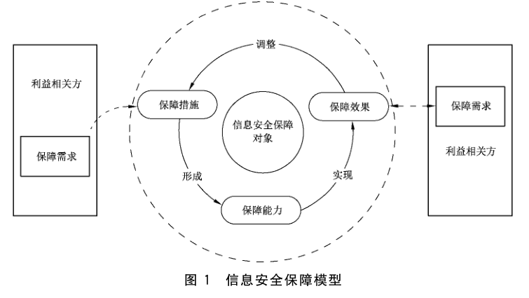
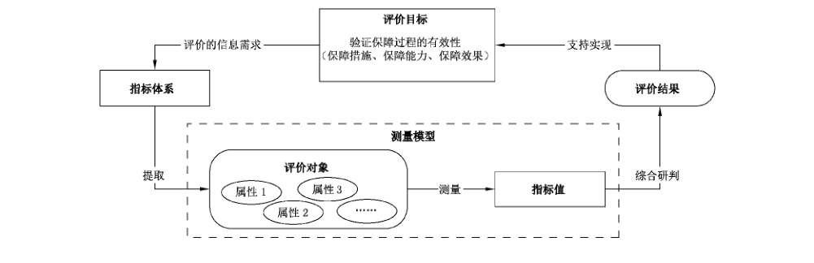
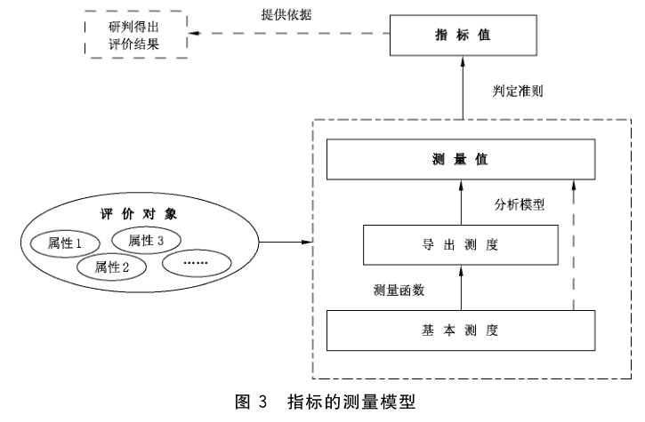

# GB/T 31495.1-2015 信息安全技术 信息安全保障指标体系及评价方法 第1部分：概念和模型

> 来源：[GB/T 31495.1-2015 国家标准详情](https://openstd.samr.gov.cn/bzgk/std/newGbInfo?hcno=E5EA0350B598E11B29E22A5387F56986)；发布日期：2015-05-15；实施日期：2016-01-01。
> PDF SHA-256：7ac33f6e0e28538a24d80235d2844d8d153638956157a1804892c4155f8bb8bb。
> 转写说明：按页渲染 PDF 并用 macOS Vision 进行图像识别，对照全部原页校正文字和参考文献；三幅模型图保留原页裁切，省略封面、目录、页眉和页脚。正式引用请核对原 PDF。

## 前言

GB/T 31495《信息安全技术 信息安全保障指标体系及评价方法》分为如下 3 部分：

- 第 1 部分：概念和模型；
- 第 2 部分：指标体系；
- 第 3 部分：实施指南。

本部分为 GB/T 31495 的第 1 部分。

本部分按照 GB/T 1.1—2009 给出的规则起草。

请注意本文件的某些内容可能涉及专利。本文件的发布机构不承担识别这些专利的责任。

本部分由全国信息安全标准化技术委员会（SAC/TC 260）提出并归口。

本部分起草单位：国家信息中心、国家新闻出版广电总局监管中心、中国信息安全测评中心、中国电信集团、中国移动通信集团、大连理工大学、国家能源局信息中心、江苏省信息中心、中国民航大学、中国电力科学研究院。

本部分主要起草人：何德全、吕欣、王宪磊、王长胜、郭艳卿、杨月圆、李守鹏、吕汉阳、杜巍、肖英、张茉楠、罗程、吴志军、杨一曼、谢东晖、程露、胡红升、孙小红、徐浩、周智、陈敏时、雷缙、樊晖、高昆仑、李鹏、李慧。

## 引言

GB/T 31495 依据国家对信息安全保障工作的相关要求，提出了信息安全保障评价的概念和模型、指标体系及实施指南。

GB/T 31495 由 3 部分组成。第 1 部分描述了本标准各部分通用的基础性概念，给出了信息安全保障及信息安全保障评价的概念和模型，给出了指标的测量模型；第 2 部分在第 1 部分的模型指导下给出了信息安全保障指标体系和指标测量过程；第 3 部分给出了信息安全保障评价工作实施所应遵照的要求、流程和方法。

GB/T 31495 主要用于：为政府管理部门的信息安全态势判断和宏观决策提供支持；为基础信息网络和重要信息系统的管理部门及运营单位的信息安全管理工作提供支持。

## 1 范围

GB/T 31495 的本部分界定了信息安全保障评价的基本概念，确立了信息安全保障评价的一般模型。

本部分适用于信息安全保障评价工作。

## 2 规范性引用文件

下列文件对于本文件的应用是必不可少的。凡是注日期的引用文件，仅注日期的版本适用于本文件。凡是不注日期的引用文件，其最新版本（包括所有的修改单）适用于本文件。

- GB/T 25069—2010 信息安全技术 术语

## 3 术语和定义

GB/T 25069—2010 中界定的以及下列术语和定义适用于本文件。

### 3.1 信息安全保障 information security assurance

对信息和信息系统的安全属性及功能、效率进行保障的一系列适当行为或过程。

### 3.2 信息安全保障评价 evaluation of information security assurance

收集信息安全保障证据，并获得信息安全保障值的过程和途径。

### 3.3 信息安全保障措施 measures for information security assurance

为达到信息安全目的所采用的保障手段的集合。

### 3.4 信息安全保障能力 capability of information security assurance

被保障实体安全防御、响应和恢复等特性的体现。

### 3.5 信息安全保障效果 effects of information security assurance

被保障实体的信息安全保障目标和属性的实现程度。

## 4 信息安全保障模型

信息安全保障模型是采用过程方法建立的。

图 1 说明了信息安全保障是根据利益相关方的保障需求建立保障措施，形成保障能力，以实现保障效果的过程。根据利益相关方对保障效果的反馈，可以动态调整保障措施，以更好地满足保障需求。

> 注：组织内诸过程的系统的应用，连同这些过程的识别和相互作用及其管理，可称之为“过程方法”。参见 GB/T 22080—2008《信息技术 安全技术 信息安全管理体系 要求》。

信息安全保障包含三个环节：

- 建立保障措施。保障措施是基于利益相关方的保障需求设计的一系列保障手段，是实现信息安全保障需求的途径。
- 形成保障能力。保障能力是保障措施作用于保障对象过程中所形成的能力，是从防御过程的视角对保障措施运行有效性的体现。
- 实现保障效果。保障效果是保障能力对利益相关方保障需求的满足程度，是从保障对象安全目标实现程度的视角对保障措施运行有效性的体现。

利益相关方是指与保障对象的信息安全相关的主管部门、运营机构和用户等。

## 5 信息安全保障评价模型

信息安全保障评价是为了验证信息安全保障过程的有效性而开展的一系列评价活动。

信息安全保障评价的过程是基于评价目标（即评价的信息需求）设计指标体系，从每项指标中提取该指标的评价对象及其属性，通过一定的测量模型和方法得出单项指标值，再进行综合研判，获得评价结果，用于支持评价目标的实现。图 2 给出了信息安全保障评价模型。

为进一步描述对指标进行测量的过程，图 3 给出了信息安全保障的测量模型。信息安全保障的测量模型描述了如何将评价对象的相关属性进行量化并通过一系列测量过程得出测量结果的过程。

图 3 所示，属性是评价对象的可定量或定性识别的特征。基本测度是指对测量对象的属性进行基本测量得到的测度（一般为统计所得的原始数据或资料）。测量函数是对基本测度进行组合以生成导出测度的计算。导出测度由两个或两个以上基本测度组合运算得出。分析模型是对导出测度进行计算得出测量值的函数。测量值经过判定准则得到指标值。

## 参考文献

- [1] GB/T 17532—2005 术语工作 计算机应用 词汇
- [2] GB/T 19001—2008 质量管理体系 要求（ISO 9001:2008）
- [3] GB/T 20917—2007 软件工程 软件测量过程
- [4] GB/T 20984—2007 信息安全技术 信息安全风险评估规范
- [5] GB/Z 20986—2007 信息安全技术 信息安全事件分类分级指南
- [6] GB/T 20988—2007 信息安全技术 信息系统灾难恢复规范
- [7] GB/T 22080—2008 信息技术 安全技术 信息安全管理体系 要求（ISO/IEC 27001:2005）
- [8] GB/T 22239—2008 信息安全技术 信息系统安全等级保护基本要求
- [9] GB/T 29830.1—2013 信息技术 安全技术 信息安全保障框架 第1部分：综述和框架
- [10] GA/T 713—2007 信息安全技术 信息系统安全管理测评
- [11] ISO/IEC 15408-1:2009 Information technology—Security techniques—Evaluation criteria for IT security—Part 1: Introduction and general model
- [12] ISO/IEC 27004:2009 Information technology—Security techniques—Information security management—Measurement
- [13] NIST Special Publication 800-37: Guide for Applying the Risk Management
- [14] 公通字[2007]43 号《信息安全等级保护管理办法》
- [15] Federal Information Security Management Act（联邦信息安全管理法案）
- [16] National Security Agency. National Information Systems Security Glossary. NSTISSI 4009. Fort Meade, MD. Sept. 2000.
- [17] 钱学森. 创建系统学（新世纪版）. 上海：上海交通大学出版社，2007.
- [18] 赵战生，杜虹，吕述望. 信息安全保密教程. 合肥：中国科学技术大学出版社，2006.
- [19] 沈昌祥. 信息安全工程导论. 北京：电子工业出版社，2003.
- [20] 吴世忠，陈晓桦，李鹤田，李斌，等. 信息安全测评认证—理论与实际. 合肥：中国科学技术大学出版社，2006.
- [21] 冯登国，蔡吉人. 网络安全与密码学. 贵州：贵州科学技术出版社，2004.
- [22] 宁家骏. 信息内容安全. 贵州：贵州科技出版社，2004.
