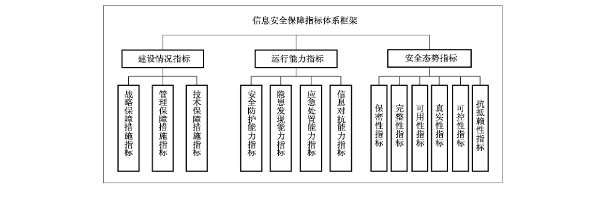

# GB/T 31495.2-2015 信息安全技术 信息安全保障指标体系及评价方法 第2部分：指标体系

> 来源：[GB/T 31495.2-2015 国家标准详情](https://openstd.samr.gov.cn/bzgk/std/newGbInfo?hcno=698A9EDE098644F386B4563FE01FCC0A)；封面发布日期：2015-05-15；实施日期：2016-01-01。
> PDF SHA-256：40b0f187ebc3008730b86b535f4ac670655d0af262857ed819b2ed0657aed2ee。
> 官方 PDF 共 41 页，已依据页面图像逐页校核；连续转写，已去除原件页码与分页。附录 A 的 24 张测量表已按页图重建。

## 前言

GB/T 31495《信息安全技术 信息安全保障指标体系及评价方法》分为如下 3 部分：

- 第 1 部分：概念和模型；

- 第 2 部分：指标体系；

- 第 3 部分：实施指南。

本部分为GB/T 31495的第2部分。

本部分按照GB/T 1.1—2009给出的规则起草。

请注意本文件的某些内容可能涉及专利。本文件的发布机构不承担识别这些专利的责任。

本部分由全国信息安全标准化技术委员会（SAC/TC 260）提出并归口。

本部分起草单位：国家信息中心、国家新闻出版广电总局监管中心、中国信息安全测评中心、中国电信集团、中国移动通信集团、大连理工大学、国家能源局信息中心、江苏省信息中心、中国民航大学、中国电力科学研究院。

本部分主要起草人：何德全、吕欣、王宪磊、王长胜、郭艳卿、杨月圆、李守鹏、吕汉阳、杜巍、肖英、张茉楠、罗程、吴志军、杨一曼、谢东晖、程露、胡红升、孙小红、徐浩、周智、陈敏时、雷缙、樊晖、高昆仑、李鹏、李慧。

## 引言

GB/T 31495依据国家对信息安全保障工作的相关要求，提出了信息安全保障评价的概念和模型、指标体系及实施指南。

GB/T 31495由3部分组成。第1部分描述了本标准各部分通用的基础性概念，给出了信息安全保障及信息安全保障评价的概念和模型，给出了指标的测量模型；第2部分在第1部分的模型指导下给出了信息安全保障指标体系和指标测量过程；第3部分给出了信息安全保障评价工作实施所应遵照的要求、流程和方法。

GB/T 31495 主要用于：政府管理部门的信息安全态势判断和宏观决策提供支持；为基础信息网络和重要信息系统的管理部门及运营单位的信息安全管理工作提供支持。

## 1 范围

GB/T 31495 的本部分规定了用于开展信息安全保障评价的指标及其释义。

本部分适用于信息安全保障评价工作。

## 2 规范性引用文件

下列文件对于本文件的应用是必不可少的。凡是注日期的引用文件，仅注日期的版本适用于本文件。凡是不注日期的引用文件，其最新版本（包括所有的修改单）适用于本文件。

- GB/T 20988—2007 信息安全技术 信息系统灾难恢复规范

- GB/T 31495.1—2015 信息安全技术 信息安全保障指标体系及评价方法 第 1 部分：概念和模型

## 3 术语和定义

GB/T 31495.1—2015中界定的以及下列术语和定义适用于本文件。

### 3.1 基础信息网络 fundamental information networks

承担公共通信、广播电视传输的电信网、互联网、广播电视网等信息网络。

### 3.2 重要信息系统 critical information systems

关系国家安全、经济命脉、社会稳定的信息系统。

### 3.3 保密性 confidentiality

使信息不泄露给未经授权的个人、实体、进程，或不被其读取的特性。

［改写 GB/T 25069—2010，定义 2.1.1］

### 3.4 完整性 integrity

使数据在未授权情况下，不被个人、实体、进程更改或破坏的特性。

［改写 GB/T 25069—2010，定义 2.1.36］

### 3.5 可用性 availability

已授权实体一旦需要就可访问和使用数据、网络和系统资源的特性。

［改写 GB/T 25069—2010，定义 2.1.20］

### 3.6 真实性 authenticity

能够核实和信赖一个合法的传输、信息或信息源的可认证性的特性。

### 3.7 可控性 controllability

对未授权实体加以有效控制的特性，以保障所属设备、数据和网络系统的合法使用。

### 3.8 抗抵赖性 non-repudiation

也称不可抵赖性或不可否认性，即网络信息系统的信息交互过程中参与者不能否认或抵赖曾经完成的操作。

［改写 GB/T 25069—2010，定义 2.1.17］

### 3.9 信息安全意识 information security awareness

人们对信息安全现实的高级心理反应形式，即人们面对有可能对个人或组织造成损失的外在环境条件的戒备。

### 3.10 应急演练 emergency drill

为训练人员和提高应急响应能力而根据应急预案和应急响应计划进行活动的过程。

### 3.11 信息篡改 information tampering

未经授权将信息系统中的信息更换为攻击者所提供的信息。

### 3.12 网络瘫痪 network paralyzed

信息网络丧失通信功能的状态。

### 3.13 非法控制 illegal control

违反规范使系统或网络按实施非法控制者的意愿活动。

## 4 指标体系

### 4.1 指标层级

指标层级是对评价内容和对象进行逐层分解得到的结构，指标层级为指标体系的有序性提供保证，为构建指标体系提供框架基础。

图1给出了指标层级的递阶层次结构。

信息安全保障指标体系共有三个层级，其中一级指标和二级指标构成指标体系框架，三级指标为底层指标。当指标需要调整时，一级指标和二级指标相对固定，三级指标相对灵活。

### 4.2 指标体系框架

图2给出了信息安全保障指标体系框架。

信息安全保障指标体系框架对应信息安全保障体系的一级指标和二级指标。

一级指标依据 GB/T 31495.1—2015中图1提出的信息安全保障的三个环节（即保障措施、保障能力和保障效果）设计，建设情况指标用于评价保障措施，运行能力指标用于评价保障能力，安全态势指标用于评价保障效果。

二级指标依据信息安全保障对象和内容对一级指标进行分析和分解后设计。建设情况指标下设3项二级指标，分别为战略保障措施指标、管理保障措施指标、技术保障措施指标。运行能力指标下设4项二级指标，分别安全防护能力指标、隐患发现能力指标、应急处置能力指标、信息对抗能力指标。

安全态势指标下设6项二级指标，分别为保密性指标、完整性指标、可用性指标、真实性指标、可控性指标、抗抵赖性指标。

### 4.3 指标体系框架描述

#### 4.3.1 建设情况指标

建设保障措施指标主要评价信息安全保障措施的建设情况。

#### 4.3.2 战略保障措施指标

信息安全保障中的“战略”是指为了完成信息安全保障的使命、功能、任务等，由信息安全主管部门制定的信息安全发展战略、五年规划、中长期发展计划等文件的通称。战略保障措施指标主要评价信息安全战略和规划的制定情况等。

#### 4.3.3 管理保障措施指标

信息安全保障中的“管理”是指为了完成信息安全保障的使命、功能、任务等，所采用政策法规、管理方法、管理职责、管理标准的通称。管理保障措施指标主要评价法规标准体系建设情况、组织机构建设情况、人才队伍保障情况、安全意识保障情况、资金投入保障情况等方面。

#### 4.3.4 技术保障措施指标

信息安全保障中的“技术”是指为完成信息安全保障的使命、功能、任务等，所提供的技术基础设施、技术平台和工具等技术保障手段的通称。技术保障措施指标主要评价信息安全技术、产品、服务以及产业化等方面。

#### 4.3.5 运行能力指标

运行能力指标主要评价信息安全保障体系的运行能力。

#### 4.3.6 安全防护能力指标

安全防护能力指标主要评价信息安全保障措施防护攻击和破坏行为的有效性。

#### 4.3.7 隐患发现能力指标

隐患发现能力指标主要评价信息安全保障措施检测和发现风险的有效性。

#### 4.3.8 应急处置能力指标

应急处置能力指标主要评价信息安全保障措施应对信息安全事件的有效性，包括对信息安全事件的预警和响应能力，以及在出现危险、事故、侵害后的恢复能力。

#### 4.3.9 信息对抗能力指标

信息对抗能力指标主要评价信息安全保障措施应对大规模网络攻击的有效性。

#### 4.3.10 安全态势指标

安全态势指标主要评价信息安全保障体系的态势情况。

#### 4.3.11 保密性指标

保密性指标主要评价对“信息不被未授权的个人、实体或者过程利用或知悉”的保障效果。

#### 4.3.12 完整性指标

完整性指标主要评价对“信息未经授权不被修改”的保障效果。

#### 4.3.13 可用性指标

可用性指标主要评价对“信息系统在需要时被授权用户使用”的保障效果。

#### 4.3.14 真实性指标

真实性指标主要评价对“信息内容的来源真实可靠”的保障效果。

#### 4.3.15 可控性指标

可控性指标主要评价对“对信息的传播方式以及对访问其信息资源的人或实体的使用方式进行有效控制”的保障效果。

#### 4.3.16 抗抵赖性指标

抗抵赖性指标主要评价对“所有参与者都不能事后虚假地否认曾经完成的操作”的保障效果。

### 4.4 指标

在4.2和4.3给出的指标体系框架约束下，表1给出了信息安全保障指标体系。信息安全保障指标体系包含由3个一级指标和13个二级指标构成的指标框架以及24个三级指标，三级指标为可用于测量的底层指标，三级指标测量过程见附录 A。

**表 1 信息安全保障指标体系**

| 一级指标 | 二级指标 | 三级指标 |
| --- | --- | --- |
| 建设情况指标 | 战略保障措施指标 | ZB01 信息安全战略指标 |
| 建设情况指标 | 管理保障措施指标 | ZB02 法规建设指标 |
| 建设情况指标 | 管理保障措施指标 | ZB03 标准建设指标 |
| 建设情况指标 | 管理保障措施指标 | ZB04 组织机构建设指标 |
| 建设情况指标 | 管理保障措施指标 | ZB05 信息安全岗位指标 |
| 建设情况指标 | 管理保障措施指标 | ZB06 信息安全人才储备指标 |
| 建设情况指标 | 管理保障措施指标 | ZB07 信息安全意识指标 |
| 建设情况指标 | 管理保障措施指标 | ZB08 信息安全建设投资指标 |
| 建设情况指标 | 技术保障措施指标 | ZB09 信息安全产业规模指标 |
| 建设情况指标 | 技术保障措施指标 | ZB10 关键 IT 设备国产化指标 |
| 建设情况指标 | 技术保障措施指标 | ZB11 信息安全服务支撑指标 |
| 运行能力指标 | 安全防护能力指标 | ZB12 等级保护测评指标 |
| 运行能力指标 | 安全防护能力指标 | ZB13 网络信任体系指标 |
| 运行能力指标 | 安全防护能力指标 | ZB14 信息安全监控指标 |
| 运行能力指标 | 隐患发现能力指标 | ZB15 风险评估指标 |
| 运行能力指标 | 应急处置能力指标 | ZB16 灾难备份指标 |
| 运行能力指标 | 应急处置能力指标 | ZB17 事件处置指标 |
| 运行能力指标 | 信息对抗能力指标 | ZB18 应急演练指标 |
| 安全态势指标 | 保密性指标 | ZB19 信息泄露指标 |
| 安全态势指标 | 完整性指标 | ZB20 数据篡改指标 |
| 安全态势指标 | 可用性指标 | ZB21 网络瘫痪指标 |
| 安全态势指标 | 真实性指标 | ZB22 网络诈骗指标 |
| 安全态势指标 | 可控性指标 | ZB23 非法控制指标 |
| 安全态势指标 | 抗抵赖性指标 | ZB24 事件取证指标 |

## 5 指标释义

### 5.1 信息安全战略指标（ZB01）

信息安全战略主要指信息安全主管部门制定的统领信息安全发展全局的指导性文件。信息安全战略指标主要评价是否：

a） 明确了信息安全战略方针、战略目标、战略部署；

b） 制定发布了信息安全规划文件；

c） 拥有战略研究队伍和智库机构。

当上述三项内容都实现时，表明信息安全战略建设要求得到满足。

### 5.2 法规建设指标（ZB02）

信息安全法律法规包括所有与信息安全相关的全国人大颁布的法律、国务院发布的实施条例及国务院令、各部委发布的部门规章、各省发布的地方法规等。法规建设指标主要评价是否：

a） 制定了信息安全基础性法律法规；

b） 信息安全法律体系的内容齐全、结构严密、内在协调；

c） 定期开展信息安全法律法规的宣贯活动。

当上述三项内容都实现时，表明信息安全法规建设要求得到满足。

### 5.3 标准建设指标（ZB03）

信息安全标准包括国家标准化管理委员会发布或管理的信息安全国家标准和各领域的信息安全行业标准。标准建设指标主要评价是否：

a） 信息安全标准符合标准发展规划要求；

b） 信息安全标准在行业或技术、管理领域适用；

c） 信息安全标准与国际标准接轨。

当上述三项内容都实现时，表明信息安全标准建设要求得到满足。

### 5.4 组织机构建设指标（ZB04）

信息安全组织机构是指机构部门中负责管理与协调信息安全相关工作或具备信息安全管理职责的部门，以及基础网络和重要系统中负责信息安全工作的部门等。组织机构建设指标主要评价是否：

a） 组织机构设立较为健全；

b） 管理制度和责任制较为明晰；

c） 各组织机构之间较协同。

当上述三项内容都实现时，表明信息安全组织机构建设要求得到满足。

### 5.5 信息安全岗位指标（ZB05）

信息安全岗位指标主要评价信息安全从业人员对专业机构认证的各类信息安全资质的持有情况。

当取得资质的人员达到一定比例时，表明信息安全岗位建设要求得到满足。

### 5.6 信息安全人才储备指标（ZB06）

信息安全人才储备指标主要评价信息安全相关专业的在校生对社会信息安全人才缺口的满足程度。

当人才储备与人才缺口的比值处于合理区间时，表明信息安全人才储备建设要求得到满足。

### 5.7 信息安全意识指标（ZB07）

信息安全意识指标主要评价网民的个人信息保护意识（如密码设置情况）和个人计算机安全防范意识（如安全软件使用情况）。

当通过信息安全意识水平测试的网民达到一定比例时，表明网民信息安全意识建设要求得到满足。

> 注：信息安全意识水平测试是指有关部门组织的用于了解网民信息安全意识水平的调查活动。

### 5.8 信息安全建设投资指标（ZB08）

信息安全建设投资指标主要评价信息安全建设投资情况。信息安全建设投资主要指财政决算（或预算）中用于信息安全建设方面的资金。

当信息安全建设投资总额占信息化建设投资总额的比值处于合理区间时，表明信息安全建设投资要求得到满足。

### 5.9 信息安全产业规模指标（ZB09）

信息安全产业规模指标主要评价信息安全产品和服务市场的销售情况。

当信息安全产品和服务的销售增长率达到一定比率时，表明信息安全产业规模建设要求得到满足。

### 5.10 关键 IT 设备国产化指标（ZB10）

关键IT 设备国产化指标主要评价重要的信息基础设施或信息系统中采用国产品牌设备的情况。

当关键IT 设备国产化率达到一定比率时，表明国产化建设要求得到满足。

> 注：关键IT 设备是指基础信息网络和重要信息系统的核心网络或系统设备，包括操作系统、数据库、服务器、核心通信设备等。

### 5.11 信息安全服务支撑指标（ZB11）

信息安全服务支撑指标主要评价规模以上信息安全企业（或机构、组织）的信息安全服务资质取得情况。

当企业持有的信息安全服务资质增长率达到一定比例时，表明信息安全服务支撑建设要求得到满足。

> 注：信息安全服务资质是指有关机构（或组织）向符合特定要求的企业（或机构、组织）发放的资格证书。信息安全服务资质主要包括安全工程类服务资质、灾难恢复类服务资质、安全开发类服务资质、应急处理服务资质、风险评估服务资质、安全集成服务资质、电子认证服务资质等。

### 5.12 等级保护测评指标（ZB12）

等级保护测评指标主要评价基础信息网络和重要信息系统对信息安全等级保护测评的通过情况。

当信息系统的等级保护测评通过率达到一定比率时，表明等级保护要求得到满足。

> 注：信息系统安全等级保护测评的相关要求见 GB/T 28448—2012。

### 5.13 网络信任体系指标（ZB13）

网络信任体系指标主要评价基础信息网络或重要信息系统的4A 管理实施情况。

当信息系统的4A管理覆盖率达到一定比率时，表明网络信任体系能力得到满足。

> 注：4A 管理是指统一用户账号（Account）管理、统一认证（Authentication）管理、统一授权（Authorization）管理和统一审计（Audit）管理。

### 5.14 信息安全监控指标（ZB14）

信息安全监控指标主要评价基础信息网络和重要信息系统对信息安全实时监控的实施和覆盖情况。

当信息系统的信息安全实时监控覆盖面达到一定比率时，表明信息安全监控体系能力得到满足。

> 注：信息安全实时监控是指利用一定的措施和手段对信息网络和信息系统进行实时监控的保障活动。

### 5.15 风险评估指标（ZB15）

风险评估指标主要评价基础信息网络或重要信息系统的信息安全风险评估活动开展情况。

当信息系统的风险评估开展和改进率达到一定比率时，表明信息系统风险评估能力得到满足。

> 注：信息安全风险评估的定义见 GB/T 20984—2007 中 3.7。

### 5.16 灾难备份指标（ZB16）

灾难备份指标主要评价基础信息网络和重要信息系统是否按照 GB/T 20988—2007中附录A的有关要求开展灾难恢复能力等级建设，是否按要求开展灾难备份与灾难恢复工作。

当按要求开展灾难备份的信息系统比例达到一定数值时，表明灾难备份能力得到满足。

### 5.17 事件处置指标（ZB17）

事件处置指标主要评价基础信息网络或重要信息系统对其发生的信息安全事件按照一定的信息安全事件管理规范进行通报与处理的情况。

当事件处置率达到一定数值时，表明事件处置能力得到满足。

### 5.18 应急演练指标（ZB18）

应急演练指标主要评价基础信息网络或重要信息系统的运行和管理部门是否：

a） 制定了信息安全应急演练预案。

b） 定期组织开展应急演练。

c） 对演练中所发现问题进行改进并形成演练制度。

当上述三项内容都实现时，表明信息安全应急演练能力得到满足。

### 5.19 信息泄露指标（ZB19）

信息泄露指标主要评价信息安全保障保密性的实现程度，主要考察基础信息网络和重要信息系统发生的信息泄露事件的数量。

当信息泄露事件数量低于一定数量时，表明保密性态势要求得到满足。

> 注：信息泄露事件是指违反信息保密的相关法律、法规和规章，使国家秘密、企业商业秘密、用户个人信息等被不应知悉者知悉，导致严重影响或破坏的信息安全事件。

### 5.20 数据篡改指标（ZB20）

数据篡改指标主要评价信息安全保障完整性的实现程度，主要考察基础信息网络和重要信息系统发生的数据篡改事件的数量。

当数据篡改事件数量低于一定数量时，表明完整性态势要求得到满足。

> 注：数据篡改是指一些组织或个人未经授权将重要数据或信息更换为攻击者所提供的信息而导致的信息安全事件，主要指政府网站被篡改、广播电视非法插播以及国家基础信息网络或重要信息系统发生的数据库被篡改等事件。广播电视非法插播是指犯罪分子通过破坏缆线等物理性破坏或者通过删除、修改、增加广播电视设备系统中的控制程序等功能性破坏进行非法插播的行为。

### 5.21 网络瘫痪指标（ZB21）

网络瘫痪指标主要评价信息安全保障可用性的实现程度，主要考察基础信息网络和重要信息系统发生的网络瘫痪事件数量。

当网络瘫痪事件数量低于一定数量时，表明可用性态势要求得到满足。

> 注：网络瘫痪是指由于基础网络或重要系统的关键业务支撑部分无法正常运行从而导致严重或特别严重的影响或破坏。

### 5.22 网络诈骗指标（ZB22）

网络诈骗指标主要评价信息安全保障真实性的实现程度，主要考察互联网发生的网络诈骗事件的数量。

当网络诈骗事件数量低于一定数量时，表明真实性态势要求得到满足。

> 注：网络诈骗是指一些组织或个人为达到某种目的在互联网上以各种形式骗取信息的事件，以网络钓鱼为代表。

网络钓鱼主要是指通过各种方式伪造互联网上的银行、电子商务等服务，以骗取用户个人信息，从而达到窃取用户利益的目的。

### 5.23 非法控制指标（ZB23）

非法控制指标主要评价信息安全保障可控性的实现程度，主要考察境内的主机被木马或僵尸网络控制服务器控制的事件的数量。

当非法控制事件数量低于一定数量时，表明可控性态势要求得到满足。

### 5.24 事件取证指标（ZB24）

事件取证指标主要评价信息安全保障抗抵赖性的实现程度，主要考察发生的信息安全事件中得到取证的事件数量。

当事件取证比例达到一定要求时，表明抗抵赖性态势要求得到满足。

## 附录 A（规范性附录）指标测量过程

### A.1 ZB01 信息安全战略指标

| 项目 | 内容 |
| --- | --- |
| 指标名称 | 信息安全战略指标 |
| 测量对象 | 战略文件和发展规划文件以及智库机构设立情况 |
| 属性 | 1. 战略顶层设计； 2. 发展目标； 3. 发展规划； 4. 智库队伍 |
| 基本测度 | 1. 信息安全战略顶层设计健全程度； 2. 信息安全发展目标明确程度； 3. 信息安全发展规划的制定发布情况； 4. 信息安全战略研究队伍和智库机构的建设情况 |
| 测量方法 | 1. 查看信息安全战略是否及时调整、战略间是否协同、战略与技术发展是否一致； 2. 查看信息安全发展目标是否明确； 3. 确认是否制定并发布了信息安全中长期发展规划； 4. 调研是否建设了信息安全智库或研究队伍 |
| 测量方法类型 | 1～4. 主观类 |
| 标度 | 1～4. 为 0 或 1 的整数，是为 1，否为 0 |
| 测量单位 | — |
| 导出测度 | — |
| 测量函数 | — |
| 测量值 | 信息安全战略构建程度 |
| 分析模型 | 将四项基本测度的取值相加 |
| 决策准则 | 测量值的取值宜为 4 |
| 指标值 | 当测量值为 4 时，指标 ZB01 的值为 1； 当测量值为 3 时，指标 ZB01 的值为 0.8； 当测量值为 2 时，指标 ZB01 的值为 0.5； 当测量值为 1 时，指标 ZB01 的值为 0.3； 当测量值为 0 时，指标 ZB01 的值为 0 |

### A.2 ZB02 法规建设指标

| 项目 | 内容 |
| --- | --- |
| 指标名称 | 法规建设指标 |
| 测量对象 | 已出台的法律法规文件和法律法规宣贯会议记录 |
| 属性 | 1. 基础性法律法规； 2. 法律体系； 3. 法规宣贯情况； 4. 网民人数 |
| 基本测度 | 1. 基础法律的制定情况； 2. 法律体系内容和结构的完善情况及其内在协调情况； 3. 法规宣贯人次； 4. 网民总数 |
| 测量方法 | 1. 查找已出台的法律法规文件中是否有信息安全基本性法律法规； 2. 查看已出台的法律文件，判断法律体系是否内容完整、结构完善、内在协调； 3. 统计信息安全法律法规的宣贯人次； 4. 统计网民总数 |
| 测量方法类型 | 1. 主观类； 2. 主观类； 3. 客观类； 4. 客观类 |
| 标度 | 1. 为 0 或 1 的整数，是为 1，否为 0； 2. 为 0 或 1 的整数，是为 1，否为 0； 3. 为从 0 到无穷大的整数； 4. 为从 0 到无穷大的整数 |
| 测量单位 | 1. —； 2. —； 3. 人次； 4. 万人 |
| 导出测度 | — |
| 测量函数 | — |
| 测量值 | a）法律体系建设程度； b）法规宣贯覆盖比例 |
| 分析模型 | a）将“基础法律的制定情况”的取值加上“法律体系内容和结构的完善情况及其内在协调情况”的取值； b）将“法规宣贯人次”除以“网民总数” |
| 决策准则 | 测量值 a）项的取值宜为 2； 测量值 b）项的取值宜大于或等于 1 |
| 指标值 | 当测量值 a）项的取值 = 2 且测量值 b）项的取值 ≥ 1 时，指标 ZB02 的值为 1； 当测量值 a）项的取值 = 2 且 0 ≤ 测量值 b）项的取值 < 1 时，指标 ZB02 的值为 0.8； 当测量值 a）项的取值 = 1 且测量值 b）项的取值 ≥ 1 时，指标 ZB02 的值为 0.5； 当测量值 a）项的取值 = 1 且 0 ≤ 测量值 b）项的取值 < 1 时，指标 ZB02 的值为 0.3； 当测量值 a）项的取值 = 0 时，指标 ZB02 的值为 0 |

### A.3 ZB03 标准建设指标

| 项目 | 内容 |
| --- | --- |
| 指标名称 | 标准建设指标 |
| 测量对象 | 已发布的信息安全标准和标准宣贯会议记录 |
| 属性 | 1. 标准规划的完成情况； 2. 标准推广情况； 3. 标准与国际接轨情况； 4. 标准宣贯会开展情况 |
| 基本测度 | 1. 信息安全标准与信息安全标准发展规划要求的符合情况； 2. 标准在行业领域的适用情况； 3. 与国际标准的接轨情况； 4. 标准宣贯情况 |
| 测量方法 | 1. 评判标准体系是否按照标准发展规划要求建设； 2. 调研标准在行业领域推广使用过程中是否遇到障碍； 3. 调研国家标准与国际标准是否接轨； 4. 检查是否开展了标准宣贯活动 |
| 测量方法类型 | 1～4. 主观类 |
| 标度 | 1～4. 为 0 或 1 的整数，是为 1，否为 0 |
| 测量单位 | — |
| 导出测度 | — |
| 测量函数 | — |
| 测量值 | 标准体系建设程度 |
| 分析模型 | 将四项基本测度的取值相加 |
| 决策准则 | 测量值宜为 4 |
| 指标值 | 当测量值为 4 时，指标 ZB03 的值为 1； 当测量值为 3 时，指标 ZB03 的值为 0.8； 当测量值为 2 时，指标 ZB03 的值为 0.5； 当测量值为 1 时，指标 ZB03 的值为 0.3； 当测量值为 0 时，指标 ZB03 的值为 0 |

### A.4 ZB04 组织机构建设指标

| 项目 | 内容 |
| --- | --- |
| 指标名称 | 组织机构建设指标 |
| 测量对象 | 信息安全组织机构 |
| 属性 | 1. 机构设置； 2. 管理制度； 3. 责任制； 4. 机构间的合作 |
| 基本测度 | 1. 机构设立的健全性； 2. 管理制度构建情况； 3. 责任制的明晰程度； 4. 各机构间的协同性 |
| 测量方法 | 1. 确认是否设立了信息安全领导协调机构； 2. 确认是否明确了信息安全主管领导； 3. 确认是否自上而下逐级明确责任管理部门； 4. 调研各机构合作是否协同 |
| 测量方法类型 | 1～4. 主观类 |
| 标度 | 1～4. 为 0 或 1 的整数，是为 1，否为 0 |
| 测量单位 | — |
| 导出测度 | 管理制度和责任制明确情况 |
| 测量函数 | 当“管理制度构建情况”取值为 0 时，“管理制度和责任制明确情况”取值为 0；当“管理制度构建情况”取值为 1 时，“管理制度和责任制明确情况”的取值 = “管理制度构建情况”的取值加上“责任制的明晰程度”的取值 |
| 测量值 | 标准体系建设程度 |
| 分析模型 | 将“机构设立的健全性”的取值加上“管理制度和责任制明确情况”的取值加上“各机构间的协同性”的取值 |
| 决策准则 | 测量值宜为 4 |
| 指标值 | 当测量值为 4 时，指标 ZB04 的值为 1； 当测量值为 3 时，指标 ZB04 的值为 0.8； 当测量值为 2 时，指标 ZB04 的值为 0.5； 当测量值为 1 时，指标 ZB04 的值为 0.3； 当测量值为 0 时，指标 ZB04 的值为 0 |

### A.5 ZB05 信息安全岗位指标

| 项目 | 内容 |
| --- | --- |
| 指标名称 | 信息安全岗位指标 |
| 测量对象 | 从业人员数据库 |
| 属性 | 1. 从业人员总数； 2. 从业人员对信息安全资质的取得情况 |
| 备注 | 从业人员的信息安全资质主要包括 CISP（注册信息安全专业人员）、CISE（注册信息安全工程师）、CISO（注册信息安全管理人员）、CISA（注册信息安全审计师）、CISP-DRP（注册信息安全灾难恢复工程师）以及 ISMS（信息安全管理体系）审核员和 CISAW（信息安全保障从业人员）等 |
| 基本测度 | 1. 信息安全从业人员数； 2. 取得资质的从业人员数 |
| 测量方法 | 1. 统计从事信息安全相关岗位的人数； 2. 统计至少取得一项信息安全资质且从事信息安全相关岗位的人数 |
| 测量方法类型 | 1～2. 客观类 |
| 标度 | 1～2. 从 0 到无穷大的整数 |
| 测量单位 | 1～2. 万人 |
| 导出测度 | — |
| 测量函数 | — |
| 测量值 | 取得资质的人员比例 |
| 分析模型 | 将“取得资质的从业人员数”除以“信息安全从业人员数” |
| 决策准则 | 测量值宜为 1 |
| 指标值 | 指标 ZB05 的值 = 测量值 |

### A.6 ZB06 信息安全人才储备指标

| 项目 | 内容 |
| --- | --- |
| 指标名称 | 信息安全人才储备指标 |
| 测量对象 | 1. 高校人才数据库； 2. 信息安全人才发展研究报告 |
| 属性 | 1. 信息安全人才储备情况； 2. 信息安全人才需求情况 |
| 基本测度 | 1. 信息安全专业在校生人数； 2. 社会信息安全人才缺口 |
| 测量方法 | 1. 统计高校信息安全相关专业的在校生人数； 2. 统计社会信息安全人才缺口。 注：假设大部分信息安全专业在校生毕业后从事信息安全相关岗位的工作。 |
| 测量方法类型 | 1～2. 客观类 |
| 标度 | 1～2. 从 0 到无穷大的整数 |
| 测量单位 | 1～2. 万人 |
| 导出测度 | — |
| 测量函数 | — |
| 测量值 | 信息安全人才储备比例 |
| 分析模型 | 将“信息安全专业在校生人数”除以“社会信息安全人才缺口” |
| 决策准则 | 测量值宜大于或等于 1 |
| 指标值 | 当测量值 > 1 时，指标 ZB06 的值为 1； 当测量值 ≤ 1 时，指标 ZB06 的值 = 测量值 |

### A.7 ZB07 信息安全意识指标

| 项目 | 内容 |
| --- | --- |
| 指标名称 | 信息安全意识指标 |
| 测量对象 | 网民信息安全意识调查记录 |
| 属性 | 网民信息安全意识情况 |
| 备注 | 信息安全意识水平测试是指有关部门组织的用于了解网民信息安全意识水平的调查活动 |
| 基本测度 | 1. 网民总数； 2. 通过测试的网民数量 |
| 测量方法 | 1. 统计网民人数； 2. 统计通过信息安全意识水平测试的网民人数 |
| 测量方法类型 | 1～2. 客观类 |
| 标度 | 1～2. 从 0 到无穷大的整数 |
| 测量单位 | 1～2. 万人 |
| 导出测度 | — |
| 测量函数 | — |
| 测量值 | 网民信息安全意识水平测试通过率 |
| 分析模型 | 将“通过测试的网民数量”除以“网民总数”乘以 100% |
| 决策准则 | 测量值宜为 100% |
| 指标值 | 指标 ZB07 的值 = 测量值 / 100% |

### A.8 ZB08 信息安全建设投资指标

| 项目 | 内容 |
| --- | --- |
| 指标名称 | 信息安全建设投资指标 |
| 测量对象 | 信息化建设投资报告 |
| 属性 | 信息化及信息安全投资记录 |
| 基本测度 | 1. 信息化建设投资总额； 2. 信息安全建设投资总额 |
| 测量方法 | 1. 查找信息化建设投资总额的数值； 2. 查找信息安全建设投资总额的数值 |
| 测量方法类型 | 1～2. 客观类 |
| 标度 | 1～2. 从 0 到无穷大的整数 |
| 测量单位 | 1～2. 万元 |
| 导出测度 | — |
| 测量函数 | — |
| 测量值 | 信息安全投资占比 |
| 分析模型 | 将“信息安全建设投资总额”除以“信息化建设投资总额”乘以 100% |
| 决策准则 | 测量值宜大于或等于 20% |
| 指标值 | 当测量值 > 20% 时，指标 ZB08 的值为 1； 当测量值 ≤ 20% 时，指标 ZB08 的值 = 测量值 / 20% |

### A.9 ZB09 信息安全产业规模指标

| 项目 | 内容 |
| --- | --- |
| 指标名称 | 信息安全产业规模指标 |
| 测量对象 | 信息安全产业发展报告 |
| 属性 | 信息安全行业相关数据 |
| 基本测度 | 1. 本年度信息安全产品和服务的销售额； 2. 上一年度信息安全产品和服务的销售额 |
| 测量方法 | 1. 查看信息安全类产品和服务的销售收入； 2. 查看上一统计周期的信息安全产品和服务的销售收入 |
| 测量方法类型 | 1～2. 客观类 |
| 标度 | 1～2. 从 0 到无穷大的整数 |
| 测量单位 | 1～2. 万元 |
| 导出测度 | 信息安全产品和服务的销售额增量 |
| 测量函数 | 将“本年度信息安全产品和服务的销售额”减去“上一年度信息安全产品和服务的销售额” |
| 测量值 | 信息安全产品和服务的销售增长率 |
| 分析模型 | 将“信息安全产品和服务的销售额增量”除以“上一年度信息安全产品和服务的销售额”乘以 100% |
| 决策准则 | 测量值宜大于或等于 20% |
| 指标值 | 当测量值 > 20% 时，指标 ZB09 的值为 1； 当测量值 ≤ 20% 时，指标 ZB09 的值 = 测量值 / 20% |

### A.10 ZB10 关键 IT 设备国产化指标

| 项目 | 内容 |
| --- | --- |
| 指标名称 | 关键 IT 设备国产化指标 |
| 测量对象 | 资产登记表 |
| 属性 | 所采购关键 IT 设备的国产化情况 |
| 备注 | 关键 IT 设备国产化指标主要考察操作系统、数据库、服务器、核心通信设备等的国产化率 |
| 基本测度 | 1. 国产设备的采购总额； 2. 所有设备的采购总额 |
| 测量方法 | 1. 查看国产设备的采购总额； 2. 查看所有设备的采购总额 |
| 测量方法类型 | 1～2. 客观类 |
| 标度 | 1～2. 从 0 到无穷大的整数 |
| 测量单位 | 1～2. 万元 |
| 导出测度 | — |
| 测量函数 | — |
| 测量值 | 关键 IT 设备国产化率 |
| 分析模型 | 将“国产设备的采购总额”除以“所有设备的采购总额”乘以 100% |
| 决策准则 | 测量值宜大于或等于 90% |
| 指标值 | 当测量值 > 90% 时，指标 ZB10 的值为 1； 当测量值 ≤ 90% 时，指标 ZB10 的值 = 测量值 / 90% |

### A.11 ZB11 信息安全服务支撑指标

| 项目 | 内容 |
| --- | --- |
| 指标名称 | 信息安全服务支撑指标 |
| 测量对象 | 信息安全评估机构 |
| 属性 | 各类机构信息安全资质的颁发记录 |
| 基本测度 | 1. 本年度具备信息安全服务资质的机构数量； 2. 上一年度信息安全服务资质的机构数量 |
| 测量方法 | 1. 统计本年度具备信息安全服务资质的机构数量； 2. 统计上一年度信息安全服务资质的机构数量 |
| 测量方法类型 | 1～2. 客观类 |
| 标度 | 1～2. 从 0 到无穷大的整数 |
| 测量单位 | 1～2. 个 |
| 导出测度 | 本年度新增信息安全服务资质的机构数量 |
| 测量函数 | 将“本年度具备信息安全服务资质的机构数量”减去“上一年度信息安全服务资质的机构数量” |
| 测量值 | 机构资质增长率 |
| 分析模型 | 将“本年度新增信息安全服务资质的机构数量”除以“上一年度信息安全服务资质的机构数量”乘以 100% |
| 决策准则 | 测量值宜大于或等于 20% |
| 指标值 | 当测量值 > 20% 时，指标 ZB11 的值为 1； 当测量值 ≤ 20% 时，指标 ZB11 的值 = 测量值 / 20% |

### A.12 ZB12 等级保护测评指标

| 项目 | 内容 |
| --- | --- |
| 指标名称 | 等级保护测评指标 |
| 测量对象 | 等级保护测评机构 |
| 属性 | 等保测评记录 |
| 备注 | ① 等级保护测评指标的主要考察范围为二级、三级、四级信息系统，信息系统分级标准见 GB/T 22240—2008。 ② 信息系统是一个由人、计算机及其他外围设备等组成的能进行信息的收集、传递、存贮、加工、维护和使用的系统，一个信息系统可以是一个数据处理系统、管理信息系统、决策支持系统、专家系统或虚拟办公室 |
| 基本测度 | 1. 测评合格的二级信息系统数量； 2. 测评的二级信息系统数量； 3. 测评合格的三级信息系统数量； 4. 测评的三级信息系统数量； 5. 测评合格的四级信息系统数量； 6. 测评的四级信息系统数量 |
| 测量方法 | 1. 统计测评合格的二级信息系统数量； 2. 统计测评的二级信息系统数量； 3. 统计测评合格的三级信息系统数量； 4. 统计测评的三级信息系统数量； 5. 统计测评合格的四级信息系统数量； 6. 统计测评的四级信息系统数量 |
| 测量方法类型 | 1～6. 客观类 |
| 标度 | 1～6. 从 0 到无穷大的整数 |
| 测量单位 | 1～6. 个 |
| 导出测度 | a）二级信息系统等保测评合格比例； b）三级信息系统等保测评合格比例； c）四级信息系统等保测评合格比例 |
| 测量函数 | a）将“测评合格的二级信息系统数量”除以“测评的二级信息系统数量”； b）将“测评合格的三级信息系统数量”除以“测评的三级信息系统数量”； c）将“测评合格的四级信息系统数量”除以“测评的四级信息系统数量” |
| 测量值 | 等保测评通过比例 |
| 分析模型 | 取三项导出测度中的最小值 |
| 决策准则 | 测量值宜大于或等于 0.9 |
| 指标值 | 指标 ZB12 的值 = 测量值 |

### A.13 ZB13 网络信任体系指标

| 项目 | 内容 |
| --- | --- |
| 指标名称 | 网络信任体系指标 |
| 测量对象 | 4A 管理部门 |
| 属性 | 4A 管理记录 |
| 备注 | ① 网络信任体系指标的主要考察范围为二级、三级、四级信息系统，信息系统分级标准见 GB/T 22240—2008； ② 4A 管理是指统一用户账号（Account）管理、统一认证（Authentication）管理、统一授权（Authorization）管理和统一审计（Audit）管理均得到实施 |
| 基本测度 | 1. 开展了 4A 管理的信息系统数量； 2. 信息系统总数 |
| 测量方法 | 1. 统计开展了 4A 管理的信息系统数量； 2. 向责任人索取按规定应开展 4A 管理的信息系统数量 |
| 测量方法类型 | 1～2. 客观类 |
| 标度 | 1～2. 从 0 到无穷大的整数 |
| 测量单位 | 1～2. 个 |
| 导出测度 | — |
| 测量函数 | — |
| 测量值 | 4A 管理开展比例 |
| 分析模型 | 将“开展了 4A 管理的信息系统数量”除以“信息系统总数” |
| 决策准则 | 测量值宜为 1 |
| 指标值 | 指标 ZB13 的值 = 测量值 |

### A.14 ZB14 信息安全监控指标

| 项目 | 内容 |
| --- | --- |
| 指标名称 | 信息安全监控指标 |
| 测量对象 | 监控系统的管理数据库 |
| 属性 | 对信息系统进行实时监控的记录 |
| 备注 | 信息安全监控指标的主要考察范围为二级、三级、四级信息系统，信息系统分级标准见 GB/T 22240—2008 |
| 基本测度 | 1. 纳入监控的信息系统数量； 2. 信息系统数量 |
| 测量方法 | 1. 查看监控记录，统计所监控的信息系统数量； 2. 向责任人索取按规定应纳入监控的信息系统数量 |
| 测量方法类型 | 1～2. 客观类 |
| 标度 | 1～2. 从 0 到无穷大的整数 |
| 测量单位 | 1～2. 个 |
| 导出测度 | — |
| 测量函数 | — |
| 测量值 | 信息系统的监控比例 |
| 分析模型 | 将“纳入监控的信息系统数量”除以“信息系统数量” |
| 决策准则 | 测量值宜为 1 |
| 指标值 | 指标 ZB14 的值 = 测量值 |

### A.15 ZB15 风险评估指标

| 项目 | 内容 |
| --- | --- |
| 指标名称 | 风险评估指标 |
| 测量对象 | 风险评估机构 |
| 属性 | 对信息系统进行风险评估的记录 |
| 备注 | ① 风险评估指标的主要考察范围为二级、三级、四级信息系统，信息系统分级标准见 GB/T 22240—2008； ② 风险评估相关要求见 GB/T 20984—2007 |
| 基本测度 | 1. 已开展风险评估的信息系统数量； 2. 已实施改进的信息系统数量； 3. 信息系统总数 |
| 测量方法 | 1. 统计已开展风险评估的信息系统数量； 2. 统计已实施改进的信息系统数量； 3. 统计信息系统总数 |
| 测量方法类型 | 1～3. 客观类 |
| 标度 | 1～3. 从 0 到无穷大的整数 |
| 测量单位 | 1～3. 个 |
| 导出测度 | a）风险评估开展比例； b）风险评估改进比例 |
| 测量函数 | a）将“已开展风险评估的信息系统数量”除以“信息系统总数”； b）将“已实施改进的信息系统数量”除以“已开展风险评估的信息系统数量” |
| 测量值 | 风险评估开展和改进情况 |
| 分析模型 | 将“风险评估开展比例”加上“风险评估开展比例”乘以“风险评估改进比例”，再除以 2 |
| 决策准则 | 测量值宜为 1 |
| 指标值 | 指标 ZB15 的值 = 测量值 |

### A.16 ZB16 灾难备份指标

| 项目 | 内容 |
| --- | --- |
| 指标名称 | 灾难备份指标 |
| 测量对象 | 灾难备份管理数据库 |
| 属性 | 灾难备份管理记录 |
| 备注 | 信息系统的灾难备份要求见 GB/T 20988—2007 中附录 A 的有关要求 |
| 基本测度 | 1. 已开展灾难备份的二级信息系统数量； 2. 二级信息系统总数； 3. 已开展灾难备份的三级信息系统数量； 4. 三级信息系统总数； 5. 已开展灾难备份的四级信息系统数量； 6. 四级信息系统总数 |
| 测量方法 | 1. 统计已经按照灾难备份要求开展了灾难备份工作的二级信息系统数量； 2. 向责任人索取按规定应开展灾难备份工作的二级信息系统数量； 3. 统计已经按照灾难备份要求开展了灾难备份工作的三级信息系统数量； 4. 向责任人索取按规定应开展灾难备份工作的三级信息系统数量； 5. 统计已经按照灾难备份要求开展了灾难备份工作的四级信息系统数量； 6. 向责任人索取按规定应开展灾难备份工作的四级信息系统数量 |
| 测量方法类型 | 1～6. 客观类 |
| 标度 | 1～6. 从 0 到无穷大的整数 |
| 测量单位 | 1～6. 个 |
| 导出测度 | a）二级信息系统按要求开展灾难备份的比例； b）三级信息系统按要求开展灾难备份的比例； c）四级信息系统按要求开展灾难备份的比例 |
| 测量函数 | a）将“已开展灾难备份的二级信息系统数量”除以“二级信息系统总数”； b）将“已开展灾难备份的三级信息系统数量”除以“三级信息系统总数”； c）将“已开展灾难备份的四级信息系统数量”除以“四级信息系统总数” |
| 测量值 | 信息系统灾难备份比例 |
| 分析模型 | 取三项导出测度中的最小值 |
| 决策准则 | 测量值宜为 1 |
| 指标值 | 指标 ZB16 的值 = 测量值 |

### A.17 ZB17 事件处置指标

| 项目 | 内容 |
| --- | --- |
| 指标名称 | 事件处置指标 |
| 测量对象 | 事件管理数据库 |
| 属性 | 事件发生和处置记录 |
| 备注 | ① 事件处置指标考察范围为“较大以上事件”，包括“较大事件”、“重大事件”和“特别重大事件”，事件分级依据 GB/Z 20986—2007 的 5.2； ② 事件处置要求见《互联网网络安全信息通报实施办法》（工业和信息化部，2009）和 GB/T 24363—2009《信息安全技术 信息安全应急响应计划规范》 |
| 基本测度 | 1. 较大级以上信息安全事件数量； 2. 得到有效处置的较大级以上信息安全事件数量 |
| 测量方法 | 1. 统计较大级以上信息安全事件数量； 2. 统计得到有效处置的较大级以上信息安全事件数量 |
| 测量方法类型 | 1～2. 客观类 |
| 标度 | 1～2. 从 0 到无穷大的整数 |
| 测量单位 | 1～2. 次 |
| 导出测度 | — |
| 测量函数 | — |
| 测量值 | 较大级以上信息安全事件处置比例 |
| 分析模型 | 将“得到有效处置的较大级以上信息安全事件数量”除以“较大级以上信息安全事件数量” |
| 决策准则 | 测量值宜为 1 |
| 指标值 | 指标 ZB17 的值 = 测量值 |

### A.18 ZB18 应急演练指标

| 项目 | 内容 |
| --- | --- |
| 指标名称 | 应急演练指标 |
| 测量对象 | 应急演练管理部门 |
| 属性 | 应急演练工作的相关记录和文档 |
| 备注 | 制定应急预案和开展应急演练的相关要求见 GB/T 24363—2009 |
| 基本测度 | 1. 应急预案制定情况； 2. 本年度开展应急演练次数； 3. 本年度开展并得到改进的应急演练次数 |
| 测量方法 | 1. 查看是否制定了应急预案； 2. 统计本年度开展应急演练次数； 3. 统计本年度开展并得到改进的应急演练次数 |
| 测量方法类型 | 1～3. 客观类 |
| 标度 | 1. 为 0 或 1 的整数，是为 1，否为 0； 2～3. 从 0 到无穷大的整数 |
| 测量单位 | 1. —； 2～3. 次 |
| 导出测度 | — |
| 测量函数 | — |
| 测量值 | a）应急预案制定与否； b）应急演练次数； c）应急演练改进比例 |
| 分析模型 | a）对“应急预案制定与否”赋值，若制定了则赋 1，未制定则赋 0； b）本年度开展应急演练次数的取值； c）将“本年度开展应急演练次数”除以“本年度开展并得到改进的应急演练次数” |
| 决策准则 | 测量值 a）项的取值宜为 1； 测量值 b）项的取值宜大于或等于 1； 测量值 c）项的取值宜为 1 |
| 指标值 | 当测量值 a）项 = 1 且 b）项 ≥ 1 且 c）项 = 1 时，指标 ZB18 的值为 1； 当测量值 a）项 = 1 且 b）项 ≥ 1 且 0 < c）项 < 1 时，指标 ZB18 的值为 0.8； 当测量值 a）项 = 1 且 b）项 ≥ 1 且 c）项 = 0 时，指标 ZB18 的值为 0.5； 当测量值 a）项 = 1 且 b）项 = 0 时，指标 ZB18 的值为 0.3； 当测量值 a）项 = 0 时，指标 ZB18 的值为 0 |

### A.19 ZB19 信息泄露指标

| 项目 | 内容 |
| --- | --- |
| 指标名称 | 信息泄露指标 |
| 测量对象 | 信息安全事件数据库 |
| 属性 | 信息泄露事件记录 |
| 备注 | 信息泄露指标的考察范围为“较大以上事件”，包括“较大事件”、“重大事件”和“特别重大事件”，事件分级依据 GB/Z 20986—2007 的 5.2 |
| 基本测度 | 1. 本年度特大级信息泄露事件数量； 2. 本年度发生的重大级信息泄露事件数量； 3. 上一年度发生的重大级信息泄露事件数量； 4. 本年度发生的较大级信息泄露事件数量； 5. 上一年度发生的较大级信息泄露事件数量 |
| 测量方法 | 1. 查看信息泄露事件记录，统计本年度特大级信息泄露事件数量； 2. 查看信息泄露事件记录，统计本年度发生的重大级信息泄露事件数量； 3. 查看信息泄露事件记录，统计上一年度发生的重大级信息泄露事件数量； 4. 查看信息泄露事件记录，统计本年度发生的较大级信息泄露事件数量； 5. 查看信息泄露事件记录，统计上一年度发生的较大级信息泄露事件数量 |
| 测量方法类型 | 1～5. 客观类 |
| 标度 | 1～5. 从 0 到无穷大的整数 |
| 测量单位 | 1～5. 次 |
| 导出测度 | a）本年度重大级信息泄露事件的增量； b）本年度较大级信息泄露事件的增量 |
| 测量函数 | a）“本年度发生的重大级信息泄露事件数量”减去“上一年度发生的重大级信息泄露事件数量”； b）“本年度发生的较大级信息泄露事件数量”减去“上一年度发生的较大级信息泄露事件数量” |
| 测量值 | a）特大级信息泄露事件数量； b）重大级信息泄露事件增长率； c）较大级信息泄露事件增长率 |
| 分析模型 | a）本年度特大级信息泄露事件次数； b）“本年度重大级信息泄露事件的增量”除以“上一年度发生的重大级信息泄露事件数量”乘以 100%； c）“本年度较大级信息泄露事件的增量”除以“上一年度发生的较大级信息泄露事件数量”乘以 100% |
| 决策准则 | 测量值 a）项的取值宜为 0； 测量值 b）项的取值宜小于 0； 测量值 c）项的取值宜小于 0 |
| 指标值 | 当测量值 a）项 = 0 且 b）项 < 0 且 c）项 < 0 时，指标 ZB19 的值为 1； 当 a）项 = 0 且 b）项 < 0 且 0 ≤ c）项 < 50% 时，指标 ZB19 的值为 0.8； 当 a）项 = 0 且 0 ≤ b）项 < 50% 且 c）项 < 0 时，指标 ZB19 的值为 0.5； 当 a）项 = 0 且 0 ≤ b）项 < 50% 且 0 ≤ c）项 < 50% 时，指标 ZB19 的值为 0.3； 当 a）项 ≥ 1 或 b）项 ≥ 50% 或 c）项 ≥ 50% 时，指标 ZB19 的值为 0 |

### A.20 ZB20 数据篡改指标

| 项目 | 内容 |
| --- | --- |
| 指标名称 | 数据篡改指标 |
| 测量对象 | 信息安全事件数据库 |
| 属性 | 数据篡改事件（包括政府网站篡改事件和广播电视非法插播事件）的相关记录 |
| 备注 | 数据篡改指标的考察范围为“较大以上事件”，包括“较大事件”、“重大事件”和“特别重大事件”，事件分级依据 GB/Z 20986—2007 的 5.2 |
| 基本测度 | 1. 本年度特大级数据篡改事件数量； 2. 本年度重大级数据篡改事件数量； 3. 上一年度重大级数据篡改事件数量； 4. 本年度较大级数据篡改事件数量； 5. 上一年度较大级数据篡改事件数量 |
| 测量方法 | 1. 统计本年度特大级数据篡改事件数量； 2. 统计本年度重大级数据篡改事件数量； 3. 统计上一年度重大级数据篡改事件数量； 4. 统计本年度较大级数据篡改事件数量； 5. 统计上一年度较大级数据篡改事件数量 |
| 测量方法类型 | 1～5. 客观类 |
| 标度 | 1～5. 从 0 到无穷大的整数 |
| 测量单位 | 1～5. 次 |
| 导出测度 | a）本年度重大级数据篡改事件的增量； b）本年度较大级数据篡改事件的增量 |
| 测量函数 | a）“本年度发生的重大级数据篡改事件数量”减去“上一年度发生的重大级数据篡改事件数量”； b）“本年度发生的较大级数据篡改事件数量”减去“上一年度发生的较大级数据篡改事件数量” |
| 测量值 | a）特大级数据篡改事件数量； b）重大级数据篡改事件增长率； c）较大级数据篡改事件增长率 |
| 分析模型 | a）本年度特大级数据篡改事件次数； b）“本年度重大级数据篡改事件的增量”除以“上一年度发生的重大级数据篡改事件数量”乘以 100%； c）“本年度较大级数据篡改事件的增量”除以“上一年度发生的较大级数据篡改事件数量”乘以 100% |
| 决策准则 | 测量值 a）项的取值宜为 0； 测量值 b）项的取值宜小于 0； 测量值 c）项的取值宜小于 0 |
| 指标值 | 当测量值 a）项 = 0 且 b）项 < 0 且 c）项 < 0 时，指标 ZB20 的值为 1； 当 a）项 = 0 且 b）项 < 0 且 0 ≤ c）项 < 50% 时，指标 ZB20 的值为 0.8； 当 a）项 = 0 且 0 ≤ b）项 < 50% 且 c）项 < 0 时，指标 ZB20 的值为 0.5； 当 a）项 = 0 且 0 ≤ b）项 < 50% 且 0 ≤ c）项 < 50% 时，指标 ZB20 的值为 0.3； 当 a）项 ≥ 1 或 b）项 ≥ 50% 或 c）项 ≥ 50% 时，指标 ZB20 的值为 0 |

### A.21 ZB21 网络瘫痪指标

| 项目 | 内容 |
| --- | --- |
| 指标名称 | 网络瘫痪指标 |
| 测量对象 | 信息安全事件数据库 |
| 属性 | 网络瘫痪事件记录 |
| 备注 | 网络瘫痪指标的考察范围为“较大以上事件”，包括“较大事件”、“重大事件”和“特别重大事件”，事件分级依据 GB/Z 20986—2007 的 5.2 |
| 基本测度 | 1. 本年度特大级网络瘫痪事件数量； 2. 本年度重大级网络瘫痪事件数量； 3. 上一年度重大级网络瘫痪事件数量； 4. 本年度较大级网络瘫痪事件数量； 5. 上一年度较大级网络瘫痪事件数量 |
| 测量方法 | 1. 统计本年度特大级网络瘫痪事件数量； 2. 统计本年度重大级网络瘫痪事件数量； 3. 统计上一年度重大级网络瘫痪事件数量； 4. 统计本年度较大级网络瘫痪事件数量； 5. 统计上一年度较大级网络瘫痪事件数量 |
| 测量方法类型 | 1～5. 客观类 |
| 标度 | 1～5. 从 0 到无穷大的整数 |
| 测量单位 | 1～5. 次 |
| 导出测度 | a）本年度重大级网络瘫痪事件的增量； b）本年度较大级网络瘫痪事件的增量 |
| 测量函数 | a）“本年度发生的重大级网络瘫痪事件数量”减去“上一年度发生的重大级网络瘫痪事件数量”； b）“本年度发生的较大级网络瘫痪事件数量”减去“上一年度发生的较大级网络瘫痪事件数量” |
| 测量值 | a）特大级网络瘫痪事件数量； b）重大级网络瘫痪事件增长率； c）较大级网络瘫痪事件增长率 |
| 分析模型 | a）本年度特大级网络瘫痪事件次数； b）“本年度重大级网络瘫痪事件的增量”除以“上一年度发生的重大级网络瘫痪事件数量”乘以 100%； c）“本年度较大级网络瘫痪事件的增量”除以“上一年度发生的较大级网络瘫痪事件数量”乘以 100% |
| 决策准则 | 测量值 a）项的取值宜为 0； 测量值 b）项的取值宜小于 0； 测量值 c）项的取值宜小于 0 |
| 指标值 | 当测量值 a）项 = 0 且 b）项 < 0 且 c）项 < 0 时，指标 ZB21 的值为 1； 当 a）项 = 0 且 b）项 < 0 且 0 ≤ c）项 < 50% 时，指标 ZB21 的值为 0.8； 当 a）项 = 0 且 0 ≤ b）项 < 50% 且 c）项 < 0 时，指标 ZB21 的值为 0.5； 当 a）项 = 0 且 0 ≤ b）项 < 50% 且 0 ≤ c）项 < 50% 时，指标 ZB21 的值为 0.3； 当 a）项 ≥ 1 或 b）项 ≥ 50% 或 c）项 ≥ 50% 时，指标 ZB21 的值为 0 |

### A.22 ZB22 网络诈骗指标

| 项目 | 内容 |
| --- | --- |
| 指标名称 | 网络诈骗指标 |
| 测量对象 | 信息安全事件数据库 |
| 属性 | 网络诈骗事件记录 |
| 备注 | 网络诈骗指标的考察范围为“较大以上事件”，包括“较大事件”、“重大事件”和“特别重大事件”，事件分级依据 GB/Z 20986—2007 的 5.2 |
| 基本测度 | 1. 本年度特大级网络诈骗事件数量； 2. 本年度重大级网络诈骗事件数量； 3. 上一年度重大级网络诈骗事件数量； 4. 本年度较大级网络诈骗事件数量； 5. 上一年度较大级网络诈骗事件数量 |
| 测量方法 | 1. 统计本年度特大级网络诈骗事件数量； 2. 统计本年度重大级网络诈骗事件数量； 3. 统计上一年度重大级网络诈骗事件数量； 4. 统计本年度较大级网络诈骗事件数量； 5. 统计上一年度较大级网络诈骗事件数量 |
| 测量方法类型 | 1～5. 客观类 |
| 标度 | 1～5. 从 0 到无穷大的整数 |
| 测量单位 | 1～5. 次 |
| 导出测度 | a）本年度重大级网络诈骗事件的增量； b）本年度较大级网络诈骗事件的增量 |
| 测量函数 | a）“本年度发生的重大级网络诈骗事件数量”减去“上一年度发生的重大级网络诈骗事件数量”； b）“本年度发生的较大级网络诈骗事件数量”减去“上一年度发生的较大级网络诈骗事件数量” |
| 测量值 | a）特大级网络诈骗事件数量； b）重大级网络诈骗事件增长率； c）较大级网络诈骗事件增长率 |
| 分析模型 | a）本年度特大级网络诈骗事件次数； b）“本年度重大级网络诈骗事件的增量”除以“上一年度发生的重大级网络诈骗事件数量”乘以 100%； c）“本年度较大级网络诈骗事件的增量”除以“上一年度发生的较大级网络诈骗事件数量”乘以 100% |
| 决策准则 | 测量值 a）项的取值宜为 0； 测量值 b）项的取值宜小于 0； 测量值 c）项的取值宜小于 0 |
| 指标值 | 当测量值 a）项 = 0 且 b）项 < 0 且 c）项 < 0 时，指标 ZB22 的值为 1； 当 a）项 = 0 且 b）项 < 0 且 0 ≤ c）项 < 50% 时，指标 ZB22 的值为 0.8； 当 a）项 = 0 且 0 ≤ b）项 < 50% 且 c）项 < 0 时，指标 ZB22 的值为 0.5； 当 a）项 = 0 且 0 ≤ b）项 < 50% 且 0 ≤ c）项 < 50% 时，指标 ZB22 的值为 0.3； 当 a）项 ≥ 1 或 b）项 ≥ 50% 或 c）项 ≥ 50% 时，指标 ZB22 的值为 0 |

### A.23 ZB23 非法控制指标

| 项目 | 内容 |
| --- | --- |
| 指标名称 | 非法控制指标 |
| 测量对象 | 信息安全事件数据库 |
| 属性 | 非法控制事件记录 |
| 备注 | 非法控制指标的考察范围为“较大以上事件”，包括“较大事件”、“重大事件”和“特别重大事件”，事件分级依据 GB/Z 20986—2007 的 5.2 |
| 基本测度 | 1. 本年度特大级非法控制事件数量； 2. 本年度重大级非法控制事件数量； 3. 上一年度重大级非法控制事件数量； 4. 本年度较大级非法控制事件数量； 5. 上一年度较大级非法控制事件数量 |
| 测量方法 | 1. 统计本年度特大级非法控制事件数量； 2. 统计本年度重大级非法控制事件数量； 3. 统计上一年度重大级非法控制事件数量； 4. 统计本年度较大级非法控制事件数量； 5. 统计上一年度较大级非法控制事件数量 |
| 测量方法类型 | 1～5. 客观类 |
| 标度 | 1～5. 从 0 到无穷大的整数 |
| 测量单位 | 1～5. 次 |
| 导出测度 | a）本年度重大级非法控制事件的增量； b）本年度较大级非法控制事件的增量 |
| 测量函数 | a）“本年度发生的重大级非法控制事件数量”减去“上一年度发生的重大级非法控制事件数量”； b）“本年度发生的较大级非法控制事件数量”减去“上一年度发生的较大级非法控制事件数量” |
| 测量值 | a）特大级非法控制事件数量； b）重大级非法控制事件增长率； c）较大级非法控制事件增长率 |
| 分析模型 | a）本年度特大级非法控制事件次数； b）“本年度重大级非法控制事件的增量”除以“上一年度发生的重大级非法控制事件数量”乘以 100%； c）“本年度较大级非法控制事件的增量”除以“上一年度发生的较大级非法控制事件数量”乘以 100% |
| 决策准则 | 测量值 a）项的取值宜为 0； 测量值 b）项的取值宜小于 0； 测量值 c）项的取值宜小于 0 |
| 指标值 | 当测量值 a）项 = 0 且 b）项 < 0 且 c）项 < 0 时，指标 ZB23 的值为 1； 当 a）项 = 0 且 b）项 < 0 且 0 ≤ c）项 < 50% 时，指标 ZB23 的值为 0.8； 当 a）项 = 0 且 0 ≤ b）项 < 50% 且 c）项 < 0 时，指标 ZB23 的值为 0.5； 当 a）项 = 0 且 0 ≤ b）项 < 50% 且 0 ≤ c）项 < 50% 时，指标 ZB23 的值为 0.3； 当 a）项 ≥ 1 或 b）项 ≥ 50% 或 c）项 ≥ 50% 时，指标 ZB23 的值为 0 |

### A.24 ZB24 事件取证指标

| 项目 | 内容 |
| --- | --- |
| 指标名称 | 事件取证指标 |
| 测量对象 | 信息安全事件数据库 |
| 属性 | 信息安全事件的犯罪取证情况记录 |
| 备注 | 事件取证指标的考察范围为“较大以上事件”，包括“较大事件”、“重大事件”和“特别重大事件”，事件分级依据 GB/Z 20986—2007 的 5.2 |
| 基本测度 | 1. 立案侦查的信息安全事件数量； 2. 得到取证的信息安全事件数量 |
| 测量方法 | 1. 统计较大以上信息安全事件中立案侦查的事件数量； 2. 统计立案侦查的事件中得到取证的信息安全事件数量 |
| 测量方法类型 | 1～2. 客观类 |
| 标度 | 1～2. 从 0 到无穷大的整数 |
| 测量单位 | 1～2. 次 |
| 导出测度 | — |
| 测量函数 | — |
| 测量值 | 信息安全事件取证比例 |
| 分析模型 | 将“得到取证的信息安全事件数量”除以“立案侦查的信息安全事件数量” |
| 决策准则 | 测量值的取值宜为 1 |
| 指标值 | 指标 ZB24 的值 = 测量值 |

## 参考文献

- [1] GB/T 20984—2007 信息安全技术 信息安全风险评估规范

- [2] GB/Z 20986—2007 信息安全技术 信息安全事件分类分级指南

- [3] GB/T 20988—2007 信息安全技术 信息系统灾难恢复规范

- [4] GB/T 22080—2008 信息技术 安全技术 信息安全管理体系 要求（ISO/IEC 27001:2005）

- [5] GB/T 22240—2004 信息安全技术 信息系统安全保护等级定级指南

- [6] GB/T 24363—2009 信息安全技术 信息安全应急响应计划规范

- [7] GB/T 28448—2012 信息安全技术 信息系统安全等级保护测评要求

- [8]《信息安全等级保护管理办法》（公通字〔2007〕43 号）

- [9] ISO/IEC 27004:2009 Information technology—security techniques—Information security management—Measurement

- [10]《中华人民共和国计算机信息系统安全保护条例》（国务院令第 147 号）

- [11]《中华人民共和国保守国家秘密法》（2010 年 10 月 1 日起实施）

- [12]《中华人民共和国反不正当竞争法》（1993 年 12 月 1 日起实施）
