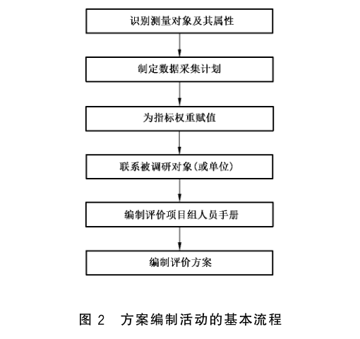
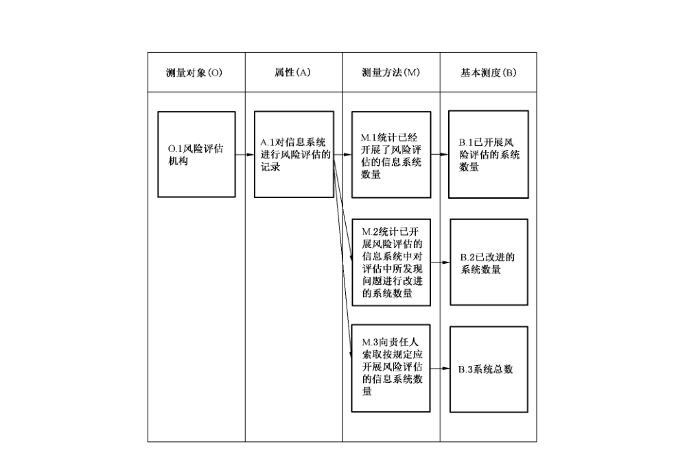
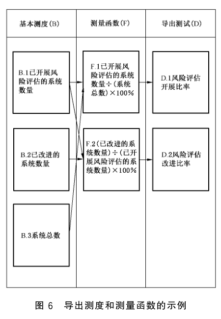
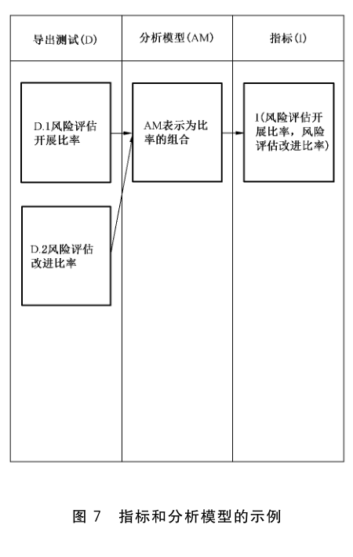
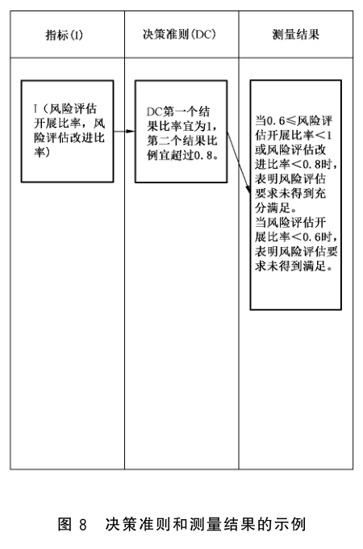

# GB/T 31495.3-2015 信息安全技术 信息安全保障指标体系及评价方法 第3部分：实施指南

> 来源：[GB/T 31495.3-2015 国家标准详情](https://openstd.samr.gov.cn/bzgk/std/newGbInfo?hcno=94F3ECCFE944D8AEC909391F0D8B02E7)。
> 封面发布日期：2015-05-15；实施日期：2016-01-01。
> PDF SHA-256：ab6e1eacc718915600afdaf74dc7cdbd59ce1182e693b0e4447106e3196cf156。
> 转写说明：逐页对照官方 PDF 的全部 27 页图像，校正正文、图示、表格及公式；省略封面、目录、页眉、页脚和页码，合并跨页段落。正式引用请核对官方原件。

## 前言

GB/T 31495《信息安全技术 信息安全保障指标体系及评价方法》分为如下 3 部分：

- 第 1 部分：概念和模型；

- 第 2 部分：指标体系；

- 第 3 部分：实施指南。

本部分为GB/T 31495的第3部分。

本部分按照GB/T 1.1—2009给出的规则起草。

请注意本文件的某些内容可能涉及专利。本文件的发布机构不承担识别这些专利的责任。

本部分由全国信息安全标准化技术委员会（SAC/TC 260）提出并归口。

本部分起草单位：国家信息中心、国家新闻出版广电总局监管中心、中国信息安全测评中心、中国电信集团、中国移动通信集团、大连理工大学、国家能源局信息中心、江苏省信息中心、中国民航大学、中国电力科学研究院。

本部分主要起草人：何德全、吕欣、王宪磊、王长胜、郭艳卿、杨月圆、李守鹏、吕汉阳、杜巍、肖英、张茉楠、罗程、吴志军、杨一曼、谢东晖、程露、胡红升、孙小红、徐浩、周智、陈敏时、雷缙、樊晖、高昆仑、李鹏、李慧。

## 引言

GB/T 31495依据国家对信息安全保障工作的相关要求，提出了信息安全保障评价的概念和模型、指标体系及实施指南。

GB/T 31495 由 3 部分组成。第 1 部分描述了本标准各部分通用的基础性概念，给出了信息安全保障及信息安全保障评价的概念和模型，给出了指标的测量模型；第 2 部分在第 1 部分的模型指导下给出了信息安全保障指标体系和指标测量过程；第 3 部分给出了信息安全保障评价工作实施所应遵照的要求、流程和方法。

GB/T 31495 主要用于：为政府管理部门的信息安全态势判断和宏观决策提供支持；为基础信息网络和重要信息系统的管理部门及运营单位的信息安全管理工作提供支持。

## 1 范围

GB/T 31495的本部分规定了信息安全保障评价活动的实施指南。

本部分适用于信息安全保障评价工作。

## 2 规范性引用文件

下列文件对于本文件的应用是必不可少的。凡是注日期的引用文件，仅注日期的版本适用于本文件。凡是不注日期的引用文件，其最新版本（包括所有的修改单）适用于本文件。

- GB/T 31495.1—2015 信息安全技术 信息安全保障指标体系及评价方法 第 1 部分：概念和模型

- GB/T 31495.2—2015 信息安全技术 信息安全保障指标体系及评价方法 第2部分：指标体系

## 3 术语和定义

GB/T 31495.1—2015 和 GB/T 31495.2—2015中界定的术语和定义适用于本文件。

## 4 概述

### 4.1 评价的作用

为反映信息安全保障状况，依据建立的指标体系对信息安全保障建设情况、运行能力和安全态势进行综合评价，评价结果为信息安全决策和管理部门提供支持。

### 4.2 评价活动执行主体

评价活动的执行主体可以是信息安全主管部门，也可以是第三方研究咨询机构。评价活动的执行主体根据信息安全保障评价的实际需求，组建评价队伍并开展评价活动。

### 4.3 可能遇到问题和风险

评价活动具体实施之前，需要认真分析评价活动可能带来的风险，并在评价活动开展前对有关责任方进行必要的告知。

信息安全保障评价活动可能遇到的问题包括但不限于：

a） 信息泄露：评价活动可能会造成敏感信息的泄露。评价所需的原始数据资料以及这些数据资料经过规整后形成的文档可能包含敏感信息，一旦泄露将给数据资料拥有者或责任方造成影响。

b） 影响系统运行：评价所需的部分数据资料在数据采集时可能需要从系统中即时获取，这可能会对系统运行造成影响。

c） 对结果的争议：信息安全保障评价的指标和方法是确定的，但外部环境的变化和产生的影响可能使得评价结果不能全面反映信息安全保障状况，也可能遗漏一些较为重要的方面，这需要在得出指标测量结果后，由相关领域的专家对测量结果进行研判。

### 4.4 评价活动实施过程

#### 4.4.1 评价准备

信息安全保障评价的准备工作是否充分关系到评价结果的科学性、有效性以及评价工作是否能够顺利开展。评价准备活动的主要任务是明确评价目的，熟悉指标及其含义，制定评价项目计划，并做好相应的文档准备工作。

#### 4.4.2 方案编制

评价方案编制活动是为了给信息安全保障评价活动提供一些基础文档和指导方案，主要任务是在明确指标内容、测量对象及其属性的情况下，制定数据采集计划，确定指标权重，编写评价人员的评价实施手册，形成评价方案。

#### 4.4.3 数据采集

采集评价指标所需数据和资料是信息安全保障评价的基础性工作，主要任务是按照评价方案的总体要求，执行评价实施手册，实施采集评价所需的基础数据和资料。

#### 4.4.4 数据分析

数据分析活动的主要任务是根据数据采集阶段所获取的数据资料，依据确定的指标运算方法，通过一系列分析和运算，得出单项指标的测量结果以及指标体系的综合结果，并对测量结果进行研判，形成评价结果。

#### 4.4.5 报告编制

本项活动的主要任务是根据评价结果以及评价过程中反映出的情况，形成评价报告文本。

## 5 评价准备

### 5.1 评价准备活动的工作流程

评价准备活动的主要内容是成立评价项目组，根据评价目的组建评价队伍，备齐评价活动所需的文档和资源，确保评价活动的顺利开展。

评价准备活动的基本工作流程见图1。

### 5.2 评价准备活动的主要任务

#### 5.2.1 明确评价目的

信息安全保障评价的目的是为满足评价的信息需求，通过指标体系、测量模型等工具和方法对涉及的评价对象及其属性进行测量和运算，以获得判断信息安全保障状况所需的相关信息。

#### 5.2.2 成立评价项目组

由评价活动的执行主体成立评价项目组，评价项目组负责组织评价活动，协调评价活动的各参与者和相关方之间的分工与合作。

评价项目组还负责组建评价队伍。

#### 5.2.3 组建评价队伍

评价队伍包括：

a） 技术队伍，由参与实施评价的评价人员组成，负责评价活动的具体实施，主要包括方案编制、数据采集、数据分析和报告编制。

b） 专家队伍（也称专家组），参与评价方案确定、对指标权重进行赋值以及对评价结果进行研判等。

信息安全保障评价的专家组通常由信息安全、信息通信工程、信息经济学、社会学等领域的专家或学者组成。

#### 5.2.4 编制项目计划书

项目计划书内容应包括评价项目概述、评价目的、评价的主要内容、评价原则和依据、项目组织、各项主要工作及其时间进度安排等。

#### 5.2.5 准备各类文档

评价项目组成员在评价活动开展之前还应做好以下准备工作：

a） 所有参与评价活动的人员应共同明确评价工作要求（见附录A），熟悉指标及其含义，对评价过程中可能遇到的问题做出估计并设想好解决方法，例如设计在获取某些数据时遇到困难的解决方案。

b） 准备和打印评价活动中涉及到的各项表单，包括评价授权书、专家聘任书、指标测量结果记录表格、结果确认书、保密协议等。

### 5.3 评价准备活动的文档

表 1 列出了评价准备活动所需的相关文档。

**表 1 评价准备活动形成的文档及其内容**

| 主要任务 | 文档记录 | 文档主要内容 |
| --- | --- | --- |
| 明确评价目的；成立评价项目组；组建评价队伍；编制项目计划书 | 项目计划书 | 评价项目概述、评价目的、评价的主要内容、评价原则和依据、项目组织、各项主要工作及其时间进度安排等 |
| 准备各类文档 | 表单集合 | 评价授权书、专家聘任书、指标测量结果记录表格、结果确认书、保密协议等 |

### 5.4 评价准备活动的角色和责任

#### 5.4.1 评价项目组职责

评价项目组职责包括：

a） 介绍项目基本情况、目标和评价流程以及项目工作进度安排；

b） 向评价人员说明基本工作内容和方法；

c） 向专家组介绍项目基本情况和专家组的主要工作；

d） 建立评价项目组的内部沟通机制；

e） 编制项目计划书；

f） 准备评价所需的各类文档。

#### 5.4.2 专家组职责

专家组职责包括：

a） 了解专家组在项目中的工作和职责；

b） 建立专家组的内部沟通机制；

c） 对项目计划书的可行性进行评审。

## 6 方案编制

### 6.1 方案编制活动的工作流程

方案编制活动的目标是基于评价准备活动中形成的相关资料，形成信息安全保障评价活动所需的基本文档和指导方案。

方案编制活动的基本工作流程见图2。

### 6.2 方案编制活动的主要任务

#### 6.2.1 识别测量对象及其属性

依据 GB/T 31495.2—2015确定的指标及其测量对象，进一步识别评价活动中需要测量的属性。

表 2 给出了测量对象及其属性列表示例。

**表 2 信息安全保障指标测量对象及属性**

| 序号 | 评价指标 | 测量对象 | 属性 |
| --- | --- | --- | --- |
| 1 | 信息安全战略指标 | 1. 战略文件； 2. 政策规划； 3. 智库机构 | 1.1 战略顶层设计； 1.2 发展目标； 2 发展规划； 3 智库队伍 |
| 2 | 法规建设指标 | 1. 已出台的法律文件； 2. 法规宣贯会议记录 | 1.1 基础法律； 1.2 法律体系； 2.1 法规宣贯情况； 2.2 网民人数 |
| 3 | …… | …… | …… |
| 4 | 组织机构建设指标 |  |  |
| 5 | …… |  |  |
| …… |  |  |  |

#### 6.2.2 制定数据采集计划

信息安全保障评价的数据采集方法主要是调研，即评价人员通过实地考察、资料审阅、人员访谈等调研方法进行指标数据的采集工作。

评价人员依据 GB/T 31495.2—2015 中附录 A 各指标的测量对象及其属性，判定数据来源，确定数据采集活动的调研对象（或单位），依据 GB/T 31495.2—2015中附录A确定的每项属性的测量方法确定各项数据的采集方法（可供选用的数据采集方法参见附录 B）。评价项目组根据调研内容，制定数据采集计划。表3给出了数据采集方法列表样例。

**表 3 指标数据采集方法**

| 序号 | 评价指标 | 属性 | 数据来源单位 | 数据采集方法（测量方法） |
| --- | --- | --- | --- | --- |
| 1 | 信息安全战略指标 | 1.1 战略顶层设计； 1.2 发展目标； 2 发展规划； 3 智库队伍 | 被调研对象（或单位） | 1.1 查看信息安全战略是否及时调整、战略间是否协同、战略与技术发展是否一致。 1.2 查看信息安全发展目标是否明确。 2 确认是否制定并发布了信息安全中长期发展规划。 3 调研是否建设了信息安全智库或研究队伍。 |
| 2 | 法规建设指标 | 1.1 基础法律； 1.2 法律体系； 2.1 法规宣贯情况； 2.2 网民人数 | 被调研对象（或单位） | 1.1 查找已出台的法律文件中是否有信息安全基本法律。 1.2 查看已出台的法律文件，判断法律体系是否内容完整、结构完善、内在协调。 2.1 统计信息安全法律法规的宣贯人次。 2.2 统计网民总数。 |
| 3 | …… | …… |  |  |
| 4 | 组织机构建设指标 |  |  |  |
| 5 | …… |  |  |  |
| …… |  |  |  |  |

#### 6.2.3 为指标权重赋值

指标权重是评价方案的又一重要内容。指标权重的取值主要由专家组进行研讨确定，指标权重确定可采用的方法参见附录C。表4给出了指标权重列表样例。

**表4 指标权重列表**

| 序号 | 评价指标 | 指标权重 |
| --- | --- | --- |
| 1 | 信息安全战略指标 | W1 |
| 2 | 法规建设指标 | W2 |
| 3 | …… | …… |
| 4 | 组织机构建设指标 |  |
| 5 | …… |  |
| …… |  |  |

指标描述见 GB/T 31495.2—2015 的第5章，测量对象及属性描述见 GB/T 31495.2—2015 的附录 A。

#### 6.2.4 联系被调研对象（或单位）

评价项目组负责协调和通知被调研对象（或单位）关于评价的相关事宜。工作内容包括：

a） 信息安全主管部门下发文件通知被调研对象（或单位）；

b） 评价项目组告知被调研对象（或单位）评价活动可能带来的风险；

c） 评价项目组依据主管部门下发的文件，与被调研对象（或单位）签署评价授权书，包括确认调研内容，告知所需采集的数据和数据采集方法；

d） 对被调研对象（或单位）进行初步调研，形成调研对象（或单位）的基本情况表，包括简介、联系人等。

#### 6.2.5 编制评价项目组人员手册

评价项目组人员手册是用于具体指导评价项目组成员开展评价活动的文件，是对指标、方法以及操作步骤的详细描述，此手册保证了评价活动可以重复实施。评价人员手册通常作为评价方案的附件或附录。

#### 6.2.6 编制评价方案

评价方案应包括但不限于：评价内容、评价指标、测量方法等。

### 6.3 方案编制活动的文档

表 5 列出了方案编制活动所需的相关文档。

**表5 方案编制活动形成的文档及其内容**

| 主要任务 | 文档记录 | 文档主要内容 |
| --- | --- | --- |
| 识别测量对象及其属性 | 指标及相关要素列表 | 各项指标的含义、测量对象和属性、数据填录范围等 |
| 制定数据采集计划 | 调研对象的基本情况表 | 被调研对象（或单位）基本情况、管理模式、部门及角色等，以及可能遇到的风险等 |
| 制定数据采集计划 | 调研属性项列表 | 各项指标所对应的需要调研的具体属性项和内容，将调研内容列表作为评价授权书的附录 |
| 制定数据采集计划 | 基础数据采集方案 | 包括人员访谈、文档调研、问卷调查、实地察看等方法的设计方案和实施步骤 |
| 为指标权重赋值 | 指标权重表 | 各项指标的权重 |
| 联系被调研对象（或单位） | 评价授权书 | 签字确认的评价授权书 |
| 编制评价项目组人员手册 | 评价人员手册 | 整合调研对象、内容、方法等，编制成手册 |
| 编制评价方案 | 评价方案文本 | 评价内容、评价指标、测量方法、评价人员手册等 |

### 6.4 方案编制活动的角色和责任

#### 6.4.1 评价项目组职责

a） 识别测量对象以及所需采集的数据内容，明确相应的数据采集方法；

b） 初步了解被调研对象（或单位）的基本情况、管理模式，部门及角色等；

c） 向被调研对象（或单位）说明评价活动可能带来的风险；

d） 列出被调研对象（或单位）应准备的文档材料；

e） 取得被调研对象（或单位）在评价授权书上的签字确认，以及对所要采集数据资料的签字确认；

f） 准备初步调研基本信息情况表；

g） 编制评价项目组人员手册；

h） 编制评价方案文本。

#### 6.4.2 专家组职责

a） 研讨确定指标权重；

b） 审核数据采集方法；

c） 审核项目组编制的评价方案；

d） 必要时提供调研工作的风险与规避方法建议。

#### 6.4.3 被调研单位职责

a） 向评价项目组提交初步调研所需的基本信息表；

b） 准备初步调研所需的文档资料；

c） 为评价项目组开展初步调研提供必要的支持和协调；

d） 对评价授权书及调研方案进行认可，并签字确认；

e） 备份数据、系统，制定预案以应对调研过程中可能遇到的风险。

## 7 数据采集

### 7.1 数据采集活动的工作流程

指标基础数据的采集活动是经主管部门委托或授权后，评价项目组与被调研对象（或单位）进行沟通协调，获得认可后，依据评价方案实施的调研工作，为数据分析和报告编制活动提供数据和资料。

调研活动的基本工作流程见图3。

### 7.2 数据采集活动的主要任务

#### 7.2.1 调研准备

本任务启动调研活动，是保证信息安全保障评价工作顺利实施的前提。工作内容包括：

a） 召开调研活动动员会议，向评价项目组成员发放评价人员手册，说明调研中具体的工作任务和要求，调研所涉及的全体工作人员签署保密协议；

b） 评价项目组通知被调研对象（或单位）准备相关资源，包括所要查看的文档和信息，访谈的人员等，提供所需准备资源的清单；

c） 取得被调研单位的回函确认；

d） 对调研所得数据资料的结果记录表单和方案进行必要的更新。

#### 7.2.2 调研实施

依据评价准备活动中准备的表单和方案编制活动中编制的评价方案开展数据采集工作。

#### 7.2.3 结果确认

数据采集活动的各项具体工作完成后，针对调研结果记录，应进行汇总、验证和补充。一般应召开调研结果确认会，评价项目组与被调研单位双方就调研过程中发现的问题进行现场确认，并取得被调研单位的书面认可文件。

### 7.3 数据采集活动的文档

表 6 列出了数据采集活动所需的相关文档。

**表6 数据采集活动形成的文档及其内容**

| 主要任务 | 文档记录 | 文档主要内容 |
| --- | --- | --- |
| 调研准备 | 会议记录 | 评价动员会的会议内容的书面记录 |
| 调研准备 | 保密协议 | 规定项目保密事项，参与人员具有保密责任和权力等协议信息 |
| 调研准备 | 资源清单 | 包括资源名称、类型、数量、配置、负责人等信息 |
| 调研准备 | 更新的评价方案文本 | 包括修订确认后的工作计划和内容安排，双方的人员协调，被调研单位应该提供的配合 |
| 调研实施：人员访谈 | 访谈记录或录音 | 访谈结果 |
| 调研实施：文档调研 | 调研结果记录 | 指标的结果记录 |
| 调研实施：问卷调查 | 调查问卷结果记录 | 问卷中包括的各调查项的结果记录 |
| 调研实施：实地察看 | 实地察看记录 | 查看安全设备、人员和管理制度配置的现场察看记录或录像 |
| 结果确认 | 调研结果确认书 | 调研的问题汇总、证据和证据源记录、被调研单位的书面确认 |

### 7.4 数据采集活动的角色和责任

#### 7.4.1 评价项目组职责

利用人员访谈、文档调研、问卷调查、实地查看的方法调研指标所需的数据和资料，并填写结果记录。

#### 7.4.2 被调研单位职责

a） 协调单位内相关人员配合评价工作的开展；

b） 相关人员回答评价项目组人员的问询；

c） 提供评价项目组需求的数据资料和文档资料；

d） 如实填写评价项目组发放的调查问卷，保证问卷调查信息的真实性和可靠性；

e） 配合评价项目组进行实地察看；

f） 遵守相关保密协议；

g） 相关人员对调研结果进行确认，并在结果确认书上签字确认。

## 8 数据分析

### 8.1 数据分析活动的工作流程

数据采集活动结束后，评价项目组应对所采集的结果记录进行汇总分析，形成各单项指标的数据。

在对单项指标进行运算后，要进行指标体系测量结果的综合。

结果分析活动的基本工作流程见图4。

### 8.2 数据分析活动的主要任务

#### 8.2.1 数据预处理

数据预处理工作主要是通过一系列有效的方法保障数据内容完整、质量达标、可靠有效的具体工作。应满足如下要求：

a） 内容完整：对于遗漏填写的，进行二次采集确认；对于因为统计周期问题当前无法保障及时性的时间序列数据，可进行一定的预测和补充，并注明预测方法和补充依据；对于无法获取的，根据数据类型和性质，召开专家会议寻求解决方案。

b） 质量达标：对于因为误操作原因填写的，进行二次采集确认；对于确实反映实际情况的奇异数据，需要注明数据生成的具体原因。

c） 可靠有效：对于一个指标具有多个数据来源的数据，通过召开专家会议对数据使用优先级进行排序，选取一个最可靠的数据来源。表7给出了筛选数据的列表样例。

**表 7 数据来源及其可靠性列表**

| 序号 | 所需测量的属性 | 数据项 1 | 数据项 2 | …… |
| --- | --- | --- | --- | --- |
| 1 | 属性 1 |  |  |  |
| 2 | 属性 2 |  |  |  |
| 3 | 属性3 |  |  |  |
| 4 | …… |  |  |  |

#### 8.2.2 单项指标运算

指标运算是依据一定的准则，对所采集的指标相关数据进行一系列运算，取得指标测量结果的过程。单项指标的运算准则参照 GB/T 31495.2—2015 的附录 A，图5～图8以ZB15风险评估指标为例，描述了单项指标的运算过程。图5描述了对风险评估指标的测量对象和属性进行测量，取得三项基本测度的过程。图6描述了通过测量函数组合三项基本测度，生成两项导出测度的过程。图7描述了将分析模型应用于导出测度（或基本测度），生成指标的过程。图8描述了依据决策准则对指标进行判定，取得测量结果的过程。

表 8 给出了指标测量结果的列表样例。

**表8 单项指标测量结果**

| 序号 | 指标 | 指标值 | 测量结果 |
| --- | --- | --- | --- |
| 1 | 指标1 |  |  |
| 2 | 指标2 |  |  |
| 3 | 指标3 |  |  |
| 4 | …… |  |  |

#### 8.2.3 指标综合

依据方案编制活动中确定的指标权重，参见附录 D给出的指标综合算法，计算出指标体系的综合测量结果。表9给出了指标体系综合测量所用的表格样例。

**表9 指标体系综合测量结果**

| 序号 | 指标 | 测量结果 | 指标权重 |
| --- | --- | --- | --- |
| 1 | 指标1 |  |  |
| 2 | 指标2 |  |  |
| 3 | 指标 3 |  |  |
| 4 | …… |  |  |
| …… |  |  |  |
| 指标体系综合测量结果 |  |  |  |

#### 8.2.4 形成评价结论

评价项目组成员针对指标体系各个层级的测量结果，结合专家组的研判，找出被调研单位的信息安全保障现状与存在的问题，提出当前信息安全保障情况与保障需求的差距，并形成综合评价结果。

### 8.3 数据分析活动文档

表 10 列出了数据分析活动所形成的相关文档。

**表10 数据分析活动形成的文档及其内容**

| 主要任务 | 文档记录 | 文档主要内容 |
| --- | --- | --- |
| 数据预处理 | 预处理结果文档 | 数据通过预处理修正完成后的用于计算的数据 |
| 数据预处理 | 专家意见记录 | 预处理过程中涉及专家讨论的建议记录 |
| 单项指标运算 | 测量结果文档 | 记录了各项指标计算过程和测量结果的文档，是评价结论的分析依据 |
| 指标综合 | 指标体系综合测量结果 | 单项指标的测量结果与指标权重进行计算，得出的指标体系的综合测量结果 |
| 形成评价结论 | 分析结论报告 | 综合数据处理、计算、分析、结论的文档记录 |

### 8.4 结果分析活动的角色与责任

#### 8.4.1 评价项目组职责

a） 对采集数据进行预处理，根据数据结果对被调研单位的信息安全保障情况进行分析；

b） 协调专家对采集数据中存在的问题进行研讨和解决；

c） 根据数据分析结果撰写分析结论报告。

#### 8.4.2 专家组职责

a） 对数据预处理、计算过程中存在的问题提出意见和解决方案；

b） 对指标体系综合测量结果进行研判；

c） 对分析结论报告进行审核并提出意见。

#### 8.4.3 被调研单位职责

a） 配合完成需要二次调研的数据采集工作；

b） 对指标最终测量结果进行确认。

## 9 报告编制

### 9.1 报告编制活动的工作流程

报告编制活动主要是根据数据分析活动得出的评价结论报告以及评价过程中形成的过程资料，形成信息安全保障评价报告，并组织专家对报告进行评审和确认。

报告编制活动的基本工作流程见图9。

### 9.2 报告编制活动的主要任务

#### 9.2.1 报告编制

依据评价方案，单项指标测量结果、指标综合测量结果以及形成的评价结论，编制信息安全保障评价报告。报告应至少包括详细、明确的评价结果记录，结果分析，以及对未满足要求的指标的整改建议等。

#### 9.2.2 报告评审

评价报告编制完成后，专家组应根据评价授权书、被调研单位提交的相关文档、评价活动的原始记录和其他辅助信息，对评价报告进行评审。

#### 9.2.3 报告确认

评审通过后，由项目负责人签字确认并提交给信息安全保障评价的利益相关方。

### 9.3 报告编制活动的文档

表 11 列出了报告编制活动所需的相关文档。

**表11 报告编制活动形成的文档及其内容**

| 主要任务 | 文档记录 | 文档主要内容 |
| --- | --- | --- |
| 报告编制 | 信息安全保障评价报告文本 | 项目概述、数据采集方法、计算方法、评价分析内容、信息安全保障情况结论、改进建议等 |
| 报告评审 | 信息安全保障评价报告文本专家评审意见 | 对于报告内容提出的修改意见和建议 |
| 报告确认 | 报告确认书 | 双方就报告结论的有效性，可靠性，科学性的确认记录 |

### 9.4 报告编制活动的角色与责任

#### 9.4.1 评价项目组职责

a） 根据分析结论报告编制被调研单位的信息安全保障情况报告；

b） 协调专家对报告进行评审工作；

c） 根据专家意见对报告进行修改；

d） 对评价过程中获取的数据文件、协议文件、最终确认报告等书面材料进行存档保存。

#### 9.4.2 专家组职责

对信息安全保障情况报告进行评审并给出修改意见。

#### 9.4.3 被调研单位职责

a） 确认信息安全保障情况报告结论；

b） 根据报告建议开展相应的信息安全保障建设工作。

## 附录 A（规范性附录）信息安全保障评价工作要求

### A.1 依据标准，遵循原则

信息安全保障评价工作的实施应依据信息安全相关的要求和标准进行，评价模型见 GB/T 31495.1—2015 的第 5 章，评价指标见 GB/T 31495.2—2015 的 4.2，评价活动实施的主要流程见本部分。

在信息安全保障评价工作中应保证测评工作公正、科学、合理和完善。

### A.2 科学选取，保证质量

科学选取是指对指标数据来源的选取要适当，既要避免遗漏重要的采集对象，重视可能存在重大信息安全风险、信息安全网络重点环节，也要避免过多选择、重复选择，降低效率。

科学选取还要求在选取数据时要科学性和可操作性并重，即要符合信息安全系统的科学规律和信息安全评价的内在要求。

保证质量是指要求信息安全评价必须按照标准要求，根据信息安全保障评价工作流程，切实落实，保证指标数据来源和评价过程的科学可靠，确保评价结果的质量。

### A.3 规范行为，规避风险

信息安全保障评价过程应该依照工作流程规范进行，包括：制定内部保密制度；实施技术培训和保密教育；过程文档的存档；指定专人负责保管信息安全保障评价的归档文件等。

评价人员的行为应规范，包括：签署相关保密协议；评价人员进入评价场合佩戴工作牌；使用评价专用的电脑和设备；严格按照评价实施手册规范评价过程；准确记录评价数据；不擅自评价评价结果；不将评价结果复制给非评价小组成员等。

规避风险，是指要充分估计信息安全保障评价可能给系统与行业带来的影响，确保向评价所需的数据资料的责任方告知风险，要求其做好相关预防措施。同时，评价机构也应该与相关单位签订评价协议、保密协议，及时与数据来源单位沟通，尽量避免给数据来源单位带来影响。

### A.4 注重总结，逐步改善

信息安全保障评价具备一定的引导性。相关管理部门可根据评价结果和评价报告，总结信息安全保障工作中的成果和不足。

信息安全保障评价还具有长期性、持续性，相关部门可通过多次评价，抓住长期性的薄弱环节集中攻坚、深化有效措施，提高信息安全保障水平。

## 附录 B（资料性附录）数据采集方法

### B.1 资料审阅

文档审阅方法是指，通过审阅相关的文档记录，来获得被调研对象在某个指标属性方面的实际情况。使用该方法时，要确保搜集的文档的全面和即时，这样才能对相应调研内容做出全面的、有效的评价。该方法的优点是对被调研对象影响小，被调研单位只需整理已有文档并交给评价组人员即可。缺点是可能无法保证文档的全面性和新鲜性，从而无法保障做出的评价是全面、有效的。

### B.2 人员访谈

人员访谈方法是指，评价组人员通过与被调研单位的相关人员（包括各级领导和具体工作实施人员）面对面交流，来获得被调研对象在某个指标属性方面的实际情况。使用该方法时，应当注意与被调研单位提前安排好访谈的时间、地点和相关人员，避免影响被调研单位的正常工作。此外在访谈之前要设计好所有提问，在访谈过程中做好详细记录，访谈结束后对访谈记录再做彻底分析。该方法的优点是灵活多变、获取的信息有针对性。缺点是可能会占用被调研单位相关人员的正常工作时间。

### B.3 问卷调查

问卷调查方法是指，评价组人员设计好统一的调查问卷，发放到各个被调研单位，由被调研单位在规定的时间内组织相关人员填写，填写完毕之后上交给评价组人员，通过调查问卷的结果来获得被调研对象在某个指标属性方面的实际情况。使用该方法时，应当注意调查问卷设计的合理性、全面性，对选择型调查项目，尽量给出全部可能情况的选项。该方法的优点是获取信息有针对性，同时尽可能地减少了对被调研单位相关人员正常工作的影响。缺点是调查问卷可能难以覆盖所需调研内容的所有情况。

### B.4 实地考察

实地考察方法是指，评价组人员亲自考察被调研单位的正常工作情况，直接获得被调研对象在某个指标属性方面的实际情况。使用该方法时，应当注意与被调研单位提前做好沟通，并在考察过程中做好各方面的记录。该方法的优点是获取的信息更真实可靠。缺点是评价组人员工作量比较大。

## 附录 C（资料性附录）指标权重分配方法

### C.1 综述

信息安全保障指标的权重可采用层次分析法（AHP）来进行分配。

层次分析法（Analytical Hierarchy Process），简称 AHP，是由美国运筹学家 Saaty 在 20 世纪 70 年代初提出的，是指把系统中复杂问题中的各种因素，通过划分为相互联系的有序层次，使之条理化，根据对一定客观现实的判断对每一层次相对重要性给予定量表示，利用数学方法确定每一个层次的全部元素的相对重要次序的权值，并通过排序的结果分析和解决问题的一种决策分析方法。AHP 法一般分为四个步骤。

### C.2 分析各因素之间的关系，建立层次结构模型

AHP 的关键在于如何建立层次结构模型。依据系统分析的方法，对系统因素和其层次加以分析，设计出层次系统结构的表示模型。为解决层次建模问题，Saaty 将问题中所包含的因素分为了三个层次：最高层、中间层和最低层。最高层也称目标层，表示层次分析需要达到的目标。中间层又叫准则层，表示采取某种措施、政策、方案等来实现预定总目标所设计的中间环节。最低层包括措施层、指标层、方案层，指要选用的解决问题的各种措施和方案。

### C.3 构造判断矩阵

AHP 通过两两比较法构造判断矩阵，采用数据 1～9 及其倒数表示相对重要程度（也可采用数字 1～7 及其倒数或数字 1～5 及其倒数），标准为：

- 1：表示 $B_i$ 与 $B_j$ 一样重要；
- 3：表示 $B_i$ 比 $B_j$ 重要一点；
- 5：表示 $B_i$ 比 $B_j$ 重要；
- 7：表示 $B_i$ 比 $B_j$ 重要的多；
- 9：表示 $B_i$ 比 $B_j$ 极端重要。

用 2、4、6、8 分别表示两邻点的中值。

设 $A$ 表示目标，$B$ 表示评价指标集，$B_i$ 表示评价指标，$b_i \in B$（$i=1,2,\ldots,n$）。$b_{ij}$ 表示 $b_i$ 对 $b_j$ 的重要性赋值，则判断矩阵 $Z$ 为：

$$
Z=\begin{pmatrix}
b_{11} & \cdots & b_{1n} \\
\vdots & \ddots & \vdots \\
b_{n1} & \cdots & b_{nn}
\end{pmatrix}.
$$

### C.4 层次单排序

所谓层次单排序，是指根据判断矩阵，计算对于上层指标而言，本层次与之有联系指标的重要性次序的权值。它是对本层次所有的指标针对上一层次而言的重要性进行排序的基础。

对于判断矩阵 $Z$，求出满足 $BZ=\lambda_{\max}Z$ 的特征根和特征向量。$\lambda_{\max}$ 表示最大特征根，$Z=(Z_1,Z_2,\ldots,Z_n)^T$ 为对应于 $\lambda_{\max}$ 的正规化特征向量，$Z_i$ 为所对应指标 $B_i$ 的单排序的权值。

### C.5 一致性检验

计算各层因素对系统目标的合成权重，并进行排序和一致性检验。

$CR=CI/RI$ 称为判断矩阵的平均随机一致性指标。

$CI=(\lambda_{\max}-n)/(n-1)$ 称为一致性指标。

当 $CR<0.1$ 时，认为判断矩阵有可以接受的一致性，否则，由于判断矩阵偏离一致性程度过大而需要对判断矩阵进行重新修订。

## 附录 D（资料性附录）指标合成方法

### D.1 合成上一级指标的方法

对某项指标的所有下级指标进行无量纲化后，将每项下级指标的值与其权重按照式（D.1）进行计算，得到该项指标的值。

$$
I_i=\frac{\sum ZB_j W_j}{\sum W_j} \tag{D.1}
$$

式中：

- $I_i$：某一层级第 $i$ 个指标的值；
- $ZB_j$：第 $j$ 个下级指标无量纲化后的值；
- $W_j$：第 $j$ 个下级指标的权重。

### D.2 合成信息安全保障综合指数的方法

对信息安全保障指标体系中的每项指标进行无量纲化后，将每项指标的值与其权重按照式（D.2）进行计算，得到信息安全综合保障指数。

$$
F=\frac{\sum_{i=1}^{N} ZB_i W_i}{\sum_{i=1}^{N} W_i} \tag{D.2}
$$

式中：

- $F$：信息安全综合保障指数的值；
- $ZB_i$：第 $i$ 个三级指标无量纲化后取得的值；
- $W_i$：第 $i$ 个三级指标的权重。

## 参考文献

[1] GB/T 20984—2007 信息安全技术 信息安全风险评估规范

[2] GB/T 28449—2012 信息安全技术 信息系统安全等级保护测评过程指南

[3] ISO/IEC 27004:2009 Informaition technology—security techniques—Information security management—Measuremant

> 转写注：本条保留原文的“Informaition”“Measuremant”拼写及“security”大小写。

[4] 郭亚军. 综合评价理论、方法及应用. 北京：科学出版社，2007.

[5] 邱东. 多指标综合评价方法的系统分析. 北京：中国统计出版社，1991.

[6] 顾基发，王浣尘，唐锡晋等. 综合集成方法体系与系统学研究. 北京：科学出版社，2007.
