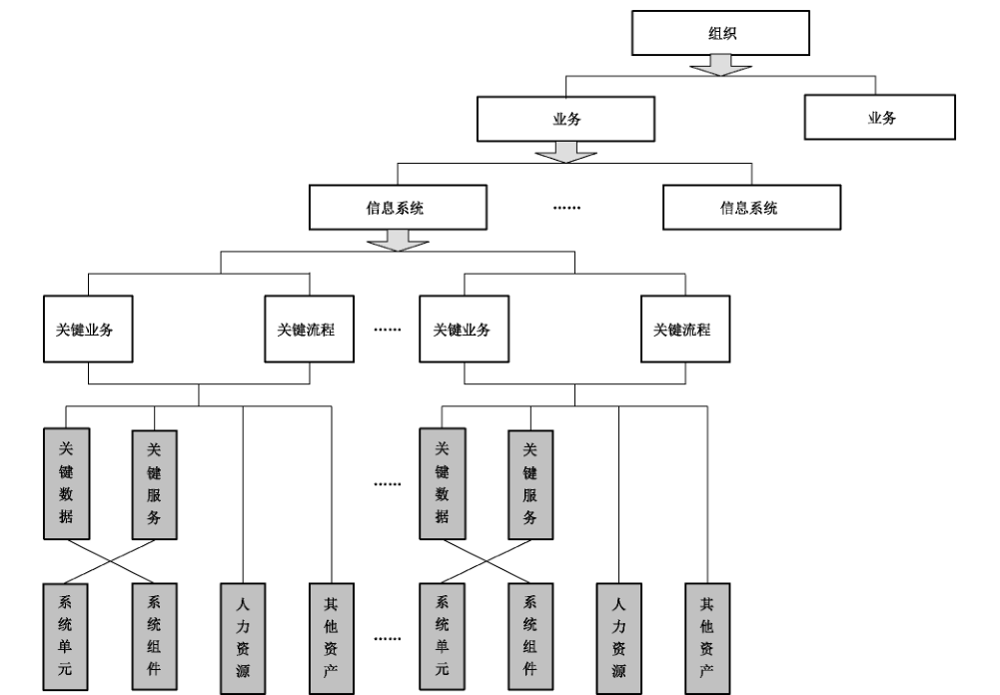
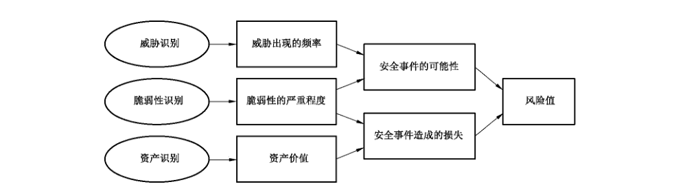

# GB/T 31509-2015 信息安全技术 信息安全风险评估实施指南

> 来源：[GB/T 31509-2015 国家标准详情](https://openstd.samr.gov.cn/bzgk/std/newGbInfo?hcno=3C00616F48E427C6291FB15B54B5192F)；发布日期：2015-05-15；实施日期：2016-01-01。
> 官方 PDF SHA-256：375264aece156c75c472cec04127a1a70e670f12b6302a3b597b8bd4c856748e。
> 依据官方 PDF 全部 61 页的页面图像转写与校核；省略封面、目录、页眉、页脚和分页，合并印刷折行与跨页表格。正式引用请核对原 PDF。

## 前言

本标准按照GB/T 1.1—2009给出的规则起草。

本标准由全国信息安全标准化技术委员会（SAC/TC 260）提出并归口。

本标准起草单位：国家信息中心、国家保密技术研究所、北京信息安全测评中心、上海市信息安全测评认证中心、沈阳东软系统集成工程有限公司、国和信诚（北京）信息安全有限公司。

本标准主要起草人：吴亚非、禄凯、张志军、陈永刚、赵章界、席斐、应力、马朝斌、倪志强。

## 引言

信息安全风险评估是信息安全保障工作的重要内容之一，与信息系统等级保护、信息安全检查、信息安全建设等工作紧密相关，并通过风险发现、分析、评价为上述相关工作提供支持。

为指导信息安全风险评估工作的开展，本标准依据《信息安全技术 信息安全风险评估规范》（GB/T 20984—2007），从风险评估工作开展的组织、管理、流程、文档、审核等几个方面提出了相关要求，是《信息安全技术 信息安全风险评估规范》（GB/T 20984—2007）的操作性指导标准，它也是信息安全风险管理相关标准之一。

## 1 范围

本标准规定了信息安全风险评估实施的过程和方法。

本标准适用于各类安全评估机构或被评估组织对非涉密信息系统的信息安全风险评估项目的管理，指导风险评估项目的组织、实施、验收等工作。

## 2 规范性引用文件

下列文件对于本文件的应用是必不可少的。凡是注日期的引用文件，仅注日期的版本适用于本文件。凡是不注日期的引用文件，其最新版本（包括所有的修改单）适用于本文件。

- GB/T 20984—2007 信息安全技术 信息安全风险评估规范

- GB/Z 24364—2009 信息安全技术 信息安全风险管理指南

## 3 术语、定义和缩略语

GB/T 20984—2007 和 GB/Z 24364—2009中界定的以及下列术语和定义适用于本文件。

### 3.1 术语和定义

#### 3.1.1 实施 implementation

将一系列活动付诸实践的过程。

#### 3.1.2 信息系统生命周期 information system lifecycle

信息系统的各个生命阶段，包括规划阶段、设计阶段、实施阶段、运行维护阶段和废弃阶段。

#### 3.1.3 评估目标 assessment target

评估活动所要达到的最终目的。

#### 3.1.4 系统调研 system investigation

对信息系统相关的实际情况进行调查了解与分析研究的活动。

#### 3.1.5 评估要素 assessment factor

风险评估活动中必须要识别、分析的一系列基本因素。

#### 3.1.6 识别 identify

对某一评估要素进行标识与辨别的过程。

#### 3.1.7 赋值 assignment

对识别出的评估要素根据已定的量化模型给予定量数值的过程。

#### 3.1.8 核查 check in

将信息系统中的检查信息与制定的检查项进行核对检查的活动。

#### 3.1.9 关键控制点 the key point

在项目实施活动中，具有能够影响到项目整体进度决定性作用的实施活动。

#### 3.1.10 分析模型 analysis model

依据一定的分析原理，构造的一种模拟分析方法，用于对评估要素的分析。

#### 3.1.11 评价模型 evaluation model

依据一定的评价体系，构造若干评价指标，能够对相应的活动进行较为完善的评价。

#### 3.1.12 风险处理 risk treatment

对风险进行处理的一系列活动，如接受风险、规避风险、转移风险、降低风险等。

#### 3.1.13 验收 acceptance

风险评估活动中用于结束项目实施的一种方法，主要由被评估方组织，对评估活动进行逐项检验，以是否达到评估目标为接受标准。

### 3.2 缩略语

下列缩略语适用于本文件。

AC：访问（入侵）复杂性（Access Complexity）

AV：访问（入侵）路径（Access Vector）

BOF：缓冲区溢出（Buffer Overflow）

CDP：破坏潜力（Collateral Damage Potential）

CVE：公共漏洞和暴露（Common Vulnerabilities & Exposures）

CVSS：通用安全弱点评估系统（Common Vulnerability Scoring System）

RC：报告可信性（Report Conference）

RL：补救水平（Remediation Level）

SR：安全要求（Security Requirement）

TD：目标分布（Target Distribution）

VLAN：虚拟局域网（Virtual Local Area Network）

## 4 风险评估实施概述

### 4.1 实施的基本原则

#### 4.1.1 标准性原则

信息系统的安全风险评估，应按照GB/T 20984—2007中规定的评估流程进行实施，包括各阶段性的评估工作。

#### 4.1.2 关键业务原则

信息安全风险评估应以被评估组织的关键业务作为评估工作的核心，把涉及这些业务的相关网络与系统，包括基础网络、业务网络、应用基础平台、业务应用平台等作为评估的重点。

#### 4.1.3 可控性原则

在风险评估项目实施过程中，应严格按照标准的项目管理方法对服务过程、人员和工具等进行控制，以保证风险评估实施过程的可控和安全。

a） 服务可控性：评估方应事先在评估工作沟通会议中向用户介绍评估服务流程，明确需要得到被评估组织协作的工作内容，确保安全评估服务工作的顺利进行。

b）人员与信息可控性：所有参与评估的人员应签署保密协议，以保证项目信息的安全；应对工作过程数据和结果数据严格管理，未经授权不得泄露给任何单位和个人。

c） 过程可控性：应按照项目管理要求，成立项目实施团队，项目组长负责制，达到项目过程的可控。

d） 工具可控性：安全评估人员所使用的评估工具应该事先通告用户，并在项目实施前获得用户的许可，包括产品本身、测试策略等。

#### 4.1.4 最小影响原则

对于在线业务系统的风险评估，应采用最小影响原则，即首要保障业务系统的稳定运行，而对于需要进行攻击性测试的工作内容，需与用户沟通并进行应急备份，同时选择避开业务的高峰时间进行。

### 4.2 实施的基本流程

GB/T 20984—2007 规定了风险评估的实施流程，根据流程中的各项工作内容，一般将风险评估实施划分为评估准备、风险要素识别、风险分析与风险处理四个阶段。其中，评估准备阶段工作是对评估实施有效性的保证，是评估工作的开始；风险要素识别阶段工作主要是对评估活动中的各类关键要素资产、威胁、脆弱性、安全措施进行识别与赋值；风险分析阶段工作主要是对识别阶段中获得的各类信息进行关联分析，并计算风险值；风险处理建议工作主要针对评估出的风险，提出相应的处置建议，以及按照处置建议实施安全加固后进行残余风险处理等内容。

### 4.3 风险评估的工作形式

GB/T 20984—2007 明确了风险评估的基本工作形式是自评估与检查评估。

自评估是信息系统拥有、运营或使用单位发起的对本单位信息系统进行的风险评估，可由发起方实施或委托信息安全服务组织支持实施。实施自评估的组织可根据组织自身的实际需求进行评估目标的设立，采用完整或剪裁的评估活动。

检查评估是信息系统上级管理部门或国家有关职能部门依法开展的风险评估，检查评估也可委托信息安全服务组织支持实施。检查评估除可对被检查组织的关键环节或重点内容实施抽样评估外，还可实施完整的风险评估。

信息安全风险评估应以自评估为主，自评估和检查评估相互结合、互为补充。

### 4.4 信息系统生命周期内的风险评估

信息系统生命周期一般包括信息系统的规划、设计、实施、运维和废弃五个阶段，风险评估活动应贯穿于信息系统生命周期的上述各个阶段。

信息系统生命周期各个阶段的风险评估由于各阶段的评估对象、安全需求不同，评估的目的一般也不同。规划阶段风险评估的目的是识别系统的业务战略，以支撑系统安全需求及安全战略等；设计阶段风险评估的目的是评估安全设计方案是否满足信息系统安全功能的需求；实施阶段的评估目的是对系统开发、实施过程进行风险识别，对建成后的系统安全功能进行验证；运行维护阶段的评估目的是了解和控制系统运行过程中的安全风险；废弃阶段的评估目的是对废弃资产对组织的影响进行分析。

此外，当信息系统的业务目标和需求或技术和管理环境发生变化时，需要再次进入上述五个阶段的风险评估，使得信息系统的安全适应自身和环境的变化。

## 5 风险评估实施的阶段性工作

### 5.1 准备阶段

#### 5.1.1 准备阶段工作内容

##### 5.1.1.1 概述

风险评估准备是整个风险评估过程有效性的保证。由于风险评估受到组织的业务战略、业务流程、安全需求、系统规模和结构等方面的影响，因此，在风险评估实施前，应充分做好评估前的各项准备工作。信息安全风险评估涉及组织内部有关重要信息，被评估组织应慎重选择评估单位、评估人员的资质和资格，并遵从国家或行业相关管理要求。

##### 5.1.1.2 确定评估目标

风险评估应贯穿于信息系统生命周期的各阶段中，由于信息系统生命周期各阶段中风险评估实施的内容、对象、安全需求均不同，因此被评估组织应首先根据当前信息系统的实际情况来确定在信息系统生命周期中所处的阶段，并以此来明确风险评估目标。一般而言，组织确定的各阶段的评估目标应符合以下原则：

a）规划阶段风险评估的目标是识别系统的业务战略，以支撑系统安全需求及安全战略等。规划阶段的评估应能够描述信息系统建成后对现有业务模式的作用，包括技术、管理等方面，并根据其作用确定系统建设应达到的安全目标。

b） 设计阶段风险评估的目标是根据规划阶段所明确的系统运行环境、资产重要性，提出安全功能需求。设计阶段的风险评估结果应对设计方案中所提供的安全功能符合性进行判断，作为采购过程风险控制的依据。

c） 实施阶段风险评估的目标是根据系统安全需求和运行环境对系统开发、实施过程进行风险识别，并对系统建成后的安全功能进行验证。根据设计阶段分析的威胁和制定的安全措施，在实施及验收时进行质量控制。

d） 运行维护阶段风险评估的目标是了解和控制运行过程中的安全风险。评估内容包括信息系统的资产，面临威胁、自身脆弱性以及已有安全措施等各方面。

废弃阶段风险评估的目标是确保废弃资产及残留信息得到了适当的处置，并对废弃资产对组织的影响进行分析，以确定是否会增加或引入新的风险。

##### 5.1.1.3 确定评估范围

在确定风险评估所处的阶段及相应目标之后，应进一步明确风险评估的评估范围，可以是组织全部信息及与信息处理相关的各类资产、管理机构，也可以是某个独立信息系统、关键业务流程等。在确定评估范围时，应结合已确定的评估目标和组织的实际信息系统建设情况，合理定义评估对象和评估范围边界，可以参考以下依据来作为评估范围边界的划分原则：

a） 业务系统的业务逻辑边界；

b） 网络及设备载体边界；

c） 物理环境边界；

d） 组织管理权限边界；

e） 其他。

##### 5.1.1.4 组建评估团队

###### 5.1.1.4.1 综述

风险评估实施团队应由被评估组织、评估机构等共同组建风险评估小组；由被评估组织领导、相关部门负责人，以及评估机构相关人员成立风险评估领导小组；聘请相关专业的技术专家和技术骨干组成专家组。

风险评估小组应完成评估前的表格、文档、检测工具等各项准备工作；进行风险评估技术培训和保密教育；制定风险评估过程管理相关规定；编制应急预案等。双方应签署保密协议，适情签署个人保密协议。

###### 5.1.1.4.2 角色与职责

为确保风险评估工作的顺利有效进行，应采用合理的项目管理机制，主要相关成员角色与职责说明如表1和表2所示。

**表1 风险评估小组—评估机构成员角色与职责说明**

| 评估机构人员角色 | 工作职责 |
| --- | --- |
| 项目组长 | 是风险评估项目中实施方的管理者、责任人，具体工作职责包括： 1）根据项目情况组建评估项目实施团队； 2）根据项目情况与被评估方一起确定评估目标和评估范围，并组织项目组成员对被评估方实施系统调研； 3）根据评估目标、评估范围及系统调研的情况确定评估依据，并组织编写评估方案； 4）组织项目组成员开展风险评估各阶段的工作，并对实施过程进行监督、协调和控制，确保各阶段工作的有效实施； 5）与被评估组织进行及时有效的沟通，及时商讨项目进展状况及可能发生问题的预测等； 6）组织项目组成员将风险评估各阶段的工作成果进行汇总，编写《风险评估报告》与《安全整改建议书》等项目成果物； 7）负责将项目成果物移交被评估组织，向被评估组织汇报项目成果，并提请项目验收。 |
| 安全技术评估人员 | 是负责风险评估项目中技术方面评估工作的实施人员。具体工作职责包括： 1）根据评估目标与评估范围的确定参与系统调研，并编写《系统调研报告》的技术部分内容； 2）参与编写《评估方案》； 3）遵照《评估方案》实施各阶段具体的技术性评估工作，主要包括：信息资产调查、威胁调查、安全技术脆弱性核查等； 4）对评估工作中遇到的问题及时向项目组长汇报，并提出需要协调的资源； 5）将各阶段的技术性评估工作成果进行汇总，参与编写《风险评估报告》与《安全整改建议书》等项目成果物； 6）负责向被评估方解答项目成果物中有关技术性细节问题。 |
| 安全管理评估人员 | 是负责风险评估项目中管理方面评估工作的实施人员。具体工作职责包括： 1）根据评估目标与评估范围的确定参与系统调研，并编写《系统调研报告》的管理部分内容； 2）参与编写《评估方案》； 3）遵照《评估方案》实施各阶段具体的管理性评估工作，主要包括：信息资产调查、威胁调查、安全管理脆弱性核查等； 4）对评估工作中遇到的问题及时向项目组长汇报，并提出需要协调的资源； 5）将各阶段的管理性评估工作成果进行汇总，参与编写《风险评估报告》与《安全整改建议书》等项目成果物； 6）负责向被评估方解答项目成果物中有关管理性细节问题。 |
| 质量管控员 | 是负责风险评估项目中质量管理的人员。具体工作职责包括： 1）监督审计各阶段工作的实施进度与时间进度，对可能出现的影响项目进度的问题及时通告项目组长； 2）负责对项目文档进行管控。 |

**表2 风险评估小组—被评估组织成员角色与职责说明**

| 被评估组织人员角色 | 工作职责 |
| --- | --- |
| 项目组长 | 是风险评估项目中被评估组织的管理者。具体工作职责包括： 1）与评估机构的项目组长进行工作协调； 2）组织本单位的项目组成员在风险评估各阶段活动中的配合工作； 3）组织本单位的项目组成员对项目过程中实施方提交的评估信息、数据及文档资料等进行确认，对出现的偏离及时指正； 4）组织本单位的项目组成员对评估机构提交的《风险评估报告》与《安全整改建议书》等项目成果物进行审阅； 5）组织对风险评估项目进行验收； 6）可授权项目协调人负责各阶段性工作，代理实施自己的职责。 |
| 信息安全管理人员 | 是指被评估组织的专职信息安全管理人员。在风险评估项目中的具体工作职责包括： 1）在项目组长的安排下，配合评估机构在风险评估各阶段中的工作； 2）参与对评估机构提交的《评估方案》进行研讨； 3）参与对项目过程中实施方提交的评估信息、数据及文档资料等进行确认，及时指正出现的偏离； 4）参与对评估机构提交的《风险评估报告》与《安全整改建议书》等项目成果物进行审阅； 5）参与对风险评估项目的验收。 |
| 项目协调人 | 是指风险评估项目中被评估组织的工作协调人员。具体工作职责是负责与被评估组织各级部门之间的信息沟通，及时协调、调动相关部门的资源，包括工作场地、物资、人员等，以保障项目的顺利开展。 |
| 业务人员 | 是指在被评估组织的业务使用人员代表（应由各业务部门负责人或其授权人员担任）。在风险评估项目中的具体工作职责包括： 1）在项目组长的安排下，配合评估机构在风险评估各阶段中的工作； 2）参与对评估机构提交的《评估方案》进行研讨； 3）参与对项目过程中实施方提交的评估信息、数据及文档资料等进行确认，及时指正出现的偏离； 4）参与对评估机构提交的《风险评估报告》与《安全整改建议书》等项目成果物进行审阅； 5）参与对风险评估项目的验收。 |
| 运维人员 | 是指在被评估组织的信息系统运行维护人员。在风险评估项目中的具体工作职责包括： 1）在项目组长的安排下，配合评估机构在风险评估各阶段中的工作； 2）参与对评估机构提交的《评估方案》进行研讨； 3）参与对项目过程中实施方提交的评估信息、数据及文档资料等进行确认，及时指正出现的偏离； 4）参与对评估机构提交的《风险评估报告》与《安全整改建议书》等项目成果物进行审阅； 5）参与对风险评估项目的验收。 |
| 开发人员 | 是指在被评估组织本单位或第三方外包商的软件开发人员代表。在风险评估项目中的具体工作职责包括： 1）在项目组长的安排下，配合评估机构在风险评估各阶段中的工作； 2）参与对评估机构提交的《评估方案》进行研讨； 3）参与对项目过程中实施方提交的评估信息、数据及文档资料等进行确认，及时指正出现的偏离； 4）参与对评估机构提交的《风险评估报告》与《安全整改建议书》等项目成果物进行审阅； 5）参与对风险评估项目的验收。 |

###### 5.1.1.4.3 风险评估领导小组

风险评估工作领导小组主要负责决策风险评估工作的目的、目标；参与并指导风险评估准备阶段的启动会议；协调评估实施过程中的各项资源；组织评估项目验收会议；推进并监督风险处理工作等。

风险评估工作领导小组一般由被评估组织主管信息化或信息安全工作的领导负责，成员一般包括：被评估组织信息技术部门领导、相关业务部门领导等，评估机构相关人员参与。

###### 5.1.1.4.4 专家组

对于大型复杂的风险评估项目，应考虑在项目期间聘请相关领域的专家对风险评估项目的关键阶段进行工作指导，具体包括：

a） 帮助被评估组织和实施方规划风险评估项目的总体工作思路和方向；

b） 对出现的关键性难点问题进行决策；

c） 对风险评估结论进行确定。

##### 5.1.1.5 评估工作启动会议

为保障风险评估工作的顺利开展，确立工作目标、统一思想、协调各方资源，应召开风险评估工作启动会议。启动会一般由风险评估领导小组负责人组织召开，参与人员应该包括评估小组全体人员，相关业务部门主要负责人，如有必要可邀请相关专家组成员参加。

启动会主要内容主要包括：被评估组织领导宣布此次评估工作的意义、目的、目标，以及评估工作中的责任分工；被评估组织项目组长说明本次评估工作的计划和各阶段工作任务，以及需配合的具体事项；评估机构项目组长介绍评估工作一般性方法和工作内容等。

通过启动会可对被评估组织参与评估人员以及其他相关人员进行评估方法和技术培训，使全体人员了解和理解评估工作的重要性，以及各工作阶段所需配合的工作内容。

##### 5.1.1.6 系统调研

系统调研是了解、熟悉被评估对象的过程，风险评估小组应进行充分的系统调研，以确定风险评估的依据和方法。调研内容应包括：

a） 系统安全保护等级；

b） 主要的业务功能和要求；

c） 网络结构与网络环境，包括内部连接和外部连接；

d） 系统边界，包括业务逻辑边界、网络及设备载体边界、物理环境边界、组织管理权限边界等；

e） 主要的硬件、软件；

f） 数据和信息；

g） 系统和数据的敏感性；

h） 支持和使用系统的人员；

i） 信息安全管理组织建设和人员配备情况；

j） 信息安全管理制度；

k） 法律法规及服务合同；

l） 其他。

系统调研可采取问卷调查、现场面谈相结合的方式进行。

##### 5.1.1.7 确定评估依据

根据风险评估目标以及系统调研结果，确定评估依据和评估方法。评估依据应包括：

a） 适用的法律、法规；

b） 现有国际标准、国家标准、行业标准；

c） 行业主管机关的业务系统的要求和制度；

d） 与信息系统安全保护等级相应的基本要求；

e） 被评估组织的安全要求；

f） 系统自身的实时性或性能要求等。

根据评估依据，应根据被评估对象的安全需求来确定风险计算方法，使之能够与组织环境和安全要求相适应。

##### 5.1.1.8 确定评估工具

根据评估对象和评估内容合理选择相应的评估工具，评估工具的选择和使用应遵循以下原则：

a） 对于系统脆弱性评估工具，应具备全面的已知系统脆弱性核查与检测能力；

b） 评估工具的检测规则库应具备更新功能，能够及时更新；

c） 评估工具使用的检测策略和检测方式不应对信息系统造成不正常影响；

d） 可采用多种评估工具对同一测试对象进行检测，如果出现检测结果不一致的情况，应进一步采用必要的人工检测和关联分析，并给出与实际情况最为相符的结果判定。

评估工具的选择和使用必须符合国家有关规定。

##### 5.1.1.9 制定评估方案

风险评估方案是评估工作实施活动总体计划，用于管理评估工作的开展，使评估各阶段工作可控，并作为评估项目验收的主要依据之一。风险评估方案应得到被评估组织的确认和认可。风险评估方案的内容应包括：

a） 风险评估工作框架：包括评估目标、评估范围、评估依据等；

b） 评估团队组织：包括评估小组成员、组织结构、角色、责任；如有必要还应包括风险评估领导小组和专家组组建介绍等；

c） 评估工作计划：包括各阶段工作内容、工作形式、工作成果等；

d） 风险规避：包括保密协议、评估工作环境要求、评估方法、工具选择、应急预案等；

e） 时间进度安排：评估工作实施的时间进度安排；

f） 项目验收方式：包括验收方式、验收依据、验收结论定义等。

#### 5.1.2 准备阶段工作保障

##### 5.1.2.1 组织协调

为了确保风险评估工作的顺利开展，风险评估方案应得到被评估组织最高管理者的支持、批准。同时，须对管理层和技术人员进行传达，在组织范围内就风险评估相关内容进行培训，以明确有关人员在评估工作中的任务。

##### 5.1.2.2 文档管理

确保文档资料的完整性、准确性和安全性，应遵循以下原则：

a） 指派专人负责管理和维护项目进程中产生的各类文档，确保文档的完整性和准确性；

b） 文档的存储应进行合理的分类和编目，确保文档结构清晰可控；

c） 所有文档都应注明项目名称、文档名称、版本号、审批人、编制日期、分发范围等信息；

d） 不得泄露给与本项目无关的人员或组织，除非预先征得被评估组织项目负责人的同意。

##### 5.1.2.3 评估风险的规避

风险评估工作自身也存在风险，一是评估结果是否准确有效，能够达到预先目标存在风险；二是评估中的某些测试操作可能给被评估组织或信息系统引入新的风险。应通过以下工作消除或降低评估工作中可能存在的风险。

风险评估工作应实行质量控制，以保证评估结果的准确有效。风险评估工作应明确划分各个阶段，在各个阶段中，一是要根据相应的管理规范开展评估工作；二是保证数据采集的准确性和有效性；三是充分了解被评估组织的行业背景及安全特性要求，以及对被评估信息系统所承担的业务和自身流程的理解。

在进行脆弱性识别前，应做好应急准备。评估机构应对测试工具进行核查。内容包括：测试工具是否安装了必要的系统补丁、是否存有与本次评估工作无关的残余信息、病毒木马、漏洞库或检测规则库升级情况及工具运行情况；核查人员应填写测试工具核查记录；评估人员事先应将测试方法与被评估组织相关人员进行充分沟通；测试过程中，评估人员应在被评估组织相关人员配合下进行测试操作。

### 5.2 识别阶段

#### 5.2.1 概述

识别阶段是风险评估工作的重要工作阶段，通过对组织和信息系统中资产、威胁、脆弱性等要素的识别，是进行信息系统安全风险分析的前提。

#### 5.2.2 资产识别

##### 5.2.2.1 概述

资产是对组织具有价值的信息或资源，是安全策略保护的对象。在风险评估工作中，风险的重要因素都以资产为中心，威胁、脆弱性以及风险都是针对资产而客观存在的。威胁利用资产自身脆弱性，使得安全事件的发生成为可能，从而形成了安全风险。这些安全事件一旦发生，对具体资产甚至是整个信息系统都将造成一定影响，从而对组织的利益造成影响。因此，资产是风险评估的重要对象。

不同价值的资产受到同等程度破坏时对组织造成的影响程度不同。资产价值是资产重要程度或敏感程度的表征。识别资产并评估资产价值是风险评估的一项重要内容。

##### 5.2.2.2 资产分类

在一个组织中，资产的存在形式多种多样，不同类别资产具有的资产价值、面临的威胁、拥有的脆弱性、可采取的安全措施都不同。对资产进行分类既有助于提高资产识别的效率，又有利于整体的风险评估。

在风险评估实施中，可按照 GB/T 20984—2007中资产分类方法，把资产分为硬件、软件、数据、服务、人员以及其他六大类。具体资产分类请见 GB/T 20984—2007。

##### 5.2.2.3 资产调查

资产调查是识别组织和信息系统中资产的重要途径。资产调查一方面应识别出有哪些资产，另一方面要识别出每项资产自身的关键属性。

业务是组织存在的必要前提，信息系统承载业务。信息系统的正常运行，保证业务的正常开展，关乎组织的利益。通过资产调查，应确定评估对象中包含哪些信息系统，每个信息系统处理哪些种类业务，每种业务包括哪些具体业务功能，以及相关业务处理的流程。分析并清楚理解各种业务功能和流程，有利于分析系统中的数据流向及其安全保证要求。

在信息系统中，业务处理表现为数据处理和服务提供，数据和服务都是组织的信息资产。在识别各种业务后，应进行数据处理和服务的识别，确定各种数据和服务对组织的重要性，以及数据和服务的保密性、完整性、可用性、抗抵赖性等安全属性，从而确定哪些是关键资产。

信息系统依赖于数据和服务等信息资产，而信息资产又依赖于支撑和保障信息系统运行的硬件和软件资源，即系统平台，包括物理环境、网络、主机和应用系统等，其基础设施如服务器、交换机、防火墙等称之为系统单元；在系统单元上运行的操作系统、数据库、应用软件等称之为系统组件。在数据和服务等信息资产识别的基础上，根据业务处理流程，可识别出支撑业务系统运行所需的系统平台，并且识别出这些软硬件资源在重要性、保密性、完整性、可用性、抗抵赖性等安全属性。

为保证风险评估工作的进度要求和质量要求，有时不可能对所有资产做全面分析，应选取其中关键资产进行分析。资产识别的一般步骤如图1所示。

a） 根据评估目标和范围，确定风险评估对象中包含的信息系统；

b） 识别信息系统处理的业务功能，以及处理业务所需的业务流程，特别应识别出关键业务功能和关键业务流程；

c） 根据业务特点和业务流程识别业务需要处理的数据和提供的服务，特别应识别出关键数据和关键服务；

d） 识别处理数据和提供服务所需的系统单元和系统组件，特别应识别出关键系统单元和关键系统组件。

系统单元、系统组件均可作为安全技术脆弱性测试的测试对象。所有资产均可作为安全管理脆弱性测试的测试对象。

资产调查的方法包括阅读文档、访谈相关人员、查看相关资产等。一般情况下，可通过查阅信息系统需求说明书、可行性研究报告、设计方案、实施方案、安装手册、用户使用手册、测试报告、运行报告、安全策略文件、安全管理制度文件、操作流程文件、制度落实的记录文件、资产清单、网络拓扑图等，识别组织和信息系统的资产。

如文档记录信息之间存在互相矛盾，或存在不清楚的地方，以及文档记录信息与实际情况有出入，资产识别须就关键资产和关键问题与被评估组织相关人员进行核实，并选择在组织和信息系统管理中担任不同角色的人员进行访谈，包括主管领导、业务人员、开发人员、实施人员、运维人员、监督管理人员等。通常情况下，经过阅读文档和现场访谈相关人员，基本可清晰识别组织和信息系统资产，对关键资产应进行现场实际查看。

##### 5.2.2.4 资产赋值

在资产调查基础上，需分析资产的保密性、完整性和可用性等安全属性的等级，安全属性等级包括：很高、高、中等、低、很低5种级别，某种安全属性级别越高表示资产该安全属性越重要。保密性、完整性、可用性的5个赋值的含义可见 GB/T 20984—2007。

因资产保密性、完整性和可用性等安全属性的量化过程易带有主观性，可以参考如下因素，利用加权等方法综合得出资产保密性、完整性和可用性等安全属性的赋值等级：

a） 资产所承载信息系统的重要性；

b） 资产所承载信息系统的安全等级；

c） 资产对所承载信息安全正常运行的重要程度；

d） 资产保密性、完整性、可用性等安全属性对信息系统，以及相关业务的重要程度。

资产价值应依据资产保密性、完整性和可用性的赋值等级，经综合评定确定。资产价值等级包括：很高、高、中等、低、很低5种等级，每种等级含义见 GB/T 20984—2007。

综合评定的方法可根据信息系统所承载的业务对不同安全属性的依赖程度，选择资产保密性、完整性和可用性最为重要的一个属性的赋值等级作为资产的最终赋值结果；也可以根据资产保密性、完整性和可用性的不同等级对其赋值进行加权计算得到资产的最终赋值结果，加权方法可根据组织的业务特点确定。评估小组可根据资产赋值结果，确定关键资产范围，并围绕关键资产进行后续的风险评估工作。

##### 5.2.2.5 资产赋值报告

经过资产识别和资产分析，确定了组织和信息系统中的资产，明确了资产价值以及相应的保密性、完整性、可用性等安全属性情况，了解资产之间的相互关系和影响，识别出重要资产，在此基础上，可形成资产列表和资产赋值报告。资产赋值报告是进行威胁识别和脆弱性识别的重要依据。

资产赋值报告中，应包括如下内容：

a） 各项资产，特别是关键资产的资产名称、类别、保密性赋值、完整性赋值、可用性赋值、资产价值以及资产所承载的的信息系统；

b） 通过资产保密性、完整性、可用性计算资产价值的方法；

c） 关键资产说明等。

#### 5.2.3 威胁识别

##### 5.2.3.1 概述

威胁是指可能导致危害系统或组织的不希望事故的潜在起因。威胁是一个客观存在的，无论对于多么安全的信息系统，它都存在。威胁的存在，组织和信息系统才会存在风险。因此，风险评估工作中，需全面、准确地了解组织和信息系统所面临的各种威胁。

##### 5.2.3.2 威胁分类

威胁有多种分类方法，如：按照 GB/T 20984—2007的威胁分类方法，可威胁分为软硬件故障、物理环境影响、无作为或操作失误、管理不到位、恶意代码、越权或滥用、网络攻击、物理攻击、泄密、篡改、抵赖11类。

a） 而根据威胁产生的起因、表现和后果不同，威胁也可分为：有害程序。有害程序是指插入到信息系统中的一段程序，危害系统中数据、应用程序或操作系统的保密性、完整性或可用性，或影响信息系统的正常运行。危害程序包括：计算机病毒、蠕虫、特洛伊木马、僵尸网络、混合攻击程序、网页内嵌恶意代码和其他有害程序；

b） 网络攻击。网络攻击是指通过网络或其他手段，利用信息系统的配置缺陷、协议缺陷、程序缺陷或使用暴力攻击对信息系统实施攻击，并造成信息系统异常或对信息系统当前运行造成潜在危害。网络攻击包括：拒绝服务攻击、后门攻击、漏洞攻击、网络扫描窃听、网络钓鱼、干扰和其他网络攻击；

c） 信息破坏。信息破坏是指通过网络或其他技术手段，造成信息系统中的信息被篡改、假冒、泄露、窃取等。信息破坏包括：信息篡改、信息假冒、信息泄露、信息窃取、信息丢失及其他信息破坏；

d） 信息内容攻击。信息内容攻击指利用信息网络发布、传播危害国家安全、社会稳定和公共利益、企业和个人利益的内容的攻击；

e） 设备设施故障。设备设施故障是指由于信息系统自身故障或外围保障设施故障，造成信息系统异常或对信息系统当前运行造成潜在危害。设备设施故障包括：软硬件自身故障、外围保障设施故障、人为破坏和其他设备设施故障；

f） 灾害性破坏。灾害性破坏指由于不可抗力对信息系统造成物理破坏。灾害性破坏包括：水灾、台风、地震、雷击、坍塌、火灾、恐怖袭击、战争等；

g） 其他威胁。

##### 5.2.3.3 威胁调查

###### 5.2.3.3.1 概述

威胁是客观存在的，任何一个组织和信息系统都面临威胁。但在不同组织和信息系统中，威胁发生的可能性和造成的影响可能不同。不仅如此，同一个组织或信息系统中不同资产所面临的威胁发生的可能性和造成的影响也可能不同。威胁调查就是要识别组织和信息系统中可能发生并造成影响的威胁，进而分析哪些发生可能性较大、可能造成重大影响的威胁。

威胁调查工作包括：威胁源动机及其能力、威胁途径、威胁可能性及其影响。

###### 5.2.3.3.2 威胁源动机及其能力

威胁源是产生威胁主体。在进行威胁调查时，首要应识别存在哪些威胁源，同时分析这些威胁源的动机和能力。根据威胁源的不同，可以将威胁分为非人为的和人为的。

对信息系统非人为的安全威胁主要是自然灾难。典型的自然灾难包括：水灾、台风、地震、雷击、坍塌、火灾、恐怖袭击、战争等。自然灾难可能会对信息系统造成毁灭性的破坏。另外，由于技术的局限性，造成系统不稳定、不可靠等情况，也会引发安全事件，这也是非人为的安全威胁。

人为的安全威胁是指某些个人和组织对信息系统造成的安全威胁。人为的安全威胁主体可以来自组织内部，也可以来自组织外部。

从威胁动机来看，人为的安全威胁又可细分为非恶意行为和恶意攻击行为。非恶意行为主要包括粗心或未受到良好培训的管理员和用户，由于特殊原因而导致的无意行为，造成对信息系统的破坏。恶意攻击是指出于各种目的而对信息系统实施的攻击。恶意攻击具有明显的目的性，一般经过精心策略和准备，并可能是有组织的，并投入一定的资源和时间。

不同的危险源具有不同的攻击能力，攻击者的能力越强，攻击成功的可能性就越大。衡量攻击能力主要包括：施展攻击的知识、技能、经验和必要的资金、人力和技术资源等。

a） 恶意员工具有的知识和技能一般非常有限，攻击能力较弱，但恶意员工可能掌握关于系统的大量信息，并具有一定的权限，而且比外部的攻击者有更多的攻击机会，攻击的成功率高，属于比较严重的安全威胁；

b） 独立黑客是个体攻击者，可利用资源有限，主要采用外部攻击方式，通常发动零散的、无目的的攻击，攻击能力有限；

c） 国内外竞争者、犯罪团伙和恐怖组织是有组织攻击者，具有一定的资源保障，具有较强的协作能力和计算能力，攻击目的性强，可进行长期深入的攻击准备，并能够采取外部攻击、内部攻击和邻近攻击相结合的攻击方式，甚至进行简单的分发攻击方式，攻击能力很强。

来自国家行为的攻击是能力最强的攻击，国家攻击行为不仅组织严密，具有充足资金、人力和技术资源，而且可能在必要时实施高隐蔽性和高破坏性的分发攻击，窃取组织核心机密或使网络和信息系统全面瘫痪。表3分析了典型的攻击者类型、动机和特点。

**表3 典型的攻击者类型、动机和能力**

| 类型 | 描述 | 主要动机 | 能力 |
| --- | --- | --- | --- |
| 恶意员工 | 主要指对机构不满或具有某种恶意目的内部员工 | 由于对机构不满而有意破坏系统，或出于某种目的窃取信息或破坏系统 | 掌握内部情况，了解系统结构和配置；具有系统合法账户，或掌握可利用的账户信息；可以从内部攻击系统最薄弱环节 |
| 独立黑客 | 主要指个体黑客 | 企图寻找并利用信息系统的脆弱性，以达到满足好奇心、检验技术能力以及恶意破坏等目的；动机复杂，目的性不强 | 占有少量资源，一般从系统外部侦察并攻击网络和系统；攻击者水平高低差异很大 |
| 有组织的攻击者：国内外竞争者 | 主要指具有竞争关系的国内外工业和商业机构 | 获取商业情报；破坏竞争对手的业务和声誉，目的性较强 | 具有一定的资金、人力和技术资源。主要是通过多种渠道搜集情报，包括利用竞争对手内部员工、独立黑客以至犯罪团伙 |
| 有组织的攻击者：犯罪团伙 | 主要指计算机犯罪团伙。对犯罪行为可能进行长期的策划和投入 | 偷窃、诈骗钱财；窃取机密信息 | 具有一定的资金、人力和技术资源；实施网上犯罪，对犯罪有精密划和准备 |
| 有组织的攻击者：恐怖组织 | 主要指国内外恐怖组织 | 恐怖组织通过强迫或恐吓政府或社会以满足其需要为目的，采用暴力或暴力威胁方式制造恐慌 | 具有丰富的资金、人力和技术资源，对攻击行为可能进行长期策划和投入，可能获得敌对国家的支持 |
| 外国政府 | 主要指其他国家或地区设立的从事网络和信息系统攻击的军事、情报等机构 | 从其他国家搜集政治、经济、军事情报或机密信息，目的性极强 | 组织严密、具有充足的资金、人力和技术资源；将网络和信息系统攻击作为战争的作战手段 |

在识别威胁源时，一方面要调查存在哪些威胁源，特别要了解组织的客户、伙伴或竞争对手以及系统用户等情况；另一方面要调查不同威胁源的动机、特点、发动威胁的能力等。通过威胁源的分析，识别出威胁源名称、类型（包括自然环境、系统缺陷、政府、组织、职业个人等）、动机（非人为、人为非故意、人为故意等）。

###### 5.2.3.3.3 威胁途径

威胁途径是指威胁源对组织或信息系统造成破坏的手段和路径。非人为的威胁途径表现为发生自然灾难、出现恶劣的物理环境，出现软硬件故障或性能降低等；人为的威胁手段包括：主动攻击、被动攻击、邻近攻击、分发攻击、误操作等。其中人为的威胁主要表现为：

a） 主动攻击为攻击者主动对信息系统实施攻击，导致信息或系统功能改变。常见的主动攻击包括：利用缓冲区溢出（BOF）漏洞执行代码，协议、软件、系统故障和后门，插入和利用恶意代码（如：特洛依木马、后门、病毒等），伪装，盗取合法建立的会话，非授权访问，越权访问，重放所截获的数据，修改数据，插入数据，拒绝服务攻击等。

b） 被动攻击不会导致对系统信息的篡改，而且系统操作与状态不会改变。被动攻击一般不易被发现。常见的被动攻击包括：侦察，嗅探，监听，流量分析，口令截获等。

c） 邻近攻击是指攻击者在地理位置上尽可能接近被攻击的网络、系统和设备，目的是修改、收集信息，或者破坏系统。这种接近可以是公开的或隐秘的，也可能是两种都有。常见的包括：偷取磁盘后又还回，偷窥屏幕信息，收集作废的打印纸，房间窃听，毁坏通信线路。

d） 分发攻击是指在软件和硬件的开发、生产、运输和安装阶段，攻击者恶意修改设计、配置等行为。常见的包括：利用制造商在设备上设置隐藏功能，在产品分发、安装时修改软硬件配置，在设备和系统维护升级过程中修改软硬件配置等。直接通过互联网进行远程升级维护具有较大的安全风险。

e） 误操作是指由于合法用户的无意行为造成了对系统的攻击，误操作并非故意要破坏信息和系统，但由于误操作、经验不足、培训不足而导致一些特殊的行为发生，从而对系统造成了无意的破坏。常见的误操作包括：由于疏忽破坏了设备或数据、删除文件或数据、破坏线路、配置和操作错误，无意中使用了破坏系统命令等。

威胁源对威胁客体造成破坏，有时候并不是直接的，而是通过中间若干媒介的传递，形成一条威胁路径。在风险评估工作中，调查威胁路径有利于分析各个环节威胁发生的可能性和造成的破坏。威胁路径调查要明确威胁发生的起点、威胁发生的中间点以及威胁发生的终点，并明确威胁在不同环节的特点。

###### 5.2.3.3.4 威胁可能性及其影响

威胁是客观存在的，但对于不同的组织和信息系统，威胁发生的可能性不尽相同。威胁产生的影响与脆弱性是密切相关的。脆弱性越多、越严重，威胁产生影响的可能性越大。例如，在雨水较多的地区，出现洪灾的可能性较大，因此对于存在严重漏洞的系统，被威胁攻击的成功性可能较大。

威胁客体是威胁发生时受到影响的对象，威胁影响跟威胁客体密切相关。当一个威胁发生时，会影响到多个对象。这些威胁客体有层次之分，通常威胁直接影响的对象是资产，间接影响到信息系统和组织。在识别威胁客体时，首先识别那些直接受影响的客体，再逐层分析间接受影响的客体。

威胁客体的价值越重要，威胁发生的影响越大；威胁破坏的客体范围越广泛，威胁发生的影响越大。

分析并确认威胁发生时受影响客体的范围和客体的价值，有利于分析组织和信息系统存在风险的大小。

遭到威胁破坏的客体，有的可以补救且补救代价可以接受，有的不能补救或补救代价难以接受。受影响客体的可补救性也是威胁影响的一个重要方面。

###### 5.2.3.3.5 威胁调查方法

不同组织和信息系统由于所处自然环境、业务类型等不尽相同，面临的威胁也具有不同的特点。例如，处于自然环境恶劣的信息系统，发生自然灾难的可能性较大，业务价值高或敏感的系统遭遇攻击的可能性较大。威胁调查的方法多种多样，可以根据组织和信息系统自身的特点，发生的历史安全事件记录，面临威胁分析等方法进行调查。

a） 运行过一段时间的信息系统，可根据以往发生的安全事件记录，分析信息系统面临的威胁。例如，系统受到病毒攻击频率，系统不可用频率，系统遭遇黑客攻击频率等；

b） 在实际环境中，通过检测工具以及各种日志，可分析信息系统面临的威胁；

c） 对信息系统而言，可参考组织内其他信息系统面临的威胁来分析本系统所面临威胁；对组织而言，可参考其他类似组织或其他组织类似信息系统面临威胁分析本组织和本系统面临威胁；

d） 一些第三方组织发布的安全态势方面的数据。

##### 5.2.3.4 威胁分析

通过威胁调查，可识别存在的威胁源名称、类型、攻击能力和攻击动机，威胁路径，威胁发生可能性，威胁影响的客体的价值、覆盖范围、破坏严重程度和可补救性。在威胁调查基础上，可作如下威胁分析：

a） 通过分析威胁路径，结合威胁自身属性、资产存在的脆弱性以及所采取的安全措施，识别出威胁发生的可能性，也就是威胁发生的概率；

b） 通过分析威胁客体的价值和威胁覆盖范围、破坏严重程度和可补救性等，识别威胁影响；

c） 分析并确定由威胁源攻击能力、攻击动机，威胁发生概率、影响程度计算威胁值的方法；

d） 威胁赋值。

综合分析上述因素，对威胁的可能性进行赋值，威胁赋值分为很高、高、中等、低、很低5个级别，级别越高表示威胁发生的可能性越高。各级别含义可见 GB/T 20984—2007。

##### 5.2.3.5 威胁分析报告

通过威胁调查和威胁分析，可确定组织或信息系统面临的威胁源、威胁方式以及影响，在此基础上，可形成威胁分析报告。威胁分析报告是进行脆弱性识别的重要依据，在脆弱性识别时，对于那些可能被严重威胁利用的脆弱性要进行重点识别。

威胁分析报告应包括如下内容：

a） 威胁名称、威胁类型、威胁源攻击能力、攻击动机、威胁发生概率、影响程度以及威胁发生的可能性；

b） 威胁赋值；

c） 严重威胁说明等。

#### 5.2.4 脆弱性识别

##### 5.2.4.1 概述

脆弱性是资产自身存在的，如没有被威胁利用，脆弱性本身不会对资产造成损害。如信息系统足够健壮，威胁难以导致安全事件的发生。也就是说，威胁是通过利用资产的脆弱性，才可能造成危害。因此，组织一般通过尽可能消减资产的脆弱性，来阻止或消减威胁造成的影响，所以脆弱性识别是风险评估中最重要的一个环节。

脆弱性可从技术和管理两个方面进行识别。技术方面，可从物理环境、网络、主机系统、应用系统、数据等方面识别资产的脆弱性；管理方面，可从技术管理脆弱性和组织管理脆弱性两方面识别资产的脆弱性，技术管理脆弱性与具体技术活动相关，组织管理脆弱性与管理环境相关。

脆弱性识别包括：脆弱性的基本特征，时间特征和环境特征的识别。

a） 脆弱性的基本特征包括：

1） 访问路径。该特征反映了脆弱性被利用的路径，包括：本地访问，邻近网络访问，远程网络访问。

2） 访问复杂性。该特征反映了攻击者能访问目标系统时利用脆弱性的难易程度，可用高、中、低3个值进行度量。

3） 鉴别。该特征反映了攻击者为了利用脆弱性需要通过目标系统鉴别的次数，可用多次、1次、0次3个值进行度量。

4） 保密性影响。该特征反映了脆弱性被成功利用时对保密性的影响，可用完全泄密、部分泄密、不泄密3个值进行度量。

5） 完整性影响。该特征反映了脆弱性被成功利用时对完整性的影响，可用完全修改、部分修改、不能修改3个值进行度量。

6） 可用性影响。该特征反映了脆弱性被成功利用时对可用性的影响，可用完全不可用、部分可用、可用性不受影响3个值进行度量。

b） 脆弱性的时间特征包括：

1） 可利用性。该特征反映了脆弱性可利用技术的状态或脆弱性可利用代码的可获得性，可用未证明、概念证明、可操作、易操作、不确定6个值进行度量。

2） 补救级别。该特征反映了脆弱性可补救的级别，可用官方正式补救方案、官方临时补救方案，非官方补救方案，无补救方案、不确定5个值进行度量。

3） 报告可信性。该特征反映了脆弱性存在的可信度以及脆弱性技术细节的可信度，可用未证实、需进一步证实、已证实、不确定4个值进行度量。

c） 脆弱性的环境特征包括：

1） 破坏潜力。该特征反映了通过破坏或偷窃财产和设备，造成物理资产和生命损失的潜在可能性，可用无、低、中等偏低、中等偏高、高、不确定6个值进行度量。

2） 目标分布。该特征反映了存在特定脆弱性的系统的比例，可用无、低、中、高、不确定5个值进行度量。

3） 安全要求。该特征反映了组织和信息系统对IT 资产的保密性、完整性和可用性的安全要求，可以用低、中、高、不确定4个值进行度量。

在识别脆弱性同时，评估人员应对已采取的安全措施及其有效性进行确认。安全措施的确认应分析其有效性，即是否能够抵御威胁的攻击。对有效的安全措施继续保持，以避免不必要的工作和费用，防止安全措施的重复实施，对确认为不适当的安全措施应核实是否需要取消或对其进行修正，或用更合适的安全措施替代。

脆弱性识别所采用的方法主要有：文档查阅、问卷调查、人工核查、工具检测、渗透性测试等。

##### 5.2.4.2 安全技术脆弱性核查

###### 5.2.4.2.1 概述

安全技术脆弱性核查包括，检查组织和信息系统自身在技术方面存在的脆弱性，以及核查所采取的安全措施有效程度。

###### 5.2.4.2.2 物理环境安全

物理环境安全脆弱性是指机房和办公建筑物及其配套设施、设备、线路以及用电在安全方面存在的脆弱性，包括：建筑物、设备或线路遭到破坏或出现故障、遭到非法访问，设备被盗窃，出现信息泄露，出现用电中断等。

核查物理环境所采取的安全措施及其有效性，包括：机房选址、建筑物的物理访问控制、防盗窃和防破坏、防雷击、防火、防水和防潮、防静电、温湿度控制、电力供应、电磁防护等。

物理环境安全技术脆弱性核查的方法包括：现场查看、询问物理环境现状，验证安全措施的有效性。

###### 5.2.4.2.3 网络安全

网络安全脆弱性是指网络通信设备及网络安全设备、网络通信线路、网络通信服务在安全方面存在的脆弱性，包括：非法使用网络资源、非法访问或控制网络通信设备及网络安全设备、非法占用网络通信信道、网络通信服务带宽和质量不能保证、网络线路泄密、传播非法信息等。

核查网络安全所采取的安全措施及其有效性，包括：网络拓扑图、vlan 划分、网络访问控制、网络设备防护、安全审计、边界完整性检查、入侵防范、恶意代码防范等。

网络安全脆弱性核查应该进行结构分析、功能分析、安全功能分析和性能分析；可采取白盒测试、黑盒测试、灰盒测试等方法。

网络安全脆弱性核查方法包括：查看网络拓扑图、网络安全设备的安全策略、配置等相关文档，询问相关人员，查看网络设备的硬件配置情况，手工或自动查看或检测网络设备的软件安装和配置情况，查看和验证身份鉴别、访问控制、安全审计等安全功能，检查分析网络和安全设备日志记录，利用工具探测网络拓扑结构，扫描网络安全设备存在的漏洞，探测网络非法接入或外联情况，测试网络流量、网络设备负荷承载能力以及网络带宽，手工或自动查看和检测安全措施的使用情况并验证其有效性等。

###### 5.2.4.2.4 主机系统安全

主机系统安全脆弱性是指主机硬件设备、操作系统、数据库系统以及其他相关软件在安全方面存在的脆弱性，包括：非法访问或控制操作系统、数据库系统以及其他相关软件系统，非法占用网络或系统资源等。

核查主机系统所采取的安全措施及其有效性，包括：身份鉴别、访问控制、安全审计、剩余信息保护、入侵防范、恶意代码防范、资源控制等。

主机系统安全脆弱性核查应该进行结构、功能、安全功能和性能分析；可采取白盒测试、黑盒测试、灰盒测试等方法。

主机系统安全脆弱性核查方法包括：手工或自动查看或检测主机硬件设备的配置情况以及软件系统的安装配置情况，查看软件系统的自启动和运行情况，查看和验证身份鉴别、访问控制、安全审计等安全功能，查看并分析主机系统运行产生的历史数据（如鉴别信息、上网痕迹），检查并分析软件系统日志记录，利用工具扫描主机系统存在的漏洞，测试主机系统的性能，手工或自动查看或检测安全措施的使用情况并验证其有效性等。

###### 5.2.4.2.5 应用系统安全

应用系统安全脆弱性是指应用系统在安全方面存在的脆弱性，包括：非法访问或控制业务应用系统，非法占用业务应用系统资源等。

核查应用系统所采取的安全措施及其有效性，包括：身份鉴别、访问控制、安全审计、剩余信息保护、通信完整性、通信保密性、抗抵赖、软件容错、资源控制等。

应用系统安全脆弱性核查应进行结构、功能、安全功能和性能分析；可采取白盒测试、黑盒测试、灰盒测试等方法。

应用系统安全脆弱性核查方法包括：可查阅应用系统的需求、设计、测试、运行报告等相关文档，检查应用系统在架构设计方面的安全性（包括应用系统各功能模块的容错保障、各功能模块在交互过程中的安全机制、以及多个应用系统之间数据交互接口的安全机制等），审查应用系统源代码，手工或自动查看或检测应用系统的安装配置情况，查看和验证身份鉴别、访问控制、安全审计等安全功能，查看并分析主机系统运行产生的历史数据（如用户登录、操作记录），检查并分析应该系统日志记录，利用扫描工具检测应用系统存在的漏洞，测试应用系统的性能，手工或自动查看或检测安全措施的使用情况并验证其有效性等。

###### 5.2.4.2.6 数据安全

数据安全脆弱性是指数据存储和传播在安全方面存在的脆弱性，包括：数据泄露、数据篡改和破坏、数据不可用等。

核查数据安全所采取的安全措施及其有效性，包括：数据完整性保护措施、数据保密性保护措施、备份和恢复等。

数据安全核查的方法包括：通信协议分析、数据破解、数据完整性校验等。

##### 5.2.4.3 安全管理脆弱性核查

###### 5.2.4.3.1 概述

根据被评估组织安全管理要求，应对负责信息系统管理和运行维护部门进行安全管理核查。安全管理核查主要通过查阅文档、抽样调查和询问等方法，并核查信息安全规章制度的合理性、完整性、适用性等。

###### 5.2.4.3.2 安全管理组织

安全管理组织脆弱性是指组织在安全管理机构设置、职能部门设置、岗位设置、人员配置等是否合理，分工是否明确，职责是否清晰，工作是否落实等。

安全管理组织脆弱性核查方法包括：查看安全管理机构设置、职能部门设置、岗位设置、人员配置等相关文件，以及安全管理组织相关活动记录等文件。

###### 5.2.4.3.3 安全管理策略

安全管理策略为组织实施安全管理提供指导。安全管理策略核查主要核查安全管理策略的全面性和合理性。

安全管理策略脆弱性核查方法包括：查看是否存在明确的安全管理策略文件，并就安全策略有关内容询问相关人员，分析策略的有效性，识别安全管理策略存在的脆弱性。

###### 5.2.4.3.4 安全管理制度

安全管理制度脆弱性是指安全管理制度体系的完备程度，制度落实等方面存在的脆弱性，以及安全管理制度制定与发布、评审与修订、废弃等管理存在的问题。

安全管理制度脆弱性核查方法包括：审查相关制度文件完备情况，查看制度落实的记录，就制度有关内容询问相关人员，了解制度的执行情况，综合识别安全管理制度存在的脆弱性。

###### 5.2.4.3.5 人员安全管理

人员安全管理包括：人员录用、教育与培训、考核、离岗等，以及外部人员访问控制安全管理。

人员安全管理脆弱性核查方法包括：查阅相关制度文件以及相关记录，或要求相关人员现场执行某些任务，或以外来人员身份访问等方式进行人员安全管理脆弱性的识别。

###### 5.2.4.3.6 系统运维管理

系统运维管理是保障系统正常运行的重要环节，涉及系统正常运行和组织正常运转，包括：物理环境、资产、设备、介质、网络、系统、密码的安全管理，以及恶意代码防范、安全监控和监管、变更、备份与恢复、安全事件、应急预案管理等。

系统运维管理脆弱性核查方法包括：审阅系统运维的相关制度文件、操作手册、运维记录等，现场查看运维情况，访谈运维人员，让运维人员演示相关操作等方式进行系统运维管理脆弱性的识别。

##### 5.2.4.4 脆弱性分析报告

脆弱性严重程度分为很高、高、中等、低、很低5个级别，级别越高表示脆弱性越严重。各级别含义可见 GB/T 20984—2007。

脆弱性分析报告中，应当包括如下内容：

a） 资产存在的各种脆弱性；

b）脆弱性的特征及其赋值，包括基本特征（如访问路径、访问复杂性、鉴别、保密性影响、完整性影响、可用性影响）、时间特征（如可利用性、补救水平、报告可信性）、环境特征（如破坏潜力、目标分布、安全要求）；

c） 计算脆弱性严重程度的方法；

d） 严重脆弱性说明；

e） 脆弱性之间的关联分析，不同的脆弱性可能反映同一方面的问题，或可能造成相似的后果，这些脆弱性可以合并；某些脆弱性的严重程度互相影响，特别对于某个资产，其技术脆弱性的严重程度还受到组织管理脆弱性的影响，因而这些脆弱性的严重程度可能需要修正。

#### 5.2.5 识别阶段工作保障

##### 5.2.5.1 组织协调

评估小组应根据调研结果进行资产识别和威胁识别，并与被评估组织沟通确认。在对被评估组织进行脆弱性识别前，评估小组应明确被评估组织提供的资源，确定被评估组织配合人员，在脆弱性识别过程中，被评估组织应安排已确定的配合人员，并提供相关资源。

##### 5.2.5.2 角色与职责

风险识别阶段的主要角色与工作职责划分如表4和表5所示。

**表4 风险识别阶段—评估机构主要角色与工作职责划分说明**

| 评估机构人员角色 | 工作职责 |
| --- | --- |
| 项目组长 | 1）与被评估组织的项目组长协调现场评估工作的事项； 2）对核查人员进行评估工作分工； 3）随时了解各项识别工作的进展，并审核识别结果的有效性； 4）及时发现识别工作中出现的偏差，并给予纠正； 5）汇总每日工作情况，发现重大安全问题应及时向被评估组织通报。 |
| 安全技术人员、安全管理人员 | 1）根据分工情况进行现场评估工作； 2）在现场评估工作中提出需要协调的资源； 3）每日工作情况上报项目组长； 4）发现重大安全问题应及时上报项目组长。 |
| 质量管控员 | 1）监督控制本阶段工作的实施进度与时间进度； 2）按照项目质量要求管控本阶段工作的输入输出文档； 3）对文档的变更进行管控； 4）发现问题及时纠正，并上报项目组长。 |

**表5 风险识别阶段—被评估组织主要角色与工作职责划分说明**

| 被评估组织人员角色 | 工作职责 |
| --- | --- |
| 项目组长／协调人 | 1）与评估机构的项目经理进行现场评估工作协调； 2）组织本单位相关人员进行现场配合； 3）协调并提供开展评估工作所需的相关资源，如硬件、软件、访问权限等； 4）对现场发现的重大安全问题，及时上报风险评估领导小组； 5）协调相关人员做好现场应急工作； 6）确认识别结果。 |
| 业务人员、管理人员、运维人员、开发人员 | 1）根据分工情况，配合评估机构相关人员进行现场评估工作； 2）及时说明或补充有关信息，确保识别工作的顺利开展； 3）确保提供的信息准确和有效。 |

##### 5.2.5.3 阶段关键控制点

风险评估识别阶段主要包括四个关键控制点：

a） 保证资产识别的完整和有效资产识别是风险评估的基础工作，应按照指定的评估范围，全面和有效的识别相关资产，并确定重要资产情况。

b）确定组织或信息系统的严重威胁。准确识别组织或信息系统面临的威胁，并分析其中的严重威胁，对后续安全风险分析至关重要，并对相关脆弱性的加固整改方法提供关键依据。

c） 确认组织或信息系统的严重脆弱性。全面了解组织或信息系统自身安全状况，发现并验证其存在的严重脆弱性，对后续安全风险分析至关重要，也是组织重点投入资源进行加固整改的对象。

d） 现场评估工作小结会议。在现场评估工作结束前，应根据现场识别情况，召开现场评估工作小结会议。小结会议由被评估组织项目组长组织召开，参与人员包括评估小组全体人员；必要时风险评估领导小组成员及专家组成员可一并参加。会议主要内容是评估机构项目组长汇报现场工作情况以及各项识别工作基本结果；并将现场发现的重要或紧急安全问题，与被评估组织进行沟通，被评估组织应进行及时安全加固整改，以防安全事件发生。现场评估工作小结会议应对识别阶段工作情况和结果进行确认。

##### 5.2.5.4 文档管理

在识别阶段，应完成如下文档的提交：

a） 资产赋值报告；

b） 威胁分析报告；

c） 脆弱性分析报告；

d） 现场重要问题汇总报告。

### 5.3 风险分析阶段

#### 5.3.1 概述

风险评估是以围绕被评估组织核心业务开展为原则的，评估业务所面临的安全风险。风险分析的主要方法是对业务相关的资产、威胁、脆弱性及其各项属性的关联分析，综合进行风险分析和计算。

#### 5.3.2 风险分析模型

依据 GB/T 20984 —2007 所确定的风险分析方法，如图2所示，一般构建风险分析模型是将资产、威胁、脆弱性三个基本要素及每个要素相关属性，进行关联，并建立各要素之间的相互作用机制关系。

建立风险评估分析模型，首先通过威胁与脆弱性进行关联，哪些威胁可以利用哪些脆弱性，可引发安全事件，并分析安全事件发生的可能性；其次，通过资产与脆弱性进行关联，哪些资产存在脆弱性，一旦安全事件发生，造成的损失有多大。

信息安全风险各识别要素的关系，R=F（A,T,V）。其中，其中，R表示安全风险计算函数；A表示资产；T表示威胁；V表示脆弱性。

#### 5.3.3 风险计算方法

组织或信息系统安全风险需要通过具体的计算方法实现风险值的计算。风险计算方法一般分为定性计算方法和定量计算方法两大类：

a） 定性计算方法是将风险的各要素资产、威胁、脆弱性等的相关属性进行量化（或等级化）赋值，然后选用具体的计算方法（如相乘法或矩阵法）进行风险计算；

b） 定量计算方法是通过将资产价值和风险等量化为财务价值的方式来进行计算的一种方法。由于定量计算法需要等量化财务价值，在实际操作中往往难以实现。

由于定量计算方法在实际工作中可操作性较差，一般风险计算多采用定性计算方法。风险的定性计算方法实质反应的是组织或信息系统面临风险大小的准确排序，确定风险的性质（无关紧要、可接受、待观察、不可接受等），而不是风险计算值本身的准确性。

具体风险计算方法，可参考 GB/T 20984—2007中的附录A（资料性附录）风险的计算方法。

#### 5.3.4 风险分析与评价

通过风险计算，应对风险情况进行综合分析与评价。风险分析是基于计算出的风险值确定风险等级。风险评价则是对组织或信息系统总体信息安全风险的评价。

风险分析，首先对风险计算值进行等级化处理。风险等级化处理目的是，对风险的识别直观化，便于对风险进行评价。等级化处理的方法是按照风险值的高低进行等级划分，风险值越高，风险等级越高。风险等级一般可划分为5级：很高、高、中等、低、很低，也可根据项目实际情况确定风险的等级数，如划分为高、中、低3级。

风险评价方法是根据组织或信息系统面临的各种风险等级，通过对不同等级的安全风险进行统计、分析，并依据各等级风险所占全部风险的百分比，确定总体风险状况。具体风险评价如表6所示。

**表6 安全风险评价表**

| 风险等级 | 占全部风险百分比 | 总体风险评价结果：高 | 中 | 低 |
| --- | --- | --- | --- | --- |
| 很高 | ≥10% | 高 |  |  |
| 高 | ≥30% | 高 |  |  |
| 中等 | ≥30% |  | 中 |  |
| 低 |  |  |  | 低 |
| 很低 |  |  |  | 低 |

#### 5.3.5 风险评估报告

风险评估报告是风险分析阶段的输出文档，是对风险分析阶段工作的总结。风险评估报告中需要对建立的风险分析模型进行说明，并需要阐明采用的风险计算方法及风险评价方法。

报告中应对计算分析出的风险给予详细说明，主要包括：风险对组织、业务及系统的影响范围、影响程度，依据的法规和证据；风险评价结论。

风险评估报告是风险评估工作的重要内容，是风险处理阶段的关键依据。同时，风险评估报告可作为组织从事其他信息安全管理工作的重要参考内容，如信息安全检查、信息系统等级保护测评、信息安全建设等。

#### 5.3.6 分析阶段工作保障

##### 5.3.6.1 组织协调

风险分析阶段的工作主要由评估机构完成，被评估组织参与配合，做好资料信息的补充、更正或确认等工作。评估机构参与分析阶段工作的技术人员应对被评估组织的行业背景、政策要求、业务服务清晰明确，保证分析结果的客观准确。

##### 5.3.6.2 角色与责任

风险分析阶段工作的角色与责任划分如表7和表8所示。

**表7 风险分析阶段工作—评估机构人员的角色与责任划分表**

| 评估机构人员角色 | 工作职责 |
| --- | --- |
| 项目组长 | 1）与被评估组织协调并确认评估信息、数据及文档资料等； 2） 组织召开小组内部研讨会议； 3） 组织编写《风险评估报告》 |
| 安全技术人员、安全管理人员 | 1）建立风险分析模型、确定风险计算方法、风险评价方法； 2） 参与编写《风险评估报告》； 3） 提出需要被评估组织确认的评估信息、数据及相关文档 |
| 质量管控员 | 1） 监督控制本阶段工作的实施进度与时间进度； 2） 按照项目质量要求管控本阶段工作的输入输出文档； 3） 对文档的变更进行管控 |

**表8 风险分析阶段工作—被评估组织人员的角色与责任划分表**

| 被评估组织人员角色 | 工作职责 |
| --- | --- |
| 项目组长/协调人 | 1）与评估机构的项目组长进行工作协调； 2）组织本单位的业务人员、信息安全管理人员、运维人员、开发人员等对评估机构提交的评估信息、数据及文档资料等进行确认 |
| 业务人员、管理人员、运维人员、开发人员 | 对评估机构提交的评估信息、数据及文档资料等进行确认 |

##### 5.3.6.3 阶段关键控制点

风险分析阶段的关键控制点主要有以下两点：

a） 建立风险分析模型及确定风险计算方法，应能正确反应组织的行业安全特点，核心业务系统所处的内、外部环境安全状况；

b） 需被评估组织确认的评估信息、数据及相关文档资料应及时得到准确反馈。

##### 5.3.6.4 文档管理

风险分析阶段产生的文档主要是《风险评估报告》。《风险评估报告》是风险评估工作中产生的最重要文档，项目质量管控员应对其实施控制管理，包括版本变更控和分发控制。

### 5.4 风险处理建议

#### 5.4.1 风险处理原则

风险处理依据风险评估结果，针对风险分析阶段输出的风险评估报告进行风险处理。

风险处理的基本原则是适度接受风险，根据组织可接受的处置成本将残余安全风险控制在可以接受的范围内。

依据国家，行业主管部门发布的信息安全建设要求进行的风险处理，应严格执行相关规定。如依据等级保护相关要求实施的安全风险加固工作，应满足等级保护相应等级的安全技术和管理要求；对于因不能够满足该等级安全要求产生的风险则不能够适用适度接受风险的原则。对于有着行业主管部门特殊安全要求的风险处理工作，同样不适用该原则。

#### 5.4.2 安全整改建议

风险处理方式一般包括接受、消减、转移、规避等。安全整改是风险处理中常用的风险消减方法。

风险评估需提出安全整改建议。

安全整改建议需根据安全风险的严重程度、加固措施实施的难易程度、降低风险的时间紧迫程度、所投入的人员力量及资金成本等因素综合考虑。

a） 对于非常严重、需立即降低且加固措施易于实施的安全风险，建议被评估组织立即采取安全整改措施。

b） 对于非常严重、需立即降低，但加固措施不便于实施的安全风险，建议被评估组织立即制定安全整改实施方案，尽快实施安全整改；整改前应对相关安全隐患进行严密监控，并作好应急预案。

c） 对于比较严重、需降低且加固措施不易于实施的安全风险，建议被评估组织制定限期实施的整改方案；整改前应对相关安全隐患进行监控。

#### 5.4.3 组织评审会

##### 5.4.3.1 概述

组织召开评审会是评估活动结束的重要标志。评审会应由被评估组织组织，评估机构协助。评审会参与人员一般包括：被评估组织、评估机构及专家等。

a） 被评估组织包括：单位信息安全主管领导、相关业务部门主管人员、信息技术部门主管人员、参与评估活动的主要人员等；

b）评估机构包括：项目组长、主要评估人员；

c） 专家包括：被评估组织行业信息安全专家，信息安全专业领域专家等。

##### 5.4.3.2 评审文档

评审会由被评估组织人员主持，提供有关文档供评审人员进行核查。项目组长及相关人员需对评估技术路线、工作计划、实施情况、达标情况等内容进行汇报，并解答评审人员的置疑。

表9列出了信息安全风险评估项目验收时，评估小组应提交的验收评审文档。

**表9 信息安全风险评估项目验收文档**

| 工作阶段 | 输出文档 | 文档内容 |
| --- | --- | --- |
| 准备阶段 | 《系统调研报告》 | 对被评估系统的调查了解情况，涉及网络结构、系统情况、业务应用等内容 |
| 准备阶段 | 《风险评估方案》 | 根据调研情况及评估目的，确定评估的目标、范围、对象、工作计划、主要技术路线、应急预案等 |
| 识别阶段 | 《资产价值分析报告》 | 资产调查情况，分析资产价值，以及重要资产说明 |
| 识别阶段 | 《威胁分析报告》 | 威胁调查情况，明确存在的威胁及其发生的可能性，以及严重威胁说明 |
| 识别阶段 | 《安全技术脆弱性分析报告》 | 物力、网络、主机、应用、数据等方面的脆弱性说明 |
| 识别阶段 | 《安全管理脆弱性分析报告》 | 安全组织、安全策略、安全制度、人员安全、系统运维等方面的脆弱性说明 |
| 识别阶段 | 《已有安全措施分析报告》 | 分析组织或信息系统已部署安全措施的有效性，包括技术和管理两方面的安全管控说明 |
| 风险分析 | 《风险评估报告》 | 对资产、威胁、脆弱性等评估数据进行关联计算、分析评价等，应说明风险分析模型、分析计算方法 |
| 风险处理 | 《安全整改建议》 | 对评估中发现的安全问题给予有针对性的风险处理建议 |

##### 5.4.3.3 评审意见

评审会中，需有专门记录人员负责对各位专家发表意见进行记录。评审会成果是会议评审意见。

评审意见包括：针对评估项目的实施流程、风险分析的模型与计算方法、评估的结论及评估活动产生的各类文档等内容提出意见。评审意见对于被评估组织是否接受评估结果，具有重要的参考意义。

依据评审意见，评估机构应对相关报告进行完善、补充和修改，并将最终修订材料一并提交被评估组织，做为评估项目结束的移交文档。

#### 5.4.4 残余风险处理

残余风险处理是风险评估活动的延续，是被评估组织按照风安全整改建议全部或部分实施整改工作后，对仍然存在的安全风险进行识别、控制和管理的活动。

对于已完成安全加固措施的信息系统，为确保安全措施的有效性，可进行残余风险评估，评估流程及内容可做有针对性的剪裁。

残余风险评估的目的是对信息系统仍存在的残余风险进行识别、控制和管理。如某些风险在完成了适当的安全措施后，残余风险的结果仍处于不可接受的风险范围内，应考虑进一步增强相应的安全措施。

#### 5.4.5 风险处理建议工作保障

##### 5.4.5.1 组织协调

风险处理建议工作由评估机构与被评估组织共同完成。评估机构主要工作是根据《风险评估报告》，编制《安全整改建议》；被评估组织主要工作是审核评估机构提交的《安全整改建议》可行性。

##### 5.4.5.2 角色与责任

风险处理建议工作的角色与责任划分如表10和表11所示。

**表10 风险处理建议工作—评估机构人员角色与责任划分**

| 评估机构人员角色 | 工作职责 |
| --- | --- |
| 项目组长 | 1）组织编写《安全整改建议》； 2）就《安全整改建议》中关键问题，如技术方法、管理方式、时间计划、投资等能容与被评估组织进行充分沟通； 3）控制各项工作的实施进度； 4）参与评审会议，汇报相关工作 |
| 安全技术人员、安全管理人员 | 1）参与编写《安全整改建议》； 2）按照被评估组织反馈意见，对《安全整改建议》的意见进行修改； 3）参与评审会议，汇报相关工作 |
| 质量管控员 | 1）监督控制本阶段工作的实施进度与时间进度； 2）按照项目质量要求管控本阶段工作的输入输出文档； 3）对文档的变更进行管控 |

**表11 风险处理建议工作—被评估组织人员角色与责任划分**

| 被评估组织人员角色 | 工作职责 |
| --- | --- |
| 项目组长/协调人 | 1）与评估机构项目组长进行工作协调； 2）组织本单位的业务人员、信息安全管理人员、运维人员、开发人员等对评估机构提交的《安全整改建议》初稿进行审阅，提出相应意见； 3）对已发现并确认的重大安全风险，组织相关人员进行及时加固整改或严密监控； 4）组织召开评审会 |
| 业务人员、管理人员、运维人员、开发人员 | 1）参与《安全整改建议》研究工作； 2）对评估机构提交的《安全整改建议》进行审阅，提出相应意见； 3）对《安全整改建议》提出的安全技术建设、管理方式变更等建议，提出可行性、有效性的质疑 |

##### 5.4.5.3 阶段关键控制点

风险处理建议工作的关键控制点主要有以下两点：

a）《安全整改建议》编制工作应由评估机构和被评估组织共同完成，《安全整改建议》所提出的技术、管理整改方法应符合被评估组织的实际要求，以及尽可能满足其成本承受能力；

b）专家评审会的召集与组织需要评估实施双方共同参与。

##### 5.4.5.4 文档管理

风险处理建议工作产生的文档主要有是《安全整改建议》。

对《安全整改建议》编制过程中产生的所有文件、交流意见、会议记录应纳入文档管理，并作好版本变更管理。《安全整改建议》经评审定稿后，正式装订成册，由项目质量管控员进行控制管理。评审会的最终评审意见应纳入文档管理。

项目结束后，评估机构应向被评估组织一次性移交所有报告，以及评估工作中产生的临时性文件。

文档移交后，在没有得到被评估组织允许情况下，评估机构不得保留和使用这些信息。

## 附录 A（资料性附录）调查表

### A.1 业务调查表（表 A.1 为示例）

**表 A.1 业务调查表**

| 序号 | 业务系统名称 | 业务描述 | 应用模式 | 开发商 | 运行平台 | 访问地址 |
| --- | --- | --- | --- | --- | --- | --- |
| 1 |  |  |  |  |  |  |
| 2 |  |  |  |  |  |  |
| 3 |  |  |  |  |  |  |
| 4 |  |  |  |  |  |  |
| 5 |  |  |  |  |  |  |
| 6 |  |  |  |  |  |  |
| 7 |  |  |  |  |  |  |
| 8 |  |  |  |  |  |  |

### A.2 网络系统调查表（表 A.2 为示例）

**表 A.2 网络系统调查表**

| 序号 | 调查项 | 调查内容 |
| --- | --- | --- |
| 1 | 网络主要用途 | √ 面向公众服务；√ 本单位内；√ 本行业；□ 跨行业 |
| 2 | 单位接入的网络 | □ 互联网；√ 行业系统内部使用的广域网或城域网；√ 内部局域网；□ 无 |
| 3 | 如有专网，专网名称 | 电子政务专网 |
| 4 | 是否有涉密网络 | ⊙ 是；是否经保密部门审批：⊙ 是　○ 否；○ 否 |
| 5 | 是否按国家等级保护要求对系统进行了定级 | ⊙ 是；是否已经过有关部门审批：⊙ 是　○ 否；○ 否 |
| 6 | 是否存在多个等保定级网络 | ⊙ 是；□ 一级　√ 二级　√ 三级　√ 四级　√ 五级；○ 否；○ 一级　○ 二级　○ 三级　○ 四级　○ 五级 |
| 7 | 网络主要配置和规模 | ○ 10 M　⊙ 100 M　○ 1 000 M　○ 其他______；⊙ 100 节点以下　○ 300 节点以下　○ 500 节点以下　○ 500 节点以上 |
| 8 | 网络拓扑逻辑结构图 |  |

### A.3 主机系统调查表（表 A.3 为示例）

**表 A.3 主机系统调查表**

| 序号 | 主机名称 | 主机设备型号 | IP 地址 | 物理位置 | 主要配置情况 | 业务应用 |
| --- | --- | --- | --- | --- | --- | --- |
| 1 |  |  |  |  |  |  |
| 2 |  |  |  |  |  |  |
| 3 |  |  |  |  |  |  |
| 4 |  |  |  |  |  |  |
| 5 |  |  |  |  |  |  |
| 6 |  |  |  |  |  |  |
| 7 |  |  |  |  |  |  |
| 8 |  |  |  |  |  |  |
| 9 |  |  |  |  |  |  |
| 10 |  |  |  |  |  |  |

### A.4 资产调查表（表 A.4 为示例）

**表 A.4 资产调查表**

| 序号 | 资产名称 | 设备型号 | IP 地址 | 物理位置 | 业务应用 |
| --- | --- | --- | --- | --- | --- |
| 1 |  |  |  |  |  |
| 2 |  |  |  |  |  |
| 3 |  |  |  |  |  |
| 4 |  |  |  |  |  |
| 5 |  |  |  |  |  |
| 6 |  |  |  |  |  |
| 7 |  |  |  |  |  |
| 8 |  |  |  |  |  |
| 9 |  |  |  |  |  |
| 10 |  |  |  |  |  |
| 11 |  |  |  |  |  |
| 12 |  |  |  |  |  |

### A.5 威胁调查表（表 A.5 为示例）

**表 A.5 威胁调查表**

| 威胁来源 | 方位 | 动机 | 威胁子项 | 可能影响的资产 | 严重程度 | 发生的概率 | 备注 |
| --- | --- | --- | --- | --- | --- | --- | --- |
| 环境因素 | 外部的 |  | 台风 |  |  |  |  |
| 环境因素 | 外部的 |  | 暴雨 |  |  |  |  |
| 环境因素 | 外部的 |  |  |  |  |  | 其他威胁项 |
| 环境因素 | 外部的 |  |  |  |  |  |  |
| 环境因素 | 内部的 |  | 漏水 |  |  |  |  |
| 环境因素 | 内部的 |  | 温湿度失调 |  |  |  |  |
| 环境因素 | 内部的 |  |  |  |  |  | 其他威胁项 |
| 系统因素 | 外部的 |  | 通讯线路故障 |  |  |  |  |
| 系统因素 | 外部的 |  | DNS 解析故障 |  |  |  |  |
| 系统因素 | 外部的 |  |  |  |  |  | 其他威胁项 |
| 系统因素 | 内部的 |  | 计算机硬件故障 |  |  |  |  |
| 系统因素 | 内部的 |  | 软件系统故障 |  |  |  |  |
| 系统因素 | 内部的 |  |  |  |  |  | 其他威胁项 |
| 人为因素 | 外部的 | 蓄意的 | 针对实物的盗窃 |  |  |  |  |
| 人为因素 | 外部的 | 蓄意的 | 网络窃听 |  |  |  |  |
| 人为因素 | 外部的 | 蓄意的 |  |  |  |  | 其他威胁项 |
| 人为因素 | 内部的 | 蓄意的 | 非授权的扫描 |  |  |  |  |
| 人为因素 | 内部的 | 蓄意的 | 非法网络访问 |  |  |  |  |
| 人为因素 | 内部的 | 蓄意的 |  |  |  |  | 其他威胁项 |
| 人为因素 | 内部的 | 无意行为 | 敏感信息暴露 |  |  |  |  |
| 人为因素 | 内部的 | 无意行为 | 计算机未锁定 |  |  |  |  |
| 人为因素 | 内部的 | 无意行为 |  |  |  |  | 其他威胁项 |

### A.6 安全产品调查表（表 A.6 为示例）

**表 A.6 安全产品调查表**

| 序号 | 产品名称 | 设备型号 | IP 地址 | 应用 | 物理位置 | 备注 |
| --- | --- | --- | --- | --- | --- | --- |
| 1 |  |  |  |  |  |  |
| 2 |  |  |  |  |  |  |
| 3 |  |  |  |  |  |  |
| 4 |  |  |  |  |  |  |
| 5 |  |  |  |  |  |  |
| 6 |  |  |  |  |  |  |
| 7 |  |  |  |  |  |  |
| 8 |  |  |  |  |  |  |
| 9 |  |  |  |  |  |  |
| 10 |  |  |  |  |  |  |
| 11 |  |  |  |  |  |  |

## 附录 B（资料性附录）安全技术脆弱性核查表

### B.1 物理安全核查表（表 B.1 为示例）

**表 B.1 物理安全核查表**

| 序号 | 核查项 | 核查结果 |
| --- | --- | --- |
| 1 | 是否在机房配备了环境动力监控系统 |  |
| 2 | 是否建立了防火、防潮、防雷击等技术保障措施 |  |
| 3 | 是否采用了断电保护技术保障措施 |  |
| 4 | 是否在机房配置了电子门禁系统和监控系统 |  |
| 5 | 设备资产是否进行了标识和统计管理 |  |
| 6 | 关键设备或存储介质携带出工作环境时，是否具备行为审计和内容加密措施 |  |
| 7 | 是否设立一个人工值守的接待区域 |  |
| 8 | 物理出入控制是否监控访问者 |  |
| 9 | 物理出入控制是否采用发放/佩戴身份识别标志 |  |
| 10 | 物理出入控制是否采用离开后收回访问权限 |  |
| 11 | 物理出入控制是否采用限制敏感区域访问 |  |
| 12 | 在安全区域内是否有监控措施 |  |
| 13 | 是否采用按照专业标准安装入侵检测系统来保护办公室、房间和其他设施的安全 |  |
| 14 | 是否采用保护电力和通讯电缆不受侦听或者破坏 |  |
| 15 | 在放置有信息处理设备的区域内，是否做了如下的考虑，不准饮食/吸烟/饮酒 |  |
| 16 | 放置 IT 设施的区域是否明确划分安全区域 |  |
| 17 | 放置IT 设施的区域是否安全区有合理的位置和有可靠的边界设施 |  |
| 18 | 放置 IT 设施的区域是否有全方位的、周密的物理防护 |  |
| 19 | 是否采用应急设备和备份介质的存储位置与主安全区域保持一个安全距离 |  |

### B.2 网络安全核查表（表 B.2 为示例）

**表 B.2 网络安全核查表**

| 序号 | 核查项 | 核查结果 |
| --- | --- | --- |
| 1 | 设备描述 |  |
| 2 | 系统版本信息 |  |
| 3 | 系统配置备份情况 |  |
| 4 | 是否使用了 Enable secret |  |
| 5 | Password 是否加密 |  |
| 6 | 是否存在简单口令 |  |
| 7 | 是否禁用 Telnet 方式访问系统 |  |
| 8 | 是否使用 SSH |  |
| 9 | 是否限制 VTY 的数量 |  |
| 10 | 是否启用远程访问 ACL 控制 |  |
| 11 | 是否开启 SNMP 服务 |  |
| 12 | SNMP 版本 |  |
| 13 | SNMP 服务的共同体字符串是否为默认值 |  |
| 14 | SNMP 是否设置了 ACL 控制 |  |
| 15 | 是否禁用 HTTP配置方式 |  |
| 16 | 是否设置登录超时 |  |
| 17 | 是否禁用不使用的端口 |  |
| 18 | 是否禁用 AUX端口 |  |
| 19 | 是否设置 banner motd 警告信息 |  |
| 20 | 禁用 Finger 服务 |  |
| 21 | 是否启用 NTP 服务 |  |
| 22 | 是否关闭 Cisco 设备的CDP 服务 |  |
| 23 | 是否禁用 DNS服务 |  |
| 24 | 是否禁用 TCP small 服务 |  |
| 25 | 是否禁用 UDP small服务 |  |
| 26 | 是否禁用 bootp 服务 |  |
| 27 | 是否禁用从网络启动 |  |
| 28 | 是否禁用从网络下载初始配置文件 |  |
| 29 | 是否禁用 IP 源路由服务 |  |
| 30 | 是否禁用 ARP-Proxy 服务 |  |
| 31 | 是否启用 tcp-keepalives-in 服务 |  |
| 32 | 是否禁用 Tftp-server 服务 |  |
| 33 | 是否禁用 Directed Broadcast |  |
| 34 | 是否拒绝所有Icmp 重定向 |  |
| 35 | 是否起用 OSPF 动态路由协议 |  |
| 36 | 是否设置 OSPF 路由协议的认证 |  |
| 37 | 是否起用 RIP 动态路由协议 |  |
| 38 | 是否设置 RIP 路由协议的认证 |  |
| 39 | 是否配置了 SYSLOG |  |
| 40 | SYSLOG 配置信息 |  |
| 41 | SYSLOG 能否被收集 |  |
| 42 | logging 的配置 |  |
| 43 | 当前系统版本是否存在严重的安全漏洞 |  |
| 44 | 当前系统版本是否需要升级 |  |

### B.3 主机系统安全核查表（表 B.3 为示例）

**表 B.3 主机系统安全核查表**

| 序号 | 核查项 | 核查结果 |
| --- | --- | --- |
| 1 | 主机系统的用户采用了何种身份标识和鉴别机制 |  |
| 2 | 主机系统是否配置有必要的访问权限控制 |  |
| 3 | 主机系统是否配有适当的审计机制 |  |
| 4 | 操作系统的系统补丁安装情况 |  |
| 5 | 关键主机系统是否具有冗余备份的措施 |  |
| 6 | 是否安装了实时检测与查杀恶意代码的软件产品 |  |
| 7 | 获得主机 DNS地址 |  |
| 8 | 服务器是否安装多系统 |  |
| 9 | 查看主机路由信息 |  |
| 10 | 检查系统安装的补丁以及 Hotfix |  |
| 11 | 是否开启屏幕保护程序 |  |
| 12 | 开启屏幕保护程序时间 |  |
| 13 | 屏幕保护程序是否有恢复口令 |  |
| 14 | 口令复杂度要求是否开启 |  |
| 15 | 口令复杂度要求 |  |
| 16 | 最短口令长度要求是否开启 |  |
| 17 | 最短口令长度要求 |  |
| 18 | 口令过期策略 |  |
| 19 | 账户锁定计数器 |  |
| 20 | 账户锁定时间 |  |
| 21 | 账户锁定阀值 |  |
| 22 | 是否设置了用户 Administrator |  |
| 23 | 是否设置了用户 Guest |  |
| 24 | 是否设置了用户 IUSR_Netmanagerment |  |
| 25 | 是否设置了用户 TsInternetUser |  |
| 26 | 是否设置了用户组 Administrators |  |
| 27 | 是否设置了用户组 Backup Operators |  |
| 28 | 是否设置了用户组 Guest |  |
| 29 | 是否设置了用户组 Network Configuration Operators |  |
| 30 | 是否设置了用户组 Power Users |  |
| 31 | 是否设置了用户组 Remote Desktop Users |  |
| 32 | 是否设置了用户组 Replicator |  |
| 33 | 是否设置了用户组 Users |  |
| 34 | 管理员是否更改默认名称 |  |
| 35 | 默认管理员名称更改后名称 |  |
| 36 | Administrators 组是否存在可疑账号 |  |
| 37 | Guest 账号是否禁用 |  |
| 38 | 检查系统中是否存在脆弱口令 |  |
| 39 | 查看系统开放的tcp 端口 |  |
| 40 | 查看系统开放的 udp 端口 |  |
| 41 | 网络流量信息 |  |
| 42 | 端口、进程对应信息检查 |  |
| 43 | 主机进程信息检查 |  |
| 44 | 查看启动服务列表 |  |
| 45 | 查看主机开放的共享 |  |
| 46 | 检查主机端口限制信息 |  |
| 47 | 查看主机磁盘分驱类型 |  |
| 48 | 检查 `%systemroot%\system32\regsvr32.exe` 的文件权限 |  |
| 49 | 检查 `%systemroot%\system32\ldifde.exe` 的文件权限 |  |
| 50 | 检查 `%systemroot%\system32\tftp.exe` 的文件权限 |  |
| 51 | 检查 `%systemroot%\system32\rexec.exe` 的文件权限 |  |
| 52 | 检查 `%systemroot%\system32\nslookup.exe` 的文件权限 |  |
| 53 | 检查 `%systemroot%\system32\tracert.exe` 的文件权限 |  |
| 54 | 检查 `%systemroot%\system32\netstat.exe` 的文件权限 |  |
| 55 | 检查 `%systemroot%\system32\edit.com` 的文件权限 |  |
| 56 | 检查 `%systemroot%\system32\regedit.exe` 的文件权限 |  |
| 57 | 检查 `%systemroot%\system32\regedt32.exe` 的文件权限 |  |
| 58 | 检查 `%systemroot%\system32\debug.exe` 的文件权限 |  |
| 59 | 检查 `%systemroot%\system32\rdisk.exe` 的文件权限 |  |
| 60 | 检查 `%systemroot%\system32\nbtstat.exe` 的文件权限 |  |
| 61 | 检查 `%systemroot%\system32\secfixup.exe` 的文件权限 |  |
| 62 | 检查 `%systemroot%\system32\rcp.exe` 的文件权限 |  |
| 63 | 检查 `%systemroot%\system32\ipconfig.exe` 的文件权限 |  |
| 64 | 检查 `%systemroot%\system32\syskey.exe` 的文件权限 |  |
| 65 | 检查 `%systemroot%\system32\runonce.exe` 的文件权限 |  |
| 66 | 检查 `%systemroot%\system32\qbasic.exe` 的文件权限 |  |
| 67 | 检查 `%systemroot%\system32\atsvc.exe` 的文件权限 |  |
| 68 | 检查 `%systemroot%\system33\Rsh.exe` 的文件权限 |  |
| 69 | 检查 `%systemroot%\system34\os2.exe` 的文件权限 |  |
| 70 | 检查 `%systemroot%\system35\posix.exe` 的文件权限 |  |
| 71 | 检查 `%systemroot%\system36\finger.exe` 的文件权限 |  |
| 72 | 检查 `%systemroot%\system37\at.exe` 的文件权限 |  |
| 73 | 检查 `%systemroot%\system38\route.exe` 的文件权限 |  |
| 74 | 检查 `%systemroot%\system39\ping.exe` 的文件权限 |  |
| 75 | 检查 `%systemroot%\system40\edlin.exe` 的文件权限 |  |
| 76 | 检查 `%systemroot%\system41\arp.exe` 的文件权限 |  |
| 77 | 检查 `%systemroot%\system42\telnet.exe` 的文件权限 |  |
| 78 | 检查 `%systemroot%\system43\ftp.exe` 的文件权限 |  |
| 79 | 检查 `%systemroot%\system44\net1.exe` 的文件权限 |  |
| 80 | 检查 `%systemroot%\system44\net.exe` 的文件权限 |  |
| 81 | 检查 `%systemroot%\system44\net3.exe` 的文件权限 |  |
| 82 | 检查 `%systemroot%\system44\cscript.exe` 的文件权限 |  |
| 83 | 检查 `%systemroot%\system44\xcopy.exe` 的文件权限 |  |
| 84 | 检查 `%systemroot%\system44\cmd.exe` 的文件权限 |  |
| 85 | 检查特定目录的权限 |  |
| 86 | 审核策略更改成功还是失败 |  |
| 87 | 审核登录事件成功还是失败 |  |
| 88 | 审核对象访问成功还是失败 |  |
| 89 | 审核过程追踪成功还是失败 |  |
| 90 | 审核目录服务访问成功还是失败 |  |
| 91 | 审核特权使用成功还是失败 |  |
| 92 | 审核系统事件成功还是失败 |  |
| 93 | 审核账户登录事件成功还是失败 |  |
| 94 | 审核账户管理成功还是失败 |  |
| 95 | 系统日志覆写规则是否默认 |  |
| 96 | 系统日志覆写规则 |  |
| 97 | 安全日志存储位置是否默认 |  |
| 98 | 安全日志存储位置 |  |
| 99 | 最大安全日志文件大小是否默认 |  |
| 100 | 最大安全日志文件大小（单位：B） |  |
| 101 | 安全日志覆写规则是否默认 |  |
| 102 | 安全日志覆写规则 |  |
| 103 | 应用日志存储位置是否默认 |  |
| 104 | 应用日志存储位置 |  |
| 105 | 最大应用日志文件大小是否默认 |  |
| 106 | 最大应用日志文件大小（单位：B） |  |
| 107 | 应用日志覆写规则是否默认 |  |
| 108 | 应用日志覆写规则 |  |
| 109 | 是否无法记录安全审计时立即关闭系统 |  |
| 110 | 是否对匿名连接做限制 |  |
| 111 | 是否自动注销用户 |  |
| 112 | 是否显示上次成功登录用户名 |  |
| 113 | 是否允许未登录关机 |  |
| 114 | 是否仅登录用户允许使用光盘 |  |
| 115 | 是否仅登录用户允许使用软盘 |  |
| 116 | 保护注册表，防止匿名访问 |  |
| 117 | 检查注册表中自动启动选项 |  |
| 118 | 有无指定当前主机的操作人员 |  |
| 119 | 有无指定当前主机的物理接触人员 |  |
| 120 | 有无相应的物理损害和其他故障的备份恢复策略 |  |
| 121 | 操作人员是否有对应得日志记录 |  |
| 122 | 是否安装防病毒软件 |  |
| 123 | 防病毒软件厂商 |  |
| 124 | 防病毒软件是否自动更新 |  |
| 125 | 防病毒软件当前版本 |  |
| 126 | 是否安装防火墙 |  |
| 127 | 防火墙厂商 |  |
| 128 | 防火墙是否自动更新 |  |
| 129 | 防火墙当前版本 |  |
| 130 | 系统是否安装其他第三方安全产品 |  |
| 131 | 第三方安全产品厂商 |  |
| 132 | 第三方安全产品是否自动更新 |  |
| 133 | 第三方安全产品当前版本 |  |

### B.4 应用系统安全核查表（表 B.4 为示例）

**表 B.4 应用系统安全核查表**

| 序号 | 核查项 | 核查结果 |
| --- | --- | --- |
| 1 | 系统名称 |  |
| 2 | 系统类型 |  |
| 3 | 系统用途 |  |
| 4 | 系统的内部逻辑层次结构 |  |
| 5 | 系统合作开发伙伴 |  |
| 6 | 系统开发采用的语言 |  |
| 7 | 系统采用的发布平台 |  |
| 8 | 系统采用的数据库软件 |  |
| 9 | 系统核心主机操作系统 |  |
| 10 | 系统核心主机配置 |  |
| 11 | 系统核心主机复用情况 |  |
| 12 | 系统设计文档中是否有安全方面的技术规范书和设计文档 |  |
| 13 | 系统强壮性要求（7×24、5×8、NULL） |  |
| 14 | 应用系统是否具有审计功能 |  |
| 15 | 审计功能是否支持对可审计事件的选择 |  |
| 16 | 应用系统能够审计到的事件 |  |
| 17 | 审计记录包含的字段 |  |
| 18 | 审计记录的存储方式和位置 |  |
| 19 | 系统审计日志保存限制及处理方式 |  |
| 20 | 审计功能记录到异常或错误操作时，是否能发出警报 |  |
| 21 | 对于异常操作或错误操作，是否进行显著性标识 |  |
| 22 | 当前审计记录中对已发生的异常事件的记录 |  |
| 23 | 防止审计数据被未授权删除、修改的保护措施 |  |
| 24 | 审计日志是否易读 |  |
| 25 | 应用系统是否支持对审计记录的查询操作 |  |
| 26 | 应用系统是否支持对审计记录的导出操作 |  |
| 27 | 应用系统所在的服务器上是否有其他应用系统 |  |
| 28 | 应用系统的访问控制机制 |  |
| 29 | 应用系统是否有用户权限管理功能 |  |
| 30 | 应用系统中用户类型及对应的权限 |  |
| 31 | 应用系统对允许用户上传的数据是否进行相关限制 |  |
| 32 | 客户端或浏览器是否在本地记录了口令、账号等敏感信息 |  |
| 33 | 在客户端机器上是否有 cookies 记录 |  |
| 34 | 检查 cookies 记录中是否有以明文形式存放的敏感信息 |  |
| 35 | 应用系统的相关口令是否以明文形式存放在本地文件中 |  |
| 36 | 用户和鉴别数据（口令、票据、证书等）、业务敏感数据在数据库/其他存储空间是否加密存储 |  |
| 37 | 应用系统数据完整性保证机制 |  |
| 38 | 网站/web 应用采取的防篡改机制 |  |
| 39 | 用户身份鉴别强度 |  |
| 40 | 用户鉴别机制、鉴别数据 |  |
| 41 | 应用系统有无重鉴别机制 |  |
| 42 | 应用系统的鉴别周期 |  |
| 43 | 是否有不受保护的鉴别反馈 |  |
| 44 | 用户身份鉴别前可以实施的操作 |  |
| 45 | 用户口令是否有初始值 |  |
| 46 | 应用系统是否强制要求用户初次登录系统后修改初始口令 |  |
| 47 | 应用系统是否使用加密传输机制、专用通信协议等 |  |
| 48 | 应用系统是否能限制用户对系统的访问 |  |
| 49 | 应用系统是否能阻止同一个用户从不同的终端同时登录进应用系统 |  |
| 50 | 应用系统建立会话前，是否显示有关使用系统的劝告性警示信息 |  |
| 51 | 登录系统，系统是否支持退出、返回等功能 |  |
| 52 | 是否能够跨越验证界面直接访问系统某些页面 |  |
| 53 | 限制用户尝试登录次数 |  |
| 54 | 多次失败登录后锁定和解锁措施 |  |
| 55 | 登录系统后，系统返回的登录信息中是否有用户上一次成功会话建立的时间、方法和位置等信息 |  |
| 56 | 系统返回的登录信息中是否包含“欢迎”等字样 |  |
| 57 | 用户身份鉴别信息在网络上的传输形式 |  |
| 58 | 应用系统是否存在 SQL 注入漏洞 |  |
| 59 | 应用系统是否存在跨站脚本执行漏洞 |  |
| 60 | 应用系统是否存在目录遍历的安全漏洞 |  |
| 61 | 应用系统是否存在系统信息泄漏的安全漏洞 |  |
| 62 | 是否制定了针对系统的运维计划 |  |
| 63 | 是否有定期安全检查和加固计划 |  |
| 64 | 管理员和维护人员的工作是否有记录 |  |
| 65 | 运维工作前是否进行审批或预演 |  |
| 66 | 远程运维者名单、范围及方式 |  |
| 67 | 系统是否有应急预案 |  |
| 68 | 应急预案是否经过演练 |  |
| 69 | 系统是否有备份机制 |  |
| 70 | 系统备份方式 |  |
| 71 | 系统是否有业务持续性机制 |  |
| 72 | 外聘应急响应机构及资质 |  |
| 73 | 已有应急响应报告审阅 |  |

### B.5 数据安全核查表（表 B.5 为示例）

**表 B.5 数据安全核查表**

| 序号 | 核查项 | 核查结果 |
| --- | --- | --- |
| 1 | 应用系统的输入数据是否进行数据合法性检验 |  |
| 2 | 应用系统的数据传输是否采用加密 |  |
| 3 | 数据的存储备份采用何种机制 |  |
| 4 | 存储系统是否建有热备机制 |  |
| 5 | 数据的访问是否有严格的权限控制 |  |
| 6 | 应用系统的开发环境与测试环境是否严格分离 |  |
| 7 | 数据的备份是否有异地备份及备份方式如何 |  |
| 8 | 数据库安装路径 |  |
| 9 | 安装路径访问权限 |  |
| 10 | 数据库文件存放路径 |  |
| 11 | 数据库日志存放路径 |  |
| 12 | 检查默认安装的用户的口令 |  |
| 13 | 数据库软件版本 |  |
| 14 | 数据库补丁号 |  |
| 15 | 最大错误登录次数 |  |
| 16 | 口令失效后锁定时间 |  |
| 17 | 口令有效时间 |  |
| 18 | 登录超过有效次数锁定时间 |  |
| 19 | 口令历史记录保留次数 |  |
| 20 | 口令历史记录保留时间 |  |
| 21 | 是否关掉 Extproc 功能 |  |
| 22 | 被测系统是否针对重要的数据文件、配置文件制定有效的逻辑备份、物理备份方式策略 |  |
| 23 | 是否有应急情况的恢复方法和流程 |  |

## 附录 C（资料性附录）安全管理脆弱性核查表

### C.1 安全管理机构核查表（表 C.1 为示例）

**表C.1 安全管理机构核查表**

| 序号 | 核查项 | 核查结果 |
| --- | --- | --- |
| 1 | 是否设立了专门组织机构管理信息安全 |  |
| 2 | 机构成员角色如何设立 |  |
| 3 | 成员职责如何分派 |  |
| 4 | 与其他业务部门的关系及如何协调 |  |
| 5 | 是否有定期的信息安全会议召开 |  |
| 6 | 应配备一定数量的系统管理员、网络管理员、安全管理员等 |  |
| 7 | 应配备专职安全管理员，不可兼任 |  |
| 8 | 关键事务岗位应配备多人共同管理 |  |
| 9 | 应根据各个部门和岗位的职责明确授权审批事项、审批部门和批准人等 |  |
| 10 | 应针对系统变更、重要操作、物理访问和系统接入等事项建立审批程序，按照审批程序执行审批过程，对重要活动建立逐级审批制度 |  |
| 11 | 应定期审查审批事项，及时更新需授权和审批的项目、审批部门和审批人等信息 |  |
| 12 | 应记录审批过程并保存审批文档 |  |
| 13 | 应加强各类管理人员之间、组织内部机构之间以及信息安全职能部门内部的合作与沟通，定期或不定期召开协调会议，共同协作处理信息安全问题 |  |
| 14 | 应加强与兄弟单位、公安机关、电信公司的合作与沟通 |  |
| 15 | 应加强与供应商、业界专家、专业的安全公司、安全组织的合作与沟通 |  |
| 16 | 应建立外联单位联系列表，包括外联单位名称、合作内容、联系人和联系方式等信息 |  |
| 17 | 应聘请信息安全专家作为常年的安全顾问，指导信息安全建设，参与安全规划和安全评审等 |  |
| 18 | 安全管理员应负责定期进行安全检查，检查内容包括系统日常运行、系统漏洞和数据备份等情况 |  |
| 19 | 应由内部人员或上级单位定期进行全面安全检查，检查内容包括现有安全技术措施的有效性、安全配置与安全策略的一致性、安全管理制度的执行情况等 |  |
| 20 | 应制定安全检查表格实施安全检查，汇总安全检查数据，形成安全检查报告，并对安全检查结果进行通报 |  |
| 21 | 应制定安全审核和安全检查制度规范安全审核和安全检查工作，定期按照程序进行安全审核和安全检查活动 |  |

### C.2 安全管理策略核查表（表 C.2 为示例）

**表C.2 安全管理策略核查表**

| 序号 | 核查项 | 核查结果 |
| --- | --- | --- |
| 1 | 是否建立了机房物理环境的安全管理策略 |  |
| 2 | 是否建立了机房设备物理访问的安全管理策略 |  |
| 3 | 是否建立了网络访问控制策略 |  |
| 4 | 是否建立了应用系统访问控制策略 |  |
| 5 | 是否建立了用户口令管理策略 |  |
| 6 | 是否建立了系统运维管理策略 |  |
| 7 | 是否建立了信息安全事件应急管理策略 |  |
| 8 | 是否建立了移动存储设备的使用与管理策略 |  |
| 9 | 是否对系统的配置变更进行变更管理 |  |
| 10 | 是否对用户终端的安全防护做统一管理 |  |

### C.3 安全管理制度核查表（表 C.3 为示例）

**表C.3 安全管理制度核查表**

| 序号 | 核查项 | 核查结果 |
| --- | --- | --- |
| 1 | 是否建立了机房物理环境的出入管理制度 |  |
| 2 | 是否建立了机房设备物理访问的管理制度 |  |
| 3 | 是否建立了网络安全管理制度 |  |
| 4 | 是否建立了系统安全管理制度 |  |
| 5 | 是否建立了用户口令管理策 |  |
| 6 | 是否建立了计算机病毒防治管理制度 |  |
| 7 | 是否建立了数据备份管理制度 |  |
| 8 | 应制定信息安全工作的总体方针和安全策略，说明机构安全工作的总体目标、范围、原则和安全框架等 |  |
| 9 | 应对安全管理活动中的各类管理内容建立安全管理制度 |  |
| 10 | 应对要求管理人员或操作人员执行的日常管理操作建立操作规程 |  |
| 11 | 应形成由安全策略、管理制度、操作规程等构成的全面的信息安全管理制度体系 |  |
| 12 | 应指定或授权专门的部门或人员负责安全管理制度的制定 |  |
| 13 | 安全管理制度应具有统一的格式，并进行版本控制 |  |
| 14 | 应组织相关人员对制定的安全管理制度进行论证和审定 |  |
| 15 | 安全管理制度应通过正式、有效的方式发布 |  |
| 16 | 安全管理制度应注明发布范围，并对收发文进行登记 |  |
| 17 | 信息安全领导小组应负责定期组织相关部门和相关人员对安全管理制度体系的合理性和适用性进行审定 |  |
| 18 | 应定期或不定期对安全管理制度进行检查和审定，对存在不足或需要改进的安全管理制度进行修订 |  |

### C.4 人员安全管理核查表（表 C.4 为示例）

**表C.4 人员安全管理核查表**

| 序号 | 核查项 | 核查结果 |
| --- | --- | --- |
| 1 | 是否对被录用人具备的专业技术水平和安全管理知识进行了岗位符合性审查 |  |
| 2 | 是否对各类人员进行了安全意识和基本技能培训 |  |
| 3 | 是否与关键岗位人员签署了保密协议 |  |
| 4 | 是否对离岗人员的所有信息系统的使用权限进行了及时收回和终止 |  |
| 5 | 是否有对从事信息安全服务的第三方人员的管控措施 |  |
| 6 | 应指定或授权专门的部门或人员负责人员录用 |  |
| 7 | 应严格规范人员录用过程，对被录用人的身份、背景、专业资格和资质等进行审查，对其所具有的技术技能进行考核 |  |
| 8 | 应从内部人员中选拔从事关键岗位的人员，并签署岗位安全协议 |  |
| 9 | 应严格规范人员离岗过程，及时终止离岗员工的所有访问权限 |  |
| 10 | 应取回各种身份证件、钥匙、徽章等以及机构提供的软硬件设备 |  |
| 11 | 应办理严格的调离手续，关键岗位人员离岗须承诺调离后的保密义务后方可离开 |  |
| 12 | 应定期对各个岗位的人员进行安全技能及安全认知的考核 |  |
| 13 | 应对关键岗位的人员进行全面、严格的安全审查和技能考核 |  |
| 14 | 应对考核结果进行记录并保存 |  |
| 15 | 应对安全责任和惩戒措施进行书面规定并告知相关人员，对违反违背安全策略和规定的人员进行惩戒 |  |
| 16 | 应对定期安全教育和培训进行书面规定，针对不同岗位制定不同的培训计划，对信息安全基础知识、岗位操作规程等进行培训 |  |
| 17 | 应对安全教育和培训的情况和结果进行记录并归档保存 |  |
| 18 | 应确保在外部人员访问受控区域前先提出书面申请，批准后由专人全程陪同或监督，并登记备案 |  |
| 19 | 对外部人员允许访问的区域、系统、设备、信息等内容应进行书面的规定，并按照规定执行 |  |

### C.5 系统运维管理核查表（表 C.5 为示例）

**表C.5 系统运维管理核查表**

| 序号 | 核查项 | 核查结果 |
| --- | --- | --- |
| 1 | 应指定专门的部门或人员定期对机房供配电、空调、温湿度控制等设施进行维护管理 |  |
| 2 | 应指定部门负责机房安全，并配备机房安全管理人员，对机房的出入、服务器的开机或关机等工作进行管理 |  |
| 3 | 应建立机房安全管理制度，对有关机房物理访问，物品带进、带出机房和机房环境安全等方面的管理作出规定 |  |
| 4 | 应加强对办公环境的保密性管理，规范办公环境人员行为，包括工作人员调离办公室应立即交还该办公室钥匙、不在办公区接待来访人员、工作人员离开座位应确保终端计算机退出登录状态和桌面上没有包含敏感信息的纸档文件等 |  |
| 5 | 应编制并保存与信息系统相关的资产清单，包括资产责任部门、重要程度和所处位置等内容 |  |
| 6 | 应建立资产安全管理制度，规定信息系统资产管理的责任人员或责任部门，并规范资产管理和使用的行为 |  |
| 7 | 应根据资产的重要程度对资产进行标识管理，根据资产的价值选择相应的管理措施 |  |
| 8 | 应对信息分类与标识方法作出规定，并对信息的使用、传输和存储等进行规范化管理 |  |
| 9 | 应建立介质安全管理制度，对介质的存放环境、使用、维护和销毁等方面作出规定 |  |
| 10 | 应确保介质存放在安全的环境中，对各类介质进行控制和保护，并实行存储环境专人管理 |  |
| 11 | 应对介质在物理传输过程中的人员选择、打包、交付等情况进行控制，对介质归档和查询等进行登记记录，并根据存档介质的目录清单定期盘点 |  |
| 12 | 应对存储介质的使用过程、送出维修以及销毁等进行严格的管理，对带出工作环境的存储介质进行内容加密和监控管理，对送出维修或销毁的介质应首先清除介质中的敏感数据，对保密性较高的存储介质未经批准不得自行销毁 |  |
| 13 | 应根据数据备份的需要对某些介质实行异地存储，存储地的环境要求和管理方法应与本地相同 |  |
| 14 | 应对重要介质中的数据和软件采取加密存储，并根据所承载数据和软件的重要程度对介质进行分类和标识管理 |  |
| 15 | 应对信息系统相关的各种设备（包括备份和冗余设备）、线路等指定专门的部门或人员定期进行维护管理 |  |
| 16 | 应建立基于申报、审批和专人负责的设备安全管理制度，对信息系统的各种软硬件设备的选型、采购、发放和领用等过程进行规范化管理 |  |
| 17 | 应建立配套设施、软硬件维护方面的管理制度，对其维护进行有效的管理，包括明确维护人员的责任、涉外维修和服务的审批、维修过程的监督控制等 |  |
| 18 | 应对终端计算机、工作站、便携机、系统和网络等设备的操作和使用进行规范化管理，按操作规程实现主要设备（包括备份和冗余设备）的启动/停止、加电/断电等操作 |  |
| 19 | 应确保信息处理设备必须经过审批才能带离机房或办公地点 |  |
| 20 | 应对通信线路、主机、网络设备和应用软件的运行状况、网络流量、用户行为等进行监测和报警，形成记录并妥善保存 |  |
| 21 | 应组织相关人员定期对监测和报警记录进行分析、评审，发现可疑行为，形成分析报告，并采取必要的应对措施 |  |
| 22 | 应建立安全管理中心，对设备状态、恶意代码、补丁升级、安全审计等安全相关事项进行集中管理 |  |
| 23 | 应指定专人对网络进行管理，负责运行日志、网络监控记录的日常维护和报警信息分析和处理工作 |  |
| 24 | 应建立网络安全管理制度，对网络安全配置、日志保存时间、安全策略、升级与打补丁、口令更新周期等方面作出规定 |  |
| 25 | 应根据厂家提供的软件升级版本对网络设备进行更新，并在更新前对现有的重要文件进行备份 |  |
| 26 | 应定期对网络系统进行漏洞扫描，对发现的网络系统安全漏洞进行及时的修补 |  |
| 27 | 应实现设备的最小服务配置，并对配置文件进行定期离线备份 |  |
| 28 | 应保证所有与外部系统的连接均得到授权和批准 |  |
| 29 | 应依据安全策略允许或者拒绝便携式和移动式设备的网络接入 |  |
| 30 | 应定期检查违反规定拨号上网或其他违反网络安全策略的行为 |  |
| 31 | 应根据业务需求和系统安全分析确定系统的访问控制策略 |  |
| 32 | 应定期进行漏洞扫描，对发现的系统安全漏洞及时进行修补 |  |
| 33 | 应安装系统的最新补丁程序，在安装系统补丁前，首先在测试环境中测试通过，并对重要文件进行备份后，方可实施系统补丁程序的安装 |  |
| 34 | 应建立系统安全管理制度，对系统安全策略、安全配置、日志管理和日常操作流程等方面作出具体规定 |  |
| 35 | 应指定专人对系统进行管理，划分系统管理员角色，明确各个角色的权限、责任和风险，权限设定应当遵循最小授权原则 |  |
| 36 | 应依据操作手册对系统进行维护，详细记录操作日志，包括重要的日常操作、运行维护记录、参数的设置和修改等内容，严禁进行未经授权的操作 |  |
| 37 | 应定期对运行日志和审计数据进行分析，以便及时发现异常行为 |  |
| 38 | 应提高所有用户的防病毒意识，及时告知防病毒软件版本，在读取移动存储设备上的数据以及网络上接收文件或邮件之前，先进行病毒检查，对外来计算机或存储设备接入网络系统之前也应进行病毒检查 |  |
| 39 | 应指定专人对网络和主机进行恶意代码检测并保存检测记录 |  |
| 40 | 应对防恶意代码软件的授权使用、恶意代码库升级、定期汇报等作出明确规定 |  |
| 41 | 应定期检查信息系统内各种产品的恶意代码库的升级情况并进行记录，对主机防病毒产品、防病毒网关和邮件防病毒网关上截获的危险病毒或恶意代码进行及时分析处理，并形成书面的报表和总结汇报 |  |
| 42 | 应建立密码使用管理制度，使用符合国家密码管理规定的密码技术和产品 |  |
| 43 | 应确认系统中要发生的变更，并制定变更方案 |  |
| 44 | 应建立变更管理制度，系统发生变更前，向主管领导申请，变更和变更方案经过评审、审批后方可实施变更，并在实施后将变更情况向相关人员通告 |  |
| 45 | 应建立变更控制的申报和审批文件化程序，对变更影响进行分析并文档化，记录变更实施过程，并妥善保存所有文档和记录 |  |
| 46 | 应建立中止变更并从失败变更中恢复的文件化程序，明确过程控制方法和人员职责，必要时对恢复过程进行演练 |  |
| 47 | 应识别需要定期备份的重要业务信息、系统数据及软件系统等 |  |
| 48 | 应建立备份与恢复管理相关的安全管理制度，对备份信息的备份方式、备份频度、存储介质和保存期等进行规范 |  |
| 49 | 应根据数据的重要性和数据对系统运行的影响，制定数据的备份策略和恢复策略，备份策略须指明备份数据的放置场所、文件命名规则、介质替换频率和将数据离站运输的方法 |  |
| 50 | 应建立控制数据备份和恢复过程的程序，对备份过程进行记录，所有文件和记录应妥善保存 |  |
| 51 | 应定期执行恢复程序，检查和测试备份介质的有效性，确保可以在恢复程序规定的时间内完成备份的恢复 |  |
| 52 | 应报告所发现的安全弱点和可疑事件，但任何情况下用户均不应尝试验证弱点 |  |
| 53 | 应制定安全事件报告和处置管理制度，明确安全事件的类型，规定安全事件的现场处理、事件报告和后期恢复的管理职责 |  |
| 54 | 应根据国家相关管理部门对计算机安全事件等级划分方法和安全事件对本系统产生的影响，对本系统计算机安全事件进行等级划分 |  |
| 55 | 应制定安全事件报告和响应处理程序，确定事件的报告流程，响应和处置的范围、程度，以及处理方法等 |  |
| 56 | 应在安全事件报告和响应处理过程中，分析和鉴定事件产生的原因，收集证据，记录处理过程，总结经验教训，制定防止再次发生的补救措施，过程形成的所有文件和记录均应妥善保存 |  |
| 57 | 对造成系统中断和造成信息泄密的安全事件应采用不同的处理程序和报告程序 |  |
| 58 | 应在统一的应急预案框架下制定不同事件的应急预案，应急预案框架应包括启动应急预案的条件、应急处理流程、系统恢复流程、事后教育和培训等内容 |  |
| 59 | 应从人力、设备、技术和财务等方面确保应急预案的执行有足够的资源保障 |  |
| 60 | 应对系统相关的人员进行应急预案培训，应急预案的培训应至少每年举办一次 |  |
| 61 | 应定期对应急预案进行演练，根据不同的应急恢复内容，确定演练的周期 |  |
| 62 | 应规定应急预案需要定期审查和根据实际情况更新的内容，并按照执行 |  |

## 附录 D（资料性附录）风险分析案例

### D.1 概述

本附录将给出一个风险分析的案例，介绍如何对评估过程中发现的各风险因素进行分析。评估对象是一个虚拟的 A 网上银行系统。在本案例中假定：

a） 评估人员已经完成资产调查工作；

b） 评估人员已经完成弱点识别工作。

### D.2 资产赋值

A 网上银行系统主要包括主机资产见表 D.1。

**表D.1 A网上银行系统主要包括主机资产**

| 编号 | 主机名 | 操作系统 | IP 地址 | 说明 | 主要应用 |
| --- | --- | --- | --- | --- | --- |
| 1 | 数据库服务器 | AIX 5.2 | 192.168.1.100 | 网银系统的数据库服务器 | Oracle |
| 2 | 应用服务器 | AIX 5.2 | 192.168.1.101 | 网银系统的应用服务器 | websphere |
| 3 | 个人版 Web 服务器 | Windows2000 | 192.168.1.102 | 个人版网上银行 Web 服务器，为用户提供在线查询服务，由防火墙将 IP 地址转换为公网 IP 地址，允许用户公开访问 | apache、tomcat |
| 4 | 专业版 Web 服务器 | Windows2000 | 192.168.1.103 | 专业版网上银行 Web 服务器，为个人用户和企业用户提供在线交易服务，由防火墙将 IP 地址转换为公网 IP 地址，持有 USB key 的个人用户和企业用户能够通过 HTTPS 协议，从 Internet 访问 | apache+mod_ssl、tomcat |
| 5 | 内部管理 Web 服务器 | Windows2000 | 192.168.1.104 | 网银柜台管理人员对交易进行审核、管理的 Web 服务器，只允许从银行的内部网络进行访问 | IIS、ASP |
| 6 | 认证服务器 | 定制的 Debian Linux | 192.168.1.105 | 用于专业版用户和企业用户的证书认证 | PKI 服务 |

A 网上银行系统包括网络设备资产见表 D.2。

**表D.2 A网上银行系统包括网络设备资产**

| 编号 | 名称 | 类型 | 厂商 | 型号 | 介绍 |
| --- | --- | --- | --- | --- | --- |
| 1 | 网络交换机 | 三层网络交换设备 | XXX | YYY-0001-ZZZ | 网银业务系统的三层网络交换机 |
| 2 | 边界路由器 | 路由器 | XXX | YYY-0002-ZZZ | 网银系统的边界路由设备 |

A 网上银行系统包括安全设备，见表 D.3。

**表 D.3 A 网上银行系统安全设备**

| 编号 | 名称 | 类型 | 介绍 |
| --- | --- | --- | --- |
| 1 | Internet 出口防火墙 | 防火墙 | 为系统提供网络访问控制，并为相关服务器提供网络地址转换服务 |
| 2 | 网银入侵检测 | N 序号 S | 为整个网银系统提供入侵检测服务 |

安全评估中所指的资产价值有别于资产的账面价值，是指资产在安全方面的相对价值。为确保资产赋值的一致性和准确性，应建立一个资产评价的价值尺度，即资产评价标准，以明确如何对资产进行赋值。

确定业务系统的重要性，由业务部门负责人、业务系统管理人员及运维人员共同完成。对于A网银系统，资产赋值结果如表 D.4所示。

**表D.4 资产赋值表**

| 系统名称 | 系统类型 | 保密性 | 完整性 | 有效性 | 资产价值 | 备注 |
| --- | --- | --- | --- | --- | --- | --- |
| A 网银系统 | 主要业务系统 | 高 | 高 | 高 | 5 |  |

### D.3 脆弱性分析

本案例使用 CVSS 方法论对发现的弱点进行分析，CVSS 是利用弱点一系列要素和特征评价和描述弱点的一种方式。CVSS 评价体系包括三个特征：基本特征，时间特征和环境特征。而基本特征是弱点整个生命周期中不会发生变化的特征，这些特征包括：弱点的利用位置、是否需要认证、访问的复杂性；弱点对系统的机密性、有效性、完整性影响。

在本案例中，只采用基本特征对弱点进行评价，各特征具体介绍参见 5.2.4脆弱性识别。

A 网银系统的脆弱性分析结果如表 D.5所示。

**表D.5 A 网银系统的脆弱性分析**

| 序号 | CVE 序号 | 脆弱性描述 | CVSS 分值 | 利用位置 | 访问的复杂性 | 是否需要认证 | 后果 | 受影响的资产 |
| --- | --- | --- | --- | --- | --- | --- | --- | --- |
| V-1 | CVE-2003-0715 | Windows RPC 服务中存在利用 TCP/UDP 135 端口的 DCOM RPC 接口的缓冲溢出漏洞。此缓冲溢出的原因是 Windows RPC 服务在特定环境下没能正确地检查输入的信息所导致的。远程攻击者对远程系统的 135 端口，发送特定请求，导致缓冲溢出漏洞暴露，从而得到远程系统的完全权限 | 10 | 网络 | 低 | 否 | 1）获得管理员权限； 2）全部破坏系统的完整性、有效性、机密性； 3）导致拒绝服务 | 个人版 Web 服务器；专业版 Web 服务器；内部管理 Web 服务器 |
| V-2 | CVE-2005-2120 | Windows2000 SP4、XP SP1/SP2 的 PnP 服务（UMPNPMGR.DLL）存在栈缓冲区溢出弱点，远程或本地已通过认证的攻击者可以通过在注册表键值名称中输入大量的反斜杠“\”，造成 wsprintfW 函数调用的溢出，从而执行任意代码 | 6.5 | 网络 | 低 | 需要 | 1）获得普通账户访问权限； 2）部分破坏系统的完整性、有效性、机密性； 3）导致拒绝服务 | 个人版 Web 服务器；专业版 Web 服务器；内部管理 Web 服务器 |
| V-3 | CVE-2005-2451 | Cisco IOS 12.0 到 12.4，以及 IOS XR 之前的版本，如果启用了 IPv6，该漏洞就可能会被位于本地网段的攻击者利用，对设备实施攻击，从而造成设备拒绝服务，通过发送特别构造的 IPv6 数据包甚至可以在设备上执行任意代码 | 2.1 | 本地 | 低 | 否 | 可能导致设备拒绝服务 | 边界路由器 |
| V-4 | CVE-2004-0492 | Apache 1.3.25 到 1.3.31 版本，mod_proxy 模块的 proxy_util.c 存在可以导致堆缓冲区溢出的漏洞。远程攻击者把 HTTP 包头的 Content-Length 字段设置为一个负值，会造成 mod_proxy 复制大量数据，从而导致其拒绝服务，甚至执行任意代码 | 10 | 网络 | 低 | 否 | 1）获得管理员权限； 2）全部破坏系统的完整性、有效性、机密性； 3）导致拒绝服务 | 个人版 Web 服务器；专业版 Web 服务器 |
| V-5 |  | A 网银系统内部管理系统对用户输入的数据缺乏必要的校验，用户可以利用 SQL 植入的攻击方式绕过认证 | 10 | 网络 | 低 | 否 | 1）获得管理员权限； 2）全部破坏系统的完整性、有效性、机密性 | 内部管理 Web 服务器 |

### D.4 威胁分析

威胁识别就是综合威胁源和种类后得到威胁列表，并对列表中的威胁发生可能性进行评估。根据 GB/T 20984—2007 所确定的威胁赋值方式，威胁等级划分为 5 级，从 1～5 分别代表 5 个级别的威胁发生可能性。等级数值越大，威胁发生的可能性越大。

威胁源和威胁行为是构成威胁的基本要素。威胁源和威胁行为的关系如图D.1所示。

A 网银系统的威胁可以采用以下两种方式进行分析：

a） 根据系统信息资产的性质（例如：操作系统、应用系统、数据库的类型）确定系统面临的威胁，采用这种方式可以最大限度地发现系统的潜在安全威胁，但是这种方式得到的结果不太明确；

b） 根据发现的脆弱性确定系统面临的威胁，这种方式得到的结果比较明确。然而，这种方式对脆弱性评估的能力有较高要求，如果缺乏足够的能力评估系统的脆弱性，将遗漏系统面临的威胁因素。

在本案例中，采用第二种方式进行威胁分析。根据脆弱性分析发现的脆弱性，可以发现系统面临的威胁如表 D.6 所示。

**表 D.6 A 网银系统面临的威胁分析**

| 威胁行为 | 描述 | 脆弱性 | 资产 | 威胁源 | 可能性 |
| --- | --- | --- | --- | --- | --- |
| T-1 | 缓冲区溢出是指当计算机程序向缓冲区内输入的数据位数超过了缓冲区本身的容量，溢出的数据覆盖在合法数据上。通过精心构造的数据，攻击者可以改变程序执行的流程 | V-1 | 个人版 Web 服务器；专业版 Web 服务器；内部管理 Web 服务器 | 恶意员工 | 1 |
| T-1 |  | V-1 | 个人版 Web 服务器；专业版 Web 服务器；内部管理 Web 服务器 | 黑客 | 5 |
| T-1 |  | V-1 | 个人版 Web 服务器；专业版 Web 服务器；内部管理 Web 服务器 | 病毒和蠕虫 | 5 |
| T-1 |  | V-2 | 个人版 Web 服务器；专业版 Web 服务器；内部管理 Web 服务器 | 恶意员工 | 1 |
| T-1 |  | V-2 | 个人版 Web 服务器；专业版 Web 服务器；内部管理 Web 服务器 | 黑客 | 5 |
| T-1 |  | V-2 | 个人版 Web 服务器；专业版 Web 服务器；内部管理 Web 服务器 | 病毒和蠕虫 | 4 |
| T-1 |  | V-3 | 边界路由器 | 恶意员工 | 1 |
| T-1 |  | V-3 | 边界路由器 | 黑客 | 1 |
| T-1 |  | V-3 | 边界路由器 | 病毒和蠕虫 | 1 |
| T-1 |  | V-4 | 个人版 Web 服务器；专业版 Web 服务器 | 恶意员工 | 1 |
| T-1 |  | V-4 | 个人版 Web 服务器；专业版 Web 服务器 | 黑客 | 3 |
| T-1 |  | V-4 | 个人版 Web 服务器；专业版 Web 服务器 | 病毒和蠕虫 | 3 |
| T-2 | 数据库查询植入是植入攻击的一种方式。它通过在输入数据中植入特定的数据来影响 SQL 命令的执行。实现数据库查询植入攻击需要具备以下两个条件：1）应用程序从非可信的数据源接受数据； 2）应用程序利用收到的数据，构建动态 SQL 查询 | V-5 | 内部管理 Web 服务器 | 恶意员工 | 5 |
| T-2 |  | V-5 | 内部管理 Web 服务器 | 黑客 | 2 |
| T-2 |  | V-5 | 内部管理 Web 服务器 | 病毒和蠕虫 | 3 |

### D.5 风险分析

在本案例中，对风险的各要素，包括：资产、威胁、脆弱性进行量化赋值，然后采用相乘的方法进行计算。由于评估对象只有 A 网银系统，在计算中可忽略资产价值，因此风险计算结果如表 D.7 所示。

**表 D.7 风险计算结果**

| 威胁行为 | 脆弱性 | 严重程度 | 威胁源 | 可能性 | 风险值 |
| --- | --- | --- | --- | --- | --- |
| T-1 | V-1 | 10 | 恶意员工 | 1 | 10 |
| T-1 | V-1 | 10 | 黑客 | 5 | 50 |
| T-1 | V-1 | 10 | 病毒和蠕虫 | 5 | 50 |
| T-1 | V-2 | 6.5 | 恶意员工 | 1 | 6.5 |
| T-1 | V-2 | 6.5 | 黑客 | 5 | 32.5 |
| T-1 | V-2 | 6.5 | 病毒和蠕虫 | 4 | 26 |
| T-1 | V-3 | 2.1 | 恶意员工 | 1 | 2.1 |
| T-1 | V-3 | 2.1 | 黑客 | 1 | 2.1 |
| T-1 | V-3 | 2.1 | 病毒和蠕虫 | 1 | 2.1 |
| T-1 | V-4 | 10 | 恶意员工 | 1 | 10 |
| T-1 | V-4 | 10 | 黑客 | 3 | 30 |
| T-1 | V-4 | 10 | 病毒和蠕虫 | 3 | 30 |
| T-2 | V-6 | 10 | 恶意员工 | 4 | 40 |
| T-2 | V-6 | 10 | 黑客 | 2 | 20 |
| T-2 | V-6 | 10 | 病毒和蠕虫 | 3 | 30 |

注：原文表 D.6 的 T-2 对应 V-5，表 D.7 印为 V-6；两表的恶意员工威胁可能性也分别印为 5 和 4。此处按各表原文保留。
