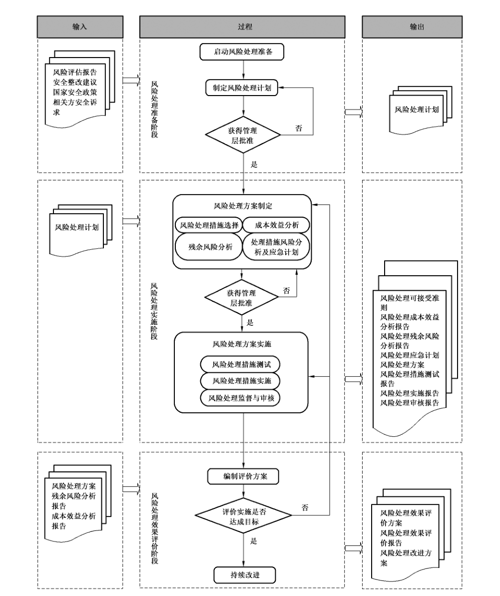
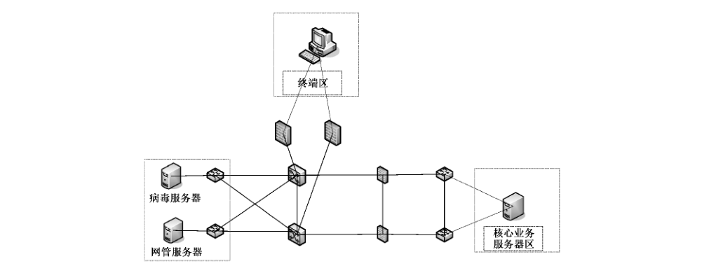
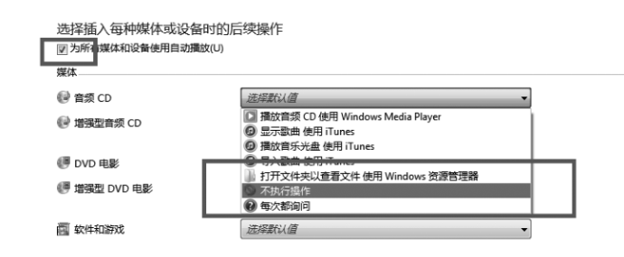

# GB/T 33132-2016 信息安全技术 信息安全风险处理实施指南

> 来源：[GB/T 33132-2016 国家标准详情](https://openstd.samr.gov.cn/bzgk/std/newGbInfo?hcno=CB61166A81B3B00A8B693C9D2F0F89CD)；封面发布日期：2016-10-13；实施日期：2017-05-01。
> PDF SHA-256：365e8337cb435d2b58136c260ba6bc202ebe071047d88a8c55ed3511183cb890。
> 转写说明：逐页对照官方 PDF 的全部 27 页图像，校正正文、图示和跨页表格；省略封面、目录、页眉、页脚和页码，合并跨页段落。正式引用请核对官方原件。

## 前言

本标准按照 GB/T 1.1—2009给出的规则起草。

请注意本文件的某些内容可能涉及专利。本文件的发布机构不承担识别这些专利的责任。

本标准由全国信息安全标准化技术委员会（SAC/TC 260）提出并归口。

本标准起草单位：国家信息中心、北京信息安全测评中心、中国民航大学、东软集团股份有限公司、北京数字认证股份有限公司、西安交大捷普网络科技有限公司。

本标准主要起草人：吴亚非、禄凯、陈永刚、赵章界、马勇、席斐、陈青民、何建锋。

## 引言

信息安全风险管理是信息安全保障工作中的一项重要基础性工作，其核心思想是对管理对象面临的信息安全风险进行管控。信息安全风险管理工作贯穿于信息系统生命周期（规划、设计、实施、运行维护和废弃）的全过程，主要工作过程包括风险评估和风险处理两个基本步骤。风险评估是对风险管理对象所面临的风险进行识别、分析和评价的过程。风险处理是依据风险评估的结果，选择和实施安全措施的过程。

为指导各类组织规范性地开展信息安全风险处理，在GB/T 20984—2007《信息安全技术 信息安全风险评估规范》、GB/Z 24364—2009《信息安全技术 信息安全风险管理指南》和 GB/T 31509—2015《信息安全技术 信息安全风险评估实施指南》的基础上，本标准针对风险评估工作中反映出来的各类信息安全风险，从风险处理工作的组织、管理、流程、评价等方面给出了相关描述，用于指导组织形成客观、规范的风险处理方案，促进风险管理工作的完善。

## 1 范围

本标准给出了信息安全风险处理的基本概念、处理原则、处理方式、处理流程以及处理结束后的效果评价等管理过程和方法，并对处理过程中的角色和职责进行了定义。

本标准适用于指导信息系统运营使用单位和信息安全服务机构实施信息安全风险处理活动。

## 2 规范性引用文件

下列文件对于本文件的应用是必不可少的。凡是注日期的引用文件，仅注日期的版本适用于本文件。凡是不注日期的引用文件，其最新版本（包括所有的修改单）适用于本文件。

- GB/T 20984—2007 信息安全技术 信息安全风险评估规范

- GB/Z 24364—2009 信息安全技术 信息安全风险管理指南

## 3 术语和定义

GB/T 20984—2007、GB/Z 24364—2009 界定的以及下列术语和定义适用于本文件。

### 3.1 风险处理 risk treatment

选择并且执行措施来更改风险的过程。

［ISO/IEC Guide 73:2002］。

> 注：在本标准中，术语“控制措施”被用作“措施”的同义词。

### 3.2 风险规避 risk elimination

不卷入风险处境的决定或撤离风险处境的行动。

［ISO/IEC Guide 73:2002］。

### 3.3 风险转移 risk mitigation

与另一方对风险带来的损失或收益的共享。

［ISO/IEC Guide 73:2002］。

> 注：在信息安全风险的语境下，对于风险转移仅考虑负面结果（损失）。

### 3.4 风险降低 risk reduction

为降低风险的可能性和（或）负面结果所采取的行动。

［ISO/IEC Guide 73:2002］。

### 3.5 风险接受 risk retention

对来自特定风险的损失或收益的接受。

［ISO/IEC Guide 73:2002］。

> 注：在信息安全风险的语境下，对于风险接受仅考虑负面后果（损失）。

### 3.6 风险处理目标 risk treatment target

通过风险处理活动的实施所要达到的最终目标。

### 3.7 风险处理评价 risk treatment evaluation

将风险处理措施实施后的结果与风险处理目标进行比较、分析，以确定风险处理效果的过程。

## 4 风险处理实施概述

### 4.1 风险处理基本原则

#### 4.1.1 合规原则

风险处理目标的确立和风险处理措施的选择应符合法律、法规、政策、标准和主管部门的要求。

#### 4.1.2 有效原则

在合规原则的前提下，风险处理的核心目的就是通过采取风险处理活动，有效地控制风险，使得处理后的风险处于组织的可承受范围之内。

#### 4.1.3 可控原则

明确风险处理的目标、方案、范围、需要实施的风险处理措施及风险处理措施本身可能带来的风险，明确风险处理所需的资源，确保整个风险处理工作的可控性。

#### 4.1.4 最佳收益原则

根据确立的风险处理目标，运用成本效益分析的方法，综合分析各种风险处理措施的成本、时间和技术等因素，以及能够获取的收益，选择收益最佳的风险处理措施。

### 4.2 风险处理的方式

#### 4.2.1 概述

风险处理的方式主要有风险降低、风险规避、风险转移和风险接受四种。这四种方式并不互相排斥，组织可以通过多种风险处理方式的合理组合充分获益。

#### 4.2.2 风险降低

通过对面临风险的资产采取保护措施来降低风险。保护措施可以从构成风险的5个方面（即威胁源、威胁行为、脆弱性、资产和影响）来降低风险。比如，采用法律的手段制裁计算机犯罪（包括窃取涉密信息，攻击关键的信息系统基础设施，传播有害信息和垃圾邮件等），发挥法律的威慑作用，从而有效遏制威胁源的动机；采取身份认证措施，从而抵制身份假冒威胁行为的能力；及时给系统打补丁（特别是针对安全漏洞的补丁），关闭无用的网络服务端口，从而减少系统的脆弱性，降低其被利用的可能性；采用各种防护措施，建立资产的安全域，从而保证资产不受侵犯，其价值得到保持；采取容灾备份、应急响应和业务连续性计划等措施，从而降低安全事件造成的影响程度。

#### 4.2.3 风险规避

通过不使用面临风险的资产来避免风险。比如，在没有足够安全保障的信息系统中，不处理敏感的信息，从而防止敏感信息的泄漏。再如，对于只处理内部业务的信息系统，不使用互联网，从而避免外部的入侵和攻击。

#### 4.2.4 风险转移

通过将面临风险的资产或其价值进行安全转移来避免或降低风险。比如，在本机构不具备足够的安全保障技术能力时，将信息系统的技术体系（即信息载体部分）外包给满足安全保障要求的第三方机构，从而避免技术风险。再如，通过给昂贵的设备上保险，将设备损失的风险转移给保险公司，从而降低资产价值的损失。

#### 4.2.5 风险接受

对风险不采取进一步的处理措施，接受风险可能带来的结果。风险接受的前提是：确定了信息系统的风险等级，评估了风险发生的可能性以及带来的潜在破坏，分析了使用处理措施的可能性，并进行了较全面的成本效益分析，认定某些功能、服务、信息或资产不需要进一步保护。

### 4.3 风险处理的角色和职责

信息安全风险处理应该组建团队，分清角色，明确职责。风险处理团队可以分为管理层和执行层。

其中，管理层负责审查风险处理目标、批准风险处理方案并认可风险处理结果，执行层负责确定风险处理目标、编制风险处理方案并在风险处理方案获得批准后负责实施。必要时，可聘请相关专业的技术专家组成专家小组，指导风险处理工作。

### 4.4 风险处理的基本流程

风险处理的基本流程包括了三个阶段的工作，分别为风险处理准备阶段、风险处理实施阶段和风险处理效果评价阶段，如图 1 所示。

第一个步骤是风险处理准备，确定风险处理的范围，明确风险处理的依据，组建风险处理团队，设定风险处理的目标和可接受准则，选择风险处理方式，明确风险处理资源，形成风险处理计划，并得到管理层对风险处理计划的批准。第二个步骤是风险处理实施，准备风险处理备选措施，进行成本效益分析和残余风险分析，对处理措施进行风险分析并制定应急计划，编制风险处理方案，待处理方案获得批准后，要对风险处理措施进行测试，测试完成后，正式实施。在处理措施的实施过程中，要加强监管与审核。

第三个步骤是风险处理效果评价，制定评价原则和方案，开展评价实施工作，对没有达到处理目的的风险，要进行持续改进。风险处理工作是持续性的活动，当受保护系统的政策环境、业务目标、安全目标和特性发生变化时，需要再次进入上述步骤。

在本标准的第5章到第7章，对信息安全风险处理实施过程的上述3个步骤的概念、过程、工作内容、输出文档等进行了阐述。

## 5 风险处理准备

### 5.1 制定风险处理计划

#### 5.1.1 划定风险处理范围

根据风险评估报告、组织的安全管理策略及安全需求划定风险处理工作的范围，在确定风险处理的边界时，应考虑以下因素：

a） 业务系统的业务逻辑边界；

b） 网络及设备载体边界；

c） 物理环境边界；

d） 组织管理权限边界；

e） 其他。

#### 5.1.2 明确风险处理依据

风险处理的依据包括（但不限于）：

a） 国家的相关法律、法规和政策；

b） 现行国际标准、国家标准和行业标准；

c） 行业主管部门的相关规章和制度；

d） 组织的业务战略和信息安全需求；

e） 组织业务相关单位的安全要求；

f） 系统本身的安全要求等。

#### 5.1.3 组建风险处理团队

信息安全风险处理是基于风险的信息系统的一种安全管理过程，因此风险处理团队既包括信息安全风险管理的直接参与人员，也包括信息系统的相关人员。信息安全风险处理主要划分为管理层和执行层，管理层负责信息系统风险处理的决策、总体规划和批准监督，各过程中的管理、组织和协调工作；

执行层负责信息安全风险处理的具体规划、设计和实施，过程监督、记录并反馈实施效果。

如果采用的风险转移方式中涉及到第三方单位，应将其纳入风险处理团队。

#### 5.1.4 设定风险处理的目标和可接受准则

根据信息系统风险评估结果，依据国家相关信息安全要求，组织和相关方的信息安全诉求，明确风险处理对象应达到的最低保护要求，结合组织的风险可承受程度，确定风险可接受准则。风险可接受准则的划分可参考如下标准：

a） 风险等级为很高或高的风险建议进行处理，对于现有处理措施技术不成熟的，建议加强监控；

b） 风险等级为中的风险可根据成本效益分析结果确定，对于处理成本无法承受或现有处理措施技术不成熟的，可持续跟踪、逐步解决；

c） 风险等级为低或很低的风险可选择接受，但应综合考虑组织所处的政策环境、外部相关方要求和组织的安全目标等因素。

风险可接受准则宜与管理层充分沟通，得到组织管理层认可，并与风险处理计划一起提交管理层批准。

#### 5.1.5 选择风险处理方式

根据风险处理可接受准则，明确需要处理的风险和可接受的风险，对于需要处理的风险，应初步确定每种风险拟采取的处理方式，形成风险处理列表。风险处理方式可以是规避风险、转移风险、降低风险三种处理方式的一种，也可以是多种处理方式的组合。

风险处理列表的内容包括风险名称、涉及的资产范围、初步确定的风险处理方式等。风险处理列表需要得到组织管理层的认可和批准。

#### 5.1.6 明确风险处理资源

根据既定的风险处理目标，明确风险处理涉及的部门、人员和资产以及需要增加的设备、软件、工具等所需资源。

#### 5.1.7 形成风险处理计划

上述所有内容确定后，应形成风险处理计划。处理计划应包含（但不限于）：风险处理范围、依据、目标、方式、所需资源等。

输入：风险评估报告、风险等级列表。

输出：风险处理计划。

### 5.2 获得管理层批准

制定完成并确认后的风险处理计划，应得到组织最高管理者的批准。

输入：风险处理计划。

输出：风险处理计划批准表。

## 6 风险处理实施

### 6.1 风险处理方案制定

#### 6.1.1 风险处理备选措施准备

依据组织的使命，并遵循国家、地区或行业的相关政策、法律、法规和标准的规定，参考信息系统的风险评估报告，并结合风险处理准备阶段的处理依据、处理目标、范围和方式，依据每种风险的处理方式选择对应的风险处理措施，编制风险处理备选措施列表。

输入：信息系统风险评估报告、风险处理目标列表、风险处理计划。

输出：风险处理备选措施列表。

#### 6.1.2 成本效益分析

针对风险处理备选措施列表的各项处理目标，结合组织实际情况，提出实现这些目标的多种可能方案，衡量各种方案的成本和收益，如果风险造成的损失大于成本，则依据最佳收益原则选择适当的处理方案。

对于成本效益分析可以采用定量分析和定性分析两种方法。对于定量分析首先需要确定各资产价值，为各个风险输入资产价值，确定资产面临的损坏程度，之后估计发生的可能性，进而以损失价值与发生概率相乘计算出预期损失。由于评估无形资产的主观性本质，没有量化风险的精确算法，建议根据组织情况明确成本和效益的一到两个关键值，并设立期望值，进而选择可行方案（案例可参见附录 A）。

在进行成本效益分析时，在成本应考虑的因素主要包括硬件、软件、人力、时间、维护、外包服务；效益应考虑的因素主要包括政治影响、社会效益、合规性和经济效益。

输入：风险处理备选措施列表。

输出：风险处理成本效益分析报告、更新后的风险处理备选措施列表。

#### 6.1.3 残余风险分析

任何信息系统都存在风险，同时风险不可能完全被消除。因此，需对实施风险处理措施后的残余风险进行分析。对残余风险的评价可以依据组织的风险评估准则进行。

若某些风险可能在选择了适当的控制措施后仍处于不可接受的风险范围内，则应通过管理层依据风险接受原则考虑是否接受此类风险或增加更多的风险处理措施。为确保所选择的风险处理措施是有效的，必要时可进行再评估，以判断实施风险处理措施后的残余风险是否降到了可接受的水平。

输入：风险处理备选措施列表。

输出：风险处理残余风险分析报告、更新后的风险处理备选措施列表。

#### 6.1.4 处理措施风险分析及应急计划

根据分析处理措施备选列表，对每项实施该处理措施可能带来的风险进行分析，确认是否会因为处理措施不当或其他原因引入新的风险。针对存在的风险制定应对的方案，以提高实现风险处理目标的机会，并保证在出现问题时可以及时回退到原始状态。应急计划应包括处理措施面临的主要风险，针对该风险的主要应对措施，每个措施应有明确的人员来负责，要求完成的时间以及进行的状态。进行处理措施风险分析和应急计划的主要步骤包括：

a） 编制风险清单。风险清单包括：可预知的风险、风险的描述、受影响的范围、原因，以及对项目目标的可能影响。

b） 确定应对措施。在应急计划中，要选择适当的应对措施，就应对措施形成一致意见，同时还要预计在已经采取了计划的措施之后仍将残留的风险和可能继发的风险，以及那些主动接受的风险，并对不可预见风险进行技术和人员储备。

c） 细化实施所选应对策略采取的具体行动、流程、预算、设备、人员和对应的责任。

d） 对于可能发生的特定风险，可采用风险转移的方式进行处理。

输入：风险处理备选措施列表。

输出：风险处理备选措施应急计划。

#### 6.1.5 风险处理措施确认

在完成成本效益分析和残余风险分析后，对每项风险选定一种或者几种处理措施，完成最终的风险处理措施列表。然后对所有措施的成本、效益和参与的风险进行汇总，分析所选措施实施的整体成本、效益和残余风险，确定满足风险处理目标。

在完成风险处理措施选择后，应将最终的处理措施提交组织管理层进行确认和批准。

输入：风险处理备选措施列表、风险处理成本效益分析报告、风险处理残余风险分析报告、风险处理备选措施应急计划。

输出：风险处理措施选择列表。

#### 6.1.6 风险处理方案编制

依据机构的使命和相关规定，结合处理依据、处理目标、范围和方式、风险处理措施、成本效益分析、残余风险分析以及风险处理团队的组成，编制风险处理方案。风险处理方案应包括风险处理的范围、对象、目标、组织结构、成本预算和进度安排，并对每项处理措施的实施方法、使用工具、潜在风险、回退方法、应急计划以及各项处理措施的监督和审核方法及人员进行明确说明。

风险处理方案编制完成后，可由管理层批准，或组织专家对风险处理方案进行评审。

输入：风险处理措施选择列表、风险处理计划。

输出：风险处理方案。

### 6.2 风险处理方案实施

#### 6.2.1 风险处理措施测试

风险处理措施测试是在风险处理措施正式实施前，选择风险处理关键措施，尤其是对在线生产系统，应进行测试以验证风险处理措施是否符合风险处理目标，判断措施的实施是否会引入新的风险，同时检验应急恢复方案是否有效。如果发现某项处理措施无法实施，则应重新选择处理方法，必要时需重新进行成本效益分析、风险分析和审批。

输入：风险处理方案。

输出：风险处理措施测试报告、更新后的风险处理方案。

#### 6.2.2 风险处理措施实施

在完成风险处理措施的测试工作后，应按照风险处理方案实施具体的风险处理措施。在实施过程中，实施风险处理的操作人员应对具体的操作内容进行记录、验证实施效果，并签字确认，形成风险处理实施的记录（记录格式可参见附录 A），以便后期回溯和责任认定。

在风险处理措施实施过程中，还应对每个风险点的处理细节进行跟踪，确认具体操作是否按照方案步骤实施、严格遵守实施后效果的验证、详细填写文件记录等，进而做到对每个风险点处理质量的控制。

输入：风险处理方案。

输出：风险处理实施记录、风险处理实施报告。

#### 6.2.3 风险处理过程监管与审核

在风险处理过程中，应根据风险处理方案明确风险处理质量、进度和费用等，进行督察、监控和评价，以确保实现风险处理的目标。风险处理的审核应该包括以下内容：

a） 监控过程的有效性：风险处理过程是否完整并被有效执行，输出的文档是否齐备和内容完整。

b） 监控成本的有效性：根据方案中的成本效益分析，确定执行中的成本与收益是否符合预期目标。

c） 审核结果的有效性和符合性：风险处理结果是否符合风险处理的目标，风险处理结果是否因处理措施的实施引入了其他风险或处理失效。

输入：风险处理方案、风险处理实施记录。

输出：风险处理实施报告。

## 7 风险处理效果评价

### 7.1 概述

在风险处理完成后，应评价风险处理的效果。风险处理效果评价报告是批准监督阶段工作的重要依据。风险处理效果评价一般包括：编制评价方案、评价实施效果和确定持续改进等内容。

### 7.2 评价原则

风险处理效果评价应满足下列原则：

a） 风险处理目标实现原则。在进行风险处理效果评价时，重点要验证风险处理目标列表中确定的目标是否实现。

b） 残余风险可接受准则。风险处理的目的是为了将风险控制在可接受的范围内，因此评价风险处理效果，就要评价实施风险处理后的残余风险是否可接受。

c） 安全投入合理准则。既要保证残余风险程度是可接受的，又要防止为了将残余风险降低到足够小而作出了远远超过实际需要的投入。

在满足以上准则的基础上，还可制定其他效果评价准则。例如，在同样安全投入和同样残余风险程度时，倾向于选择持续有效时间长的控制措施。

### 7.3 评价方法

风险处理效果评价方法根据风险处理结果不同可以分为残余风险评价方法和效益评价方法：

a） 残余风险评价方法：遵照GB/T 20984—2007中提供的流程和方法，评价实施风险处理后的残余风险。

b） 效益评价方法：通过分析安全措施产生的直接和间接的经济社会效益与安全投入之间的成本效益比、所实施的安全措施的成本效益比与可替代安全措施的成本效益比的比值等对所采取的安全措施的效益进行评价。

风险处理效果评价的方法根据评价对象不同可以分为控制措施有效性评价方法和整体风险控制有效性评价方法。

a） 控制措施有效性评价方法：针对每个所选择的控制措施采用风险评价方法和效益评价方法。

b） 整体风险控制有效性评价方法：基于业务的风险控制评价，结合风险评估报告中相关信息，综合评价实施风险处理措施后，残余安全风险可接受程度以及安全投入的合理性。

### 7.4 评价方案

为有效实施风险处理效果评价，宜根据风险处理前期的风险评估和风险处理成果，确定评价对象、评价目标、评价方法与评价准则、评价项目负责人及团队组成，做好评价工作总体计划，并编制评价方案。评价方案应通过专家评审，评价方案应获得组织管理层、风险处理实施团队相关利益方的认可。

输入：风险评估报告、经批准的风险处理计划、风险处理方案，风险处理实施报告及其他材料

a） 风险评估报告：该报告包含了资产识别、威胁识别、脆弱性识别和风险分析等内容。

b） 经批准的风险处理计划：该计划包含了组织管理层认可的风险处理依据、目标、范围和处理方式、残余风险可接受程度等。

c） 风险处理方案：该方案包含了风险处理方式、风险处理控制措施等。

d） 风险处理实施报告：该报告包含了风险处理实施过程的详细信息等。

e） 其他材料：在风险处理过程中形成的其他材料。

输出：风险处理效果评价方案。

风险处理效果评价方案应至少包括评价对象、评价目标、评价依据、评价方法与评价准则、评价项目负责人及团队组成、评价工作的进度安排等内容。

### 7.5 评价实施

风险处理效果评价方案编制完成后，应进行审核，并获得相关利益方的认可和组织领导层的批准。

在评价过程中，应设置监督员，对评价过程进行监控，保证评价过程客观公正。效果评价可以分为现场评价和分析评估两个阶段。现场评价阶段是指现场验证控制措施的有效性，并进行记录。分析评估阶段是指使用基于资产的风险评价方法和整体风险评估方法对风险处理效果进行评价。

评价完成后，应编制风险处理效果评价报告，评价风险处理的效果，给出改进建议，并将评价报告与相关利益者进行沟通。

输入：风险处理效果评价方案。

输出：风险处理效果评价报告。

### 7.6 持续改进

风险处理效果评价报告为风险管理的批准监督提供依据，也是风险管理中监督检查的重要依据。

在监督检查中，可根据风险处理效果评价报告确定是否进行持续改进。

输入：风险处理效果评价报告。

输出：风险处理后续改进方案。

## 附录 A（资料性附录）风险处理实践示例

### A.1 背景

A 公司是隶属于交通运输行业的大型国有企业，近年来，在公司高层领导的推进下，公司的信息化水平突飞猛进，信息资源的整合、共享和利用水平有效提升，公司的所有核心业务均实现了网上流转，信息系统的基础性、全局性、全员性作用日益增强。

××× 信息系统承载着该公司的 ××× 业务，其安全状况直接影响到该公司业务能否正常运行，因此公司聘请了第三方专业的信息安全评估机构，对 ××× 信息系统开展了信息安全风险评估工作。

××× 信息系统运行在公司内网，与互联网物理隔离，系统基本部署情况如图 A.1 所示，由于业务的连续性程度要求较高，因此关键网络设备、网络链路、核心服务器均采用了热备的方式。

通过对 ××× 系统的风险评估，在管理安全、物理安全、网络安全、主机安全、应用安全和数据安全这几个层面均发现了一些风险点，参见表 A.1。

**表 A.1 风险列表**

| 风险点编号 | 安全层面 | 风险描述 | 风险值 |
| --- | --- | --- | --- |
| R1 | 管理安全 | 重要业务数据未实现场外备份 | 3 |
| R2 | 管理安全 | 生产指挥系统没有真实的应急演练环境 | 2 |
| R3 | 物理环境安全 | 机房未对来访人员严格执行审批、登记流程 | 3 |
| R4 | 网络安全 | 远程管理采用 telnet 方式 | 3 |
| R5 | 网络安全 | 没有对网络中的终端进行 MAC 地址绑定 | 3 |
| R6 | 应用安全 | 对终端用户输入内容验证不严格，造成业务系统宕机 | 4 |
| R7 | 应用安全 | 口令验证机制不严格，允许弱口令存在 | 4 |
| R8 | 数据安全 | 控制指令在网络采用明文传输 | 2 |
| R9 | 主机安全 | 未关闭 Windows 自动播放功能，恶意代码易通过自动播放功能散播病毒 | 3 |
| R10 | 主机安全 | 存在匿名空连接，空连接可能帮助黑客远程枚举本地账号，获得服务器控制权 | 3 |

第三方安全评估机构给出了安全处理建议，参见表 A.2。

**表 A.2 风险处理建议**

| 风险点编号 | 安全层面 | 风险描述 | 处理建议 |
| --- | --- | --- | --- |
| R1 | 管理安全 | 重要业务数据未实现场外备份 | 降低风险 |
| R2 | 管理安全 | 生产指挥系统没有真实的应急演练环境 | 接受风险 |
| R3 | 物理环境安全 | 机房未对来访人员严格执行审批、登记流程 | 降低风险 |
| R4 | 网络安全 | 远程管理采用 telnet 方式 | 降低风险 |
| R5 | 网络安全 | 没有对网络中的终端进行 MAC 地址绑定 | 降低风险 |
| R6 | 应用安全 | 对终端用户输入内容验证不严格，造成业务系统宕机 | 降低风险 |
| R7 | 应用安全 | 口令验证机制不严格，允许弱口令存在 | 降低风险 |
| R8 | 数据安全 | 控制指令在网络采用明文传输 | 接受风险 |
| R9 | 主机安全 | 未关闭 Windows 自动播放功能，恶意代码易通过自动播放功能散播病毒 | 降低风险 |
| R10 | 主机安全 | 存在匿名空连接，空连接可能帮助黑客远程枚举本地账号，获得服务器控制权 | 降低风险 |

### A.2 风险处理准备

根据第三方机构提交的风险评估报告和风险处理建议，公司责成信息中心根据国家安全主管部门要求、交通运输行业安全要求和公司的实际安全需求，制定相应的风险处理计划。

根据公司要求，信息中心以主管信息安全工作的副主任为组长，抽调下属处室的管理和技术人员，组建了风险处理团队，并设定了在满足国家安全政策和交通运输行业安全要求的前提下，有效解决 ××× 系统面临的安全风险，提升业务安全保障水平的处理目标。经过讨论，风险处理小组确定，本次风险处理工作要围绕 ××× 系统开展，评估所发现的所有风险都将纳入到本次的处理范围，并初步确定了风险接受原则：

a） 风险等级高于（含）3 的，为不可接受风险，均需采取安全措施予以处理。若无法处理，则需说明原因，并通过专家论证会的形式予以论证；

b） 风险等级为 2 的，需通过成本分析决定风险是否可以接受；

c） 风险等级为 1 的，为可接受风险，不再予以处理。

根据前述决定，风险处理小组制定了风险处理计划，参见表 A.3。

**表 A.3 ××× 系统风险处理计划**

| 字段 | 内容 |
| --- | --- |
| 风险处理计划编号* | …… |
| 风险处理目标 | …… |
| 风险处理依据 | …… |
| 风险处理范围 | …… |
| 风险编号* | R7 |
| 风险等级 | 4 |
| 风险描述* | 应用系统口令验证机制不严格，允许弱口令存在 |
| 拟处理方式ᵃ | 风险降低 |
| 建议的安全措施* | 对应用程序代码进行改造，增加控制用户口令长度、复杂度、使用期限、重合率等功能，并在新系统发布后，启用该设置。同时，将应用程序与公司的统一认证平台相连接，实现统一认证和授权管理 |
| 涉及资产 | 应用程序、统一认证平台 |
| 所需资源 | 需要增加应用程序改造费用 |
| 配套措施说明 | 需要对《××× 应用系统安全使用管理规定》进行完善，增加相关认证登录方式和口令使用要求 |
| 采取措施后的预期效果 | 使得利用应用系统验证机制薄弱，通过口令猜解或暴力破解等方式进行的攻击成功率大幅度下降 |
| 风险编号* | …… |
| 风险等级 | …… |
| 风险描述* | …… |
| 拟处理方式ᵃ | …… |
| 建议的安全措施* | …… |
| 所需资源 | …… |
| 配套措施说明 | …… |
| 采取措施后的预期效果 | …… |

> 注：“*”部分的内容来自表 A.2。

> ᵃ 若拟采取的处理方式同制定的风险接受原则不符，则需另行申述。

风险处理计划提交公司主管信息安全工作的副总审阅后，在风险处理计划批准表上签署意见，参见表 A.4。

**表 A.4 ××× 系统风险处理计划批准表**

| 分组 | 字段 | 内容 |
| --- | --- | --- |
|  | 风险处理计划编号 | …… |
| 风险统计 | 高风险（风险等级＝5） | 0 |
| 风险统计 | 中风险（3≤风险等级≤4） | 8 |
| 风险统计 | 低风险（风险等级＜3） | 2 |
| 处理方式统计 | 风险降低 | 9 |
| 处理方式统计 | 风险转移 | 0 |
| 处理方式统计 | 风险接受 | 1 |
| 处理方式统计 | 风险规避 | 0 |
| 批复意见 | 批复意见 | …… |
| 批复意见 | 未批准计划对应风险编号（若有）* |  |
| 批复意见 | 备注 |  |

### A.3 风险处理实施

#### A.3.1 概述

通过综合考虑本单位的实际情况，并参考了信息系统风险评估报告、风险处理目标列表和风险处理计划，制定了风险处理备选措施列表，对于可接受风险不再进行重复描述，参见表 A.5。

**表 A.5 风险处理备选措施列表**

| 风险点编号 | 安全层面 | 风险描述 | 处置建议 | 备选处理措施 |
| --- | --- | --- | --- | --- |
| R1 | 管理安全 | 重要业务数据未实现场外备份 | 降低风险 | 1. 建立可靠的同城异地备份中心，进行数据同步备份工作。 2. 租用 IDC 机房一个机柜，进行数据的同步备份。 3. 采用人工方式备份数据到同城的第二个办公区域，定期进行数据恢复测试。 |
| R2 | 管理安全 | 生产指挥系统没有真实的应急演练环境 | 降低风险 | 1. 结合业务系统实际情况，建立备用系统，用于真实、有效的应急演练环境。 2. 通过虚拟机系统，搭建生产指挥系统的备用系统，并用于进行应急演练。 |
| R3 | 物理环境安全 | 机房未对来访人员严格执行审批、登记流程 | 规避风险 | 1. 建立完善的机房出入管理办法，设置机房出入专人管理，并进行管理制度的落实。 2. 采购更严格的身份认证系统，并对人员访问范围进行多个区域的划分，设置机房出入专人管理，限定严格的审批和登记流程。 |
| R4 | 网络安全 | 远程管理采用 telnet 方式 | 降低风险 | 1. 对管理办法进行修订，原则上不允许远程管理。 2. 需要进行远程管理时，采用 ssh 方式。 |
| R5 | 网络安全 | 没有对网络中的终端进行 MAC 地址绑定 | 降低风险 | 1. 采取技术手段，对终端进行 MAC 地址绑定。 2. 采购实名接入设备，对网络中终端的联网行为进行接入实名认证。 |
| R6 | 应用安全 | 对终端用户输入内容验证不严格，造成业务系统宕机 | 转移风险 | 1. 禁止非法终端用户登录应用系统。 2. 与终端用户签订《风险控制说明》。 3. 要求应用系统开发商对系统进行二次开发，对输入的内容进行严格的验证，确保系统安全。 |
| R7 | 应用安全 | 口令验证机制不严格，允许弱口令存在 | 转移风险 | 1. 采用双因子认证方式，加强口令的安全。 2. 采取有效措施，严格限制弱口令用户登录应用系统。 |
| R9 | 主机安全 | 未关闭 Windows 自动播放功能，恶意代码易通过自动播放功能散播病毒 | 降低风险 | 1. 禁用 Windows 操作系统自动播放的相关服务。 |
| R10 | 主机安全 | 存在匿名空连接，空连接可能帮助黑客远程枚举本地账号，获得服务器控制权 | 降低风险 | 1. 禁用 Windows 操作系统的默认共享，并设置强口令。 |

#### A.3.2 成本效益分析报告

**××× 风险处理措施成本效益分析报告**

**第一章 概述**

根据单位的总体安全防护策略要求，同时对各项风险处理措施进行成本分析，在 × 月 × 日至 × 月 × 日之间组织了信息中心、财务室和相关采购人员，对所有备选的措施进行效益分析，得出了总体成本效益分析，参见表 A.6。

**表 A.6 风险处理措施列表**

| 风险点编号 | 安全层面 | 风险描述 | 处置建议 | 处理措施 |
| --- | --- | --- | --- | --- |
| R1 | 管理安全 | 重要业务数据未实现场外备份 | 降低风险 | 采用人工方式备份数据到同城的第二个办公区域，定期进行数据恢复测试 |
| R2 | 管理安全 | 生产指挥系统没有真实的应急演练环境 | 降低风险 | 通过虚拟机系统，搭建生产指挥系统的备用系统，并用于进行应急演练 |
| R3 | 物理环境安全 | 机房未对来访人员严格执行审批、登记流程 | 规避风险 | 采购更严格的身份认证系统，并对人员访问范围进行多个区域的划分，设置机房出入专人管理，限定严格的审批和登记流程 |
| R4 | 网络安全 | 采用 telnet 方式进行远程管理 | 降低风险 | 采取技术手段，使用 ssh 方式进行管理 |
| R5 | 网络安全 | 没有对网络中的终端进行 MAC 地址绑定 | 降低风险 | 采取技术手段，对终端进行 MAC 地址绑定 |
| R6 | 应用安全 | 对终端用户输入内容验证不严格，造成业务系统宕机 | 转移风险 | 与终端用户签订《风险控制说明》 |
| R7 | 应用安全 | 口令验证机制不严格，允许弱口令存在 | 转移风险 | 采用双因子认证方式，加强口令的安全 |
| R9 | 主机安全 | 未关闭 Windows 自动播放功能，恶意代码易通过自动播放功能散播病毒 | 降低风险 | 禁用 Windows 操作系统自动播放的相关服务 |
| R10 | 主机安全 | 存在匿名空连接，空连接可能帮助黑客远程枚举本地账号，获得服务器控制权 | 降低风险 | 禁用 Windows 操作系统的默认共享，并设置强口令 |

**第二章 详细分析说明**

根据 R1 风险“重要业务数据未实现场外备份”的三种解决措施，各自优势和资金投入评估如下：

1. 建立可靠的同城异地备份中心，进行数据同步备份工作。安全性和可靠性最高，并可实现单位内部所有系统的数据管理，备份数据的实时性较高，并具自主可控性且维护方便。但是资金投入较大，预计建设费用 5 000 万元，后期每年需要 500 万元左右的维护费用。
2. 租用 IDC 机房一个机柜，进行数据的同步备份。安全性和可靠性相对较高，基本可以实现该系统重要业务数据的场外备份要求，并且备份数据的实时性较高。但是进出 IDC 机房维护程序稍显复杂，预计每年投入费用 10 万元。
3. 采用人工方式备份数据到同城的第二个办公区域，定期进行数据恢复测试。该项工作投入最少，由于业务数据量基本可以通过两张光盘进行刻录即可，包括人员携带数据同步等可通过日常工作顺便进行，按照每周进行一次备份，每年投入 500 元即可。

通过综合评估数据的重要性，建立实时数据的备份中心投入过大，暂不适合。对于在 IDC 机房租用机柜问题，考虑到数据保密的管理和投入偏高因素，待后期实现数据更好的保密和业务数据重要性更高后再考虑，因此决定选用第三种方式，既可满足要求，投入又相对较少。

（其他风险分析……）。

**第三章 总结**

通过总体的分析，选取了最适合的措施，总体预算成本约 45 万元，其中设备采购费用 30 万元，人工费用 15 万元。

#### A.3.3 残余风险分析报告

**××× 系统风险处理残余风险分析报告**

**第一章 概述**

在完成成本效益分析后，需要对降低和转移后的残余风险进行分析，确保遗留的风险是在可接受范围内。

**第二章 残余风险详细分析说明**

通过成本效益分析，针对 R1 风险“重要业务数据未实现场外备份”的解决措施暂定为“采用人工方式备份数据到同城的第二个办公区域，定期进行数据恢复测试”，目前该项措施残余的风险包括：

- 数据的实时备份效果较差，存在系统本地备份不可用后，数据无法完全恢复到瘫痪前的最终状态；
- 备份介质管理存在隐患，由于使用的是光盘进行存储，可能由于人为或者其他原因导致损坏，备份数据无法使用；
- 人员在进行数据携带过程中，存在将数据拷贝到个人电脑中，导致数据被窃取的风险。

综合考虑目前残留的风险带来的损失，这些风险是可以接受的。

**第三章 总结**

通过残余风险分析，成本效益分析后选择的处置措施遗留的风险均在可接受范围内，无需进行修改和调整。

#### A.3.4 风险处理方案

**××× 系统风险处理方案**

对风险处理的范围、对象、目标、组织结构、成本预算和进度安排，并对每项处理措施的实施方法、使用工具、潜在风险、回退方法、应急计划以及各项处理措施的监督和核实人员进行说明。

**第一章 概述**

××× 系统风险处理的主要目标是通过安全整改和管理制度完善等措施，确保对现存的 8 项不可接受风险进行规避、减低和转移。风险处理范围和对象包括 ××× 系统相关的机房、服务器、终端、管理制度等。

**第二章 项目团队**

项目团队按照项目经理负责制，划分制度建设组、系统建设组、策略调整组，各项工作由项目经理统一安排。

**第三章 工作进度安排**

为保障风险处理工作不会影响正常业务运行，对于策略调整等存在一定安全风险的工作将安排在周五实施，一旦出现风险则在周末进行应急处置。具体时间安排参见表 A.7。

**表 A.7 风险处理措施实施进度安排**

| 序号 | 时间 | 内容 | 人员 | 备注 |
| --- | --- | --- | --- | --- |
| 1 | ×月×日 | 虚拟机系统，搭建生产指挥系统的备用系统 | 张三 |  |
| 2 | ×月×日至×月×日 | 采购更严格的身份认证系统，并进行部署 | 李四 |  |
| 3 | ×月×日 | …… |  |  |
| 4 | ×月×日 | …… |  |  |

**第四章 处置流程**

风险处理的流程如下：

- 对重要的应用系统、数据库等进行必要的备份；
- 系统配置调试之前重起系统并测试应用，以确保服务器本身不存在故障；
- 按照风险处理方案实施操作；
- 完成之后重启系统并测试应用；
- 确认应用无故障后，各方签字确认。

> 转写注：上文“重起系统”保留原文用字。

风险处理措施回退方案与风险处理措施实施记录单参见表 A.8 和表 A.9。

**表 A.8 风险处理措施回退方案（以 R9 风险为例）**

| 字段 | 内容 |
| --- | --- |
| 名称 | 禁用 Windows 操作系统自动播放的相关服务 |
| 当前状态 | 未禁用 Windows 操作系统自动播放的相关服务 |
| 实施方案 | 以 Win7 操作系统为例，点击“开始菜单”，然后选择右边的“默认程序”。在“默认程序”设置面板中，选择“更改自动播放设置”，即可打开 Win7 系统的“更改自动播放”设置面板。取消勾选框，并对所要限制的媒体设置为不执行操作。 |
| 实施目的 | 降低光盘或其他存储介质自动播放导致其中存在的病毒程序运行，降低计算机感染病毒的风险 |
| 实施风险 | 无 |
| 回退方案 | 恢复到版本更新前状态，勾选“为所有媒体和设备使用自动播放” |
| 执行人员 | □ ×× 单位　□ 第三方服务公司 |

**表 A.9 风险处理措施实施记录单**

| 阶段 | 字段 | 内容 |
| --- | --- | --- |
| 准备阶段 | 名称 | 禁用 Windows 操作系统自动播放的相关服务 |
| 准备阶段 | 系统当前状态 | 未禁用 Windows 操作系统自动播放的相关服务 |
| 准备阶段 | 存在风险 | 光盘或其他存储介质自动播放导致其中存在的病毒程序运行 |
| 准备阶段 | 实施方案 | 以 Win7 操作系统为例，点击“开始菜单”，然后选择右边的“默认程序”。在“默认程序”设置面板中，选择“更改自动播放设置”，即可打开 Win7 系统的“更改自动播放”设置面板。取消勾选框，并对所要限制的媒体设置为不执行操作。 |
| 准备阶段 | 实施风险 | 无 |
| 准备阶段 | 回退措施 | 恢复到版本更新前状态，勾选“为所有媒体和设备使用自动播放” |
| 准备阶段 | 是否处理 | □ 执行处理　□ 不执行处理 |
| 准备阶段 | 相关单位 | 应用开发商、系统运维商、安全服务公司 |
| 实施阶段 | 备份工作 | 此项工作不需要进行数据备份；☑ 成功　□ 失败；实施人员：张三；年　月　日 |
| 实施阶段 | 处理实施 | 按照操作实施，策略设置成功；☑ 成功　□ 失败；实施人员：李四；年　月　日 |
| 实施阶段 | 重启验证 | 重启终端运行正常，未出现无法启动或者报错信息；☑ 成功　□ 失败；实施人员：王五；年　月　日 |
| 确认阶段 | 应用开发商 | 不需要应用开发商确认；签字：　年　月　日 |
| 确认阶段 | 系统运维商 | 操作系统正常，未出现问题，风险处理成功；签字：　年　月　日 |
| 确认阶段 | 安全服务商 | 加固解决了 ××× 风险，经验证漏洞修复，风险处理成功；签字：　年　月　日 |
| 确认阶段 | 系统主管单位 | 同意；签字：　年　月　日 |

#### A.3.5 风险处理实施报告

**风险处理实施报告**

**第一章 概述**

通过风险评估，××× 系统发现了 10 个风险点，其中 2 个风险点为可接受风险，对于不可接受风险选择了进行处理，整个处理过程分为 5 个阶段，分别为前期准备、测试、风险处理实施、结果确认和报告编制。

**第二章 风险处理说明**

整个实施过程在信息中心的统一管理下，系统开发商、安全服务商和系统运维商共同参与配置，整体项目工期耗时 3 个月。

第一阶段：……

第二阶段：……

……

**第三章 风险处理结果**

通过风险处理工作，系统的风险降到了可以接受的范围。

附件：各风险处理记录单，参见前述记录单。

### A.4 风险处理评价

**××× 系统风险处理评价报告**

**第一章 概述**

**1.1 评价依据**

《××× 信息系统风险处理实施报告》。

**1.2 评价对象**

对 ××× 信息系统风险的处理进行评价，具体风险及其处理方式参见表 A.6。

**1.3 评价方法**

本次处理效果评价采取措施有效性评价与整体风险评价相结合的方式评价效果，参见表 A.10。

**表 A.10 风险处理措施评价方法表**

| 风险点编号 | 安全层面 | 风险描述 | 处理措施 | 评价方法 | 评价测试指南 | 处理措施有效性评价准则 |
| --- | --- | --- | --- | --- | --- | --- |
| R1 | 管理安全 | 重要业务数据未实现场外备份 | 采用人工方式备份数据到同城的第二个办公区域，定期进行数据恢复测试 | 访谈、查看、测试 | 1. 查看相关的数据备份制度要求，对备份的周期、备份的类型、备份的测试等是否有要求； 2. 访谈相关的管理人员，是否明确了备份工作职责； 3. 查看备份操作的登记记录； 4. 查看备份介质的存放环境、保护措施等； 5. 查看数据恢复测试记录； 6. 在仿真环境中进行数据恢复测试，并比较恢复数据与真实生产数据的一致性。 | 如果第 6 项测试恢复成功，且恢复数据与真实生产数据之间的一致性达到 100%，该措施有效 |
| R2 | …… | …… | …… | …… | …… | …… |
| …… |  |  |  |  |  |  |

**1.4 评价团队**

……

**第二章 风险处理效果评价实施**

**2.1 措施有效性评价**

根据采集的评价记录，对风险处理控制措施的有效性进行评价，参见表 A.11。

**表 A.11 风险处理控制措施有效性评价结果表**

| 风险点编号 | 风险描述 | 处理措施 | 有效性 | 评价记录 |
| --- | --- | --- | --- | --- |
| R1 | 重要业务数据未实现场外备份 |  | 有效 |  |
| …… | …… | …… |  |  |
| R7 | 口令验证机制不严格，允许弱口令存在 |  | 基本有效 |  |
| …… | …… | …… |  |  |

**2.2 整体风险评价**

根据残余风险评估的结果，对整体风险进行评价，参见表 A.12。

**表 A.12 风险再评价表**

| 风险点编号 | 安全层面 | 剩余风险描述 | 风险值 |
| --- | --- | --- | --- |
| …… |  | …… |  |
| R7 | 应用安全 | 对口令的复杂度、有效期等进行了管控，但没有完成双因子认证改造，仍然无法抵御口令猜解等攻击 | 2 |
| …… |  | …… |  |

**第三章 结论与改进建议**

**3.1 评价结论**

根据评价分析可以得知，本次风险处理共对 9 项风险采取了风险降低处理方式，由评价结果可知，其中的 8 项均达到了预期的处理目标，风险降低到了可接受程度，有 1 项处理效果未达到预期的处理目的，整体分析可知，本次风险处理基本达到了预期的安全目标。

**3.2 未达标原因分析**

……

**3.3 改进建议**

……

## 参考文献

[1] GB/T 22239—2008 信息安全技术 信息系统安全等级保护基本要求

[2] GB/T 31509—2015 信息安全技术 信息安全风险评估实施指南

[3] ISO/IEC Guide 73:2002 Risk management—Vocabulary—Guidelines for use in standards
