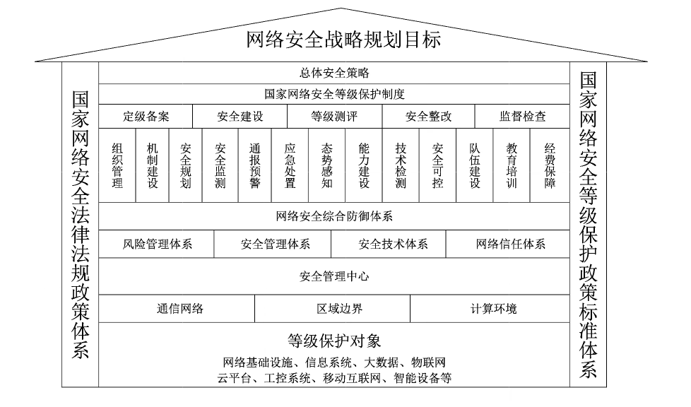
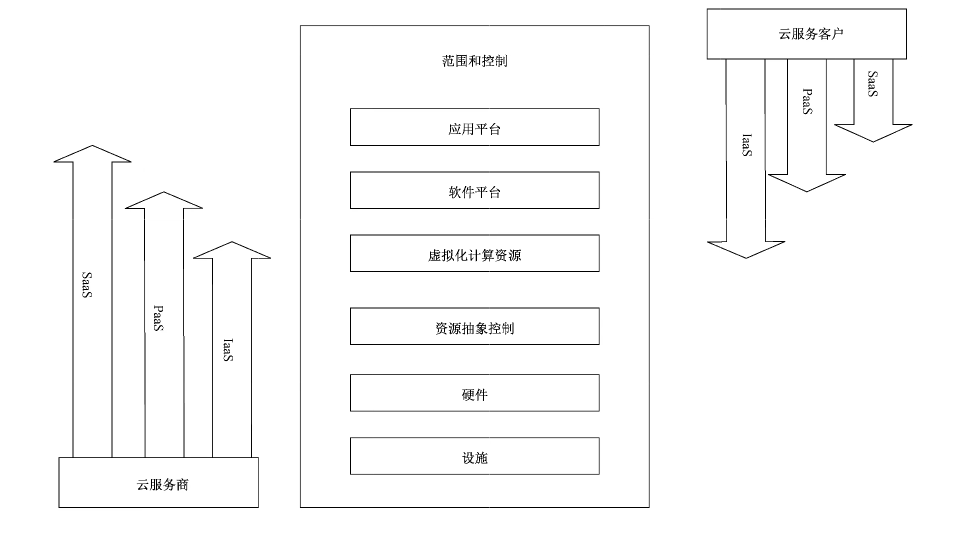
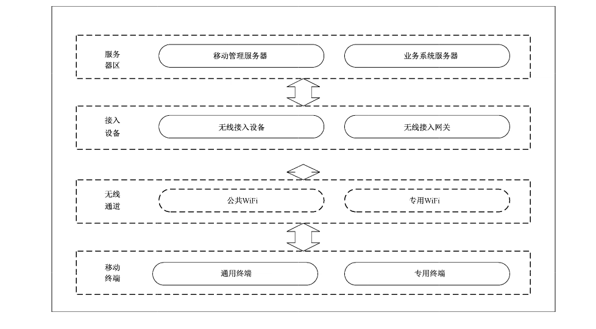
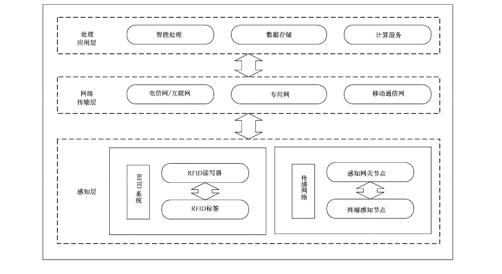
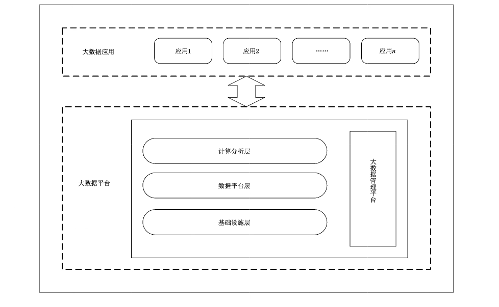

# GB/T 22239-2019 信息安全技术 网络安全等级保护基本要求

> 来源：[GB/T 22239-2019 国家标准详情](https://openstd.samr.gov.cn/bzgk/std/newGbInfo?hcno=BAFB47E8874764186BDB7865E8344DAF)；封面发布日期：2019-05-10；实施日期：2019-12-01。
> 官方在线预览截图 SHA-256：1d34dde25b2daf9022e11e128515857b0f0ce8dfd51b80ca48cb295792b3dec0。
> 转写说明：将官方在线预览的全部 91 页逐页截图并用图像识别核对文字、标题、列表、图示和矩阵表；省略封面、目录、页眉页脚及封底空白页，合并跨页续表。正式引用请核对原页面图像。

## 前言

本标准按照GB/T 1.1—2009给出的规则起草。

本标准代替 GB/T 22239—2008《信息安全技术 信息系统安全等级保护基本要求》，与GB/T 22239—2008 相比，主要变化如下：将标准名称变更为《信息安全技术 网络安全等级保护基本要求》；

- 调整分类为安全物理环境、安全通信网络、安全区域边界、安全计算环境、安全管理中心、安全管理制度、安全管理机构、安全管理人员、安全建设管理、安全运维管理；

- 调整各个级别的安全要求为安全通用要求、云计算安全扩展要求、移动互联安全扩展要求、物联网安全扩展要求和工业控制系统安全扩展要求；

- 取消了原来安全控制点的 S、A、G 标注，增加一个附录 A 描述等级保护对象的定级结果和安全要求之间的关系，说明如何根据定级结果选择安全要求；

- 调整了原来附录 A 和附录 B 的顺序，增加了附录 C 描述网络安全等级保护总体框架，并提出关键技术使用要求。

请注意本文件的某些内容可能涉及专利。本文件的发布机构不承担识别这些专利的责任。

本标准由全国信息安全标准化技术委员会（SAC/TC 260）提出并归口。

本标准起草单位：公安部第三研究所（公安部信息安全等级保护评估中心）、国家能源局信息中心、阿里云计算有限公司、中国科学院信息工程研究所（信息安全国家重点实验室）、新华三技术有限公司、华为技术有限公司、启明星辰信息技术集团股份有限公司、北京鼎普科技股份有限公司、中国电子信息产业集团有限公司第六研究所、公安部第一研究所、国家信息中心、山东微分电子科技有限公司、中国电子科技集团公司第十五研究所（信息产业信息安全测评中心）、浙江大学、工业和信息化部计算机与微电子发展研究中心（中国软件评测中心）、浙江国利信安科技有限公司、机械工业仪器仪表综合技术经济研究所、杭州科技职业技术学院。

本标准主要起草人：马力、陈广勇、张振峰、郭启全、葛波蔚、祝国邦、陆磊、曲洁、于东升、李秋香、任卫红、胡红升、陈雪鸿、冯冬芹、王江波、张宗喜、张宇翔、毕马宁、沙森森、李明、黎水林、于晴、李超、刘之涛、袁静、霍珊珊、黄顺京、尹湘培、苏艳芳、陶源、陈雪秀、于俊杰、沈锡镛、杜静、周颖、吴薇、刘志宇、宫月、王昱镔、禄凯、章恒、高亚楠、段伟恒、马闽、贾驰千、陆耿虹、高梦州、赵泰、孙晓军、许凤凯、王绍杰、马红霞、刘美丽。

本标准所代替标准的历次版本发布情况为：-—GB/T 22239—2008。

## 引言

为了配合《中华人民共和国网络安全法》的实施，同时适应云计算、移动互联、物联网、工业控制和大数据等新技术、新应用情况下网络安全等级保护工作的开展，需对GB/T 22239—2008进行修订，修订的思路和方法是调整原国家标准 GB/T 22239—2008的内容，针对共性安全保护需求提出安全通用要求，针对云计算、移动互联、物联网、工业控制和大数据等新技术、新应用领域的个性安全保护需求提出安全扩展要求，形成新的网络安全等级保护基本要求标准。

本标准是网络安全等级保护相关系列标准之一。

与本标准相关的标准包括：GB/T 25058 信息安全技术 信息系统安全等级保护实施指南；

GB/T 22240 信息安全技术 信息系统安全等级保护定级指南；

GB/T 25070 信息安全技术 网络安全等级保护安全设计技术要求；

GB/T 28448 信息安全技术 网络安全等级保护测评要求；

GB/T 28449 信息安全技术 网络安全等级保护测评过程指南。

在本标准中，黑体字部分表示较高等级中增加或增强的要求。

## 1 范围

本标准规定了网络安全等级保护的第一级到第四级等级保护对象的安全通用要求和安全扩展要求。

本标准适用于指导分等级的非涉密对象的安全建设和监督管理。

> 注：第五级等级保护对象是非常重要的监督管理对象，对其有特殊的管理模式和安全要求，所以不在本标准中进行描述。

## 2 规范性引用文件

下列文件对于本文件的应用是必不可少的。凡是注日期的引用文件，仅注日期的版本适用于本文件。凡是不注日期的引用文件，其最新版本（包括所有的修改单）适用于本文件。

- GB 17859 计算机信息系统 安全保护等级划分准则

- GB/T 22240 信息安全技术 信息系统安全等级保护定级指南

- GB/T 25069 信息安全技术 术语

- GB/T 31167—2014 信息安全技术 云计算服务安全指南

- GB/T 31168—2014 信息安全技术 云计算服务安全能力要求

- GB/T 32919—2016 信息安全技术 工业控制系统安全控制应用指南

## 3 术语和定义

GB 17859、GB/T 22240、GB/T 25069、GB/T 31167—2014、GB/T 31168—2014 和 GB/T 32919—2016 界定的以及下列术语和定义适用于本文件。为了便于使用，以下重复列出了 GB/T 31167—2014、GB/T 31168—2014 和 GB/T 32919—2016 中的一些术语和定义。

### 3.1 网络安全 cybersecurity

通过采取必要措施，防范对网络的攻击、侵入、干扰、破坏和非法使用以及意外事故，使网络处于稳定可靠运行的状态，以及保障网络数据的完整性、保密性、可用性的能力。

### 3.2 安全保护能力 security protection ability

能够抵御威胁、发现安全事件以及在遭到损害后能够恢复先前状态等的程度。

### 3.3 云计算 cloud computing

通过网络访问可扩展的、灵活的物理或虚拟共享资源池，并按需自助获取和管理资源的模式。

> 注：资源实例包括服务器、操作系统、网络、软件、应用和存储设备等。

［GB/T 31167—2014，定义 3.1］

### 3.4 云服务商 cloud service provider

云计算服务的供应方。

> 注：云服务商管理、运营、支撑云计算的计算基础设施及软件，通过网络交付云计算的资源。

［GB/T 31167—2014，定义 3.3］

### 3.5 云服务客户 cloud service customer

为使用云计算服务同云服务商建立业务关系的参与方。

［GB/T 31168—2014，定义3.4］

### 3.6 云计算平台/系统 cloud computing platform/system

云服务商提供的云计算基础设施及其上的服务软件的集合。

### 3.7 虚拟机监视器 hypervisor

运行在基础物理服务器和操作系统之间的中间软件层，可允许多个操作系统和应用共享硬件。

### 3.8 宿主机 host machine

运行虚拟机监视器的物理服务器。

### 3.9 移动互联 mobile communication

采用无线通信技术将移动终端接入有线网络的过程。

### 3.10 移动终端 mobile device

在移动业务中使用的终端设备，包括智能手机、平板电脑、个人电脑等通用终端和专用终端设备。

### 3.11 无线接入设备 wireless access device

采用无线通信技术将移动终端接入有线网络的通信设备。

### 3.12 无线接入网关 wireless access gateway

部署在无线网络与有线网络之间，对有线网络进行安全防护的设备。

### 3.13 移动应用软件 mobile application

针对移动终端开发的应用软件。

### 3.14 移动终端管理系统 mobile device management system

用于进行移动终端设备管理、应用管理和内容管理的专用软件，包括客户端软件和服务端软件。

### 3.15 物联网 internet of things

将感知节点设备通过互联网等网络连接起来构成的系统。

### 3.16 感知节点设备 sensor node

对物或环境进行信息采集和/或执行操作，并能联网进行通信的装置。

### 3.17 感知网关节点设备 sensor layer gateway

将感知节点所采集的数据进行汇总、适当处理或数据融合，并进行转发的装置。

### 3.18 工业控制系统 industrial control system

工业控制系统（ICS）是一个通用术语，它包括多种工业生产中使用的控制系统，包括监控和数据采集系统（SCADA）、分布式控制系统（DCS）和其他较小的控制系统，如可编程逻辑控制器（PLC），现已广泛应用在工业部门和关键基础设施中。

［GB/T 32919—2016，定义 3.1］

## 4 缩略语

下列缩略语适用于本文件。

- AP：无线访问接入点（Wireless Access Point）
- DCS：集散控制系统（Distributed Control System）
- DDoS：拒绝服务（Distributed Denial of Service）
- ERP：企业资源计划（Enterprise Resource Planning）
- FTP：文件传输协议（File Transfer Protocol）
- HMI：人机界面（Human Machine Interface）
- IaaS：基础设施即服务（Infrastructure-as-a-Service）
- ICS：工业控制系统（Industrial Control System）
- IoT：物联网（Internet of Things）
- IP：互联网协议（Internet Protocol）
- IT：信息技术（Information Technology）
- MES：制造执行系统（Manufacturing Execution System）
- PaaS：平台即服务（Platform-as-a-Service）
- PLC：可编程逻辑控制器（Programmable Logic Controller）
- RFID：射频识别（Radio Frequency Identification）
- SaaS：软件即服务（Software-as-a-Service）
- SCADA：数据采集与监视控制系统（Supervisory Control and Data Acquisition System）
- SSID：服务集标识（Service Set Identifier）
- TCB：可信计算基（Trusted Computing Base）
- USB：通用串行总线（Universal Serial Bus）
- WEP：有线等效加密（Wired Equivalent Privacy）
- WPS：WiFi 保护设置（WiFi Protected Setup）

## 5 网络安全等级保护概述

### 5.1 等级保护对象

等级保护对象是指网络安全等级保护工作中的对象，通常是指由计算机或者其他信息终端及相关设备组成的按照一定的规则和程序对信息进行收集、存储、传输、交换、处理的系统，主要包括基础信息网络、云计算平台/系统、大数据应用/平台/资源、物联网（IoT）、工业控制系统和采用移动互联技术的系统等。等级保护对象根据其在国家安全、经济建设、社会生活中的重要程度，遭到破坏后对国家安全、社会秩序、公共利益以及公民、法人和其他组织的合法权益的危害程度等，由低到高被划分为五个安全保护等级。

保护对象的安全保护等级确定方法见 GB/T 22240。

### 5.2 不同级别的安全保护能力

不同级别的等级保护对象应具备的基本安全保护能力如下：第一级安全保护能力：应能够防护免受来自个人的、拥有很少资源的威胁源发起的恶意攻击、一般的自然灾难，以及其他相当危害程度的威胁所造成的关键资源损害，在自身遭到损害后，能够恢复部分功能。

第二级安全保护能力：应能够防护免受来自外部小型组织的、拥有少量资源的威胁源发起的恶意攻击、一般的自然灾难，以及其他相当危害程度的威胁所造成的重要资源损害，能够发现重要的安全漏洞和处置安全事件，在自身遭到损害后，能够在一段时间内恢复部分功能。

第三级安全保护能力：应能够在统一安全策略下防护免受来自外部有组织的团体、拥有较为丰富资源的威胁源发起的恶意攻击、较为严重的自然灾难，以及其他相当危害程度的威胁所造成的主要资源损害，能够及时发现、监测攻击行为和处置安全事件，在自身遭到损害后，能够较快恢复绝大部分功能。

第四级安全保护能力：应能够在统一安全策略下防护免受来自国家级别的、敌对组织的、拥有丰富资源的威胁源发起的恶意攻击、严重的自然灾难，以及其他相当危害程度的威胁所造成的资源损害，能够及时发现、监测发现攻击行为和安全事件，在自身遭到损害后，能够迅速恢复所有功能。

第五级安全保护能力：略。

### 5.3 安全通用要求和安全扩展要求

由于业务目标的不同、使用技术的不同、应用场景的不同等因素，不同的等级保护对象会以不同的形态出现，表现形式可能称之为基础信息网络、信息系统（包含采用移动互联等技术的系统）、云计算平台/系统、大数据平台/系统、物联网、工业控制系统等。形态不同的等级保护对象面临的威胁有所不同，安全保护需求也会有所差异。为了便于实现对不同级别的和不同形态的等级保护对象的共性化和个性化保护，等级保护要求分为安全通用要求和安全扩展要求。

安全通用要求针对共性化保护需求提出，等级保护对象无论以何种形式出现，应根据安全保护等级实现相应级别的安全通用要求；安全扩展要求针对个性化保护需求提出，需要根据安全保护等级和使用的特定技术或特定的应用场景选择性实现安全扩展要求。安全通用要求和安全扩展要求共同构成了对等级保护对象的安全要求。安全要求的选择见附录A，整体安全保护能力的要求见附录B和附录C。

本标准针对云计算、移动互联、物联网、工业控制系统提出了安全扩展要求。云计算应用场景参见附录D，移动互联应用场景参见附录E，物联网应用场景参见附录F，工业控制系统应用场景参见附录G，大数据应用场景参见附录 H。对于采用其他特殊技术或处于特殊应用场景的等级保护对象，应在安全风险评估的基础上，针对安全风险采取特殊的安全措施作为补充。

## 6 第一级安全要求

### 6.1 安全通用要求

#### 6.1.1 安全物理环境

##### 6.1.1.1 物理访问控制

机房出入口应安排专人值守或配置电子门禁系统，控制、鉴别和记录进入的人员。

##### 6.1.1.2 防盗窃和防破坏

应将设备或主要部件进行固定，并设置明显的不易除去的标识。

##### 6.1.1.3 防雷击

应将各类机柜、设施和设备等通过接地系统安全接地。

##### 6.1.1.4 防火

机房应设置灭火设备。

##### 6.1.1.5 防水和防潮

应采取措施防止雨水通过机房窗户、屋顶和墙壁渗透。

##### 6.1.1.6 温湿度控制

应设置必要的温湿度调节设施，使机房温湿度的变化在设备运行所允许的范围之内。

##### 6.1.1.7 电力供应

应在机房供电线路上配置稳压器和过电压防护设备。

#### 6.1.2 安全通信网络

##### 6.1.2.1 通信传输

应采用校验技术保证通信过程中数据的完整性。

##### 6.1.2.2 可信验证

可基于可信根对通信设备的系统引导程序、系统程序等进行可信验证，并在检测到其可信性受到破坏后进行报警。

#### 6.1.3 安全区域边界

##### 6.1.3.1 边界防护

应保证跨越边界的访问和数据流通过边界设备提供的受控接口进行通信。

##### 6.1.3.2 访问控制

本项要求包括：

a） 应在网络边界根据访问控制策略设置访问控制规则，默认情况下除允许通信外受控接口拒绝所有通信；

b） 应删除多余或无效的访问控制规则，优化访问控制列表，并保证访问控制规则数量最小化；

c） 应对源地址、目的地址、源端口、目的端口和协议等进行检查，以允许/拒绝数据包进出。

##### 6.1.3.3 可信验证

可基于可信根对边界设备的系统引导程序、系统程序等进行可信验证，并在检测到其可信性受到破坏后进行报警。

#### 6.1.4 安全计算环境

##### 6.1.4.1 身份鉴别

本项要求包括：

a） 应对登录的用户进行身份标识和鉴别，身份标识具有唯一性，身份鉴别信息具有复杂度要求并定期更换；

b） 应具有登录失败处理功能，应配置并启用结束会话、限制非法登录次数和当登录连接超时自动退出等相关措施。

##### 6.1.4.2 访问控制

本项要求包括：

a） 应对登录的用户分配账户和权限；

b） 应重命名或删除默认账户，修改默认账户的默认口令；

c） 应及时删除或停用多余的、过期的账户，避免共享账户的存在。

##### 6.1.4.3 入侵防范

本项要求包括：

a） 应遵循最小安装的原则，仅安装需要的组件和应用程序；

b） 应关闭不需要的系统服务、默认共享和高危端口。

##### 6.1.4.4 恶意代码防范

应安装防恶意代码软件或配置具有相应功能的软件，并定期进行升级和更新防恶意代码库。

##### 6.1.4.5 可信验证

可基于可信根对计算设备的系统引导程序、系统程序等进行可信验证，并在检测到其可信性受到破坏后进行报警。

##### 6.1.4.6 数据完整性

应采用校验技术保证重要数据在传输过程中的完整性。

##### 6.1.4.7 数据备份恢复

应提供重要数据的本地数据备份与恢复功能。

#### 6.1.5 安全管理制度

##### 6.1.5.1 管理制度

应建立日常管理活动中常用的安全管理制度。

#### 6.1.6 安全管理机构

##### 6.1.6.1 岗位设置

应设立系统管理员等岗位，并定义各个工作岗位的职责。

##### 6.1.6.2 人员配备

应配备一定数量的系统管理员。

##### 6.1.6.3 授权和审批

应根据各个部门和岗位的职责明确授权审批事项、审批部门和批准人等。

#### 6.1.7 安全管理人员

##### 6.1.7.1 人员录用

应指定或授权专门的部门或人员负责人员录用。

##### 6.1.7.2 人员离岗

应及时终止离岗人员的所有访问权限，取回各种身份证件、钥匙、徽章等以及机构提供的软硬件设备。

##### 6.1.7.3 安全意识教育和培训

应对各类人员进行安全意识教育和岗位技能培训，并告知相关的安全责任和惩戒措施。

##### 6.1.7.4 外部人员访问管理

应保证在外部人员访问受控区域前得到授权或审批。

#### 6.1.8 安全建设管理

##### 6.1.8.1 定级和备案

应以书面的形式说明保护对象的安全保护等级及确定等级的方法和理由。

##### 6.1.8.2 安全方案设计

应根据安全保护等级选择基本安全措施，依据风险分析的结果补充和调整安全措施。

##### 6.1.8.3 产品采购和使用

应确保网络安全产品采购和使用符合国家的有关规定。

##### 6.1.8.4 工程实施

应指定或授权专门的部门或人员负责工程实施过程的管理。

##### 6.1.8.5 测试验收

应进行安全性测试验收。

##### 6.1.8.6 系统交付

本项要求包括：

a） 应制定交付清单，并根据交付清单对所交接的设备、软件和文档等进行清点；

b）应对负责运行维护的技术人员进行相应的技能培训。

##### 6.1.8.7 服务供应商选择

本项要求包括：

a） 应确保服务供应商的选择符合国家的有关规定；

b）应与选定的服务供应商签订与安全相关的协议，明确约定相关责任。

#### 6.1.9 安全运维管理

##### 6.1.9.1 环境管理

本项要求包括：

a） 应指定专门的部门或人员负责机房安全，对机房出入进行管理，定期对机房供配电、空调、温湿度控制、消防等设施进行维护管理；

b）应对机房的安全管理做出规定，包括物理访问、物品进出和环境安全等方面。

6.1.9.2介质管理应将介质存放在安全的环境中，对各类介质进行控制和保护，实行存储环境专人管理，并根据存档介质的目录清单定期盘点。

##### 6.1.9.3 设备维护管理

应对各种设备（包括备份和冗余设备）、线路等指定专门的部门或人员定期进行维护管理。

##### 6.1.9.4 漏洞和风险管理

应采取必要的措施识别安全漏洞和隐患，对发现的安全漏洞和隐患及时进行修补或评估可能的影响后进行修补。

##### 6.1.9.5 网络和系统安全管理

本项要求包括：

a） 应划分不同的管理员角色进行网络和系统的运维管理，明确各个角色的责任和权限；

b）应指定专门的部门或人员进行账户管理，对申请账户、建立账户、删除账户等进行控制。

##### 6.1.9.6 恶意代码防范管理

本项要求包括：

a） 应提高所有用户的防恶意代码意识，对外来计算机或存储设备接入系统前进行恶意代码检查等；

b）应对恶意代码防范要求做出规定，包括防恶意代码软件的授权使用、恶意代码库升级、恶意代码的定期查杀等。

##### 6.1.9.7 备份与恢复管理

本项要求包括：

a） 应识别需要定期备份的重要业务信息、系统数据及软件系统等；

b） 应规定备份信息的备份方式、备份频度、存储介质、保存期等。

##### 6.1.9.8 安全事件处置

本项要求包括：

a） 应及时向安全管理部门报告所发现的安全弱点和可疑事件；

b） 应明确安全事件的报告和处置流程，规定安全事件的现场处理、事件报告和后期恢复的管理职责。

### 6.2 云计算安全扩展要求

#### 6.2.1 安全物理环境

##### 6.2.1.1 基础设施位置

应保证云计算基础设施位于中国竞内。

#### 6.2.2 安全通信网络

##### 6.2.2.1 网络架构

本项要求包括：

a） 应保证云计算平台不承载高于其安全保护等级的业务应用系统；

b）应实现不同云服务客户虚拟网络之间的隔离。

#### 6.2.3 安全区域边界

##### 6.2.3.1 访问控制

应在虚拟化网络边界部署访问控制机制，并设置访问控制规则。

#### 6.2.4 安全计算环境

##### 6.2.4.1 访问控制

本项要求包括：

a） 应保证当虚拟机迁移时，访问控制策略随其迁移；

b） 应允许云服务客户设置不同虚拟机之间的访问控制策略。

##### 6.2.4.2 数据完整性和保密性

应确保云服务客户数据、用户个人信息等存储于中国境内，如需出境应遵循国家相关规定。

#### 6.2.5 安全建设管理

##### 6.2.5.1 云服务商选择

本项要求包括：

a） 应选择安全合规的云服务商，其所提供的云计算平台应为其所承载的业务应用系统提供相应等级的安全保护能力；

b） 应在服务水平协议中规定云服务的各项服务内容和具体技术指标；

c） 应在服务水平协议中规定云服务商的权限与责任，包括管理范围、职责划分、访问授权、隐私保护、行为准则、违约责任等。

##### 6.2.5.2 供应链管理

应确保供应商的选择符合国家有关规定。

### 6.3 移动互联安全扩展要求

#### 6.3.1 安全物理环境

##### 6.3.1.1 无线接入点的物理位置

应为无线接入设备的安装选择合理位置，避免过度覆盖和电磁干扰。

#### 6.3.2 安全区域边界

##### 6.3.2.1 边界防护

应保证有线网络与无线网络边界之间的访问和数据流通过无线接入安全网关设备。

##### 6.3.2.2 访问控制

无线接入设备应开启接入认证功能，并且禁止使用 WEP 方式进行认证，如使用口令，长度不小于 8 位字符。

#### 6.3.3 安全计算环境

##### 6.3.3.1 移动应用管控

应具有选择应用软件安装，运行的功能。

#### 6.3.4 安全建设管理

##### 6.3.4.1 移动应用软件采购

应保证移动终端安装、运行的应用软件来自可靠分发渠道或使用可靠证书签名。

### 6.4 物联网安全扩展要求

#### 6.4.1 安全物理环境

##### 6.4.1.1 感知节点设备物理防护

本项要求包括：

a） 感知节点设备所处的物理环境应不对感知节点设备造成物理破坏，如挤压、强振动；

b） 感知节点设备在工作状态所处物理环境应能正确反映环境状态（如温湿度传感器不能安装在阳光直射区域）。

#### 6.4.2 安全区域边界

##### 6.4.2.1 接入控制

应保证只有授权的感知节点可以接入。

#### 6.4.3 安全运维管理

##### 6.4.3.1 感知节点管理

应指定人员定期巡视感知节点设备、网关节点设备的部署环境，对可能影响感知节点设备、网关节点设备正常工作的环境异常进行记录和维护。

### 6.5 工业控制系统安全扩展要求

#### 6.5.1 安全物理环境

##### 6.5.1.1 室外控制设备物理防护

本项要求包括：

a） 室外控制设备应放置于采用铁板或其他防火材料制作的箱体或装置中并紧固；箱体或装置具有透风、散热、防盗、防雨和防火能力等；

b）室外控制设备放置应远离强电磁干扰、强热源等环境，如无法避免应及时做好应急处置及检修，保证设备正常运行。

#### 6.5.2 安全通信网络

##### 6.5.2.1 网络架构

本项要求包括：

a） 工业控制系统与企业其他系统之间应划分为两个区域，区域间应采用技术隔离手段；

b） 工业控制系统内部应根据业务特点划分为不同的安全域，安全域之间应采用技术隔离手段。

#### 6.5.3 安全区域边界

##### 6.5.3.1 访问控制

应在工业控制系统与企业其他系统之间部署访问控制设备，配置访问控制策略，禁止任何穿越区域边界的 E-Mail,Web、Telnet、Rlogin,FTP 等通用网络服务。

##### 6.5.3.2 无线使用控制

本项要求包括：

a） 应对所有参与无线通信的用户（人员、软件进程或者设备）提供唯一性标识和鉴别；

b）应对无线连接的授权、监视以及执行使用进行限制。

#### 6.5.4 安全计算环境

##### 6.5.4.1 控制设备安全

本项要求包括：

a） 控制设备自身应实现相应级别安全通用要求提出的身份鉴别、访问控制和安全审计等安全要求，如受条件限制控制设备无法实现上述要求，应由其上位控制或管理设备实现同等功能或通过管理手段控制；

b） 应在经过充分测试评估后，在不影响系统安全稳定运行的情况下对控制设备进行补丁更新、固件更新等工作。

## 7 第二级安全要求

### 7.1 安全通用要求

#### 7.1.1 安全物理环境

##### 7.1.1.1 物理位置选择

本项要求包括：

a） 机房场地应选择在具有防震、防风和防雨等能力的建筑内；

b）机房场地应避免设在建筑物的顶层或地下室，否则应加强防水和防潮措施。

##### 7.1.1.2 物理访问控制

机房出入口应安排专人值守或配置电子门禁系统，控制、鉴别和记录进入的人员。

##### 7.1.1.3 防盗窃和防破坏

本项要求包括：

a） 应将设备或主要部件进行固定，并设置明显的不易除去的标识；

b）应将通信线缆铺设在隐蔽安全处。

##### 7.1.1.4 防雷击

应将各类机柜、设施和设备等通过接地系统安全接地。

##### 7.1.1.5 防火

本项要求包括：

a） 机房应设置火灾自动消防系统，能够自动检测火情、自动报警，并自动灭火；

b）机房及相关的工作房间和辅助房应采用具有耐火等级的建筑材料。

##### 7.1.1.6 防水和防潮

本项要求包括：

a） 应采取措施防止雨水通过机房窗户、屋顶和墙壁渗透；

b） 应采取措施防止机房内水蒸气结露和地下积水的转移与渗透。

##### 7.1.1.7 防静电

应采用防静电地板或地面并采用必要的接地防静电措施。

##### 7.1.1.8 温湿度控制

应设置温湿度自动调节设施，使机房温湿度的变化在设备运行所允许的范围之内。

##### 7.1.1.9 电力供应

本项要求包括：

a） 应在机房供电线路上配置稳压器和过电压防护设备；

b）应提供短期的备用电力供应，至少满足设备在断电情况下的正常运行要求。

##### 7.1.1.10 电磁防护

电源线和通信线缆应隔离铺设，避免互相干扰。

#### 7.1.2 安全通信网络

##### 7.1.2.1 网络架构

本项要求包括：

a） 应划分不同的网络区域，并按照方便管理和控制的原则各网络区域分配地址；

b）应避免将重要网络区域部署在边界处，重要网络区域与其他网络区域之间应采取可靠的技术隔离手段。

##### 7.1.2.2 通信传输

应采用校验技术保证通信过程中数据的完整性。

##### 7.1.2.3 可信验证

可基于可信根对通信设备的系统引导程序、系统程序、重要配置参数和通信应用程序等进行可信验证，并在检测到其可信性受到破坏后进行报警，并将验证结果形成审计记录送至安全管理中心。

#### 7.1.3 安全区域边界

##### 7.1.3.1 边界防护

应保证跨越边界的访问和数据流通过边界设备提供的受控接口进行通信。

##### 7.1.3.2 访问控制

本项要求包括：

a） 应在网络边界或区域之间根据访问控制策略设置访问控制规则，默认情况下除允许通信外受控接口拒绝所有通信；

b）应删除多余或无效的访问控制规则，优化访问控制列表，并保证访问控制规则数量最小化；

c） 应对源地址、目的地址、源端口、目的端口和协议等进行检查，以允许/拒绝数据包进出；

d） 应能根据会话状态信息为进出数据流提供明确的允许/拒绝访问的能力。

##### 7.1.3.3 入侵防范

应在关键网络节点处监视网络攻击行为。

##### 7.1.3.4 恶意代码防范

应在关键网络节点处对恶意代码进行检测和清除，并维护恶意代码防护机制的升级和更新。

##### 7.1.3.5 安全审计

本项要求包括：

a） 应在网络边界、重要网络节点进行安全审计，审计覆盖到每个用户，对重要的用户行为和重要安全事件进行审计；

b）审计记录应包括事件的日期和时间、用户、事件类型、事件是否成功及其他与审计相关的信息；

c） 应对审计记录进行保护，定期备份，避免受到未预期的删除、修改或覆盖等。

##### 7.1.3.6 可信验证

可基于可信根对边界设备的系统引导程序、系统程序、重要配置参数和边界防护应用程序等进行可信验证，并在检测到其可信性受到破坏后进行报警，并将验证结果形成审计记录送至安全管理中心。

#### 7.1.4 安全计算环境

##### 7.1.4.1 身份鉴别

本项要求包括：

a） 应对登录的用户进行身份标识和鉴别，身份标识具有唯一性，身份鉴别信息具有复杂度要求并定期更换；

b）应具有登录失败处理功能，应配置并启用结束会话、限制非法登录次数和当登录连接超时自动退出等相关措施；

c） 当进行远程管理时，应采取必要措施防止鉴别信息在网络传输过程中被窃听。

##### 7.1.4.2 访问控制

本项要求包括：

a） 应对登录的用户分配账户和权限；

b）应重命名或删除默认账户，修改默认账户的默认口令；

c） 应及时删除或停用多余的、过期的账户，避免共享账户的存在；

d） 应授予管理用户所需的最小权限，实现管理用户的权限分离。

##### 7.1.4.3 安全审计

本项要求包括：

a） 应启用安全审计功能，审计覆盖到每个用户，对重要的用户行为和重要安全事件进行审计；

b） 审计记录应包括事件的日期和时间、用户、事件类型、事件是否成功及其他与审计相关的信息；

c） 应对审计记录进行保护，定期备份，避免受到未预期的删除、修改或覆盖等。

##### 7.1.4.4 入侵防范

本项要求包括：

a） 应遵循最小安装的原则，仅安装需要的组件和应用程序；

b） 应关闭不需要的系统服务、默认共享和高危端口；

c） 应通过设定终端接入方式或网络地址范围对通过网络进行管理的管理终端进行限制；

d） 应提供数据有效性检验功能，保证通过人机接口输入或通过通信接口输入的内容符合系统设定要求；

e） 应能发现可能存在的已知漏洞，并在经过充分测试评估后，及时修补漏洞。

##### 7.1.4.5 恶意代码防范

应安装防恶意代码软件或配置具有相应功能的软件，并定期进行升级和更新防恶意代码库。

##### 7.1.4.6 可信验证

可基于可信根对计算设备的系统引导程序、系统程序、重要配置参数和应用程序等进行可信验证，并在检测到其可信性受到破坏后进行报警，并将验证结果形成审计记录送至安全管理中心。

##### 7.1.4.7 数据完整性

应采用校验技术保证重要数据在传输过程中的完整性。

##### 7.1.4.8 数据备份恢复

本项要求包括：

a） 应提供重要数据的本地数据备份与恢复功能；

b） 应提供异地数据备份功能，利用通信网络将重要数据定时批量传送至备用场地。

##### 7.1.4.9 剩余信息保护

应保证鉴别信息所在的存储空间被释放或重新分配前得到完全清除。

##### 7.1.4.10 个人信息保护

本项要求包括：

a） 应仅采集和保存业务必需的用户个人信息；

b）应禁止未授权访问和非法使用用户个人信息。

#### 7.1.5 安全管理中心

##### 7.1.5.1 系统管理

本项要求包括：

a） 应对系统管理员进行身份鉴别，只允许其通过特定的命令或操作界面进行系统管理操作，并对这些操作进行审计；

b）应通过系统管理员对系统的资源和运行进行配置、控制和管理，包括用户身份、系统资源配置、系统加载和启动、系统运行的异常处理、数据和设备的备份与恢复等。

##### 7.1.5.2 审计管理

本项要求包括：

a） 应对审计管理员进行身份鉴别，只允许其通过特定的命令或操作界面进行安全审计操作，并对这些操作进行审计；

b）应通过审计管理员对审计记录进行分析，并根据分析结果进行处理，包括根据安全审计策略对审计记录进行存储、管理和查询等。

#### 7.1.6 安全管理制度

##### 7.1.6.1 安全策略

应制定网络安全工作的总体方针和安全策略，阐明机构安全工作的总体目标、范围、原则和安全框架等。

##### 7.1.6.2 管理制度

本项要求包括：

a） 应对安全管理活动中的主要管理内容建立安全管理制度；

b） 应对管理人员或操作人员执行的日常管理操作建立操作规程。

##### 7.1.6.3 制定和发布

本项要求包括：

a） 应指定或授权专门的部门或人员负责安全管理制度的制定；

b） 安全管理制度应通过正式、有效的方式发布，并进行版本控制。

##### 7.1.6.4 评审和修订

应定期对安全管理制度的合理性和适用性进行论证和审定，对存在不足或需要改进的安全管理制度进行修订。

#### 7.1.7 安全管理机构

##### 7.1.7.1 岗位设置

本项要求包括：

a）应设立网络安全管理工作的职能部门，设立安全主管、安全管理各个方面的负责人岗位，并定义各负责人的职责；

b）应设立系统管理员，审计管理员和安全管理员等岗位，并定义部门及各个工作岗位的职责。

##### 7.1.7.2 人员配备

应配备一定数量的系统管理员、审计管理员和安全管理员等。

##### 7.1.7.3 授权和审批

本项要求包括：

a） 应根据各个部门和岗位的职责明确授权审批事项、审批部门和批准人等；

b）应针对系统变更、重要操作、物理访问和系统接入等事项执行审批过程。

##### 7.1.7.4 沟通和合作

本项要求包括：

a） 应加强各类管理人员、组织内部机构和网络安全管理部门之间的合作与沟通，定期召开协调会议，共同协作处理网络安全问题；

b）应加强与网络安全职能部门、各类供应商、业界专家及安全组织的合作与沟通；

c） 应建立外联单位联系列表，包括外联单位名称、合作内容、联系人和联系方式等信息。

##### 7.1.7.5 审核和检查

应定期进行常规安全检查，检查内容包括系统日常运行、系统漏洞和数据备份等情况。

#### 7.1.8 安全管理人员

##### 7.1.8.1 人员录用

本项要求包括：

a） 应指定或授权专门的部门或人员负责人员录用；

b）应对被录用人员的身份、安全背景、专业资格或资质等进行审查。

##### 7.1.8.2 人员离岗

应及时终止离岗人员的所有访问权限，取回各种身份证件、钥匙、徽章等以及机构提供的软硬件设备。

##### 7.1.8.3 安全意识教育和培训

应对各类人员进行安全意识教育和岗位技能培训，并告知相关的安全责任和惩戒措施。

##### 7.1.8.4 外部人员访问管理

本项要求包括：

a） 应在外部人员物理访问受控区域前先提出书面申请，批准后由专人全程陪同，并登记备案；

b） 应在外部人员接入受控网络访问系统前先提出书面申请，批准后由专人开设帐户、分配权限，并登记备案；

c） 外部人员离场后应及时清除其所有的访问权限。

#### 7.1.9 安全建设管理

##### 7.1.9.1 定级和备案

本项要求包括：

a） 应以书面的形式说明保护对象的安全保护等级及确定等级的方法和理由；

b） 应组织相关部门和有关安全技术专家对定级结果的合理性和正确性进行论证和审定；

c） 应保证定级结果经过相关部门的批准；

d） 应将备案材料报主管部门和相应公安机关备案。

##### 7.1.9.2 安全方案设计

本项要求包括：

a） 应根据安全保护等级选择基本安全措施，依据风险分析的结果补充和调整安全措施；

b） 应根据保护对象的安全保护等级进行安全方案设计；

c） 应组织相关部门和有关安全专家对安全方案的合理性和正确性进行论证和审定，经过批准后才能正式实施。

##### 7.1.9.3 产品采购和使用

本项要求包括：

a） 应确保网络安全产品采购和使用符合国家的有关规定；

b） 应确保密码产品与服务的采购和使用符合国家密码管理主管部门的要求。

##### 7.1.9.4 自行软件开发

本项要求包括：

a） 应将开发环境与实际运行环境物理分开，测试数据和测试结果受到控制；

b）应在软件开发过程中对安全性进行测试，在软件安装前对可能存在的恶意代码进行检测。

##### 7.1.9.5 外包软件开发

本项要求包括：

a） 应在软件交付前检测其中可能存在的恶意代码；

b） 应保证开发单位提供软件设计文档和使用指南。

##### 7.1.9.6 工程实施

本项要求包括：

a） 应指定或授权专门的部门或人员负责工程实施过程的管理；

b） 应制定安全工程实施方案控制工程实施过程。

##### 7.1.9.7 测试验收

本项要求包括：

a） 应制订测试验收方案，并依据测试验收方案实施测试验收，形成测试验收报告；

b） 应进行上线前的安全性测试，并出具安全测试报告。

##### 7.1.9.8 系统交付

本项要求包括：

a） 应制定交付清单，并根据交付清单对所交接的设备、软件和文档等进行清点；

b） 应对负责运行维护的技术人员进行相应的技能培训；

c） 应提供建设过程文档和运行维护文档。

##### 7.1.9.9 等级测评

本项要求包括：

a） 应定期进行等级测评，发现不符合相应等级保护标准要求的及时整改；

b） 应在发生重大变更或级别发生变化时进行等级测评；

c） 应确保测评机构的选择符合国家有关规定。

##### 7.1.9.10 服务供应商选择

本项要求包括：

a） 应确保服务供应商的选择符合国家的有关规定；

b） 应与选定的服务供应商签订相关协议，明确整个服务供应链各方需履行的网络安全相关义务。

#### 7.1.10 安全运维管理

##### 7.1.10.1 环境管理

本项要求包括：

a） 应指定专门的部门或人员负责机房安全，对机房出入进行管理，定期对机房供配电、空调、温湿度控制、消防等设施进行维护管理；

b）应对机房的安全管理做出规定，包括物理访问、物品进出和环境安全等；

c） 应不在重要区域接待来访人员，不随意放置含有敏感信息的纸档文件和移动介质等。

##### 7.1.10.2 资产管理

应编制并保存与保护对象相关的资产清单，包括资产责任部门、重要程度和所处位置等内容。

##### 7.1.10.3 介质管理

本项要求包括：

a） 应将介质存放在安全的环境中，对各类介质进行控制和保护，实行存储环境专人管理，并根据存档介质的目录清单定期盘点；

b）应对介质在物理传输过程中的人员选择、打包、交付等情况进行控制，并对介质的归档和查询等进行登记记录。

##### 7.1.10.4 设备维护管理

本项要求包括：

a） 应对各种设备（包括备份和冗余设备）、线路等指定专门的部门或人员定期进行维护管理；

b）应对配套设施、软硬件维护管理做出规定，包括明确维护人员的责任、维修和服务的审批、维修过程的监督控制等。

##### 7.1.10.5 漏洞和风险管理

应采取必要的措施识别安全漏洞和隐患，对发现的安全漏洞和隐患及时进行修补或评估可能的影响后进行修补。

##### 7.1.10.6 网络和系统安全管理

本项要求包括：

a） 应划分不同的管理员角色进行网络和系统的运维管理，明确各个角色的责任和权限；

b）应指定专门的部门或人员进行账户管理，对申请账户、建立账户、删除账户等进行控制；

c） 应建立网络和系统安全管理制度，对安全策略、账户管理、配置管理、日志管理、日常操作、升级与打补丁、口令更新周期等方面作出规定；

d） 应制定重要设备的配置和操作手册，依据手册对设备进行安全配置和优化配置等；

e）应详细记录运维操作日志，包括日常巡检工作、运行维护记录、参数的设置和修改等内容。

##### 7.1.10.7 恶意代码防范管理

本项要求包括：

a） 应提高所有用户的防恶意代码意识，对外来计算机或存储设备接入系统前进行恶意代码检查等；

b） 应对恶意代码防范要求做出规定，包括防恶意代码软件的授权使用、恶意代码库升级、恶意代码的定期查杀等；

c） 应定期检查恶意代码库的升级情况，对截获的恶意代码进行及时分析处理。

##### 7.1.10.8 配置管理

应记录和保存基本配置信息，包括网络拓扑结构、各个设备安装的软件组件、软件组件的版本和补丁信息、各个设备或软件组件的配置参数等。

##### 7.1.10.9 密码管理

本项要求包括：

a） 应遵循密码相关国家标准和行业标准；

b） 应使用国家密码管理主管部门认证核准的密码技术和产品。

##### 7.1.10.10 变更管理

应明确变更需求，变更前根据变更需求制定变更方案，变更方案经过评审、审批后方可实施。

##### 7.1.10.11 备份与恢复管理

本项要求包括：

a） 应识别需要定期备份的重要业务信息、系统数据及软件系统等；

b） 应规定备份信息的备份方式、备份频度、存储介质、保存期等；

c） 应根据数据的重要性和数据对系统运行的影响，制定数据的备份策略和恢复策略、备份程序和恢复程序等。

##### 7.1.10.12 安全事件处置

本项要求包括：

a） 应及时向安全管理部门报告所发现的安全弱点和可疑事件；

b） 应制定安全事件报告和处置管理制度，明确不同安全事件的报告、处置和响应流程，规定安全事件的现场处理、事件报告和后期恢复的管理职责等；

c） 应在安全事件报告和响应处理过程中，分析和鉴定事件产生的原因，收集证据，记录处理过程，总结经验教训。

##### 7.1.10.13 应急预案管理

本项要求包括：

a） 应制定重要事件的应急预案，包括应急处理流程、系统恢复流程等内容；

b） 应定期对系统相关的人员进行应急预案培训，并进行应急预案的演练。

##### 7.1.10.14 外包运维管理

本项要求包括：

a） 应确保外包运维服务商的选择符合国家的有关规定；

b）应与选定的外包运维服务商签订相关的协议，明确约定外包运维的范围、工作内容。

### 7.2 云计算安全扩展要求

#### 7.2.1 安全物理环境

##### 7.2.1.1 基础设施位置

应保证云计算基础设施位于中国境内。

#### 7.2.2 安全通信网络

##### 7.2.2.1 网络架构

本项要求包括：

a） 应保证云计算平台不承载高于其安全保护等级的业务应用系统；

b） 应实现不同云服务客户虚拟网络之间的隔离；

c） 应具有根据云服务客户业务需求提供通信传输、边界防护、入侵防范等安全机制的能力。

#### 7.2.3 安全区域边界

##### 7.2.3.1 访问控制

本项要求包括：

a） 应在虚拟化网络边界部署访问控制机制，并设置访问控制规则；

b） 应在不同等级的网络区域边界部署访问控制机制，设置访问控制规则。

##### 7.2.3.2 入侵防范

本项要求包括：

a） 应能检测到云服务客户发起的网络攻击行为，并能记录攻击类型、攻击时间、攻击流量等；

b）应能检测到对虚拟网络节点的网络攻击行为，并能记录攻击类型、攻击时间、攻击流量等；

c） 应能检测到虚拟机与宿主机、虚拟机与虚拟机之间的异常流量。

##### 7.2.3.3 安全审计

本项要求包括：

a） 应对云服务商和云服务客户在远程管理时执行的特权命令进行审计，至少包括虚拟机删除、虚拟机重启；

b）应保证云服务商对云服务客户系统和数据的操作可被云服务客户审计。

#### 7.2.4 安全计算环境

##### 7.2.4.1 访问控制

本项要求包括：

a） 应保证当虚拟机迁移时，访问控制策略随其迁移；

b） 应允许云服务客户设置不同虚拟机之间的访问控制策略。

##### 7.2.4.2 镜像和快照保护

本项要求包括：

a） 应针对重要业务系统提供加固的操作系统镜像或操作系统安全加固服务；

b）应提供虚拟机镜像、快照完整性校验功能，防止虚拟机镜像被恶意篡改。

##### 7.2.4.3 数据完整性和保密性

本项要求包括：

a） 应确保云服务客户数据、用户个人信息等存储于中国境内，如需出境应遵循国家相关规定；

b）应确保只有在云服务客户授权下，云服务商或第三方才具有云服务客户数据的管理权限；

c） 应确保虚拟机迁移过程中重要数据的完整性，并在检测到完整性受到破坏时采取必要的恢复措施。

##### 7.2.4.4 数据备份恢复

本项要求包括：

a） 云服务客户应在本地保存其业务数据的备份；

b） 应提供查询云服务客户数据及备份存储位置的能力。

##### 7.2.4.5 剩余信息保护

本项要求包括：

a） 应保证虚拟机所使用的内存和存储空间回收时得到完全清除；

b）云服务客户删除业务应用数据时，云计算平台应将云存储中所有副本删除。

#### 7.2.5 安全建设管理

##### 7.2.5.1 云服务商选择

本项要求包括：

a） 应选择安全合规的云服务商，其所提供的云计算平台应为其所承载的业务应用系统提供相应等级的安全保护能力；

b） 应在服务水平协议中规定云服务的各项服务内容和具体技术指标；

c） 应在服务水平协议中规定云服务商的权限与责任，包括管理范围、职责划分、访问授权、隐私保护、行为准则、违约责任等；

d） 应在服务水平协议中规定服务合约到期时，完整提供云服务客户数据，并承诺相关数据在云计算平台上清除。

##### 7.2.5.2 供应链管理

本项要求包括：

a） 应确保供应商的选择符合国家有关规定；

b） 应将供应链安全事件信息或安全威胁信息及时传达到云服务客户。

#### 7.2.6 安全运维管理

##### 7.2.6.1 云计算环境管理

云计算平台的运维地点应位于中国境内，境外对境内云计算平台实施运维操作应遵循国家相关规定。

### 7.3 移动互联安全扩展要求

#### 7.3.1 安全物理环境

##### 7.3.1.1 无线接入点的物理位置

应为无线接入设备的安装选择合理位置，避免过度覆盖和电磁干扰。

#### 7.3.2 安全区域边界

##### 7.3.2.1 边界防护

应保证有线网络与无线网络边界之间的访问和数据流通过无线接入网关设备。

##### 7.3.2.2 访问控制

无线接入设备应开启接入认证功能，并且禁止使用 WEP 方式进行认证，如使用口令，长度不小于 8 位字符。

##### 7.3.2.3 入侵防范

本项要求包括：

a） 应能够检测到非授权无线接入设备和非授权移动终端的接入行为；

b） 应能够检测到针对无线接入设备的网络扫描、DDoS 攻击、密钥破解、中间人攻击和欺骗攻击等行为；

c） 应能够检测到无线接入设备的 SSID 广播、WPS 等高风险功能的开启状态；

d） 应禁用无线接入设备和无线接入网关存在风险的功能，如：SSID 广播、WEP 认证等；

e） 应禁止多个 AP 使用同一个认证密钥。

#### 7.3.3 安全计算环境

##### 7.3.3.1 移动应用管控

本项要求包括：

a） 应具有选择应用软件安装、运行的功能；

b）应只允许可靠证书签名的应用软件安装和运行。

#### 7.3.4 安全建设管理

##### 7.3.4.1 移动应用软件采购

本项要求包括：

a） 应保证移动终端安装、运行的应用软件来自可靠分发渠道或使用可靠证书签名；

b）应保证移动终端安装、运行的应用软件由可靠的开发者开发。

##### 7.3.4.2 移动应用软件开发

本项要求包括：

a） 应对移动业务应用软件开发者进行资格审查；

b）应保证开发移动业务应用软件的签名证书合法性。

### 7.4 物联网安全扩展要求

#### 7.4.1 安全物理环境

##### 7.4.1.1 感知节点设备物理防护

本项要求包括：

a） 感知节点设备所处的物理环境应不对感知节点设备造成物理破坏，如挤压、强振动；

b） 感知节点设备在工作状态所处物理环境应能正确反映环境状态（如温湿度传感器不能安装在阳光直射区域）。

#### 7.4.2 安全区域边界

##### 7.4.2.1 接入控制

应保证只有授权的感知节点可以接入。

##### 7.4.2.2 入侵防范

本项要求包括：

a） 应能够限制与感知节点通信的目标地址，以避免对陌生地址的攻击行为；

b） 应能够限制与网关节点通信的目标地址，以避免对陌生地址的攻击行为。

#### 7.4.3 安全运维管理

##### 7.4.3.1 感知节点管理

本项要求包括：

a） 应指定人员定期巡视感知节点设备、网关节点设备的部署环境，对可能影响感知节点设备、网关节点设备正常工作的环境异常进行记录和维护；

b）应对感知节点设备、网关节点设备入库、存储、部署、携带、维修、丢失和报废等过程作出明确规定，并进行全程管理。

### 7.5 工业控制系统安全扩展要求

#### 7.5.1 安全物理环境

##### 7.5.1.1 室外控制设备物理防护

本项要求包括：

a） 室外控制设备应放置于采用铁板或其他防火材料制作的箱体或装置中并紧固；箱体或装置具有透风、散热、防盗、防雨和防火能力等；

b） 室外控制设备放置应远离强电磁干扰、强热源等环境，如无法避免应及时做好应急处置及检修，保证设备正常运行。

#### 7.5.2 安全通信网络

##### 7.5.2.1 网络架构

本项要求包括：

a） 工业控制系统与企业其他系统之间应划分为两个区域，区域间应采用技术隔离手段；

b） 工业控制系统内部应根据业务特点划分为不同的安全域，安全域之间应采用技术隔离手段；

c） 涉及实时控制和数据传输的工业控制系统，应使用独立的网络设备组网，在物理层面上实现与其他数据网及外部公共信息网的安全隔离。

##### 7.5.2.2 通信传输

在工业控制系统内使用广域网进行控制指令或相关数据交换的应采用加密认证技术手段实现身份认证、访问控制和数据加密传输。

#### 7.5.3 安全区域边界

##### 7.5.3.1 访问控制

本项要求包括：

a） 应在工业控制系统与企业其他系统之间部署访问控制设备，配置访问控制策略，禁止任何穿越区域边界的 E-Mail、Web、Telnet、Rlogin、FTP 等通用网络服务；

b） 应在工业控制系统内安全域和安全域之间的边界防护机制失效时，及时进行报警。

##### 7.5.3.2 拨号使用控制

工业控制系统确需使用拨号访问服务的，应限制具有拨号访问权限的用户数量，并采取用户身份鉴别和访问控制等措施。

##### 7.5.3.3 无线使用控制

本项要求包括：

a） 应对所有参与无线通信的用户（人员、软件进程或者设备）提供唯一性标识和鉴别；

b）应对所有参与无线通信的用户（人员、软件进程或者设备）进行授权以及执行使用进行限制。

#### 7.5.4 安全计算环境

##### 7.5.4.1 控制设备安全

本项要求包括：

a） 控制设备自身应实现相应级别安全通用要求提出的身份鉴别、访问控制和安全审计等安全要求，如受条件限制控制设备无法实现上述要求，应由其上位控制或管理设备实现同等功能或通过管理手段控制；

b） 应在经过充分测试评估后，在不影响系统安全稳定运行的情况下对控制设备进行补丁更新、固件更新等工作。

#### 7.5.5 安全建设管理

##### 7.5.5.1 产品采购和使用

工业控制系统重要设备应通过专业机构的安全性检测后方可采购使用。

##### 7.5.5.2 外包软件开发

应在外包开发合同中规定针对开发单位、供应商的约束条款，包括设备及系统在生命周期内有关保密、禁止关键技术扩散和设备行业专用等方面的内容。

## 8 第三级安全要求

### 8.1 安全通用要求

#### 8.1.1 安全物理环境

##### 8.1.1.1 物理位置选择

本项要求包括：

a） 机房场地应选择在具有防震、防风和防雨等能力的建筑内；

b） 机房场地应避免设在建筑物的顶层或地下室，否则应加强防水和防潮措施。

##### 8.1.1.2 物理访问控制

机房出入口应配置电子门禁系统，控制、鉴别和记录进入的人员。

##### 8.1.1.3 防盗窃和防破坏

本项要求包括：

a） 应将设备或主要部件进行固定，并设置明显的不易除去的标识；

b） 应将通信线缆铺设在隐蔽安全处；

c） 应设置机房防盗报警系统或设置有专人值守的视频监控系统。

##### 8.1.1.4 防雷击

本项要求包括：

a） 应将各类机柜、设施和设备等通过接地系统安全接地；

b） 应采取措施防止感应雷，例如设置防雷保安器或过压保护装置等。

##### 8.1.1.5 防火

本项要求包括：

a） 机房应设置火灾自动消防系统，能够自动检测火情、自动报警，并自动灭火；

b） 机房及相关的工作房间和辅助房应采用具有耐火等级的建筑材料；

c） 应对机房划分区域进行管理，区域和区域之间设置隔离防火措施。

##### 8.1.1.6 防水和防潮

本项要求包括：

a） 应采取措施防止雨水通过机房窗户、屋顶和墙壁渗透；

b） 应采取措施防止机房内水蒸气结露和地下积水的转移与渗透；

c） 应安装对水敏感的检测仪表或元件，对机房进行防水检测和报警。

##### 8.1.1.7 防静电

本项要求包括：

a） 应采用防静电地板或地面并采用必要的接地防静电措施；

b）应采取措施防止静电的产生，例如采用静电消除器、佩戴防静电手环等。

##### 8.1.1.8 温湿度控制

应设置温湿度自动调节设施，使机房温湿度的变化在设备运行所允许的范围之内。

##### 8.1.1.9 电力供应

本项要求包括：

a） 应在机房供电线路上配置稳压器和过电压防护设备；

b）应提供短期的备用电力供应，至少满足设备在断电情况下的正常运行要求；

c） 应设置冗余或并行的电力电缆线路为计算机系统供电。

##### 8.1.1.10 电磁防护

本项要求包括：

a） 电源线和通信线缆应隔离铺设，避免互相干扰；

b） 应对关键设备实施电磁屏蔽。

#### 8.1.2 安全通信网络

##### 8.1.2.1 网络架构

本项要求包括：

a） 应保证网络设备的业务处理能力满足业务高峰期需要；

b） 应保证网络各个部分的带宽满足业务高峰期需要；

c） 应划分不同的网络区域，并按照方便管理和控制的原则各网络区域分配地址；

d） 应避免将重要网络区域部署在边界处，重要网络区域与其他网络区域之间应采取可靠的技术隔离手段；

e） 应提供通信线路、关键网络设备和关键计算设备的硬件冗余，保证系统的可用性。

##### 8.1.2.2 通信传输

本项要求包括：

a） 应采用校验技术或密码技术保证通信过程中数据的完整性；

b）应采用密码技术保证通信过程中数据的保密性。

##### 8.1.2.3 可信验证

可基于可信根对通信设备的系统引导程序、系统程序、重要配置参数和通信应用程序等进行可信验证，并在应用程序的关键执行环节进行动态可信验证，在检测到其可信性受到破坏后进行报警，并将验证结果形成审计记录送至安全管理中心。

#### 8.1.3 安全区域边界

##### 8.1.3.1 边界防护

本项要求包括：

a） 应保证跨越边界的访问和数据流通过边界设备提供的受控接口进行通信；

b） 应能够对非授权设备私自联到内部网络的行为进行检查或限制；

c） 应能够对内部用户非授权联到外部网络的行为进行检查或限制；

d） 应限制无线网络的使用，保证无线网络通过受控的边界设备接入内部网络。

##### 8.1.3.2 访问控制

本项要求包括：

a） 应在网络边界或区域之间根据访问控制策略设置访问控制规则，默认情况下除允许通信外受控接口拒绝所有通信；

b）应删除多余或无效的访问控制规则，优化访问控制列表，并保证访问控制规则数量最小化；

c） 应对源地址、目的地址、源端口、目的端口和协议等进行检查，以允许/拒绝数据包进出；

d） 应能根据会话状态信息为进出数据流提供明确的允许/拒绝访问的能力；

e） 应对进出网络的数据流实现基于应用协议和应用内容的访问控制。

##### 8.1.3.3 入侵防范

本项要求包括：

a）应在关键网络节点处检测、防止或限制从外部发起的网络攻击行为；

b） 应在关键网络节点处检测、防止或限制从内部发起的网络攻击行为；

c） 应采取技术措施对网络行为进行分析，实现对网络攻击特别是新型网络攻击行为的分析；

d） 当检测到攻击行为时，记录攻击源 IP、攻击类型、攻击目标、攻击时间，在发生严重入侵事件时应提供报警。

##### 8.1.3.4 恶意代码和垃圾邮件防范

本项要求包括：

a） 应在关键网络节点处对恶意代码进行检测和清除，并维护恶意代码防护机制的升级和更新；

b） 应在关键网络节点处对垃圾邮件进行检测和防护，并维护垃圾邮件防护机制的升级和更新。

##### 8.1.3.5 安全审计

本项要求包括：

a） 应在网络边界、重要网络节点进行安全审计，审计覆盖到每个用户，对重要的用户行为和重要安全事件进行审计；

b） 审计记录应包括事件的日期和时间、用户、事件类型、事件是否成功及其他与审计相关的信息；

c） 应对审计记录进行保护，定期备份，避免受到未预期的删除、修改或覆盖等；

d）应能对远程访问的用户行为、访问互联网的用户行为等单独进行行为审计和数据分析。

##### 8.1.3.6 可信验证

可基于可信根对边界设备的系统引导程序、系统程序、重要配置参数和边界防护应用程序等进行可信验证，并在应用程序的关键执行环节进行动态可信验证，在检测到其可信性受到破坏后进行报警，并将验证结果形成审计记录送至安全管理中心。

#### 8.1.4 安全计算环境

##### 8.1.4.1 身份鉴别

本项要求包括：

a） 应对登录的用户进行身份标识和鉴别，身份标识具有唯一性，身份鉴别信息具有复杂度要求并定期更换；

b） 应具有登录失败处理功能，应配置并启用结束会话、限制非法登录次数和当登录连接超时自动退出等相关措施；

c） 当进行远程管理时，应采取必要措施防止鉴别信息在网络传输过程中被窃听；

d） 应采用口令、密码技术、生物技术等两种或两种以上组合的鉴别技术对用户进行身份鉴别，且其中一种鉴别技术至少应使用密码技术来实现。

##### 8.1.4.2 访问控制

本项要求包括：

a） 应对登录的用户分配账户和权限；

b） 应重命名或删除默认账户，修改默认账户的默认口令；

c） 应及时删除或停用多余的、过期的账户，避免共享账户的存在；

d） 应授予管理用户所需的最小权限，实现管理用户的权限分离；

e） 应由授权主体配置访问控制策略，访问控制策略规定主体对客体的访问规则；

f） 访问控制的粒度应达到主体为用户级或进程级，客体为文件、数据库表级；

g） 应对重要主体和客体设置安全标记，并控制主体对有安全标记信息资源的访问。

##### 8.1.4.3 安全审计

本项要求包括：

a） 应启用安全审计功能，审计覆盖到每个用户，对重要的用户行为和重要安全事件进行审计；

b）审计记录应包括事件的日期和时间、用户、事件类型、事件是否成功及其他与审计相关的信息；

c） 应对审计记录进行保护，定期备份，避免受到未预期的删除、修改或覆盖等；

d） 应对审计进程进行保护，防止未经授权的中断。

##### 8.1.4.4 入侵防范

本项要求包括：

a） 应遵循最小安装的原则，仅安装需要的组件和应用程序；

b） 应关闭不需要的系统服务、默认共享和高危端口；

c） 应通过设定终端接入方式或网络地址范围对通过网络进行管理的管理终端进行限制；

d） 应提供数据有效性检验功能，保证通过人机接口输入或通过通信接口输入的内容符合系统设定要求；

e） 应能发现可能存在的已知漏洞，并在经过充分测试评估后，及时修补漏洞；

f） 应能够检测到对重要节点进行入侵的行为，并在发生严重入侵事件时提供报警。

##### 8.1.4.5 恶意代码防范

应采用免受恶意代码攻击的技术措施或主动免疫可信验证机制及时识别入侵和病毒行为，并将其有效阻断。

##### 8.1.4.6 可信验证

可基于可信根对计算设备的系统引导程序、系统程序、重要配置参数和应用程序等进行可信验证，并在应用程序的关键执行环节进行动态可信验证，在检测到其可信性受到破坏后进行报警，并将验证结果形成审计记录送至安全管理中心。

##### 8.1.4.7 数据完整性

本项要求包括：

a） 应采用校验技术或密码技术保证重要数据在传输过程中的完整性，包括但不限于鉴别数据、重要业务数据、重要审计数据、重要配置数据、重要视频数据和重要个人信息等；

b）应采用校验技术或密码技术保证重要数据在存储过程中的完整性，包括但不限于鉴别数据、重要业务数据、重要审计数据、重要配置数据、重要视频数据和重要个人信息等。

##### 8.1.4.8 数据保密性

本项要求包括：

a） 应采用密码技术保证重要数据在传输过程中的保密性，包括但不限于鉴别数据、重要业务数据和重要个人信息等；

b）应采用密码技术保证重要数据在存储过程中的保密性，包括但不限于鉴别数据、重要业务数据和重要个人信息等。

##### 8.1.4.9 数据备份恢复

本项要求包括：

a） 应提供重要数据的本地数据备份与恢复功能；

b） 应提供异地实时备份功能，利用通信网络将重要数据实时备份至备份场地；

c） 应提供重要数据处理系统的热冗余，保证系统的高可用性。

##### 8.1.4.10 剩余信息保护

本项要求包括：

a） 应保证鉴别信息所在的存储空间被释放或重新分配前得到完全清除；

b） 应保证存有敏感数据的存储空间被释放或重新分配前得到完全清除。

##### 8.1.4.11 个人信息保护

本项要求包括：

a） 应仅采集和保存业务必需的用户个人信息；

b） 应禁止未授权访问和非法使用用户个人信息。

#### 8.1.5 安全管理中心

##### 8.1.5.1 系统管理

本项要求包括：

a） 应对系统管理员进行身份鉴别，只允许其通过特定的命令或操作界面进行系统管理操作，并对这些操作进行审计；

b）应通过系统管理员对系统的资源和运行进行配置、控制和管理，包括用户身份、系统资源配置、系统加载和启动、系统运行的异常处理、数据和设备的备份与恢复等。

##### 8.1.5.2 审计管理

本项要求包括：

a） 应对审计管理员进行身份鉴别，只允许其通过特定的命令或操作界面进行安全审计操作，并对这些操作进行审计；

b）应通过审计管理员对审计记录进行分析，并根据分析结果进行处理，包括根据安全审计策略对审计记录进行存储、管理和查询等。

##### 8.1.5.3 安全管理

本项要求包括：

a） 应对安全管理员进行身份鉴别，只允许其通过特定的命令或操作界面进行安全管理操作，并对这些操作进行审计；

b）应通过安全管理员对系统中的安全策略进行配置，包括安全参数的设置，主体、客体进行统一安全标记，对主体进行授权，配置可信验证策略等。

##### 8.1.5.4 集中管控

本项要求包括：

a） 应划分出特定的管理区域，对分布在网络中的安全设备或安全组件进行管控；

b） 应能够建立一条安全的信息传输路径，对网络中的安全设备或安全组件进行管理；

c）应对网络链路、安全设备、网络设备和服务器等的运行状况进行集中监测；

d） 应对分散在各个设备上的审计数据进行收集汇总和集中分析，并保证审计记录的留存时间符合法律法规要求；

e）应对安全策略、恶意代码、补丁升级等安全相关事项进行集中管理；

f） 应能对网络中发生的各类安全事件进行识别、报警和分析。

#### 8.1.6 安全管理制度

##### 8.1.6.1 安全策略

应制定网络安全工作的总体方针和安全策略，阐明机构安全工作的总体目标、范围、原则和安全框架等。

##### 8.1.6.2 管理制度

本项要求包括：

a） 应对安全管理活动中的各类管理内容建立安全管理制度；

b） 应对管理人员或操作人员执行的日常管理操作建立操作规程；

c） 应形成由安全策略、管理制度、操作规程、记录表单等构成的全面的安全管理制度体系。

##### 8.1.6.3 制定和发布

本项要求包括：

a） 应指定或授权专门的部门或人员负责安全管理制度的制定；

b） 安全管理制度应通过正式、有效的方式发布，并进行版本控制。

##### 8.1.6.4 评审和修订

应定期对安全管理制度的合理性和适用性进行论证和审定，对存在不足或需要改进的安全管理制度进行修订。

#### 8.1.7 安全管理机构

##### 8.1.7.1 岗位设置

本项要求包括：

a） 应成立指导和管理网络安全工作的委员会或领导小组，其最高领导由单位主管领导担任或授权；

b）应设立网络安全管理工作的职能部门，设立安全主管、安全管理各个方面的负责人岗位，并定义各负责人的职责；

c） 应设立系统管理员、审计管理员和安全管理员等岗位，并定义部门及各个工作岗位的职责。

##### 8.1.7.2 人员配备

本项要求包括：

a） 应配备一定数量的系统管理员、审计管理员和安全管理员等；

b） 应配备专职安全管理员，不可兼任。

##### 8.1.7.3 授权和审批

本项要求包括：

a） 应根据各个部门和岗位的职责明确授权审批事项、审批部门和批准人等；

b）应针对系统变更、重要操作、物理访问和系统接入等事项建立审批程序，按照审批程序执行审批过程，对重要活动建立逐级审批制度；

c） 应定期审查审批事项，及时更新需授权和审批的项目、审批部门和审批人等信息。

##### 8.1.7.4 沟通和合作

本项要求包括：

a） 应加强各类管理人员、组织内部机构和网络安全管理部门之间的合作与沟通，定期召开协调会议，共同协作处理网络安全问题；

b） 应加强与网络安全职能部门、各类供应商、业界专家及安全组织的合作与沟通；

c） 应建立外联单位联系列表，包括外联单位名称、合作内容、联系人和联系方式等信息。

##### 8.1.7.5 审核和检查

本项要求包括：

a） 应定期进行常规安全检查，检查内容包括系统日常运行、系统漏洞和数据备份等情况；

b） 应定期进行全面安全检查，检查内容包括现有安全技术措施的有效性、安全配置与安全策略的一致性、安全管理制度的执行情况等；

c） 应制定安全检查表格实施安全检查，汇总安全检查数据，形成安全检查报告，并对安全检查结果进行通报。

#### 8.1.8 安全管理人员

##### 8.1.8.1 人员录用

本项要求包括：

a） 应指定或授权专门的部门或人员负责人员录用；

b）应对被录用人员的身份、安全背景，专业资格或资质等进行审查，对其所具有的技术技能进行考核；

c）应与被录用人员签署保密协议，与关键岗位人员签署岗位责任协议。

##### 8.1.8.2 人员离岗

本项要求包括：

a） 应及时终止离岗人员的所有访问权限，取回各种身份证件、钥匙、徽章等以及机构提供的软硬件设备；

b） 应办理严格的调离手续，并承诺调离后的保密义务后方可离开。

##### 8.1.8.3 安全意识教育和培训

本项要求包括：

a） 应对各类人员进行安全意识教育和岗位技能培训，并告知相关的安全责任和惩戒措施；

b）应针对不同岗位制定不同的培训计划，对安全基础知识、岗位操作规程等进行培训；

c） 应定期对不同岗位的人员进行技能考核。

##### 8.1.8.4 外部人员访问管理

本项要求包括：

a） 应在外部人员物理访问受控区域前先提出书面申请，批准后由专人全程陪同，并登记备案；

b）应在外部人员接入受控网络访问系统前先提出书面申请，批准后由专人开设账户、分配权限，并登记备案；

c） 外部人员离场后应及时清除其所有的访问权限；

d） 获得系统访问授权的外部人员应签署保密协议，不得进行非授权操作，不得复制和泄露任何敏感信息。

#### 8.1.9 安全建设管理

##### 8.1.9.1 定级和备案

本项要求包括：

a） 应以书面的形式说明保护对象的安全保护等级及确定等级的方法和理由；

b） 应组织相关部门和有关安全技术专家对定级结果的合理性和正确性进行论证和审定；

c） 应保证定级结果经过相关部门的批准；

d） 应将备案材料报主管部门和相应公安机关备案。

##### 8.1.9.2 安全方案设计

本项要求包括：

a） 应根据安全保护等级选择基本安全措施，依据风险分析的结果补充和调整安全措施；

b） 应根据保护对象的安全保护等级及与其他级别保护对象的关系进行安全整体规划和安全方案设计，设计内容应包含密码技术相关内容，并形成配套文件；

c） 应组织相关部门和有关安全专家对安全整体规划及其配套文件的合理性和正确性进行论证和审定，经过批准后才能正式实施。

##### 8.1.9.3 产品采购和使用

本项要求包括：

a） 应确保网络安全产品采购和使用符合国家的有关规定；

b） 应确保密码产品与服务的采购和使用符合国家密码管理主管部门的要求；

c） 应预先对产品进行选型测试，确定产品的候选范围，并定期审定和更新候选产品名单。

##### 8.1.9.4 自行软件开发

本项要求包括：

a） 应将开发环境与实际运行环境物理分开，测试数据和测试结果受到控制；

b） 应制定软件开发管理制度，明确说明开发过程的控制方法和人员行为准则；

c） 应制定代码编写安全规范，要求开发人员参照规范编写代码；

d） 应具备软件设计的相关文档和使用指南，并对文档使用进行控制；

e） 应保证在软件开发过程中对安全性进行测试，在软件安装前对可能存在的恶意代码进行检测；

f） 应对程序资源库的修改、更新、发布进行授权和批准，并严格进行版本控制；

g） 应保证开发人员为专职人员，开发人员的开发活动受到控制、监视和审查。

##### 8.1.9.5 外包软件开发

本项要求包括：

a） 应在软件交付前检测其中可能存在的恶意代码；

b） 应保证开发单位提供软件设计文档和使用指南；

c） 应保证开发单位提供软件源代码，并审查软件中可能存在的后门和隐蔽信道。

##### 8.1.9.6 工程实施

本项要求包括：

a） 应指定或授权专门的部门或人员负责工程实施过程的管理；

b） 应制定安全工程实施方案控制工程实施过程；

c） 应通过第三方工程监理控制项目的实施过程。

##### 8.1.9.7 测试验收

本项要求包括：

a） 应制订测试验收方案，并依据测试验收方案实施测试验收，形成测试验收报告；

b）应进行上线前的安全性测试，并出具安全测试报告，安全测试报告应包含密码应用安全性测试相关内容。

##### 8.1.9.8 系统交付

本项要求包括：

a） 应制定交付清单，并根据交付清单对所交接的设备、软件和文档等进行清点；

b） 应对负责运行维护的技术人员进行相应的技能培训；

c） 应提供建设过程文档和运行维护文档。

##### 8.1.9.9 等级测评

本项要求包括：

a） 应定期进行等级测评，发现不符合相应等级保护标准要求的及时整改；

b）应在发生重大变更或级别发生变化时进行等级测评；

c） 应确保测评机构的选择符合国家有关规定。

##### 8.1.9.10 服务供应商选择

本项要求包括：

a） 应确保服务供应商的选择符合国家的有关规定；

b）应与选定的服务供应商签订相关协议，明确整个服务供应链各方需履行的网络安全相关义务；

c） 应定期监督、评审和审核服务供应商提供的服务，并对其变更服务内容加以控制。

#### 8.1.10 安全运维管理

##### 8.1.10.1 环境管理

本项要求包括：

a） 应指定专门的部门或人员负责机房安全，对机房出入进行管理，定期对机房供配电、空调、温湿度控制、消防等设施进行维护管理；

b）应建立机房安全管理制度，对有关物理访问、物品带进出和环境安全等方面的管理作出规定；

c） 应不在重要区域接待来访人员，不随意放置含有敏感信息的纸质文件和移动介质等。

##### 8.1.10.2 资产管理

本项要求包括：

a） 应编制并保存与保护对象相关的资产清单，包括资产责任部门、重要程度和所处位置等内容；

b） 应根据资产的重要程度对资产进行标识管理，根据资产的价值选择相应的管理措施；

c）应对信息分类与标识方法作出规定，并对信息的使用、传输和存储等进行规范化管理。

##### 8.1.10.3 介质管理

本项要求包括：

a） 应将介质存放在安全的环境中，对各类介质进行控制和保护，实行存储环境专人管理，并根据存档介质的目录清单定期盘点；

b） 应对介质在物理传输过程中的人员选择、打包、交付等情况进行控制，并对介质的归档和查询等进行登记记录。

##### 8.1.10.4 设备维护管理

本项要求包括：

a） 应对各种设备（包括备份和冗余设备）、线路等指定专门的部门或人员定期进行维护管理；

b） 应建立配套设施、软硬件维护方面的管理制度，对其维护进行有效的管理，包括明确维护人员的责任、维修和服务的审批、维修过程的监督控制等；

c） 信息处理设备应经过审批才能带离机房或办公地点，含有存储介质的设备带出工作环境时其中重要数据应加密；

d） 含有存储介质的设备在报废或重用前，应进行完全清除或被安全覆盖，保证该设备上的敏感数据和授权软件无法被恢复重用。

##### 8.1.10.5 漏洞和风险管理

本项要求包括：

a） 应采取必要的措施识别安全漏洞和隐患，对发现的安全漏洞和隐患及时进行修补或评估可能的影响后进行修补；

b）应定期开展安全测评，形成安全测评报告，采取措施应对发现的安全问题。

##### 8.1.10.6 网络和系统安全管理

本项要求包括：

a） 应划分不同的管理员角色进行网络和系统的运维管理，明确各个角色的责任和权限；

b）应指定专门的部门或人员进行账户管理，对申请账户、建立账户、删除账户等进行控制；

c） 应建立网络和系统安全管理制度，对安全策略、账户管理、配置管理、日志管理、日常操作、升级与打补丁、口令更新周期等方面作出规定；

d） 应制定重要设备的配置和操作手册，依据手册对设备进行安全配置和优化配置等；

e） 应详细记录运维操作日志，包括日常巡检工作、运行维护记录、参数的设置和修改等内容；

f） 应指定专门的部门或人员对日志、监测和报警数据等进行分析、统计，及时发现可疑行为；

g） 应严格控制变更性运维，经过审批后才可改变连接、安装系统组件或调整配置参数，操作过程中应保留不可更改的审计日志，操作结束后应同步更新配置信息库；

h）应严格控制运维工具的使用，经过审批后才可接入进行操作，操作过程中应保留不可更改的审计日志，操作结束后应删除工具中的敏感数据；

i） 应严格控制远程运维的开通，经过审批后才可开通远程运维接口或通道，操作过程中应保留不可更改的审计日志，操作结束后立即关闭接口或通道；

j） 应保证所有与外部的连接均得到授权和批准，应定期检查违反规定无线上网及其他违反网络安全策略的行为。

##### 8.1.10.7 恶意代码防范管理

本项要求包括：

a） 应提高所有用户的防恶意代码意识，对外来计算机或存储设备接入系统前进行恶意代码检查等；

b） 应定期验证防范恶意代码攻击的技术措施的有效性。

##### 8.1.10.8 配置管理

本项要求包括：

a） 应记录和保存基本配置信息，包括网络拓扑结构、各个设备安装的软件组件、软件组件的版本和补丁信息、各个设备或软件组件的配置参数等；

b）应将基本配置信息改变纳入变更范畴，实施对配置信息改变的控制，并及时更新基本配置信息库。

##### 8.1.10.9 密码管理

本项要求包括：

a） 应遵循密码相关国家标准和行业标准；

b） 应使用国家密码管理主管部门认证核准的密码技术和产品。

##### 8.1.10.10 变更管理

本项要求包括：

a） 应明确变更需求，变更前根据变更需求制定变更方案，变更方案经过评审、审批后方可实施；

b） 应建立变更的申报和审批控制程序，依据程序控制所有的变更，记录变更实施过程；

c） 应建立中止变更并从失败变更中恢复的程序，明确过程控制方法和人员职责，必要时对恢复过程进行演练。

##### 8.1.10.11 备份与恢复管理

本项要求包括：

a） 应识别需要定期备份的重要业务信息、系统数据及软件系统等；

b）应规定备份信息的备份方式、备份频度、存储介质、保存期等；

c） 应根据数据的重要性和数据对系统运行的影响，制定数据的备份策略和恢复策略、备份程序和恢复程序等。

##### 8.1.10.12 安全事件处置

本项要求包括：

a） 应及时向安全管理部门报告所发现的安全弱点和可疑事件；

b） 应制定安全事件报告和处置管理制度，明确不同安全事件的报告、处置和响应流程，规定安全事件的现场处理、事件报告和后期恢复的管理职责等；

c） 应在安全事件报告和响应处理过程中，分析和鉴定事件产生的原因，收集证据，记录处理过程，总结经验教训；

d） 对造成系统中断和造成信息泄漏的重大安全事件应采用不同的处理程序和报告程序。

##### 8.1.10.13 应急预案管理

本项要求包括：

a） 应规定统一的应急预案框架，包括启动预案的条件、应急组织构成、应急资源保障、事后教育和培训等内容；

b）应制定重要事件的应急预案，包括应急处理流程、系统恢复流程等内容；

c） 应定期对系统相关的人员进行应急预案培训，并进行应急预案的演练；

d） 应定期对原有的应急预案重新评估，修订完善。

##### 8.1.10.14 外包运维管理

本项要求包括：

a） 应确保外包运维服务商的选择符合国家的有关规定；

b）应与选定的外包运维服务商签订相关的协议，明确约定外包运维的范围、工作内容；

c） 应保证选择的外包运维服务商在技术和管理方面均应具有按照等级保护要求开展安全运维工作的能力，并将能力要求在签订的协议中明确；

d） 应在与外包运维服务商签订的协议中明确所有相关的安全要求，如可能涉及对敏感信息的访问、处理、存储要求，对 IT 基础设施中断服务的应急保障要求等。

### 8.2 云计算安全扩展要求

#### 8.2.1 安全物理环境

##### 8.2.1.1 基础设施位置

应保证云计算基础设施位于中国境内。

#### 8.2.2 安全通信网络

##### 8.2.2.1 网络架构

本项要求包括：

a） 应保证云计算平台不承载高于其安全保护等级的业务应用系统；

b） 应实现不同云服务客户虚拟网络之间的隔离；

c） 应具有根据云服务客户业务需求提供通信传输、边界防护、入侵防范等安全机制的能力；

d） 应具有根据云服务客户业务需求自主设置安全策略的能力，包括定义访问路径、选择安全组件、配置安全策略；

e） 应提供开放接口或开放性安全服务，允许云服务客户接入第三方安全产品或在云计算平台选择第三方安全服务。

#### 8.2.3 安全区域边界

##### 8.2.3.1 访问控制

本项要求包括：

a） 应在虚拟化网络边界部署访问控制机制，并设置访问控制规则；

b） 应在不同等级的网络区域边界部署访问控制机制，设置访问控制规则。

##### 8.2.3.2 入侵防范

本项要求包括：

a）应能检测到云服务客户发起的网络攻击行为，并能记录攻击类型、攻击时间、攻击流量等；

b） 应能检测到对虚拟网络节点的网络攻击行为，并能记录攻击类型、攻击时间、攻击流量等；

c） 应能检测到虚拟机与宿主机、虚拟机与虚拟机之间的异常流量；

d） 应在检测到网络攻击行为、异常流量情况时进行告警。

##### 8.2.3.3 安全审计

本项要求包括：

a） 应对云服务商和云服务客户在远程管理时执行的特权命令进行审计，至少包括虚拟机删除、虚拟机重启；

b） 应保证云服务商对云服务客户系统和数据的操作可被云服务客户审计。

#### 8.2.4 安全计算环境

##### 8.2.4.1 身份鉴别

当远程管理云计算平台中设备时，管理终端和云计算平台之间应建立双向身份验证机制。

##### 8.2.4.2 访问控制

本项要求包括：

a） 应保证当虚拟机迁移时，访问控制策略随其迁移；

b）应允许云服务客户设置不同虚拟机之间的访问控制策略。

##### 8.2.4.3 入侵防范

本项要求包括：

a） 应能检测虚拟机之间的资源隔离失效，并进行告警；

b） 应能检测非授权新建虚拟机或者重新启用虚拟机，并进行告警；

c） 应能够检测恶意代码感染及在虚拟机间蔓延的情况，并进行告警。

##### 8.2.4.4 镜像和快照保护

本项要求包括：

a） 应针对重要业务系统提供加固的操作系统镜像或操作系统安全加固服务；

b） 应提供虚拟机镜像、快照完整性校验功能，防止虚拟机镜像被恶意篡改；

c）应采取密码技术或其他技术手段防止虚拟机镜像、快照中可能存在的敏感资源被非法访问。

##### 8.2.4.5 数据完整性和保密性

本项要求包括：

a） 应确保云服务客户数据、用户个人信息等存储于中国境内，如需出境应遵循国家相关规定；

b） 应确保只有在云服务客户授权下，云服务商或第三方才具有云服务客户数据的管理权限；

c） 应使用校验码或密码技术确保虚拟机迁移过程中重要数据的完整性，并在检测到完整性受到破坏时采取必要的恢复措施；

d） 应支持云服务客户部署密钥管理解决方案，保证云服务客户自行实现数据的加解密过程。

##### 8.2.4.6 数据备份恢复

本项要求包括：

a） 云服务客户应在本地保存其业务数据的备份；

b）应提供查询云服务客户数据及备份存储位置的能力；

c） 云服务商的云存储服务应保证云服务客户数据存在若干个可用的副本，各副本之间的内容应保持一致；

d） 应为云服务客户将业务系统及数据迁移到其他云计算平台和本地系统提供技术手段，并协助完成迁移过程。

##### 8.2.4.7 剩余信息保护

本项要求包括：

a） 应保证虚拟机所使用的内存和存储空间回收时得到完全清除；

b） 云服务客户删除业务应用数据时，云计算平台应将云存储中所有副本删除。

#### 8.2.5 安全管理中心

##### 8.2.5.1 集中管控

本项要求包括：

a） 应能对物理资源和虚拟资源按照策略做统一管理调度与分配；

b） 应保证云计算平台管理流量与云服务客户业务流量分离；

c） 应根据云服务商和云服务客户的职责划分，收集各自控制部分的审计数据并实现各自的集中审计；

d） 应根据云服务商和云服务客户的职责划分，实现各自控制部分，包括虚拟化网络、虚拟机、虚拟化安全设备等的运行状况的集中监测。

#### 8.2.6 安全建设管理

##### 8.2.6.1 云服务商选择

本项要求包括：

a） 应选择安全合规的云服务商，其所提供的云计算平台应为其所承载的业务应用系统提供相应等级的安全保护能力；

b） 应在服务水平协议中规定云服务的各项服务内容和具体技术指标；

c） 应在服务水平协议中规定云服务商的权限与责任，包括管理范围、职责划分、访问授权、隐私保护、行为准则、违约责任等；

d） 应在服务水平协议中规定服务合约到期时，完整提供云服务客户数据，并承诺相关数据在云计算平台上清除；

e） 应与选定的云服务商签署保密协议，要求其不得泄露云服务客户数据。

##### 8.2.6.2 供应链管理

本项要求包括：

a） 应确保供应商的选择符合国家有关规定；

b） 应将供应链安全事件信息或安全威胁信息及时传达到云服务客户；

c） 应将供应商的重要变更及时传达到云服务客户，并评估变更带来的安全风险，采取措施对风险进行控制。

#### 8.2.7 安全运维管理

##### 8.2.7.1 云计算环境管理

云计算平台的运维地点应位于中国境内，境外对境内云计算平台实施运维操作应遵循国家相关规定。

### 8.3 移动互联安全扩展要求

#### 8.3.1 安全物理环境

##### 8.3.1.1 无线接入点的物理位置

应为无线接入设备的安装选择合理位置，避免过度覆盖和电磁干扰。

#### 8.3.2 安全区域边界

##### 8.3.2.1 边界防护

应保证有线网络与无线网络边界之间的访问和数据流通过无线接入网关设备。

##### 8.3.2.2 访问控制

无线接入设备应开启接入认证功能，并支持采用认证服务器认证或国家密码管理机构批准的密码模块进行认证。

##### 8.3.2.3 入侵防范

本项要求包括：

a） 应能够检测到非授权无线接入设备和非授权移动终端的接入行为；

b）应能够检测到针对无线接入设备的网络扫描、DDoS 攻击、密钥破解、中间人攻击和欺骗攻击等行为；

c） 应能够检测到无线接入设备的 SSID 广播、WPS 等高风险功能的开启状态；

d） 应禁用无线接入设备和无线接入网关存在风险的功能，如：SSID 广播、WEP 认证等；

e） 应禁止多个 AP 使用同一个认证密钥；

f） 应能够阻断非授权无线接入设备或非授权移动终端。

#### 8.3.3 安全计算环境

##### 8.3.3.1 移动终端管控

本项要求包括：

a） 应保证移动终端安装、注册并运行终端管理客户端软件；

b）移动终端应接受移动终端管理服务端的设备生命周期管理、设备远程控制，如：远程锁定、远程擦除等。

##### 8.3.3.2 移动应用管控

本项要求包括：

a） 应具有选择应用软件安装、运行的功能；

b） 应只允许指定证书签名的应用软件安装和运行；

c） 应具有软件白名单功能，应能根据白名单控制应用软件安装、运行。

#### 8.3.4 安全建设管理

##### 8.3.4.1 移动应用软件采购

本项要求包括：

a） 应保证移动终端安装、运行的应用软件来自可靠分发渠道或使用可靠证书签名；

b）应保证移动终端安装、运行的应用软件由指定的开发者开发。

##### 8.3.4.2 移动应用软件开发

本项要求包括：

a） 应对移动业务应用软件开发者进行资格审查；

b）应保证开发移动业务应用软件的签名证书合法性。

#### 8.3.5 安全运维管理

##### 8.3.5.1 配置管理

应建立合法无线接入设备和合法移动终端配置库，用于对非法无线接入设备和非法移动终端的识别。

### 8.4 物联网安全扩展要求

#### 8.4.1 安全物理环境

##### 8.4.1.1 感知节点设备物理防护

本项要求包括：

a） 感知节点设备所处的物理环境应不对感知节点设备造成物理破坏，如挤压、强振动；

b）感知节点设备在工作状态所处物理环境应能正确反映环境状态（如温湿度传感器不能安装在阳光直射区域）；

c） 感知节点设备在工作状态所处物理环境应不对感知节点设备的正常工作造成影响，如强干扰、阻挡屏蔽等；

d） 关键感知节点设备应具有可供长时间工作的电力供应（关键网关节点设备应具有持久稳定的电力供应能力）。

#### 8.4.2 安全区域边界

##### 8.4.2.1 接入控制

应保证只有授权的感知节点可以接入。

##### 8.4.2.2 入侵防范

本项要求包括：

a） 应能够限制与感知节点通信的目标地址，以避免对陌生地址的攻击行为；

b） 应能够限制与网关节点通信的目标地址，以避免对陌生地址的攻击行为。

#### 8.4.3 安全计算环境

##### 8.4.3.1 感知节点设备安全

本项要求包括：

a） 应保证只有授权的用户可以对感知节点设备上的软件应用进行配置或变更；

b） 应具有对其连接的网关节点设备（包括读卡器）进行身份标识和鉴别的能力；

c） 应具有对其连接的其他感知节点设备（包括路由节点）进行身份标识和鉴别的能力。

##### 8.4.3.2 网关节点设备安全

本项要求包括：

a） 应具备对合法连接设备（包括终端节点、路由节点、数据处理中心）进行标识和鉴别的能力；

b）应具备过滤非法节点和伪造节点所发送的数据的能力；

c） 授权用户应能够在设备使用过程中对关键密钥进行在线更新；

d） 授权用户应能够在设备使用过程中对关键配置参数进行在线更新。

##### 8.4.3.3 抗数据重放

本项要求包括：

a） 应能够鉴别数据的新鲜性，避免历史数据的重放攻击；

b） 应能够鉴别历史数据的非法修改，避免数据的修改重放攻击。

##### 8.4.3.4 数据融合处理

应对来自传感网的数据进行数据融合处理，使不同种类的数据可以在同一个平台被使用。

#### 8.4.4 安全运维管理

##### 8.4.4.1 感知节点管理

本项要求包括：

a） 应指定人员定期巡视感知节点设备、网关节点设备的部署环境，对可能影响感知节点设备、网关节点设备正常工作的环境异常进行记录和维护；

b） 应对感知节点设备、网关节点设备入库、存储、部署、携带、维修、丢失和报废等过程作出明确规定，并进行全程管理；

c） 应加强对感知节点设备、网关节点设备部署环境的保密性管理，包括负责检查和维护的人员调离工作岗位应立即交还相关检查工具和检查维护记录等。

### 8.5 工业控制系统安全扩展要求

#### 8.5.1 安全物理环境

##### 8.5.1.1 室外控制设备物理防护

本项要求包括：

a） 室外控制设备应放置于采用铁板或其他防火材料制作的箱体或装置中并紧固；箱体或装置具有透风、散热、防盗、防雨和防火能力等；

b） 室外控制设备放置应远离强电磁干扰、强热源等环境，如无法避免应及时做好应急处置及检修，保证设备正常运行。

#### 8.5.2 安全通信网络

##### 8.5.2.1 网络架构

本项要求包括：

a） 工业控制系统与企业其他系统之间应划分为两个区域，区域间应采用单向的技术隔离手段；

b） 工业控制系统内部应根据业务特点划分为不同的安全域，安全域之间应采用技术隔离手段；

c） 涉及实时控制和数据传输的工业控制系统，应使用独立的网络设备组网，在物理层面上实现与其他数据网及外部公共信息网的安全隔离。

##### 8.5.2.2 通信传输

在工业控制系统内使用广域网进行控制指令或相关数据交换的应采用加密认证技术手段实现身份认证、访问控制和数据加密传输。

#### 8.5.3 安全区域边界

##### 8.5.3.1 访问控制

本项要求包括：

a） 应在工业控制系统与企业其他系统之间部署访问控制设备，配置访问控制策略，禁止任何穿越区域边界的E-Mail、Web、Telnet、Rlogin、FTP 等通用网络服务；

b） 应在工业控制系统内安全域和安全域之间的边界防护机制失效时，及时进行报警。

##### 8.5.3.2 拨号使用控制

本项要求包括：

a） 工业控制系统确需使用拨号访问服务的，应限制具有拨号访问权限的用户数量，并采取用户身份鉴别和访问控制等措施；

b） 拨号服务器和客户端均应使用经安全加固的操作系统，并采取数字证书认证、传输加密和访问控制等措施。

##### 8.5.3.3 无线使用控制

本项要求包括：

a） 应对所有参与无线通信的用户（人员、软件进程或者设备）提供唯一性标识和鉴别；

b） 应对所有参与无线通信的用户（人员、软件进程或者设备）进行授权以及执行使用进行限制；

c） 应对无线通信采取传输加密的安全措施，实现传输报文的机密性保护；

d） 对采用无线通信技术进行控制的工业控制系统，应能识别其物理环境中发射的未经授权的无线设备，报告未经授权试图接入或干扰控制系统的行为。

#### 8.5.4 安全计算环境

##### 8.5.4.1 控制设备安全

本项要求包括：

a） 控制设备自身应实现相应级别安全通用要求提出的身份鉴别、访问控制和安全审计等安全要求，如受条件限制控制设备无法实现上述要求，应由其上位控制或管理设备实现同等功能或通过管理手段控制；

b） 应在经过充分测试评估后，在不影响系统安全稳定运行的情况下对控制设备进行补丁更新、固件更新等工作；

c） 应关闭或拆除控制设备的软盘驱动、光盘驱动、USB 接口、串行口或多余网口等，确需保留的应通过相关的技术措施实施严格的监控管理；

d） 应使用专用设备和专用软件对控制设备进行更新；

e） 应保证控制设备在上线前经过安全性检测，避免控制设备固件中存在恶意代码程序。

#### 8.5.5 安全建设管理

##### 8.5.5.1 产品采购和使用

工业控制系统重要设备应通过专业机构的安全性检测后方可采购使用。

##### 8.5.5.2 外包软件开发

应在外包开发合同中规定针对开发单位、供应商的约束条款，包括设备及系统在生命周期内有关保密、禁止关键技术扩散和设备行业专用等方面的内容。

## 9 第四级安全要求

### 9.1 安全通用要求

#### 9.1.1 安全物理环境

##### 9.1.1.1 物理位置选择

本项要求包括：

a） 机房场地应选择在具有防震、防风和防雨等能力的建筑内；

b） 机房场地应避免设在建筑物的顶层或地下室，否则应加强防水和防潮措施。

##### 9.1.1.2 物理访问控制

本项要求包括：

a） 机房出入口应配置电子门禁系统，控制、鉴别和记录进入的人员；

b） 重要区域应配置第二道电子门禁系统，控制、鉴别和记录进入的人员。

##### 9.1.1.3 防盗窃和防破坏

本项要求包括：

a） 应将设备或主要部件进行固定，并设置明显的不易除去的标识；

b） 应将通信线缆铺设在隐蔽安全处；

c） 应设置机房防盗报警系统或设置有专人值守的视频监控系统。

##### 9.1.1.4 防雷击

本项要求包括：

a） 应将各类机柜、设施和设备等通过接地系统安全接地；

b） 应采取措施防止感应雷，例如设置防雷保安器或过压保护装置等。

##### 9.1.1.5 防火

本项要求包括：

a） 机房应设置火灾自动消防系统，能够自动检测火情、自动报警，并自动灭火；

b） 机房及相关的工作房间和辅助房应采用具有耐火等级的建筑材料；

c） 应对机房划分区域进行管理，区域和区域之间设置隔离防火措施。

##### 9.1.1.6 防水和防潮

本项要求包括：

a） 应采取措施防止雨水通过机房窗户、屋顶和墙壁渗透；

b） 应采取措施防止机房内水蒸气结露和地下积水的转移与渗透；

c） 应安装对水敏感的检测仪表或元件，对机房进行防水检测和报警。

##### 9.1.1.7 防静电

本项要求包括：

a） 应采用防静电地板或地面并采用必要的接地防静电措施；

b） 应采取措施防止静电的产生，例如采用静电消除器、佩戴防静电手环等。

##### 9.1.1.8 温湿度控制

应设置温湿度自动调节设施，使机房温湿度的变化在设备运行所允许的范围之内。

##### 9.1.1.9 电力供应

本项要求包括：

a） 应在机房供电线路上配置稳压器和过电压防护设备；

b） 应提供短期的备用电力供应，至少满足设备在断电情况下的正常运行要求；

c） 应设置冗余或并行的电力电缆线路为计算机系统供电；

d）应提供应急供电设施。

##### 9.1.1.10 电磁防护

本项要求包括：

a） 电源线和通信线缆应隔离铺设，避免互相干扰；

b）应对关键设备或关键区域实施电磁屏蔽。

#### 9.1.2 安全通信网络

##### 9.1.2.1 网络架构

本项要求包括：

a） 应保证网络设备的业务处理能力满足业务高峰期需要；

b） 应保证网络各个部分的带宽满足业务高峰期需要；

c） 应划分不同的网络区域，并按照方便管理和控制的原则为各网络区域分配地址；

d） 应避免将重要网络区域部署在边界处，重要网络区域与其他网络区域之间应采取可靠的技术隔离手段；

e） 应提供通信线路、关键网络设备和关键计算设备的硬件冗余，保证系统的可用性；

f） 应按照业务服务的重要程度分配带宽，优先保障重要业务。

##### 9.1.2.2 通信传输

本项要求包括：

a） 应采用密码技术保证通信过程中数据的完整性；

b） 应采用密码技术保证通信过程中数据的保密性；

c） 应在通信前基于密码技术对通信的双方进行验证或认证；

d） 应基于硬件密码模块对重要通信过程进行密码运算和密钥管理。

##### 9.1.2.3 可信验证

可基于可信根对通信设备的系统引导程序、系统程序、重要配置参数和通信应用程序等进行可信验证，并在应用程序的所有执行环节进行动态可信验证，在检测到其可信性受到破坏后进行报警，并将验证结果形成审计记录送至安全管理中心，并进行动态关联感知。

#### 9.1.3 安全区域边界

##### 9.1.3.1 边界防护

本项要求包括：

a） 应保证跨越边界的访问和数据流通过边界设备提供的受控接口进行通信；

b） 应能够对非授权设备私自联到内部网络的行为进行检查或限制；

c） 应能够对内部用户非授权联到外部网络的行为进行检查或限制；

d） 应限制无线网络的使用，保证无线网络通过受控的边界设备接入内部网络；

e） 应能够在发现非授权设备私自联到内部网络的行为或内部用户非授权联到外部网络的行为时，对其进行有效阻断；

f） 应采用可信验证机制对接入到网络中的设备进行可信验证，保证接入网络的设备真实可信。

##### 9.1.3.2 访问控制

本项要求包括：

a） 应在网络边界或区域之间根据访问控制策略设置访问控制规则，默认情况下除允许通信外受控接口拒绝所有通信；

b）应删除多余或无效的访问控制规则，优化访问控制列表，并保证访问控制规则数量最小化；

c） 应对源地址、目的地址、源端口、目的端口和协议等进行检查，以允许/拒绝数据包进出；

d） 应能根据会话状态信息为进出数据流提供明确的允许/拒绝访问的能力；

e） 应在网络边界通过通信协议转换或通信协议隔离等方式进行数据交换。

##### 9.1.3.3 入侵防范

本项要求包括：

a） 应在关键网络节点处检测、防止或限制从外部发起的网络攻击行为；

b）应在关键网络节点处检测、防止或限制从内部发起的网络攻击行为；

c） 应采取技术措施对网络行为进行分析，实现对网络攻击特别是新型网络攻击行为的分析；

d） 当检测到攻击行为时，记录攻击源 IP、攻击类型、攻击目标、攻击时间，在发生严重入侵事件时应提供报警。

##### 9.1.3.4 恶意代码和垃圾邮件防范

本项要求包括：

a） 应在关键网络节点处对恶意代码进行检测和清除，并维护恶意代码防护机制的升级和更新；

b） 应在关键网络节点处对垃圾邮件进行检测和防护，并维护垃圾邮件防护机制的升级和更新。

##### 9.1.3.5 安全审计

本项要求包括：

a） 应在网络边界、重要网络节点进行安全审计，审计覆盖到每个用户，对重要的用户行为和重要安全事件进行审计；

b）审计记录应包括事件的日期和时间、用户、事件类型、事件是否成功及其他与审计相关的信息；

c） 应对审计记录进行保护，定期备份，避免受到未预期的删除、修改或覆盖等。

##### 9.1.3.6 可信验证

可基于可信根对边界设备的系统引导程序、系统程序、重要配置参数和边界防护应用程序等进行可信验证，并在应用程序的所有执行环节进行动态可信验证，在检测到其可信性受到破坏后进行报警，并将验证结果形成审计记录送至安全管理中心，并进行动态关联感知。

#### 9.1.4 安全计算环境

##### 9.1.4.1 身份鉴别

本项要求包括：

a） 应对登录的用户进行身份标识和鉴别，身份标识具有唯一性，身份鉴别信息具有复杂度要求并定期更换；

b） 应具有登录失败处理功能，应配置并启用结束会话、限制非法登录次数和当登录连接超时自动退出等相关措施；

c） 当进行远程管理时，应采取必要措施防止鉴别信息在网络传输过程中被窃听；

d） 应采用口令、密码技术、生物技术等两种或两种以上组合的鉴别技术对用户进行身份鉴别，且其中一种鉴别技术至少应使用密码技术来实现。

##### 9.1.4.2 访问控制

本项要求包括：

a） 应对登录的用户分配账户和权限；

b） 应重命名或删除默认账户，修改默认账户的默认口令；

c） 应及时删除或停用多余的、过期的账户，避免共享账户的存在；

d） 应授予管理用户所需的最小权限，实现管理用户的权限分离；

e） 应由授权主体配置访问控制策略，访问控制策略规定主体对客体的访问规则；

f） 访问控制的粒度应达到主体为用户级或进程级，客体为文件、数据库表级；

g） 应对主体、客体设置安全标记，并依据安全标记和强制访问控制规则确定主体对客体的访问。

##### 9.1.4.3 安全审计

本项要求包括：

a） 应启用安全审计功能，审计覆盖到每个用户，对重要的用户行为和重要安全事件进行审计；

b） 审计记录应包括事件的日期和时间、事件类型、主体标识、客体标识和结果等；

c） 应对审计记录进行保护，定期备份，避免受到未预期的删除、修改或覆盖等；

d） 应对审计进程进行保护，防止未经授权的中断。

##### 9.1.4.4 入侵防范

本项要求包括：

a） 应遵循最小安装的原则，仅安装需要的组件和应用程序；

b） 应关闭不需要的系统服务、默认共享和高危端口；

c） 应通过设定终端接入方式或网络地址范围对通过网络进行管理的管理终端进行限制；

d） 应提供数据有效性检验功能，保证通过人机接口输入或通过通信接口输入的内容符合系统设定要求；

e） 应能发现可能存在的已知漏洞，并在经过充分测试评估后，及时修补漏洞；

f） 应能够检测到对重要节点进行入侵的行为，并在发生严重入侵事件时提供报警。

##### 9.1.4.5 恶意代码防范

应采用主动免疫可信验证机制及时识别入侵和病毒行为，并将其有效阻断。

##### 9.1.4.6 可信验证

可基于可信根对计算设备的系统引导程序、系统程序、重要配置参数和应用程序等进行可信验证，并在应用程序的所有执行环节进行动态可信验证，在检测到其可信性受到破坏后进行报警，并将验证结果形成审计记录送至安全管理中心，并进行动态关联感知。

##### 9.1.4.7 数据完整性

本项要求包括：

a） 应采用密码技术保证重要数据在传输过程中的完整性，包括但不限于鉴别数据、重要业务数据、重要审计数据、重要配置数据、重要视频数据和重要个人信息等；

b） 应采用密码技术保证重要数据在存储过程中的完整性，包括但不限于鉴别数据、重要业务数据、重要审计数据、重要配置数据、重要视频数据和重要个人信息等；

c） 在可能涉及法律责任认定的应用中，应采用密码技术提供数据原发证据和数据接收证据，实现数据原发行为的抗抵赖和数据接收行为的抗抵赖。

##### 9.1.4.8 数据保密性

本项要求包括：

a） 应采用密码技术保证重要数据在传输过程中的保密性，包括但不限于鉴别数据、重要业务数据和重要个人信息等；

b）应采用密码技术保证重要数据在存储过程中的保密性，包括但不限于鉴别数据、重要业务数据和重要个人信息等。

##### 9.1.4.9 数据备份恢复

本项要求包括：

a） 应提供重要数据的本地数据备份与恢复功能；

b） 应提供异地实时备份功能，利用通信网络将重要数据实时备份至备份场地；

c） 应提供重要数据处理系统的热冗余，保证系统的高可用性；

d） 应建立异地灾难备份中心，提供业务应用的实时切换。

##### 9.1.4.10 剩余信息保护

本项要求包括：

a） 应保证鉴别信息所在的存储空间被释放或重新分配前得到完全清除；

b） 应保证存有敏感数据的存储空间被释放或重新分配前得到完全清除。

##### 9.1.4.11 个人信息保护

本项要求包括：

a） 应仅采集和保存业务必需的用户个人信息；

b） 应禁止未授权访问和非法使用用户个人信息。

#### 9.1.5 安全管理中心

##### 9.1.5.1 系统管理

本项要求包括：

a） 应对系统管理员进行身份鉴别，只允许其通过特定的命令或操作界面进行系统管理操作，并对这些操作进行审计；

b）应通过系统管理员对系统的资源和运行进行配置、控制和管理，包括用户身份、系统资源配置、系统加载和启动、系统运行的异常处理、数据和设备的备份与恢复等。

##### 9.1.5.2 审计管理

本项要求包括：

a） 应对审计管理员进行身份鉴别，只允许其通过特定的命令或操作界面进行安全审计操作，并对这些操作进行审计；

b）应通过审计管理员对审计记录进行分析，并根据分析结果进行处理，包括根据安全审计策略对审计记录进行存储、管理和查询等。

##### 9.1.5.3 安全管理

本项要求包括：

a） 应对安全管理员进行身份鉴别，只允许其通过特定的命令或操作界面进行安全管理操作，并对这些操作进行审计；

b） 应通过安全管理员对系统中的安全策略进行配置，包括安全参数的设置，主体、客体进行统一安全标记，对主体进行授权，配置可信验证策略等。

##### 9.1.5.4 集中管控

本项要求包括：

a） 应划分出特定的管理区域，对分布在网络中的安全设备或安全组件进行管控；

b） 应能够建立一条安全的信息传输路径，对网络中的安全设备或安全组件进行管理；

c） 应对网络链路、安全设备、网络设备和服务器等的运行状况进行集中监测；

d） 应对分散在各个设备上的审计数据进行收集汇总和集中分析，并保证审计记录的留存时间符合法律法规要求；

e） 应对安全策略、恶意代码、补丁升级等安全相关事项进行集中管理；

f） 应能对网络中发生的各类安全事件进行识别、报警和分析；

g） 应保证系统范围内的时间由唯一确定的时钟产生，以保证各种数据的管理和分析在时间上的一致性。

#### 9.1.6 安全管理制度

##### 9.1.6.1 安全策略

应制定网络安全工作的总体方针和安全策略，阐明机构安全工作的总体目标、范围、原则和安全框架等。

##### 9.1.6.2 管理制度

本项要求包括：

a） 应对安全管理活动中的各类管理内容建立安全管理制度；

b） 应对管理人员或操作人员执行的日常管理操作建立操作规程；

c） 应形成由安全策略、管理制度、操作规程、记录表单等构成的全面的安全管理制度体系。

##### 9.1.6.3 制定和发布

本项要求包括：

a） 应指定或授权专门的部门或人员负责安全管理制度的制定；

b） 安全管理制度应通过正式、有效的方式发布，并进行版本控制。

##### 9.1.6.4 评审和修订

应定期对安全管理制度的合理性和适用性进行论证和审定，对存在不足或需要改进的安全管理制度进行修订。

#### 9.1.7 安全管理机构

##### 9.1.7.1 岗位设置

本项要求包括：

a） 应成立指导和管理网络安全工作的委员会或领导小组，其最高领导由单位主管领导担任或授权；

b）应设立网络安全管理工作的职能部门，设立安全主管、安全管理各个方面的负责人岗位，并定义各负责人的职责；

c） 应设立系统管理员、审计管理员和安全管理员等岗位，并定义部门及各个工作岗位的职责。

##### 9.1.7.2 人员配备

本项要求包括：

a） 应配备一定数量的系统管理员、审计管理员和安全管理员等；

b） 应配备专职安全管理员，不可兼任；

c） 关键事务岗位应配备多人共同管理。

##### 9.1.7.3 授权和审批

本项要求包括：

a） 应根据各个部门和岗位的职责明确授权审批事项、审批部门和批准人等；

b） 应针对系统变更、重要操作、物理访问和系统接入等事项建立审批程序，按照审批程序执行审批过程，对重要活动建立逐级审批制度；

c） 应定期审查审批事项，及时更新需授权和审批的项目、审批部门和审批人等信息。

##### 9.1.7.4 沟通和合作

本项要求包括：

a） 应加强各类管理人员、组织内部机构和网络安全管理部门之间的合作与沟通，定期召开协调会议，共同协作处理网络安全问题；

b）应加强与网络安全职能部门、各类供应商、业界专家及安全组织的合作与沟通；

c） 应建立外联单位联系列表，包括外联单位名称、合作内容、联系人和联系方式等信息。

##### 9.1.7.5 审核和检查

本项要求包括：

a） 应定期进行常规安全检查，检查内容包括系统日常运行、系统漏洞和数据备份等情况；

b）应定期进行全面安全检查，检查内容包括现有安全技术措施的有效性、安全配置与安全策略的一致性、安全管理制度的执行情况等；

c） 应制定安全检查表格实施安全检查，汇总安全检查数据，形成安全检查报告，并对安全检查结果进行通报。

#### 9.1.8 安全管理人员

##### 9.1.8.1 人员录用

本项要求包括：

a） 应指定或授权专门的部门或人员负责人员录用；

b） 应对被录用人员的身份、安全背景，专业资格或资质等进行审查，对其所具有的技术技能进行考核；

c） 应与被录用人员签署保密协议，与关键岗位人员签署岗位责任协议；

d） 应从内部人员中选拔从事关键岗位的人员。

##### 9.1.8.2 人员离岗

本项要求包括：

a） 应及时终止离岗人员的所有访问权限，取回各种身份证件、钥匙、徽章等以及机构提供的软硬件设备；

b） 应办理严格的调离手续，并承诺调离后的保密义务后方可离开。

##### 9.1.8.3 安全意识教育和培训

本项要求包括：

a） 应对各类人员进行安全意识教育和岗位技能培训，并告知相关的安全责任和惩戒措施；

b） 应针对不同岗位制定不同的培训计划，对安全基础知识、岗位操作规程等进行培训；

c） 应定期对不同岗位的人员进行技术技能考核。

##### 9.1.8.4 外部人员访问管理

本项要求包括：

a） 应在外部人员物理访问受控区域前先提出书面申请，批准后由专人全程陪同，并登记备案；

b）应在外部人员接入受控网络访问系统前先提出书面申请，批准后由专人开设账户、分配权限，并登记备案；

c） 外部人员离场后应及时清除其所有的访问权限；

d） 获得系统访问授权的外部人员应签署保密协议，不得进行非授权操作，不得复制和泄露任何敏感信息；

e） 对关键区域或关键系统不允许外部人员访问。

#### 9.1.9 安全建设管理

##### 9.1.9.1 定级和备案

本项要求包括：

a） 应以书面的形式说明保护对象的安全保护等级及确定等级的方法和理由；

b） 应组织相关部门和有关安全技术专家对定级结果的合理性和正确性进行论证和审定；

c） 应保证定级结果经过相关部门的批准；

d） 应将备案材料报主管部门和相应公安机关备案。

##### 9.1.9.2 安全方案设计

本项要求包括：

a） 应根据安全保护等级选择基本安全措施，依据风险分析的结果补充和调整安全措施；

b） 应根据保护对象的安全保护等级及与其他级别保护对象的关系进行安全整体规划和安全方案设计，设计内容应包含密码技术相关内容，并形成配套文件；

c） 应组织相关部门和有关安全专家对安全整体规划及其配套文件的合理性和正确性进行论证和审定，经过批准后才能正式实施。

##### 9.1.9.3 产品采购和使用

本项要求包括：

a） 应确保网络安全产品采购和使用符合国家的有关规定；

b） 应确保密码产品与服务的采购和使用符合国家密码管理主管部门的要求；

c） 应预先对产品进行选型测试，确定产品的候选范围，并定期审定和更新候选产品名单；

d） 应对重要部位的产品委托专业测评单位进行专项测试，根据测试结果选用产品。

##### 9.1.9.4 自行软件开发

本项要求包括：

a） 应将开发环境与实际运行环境物理分开，测试数据和测试结果受到控制；

b）应制定软件开发管理制度，明确说明开发过程的控制方法和人员行为准则；

c） 应制定代码编写安全规范，要求开发人员参照规范编写代码；

d） 应具备软件设计的相关文档和使用指南，并对文档使用进行控制；

e） 应在软件开发过程中对安全性进行测试，在软件安装前对可能存在的恶意代码进行检测；

f） 应对程序资源库的修改、更新、发布进行授权和批准，并严格进行版本控制；

g） 应保证开发人员为专职人员，开发人员的开发活动受到控制、监视和审查。

##### 9.1.9.5 外包软件开发

本项要求包括：

a） 应在软件交付前检测其中可能存在的恶意代码；

b） 应保证开发单位提供软件设计文档和使用指南；

c） 应保证开发单位提供软件源代码，并审查软件中可能存在的后门和隐蔽信道。

##### 9.1.9.6 工程实施

本项要求包括：

a） 应指定或授权专门的部门或人员负责工程实施过程的管理；

b） 应制定安全工程实施方案控制工程实施过程；

c） 应通过第三方工程监理控制项目的实施过程。

##### 9.1.9.7 测试验收

本项要求包括：

a） 应制订测试验收方案，并依据测试验收方案实施测试验收，形成测试验收报告；

b）应进行上线前的安全性测试，并出具安全测试报告，安全测试报告应包含密码应用安全性测试相关内容。

##### 9.1.9.8 系统交付

本项要求包括：

a） 应制定交付清单，并根据交付清单对所交接的设备、软件和文档等进行清点；

b） 应对负责运行维护的技术人员进行相应的技能培训；

c） 应提供建设过程文档和运行维护文档。

##### 9.1.9.9 等级测评

本项要求包括：

a） 应定期进行等级测评，发现不符合相应等级保护标准要求的及时整改；

b） 应在发生重大变更或级别发生变化时进行等级测评；

c） 应确保测评机构的选择符合国家有关规定。

##### 9.1.9.10 服务供应商选择

本项要求包括：

a） 应确保服务供应商的选择符合国家的有关规定；

b）应与选定的服务供应商签订相关协议，明确整个服务供应链各方需履行的网络安全相关义务；

c） 应定期监督、评审和审核服务供应商提供的服务，并对其变更服务内容加以控制。

#### 9.1.10 安全运维管理

##### 9.1.10.1 环境管理

本项要求包括：

a） 应指定专门的部门或人员负责机房安全，对机房出入进行管理，定期对机房供配电、空调、温湿度控制、消防等设施进行维护管理；

b）应建立机房安全管理制度，对有关物理访问、物品进出和环境安全等方面的管理作出规定；

c） 应不在重要区域接待来访人员，不随意放置含有敏感信息的纸质文件和移动介质等；

d） 应对出入人员进行相应级别的授权，对进入重要安全区域的人员和活动实时监视等。

##### 9.1.10.2 资产管理

本项要求包括：

a） 应编制并保存与保护对象相关的资产清单，包括资产责任部门、重要程度和所处位置等内容；

b）应根据资产的重要程度对资产进行标识管理，根据资产的价值选择相应的管理措施；

c） 应对信息分类与标识方法作出规定，并对信息的使用、传输和存储等进行规范化管理。

##### 9.1.10.3 介质管理

本项要求包括：

a） 应将介质存放在安全的环境中，对各类介质进行控制和保护，实行存储环境专人管理，并根据存档介质的目录清单定期盘点；

b） 应对介质在物理传输过程中的人员选择、打包、交付等情况进行控制，并对介质的归档和查询等进行登记记录。

##### 9.1.10.4 设备维护管理

本项要求包括：

a） 应对各种设备（包括备份和冗余设备）、线路等指定专门的部门或人员定期进行维护管理；

b） 应建立配套设施、软硬件维护方面的管理制度，对其维护进行有效的管理，包括明确维护人员的责任、维修和服务的审批、维修过程的监督控制等；

c） 信息处理设备应经过审批才能带离机房或办公地点，含有存储介质的设备带出工作环境时其中重要数据应加密；

d） 含有存储介质的设备在报废或重用前，应进行完全清除或被安全覆盖，保证该设备上的敏感数据和授权软件无法被恢复重用。

##### 9.1.10.5 漏洞和风险管理

本项要求包括：

a） 应采取必要的措施识别安全漏洞和隐患，对发现的安全漏洞和隐患及时进行修补或评估可能的影响后进行修补；

b） 应定期开展安全测评，形成安全测评报告，采取措施应对发现的安全问题。

##### 9.1.10.6 网络和系统安全管理

本项要求包括：

a） 应划分不同的管理员角色进行网络和系统的运维管理，明确各个角色的责任和权限；

b） 应指定专门的部门或人员进行账户管理，对申请账户、建立账户、删除账户等进行控制；

c） 应建立网络和系统安全管理制度，对安全策略、账户管理、配置管理、日志管理、日常操作、升级与打补丁、口令更新周期等方面作出规定；

d） 应制定重要设备的配置和操作手册，依据手册对设备进行安全配置和优化配置等；

e） 应详细记录运维操作日志，包括日常巡检工作、运行维护记录、参数的设置和修改等内容；

f） 应指定专门的部门或人员对日志、监测和报警数据等进行分析、统计，及时发现可疑行为；

g） 应严格控制变更性运维，经过审批后才可改变连接、安装系统组件或调整配置参数，操作过程中应保留不可更改的审计日志，操作结束后应同步更新配置信息库；

h） 应严格控制运维工具的使用，经过审批后才可接入进行操作，操作过程中应保留不可更改的审计日志，操作结束后应删除工具中的敏感数据；

i） 应严格控制远程运维的开通，经过审批后才可开通远程运维接口或通道，操作过程中应保留不可更改的审计日志，操作结束后立即关闭接口或通道；

j） 应保证所有与外部的连接均得到授权和批准，应定期检查违反规定无线上网及其他违反网络安全策略的行为。

##### 9.1.10.7 恶意代码防范管理

本项要求包括：

a） 应提高所有用户的防恶意代码意识，对外来计算机或存储设备接入系统前进行恶意代码检查等；

b）应定期验证防范恶意代码攻击的技术措施的有效性。

##### 9.1.10.8 配置管理

本项要求包括：

a） 应记录和保存基本配置信息，包括网络拓扑结构、各个设备安装的软件组件、软件组件的版本和补丁信息、各个设备或软件组件的配置参数等；

b） 应将基本配置信息改变纳入系统变更范畴，实施对配置信息改变的控制，并及时更新基本配置信息库。

##### 9.1.10.9 密码管理

本项要求包括：

a） 应遵循密码相关的国家标准和行业标准；

b） 应使用国家密码管理主管部门认证核准的密码技术和产品；

c） 应采用硬件密码模块实现密码运算和密钥管理。

##### 9.1.10.10 变更管理

本项要求包括：

a） 应明确变更需求，变更前根据变更需求制定变更方案，变更方案经过评审、审批后方可实施；

b） 应建立变更的申报和审批控制程序，依据程序控制所有的变更，记录变更实施过程；

c） 应建立中止变更并从失败变更中恢复的程序，明确过程控制方法和人员职责，必要时对恢复过程进行演练。

##### 9.1.10.11 备份与恢复管理

本项要求包括：

a） 应识别需要定期备份的重要业务信息、系统数据及软件系统等；

b） 应规定备份信息的备份方式、备份频度、存储介质、保存期等；

c） 应根据数据的重要性和数据对系统运行的影响，制定数据的备份策略和恢复策略、备份程序和恢复程序等。

##### 9.1.10.12 安全事件处置

本项要求包括：

a） 应及时向安全管理部门报告所发现的安全弱点和可疑事件；

b） 应制定安全事件报告和处置管理制度，明确不同安全事件的报告、处置和响应流程，规定安全事件的现场处理、事件报告和后期恢复的管理职责等；

c） 应在安全事件报告和响应处理过程中，分析和鉴定事件产生的原因，收集证据，记录处理过程，总结经验教训；

d） 对造成系统中断和造成信息泄漏的重大安全事件应采用不同的处理程序和报告程序；

e） 应建立联合防护和应急机制，负责处置跨单位安全事件。

##### 9.1.10.13 应急预案管理

本项要求包括：

a） 应规定统一的应急预案框架，包括启动预案的条件、应急组织构成、应急资源保障、事后教育和培训等内容；

b） 应制定重要事件的应急预案，包括应急处理流程、系统恢复流程等内容；

c） 应定期对系统相关的人员进行应急预案培训，并进行应急预案的演练；

d） 应定期对原有的应急预案重新评估，修订完善；

e） 应建立重大安全事件的跨单位联合应急预案，并进行应急预案的演练。

##### 9.1.10.14 外包运维管理

本项要求包括：

a） 应确保外包运维服务商的选择符合国家的有关规定；

b） 应与选定的外包运维服务商签订相关的协议，明确约定外包运维的范围、工作内容；

c） 应保证选择的外包运维服务商在技术和管理方面均具有按照等级保护要求开展安全运维工作的能力，并将能力要求在签订的协议中明确；

d）应在与外包运维服务商签订的协议中明确所有相关的安全要求，如可能涉及对敏感信息的访问、处理、存储要求，对 IT 基础设施中断服务的应急保障要求等。

### 9.2 云计算安全扩展要求

#### 9.2.1 安全物理环境

##### 9.2.1.1 基础设施位置

应保证云计算基础设施位于中国境内。

#### 9.2.2 安全通信网络

##### 9.2.2.1 网络架构

本项要求包括：

a） 应保证云计算平台不承载高于其安全保护等级的业务应用系统；

b） 应实现不同云服务客户虚拟网络之间的隔离；

c） 应具有根据云服务客户业务需求提供通信传输、边界防护、入侵防范等安全机制的能力；

d） 应具有根据云服务客户业务需求自主设置安全策略的能力，包括定义访问路径、选择安全组件、配置安全策略；

e） 应提供开放接口或开放性安全服务，允许云服务客户接入第三方安全产品或在云计算平台选择第三方安全服务；

f） 应提供对虚拟资源的主体和客体设置安全标记的能力，保证云服务客户可以依据安全标记和强制访问控制规则确定主体对客体的访问；

g） 应提供通信协议转换或通信协议隔离等的数据交换方式，保证云服务客户可以根据业务需求自主选择边界数据交换方式；

h）应为第四级业务应用系统划分独立的资源池。

#### 9.2.3 安全区域边界

##### 9.2.3.1 访问控制

本项要求包括：

a） 应在虚拟化网络边界部署访问控制机制，并设置访问控制规则；

b） 应在不同等级的网络区域边界部署访问控制机制，设置访问控制规则。

##### 9.2.3.2 入侵防范

本项要求包括：

a） 应能检测到云服务客户发起的网络攻击行为，并能记录攻击类型、攻击时间、攻击流量等；

b） 应能检测到对虚拟网络节点的网络攻击行为，并能记录攻击类型、攻击时间、攻击流量等；

c） 应能检测到虚拟机与宿主机、虚拟机与虚拟机之间的异常流量；

d） 应在检测到网络攻击行为、异常流量情况时进行告警。

##### 9.2.3.3 安全审计

本项要求包括：

a） 应对云服务商和云服务客户在远程管理时执行的特权命令进行审计，至少包括虚拟机删除、虚拟机重启；

b） 应保证云服务商对云服务客户系统和数据的操作可被云服务客户审计。

#### 9.2.4 安全计算环境

##### 9.2.4.1 身份鉴别

当远程管理云计算平台中设备时，管理终端和云计算平台之间应建立双向身份验证机制。

##### 9.2.4.2 访问控制

本项要求包括：

a） 应保证当虚拟机迁移时，访问控制策略随其迁移；

b） 应允许云服务客户设置不同虚拟机之间的访问控制策略。

##### 9.2.4.3 入侵防范

本项要求包括：

a） 应能检测虚拟机之间的资源隔离失效，并进行告警；

b） 应能检测非授权新建虚拟机或者重新启用虚拟机，并进行告警；

c） 应能够检测恶意代码感染及在虚拟机间蔓延的情况，并进行告警。

##### 9.2.4.4 镜像和快照保护

本项要求包括：

a） 应针对重要业务系统提供加固的操作系统镜像或操作系统安全加固服务；

b） 应提供虚拟机镜像、快照完整性校验功能，防止虚拟机镜像被恶意篡改；

c） 应采取密码技术或其他技术手段防止虚拟机镜像、快照中可能存在的敏感资源被非法访问。

##### 9.2.4.5 数据完整性和保密性

本项要求包括：

a） 应确保云服务客户数据、用户个人信息等存储于中国境内，如需出境应遵循国家相关规定；

b）应保证只有在云服务客户授权下，云服务商或第三方才具有云服务客户数据的管理权限；

c） 应使用校验技术或密码技术保证虚拟机迁移过程中重要数据的完整性，并在检测到完整性受到破坏时采取必要的恢复措施；

d） 应支持云服务客户部署密钥管理解决方案，保证云服务客户自行实现数据的加解密过程。

##### 9.2.4.6 数据备份恢复

本项要求包括：

a） 云服务客户应在本地保存其业务数据的备份；

b） 应提供查询云服务客户数据及备份存储位置的能力；

c） 云服务商的云存储服务应保证云服务客户数据存在若干个可用的副本，各副本之间的内容应保持一致；

d） 应为云服务客户将业务系统及数据迁移到其他云计算平台和本地系统提供技术手段，并协助完成迁移过程。

##### 9.2.4.7 剩余信息保护

本项要求包括：

a） 应保证虚拟机所使用的内存和存储空间回收时得到完全清除；

b） 云服务客户删除业务应用数据时，云计算平台应将云存储中所有副本删除。

#### 9.2.5 安全管理中心

##### 9.2.5.1 集中管控

本项要求包括：

a） 应能对物理资源和虚拟资源按照策略做统一管理调度与分配；

b） 应保证云计算平台管理流量与云服务客户业务流量分离；

c） 应根据云服务商和云服务客户的职责划分，收集各自控制部分的审计数据并实现各自的集中审计；

d） 应根据云服务商和云服务客户的职责划分，实现各自控制部分，包括虚拟化网络、虚拟机、虚拟化安全设备等的运行状况的集中监测。

#### 9.2.6 安全建设管理

##### 9.2.6.1 云服务商选择

本项要求包括：

a） 应选择安全合规的云服务商，其所提供的云计算平台应为其所承载的业务应用系统提供相应等级的安全保护能力；

b） 应在服务水平协议中规定云服务的各项服务内容和具体技术指标；

c） 应在服务水平协议中规定云服务商的权限与责任，包括管理范围、职责划分、访问授权、隐私保护、行为准则、违约责任等；

d） 应在服务水平协议中规定服务合约到期时，完整提供云服务客户数据，并承诺相关数据在云计算平台上清除；

e） 应与选定的云服务商签署保密协议，要求其不得泄露云服务客户数据。

##### 9.2.6.2 供应链管理

本项要求包括：

a） 应确保供应商的选择符合国家有关规定；

b）应将供应链安全事件信息或安全威胁信息及时传达到云服务客户；

c） 应保证供应商的重要变更及时传达到云服务客户，并评估变更带来的安全风险，采取措施对风险进行控制。

#### 9.2.7 安全运维管理

##### 9.2.7.1 云计算环境管理

云计算平台的运维地点应位于中国境内，境外对境内云计算平台实施运维操作应遵循国家相关规定。

### 9.3 移动互联安全扩展要求

#### 9.3.1 安全物理环境

##### 9.3.1.1 无线接入点的物理位置

应为无线接入设备的安装选择合理位置，避免过度覆盖和电磁干扰。

#### 9.3.2 安全区域边界

##### 9.3.2.1 边界防护

应保证有线网络与无线网络边界之间的访问和数据流通过无线接入网关设备。

##### 9.3.2.2 访问控制

无线接入设备应开启接入认证功能，并支持采用认证服务器认证或国家密码管理机构批准的密码模块进行认证。

##### 9.3.2.3 入侵防范

本项要求包括：

a） 应能够检测到非授权无线接入设备和非授权移动终端的接入行为；

b）应能够检测到针对无线接入设备的网络扫描、DDoS 攻击、密钥破解、中间人攻击和欺骗攻击等行为；

c） 应能够检测到无线接入设备的 SSID 广播、WPS 等高风险功能的开启状态；

d） 应禁用无线接入设备和无线接入网关存在风险的功能，如：SSID 广播、WEP 认证等；

e） 应禁止多个 AP 使用同一个认证密钥；

f） 应能够阻断非授权无线接入设备或非授权移动终端。

#### 9.3.3 安全计算环境

##### 9.3.3.1 移动终端管控

本项要求包括：

a） 应保证移动终端安装，注册并运行终端管理客户端软件；

b）移动终端应接受移动终端管理服务端的设备生命周期管理、设备远程控制，如：远程锁定、远程擦除等；

c） 应保证移动终端只用于处理指定业务。

##### 9.3.3.2 移动应用管控

本项要求包括：

a） 应具有选择应用软件安装、运行的功能；

b） 应只允许指定证书签名的应用软件安装和运行；

c） 应具有软件白名单功能，应能根据白名单控制应用软件安装、运行；

d） 应具有接受移动终端管理服务端推送的移动应用软件管理策略，并根据该策略对软件实施管控的能力。

#### 9.3.4 安全建设管理

##### 9.3.4.1 移动应用软件采购

本项要求包括：

a） 应保证移动终端安装、运行的应用软件来自可靠分发渠道或使用可靠证书签名；

b） 应保证移动终端安装、运行的应用软件由指定的开发者开发。

##### 9.3.4.2 移动应用软件开发

本项要求包括：

a） 应对移动业务应用软件开发者进行资格审查；

b） 应保证开发移动业务应用软件的签名证书合法性。

#### 9.3.5 安全运维管理

##### 9.3.5.1 配置管理

应建立合法无线接入设备和合法移动终端配置库，用于对非法无线接入设备和非法移动终端的识别。

### 9.4 物联网安全扩展要求

#### 9.4.1 安全物理环境

##### 9.4.1.1 感知节点设备物理防护

本项要求包括：

a） 感知节点设备所处的物理环境应不对感知节点设备造成物理破坏，如挤压、强振动；

b） 感知节点设备在工作状态所处物理环境应能正确反映环境状态（如温湿度传感器不能安装在阳光直射区域）；

c） 感知节点设备在工作状态所处物理环境应不对感知节点设备的正常工作造成影响，如强干扰、阻挡屏蔽等；

d） 关键感知节点设备应具有可供长时间工作的电力供应（关键网关节点设备应具有持久稳定的电力供应能力）。

#### 9.4.2 安全区域边界

##### 9.4.2.1 接入控制

应保证只有授权的感知节点可以接入。

##### 9.4.2.2 入侵防范

本项要求包括：

a） 应能够限制与感知节点通信的目标地址，以避免对陌生地址的攻击行为；

b）应能够限制与网关节点通信的目标地址，以避免对陌生地址的攻击行为。

#### 9.4.3 安全计算环境

##### 9.4.3.1 感知节点设备安全

本项要求包括：

a） 应保证只有授权的用户可以对感知节点设备上的软件应用进行配置或变更；

b） 应具有对其连接的网关节点设备（包括读卡器）进行身份标识和鉴别的能力；

c） 应具有对其连接的其他感知节点设备（包括路由节点）进行身份标识和鉴别的能力。

##### 9.4.3.2 网关节点设备安全

本项要求包括：

a） 应具备对合法连接设备（包括终端节点、路由节点、数据处理中心）进行标识和鉴别的能力；

b） 应具备过滤非法节点和伪造节点所发送的数据的能力；

c） 授权用户应能够在设备使用过程中对关键密钥进行在线更新；

d） 授权用户应能够在设备使用过程中对关键配置参数进行在线更新。

##### 9.4.3.3 抗数据重放

本项要求包括：

a） 应能够鉴别数据的新鲜性，避免历史数据的重放攻击；

b） 应能够鉴别历史数据的非法修改，避免数据的修改重放攻击。

##### 9.4.3.4 数据融合处理

本项要求包括：

a） 应对来自传感网的数据进行数据融合处理，使不同种类的数据可以在同一个平台被使用；

b） 应对不同数据之间的依赖关系和制约关系等进行智能处理，如一类数据达到某个门限时可以影响对另一类数据采集终端的管理指令。

#### 9.4.4 安全运维管理

##### 9.4.4.1 感知节点管理

本项要求包括：

a） 应指定人员定期巡视感知节点设备、网关节点设备的部署环境，对可能影响感知节点设备、网关节点设备正常工作的环境异常进行记录和维护；

b）应对感知节点设备、网关节点设备入库、存储、部署、携带、维修、丢失和报废等过程作出明确规定，并进行全程管理；

c） 应加强对感知节点设备、网关节点设备部署环境的保密性管理，包括负责检查和维护的人员调离工作岗位应立即交还相关检查工具和检查维护记录等。

### 9.5 工业控制系统安全扩展要求

#### 9.5.1 安全物理环境

##### 9.5.1.1 室外控制设备物理防护

本项要求包括：

a） 室外控制设备应放置于采用铁板或其他防火材料制作的箱体或装置中并紧固；箱体或装置具有透风、散热、防盗、防雨和防火能力等；

b）室外控制设备放置应远离强电磁干扰、强热源等环境，如无法避免应及时做好应急处置及检修，保证设备正常运行。

#### 9.5.2 安全通信网络

##### 9.5.2.1 网络架构

本项要求包括：

a） 工业控制系统与企业其他系统之间应划分为两个区域，区域间应采用符合国家或行业规定的专用产品实现单向安全隔离；

b） 工业控制系统内部应根据业务特点划分为不同的安全域，安全域之间应采用技术隔离手段；

c） 涉及实时控制和数据传输的工业控制系统，应使用独立的网络设备组网，在物理层面上实现与其他数据网及外部公共信息网的安全隔离。

##### 9.5.2.2 通信传输

在工业控制系统内使用广域网进行控制指令或相关数据交换的应采用加密认证技术手段实现身份认证、访问控制和数据加密传输。

#### 9.5.3 安全区域边界

##### 9.5.3.1 访问控制

本项要求包括：

a） 应在工业控制系统与企业其他系统之间部署访问控制设备，配置访问控制策略，禁止任何穿越区域边界的 E-Mail、Web、Telnet、Rlogin、FTP 等通用网络服务；

b）应在工业控制系统内安全域和安全域之间的边界防护机制失效时，及时进行报警。

##### 9.5.3.2 拨号使用控制

本项要求包括：

a） 工业控制系统确需使用拨号访问服务的，应限制具有拨号访问权限的用户数量，并采取用户身份鉴别和访问控制等措施；

b） 拨号服务器和客户端均应使用经安全加固的操作系统，并采取数字证书认证、传输加密和访问控制等措施；

c） 涉及实时控制和数据传输的工业控制系统禁止使用拨号访问服务。

##### 9.5.3.3 无线使用控制

本项要求包括：

a） 应对所有参与无线通信的用户（人员、软件进程或者设备）提供唯一性标识和鉴别；

b）应对所有参与无线通信的用户（人员、软件进程或者设备）进行授权以及执行使用进行限制；

c） 应对无线通信采取传输加密的安全措施，实现传输报文的机密性保护；

d） 对采用无线通信技术进行控制的工业控制系统，应能识别其物理环境中发射的未经授权的无线设备，报告未经授权试图接入或干扰控制系统的行为。

#### 9.5.4 安全计算环境

##### 9.5.4.1 控制设备安全

本项要求包括：

a） 控制设备自身应实现相应级别安全通用要求提出的身份鉴别、访问控制和安全审计等安全要求，如受条件限制控制设备无法实现上述要求，应由其上位控制或管理设备实现同等功能或通过管理手段控制；

b）应在经过充分测试评估后，在不影响系统安全稳定运行的情况下对控制设备进行补丁更新、固件更新等工作；

c） 应关闭或拆除控制设备的软盘驱动、光盘驱动、USB 接口、串行口或多余网口等，确需保留的应通过相关的技术措施实施严格的监控管理；

d） 应使用专用设备和专用软件对控制设备进行更新；

e） 应保证控制设备在上线前经过安全性检测，避免控制设备固件中存在恶意代码程序。

#### 9.5.5 安全建设管理

##### 9.5.5.1 产品采购和使用

工业控制系统重要设备应通过专业机构的安全性检测后方可采购使用。

##### 9.5.5.2 外包软件开发

应在外包开发合同中规定针对开发单位、供应商的约束条款，包括设备及系统在生命周期内有关保密、禁止关键技术扩散和设备行业专用等方面的内容。

## 10 第五级安全要求

略。

## 附录 A（规范性附录）关于安全通用要求和安全扩展要求的选择和使用

由于等级保护对象承载的业务不同，对其的安全关注点会有所不同，有的更关注信息的安全性，即更关注对搭线窃听、假冒用户等可能导致信息泄密、非法篡改等；有的更关注业务的连续性，即更关注保证系统连续正常的运行，免受对系统未授权的修改、破坏而导致系统不可用引起业务中断。

不同级别的等级保护对象，其对业务信息的安全性要求和系统服务的连续性要求是有差异的，即使相同级别的等级保护对象，其对业务信息的安全性要求和系统服务的连续性要求也有差异。

等级保护对象定级后，可能形成的定级结果组合见表 A.1。

**表 A.1 等级保护对象定级结果组合**

| 安全保护等级 | 定级结果的组合 |
| --- | --- |
| 第一级 | S1A1 |
| 第二级 | S1A2、S2A2、S2A1 |
| 第三级 | S1A3、S2A3、S3A3、S3A2、S3A1 |
| 第四级 | S1A4、S2A4、S3A4、S4A4、S4A3、S4A2、S4A1 |
| 第五级 | S1A5、S2A5、S3A5、S4A5、S5A4、S5A3、S5A2、S5A1 |

安全保护措施的选择应依据上述定级结果，本标准中的技术安全要求进一步细分为：保护数据在存储、传输、处理过程中不被泄漏、破坏和免受未授权的修改的信息安全类要求（简记为 S）；保护系统连续正常的运行，免受对系统的未授权修改、破坏而导致系统不可用的服务保证类要求（简记为 A）；其他安全保护类要求（简记为 G）。本标准中所有安全管理要求和安全扩展要求均标注 G，安全要求及属性标识见表 A.2。

**表 A.2 安全要求及属性标识**

| 技术/管理 | 分类 | 安全控制点 | 属性标识 |
| --- | --- | --- | --- |
| 安全技术要求 | 安全物理环境 | 物理位置选择 | G |
| 安全技术要求 | 安全物理环境 | 物理访问控制 | G |
| 安全技术要求 | 安全物理环境 | 防盗窃和防破坏 | G |
| 安全技术要求 | 安全物理环境 | 防雷击 | G |
| 安全技术要求 | 安全物理环境 | 防火 | G |
| 安全技术要求 | 安全物理环境 | 防水和防潮 | G |
| 安全技术要求 | 安全物理环境 | 防静电 | G |
| 安全技术要求 | 安全物理环境 | 温湿度控制 | G |
| 安全技术要求 | 安全物理环境 | 电力供应 | A |
| 安全技术要求 | 安全物理环境 | 电磁防护 | S |
| 安全技术要求 | 安全通信网络 | 网络架构 | G |
| 安全技术要求 | 安全通信网络 | 通信传输 | G |
| 安全技术要求 | 安全通信网络 | 可信验证 | S |
| 安全技术要求 | 安全区域边界 | 边界防护 | G |
| 安全技术要求 | 安全区域边界 | 访问控制 | G |
| 安全技术要求 | 安全区域边界 | 入侵防范 | G |
| 安全技术要求 | 安全区域边界 | 可信验证 | S |
| 安全技术要求 | 安全区域边界 | 恶意代码防范 | G |
| 安全技术要求 | 安全区域边界 | 安全审计 | G |
| 安全技术要求 | 安全计算环境 | 身份鉴别 | S |
| 安全技术要求 | 安全计算环境 | 访问控制 | S |
| 安全技术要求 | 安全计算环境 | 安全审计 | G |
| 安全技术要求 | 安全计算环境 | 可信验证 | S |
| 安全技术要求 | 安全计算环境 | 入侵防范 | G |
| 安全技术要求 | 安全计算环境 | 恶意代码防范 | G |
| 安全技术要求 | 安全计算环境 | 数据完整性 | S |
| 安全技术要求 | 安全计算环境 | 数据保密性 | S |
| 安全技术要求 | 安全计算环境 | 数据备份恢复 | A |
| 安全技术要求 | 安全计算环境 | 剩余信息保护 | S |
| 安全技术要求 | 安全计算环境 | 个人信息保护 | S |
| 安全技术要求 | 安全管理中心 | 系统管理 | G |
| 安全技术要求 | 安全管理中心 | 审计管理 | G |
| 安全技术要求 | 安全管理中心 | 安全管理 | G |
| 安全技术要求 | 安全管理中心 | 集中管控 | G |
| 安全管理要求 | 安全管理制度 | 安全策略 | G |
| 安全管理要求 | 安全管理制度 | 管理制度 | G |
| 安全管理要求 | 安全管理制度 | 制定和发布 | G |
| 安全管理要求 | 安全管理制度 | 评审和修订 | G |
| 安全管理要求 | 安全管理机构 | 岗位设置 | G |
| 安全管理要求 | 安全管理机构 | 人员配备 | G |
| 安全管理要求 | 安全管理机构 | 授权和审批 | G |
| 安全管理要求 | 安全管理机构 | 沟通和合作 | G |
| 安全管理要求 | 安全管理机构 | 审核和检查 | G |
| 安全管理要求 | 安全管理人员 | 人员录用 | G |
| 安全管理要求 | 安全管理人员 | 人员离岗 | G |
| 安全管理要求 | 安全管理人员 | 安全意识教育和培训 | G |
| 安全管理要求 | 安全管理人员 | 外部人员访问管理 | G |
| 安全管理要求 | 安全建设管理 | 定级和备案 | G |
| 安全管理要求 | 安全建设管理 | 安全方案设计 | G |
| 安全管理要求 | 安全建设管理 | 产品采购和使用 | G |
| 安全管理要求 | 安全建设管理 | 自行软件开发 | G |
| 安全管理要求 | 安全建设管理 | 外包软件开发 | G |
| 安全管理要求 | 安全建设管理 | 工程实施 | G |
| 安全管理要求 | 安全建设管理 | 测试验收 | G |
| 安全管理要求 | 安全建设管理 | 系统交付 | G |
| 安全管理要求 | 安全建设管理 | 等级测评 | G |
| 安全管理要求 | 安全建设管理 | 服务供应商管理 | G |
| 安全管理要求 | 安全运维管理 | 环境管理 | G |
| 安全管理要求 | 安全运维管理 | 资产管理 | G |
| 安全管理要求 | 安全运维管理 | 介质管理 | G |
| 安全管理要求 | 安全运维管理 | 设备维护管理 | G |
| 安全管理要求 | 安全运维管理 | 漏洞和风险管理 | G |
| 安全管理要求 | 安全运维管理 | 网络和系统安全管理 | G |
| 安全管理要求 | 安全运维管理 | 恶意代码防范管理 | G |
| 安全管理要求 | 安全运维管理 | 配置管理 | G |
| 安全管理要求 | 安全运维管理 | 密码管理 | G |
| 安全管理要求 | 安全运维管理 | 变更管理 | G |
| 安全管理要求 | 安全运维管理 | 备份与恢复管理 | G |
| 安全管理要求 | 安全运维管理 | 安全事件处置 | G |
| 安全管理要求 | 安全运维管理 | 应急预案管理 | G |
| 安全管理要求 | 安全运维管理 | 外包运维管理 | G |

对于确定了级别的等级保护对象，应依据表 A.1 的定级结果，结合表 A.2 使用安全要求，应按照以下过程进行安全要求的选择：

a） 根据等级保护对象的级别选择安全要求。方法是根据本标准，第一级选择第一级安全要求，第二级选择第二级安全要求，第三级选择第三级安全要求，第四级选择第四级安全要求，以此作为出发点。

b）根据定级结果，基于表A.1和表A.2对安全要求进行调整。根据系统服务保证性等级选择相应级别的系统服务保证类（A类）安全要求；根据业务信息安全性等级选择相应级别的业务信息安全类（S类）安全要求；根据系统安全等级选择相应级别的安全通用要求（G类）和安全扩展要求（G类）。

c） 根据等级保护对象采用新技术和新应用的情况，选用相应级别的安全扩展要求作为补充。采用云计算技术的选用云计算安全扩展要求，采用移动互联技术的选用移动互联安全扩展要求，物联网选用物联网安全扩展要求，工业控制系统选用工业控制系统安全扩展要求。

d） 针对不同行业或不同对象的特点，分析可能在某些方面的特殊安全保护能力要求，选择较高级别的安全要求或其他标准的补充安全要求。对于本标准中提出的安全要求无法实现或有更加有效的安全措施可以替代的，可以对安全要求进行调整，调整的原则是保证不降低整体安全保护能力。

总之，保证不同安全保护等级的对象具有相应级别的安全保护能力，是安全等级保护的核心。选用本标准中提供的安全通用要求和安全扩展要求是保证等级保护对象具备一定安全保护能力的一种途径和出发点，在此出发点的基础上，可以参考等级保护的其他相关标准和安全方面的其他相关标准，调整和补充安全要求，从而实现等级保护对象在满足等级保护安全要求基础上，又具有自身特点的保护。

## 附录 B（规范性附录）关于等级保护对象整体安全保护能力的要求

网络安全等级保护的核心是保证不同安全保护等级的对象具有相适应的安全保护能力。本标准第 5 章提出了不同级别的等级保护对象的安全保护能力要求，第 6 章～第 10 章分别针对不同安全保护等级的对象应该具有的安全保护能力提出了相应的安全通用要求和安全扩展要求。

依据本标准分层面采取各种安全措施时，还应考虑以下总体性要求，保证等级保护对象的整体安全保护能力。

a） 构建纵深的防御体系本标准从技术和管理两个方面提出安全要求，在采取由点到面的各种安全措施时，在整体上还应保证各种安全措施的组合从外到内构成一个纵深的安全防御体系，保证等级保护对象整体的安全保护能力。应从通信网络、网络边界、局域网络内部、各种业务应用平台等各个层次落实本标准中提到的各种安全措施，形成纵深防御体系。

b）采取互补的安全措施本标准以安全控制的形式提出安全要求，在将各种安全控制落实到特定等级保护对象中时，应考虑各个安全控制之间的互补性，关注各个安全控制在层面内、层面间和功能间产生的连接、交互、依赖、协调、协同等相互关联关系，保证各个安全控制共同综合作用于等级保护对象上，使得等级保护对象的整体安全保护能力得以保证。

c） 保证一致的安全强度

本标准将安全功能要求，如身份鉴别、访问控制、安全审计、入侵防范等内容，分解到等级保护对象的各个层面，在实现各个层面安全功能时，应保证各个层面安全功能实现强度的一致性。

应防止某个层面安全功能的减弱导致整体安全保护能力在这个安全功能上削弱。例如，要实现双因子身份鉴别，则应在各个层面的身份鉴别上均实现双因子身份鉴别；要实现基于标记的访问控制，则应保证在各个层面均实现基于标记的访问控制，并保证标记数据在整个等级保护对象内部流动时标记的唯一性等。

d） 建立统一的支撑平台本标准针对较高级别的等级保护对象，提到了使用密码技术、可信技术等，多数安全功能（如身份鉴别、访问控制、数据完整性、数据保密性等）为了获得更高的强度，均要基于密码技术或可信技术，为了保证等级保护对象的整体安全防护能力，应建立基于密码技术的统一支撑平台，支持高强度身份鉴别、访问控制、数据完整性、数据保密性等安全功能的实现。

e） 进行集中的安全管理本标准针对较高级别的等级保护对象，提到了实现集中的安全管理、安全监控和安全审计等要求，为了保证分散于各个层面的安全功能在统一策略的指导下实现，各个安全控制在可控情况下发挥各自的作用，应建立集中的管理中心，集中管理等级保护对象中的各个安全控制组件，支持统一安全管理。

## 附录 C（规范性附录）等级保护安全框架和关键技术使用要求

在开展网络安全等级保护工作中应首先明确等级保护对象，等级保护对象包括通信网络设施、信息系统（包含采用移动互联等技术的系统）、云计算平台/系统、大数据平台/系统、物联网、工业控制系统等；确定了等级保护对象的安全保护等级后，应根据不同对象的安全保护等级完成安全建设或安全整改工作；应针对等级保护对象特点建立安全技术体系和安全管理体系，构建具备相应等级安全保护能力的网络安全综合防御体系。应依据国家网络安全等级保护政策和标准，开展组织管理、机制建设、安全规划、安全监测、通报预警、应急处置、态势感知、能力建设、监督检查、技术检测、安全可控、队伍建设、教育培训和经费保障等工作。等级保护安全框架见图 C.1。

应在较高级别等级保护对象的安全建设和安全整改中注重使用一些关键技术：

a） 可信计算技术应针对计算资源构建保护环境，以可信计算基（TCB）为基础，实现软硬件计算资源可信；针对信息资源构建业务流程控制链，基于可信计算技术实现访问控制和安全认证，密码操作调用和资源的管理等，构建以可信计算技术为基础的等级保护核心技术体系。

b） 强制访问控制应在高等级保护对象中使用强制访问控制机制，强制访问控制机制需要总体设计、全局考虑，在通信网络、操作系统、应用系统各个方面实现访问控制标记和策略，进行统一的主客体安全标记，安全标记随数据全程流动，并在不同访问控制点之间实现访问控制策略的关联，构建各个层面强度一致的访问控制体系。

c） 审计追查技术应立足于现有的大量事件采集、数据挖掘、智能事件关联和基于业务的运维监控技术，解决海量数据处理瓶颈，通过对审计数据快速提取，满足信息处理中对于检索速度和准确性的需求；

同时，还应建立事件分析模型，发现高级安全威胁，并追查威胁路径和定位威胁源头，实现对攻击行为的有效防范和追查。

d） 结构化保护技术应通过良好的模块结构与层次设计等方法来保证具有相当的抗渗透能力，安全功能的正常执行提供保障。高等级保护对象的安全功能可以形式表述、不可被篡改、不可被绕转，隐蔽信道不可被利用，通过保障安全功能的正常执行，使系统具备源于自身结构的、主动性的防御能力，利用可信技术实现结构化保护。

e） 多级互联技术应在保证各等级保护对象自治和安全的前提下，有效控制异构等级保护对象间的安全互操作，从而实现分布式资源的共享和交互。随着对结构网络化和业务应用分布化动态性要求越来越高，多级互联技术应在不破坏原有等级保护对象正常运行和安全的前提下，实现不同级别之间的多级安全互联，互通和数据交换。

## 附录 D（资料性附录）云计算应用场景说明

本标准中将采用了云计算技术的信息系统，称为云计算平台/系统。云计算平台/系统由设施、硬件、资源抽象控制层、虚拟化计算资源、软件平台和应用软件等组成。软件即服务（SaaS）、平台即服务（PaaS）、基础设施即服务（IaaS）是三种基本的云计算服务模式。如图 D.1 所示，在不同的服务模式中，云服务商和云服务客户对计算资源拥有不同的控制范围，控制范围则决定了安全责任的边界。在基础设施即服务模式下，云计算平台/系统由设施、硬件、资源抽象控制层组成；在平台即服务模式下，云计算平台/系统包括设施、硬件、资源抽象控制层、虚拟化计算资源和软件平台；在软件即服务模式下，云计算平台/系统包括设施、硬件、资源抽象控制层、虚拟化计算资源、软件平台和应用软件。不同服务模式下云服务商和云服务客户的安全管理责任有所不同。

## 附录 E（资料性附录）移动互联应用场景说明

采用移动互联技术的等级保护对象其移动互联部分由移动终端、移动应用和无线网络三部分组成，移动终端通过无线通道连接无线接入设备接入，无线接入网关通过访问控制策略限制移动终端的访问行为，如图 E.1 所示，后台的移动终端管理系统负责对移动终端的管理，包括向客户端软件发送移动设备管理、移动应用管理和移动内容管理策略等。本标准的移动互联安全扩展要求主要针对移动终端、移动应用和无线网络部分提出特殊安全要求，与安全通用要求一起构成对采用移动互联技术的等级保护对象的完整安全要求。

## 附录 F（资料性附录）物联网应用场景说明

物联网通常从架构上可分为三个逻辑层，即感知层、网络传输层和处理应用层。其中感知层包括传感器节点和传感网网关节点，或 RFID 标签和 RFID 读写器，也包括这些感知设备及传感网网关、RFID 标签与阅读器之间的短距离通信（通常为无线）部分；网络传输层包括将这些感知数据远距离传输到处理中心的网络，包括互联网、移动网等，以及几种不同网络的融合；处理应用层包括对感知数据进行存储与智能处理的平台，并对业务应用终端提供服务。对大型物联网来说，处理应用层一般是云计算平台和业务应用终端设备。物联网构成示意图如图 F.1 所示。对物联网的安全防护应包括感知层、网络传输层和处理应用层，由于网络传输层和处理应用层通常是由计算机设备构成，因此这两部分按照安全通用要求提出的要求进行保护，本标准的物联网安全扩展要求针对感知层提出特殊安全要求，与安全通用要求一起构成对物联网的完整安全要求。

## 附录 G（资料性附录）工业控制系统应用场景说明

### G.1 工业控制系统概述

工业控制系统（ICS）是几种类型控制系统的总称，包括数据采集与监视控制系统（SCADA）、集散控制系统（DCS）和其他控制系统，如在工业部门和关键基础设施中经常使用的可编程逻辑控制器（PLC）。

工业控制系统通常用于诸如电力、水和污水处理、石油和天然气、化工、交通运输、制药、纸浆和造纸、食品和饮料以及离散制造（如汽车、航空航天和耐用品）等行业。工业控制系统主要由过程级、操作级以及各级之间和内部的通信网络构成，对于大规模的控制系统，也包括管理级。过程级包括被控对象、现场控制设备和测量仪表等，操作级包括工程师和操作员站、人机界面和组态软件、控制服务器等，管理级包括生产管理系统和企业资源系统等，通信网络包括商用以太网、工业以太网、现场总线等。

### G.2 工业控制系统层次模型

本标准参考 IEC 62264-1 的层次结构模型划分，同时将 SCADA 系统、DCS 系统和 PLC 系统等模型的共性进行抽象，对工业控制系统采用层次模型进行说明。

图G.1给出了功能层次模型。层次模型从上到下共分为5个层级，依次企业资源层、生产管理层、过程监控层、现场控制层和现场设备层，不同层级的实时性要求不同。企业资源层主要包括 ERP 系统功能单元，用于企业决策层员工提供决策运行手段；生产管理层主要包括MES 系统功能单元，用于对生产过程进行管理，如制造数据管理、生产调度管理等；过程监控层主要包括监控服务器与 HMI系统功能单元，用于对生产过程数据进行采集与监控，并利用 HMI 系统实现人机交互；现场控制层主要包括各类控制器单元，如 PLC、DCS控制单元等，用于对各执行设备进行控制；现场设备层主要包括各类过程传感设备与执行设备单元，用于对生产过程进行感知与操作。

> 注：该图为工业控制系统经典层次模型参考 IEC 62264-1，但随着工业 4.0、信息物理系统的发展，已不能完全适用，因此对于不同的行业企业实际发展情况，允许部分层级合并。

### G.3 各个层次实现等级保护基本要求的差异

工业控制系统构成的复杂性，组网的多样性，以及等级保护对象划分的灵活性，给网络安全等级保护基本要求的使用带来了选择的需求。表 G.1 按照上述描述的功能层次模型和各层次功能单元映射模型给出了各个层次使用本标准相关内容的映射关系。

**表G.1 各层次与等级保护基本要求的映射关系**

| 功能层次 | 技术要求 |
| --- | --- |
| 企业资源层 | 安全通用要求（安全物理环境） |
| 企业资源层 | 安全通用要求（安全通信网络） |
| 企业资源层 | 安全通用要求（安全区域边界） |
| 企业资源层 | 安全通用要求（安全计算环境） |
| 企业资源层 | 安全通用要求（安全管理中心） |
| 生产管理层 | 安全通用要求（安全物理环境） |
| 生产管理层 | 安全通用要求（安全通信网络）＋安全扩展要求（安全通信网络） |
| 生产管理层 | 安全通用要求（安全区域边界）＋安全扩展要求（安全区域边界） |
| 生产管理层 | 安全通用要求（安全计算环境） |
| 生产管理层 | 安全通用要求（安全管理中心） |
| 过程监控层 | 安全通用要求（安全物理环境） |
| 过程监控层 | 安全通用要求（安全通信网络）＋安全扩展要求（安全通信网络） |
| 过程监控层 | 安全通用要求（安全区域边界）＋安全扩展要求（安全区域边界） |
| 过程监控层 | 安全通用要求（安全计算环境） |
| 过程监控层 | 安全通用要求（安全管理中心） |
| 现场控制层 | 安全通用要求（安全物理环境）＋安全扩展要求（安全物理环境） |
| 现场控制层 | 安全通用要求（安全通信网络）＋安全扩展要求（安全通信网络） |
| 现场控制层 | 安全通用要求（安全区域边界）＋安全扩展要求（安全区域边界） |
| 现场控制层 | 安全通用要求（安全计算环境）＋安全扩展要求（安全计算环境） |
| 现场设备层 | 安全通用要求（安全物理环境）＋安全扩展要求（安全物理环境） |
| 现场设备层 | 安全通用要求（安全通信网络）＋安全扩展要求（安全通信网络） |
| 现场设备层 | 安全通用要求（安全区域边界）＋安全扩展要求（安全区域边界） |
| 现场设备层 | 安全通用要求（安全计算环境）＋安全扩展要求（安全计算环境） |

### G.4 实现等级保护要求的一些约束条件

工业控制系统通常是对可用性要求较高的等级保护对象，工业控制系统中的一些装置如果实现特定类型的安全措施可能会终止其连续运行，原则上安全措施不应对高可用性的工业控制系统基本功能产生不利影响。例如用于基本功能的账户不应被锁定，甚至短暂的也不行；安全措施的部署不应显著增加延迟而影响系统响应时间；对于高可用性的控制系统，安全措施失效不应中断基本功能等。

经评估对可用性有较大影响而无法实施和落实安全等级保护要求的相关条款时，应进行安全声明，分析和说明此条款实施可能产生的影响和后果，以及使用的补偿措施。

## 附录 H（资料性附录）大数据应用场景说明

### H.1 大数据概述

本标准中将采用了大数据技术的信息系统，称为大数据系统。大数据系统通常由大数据平台、大数据应用以及处理的数据集合构成，图 H.1 给出了大数据系统的模型。大数据系统的特征是数据体量大、种类多、聚合快、价值高，受到破坏、泄露或篡改会对国家安全、社会秩序或公共利益造成影响，大数据安全涉及大数据平台的安全和大数据应用的安全。

大数据应用是基于大数据平台对数据的处理过程，通常包括数据采集、数据存储、数据应用、数据交换和数据销毁等环节，上述各个环节均需要对数据进行保护，通常需考虑的安全控制措施包括数据采集授权、数据真实可信、数据分类标识存储、数据交换完整性、敏感数据保密性、数据备份和恢复、数据输出脱敏处理、敏感数据输出控制以及数据的分级分类销毁机制等。大数据平台是大数据应用提供资源和服务的支撑集成环境，包括基础设施层、数据平台层和计算分析层。大数据系统除按照本标准的要求进行保护外，还需要考虑其特点，参照本附录补充和完善安全控制措施。

以下给出大数据系统可补充的安全控制措施供参考。

### H.2 第一级可参考安全控制措施

#### H.2.1 安全通信网络

应保证大数据平台不承载高于其安全保护等级的大数据应用。

#### H.2.2 安全计算环境

大数据平台应对数据采集终端、数据导入服务组件、数据导出终端、数据导出服务组件的使用实施身份鉴别。

#### H.2.3 安全建设管理

应选择安全合规的大数据平台，其所提供的大数据平台服务应为其所承载的大数据应用提供相应等级的安全保护能力。

### H.3 第二级可参考安全控制措施

#### H.3.1 安全物理环境

应保证承载大数据存储、处理和分析的设备机房位于中国境内。

#### H.3.2 安全通信网络

应保证大数据平台不承载高于其安全保护等级的大数据应用。

#### H.3.3 安全计算环境

本方面控制措施包括：

a） 大数据平台应对数据采集终端、数据导入服务组件、数据导出终端、数据导出服务组件的使用实施身份鉴别；

b） 大数据平台应能对不同客户的大数据应用实施标识和鉴别；

c） 大数据平台应为大数据应用提供管控其计算和存储资源使用状况的能力；

d） 大数据平台应对其提供的辅助工具或服务组件，实施有效管理；

e） 大数据平台应屏蔽计算、内存、存储资源故障，保障业务正常运行；

f） 大数据平台应提供静态脱敏和去标识化的工具或服务组件技术；

g） 对外提供服务的大数据平台，平台或第三方只有在大数据应用授权下才可以对大数据应用的数据资源进行访问、使用和管理。

#### H.3.4 安全建设管理

本方面控制措施包括：

a） 应选择安全合规的大数据平台，其所提供的大数据平台服务应为其所承载的大数据应用提供相应等级的安全保护能力；

b）应以书面方式约定大数据平台提供者的权限与责任、各项服务内容和具体技术指标等，尤其是安全服务内容。

#### H.3.5 安全运维管理

应建立数字资产安全管理策略，对数据全生命周期的操作规范、保护措施、管理人员职责等进行规定，包括并不限于数据采集、存储、处理、应用、流动、销毁等过程。

### H.4 第三级可参考安全控制措施

#### H.4.1 安全物理环境

应保证承载大数据存储、处理和分析的设备机房位于中国境内。

#### H.4.2 安全通信网络

本方面控制措施包括：

a） 应保证大数据平台不承载高于其安全保护等级的大数据应用；

b） 应保证大数据平台的管理流量与系统业务流量分离。

#### H.4.3 安全计算环境

本方面控制措施包括：

a） 大数据平台应对数据采集终端、数据导入服务组件、数据导出终端、数据导出服务组件的使用实施身份鉴别；

b） 大数据平台应能对不同客户的大数据应用实施标识和鉴别；

c） 大数据平台应为大数据应用提供集中管控其计算和存储资源使用状况的能力；

d） 大数据平台应对其提供的辅助工具或服务组件，实施有效管理；

e） 大数据平台应屏蔽计算、内存、存储资源故障，保障业务正常运行；

f） 大数据平台应提供静态脱敏和去标识化的工具或服务组件技术；

g） 对外提供服务的大数据平台，平台或第三方只有在大数据应用授权下才可以对大数据应用的数据资源进行访问、使用和管理；

h） 大数据平台应提供数据分类分级安全管理功能，供大数据应用针对不同类别级别的数据采取不同的安全保护措施；

i） 大数据平台应提供设置数据安全标记功能，基于安全标记的授权和访问控制措施，满足细粒度授权访问控制管理能力要求；

j） 大数据平台应在数据采集、存储、处理、分析等各个环节，支持对数据进行分类分级处置，并保证安全保护策略保持一致；

k）涉及重要数据接口、重要服务接口的调用，应实施访问控制，包括但不限于数据处理、使用、分析、导出、共享、交换等相关操作；

l） 应在数据清洗和转换过程中对重要数据进行保护，以保证重要数据清洗和转换后的一致性，避免数据失真，并在产生问题时能有效还原和恢复；

m）应跟踪和记录数据采集、处理、分析和挖掘等过程，保证溯源数据能重现相应过程，溯源数据满足合规审计要求；

n） 大数据平台应保证不同客户大数据应用的审计数据隔离存放，并提供不同客户审计数据收集汇总和集中分析的能力。

#### H.4.4 安全建设管理

本方面控制措施包括：

a） 应选择安全合规的大数据平台，其所提供的大数据平台服务应为其所承载的大数据应用提供相应等级的安全保护能力；

b） 应以书面方式约定大数据平台提供者的权限与责任、各项服务内容和具体技术指标等，尤其是安全服务内容；

c） 应明确约束数据交换、共享的接收方对数据的保护责任，并确保接收方有足够或相当的安全防护能力。

#### H.4.5 安全运维管理

本方面控制措施包括：

a） 应建立数字资产安全管理策略，对数据全生命周期的操作规范、保护措施、管理人员职责等进行规定，包括并不限于数据采集、存储、处理、应用、流动、销毁等过程；

b） 应制定并执行数据分类分级保护策略，针对不同类别级别的数据制定不同的安全保护措施；

c） 应在数据分类分级的基础上，划分重要数字资产范围，明确重要数据进行自动脱敏或去标识的使用场景和业务处理流程；

d） 应定期评审数据的类别和级别，如需要变更数据的类别或级别，应依据变更审批流程执行变更。

### H.5 第四级可参考安全控制措施

#### H.5.1 安全物理环境

应保证承载大数据存储、处理和分析的设备机房位于中国境内。

#### H.5.2 安全通信网络

本方面控制措施包括：

a） 应保证大数据平台不承载高于其安全保护等级的大数据应用；

b） 应保证大数据平台的管理流量与系统业务流量分离。

#### H.5.3 安全计算环境

本方面控制措施包括：

a） 大数据平台应对数据采集终端、数据导入服务组件、数据导出终端、数据导出服务组件的使用实施身份鉴别；

b） 大数据平台应能对不同客户的大数据应用实施标识和鉴别；

c） 大数据平台应为大数据应用提供集中管控其计算和存储资源使用状况的能力；

d） 大数据平台应对其提供的辅助工具或服务组件，实施有效管理；

e） 大数据平台应屏蔽计算、内存、存储资源故障，保障业务正常运行；

f） 大数据平台应提供静态脱敏和去标识化的工具或服务组件技术；

g） 对外提供服务的大数据平台，平台或第三方只有在大数据应用授权下才可以对大数据应用的数据资源进行访问、使用和管理；

h）大数据平台应提供数据分类分级安全管理功能，供大数据应用针对不同类别级别的数据采取不同的安全保护措施；

i） 大数据平台应提供设置数据安全标记功能，基于安全标记的授权和访问控制措施，满足细粒度授权访问控制管理能力要求；

j） 大数据平台应在数据采集、存储、处理、分析等各个环节，支持对数据进行分类分级处置，并保证安全保护策略保持一致；

k） 涉及重要数据接口、重要服务接口的调用，应实施访问控制，包括但不限于数据处理、使用、分析、导出、共享、交换等相关操作；

l） 应在数据清洗和转换过程中对重要数据进行保护，以保证重要数据清洗和转换后的一致性，避免数据失真，并在产生问题时能有效还原和恢复；

m）应跟踪和记录数据采集、处理、分析和挖掘等过程，保证溯源数据能重现相应过程，溯源数据满足合规审计要求；

n）大数据平台应保证不同客户大数据应用的审计数据隔离存放，并提供不同客户审计数据收集汇总和集中分析的能力；

o） 大数据平台应具备对不同类别、不同级别数据全生命周期区分处置的能力。

#### H.5.4 安全建设管理

本方面控制措施包括：

a） 应选择安全合规的大数据平台，其所提供的大数据平台服务应为其所承载的大数据应用提供相应等级的安全保护能力；

b）应以书面方式约定大数据平台提供者的权限与责任、各项服务内容和具体技术指标等，尤其是安全服务内容；

c） 应明确约束数据交换、共享的接收方对数据的保护责任，并确保接收方有足够或相当的安全防护能力。

#### H.5.5 安全运维管理

本方面控制措施包括：

a） 应建立数字资产安全管理策略，对数据全生命周期的操作规范、保护措施、管理人员职责等进行规定，包括并不限于数据采集、存储、处理、应用、流动、销毁等过程；

b） 应制定并执行数据分类分级保护策略，针对不同类别级别的数据制定不同的安全保护措施；

c） 应在数据分类分级的基础上，划分重要数字资产范围，明确重要数据进行自动脱敏或去标识的使用场景和业务处理流程；

d） 应定期评审数据的类别和级别，如需要变更数据的类别或级别，应依据变更审批流程执行变更。

## 参考文献

- ［1］ GB/T 18336.1 —2015 信息技术 安全技术 信息技术安全评估准则 第1部分：简介和

一般模型

- ［2］ GB/T 22080—2016 信息技术 安全技术 信息安全管理体系 要求

- ［3］ GB/T 22081—2016 信息技术 安全技术 信息安全控制实践指南

- ［4］ NIST Special Publication 800-53 Security and Privacy Controls for Federal Information Sys-

tems and Organizations
