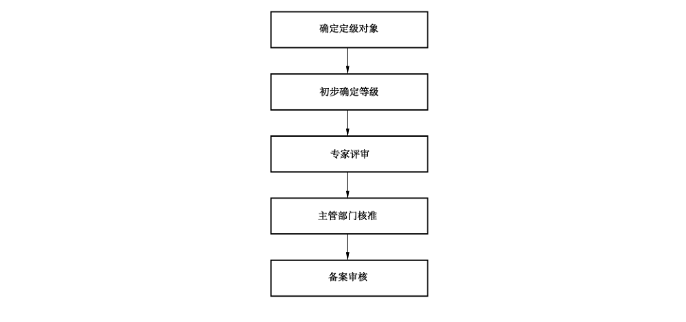
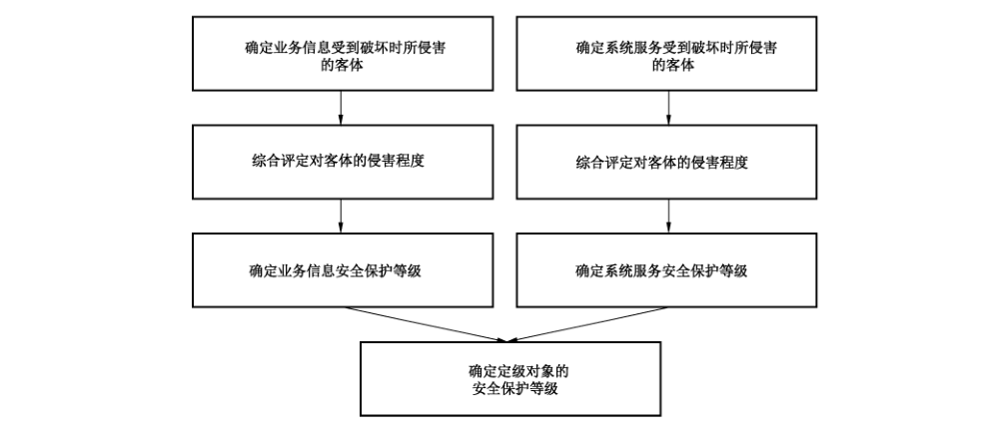

# GB/T 22240-2020 信息安全技术 网络安全等级保护定级指南

> 来源：[GB/T 22240-2020 国家标准详情](https://openstd.samr.gov.cn/bzgk/std/newGbInfo?hcno=63B89FFF7CC97EBBBED8A403396F0F00)。
> PDF SHA-256：7ffc1f3e0676e12e6bfb45377762d6d70e7a6f6fa7c211fa9a7fdf52367738cc。
> 发布日期：2020-04-28；实施日期：2020-11-01。依据官方公开 PDF 的 15 页图像逐页核对，已去除封面、分页和页眉页脚；正式引用请核对原 PDF。

## 前言

本标准按照 GB/T 1.1—2009 给出的规则起草。

本标准代替 GB/T 22240—2008《信息安全技术 信息系统安全等级保护定级指南》，与 GB/T 22240—2008 相比，主要技术变化如下：

- 修改了等级保护对象、信息系统的定义，增加了网络安全、通信网络设施、数据资源的术语和定义（见第 3 章，2008 年版的第 3 章）；
- 增加了通信网络设施和数据资源的定级对象确定方法（见 5.2、5.3）；
- 增加了特定定级对象定级说明（见第 7 章）；
- 修改了定级流程（见 4.4，2008 年版的 5.1）。

请注意本文件的某些内容可能涉及专利。本文件的发布机构不承担识别这些专利的责任。

本标准由全国信息安全标准化技术委员会（SAC/TC 260）提出并归口。

本标准起草单位：公安部第三研究所、亚信科技（成都）有限公司、阿里云计算有限公司、深圳市腾讯计算机系统有限公司、启明星辰信息技术集团股份有限公司、审计署计算机技术中心。

本标准主要起草人：曲洁、尚旭光、黄顺京、李明、黎水林、张振峰、郭启全、葛波蔚、祝国邦、陆磊、袁静、任卫红、朱建平、马力、李升、刘东红、孙中和、王欢、沈锡镛、杨晓光、马闽、陈雪秀。

本标准所代替标准的历次版本发布情况为：

- GB/T 22240—2008。

## 引言

为了配合《中华人民共和国网络安全法》的实施，同时适应云计算、移动互联、物联网、工业控制和大数据等新技术、新应用情况下网络安全等级保护工作的开展，需对GB/T 22240—2008进行修订，从等级保护对象定义和定级流程等方面进行补充、细化和完善，形成新的网络安全等级保护定级指南标准。

与本标准相关的国家标准包括：

- GB/T 22239 信息安全技术 网络安全等级保护基本要求；
- GB/T 25058 信息安全技术 网络安全等级保护实施指南；
- GB/T 25070 信息安全技术 网络安全等级保护安全设计技术要求；
- GB/T 28448 信息安全技术 网络安全等级保护测评要求；
- GB/T 28449 信息安全技术 网络安全等级保护测评过程指南。

## 1 范围

本标准给出了非涉及国家秘密的等级保护对象的安全保护等级定级方法和定级流程。

本标准适用于指导网络运营者开展非涉及国家秘密的等级保护对象的定级工作。

## 2 规范性引用文件

下列文件对于本文件的应用是必不可少的。凡是注日期的引用文件，仅注日期的版本适用于本文件。凡是不注日期的引用文件，其最新版本（包括所有的修改单）适用于本文件。

- GB 17859—1999 计算机信息系统 安全保护等级划分准则

- GB/T 22239—2019 信息安全技术 网络安全等级保护基本要求

- GB/T 25069 信息安全技术 术语

- GB/T 29246—2017 信息技术 安全技术 信息安全管理体系 概述和词汇

- GB/T 31167—2014 信息安全技术 云计算服务安全指南

- GB/T 32919—2016 信息安全技术 工业控制系统安全控制应用指南

- GB/T 35295—2017 信息技术 大数据 术语

## 3 术语和定义

GB 17859—1999、GB/T 22239—2019、GB/T 25069、GB/T 29246—2017、GB/T 31167—2014、GB/T 32919—2016 和 GB/T 35295—2017 界定的以及下列术语和定义适用于本文件。为了便于使用，以下重复列出了上述标准中的某些术语和定义。

### 3.1 网络安全 cybersecurity

通过采取必要措施，防范对网络的攻击、侵入、干扰、破坏和非法使用以及意外事故，使网络处于稳定可靠运行的状态，以及保障网络数据的完整性、保密性、可用性的能力。

［GB/T 22239—2019，定义3.1］

### 3.2 等级保护对象 target of classified protection

网络安全等级保护工作直接作用的对象。

> 注：主要包括信息系统、通信网络设施和数据资源等。

### 3.3 信息系统 information system

应用、服务、信息技术资产或其他信息处理组件。

［GB/T 29246—2017，定义 2.39］

注 1：信息系统通常由计算机或者其他信息终端及相关设备组成，并按照一定的应用目标和规则进行信息处理或过程控制。

注 2：典型的信息系统如办公自动化系统、云计算平台/系统、物联网、工业控制系统以及采用移动互联技术的系统等。

### 3.4 通信网络设施 network infrastructure

为信息流通、网络运行等起基础支撑作用的网络设备设施。

> 注：主要包括电信网、广播电视传输网和行业或单位的专用通信网等。

### 3.5 数据资源 data resources

具有或预期具有价值的数据集合。

> 注：数据资源多以电子形式存在。

### 3.6 受侵害的客体 object of infringement

受法律保护的、等级保护对象受到破坏时所侵害的社会关系。

> 注：本标准中简称“客体”。

### 3.7 客观方面 objective

对客体造成侵害的客观外在表现，包括侵害方式和侵害结果等。

## 4 定级原理及流程

### 4.1 安全保护等级

根据等级保护对象在国家安全、经济建设、社会生活中的重要程度，以及一旦遭到破坏、丧失功能或者数据被篡改、泄露、丢失、损毁后，对国家安全、社会秩序、公共利益以及公民、法人和其他组织的合法权益的侵害程度等因素，等级保护对象的安全保护等级分为以下五级：

a） 第一级，等级保护对象受到破坏后，会对相关公民、法人和其他组织的合法权益造成损害，但不危害国家安全、社会秩序和公共利益；

b） 第二级，等级保护对象受到破坏后，会对相关公民、法人和其他组织的合法权益造成严重损害或特别严重损害，或者对社会秩序和公共利益造成危害，但不危害国家安全；

c） 第三级，等级保护对象受到破坏后，会对社会秩序和公共利益造成严重危害，或者对国家安全造成危害；

d） 第四级，等级保护对象受到破坏后，会对社会秩序和公共利益造成特别严重危害，或者对国家安全造成严重危害；

e） 第五级，等级保护对象受到破坏后，会对国家安全造成特别严重危害。

### 4.2 定级要素

#### 4.2.1 定级要素概述

等级保护对象的定级要素包括：

a） 受侵害的客体；

b） 对客体的侵害程度。

#### 4.2.2 受侵害的客体

等级保护对象受到破坏时所侵害的客体包括以下三个方面：

a） 公民、法人和其他组织的合法权益；

b） 社会秩序、公共利益；

c） 国家安全。

#### 4.2.3 对客体的侵害程度

对客体的侵害程度由客观方面的不同外在表现综合决定。由于对客体的侵害是通过对等级保护对象的破坏实现的，因此对客体的侵害外在表现为对等级保护对象的破坏，通过侵害方式、侵害后果和侵害程度加以描述。

等级保护对象受到破坏后对客体造成侵害的程度归结为以下三种：

a） 造成一般损害；

b） 造成严重损害；

c） 造成特别严重损害。

### 4.3 定级要素与安全保护等级的关系

定级要素与安全保护等级的关系如表1所示。

**表1 定级要素与安全保护等级的关系**

| 受侵害的客体 | 一般损害 | 严重损害 | 特别严重损害 |
| --- | --- | --- | --- |
| 公民、法人和其他组织的合法权益 | 第一级 | 第二级 | 第二级 |
| 社会秩序、公共利益 | 第二级 | 第三级 | 第四级 |
| 国家安全 | 第三级 | 第四级 | 第五级 |

### 4.4 定级流程

等级保护对象定级工作的一般流程如图1所示。

安全保护等级初步确定为第二级及以上的等级保护对象，其网络运营者依据本标准组织进行专家评审、主管部门核准和备案审核，最终确定其安全保护等级。

> 注：安全保护等级初步确定为第一级的等级保护对象，其网络运营者可依据本标准自行确定最终安全保护等级，可不进行专家评审、主管部门核准和备案审核。

## 5 确定定级对象

### 5.1 信息系统

#### 5.1.1 定级对象的基本特征

作为定级对象的信息系统应具有如下基本特征：

a） 具有确定的主要安全责任主体；

b） 承载相对独立的业务应用；

c） 包含相互关联的多个资源。

注 1：主要安全责任主体包括但不限于企业、机关和事业单位等法人，以及不具备法人资格的社会团体等其他组织。

注 2：避免将某个单一的系统组件，如服务器、终端或网络设备作为定级对象。

在确定定级对象时，云计算平台/系统、物联网、工业控制系统以及采用移动互联技术的系统在满足以上基本特征的基础上，还需分别遵循5.1.2、5.1.3、5.1.4、5.1.5 的相关要求。

#### 5.1.2 云计算平台/系统

在云计算环境中，云服务客户侧的等级保护对象和云服务商侧的云计算平台/系统需分别作为单独的定级对象定级，并根据不同服务模式将云计算平台/系统划分为不同的定级对象。

对于大型云计算平台，宜将云计算基础设施和有关辅助服务系统划分为不同的定级对象。

#### 5.1.3 物联网

物联网主要包括感知、网络传输和处理应用等特征要素，需将以上要素作为一个整体对象定级，各要素不单独定级。

#### 5.1.4 工业控制系统

工业控制系统主要包括现场采集/执行、现场控制、过程控制和生产管理等特征要素。其中，现场采集/执行、现场控制和过程控制等要素需作为一个整体对象定级，各要素不单独定级；生产管理要素宜单独定级。

对于大型工业控制系统，可根据系统功能、责任主体、控制对象和生产厂商等因素划分为多个定级对象。

#### 5.1.5 采用移动互联技术的系统

采用移动互联技术的系统主要包括移动终端、移动应用和无线网络等特征要素，可作为一个整体独立定级或与相关联业务系统一起定级，各要素不单独定级。

### 5.2 通信网络设施

对于电信网、广播电视传输网等通信网络设施，宜根据安全责任主体、服务类型或服务地域等因素将其划分为不同的定级对象。

当安全责任主体相同时，跨省的行业或单位的专用通信网可作为一个整体对象定级；当安全责任主体不同时，需根据安全责任主体和服务区域划分为若干个定级对象。

### 5.3 数据资源

数据资源可独立定级。

当安全责任主体相同时，大数据、大数据平台/系统宜作为一个整体对象定级；当安全责任主体不同时，大数据应独立定级。

## 6 初步确定等级

### 6.1 定级方法概述

定级对象的定级方法按照以下描述进行。对于通信网络设施、云计算平台/系统等起支撑作用的定级对象和数据资源，还需参照第7章。

定级对象的安全主要包括业务信息安全和系统服务安全，与之相关的受侵害客体和对客体的侵害程度可能不同，因此，安全保护等级由业务信息安全和系统服务安全两方面确定。从业务信息安全角度反映的定级对象安全保护等级称为业务信息安全保护等级；从系统服务安全角度反映的定级对象安全保护等级称为系统服务安全保护等级。

定级方法流程示意图如图2所示。

具体流程如下：

a） 确定受到破坏时所侵害的客体

1） 确定业务信息受到破坏时所侵害的客体；

2） 确定系统服务受到侵害时所侵害的客体。

b） 确定对客体的侵害程度

1） 根据不同的受侵害客体，分别评定业务信息安全被破坏对客体的侵害程度；

2） 根据不同的受侵害客体，分别评定系统服务安全被破坏对客体的侵害程度。

c） 确定安全保护等级

1） 确定业务信息安全保护等级；

2） 确定系统服务安全保护等级；

3） 将业务信息安全保护等级和系统服务安全保护等级的较高者确定为定级对象的安全保护等级。

### 6.2 确定受侵害的客体

定级对象受到破坏时所侵害的客体包括国家安全、社会秩序、公共利益以及公民、法人和其他组织的合法权益。

侵害国家安全的事项包括以下方面：

- 影响国家政权稳固和领土主权、海洋权益完整；
- 影响国家统一、民族团结和社会稳定；
- 影响国家社会主义市场经济秩序和文化实力；
- 其他影响国家安全的事项。

侵害社会秩序的事项包括以下方面：

- 影响国家机关、企事业单位、社会团体的生产秩序、经营秩序、教学科研秩序、医疗卫生秩序；
- 影响公共场所的活动秩序、公共交通秩序；
- 影响人民群众的生活秩序；
- 其他影响社会秩序的事项。

侵害公共利益的事项包括以下方面：

- 影响社会成员使用公共设施；
- 影响社会成员获取公开数据资源；
- 影响社会成员接受公共服务等方面；
- 其他影响公共利益的事项。

侵害公民、法人和其他组织的合法权益是指受法律保护的公民、法人和其他组织所享有的社会权利和利益等受到损害。

确定受侵害的客体时，首先判断是否侵害国家安全，然后判断是否侵害社会秩序或公共利益，最后判断是否侵害公民、法人和其他组织的合法权益。

### 6.3 确定对客体的侵害程度

#### 6.3.1 侵害的客观方面

在客观方面，对客体的侵害外在表现为对定级对象的破坏，其侵害方式表现对业务信息安全的破坏和对系统服务安全的破坏。其中，业务信息安全是指确保定级对象中信息的保密性、完整性和可用性等，系统服务安全是指确保定级对象可以及时、有效地提供服务，以完成预定的业务目标。由于业务信息安全和系统服务安全受到破坏所侵害的客体和对客体的侵害程度可能会有所不同，在定级过程中，需要分别处理这两种侵害方式。

业务信息安全和系统服务安全受到破坏后，可能产生以下侵害后果：

- 影响行使工作职能；
- 导致业务能力下降；
- 引起法律纠纷；
- 导致财产损失；
- 造成社会不良影响；
- 对其他组织和个人造成损失；
- 其他影响。

#### 6.3.2 综合判定侵害程度

侵害程度是客观方面的不同外在表现的综合体现，因此，首先根据不同的受侵害客体、不同侵害后果分别确定其侵害程度。对不同侵害后果确定其侵害程度所采取的方法和所考虑的角度可能不同，例如，系统服务安全被破坏导致业务能力下降的程度，可以从定级对象服务覆盖的区域范围、用户人数或业务量等不同方面确定；业务信息安全被破坏导致的财物损失，可以从直接的资金损失大小、间接的信息恢复费用等方面进行确定。

在针对不同的受侵害客体进行侵害程度的判断时，参照以下不同的判别基准：

- 如果受侵害客体是公民、法人或其他组织的合法权益，则以本人或本单位的总体利益作为判断侵害程度的基准；
- 如果受侵害客体是社会秩序、公共利益或国家安全，则以整个行业或国家的总体利益作为判断侵害程度的基准。

不同侵害后果的三种侵害程度描述如下：

- 一般损害：工作职能受到局部影响，业务能力有所降低但不影响主要功能的执行，出现较轻的法律问题，较低的财产损失，有限的社会不良影响，对其他组织和个人造成较低损害；
- 严重损害：工作职能受到严重影响，业务能力显著下降且严重影响主要功能执行，出现较严重的法律问题，较高的财产损失，较大范围的社会不良影响，对其他组织和个人造成较高损害；
- 特别严重损害：工作职能受到特别严重影响或丧失行使能力，业务能力严重下降且或功能无法执行，出现极其严重的法律问题，极高的财产损失，大范围的社会不良影响，对其他组织和个人造成非常高损害。

通过对不同侵害后果的侵害程度进行综合评定得出对客体的侵害程度。由于各行业定级对象所处理的信息种类和系统服务特点各不相同，业务信息安全和系统服务安全受到破坏后关注的侵害结果、侵害程度的计算方式均可能不同，各行业可根据本行业业务信息和系统服务特点制定侵害程度的综合评定方法，并给出一般损害、严重损害、特别严重损害的具体定义。

### 6.4 综合判定等级

根据业务信息安全被破坏时所侵害的客体以及对相应客体的侵害程度，依据表2可得到业务信息安全保护等级。

**表2 业务信息安全保护等级矩阵表**

| 业务信息安全被破坏时所侵害的客体 | 一般损害 | 严重损害 | 特别严重损害 |
| --- | --- | --- | --- |
| 公民、法人和其他组织的合法权益 | 第一级 | 第二级 | 第二级 |
| 社会秩序、公共利益 | 第二级 | 第三级 | 第四级 |
| 国家安全 | 第三级 | 第四级 | 第五级 |

根据系统服务安全被破坏时所侵害的客体以及对相应客体的侵害程度，依据表3可得到系统服务安全保护等级。

**表3 系统服务安全保护等级矩阵表**

| 系统服务安全被破坏时所侵害的客体 | 一般损害 | 严重损害 | 特别严重损害 |
| --- | --- | --- | --- |
| 公民、法人和其他组织的合法权益 | 第一级 | 第二级 | 第二级 |
| 社会秩序、公共利益 | 第二级 | 第三级 | 第四级 |
| 国家安全 | 第三级 | 第四级 | 第五级 |

定级对象的安全保护等级由业务信息安全保护等级和系统服务安全保护等级的较高者决定。

## 7 确定安全保护等级

安全保护等级初步确定为第二级及以上的，定级对象的网络运营者需组织网络安全专家和业务专家对定级结果的合理性进行评审，并出具专家评审意见。有行业主管（监管）部门的，还需将定级结果报请行业主管（监管）部门核准，并出具核准意见。最后，网络运营者按照相关管理规定，将定级结果提交公安机关进行备案审核。审核不通过，其网络运营者需组织重新定级；审核通过后最终确定定级对象的安全保护等级。

对于通信网络设施、云计算平台/系统等定级对象，需根据其承载或将要承载的等级保护对象的重要程度确定其安全保护等级，原则上不低于其承载的等级保护对象的安全保护等级。

对于数据资源，综合考虑其规模、价值等因素，及其遭到破坏后对国家安全、社会秩序、公共利益以及公民、法人和其他组织的合法权益的侵害程度确定其安全保护等级。涉及大量公民个人信息以及为公民提供公共服务的大数据平台/系统，原则上其安全保护等级不低于第三级。

## 8 等级变更

当等级保护对象所处理的业务信息和系统服务范围发生变化，可能导致业务信息安全或系统服务安全受到破坏后的受侵害客体和对客体的侵害程度发生变化时，需根据本标准重新确定定级对象和安全保护等级。

## 参考文献

- ［1］ GB/T 31168—2014 信息安全技术 云计算服务安全能力要求

- ［2］ National Institute of Standards and Technology Special Publication 800-60, Revision 1，Guide for Mapping Types of Information and Information Systems to Security Categories，August 2008.
