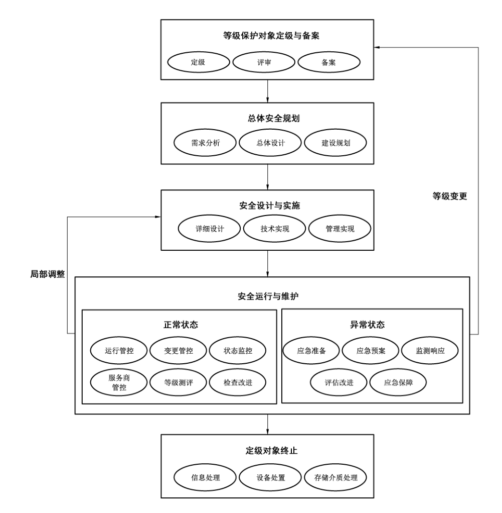
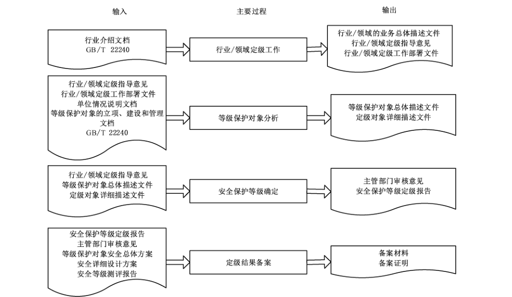
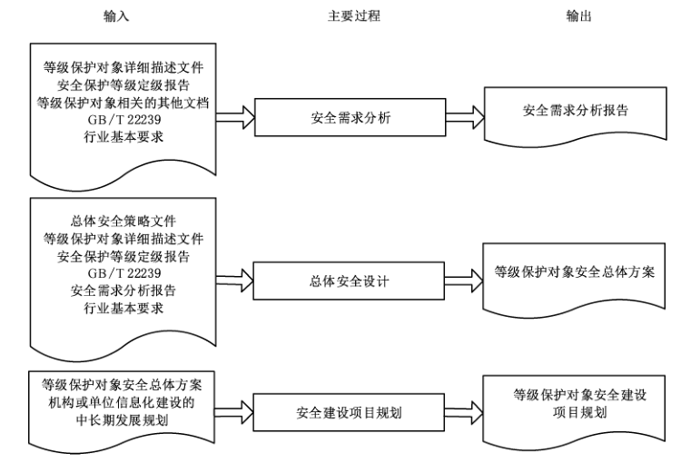
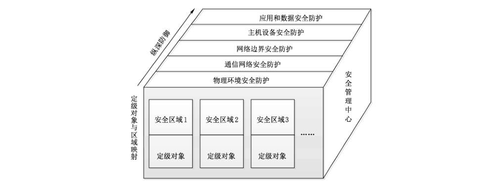
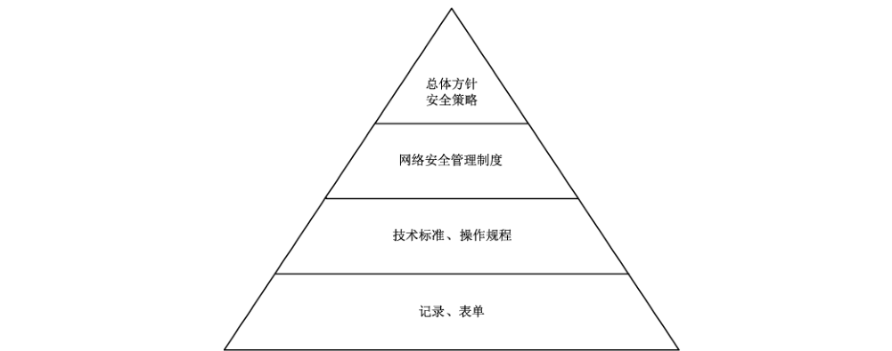
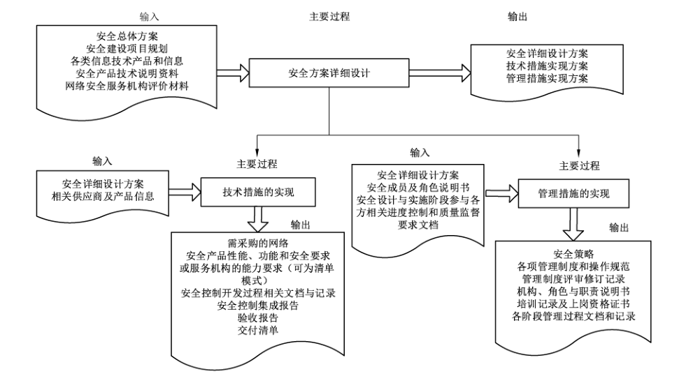
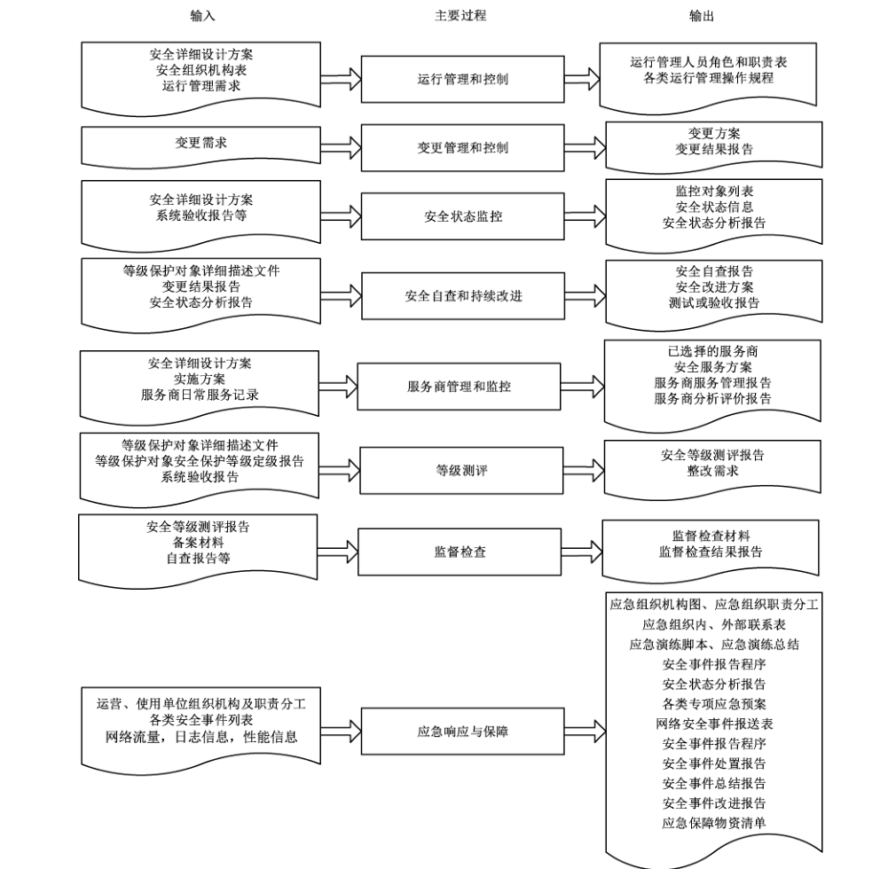
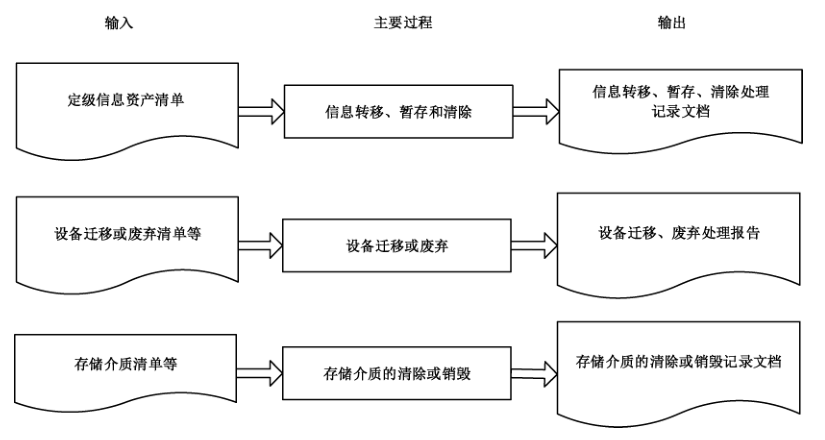

# GB/T 25058-2019 信息安全技术 网络安全等级保护实施指南

> 来源：[GB/T 25058-2019 国家标准详情](https://openstd.samr.gov.cn/bzgk/std/newGbInfo?hcno=1E5827B2858401572CFF3A6FA711ACC9)；封面发布日期：2019-08-30；实施日期：2020-03-01。
> PDF SHA-256：88c3c7fcaa4cc9bd6a92f39f83aba1eaaa85d1cc454bf3bcbf182cb1d4fd787f。
> 转写说明：对照官方 PDF 全部 45 张页面图像校正文字、列表和附录表格；保留八幅原图，省略封面、目录、页眉、页脚和页码，合并跨页内容。正式引用请核对原 PDF。

## 前言

本标准按照 GB/T 1.1—2009给出的规则起草。

本标准代替 GB/T 25058—2010《信息安全技术 信息系统安全等级保护实施指南》，与 GB/T 25058—2010 相比，主要变化如下：

- 标准名称变更为《信息安全技术 网络安全等级保护实施指南》。

- 全文将“信息系统”调整为“等级保护对象”或“定级对象”，将国家标准“信息系统安全等级保护基本要求”调整为“网络安全等级保护基本要求”。

- 考虑到云计算等新技术新应用在实施过程中的特殊处理，根据需要，相关章条增加云计算、移动互联、大数据等相关内容（见 5.3.2、6.3.2、7.2.1、7.3.2）。

- 将各部分已有内容进一步细化，使其能够指导单位针对新建等级保护对象的等级保护工作（见 6.3.2、7.4.3）。

- 在等级保护对象定级阶段，增加了行业/领域主管单位的工作过程（见 5.2）；增加了云计算、移动互联、物联网、工控、大数据定级的特殊关注点（见 5.3，2010 年版的 5.2）。

- 在总体安全规划阶段，增加了行业等级保护管理规范和技术标准相关内容，即明确了基本安全需求既包括国家等级保护管理规范和技术标准提出的要求，也包括行业等级保护管理规范和技术标准提出的要求（见 6.2.1，2010 年版的 6.2.1）。

- 在总体安全规划阶段，增加了“设计等级保护对象的安全技术体系架构”内容，要求根据机构总体安全策略文件、GB/T 22239 和机构安全需求，设计安全技术体系架构，并提供了安全技术体系架构图。此外，增加了云计算、移动互联等新技术的安全保护技术措施（见 6.3.2，2010 年版的 6.3.2）。

- 在总体安全规划阶段，增加了“设计等级保护对象的安全管理体系框架”内容，要求根据 GB/T 22239、安全需求分析报告等，设计安全管理体系框架，并提供了安全管理体系框架（见 6.3.3，2010 年版的 6.3.3）。

- 在安全设计与实施阶段，将“技术措施实现”与“管理措施实现”调换顺序（见 7.3、7.4，2010 年版的 7.3、7.4）；将“人员安全技能培训”合并到“安全管理机构和人员的设置”中（见 7.4.2，2010 年版的 7.3.1、7.3.3）；将“安全管理制度的建设和修订”与“安全管理机构和人员的设置”调换顺序（见 7.4.1、7.4.2，2010 年版的 7.4.1、7.4.2）。

- 在安全设计与实施阶段，在技术措施实现中增加了对于云计算、移动互联等新技术的风险分析、技术防护措施实现等要求（见 7.2.1，2010 年版的 7.2.1）；在测试环节中，更侧重安全漏洞扫描、渗透测试等安全测试内容（见 7.3.2，2010 年版的 7.3.2）。

- 在安全设计与实施阶段，在原有信息安全产品供应商的基础上，增加网络安全服务机构的评价和选择要求（见 7.3.1）；安全控制集成中，增加安全态势感知、监测通报预警、应急处置追踪溯源等安全措施的集成（见 7.3.3）；安全管理制度的建设和修订要求中，增加要求总体安全方针、安全管理制度、安全操作规程、安全运维记录和表单四层体系文件的一致性（见 7.4.1）；安全实施过程管理中，增加整体管理过程的活动内容描述（见 7.4.3）。

- 在安全运行与维护阶段，增加“服务商管理和监控”（见 8.6）；删除了“安全事件处置和应急预案”（2010 年版的 8.5）；删除了“系统备案”（2010 年版的 8.8）；修改了“监督检查”的内容（8.8，2012 年版的 8.9），增加了“应急响应与保障”（见 8.9）。

请注意本文件的某些内容可能涉及专利。本文件的发布机构不承担识别这些专利的责任。

本标准由全国信息安全标准化技术委员会（SAC/TC 260）提出并归口。

本标准起草单位：公安部第三研究所（公安部信息安全等级保护评估中心）、中国电子科技集团公司第十五研究所（信息产业信息安全测评中心）、北京安信天行科技有限公司。

本标准主要起草人：袁静、任卫红、毕马宁、黎水林、刘健、翟建军、王然、张益、江雷、赵泰、李明、马力、于东升、陈广勇、沙森森、朱建平、曲洁、李升、刘静、罗峥、彭海龙、徐爽亮。

本标准所代替标准的历次版本发布情况为：

- GB/T 25058—2010。

## 1 范围

本标准规定了等级保护对象实施网络安全等级保护工作的过程。

本标准适用于指导网络安全等级保护工作的实施。

## 2 规范性引用文件

下列文件对于本文件的应用是必不可少的。凡是注日期的引用文件，仅注日期的版本适用于本文件。凡是不注日期的引用文件，其最新版本（包括所有的修改单）适用于本文件。

- GB 17859 计算机信息系统 安全保护等级划分准则

- GB/T 22239 信息安全技术 网络安全等级保护基本要求

- GB/T 22240 信息安全技术 信息系统安全等级保护定级指南

- GB/T 25069 信息安全技术 术语

- GB/T 28448 信息安全技术 网络安全等级保护测评要求

## 3 术语和定义

GB 17859、GB/T 22239、GB/T 25069 和 GB/T 28448 界定的术语和定义适用于本文件。

## 4 等级保护实施概述

### 4.1 基本原则

安全等级保护的核心是将等级保护对象划分等级，按标准进行建设、管理和监督。安全等级保护实施过程中应遵循以下基本原则：

a） 自主保护原则

等级保护对象运营、使用单位及其主管部门按照国家相关法规和标准，自主确定等级保护对象的安全保护等级，自行组织实施安全保护。

b） 重点保护原则

根据等级保护对象的重要程度、业务特点，通过划分不同安全保护等级的等级保护对象，实现不同强度的安全保护，集中资源优先保护涉及核心业务或关键信息资产的等级保护对象。

c） 同步建设原则

等级保护对象在新建、改建、扩建时应同步规划和设计安全方案，投入一定比例的资金建设网络安全设施，保障网络安全与信息化建设相适应。

d） 动态调整原则

应跟踪定级对象的变化情况，调整安全保护措施。由于定级对象的应用类型、范围等条件的变化及其他原因，安全保护等级需要变更的，应根据等级保护的管理规范和技术标准的要求，重新确定定级对象的安全保护等级，根据其安全保护等级的调整情况，重新实施安全保护。

### 4.2 角色和职责

等级保护对象实施网络安全等级保护过程中涉及的各类角色和职责如下：

a） 等级保护管理部门

等级保护管理部门依照等级保护相关法律、行政法规的规定，在各自职责范围内负责网络安全保护和监督管理工作。

b） 主管部门

负责依照国家网络安全等级保护的管理规范和技术标准，督促、检查和指导本行业、本部门或者本地区等级保护对象运营、使用单位的网络安全等级保护工作。

c） 运营、使用单位

负责依照国家网络安全等级保护的管理规范和技术标准，确定其等级保护对象的安全保护等级，有主管部门的，应报其主管部门审核批准；根据已经确定的安全保护等级，到公安机关办理备案手续；按照国家网络安全等级保护管理规范和技术标准，进行等级保护对象安全保护的规划设计；使用符合国家有关规定，满足等级保护对象安全保护等级需求的信息技术产品和网络安全产品，开展安全建设或者改建工作；制定、落实各项安全管理制度，定期对等级保护对象的安全状况、安全保护制度及措施的落实情况进行自查，选择符合国家相关规定的等级测评机构，定期进行等级测评；制定不同等级网络安全事件的响应、处置预案，对网络安全事件分等级进行应急处置。

d） 网络安全服务机构

负责根据运营、使用单位的委托，依照国家网络安全等级保护的管理规范和技术标准，协助运营、使用单位完成等级保护的相关工作，包括确定其等级保护对象的安全保护等级、进行安全需求分析、安全总体规划、实施安全建设和安全改造、提供服务支撑平台等。

e） 网络安全等级测评机构

负责根据运营、使用单位的委托或根据等级保护管理部门的授权，协助运营、使用单位或等级保护管理部门，按照国家网络安全等级保护的管理规范和技术标准，对已经完成等级保护建设的等级保护对象进行等级测评；对网络安全产品供应商提供的网络安全产品进行安全测评。

f） 网络安全产品供应商

负责按照国家网络安全等级保护的管理规范和技术标准，开发符合等级保护相关要求的网络安全产品，接受安全测评；按照等级保护相关要求销售网络安全产品并提供相关服务。

### 4.3 实施的基本流程

对等级保护对象实施等级保护的基本流程包括等级保护对象定级与备案阶段、总体安全规划阶段、安全设计与实施阶段、安全运行与维护阶段和定级对象终止阶段，见图1。

在安全运行与维护阶段，等级保护对象因需求变化等原因导致局部调整，而其安全保护等级并未改变，应从安全运行与维护阶段进入安全设计与实施阶段，重新设计、调整和实施安全措施，确保满足等级保护的要求；当等级保护对象发生重大变更导致安全保护等级变化时，应从安全运行与维护阶段进入等级保护对象定级与备案阶段，重新开始一轮网络安全等级保护的实施过程。等级保护对象在运行与维护过程中，发生安全事件时可能会发生应急响应与保障。

等级保护对象安全等级保护实施的基本流程中各个阶段的主要过程、活动、输入和输出见附录 A。

## 5 等级保护对象定级与备案

### 5.1 定级与备案阶段的工作流程

等级保护对象定级阶段的目标是运营、使用单位按照国家有关管理规范和定级标准，确定等级保护对象及其安全保护等级，并经过专家评审。运营、使用单位有主管部门的，应经主管部门审核、批准，并报公安机关备案审查。

等级保护对象定级与备案阶段的工作流程见图2。

### 5.2 行业/领域定级工作

活动目标：行业/领域主管部门在必要时可组织梳理行业/领域的主要社会功能/职能及作用，分析履行主要社会功能/职能所依赖的主要业务及服务范围，最后依据分析和整理的内容形成行业/领域的业务总体描述性文档。

参与角色：主管部门，网络安全服务机构。

活动输入：行业介绍文档，GB/T 22240。

活动描述：本活动主要包括以下子活动内容：

a） 识别、分析行业/领域重要性

主管部门可组织梳理本行业/领域的行业特征、业务范围、主要社会功能/职能和生产产值等信息，分析主要社会功能/职能在保障国家安全、经济发展、社会秩序、公共服务等方面发挥的重要作用。

b） 识别行业/领域的主要业务

主管部门可组织梳理本行业/领域内主要依靠信息化处理的业务情况，并按照业务承载的社会功能/职能的重要程度、其他行业对其的依赖程度等方面确定本行业/领域内的主要业务。

c） 定级指导

主管部门可组织分析本行业/领域内的主要业务，并根据业务信息重要性和业务服务重要性分析各主要业务的安全保护要求，结合行业/领域自身情况，形成针对主要业务的行业/领域定级指导意见。跨省或者全国统一联网运行的等级保护对象可以由主管部门统一确定安全保护等级。

d） 定级工作部署

主管部门可制定本行业/领域的定级指导意见，并统一部署全行业/领域的定级工作。行业/领域主管部门应对下属单位的定级结果进行审核、批准。

活动输出：行业/领域的业务总体描述文件，行业/领域定级指导意见，行业/领域定级工作部署文件。

### 5.3 等级保护对象分析

#### 5.3.1 对象重要性分析

活动目标：通过收集了解有关等级保护对象的信息，并对信息进行综合分析和整理，分析单位的主要社会功能/职能及作用，确定履行主要社会功能/职能所依赖的等级保护对象，整理等级保护对象处理的业务及服务范围，最后依据分析和整理的内容，有行业/领域定级指导意见的还应依据行业/领域定级指导意见，形成单位内等级保护对象的总体描述性文档。

参与角色：运营、使用单位，网络安全服务机构。

活动输入：单位情况说明文档，等级保护对象的立项、建设和管理文档，行业/领域定级指导意见。

活动描述：本活动主要包括以下子活动内容：

a） 识别单位的基本信息

调查了解等级保护对象所属单位的业务范围、主要社会功能/职能和生产产值等信息，分析主要社会功能/职能在保障国家安全、经济发展、社会秩序、公共服务等方面发挥的重要作用。

b） 识别单位的等级保护对象基本信息

了解单位内主要依靠信息化处理的业务情况，这些业务各自的社会属性和业务内容，确定单位的等级保护对象。并确定等级保护对象的业务范围、地理位置以及其他基本情况，获得等级保护对象的背景信息和联络方式。

c） 识别等级保护对象的管理框架

了解等级保护对象的组织管理结构、管理策略、部门设置和部门在业务运行中的作用、岗位职责，获得支撑等级保护对象业务运营的管理特征和管理框架方面的信息，从而明确等级保护对象的安全责任主体。

d） 识别等级保护对象的网络及设备部署

了解等级保护对象的物理环境、网络拓扑结构和硬件设备的部署情况，在此基础上明确等级保护对象的边界，即确定等级保护对象及其范围。

e） 识别等级保护对象的业务特性

了解单位内主要依靠信息化处理的各种业务及业务流程，从中明确支撑单位业务运营的等级保护对象的业务特性。

f） 识别等级保护对象处理的信息资产

了解等级保护对象处理的信息资产的类型，这些信息资产在保密性、完整性和可用性等方面的重要性程度。

g） 识别用户范围和用户类型

根据用户或用户群的分布范围了解等级保护对象的服务范围、作用以及业务连续性方面的要求等。

h） 等级保护对象描述

对收集的信息进行整理、分析，形成对等级保护对象的总体描述文件。一个典型的等级保护对象的总体描述文件应包含以下内容：

1） 等级保护对象概述；

2） 等级保护对象重要性分析；

3） 等级保护对象边界描述；

4） 网络拓扑；

5） 设备部署；

6） 支撑的业务应用的种类和特性；

7） 处理的信息资产；

8） 用户的范围和用户类型；

9） 等级保护对象的管理框架。

活动输出：等级保护对象总体描述文件。

#### 5.3.2 定级对象确定

活动目标：依据单位的等级保护对象总体描述文件（有行业/领域定级指导意见的还应依据行业/领域定级指导意见），在综合分析的基础上将单位内运行的等级保护对象进行合理分解，确定所包含的定级对象及其个数。

参与角色：运营、使用单位，网络安全服务机构。

活动输入：行业/领域定级指导意见，行业/领域定级工作部署文件，等级保护对象总体描述文件，GB/T 22240。

活动描述：本活动主要包括以下子活动内容：

a） 划分方法的选择

为了突出重点保护的等级保护原则，运营、使用单位应对大型等级保护对象进行划分，划分的方法可以有多种，可以考虑管理机构、业务类型、物理位置等因素，运营、使用单位应根据本单位的具体情况确定等级保护对象的分解原则。

b） 等级保护对象划分

依据选择的等级保护对象划分原则，参考行业/领域定级指导意见（若有行业/领域定级指导意见），运营、使用单位应将大型等级保护对象进行划分，划分出相对独立的对象作为定级对象，应保证每个相对独立的对象具备定级对象的基本特征。在等级保护对象划分的过程中，应首先考虑组织管理的要素，然后考虑业务类型、物理区域等要素。承载比较单一的业务应用或者承载相对独立的业务应用的对象应作为单独的定级对象。

对于电信网、广播电视传输网等通信网络设施，应分别依据安全责任主体、服务类型或服务地域等因素将其划分为不同的定级对象。跨省的行业或单位的专用通信网可作为一个整体对象定级，或分区域划分若干个定级对象。

在云计算环境中，应将云服务客户侧的等级保护对象和云服务商侧的云计算平台/系统分别作为单独的定级对象定级，并根据不同服务模式将云计算平台/系统划分为不同的定级对象。对于大型云计算平台，宜将云计算基础设施和有关辅助服务系统划分为不同的定级对象。

物联网主要包括感知、网络传输和处理应用等特征要素，应将以上要素作为一个整体对象定级，各要素不单独定级。

对于工业控制系统，其一般包含现场采集/执行、现场控制、过程控制和生产管理等特征要素。其中，现场采集/执行、现场控制、过程控制等要素应作为一个整体对象定级，各要素不单独定级；生产管理要素宜单独定级。对于大型工业控制系统，可以根据系统功能、责任主体、控制对象和生产厂商等因素划分为多个定级对象。

采用移动互联技术的等级保护对象主要包括移动终端、移动应用和无线网络等特征要素，可作为一个整体独立定级或与相关联业务系统一起定级，各要素不单独定级。

c） 定级对象详细描述

在对等级保护对象进行划分并确定定级对象后，应在等级保护对象总体描述文件的基础上，进一步增加定级对象的描述，准确描述一个大型等级保护对象中包括的定级对象的个数。

进一步的定级对象详细描述文件应包含以下内容：

1） 相对独立的定级对象列表；

2） 每个定级对象的概述；

3） 每个定级对象的边界；

4） 每个定级对象的设备部署；

5） 每个定级对象支撑的业务应用及其处理的信息资产类型；

6） 每个定级对象的服务范围和用户类型；

7） 其他内容。

活动输出：定级对象详细描述文件。

### 5.4 安全保护等级确定

#### 5.4.1 定级、审核和批准

活动目标：按照国家有关管理规范和定级标准，确定定级对象的安全保护等级，并对定级结果进行评审、审核和审查，保证定级结果的准确性。

参与角色：主管部门，运营、使用单位，网络安全服务机构。

活动输入：行业/领域定级指导意见，等级保护对象总体描述文件，定级对象详细描述文件。

活动描述：本活动主要包括以下子活动内容：

a） 定级对象安全保护等级初步确定

根据国家有关管理规范、行业/领域定级指导意见（若有则作为依据）以及定级方法，运营、使用单位对每个定级对象确定初步的安全保护等级。

b） 定级结果评审

运营、使用单位初步确定了安全保护等级后，必要时可以组织网络安全专家和业务专家对初步定级结果的合理性进行评审，并出具专家评审意见。

c） 定级结果审核、批准

运营、使用单位初步确定了安全保护等级后，有明确主管部门的，应将初步定级结果上报行业/领域主管部门或上级主管部门进行审核、批准。行业/领域主管部门或上级主管部门应对初步定级结果的合理性进行审核，出具审核意见。

运营、使用单位应定期自查等级保护对象等级变化情况以及新建系统定级情况，并及时上报主管部门进行审核、批准。

活动输出：定级结果，主管部门审批意见。

#### 5.4.2 形成定级报告

活动目标：对定级过程中产生的文档进行整理，形成等级保护对象定级结果报告。

参与角色：主管部门，运营、使用单位。

活动输入：定级对象详细描述文件，定级结果。

活动描述：对等级保护对象的总体描述文档、详细描述文件、定级结果等内容进行整理，形成文件化的定级结果报告。

定级结果报告可以包含以下内容：

a） 单位信息化现状概述；

b） 管理模式；

c） 定级对象列表；

d） 每个定级对象的概述；

e） 每个定级对象的边界；

f） 每个定级对象的设备部署；

g） 每个定级对象支撑的业务应用；

h） 定级对象列表、安全保护等级以及保护要求组合；

i） 其他内容。

活动输出：安全保护等级定级报告。

### 5.5 定级结果备案

活动目标：根据等级保护管理部门对备案的要求，整理相关备案材料，并向受理备案的单位提交备案材料。

参与角色：主管部门，运营、使用单位，等级保护管理部门。

活动输入：定级报告，主管部门审核意见，等级保护对象安全总体方案，安全详细设计方案，安全等级测评报告（第三级及以上等级系统需要提供）。

活动描述：本活动主要包括以下子活动内容：

a） 备案材料整理

运营、使用单位在等级保护对象建设之初根据其将要承载的业务信息及系统服务的重要性确定等级保护对象的安全保护等级，并针对备案材料的要求，整理、填写备案材料。

b） 备案材料提交

根据等级保护管理部门的要求办理定级备案手续，提交备案材料（新建等级保护对象可在等级测评实施完毕补充提交等级测评报告）；等级保护管理部门接收备案材料，出具备案证明。

活动输出：备案材料，备案证明。

## 6 总体安全规划

### 6.1 总体安全规划阶段的工作流程

总体安全规划阶段的目标是根据等级保护对象的划分情况、等级保护对象的定级情况、等级保护对象承载业务情况，通过分析明确等级保护对象安全需求，设计合理的、满足等级保护要求的总体安全方案，并制定出安全实施计划，以指导后续的等级保护对象安全建设工程实施。

总体安全规划阶段的工作流程见图3。

### 6.2 安全需求分析

#### 6.2.1 基本安全需求的确定

活动目标：根据等级保护对象的安全保护等级，提出等级保护对象的基本安全保护需求。

参与角色：运营、使用单位，网络安全服务机构。

活动输入：等级保护对象详细描述文件，安全保护等级定级报告，等级保护对象相关的其他文档，GB/T 22239，行业基本要求。

活动描述：本活动主要包括以下子活动内容：

a） 确定等级保护对象范围和分析对象

明确不同等级的等级保护对象的范围和边界，通过调查或查阅资料的方式，了解等级保护对象的业务应用、业务流程等情况。

b） 形成基本安全需求

根据各个等级保护对象的安全保护等级从 GB/T 22239、行业基本要求中选择相应等级的要求，形成基本安全需求。对于已建等级保护对象，应根据等级测评结果分析整改需求，形成基本安全需求。

活动输出：基本安全需求。

#### 6.2.2 特殊安全需求的确定

活动目标：通过分析重要资产的特殊保护要求，采用需求分析或风险分析的方法，确定可能的安全风险，判断实施特殊安全措施的必要性，提出等级保护对象的特殊安全保护需求。

参与角色：运营、使用单位，网络安全服务机构。

活动输入：等级保护对象详细描述文件，安全保护等级定级报告，等级保护对象相关的其他文档。

活动描述：确定特殊安全需求可以采用目前成熟或流行的需求分析或风险分析方法，或者采用下面介绍的活动：

a） 重要资产分析

明确等级保护对象中的重要部件，如边界设备、网关设备、核心网络设备、重要服务器设备、重要应用系统等。

b） 重要资产安全弱点评估

检查或判断上述重要部件可能存在的弱点（包括技术和管理两方面），分析安全弱点被利用的可能性。

c） 重要资产面临威胁评估

分析和判断上述重要部件可能面临的威胁，包括外部、内部的威胁，威胁发生的可能性或概率。

d） 综合风险分析

分析威胁利用弱点可能产生的结果，结果产生的可能性或概率，结果造成的损害或影响的大小，以及避免上述结果产生的可能性、必要性和经济性。按照重要资产的排序和风险的排序确定安全保护的要求。

活动输出：重要资产的特殊保护要求。

#### 6.2.3 形成安全需求分析报告

活动目标：总结基本安全需求和特殊安全需求，形成安全需求分析报告。

参与角色：运营、使用单位，网络安全服务机构。

活动输入：等级保护对象详细描述文件，安全保护等级定级报告，基本安全需求，重要资产的特殊保护要求。

活动描述：本活动主要的子活动是完成安全需求分析报告。根据基本安全需求和特殊的安全保护需求等形成安全需求分析报告。

安全需求分析报告可以包含以下内容：

a） 等级保护对象描述；

b） 基本安全需求描述；

c） 特殊安全需求描述。

活动输出：安全需求分析报告。

### 6.3 总体安全设计

#### 6.3.1 总体安全策略设计

活动目标：形成机构纲领性的安全策略文件，包括确定安全方针，制定安全策略，以便结合等级保护基本要求系列标准、行业基本要求和安全保护特殊要求，构建机构等级保护对象的安全技术体系结构和安全管理体系结构。对于新建的等级保护对象，应在立项时明确其安全保护等级，并按照相应的保护等级要求进行总体安全策略设计。

参与角色：运营、使用单位，网络安全服务机构。

活动输入：等级保护对象详细描述文件，安全保护等级定级报告，安全需求分析报告。

活动描述：本活动主要包括以下子活动内容：

a） 确定安全方针

形成机构最高层次的安全方针文件，阐明安全工作的使命和意愿，定义网络安全的总体目标，规定网络安全责任机构和职责，建立安全工作运行模式等。

b） 制定安全策略

形成机构高层次的安全策略文件，说明安全工作的主要策略，包括安全组织机构划分策略、业务系统分级策略、数据信息分级策略、等级保护对象互连策略、信息流控制策略等。

活动输出：总体安全策略文件。

#### 6.3.2 安全技术体系结构设计

活动目标：根据 GB/T 22239、行业基本要求、安全需求分析报告、机构总体安全策略文件等，提出等级保护对象需要实现的安全技术措施，形成机构特定的等级保护对象安全技术体系结构，用以指导等级保护对象分等级保护的具体实现。

参与角色：运营、使用单位，网络安全服务机构。

活动输入：总体安全策略文件，等级保护对象详细描述文件，安全保护等级定级报告，安全需求分析报告，GB/T 22239，行业基本要求。

活动描述：本活动主要包括以下子活动内容：

a） 设计安全技术体系架构

根据机构总体安全策略文件、GB/T 22239、行业基本要求和安全需求，设计安全技术体系架构。安全技术防护体系由从外到内的“纵深防御”体系构成，“物理环境安全防护”保护服务器、网络设备以及其他设备设施免遭地震、火灾、水灾、盗窃等事故导致的破坏，“通信网络安全防护”保护暴露于外部的通信线路和通信设备，“网络边界安全防护”对等级保护对象实施边界安全防护，内部不同级别定级对象尽量分别部署在相应保护等级的内部安全区域，低级别定级对象部署在高等级安全区域时应遵循“就高保护”原则，内部安全区域即“计算环境安全防护”将实施“主机设备安全防护”和“应用和数据安全防护”“安全管理中心”对整个等级保护对象实施统一的安全技术管理。

等级保护对象的安全技术体系架构见图4。

b） 规定不同级别定级对象物理环境的安全保护技术措施

根据机构总体安全策略文件、等级保护基本要求和安全需求，提出不同级别定级对象物理环境的安全保护策略和安全技术措施。定级对象物理环境安全保护策略和安全技术措施提出时应考虑不同级别的定级对象共享物理环境的情况，如果不同级别的定级对象共享同一物理环境，物理环境的安全保护策略和安全技术措施应满足最高级别定级对象的等级保护基本要求。

c） 规定通信网络的安全保护技术措施

根据机构总体安全策略文件、等级保护基本要求和安全需求，提出通信网络的安全保护策略和安全技术措施。通信网络的安全保护策略和安全技术措施提出时应考虑网络线路和网络设备共享的情况，如果不同级别的定级对象通过通信网络的同一线路和设备传输数据，线路和设备的安全保护策略和安全技术措施应满足最高级别定级对象的等级保护基本要求。

d） 规定不同级别定级对象的边界保护技术措施

根据机构总体安全策略文件、等级保护基本要求和安全需求，提出不同级别定级对象边界的安全保护策略和安全技术措施。如果不同级别的定级对象共享同一设备进行边界保护，则该边界设备的安全保护策略和安全技术措施应满足最高级别定级对象的等级保护基本要求。

e） 规定定级对象之间互联的安全技术措施

根据机构总体安全策略文件、等级保护基本要求和安全需求，提出跨局域网互联的定级对象之间的信息传输保护策略要求和具体的安全技术措施，包括同级互联的策略、不同级别互联的策略等；提出局域网内部互联的定级对象之间的信息传输保护策略要求和具体的安全技术保护措施，包括同级互联的策略、不同级别互联的策略等。

f） 规定不同级别定级对象内部的安全保护技术措施

根据机构总体安全策略文件、等级保护基本要求和安全需求，提出不同级别定级对象内部网络平台、系统平台、业务应用和数据的安全保护策略和安全技术保护措施。如果低级别定级对象部署在高级别定级对象的网络区域，则低级别定级对象的系统平台、业务应用和数据的安全保护策略和安全技术措施应满足高级别定级对象的等级保护基本要求。

g） 规定云计算、移动互联等新技术的安全保护技术措施

根据机构总体安全策略文件、等级保护基本要求、行业基本要求和安全需求，提出云计算、移动互联等新技术的安全保护策略和安全技术措施。云计算平台应至少满足其承载的最高级别定级对象的等级保护基本要求。

h） 形成等级保护对象安全技术体系结构

将骨干网或城域网、通过骨干网或城域网的定级对象互联、局域网内部的定级对象互联、定级对象的边界、定级对象内部各类平台、机房以及其他方面的安全保护策略和安全技术措施进行整理、汇总，形成等级保护对象的安全技术体系结构。

活动输出：等级保护对象安全技术体系结构。

#### 6.3.3 整体安全管理体系结构设计

活动目标：根据等级保护基本要求系列标准、行业基本要求、安全需求分析报告、机构总体安全策略文件等，调整原有管理模式和管理策略，既从全局高度考虑为每个等级的定级对象制定统一的安全管理策略，又从每个定级对象的实际需求出发，选择和调整具体的安全管理措施，最后形成统一的整体安全管理体系结构。

参与角色：运营、使用单位，网络安全服务机构。

活动输入：总体安全策略文件，等级保护对象详细描述文件，安全保护等级定级报告，安全需求分析报告，GB/T 22239，行业基本要求。

活动描述：本活动主要包括以下子活动内容：

a） 设计等级保护对象的安全管理体系框架

根据等级保护基本要求系列标准、行业基本要求、安全需求分析报告等，设计等级保护对象安全管理体系框架。等级保护对象安全管理体系框架分为四层。第一层为总体方针、安全策略，通过网络安全总体方针、安全策略明确机构网络安全工作的总体目标、范围、原则等。第二层为网络安全管理制度，通过对网络安全活动中的各类内容建立管理制度，约束网络安全相关行为。第三层安全技术标准、操作规程，通过对管理人员或操作人员执行的日常管理行为建立操作规程，规范网络安全管理制度的具体技术实现细节。第四层为记录、表单，网络安全管理制度、操作规程实施时需填写和需保留的表单、操作记录。

等级保护对象的安全管理体系框架见图5。

b） 规定网络安全的组织管理体系和对不同级别定级对象的安全管理职责

根据机构总体安全策略文件、等级保护基本要求系列标准、行业基本要求和安全需求，提出机构的安全组织管理机构框架，分配不同级别定级对象的安全管理职责、规定不同级别定级对象的安全管理策略等。

c） 规定不同级别定级对象的人员安全管理策略

根据机构总体安全策略文件、等级保护基本要求系列标准、行业基本要求和安全需求，提出不同级别定级对象的管理人员框架，分配不同级别定级对象的管理人员职责、规定不同级别定级对象的人员安全管理策略等。

d） 规定不同级别定级对象机房及办公区等物理环境的安全管理策略

根据机构总体安全策略文件、等级保护基本要求系列标准、行业基本要求和安全需求，提出各个不同级别定级对象的机房和办公环境的安全策略。

e） 规定不同级别定级对象介质、设备等的安全管理策略

根据机构总体安全策略文件、等级保护基本要求系列标准、行业基本要求和安全需求，提出各个不同级别定级对象的介质、设备等的安全策略。

f） 规定不同级别定级对象运行安全管理策略

根据机构总体安全策略文件、等级保护基本要求系列标准、行业基本要求和安全需求，提出各个不同级别定级对象的安全运行与维护框架和运维安全策略等。

g） 规定不同级别定级对象安全事件处置和应急管理策略

根据机构总体安全策略文件、等级保护基本要求系列标准、行业基本要求和安全需求，提出各个不同级别定级对象的安全事件处置和应急管理策略等。

h） 形成等级保护对象安全管理策略框架

将上述各个方面的安全管理策略进行整理、汇总，形成等级保护对象的整体安全管理体系结构。

活动输出：等级保护对象安全管理体系结构。

#### 6.3.4 设计结果文档化

活动目标：将总体安全设计工作的结果文档化，最后形成一套指导机构网络安全工作的指导性文件。

参与角色：运营、使用单位，网络安全服务机构。

活动输入：安全需求分析报告，等级保护对象安全技术体系结构，等级保护对象安全管理体系结构。

活动描述：对安全需求分析报告、等级保护对象安全技术体系结构和安全管理体系结构等文档进行整理，形成等级保护对象总体安全方案。

等级保护对象总体安全方案包含以下内容：

a） 等级保护对象概述；

b） 总体安全策略；

c） 等级保护对象安全技术体系结构；

d） 等级保护对象安全管理体系结构。

活动输出：等级保护对象安全总体方案。

### 6.4 安全建设项目规划

#### 6.4.1 安全建设目标确定

活动目标：依据等级保护对象安全总体方案（一个或多个文件构成）、单位信息化建设的中长期发展规划和机构的安全建设资金状况确定各个时期的安全建设目标。

参与角色：运营、使用单位，网络安全服务机构。

活动输入：等级保护对象安全总体方案、机构或单位信息化建设的中长期发展规划。

活动描述：本活动主要包括以下子活动内容：

a） 信息化建设中长期发展规划和安全需求调查

了解和调查单位信息化建设的现况、中长期信息化建设的目标、主管部门对信息化的投入，对比信息化建设过程中阶段状态与安全策略规划之间的差距，分析急迫和关键的安全问题，考虑可以同步进行的安全建设内容等。

b） 提出等级保护对象安全建设分阶段目标

制定等级保护对象在规划期内（一般安全规划期为3年）所要实现的总体安全目标；制定等级保护对象短期（1年以内）要实现的安全目标，主要解决目前急迫和关键的问题，争取在短期内安全状况有大幅度提高。

活动输出：等级保护对象分阶段安全建设目标。

#### 6.4.2 安全建设内容规划

活动目标：根据安全建设目标和等级保护对象安全总体方案的要求，设计分期分批的主要建设内容，并将建设内容组合成不同的项目，阐明项目之间的依赖或促进关系等。

参与角色：运营、使用单位，网络安全服务机构。

活动输入：等级保护对象安全总体方案，等级保护对象分阶段安全建设目标。

活动描述：本活动主要包括以下子活动内容：

a） 确定主要安全建设内容

根据等级保护对象安全总体方案明确主要的安全建设内容，并将其适当的分解。主要建设内容可能分解为但不限于以下内容：

1） 安全基础设施建设；

2） 网络安全建设；

3） 系统平台和应用平台安全建设；

4） 数据系统安全建设；

5） 安全标准体系建设；

6） 人才培养体系建设；

7） 安全管理体系建设。

b） 确定主要安全建设项目

将安全建设内容组合为不同的安全建设项目，描述项目所解决的主要安全问题及所要达到的安全目标，对项目进行支持或依赖等相关性分析，对项目进行紧迫性分析，对项目进行实施难易程度分析，对项目进行预期效果分析，描述项目的具体工作内容、建设方案，形成安全建设项目列表。

活动输出：安全建设项目列表（含安全建设内容）。

#### 6.4.3 形成安全建设项目规划

活动目标：根据建设目标和建设内容，在时间和经费上对安全建设项目列表进行总体考虑，分到不同的时期和阶段，设计建设顺序，进行投资估算，形成安全建设项目规划。

参与角色：运营、使用单位，网络安全服务机构。

活动输入：等级保护对象安全总体方案，等级保护对象分阶段安全建设目标，安全建设内容等。

活动描述：对等级保护对象分阶段安全建设目标、安全总体方案和安全建设内容等文档进行整理，形成等级保护对象安全建设项目规划。

安全建设项目规划可包含以下内容：

a） 规划建设的依据和原则；

b） 规划建设的目标和范围；

c） 等级保护对象安全现状；

d） 信息化的中长期发展规划；

e） 等级保护对象安全建设的总体框架；

f） 安全技术体系建设规划；

g） 安全管理与安全保障体系建设规划；

h） 安全建设投资估算（含测试及运维估算等内容）；

i） 等级保护对象安全建设的实施保障等内容。

活动输出：等级保护对象安全建设项目规划。

## 7 安全设计与实施

### 7.1 安全设计与实施阶段的工作流程

安全设计与实施阶段的目标是按照等级保护对象安全总体方案的要求，结合等级保护对象安全建设项目规划，分期分步落实安全措施。

安全设计与实施阶段的工作流程见图6。

### 7.2 安全方案详细设计

#### 7.2.1 技术措施实现内容的设计

活动目标：根据建设目标和建设内容将等级保护对象安全总体方案中要求实现的安全策略、安全技术体系结构、安全措施和要求落实到产品功能或物理形态上，提出能够实现的产品或组件及其具体规范，并将产品功能特征整理成文档，使得在网络安全产品采购和安全控制的开发阶段具有依据。

参与角色：运营、使用单位，网络安全服务机构，网络安全产品供应商。

活动输入：安全总体方案，安全建设项目规划，各类信息技术产品和网络安全产品技术说明资料、网络安全服务机构评价材料。

活动描述：本活动主要包括以下子活动内容：

a） 结构框架的设计

依据本次实施项目的建设内容和等级保护对象的实际情况，给出与总体安全规划阶段的安全体系结构一致的安全实现技术框架，内容至少包括安全防护的层次、网络安全产品的使用、网络子系统划分、IP 地址规划、云计算模式的选取（如有）、移动互联的接入方式（如有）等。

b） 安全功能要求的设计

对安全实现技术框架中使用到的相关网络安全产品，如防火墙、VPN、网闸、认证网关、代理服务器、网络防病毒、PKI、云安全防护产品、移动终端应用软件与防护产品等提出安全功能指标要求。对需要开发的安全控制组件，提出安全功能指标要求。

c） 性能要求的设计

对安全实现技术框架中使用到的相关网络安全产品，如防火墙、VPN、网闸、认证网关、代理服务器、网络防病毒、PKI、云安全防护产品、移动终端应用软件与防护产品等提出性能指标要求。对需要开发的安全控制组件，提出性能指标要求。

d） 部署方案的设计

结合目前等级保护对象网络拓扑，以图示的方式给出安全技术实现框架的实现方式，包括网络安全产品或安全组件的部署位置、连线方式，IP 地址分配等。对于需对原有网络进行调整的，给出网络调整的图示方案等。

e） 制定安全策略的实现计划

依据等级保护对象安全总体方案中提出的安全策略的要求，制定设计和设置网络安全产品或安全组件的安全策略实现计划。

活动输出：技术措施实施方案。

#### 7.2.2 管理措施实现内容的设计

活动目标：根据等级保护对象运营、使用单位当前安全管理需要和安全技术保障需要提出与等级保护对象安全总体方案中管理部分相适应的本期安全实施内容，以保证在安全技术建设的同时，安全管理得以同步建设。

参与角色：运营、使用单位，网络安全服务机构。

活动输入：安全总体方案，安全建设项目规划。

活动描述：结合等级保护对象实际安全管理需要和本次技术建设内容，确定本次安全管理建设的范围和内容，同时注意与等级保护对象安全总体方案的一致性。安全管理设计的内容主要考虑：安全策略和管理制度制定、安全管理机构和人员的配套、安全建设过程管理等。

活动输出：管理措施实施方案。

#### 7.2.3 设计结果的文档化

活动目标：将技术措施实施方案、管理措施实施方案汇总，同时考虑工时和成本，最后形成指导安全实施的指导性文件。

参与角色：运营、使用单位，网络安全服务机构。

活动输入：技术措施实施方案，管理措施实施方案。

活动描述：对技术措施实施方案中技术实施内容和管理措施实施方案中管理实施内容等文档进行整理，形成等级保护对象安全建设详细设计方案。

安全详细设计方案包含以下内容：

a） 建设目标和建设内容；

b） 技术实现方案；

c） 网络安全产品或组件安全功能及性能要求；

d） 网络安全产品或组件部署；

e） 安全控制策略和配置；

f） 配套的安全管理建设内容；

g） 工程实施计划；

h） 项目投资概算。

活动输出：安全详细设计方案。

### 7.3 技术措施的实现

#### 7.3.1 网络安全产品或服务采购

活动目标：按照安全详细设计方案中对于产品或服务的具体指标要求进行采购，根据产品、产品组合或服务实现的功能、性能和安全性满足安全设计要求的情况来选购所需的网络安全产品或服务。

参与角色：网络安全产品供应商，网络安全服务机构，运营、使用单位，测试机构。

活动输入：安全详细设计方案，相关供应商及产品信息。

活动描述：本活动主要包括以下子活动内容：

a） 制定产品或服务采购说明书

网络安全产品或服务选型过程首先依据安全详细设计方案的设计要求，制定产品或服务采购说明书，对产品或服务的采购原则、采购范围、技术指标要求、采购方式等方面进行说明。对于产品的功能、性能和安全性指标，可以依据第三方测试机构所出具的产品测试报告，也可以依据用户自行组织的网络安全产品功能、性能和安全性选型测试结果。对于安全服务的采购需求，应具有内部或外部针对网络安全服务机构的评价结果作为参考。

b） 选择产品或服务

在依据产品或服务采购说明书对现有产品或服务进行选择时，不仅要考虑产品或服务的使用环境、安全功能、成本（包括采购和维护成本）、易用性、可扩展性、与其他产品或服务的互动和兼容性等因素，还要考虑产品或服务的质量和可信性。产品或服务可信性是保证系统安全的基础，用户在选择网络安全产品时应确保符合国家关于网络安全产品使用的有关规定。对于密码产品的使用，应按照国家密码管理的相关规定进行选择和使用。对于网络安全服务，应选取有相关领域资质的网络安全服务机构。

活动输出：需采购的网络安全产品性能、功能和安全要求或服务机构的能力要求（可为清单模式）。

#### 7.3.2 安全控制的开发

活动目标：对于一些不能通过采购现有网络安全产品来实现的安全措施和安全功能，通过专门进行的设计、开发来实现。安全控制的开发应与系统的应用开发同步设计、同步实施，而应用系统一旦开发完成后，再增加安全措施会造成很大的成本投入。因此，在应用系统开发的同时，要依据安全详细设计方案进行安全控制的开发设计，保证系统应用与安全控制同步建设。

参与角色：运营、使用单位，网络安全服务机构。

活动输入：安全详细设计方案。

活动描述：本活动主要包括以下子活动内容：

a） 安全措施需求分析

以规范的形式准确表达安全方案设计中的指标要求，在采用云计算、移动互联等新技术情况下分析特有的安全威胁，确定对应的安全措施及其同其他系统相关的接口细节。

b） 概要设计

概要设计要考虑安全方案中关于身份鉴别、访问控制、安全审计、软件容错、资源控制、数据完整性、数据保密性、数据备份恢复、剩余信息保护和个人信息保护等方面的指标要求，设计安全措施模块的体系结构，定义开发安全措施的模块组成，定义每个模块的主要功能和模块之间的接口。

c） 详细设计

依据概要设计说明书，将安全控制的开发进一步细化，对每个安全功能模块的接口，函数要求，各接口之间的关系，各部分的内在实现机理都要进行详细的分析和细化设计。

按照功能的需求和模块划分进行各个部分的详细设计，包含接口设计和管理方式设计等。详细设计是设计人员根据概要设计书进行模块设计，将总体设计所获得的模块按照单元、程序、过程的顺序逐步细化，详细定义各个单元的数据结构、程序的实现算法以及程序、单元、模块之间的接口等，作为以后编码工作的依据。

d） 编码实现

按照设计进行硬件调试和软件的编码，在编码和开发过程中，要关注硬件组合的安全性和编码的安全性，开展论证和测试，并保留论证和测试记录。

e） 测试

开发基本完成要进行功能和安全性测试，保证功能和安全性的实现。安全性测试需要涵盖基线安全配置扫描和渗透测试，第三级以上系统应进行源代码安全审核。如有行业内或新技术专项要求，应开展专项测试，如国家电子政务领域的网络安全等级保护三级测评、云计算环境安全控制措施测评、移动终端应用软件安全测试等。

f） 安全控制的开发过程文档化

安全控制的开发过程需要将概要设计说明书、详细设计说明书、开发测试报告以及开发说明书等整理归档。

活动输出：安全控制的开发过程相关文档与记录。

#### 7.3.3 安全控制集成

活动目标：将不同的软硬件产品进行集成，依据安全详细设计方案，将网络安全产品、系统软件平台和开发的安全控制模块与各种应用系统综合、整合成为一个系统。安全控制集成的过程可以运营、使用单位与网络安全服务机构共同参与、相互配合，把安全实施、风险控制、质量控制等有机结合起来，实现安全态势感知、监测通报预警、应急处置追踪溯源等安全措施，构建统一安全管理平台。

参与角色：运营、使用单位，网络安全服务机构。

活动输入：安全详细设计方案。

活动描述：本活动主要包括以下子活动内容：

a） 集成实施方案制定

主要工作内容是制定集成实施方案，集成实施方案的目标是具体指导工程的建设内容、方法和规范等，实施方案有别于安全设计方案的一个显著特征是其可操作性很强，要具体落实到产品的安装、部署和配置中，实施方案是工程建设的具体指导文件。

b） 集成准备

主要工作内容是对实施环境进行准备，包括硬件设备准备、软件系统准备、环境准备。为了保证系统实施的质量，网络安全服务机构应依据系统设计方案，制定一套可行的系统质量控制方案，以便有效地指导系统实施过程。该质量控制方案应确定系统实施各个阶段的质量控制目标、控制措施、工程质量问题的处理流程、系统实施人员的职责要求等，并提供详细的安全控制集成进度表。

c） 集成实施

主要工作内容是将配置好策略的网络安全产品和开发控制模块部署到实际的应用环境中，并调整相关策略。集成实施应严格按照集成进度安排进行，出现问题各方应及时沟通。系统实施的各个环节应遵照质量控制方案的要求，分别进行系统集成测试，逐步实现质量控制目标。例如：综合布线系统施工过程中，应及时利用网络测试仪测定线路质量，及早发现并解决质量问题。

d） 培训

等级保护对象建设完成后，安全服务提供商应向运营、使用单位提供等级保护对象使用说明书及建设过程文档，同时需要对系统维护人员进行必要培训，培训效果的好坏将直接影响到今后系统能否安全运行。

e） 形成安全控制集成报告

应将安全控制集成过程相关内容文档化，并形成安全控制集成报告，其包含集成实施方案、质量控制方案、集成实施报告以及培训考核记录等内容。

活动输出：安全控制集成报告。

#### 7.3.4 系统验收

活动目标：检验系统是否严格按照安全详细设计方案进行建设，是否实现了设计的功能、性能和安全性。在安全控制集成工作完成后，系统测试及验收是从总体出发，对整个系统进行集成性安全测试，包括对系统运行效率和可靠性的测试，也包括管理措施落实内容的验收。

参与角色：运营、使用单位，网络安全服务机构，测试机构。

活动输入：安全详细设计方案，安全控制集成报告。

活动描述：本活动主要包括以下子活动内容：

a） 系统验收准备

安全控制的开发、集成完成后，要根据安全设计方案中需要达到的安全目标，准备验收方案。验收方案应立足于合同条款、需求说明书和安全设计方案，充分体现用户的安全需求。

成立验收工作组对验收方案进行审核，组织制定验收计划、定义验收的方法和验收通过准则。

b） 组织验收

由验收工作组按照验收计划负责组织实施，组织测试人员根据已通过评审的系统验收方案对等级保护对象进行验收测试。验收测试内容结合详细设计方案，对等级保护对象的功能、性能和安全性进行测试，其中功能测试涵盖功能性、可靠性、易用性、维护性、可移植性等，性能测试涵盖时间特性和资源特性，安全性测试涵盖计算环境、区域边界和通信网络的安全机制验证。

c） 验收报告

在测试完成后形成验收报告，验收报告需要用户与建设方进行确认。验收报告将明确给出验收的结论，安全服务提供商应根据验收意见尽快修正有关问题，重新进行验收或者转入合同争议处理程序。

如果是网络安全等级保护三级（含）以上的等级保护对象，需提交等级保护测评报告作为验收必要文档。

d） 系统交付

在等级保护对象验收通过以后，要进行等级保护对象的交付，需要安全服务机构提交系统建设过程中的文档、指导用户进行系统运行维护的文档、服务承诺书等。

活动输出：验收报告、交付清单。

### 7.4 管理措施的实现

#### 7.4.1 安全管理制度的建设和修订

活动目标：依据国家网络安全相关政策、标准、规范，制定、修订并落实与等级保护对象安全管理相配套的、包括等级保护对象的建设、开发、运行、维护、升级和改造等各个阶段和环节所应遵循的行为规范和操作规程。

参与角色：运营、使用单位，网络安全服务机构。

活动输入：安全详细设计方案。

活动描述：本活动主要包括以下子活动内容：

a） 应用范围明确

管理制度建立首先要明确制度的应用范围，如机房管理、账户管理、远程访问管理、特殊权限管理、设备管理、变更管理、资源管理等方面。

b） 行为规范规定

管理制度是通过制度化、规范化的流程和行为约束，来保证各项管理工作的规范性。

c） 评估与完善

制度在发布、执行过程中，要定期进行评估，保留评估或评审记录。根据实际环境和情况的变化，对制度进行修改和完善，规范总体安全方针、安全管理制度、安全操作规程、安全运维记录和表单四层体系文件的一致性，必要时考虑管理制度的重新制定，并保留版本修订记录。

活动输出：安全策略、各项管理制度和操作规范、管理制度评审修订记录。

#### 7.4.2 安全管理机构和人员的设置

活动目标：建立配套的安全管理职能部门，通过管理机构的岗位设置、人员的分工和岗位培训以及各种资源的配备，保证人员具有与其岗位职责相适应的技术能力和管理能力，为等级保护对象的安全管理提供组织上的保障。

参与角色：运营、使用单位，等级保护对象管理人员，网络安全服务机构。

活动输入：安全详细设计方案，安全成员及角色说明书，各项管理制度和操作规范。

活动描述：本活动主要包括以下子活动内容：

a） 安全组织确定

识别与网络安全管理有关的组织成员及其角色，例如：操作人员、文档管理员、系统管理员、安全管理员等，形成安全组织结构表。

b） 角色说明

以书面的形式详细描述每个角色与职责，明确相关岗位人员的责任和权限范围，并要征求相关人员的意见，要保证责任明确，确保所有的风险都有人负责应对。

c） 人员安全管理

针对普通员工、管理员、开发人员、主管人员以及安全人员开展特定技能培训和安全意识培训，培训后进行考核，合格者颁发上岗资格证书等。

活动输出：机构、角色与职责说明书，培训记录及上岗资格证书等。

#### 7.4.3 安全实施过程管理

活动目标：在等级保护对象定级、规划设计、实施过程中，对工程的质量、进度、文档和变更等方面的工作进行监督控制和科学管理。

参与角色：运营、使用单位，网络安全服务机构，网络安全产品供应商。

活动输入：安全设计与实施阶段参与各方相关进度控制和质量监督要求文档。

活动描述：本活动主要包括以下子活动内容：

a） 整体管理

整体管理需要在等级保护对象建设的整个生命周期内，围绕等级保护对象安全级别的确定、整体计划制定、执行和控制，通过资源的整合将等级保护对象建设过程中所有的组成要素在恰当的时间、正确的地方、合适的人物结合在一起，在相互影响的具体目标和方案中权衡和选择，尽可能地消除各单项管理的局限性，保证各要素（进度、成本、质量和资源等）相互协调。

b） 质量管理

在创建等级保护对象的过程中，要建立一个不断测试和改进质量的过程，在整个等级保护对象的生命周期中，通过测量、分析和修正活动，保证所完成目标和过程的质量。

c） 风险管理

为了识别、评估和减低风险，以保证工程活动和全部技术工作项目均得到成功实施。在整个等级保护对象建设过程中，风险管理要贯穿始终。

d） 变更管理

在等级保护对象建设的过程中，由于各种条件的变化，会导致变更的出现，变更发生在工程的范围、进度、质量、成本、人力资源、沟通和合同等多方面。每一次的变更处理，应遵循同样的程序，即相同的文字报告、相同的管理办法、相同的监控过程。应确定每一次变更对系统成本、进度、风险和技术要求的影响。一旦批准变更，应设定一个程序来执行变更。

e） 进度管理

等级保护对象建设的实施必须要有一组明确的可交付成果，同时也要求有结束的日期。因此在建设等级保护对象的过程中，应制订项目进度计划，绘制进度网络图，将系统分解为不同的子任务，并进行时间控制确保项目的如期完成。

f） 文档管理

文档是记录项目整个过程的书面资料，在等级保护对象建设的过程中，针对每个环节都有大量的文档输出，文档管理涉及等级保护对象建设的各个环节，主要包括：系统定级、规划设计、方案设计、安全实施、系统验收、人员培训等方面。

活动输出：各阶段管理过程文档和记录。

## 8 安全运行与维护

### 8.1 安全运行与维护阶段的工作流程

安全运行与维护是等级保护实施过程中确保等级保护对象正常运行的必要环节，涉及的内容较多，包括安全运行与维护机构和安全运行与维护机制的建立，环境、资产、设备、介质的管理，网络、系统的管理，密码、密钥的管理，运行、变更的管理，安全状态监控和安全事件处置，安全审计和安全检查等内容。

本标准并不对上述所有的管理过程进行描述，希望全面了解和控制安全运行与维护阶段各类过程的本标准使用者可以参见其他标准或指南。

本标准关注安全运行与维护阶段的运行管理和控制、变更管理和控制、安全状态监控、安全自查和持续改进、服务商管理和监控、等级测评以及监督检查等过程，安全运行与维护阶段的主要过程见图7。

### 8.2 运行管理和控制

#### 8.2.1 运行管理职责确定

活动目标：通过对运行管理活动或任务的角色划分，并授予相应的管理权限，来确定安全运行管理的具体人员和职责。应至少划分为系统管理员、安全管理员和安全审计员。

参与角色：运营、使用单位。

活动输入：安全详细设计方案，安全组织机构表。

活动描述：本活动主要包括以下子活动内容：

a） 划分运行管理角色

根据管理制度和实际运行管理需求，划分运行管理需要的角色及用户，并由系统管理员创建角色及用户。越高安全保护等级的运行管理角色划分越细。

b） 授予管理权限

根据管理制度和实际运行管理需要，由安全管理员授予每一个运行管理角色及用户不同的管理权限。安全保护等级越高的系统管理权限的划分也越细。

c） 定义人员职责

根据不同的安全保护等级要求的控制粒度，分析所需要运行管理控制内容，并以此定义不同运行管理角色的职责。由安全审计员对系统管理员、安全管理员操作日志进行审计。

活动输出：运行管理人员角色和职责表。

#### 8.2.2 运行管理过程控制

活动目标：通过制定运行管理操作规程，确定运行管理人员的操作目的、操作内容、操作时间和地点、操作方法和流程等，并进行操作过程记录，确保对操作过程进行控制。

参与角色：运营、使用单位。

活动输入：运行管理需求，运行管理人员角色和职责表。

活动描述：本活动主要包括以下子活动内容：

a） 建立操作规程

将操作过程或流程规范化，并形成指导运行管理人员工作的操作规程，操作规程作为正式文件处理。操作规程应至少覆盖运维人员、使用用户等的各类操作，如：移动介质使用规程、终端使用规程、数据库操作规程等。安全保护等级越高的系统，对更多的操作要形成操作规程文件。

b） 操作过程记录

对运行管理人员按照操作规程执行的操作过程形成相关的记录文件，可能是日志文件，记录操作的时间和人员、正常或异常等信息。

活动输出：各类运行管理操作规程。

### 8.3 变更管理和控制

#### 8.3.1 变更需求和影响分析

活动目标：通过对运行与维护过程中的变更需求和变更影响的分析，来确定变更的类别，计划后续的活动内容。

参与角色：运营、使用单位。

活动输入：变更需求。

活动描述：本活动主要包括以下子活动内容：

a） 变更需求分析

对运行与维护过程中的变更需求进行分析，确定变更的内容、变更资源需求和变更范围等，判断变更的必要性和可行性。

b） 变更影响分析

对运行与维护过程中的变更可能引起的后果进行判断和分析、确定可能产生的影响大小、确定进行变更的先决条件和后续活动等。

c） 明确变更的类别

确定等级保护对象是局部调整还是重大变更。如果是由等级保护对象类型发生变化、承载的信息资产类型发生变化、等级保护对象服务范围发生变化和业务处理自动化程度发生变化等原因引起等级保护对象安全保护等级发生变化的重大变更，则需要重新确定等级保护对象安全保护等级，返回到等级保护实施过程的等级保护对象定级阶段。如果是局部调整，则确定需要配套进行的其他工作内容。

d） 制定变更方案

根据 a）、b）、c）的结果制定变更方案。

活动输出：变更方案。

#### 8.3.2 变更过程控制

活动目标：确保运行与维护过程中的变更实施过程受到控制，各项变化内容进行记录，保证变更对业务的影响最小。

参与角色：运营、使用单位。

活动输入：变更方案。

活动描述：本活动主要包括以下子活动内容：

a） 变更内容审核和审批

对变更目的、内容、影响、时间和地点以及人员权限进行审核，以确保变更合理、科学的实施。按照机构建立的审批流程对变更方案进行审批。

b） 建立变更过程日志

按照批准的变更方案实施变更，对变更过程各类系统状态、各种操作活动等建立操作记录或日志。

c） 形成变更结果报告

收集变更过程的各类相关文档，整理、分析和总结各类数据，形成变更结果报告，并归档保存。

活动输出：变更结果报告。

### 8.4 安全状态监控

#### 8.4.1 监控对象确定

活动目标：确定可能会对等级保护对象安全造成影响的因素，即确定安全状态监控的对象。

参与角色：运营、使用单位。

活动输入：安全详细设计方案，系统验收报告等。

活动描述：本活动主要包括以下子活动内容：

a） 安全关键点分析

对影响系统、业务安全性的关键要素进行分析，确定安全状态监控的对象，这些对象可能包括防火墙、入侵检测、防病毒、核心路由器、核心交换机、主要通信线路、关键服务器或客户端等系统范围内的对象；也可能包括安全标准和法律法规等外部对象。

b） 形成监控对象列表

根据确定的监控对象，分析监控的必要性和可行性、监控的开销和成本等因素，形成监控对象列表。

活动输出：监控对象列表。

#### 8.4.2 监控对象状态信息收集

活动目标：选择状态监控工具，收集安全状态监控的信息，识别和记录入侵行为，对等级保护对象的安全状态进行监控。

参与角色：运营、使用单位。

活动输入：监控对象列表。

活动描述：本活动主要包括以下子活动内容：

a） 选择监控工具

根据监控对象的特点、监控管理的具体要求、监控工具的功能、性能特点等，选择合适的监控工具。

监控工具也可能不是自动化的工具，而只是由各类人员构成的，遵循一定规则进行操作的组织或者是两者的综合。

b） 状态信息收集

收集来自监控对象的各类状态信息，可能包括网络流量、日志信息、安全报警和性能状况等；或者是来自外部环境的安全标准和法律法规的变更信息。

活动输出：安全状态信息。

#### 8.4.3 监控状态分析和报告

活动目标：通过对安全状态信息进行分析，及时发现安全事件或安全变更需求，并对其影响程度和范围进行分析，形成安全状态结果分析报告。

参与角色：运营、使用单位。

活动输入：安全状态信息。

活动描述：本活动主要包括以下子活动内容：

a） 状态分析

对安全状态信息进行分析，及时发现险情、隐患或安全事件，并记录这些安全事件，分析其发展趋势。

b） 影响分析

根据对安全状况变化的分析，分析这些变化对安全的影响，通过判断他们的影响决定是否有必要作出响应。

c） 形成安全状态分析报告

根据安全状态分析和影响分析的结果，形成安全状态分析报告，上报安全事件或提出变更需求。

活动输出：安全状态分析报告。

### 8.5 安全自查和持续改进

#### 8.5.1 安全状态自查

活动目标：通过对等级保护对象的安全状态进行自查，为等级保护对象的持续改进过程提供依据和建议，确保等级保护对象的安全保护能力满足相应等级安全要求。关于等级测评见 8.7，关于监督检查见 8.8。

参与角色：运营、使用单位。

活动输入：等级保护对象详细描述文件，变更结果报告，安全状态分析报告。

活动描述：本活动主要包括以下子活动内容：

a） 确定自查对象和自查方法

确定检查的对象和方法，确定本次安全自查的范围及安全自查工具、调研表格等。

b） 制定自查计划和自查方案

确定自查工作的角色和职责，确定自查工作的方法，成立安全自查工作组。制定安全自查工作计划和安全自查方案，说明安全自查的范围、对象、工作方法等，准备安全自查需要的各类表单和工具。

c） 安全自查实施

根据安全自查计划，通过询问、检查和测试等多种手段，进行安全状况自查，记录各种自查活动的结果数据，分析安全措施的有效性、安全事件产生的可能性和定级对象的实际改进需求等。

d） 安全自查结果和报告

总结安全自查的结果，提出改进的建议，并产生安全自查报告。将安全自查过程的各类文档、资料归档保存。

活动输出：安全自查报告。

#### 8.5.2 改进方案制定

活动目标：依据安全检查的结果，调整等级保护对象的安全状态，保证等级保护对象安全防护的有效性。

参与角色：运营、使用单位。

活动输入：安全自查报告。

活动描述：本活动主要包括以下子活动内容：

a） 安全改进的立项

根据安全检查结果确定安全改进的策略，如果涉及安全保护等级的变化，则应进入安全保护等级保护实施的一个新的循环过程；如果安全保护等级不变，但是调整内容较多、涉及范围较大，则应对安全改进项目进行立项，重新开始安全实施/实现过程，参见第7章；如果调整内容较小，则可以直接进行安全改进实施。

b） 制定安全改进方案

确定安全改进的工作方法、工作内容、人员分工、时间计划等，制定安全改进方案。安全改进方案只适用于小范围内的安全改进，如安全加固、配置加强、系统补丁等。

活动输出：安全改进方案。

#### 8.5.3 安全改进实施

活动目标：保证按照安全改进方案实现各项补充安全措施，并确保原有的技术措施和管理措施与各项补充的安全措施一致有效地工作。

参与角色：运营、使用单位。

活动输入：安全改进方案。

活动描述：本活动主要包括以下子活动内容：

a） 安全方案实施控制

见7.4.3。

b） 安全措施测试与验收

见7.3.4。

c） 配套技术文件和管理制度的修订

按照安全改进方案实施和落实各项补充的安全措施后，要调整和修订各类相关的技术文件和管理制度，保证原有体系完整性和一致性。

活动输出：测试或验收报告。

### 8.6 服务商管理和监控

#### 8.6.1 服务商选择

活动目标：确定符合国家规定或行业规定的设计、测评、建设资质的服务商，为后续的管理和监控奠定基础。

参与角色：运营、使用单位，网络安全服务机构。

活动输入：安全详细设计方案，实施方案等。

活动描述：本活动主要包括以下子活动内容：

a） 服务能力分析

从影响系统、业务安全性等关键要素层面分析服务商服务能力，根据国家招投标相关要求，选择最佳服务商，这些要素可能包括服务商的基本情况、企业资质和人员资质、信誉、技术力量和行业经验、内部控制和管理能力、持续经营状况、服务水平及人员配备情况等。

b） 网络安全风险分析

在选择服务商时，需要识别服务商的网络安全风险，防止高风险、不合格服务商承担安全运行维护项目，网络安全风险点包括但不限于以下几点：

- 服务商可能的泄密行为。
- 服务商服务能力及行业经验。
- 物理访问、信息资料丢失、系统越权访问、误操作等。
- 服务商企业资质、人员资质及网络安全口碑、业绩。
- 服务商以往服务项目案例。

c） 服务内容互斥分析

在选择服务商时，需要识别服务商提供的服务与之前或后续提供的服务之间没有互斥性。承担等级保护对象安全建设服务的机构应具备等级保护安全建设服务机构资质。承担等级测评服务的机构具备等级测评机构资质。

活动输出：已选择的服务商，安全服务方案。

#### 8.6.2 服务商管理

活动目标：对服务商从多维度进行切实有效管理，使得服务商在约定范围内开展服务工作。

参与角色：运营、使用单位，网络安全服务机构。

活动输入：已选择的服务商，安全服务方案。

活动描述：本活动主要包括以下子活动内容：

a） 人员管理

为确保服务商服务工作符合约定要求，使用单位对服务人员的管理措施应至少包括但不限于：

- 使用单位需制定服务商人员管理规定，包含但不限于上岗资质审核机制、保密协议、品行管理、服务技能考核、行为管理、系统权限管理、口令管理等。
- 使用单位负责对服务商核心人员的确定和变更进行备案。
- 服务商人员在为使用单位提供服务的过程中，严格遵守使用单位的各项规定、管理要求，服从使用单位安排。
- 如因服务商人员原因，给使用单位或第三方造成人员人身伤害或财产损失的，服务商应承担赔偿责任。
- 使用单位督促服务商对服务人员开展培训及安全教育工作。

b） 服务管理

为确保服务商服务工作符合约定要求，服务商应满足但不限于：

- 服务商提供齐全进场相关资料（如企业资质、人员资质、人员名单、物资资料等），并接受使用单位的审核。
- 服务商基本信息发生变更，如：法人、单位名称、银行账户等，应提前通知使用单位。
- 按照约定要求服务商提供各项服务，保质保量完成服务目标；如因服务商未完成服务目标给使用单位造成损失的，应予赔偿。
- 服务商确保所提供服务不存在任何侵犯第三方著作权、商标权、专利权等合法权益的情形；服务商保护好对服务过程中产生的研究成果及知识产权，未经使用单位许可，服务商不得以任何形式向任何第三方转让权利义务。
- 服务商提供项目验收和考核的相关材料，配合使用单位组织开展项目结题验收和考核工作。
- 使用单位根据约定的售后服务内容及标准，实时跟踪服务商售后服务考核情况，作为后续服务商选择参考。

活动输出：服务商服务管理报告。

#### 8.6.3 服务商监控

活动目标：通过对服务商及其人员在服务过程中的行为进行有效监控，若发现不合规行为，限时保质整改，确保服务商服务工作持续、规范、高效。

参与角色：运营、使用单位，网络安全服务机构。

活动输入：服务商日常服务记录，安全服务方案。

活动描述：本活动主要包括以下子活动内容：

a） 使用单位负责组织制定服务评审标准及办法，并依据办法对服务质量进行评审；服务商应接受使用单位对其提供服务情况进行的监督和检查，并应及时按照使用单位要求对所提供的服务进行改进或调整，使服务质量符合使用单位要求。

b） 使用单位对服务商日常工作进行指导，当发现服务商工作中存在问题时，要求服务商及时纠正，因服务商原因（故意或过失）给使用单位造成损失的，服务商应承担全部赔偿责任。

c） 使用单位监管项目进展情况期间，对于重大情况服务商应及时主动报告。

d） 使用单位负责对服务商人员定期进行考核评价，考核方式可采用日常考核、季度考核和年度考核，也可采用适合使用单位的考核方式；如发生严重违反合作原则、伤害使用单位利益、影响服务质量等行为，使用单位有权随时向服务商提出人员撤换要求。

e） 服务过程中，服务商如因正当理由需要调整、变更人员的，应提前通知使用单位，做好工作交接，并获得使用单位同意后方可进行。

活动输出：服务商分析评价报告。

### 8.7 等级测评

活动目标：通过网络安全等级测评机构对已经完成等级保护建设的等级保护对象定期进行等级测评，确保等级保护对象的安全保护措施符合相应等级的安全要求。

参与角色：主管部门，运营、使用单位，网络安全等级测评机构。

活动输入：等级保护对象详细描述文件，等级保护对象安全保护等级定级报告，系统验收报告。

活动描述：

a） 网络安全等级测评机构依据有关等级保护对象安全保护等级测评的规范或标准对等级保护对象开展等级测评。

b） 运营、使用单位参考等级测评出具的安全等级测评报告，分析确定整改需求。

活动输出：安全等级测评报告，整改需求。

### 8.8 监督检查

活动目标：根据等级保护管理部门对等级保护对象定级、规划设计、建设实施和运行管理等过程的监督检查要求，等级保护管理部门应按照国家、行业相关等级保护监督检查要求及标准，开展监督检查工作。

主管部门，运营、使用单位准备相应的监督检查材料，配合等级保护管理部门检查，确保等级保护对象符合安全保护相应等级的要求。

参与角色：主管部门，运营、使用单位，等级保护管理部门。

活动输入：安全等级测评报告，备案材料，自查报告等。

活动描述：等级保护管理部门、主管部门依据国家网络安全等级保护、行业监管要求等制定监督检查方案及表格；运营、使用单位根据网络安全保护等级保护监督检查、行业监管的规范或标准，准备相应的监督检查所需材料。

活动输出：监督检查材料，监督检查结果报告。

### 8.9 应急响应与保障

#### 8.9.1 应急准备

活动目标：建立完善的应急组织体系，保证应急救援工作反应迅速、协调有序。通过分析安全事件的等级，在统一的应急预案框架下制定不同安全事件的应急预案。通过组织针对等级保护对象的应急演练，可以有效检验网络安全应急能力，并为消除或减小这些隐患与问题提供有价值的参考信息，检验应急预案体系的完整性、应急预案的可操作性、机构和应急人员的执行、协调能力以及应急保障资源的准备情况等，从而有助于提高整体应急能力。

参与角色：主管部门，运营、使用单位。

活动输入：运营、使用单位组织机构及职责分工，各类安全事件列表。

活动描述：本活动主要包括以下子活动内容：

a） 建立应急组织

按照应急救援的需要，建立应急组织。应急组织一般分为五个核心应急功能机构，即指挥、行动、策划、后勤和财务。

b） 明确应急工作职责

明确应急管理的领导机构、办事机构、专项应急指挥机构、基层应急机构、应急专家组组成部门或人员、职责和权限。

c） 安全事件分类分级

参考《国家网络安全事件应急预案》和 GB/Z 20986—2007，根据安全事件的类型、安全事件对业务的影响范围和程度以及安全事件的敏感程度等，对等级保护对象可能发生的安全事件进行分类分级，针对不同类别和等级制定相应的安全事件报告程序。

d） 确定应急预案对象

针对安全事件的不同类别和等级，考虑其发生的可能性及其对系统和业务产生的影响，确定需制定应急预案的对象。

e） 确定职责和应急协调方式

在统一的应急预案框架下，明确应急预案中各部门的职责，以及各部门间的合作和分工协调方式。

f） 制定应急预案程序及其执行条件

针对不同等级、不同类别的安全事件制定相应的应急预案程序，确定不同等级、不同类别事件的响应和处置范围、程度以及适用的管理制度，说明应急预案启动的条件，发生安全事件后要采取的流程和措施。

g） 培训宣贯

针对应急预案涉及的部门和人员制定专项培训计划，培训宣贯内容包括应急职责、合作和分工、应急预案启动条件和流程等。

h） 应急演练

明确应急预案演练的规模、方式、范围、内容、组织、评估、总结等内容，并按照预案定期开展演练。

活动输出：应急组织机构图，应急组织职责分工，应急组织内、外部联系表，安全事件报告程序，各类专项应急预案，应急演练脚本，应急演练总结。

#### 8.9.2 应急监测与响应

活动目标：收集异常安全状态监控的信息，识别和记录入侵行为，对等级保护对象的安全状态进行监控，并根据应急预案启动条件研判是否启动应急程序。对监控到的安全事件采取适当的方法进行预处置，分析安全事件的影响程度和等级，启动相应级别的应急预案，开展应急响应处置工作。

参与角色：运营、使用单位。

活动输入：网络流量，日志信息，性能信息，安全事件报告程序，各类专项应急预案，网络安全事件报送表，安全事件报告程序等。

活动描述：本活动主要包括以下子活动内容：

a） 异常状态信息收集

收集来自监控对象的各类状态信息，可能包括网络流量、日志信息、安全报警和性能状况等，或者来自外部环境的安全标准和法律法规的变更信息。

b） 异常状态分析

对安全状态信息进行分析，及时发现险情、隐患或安全事件，并记录这些安全事件，分析其发展趋势及这些变化对安全状态的影响，通过判断他们的影响决定是否有必要作出响应。

c） 安全事件上报和共享

根据安全状态分析和影响分析的结果，分析可能发生的安全事件，明确安全事件等级、影响程度以及优先级等，形成安全状态分析报告和网络安全事件报送表，按照安全事件等级以及安全事件报告程序上报，需要共享的按照规定向特定对象共享安全事件。

d） 安全事件处置

对于应启动应急预案的安全事件按照应急预案响应机制进行安全事件处置。对未知安全事件的处置，应根据安全事件的等级，制定安全事件处置方案，包括安全事件处置方法以及应采取的措施等，并按照安全事件处置流程和方案对安全事件进行处置。

e） 安全事件总结和报告

一旦安全事件得到解决，对于未知的安全事件进行事件记录，分析记录信息并补充所需信息，使安全事件成为已知事件，并文档化；对安全事件处置过程进行总结，制定安全事件处置报告，并保存。

活动输出：网络安全事件报送表，安全状态分析报告，安全事件处置报告。

#### 8.9.3 后期评估与改进

活动目标：对安全事件原因、处置过程进行调查分析，并根据分析结果进行责任认定及制定改进预防措施。

参与角色：运营、使用单位。

活动输入：安全事件报告程序，各类专项应急预案，安全事件处置报告。

活动描述：本活动主要包括以下子活动内容：

a） 调查评估

对于应急响应过程进行调查，评估应急过程合规性、处置及时性等。通过事件重现调查网络安全事件原因，追溯安全责任，并形成网络安全调查评估报告。

b） 改进预防

根据网络安全事件调查评估报告，制定改进预防措施，修改相应应急预案，结合实际情况进行落实，并组织开展应急预案相关培训。

活动输出：安全事件总结报告，安全事件改进报告，应急预案。

#### 8.9.4 应急保障

活动目标：建立健全应急保障体系，实现应急预案保障工作科学化。

参与角色：运营、使用单位。

活动输入：总体应急预案，各类专项应急预案。

活动描述：针对各类专项应急预案进行分析，制定应急预案执行所需通信、装备、数据、队伍、交通运输、经费和治安保障内容。

活动输出：应急保障物资清单。

## 9 定级对象终止

### 9.1 定级对象终止阶段的工作流程

定级对象终止阶段是等级保护实施过程中的最后环节。当定级对象被转移、终止或废弃时，正确处理其中的敏感信息对于确保机构信息资产的安全是至关重要的。在等级保护对象生命周期中，有些定级对象并不是真正意义上的废弃，而是改进技术或转变业务到新的定级对象，对于这些定级对象在终止处理过程中应确保信息转移、设备迁移和介质销毁等方面的安全。

本标准在定级对象终止阶段关注信息转移、暂存和清除，设备迁移或废弃，存储介质的清除或销毁等活动。

定级对象终止阶段的工作流程见图8。

### 9.2 信息转移、暂存和清除

活动目标：在定级对象终止处理过程中，对于可能会在另外的定级对象中使用的信息采取适当的方法将其安全地转移或暂存到可以恢复的介质中，确保将来可以继续使用，同时采用安全的方法清除要终止的定级对象中的信息。

参与角色：运营、使用单位。

活动输入：定级对象信息资产清单。

活动描述：本活动主要包括以下子活动内容：

a） 识别要转移、暂存和清除的信息资产

根据要终止的定级对象的信息资产清单，识别重要信息资产、所处的位置以及当前状态等，列出需转移、暂存和清除的信息资产的清单。

b） 信息资产转移、暂存和清除

根据信息资产的重要程度制定信息资产的转移、暂存、清除的方法和过程。如果是涉密信息，应按照国家相关部门的规定进行转移、暂存和清除。

c） 处理过程记录

记录信息转移、暂存和清除的过程，包括参与的人员，转移、暂存和清除的方式以及目前信息所处的位置等。

活动输出：信息转移、暂存、清除处理记录文档。

### 9.3 设备迁移或废弃

活动目标：确保定级对象终止后，迁移或废弃的设备内不包括敏感信息，对设备的处理方式应符合国家相关部门的要求。

参与角色：运营、使用单位。

活动输入：设备迁移或废弃清单等。

活动描述：本活动主要包括以下子活动内容：

a） 软硬件设备识别

根据要终止的定级对象的设备清单，识别要被迁移或废弃的硬件设备、所处的位置以及当前状态等，列出需迁移、废弃的设备的清单。

b） 制定硬件设备处理方案

根据规定和实际情况制定设备处理方案，包括重用设备、废弃设备、敏感信息的清除方法等。

c） 处理方案审批

包括重用设备、废弃设备、敏感信息的清除方法等的设备处理方案应经过主管领导审查和批准。

d） 设备处理和记录

根据设备处理方案对设备进行处理，如果是涉密信息的设备，其处理过程应符合国家相关部门的规定；记录设备处理过程，包括参与的人员、处理的方式、是否有残余信息的检查结果等。

活动输出：设备迁移、废弃处理报告。

### 9.4 存储介质的清除或销毁

活动目标：通过采用合理的方式对计算机介质（包括磁带、磁盘、打印结果和文档）进行信息清除或销毁处理，防止介质内的敏感信息泄露。

参与角色：运营、使用单位。

活动输入：存储介质清单等。

活动描述：本活动主要包括以下子活动内容：

a） 识别要清除或销毁的介质

根据要终止的定级对象的存储介质清单，识别载有重要信息的存储介质、所处的位置以及当前状态等，列出需清除或销毁的存储介质清单。

b） 确定存储介质处理方法和流程

根据存储介质所承载信息的敏感程度确定对存储介质的处理方式和处理流程。存储介质的处理包括数据清除和存储介质销毁等。对于存储涉密信息的介质应按照国家相关部门的规定进行处理。

c） 处理方案审批

包括存储介质的处理方式和处理流程等的处理方案应经过主管领导审查和批准。

d） 存储介质处理和记录

根据存储介质处理方案对存储介质进行处理，记录处理过程，包括参与的人员、处理的方式，是否有残余信息的检查结果等。

活动输出：存储介质的清除或销毁记录文档。

## 附录 A（规范性附录）主要过程及其活动和输入输出

等级保护对象实施网络安全等级保护工作的主要过程及其活动和输入输出见表 A.1。

**表 A.1 等级保护对象实施网络安全等级保护工作的主要过程及其活动和输入输出**

| 主要阶段 | 主要过程 | 活动 | 活动输入 | 活动输出 |
| --- | --- | --- | --- | --- |
| 等级保护对象定级与备案 | 行业/领域定级工作 |  | 行业介绍文档 GB/T 22240 | 行业/领域的业务总体描述文件 行业/领域定级指导意见 行业/领域定级工作部署文件 |
|  | 等级保护对象分析 | 对象重要性分析 | 单位情况说明文档 等级保护对象的立项、建设和管理文档 行业/领域定级指导意见 | 等级保护对象总体描述文件 |
|  |  | 定级对象确定 | 行业/领域定级指导意见 行业/领域定级工作部署文件 等级保护对象总体描述文件 GB/T 22240 | 定级对象详细描述文件 |
|  | 安全保护等级确定 | 定级、审核和批准 | 行业/领域定级指导意见 等级保护对象总体描述文件 定级对象详细描述文件 | 定级结果 主管部门审批意见 |
|  |  | 形成定级报告 | 定级对象详细描述文件 定级结果 | 安全保护等级定级报告 |
|  | 定级结果备案 |  | 安全保护等级定级报告 主管部门审核意见 等级保护对象安全总体方案 安全详细设计方案 安全等级测评报告 | 备案材料 备案证明 |
| 总体安全规划 | 安全需求分析 | 基本安全需求的确定 | 等级保护对象详细描述文件 安全保护等级定级报告 等级保护对象相关的其他文档 GB/T 22239 行业基本要求 | 基本安全需求 |
|  |  | 特殊安全需求的确定 | 等级保护对象详细描述文件 安全保护等级定级报告 等级保护对象相关的其他文档 | 重要资产的特殊保护要求 |
|  |  | 形成安全需求分析报告 | 等级保护对象详细描述文件 安全保护等级定级报告 基本安全需求 重要资产的特殊保护要求 | 安全需求分析报告 |
|  | 安全总体设计 | 总体安全策略设计 | 等级保护对象详细描述文件 安全保护等级定级报告 安全需求分析报告 | 总体安全策略文件 |
|  |  | 安全技术体系结构设计 | 总体安全策略文件 等级保护对象详细描述文件 安全保护等级定级报告 安全需求分析报告 GB/T 22239 行业基本要求 | 等级保护对象安全技术体系结构 |
|  |  | 整体安全管理体系结构设计 | 总体安全策略文件 等级保护对象详细描述文件 安全保护等级定级报告 安全需求分析报告 GB/T 22239 行业基本要求 | 等级保护对象安全管理体系结构 |
|  |  | 设计结果文档化 | 安全需求分析报告 等级保护对象安全技术体系结构 等级保护对象安全管理体系结构 | 等级保护对象安全总体方案 |
|  | 安全建设项目规划 | 安全建设目标确定 | 等级保护对象安全总体方案 机构或单位信息化建设的中长期发展规划 | 等级保护对象分阶段安全建设目标 |
|  |  | 安全建设内容规划 | 等级保护对象安全总体方案 等级保护对象分阶段安全建设目标 | 安全建设项目列表（含安全建设内容） |
|  |  | 形成安全建设项目规划 | 等级保护对象安全总体方案 等级保护对象分阶段安全建设目标 安全建设内容等 | 等级保护对象安全建设项目规划 |
| 安全设计与实施 | 安全方案详细设计 | 技术措施实现内容设计 | 安全总体方案 安全建设项目规划 各类信息技术产品和网络安全产品技术说明资料 网络安全服务机构评价材料 | 技术措施实施方案 |
|  |  | 管理措施实现内容设计 | 安全总体方案 安全建设项目规划 | 管理措施实施方案 |
|  |  | 设计结果文档化 | 技术措施实施方案 管理措施实施方案 | 安全详细设计方案 |
|  | 技术措施的实现 | 网络安全产品或服务采购 | 安全详细设计方案 相关供应商及产品信息 | 需采购的网络安全产品性能、功能和安全要求或服务机构的能力要求（可为清单模式） |
|  |  | 安全控制的开发 | 安全详细设计方案 | 安全控制的开发过程相关文档与记录 |
|  |  | 安全控制集成 | 安全详细设计方案 | 安全控制集成报告 |
|  |  | 系统验收 | 安全详细设计方案 安全控制集成报告 | 验收报告 交付清单 |
|  | 管理措施的实现 | 安全管理制度的建设和修订 | 安全详细设计方案 | 安全策略 各项管理制度和操作规范 管理制度评审修订记录 |
|  |  | 安全管理机构和人员的设置 | 安全详细设计方案 安全成员及角色说明书 各项管理制度和操作规范 | 机构、角色与职责说明书 培训记录及上岗资格证书等 |
|  |  | 安全实施过程管理 | 安全设计与实施阶段参与各方相关进度控制和质量监督要求文档 | 各阶段管理过程文档和记录 |
| 安全运行与维护 | 运行管理和控制 | 运维管理职责确定 | 安全详细设计方案 安全组织机构表 | 运行管理人员角色和职责表 |
|  |  | 运维管理过程控制 | 运行管理需求 运行管理人员角色和职责表 | 各类运行管理操作规程 |
|  | 变更管理和控制 | 变更需求和影响分析 | 变更需求 | 变更方案 |
|  |  | 变更过程控制 | 变更方案 | 变更结果报告 |
|  | 安全状态监控 | 监控对象确定 | 安全详细设计方案 系统验收报告等 | 监控对象列表 |
|  |  | 监控对象状态信息收集 | 监控对象列表 | 安全状态信息 |
|  |  | 监控状态分析和报告 | 安全状态信息 | 安全状态分析报告 |
|  | 安全自查和持续改进 | 安全状态自查 | 等级保护对象详细描述文件 变更结果报告 安全状态分析报告 | 安全自查报告 |
|  |  | 改进方案制定 | 安全自查报告 | 安全改进方案 |
|  |  | 安全改进实施 | 安全改进方案 | 测试或验收报告 |
|  | 服务商管理和监控 | 服务商选择 | 安全详细设计方案 实施方案等 | 选择的最佳服务商 |
|  |  | 服务商管理 | 已选择的服务商 | 服务商服务管理报告 |
|  |  | 服务商监控 | 服务商日常服务记录 | 服务商分析评价报告 |
|  | 等级测评 |  | 等级保护对象详细描述文件 等级保护对象安全保护等级定级报告 系统验收报告 | 安全等级测评报告 整改需求 |
|  | 监督检查 |  | 安全等级测评报告 备案材料 自查报告等 | 监督检查材料 监督检查结果报告 |
|  | 应急响应与保障 | 应急准备 | 运营、使用单位组织机构及职责分工 | 应急组织机构图 应急组织职责分工 应急组织内、外部联系表 安全事件报告程序 各类专项应急预案 应急演练脚本 应急演练总结 |
|  |  | 应急监测与响应 | 网络流量、日志信息、性能信息等 安全事件报告程序 各类专项应急预案 网络安全事件报送表 安全事件报告程序等 | 网络安全事件报送表 安全状态分析报告 安全事件处置报告 |
|  |  | 后期评估与改进 | 安全事件报告程序 各类专项应急预案 安全事件处置报告 | 安全事件总结报告 安全事件改进报告 应急预案 |
|  |  | 应急保障 | 总体应急预案 各类专项应急预案 | 应急保障物资清单 |
| 定级对象终止 | 信息转移、暂存和清除 |  | 定级对象信息资产清单 | 信息转移、暂存、清除处理记录文档 |
|  | 设备迁移或废弃 |  | 设备迁移或废弃清单等 | 设备迁移、废弃处理报告 |
|  | 存储介质的清除或销毁 |  | 存储介质清单等 | 存储介质的清除或销毁记录文档 |
