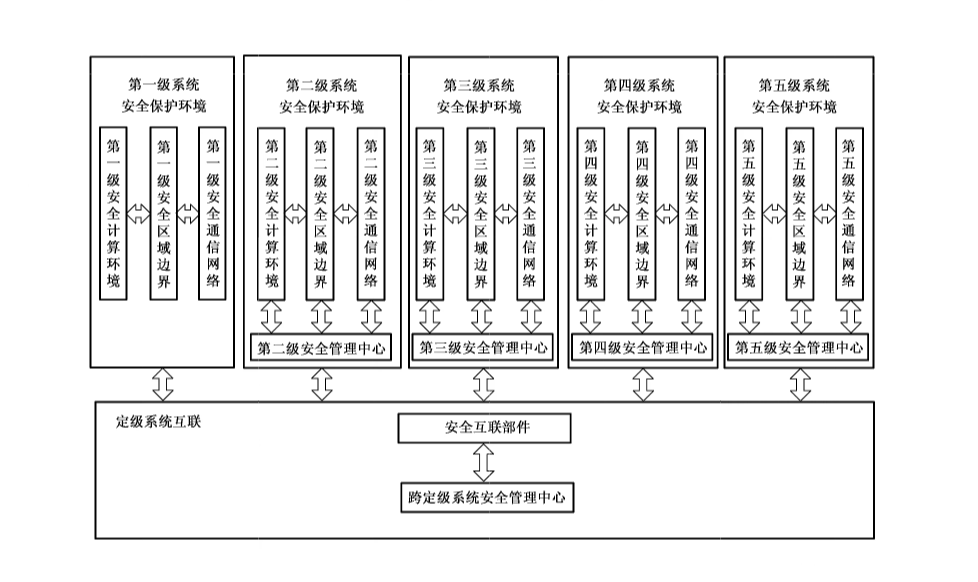
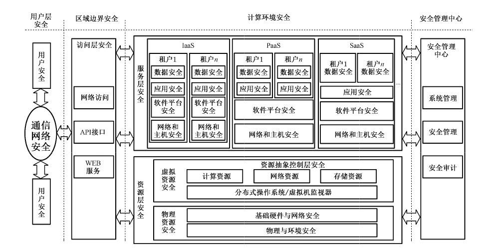
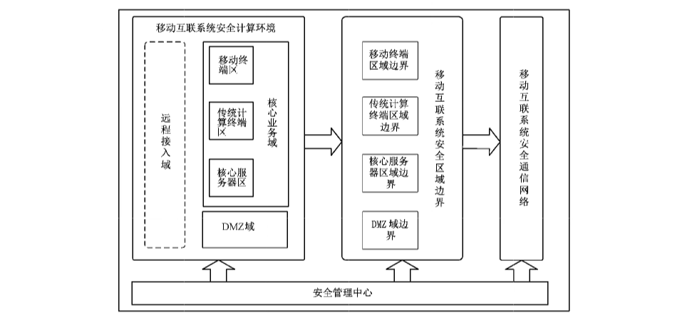
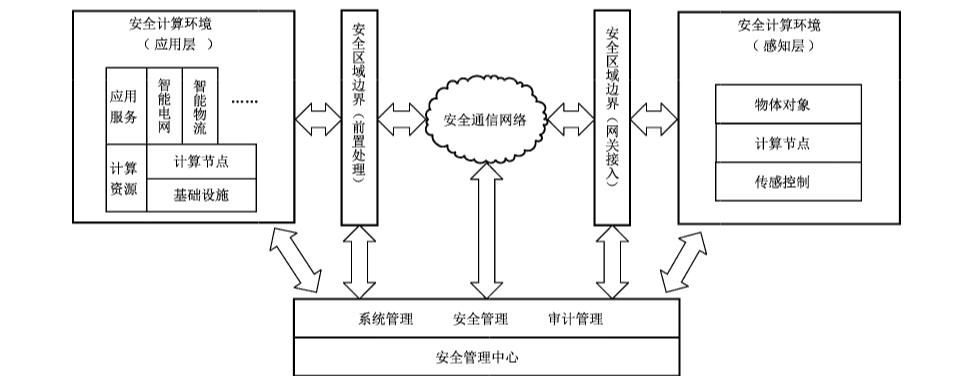
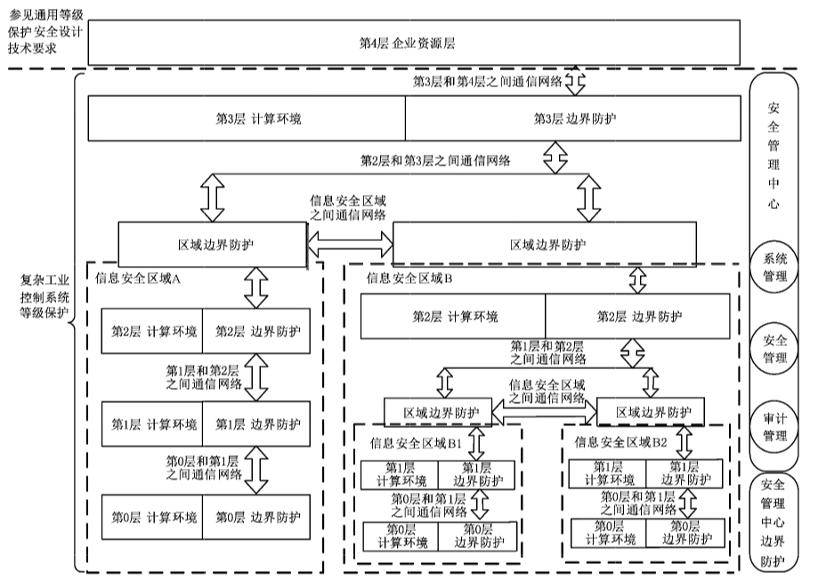
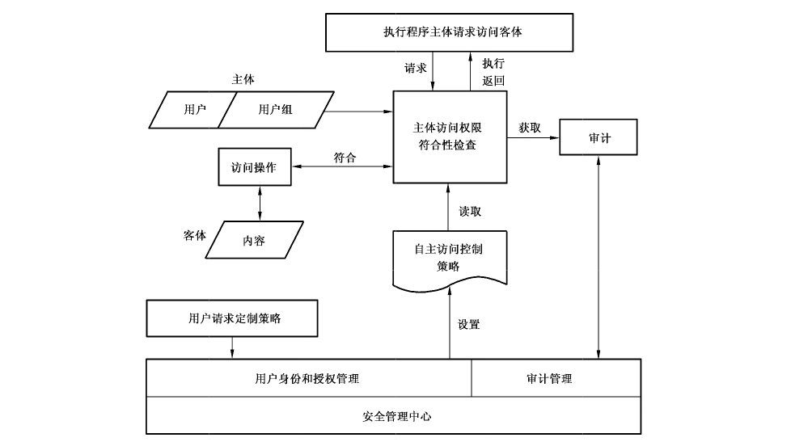
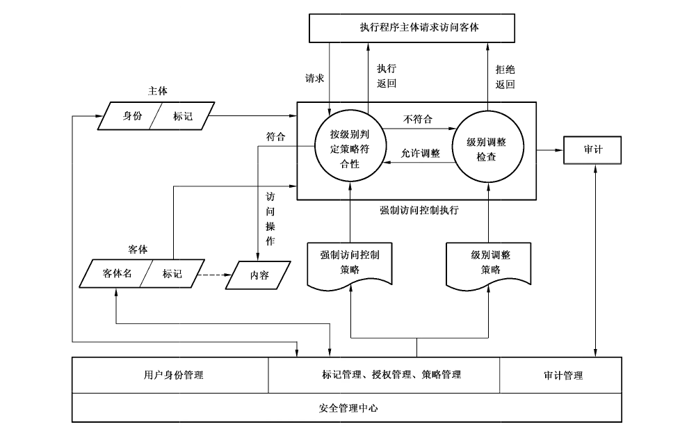
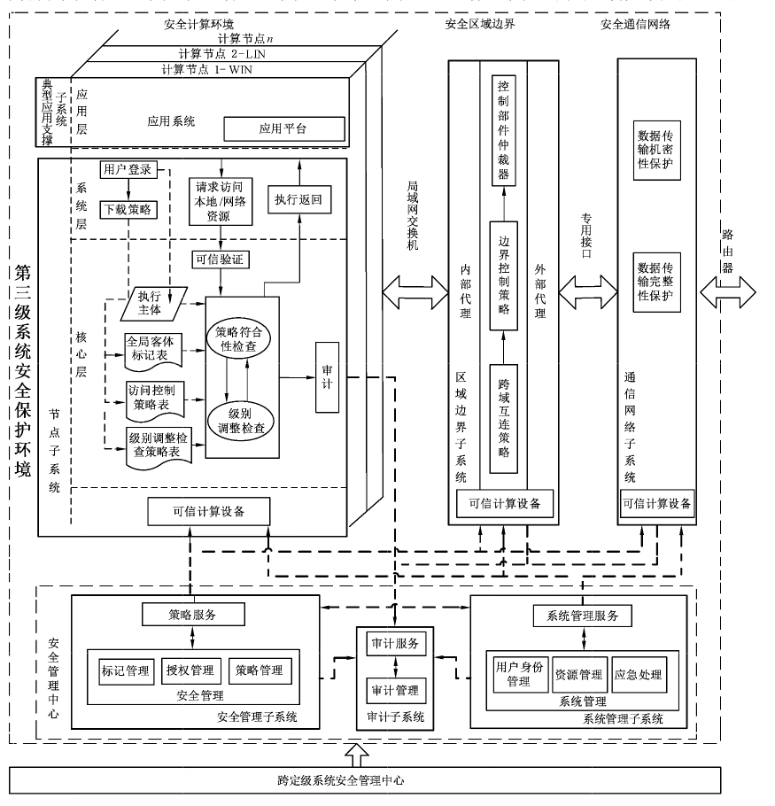
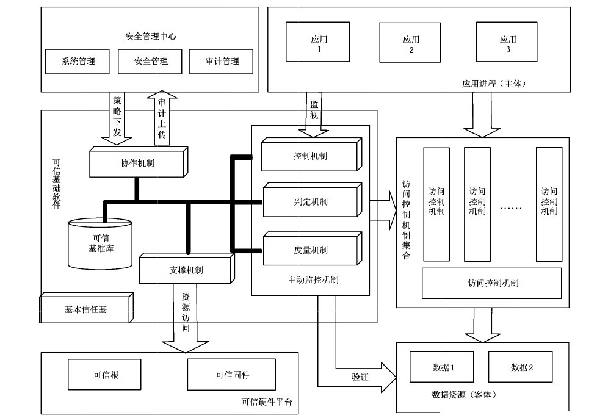
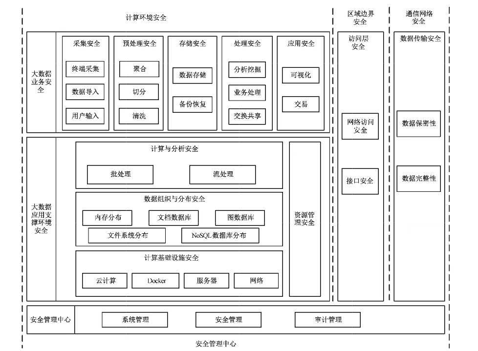

# GB/T 25070-2019 信息安全技术 网络安全等级保护安全设计技术要求

> 来源：[GB/T 25070-2019 国家标准详情](https://openstd.samr.gov.cn/bzgk/std/newGbInfo?hcno=9FB6EE8597B21436D0E99BF44FD42C4D)；封面发布日期：2019-05-10；实施日期：2019-12-01。
> 官方在线预览截图 SHA-256：528a5eb87bbfcedf16763fcdc2759ec58fbfd6a8c6bc62c8bec47b4e389bcc28。
> 转写说明：依据官方在线预览的 50 张页面图像整理正文与附录，保留原图，省略封面、目录、页眉、页脚和页码，合并跨页内容。原件以黑体标示较低等级中没有出现或增强的要求；此处未逐项恢复字重，比较等级差异或正式引用时请核对原件。

## 前言

本标准按照 GB/T 1.1—2009 给出的规则起草。

本标准代替 GB/T 25070—2010《信息安全技术 信息系统等级保护安全设计技术要求》，与 GB/T 25070—2010 相比，主要变化如下：

- 将标准名称变更为《信息安全技术 网络安全等级保护安全设计技术要求》；

- 各个级别的安全计算环境设计技术要求调整为通用安全计算环境设计技术要求、云安全计算环境设计技术要求、移动互联安全计算环境设计技术要求、物联网系统安全计算环境设计技术要求和工业控制系统安全计算环境设计技术要求；

- 各个级别的安全区域边界设计技术要求调整为通用安全区域边界设计技术要求、云安全区域边界设计技术要求、移动互联安全区域边界设计技术要求、物联网系统安全区域边界设计技术要求和工业控制系统安全区域边界设计技术要求；

- 各个级别的安全通信网络设计技术要求调整为通用安全通信网络设计技术要求、云安全通信网络设计技术要求、移动互联安全通信网络设计技术要求、物联网系统安全通信网络设计技术要求和工业控制系统安全通信网络设计技术要求；

- 删除了附录 B 中的 B.2“子系统间接口”和 B.3“重要数据结构”，增加了 B.4“第三级系统可信验证实现机制”。

请注意本文件的某些内容可能涉及专利。本文件的发布机构不承担识别这些专利的责任。

本标准由全国信息安全标准化技术委员会（SAC/TC 260）提出并归口。

本标准起草单位：公安部第一研究所、北京工业大学、北京中软华泰信息技术有限责任公司、中国电子信息产业集团有限公司第六研究所、中国信息通信研究院、阿里云计算技术有限公司、中国银行股份有限公司软件中心、公安部第三研究所、国家能源局信息中心、中国电力科学研究院有限公司、中国科学院软件研究所、工业和信息化部计算机与微电子发展研究中心（中国软件评测中心）、中国科学院信息工程研究所、启明星辰信息技术集团股份有限公司、浙江中烟工业有限责任公司、中央电视台、北京江南天安科技有限公司、华为技术有限公司、北京航空航天大学、北京理工大学、北京天融信网络安全技术有限公司、北京和利时系统工程有限公司、青岛海天炜业过程控制技术股份有限公司、北京力控华康科技有限公司、石化盈科信息技术有限责任公司、北京华大智宝电子系统有限公司、山东微分电子科技有限公司、北京中电瑞铠科技有限公司、北京广利核系统工程有限公司、北京神州绿盟科技有限公司。

本标准主要起草人：蒋勇、李超、李秋香、赵勇、袁静、徐晓军、宫月、吴薇、黄学臻、陈翠云、刘志宇、陈彦如、王昱镔、张森、卢浩、吕由、林莉、徐进、傅一帆、丰大军、龚炳铮、贡春燕、霍玉鲜、范文斌、魏亮、田慧蓉、李强、李艺、沈锡铺、陈雪秀、任卫红、孙利民、朱红松、阎兆腾、段伟恒、孟雅辉、章志华、李健俊、李威、顾军、陈卫平、琚宏伟、陈冠直、胡红升、陈雪鸿、高昆仑、张钾、张敏、李昊、王宝会、汤世平、雷晓锋、王弢、王晓鹏、刘美丽、陈聪、刘安正、刘利民、龚亮华、方亮、石宝臣、孙郁熙、巩金亮、周峰、郝鑫、梁猛、姜红勇、冯坚、黄敏、张旭武、石秦、孙洪涛。

本标准所代替标准的历次版本发布情况为：

- GB/T 25070—2010。

## 引言

GB/T 25070—2010《信息安全技术 信息系统等级保护安全设计技术要求》在开展网络安全等级保护工作的过程中起到了非常重要的作用，被广泛应用于指导各个行业和领域开展网络安全等级保护建设整改等工作，但是随着信息技术的发展，GB/T 25070—2010 在适用性、时效性、易用性、可操作性上需要进一步完善。

为了配合《中华人民共和国网络安全法》的实施，同时适应云计算、移动互联、物联网、工业控制和大数据等新技术、新应用情况下网络安全等级保护工作的开展，需对 GB/T 25070—2010 进行修订，修订的思路和方法是调整原国家标准 GB/T 25070—2010 的内容，针对共性安全保护目标提出通用的安全设计技术要求，针对云计算、移动互联、物联网、工业控制和大数据等新技术、新应用领域的特殊安全保护目标提出特殊的安全设计技术要求。

本标准是网络安全等级保护相关系列标准之一。

与本标准相关的标准包括：

- GB/T 25058 信息安全技术 信息系统安全等级保护实施指南；

- GB/T 22240 信息安全技术 信息系统安全等级保护定级指南；

- GB/T 22239 信息安全技术 网络安全等级保护基本要求；

- GB/T 28448 信息安全技术 网络安全等级保护测评要求。

在本标准中，黑体字部分表示较低等级中没有出现或增强的要求。

## 1 范围

本标准规定了网络安全等级保护第一级到第四级等级保护对象的安全设计技术要求。

本标准适用于指导运营使用单位、网络安全企业、网络安全服务机构开展网络安全等级保护安全技术方案的设计和实施，也可作为网络安全职能部门进行监督、检查和指导的依据。

> 注：第五级等级保护对象是非常重要的监督管理对象，对其有特殊的管理模式和安全设计技术要求，所以不在本标准中进行描述。

## 2 规范性引用文件

下列文件对于本文件的应用是必不可少的。凡是注日期的引用文件，仅注日期的版本适用于本文件。凡是不注日期的引用文件，其最新版本（包括所有的修改单）适用于本文件。

- GB 17859—1999 计算机信息系统 安全保护等级划分准则

- GB/T 22240—2008 信息安全技术 信息系统安全等级保护定级指南

- GB/T 25069—2010 信息安全技术 术语

- GB/T 31167—2014 信息安全技术 云计算服务安全指南

- GB/T 31168—2014 信息安全技术 云计算服务安全能力要求

- GB/T 32919—2016 信息安全技术 工业控制系统安全控制应用指南

## 3 术语和定义

GB 17859—1999、GB/T 22240—2008、GB/T 25069—2010、GB/T 31167—2014、GB/T 31168—2014 和 GB/T 32919—2016 界定的以及下列术语和定义适用于本文件。为了便于使用，以下重复列出了 GB/T 31167—2014中的一些术语和定义。

### 3.1 网络安全 cybersecurity

通过采取必要措施，防范对网络的攻击、侵入、干扰、破坏和非法使用以及意外事故，使网络处于稳定可靠运行的状态，以及保障网络数据的完整性、保密性、可用性的能力。

［GB/T 22239—2019，定义3.1］

### 3.2 定级系统 classified system

已确定安全保护等级的系统。定级系统分第一级、第二级、第三级、第四级和第五级系统。

### 3.3 定级系统安全保护环境 security environment of classified system

由安全计算环境、安全区域边界、安全通信网络和（或）安全管理中心构成的对定级系统进行安全保护的环境。

### 3.4 安全计算环境 security computing environment

对定级系统的信息进行存储、处理及实施安全策略的相关部件。

### 3.5 安全区域边界 security area boundary

对定级系统的安全计算环境边界，以及安全计算环境与安全通信网络之间实现连接并实施安全策略的相关部件。

### 3.6 安全通信网络 security communication network

对定级系统安全计算环境之间进行信息传输及实施安全策略的相关部件。

### 3.7 安全管理中心 security management center

对定级系统的安全策略及安全计算环境、安全区域边界和安全通信网络上的安全机制实施统一管理的平台或区域。

### 3.8 跨定级系统安全管理中心 security management center for cross classified system

对相同或不同等级的定级系统之间互联的安全策略及安全互联部件上的安全机制实施统一管理的平台或区域。

### 3.9 定级系统互联 classified system interconnection

通过安全互联部件和跨定级系统安全管理中心实现的相同或不同等级的定级系统安全保护环境之间的安全连接。

### 3.10 云计算 cloud computing

一种通过网络将可伸缩、弹性的共享物理和虚拟资源池以按需自服务的方式供应和管理的模式。

> 注：资源包括服务器、操作系统、网络、软件、应用和存储设备等。

［GB/T 32400—2015，定义3.2.5］

### 3.11 云计算平台 cloud computing platform

云服务商提供的云计算基础设施及其上的服务层软件的集合。

［GB/T 31167—2014，定义 3.7］

### 3.12 云计算环境 cloud computing environment

云服务商提供的云计算平台及客户在云计算平台之上部署的软件及相关组件的集合。

［GB/T 31167—2014，定义3.8］

### 3.13 移动互联系统 mobile interconnection system

采用了移动互联技术，以移动应用为主要发布形式，用户通过 mobile internet system 移动终端获取业务和服务的信息系统。

### 3.14 物联网 internet of things

将感知节点设备通过互联网等网络连接起来构成的系统。

［GB/T 22239—2019，定义3.15］

### 3.15 感知层网关 sensor layer gateway

将感知节点所采集的数据进行汇总、适当处理或数据融合，并进行转发的装置。

### 3.16 感知节点设备 sensor node

对物或环境进行信息采集和/或执行操作，并能联网进行通信的装置。

### 3.17 数据新鲜性 data freshness

对所接收的历史数据或超出时限的数据进行识别的特性。

### 3.18 现场设备 field device

连接到ICS现场的设备，现场设备的类型包括 RTU、PL.C、传感器、执行器、人机界面以及相关的通讯设备等。

### 3.19 现场总线 fieldbus

一种处于工业现场底层设备（如传感器、执行器、控制器和控制室设备等）之间的数字串行多点双向数据总线或通信链路。利用现场总线技术不需要在控制器和每个现场设备之间点对点布线。总线协议是用来定义现场总线网络上的消息，每个消息标识了网络上特定的传感器。

## 4 缩略语

下列缩略语适用于本文件。

- 3G：第三代移动通信技术（3rd Generation Mobile Communication Technology）
- 4G：第四代移动通信技术（4th Generation Mobile Communication Technology）
- API：应用程序编程接口（Application Programming Interface）
- BIOS：基本输入输出系统（Basic Input Output System）
- CPU：中央处理器（Central Processing Unit）
- DMZ：隔离区（Demilitarized Zone）
- GPS：全球定位系统（Global Positioning System）
- ICS：工业控制系统（Industrial Control System）
- IoT：物联网（Internet of Things）
- NFC：近场通信/近距离无线通信技术（Near Field Communication）
- OLE：对象连接与嵌入（Object Linking and Embedding）
- OPC：用于过程控制的 OLE（OLE for Process Control）
- PLC：可编程逻辑控制器（Programmable Logic Controller）
- RTU：远程终端单元（Remote Terminal Units）
- VPDN：虚拟专用拨号网（Virtual Private Dial-up Networks）
- SIM：用户身份识别模块（Subscriber Identification Module）
- WiFi：无线保真（Wireless Fidelity）

## 5 网络安全等级保护安全技术设计概述

### 5.1 通用等级保护安全技术设计框架

网络安全等级保护安全技术设计包括各级系统安全保护环境的设计及其安全互联的设计，如图1所示。各级系统安全保护环境由相应级别的安全计算环境、安全区域边界、安全通信网络和（或）安全管理中心组成。定级系统互联由安全互联部件和跨定级系统安全管理中心组成。

本标准第6章～第11章，对图1各个部分提出了相应的设计技术要求（第五级网络安全保护环境的设计要求除外）。附录 A 给出了访问控制机制设计，附录 B给出了第三级系统安全保护环境设计示例。此外，附录C给出大数据设计技术要求。

在对定级系统进行等级保护安全保护环境设计时，可以结合系统自身业务需求，将定级系统进一步细化成不同的子系统，确定每个子系统的等级，对子系统进行安全保护环境的设计。

### 5.2 云计算等级保护安全技术设计框架

结合云计算功能分层框架和云计算安全特点，构建云计算安全设计防护技术框架，包括云用户层、访问层、服务层、资源层、硬件设施层和管理层（跨层功能）。其中一个中心指安全管理中心，三重防护包括安全计算环境、安全区域边界和安全通信网络，具体如图2所示。

用户通过安全的通信网络以网络直接访问、API 接口访问和 WEB服务访问等方式安全地访问云服务商提供的安全计算环境，其中用户终端自身的安全保障不在本部分范畴内。安全计算环境包括资源层安全和服务层安全。其中，资源层分为物理资源和虚拟资源，需要明确物理资源安全设计技术要求和虚拟资源安全设计要求，其中物理与环境安全不在本部分范畴内。服务层是对云服务商所提供服务的实现，包含实现服务所需的软件组件，根据服务模式不同，云服务商和云租户承担的安全责任不同。

服务层安全设计需要明确云服务商控制的资源范围内的安全设计技术要求，并且云服务商可以通过提供安全接口和安全服务为云租户提供安全技术和安全防护能力。云计算环境的系统管理、安全管理和安全审计由安全管理中心统一管控。结合本框架对不同等级的云计算环境进行安全技术设计，同时通过服务层安全支持对不同等级云租户端（业务系统）的安全设计。

### 5.3 移动互联等级保护安全技术设计框架

移动互联系统安全防护参考架构如图 3，其中安全计算环境由核心业务域、DMZ 域和远程接入域三个安全域组成，安全区域边界由移动互联系统区域边界、移动终端区域边界、传统计算终端区域边界、核心服务器区域边界、DMZ 区域边界组成，安全通信网络由移动运营商或用户自己搭建的无线网络组成。

a） 核心业务域

核心业务域是移动互联系统的核心区域，该区域由移动终端、传统计算终端和服务器构成，完成对移动互联业务的处理、维护等。核心业务域应重点保障该域内服务器、计算终端和移动终端的操作系统安全、应用安全、网络通信安全、设备接入安全。

b） DMZ 域

DMZ 域是移动互联系统的对外服务区域，部署对外服务的服务器及应用，如 Web 服务器、数据库服务器等，该区域和互联网相联，来自互联网的访问请求应经过该区域中转才能访问核心业务域。DMZ 域应重点保障服务器操作系统及应用安全。

c） 远程接入域

远程接入域由移动互联系统运营使用单位可控的、通过 VPN 等技术手段远程接入移动互联系统运营使用单位网络的移动终端组成，完成远程办公、应用系统管控等业务。远程接入域应重点保障远程移动终端自身运行安全、接入移动互联应用系统安全和通信网络安全。

本标准将移动互联系统中的计算节点分为两类：移动计算节点和传统计算节点。移动计算节点主要包括远程接入域和核心业务域中的移动终端，传统计算节点主要包括核心业务域中的传统计算终端和服务器等。传统计算节点及其边界安全设计可参考通用安全设计要求，下文提到的移动互联计算环境、区域边界、通信网络的安全设计都是特指移动计算节点而言的。

### 5.4 物联网等级保护安全技术设计框架

结合物联网系统的特点，构建在安全管理中心支持下的安全计算环境、安全区域边界、安全通信网络三重防御体系。安全管理中心支持下的物联网系统安全保护设计框架如图 4 所示，物联网感知层和应用层都由完成计算任务的计算环境和连接网络通信域的区域边界组成。

a） 安全计算环境包括物联网系统感知层和应用层中对定级系统的信息进行存储、处理及实施安全策略的相关部件，如感知层中的物体对象、计算节点、传感控制设备，以及应用层中的计算资源及应用服务等。

b） 安全区域边界包括物联网系统安全计算环境边界，以及安全计算环境与安全通信网络之间实现连接并实施安全策略的相关部件，如感知层和网络层之间的边界、网络层和应用层之间的边界等。

c） 安全通信网络包括物联网系统安全计算环境和安全区域之间进行信息传输及实施安全策略的相关部件，如网络层的通信网络以及感知层和应用层内部安全计算环境之间的通信网络等。

d） 安全管理中心包括对物联网系统的安全策略及安全计算环境、安全区域边界和安全通信网络上的安全机制实施统一管理的平台，包括系统管理、安全管理和审计管理三部分，只有第二级及第二级以上的安全保护环境设计有安全管理中心。

### 5.5 工业控制等级保护安全技术设计框架

对于工业控制系统根据被保护对象业务性质分区，针对功能层次技术特点实施的网络安全等级保护设计，工业控制系统等级保护安全技术设计框架如图5所示。工业控制系统等级保护安全技术设计构建在安全管理中心支持下的计算环境、区域边界、通信网络三重防御体系，采用分层、分区的架构，结合工业控制系统总线协议复杂多样、实时性要求强、节点计算资源有限、设备可靠性要求高、故障恢复时间短、安全机制不能影响实时性等特点进行设计，以实现可信、可控、可管的系统安全互联、区域边界安全防护和计算环境安全。

工业控制系统分为4层，即第0~3层为工业控制系统等级保护的范畴，为设计框架覆盖的区域；横向上对工业控制系统进行安全区域的划分，根据工业控制系统中业务的重要性、实时性、业务的关联性、对现场受控设备的影响程度以及功能范围、资产属性等，形成不同的安全防护区域，系统都应置于相应的安全区域内，具体分区以工业现场实际情况为准（分区方式包括但不限于：第0~2层组成一个安全区域、第0~1层组成一个安全区域、同层中有不同的安全区域等）。

分区原则根据业务系统或其功能模块的实时性、使用者、主要功能、设备使用场所、各业务系统间的相互关系、广域网通信方式以及对工业控制系统的影响程度等。对于额外的安全性和可靠性要求，在主要的安全区还可以根据操作功能进一步划分成子区，将设备划分成不同的区域可以有效地建立“纵深防御”策略。将具备相同功能和安全要求的各系统的控制功能划分成不同的安全区域，并按照方便管理和控制为原则各安全功能区域分配网段地址。

设计框架逐级增强，但防护类别相同，只是安全保护设计的强度不同。防护类别包括：安全计算环境，包括工业控制系统0~3层中的信息进行存储、处理及实施安全策略的相关部件；安全区域边界，包括安全计算环境边界，以及安全计算环境与安全通信网络之间实现连接并实施安全策略的相关部件；安全通信网络，包括安全计算环境和网络安全区域之间进行信息传输及实施安全策略的相关部件；安全管理中心，包括对定级系统的安全策略及安全计算环境、安全区域边界和安全通信网络上的安全机制实施统一管理的平台，包括系统管理、安全管理和审计管理三部分。

注2：一个信息安全区域可以包括多个不同等级的子区域。

注3：纵向上分区以工业现场实际情况为准（图中分区为示例性分区），分区方式包括但不限于：第0～2层组成一个安全区域、第0~1层组成一个安全区域等。

## 6 第一级系统安全保护环境设计

### 6.1 设计目标

第一级系统安全保护环境的设计目标是：按照 GB 17859—1999对第一级系统的安全保护要求，实现定级系统的自主访问控制，使系统用户对其所属客体具有自我保护的能力。

### 6.2 设计策略

第一级系统安全保护环境的设计策略是：遵循GB 17859—1999的4.1 中相关要求，以身份鉴别为基础，提供用户和（或）用户组对文件及数据库表的自主访问控制，以实现用户与数据的隔离，使用户具备自主安全保护的能力；以包过滤手段提供区域边界保护；以数据校验和恶意代码防范等手段提供数据和系统的完整性保护。

第一级系统安全保护环境的设计通过第一级的安全计算环境、安全区域边界以及安全通信网络的设计加以实现。计算节点都应基于可信根实现开机到操作系统启动的可信验证。

### 6.3 设计技术要求

#### 6.3.1 安全计算环境设计技术要求

##### 6.3.1.1 通用安全计算环境设计技术要求

本项要求包括：

a） 用户身份鉴别应支持用户标识和用户鉴别。在每一个用户注册到系统时，采用用户名和用户标识符标识用户身份；在每次用户登录系统时，采用口令鉴别机制进行用户身份鉴别，并对口令数据进行保护。

b） 自主访问控制应在安全策略控制范围内，使用户/用户组对其创建的客体具有相应的访问操作权限，并能将这些权限的部分或全部授予其他用户/用户组。访问控制主体的粒度为用户/用户组级，客体的粒度为文件或数据库表级。访问操作包括对客体的创建、读、写、修改和删除等。

c） 用户数据完整性保护可采用常规校验机制，检验存储的用户数据的完整性，以发现其完整性是否被破坏。

d） 恶意代码防范应安装防恶意代码软件或配置具有相应安全功能的操作系统，并定期进行升级和更新，以防范和清除恶意代码。

e） 可信验证可基于可信根对计算节点的BIOS、引导程序、操作系统内核等进行可信验证，并在检测到其可信性受到破坏后进行报警。

##### 6.3.1.2 云安全计算环境设计技术要求

本项要求包括：

a） 用户账号保护应支持建立云租户账号体系，实现主体对虚拟机、云数据库、云网络、云存储等客体的访问授权。

b） 虚拟化安全应禁止虚拟机对宿主机物理资源的直接访问；应支持不同云租户虚拟化网络之间安全隔离。

c） 恶意代码防范物理机和宿主机应安装经过安全加固的操作系统或进行主机恶意代码防范。

##### 6.3.1.3 移动互联安全计算环境设计技术要求

本项要求包括：

a） 用户身份鉴别应采用口令、解锁图案以及其他具有相应安全强度的机制进行用户身份鉴别。

b） 应用管控应提供应用程序签名认证机制，拒绝未经过认证签名的应用软件安装和执行。

##### 6.3.1.4 物联网系统安全计算环境设计技术要求

本项要求包括：

a） 感知层设备身份鉴别应采用常规鉴别机制对感知设备身份进行鉴别，确保数据来源于正确的感知设备。

b） 感知层设备访问控制应通过制定安全策略如访问控制列表，实现对感知设备的访问控制。

##### 6.3.1.5 工业控制系统安全计算环境设计技术要求

本项要求包括：

a） 工业控制身份鉴别现场控制层设备及过程监控层设备应实施唯一性的标志、鉴别与认证，保证鉴别认证与功能完整性状态随时能得到实时验证与确认。在控制设备及监控设备上运行的程序、相应的数据集合应有唯一性标识管理。

b） 现场设备访问控制应对通过身份鉴别的用户实施基于角色的访问控制策略，现场设备收到操作命令后，应检验该用户绑定的角色是否拥有执行该操作的权限，拥有权限的该用户获得授权，用户未获授权应向上层发出报警信息。

c） 控制过程完整性保护应在规定的时间内完成规定的任务，数据应以授权方式进行处理，确保数据不被非法篡改、不丢失、不延误，确保及时响应和处理事件。

#### 6.3.2 安全区域边界设计技术要求

##### 6.3.2.1 通用安全区域边界设计技术要求

本项要求包括：

a） 区域边界包过滤可根据区域边界安全控制策略，通过检查数据包的源地址、目的地址、传输层协议和请求的服务等，确定是否允许该数据包通过该区域边界。

b） 区域边界恶意代码防范可在安全区域边界设置防恶意代码软件，并定期进行升级和更新，以防止恶意代码人侵。

c） 可信验证可基于可信根对区域边界计算节点的 BIOS、引导程序、操作系统内核等进行可信验证，并在检测到其可信性受到破坏后进行报警。

##### 6.3.2.2 云安全区域边界设计技术要求

本项要求包括：

a） 区域边界结构安全应保证虚拟机只能接收到目的地址包括自己地址的报文或业务需求的广播报文，同时限制广播攻击。

b） 区域边界访问控制应保证当虚拟机迁移时，访问控制策略随其迁移。

##### 6.3.2.3 移动互联安全区域边界设计技术要求

应遵守 6.3.2.1。

##### 6.3.2.4 物联网系统安全区域边界设计技术要求

应遵守 6.3.2.1。

##### 6.3.2.5 工业控制系统区域边界设计技术要求

应遵守 6.3.2.1。

#### 6.3.3 安全通信网络设计技术要求

##### 6.3.3.1 通用安全通信网络设计技术要求

本项要求包括：

a） 通信网络数据传输完整性保护可采用由密码等技术支持的完整性校验机制，以实现通信网络数据传输完整性保护。

b） 可信连接验证通信节点应采用具有网络可信连接保护功能的系统软件或可信根支撑的信息技术产品，在设备连接网络时，对源和目标平台身份进行可信验证。

##### 6.3.3.2 云安全通信网络设计技术要求

应遵守 6.3.3.1。

##### 6.3.3.3 移动互联安全通信网络设计技术要求

应遵守 6.3.3.1。

##### 6.3.3.4 物联网系统安全通信网络设计技术要求

应遵守 6.3.3.1。

##### 6.3.3.5 工业控制系统安全通信网络设计技术要求

应遵守6.3.3.1。

## 7 第二级系统安全保护环境设计

### 7.1 设计目标

第二级系统安全保护环境的设计目标是：按照 GB 17859—1999对第二级系统的安全保护要求，在第一级系统安全保护环境的基础上，增加系统安全审计、客体重用等安全功能，并实施以用户为基本粒度的自主访问控制，使系统具有更强的自主安全保护能力，并保障基础计算资源和应用程序可信。

### 7.2 设计策略

第二级系统安全保护环境的设计策略是：遵循GB 17859—1999的4.2中相关要求，以身份鉴别为基础，提供单个用户和（或）用户组对共享文件、数据库表等的自主访问控制；以包过滤手段提供区域边界保护；以数据校验和恶意代码防范等手段，同时通过增加系统安全审计、客体安全重用等功能，使用户对自己的行为负责，提供用户数据保密性和完整性保护，以增强系统的安全保护能力。第二级系统安全保护环境在使用密码技术设计时，应支持国家密码管理主管部门批准使用的密码算法，使用国家密码管理主管部门认证核准的密码产品，遵循相关密码国家标准和行业标准。

第二级系统安全保护环境的设计通过第二级的安全计算环境、安全区域边界、安全通信网络以及安全管理中心的设计加以实现。计算节点都应基于可信根实现开机到操作系统启动，再到应用程序启动的可信验证，并将验证结果形成审计记录。

### 7.3 设计技术要求

#### 7.3.1 安全计算环境设计技术要求

##### 7.3.1.1 通用安全计算环境设计技术要求

本项要求包括：

a） 用户身份鉴别应支持用户标识和用户鉴别。在每一个用户注册到系统时，采用用户名和用户标识符标识用户身份，并确保在系统整个生存周期用户标识的唯一性；在每次用户登录系统时，采用受控的口令或具有相应安全强度的其他机制进行用户身份鉴别，并使用密码技术对鉴别数据进行保密性和完整性保护。

b） 自主访问控制应在安全策略控制范围内，使用户对其创建的客体具有相应的访问操作权限，并能将这些权限的部分或全部授予其他用户。访问控制主体的粒度用户级，客体的粒度为文件或数据库表级。访问操作包括对客体的创建、读、写、修改和删除等。

c） 系统安全审计应提供安全审计机制，记录系统的相关安全事件。审计记录包括安全事件的主体、客体、时间、类型和结果等内容。该机制应提供审计记录查询、分类和存储保护，并可由安全管理中心管理。

d） 用户数据完整性保护可采用常规校验机制，检验存储的用户数据的完整性，以发现其完整性是否被破坏。

e） 用户数据保密性保护可采用密码等技术支持的保密性保护机制，对在安全计算环境中存储和处理的用户数据进行保密性保护。

f） 客体安全重用应采用具有安全客体复用功能的系统软件或具有相应功能的信息技术产品，对用户使用的客体资源，在这些客体资源重新分配前，对其原使用者的信息进行清除，以确保信息不被泄露。

g） 恶意代码防范应安装防恶意代码软件或配置具有相应安全功能的操作系统，并定期进行升级和更新，以防范和清除恶意代码。

h） 可信验证可基于可信根对计算节点的BIOS、引导程序、操作系统内核、应用程序等进行可信验证，并在检测到其可信性受到破坏后进行报警，并将验证结果形成审计记录。

##### 7.3.1.2 云安全计算环境设计技术要求

本项要求包括：

a） 用户身份鉴别应支持注册到云计算服务的云租户建立主子账号，并采用用户名和用户标识符标识主子账号用户身份。

b） 用户账号保护应支持建立云租户账号体系，实现主体对虚拟机、云数据库、云网络、云存储等客体的访问授权。

c） 安全审计应支持云服务商和云租户远程管理时执行特权命令进行审计。

应支持租户收集和查看与本租户资源相关的审计信息，保证云服务商对云租户系统和数据的访问操作可被租户审计。

d） 入侵防范应能检测到虚拟机对宿主机物理资源的异常访问。

e） 数据备份与恢复应采取冗余架构或分布式架构设计；应支持数据多副本存储方式；应支持通用接口确保云租户可以将业务系统及数据迁移到其他云计算平台和本地系统，保证可移植性。

f） 虛拟化安全应实现虚拟机之间的CPU、内存和存储空间安全隔离；应禁止虚拟机对宿主机物理资源的直接访问；应支持不同云租户虚拟化网络之间安全隔离。

g） 恶意代码防范物理机和宿主机应安装经过安全加固的操作系统或进行主机恶意代码防范；虚拟机应安装经过安全加固的操作系统或进行主机恶意代码防范；应支持对Web 应用恶意代码检测和防护的能力。

h）镜像和快照安全应支持镜像和快照提供对虚拟机镜像和快照文件的完整性保护；防止虚拟机镜像、快照中可能存在的敏感资源被非授权访问；针对重要业务系统提供安全加固的操作系统镜像或支持对操作系统镜像进行自加固。

##### 7.3.1.3 移动互联安全计算环境设计技术要求

本项要求包括：

a） 用户身份鉴别应采用口令、解锁图案以及其他具有相应安全强度的机制进行用户身份鉴别。

b） 应用管控应提供应用程序签名认证机制，拒绝未经过认证签名的应用软件安装和执行。

c） 安全域隔离应能够为重要应用提供应用级隔离的运行环境，保证应用的输入、输出、存储信息不被非法获取。

d） 数据保密性保护应采取加密、混淆等措施，对移动应用程序进行保密性保护，防止被反编译。

e） 可信验证应能对移动终端的操作系统、应用等程序的可信性进行验证，阻止非可信程序的执行。

##### 7.3.1.4 物联网系统安全计算环境设计技术要求

本项要求包括：

a） 感知层设备身份鉴别应采用常规鉴别机制对感知设备身份进行鉴别，确保数据来源于正确的感知设备；应对感知设备和感知层网关进行统一入网标识管理和维护，并确保在整个生存周期设备标识的唯一性。

b）感知层设备访问控制应通过制定安全策略如访问控制列表，实现对感知设备的访问控制；感知设备和其他设备（感知层网关、其他感知设备）通信时，应根据安全策略对其他设备进行权限检查。

##### 7.3.1.5 工业控制系统安全计算环境设计技术要求

本项要求包括：

a） 工业控制身份鉴别现场控制层设备及过程监控层设备应实施唯一性的标志、鉴别与认证，保证鉴别认证与功能完整性状态随时能得到实时验证与确认。在控制设备及监控设备上运行的程序、相应的数据集合应有唯一性标识管理。

b）现场设备访同控制应对通过身份鉴别的用户实施基于角色的访问控制策略，现场设备收到操作命令后，应检验该用户绑定的角色是否拥有执行该操作的权限，拥有权限的该用户获得授权，用户未获授权应向上层发出报警信息。

c） 现场设备数据保密性保护可采用密码技术支持的保密性保护机制或可采用物理保护机制，对现场设备层设备及连接到现场控制层的现场总线设备内存储的有保密需要的数据、程序、配置信息等进行保密性保护。

d） 控制过程完鳖性保护应在规定的时间内完成规定的任务，数据应以授权方式进行处理，确保数据不被非法篡改、不丢失、不延误，确保及时响应和处理事件，保护系统的同步机制、校时机制，保持控制周期稳定、现场总线轮询周期稳定。

#### 7.3.2 安全区域边界设计技术要求

##### 7.3.2.1 通用安全区域边界设计技术要求

本项要求包括：

a） 区域边界包过滤应根据区域边界安全控制策略，通过检查数据包的源地址、目的地址、传输层协议和请求的服务等，确定是否允许该数据包通过该区域边界。

b） 区域边界安全审计应在安全区域边界设置审计机制，并由安全管理中心统一管理。

c） 区域边界恶意代码防范可在安全区域边界设置防恶意代码网关，由安全管理中心管理。

d） 区域边界完整性保护应在区域边界设置探测器，探测非法外联等行为，并及时报告安全管理中心。

c） 可信验证可基于可信根对区域边界计算节点的BIOS、引导程序、操作系统内核、区域边界安全管控程序等进行可信验证，并在检测到其可信性受到破坏后进行报警，并将验证结果形成审计记录。

##### 7.3.2.2 云安全区域边界设计技术要求

本项要求包括：

a） 区域边界结构安全应保证虚拟机只能接收到目的地址包括自己地址的报文或业务需求的广播报文，同时限制广播攻击。

b） 区域边界访问控制应保证当虚拟机迁移时，访问控制策略随其迁移；应允许云租户设置不同虚拟机之间的访问控制策略；应建立租户私有网络实现不同租户之间的安全隔离。

##### 7.3.2.3 移动互联安全区域边界设计技术要求

本项要求包括：

a） 区域边界访问控制应能限制移动设备在不同工作场景下对 WiFi、3G、4G 等网络的访问能力。

b） 区域边界完整性保护应具备无线接入设备检测功能，对于非法无线接入设备进行报警。

##### 7.3.2.4 物联网系统安全区域边界设计技术要求

本项要求包括：

a） 区域边界准入控制应在安全区域边界设置准入控制机制，能够对设备进行认证。

b） 区域边界协议过滤与控制应在安全区域边界设置协议检查，对通信报文进行合规检查。

##### 7.3.2.5 工业控制系统安全区域边界设计技术要求

应遵守 7.3.2.1。

#### 7.3.3 安全通信网络设计技术要求

##### 7.3.3.1 通用安全通信网络设计技术要求

本项要求包括：

a） 通信网络安全审计应在安全通信网络设置审计机制，由安全管理中心管理。

b）通信网络数据传输完整性保护可采用由密码等技术支持的完整性校验机制，以实现通信网络数据传输完整性保护。

c） 通信网络数据传输保密性保护可采用由密码等技术支持的保密性保护机制，以实现通信网络数据传输保密性保护。

d） 可信连接验证通信节点应采用具有网络可信连接保护功能的系统软件或可信根支撑的信息技术产品，在设备连接网络时，对源和目标平台身份、执行程序进行可信验证，并将验证结果形成审计记录。

##### 7.3.3.2 云安全通信网络设计技术要求

本项要求包括：

a） 通信网络数据传输保密性可支持云租户远程通信数据保密性保护。

b） 通信网络安全审计应支持租户收集和查看与本租户资源相关的审计信息；应保证云服务商对云租户通信网络的访问操作可被租户审计。

##### 7.3.3.3 移动互联安全通信网络设计技术要求

应遵守7.3.3.1。

##### 7.3.3.4 物联网系统安全通信网络设计技术要求

本项要求包括：

a） 异构网安全接入保护应采用接入认证等技术建立异构网络的接入认证系统，保障控制信息的安全传输。

##### 7.3.3.5 工业控制系统安全通信网络设计技术要求

本项要求包括：

a） 现场总线网络数据传输完整性保护可采用适应现场总线特点的报文短、时延小的密码技术支持的完整性校验机制或可采用物理保护机制，实现现场总线网络数据传输完整性保护。

b） 无线网络数据传输完整性保护可采用密码技术支持的完整性校验机制，以实现无线网络数据传输完整性保护。

#### 7.3.4 安全管理中心设计技术要求

##### 7.3.4.1 系统管理

可通过系统管理员对系统的资源和运行进行配置、控制和可信管理，包括用户身份、可信证书、可信基准库、系统资源配置、系统加载和启动、系统运行的异常处理、数据和设备的备份与恢复以及恶意代码防范等。

应对系统管理员进行身份鉴别，只允许其通过特定的命令或操作界面进行系统管理操作，并对这些操作进行审计。

在进行云计算平台安全设计时，安全管理应提供查询云租户数据及备份存储位置的方式。

在进行物联网系统安全设计时，应通过系统管理员对感知设备、感知层网关等进行统一身份标识管理。

##### 7.3.4.2 审计管理

可通过安全审计员对分布在系统各个组成部分的安全审计机制进行集中管理，包括根据安全审计策略对审计记录进行分类；提供按时间段开启和关闭相应类型的安全审计机制；对各类审计记录进行存储、管理和查询等。

应对安全审计员进行身份鉴别，只允许其通过特定的命令或操作界面进行安全审计操作。

在进行云计算平台安全设计时，云计算平台应对云服务器、云数据库、云存储等云服务的创建、删除等操作行为进行审计。

在进行工业控制系统安全设计时，应通过安全管理员对工业控制现场控制设备、网络安全设备、网络设备、服务器、操作站等设备中主体和客体进行登记，并对各设备的网络安全监控和报警、网络安全日志信息进行集中管理。根据安全审计策略对各类网络安全信息进行分类管理与查询，并生成统一的审计报告。

## 8 第三级系统安全保护环境设计

### 8.1 设计目标

第三级系统安全保护环境的设计目标是：按照 GB 17859—1999对第三级系统的安全保护要求，在第二级系统安全保护环境的基础上，通过实现基于安全策略模型和标记的强制访问控制以及增强系统的审计机制，使系统具有在统一安全策略管控下，保护敏感资源的能力，并保障基础计算资源和应用程序可信，确保关键执行环节可信。

### 8.2 设计策略

第三级系统安全保护环境的设计策略是：在第二级系统安全保护环境的基础上，遵循 GB 17859一1999的4.3中相关要求，构造非形式化的安全策略模型，对主、客体进行安全标记，表明主、客体的级别分类和非级别分类的组合，以此为基础，按照强制访问控制规则实现对主体及其客体的访问控制。第三级系统安全保护环境在使用密码技术设计时，应支持国家密码管理主管部门批准使用的密码算法，使用国家密码管理主管部门认证核准的密码产品，遵循相关密码国家标准和行业标准。

第三级系统安全保护环境的设计通过第三级的安全计算环境、安全区域边界、安全通信网络以及安全管理中心的设计加以实现。计算节点都应基于可信根实现开机到操作系统启动，再到应用程序启动的可信验证，并在应用程序的关键执行环节对其执行环境进行可信验证，主动抵御病毒人侵行为，并将验证结果形成审计记录，送至管理中心。

### 8.3 设计技术要求

#### 8.3.1 安全计算环境设计技术要求

##### 8.3.1.1 通用安全计算环境设计技术要求

本项要求包括：

a） 用户身份鉴别应支持用户标识和用户鉴别。在对每一个用户注册到系统时，采用用户名和用户标识符标识用户身份，并确保在系统整个生存周期用户标识的唯一性；在每次用户登录系统时，采用受安全管理中心控制的口令、令牌、基于生物特征、数字证书以及其他具有相应安全强度的两种或两种以上的组合机制进行用户身份鉴别，并对鉴别数据进行保密性和完整性保护。

b） 自主访问控制应在安全策略控制范围内，使用户对其创建的客体具有相应的访问操作权限，并能将这些权限的部分或全部授予其他用户。自主访问控制主体的粒度为用户级，客体的粒度为文件或数据库表级和（或）记录或字段级。自主访问操作包括对客体的创建、读、写、修改和删除等。

c）7 标记和强制访问控制在对安全管理员进行身份鉴别和权限控制的基础上，应由安全管理员通过特定操作界面对主、客体进行安全标记；应按安全标记和强制访问控制规则，对确定主体访问客体的操作进行控制。强制访问控制主体的粒度为用户级，客体的粒度为文件或数据库表级。应确保安全计算环境内的所有主、客体具有一致的标记信息，并实施相同的强制访问控制规则。

d） 系统安全审计应记录系统的相关安全事件。审计记录包括安全事件的主体、客体、时间、类型和结果等内容。

应提供审计记录查询、分类、分析和存储保护；确保对特定安全事件进行报警；确保审计记录不被破坏或非授权访问。应为安全管理中心提供接口；对不能由系统独立处理的安全事件，提供由授权主体调用的接口。

e） 用户数据完整性保护应采用密码等技术支持的完整性校验机制，检验存储和处理的用户数据的完整性，以发现其完整性是否被破坏，且在其受到破坏时能对重要数据进行恢复。

f） 用户数据保密性保护应采用密码等技术支持的保密性保护机制，对在安全计算环境中存储和处理的用户数据进行保密性保护。

g） 客体安全重用应采用具有安全客体复用功能的系统软件或具有相应功能的信息技术产品，对用户使用的客体资源，在这些客体资源重新分配前，对其原使用者的信息进行清除，以确保信息不被泄露。

h） 可信验证可基于可信根对计算节点的BIOS、引导程序、操作系统内核、应用程序等进行可信验证，并在应用程序的关键执行环节对系统调用的主体、客体、操作可信验证，并对中断、关键内存区域等执行资源进行可信验证，并在检测到其可信性受到破坏时采取措施恢复，并将验证结果形成审计记录，送至管理中心。

i） 配置可信检查应将系统的安全配置信息形成基准库，实时监控或定期检查配置信息的修改行为，及时修复和基准库中内容不符的配置信息。

j 入侵检测和恶意代码防范应通过主动免疫可信计算检验机制及时识别入侵和病毒行为，并将其有效阻断。

##### 8.3.1.2 云安全计算环境设计技术要求

本项要求包括：

a） 用户身份鉴别应支持注册到云计算服务的云租户建立主子账号，并采用用户名和用户标识符标识主子账号用户身份。

b） 用户账号保护应支持建立云租户账号体系，实现主体对虚拟机、云数据库、云网络、云存储等客体的访问授权。

c） 安全审计应支持对云服务商和云租户远程管理时执行的特权命令进行审计。

应支持租户收集和查看与本租户资源相关的审计信息，保证云服务商对云租户系统和数据的访问操作可被租户审计。

d） 人侵防范应能检测到虚拟机对宿主机物理资源的异常访问。应支持对云租户进行行为监控，对云租户发起的恶意攻击或恶意对外连接进行检测和告警。

e） 数据保密性保护应提供重要业务数据加密服务，加密密钥由租户自行管理；应提供加密服务，保证虚拟机在迁移过程中重要数据的保密性。

f） 数据备份与恢复应采取冗余架构或分布式架构设计；应支持数据多副本存储方式；应支持通用接口确保云租户可以将业务系统及数据迁移到其他云计算平台和本地系统，保证可移植性。

g） 虚拟化安全应实现虚拟机之间的CPU、内存和存储空间安全隔离，能检测到非授权管理虚拟机等情况，并进行告警；应禁止虚拟机对宿主机物理资源的直接访问，应能对异常访问进行告警；应支持不同云租户虚拟化网络之间安全隔离；应监控物理机、宿主机、虚拟机的运行状态。

h） 恶意代码防范物理机和宿主机应安装经过安全加固的操作系统或进行主机恶意代码防范；虚拟机应安装经过安全加固的操作系统或进行主机恶意代码防范；应支持对 Web 应用恶意代码检测和防护的能力。

i） 镜像和快照安全应支持镜像和快照提供对虚拟机镜像和快照文件的完整性保护；防止虚拟机镜像、快照中可能存在的敏感资源被非授权访问；针对重要业务系统提供安全加固的操作系统镜像或支持对操作系统镜像进行自加固。

##### 8.3.1.3 移动互联安全计算环境设计技术要求

本项要求包括：

a） 用户身份鉴别应对移动终端用户实现基于口令或解锁图案、数字证书或动态口令、生物特征等方式的两种或两种以上的组合机制进行用户身份鉴别。

b） 标记和强制访问控制应确保用户或进程对移动终端系统资源的最小使用权限；应根据安全策略，控制移动终端接入访问外设，外设类型至少应包括扩展存储卡、GPS 等定位设备、蓝牙、NFC等通信外设，并记录日志。

c） 应用管控应具有软件白名单功能，能根据白名单控制应用软件安装、运行；应提供应用程序签名认证机制，拒绝未经过认证签名的应用软件安装和执行。

d） 安全域隔离应能够为重要应用提供基于容器、虚拟化等系统级隔离的运行环境，保证应用的输人、输出、存储信息不被非法获取。

e） 移动设备管控应基于移动设备管理软件，实行对移动设备全生命周期管控，保证移动设备丢失或被盗后，通过网络定位搜寻设备的位置、远程锁定设备、远程擦除设备上的数据、使设备发出警报音，确保在能够定位和检索的同时最大程度地保护数据。

f） 数据保密性保护应采取加密、混淆等措施，对移动应用程序进行保密性保护，防止被反编译；应实现对扩展存储设备的加密功能，确保数据存储的安全。

g） 可信验证应能对移动终端的引导程序、操作系统内核、应用程序等进行可信验证，确保每个部件在加载前的真实性和完整性。

##### 8.3.1.4 物联网系统安全计算环境设计技术要求

本项要求包括：

a） 感知层设备身份鉴别应采用密码技术支持的鉴别机制实现感知层网关与感知设备之间的双向身份鉴别，确保数据来源于正确的设备；应对感知设备和感知层网关进行统一人网标识管理和维护，并确保在整个生存周期设备标识的唯一性；应采取措施对感知设备组成的组进行组认证以减少网络拥塞。

b） 感知层设备访问控制应通过制定安全策略如访问控制列表，实现对感知设备的访问控制；感知设备和其他设备（感知层网关、其他感知设备）通信时，根据安全策略对其他设备进行权限检查；感知设备进行更新配置时，根据安全策略对用户进行权限检查。

##### 8.3.1.5 工业控制系统安全计算环境设计技术要求

本项要求包括：

a） 工业控制身份鉴别现场控制层设备及过程监控层设备应实施唯一性的标志、鉴别与认证，保证鉴别认证与功能完整性状态随时能得到实时验证与确认。在控制设备及监控设备上运行的程序、相应的数据集合应有唯一性标识管理，防止未经授权的修改。

b） 现场设备访问控制应对通过身份鉴别的用户实施基于角色的访问控制策略，现场设备收到操作命令后，应检验该用户绑定的角色是否拥有执行该操作的权限，拥有权限的该用户获得授权，用户未获授权应向上层发出报警信息。只有获得授权的用户才能对现场设备进行组态下装、软件更新、数据更新、参数设定等操作。

c） 现场设备安全审计在有冗余的重要应用环境，双重或多重控制器可采用实时审计跟踪技术，确保及时捕获网络安全事件信息并报警。

d） 现场设备数据完整性保护应采用密码技术或应采用物理保护机制保证现场控制层设备和现场设备层设备之间通信会话完整性。

e） 现场设备数据保密性保护应采用密码技术支持的保密性保护机制或应采用物理保护机制，对现场设备层设备及连接到现场控制层的现场总线设备内存储的有保密需要的数据、程序、配置信息等进行保密性保护。

f） 控制过程完整性保护应在规定的时间内完成规定的任务，数据应以授权方式进行处理，确保数据不被非法篡改、不丢失、不延误，确保及时响应和处理事件，保护系统的同步机制、校时机制，保持控制周期稳定、现场总线轮询周期稳定；现场设备应能识别和防范破坏控制过程完整性的攻击行为，应能识别和防止以合法身份、合法路径干扰控制器等设备正常工作节奏的攻击行为；在控制系统遭到攻击无法保持正常运行时，应有故障隔离措施，应使系统导向预先定义好的安全的状态，将危害控制到最小范围。

#### 8.3.2 安全区域边界设计技术要求

##### 8.3.2.1 通用安全区域边界设计技术要求

本项要求包括：

a） 区域边界访问控制应在安全区域边界设置自主和强制访问控制机制，应对源及目标计算节点的身份、地址、端口和应用协议等进行可信验证，对进出安全区域边界的数据信息进行控制，阻止非授权访问。

b）区域边界包过滤应根据区域边界安全控制策略，通过检查数据包的源地址、目的地址、传输层协议、请求的服务等，确定是否允许该数据包进出该区域边界。

c） 区域边界安全审计应在安全区域边界设置审计机制，由安全管理中心集中管理，并对确认的违规行为及时报警。

d） 区域边界完整性保护应在区域边界设置探测器，例如外接探测软件，探测非法外联和入侵行为，并及时报告安全管理中心。

e） 可信验证可基于可信根对计算节点的BIOS、引导程序、操作系统内核、区域边界安全管控程序等进行可信验证，并在区域边界设备运行过程中定期对程序内存空间、操作系统内核关键内存区域等执行资源进行可信验证，并在检测到其可信性受到破坏时采取措施恢复，并将验证结果形成审计记录，送至管理中心。

##### 8.3.2.2 云安全区域边界设计技术要求

本项要求包括：

a） 区域边界结构安全应保证虚拟机只能接收到目的地址包括自己地址的报文或业务需求的广播报文，同时限制广播攻击；应实现不同租户间虚拟网络资源之间的隔离，并避免网络资源过量占用；应保证云计算平台管理流量与云租户业务流量分离。

应能够识别、监控虚拟机之间、虚拟机与物理机之间的网络流量；提供开放接口或开放性安全服务，允许云租户接入第三方安全产品或在云平台选择第三方安全服务。

b） 区域边界访问控制应保证当虚拟机迁移时，访问控制策略随其迁移；应允许云租户设置不同虚拟机之间的访问控制策略；应建立租户私有网络实现不同租户之间的安全隔离；应在网络边界处部署监控机制，对进出网络的流量实施有效监控。

c） 区域边界入侵防范当虚拟机迁移时，入侵防范机制可应用于新的边界处；应将区域边界入侵防范机制纳入安全管理中心统一管理。

应向云租户提供互联网内容安全监测功能，对有害信息进行实时检测和告警。

d） 区域边界审计要求根据云服务商和云租户的职责划分，收集各自控制部分的审计数据；根据云服务商和云租户的职责划分，实现各自控制部分的集中审计；当发生虚拟机迁移或虚拟资源变更时，安全审计机制可应用于新的边界处；为安全审计数据的汇集提供接口，并可供第三方审计。

##### 8.3.2.3 移动互联安全区域边界设计技术要求

###### 8.3.2.3.1 区域边界访问控制

应对接入系统的移动终端，采取基于 SIM 卡、证书等信息的强认证措施；应能限制移动设备在不同工作场景下对 WiFi、3G、4G 等网络的访问能力。

###### 8.3.2.3.2 区域边界完整性保护

移动终端区域边界检测设备监控范围应完整覆盖移动终端办公区，并具备无线路由器设备位置检测功能，对于非法无线路由器设备接入进行报警和阻断。

##### 8.3.2.4 物联网系统安全区域边界设计技术要求

本项要求包括：

a） 区域边界访问控制应能根据数据的时间戳为数据流提供明确的允许/拒绝访问的能力；应提供网络最大流量及网络连接数限制机制；应能够根据通信协议特性，控制不规范数据包的出入。

b） 区域边界准入控制应在安全区域边界设置准入控制机制，能够对设备进行认证，保证合法设备接入，拒绝恶意设备接入；应根据感知设备特点收集感知设备的健康性相关信息如固件版本、标识、配置信息校验值等，并能够对接入的感知设备进行健康性检查。

c） 区域边界协议过滤与控制应在安全区域边界设置协议过滤，能够对物联网通信内容进行过滤，对通信报文进行合规检查，根据协议特性，设置相对应控制机制。

##### 8.3.2.5 工业控制系统安全区域边界设计技术要求

本项要求包括：

a） 工控通信协议数据过滤对通过安全区域边界的工控通信协议，应能识别其所承载的数据是否会对工控系统造成攻击或破坏，应控制通信流量、帧数量频度、变量的读取频度稳定且在正常范围内，保护控制器的工作节奏，识别和过滤写变量参数超出正常范围的数据，该控制过滤处理组件可配置在区域边界的网络设备上，也可配置在本安全区域内的工控通信协议的端点设备上或唯一的通信链路设备上。

b） 工控通信协议信息泄露防护应防止暴露本区域工控通信协议端点设备的用户名和登录密码，采用过滤变换技术隐藏用户名和登录密码等关键信息，将该端点设备单独分区过滤及其他具有相应防护功能的一种或一种以上组合机制进行防护。

c） 工控区域边界安全审计应在安全区域边界设置实时监测告警机制，通过安全管理中心集中管理，对确认的违规行为及时向安全管理中心和工控值守人员报警并做出相应处置。

#### 8.3.3 安全通信网络设计技术要求

##### 8.3.3.1 通用安全通信网络设计技术要求

本项要求包括：

a） 通信网络安全审计应在安全通信网络设置审计机制，由安全管理中心集中管理，并对确认的违规行为进行报警。

b）通信网络数据传输完整性保护应采用由密码技术支持的完整性校验机制，以实现通信网络数据传输完整性保护，并在发现完整性被破坏时进行恢复。

c）通信网络数据传输保密性保护应采用由密码技术支持的保密性保护机制，以实现通信网络数据传输保密性保护。

d） 可信连接验证通信节点应采用具有网络可信连接保护功能的系统软件或可信根支撑的信息技术产品，在设备连接网络时，对源和目标平台身份、执行程序及其关键执行环节的执行资源进行可信验证，并将验证结果形成审计记录，送至管理中心。

##### 8.3.3.2 云安全通信网络设计技术要求

本项要求包括：

a） 通信网络数据传输保密性应支持云租户远程通信数据保密性保护。

应对网络策略控制器和网络设备（或设备代理）之间网络通信进行加密。

b） 通信网络可信接入保护应禁止通过互联网直接访问云计算平台物理网络；应提供开放接口，允许接入可信的第三方安全产品。

c） 通信网络安全审计应支持租户收集和查看与本租户资源相关的审计信息；应保证云服务商对云租户通信网络的访问操作可被租户审计。

##### 8.3.3.3 移动互联安全通信网络设计技术要求

本项要求包括：

a） 通信网络可信保护应通过 VPDN等技术实现基于密码算法的可信网络连接机制，通过对连接到通信网络的设备进行可信检验，确保接入通信网络的设备真实可信，防止设备的非法接入。

##### 8.3.3.4 物联网系统安全通信网络设计技术要求

本项要求包括：

a） 感知层网络数据新鲜性保护应在感知层网络传输的数据中加入数据发布的序列信息如时间戳、计数器等，以实现感知层网络数据传输新鲜性保护。

b） 异构网安全接入保护应采用接入认证等技术建立异构网络的接入认证系统，保障控制信息的安全传输；应根据各接入网的工作职能、重要性和所涉及信息的重要程度等因素，划分不同的子网或网段，并采取相应的防护措施。

##### 8.3.3.5 工业控制系统安全通信网络设计技术要求

本项要求包括：

a）现场总线网络数据传输完整性保护应采用适应现场总线特点的报文短、时延小的密码技术支持的完整性校验机制或应采用物理保护机制，实现现场总线网络数据传输完整性保护。

b）无线网络数据传输完整性保护应采用密码技术支持的完整性校验机制，以实现无线网络数据传输完整性保护。

c） 现场总线网络数据传输保密性保护应采用适应现场总线特点的报文短、时延小的密码技术支持的保密性保护机制或应采用物理保护机制，实现现场总线网络数据传输保密性保护。

d） 无线网络数据传输保密性保护应采用由密码技术支持的保密性保护机制，以实现无线网络数据传输保密性保护。

e） 工业控制网络实时响应要求对实时响应和操作要求高的场合，应把工业控制通信会话过程设计为三个阶段：开始阶段，应完成对主客体身份鉴别和授权；运行阶段，应保证对工业控制系统的实时响应和操作，此阶段应对主客体的安全状态实时监测；结束阶段，应以显式的方式结束。在需要连续运行的场合，人员交接应不影响实时性，应保证访问控制机制的持续性。

f） 通信网络异常监测应对工业控制系统的通讯数据、访问异常、业务操作异常、网络和设备流量、工作周期、抖动值、运行模式、各站点状态、冗余机制等进行监测，发现异常进行报警；在有冗余现场总线和表决器的应用场合，可充分监测各冗余链路在同时刻的状态，捕获可能的恶意或入侵行为；应在相应的网关设备上进行流量监测与管控，对超出最大 PS 阈值的通信进行控制并报警。

g） 无线网络攻击的防护应对通过无线网络攻击的潜在威胁和可能产生的后果进行风险分析，应对可能遭受无线攻击的设备的信息发出（信息外泄）和进入（非法操控）进行屏蔽，可综合采用检测和干扰、电磁屏蔽、微波暗室吸收、物理保护等方法，在可能传播的频谱范围将无线信号衰减到不能有效接收的程度。

#### 8.3.4 安全管理中心设计技术要求

##### 8.3.4.1 系统管理

可通过系统管理员对系统的资源和运行进行配置、控制和可信及密码管理，包括用户身份、可信证书及密钥、可信基准库、系统资源配置、系统加载和启动、系统运行的异常处理、数据和设备的备份与恢复等。

应对系统管理员进行身份鉴别，只允许其通过特定的命令或操作界面进行系统管理操作，并对这些操作进行审计。

在进行云计算平台安全设计时，安全管理应提供查询云租户数据及备份存储位置的方式；云计算平台的运维应在中国境内，境外对境内云计算平台实施运维操作应遵循国家相关规定。

在进行物联网系统安全设计时，应通过系统管理员对感知设备、感知网关等进行统一身份标识管理；应通过系统管理员对感知设备状态（电力供应情况、是否在线、位置等）进行统一监测和处理。

##### 8.3.4.2 安全管理

应通过安全管理员对系统中的主体、客体进行统一标记，对主体进行授权，配置可信验证策略，维护策略库和度量值库。

应对安全管理员进行身份鉴别，只允许其通过特定的命令或操作界面进行安全管理操作，并进行审计。

在进行云计算平台安全设计时，云计算安全管理应具有对攻击行为回溯分析以及对网络安全事件进行预测和预警的能力；应具有对网络安全态势进行感知、预测和预判的能力。

在进行物联网系统安全设计时，应通过安全管理员对系统中所使用的密钥进行统一管理，包括密钥的生成、分发、更新、存儲、备份、销毁等。

在进行工业控制系统安全设计时，应通过安全管理员对工业控制系统设备的可用性和安全性进行实时监控，可以对监控指标设置告警阈值，触发告警并记录；应通过安全管理员在安全管理中心呈现设备间的访问关系，及时发现未定义的信息通讯行为以及识别重要业务操作指令级的异常。

##### 8.3.4.3 审计管理

应通过安全审计员对分布在系统各个组成部分的安全审计机制进行集中管理，包括根据安全审计策略对审计记录进行分类；提供按时间段开启和关闭相应类型的安全审计机制；对各类审计记录进行存储、管理和查询等。对审计记录应进行分析，并根据分析结果进行处理。

应对安全审计员进行身份鉴别，只允许其通过特定的命令或操作界面进行安全审计操作。

在进行云计算平台安全设计时，云计算平台应对云服务器、云数据库、云存储等云服务的创建、删除等操作行为进行审计；应通过运维审计系统对管理员的运维行为进行安全审计；应通过租户隔离机制，确保审计数据隔离的有效性。

在进行工业控制系统安全设计时，应通过安全管理员对工业控制现场控制设备、网络安全设备、图络设备、服务器、操作站等设备中主体和客体进行登记，并对各设备的网络安全监控和报警、网络安全日志信息进行集中管理。根据安全审计策略对各类安全信息进行分类管理与查询，并生成统一的审计报告。系统对各类网络安全报警和日志信息进行关联分析。

## 9 第四级系统安全保护环境设计

### 9.1 设计目标

第四级系统安全保护环境的设计目标是：按照 GB 17859—1999对第四级系统的安全保护要求，建立一个明确定义的形式化安全策略模型，将自主和强制访问控制扩展到所有主体与客体，相应增强其他安全功能强度；将系统安全保护环境结构化为关键保护元素和非关键保护元素，以使系统具有抗渗透的能力；保障基础计算资源和应用程序可信，确保所有关键执行环节可信，对所有可信验证结果进行动态关联感知。

### 9.2 设计策略

第四级系统安全保护环境的设计策略是：在第三级系统安全保护环境设计的基础上，遵循GB 17859—1999的4.4中相关要求，通过安全管理中心明确定义和维护形式化的安全策略模型。依据该模型，采用对系统内的所有主、客体进行标记的手段，实现所有主体与客体的强制访问控制。同时，相应增强身份鉴别、审计、安全管理等功能，定义安全部件之间接口的途径，实现系统安全保护环境关键保护部件和非关键保护部件的区分，并进行测试和审核，保障安全功能的有效性。第四级系统安全保护环境在使用密码技术设计时，应支持国家密码管理主管部门批准使用的密码算法，使用国家密码管理主管部门认证核准的密码产品，遵循相关密码国家标准和行业标准。

第四级系统安全保护环境的设计通过第四级的安全计算环境、安全区域边界、安全通信网络以及安全管理中心的设计加以实现。所有计算节点都应基于可信计算技术实现开机到操作系统启动，再到应用程序启动的可信验证，并在应用程序的所有执行环节对其执行环境进行可信验证，主动抵御病毒人侵行为，同时验证结果，进行动态关联感知，形成实时的态势。

### 9.3 设计技术要求

#### 9.3.1 安全计算环境设计技术要求

##### 9.3.1.1 通用安全计算环境设计技术要求

本项要求包括：

a） 用户身份鉴别应支持用户标识和用户鉴别。在每一个用户注册到系统时，采用用户名和用户标识符标识用户身份，并确保在系统整个生存周期用户标识的唯一性；在每次用户登录和重新连接系统时，采用受安全管理中心控制的口令、基于生物特征的数据、数字证书以及其他具有相应安全强度的两种或两种以上的组合机制进行用户身份鉴别，且其中一种鉴别技术产生的鉴别数据是不可替代的，并对鉴别数据进行保密性和完整性保护。

b） 自主访问控制应在安全策略控制范围内，使用户对其创建的客体具有相应的访问操作权限，并能将这些权限部分或全部授予其他用户。自主访问控制主体的粒度用户级，客体的粒度为文件或数据库表级和（或）记录或字段级。自主访问操作包括对客体的创建、读、写、修改和删除等。

c） 标记和强制访问控制在对安全管理员进行身份鉴别和权限控制的基础上，应由安全管理员通过特定操作界面对主、客体进行安全标记，将强制访问控制扩展到所有主体与客体；应按安全标记和强制访问控制规则，对确定主体访问客体的操作进行控制。强制访问控制主体的粒度为用户级，客体的粒度为文件或数据库表级。应确保安全计算环竞内的所有主、客体具有一致的标记信息，并实施相同的强制访问控制规则。

d） 系统安全审计应记录系统相关安全事件。审计记录包括安全事件的主体、客体、时间、类型和结果等内容。

应提供审计记录查询、分类、分析和存储保护；能对特定安全事件进行报警，终止违例进程等；

确保审计记录不被破坏或非授权访问以及防止审计记录丢失等。应为安全管理中心提供接口；对不能由系统独立处理的安全事件，提供由授权主体调用的接口。

e） 用户数据完整性保护应采用密码等技术支持的完整性校验机制，检验存储和处理的用户数据的完整性，以发现其完整性是否被破坏，且在其受到破坏时能对重要数据进行恢复。

f） 用户数据保密性保护采用密码等技术支持的保密性保护机制，对在安全计算环境中的用户数据进行保密性保护。

g） 客体安全重用应采用具有安全客体复用功能的系统软件或具有相应功能的信息技术产品，对用户使用的客体资源，在这些客体资源重新分配前，对其原使用者的信息进行清除，以确保信息不被泄露。

h） 可信验证可基于可信根对计算节点的BIOS、引导程序、操作系统内核、应用程序等进行可信验证，并在应用程序的所有执行环节对系统调用的主体、客体、操作可信验证，并对中断、关键内存区域等执行资源进行可信验证，并在检测到其可信性受到破坏时采取措施恢复，并将验证结果形成审计记录，送至管理中心，进行动态关联感知。

i） 配置可信检查应将系统的安全配置信息形成基准库，实时监控或定期检查配置信息的修改行为，及时修复和基准库中内容不符的配置信息，可将感知结果形成基准值。

j 入侵检测和恶意代码防范应通过主动免疫可信计算检验机制及时识别人侵和病毒行为，并将其有效阻断。

##### 9.3.1.2 云安全计算环境设计技术要求

本项要求包括：

a） 用户身份鉴别应支持注册到云计算服务的云租户建立主子账号，并采用用户名和用户标识符标识主子账号用户身份。

当进行远程管理时，管理终端和云计算平台边界设备之间应建立双向身份验证机制。

b） 用户账号保护应支持建立云租户账号体系，实现主体对虚拟机、云数据库、云网络、云存储等客体的访问授权。

c） 安全审计应支持对云服务商和云租户远程管理时执行的特权命令进行审计。

应支持租户收集和查看与本租户资源相关的审计信息，保证云服务商对云租户系统和数据的访问操作可被租户审计。

d） 人侵防范应支持对云租户进行行为监控，对云租户发起的恶意攻击或恶意对外连接进行检测和告警。

e） 数据保密性保护应提供重要业务数据加密服务，加密密钥由租户自行管理；应提供加密服务，保证虚拟机在迁移过程中重要数据的保密性。

数据备份与恢复应采取冗余架构或分布式架构设计；应支持数据多副本存储方式；应支持通用接口确保云租户可以将业务系统及数据迁移到其他云计算平台和本地系统，保证可移植性；应建立异地灾难备份中心，提供业务应用的实时切换。

0q） 虚拟化安全应实现虚拟机之间的CPU、内存和存储空间安全隔离，能检测到非授权管理虚拟机等情况，并进行告警；应禁止虚拟机对宿主机物理资源的直接访问，应能对异常访问进行告警；应支持不同云租户虚拟化网络之间安全隔离；应监控物理机、宿主机、虚拟机的运行状态，并提供接口供安全管理中心集中监控。

h） 恶意代码防范物理机和宿主机应安装经过安全加固的操作系统或进行主机恶意代码防范；虚拟机应安装经过安全加固的操作系统或进行主机恶意代码防范；应支持对Web 应用恶意代码检测和防护的能力。

i） 镜像和快照安全应支持镜像和快照提供对虚拟机镜像和快照文件的完整性保护；防止虚拟机镜像、快照中可能存在的敏感资源被非授权访问；针对重要业务系统提供安全加固的操作系统镜像或支持对操作系统镜像进行自加固。

##### 9.3.1.3 移动互联安全计算环境设计技术要求

本项要求包括：

a） 用户身份鉴别应对移动终端用户实现基于口令或解锁图案、数字证书或动态口令、生物特征等方式的两种或两种以上的组合身份鉴别；应基于硬件为身份鉴别机制构建隔离的运行环境。

b） 标记和强制访问控制应确保用户或进程对移动终端系统资源的最小使用权限；应根据安全策略，控制移动终端接入访问外设，外设类型至少应包括扩展存储卡、GPS 等定位设备、蓝牙、NFC等通信外设，并记录日志。

c） 应用管控应具有软件白名单功能，能根据白名单控制应用软件安装、运行；应提供应用程序签名认证机制，拒绝未经过认证签名的应用软件安装和执行。应确保移动终端为专用终端，不得处理与系统无关的业务。

d） 安全域隔离应能够为重要应用提供基于容器、虚拟化等系统级隔离的运行环境，保证应用的输入、输出、存储信息不被非法获取。

e） 移动设备管控应基于移动设备管理软件，实行对移动设备全生命周期管控，保证移动设备丢失或被盗后，通过网络定位搜寻设备的位置、远程锁定设备、远程擦除设备上的数据、使设备发出警报音，确保在能够定位和检索的同时最大程度地保护数据。

f） 数据保密性保护应采取加密、混淆等措施，对移动应用程序进行保密性保护，防止被反编译；应实现对扩展存储设备的加密功能，确保数据存储的安全。

g） 可信验证应能对移动终端的引导程序、操作系统内核、应用程序等进行可信验证，确保每个部件在加载前的真实性和完整性。

##### 9.3.1.4 物联网系统安全计算环境设计技术要求

本项要求包括：

a） 感知层设备身份鉴别应采用密码技术支持的鉴别机制实现感知层网关与感知设备之间的双向身份鉴别，确保数据来源于正确的设备；应对感知设备和感知层网关进行统一人网标识管理和维护，并确保在整个生存周期设备标识的唯一性；应采取措施对感知设备组成的组进行组认证以减少网络拥塞。

b） 感知层设备访问控制应通过制定安全策略如访问控制列表，实现对感知设备的访问控制；感知设备和其他设备（感知层网关、其他感知设备）通信时，根据安全策略对其他设备进行权限检查；感知设备进行更新配置时，根据安全策略对用户进行权限检查。

##### 9.3.1.5 工业控制系统安全计算环境设计技术要求

本项要求包括：

a） 工业控制身份鉴别现场控制层设备、现场设备层设备以及过程监控层设备应实施唯一性的标识、鉴别与认证，保证鉴别认证与功能完整性状态随时能得到实时验证与确认。在控制设备及监控设备上运行的程序、相应的数据集合应有唯一性标识管理，防止未经授权的修改。

b） 现场设备访问控制应对通过身份鉴别的用户实施基于角色的访问控制策略，现场设备收到操作命令后，应检验该用户绑定的角色是否拥有执行该操作的权限，拥有权限的该用户获得授权，用户未获授权应向上层发出报警信息。只有获得授权的用户才能对现场设备进行组态下装、软件更新、数据更新、参数设定等操作，才能对控制器的操作界面进行操作。

OPC服务器和客户机可分别单独放置在各自的安全区内，以访问控制设备进行隔离保护，应对进出安全区的信息实行访问控制等安全策略。

c） 现场设备安全审计在有冗余的重要应用环境，双重或多重控制器应采用实时审计跟踪技术，确保及时捕获网络安全事件信息并报警。

d） 现场设备数据完整性保护应采用密码技术或应采用物理保护机制保证现场控制层设备和现场设备层设备之间通信会话完整性。

e） 现场设备数据保密性保护应采用密码技术支持的保密性保护机制或应采用物理保护机制，对现场设备层设备及连接到现场控制层的现场总线设备内存储的有保密需要的数据、程序、配置信息等进行保密性保护。

f） 程序安全执行保护应构建从工程师站组态逻辑通过通讯链路下装到现场控制层的控制设备进行接收、存储的信任链或安全可控链，构建控制回路中从控制设备启动程序到操作系统（如果有的）直至到调用控制应用程序、现场总线的接收-发送模块、现场设备层设备接收-发送模块的程序的信任链或安全可控链，以实现系统运行过程中可执行程序的完整性检验，防范恶意代码等攻击，并在检测到其完整性受到破坏时采取措施恢复；应构建基于系统的整个完整链路的可信的或安全可控的时钟源、可信的或安全可控的同步和校时机制，防范恶意干扰和破坏。

g） 控制过程完整性保护应在规定的时间内完成规定的任务，数据应以授权方式进行处理，确保数据不被非法篡改、不丢失、不延误，确保及时响应和处理事件，保护系统的同步机制、校时机制，保持控制周期稳定、现场总线轮询周期稳定；现场设备应能识别和防范破坏控制过程完整性的攻击行为，应能识别和防止以合法身份、合法路径干扰控制器等设备正常工作节奏的攻击行为；在控制系统遭到攻击无法保持正常运行时，应有故障隔离措施，应使系统导向预先定义好的安全的状态，将危害控制到最小范围。

#### 9.3.2 安全区域边界设计技术要求

##### 9.3.2.1 通用安全区域边界设计技术要求

本项要求包括：

a） 区域边界访问控制应在安全区域边界设置自主和强制访问控制机制，应对源及目标计算节点的身份、地址、端口和应用协议等进行可信验证，对进出安全区域边界的数据信息进行控制，阻止非授权访问。

b） 区域边界包过滤应根据区域边界安全控制策略，通过检查数据包的源地址、目的地址、传输层协议、请求的服务等，确定是否允许该数据包进出受保护的区域边界。

c） 区域边界安全审计应在安全区域边界设置审计机制，通过安全管理中心集中管理，对确认的违规行为及时报警并做出相应处置。

d） 区域边界完整性保护应在区域边界设置探测器，例如外接探测软件，探测非法外联和入侵行为，并及时报告安全管理中心。

e） 可信验证可基于可信根对计算节点的 BIOS、引导程序、操作系统内核、安全管控程序等进行可信验证，并在区域边界设备运行过程中实时的对程序内存空间、操作系统关键内存区域等执行资源进行可信验证，并在检测到其可信性受到破坏时采取措施恢复，并将验证结果形成审计记录，送至管理中心，进行动态关联感知。

##### 9.3.2.2 云安全区域边界设计技术要求

本项要求包括：

a） 区域边界结构安全应保证虚拟机只能接收到目的地址包括自己地址的报文或业务需求的广播报文，同时限制广播攻击；应实现不同租户间虚拟网络资源之间的隔离，并避免网络资源过量占用；应保证云计算平台管理流量与云租户业务流量分离；保证信息系统的外部通信接口经授权后方可传输数据；应确保云计算平台具有独立的资源池。

应能够识别、监控虚拟机之间、虚拟机；物理机之间的网络流量；提供开放接口或开放性安全服务，允许云租户接入第三方安全产品或在云平台选择第三方安全服务；应确保云租户的四级业务应用系统具有独立的资源池。

b） 区域边界访问控制应保证当虚拟机迁移时，访问控制策略随其迁移：应允许云租户设置不同虚拟机之间的访问控制策略；应建立租户私有网络实现不同租户之间的安全隔离；应在网络边界处部署监控机制，对进出网络的流量实施有效监控。

c） 区域边界人侵防范当虚拟机迁移时，入侵防范机制可应用于新的边界处；应将区域边界入侵防范机制纳人安全管理中心统一管理。

应向云租户提供互联网内容安全监测功能，对有害信息进行实时检测和告警。

应在关键区域边界处部署相应形态的文件级代码检测或文件运行行为检测的安全系统，对恶意代码进行检测和清除。

d） 区域边界审计要求根据云服务商和云租户的职责划分，收集各自控制部分的审计数据；根据云服务商和云租户的职责划分，实现各自控制部分的集中审计；当发生虚拟机迁移或虚拟资源变更时，安全审计机制可应用于新的边界处；为安全审计数据的汇集提供接口，并可供第三方审计；对确认的违规行为及时报警并做出相应处置。

##### 9.3.2.3 移动互联安全区域边界设计技术要求

###### 9.3.2.3.1 区域边界访问控制

应对接入系统的移动终端，采取基于 SIM 卡、证书等信息的强认证措施；应能限制移动设备在不同工作场景下对 WiFi、3G、4G 等网络的访问能力。

###### 9.3.2.3.2 区域边界完整性保护

移动终端区域边界检测设备监控范围应完整覆盖移动终端办公区，并具备无线路由器设备位置检测功能，对于非法无线路由器设备接入进行报警和阻断。

##### 9.3.2.4 物联网系统安全区域边界设计技术要求

本项要求包括：

a） 物联网系统区域边界访问控制应能根据数据的时间戳为数据流提供明确的允许/拒绝访问的能力，控制粒度为节点级；应提供网络最大流量及网络连接数限制机制；应能够根据通信协议特性，控制不规范数据包的出人；应对进出网络的信息内容进行过滤，实现对通信协议的命令级的控制。

b） 物联网系统区域边界准入控制应在安全区域边界设置准入控制机制，能够对设备进行认证；应根据感知设备特点收集感知设备的健康性相关信息如固件版本、标识、配置信息校验值等，并能够对接入的感知设备进行健康性检查。

c） 物联网系统区域边界协议过滤与控制应在安全区域边界设置协议过滤，能够对物联网通信内容进行深度检测和过滤，对通信报文进行合规检查；根据协议特性，设置相对应基于自名单控制机制。

##### 9.3.2.5 工业控制系统安全区域边界设计技术要求

本项要求包括：

a） 工控通信协议数据过滤对通过安全区域边界的工控通信协议，应能识别其所承载的数据是否会对工控系统造成攻击或破坏，应控制通信流量、帧数量频度、变量的读取频度稳定且在正常范围内，保护控制器的工作节奏，识别和过滤写变量参数超出正常范围的数据，该控制过滤处理组件可配置在区域边界的网络设备上，也可配置在本安全区域内的工控通信协议的端点设备上或唯一的通信链路设备上。

b） 工控通信协议信息泄露防护应防止暴露本区域工控通信协议端点设备的用户名和登录密码，采用过滤变换技术隐藏用户名和登录密码等关键信息，将该端点设备单独分区过滤及其他具有相应防护功能的一种或一种以上组合机制进行防护。

c） 工控区域边界安全审计应在安全区域边界设置实时监测告警机制，通过安全管理中心集中管理，对确认的违规行为及时向安全管理中心和工控值守人员报警并做出相应处置。

#### 9.3.3 安全通信网络设计技术要求

##### 9.3.3.1 通用安全通信网络设计技术要求

本项要求包括：

a） 通信网络安全审计应在安全通信网络设置审计机制，由安全管理中心集中管理，并对确认的违规行为进行报警，且做出相应处置。

b）通信网络数据传输完整性保护应采用由密码等技术支持的完整性校验机制，以实现通信网络数据传输完整性保护，并在发现完整性被破坏时进行恢复。

c） 通信网络数据传输保密性保护采用由密码等技术支持的保密性保护机制，以实现通信网络数据传输保密性保护。

d） 可信连接验证应采用具有网络可信连接保护功能的系统软件或具有相应功能的信息技术产品，在设备连接网络时，对源和目标平台身份、执行程序及其所有执行环节的执行资源进行可信验证，并将验证结果形成审计记录，送至管理中心，进行动态关联感知。

##### 9.3.3.2 云安全通信网络设计技术要求

本项要求包括：

a） 通信网络数据传输保密性应支持云租户远程通信数据保密性保护；应支持使用硬件加密设备对重要通信过程进行密码运算和密钥管理。

应对网络策略控制器和网络设备（或设备代理）之间网络通信进行加密。

b） 通信网络可信接入保护应禁止通过互联网直接访问云计算平台物理网络；应提供开放接口，允许接入可信的第三方安全产品；应确保外部通信接口经授权后方可传输数据。

c） 通信网络安全审计应支持租户收集和查看与本租户资源相关的审计信息；应保证云服务商对云租户通信网络的访问操作可被租户审计。

应通过安全管理中心集中管理，并对确认的违规行为进行报警，且做出相应处置。

##### 9.3.3.3 移动互联安全通信网络设计技术要求

本项要求包括：

a） 通信网络可信保护应通过 VPDN 等技术实现基于密码算法的可信网络连接机制，通过对连接到通信网络的设备进行可信检验，确保接入通信网络的设备真实可信，防止设备的非法接入。

##### 9.3.3.4 物联网系统安全通信网络设计技术要求

本项要求包括：

a） 感知层网络数据新鲜性保护应在感知层网络传输的数据中加入数据发布的序列信息如时间戳、计数器等，以实现感知层网络数据传输新鲜性保护。

b） 异构网安全接入保护应采用接入认证等技术建立异构网络的接入认证系统，保障控制信息的安全传输；应根据各接入网的工作职能、重要性和所涉及信息的重要程度等因素，划分不同的子网或网段，并采取相应的防护措施。应对重要通信提供专用通信协议或安全通信协议服务，避免来自基于通用通信协议的攻击破坏数据完整性。

##### 9.3.3.5 工业控制系统安全通信网络设计技术要求

本项要求包括：

a） 总线网络安全审计应支持工控总线网络审计，可通过总线审计的接口对访问控制、请求错误、系统事件、备份和存储事件、配置变更、潜在的侦查行为等事件进行审计。

b） 现场总线网络数据传输完鳖性保护应采用适应现场总线特点的报文短、时延小的密码技术支持的完整性校验机制或应采用物理保护机制，实现现场总线网络数据传输完整性保护。

c） 无线网络数据传输完整性保护应采用密码技术支持的完整性校验机制，以实现无线网络数据传输完整性保护。

d）现场总线网络数据传输保密性保护应采用适应现场总线特点的报文短、时延小的密码技术支持的保密性保护机制或应采用物理保护机制，实现现场总线网络数据传输保密性保护。

e） 无线网络数据传输保密性保护应采用由密码技术支持的保密性保护机制，以实现无线网络数据传输保密性保护。

f） 工业控制网络实时响应要求对实时响应和操作要求高的场合，应把工业控制通信会话过程设计为三个阶段：开始阶段，应完成对主客体身份鉴别和授权；运行阶段，应保证对工业控制系统的实时响应和操作，此阶段应对主客体的安全状态实时监测；结束阶段，应以显式的方式结束。在需要连续运行的场合，人员交接应不影响实时性，应保证访问控制机制的持续性。

g） 通信网络异常监测应对工业控制系统的通讯数据、访问异常、业务操作异常、网络和设备流量、工作周期、抖动值、运行模式、各站点状态、余机制等进行监测，发现异常进行报警；在有冗余现场总线和表决器的应用场合，可充分监测各冗余链路在同时刻的状态，捕获可能的恶意或入侵行为；应在相应的网关设备上进行流量监测与管控，对超出最大 PPS阈值的通信进行控制并报警。

h） 无线网络攻击的防护应对通过无线网络攻击的潜在威胁和可能产生的后果进行风险分析，应对可能遭受无线攻击的设备的信息发出（信息外泄）和进人（非法操控）进行屏蔽，可综合采用检测和干扰、电磁屏蔽、微波暗室吸收、物理保护等方法，在可能传播的频谱范围将无线信号衰减到不能有效接收的程度。

#### 9.3.4 安全管理中心设计技术要求

##### 9.3.4.1 系统管理

可通过系统管理员对系统的资源和运行进行配置、控制和可信管理，包括用户身份、可信证书、可信基准库、系统资源配置、系统加载和启动、系统运行的异常处理、数据和设备的备份与恢复等。

应对系统管理员进行身份鉴别，只允许其通过特定的命令或操作界面进行系统管理操作，并对这些操作进行审计。

在进行云计算平台安全设计时，安全管理应提供查询云租户数据及备份存储位置的方式；云计算平台的运维应在中国境内，境外对境内云计算平台实施运维操作应遵循国家相关规定。

在进行物联网系统安全设计时，应通过系统管理员对感知设备、感知网关等进行统一身份标识管理；应通过系统管理员对感知设备状态（电力供应情况、是否在线、位置等）进行统一监测和处理。应通过系统管理员对下载到感知设备上的应用软件进行授权。

在进行工业控制系统安全设计时，安全管理中心系统应具有自身运行监控与告警、系统日志记录等功能。

##### 9.3.4.2 安全管理

应通过安全管理员对系统中的主体、客体进行统一标记，对主体进行授权，配置可信验证策略，并确保标记、授权和安全策略的数据完整性。

应对安全管理员进行身份鉴别，只允许其通过特定的命令或操作界面进行安全管理操作，并进行审计。

在进行云计算平台安全设计时，安全管理应具有对攻击行为回溯分析以及对网络安全事件进行预测和预警的能力；应具有对网络安全态势进行感知、预测和预判的能力。

在进行物联网系统安全设计时，应通过安全管理员对系统中所使用的密钥进行统一管理，包括密钥的生成、分发、更新、存储、备份、销毁等，并采取必要措施保证密钥安全。

在进行工业控制系统安全设计时，应通过安全管理员对工业控制系统设备的可用性和安全性进行实时监控，可以对监控指标设置告警阈值，触发告警并记录；应通过安全管理员在安全管理中心呈现设备间的访问关系，及时发现未定义的信息通讯行为以及识别重要业务操作指令级的异常；应通过安全管理员分析系统面临的安全风险和安全态势。

##### 9.3.4.3 审计管理

应通过安全审计员对分布在系统各个组成部分的安全审计机制进行集中管理，包括根据安全审计策略对审计记录进行分类；提供按时间段开启和关闭相应类型的安全审计机制；对各类审计记录进行存储、管理和查询等，对审计记录应进行分析，并根据分析结果进行及时处理。

应对安全审计员进行身份鉴别，只允许其通过特定的命令或操作界面进行安全审计操作。

在进行云计算平台安全设计时，云计算平台应对云服务器、云数据库、云存储等云服务的创建、删除等操作行为进行审计；应通过运维审计系统对管理员的运维行为进行安全审计；应通过租户隔离机制，确保审计数据隔离的有效性。

在进行工业控制系统安全设计时，应通过安全管理员对工业控制现场控制设备、网络安全设备、网络设备、服务器、操作站等设备中主体和客体进行登记，并对各设备的网络安全监控和报警、网络安全日志信息进行集中管理。根据安全审计策略对各类网络安全信息进行分类管理与查询，并生成统一的审计报告。系统对各类安全报警和日志信息进行关联分析。系统通过各设备安全日志信息的关联分析提取出少量的、或者是概括性的重要安全事件或发掘隐藏的攻击规律，进行重点报警和分析，并对全局存在类似风险的系统进行安全预警。

#### 9.3.5 系统安全保护环境结构化设计技术要求

##### 9.3.5.1 安全保护部件结构化设计技术要求

第四级系统安全保护环境各安全保护部件的设计应基于形式化的安全策略模型。安全保护部件应划分为关键安全保护部件和非关键安全保护部件，防止违背安全策略致使敏感信息从关键安全保护部件流向非关键安全保护部件。关键安全保护部件应划分功能层次，明确定义功能层次间的调用接口，确保接口之间的安全交换。

##### 9.3.5.2 安全保护部件互联结构化设计技术要求

第四级系统各安全保护部件之间互联的接口功能及其调用关系应明确定义；各安全保护部件之间互联时，需要通过可信验证机制相互验证对方的可信性，确保安全保护部件间的可信连接。

##### 9.3.5.3 重要参数结构化设计技术要求

应对第四级系统安全保护环境设计实现的与安全策略相关的重要参数的数据结构给出明确定义，包括参数的类型、使用描述以及功能说明等，并用可信验证机制确保数据不被篡改。

## 10 第五级系统安全保护环境设计

略。

## 11 定级系统互联设计

### 11.1 设计目标

定级系统互联的设计目标是：对相同或不同等级的定级系统之间的互联、互通、互操作进行安全保护，确保用户身份的真实性、操作的安全性以及抗抵赖性，并按安全策略对信息流向进行严格控制，确保进出安全计算环境、安全区域边界以及安全通信网络的数据安全。

### 11.2 设计策略

定级系统互联的设计策略是：遵循GB 17859—1999对各级系统的安全保护要求，在各定级系统的计算环境安全、区域边界安全和通信网络安全的基础上，通过安全管理中心增加相应的安全互联策略，保持用户身份、主/客体标记、访问控制策略等安全要素的一致性，对互联系统之间的互操作和数据交换进行安全保护。

### 11.3 设计技术要求

#### 11.3.1 安全互联部件设计技术要求

应通过通信网络交换网关与各定级系统安全保护环境的安全通信网络部件相连接，并按互联互通的安全策略进行信息交换，实现安全互联部件。安全策略由跨定级系统安全管理中心实施。

#### 11.3.2 跨定级系统安全管理中心设计技术要求

##### 11.3.2.1 系统管理

应通过安全通信网络部件与各定级系统安全保护环境中的安全管理中心相连，主要实施跨定级系统的系统管理。应通过系统管理员对安全互联部件与相同和不同等级的定级系统中与安全互联相关的系统资源和运行进行配置和管理，包括用户身份管理、安全互联部件资源配置和管理等。

##### 11.3.2.2 安全管理

应通过安全通信网络部件与各定级系统安全保护环境中的安全管理中心相连，主要实施跨定级系统的安全管理。应通过安全管理员对相同和不同等级的定级系统中与安全互联相关的主/客体进行标记管理，使其标记能准确反映主/客体在定级系统中的安全属性；对主体进行授权，配置统一的安全策略，并确保授权在相同和不同等级的定级系统中的合理性。

##### 11.3.2.3 审计管理

应通过安全通信网络部件与各定级系统安全保护环境中的安全管理中心相连，主要实施跨定级系统的审计管理。应通过安全审计员对安全互联部件的安全审计机制、各定级系统的安全审计机制以及与跨定级系统互联有关的安全审计机制进行集中管理。包括根据安全审计策略对审计记录进行分类；

提供按时间段开启和关闭相应类型的安全审计机制；对各类审计记录进行存储、管理和查询等。对审计记录应进行分析，并根据分析结果进行及时处理。

## 附录 A（资料性附录）访问控制机制设计

### A.1 自主访问控制机制设计

系统在初始配置过程中，安全管理中心首先需要对系统中的主体及客体进行登记命名，然后根据自主访问控制安全策略，按照主体对其创建客体的授权命令，为相关主体授权，规定主体允许访问的客体和操作，并形成访问控制列表。自主访问控制机制结构如图 A.1 所示。

用户登录系统时，首先进行身份鉴别，经确认为合法的注册用户可登录系统，并执行相应的程序。

当执行程序（主体）发出访问系统中资源（客体）的请求后，自主访问控制安全机制将截获该请求，然后查询对应的访问控制列表。如果该请求符合自主访问控制列表规定的权限，则允许其执行；否则将拒绝执行，并将此行为记录在审计记录中。

### A.2 强制访问控制机制设计

系统在初始配置过程中，安全管理中心需要对系统中的确定主体及其所控制的客体实施身份管理、标记管理、授权管理和策略管理。身份管理确定系统中所有合法用户的身份、工作密钥、证书等与安全相关的内容。标记管理根据业务系统的需要，结合客体资源的重要程度，确定系统中所有客体资源的安全级别及范畴，生成全局客体安全标记列表；同时根据用户在业务系统中的权限和角色确定主体的安全级别及范畴，生成全局主体安全标记列表。授权管理根据业务系统需求和安全状况，授予用户（主体）访问资源（客体）的权限，生成强制访问控制策略和级别调整策略列表。策略管理则根据业务系统的需求，生成与执行主体相关的策略，包括强制访问控制策略和级别调整策略。除此之外，安全审计员需要通过安全管理中心制定系统审计策略，实施系统的审计管理。强制访问控制机制结构如图 A.2所示。

系统在初始执行时，首先要求用户标识自己的身份，经过系统身份认证确认为授权主体后，系统将下载全局主/客体安全标记列表及与该主体对应的访问控制列表，并对其进行初始化。当执行程序（主体）发出访问系统中资源（客体）的请求后，系统安全机制将截获该请求，并从中取出访问控制相关的主体、客体、操作三要素信息，然后查询全局主/客体安全标记列表，得到主/客体的安全标记信息，并依据强制访问控制策略对该请求实施策略符合性检查。如果该请求符合系统强制访问控制策略，则系统将允许该主体执行资源访问。否则，系统将进行级别调整审核，即依据级别调整策略，判断发出该请求的主体是否有权访问该客体。如果上述检查通过，系统同样允许该主体执行资源访问，否则，该请求将被系统拒绝执行。

系统强制访问控制机制在执行安全策略过程中，需要根据安全审计员制定的审计策略，对用户的请求及安全决策结果进行审计，并且将生成的审计记录发送到审计服务器存储，供安全审计员管理。

## 附录 B（资料性附录）第三级系统安全保护环境设计示例

### B.1 概述

根据“一个中心”管理下的“三重防护”体系框架，构建安全机制和策略，形成定级系统的安全保护环境。该环境分为如下四部分：安全计算环境、安全区域边界、安全通信网络和安全管理中心。每个部分由1 个 或若干个子系统（安全保护部件）组成，子系统具有安全保护功能独立完整、调用接口简洁、与安全产品相对应和易于管理等特征。安全计算环境可细分为节点子系统和典型应用支撑子系统；安全管理中心可细分为系统管理子系统、安全管理子系统和审计子系统。以上各子系统之间的逻辑关系如图 B.1所示。

### B.2 各子系统主要功能

第三级系统安全保护环境各子系统的主要功能如下：

a） 节点子系统

节点子系统通过在操作系统核心层、系统层设置以强制访问控制为主体的系统安全机制，形成防护层，通过对用户行为的控制，可以有效防止非授权用户访问和授权用户越权访问，确保信息和信息系统的保密性和完整性，为典型应用支撑子系统的正常运行和免遭恶意破坏提供支撑和保障。

b） 典型应用支撑子系统

典型应用支撑子系统是系统安全保护环境中为应用系统提供安全支撑服务的接口。通过接口平台使应用系统的主客体与保护环境的主客体相对应，达到访问控制策略实现的一致性。

c） 区域边界子系统

区域边界子系统通过对进入和流出安全保护环境的信息流进行安全检查，确保不会有违反系统安全策略的信息流经过边界。

d） 通信网络子系统

通信网络子系统通过对通信数据包的保密性和完整性的保护，确保其在传输过程中不会被非授权窃听和篡改，以保障数据在传输过程中的安全。

e） 系统管理子系统

系统管理子系统负责对安全保护环境中的计算节点、安全区域边界、安全通信网络实施集中管理和维护，包括用户身份管理、资源配置和可信库管理、异常情况处理等。

f） 安全管理子系统

安全管理子系统是系统的安全控制中枢，主要实施标记管理、授权管理及可信管理等。安全管理子系统通过制定相应的系统安全策略，并要求节点子系统、区域边界子系统和通信网络子系统强制执行，从而实现对整个信息系统的集中管理。

g） 审计子系统

审计子系统是系统的监督中枢。安全审计员通过制定审计策略，并要求节点子系统、区域边界子系统、通信网络子系统、安全管理子系统、系统管理子系统强制执行，实现对整个信息系统的行为审计，确保用户无法抵赖违反系统安全策略的行为，同时为应急处理提供依据。

### B.3 各子系统主要流程

第三级系统安全保护环境的结构与流程可以分为安全管理流程与访问控制流程。安全管理流程主要由安全管理员、系统管理员和安全审计员通过安全管理中心执行，分别实施系统维护、安全策略制定和部署、审计记录分析和结果响应等。访问控制流程则在系统运行时执行，实施自主访问控制、强制访问控制等。

a） 策略初始化流程

节点子系统在运行之前，首先由安全管理员、系统管理员和安全审计员通过安全管理中心为其部署相应的安全策略。其中，系统管理员首先需要为定级系统中的所有用户实施身份管理，即确定所有用户的身份、工作密钥、证书等。同时需要为定级系统实施资源管理，以确定业务系统正常运行需要使用的执行程序等。安全管理员需要通过安全管理中心为定级系统中所有主、客体实施标记管理，即根据业务系统的需要，结合客体资源的重要程度，确定其安全级，生成全局客体安全标记列表。同时根据用户在业务系统中的权限和角色确定其安全标记，生成全局主体安全标记列表。在此基础上，安全管理员需要根据系统需求和安全状况，为主体实施授权管理，即授予用户访问客体资源的权限，生成强制访问控制列表和级别调整策略列表。除此之外，安全审计员需要通过安全管理中心中的审计子系统制定系统审计策略，实施系统的审核管理。如果定级系统需要和其他系统进行互联，则上述初始化流程需要结合跨定级系统安全管理中心制定的策略执行。

b） 计算节点启动流程

策略初始化完成后，授权用户才可以启动并使用计算节点访问定级系统中的客体资源。为了确保计算节点的系统完整性，节点子系统在启动时需要对所装载的可执行代码进行可信验证，确保其在可执行代码预期值列表中，并且程序完整性没有遭到破坏。计算节点启动后，用户便可以安全地登录系统。在此过程中，系统首先装载代表用户身份唯一标识的硬件令牌，然后获取其中的用户信息，进而验证登录用户是否是该节点上的授权用户。如果检查通过，系统将请求策略服务器下载与该用户相关的系统安全策略。下载成功后，系统可信计算基将确定执行主体的数据结构，并初始化用户工作空间。此后，该用户便可以通过启动应用访问定级系统中的客体资源。

c） 计算节点访问控制流程

用户启动应用形成执行主体后，执行主体将代表用户发出访问本地或网络资源的请求，该请求将被操作系统访问控制模块截获。访问控制模块首先依据自主访问控制策略对其执行策略符合性检查。如果自主访问控制策略符合性检查通过，则该请求允许被执行；否则，访问控制模块依据强制访问控制策略对该请求执行策略符合性检查。如果强制访问策略符合性检查通过，那么该请求允许被执行；否则，系统对其进行级别调整检查。即依照级别调整检查策略，判断发出该请求的主体是否有权访问该客体。如果通过，该请求同样允许被执行；否则，该请求被拒绝执行。

系统访问控制机制在安全决策过程中，需要根据安全审计员制定的审计策略，对用户的请求及决策结果进行审计，并且将生成的审计记录发送到审计服务器存储，供安全审计员检查和处理。

d） 跨计算节点访问控制流程

如果主体和其所请求访问的客体资源不在同一个计算节点，则该请求会被可信接入模块截获，用来判断该请求是否会破坏系统安全。在进行接入检查前，模块首先通知系统安全代理获取对方计算节点的身份，并检验其安全性。如果检验结果是不安全的，则系统拒绝该请求；否则，系统将依据强制访问控制策略，判断该主体是否允许访问相应端口。如果检查通过，该请求被放行；否则，该请求被拒绝。

e） 跨边界访问控制流程

如果主体和其所请求访问的客体资源不在同一个安全保护环境内，那么该请求将会被区域边界控制设备截获并且进行安全性检查，检查过程类似于跨计算节点访问控制流程。

### B.4 第三级系统可信验证实现机制

可信验证是基于可信根，构建信任链，一级度量一级，一级信任一级，把信任关系扩大到整个计算节点，从而确保计算节点可信的过程，可信验证实现框架如图 B.2所示。

可信根内部有密码算法引擎、可信裁决逻辑、可信存储寄存器等部件，可以向节点提供可信度量、可信存储、可信报告等可信功能，是节点信任链的起点。可信固件内嵌在 BIOS 之中，用来验证操作系统引导程序的可信性。可信基础软件由基本信任基，可信支撑机制、可信基准库和主动监控机制组成。其中基本信任基内嵌在引导程序之中，在节点启动时从 BIOS 中接过控制权，验证操作系统内核的可信性。可信支撑机制向应用程序传递可信硬件和可信基础软件的可信支撑功能，并将可信管理信息传送给可信基础软件。

可信基准库存放节点各对象的可信基准值和预定控制策略。主动监控机制实现对应用程序的行为监测，判断应用程序的可信状态，根据可信状态确定并调度安全应对措施。主动监控机制根据其功能可以分成控制机制、度量机制和决策机制。控制机制主动截应用程序发出的系统调用，既可以在截获点提取监测信息提交可信度量机制，也可以依据判定机制的决策，在截获点实施控制措施。度量机制依据可信基础库度量可信基础软件、安全机制和监测行为，确定其可信状态。可信判定机制依据度量结果和预设策略确定当前的安全应对措施，并调用不同的安全机制实施这些措施。

## 附录 C（资料性附录）大数据设计技术要求

### C.1 大数据等级保护安全技术设计框架

大数据等级保护安全技术体系设计，从大数据应用安全、大数据支撑环境安全、访问安全、数据传输安全及管理安全等角度出发，围绕“一个中心、三重防护”的原则，构建大数据安全防护技术设计框架，其中一个中心指安全管理中心，三重防护包括安全计算环境、安全区域边界和安全通信网络，具体如图C.1所示。

大数据业务安全：对采集、预处理、存储、处理及应用等大数据业务采用适合的安全防护技术，保障大数据应用的安全。

大数据应用支撑环境安全：对大数据应用的计算基础设施、数据组织与分布应用软件、计算与分析应用软件等各层面，采用适合的安全防护技术及监管措施，保障大数据应用支撑环境的安全。

区域边界安全：采用适合的网络安全防护技术，保障网络访问安全、接口安全等。

通信网络安全：对采集数据和用户数据的网络传输进行安全保护，保障数据传输过程的完整性和保密性不受破坏。

安全管理中心：对系统管理、安全管理和审计管理实行统一管理。

### C.2 第一级系统安全保护环境设计

#### C.2.1 大数据系统安全计算环境设计技术要求

a） 可信访问控制应提供大数据访问可信验证机制，并对大数据的访问、处理及使用行为进行控制。

#### C.2.2 大数据系统安全区域边界设计技术要求

应遵守6.3.2.1。

#### C.2.3 大数据系统安全通信网络设计技术要求

应遵守6.3.3.1。

### C.3 第二级系统安全保护环境设计

#### C.3.1 大数据系统安全计算环境设计技术要求

a） 可信访问控制应提供大数据访问可信验证机制，并对大数据的访问、处理及使用行为进行细粒度控制，对主体客体进行可信验证。

b） 数据保密性保护应提供数据脱敏和去标识化等机制，确保敏感数据的安全性；应采用技术手段防止进行未授权的数据分析。

c） 剩余信息保护应为大数据应用提供数据销毁机制，并明确销毁方式和销毁要求。

#### C.3.2 大数据系统安全区域边界设计技术要求

应遵守7.3.2.1。

#### C.3.3 大数据系统安全通信网络设计技术要求

应遵守7.3.3.1。

### C.4 第三级系统安全保护环境设计

#### C.4.1 大数据系统安全计算环境设计技术要求

a） 可信访问控制应对大数据进行分级分类，并确保在数据采集、存储、处理及使用的整个生命周期内分级分类策略的一致性；应提供大数据访问可信验证机制，并对大数据的访问、处理及使用行为进行细粒度控制，对主体客体进行可信验证。

b） 数据保密性保护应提供数据脱敏和去标识化等机制，确保敏感数据的安全性；应采用技术手段防止进行未授权的数据分析。

c） 剩余信息保护应为大数据应用提供基于数据分类分级的数据销毁机制，并明确销毁方式和销毁要求。

d） 数据溯源应采用技术手段实现敏感信息、个人信息等重要数据的数据溯源。

e） 个人信息保护应仅采集和保护业务必须的个人信息。

#### C.4.2 大数据系统安全区域边界设计技术要求

a） 区域边界访问控制应仅允许符合安全策略的设备通过受控接口接入大数据信息系统网络。

#### C.4.3 大数据系统安全通信网络设计技术要求

应遵守 8.3.3.1。

### C.5 第四级系统安全保护环境设计

#### C.5.1 大数据系统安全计算环境设计技术要求

a） 可信访问控制应对大数据进行分级分类，并确保在数据采集、存储、处理及使用的整个生命周期内分级分类策略的一致性；应提供大数据访问可信验证机制，并对大数据的访问、处理及使用行为进行细粒度控制，对主体客体进行可信验证。

b） 数据保密性保护应提供数据脱敏和去标识化等机制，确保敏感数据的安全性；应提供数据加密保护机制，确保数据存储安全；应采用技术手段防止进行未授权的数据分析。

c） 剩余信息保护应为大数据应用提供基于数据分类分级的数据销毁机制，并明确销毁方式和销毁要求。

d） 数据溯源应采用技术手段实现敏感信息、个人信息等重要数据的数据溯源。

e） 个人信息保护应仅采集和保护业务必须的个人信息。

#### C.5.2 大数据系统安全区域边界设计技术要求

a） 区域边界访问控制应仅允许符合安全策略的设备通过受控接口接入大数据信息系统网络。

#### C.5.3 大数据系统安全通信网络设计技术要求

应遵守9.3.3.1。

## 参考文献

- ［1］ GB/T 20269—2006 信息安全技术 信息系统安全管理要求

- ［2］ GB/T 20270—2006 信息安全技术 网络基础安全技术要求

- ［3］ GB/T 20271—2006 信息安全技术 信息系统通用安全技术要求

- ［4］ GB/T 20272—2006 信息安全技术 操作系统安全技术要求

- ［5］ GB/T 20273—2006 信息安全技术 数据库管理系统安全技术要求

- ［6］ GB/T 20282—2006 信息安全技术 信息系统安全工程管理要求

- ［7］ GB/T 21028—2007 信息安全技术 服务器安全技术要求

- ［8］ GB/T 21052—2007 信息安全技术 信息系统物理安全技术要求

- ［9］ GB/T 22239—2019 信息安全技术 网络安全等级保护基本要求

- ［10］ GB/T 32400—2015 信息技术 云计算 概览与词汇

- ［11］ GA/T 709—2007 信息安全技术 信息系统安全等级保护基本模型

- ［12］ 信息安全等级保护管理办法（公通字〔2007〕43号）

- ［13］ IEC/TS 62443-1-1 Industrial communication networks—Network and system security—Part 1-1: Terminology, concepts and models
