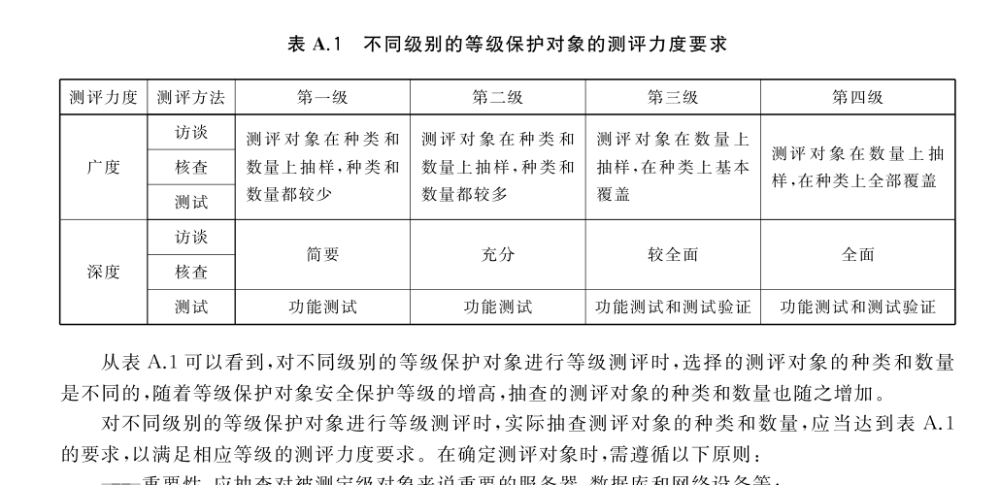

# GB/T 28448-2019 信息安全技术 网络安全等级保护测评要求

> 来源：[GB/T 28448-2019 国家标准详情](https://openstd.samr.gov.cn/bzgk/std/newGbInfo?hcno=7E736CDF4502B6FF1258DD250AA3EC8C)。
> PDF SHA-256：92ee85874bd4f252ddf8334514c92a8b42fc63e3a1f0b0e8b3378f8eb1aec180。
> 转写说明：将官方 PDF 全部页面渲染为图像并用图像识别核对文字、标题、列表和表格；省略页眉页脚及页码，合并跨页内容。表 A.1 保留去除页眉页脚及页码后的官方页面图像。正式引用请核对原页面图像。

> 转写核对注：原版 6.1.4.1.1 的判定写为“1）和4）”；8.1.7.3 的测评单元使用 L4 编号，9.1.8.3.3、9.1.10.6.6、9.1.10.13.1～9.1.10.13.2 及 B.4.3.12～B.4.3.13 使用 L3 编号；8.1.8.4.1 的第4）～6）项重复前文。7.1.3.5.2 的判定漏词、7.1.4.4.1 的“是未安装”、附录 B 的“静态脱密”等均按原版保留。

## 前言

本标准按照 GB/T 1.1—2009给出的规则起草。

本标准代替 GB/T 28448—2012《信息安全技术 信息系统安全等级保护测评要求》，与GB/T 28448—2012 相比，主要变化如下：

- 将标准名称变更为《信息安全技术 网络安全等级保护测评要求》；

- 每个级别增加了云计算安全测评扩展要求、移动互联安全测评扩展要求、物联网安全测评扩展要求和工业控制系统安全测评扩展要求等内容；

- 增加了等级测评、测评对象、云服务商和云服务客户等相关术语和定义（见第3章，2012年版的第3章）；

- 将针对控制点的单元测评细化调整为针对要求项的单项测评，删除了“测评框架”（见2012年版的4.1）和“等级测评内容”（见2012年版的4.2）；

- 增加了大数据可参考安全评估方法（见附录 B）和测评单元编号说明（见附录C）。

请注意本文件的某些内容可能涉及专利。本文件的发布机构不承担识别这些专利的责任。

本标准由全国信息安全标准化技术委员会（SAC/TC 260）提出并归口。

本标准起草单位：公安部第三研究所（公安部信息安全等级保护评估中心）、中国电子技术标准化研究院、国家信息中心、中国科学院信息工程研究所（信息安全国家重点实验室）、北京大学、新华三技术有限公司、成都科来软件有限公司、中国移动通信集团有限公司、北京鼎普科技股份有限公司、北京微步在线科技有限公司、北京梆梆安全科技有限公司、北京迅达云成科技有限公司、中国电子科技集团公司第十五研究所（信息产业信息安全测评中心）、公安部第一研究所、北京信息安全测评中心、国家能源局信息中心（电力行业信息安全等级保护测评中心）、全球能源互联网研究院、北京卓识网安技术股份有限公司、中国电力科学研究院、南京南瑞集团公司、国电南京自动化股份有限公司、南方电网科学研究院、中国电子信息产业集团公司第六研究所、工业和信息化部计算机与微电子发展研究中心（中国软件评测中心）、启明星辰信息技术集团股份有限公司、北京烽云互联科技有限公司、华普科工（北京）有限公司。

本标准主要起草人：陈广勇、李明、黎水林、马力、曲洁、于东升、艾春迪、郭启全、葛波蔚、祝国邦、陆磊、张宇翔、毕马宁、沙森森、李升、胡红升、陈雪鸿、袁静、章恒、张益、毛澍、王斌、尹湘培、王勇、高亚楠、焦安春、赵劲涛、于俊杰、徐衍龙、马晓波、江雷、黄顺京、朱建兴、苏艳芳、禄凯、何申、霍珊珊、于运涛、陈震、任卫红、孙惠平、万晓兰、马红霞、薛锋、赵林林、刘金刚、胡越宁、周晓雪、李亚军、杨洪起、孟召瑞、李飞、王江波、阚志刚、刘健、陶源、李秋香、许凤凯、王绍杰、李晨旸、李凌、朱世顺、张五一、陈华军、张清昕、张彪、李汪蔚、王雪、蔡学琳、胡娟、刘静、周峰、郝鑫、马闽、段伟恒。

本标准所代替标准的历次版本发布情况为：

- GB/T 28448—2012。

## 引言

为了配合《中华人民共和国网络安全法》的实施，同时适应云计算、移动互联、物联网和工业控制等新技术、新应用情况下网络安全等级保护工作的开展，需对GB/T 28448—2012进行修订。同时，作为测评指标进行引用的GB/T 22239—2008也启动了修订工作。修订的思路和方法依据GB/T 22239调整的内容，针对共性安全保护需求提出安全测评通用要求，针对云计算、移动互联、物联网和工业控制等新技术、新应用领域的个性安全保护需求提出安全测评扩展要求，形成新的《信息安全技术 网络安全等级保护测评要求》标准。

本标准是网络安全等级保护相关系列标准之一。

与本标准相关的标准包括：

- GB/T 25058 信息安全技术 信息系统安全等级保护实施指南；

- GB/T 22240 信息安全技术 信息系统安全等级保护定级指南；

- GB/T 22239 信息安全技术 网络安全等级保护基本要求；

- GB/T 25070 信息安全技术 网络安全等级保护安全设计技术要求；

- GB/T 28449 信息安全技术 网络安全等级保护测评过程指南。

## 1 范围

本标准规定了不同级别的等级保护对象的安全测评通用要求和安全测评扩展要求。

本标准适用于安全测评服务机构、等级保护对象的运营使用单位及主管部门对等级保护对象的安全状况进行安全测评并提供指南，也适用于网络安全职能部门进行网络安全等级保护监督检查时参考使用。

> 注：第五级等级保护对象是非常重要的监督管理对象，对其有特殊的管理模式和安全测评要求，所以不在本标准中进行描述。

## 2 规范性引用文件

下列文件对于本文件的应用是必不可少的。凡是注日期的引用文件，仅注日期的版本适用于本文件。凡是不注日期的引用文件，其最新版本（包括所有的修改单）适用于本文件。

GB 17859—1999 计算机信息系统 安全保护等级划分准则

- GB/T 22239—2019 信息安全技术 网络安全等级保护基本要求

- GB/T 25069 信息安全技术 术语

- GB/T 25070—2019 信息安全技术 网络安全等级保护安全设计技术要求

- GB/T 28449—2018 信息安全技术 网络安全等级保护测评过程指南

- GB/T 31167—2014 信息安全技术 云计算服务安全指南

- GB/T 31168—2014 信息安全技术 云计算服务安全能力要求

- GB/T 32919—2016 信息安全技术 工业控制系统安全控制应用指南

## 3 术语和定义

GB 17859—1999、GB/T 25069、GB/T 22239—2019、GB/T 25070—2019、GB/T 31167—2014、GB/T 31168—2014 和 GB/T32919—2016 界定的以及下列术语和定义适用于本文件。为了便于使用，以下重复列出了 GB/T 31167 —2014 和 GB/T 31168—2014中的一些术语和定义。

### 3.1 访谈 interview

测评人员通过引导等级保护对象相关人员进行有目的的（有针对性的）交流以帮助测评人员理解、澄清或取得证据的过程。

### 3.2 核查 examine

测评人员通过对测评对象（如制度文档、各类设备及相关安全配置等）进行观察、查验和分析，以帮助测评人员理解、澄清或取得证据的过程。

### 3.3 测试 test

测评人员使用预定的方法/工具使测评对象（各类设备或安全配置）产生特定的结果，将运行结果与预期的结果进行比对的过程。

### 3.4 评估 evaluate

对测评对象可能存在的威胁及其可能产生的后果进行综合评价和预测的过程。

### 3.5 测评对象 target of testing and evaluation

等级测评过程中不同测评方法作用的对象，主要涉及相关配套制度文档、设备设施及人员等。

### 3.6 等级测评 testing and evaluation for classified cybersecurity protection

测评机构依据国家网络安全等级保护制度规定，按照有关管理规范和技术标准，对非涉及国家秘密的网络安全等级保护状况进行检测评估的活动。

### 3.7 云服务商 cloud service provider

云计算服务的供应方。

> 注：云服务商管理、运营、支撑云计算的计算基础设施及软件，通过网络交付云计算的资源。

［GB/T 31167—2014，定义3.3］

### 3.8 云服务客户 cloud service customer

为使用云计算服务同云服务商建立业务关系的参与方。

［GB/T 31168—2014，定义3.4］

### 3.9 虚拟机监视器 hypervisor

运行在基础物理服务器和操作系统之间的中间软件层，可允许多个操作系统和应用共享硬件。

### 3.10 宿主机 host machine

运行虚拟机监视器的物理服务器。

## 4 缩略语

下列缩略语适用于本文件。

AP：无线访问接入点（Wireless Access Point）

APT：高级持续性威胁（Advanced Persistent Threat）

DDoS：分布式拒绝服务（Distributed Denial of Service）

SSID：服务集标识（Service Set Identifier）

WEP：有线等效加密（Wired Equivalent Privacy）

WiFi：无线保真（Wireless Fidelity）

WPS: WiFi 保护设置（Wi-Fi Protected Setup）

## 5 等级测评概述

### 5.1 等级测评方法

等级测评实施的基本方法是针对特定的测评对象，采用相关的测评手段，遵从一定的测评规程，获取需要的证据数据，给出是否达到特定级别安全保护能力的评判。等级测评实施的详细流程和方法见GB/T 28449—2018.本标准中针对每一个要求项的测评就构成一个单项测评，针对某个要求项的所有具体测评内容构成测评实施。单项测评中的每一个具体测评实施要求项（以下简称“测评要求项”）是与安全控制点下面所包括的要求项（测评指标）相对应的。在对每一要求项进行测评时，可能用到访谈、核查和测试三种测评方法，也可能用到其中一种或两种。测评实施的内容完全覆盖了 GB/T 22239—2019及GB/T 25070—2019中所有要求项的测评要求，使用时应当从单项测评的测评实施中抽取出对于GB/T 22239—2019中每一个要求项的测评要求，并按照这些测评要求开发测评指导书，以规范和指导等级测评活动。

根据调研结果，分析等级保护对象的业务流程和数据流，确定测评工作的范围。结合等级保护对象的安全级别，综合分析系统中各个设备和组件的功能和特性，从等级保护对象构成组件的重要性、安全性、共享性、全面性和恰当性等几方面属性确定技术层面的测评对象，并将与其相关的人员及管理文档确定为管理层面的测评对象。测评对象可以根据类别加以描述，包括机房、业务应用软件、主机操作系统、数据库管理系统、网络互联设备、安全设备、访谈人员及安全管理文档等。

等级测评活动中涉及测评力度，包括测评广度（覆盖面）和测评深度（强弱度）。安全保护等级较高的测评实施应选择覆盖面更广的测评对象和更强的测评手段，可以获得可信度更高的测评证据，测评力度的具体描述参见附录 A。

每个级别测评要求都包括安全测评通用要求、云计算安全测评扩展要求、移动互联安全测评扩展要求、物联网安全测评扩展要求和工业控制系统安全测评扩展要求5个部分。大数据可参考安全评估方法参见附录B。

### 5.2 单项测评和整体测评

等级测评包括单项测评和整体测评。

单项测评是针对各安全要求项的测评，支持测评结果的可重复性和可再现性。本标准中单项测评由测评指标、测评对象、测评实施和单元判定结果构成。为方便使用针对每个测评单元进行编号，具体描述见附录C。

整体测评是在单项测评基础上，对等级保护对象整体安全保护能力的判断。整体安全保护能力从纵深防护和措施互补两个角度评判。

## 6 第一级测评要求

### 6.1 安全测评通用要求

#### 6.1.1 安全物理环境

##### 6.1.1.1 物理访问控制

###### 6.1.1.1.1 测评单元（L1-PES1-01）

该测评单元包括以下要求：

<ol class="standard-subclauses">
<li>a） 测评指标：机房出入口应安排专人值守或配置电子门禁系统，控制、鉴别和记录进入的人员。
</li>
<li>b） 测评对象：机房电子门禁系统和值守记录。
</li>
<li>c） 测评实施：应核查是否安排专人值守或配置电子门禁系统。
</li>
<li>d） 单元判定：如果以上测评实施内容为肯定，则符合本测评单元指标要求，否则不符合本测评单元指标要求。
</li>
</ol>

##### 6.1.1.2 防盗窃和防破坏

###### 6.1.1.2.1 测评单元（L1-PES1-02）

该测评单元包括以下要求：

<ol class="standard-subclauses">
<li>a） 测评指标：应将设备或主要部件进行固定，并设置明显的不易除去的标识。
</li>
<li>b） 测评对象：机房设备或主要部件。
</li>
<li>c） 测评实施包括以下内容：
<ol class="standard-subclauses">
<li>1） 应核查机房内设备或主要部件是否固定；</li>
<li>2） 应核查机房内设备或主要部件上是否设置了明显且不易除去的标识。</li>
</ol>
</li>
<li>d） 单元判定：如果 1）和2）均为肯定，则符合本测评单元指标要求，否则不符合或部分符合本测评单元指标要求。
</li>
</ol>

##### 6.1.1.3 防雷击

###### 6.1.1.3.1 测评单元（L1-PES1-03）

该测评单元包括以下要求：

<ol class="standard-subclauses">
<li>a） 测评指标：应将各类机柜、设施和设备等通过接地系统安全接地。
</li>
<li>b） 测评对象：机房。
</li>
<li>c） 测评实施：应核查机房内机柜、设施和设备等是否进行接地处理。
</li>
<li>d） 单元判定：如果以上测评实施内容为肯定，则符合本测评单元指标要求，否则不符合本测评单元指标要求。
</li>
</ol>

##### 6.1.1.4 防火

###### 6.1.1.4.1 测评单元（L1-PES1-04）

该测评单元包括以下要求：

<ol class="standard-subclauses">
<li>a） 测评指标：机房应设置灭火设备。
</li>
<li>b） 测评对象：机房灭火设备。
</li>
<li>c） 测评实施：应核查机房内是否配备灭火设备。
</li>
<li>d） 单元判定：如果以上测评实施内容为肯定，则符合本测评单元指标要求，否则不符合本测评单元指标要求。
</li>
</ol>

##### 6.1.1.5 防水和防潮

###### 6.1.1.5.1 测评单元（L1-PES1-05）

该测评单元包括以下要求：

<ol class="standard-subclauses">
<li>a） 测评指标：应采取措施防止雨水通过机房窗户、屋顶和墙壁渗透。
</li>
<li>b） 测评对象：机房。
</li>
<li>c） 测评实施：应核查窗户、屋顶和墙壁是否采取了防雨水渗透的措施。
</li>
<li>d） 单元判定：如果以上测评实施内容为肯定，则符合本测评单元指标要求，否则不符合本测评单元指标要求。
</li>
</ol>

##### 6.1.1.6 温湿度控制

###### 6.1.1.6.1 测评单元（L1-PES1-06）

该测评单元包括以下要求：

<ol class="standard-subclauses">
<li>a） 测评指标：应设置必要的温湿度调节设施，使机房温湿度的变化在设备运行所允许的范围之内。
</li>
<li>b） 测评对象：机房温湿度控制设施。
</li>
<li>c） 测评实施包括以下内容：
<ol class="standard-subclauses">
<li>1） 应核查机房内是否配备了温湿度调节设施；</li>
<li>2） 应核查温湿度是否在设备运行所允许的范围之内。</li>
</ol>
</li>
<li>d） 单元判定：如果1）和 2）均为肯定，则符合本测评单元指标要求，否则不符合或部分符合本测评单元指标要求。
</li>
</ol>

##### 6.1.1.7 电力供应

###### 6.1.1.7.1 测评单元（L1-PES1-07）

该测评单元包括以下要求：

<ol class="standard-subclauses">
<li>a） 测评指标：应在机房供电线路上配置稳压器和过电压防护设备。
</li>
<li>b）测评对象：机房供电设施。
</li>
<li>c） 测评实施：应核查供电线路上是否配置了稳压器和过电压防护设备。
</li>
<li>d） 单元判定：如果以上测评实施内容为肯定，则符合本测评单元指标要求，否则不符合本测评单元指标要求。
</li>
</ol>

#### 6.1.2 安全通信网络

##### 6.1.2.1 通信传输

###### 6.1.2.1.1 测评单元（L1-CNS1-01）

该测评单元包括以下要求：

<ol class="standard-subclauses">
<li>a） 测评指标：应采用校验技术保证通信过程中数据的完整性。
</li>
<li>b） 测评对象：提供校验技术功能的设备或组件。
</li>
<li>c） 测评实施：应核查是否在数据传输过程中使用校验技术来保护其完整性。
</li>
<li>d） 单元判定：如果以上测评实施内容为肯定，则符合本测评单元指标要求，否则不符合本测评单元指标要求。
</li>
</ol>

##### 6.1.2.2 可信验证

###### 6.1.2.2.1 测评单元（L1-CNS1-02）

该测评单元包括以下要求：

<ol class="standard-subclauses">
<li>a） 测评指标：可基于可信根对通信设备的系统引导程序、系统程序等进行可信验证，并在检测到其可信性受到破坏后进行报警。
</li>
<li>b） 测评对象：提供可信验证的设备或组件。
</li>
<li>c） 测评实施包括以下内容：
<ol class="standard-subclauses">
<li>1） 应核查是否基于可信根对通信设备的系统引导程序、系统程序等进行可信验证；</li>
<li>2） 应核查当检测到通信设备的可信性受到破坏后是否进行报警。</li>
</ol>
</li>
<li>d） 单元判定：如果1）和2）均为肯定，则符合本测评单元指标要求，否则不符合或部分符合本测评单元指标要求。
</li>
</ol>

#### 6.1.3 安全区域边界

##### 6.1.3.1 边界防护

###### 6.1.3.1.1 测评单元（L1-ABS1-01）

该测评单元包括以下要求：

<ol class="standard-subclauses">
<li>a） 测评指标：应保证跨越边界的访问和数据流通过边界设备提供的受控接口进行通信。
</li>
<li>b） 测评对象：网闸、防火墙、路由器、交换机和无线接入网关设备等提供访问控制功能的设备或相关组件。
</li>
<li>c） 测评实施包括以下内容：
<ol class="standard-subclauses">
<li>1） 应核查在网络边界处是否部署访问控制设备；</li>
<li>2） 应核查设备配置信息是否指定端口进行跨越边界的网络通信，指定端口是否配置并启用了安全策略；</li>
<li>3） 应采用其他技术手段（如非法无线网络设备定位、核查设备配置信息等）核查是否不存在其他未受控端口进行跨越边界的网络通信。</li>
</ol>
</li>
<li>d） 单元判定：如果 1）～3）均为肯定，则符合本测评单元指标要求，否则不符合或部分符合本测评单元指标要求。
</li>
</ol>

##### 6.1.3.2 访问控制

###### 6.1.3.2.1 测评单元（L1-ABS1-02）

该测评单元包括以下要求：

<ol class="standard-subclauses">
<li>a） 测评指标：应在网络边界根据访问控制策略设置访问控制规则，默认情况下除允许通信外受控接口拒绝所有通信。
</li>
<li>b） 测评对象：网闸、防火墙、路由器、交换机和无线接入网关设备等提供访问控制功能的设备或相关组件。
</li>
<li>c） 测评实施包括以下内容：
<ol class="standard-subclauses">
<li>1） 应核查在网络边界是否部署访问控制设备并启用访问控制策略；</li>
<li>2） 应核查设备的最后一条访问控制策略是否为禁止所有网络通信。</li>
</ol>
</li>
<li>d） 单元判定：如果 1）和 2）均为肯定，则符合本测评单元指标要求，否则不符合或部分符合本测评单元指标要求。
</li>
</ol>

###### 6.1.3.2.2 测评单元（L1-ABS1-03）

该测评单元包括以下要求：

<ol class="standard-subclauses">
<li>a） 测评指标：应删除多余或无效的访问控制规则，优化访问控制列表，并保证访问控制规则数量最小化。
</li>
<li>b） 测评对象：网闸、防火墙、路由器、交换机和无线接入网关设备等提供访问控制功能的设备或相关组件。
</li>
<li>c） 测评实施包括以下内容：
<ol class="standard-subclauses">
<li>1） 应核查是否不存在多余或无效的访问控制策略；</li>
<li>2） 应核查不同的访问控制策略之间的逻辑关系及前后排列顺序是否合理。</li>
</ol>
</li>
<li>d） 单元判定：如果1）和2）均为肯定，则符合本测评单元指标要求，否则不符合或部分符合本测评单元指标要求。
</li>
</ol>

###### 6.1.3.2.3 测评单元（L1-ABS1-04）

该测评单元包括以下要求：

<ol class="standard-subclauses">
<li>a） 测评指标：应对源地址、目的地址、源端口、目的端口和协议等进行检查，以允许/拒绝数据包进出。
</li>
<li>b） 测评对象：网闸、防火墙、路由器、交换机和无线接入网关设备等提供访问控制功能的设备或相关组件。
</li>
<li>c） 测评实施：应核查设备的访问控制策略中是否设定了源地址、目的地址、源端口、目的端口和协议等相关配置参数。
</li>
<li>d） 单元判定：如果以上测评实施内容为肯定，则符合本测评单元指标要求，否则不符合本测评单元指标要求。
</li>
</ol>

##### 6.1.3.3 可信验证

###### 6.1.3.3.1 测评单元（L1-ABS1-05）

该测评单元包括以下要求：

<ol class="standard-subclauses">
<li>a） 测评指标：可基于可信根对边界设备的系统引导程序、系统程序等进行可信验证，并在检测到其可信性受到破坏后进行报警。
</li>
<li>b） 测评对象：提供可信验证的设备或组件。
</li>
<li>c） 测评实施包括以下内容：
<ol class="standard-subclauses">
<li>1） 应核查是否基于可信根对边界设备的系统引导程序、系统程序等进行可信验证；</li>
<li>2） 应核查当检测到边界设备的可信性受到破坏后是否进行报警。</li>
</ol>
</li>
<li>d） 单元判定：如果1）和2）均为肯定，则符合本测评单元指标要求，否则不符合或部分符合本测评单元指标要求。
</li>
</ol>

#### 6.1.4 安全计算环境

##### 6.1.4.1 身份鉴别

###### 6.1.4.1.1 测评单元（L1-CES1-01）

该测评单元包括以下要求：

<ol class="standard-subclauses">
<li>a） 测评指标：应对登录的用户进行身份标识和鉴别，身份标识具有唯一性，身份鉴别信息具有复杂度要求并定期更换。
</li>
<li>b） 测评对象：终端和服务器等设备中的操作系统（包括宿主机和虚拟机操作系统）、网络设备（包括虚拟网络设备）、安全设备（包括虚拟安全设备）、移动终端、移动终端管理系统、移动终端管理客户端、感知节点设备、网关节点设备、控制设备、业务应用系统、数据库管理系统、中间件和系统管理软件及系统设计文档等。
</li>
<li>c） 测评实施包括以下内容：
<ol class="standard-subclauses">
<li>1） 应核查用户在登录时是否采用了身份鉴别措施；</li>
<li>2） 应核查用户列表确认用户身份标识是否具有唯一性；</li>
<li>3） 应核查用户配置信息是否不存在空口令用户；</li>
<li>4） 应核查用户鉴别信息是否具有复杂度要求并定期更换。</li>
</ol>
</li>
<li>d） 单元判定：如果 1）和 4）均为肯定，则符合本测评单元指标要求，否则不符合或部分符合本测评单元指标要求。
</li>
</ol>

###### 6.1.4.1.2 测评单元（L1-CES1-02）

该测评单元包括以下要求：

<ol class="standard-subclauses">
<li>a） 测评指标：应具有登录失败处理功能，应配置并启用结束会话、限制非法登录次数和当登录连接超时自动退出等相关措施。
</li>
<li>b） 测评对象：终端和服务器等设备中的操作系统（包括宿主机和虚拟机操作系统）、网络设备（包括虚拟网络设备）、安全设备（包括虚拟安全设备）、移动终端、移动终端管理系统、移动终端管理客户端、感知节点设备、网关节点设备、控制设备、业务应用系统、数据库管理系统、中间件和系统管理软件及系统设计文档等。
</li>
<li>c） 测评实施包括以下内容：
<ol class="standard-subclauses">
<li>1） 应核查是否配置并启用了登录失败处理功能；</li>
<li>2） 应核查是否配置并启用了限制非法登录功能，非法登录达到一定次数后采取特定动作，如账户锁定等；</li>
<li>3） 应核查是否配置并启用了登录连接超时及自动退出功能。</li>
</ol>
</li>
<li>d） 单元判定：如果1）～3）均为肯定，则符合本测评单元指标要求，否则不符合或部分符合本测评单元指标要求。
</li>
</ol>

##### 6.1.4.2 访问控制

###### 6.1.4.2.1 测评单元（L1-CES1-03）

该测评单元包括以下要求：

<ol class="standard-subclauses">
<li>a） 测评指标：应对登录的用户分配账户和权限。
</li>
<li>b） 测评对象：终端和服务器等设备中的操作系统（包括宿主机和虚拟机操作系统）、网络设备（包括虚拟网络设备）、安全设备（包括虚拟安全设备）、移动终端、移动终端管理系统、移动终端管理客户端、感知节点设备、网关节点设备、控制设备、业务应用系统、数据库管理系统、中间件和系统管理软件及系统设计文档等。
</li>
<li>c） 测评实施包括以下内容：
<ol class="standard-subclauses">
<li>1） 应核查用户账户和权限设置情况；</li>
<li>2） 应核查是否已禁用或限制匿名、默认账户的访问权限。</li>
</ol>
</li>
<li>d） 单元判定：如果1）和2）均为肯定，则符合本测评单元指标要求，否则不符合或部分符合本测评单元指标要求。
</li>
</ol>

###### 6.1.4.2.2 测评单元（L1-CES1-04）

该测评单元包括以下要求：

<ol class="standard-subclauses">
<li>a） 测评指标：应重命名或删除默认账户，修改默认账户的默认口令。
</li>
<li>b） 测评对象：终端和服务器等设备中的操作系统（包括宿主机和虚拟机操作系统）、网络设备（包括虚拟网络设备）、安全设备（包括虚拟安全设备）、移动终端、移动终端管理系统、移动终端管理客户端、感知节点设备、网关节点设备、控制设备、业务应用系统、数据库管理系统、中间件和系统管理软件及系统设计文档等。
</li>
<li>c） 测评实施包括以下内容：
<ol class="standard-subclauses">
<li>1） 应核查是否已经重命名默认账户或默认账户已被删除；</li>
<li>2） 应核查是否已修改默认账户的默认口令。</li>
</ol>
</li>
<li>d） 单元判定：如果1）或2）为肯定，则符合本测评单元指标要求，否则不符合或部分符合本测评单元指标要求。
</li>
</ol>

###### 6.1.4.2.3 测评单元（L1-CES1-05）

该测评单元包括以下要求：

<ol class="standard-subclauses">
<li>a） 测评指标：应及时删除或停用多余的、过期的账户，避免共享账户的存在。
</li>
<li>b）测评对象：终端和服务器等设备中的操作系统（包括宿主机和虚拟机操作系统）、网络设备（包括虚拟网络设备）、安全设备（包括虚拟安全设备）、移动终端、移动终端管理系统、移动终端管理客户端、感知节点设备、网关节点设备、控制设备、业务应用系统、数据库管理系统、中间件和系统管理软件及系统设计文档等。
</li>
<li>c） 测评实施包括以下内容：
<ol class="standard-subclauses">
<li>1） 应核查是否不存在多余或过期账户，管理员用户与账户之间是否一一对应；</li>
<li>2） 应核查多余的、过期的账户是否被删除或停用。</li>
</ol>
</li>
<li>d） 单元判定：如果1）和2）均为肯定，则符合本测评单元指标要求，否则不符合或部分符合本测评单元指标要求。
</li>
</ol>

##### 6.1.4.3 入侵防范

###### 6.1.4.3.1 测评单元（L1-CES1-06）

该测评单元包括以下要求：

<ol class="standard-subclauses">
<li>a） 测评指标：应遵循最小安装的原则，仅安装需要的组件和应用程序。
</li>
<li>b） 测评对象：终端和服务器等设备中的操作系统（包括宿主机和虚拟机操作系统）、网络设备（包括虚拟网络设备）、安全设备（包括虚拟安全设备）、移动终端、移动终端管理系统、移动终端管理客户端、感知节点设备、网关节点设备和控制设备等。
</li>
<li>c） 测评实施包括以下内容：
<ol class="standard-subclauses">
<li>1） 应核查是否遵循最小安装原则；</li>
<li>2） 应确认是否未安装非必要的组件和应用程序。</li>
</ol>
</li>
<li>d） 单元判定：如果1）和2）均为肯定，则符合本测评单元指标要求，否则不符合或部分符合本测评单元指标要求。
</li>
</ol>

###### 6.1.4.3.2 测评单元（L1-CES1-07）

该测评单元包括以下要求：

<ol class="standard-subclauses">
<li>a） 测评指标：应关闭不需要的系统服务、默认共享和高危端口。
</li>
<li>b） 测评对象：终端和服务器等设备中的操作系统（包括宿主机和虚拟机操作系统）、网络设备（包括虚拟网络设备）、安全设备（包括虚拟安全设备）、移动终端、移动终端管理系统、移动终端管理客户端、感知节点设备、网关节点设备和控制设备等。
</li>
<li>c） 测评实施包括以下内容：
<ol class="standard-subclauses">
<li>1） 应核查是否关闭了非必要的系统服务和默认共享；</li>
<li>2） 应核查是否不存在非必要的高危端口。</li>
</ol>
</li>
<li>d） 单元判定：如果1）和2）均为肯定，则符合本测评单元指标要求，否则不符合或部分符合本测评单元指标要求。
</li>
</ol>

##### 6.1.4.4 恶意代码防范

###### 6.1.4.4.1 测评单元（L1-CES1-08）

该测评单元包括以下要求：

<ol class="standard-subclauses">
<li>a） 测评指标：应安装防恶意代码软件或配置具有相应功能的软件，并定期进行升级和更新防恶意代码库。
</li>
<li>b） 测评对象：终端和服务器等设备中的操作系统（包括宿主机和虚拟机操作系统）和移动终端等。
</li>
<li>c） 测评实施内容包括以下：
<ol class="standard-subclauses">
<li>1） 应核查是否安装了防恶意代码软件或相应功能的软件；</li>
<li>2） 应核查是否定期进行升级和更新防恶意代码库。</li>
</ol>
</li>
<li>d） 单元判定：如果 1）和2）均为肯定，则符合本测评单元指标要求，否则不符合或部分符合本测评单元指标要求。
</li>
</ol>

##### 6.1.4.5 可信验证

###### 6.1.4.5.1 测评单元（L1-CES1-09）

该测评单元包括以下要求：

<ol class="standard-subclauses">
<li>a） 测评指标：可基于可信根对计算设备的系统引导程序、系统程序等进行可信验证，并在检测到其可信性受到破坏后进行报警。
</li>
<li>b） 测评对象：提供可信验证的设备或组件。
</li>
<li>c） 测评实施包括以下内容：
<ol class="standard-subclauses">
<li>1） 应核查是否基于可信根对计算设备的系统引导程序、系统程序等进行可信验证；</li>
<li>2） 应核查当检测到计算设备的可信性受到破坏后是否进行报警。</li>
</ol>
</li>
<li>d） 单元判定：如果 1）和 2）均为肯定，则符合本测评单元指标要求，否则不符合或部分符合本测评单元指标要求。
</li>
</ol>

##### 6.1.4.6 数据完整性

###### 6.1.4.6.1 测评单元（L1-CES1-10）

该测评单元包括以下要求：

<ol class="standard-subclauses">
<li>a） 测评指标：应采用校验技术保证重要数据在传输过程中的完整性。
</li>
<li>b） 测评对象：业务应用系统、数据库管理系统、中间件和系统管理软件及系统设计文档等。
</li>
<li>c） 测评实施：应核查系统设计文档，重要管理数据、重要业务数据在传输过程中是否采用了校验技术或密码技术保证完整性。
</li>
<li>d）单元判定：如果以上测评实施内容为肯定，则符合本测评单元指标要求，否则不符合本测评单元指标要求。
</li>
</ol>

##### 6.1.4.7 数据备份恢复

###### 6.1.4.7.1 测评单元（L1-CES1-11）

该测评单元包括以下要求：

<ol class="standard-subclauses">
<li>a） 测评指标：应提供重要数据的本地数据备份与恢复功能。
</li>
<li>b） 测评对象：配置数据和业务数据。
</li>
<li>c） 测评实施包括以下内容：
<ol class="standard-subclauses">
<li>1） 应核查是否按照备份策略进行本地备份；</li>
<li>2） 应核查备份策略设置是否合理、配置是否正确；</li>
<li>3） 应核查备份结果是否与备份策略一致；</li>
<li>4） 应核查近期恢复测试记录，是否能够进行正常的数据恢复。</li>
</ol>
</li>
<li>d） 单元判定：如果 1）～4）均为肯定，则符合本测评单元指标要求，否则不符合或部分符合本测评单元指标要求。
</li>
</ol>

#### 6.1.5 安全管理制度

##### 6.1.5.1 管理制度

###### 6.1.5.1.1 测评单元（L1-PSS1-01）

该测评单元包括以下要求：

<ol class="standard-subclauses">
<li>a） 测评指标：应建立日常管理活动中常用的安全管理制度。
</li>
<li>b） 测评对象：安全管理制度类文档。
</li>
<li>c） 测评实施：应核查各项安全管理制度是否覆盖日常管理活动中的管理内容。
</li>
<li>d） 单元判定：如果以上测评实施内容为肯定，则符合本测评单元指标要求，否则不符合本测评单元指标要求。
</li>
</ol>

#### 6.1.6 安全管理机构

##### 6.1.6.1 岗位设置

###### 6.1.6.1.1 测评单元（L1-ORS1-01） {#61611-测评单元l1-0rs1-01}

该测评单元包括以下要求：

<ol class="standard-subclauses">
<li>a） 测评指标：应设立系统管理员等岗位，并定义各个工作岗位的职责。
</li>
<li>b） 测评对象：信息/网络安全主管和管理制度类文档。
</li>
<li>c） 测评实施包括以下内容：
<ol class="standard-subclauses">
<li>1） 应访谈信息/网络安全主管是否进行了系统管理员等岗位的划分；</li>
<li>2） 应核查岗位职责文档是否明确了各岗位职责。</li>
</ol>
</li>
<li>d） 单元判定：如果 1）和2）均为肯定，则符合本测评单元指标要求，否则不符合或部分符合本测评单元指标要求。
</li>
</ol>

##### 6.1.6.2 人员配备

###### 6.1.6.2.1 测评单元（L1-ORS1-02） {#61621-测评单元l1-0rs1-02}

该测评单元包括以下要求：

<ol class="standard-subclauses">
<li>a） 测评指标：应配备一定数量的系统管理员。
</li>
<li>b） 测评对象：信息/网络安全主管和记录表单类文档。
</li>
<li>c） 测评实施包括以下内容：
<ol class="standard-subclauses">
<li>1） 应访谈信息/网络安全主管是否配备一定数量的系统管理员；</li>
<li>2） 应核查人员配备文档是否有各岗位人员配备情况。</li>
</ol>
</li>
<li>d） 单元判定：如果1）和2）均为肯定，则符合本测评单元指标要求，否则不符合或部分符合本测评单元指标要求。
</li>
</ol>

##### 6.1.6.3 授权和审批

###### 6.1.6.3.1 测评单元（L1-ORS1-03） {#61631-测评单元l1-0rs1-03}

该测评单元包括以下要求：

<ol class="standard-subclauses">
<li>a） 测评指标：应根据各个部门和岗位的职责明确授权审批事项、审批部门和批准入等。
</li>
<li>b） 测评对象：管理制度类文档和记录表单类文档。
</li>
<li>c） 测评实施包括以下内容：
<ol class="standard-subclauses">
<li>1） 应核查部门职责文档是否明确各部门审批事项；</li>
<li>2） 应核查岗位职责文档是否明确各岗位审批事项。</li>
</ol>
</li>
<li>d） 单元判定：如果1）和2）均为肯定，则符合本测评单元指标要求，否则不符合或部分符合本测评单元指标要求。
</li>
</ol>

#### 6.1.7 安全管理人员

##### 6.1.7.1 人员录用

###### 6.1.7.1.1 测评单元（L1-HRS1-01）

该测评单元包括以下要求：

<ol class="standard-subclauses">
<li>a） 测评指标：应指定或授权专门的部门或人员负责人员录用。
</li>
<li>b） 测评对象：信息/网络安全主管。
</li>
<li>c） 测评实施：应访谈信息/网络安全主管是否由专门的部门或人员负责人员的录用工作。
</li>
<li>d） 单元判定：如果以上测评实施内容为肯定，则符合本测评单元指标要求，否则不符合本测评单元指标要求。
</li>
</ol>

##### 6.1.7.2 人员离岗

###### 6.1.7.2.1 测评单元（L1-HRS1-02）

该测评单元包括以下要求：

<ol class="standard-subclauses">
<li>a） 测评指标：应及时终止离岗人员的所有访问权限，取回各种身份证件、钥匙、徽章等以及机构提供的软硬件设备。
</li>
<li>b） 测评对象：记录表单类文档。
</li>
<li>c） 测评实施：应核查是否具有离岗人员终止其访问权限、交还身份证件、软硬件设备等的登记记录。
</li>
<li>d） 单元判定：如果以上测评实施内容为肯定，则符合本测评单元指标要求，否则不符合本测评单元指标要求。
</li>
</ol>

##### 6.1.7.3 安全意识教育和培训

###### 6.1.7.3.1 测评单元（L1-HRS1-03）

该测评单元包括以下要求：

<ol class="standard-subclauses">
<li>a） 测评指标：应对各类人员进行安全意识教育和岗位技能培训，并告知相关的安全责任和惩戒措施。
</li>
<li>b） 测评对象：管理制度类文档。
</li>
<li>c） 测评实施包括以下内容：
<ol class="standard-subclauses">
<li>1） 应核查安全意识教育及岗位技能培训文档是否明确培训周期、培训方式、培训内容和考核方式等相关内容；</li>
<li>2） 应核查安全责任和惩戒措施管理文档或培训文档是否包含具体的安全责任和惩戒措施。</li>
</ol>
</li>
<li>d） 单元判定：如果 1）和2）均为肯定，则符合本测评单元指标要求，否则不符合或部分符合本测评单元指标要求。
</li>
</ol>

##### 6.1.7.4 外部人员访问管理

###### 6.1.7.4.1 测评单元（L1-HRS1-04）

该测评单元包括以下要求：

<ol class="standard-subclauses">
<li>a） 测评指标：应保证在外部人员访问受控区域前得到授权或审批。
</li>
<li>b） 测评对象：管理制度类文档和记录表单类文档。
</li>
<li>c） 测评实施包括以下内容：
<ol class="standard-subclauses">
<li>1） 应核查外部人员访问管理文档是否明确允许外部人员访问的范围（区域、系统、设备、信息等内容），外部人员进入的条件（对哪些重要区域的访问须提出书面申请批准后方可进入），外部人员进入的访问控制措施（由专人全程陪同或监督等）等；</li>
<li>2） 应核查外部人员访问重要区域的书面申请文档是否具有批准入允许访问的批准签字等。</li>
</ol>
</li>
<li>d） 单元判定：如果1）和2）均为肯定，则符合本测评单元指标要求，否则不符合或部分符合本测评单元指标要求。
</li>
</ol>

#### 6.1.8 安全建设管理

##### 6.1.8.1 定级和备案

###### 6.1.8.1.1 测评单元（L1-CMS1-01）

该测评单元包括以下要求：

<ol class="standard-subclauses">
<li>a） 测评指标：应以书面的形式说明保护对象的安全保护等级及确定等级的方法和理由。
</li>
<li>b） 测评对象：记录表单类文档。
</li>
<li>c） 测评实施：应核查定级文档是否明确保护对象的安全保护等级，是否说明定级的方法和理由。
</li>
<li>d） 单元判定：如果以上测评实施内容为肯定，则符合本测评单元指标要求，否则不符合本测评单元指标要求。
</li>
</ol>

##### 6.1.8.2 安全方案设计

###### 6.1.8.2.1 测评单元（L1-CMS1-02）

该测评单元包括以下要求：

<ol class="standard-subclauses">
<li>a） 测评指标：应根据安全保护等级选择基本安全措施，依据风险分析的结果补充和调整安全措施。
</li>
<li>b） 测评对象：安全规划设计类文档。
</li>
<li>c） 测评实施：应核查安全设计文档是否根据安全保护等级选择安全措施，是否根据安全需求调整安全措施。
</li>
<li>d） 单元判定：如果以上测评实施内容为肯定，则符合本测评单元指标要求，否则不符合本测评单元指标要求。
</li>
</ol>

##### 6.1.8.3 产品采购和使用

###### 6.1.8.3.1 测评单元（L1-CMS1-03）

该测评单元包括以下要求：

<ol class="standard-subclauses">
<li>a） 测评指标：应确保网络安全产品采购和使用符合国家的有关规定。
</li>
<li>b） 测评对象：记录表单类文档。
</li>
<li>c） 测评实施：应核查有关网络安全产品是否符合国家的有关规定，如网络安全产品获得了销售许可等。
</li>
<li>d） 单元判定：如果以上测评实施内容为肯定，则符合本测评单元指标要求，否则不符合本测评单元指标要求。
</li>
</ol>

##### 6.1.8.4 工程实施

###### 6.1.8.4.1 测评单元（L1-CMS1-04）

该测评单元包括以下要求：

<ol class="standard-subclauses">
<li>a） 测评指标：应指定或授权专门的部门或人员负责工程实施过程的管理。
</li>
<li>b） 测评对象：记录表单类文档。
</li>
<li>c） 测评实施：应核查是否指定专门部门或人员对工程实施进行进度和质量控制。
</li>
<li>d） 单元判定：如果以上测评实施内容为肯定，则符合本测评单元指标要求，否则不符合本测评单元指标要求。
</li>
</ol>

##### 6.1.8.5 测试验收

###### 6.1.8.5.1 测评单元（L1-CMS1-05）

该测评单元包括以下要求：

<ol class="standard-subclauses">
<li>a） 测评指标：应进行安全性测试验收。
</li>
<li>b） 测评对象：建设负责人。
</li>
<li>c） 测评实施：应访谈建设负责人是否进行了安全性测试验收。
</li>
<li>d） 单元判定：如果以上测评内容为肯定，则符合本测评单元指标要求，否则不符合本测评单元指标要求。
</li>
</ol>

##### 6.1.8.6 系统交付

###### 6.1.8.6.1 测评单元（L1-CMS1-06）

该测评单元包括以下要求：

<ol class="standard-subclauses">
<li>a） 测评指标：应制定交付清单，并根据交付清单对所交接的设备、软件和文档等进行清点。
</li>
<li>b） 测评对象：记录表单类文档。
</li>
<li>c） 测评实施：应核查是否制定交付清单并说明交付的各类设备、软件、文档等。
</li>
<li>d）单元判定：如果以上测评实施内容为肯定，则符合本测评单元指标要求，否则不符合本测评单元指标要求。
</li>
</ol>

###### 6.1.8.6.2 测评单元（L1-CMS1-07）

该测评单元包括以下要求：

<ol class="standard-subclauses">
<li>a） 测评指标：应对负责运行维护的技术人员进行相应的技能培训。
</li>
<li>b）测评对象：记录表单类文档。
</li>
<li>c） 测评实施：应核查交付技术培训记录是否包括培训内容、培训时间和参与人员等。
</li>
<li>d） 单元判定：如果以上测评实施内容为肯定，则符合本测评单元指标要求，否则不符合本测评单元指标要求。
</li>
</ol>

##### 6.1.8.7 服务供应商管理

###### 6.1.8.7.1 测评单元（L1-CMS1-08）

该测评单元包括以下要求：

<ol class="standard-subclauses">
<li>a） 测评指标：应确保服务供应商的选择符合国家的有关规定。
</li>
<li>b） 测评对象：建设负责人。
</li>
<li>c） 测评实施：应访谈建设负责人选择的安全服务商是否符合国家有关规定。
</li>
<li>d） 单元判定：如果以上测评实施内容为肯定，则符合本测评单元指标要求，否则不符合本测评单元指标要求。
</li>
</ol>

###### 6.1.8.7.2 测评单元（L1-CMS1-09）

该测评单元包括以下要求：

<ol class="standard-subclauses">
<li>a） 测评指标：应与选定的服务供应商签订与安全相关的协议，明确约定相关责任。
</li>
<li>b） 测评对象：记录表单类文档。
</li>
<li>c） 测评实施：应核查是否具有与服务供应商签订的服务合同或安全责任书，是否明确了相关责任。
</li>
<li>d） 单元判定：如果以上测评实施内容为肯定，则符合本测评单元指标要求，否则不符合本测评单元指标要求。
</li>
</ol>

#### 6.1.9 安全运维管理

##### 6.1.9.1 环境管理

###### 6.1.9.1.1 测评单元（L1-MMS1-01）

该测评单元包括以下要求：

<ol class="standard-subclauses">
<li>a） 测评指标：应指定专门的部门或人员负责机房安全，对机房出入进行管理，定期对机房供配电、空调、温湿度控制、消防等设施进行维护管理。
</li>
<li>b） 测评对象：物理安全负责人和记录表单类文档。
</li>
<li>c） 测评实施包括以下内容：
<ol class="standard-subclauses">
<li>1） 应访谈物理安全负责人是否指定部门和人员负责机房安全管理工作，对机房的出入进行管理、对基础设施（如空调、供配电设备、灭火设备等）进行定期维护；</li>
<li>2） 应核查部门或人员岗位职责文档是否明确机房安全的责任部门及人员。</li>
</ol>
</li>
<li>d） 单元判定：如果 1）和2）均为肯定，则符合本测评单元指标要求，否则不符合或部分符合本测评单元指标要求。
</li>
</ol>

###### 6.1.9.1.2 测评单元（L1-MMS1-02）

该测评单元包括以下要求：

<ol class="standard-subclauses">
<li>a） 测评指标：应对机房的安全管理做出规定，包括物理访问、物品进出和环境安全等方面。
</li>
<li>b） 测评对象：管理制度类文档和记录表单类文档。
</li>
<li>c） 测评实施包括以下内容：
<ol class="standard-subclauses">
<li>1） 应核查机房安全管理制度是否覆盖物理访问、物品进出和环境安全等方面内容；</li>
<li>2） 应核查物理访问、物品进出和环境安全等的相关记录是否与制度相符。</li>
</ol>
</li>
<li>d） 单元判定：如果 1）和 2）均为肯定，则符合本测评单元指标要求，否则不符合或部分符合本测评单元指标要求。
</li>
</ol>

##### 6.1.9.2 介质管理

###### 6.1.9.2.1 测评单元（L1-MMS1-03）

该测评单元包括以下要求：

<ol class="standard-subclauses">
<li>a） 测评指标：应将介质存放在安全的环境中，对各类介质进行控制和保护，实行存储介质专人管理，并根据存档介质的目录清单定期盘点。
</li>
<li>b） 测评对象：资产管理员和记录表单类文档。
</li>
<li>c） 测评实施包括以下内容：
<ol class="standard-subclauses">
<li>1） 应访谈资产管理员介质存放环境是否安全，存放环境是否由专人管理；</li>
<li>2） 应核查介质管理记录是否记录介质归档、使用和定期盘点等情况。</li>
</ol>
</li>
<li>d） 单元判定：如果 1）和2）均为肯定，则符合本测评单元指标要求，否则不符合或部分符合本测评单元指标要求。
</li>
</ol>

##### 6.1.9.3 设备维护管理

###### 6.1.9.3.1 测评单元（L1-MMS1-04）

该测评单元包括以下要求：

<ol class="standard-subclauses">
<li>a） 测评指标：应对各种设备（包括备份和冗余设备）、线路等指定专门的部门或人员定期进行维护管理。
</li>
<li>b） 测评对象：设备管理员和管理制度类文档。
</li>
<li>c） 测评实施包括以下内容：
<ol class="standard-subclauses">
<li>1） 应访谈设备管理员是否对各类设备、线路指定专人或专门部门进行定期维护；</li>
<li>2） 应核查部门或人员岗位职责文档是否明确设备维护管理的责任部门。</li>
</ol>
</li>
<li>d） 单元判定：如果 1）和 2）均为肯定，则符合本测评单元指标要求，否则不符合或部分符合本测评单元指标要求。
</li>
</ol>

##### 6.1.9.4 漏洞和风险管理

###### 6.1.9.4.1 测评单元（L1-MMS1-05）

该测评单元包括以下要求：

<ol class="standard-subclauses">
<li>a） 测评指标：应采取必要的措施识别安全漏洞和隐患，对发现的安全漏洞和隐患及时进行修补或评估可能的影响后进行修补。
</li>
<li>b） 测评对象：记录表单类文档。
</li>
<li>c） 测评实施包括以下内容：
<ol class="standard-subclauses">
<li>1） 应核查是否有识别安全漏洞和隐患的安全报告或记录（如漏洞扫描报告、渗透测试报告和安全通报等）；</li>
<li>2） 应核查相关记录是否对发现的漏洞及时进行修补或评估可能的影响后进行修补。</li>
</ol>
</li>
<li>d） 单元判定：如果 1）和 2）均为肯定，则符合本测评单元指标要求，否则不符合或部分符合本测评单元指标要求。
</li>
</ol>

##### 6.1.9.5 网络和系统安全管理

###### 6.1.9.5.1 测评单元（L1-MMS1-06）

该测评单元包括以下要求：

<ol class="standard-subclauses">
<li>a） 测评指标：应划分不同的管理员角色进行网络和系统的运维管理，明确各个角色的责任和权限。
</li>
<li>b） 测评对象：记录表单类文档。
</li>
<li>c） 测评实施：应核查网络和系统安全管理文档，是否划分了网络和系统管理员等不同角色，并定义各个角色的责任和权限。
</li>
<li>d） 单元判定：如果以上测评实施内容为肯定，则符合本测评单元指标要求，否则不符合本测评单元指标要求。
</li>
</ol>

###### 6.1.9.5.2 测评单元（L1-MMS1-07）

该测评单元包括以下要求：

<ol class="standard-subclauses">
<li>a） 测评指标：应指定专门的部门或人员进行账户管理，对申请账户、建立账户、删除账户等进行控制。
</li>
<li>b） 测评对象：运维负责人和记录表单类文档。
</li>
<li>c） 测评实施包括以下内容：
<ol class="standard-subclauses">
<li>1） 应访谈运维负责人是否指定专门的部门或人员进行账户管理；</li>
<li>2） 应核查相关审批记录或流程是否对申请账户、建立账户、删除账户等进行控制。</li>
</ol>
</li>
<li>d） 单元判定：如果 1）和2）均为肯定，则符合本测评单元指标要求，否则不符合或部分符合本测评单元指标要求。
</li>
</ol>

##### 6.1.9.6 恶意代码防范管理

###### 6.1.9.6.1 测评单元（L1-MMS1-08）

该测评单元包括以下要求：

<ol class="standard-subclauses">
<li>a） 测评指标：应提高所有用户的防恶意代码意识，对外来计算机或存储设备接入系统前进行恶意代码检查等。
</li>
<li>b） 测评对象：运维负责人和管理制度类文档。
</li>
<li>c） 测评实施包括以下内容：
<ol class="standard-subclauses">
<li>1） 应访谈运维负责人是否采取培训和告知等方式提升员工的防恶意代码意识；</li>
<li>2） 应核查恶意代码防范管理制度是否明确对外来计算机或存储设备接入系统前进行恶意代码检查。</li>
</ol>
</li>
<li>d） 单元判定：如果 1）和2）均为肯定，则符合本测评单元指标要求，否则不符合或部分符合本测评单元指标要求。
</li>
</ol>

###### 6.1.9.6.2 测评单元（L1-MMS1-09）

该测评单元包括以下要求：

<ol class="standard-subclauses">
<li>a） 测评指标：应对恶意代码防范要求做出规定，包括防恶意代码软件的授权使用、恶意代码库升级、恶意代码的定期查杀等。
</li>
<li>b） 测评对象：管理制度类文档。
</li>
<li>c） 测评实施：应核查恶意代码防范管理制度是否包括防恶意代码软件的授权使用、恶意代码库升级、定期查杀等内容。
</li>
<li>d） 单元判定：如果以上测评实施内容为肯定，则符合本测评单元指标要求，否则不符合本测评单元指标要求。
</li>
</ol>

##### 6.1.9.7 备份与恢复管理

###### 6.1.9.7.1 测评单元（L1-MMS1-10）

该测评单元包括以下要求：

<ol class="standard-subclauses">
<li>a） 测评指标：应识别需要定期备份的重要业务信息、系统数据及软件系统等。
</li>
<li>b） 测评对象：系统管理员和管理制度类文档。
</li>
<li>c） 测评实施包括以下内容：
<ol class="standard-subclauses">
<li>1） 应访谈系统管理员有哪些需定期备份的业务信息、系统数据及软件系统；</li>
<li>2） 应核查是否具有定期备份的重要业务信息、系统数据、软件系统的列表或清单。</li>
</ol>
</li>
<li>d） 单元判定：如果1）和2）均为肯定，则符合本测评单元指标要求，否则不符合或部分符合本测评单元指标要求。
</li>
</ol>

###### 6.1.9.7.2 测评单元（L1-MMS1-11）

该测评单元包括以下要求：

<ol class="standard-subclauses">
<li>a） 测评指标：应规定备份信息的备份方式、备份频度、存储介质、保存期等。
</li>
<li>b） 测评对象：管理制度类文档。
</li>
<li>c） 测评实施：应核查备份与恢复管理制度是否明确备份方式、频度、介质、保存期等内容。
</li>
<li>d） 单元判定：如果以上测评实施内容为肯定，则符合本测评单元指标要求，否则不符合本测评单元指标要求。
</li>
</ol>

##### 6.1.9.8 安全事件处置

###### 6.1.9.8.1 测评单元（L1-MMS1-12）

该测评单元包括以下要求：

<ol class="standard-subclauses">
<li>a） 测评指标：应及时向安全管理部门报告所发现的安全弱点和可疑事件。
</li>
<li>b） 测评对象：运维负责人和管理制度类文档。
</li>
<li>c） 测评实施包括以下内容：
<ol class="standard-subclauses">
<li>1） 应访谈运维负责人是否告知用户在发现安全弱点和可疑事件时及时向安全管理部门报告；</li>
<li>2） 应核查在发现安全弱点和可疑事件后是否具备对应的报告或相关文档。</li>
</ol>
</li>
<li>d） 单元判定：如果 1）和2）均为肯定，则符合本测评单元指标要求，否则不符合或部分符合本测评单元指标要求。
</li>
</ol>

###### 6.1.9.8.2 测评单元（L1-MMS1-13）

该测评单元包括以下要求：

<ol class="standard-subclauses">
<li>a） 测评指标：应明确安全事件的报告和处置流程，规定安全事件的现场处理、事件报告和后期恢复的管理职责。
</li>
<li>b） 测评对象：管理制度类文档。
</li>
<li>c） 测评实施：应核查安全事件报告和处置流程是否明确了与安全事件有关的工作职责，包括报告单位（人）、接报单位（人）和处置单位等职责。
</li>
<li>d） 单元判定：如果以上测评实施内容为肯定，则符合本测评单元指标要求，否则不符合本测评单元指标要求。
</li>
</ol>

### 6.2 云计算安全测评扩展要求

#### 6.2.1 安全物理环境

##### 6.2.1.1 基础设施位置

###### 6.2.1.1.1 测评单元（L1-PES2-01）

该测评单元包括以下要求：

<ol class="standard-subclauses">
<li>a） 测评指标：应保证云计算基础设施位于中国境内。
</li>
<li>b） 测评对象：机房管理员、办公场地、机房和平台建设方案。
</li>
<li>c） 测评实施包括以下内容：
<ol class="standard-subclauses">
<li>1） 应访谈机房管理员云计算服务器、存储设备、网络设备、云管理平台、信息系统等运行业务和承载数据的软硬件是否均位于中国境内；</li>
<li>2） 应核查云计算平台建设方案，云计算服务器、存储设备、网络设备、云管理平台、信息系统等运行业务和承载数据的软硬件是否均位于中国境内。</li>
</ol>
</li>
<li>d） 单元判定：如果 1）和2）均为肯定，则符合本单元测评指标要求，否则不符合或部分符合本单元测评指标要求。
</li>
</ol>

#### 6.2.2 安全通信网络

##### 6.2.2.1 网络架构

###### 6.2.2.1.1 测评单元（L1-CNS2-01）

该测评单元包括以下要求：

<ol class="standard-subclauses">
<li>a） 测评指标：应保证云计算平台不承载高于其安全保护等级的业务应用系统。
</li>
<li>b） 测评对象：云计算平台和业务应用系统定级备案材料。
</li>
<li>c） 测评实施：应核查云计算平台和云计算平台承载的业务应用系统相关定级备案材料，云计算平台安全保护等级是否不低于其承载的业务应用系统安全保护等级。
</li>
<li>d） 单元判定：如果以上测评实施内容为肯定，则符合本单元测评指标要求，否则不符合本单元测评指标要求。
</li>
</ol>

###### 6.2.2.1.2 测评单元（L1-CNS2-02）

该测评单元包括以下要求：

<ol class="standard-subclauses">
<li>a） 测评指标：应实现不同云服务客户虚拟网络之间的隔离。
</li>
<li>b） 测评对象：网络资源隔离措施、综合网管系统和云管理平台。
</li>
<li>c） 测评实施包括以下内容：
<ol class="standard-subclauses">
<li>1） 应核查云服务客户之间是否采取网络隔离措施；</li>
<li>2） 应核查云服务客户之间是否设置并启用网络资源隔离策略。</li>
</ol>
</li>
<li>d） 单元判定：如果1）和2）均为肯定，则符合本单元测评指标要求，否则不符合或部分符合本单元测评指标要求。
</li>
</ol>

#### 6.2.3 安全区域边界

##### 6.2.3.1 访问控制

###### 6.2.3.1.1 测评单元（L1-ABS2-01）

该测评单元包括以下要求：

<ol class="standard-subclauses">
<li>a） 测评指标：应在虚拟化网络边界部署访问控制机制，并设置访问控制规则。
</li>
<li>b） 测评对象：访问控制机制、网络边界设备和虚拟化网络边界设备。
</li>
<li>c） 测评实施包括以下内容：
<ol class="standard-subclauses">
<li>1） 应核查是否在虚拟化网络边界部署访问控制机制，并设置访问控制规则；</li>
<li>2） 应核查是否设置了云计算平台和云服务客户业务系统虚拟化网络边界访问控制规则和访问控制策略等；</li>
<li>3） 应核查是否设置了云计算平台的网络边界设备或虚拟化网络边界设备安全保障机制、访问控制规则和访问控制策略等；</li>
<li>4） 应核查是否设置了不同云服务客户间访问控制规则和访问控制策略等；</li>
<li>5） 应核查是否设置了云服务客户不同安全保护等级业务系统之间访问控制规则和访问控制策略等。</li>
</ol>
</li>
<li>d） 单元判定：如果1）～5）均为肯定，则符合本单元测评指标要求，否则不符合或部分符合本单元测评指标要求。
</li>
</ol>

#### 6.2.4 安全计算环境

##### 6.2.4.1 访问控制

###### 6.2.4.1.1 测评单元（L1-CES2-01）

该测评单元包括以下要求：

<ol class="standard-subclauses">
<li>a） 测评指标：应保证当虚拟机迁移时，访问控制策略随其迁移。
</li>
<li>b） 测评对象：虚拟机、虚拟机迁移记录和相关配置。
</li>
<li>c） 测评实施包括以下内容：
<ol class="standard-subclauses">
<li>1） 应核查虚拟机迁移时访问控制策略是否随之迁移；</li>
<li>2） 应核查是否具备虚拟机迁移记录及相关配置。</li>
</ol>
</li>
<li>d） 单元判定：如果1）和2）均为肯定，则符合本单元测评指标要求，否则不符合或部分符合本单元测评指标要求。
</li>
</ol>

###### 6.2.4.1.2 测评单元（L1-CES2-02）

该测评单元包括以下要求：

<ol class="standard-subclauses">
<li>a） 测评指标：应允许云服务客户设置不同虚拟机之间的访问控制策略。
</li>
<li>b） 测评对象：虚拟机和安全组或相关组件。
</li>
<li>c） 测评实施：应核查云服务客户是否能够设置不同虚拟机之间访问控制策略。
</li>
<li>d） 单元判定：如果以上测评实施内容为肯定，则符合本单元测评指标要求，否则不符合本单元测评指标要求。
</li>
</ol>

##### 6.2.4.2 数据完整性和保密性

###### 6.2.4.2.1 测评单元（L1-CES2-03）

该测评单元包括以下要求：

<ol class="standard-subclauses">
<li>a） 测评指标：应确保云服务客户数据、用户个人信息等存储于中国境内，如需出境应遵循国家相关规定。
</li>
<li>b）测评对象：数据库服务器、数据存储设备和管理文档记录。
</li>
<li>c） 测评实施包括以下内容：
<ol class="standard-subclauses">
<li>1） 应核查云服务客户数据、用户个人信息所在的服务器及数据存储设备是否位于中国境内；</li>
<li>2） 应核查上述数据出境时是否符合国家相关规定。</li>
</ol>
</li>
<li>d） 单元判定：如果1）和 2）均为肯定，则符合本单元测评指标要求，否则不符合或部分符合本单元测评指标要求。
</li>
</ol>

#### 6.2.5 安全建设管理

##### 6.2.5.1 云服务商选择

###### 6.2.5.1.1 测评单元（L1-CMS2-01）

该测评单元包括以下要求：

<ol class="standard-subclauses">
<li>a） 测评指标：应选择安全合规的云服务商，其所提供的云计算平台应为其所承载的业务应用系统提供相应等级的安全保护能力。
</li>
<li>b）测评对象：系统建设负责人和服务合同。
</li>
<li>c） 测评实施包括以下内容：
<ol class="standard-subclauses">
<li>1） 应访谈系统建设负责人是否根据业务系统的安全保护等级选择具有相应等级安全保护能力的云计算平台及云服务商；</li>
<li>2） 应核查云服务商提供的相关服务合同是否明确其云计算平台具有与所承载的业务应用系统具有相应或高于的安全保护能力。</li>
</ol>
</li>
<li>d） 单元判定：如果1）和2）均为肯定，则符合本单元测评指标要求，否则不符合或部分符合本单元测评指标要求。
</li>
</ol>

###### 6.2.5.1.2 测评单元（L1-CMS2-02）

该测评单元包括以下要求：

<ol class="standard-subclauses">
<li>a） 测评指标：应在服务水平协议中规定云服务的各项服务内容和具体技术指标。
</li>
<li>b） 测评对象：服务水平协议或服务合同。
</li>
<li>c） 测评实施：应核查服务水平协议或服务合同是否规定了云服务的各项服务内容和具体指标等。
</li>
<li>d） 单元判定：如果以上测评实施内容为肯定，则符合本单元测评指标要求，否则不符合本单元测评指标要求。
</li>
</ol>

###### 6.2.5.1.3 测评单元（L1-CMS2-03）

该测评单元包括以下要求：

<ol class="standard-subclauses">
<li>a） 测评指标：应在服务水平协议中规定云服务商的权限与责任，包括管理范围、职责划分、访问授权、隐私保护、行为准则、违约责任等。
</li>
<li>b） 测评对象：服务水平协议或服务合同。
</li>
<li>c） 测评实施：应核查服务水平协议或服务合同中是否规范了安全服务商和云服务供应商的权限与责任，包括管理范围、职责划分、访问授权、隐私保护、行为准则、违约责任等。
</li>
<li>d） 单元判定：如果以上测评实施内容为肯定，则符合本单元测评指标要求，否则不符合本单元测评指标要求。
</li>
</ol>

##### 6.2.5.2 供应链管理

###### 6.2.5.2.1 测评单元（L1-CMS2-04）

该测评单元包括以下要求：

<ol class="standard-subclauses">
<li>a） 测评指标：应确保供应商的选择符合国家有关规定。
</li>
<li>b） 测评对象：记录表单类文档。
</li>
<li>c） 测评实施：应核查云服务商的选择是否符合国家的有关规定。
</li>
<li>d） 单元判定：如果以上测评实施内容为肯定，则符合本单元测评指标要求，否则不符合本单元测评指标要求。
</li>
</ol>

### 6.3 移动互联安全测评扩展要求

#### 6.3.1 安全物理环境

##### 6.3.1.1 无线接入点的物理位置

###### 6.3.1.1.1 测评单元（L1-PES3-01）

该测评单元包括以下要求：

<ol class="standard-subclauses">
<li>a） 测评指标：应为无线接入设备的安装选择合理位置，避免过度覆盖和电磁干扰。
</li>
<li>b） 测评对象：无线接入设备。
</li>
<li>c） 测评实施包括以下内容：
<ol class="standard-subclauses">
<li>1） 应核查物理位置与无线信号的覆盖范围是否合理；</li>
<li>2） 应测试验证无线信号是否可以避免电磁干扰。</li>
</ol>
</li>
<li>d） 单元判定：如果 1）和2）均为肯定，则符合本测评单元指标要求，否则不符合或部分符合本测评单元指标要求。
</li>
</ol>

#### 6.3.2 安全区域边界

##### 6.3.2.1 边界防护

###### 6.3.2.1.1 测评单元（L1-ABS3-01）

该测评单元包括以下要求：

<ol class="standard-subclauses">
<li>a） 测评指标：应保证有线网络与无线网络边界之间的访问和数据流通过无线接入网关设备。
</li>
<li>b） 测评对象：无线接入网关设备。
</li>
<li>c） 测评实施：应核查有线网络与无线网络边界之间是否部署无线接入网关设备。
</li>
<li>d） 单元判定：如果以上测评实施内容为肯定，则符合本测评单元指标要求，否则不符合本测评单元指标要求。
</li>
</ol>

##### 6.3.2.2 访问控制

###### 6.3.2.2.1 测评单元（L1-ABS3-02）

该测评单元包括以下要求：

<ol class="standard-subclauses">
<li>a） 测评指标：无线接入设备应开启接入认证功能，并且禁止使用 WEP方式进行认证，如使用口令，长度不小于8位字符。
</li>
<li>b） 测评对象：无线接入设备。
</li>
<li>c） 测评实施：应核查是否开启接入认证功能，是否使用除 WEP 方式以外的其他方式进行认证，密钥长度不小于8位。
</li>
<li>d） 单元判定：如果以上测评实施内容为肯定，则符合本测评单元指标要求，否则不符合本测评单元指标要求。
</li>
</ol>

#### 6.3.3 安全计算环境

##### 6.3.3.1 移动应用管控

###### 6.3.3.1.1 测评单元（L1-CES3-01）

该测评单元包括以下要求：

<ol class="standard-subclauses">
<li>a） 测评指标：应具有选择应用软件安装、运行的功能。
</li>
<li>b） 测评对象：移动终端管理客户端。
</li>
<li>c） 测评实施：应核查是否具有选择应用软件安装、运行的功能。
</li>
<li>d） 单元判定：如果以上测评实施内容为肯定，则符合本测评单元指标要求，否则不符合本测评单元指标要求。
</li>
</ol>

#### 6.3.4 安全建设管理

##### 6.3.4.1 移动应用软件采购

###### 6.3.4.1.1 测评单元（L1-CMS3-01）

该测评单元包括以下要求：

<ol class="standard-subclauses">
<li>a） 测评指标：应保证移动终端安装、运行的应用软件来自可靠分发渠道或使用可靠证书签名。
</li>
<li>b）测评对象：移动终端。
</li>
<li>c） 测评实施：应核查移动应用软件是否来自可靠分发渠道或使用可靠证书签名。
</li>
<li>d） 单元判定：如果以上测评实施内容为肯定，则符合本测评单元指标要求，否则不符合本测评单元指标要求。
</li>
</ol>

### 6.4 物联网安全测评扩展要求

#### 6.4.1 安全物理环境

##### 6.4.1.1 感知节点设备物理防护

###### 6.4.1.1.1 测评单元（L1-PES4-01）

该测评单元包括以下要求：

<ol class="standard-subclauses">
<li>a） 测评指标：感知节点设备所处的物理环境应不对感知节点设备造成物理破坏，如挤压、强振动。
</li>
<li>b） 测评对象：感知节点设备所处物理环境和设计或验收文档。
</li>
<li>c） 测评实施包括以下内容：
<ol class="standard-subclauses">
<li>1） 应核查感知节点设备所处物理环境的设计或验收文档，是否有感知节点设备所处物理环境具有防挤压、防强振动等能力的说明，是否与实际情况一致；</li>
<li>2） 应核查感知节点设备所处物理环境是否采取了防挤压、防强振动等的防护措施。</li>
</ol>
</li>
<li>d） 单元判定：如果1）和2）均为肯定，则符合本测评单元指标要求，否则不符合或部分符合本测评单元指标要求。
</li>
</ol>

###### 6.4.1.1.2 测评单元（L1-PES4-02）

该测评单元包括以下要求：

<ol class="standard-subclauses">
<li>a） 测评指标：感知节点设备在工作状态所处物理环境应能正确反映环境状态（如温湿度传感器不能安装在阳光直射区域）。
</li>
<li>b）测评对象：感知节点设备所处物理环境和设计或验收文档。
</li>
<li>c） 测评实施包括以下内容：
<ol class="standard-subclauses">
<li>1） 应核查感知节点设备所处物理环境的设计或验收文档，是否有感知节点设备在工作状态所处物理环境的说明，是否与实际情况一致；</li>
<li>2） 应核查感知节点设备在工作状态所处物理环境是否能正确反映环境状态（如温湿度传感器不能安装在阳光直射区域）。</li>
</ol>
</li>
<li>d） 单元判定：如果 1）和2）均为肯定，则符合本测评单元指标要求，否则不符合或部分符合本测评单元指标要求。
</li>
</ol>

#### 6.4.2 安全区域边界

##### 6.4.2.1 接入控制

###### 6.4.2.1.1 测评单元（L1-ABS4-01）

该测评单元包括以下要求：

<ol class="standard-subclauses">
<li>a） 测评指标：应保证只有授权的感知节点可以接入。
</li>
<li>b） 测评对象：感知节点设备和设计文档。
</li>
<li>c） 测评实施：应核查感知节点设备接入机制设计文档是否包括防止非法的感知节点设备接入网络的机制描述。
</li>
<li>d） 单元判定：如果以上测评实施内容为肯定，则符合本测评单元指标要求，否则不符合本测评单元指标要求。
</li>
</ol>

#### 6.4.3 安全运维管理

##### 6.4.3.1 感知节点管理

###### 6.4.3.1.1 测评单元（L1-MMS4-01） {#64311-测评单元l1-mims4-01}

该测评单元包括以下要求：

<ol class="standard-subclauses">
<li>a） 测评指标：应指定人员定期巡视感知节点设备、网关节点设备的部署环境，对可能影响感知节点设备、网关节点设备正常工作的环境异常进行记录和维护。
</li>
<li>b） 测评对象：维护记录。
</li>
<li>c） 测评实施包括以下内容：
<ol class="standard-subclauses">
<li>1） 应访谈系统运维负责人是否有专门的人员对感知节点设备、网关节点设备进行定期维护，由何部门或何人负责，维护周期多长；</li>
<li>2） 应核查感知节点设备、网关节点设备部署环境维护记录是否记录维护日期、维护人、维护设备、故障原因、维护结果等方面内容。</li>
</ol>
</li>
<li>d） 单元判定：如果 1）和 2）均为肯定，则符合本测评单元指标要求，否则不符合或部分符合本测评单元指标要求。
</li>
</ol>

### 6.5 工业控制系统安全测评扩展要求

#### 6.5.1 安全物理环境

##### 6.5.1.1 室外控制设备物理防护

###### 6.5.1.1.1 测评单元（L1-PES5-01）

该测评单元包括以下要求：

<ol class="standard-subclauses">
<li>a） 测评指标：室外控制设备应放置于采用铁板或其他防火材料制作的箱体或装置中并紧固；箱体或装置具有透风、散热、防盗、防雨和防火能力等。
</li>
<li>b） 测评对象：室外控制设备。
</li>
<li>c） 测评实施包括以下内容：
<ol class="standard-subclauses">
<li>1） 应核查是否放置于采用铁板或其他防火材料制作的箱体或装置中并紧固；</li>
<li>2） 应核查箱体或装置是否具有透风、散热、防盗、防雨和防火能力等。</li>
</ol>
</li>
<li>d） 单元判定：如果 1）和2）均为肯定，则符合本测评单元指标要求，否则不符合或部分符合本测评单元指标要求。
</li>
</ol>

###### 6.5.1.1.2 测评单元（L1-PES5-02）

该测评单元包括以下要求：

<ol class="standard-subclauses">
<li>a） 测评指标：室外控制设备放置应远离强电磁干扰、强热源等环境，如无法避免应及时做好应急处置及检修，保证设备正常运行。
</li>
<li>b） 测评对象：室外控制设备。
</li>
<li>c） 测评实施包括以下内容：
<ol class="standard-subclauses">
<li>1） 应核查放置位置是否远离强电磁干扰和热源等环境；</li>
<li>2） 应核查是否有应急处置及检修维护记录。</li>
</ol>
</li>
<li>d） 单元判定：如果1）或2）为肯定，则符合本测评单元指标要求，否则不符合或部分符合本测评单元指标要求。
</li>
</ol>

#### 6.5.2 安全通信网络

##### 6.5.2.1 网络架构

###### 6.5.2.1.1 测评单元（L1-CNS5-01）

该测评单元包括以下要求：

<ol class="standard-subclauses">
<li>a） 测评指标：工业控制系统与企业其他系统之间应划分为两个区域，区域间应采用技术隔离手段。
</li>
<li>b） 测评对象：网闸、路由器、交换机和防火墙等提供访问控制功能的设备。
</li>
<li>c） 测评实施包括以下内容：
<ol class="standard-subclauses">
<li>1） 应核查工业控制系统和企业其他系统之间是否部署单向隔离设备；</li>
<li>2） 应核查是否采用了有效的单向隔离策略实施访问控制；</li>
<li>3） 应核查使用无线通信的工业控制系统边界是否采用与企业其他系统隔离强度相同的措施。</li>
</ol>
</li>
<li>d） 单元判定：如果1）～3）均为肯定，则符合本测评单元指标要求，否则不符合或部分符合本测评单元指标要求。
</li>
</ol>

###### 6.5.2.1.2 测评单元（L1-CNS5-02）

该测评单元包括以下要求：

<ol class="standard-subclauses">
<li>a） 测评指标：工业控制系统内部应根据业务特点划分为不同的安全域，安全域之间应采用技术隔离手段。
</li>
<li>b） 测评对象：路由器、交换机和防火墙等提供访问控制功能的设备。
</li>
<li>c） 测评实施包括以下内容：
<ol class="standard-subclauses">
<li>1） 应核查工业控制系统内部是否根据业务特点划分了不同的安全域；</li>
<li>2） 应核查各安全域之间访问控制设备是否配置了有效的访问控制策略。</li>
</ol>
</li>
<li>d）单元判定：如果1）和 2）均为肯定，则符合本测评单元指标要求，否则不符合或部分符合本测评单元指标要求。
</li>
</ol>

#### 6.5.3 安全区域边界

##### 6.5.3.1 访问控制

###### 6.5.3.1.1 测评单元（L1-ABS5-01）

该测评单元包括以下要求：

<ol class="standard-subclauses">
<li>a） 测评指标：应在工业控制系统与企业其他系统之间部署访问控制设备，配置访问控制策略，禁止任何穿越区域边界的E-Mail、Web、Telnet、Rlogin、FTP 等通用网络服务。
</li>
<li>b） 测评对象：网闸、防火墙、路由器和交换机等提供访问控制功能的设备。
</li>
<li>c） 测评实施包括以下内容：
<ol class="standard-subclauses">
<li>1） 应核查在工业控制系统与企业其他系统之间的网络边界是否部署访问控制设备，是否配置访问控制策略；</li>
<li>2） 应核查设备安全策略，是否禁止 E-Mail、Web、Telnet、Rlogin、FTP 等通用网络服务穿越边界。</li>
</ol>
</li>
<li>d） 单元判定：如果 1）和2）均为肯定，则符合本测评单元指标要求，否则不符合或部分符合本测评单元指标要求。
</li>
</ol>

##### 6.5.3.2 无线使用控制

###### 6.5.3.2.1 测评单元（L1-ABS5-02）

该测评单元包括以下要求：

<ol class="standard-subclauses">
<li>a） 测评指标：应对所有参与无线通信的用户（人员、软件进程或者设备）提供唯一性标识和鉴别。
</li>
<li>b） 测评对象：无线通信网络及设备。
</li>
<li>c） 测评实施包括以下内容：
<ol class="standard-subclauses">
<li>1） 应核查无线通信的用户在登录时是否采用了身份鉴别措施；</li>
<li>2） 应核查用户身份标识是否具有唯一性。</li>
</ol>
</li>
<li>d） 单元判定：如果1）和2）均为肯定，则符合本测评单元指标要求，否则不符合或部分符合本测评单元指标要求。
</li>
</ol>

###### 6.5.3.2.2 测评单元（L1-ABS5-03）

该测评单元包括以下要求：

<ol class="standard-subclauses">
<li>a） 测评指标：应对无线连接的授权、监视以及执行使用进行限制。
</li>
<li>b）测评对象：无线通信网络及设备。
</li>
<li>c） 测评实施：应核查无线配置文件是否对连接的授权、监视及执行进行限制。
</li>
<li>d） 单元判定：如果以上测评实施内容为肯定，则符合本测评单元指标要求，否则不符合本测评单元指标要求。
</li>
</ol>

#### 6.5.4 安全计算环境

##### 6.5.4.1 控制设备安全

###### 6.5.4.1.1 测评单元（L1-CES5-01）

该测评单元包括以下要求：

<ol class="standard-subclauses">
<li>a） 测评指标：控制设备自身应实现相应级别安全通用要求提出的身份鉴别、访问控制和安全审计等安全要求，如受条件限制控制设备无法实现上述要求，应由其上位控制或管理设备实现同等功能或通过管理手段控制。
</li>
<li>b） 测评对象：控制设备。
</li>
<li>c） 测评实施包括以下内容：
<ol class="standard-subclauses">
<li>1） 应核查控制设备是否具有身份鉴别、访问控制和安全审计等功能，如控制设备具备上述功能，则按照通用要求测评；</li>
<li>2） 如控制设备不具备上述功能，则核查是否由其上位控制或管理设备实现同等功能或通过管理手段控制。</li>
</ol>
</li>
<li>d） 单元判定：如果1）或2）为肯定，则符合本测评单元指标要求，否则不符合或部分符合本测评单元指标要求。
</li>
</ol>

###### 6.5.4.1.2 测评单元（L1-CES5-02）

该测评单元包括以下要求：

<ol class="standard-subclauses">
<li>a） 测评指标：应在经过充分测试评估后，在不影响系统安全稳定运行的情况下对控制设备进行补丁更新、固件更新等工作。
</li>
<li>b） 测评对象：控制设备。
</li>
<li>c） 测评实施包括以下内容：
<ol class="standard-subclauses">
<li>1） 应核查是否有测试报告或测试评估记录；</li>
<li>2） 应核查控制设备版本、补丁及固件是否经过测试后进行了更新。</li>
</ol>
</li>
<li>d） 单元判定：如果 1）和2）均为肯定，则符合本测评单元指标要求，否则不符合或部分符合本测评单元指标要求。
</li>
</ol>

## 7 第二级测评要求

### 7.1 安全测评通用要求

#### 7.1.1 安全物理环境

##### 7.1.1.1 物理位置选择

###### 7.1.1.1.1 测评单元（L2-PES1-01）

该测评单元包括以下要求：

<ol class="standard-subclauses">
<li>a） 测评指标：机房场地应选择在具有防震、防风和防雨等能力的建筑内。
</li>
<li>b） 测评对象：记录类文档和机房。
</li>
<li>c） 测评实施包括以下内容：
<ol class="standard-subclauses">
<li>1） 应核查所在建筑物是否具有建筑物抗震设防审批文档；</li>
<li>2） 应核查机房是否不存在雨水渗漏；</li>
<li>3） 应核查机房门窗是否不存在因风导致的尘土严重；</li>
<li>4） 应核查屋顶、墙体、门窗和地面等是否没有破损开裂。</li>
</ol>
</li>
<li>d）单元判定：如果1）～4）均为肯定，则符合本测评单元指标要求，否则不符合或部分符合本测评单元指标要求。
</li>
</ol>

###### 7.1.1.1.2 测评单元（L2-PES1-02）

该测评单元包括以下要求：

<ol class="standard-subclauses">
<li>a） 测评指标：机房场地应避免设在建筑物的顶层或地下室，否则应加强防水和防潮措施。
</li>
<li>b） 测评对象：机房。
</li>
<li>c） 测评实施：应核查机房是否不位于所在建筑物的顶层或地下室，如果否，则核查机房是否采取了防水和防潮措施。
</li>
<li>d） 单元判定：如果以上测评实施内容为肯定，则符合本测评单元指标要求，否则不符合本测评单元指标要求。
</li>
</ol>

##### 7.1.1.2 物理访问控制

###### 7.1.1.2.1 测评单元（L2-PES1-03）

该测评单元包括以下要求：

<ol class="standard-subclauses">
<li>a） 测评指标：机房出入口应安排专人值守或配置电子门禁系统，控制、鉴别和记录进入的人员。
</li>
<li>b） 测评对象：机房电子门禁系统和值守记录。
</li>
<li>c） 测评实施包括以下内容：
<ol class="standard-subclauses">
<li>1） 应核查是否安排专人值守或配置电子门禁系统；</li>
<li>2） 应核查相关记录是否能够控制、鉴别和记录进入的人员。</li>
</ol>
</li>
<li>d） 单元判定：如果 1）和 2）均为肯定，则符合本测评单元指标要求，否则不符合或部分符合本测评单元指标要求。
</li>
</ol>

##### 7.1.1.3 防盗窃和防破坏

###### 7.1.1.3.1 测评单元（L2-PES1-04）

该测评单元包括以下要求：

<ol class="standard-subclauses">
<li>a） 测评指标：应将设备或主要部件进行固定，并设置明显的不易除去的标识。
</li>
<li>b） 测评对象：机房设备或主要部件。
</li>
<li>c） 测评实施包括以下内容：
<ol class="standard-subclauses">
<li>1） 应核查机房内设备或主要部件是否固定；</li>
<li>2） 应核查机房内设备或主要部件上是否设置了明显且不易除去的标识。</li>
</ol>
</li>
<li>d） 单元判定：如果 1）和2）均为肯定，则符合本测评单元指标要求，否则不符合或部分符合本测评单元指标要求。
</li>
</ol>

###### 7.1.1.3.2 测评单元（L2-PES1-05） {#71132-测评单元l2-pes1-05}

该测评单元包括以下要求：

<ol class="standard-subclauses">
<li>a） 测评指标：应将通信线缆铺设在隐蔽安全处。
</li>
<li>b） 测评对象：机房通信线缆。
</li>
<li>c） 测评实施：应核查机房内通信线缆是否铺设在隐蔽安全处，如桥架中等。
</li>
<li>d） 单元判定：如果以上测评实施内容为肯定，则符合本测评单元指标要求，否则不符合本测评单元指标要求。
</li>
</ol>

##### 7.1.1.4 防雷击

###### 7.1.1.4.1 测评单元（L2-PES1-06）

该测评单元包括以下要求：

<ol class="standard-subclauses">
<li>a） 测评指标：应将各类机柜、设施和设备等通过接地系统安全接地。
</li>
<li>b） 测评对象：机房。
</li>
<li>c） 测评实施：应核查机房内机柜、设施和设备等是否进行接地处理。
</li>
<li>d） 单元判定：如果以上测评实施内容为肯定，则符合本测评单元指标要求，否则不符合本测评单元指标要求。
</li>
</ol>

##### 7.1.1.5 防火

###### 7.1.1.5.1 测评单元（L2-PES1-07）

该测评单元包括以下要求：

<ol class="standard-subclauses">
<li>a） 测评指标：机房应设置火灾自动消防系统，能够自动检测火情、自动报警，并自动灭火。
</li>
<li>b） 测评对象：机房防火设施。
</li>
<li>c） 测评实施包括以下内容：
<ol class="standard-subclauses">
<li>1） 应核查机房内是否设置火灾自动消防系统；</li>
<li>2） 应核查火灾自动消防系统是否可以自动检测火情、自动报警并自动灭火。</li>
</ol>
</li>
<li>d） 单元判定：如果 1）和2）均为肯定，则符合本测评单元指标要求，否则不符合或部分符合本测评单元指标要求。
</li>
</ol>

###### 7.1.1.5.2 测评单元（L2-PES1-08）

该测评单元包括以下要求：

<ol class="standard-subclauses">
<li>a） 测评指标：机房及相关的工作房间和辅助房应采用具有耐火等级的建筑材料。
</li>
<li>b） 测评对象：机房验收类文档。
</li>
<li>c） 测评实施：应核查机房验收文档是否明确相关建筑材料的耐火等级。
</li>
<li>d） 单元判定：如果以上测评实施内容为肯定，则符合本测评单元指标要求，否则不符合本测评单元指标要求。
</li>
</ol>

##### 7.1.1.6 防水和防潮

###### 7.1.1.6.1 测评单元（L2-PES1-09）

该测评单元包括以下要求：

<ol class="standard-subclauses">
<li>a） 测评指标：应采取措施防止雨水通过机房窗户、屋顶和墙壁渗透。
</li>
<li>b） 测评对象：机房。
</li>
<li>c） 测评实施：应核查窗户、屋顶和墙壁是否采取了防雨水渗透的措施。
</li>
<li>d） 单元判定：如果以上测评实施内容为肯定，则符合本测评单元指标要求，否则不符合本测评单元指标要求。
</li>
</ol>

###### 7.1.1.6.2 测评单元（L2-PES1-10）

该测评单元包括以下要求：

<ol class="standard-subclauses">
<li>a） 测评指标：应采取措施防止机房内水蒸气结露和地下积水的转移与渗透。
</li>
<li>b） 测评对象：机房。
</li>
<li>c） 测评实施包括以下内容：
<ol class="standard-subclauses">
<li>1） 应核查机房内是否采取了防止水蒸气结露的措施；</li>
<li>2） 应核查机房内是否采取了排泄地下积水，防止地下积水渗透的措施。</li>
</ol>
</li>
<li>d） 单元判定：如果 1）和 2）均为肯定，则符合本测评单元指标要求，否则不符合或部分符合本测评单元指标要求。
</li>
</ol>

##### 7.1.1.7 防静电

###### 7.1.1.7.1 测评单元（L2-PES1-11）

该测评单元包括以下要求：

<ol class="standard-subclauses">
<li>a） 测评指标：应采用防静电地板或地面并采用必要的接地防静电措施。
</li>
<li>b） 测评对象：机房。
</li>
<li>c） 测评实施包括以下内容：
<ol class="standard-subclauses">
<li>1） 应核查机房内是否安装了防静电地板或地面；</li>
<li>2） 应核查机房内是否采用了接地防静电措施。</li>
</ol>
</li>
<li>d） 单元判定：如果 1）和2）均为肯定，则符合本测评单元指标要求，否则不符合或部分符合本测评单元指标要求。
</li>
</ol>

##### 7.1.1.8 温湿度控制

###### 7.1.1.8.1 测评单元（L2-PES1-12）

该测评单元包括以下要求：

<ol class="standard-subclauses">
<li>a） 测评指标：应设置温湿度自动调节设施，使机房温湿度的变化在设备运行所允许的范围之内。
</li>
<li>b）  测评对象：机房温湿度调节设施。
</li>
<li>c） 测评实施包括以下内容：
<ol class="standard-subclauses">
<li>1） 应核查机房内是否配备了专用空调；</li>
<li>2） 应核查机房内温湿度是否在设备运行所允许的范围之内。</li>
</ol>
</li>
<li>d） 单元判定：如果1）和2）均为肯定，则符合本测评单元指标要求，否则不符合或部分符合本测评单元指标要求。
</li>
</ol>

##### 7.1.1.9 电力供应

###### 7.1.1.9.1 测评单元（L2-PES1-13）

该测评单元包括以下要求：

<ol class="standard-subclauses">
<li>a） 测评指标：应在机房供电线路上配置稳压器和过电压防护设备。
</li>
<li>b） 测评对象：机房供电设施。
</li>
<li>c） 测评实施：应核查供电线路上是否配置了稳压器和过电压防护设备。
</li>
<li>d） 单元判定：如果以上测评实施内容为肯定，则符合本测评单元指标要求，否则不符合本测评单元指标要求。
</li>
</ol>

###### 7.1.1.9.2 测评单元（L2-PES1-14）

该测评单元包括以下要求：

<ol class="standard-subclauses">
<li>a） 测评指标：应提供短期的备用电力供应，至少满足设备在断电情况下的正常运行要求。
</li>
<li>b） 测评对象：机房备用供电设施。
</li>
<li>c） 测评实施包括以下内容：
<ol class="standard-subclauses">
<li>1） 应核查机房是否配备 UPS等后备电源系统；</li>
<li>2） 应核查 UPS等后备电源系统是否满足设备在断电情况下的正常运行要求。</li>
</ol>
</li>
<li>d） 单元判定：如果 1）和2）均为肯定，则符合本测评单元指标要求，否则不符合或部分符合本测评单元指标要求。
</li>
</ol>

##### 7.1.1.10 电磁防护

###### 7.1.1.10.1 测评单元（L2-PES1-15）

该测评单元包括以下要求：

<ol class="standard-subclauses">
<li>a） 测评指标：电源线和通信线缆应隔离铺设，避免互相干扰。
</li>
<li>b） 测评对象：机房线缆。
</li>
<li>c） 测评实施：应核查机房内电源线缆和通信线缆是否隔离铺设。
</li>
<li>d） 单元判定：如果以上测评实施内容为肯定，则符合本测评单元指标要求，否则不符合本测评单元指标要求。
</li>
</ol>

#### 7.1.2 安全通信网络

##### 7.1.2.1 网络架构

###### 7.1.2.1.1 测评单元（L2-CNS1-01）

该测评单元包括以下要求：

<ol class="standard-subclauses">
<li>a） 测评指标：应划分不同的网络区域，并按照方便管理和控制的原则为各网络区域分配地址。
</li>
<li>b） 测评对象：路由器、交换机、无线接入设备和防火墙等提供网络通信功能的设备或相关组件。
</li>
<li>c） 测评实施包括以下内容：
<ol class="standard-subclauses">
<li>1） 应核查是否依据重要性、部门等因素划分不同的网络区域；</li>
<li>2） 应核查相关网络设备配置信息，验证划分的网络区域是否与划分原则一致。</li>
</ol>
</li>
<li>d） 单元判定：如果1）和2）均为肯定，则符合本测评单元指标要求，否则不符合或部分符合本测评单元指标要求。
</li>
</ol>

###### 7.1.2.1.2 测评单元（L2-CNS1-02）

该测评单元包括以下要求：

<ol class="standard-subclauses">
<li>a） 测评指标：应避免将重要网络区域部署在边界处，重要网络区域与其他网络区域之间应采取可靠的技术隔离手段。
</li>
<li>b） 测评对象：网络拓扑。
</li>
<li>c） 测评实施包括以下内容：
<ol class="standard-subclauses">
<li>1） 应核查网络拓扑图是否与实际网络运行环境一致；</li>
<li>2） 应核查重要网络区域是否未部署在网络边界处；</li>
<li>3） 应核查重要网络区域与其他网络区域之间是否采取可靠的技术隔离手段，如网闸、防火墙和设备访问控制列表（ACL.）等。</li>
</ol>
</li>
<li>d） 单元判定：如果1）～3）均为肯定，则符合本测评单元指标要求，否则不符合或部分符合本测评单元指标要求。
</li>
</ol>

##### 7.1.2.2 通信传输

###### 7.1.2.2.1 测评单元（L2-CNS1-03）

该测评单元包括以下要求：

<ol class="standard-subclauses">
<li>a） 测评指标：应采用校验技术保证通信过程中数据的完整性。
</li>
<li>b） 测评对象：提供校验技术功能的设备或组件。
</li>
<li>c） 测评实施：应核查是否在数据传输过程中使用校验技术来保护其完整性。
</li>
<li>d） 单元判定：如果以上测评实施内容为肯定，则符合本测评单元指标要求，否则不符合本测评单元指标要求。
</li>
</ol>

##### 7.1.2.3 可信验证

###### 7.1.2.3.1 测评单元（L2-CNS1-04） {#71231-测评单元l2-cns1-04}

该测评单元包括以下要求：

<ol class="standard-subclauses">
<li>a） 测评指标：可基于可信根对通信设备的系统引导程序、系统程序、重要配置参数和通信应用程序等进行可信验证，并在检测到其可信性受到破坏后进行报警，并将验证结果形成审计记录送至安全管理中心。
</li>
</ol>

<ol class="standard-subclauses">
<li>b） 测评对象：提供可信验证的设备或组件、提供集中审计功能的系统。</li>
</ol>

<ol class="standard-subclauses">
<li>c） 测评实施包括以下内容：
<ol class="standard-subclauses">
<li>1） 应核查是否基于可信根对通信设备的系统引导程序、系统程序、重要配置参数和通信应用程序等进行可信验证；</li>
<li>2） 应核查当检测到通信设备的可信性受到破坏后是否进行报警；</li>
<li>3） 应核查验证结果是否以审计记录的形式送至安全管理中心。</li>
</ol>
</li>
<li>d） 单元判定：如果 1）～3）均为肯定，则符合本测评单元指标要求，否则不符合或部分符合本测评单元指标要求。
</li>
</ol>

#### 7.1.3 安全区域边界

##### 7.1.3.1 边界防护

###### 7.1.3.1.1 测评单元（L2-ABS1-01）

该测评单元包括以下要求：

<ol class="standard-subclauses">
<li>a） 测评指标：应保证跨越边界的访问和数据流通过边界设备提供的受控接口进行通信。
</li>
<li>b） 测评对象：网闸、防火墙、路由器、交换机和无线接入网关设备等提供访问控制功能的设备或相关组件。
</li>
<li>c） 测评实施包括以下内容：
<ol class="standard-subclauses">
<li>1） 应核查在网络边界处是否部署访问控制设备；</li>
<li>2） 应核查设备配置信息是否指定端口进行跨越边界的网络通信，指定端口是否配置并启用了安全策略；</li>
<li>3） 应采用其他技术手段（如非法无线网络设备定位、核查设备配置信息等）核查是否不存在其他未受控端口进行跨越边界的网络通信。</li>
</ol>
</li>
<li>d） 单元判定：如果 1）～3）均为肯定，则符合本测评单元指标要求，否则不符合或部分符合本测评单元指标要求。
</li>
</ol>

##### 7.1.3.2 访问控制

###### 7.1.3.2.1 测评单元（L2-ABS1-02）

该测评单元包括以下要求：

<ol class="standard-subclauses">
<li>a） 测评指标：应在网络边界或区域之间根据访问控制策略设置访问控制规则，默认情况下除允许通信外受控接口拒绝所有通信。
</li>
<li>b） 测评对象：网闸、防火墙、路由器、交换机和无线接入网关设备等提供访问控制功能的设备或相关组件。
</li>
<li>c） 测评实施包括以下内容：
<ol class="standard-subclauses">
<li>1） 应核查在网络边界或区域之间是否部署访问控制设备并启用访问控制策略；</li>
<li>2） 应核查设备的最后一条访问控制策略是否为禁止所有网络通信。</li>
</ol>
</li>
<li>d） 单元判定：如果1）和2）均为肯定，则符合本测评单元指标要求，否则不符合或部分符合本测评单元指标要求。
</li>
</ol>

###### 7.1.3.2.2 测评单元（L2-ABS1-03）

该测评单元包括以下要求：

<ol class="standard-subclauses">
<li>a） 测评指标：应删除多余或无效的访问控制规则，优化访问控制列表，并保证访问控制规则数量最小化。
</li>
<li>b） 测评对象：网闸、防火墙、路由器、交换机和无线接入网关设备等提供访问控制功能的设备或相关组件。
</li>
<li>c） 测评实施包括以下内容：
<ol class="standard-subclauses">
<li>1） 应核查是否不存在多余或无效的访问控制策略；</li>
<li>2） 应核查不同的访问控制策略之间的逻辑关系及前后排列顺序是否合理。</li>
</ol>
</li>
<li>d） 单元判定：如果1）和 2）均为肯定，则符合本测评单元指标要求，否则不符合或部分符合本测评单元指标要求。
</li>
</ol>

###### 7.1.3.2.3 测评单元（L2-ABS1-04）

该测评单元包括以下要求：

<ol class="standard-subclauses">
<li>a） 测评指标：应对源地址、目的地址、源端口、目的端口和协议等进行检查，以允许/拒绝数据包进出。
</li>
<li>b） 测评对象：网闸、防火墙、路由器、交换机和无线接入网关设备等提供访问控制功能的设备或相关组件。
</li>
<li>c） 测评实施：应核查设备的访问控制策略中是否设定了源地址、目的地址、源端口、目的端口和协议等相关配置参数。
</li>
<li>d） 单元判定：如果以上测评实施内容为肯定，则符合本测评单元指标要求，否则不符合本测评单元指标要求。
</li>
</ol>

###### 7.1.3.2.4 测评单元（L2-ABS1-05）

该测评单元包括以下要求：

<ol class="standard-subclauses">
<li>a） 测评指标：应能根据会话状态信息为进出数据流提供明确的允许/拒绝访问的能力。
</li>
<li>b）测评对象：网闸、防火墙、路由器、交换机和无线接入网关设备等提供访问控制功能的设备或相关组件。
</li>
<li>c） 测评实施：应核查是否采用会话认证等机制为进出数据流提供明确的允许/拒绝访问的能力。
</li>
<li>d） 单元判定：如果以上测评实施内容为肯定，则符合本测评单元指标要求，否则不符合本测评单元指标要求。
</li>
</ol>

##### 7.1.3.3 入侵防范

###### 7.1.3.3.1 测评单元（L2-ABS1-06）

该测评单元包括以下要求：

<ol class="standard-subclauses">
<li>a） 测评指标：应在关键网络节点处监视网络攻击行为。
</li>
<li>b） 测评对象：抗 APT攻击系统、网络回溯系统、抗 DDoS 攻击系统、入侵保护系统和入侵检测系统或相关组件。
</li>
<li>c） 测评实施包括以下内容：
<ol class="standard-subclauses">
<li>1） 应核查是否能够检测到以下攻击行为：端口扫描、强力攻击、木马后门攻击、拒绝服务攻击、缓冲区溢出攻击、IP碎片攻击和网络蠕虫攻击等；</li>
<li>2） 应核查相关系统或设备的规则库版本是否已经更新到最新版本；</li>
<li>3） 应核查相关系统或设备配置信息或安全策略是否能够覆盖网络所有关键节点。</li>
</ol>
</li>
<li>d） 单元判定：如果 1）～3）均为肯定，则符合本测评单元指标要求，否则不符合或部分符合本测评单元指标要求。
</li>
</ol>

##### 7.1.3.4 恶意代码防范

###### 7.1.3.4.1 测评单元（L2-ABS1-07）

该测评单元包括以下要求：

<ol class="standard-subclauses">
<li>a） 测评指标：应在关键网络节点处对恶意代码进行检测和清除，并维护恶意代码防护机制的升级和更新。
</li>
<li>b） 测评对象：防病毒网关和 UTM等提供防恶意代码功能的系统或相关组件。
</li>
<li>c） 测评实施包括以下内容：
<ol class="standard-subclauses">
<li>1） 应核查在关键网络节点处是否部署防恶意代码产品等技术措施；</li>
<li>2） 应核查防恶意代码产品运行是否正常，恶意代码库是否已经更新到最新。</li>
</ol>
</li>
<li>d） 单元判定：如果1）和2）均为肯定，则符合本测评单元指标要求，否则不符合或部分符合本测评单元指标要求。
</li>
</ol>

##### 7.1.3.5 安全审计

###### 7.1.3.5.1 测评单元（L2-ABS1-08）

该测评单元包括以下要求：

<ol class="standard-subclauses">
<li>a） 测评指标：应在网络边界、重要网络节点进行安全审计，审计覆盖到每个用户，对重要的用户行为和重要安全事件进行审计。
</li>
<li>b） 测评对象：综合安全审计系统等。
</li>
<li>c） 测评实施包括以下内容：
<ol class="standard-subclauses">
<li>1） 应核查是否部署了综合安全审计系统或类似功能的系统平台；</li>
<li>2） 应核查安全审计范围是否覆盖到每个用户；</li>
<li>3） 应核查是否对重要的用户行为和重要安全事件进行了审计。</li>
</ol>
</li>
<li>d） 单元判定：如果1）～3）均为肯定，则符合本测评单元指标要求，否则不符合或部分符合本测评单元指标要求。
</li>
</ol>

###### 7.1.3.5.2 测评单元（L2-ABS1-09）

该测评单元包括以下要求：

<ol class="standard-subclauses">
<li>a） 测评指标：审计记录应包括事件的日期和时间、用户、事件类型、事件是否成功及其他与审计相关的信息。
</li>
<li>b）测评对象：综合安全审计系统等。
</li>
<li>c） 测评实施：应核查审计记录信息是否包括事件的日期和时间、用户、事件类型、事件是否成功及其他与审计相关的信息。
</li>
<li>d） 单元判定：如果以上测评实施内容，则符合本测评单元指标要求，否则不符合或部分符合本测评单元指标要求。
</li>
</ol>

###### 7.1.3.5.3 测评单元（L2-ABS1-10）

该测评单元包括以下要求：

<ol class="standard-subclauses">
<li>a） 测评指标：应对审计记录进行保护，定期备份，避免受到未预期的删除、修改或覆盖等。
</li>
<li>b）测评对象：综合安全审计系统等。
</li>
<li>c） 测评实施包括以下内容：
<ol class="standard-subclauses">
<li>1） 应核查是否采取了技术措施对审计记录进行保护；</li>
<li>2） 应核查是否采取技术措施对审计记录进行定期备份，并核查其备份策略。</li>
</ol>
</li>
<li>d） 单元判定：如果1）和2）均为肯定，则符合本测评单元指标要求，否则不符合或部分符合本测评单元指标要求。
</li>
</ol>

##### 7.1.3.6 可信验证

###### 7.1.3.6.1 测评单元（L2-ABS1-11）

该测评单元包括以下要求：

<ol class="standard-subclauses">
<li>a） 测评指标：可基于可信根对边界设备的系统引导程序、系统程序、重要配置参数和边界防护应用程序等进行可信验证，并在检测到其可信性受到破坏后进行报警，并将验证结果形成审计记录送至安全管理中心。
</li>
<li>b） 测评对象：提供可信验证的设备或组件、提供集中审计功能的系统。
</li>
<li>c） 测评实施包括以下内容：
<ol class="standard-subclauses">
<li>1） 应核查是否基于可信根对边界设备的系统引导程序、系统程序、重要配置参数和边界防护应用程序等进行可信验证；</li>
<li>2） 应核查当检测到边界设备的可信性受到破坏后是否进行报警；</li>
<li>3） 应核查验证结果是否以审计记录的形式送至安全管理中心。</li>
</ol>
</li>
<li>d） 单元判定：如果1）～3）均为肯定，则符合本测评单元指标要求，否则不符合或部分符合本测评单元指标要求。
</li>
</ol>

#### 7.1.4 安全计算环境

##### 7.1.4.1 身份鉴别

###### 7.1.4.1.1 测评单元（L2-CES1-01）

该测评单元包括以下要求：

<ol class="standard-subclauses">
<li>a） 测评指标：应对登录的用户进行身份标识和鉴别，身份标识具有唯一性，身份鉴别信息具有复杂度要求并定期更换。
</li>
<li>b） 测评对象：终端和服务器等设备中的操作系统（包括宿主机和虚拟机操作系统）、网络设备（包括虚拟网络设备）、安全设备（包括虚拟安全设备）、移动终端、移动终端管理系统、移动终端管理客户端、感知节点设备、网关节点设备、控制设备、业务应用系统、数据库管理系统、中间件和系统管理软件及系统设计文档等。
</li>
<li>c） 测评实施包括以下内容：
<ol class="standard-subclauses">
<li>1） 应核查用户在登录时是否采用了身份鉴别措施；</li>
<li>2） 应核查用户列表确认用户身份标识是否具有唯一性；</li>
<li>3） 应核查用户配置信息是否不存在空口令用户；</li>
<li>4） 应核查用户鉴别信息是否具有复杂度要求并定期更换。</li>
</ol>
</li>
<li>d） 单元判定：如果 1）～4）均为肯定，则符合本测评单元指标要求，否则不符合或部分符合本测评单元指标要求。
</li>
</ol>

###### 7.1.4.1.2 测评单元（L2-CES1-02）

<ol class="standard-subclauses">
<li>a） 测评指标：应具有登录失败处理功能，应配置并启用结束会话、限制非法登录次数和当登录连接超时自动退出等相关措施。
</li>
<li>b） 测评对象：终端和服务器等设备中的操作系统（包括宿主机和虚拟机操作系统）、网络设备（包括虚拟网络设备）、安全设备（包括虚拟安全设备）、移动终端、移动终端管理系统、移动终端管理客户端、感知节点设备、网关节点设备、控制设备、业务应用系统、数据库管理系统、中间件和系统管理软件及系统设计文档等。
</li>
<li>c） 测评实施包括以下内容：
<ol class="standard-subclauses">
<li>1） 应核查是否配置并启用了登录失败处理功能；</li>
<li>2） 应核查是否配置并启用了限制非法登录功能，非法登录达到一定次数后采取特定动作，如账户锁定等；</li>
<li>3） 应核查是否配置并启用了登录连接超时及自动退出功能。</li>
</ol>
</li>
<li>d） 单元判定：如果1）～3）均为肯定，则符合本测评单元指标要求，否则不符合或部分符合本测评单元指标要求。
</li>
</ol>

###### 7.1.4.1.3 测评单元（L2-CES1-03）

该测评单元包括以下要求：

<ol class="standard-subclauses">
<li>a） 测评指标：当进行远程管理时，应采取必要措施防止鉴别信息在网络传输过程中被窃听。
</li>
<li>b） 测评对象：终端和服务器等设备中的操作系统（包括宿主机和虚拟机操作系统）、网络设备（包括虚拟网络设备）、安全设备（包括虚拟安全设备）、移动终端、移动终端管理系统、移动终端管理客户端、感知节点设备、网关节点设备、控制设备、业务应用系统、数据库管理系统、中间件和系统管理软件及系统设计文档等。
</li>
<li>c） 测评实施：应核查是否采用加密等安全方式对系统进行远程管理，防止鉴别信息在网络传输过程中被窃听。
</li>
<li>d） 单元判定：如果以上测评实施内容为肯定，则符合本测评单元指标要求，否则不符合本测评单元指标要求。
</li>
</ol>

##### 7.1.4.2 访问控制

###### 7.1.4.2.1 测评单元（L2-CES1-04）

该测评单元包括以下要求：

<ol class="standard-subclauses">
<li>a） 测评指标：应对登录的用户分配账户和权限。
</li>
<li>b） 测评对象：终端和服务器等设备中的操作系统（包括宿主机和虚拟机操作系统）、网络设备（包括虚拟网络设备）、安全设备（包括虚拟安全设备）、移动终端、移动终端管理系统、移动终端管理客户端、感知节点设备、网关节点设备、控制设备、业务应用系统、数据库管理系统、中间件和系统管理软件及系统设计文档等。
</li>
<li>c） 测评实施包括以下内容：
<ol class="standard-subclauses">
<li>1） 应核查是否为用户分配了账户和权限及相关设置情况；</li>
<li>2） 应核查是否已禁用或限制匿名、默认账户的访问权限。</li>
</ol>
</li>
<li>d） 单元判定：如果1）和2）均为肯定，则符合本测评单元指标要求，否则不符合或部分符合本测评单元指标要求。
</li>
</ol>

###### 7.1.4.2.2 测评单元（L2-CES1-05）

该测评单元包括以下要求：

<ol class="standard-subclauses">
<li>a） 测评指标：应重命名或删除默认账户，修改默认账户的默认口令。
</li>
<li>b）测评对象：终端和服务器等设备中的操作系统（包括宿主机和虚拟机操作系统）、网络设备（包括虚拟网络设备）、安全设备（包括虚拟安全设备）、移动终端、移动终端管理系统、移动终端管理客户端、感知节点设备、网关节点设备、控制设备、业务应用系统、数据库管理系统、中间件和系统管理软件及系统设计文档等。
</li>
<li>c） 测评实施包括以下内容：
<ol class="standard-subclauses">
<li>1） 应核查是否已经重命名默认账户或默认账户已被删除；</li>
<li>2） 应核查是否已修改默认账户的默认口令。</li>
</ol>
</li>
<li>d） 单元判定：如果 1）或2）为肯定，则符合本测评单元指标要求，否则不符合或部分符合本测评单元指标要求。
</li>
</ol>

###### 7.1.4.2.3 测评单元（L2-CES1-06）

该测评单元包括以下要求：

<ol class="standard-subclauses">
<li>a） 测评指标：应及时删除或停用多余的、过期的账户，避免共享账户的存在。
</li>
<li>b） 测评对象：终端和服务器等设备中的操作系统（包括宿主机和虚拟机操作系统）、网络设备（包括虚拟网络设备）、安全设备（包括虚拟安全设备）、移动终端、移动终端管理系统、移动终端管理客户端、感知节点设备、网关节点设备、控制设备、业务应用系统、数据库管理系统、中间件和系统管理软件及系统设计文档等。
</li>
<li>c） 测评实施包括以下内容：
<ol class="standard-subclauses">
<li>1） 应核查是否不存在多余或过期账户，管理员用户与账户之间是否一一对应；</li>
<li>2） 应核查并测试多余的、过期的账户是否被删除或停用。</li>
</ol>
</li>
<li>d） 单元判定：如果 1）和 2）均为肯定，则符合本测评单元指标要求，否则不符合或部分符合本测评单元指标要求。
</li>
</ol>

###### 7.1.4.2.4 测评单元（L2-CES1-07）

该测评单元包括以下要求：

<ol class="standard-subclauses">
<li>a） 测评指标：应授予管理用户所需的最小权限，实现管理用户的权限分离。
</li>
<li>b） 测评对象：终端和服务器等设备中的操作系统（包括宿主机和虚拟机操作系统）、网络设备（包括虚拟网络设备）、安全设备（包括虚拟安全设备）、移动终端、移动终端管理系统、移动终端管理客户端、感知节点设备、网关节点设备、控制设备、业务应用系统、数据库管理系统、中间件和系统管理软件及系统设计文档等。
</li>
<li>c） 测评实施包括以下内容：
<ol class="standard-subclauses">
<li>1） 应核查是否进行角色划分；</li>
<li>2） 应核查管理用户的权限是否已进行分离；</li>
<li>3） 应核查管理用户权限是否为其工作任务所需的最小权限。</li>
</ol>
</li>
<li>d） 单元判定：如果 1）～3）均为肯定，则符合本测评单元指标要求，否则不符合或部分符合本测评单元指标要求。
</li>
</ol>

##### 7.1.4.3 安全审计

###### 7.1.4.3.1 测评单元（L2-CES1-08）

该测评单元包括以下要求：

<ol class="standard-subclauses">
<li>a） 测评指标：应提供安全审计功能，审计覆盖到每个用户，对重要的用户行为和重要安全事件进行审计。
</li>
<li>b） 测评对象：终端和服务器等设备中的操作系统（包括宿主机和虚拟机操作系统）、网络设备（包括虚拟网络设备）、安全设备（包括虚拟安全设备）、移动终端、移动终端管理系统、移动终端管理客户端、感知节点设备、网关节点设备、控制设备、业务应用系统、数据库管理系统、中间件和系统管理软件及系统设计文档等。
</li>
<li>c） 测评实施包括以下内容：
<ol class="standard-subclauses">
<li>1） 应核查是否提供并开启了安全审计功能；</li>
<li>2） 应核查安全审计范围是否覆盖到每个用户；</li>
<li>3） 应核查是否对重要的用户行为和重要安全事件进行审计。</li>
</ol>
</li>
<li>d） 单元判定：如果1）～3）均为肯定，则符合本测评单元指标要求，否则不符合或部分符合本测评单元指标要求。
</li>
</ol>

###### 7.1.4.3.2 测评单元（L2-CES1-09）

该测评单元包括以下要求：

<ol class="standard-subclauses">
<li>a） 测评指标：审计记录应包括事件的日期和时间、用户、事件类型、事件是否成功及其他与审计相关的信息。
</li>
<li>b） 测评对象：终端和服务器等设备中的操作系统（包括宿主机和虚拟机操作系统）、网络设备（包括虚拟网络设备）、安全设备（包括虚拟安全设备）、移动终端、移动终端管理系统、移动终端管理客户端、感知节点设备、网关节点设备、控制设备、业务应用系统、数据库管理系统、中间件和系统管理软件及系统设计文档等。
</li>
<li>c） 测评实施：应核查审计记录信息是否包括事件的日期和时间、用户、事件类型、事件是否成功及其他与审计相关的信息。
</li>
<li>d） 单元判定：如果以上测评实施内容为肯定，则符合本测评单元指标要求，否则不符合本测评单元指标要求。
</li>
</ol>

###### 7.1.4.3.3 测评单元（L2-CES1-10）

该测评单元包括以下要求：

<ol class="standard-subclauses">
<li>a） 测评指标：应对审计记录进行保护，定期备份，避免受到未预期的删除、修改或覆盖等。
</li>
<li>b）测评对象：终端和服务器等设备中的操作系统（包括宿主机和虚拟机操作系统）、网络设备（包括虚拟网络设备）、安全设备（包括虚拟安全设备）、移动终端、移动终端管理系统、移动终端管理客户端、感知节点设备、网关节点设备、控制设备、业务应用系统、数据库管理系统、中间件和系统管理软件及系统设计文档等。
</li>
<li>c） 测评实施包括以下内容：
<ol class="standard-subclauses">
<li>1） 应核查是否采取了保护措施对审计记录进行保护；</li>
<li>2） 应核查是否采取技术措施对审计记录进行定期备份，并核查其备份策略。</li>
</ol>
</li>
<li>d） 单元判定：如果1）和2）均为肯定，则符合本测评单元指标要求，否则不符合或部分符合本测评单元指标要求。
</li>
</ol>

##### 7.1.4.4 入侵防范

###### 7.1.4.4.1 测评单元（L2-CES1-11）

该测评单元包括以下要求：

<ol class="standard-subclauses">
<li>a） 测评指标：应遵循最小安装的原则，仅安装需要的组件和应用程序。
</li>
<li>b） 测评对象：终端和服务器等设备中的操作系统（包括宿主机和虚拟机操作系统）、网络设备（包括虚拟网络设备）、安全设备（包括虚拟安全设备）、移动终端、移动终端管理系统、移动终端管理客户端、感知节点设备、网关节点设备和控制设备等。
</li>
<li>c） 测评实施包括以下内容：
<ol class="standard-subclauses">
<li>1） 应核查是否遵循最小安装原则；</li>
<li>2） 应核查是未安装非必要的组件和应用程序。</li>
</ol>
</li>
<li>d） 单元判定：如果1）和2）均为肯定，则符合本测评单元指标要求，否则不符合或部分符合本测评单元指标要求。
</li>
</ol>

###### 7.1.4.4.2 测评单元（L2-CES1-12）

该测评单元包括以下要求：

<ol class="standard-subclauses">
<li>a） 测评指标：应关闭不需要的系统服务、默认共享和高危端口。
</li>
<li>b） 测评对象：终端和服务器等设备中的操作系统（包括宿主机和虚拟机操作系统）、网络设备（包括虚拟网络设备）、安全设备（包括虚拟安全设备）、移动终端、移动终端管理系统、移动终端管理客户端、感知节点设备、网关节点设备和控制设备等。
</li>
<li>c） 测评实施包括以下内容：
<ol class="standard-subclauses">
<li>1） 应核查是否关闭了非必要的系统服务和默认共享；</li>
<li>2） 应核查是否不存在非必要的高危端口。</li>
</ol>
</li>
<li>d） 单元判定：如果1）和2）均为肯定，则符合本测评单元指标要求，否则不符合或部分符合本测评单元指标要求。
</li>
</ol>

###### 7.1.4.4.3 测评单元（L2-CES1-13）

该测评单元包括以下要求：

<ol class="standard-subclauses">
<li>a） 测评指标：应通过设定终端接入方式或网络地址范围对通过网络进行管理的管理终端进行限制。
</li>
<li>b） 测评对象：终端和服务器等设备中的操作系统（包括宿主机和虚拟机操作系统）、网络设备（包括虚拟网络设备）、安全设备（包括虚拟安全设备）、移动终端、移动终端管理系统、移动终端管理客户端、感知节点设备、网关节点设备和控制设备等。
</li>
<li>c） 测评实施：应核查配置文件或参数是否对终端接入范围进行限制。
</li>
<li>d） 单元判定：如果以上测评实施内容为肯定，则符合本测评单元指标要求，否则不符合本测评单元指标要求。
</li>
</ol>

###### 7.1.4.4.4 测评单元（L2-CES1-14）

该测评单元包括以下要求：

<ol class="standard-subclauses">
<li>a） 测评指标：应提供数据有效性检验功能，保证通过人机接口输入或通过通信接口输入的内容符合系统设定要求。
</li>
<li>b） 测评对象：业务应用系统、中间件和系统管理软件及系统设计文档等。
</li>
<li>c） 测评实施：应核查系统设计文档的内容是否包括数据有效性检验功能的内容或模块。
</li>
<li>d） 单元判定：如果以上测评实施内容为肯定，则符合本测评单元指标要求，否则不符合本测评单元指标要求。
</li>
</ol>

###### 7.1.4.4.5 测评单元（L2-CES1-15）

该测评单元包括以下要求：

<ol class="standard-subclauses">
<li>a） 测评指标：应能发现可能存在的已知漏洞，并在经过充分测试评估后，及时修补漏洞。
</li>
<li>b） 测评对象：终端和服务器等设备中的操作系统（包括宿主机和虚拟机操作系统）、网络设备（包括虚拟网络设备）、安全设备（包括虚拟安全设备）、移动终端、移动终端管理系统、移动终端管理客户端、感知节点设备、网关节点设备、控制设备、控制设备、业务应用系统、数据库管理系统、中间件和系统管理软件等。
</li>
<li>c） 测评实施包括以下内容：
<ol class="standard-subclauses">
<li>1） 应核查是否不存在高风险漏洞，如漏洞扫描、渗透测试等；</li>
<li>2） 应核查是否在经过充分测试评估后及时修补漏洞。</li>
</ol>
</li>
<li>d） 单元判定：如果 1）和2）均为肯定，则符合本测评单元指标要求，否则不符合或部分符合本测评单元指标要求。
</li>
</ol>

##### 7.1.4.5 恶意代码防范

###### 7.1.4.5.1 测评单元（L2-CES1-16） {#71451-测评单元l2-ces1-16}

该测评单元包括以下要求：

<ol class="standard-subclauses">
<li>a） 测评指标：应安装防恶意代码软件或配置具有相应功能的软件，并定期进行升级和更新防恶意代码库。
</li>
<li>b） 测评对象：终端和服务器等设备中的操作系统（包括宿主机和虚拟机操作系统）和移动终端等。
</li>
<li>c） 测评实施内容包括以下：
<ol class="standard-subclauses">
<li>1） 应核查是否安装了防恶意代码软件或相应功能的软件；</li>
<li>2） 应核查是否定期进行升级和更新防恶意代码库。</li>
</ol>
</li>
<li>d） 单元判定：如果 1）和2）均为肯定，则符合本测评单元指标要求，否则不符合或部分符合本测评单元指标要求。
</li>
</ol>

##### 7.1.4.6 可信验证

###### 7.1.4.6.1 测评单元（L2-CES1-17）

该测评单元包括以下要求：

<ol class="standard-subclauses">
<li>a） 测评指标：可基于可信根对计算设备的系统引导程序、系统程序、重要配置参数和应用程序等进行可信验证，并在检测到其可信性受到破坏后进行报警，并将验证结果形成审计记录送至安全管理中心。
</li>
<li>b） 测评对象：提供可信验证的设备或组件、提供集中审计功能的系统。
</li>
<li>c） 测评实施包括以下内容：
<ol class="standard-subclauses">
<li>1） 应核查是否基于可信根对计算设备的系统引导程序、系统程序、重要配置参数和应用程序等进行可信验证；</li>
<li>2） 应核查当检测到计算设备的可信性受到破坏后是否进行报警；</li>
<li>3） 应核查验证结果是否以审计记录的形式送至安全管理中心。</li>
</ol>
</li>
<li>d） 单元判定：如果 1）～3）均为肯定，则符合本测评单元指标要求，否则不符合或部分符合本测评单元指标要求。
</li>
</ol>

##### 7.1.4.7 数据完整性

###### 7.1.4.7.1 测评单元（L2-CES1-18）

该测评单元包括以下要求：

<ol class="standard-subclauses">
<li>a） 测评指标：应采用校验技术保证重要数据在传输过程中的完整性。
</li>
<li>b）测评对象：业务应用系统、数据库管理系统、中间件、系统管理软件及系统设计文档、数据安全保护系统、终端和服务器等设备中的操作系统及网络设备和安全设备等。
</li>
<li>c） 测评实施：应核查系统设计文档，重要管理数据、重要业务数据在传输过程中是否采用了校验技术或密码技术保证完整性。
</li>
<li>d） 单元判定：如果以上测评实施内容为肯定，则符合本测评单元指标要求，否则不符合本测评单元指标要求。
</li>
</ol>

##### 7.1.4.8 数据备份恢复

###### 7.1.4.8.1 测评单元（L2-CES1-19）

该测评单元包括以下要求：

<ol class="standard-subclauses">
<li>a） 测评指标：应提供重要数据的本地数据备份与恢复功能。
</li>
<li>b） 测评对象：配置数据和业务数据。
</li>
<li>c） 测评实施包括以下内容：
<ol class="standard-subclauses">
<li>1） 应核查是否按照备份策略进行本地备份；</li>
<li>2） 应核查备份策略设置是否合理、配置是否正确；</li>
<li>3） 应核查备份结果是否与备份策略一致；</li>
<li>4） 应核查近期恢复测试记录是否能够进行正常的数据恢复。</li>
</ol>
</li>
<li>d） 单元判定：如果1）～4）均为肯定，则符合本测评单元指标要求，否则不符合或部分符合本测评单元指标要求。
</li>
</ol>

###### 7.1.4.8.2 测评单元（L2-CES1-20）

该测评单元包括以下要求：

<ol class="standard-subclauses">
<li>a） 测评指标：应提供异地数据备份功能，利用通信网络将重要数据定时批量传送至备用场地。
</li>
<li>b） 测评对象：配置数据和业务数据。
</li>
<li>c） 测评实施：应核查是否提供异地数据备份功能，并通过通信网络将重要配置数据、重要业务数据定时批量传送至备份场地。
</li>
<li>d） 单元判定：如果以上测评实施内容为肯定，则符合本测评单元指标要求，否则不符合本测评单元指标要求。
</li>
</ol>

##### 7.1.4.9 剩余信息保护

###### 7.1.4.9.1 测评单元（L2-CES1-21）

该测评单元包括以下要求：

<ol class="standard-subclauses">
<li>a） 测评指标：应保证鉴别信息所在的存储空间被释放或重新分配前得到完全清除。
</li>
<li>b） 测评对象：终端和服务器等设备中的操作系统、业务应用系统、数据库管理系统、中间件和系统管理软件及系统设计文档等。
</li>
<li>c） 测评实施：应核查相关配置信息或系统设计文档，用户的鉴别信息所在的存储空间被释放或重新分配前是否得到完全清除。
</li>
<li>d） 单元判定：如果以上测评实施内容，则符合本测评单元指标要求，否则不符合或部分符合本测评单元指标要求。
</li>
</ol>

##### 7.1.4.10 个人信息保护

###### 7.1.4.10.1 测评单元（L2-CES1-22）

该测评单元包括以下要求：

<ol class="standard-subclauses">
<li>a） 测评指标：应仅采集和保存业务必需的用户个人信息。
</li>
<li>b） 测评对象：用户数据、业务应用系统和数据库管理系统等。
</li>
<li>c） 测评实施包括以下内容：
<ol class="standard-subclauses">
<li>1） 应核查采集的用户个人信息是否是业务应用必需的；</li>
<li>2） 应核查是否制定了有关用户个人信息保护的管理制度和流程。</li>
</ol>
</li>
<li>d） 单元判定：如果1）和2）均为肯定，则符合本测评单元指标要求，否则不符合或部分符合本测评单元指标要求。
</li>
</ol>

###### 7.1.4.10.2 测评单元（L2-CES1-23） {#714102-测评单元l2-ces1-23}

该测评单元包括以下要求：

<ol class="standard-subclauses">
<li>a） 测评指标：应禁止未授权访问和非法使用用户个人信息。
</li>
<li>b） 测评对象：业务应用系统和数据库管理系统等。
</li>
<li>c） 测评实施包括以下内容：
<ol class="standard-subclauses">
<li>1） 应核查是否采用技术措施限制对用户个人信息的访问和使用；</li>
<li>2） 应核查是否制定了有关用户个人信息保护的管理制度和流程。</li>
</ol>
</li>
<li>d） 单元判定：如果 1）和 2）均为肯定，则符合本测评单元指标要求，否则不符合或部分符合本测评单元指标要求。
</li>
</ol>

#### 7.1.5 安全管理中心

##### 7.1.5.1 系统管理

###### 7.1.5.1.1 测评单元（L2-SMC1-01）

该测评单元包括以下要求：

<ol class="standard-subclauses">
<li>a） 测评指标：应对系统管理员进行身份鉴别，只允许其通过特定的命令或操作界面进行系统管理操作，并对这些操作进行审计。
</li>
<li>b） 测评对象：提供集中系统管理功能的系统。
</li>
<li>c） 测评实施包括以下内容：
<ol class="standard-subclauses">
<li>1） 应核查是否对系统管理员进行身份鉴别；</li>
<li>2） 应核查是否只允许系统管理员通过特定的命令或操作界面进行系统管理操作；</li>
<li>3） 应核查是否对系统管理的操作进行审计。</li>
</ol>
</li>
<li>d） 单元判定：如果 1）～3）均为肯定，则符合本测评单元指标要求，否则不符合或部分符合本测评单元指标要求。
</li>
</ol>

###### 7.1.5.1.2 测评单元（L2-SMC1-02）

该测评单元包括以下要求：

<ol class="standard-subclauses">
<li>a） 测评指标：应通过系统管理员对系统的资源和运行进行配置、控制和管理，包括用户身份、资源配置、系统加载和启动、系统运行的异常处理、数据和设备的备份与恢复等。
</li>
<li>b） 测评对象：提供集中系统管理功能的系统。
</li>
<li>c） 测评实施：应核查是否通过系统管理员对系统的资源和运行进行配置、控制和管理，包括用户身份、资源配置、系统加载和启动、系统运行的异常处理、数据和设备的备份与恢复等。
</li>
<li>d） 单元判定：如果以上测评实施内容为肯定，则符合本测评单元指标要求，否则不符合本测评单元指标要求。
</li>
</ol>

##### 7.1.5.2 审计管理

###### 7.1.5.2.1 测评单元（L2-SMC1-03）

该测评单元包括以下要求：

<ol class="standard-subclauses">
<li>a） 测评指标：应对审计管理员进行身份鉴别，只允许其通过特定的命令或操作界面进行安全审计操作，并对这些操作进行审计。
</li>
<li>b）测评对象：综合安全审计系统、数据库审计系统等提供集中审计功能的系统。
</li>
<li>c） 测评实施包括以下内容：
<ol class="standard-subclauses">
<li>1） 应核查是否对审计管理员进行身份鉴别；</li>
<li>2） 应核查是否只允许审计管理员通过特定的命令或操作界面进行安全审计操作；</li>
<li>3） 应核查是否对审计管理员的操作进行审计。</li>
</ol>
</li>
<li>d） 单元判定：如果1）～3）均为肯定，则符合本测评单元指标要求，否则不符合或部分符合本测评单元指标要求。
</li>
</ol>

###### 7.1.5.2.2 测评单元（L2-SMC1-04）

该测评单元包括以下要求：

<ol class="standard-subclauses">
<li>a） 测评指标：应通过审计管理员对审计记录进行分析，并根据分析结果进行处理，包括根据安全审计策略对审计记录进行存储、管理和查询等。
</li>
<li>b） 测评对象：综合安全审计系统、数据库审计系统等提供集中审计功能的系统。
</li>
<li>c） 测评实施：应核查是否通过审计管理员对审计记录进行分析，并根据分析结果进行处理，包括根据安全审计策略对审计记录进行存储、管理和查询等。
</li>
<li>d） 单元判定：如果以上测评实施内容为肯定，则符合本测评单元指标要求，否则不符合本测评单元指标要求。
</li>
</ol>

#### 7.1.6 安全管理制度

##### 7.1.6.1 安全策略（L2-PSS1-01）

该测评单元包括以下要求：

<ol class="standard-subclauses">
<li>a） 测评指标：应制定网络安全工作的总体方针和安全策略，阐明机构安全工作的总体目标、范围、原则和安全框架等。
</li>
</ol>

<ol class="standard-subclauses">
<li>b） 测评对象：总体方针策略类文档。</li>
</ol>

<ol class="standard-subclauses">
<li>c） 测评实施：应核查网络安全工作的总体方针和安全策略文件是否明确机构安全工作的总体目标、范围、原则和各类安全策略。
</li>
<li>d） 单元判定：如果以上测评实施内容为肯定，则符合本测评单元指标要求，否则不符合本测评单元指标要求。
</li>
</ol>

##### 7.1.6.2 管理制度

###### 7.1.6.2.1 测评单元（L2-PSS1-02）

该测评单元包括以下要求：

<ol class="standard-subclauses">
<li>a） 测评指标：应对安全管理活动中的主要管理内容建立安全管理制度。
</li>
<li>b） 测评对象：安全管理制度类文档。
</li>
<li>c） 测评实施：应核查各项安全管理制度是否覆盖物理、网络、主机系统、数据、应用、建设和运维等管理内容。
</li>
<li>d） 单元判定：如果以上测评实施内容为肯定，则符合本测评单元指标要求，否则不符合本测评单元指标要求。
</li>
</ol>

###### 7.1.6.2.2 测评单元（L2-PSS1-03）

该测评单元包括以下要求：

<ol class="standard-subclauses">
<li>a） 测评指标：应对管理人员或操作人员执行的日常管理操作建立操作规程。
</li>
<li>b） 测评对象：操作规程类文档。
</li>
<li>c） 测评实施：应核查是否具有日常管理操作的操作规程，如系统维护手册和用户操作规程等。
</li>
<li>d） 单元判定：如果以上测评实施内容为肯定，则符合本测评单元指标要求，否则不符合本测评单元指标要求。
</li>
</ol>

##### 7.1.6.3 制定和发布

###### 7.1.6.3.1 测评单元（L2-PSS1-04）

该测评单元包括以下要求：

<ol class="standard-subclauses">
<li>a） 测评指标：应指定或授权专门的部门或人员负责安全管理制度的制定。
</li>
<li>b） 测评对象：部门/人员职责文件等。
</li>
<li>c） 测评实施：应核查是否由专门的部门或人员负责制定安全管理制度。
</li>
<li>d） 单元判定：如果以上测评实施内容为肯定，则符合本测评单元指标要求，否则不符合本测评单元指标要求。
</li>
</ol>

###### 7.1.6.3.2 测评单元（L2-PSS1-05）

该测评单元包括以下要求：

<ol class="standard-subclauses">
<li>a） 测评指标：安全管理制度应通过正式、有效的方式发布，并进行版本控制。
</li>
<li>b） 测评对象：管理制度类文档和记录表单类文档。
</li>
<li>c） 测评实施包括以下内容：
<ol class="standard-subclauses">
<li>1） 应核查制度制定和发布要求管理文档是否说明安全管理制度的制定和发布程序、格式要求及版本编号等相关内容；</li>
<li>2） 应核查安全管理制度的收发登记记录是否通过正式、有效的方式收发，如正式发文、领导签署和单位盖章等。</li>
</ol>
</li>
<li>d） 单元判定：如果1）和 2）均为肯定，则符合本测评单元指标要求，否则不符合或部分符合本测评单元指标要求。
</li>
</ol>

##### 7.1.6.4 评审和修订

###### 7.1.6.4.1 测评单元（L2-PSS1-06）

该测评单元包括以下要求：

<ol class="standard-subclauses">
<li>a） 测评指标：应定期对安全管理制度的合理性和适用性进行论证和审定，对存在不足或需要改进的安全管理制度进行修订。
</li>
<li>b） 测评对象：信息/网络安全主管和记录表单类文档。
</li>
<li>c） 测评实施包括以下内容：
<ol class="standard-subclauses">
<li>1） 应访谈信息/网络安全主管是否定期对安全管理制度体系的合理性和适用性进行审定；</li>
<li>2） 应核查是否具有安全管理制度的审定或论证记录，如果对制度做过修订，核查是否有修订版本的安全管理制度。</li>
</ol>
</li>
<li>d） 单元判定：如果 1）和2）均为肯定，则符合本测评单元指标要求，否则不符合或部分符合本测评单元指标要求。
</li>
</ol>

#### 7.1.7 安全管理机构

##### 7.1.7.1 岗位设置

###### 7.1.7.1.1 测评单元（L2-ORS1-01） {#71711-测评单元l2-0rs1-01}

该测评单元包括以下要求：

<ol class="standard-subclauses">
<li>a） 测评指标：应设立网络安全管理工作的职能部门，设立安全主管、安全管理各个方面的负责人岗位，并定义各负责人的职责。
</li>
<li>b） 测评对象：信息/网络安全主管和管理制度类文档。
</li>
<li>c） 测评实施包括以下内容：
<ol class="standard-subclauses">
<li>1） 应访谈信息/网络安全主管是否设立网络安全管理工作的职能部门；</li>
<li>2） 应核查部门职责文档是否明确网络安全管理工作的职能部门和各负责人职责；</li>
<li>3） 应核查岗位职责文档是否有岗位划分情况和岗位职责。</li>
</ol>
</li>
<li>d） 单元判定：如果 1）～3）均为肯定，则符合本测评单元指标要求，否则不符合或部分符合本测评单元指标要求。
</li>
</ol>

###### 7.1.7.1.2 测评单元（L2-ORS1-02） {#71712-测评单元l2-0rs1-02}

该测评单元包括以下要求：

<ol class="standard-subclauses">
<li>a） 测评指标：应设立系统管理员、审计管理员和安全管理员等岗位，并定义部门及各个工作岗位的职责。
</li>
<li>b） 测评对象：信息/网络安全主管和管理制度类文档。
</li>
<li>c） 测评实施包括以下内容：
<ol class="standard-subclauses">
<li>1） 应访谈信息/网络安全主管是否进行了安全管理岗位的划分；</li>
<li>2） 应核查岗位职责文档是否明确了各部门及各岗位职责。</li>
</ol>
</li>
<li>d） 单元判定：如果1）和2）均为肯定，则符合本测评单元指标要求，否则不符合或部分符合本测评单元指标要求。
</li>
</ol>

##### 7.1.7.2 人员配备

###### 7.1.7.2.1 测评单元（L2-ORS1-03） {#71721-测评单元l2-0rs1-03}

该测评单元包括以下要求：

<ol class="standard-subclauses">
<li>a） 测评指标：应配备一定数量的系统管理员、审计管理员和安全管理员等。
</li>
<li>b）测评对象：信息/网络安全主管和记录表单类文档。
</li>
<li>c） 测评实施包括以下内容：
<ol class="standard-subclauses">
<li>1） 应访谈信息/网络安全主管是否配备了系统管理员、审计管理员和安全管理员；</li>
<li>2） 应核查人员配备文档是否有各岗位人员配备情况。</li>
</ol>
</li>
<li>d） 单元判定：如果 1）和 2）均为肯定，则符合本测评单元指标要求，否则不符合或部分符合本测评单元指标要求。
</li>
</ol>

##### 7.1.7.3 授权和审批

###### 7.1.7.3.1 测评单元（L2-ORS1-04） {#71731-测评单元l2-0rs1-04}

该测评单元包括以下要求：

<ol class="standard-subclauses">
<li>a） 测评指标：应根据各个部门和岗位的职责明确授权审批事项、审批部门和批准入等。
</li>
<li>b） 测评对象：管理制度类文档和记录表单类文档。
</li>
<li>c） 测评实施包括以下内容：
<ol class="standard-subclauses">
<li>1） 应核查部门职责文档是否明确各部门审批事项；</li>
<li>2） 应核查岗位职责文档是否明确各岗位审批事项。</li>
</ol>
</li>
<li>d） 单元判定：如果1）和2）均为肯定，则符合本测评单元指标要求，否则不符合或部分符合本测评单元指标要求。
</li>
</ol>

###### 7.1.7.3.2 测评单元（L2-ORS1-05） {#71732-测评单元l2-0rs1-05}

该测评单元包括以下要求：

<ol class="standard-subclauses">
<li>a） 测评指标：应针对系统变更、重要操作、物理访问和系统接入等事项执行审批过程。
</li>
<li>b） 测评对象：记录表单类文档。
</li>
<li>c） 测评实施：应核查各类审批记录是否针对系统变更、重要操作、物理访问和系统接入等事项进行审批。
</li>
<li>d） 单元判定：如果以上测评实施内容，则符合本测评单元指标要求，否则不符合本测评单元指标要求。
</li>
</ol>

##### 7.1.7.4 沟通和合作

###### 7.1.7.4.1 测评单元（L2-ORS1-06） {#71741-测评单元l2-0rs1-06}

该测评单元包括以下要求：

<ol class="standard-subclauses">
<li>a） 测评指标：应加强各类管理人员、组织内部机构和网络安全管理部门之间的合作与沟通，定期召开协调会议，共同协作处理网络安全问题。
</li>
<li>b） 测评对象：信息/网络安全主管和记录表单类文档。
</li>
<li>c） 测评实施包括以下内容：
<ol class="standard-subclauses">
<li>1） 应访谈信息/网络安全主管是否建立了各类管理人员、组织内部机构和网络安全管理部门之间的合作与沟通机制；</li>
<li>2） 应核查会议记录是否明确各类管理人员、组织内部机构和网络安全管理部门之间开展了合作与沟通。</li>
</ol>
</li>
<li>d） 单元判定：如果1）和2）均为肯定，则符合本测评单元指标要求，否则不符合或部分符合本测评单元指标要求。
</li>
</ol>

###### 7.1.7.4.2 测评单元（L2-ORS1-07） {#71742-测评单元l2-0rs1-07}

该测评单元包括以下要求：

<ol class="standard-subclauses">
<li>a） 测评指标：应加强与网络安全职能部门、各类供应商、业界专家及安全组织的合作与沟通。
</li>
<li>b） 测评对象：信息/网络安全主管和记录表单类文档。
</li>
<li>c） 测评实施包括以下内容：
<ol class="standard-subclauses">
<li>1） 应访谈信息/网络安全主管是否建立了与网络安全职能部门、各类供应商、业界专家及安全组织的合作与沟通机制；</li>
<li>2） 应核查会议记录是否明确了与网络安全职能部门、各类供应商、业界专家及安全组织是否开展了合作与沟通。</li>
</ol>
</li>
<li>d） 单元判定：如果 1）和2）均为肯定，则符合本测评单元指标要求，否则不符合或部分符合本测评单元指标要求。
</li>
</ol>

###### 7.1.7.4.3 测评单元（L2-ORS1-08） {#71743-测评单元l2-0rs1-08}

该测评单元包括以下要求：

<ol class="standard-subclauses">
<li>a） 测评指标：应建立外联单位联系列表，包括外联单位名称、合作内容、联系人和联系方式等信息。
</li>
<li>b） 测评对象：记录表单类文档。
</li>
<li>c） 测评实施：应核查外联单位联系列表是否记录了外联单位名称、合作内容、联系人和联系方式等信息。
</li>
<li>d） 单元判定：如果以上测评实施内容，则符合本测评单元指标要求，否则不符合本测评单元指标要求。
</li>
</ol>

##### 7.1.7.5 审核和检查

###### 7.1.7.5.1 测评单元（L2-ORS1-09） {#71751-测评单元l2-0rs1-09}

该测评单元包括以下要求：

<ol class="standard-subclauses">
<li>a） 测评指标：应定期进行常规安全检查，检查内容包括系统日常运行、系统漏洞和数据备份等情况。
</li>
<li>b） 测评对象：信息/网络安全主管和记录表单类文档。
</li>
<li>c） 测评实施包括以下内容：
<ol class="standard-subclauses">
<li>1） 应访谈信息/网络安全主管是否定期进行了常规安全检查；</li>
<li>2） 应核查常规安全核查记录是否包括了系统日常运行、系统漏洞和数据备份等情况。</li>
</ol>
</li>
<li>d） 单元判定：如果1）和2）均为肯定，则符合本测评单元指标要求，否则不符合或部分符合本测评单元指标要求。
</li>
</ol>

#### 7.1.8 安全管理人员

##### 7.1.8.1 人员录用

###### 7.1.8.1.1 测评单元（L2-HRS1-01）

该测评单元包括以下要求：

<ol class="standard-subclauses">
<li>a） 测评指标：应指定或授权专门的部门或人员负责人员录用。
</li>
<li>b） 测评对象：信息/网络安全主管。
</li>
<li>c） 测评实施：应访谈信息/网络安全主管是否由专门的部门或人员负责人员的录用工作。
</li>
<li>d） 单元判定：如果以上测评实施内容为肯定，则符合本测评单元指标要求，否则不符合本测评单元指标要求。
</li>
</ol>

###### 7.1.8.1.2 测评单元（L2-HRS1-02）

该测评单元包括以下要求：

<ol class="standard-subclauses">
<li>a） 测评指标：应对被录用人员的身份、安全背景、专业资格或资质等进行审查。
</li>
<li>b） 测评对象：管理制度类文档和记录表单类文档。
</li>
<li>c） 测评实施包括以下内容：
<ol class="standard-subclauses">
<li>1） 应核查人员安全管理文档是否说明录用人员应具备的条件（如学历、学位要求，技术人员应具备的专业技术水平，管理人员应具备的安全管理知识等）；</li>
<li>2） 应核查是否具有人员录用时对录用人身份、安全背景、专业资格或资质等进行审查的相关文档或记录，是否记录审查内容和审查结果等；</li>
<li>3） 应核查人员录用时的技能考核文档或记录是否记录考核内容和考核结果等。</li>
</ol>
</li>
<li>d） 单元判定：如果 1）～3）均为肯定，则符合本测评单元指标要求，否则不符合或部分符合本测评单元指标要求。
</li>
</ol>

##### 7.1.8.2 人员离岗

###### 7.1.8.2.1 测评单元（L2-HRS1-03）

该测评单元包括以下要求：

<ol class="standard-subclauses">
<li>a） 测评指标：应及时终止离岗人员的所有访问权限，取回各种身份证件、钥匙、徽章等以及机构提供的软硬件设备。
</li>
<li>b） 测评对象：记录表单类文档。
</li>
<li>c） 测评实施：应核查是否具有离岗人员终止其访问权限、交还身份证件、软硬件设备等的登记记录。
</li>
<li>d） 单元判定：如果以上测评实施内容为肯定，则符合本测评单元指标要求，否则不符合本测评单元指标要求。
</li>
</ol>

##### 7.1.8.3 安全意识教育和培训

###### 7.1.8.3.1 测评单元（L2-HRS1-04）

该测评单元包括以下要求：

<ol class="standard-subclauses">
<li>a） 测评指标：应对各类人员进行安全意识教育和岗位技能培训，并告知相关的安全责任和惩戒措施。
</li>
<li>b） 测评对象：管理制度类文档。
</li>
<li>c） 测评实施包括以下内容：
<ol class="standard-subclauses">
<li>1） 应核查安全意识教育及岗位技能培训文档是否明确培训周期、培训方式、培训内容和考核方式等相关内容；</li>
<li>2） 应核查安全责任和惩戒措施管理文档或培训文档是否包含具体的安全责任和惩戒措施。</li>
</ol>
</li>
<li>d） 单元判定：如果1）和2）均为肯定，则符合本测评单元指标要求，否则不符合或部分符合本测评单元指标要求。
</li>
</ol>

##### 7.1.8.4 外部人员访问管理

###### 7.1.8.4.1 测评单元（L2-HRS1-05）

该测评单元包括以下要求：

<ol class="standard-subclauses">
<li>a） 测评指标：应在外部人员物理访问受控区域前先提出书面申请，批准后由专人全程陪同，并登记备案。
</li>
<li>b）测评对象：管理制度类文档和记录表单类文档。
</li>
<li>c） 测评实施包括以下内容：
<ol class="standard-subclauses">
<li>1） 应核查外部人员访问管理文档是否明确允许外部人员访问的范围、外部人员进入的条件、外部人员进入的访问控制措施等；</li>
<li>2） 应核查外部人员访问重要区域的书面申请文档是否具有批准入允许访问的批准签字等；</li>
<li>3） 应核查外部人员访问重要区域的登记记录是否记录了外部人员访问重要区域的进入时间、离开时间、访问区域及陪同人等。</li>
</ol>
</li>
<li>d） 单元判定：如果1）～3）均为肯定，则符合本测评单元指标要求，否则不符合或部分符合本测评单元指标要求。
</li>
</ol>

###### 7.1.8.4.2 测评单元（L2-HRS1-06）

该测评单元包括以下要求：

<ol class="standard-subclauses">
<li>a） 测评指标：应在外部人员接入受控网络访问系统前先提出书面申请，批准后由专人开设账户、分配权限，并登记备案。
</li>
<li>b） 测评对象；管理制度类文档和记录表单类文档。
</li>
<li>c） 测评实施包括以下内容：
<ol class="standard-subclauses">
<li>1） 应核查外部人员访问管理文档是否明确外部人员接入受控网络前的申请审批流程；</li>
<li>2） 应核查外部人员访问系统的书面申请文档是否明确外部人员的访问权限，是否具有允许访问的批准签字等；</li>
<li>3） 应核查外部人员访问系统的登记记录是否记录了外部人员访问的权限、时限、账户等。</li>
</ol>
</li>
<li>d） 单元判定：如果1）～3）均为肯定，则符合本测评单元指标要求，否则不符合或部分符合本测评单元指标要求。
</li>
</ol>

###### 7.1.8.4.3 测评单元（L2-HRS1-07）

该测评单元包括以下要求：

<ol class="standard-subclauses">
<li>a） 测评指标：外部人员离场后应及时清除其所有的访问权限。
</li>
<li>b） 测评对象：管理制度类文档和记录表单类文档。
</li>
<li>c） 测评实施包括以下内容：
<ol class="standard-subclauses">
<li>1） 应核查外部人员访问管理文档是否明确外部人员离开后及时清除其所有访问权限；</li>
<li>2） 应核查外部人员访问系统的登记记录是否记录了访问权限清除时间。</li>
</ol>
</li>
<li>d） 单元判定：如果1）和2）均为肯定，则符合本测评单元指标要求，否则不符合或部分符合本测评单元指标要求。
</li>
</ol>

#### 7.1.9 安全建设管理

##### 7.1.9.1 定级和备案

###### 7.1.9.1.1 测评单元（L2-CMS1-01）

该测评单元包括以下要求：

<ol class="standard-subclauses">
<li>a） 测评指标：应以书面的形式说明保护对象的安全保护等级及确定等级的方法和理由。
</li>
<li>b） 测评对象：记录表单类文档。
</li>
<li>c） 测评实施：应核查定级文档是否明确保护对象的安全保护等级，是否说明定级的方法和理由。
</li>
<li>d） 单元判定：如果以上测评实施内容为肯定，则符合本测评单元指标要求，否则不符合本测评单元指标要求。
</li>
</ol>

###### 7.1.9.1.2 测评单元（L2-CMS1-02）

该测评单元包括以下要求：

<ol class="standard-subclauses">
<li>a） 测评指标：应组织相关部门和有关安全技术专家对定级结果的合理性和正确性进行论证和审定。
</li>
<li>b） 测评对象：记录表单类文档。
</li>
<li>c） 测评实施：应核查定级结果的论证评审会议记录是否有相关部门和有关安全技术专家对定级结果的论证意见。
</li>
<li>d） 单元判定：如果以上测评实施内容为肯定，则符合本测评单元指标要求，否则不符合本测评单元指标要求。
</li>
</ol>

###### 7.1.9.1.3 测评单元（L2-CMS1-03）

该测评单元包括以下要求：

<ol class="standard-subclauses">
<li>a） 测评指标：应保证定级结果经过相关部门的批准。
</li>
<li>b） 测评对象：记录表单类文档。
</li>
<li>c） 测评实施：应核查定级结果部门审批文档是否有上级主管部门或本单位相关部门的审批意见。
</li>
<li>d）单元判定：如果以上测评实施内容为肯定，则符合本测评单元指标要求，否则不符合本测评单元指标要求。
</li>
</ol>

###### 7.1.9.1.4 测评单元（L2-CMS1-04）

该测评单元包括以下要求：

<ol class="standard-subclauses">
<li>a） 测评指标：应将备案材料报主管部门和公安机关备案。
</li>
<li>b）测评对象：记录表单类文档。
</li>
<li>c） 测评实施：应核查是否具有公安机关出具的备案证明文档。
</li>
<li>d） 单元判定：如果以上测评实施内容为肯定，则符合本测评单元指标要求，否则不符合本测评单元指标要求。
</li>
</ol>

##### 7.1.9.2 安全方案设计

###### 7.1.9.2.1 测评单元（L2-CMS1-05）

该测评单元包括以下要求：

<ol class="standard-subclauses">
<li>a） 测评指标：应根据安全保护等级选择基本安全措施，依据风险分析的结果补充和调整安全措施。
</li>
<li>b） 测评对象：安全规划设计类文档。
</li>
<li>c） 测评实施：应核查安全设计文档是否根据安全保护等级选择安全措施，是否根据安全需求调整安全措施。
</li>
<li>d） 单元判定：如果以上测评实施内容为肯定，则符合本测评单元指标要求，否则不符合本测评单元指标要求。
</li>
</ol>

###### 7.1.9.2.2 测评单元（L2-CMS1-06）

该测评单元包括以下要求：

<ol class="standard-subclauses">
<li>a） 测评指标：应根据保护对象的安全保护等级进行安全方案设计。
</li>
<li>b） 测评对象：安全规划设计类文档。
</li>
<li>c） 测评实施：应核查安全设计方案是否是根据安全保护等级进行设计规划。
</li>
<li>d） 单元判定：如果以上测评实施内容为肯定，则符合本测评单元指标要求，否则不符合本测评单元指标要求。
</li>
</ol>

###### 7.1.9.2.3 测评单元（L2-CMS1-07）

该测评单元包括以下要求：

<ol class="standard-subclauses">
<li>a） 测评指标：应组织相关部门和有关安全专家对安全方案的合理性和正确性进行论证和审定，经过批准后才能正式实施。
</li>
<li>b） 测评对象：记录表单类文档。
</li>
<li>c） 测评实施：应核查安全方案的论证评审记录或文档是否有相关部门和有关安全技术专家的批准意见和论证意见。
</li>
<li>d） 单元判定：如果以上测评实施内容为肯定，则符合本测评单元指标要求，否则不符合本测评单元指标要求。
</li>
</ol>

##### 7.1.9.3 产品采购和使用

###### 7.1.9.3.1 测评单元（L2-CMS1-08）

该测评单元包括以下要求：

<ol class="standard-subclauses">
<li>a） 测评指标：应确保网络安全产品采购和使用符合国家的有关规定。
</li>
<li>b） 测评对象：记录表单类文档。
</li>
<li>c） 测评实施：应核查有关网络安全产品是否符合国家的有关规定，如网络安全产品获得了销售许可等。
</li>
<li>d） 单元判定：如果以上测评实施内容为肯定，则符合本测评单元指标要求，否则不符合本测评单元指标要求。
</li>
</ol>

###### 7.1.9.3.2 测评单元（L2-CMS1-09）

该测评单元包括以下要求：

<ol class="standard-subclauses">
<li>a） 测评指标：应确保密码产品与服务的采购和使用符合国家密码主管部门的要求。
</li>
<li>b） 测评对象：建设负责人和记录表单类文档。
</li>
<li>c） 测评实施包括以下内容：
<ol class="standard-subclauses">
<li>1） 应访谈建设负责人是否采用了密码产品及其相关服务；</li>
<li>2） 应核查密码产品与服务的采购和使用是否符合国家密码管理主管部门的要求。</li>
</ol>
</li>
<li>d） 单元判定：如果1）和2）均为肯定，则符合本测评单元指标要求，否则不符合或部分符合本测评单元指标要求。
</li>
</ol>

##### 7.1.9.4 自行软件开发

###### 7.1.9.4.1 测评单元（L2-CMS1-10） {#71941-测评单元l2-cms1-10}

该测评单元包括以下要求：

<ol class="standard-subclauses">
<li>a） 测评指标：应将开发环境与实际运行环境物理分开，测试数据和测试结果受到控制。
</li>
<li>b） 测评对象：建设负责人。
</li>
<li>c） 测评实施包括以下内容：
<ol class="standard-subclauses">
<li>1） 应访谈建设负责人自主开发软件是否在独立的物理环境中完成编码和调试，与实际运行环境分开；</li>
<li>2） 应核查测试数据和结果是否受控使用。</li>
</ol>
</li>
<li>d） 单元判定：如果 1）和 2）均为肯定，则符合本测评单元指标要求，否则不符合或部分符合本测评单元指标要求。
</li>
</ol>

###### 7.1.9.4.2 测评单元（L2-CMS1-11）

该测评单元包括以下要求：

<ol class="standard-subclauses">
<li>a） 测评指标：应在软件开发过程中对安全性进行测试，在软件安装前对可能存在的恶意代码进行检测。
</li>
<li>b） 测评对象：记录表单类文档。
</li>
<li>c） 测评实施：应核查是否具有软件安全测试报告和代码审计报告，明确软件存在的安全问题及可能存在的恶意代码。
</li>
<li>d） 单元判定：如果以上测评实施内容为肯定，则符合本测评单元指标要求，否则不符合本测评单元指标要求。
</li>
</ol>

##### 7.1.9.5 外包软件开发

###### 7.1.9.5.1 测评单元（L2-CMS1-12）

该测评单元包括以下要求：

<ol class="standard-subclauses">
<li>a） 测评指标：应在软件交付前检测其中可能存在的恶意代码。
</li>
<li>b） 测评对象：记录表单类文档。
</li>
<li>c） 测评实施：应核查是否具有交付前的恶意代码检测报告。
</li>
<li>d） 单元判定：如果以上测评实施内容为肯定，则符合本测评单元指标要求，否则不符合本测评单元指标要求。
</li>
</ol>

###### 7.1.9.5.2 测评单元（L2-CMS1-13）

该测评单元包括以下要求：

<ol class="standard-subclauses">
<li>a） 测评指标：应保证开发单位提供软件设计文档和使用指南。
</li>
<li>b） 测评对象：记录表单类文档。
</li>
<li>c） 测评实施：应核查是否具有软件开发的相关文档，如需求分析说明书、软件设计说明书等，是否具有软件操作手册或使用指南。
</li>
<li>d） 单元判定：如果以上测评实施内容为肯定，则符合本测评单元指标要求，否则不符合本测评单元指标要求。
</li>
</ol>

##### 7.1.9.6 工程实施

###### 7.1.9.6.1 测评单元（L2-CMS1-14）

该测评单元包括以下要求：

<ol class="standard-subclauses">
<li>a） 测评指标：应指定或授权专门的部门或人员负责工程实施过程的管理。
</li>
<li>b） 测评对象：记录表单类文档。
</li>
<li>c） 测评实施：应核查是否指定专门部门或人员对工程实施进行进度和质量控制。
</li>
<li>d） 单元判定：如果以上测评实施内容为肯定，则符合本测评单元指标要求，否则不符合本测评单元指标要求。
</li>
</ol>

###### 7.1.9.6.2 测评单元（L2-CMS1-15）

该测评单元包括以下要求：

<ol class="standard-subclauses">
<li>a） 测评指标：应制定安全工程实施方案控制工程实施过程。
</li>
<li>b）测评对象：记录表单类文档。
</li>
<li>c） 测评实施：应核查安全工程实施方案是否包括工程时间限制、进度控制和质量控制等方面内容，是否按照工程实施方面的管理制度进行各类控制、产生阶段性文档等。
</li>
<li>d） 单元判定：如果以上测评实施内容为肯定，则符合本测评单元指标要求，否则不符合本测评单元指标要求。
</li>
</ol>

##### 7.1.9.7 测试验收

###### 7.1.9.7.1 测评单元（L2-CMS1-16） {#71971-测评单元l2-cms1-16}

该测评单元包括以下要求：

<ol class="standard-subclauses">
<li>a） 测评指标：应制订测试验收方案，并依据测试验收方案实施测试验收，形成测试验收报告。
</li>
<li>b） 测评对象：记录表单类文档。
</li>
<li>c） 测评实施包括以下内容：
<ol class="standard-subclauses">
<li>1） 应核查工程测试验收方案是否明确说明参与测试的部门、人员、测试验收内容、现场操作过程等内容；</li>
<li>2） 应核查测试验收报告是否有相关部门和人员对测试验收报告进行审定的意见。</li>
</ol>
</li>
<li>d） 单元判定：如果 1）和2）均为肯定，则符合本测评单元指标要求，否则不符合或部分符合本测评单元指标要求。
</li>
</ol>

###### 7.1.9.7.2 测评单元（L2-CMS1-17）

该测评单元包括以下要求：

<ol class="standard-subclauses">
<li>a） 测评指标：应进行上线前的安全性测试，并出具安全测试报告。
</li>
<li>b） 测评对象：记录表单类文档。
</li>
<li>c） 测评实施：应核查是否具有上线前的安全测试报告。
</li>
<li>d） 单元判定：如果以上测评实施内容为肯定，则符合本测评单元指标要求，否则不符合本测评单元指标要求。
</li>
</ol>

##### 7.1.9.8 系统交付

###### 7.1.9.8.1 测评单元（L2-CMS1-18）

该测评单元包括以下要求：

<ol class="standard-subclauses">
<li>a） 测评指标：应制定交付清单，并根据交付清单对所交接的设备、软件和文档等进行清点。
</li>
<li>b） 测评对象：记录表单类文档。
</li>
<li>c） 测评实施：应核查交付清单是否说明交付的各类设备、软件、文档等。
</li>
<li>d） 单元判定：如果以上测评实施内容为肯定，则符合本测评单元指标要求，否则不符合本测评单元指标要求。
</li>
</ol>

###### 7.1.9.8.2 测评单元（L2-CMS1-19）

该测评单元包括以下要求：

<ol class="standard-subclauses">
<li>a） 测评指标：应对负责运行维护的技术人员进行相应的技能培训。
</li>
<li>b） 测评对象：记录表单类文档。
</li>
<li>c） 测评实施：应核查交付技术培训记录是否包括培训内容、培训时间和参与人员等。
</li>
<li>d） 单元判定：如果以上测评实施内容为肯定，则符合本测评单元指标要求，否则不符合本测评单元指标要求。
</li>
</ol>

###### 7.1.9.8.3 测评单元（L2-CMS1-20）

该测评单元包括以下要求：

<ol class="standard-subclauses">
<li>a） 测评指标：应提供建设过程文档和运行维护文档。
</li>
<li>b） 测评对象：记录表单类文档。
</li>
<li>c） 测评实施：应核查交付文档是否包括建设过程文档和运行维护文档等，提交的文档是否符合管理规定的要求。
</li>
<li>d） 单元判定：如果以上测评实施内容为肯定，则符合本测评单元指标要求，否则不符合本测评单元指标要求。
</li>
</ol>

##### 7.1.9.9 等级测评

###### 7.1.9.9.1 测评单元（L2-CMS1-21）

该测评单元包括以下要求：

<ol class="standard-subclauses">
<li>a） 测评指标：应定期进行等级测评，发现不符合相应等级保护标准要求的及时整改。
</li>
<li>b） 测评对象：运维负责人和记录表单类文档。
</li>
<li>c） 测评实施包括以下内容：
<ol class="standard-subclauses">
<li>1） 应访谈运维负责人本次测评是否为首次，若非首次，是否根据以往测评结果进行相应的安全整改；</li>
<li>2） 应核查是否具有以往等级测评报告和安全整改方案。</li>
</ol>
</li>
<li>d） 单元判定：如果1）和2）均为肯定，则符合本测评单元指标要求，否则不符合或部分符合本测评单元指标要求。
</li>
</ol>

###### 7.1.9.9.2 测评单元（L2-CMS1-22）

该测评单元包括以下要求：

<ol class="standard-subclauses">
<li>a） 测评指标：应在发生重大变更或级别发生变化时进行等级测评。
</li>
<li>b） 测评对象：运维负责人和记录表单类文档。
</li>
<li>c） 测评实施包括以下内容：
<ol class="standard-subclauses">
<li>1） 应核查是否有过重大变更或级别发生过变化及是否进行相应的等级测评；</li>
<li>2） 应核查是否具有相应情况下的等级测评报告。</li>
</ol>
</li>
<li>d） 单元判定：如果1）和2）均为肯定，则符合本测评单元指标要求，否则不符合或部分符合本测评单元指标要求。
</li>
</ol>

###### 7.1.9.9.3 测评单元（L2-CMS1-23）

该测评单元包括以下要求：

<ol class="standard-subclauses">
<li>a） 测评指标：应确保测评机构的选择符合国家有关规定。
</li>
<li>b） 测评对象：等级测评报告和相关资质文件。
</li>
<li>c） 测评实施：应核查以往等级测评的测评单位是否具有等级测评机构资质。
</li>
<li>d） 单元判定：如果以上测评实施内容为肯定，则符合本测评单元指标要求，否则不符合本测评单元指标要求。
</li>
</ol>

##### 7.1.9.10 服务供应商管理

###### 7.1.9.10.1 测评单元（L2-CMS1-24）

该测评单元包括以下要求：

<ol class="standard-subclauses">
<li>a） 测评指标：应确保服务供应商的选择符合国家的有关规定。
</li>
<li>b）测评对象：建设负责人。
</li>
<li>c） 测评实施：应访谈建设负责人选择的安全服务商是否符合国家有关规定。
</li>
<li>d） 单元判定：如果以上测评实施内容为肯定，则符合本测评单元指标要求，否则不符合本测评单元指标要求。
</li>
</ol>

###### 7.1.9.10.2 测评单元（L2-CMS1-25）

该测评单元包括以下要求：

<ol class="standard-subclauses">
<li>a） 测评指标：应与选定的服务供应商签订相关协议，明确整个服务供应链各方需履行的网络安全相关义务。
</li>
<li>b） 测评对象：记录表单类文档。
</li>
<li>c） 测评实施：应核查与服务服务商签订的服务合同或安全责任合同书是否明确了后期的技术支持和服务承诺等内容。
</li>
<li>d） 单元判定：如果以上测评实施内容为肯定，则符合本测评单元指标要求，否则不符合本测评单元指标要求。
</li>
</ol>

#### 7.1.10 安全运维管理

##### 7.1.10.1 环境管理

###### 7.1.10.1.1 测评单元（L2-MMS1-01）

该测评单元包括以下要求：

<ol class="standard-subclauses">
<li>a） 测评指标：应指定专门的部门或人员负责机房安全，对机房出入进行管理，定期对机房供配电、空调、温湿度控制、消防等设施进行维护管理。
</li>
<li>b） 测评对象：物理安全负责人和记录表单类文档。
</li>
<li>c） 测评实施包括以下内容：
<ol class="standard-subclauses">
<li>1） 应访谈物理安全负责人是否指定部门和人员负责机房安全管理工作，对机房的出入进行管理、对基础设施（如空调、供配电设备、灭火设备等）进行定期维护；</li>
<li>2） 应核查部门或人员岗位职责文档是否明确机房安全的责任部门及人员；</li>
<li>3） 应核查机房的出入登记记录是否记录来访人员、来访时间、离开时间、携带物品等信息；</li>
<li>4） 应核查机房的基础设施的维护记录是否记录维护日期、维护人、维护设备、故障原因、维护结果等方面内容。</li>
</ol>
</li>
<li>d） 单元判定：如果 1）～4）均为肯定，则符合本测评单元指标要求，否则不符合或部分符合本测评单元指标要求。
</li>
</ol>

###### 7.1.10.1.2 测评单元（L2-MMS1-02）

该测评单元包括以下要求：

<ol class="standard-subclauses">
<li>a） 测评指标：应对机房的安全管理做出规定，包括物理访问、物品进出和环境安全等方面。
</li>
<li>b） 测评对象：管理制度类文档和记录表单类文档。
</li>
<li>c） 测评实施包括以下内容：
<ol class="standard-subclauses">
<li>1） 应核查机房安全管理制度是否覆盖物理访问、物品进出和环境安全等方面内容；</li>
<li>2） 应核查物理访问、物品进出和环境安全等相关记录是否与制度相符。</li>
</ol>
</li>
<li>d） 单元判定：如果 1）和2）均为肯定，则符合本测评单元指标要求，否则不符合或部分符合本测评单元指标要求。
</li>
</ol>

###### 7.1.10.1.3 测评单元（L2-MMS1-03） {#711013-测评单元l2-mms1-03}

该测评单元包括以下要求：

<ol class="standard-subclauses">
<li>a） 测评指标：应不在重要区域接待来访人员，不随意放置包含敏感信息的纸档文件和移动介质等。
</li>
<li>b） 测评对象：安全管理员和办公环境。
</li>
<li>c） 测评实施包括以下内容：
<ol class="standard-subclauses">
<li>1） 应访谈安全管理员是否有相关规定明确接待来访人员区域；</li>
<li>2） 应核查办公桌面上等位置是否未随意放置了含有敏感信息的纸档文件和移动介质等。</li>
</ol>
</li>
<li>d） 单元判定：如果 1）和 2）均为肯定，则符合本测评单元指标要求，否则不符合或部分符合本测评单元指标要求。
</li>
</ol>

##### 7.1.10.2 资产管理

###### 7.1.10.2.1 测评单元（L2-MMS1-04）

该测评单元包括以下要求：

<ol class="standard-subclauses">
<li>a） 测评指标：应编制并保存与保护对象相关的资产清单，包括资产责任部门、重要程度和所处位置等内容。
</li>
<li>b）测评对象：记录表单类文档。
</li>
<li>c） 测评实施：应核查资产清单是否包括资产类别（含设备设施、软件、文档等）、资产责任部门、重要程度和所处位置等内容。
</li>
<li>d） 单元判定：如果以上测评实施内容为肯定，则符合本测评单元指标要求，否则不符合本测评单元指标要求。
</li>
</ol>

##### 7.1.10.3 介质管理

###### 7.1.10.3.1 测评单元（L2-MMS1-05）

该测评单元包括以下要求：

<ol class="standard-subclauses">
<li>a） 测评指标：应将介质存放在安全的环境中，对各类介质进行控制和保护，实行存储介质专人管理，并根据存档介质的目录清单定期盘点。
</li>
<li>b） 测评对象：资产管理员和记录表单类文档。
</li>
<li>c） 测评实施包括以下内容：
<ol class="standard-subclauses">
<li>1） 应访谈资产管理员介质存放环境是否安全，存放环境是否由专人管理；</li>
<li>2） 应核查介质管理记录是否记录介质归档和使用等情况。</li>
</ol>
</li>
<li>d） 单元判定：如果 1）和2）均为肯定，则符合本测评单元指标要求，否则不符合或部分符合本测评单元指标要求。
</li>
</ol>

###### 7.1.10.3.2 测评单元（L2-MMS1-06） {#711032-测评单元l2-mims1-06}

该测评单元包括以下要求：

<ol class="standard-subclauses">
<li>a） 测评指标：应对介质在物理传输过程中的人员选择、打包、交付等情况进行控制，并对介质的归档和查询等进行登记记录。
</li>
<li>b） 测评对象：资产管理员和记录表单类文档。
</li>
<li>c） 测评实施包括以下内容：
<ol class="standard-subclauses">
<li>1） 应访谈资产管理员介质在物理传输过程中的人员选择、打包、交付等情况是否进行控制；</li>
<li>2） 应核查是否对介质的归档和查询等进行登记记录。</li>
</ol>
</li>
<li>d） 单元判定：如果1）和2）均为肯定，则符合本测评单元指标要求，否则不符合或部分符合本测评单元指标要求。
</li>
</ol>

##### 7.1.10.4 设备维护管理

###### 7.1.10.4.1 测评单元（L2-MMS1-07） {#711041-测评单元l2-mims1-07}

该测评单元包括以下要求：

<ol class="standard-subclauses">
<li>a） 测评指标：应对各种设备（包括备份和冗余设备）、线路等指定专门的部门或人员定期进行维护管理。
</li>
<li>b） 测评对象：设备管理员和管理制度类文档。
</li>
<li>c） 测评实施包括以下内容：
<ol class="standard-subclauses">
<li>1） 应访谈设备管理员是否对各类设备、线路指定专人或专门部门进行定期维护；</li>
<li>2） 应核查部门或人员岗位职责文档是否明确设备维护管理的责任部门。</li>
</ol>
</li>
<li>d） 单元判定：如果 1）和2）均为肯定，则符合本测评单元指标要求，否则不符合或部分符合本测评单元指标要求。
</li>
</ol>

###### 7.1.10.4.2 测评单元（L2-MMS1-08）

该测评单元包括以下要求：

<ol class="standard-subclauses">
<li>a） 测评指标：应对配套设施、软硬件维护管理做出规定，包括明确维护人员的责任、维修和服务的审批、维修过程的监督控制等。
</li>
<li>b） 测评对象：管理制度类文档和记录表单类文档。
</li>
<li>c） 测评实施包括以下内容：
<ol class="standard-subclauses">
<li>1） 应核查设备维护管理制度是否明确维护人员的责任、维修和服务的审批、维修过程的监督控制等方面内容；</li>
<li>2） 应核查是否留有维修和服务的审批、维修过程等记录，审批、记录内容是否与制度相符。</li>
</ol>
</li>
<li>d） 单元判定：如果 1）和2）均为肯定，则符合本测评单元指标要求，否则不符合或部分符合本测评单元指标要求。
</li>
</ol>

##### 7.1.10.5 漏洞和风险管理

###### 7.1.10.5.1 测评单元（L2-MMS1-09） {#711051-测评单元l2-mims1-09}

该测评单元包括以下要求：

<ol class="standard-subclauses">
<li>a） 测评指标：应采取必要的措施识别安全漏洞和隐患，对发现的安全漏洞和隐患及时进行修补或评估可能的影响后进行修补。
</li>
<li>b） 测评对象：记录表单类文档。
</li>
<li>c） 测评实施包括以下内容：
<ol class="standard-subclauses">
<li>1） 应核查是否有识别安全漏洞和隐患的安全报告或记录（如漏洞扫描报告、渗透测试报告和安全通报等）；</li>
<li>2） 应核查相关记录是否对发现的漏洞及时进行修补或评估可能的影响后进行修补。</li>
</ol>
</li>
<li>d） 单元判定：如果1）和2）均为肯定，则符合本测评单元指标要求，否则不符合或部分符合本测评单元指标要求。
</li>
</ol>

##### 7.1.10.6 网络和系统安全管理

###### 7.1.10.6.1 测评单元（L2-MMS1-10）

该测评单元包括以下要求：

<ol class="standard-subclauses">
<li>a） 测评指标：应划分不同的管理员角色进行网络和系统的运维管理，明确各个角色的责任和权限。
</li>
<li>b） 测评对象：记录表单类文档。
</li>
<li>c） 测评实施：应核查网络和系统安全管理文档，是否划分了网络和系统管理员等不同角色，并定义各个角色的责任和权限。
</li>
<li>d） 单元判定：如果以上测评实施内容为肯定，则符合本测评单元指标要求，否则不符合本测评单元指标要求。
</li>
</ol>

###### 7.1.10.6.2 测评单元（L2-MMS1-11） {#711062-测评单元l2-mms1-11}

该测评单元包括以下要求：

<ol class="standard-subclauses">
<li>a） 测评指标：应指定专门的部门或人员进行账户管理，对申请账户、建立账户、删除账户等进行控制。
</li>
<li>b） 测评对象：运维负责人和记录表单类文档。
</li>
<li>c） 测评实施包括以下内容：
<ol class="standard-subclauses">
<li>1） 应访谈运维负责人是否指定专门的部门或人员进行账户管理；</li>
<li>2） 应核查相关审批记录或流程是否对申请账户、建立账户、删除账户等进行控制。</li>
</ol>
</li>
<li>d） 单元判定：如果 1）和2）均为肯定，则符合本测评单元指标要求，否则不符合或部分符合本测评单元指标要求。
</li>
</ol>

###### 7.1.10.6.3 测评单元（L2-MMS1-12） {#711063-测评单元l2-mims1-12}

该测评单元包括以下要求：

<ol class="standard-subclauses">
<li>a） 测评指标：应建立网络和系统安全管理制度，对安全策略、账户管理、配置管理、日志管理、日常操作、升级与打补丁、口令更新周期等方面作出规定。
</li>
<li>b） 测评对象：管理制度类文档。
</li>
<li>c） 测评实施：应核查网络和系统安全管理制度是否覆盖网络和系统的安全策略、账户管理（用户责任、义务、风险、权限审批、权限分配、账户注销等）、配置文件的生成及备份、变更审批、授权访问、最小服务、升级与打补丁、审计日志管理、登录设备和系统的口令更新周期等方面。
</li>
<li>d） 单元判定：如果以上测评实施内容为肯定，则符合本测评单元指标要求，否则不符合本测评单元指标要求。
</li>
</ol>

###### 7.1.10.6.4 测评单元（L2-MMS1-13）

该测评单元包括以下要求：

<ol class="standard-subclauses">
<li>a） 测评指标：应制定重要设备的配置和操作手册，依据手册对设备进行安全配置和优化配置等。
</li>
<li>b） 测评对象：操作规程类文档。
</li>
<li>c） 测评实施：应核查重要设备或系统（如操作系统、数据库、网络设备、安全设备、应用和组件）的配置和操作手册是否明确操作步骤、参数配置等内容。
</li>
<li>d） 单元判定：如果以上测评实施内容为肯定，则符合本测评单元指标要求，否则不符合本测评单元指标要求。
</li>
</ol>

###### 7.1.10.6.5 测评单元（L2-MMS1-14）

该测评单元包括以下要求：

<ol class="standard-subclauses">
<li>a） 测评指标：应详细记录运维操作日志，包括日常巡检工作、运行维护记录、参数的设置和修改等内容。
</li>
<li>b） 测评对象：记录表单类文档。
</li>
<li>c） 测评实施：应核查运维操作日志是否覆盖网络和系统的日常巡检、运行维护、参数的设置和修改等内容。
</li>
<li>d） 单元判定：如果以上测评实施内容为肯定，则符合本测评单元指标要求，否则不符合本测评单元指标要求。
</li>
</ol>

##### 7.1.10.7 恶意代码防范管理

###### 7.1.10.7.1 测评单元（L2-MMS1-15）

该测评单元包括以下要求：

<ol class="standard-subclauses">
<li>a） 测评指标：应提高所有用户的防恶意代码意识，对外来计算机或存储设备接入系统前进行恶意代码检查等。
</li>
<li>b） 测评对象：运维负责人和管理制度类文档。
</li>
<li>c） 测评实施包括如下内容：
<ol class="standard-subclauses">
<li>1） 应访谈运维负责人是否采取培训和告知等方式提升员工的防恶意代码意识；</li>
<li>2） 应核查恶意代码防范管理制度是否明确对外来计算机或存储设备接入系统前进行恶意代码检查。</li>
</ol>
</li>
<li>d） 单元判定：如果 1）和2）均为肯定，则符合本测评单元指标要求，否则不符合或部分符合本测评单元指标要求。
</li>
</ol>

###### 7.1.10.7.2 测评单元（L2-MMS1-16）

该测评单元包括以下要求：

<ol class="standard-subclauses">
<li>a） 测评指标：应对恶意代码防范要求做出规定，包括防恶意代码软件的授权使用、恶意代码库升级、恶意代码的定期查杀等。
</li>
<li>b） 测评对象：管理制度类文档。
</li>
<li>c） 测评实施：应核查恶意代码防范管理制度是否包括防恶意代码软件的授权使用、恶意代码库升级、定期查杀等内容。
</li>
<li>d） 单元判定：如果以上测评实施内容为肯定，则符合本测评单元指标要求，否则不符合本测评单元指标要求。
</li>
</ol>

###### 7.1.10.7.3 测评单元（L2-MMS1-17） {#711073-测评单元l2-mms1-17}

该测评单元包括以下要求：

<ol class="standard-subclauses">
<li>a） 测评指标：应定期检查恶意代码库的升级情况，对截获的恶意代码进行及时分析处理。
</li>
<li>b） 测评对象：安全管理员和记录表单类文档。
</li>
<li>c） 测评实施包括以下内容：
<ol class="standard-subclauses">
<li>1） 应访谈安全管理员是否定期对恶意代码库进行升级，且对升级情况进行记录，对各类防病毒产品上截获的恶意代码是否进行分析并汇总上报，是否出现过大规模的病毒事件，如何处理；</li>
<li>2） 应核查是否具有恶意代码检测记录、恶意代码库升级记录和分析报告。</li>
</ol>
</li>
<li>d） 单元判定：如果 1）和2）均为肯定，则符合本测评单元指标要求，否则不符合或部分符合本测评单元指标要求。
</li>
</ol>

##### 7.1.10.8 配置管理

###### 7.1.10.8.1 测评单元（L2-MMS1-18） {#711081-测评单元l2-mms1-18}

该测评单元包括以下要求：

<ol class="standard-subclauses">
<li>a） 测评指标：应记录和保存基本配置信息，包括网络拓扑结构、各个设备安装的软件组件、软件组件的版本和补丁信息、各个设备或软件组件的配置参数等。
</li>
<li>b） 测评对象：系统管理员。
</li>
<li>c） 测评实施：应访谈系统管理员是否对系统的基本配置信息进行记录和保存。
</li>
<li>d） 单元判定：如果以上测评实施内容为肯定，则符合本测评单元指标要求，否则不符合本测评单元指标要求。
</li>
</ol>

##### 7.1.10.9 密码管理

###### 7.1.10.9.1 测评单元（L2-MMS1-19）

该测评单元包括以下要求：

<ol class="standard-subclauses">
<li>a） 测评指标：应遵循密码相关的国家标准和行业标准。
</li>
<li>b）测评对象：安全管理员。
</li>
<li>c） 测评实施：应访谈安全管理员密码管理过程中是否遵循密码相关的国家标准和行业标准要求。
</li>
<li>d） 单元判定：如果以上测评实施内容为肯定，则符合本测评单元指标要求，否则不符合本测评单元指标要求。
</li>
</ol>

###### 7.1.10.9.2 测评单元（L2-MMS1-20）

该测评单元包括以下要求：

<ol class="standard-subclauses">
<li>a） 测评指标：应使用国家密码管理主管部门认证核准的密码技术和产品。
</li>
<li>b） 测评对象：安全管理员。
</li>
<li>c） 测评实施：应核查相关产品是否获得有效的国家密码管理主管部门规定的检测报告或密码产品型号证书。
</li>
<li>d） 单元判定：如果以上测评实施内容为肯定，则符合本测评单元指标要求，否则不符合本测评单元指标要求。
</li>
</ol>

##### 7.1.10.10 变更管理

###### 7.1.10.10.1 测评单元（L2-MMS1-21）

该测评单元包括以下要求：

<ol class="standard-subclauses">
<li>a） 测评指标：应明确变更需求，变更前根据变更需求制定变更方案，变更方案经过评审、审批后方可实施。
</li>
<li>b） 测评对象：记录表单类文档。
</li>
<li>c） 测评实施包括以下内容：
<ol class="standard-subclauses">
<li>1） 应核查变更方案是否包含变更类型、变更原因、变更过程、变更前评估等内容；</li>
<li>2） 应核查是否具有变更方案评审记录和变更过程记录文档。</li>
</ol>
</li>
<li>d） 单元判定：如果1）和2）均为肯定，则符合本测评单元指标要求，否则不符合或部分符合本测评单元指标要求。
</li>
</ol>

##### 7.1.10.11 备份与恢复管理

###### 7.1.10.11.1 测评单元（L2-MMS1-22）

该测评单元包括以下要求：

<ol class="standard-subclauses">
<li>a） 测评指标：应识别需要定期备份的重要业务信息、系统数据及软件系统等。
</li>
<li>b） 测评对象：系统管理员和管理制度类文档。
</li>
<li>c） 测评实施包括以下内容：
<ol class="standard-subclauses">
<li>1） 应访谈系统管理员有哪些需定期备份的业务信息、系统数据及软件系统；</li>
<li>2） 应核查是否具有定期备份的重要业务信息、系统数据、软件系统的列表或清单。</li>
</ol>
</li>
<li>d） 单元判定：如果 1）和2）均为肯定，则符合本测评单元指标要求，否则不符合或部分符合本测评单元指标要求。
</li>
</ol>

###### 7.1.10.11.2 测评单元（L2-MMS1-23）

该测评单元包括以下要求：

<ol class="standard-subclauses">
<li>a） 测评指标：应规定备份信息的备份方式、备份频度、存储介质、保存期等。
</li>
<li>b） 测评对象：管理制度类文档。
</li>
<li>c） 测评实施：应核查备份与恢复管理制度是否明确备份方式、频度、介质、保存期等内容。
</li>
<li>d）单元判定：如果以上测评实施内容为肯定，则符合本测评单元指标要求，否则不符合本测评单元指标要求。
</li>
</ol>

###### 7.1.10.11.3 测评单元（L2-MMS1-24）

该测评单元包括以下要求：

<ol class="standard-subclauses">
<li>a） 测评指标：应根据数据的重要性和数据对系统运行的影响，制定数据的备份策略和恢复策略、备份程序和恢复程序等。
</li>
<li>b） 测评对象：管理制度类文档。
</li>
<li>c） 测评实施：应核查备份和恢复的策略文档是否根据数据的重要程度制定相应备份恢复策略和程序等。
</li>
<li>d） 单元判定：如果以上测评实施内容为肯定，则符合本测评单元指标要求，否则不符合本测评单元指标要求。
</li>
</ol>

##### 7.1.10.12 安全事件处置

###### 7.1.10.12.1 测评单元（L2-MMS1-25）

该测评单元包括以下要求：

<ol class="standard-subclauses">
<li>a） 测评指标：应及时向安全管理部门报告所发现的安全弱点和可疑事件。
</li>
<li>b）测评对象：运维负责人和管理制度类文档。
</li>
<li>c） 测评实施包括以下内容：
<ol class="standard-subclauses">
<li>1） 应访谈运维负责人是否告知用户在发现安全弱点和可疑事件时及时向安全管理部门报告；</li>
<li>2） 应核查在发现安全弱点和可疑事件后是否具备对应的报告或相关文档。</li>
</ol>
</li>
<li>d） 单元判定：如果 1）和 2）均为肯定，则符合本测评单元指标要求，否则不符合或部分符合本测评单元指标要求。
</li>
</ol>

###### 7.1.10.12.2 测评单元（L2-MMS1-26） {#7110122-测评单元l2-mims1-26}

该测评单元包括以下要求：

<ol class="standard-subclauses">
<li>a） 测评指标：应制定安全事件报告和处置管理制度，明确不同安全事件的报告、处置和响应流程，规定安全事件的现场处理、事件报告和后期恢复的管理职责等。
</li>
<li>b） 测评对象：管理制度类文档。
</li>
<li>c） 测评实施：应核查安全事件报告和处置管理制度是否明确了与安全事件有关的工作职责、不同安全事件的报告、处置和响应流程等。
</li>
<li>d） 单元判定：如果以上测评实施内容为肯定，则符合本测评单元指标要求，否则不符合本测评单元指标要求。
</li>
</ol>

###### 7.1.10.12.3 测评单元（L2-MMS1-27） {#7110123-测评单元l2-mims1-27}

该测评单元包括以下要求：

<ol class="standard-subclauses">
<li>a） 测评指标：应在安全事件报告和响应处理过程中，分析和鉴定事件产生的原因，收集证据，记录处理过程，总结经验教训。
</li>
<li>b） 测评对象：记录表单类文档。
</li>
<li>c） 测评实施：应核查安全事件报告和响应处置记录是否记录引发安全事件的原因、证据、处置过程、经验教训、补救措施等内容。
</li>
<li>d） 单元判定：如果以上测评实施内容为肯定，则符合本测评单元指标要求，否则不符合本测评单元指标要求。
</li>
</ol>

##### 7.1.10.13 应急预案管理

###### 7.1.10.13.1 测评单元（L2-MMS1-28）

该测评单元包括以下要求：

<ol class="standard-subclauses">
<li>a） 测评指标：应制定重要事件的应急预案，包括应急处理流程、系统恢复流程等内容。
</li>
<li>b） 测评对象：管理制度类文档。
</li>
<li>c） 测评实施：应核查制定重要事件的应急预案（如针对机房、系统、网络等各个方面）。
</li>
<li>d） 单元判定：如果以上测评实施内容为肯定，则符合本测评单元指标要求，否则不符合本测评单元指标要求。
</li>
</ol>

###### 7.1.10.13.2 测评单元（L2-MMS1-29）

该测评单元包括以下要求：

<ol class="standard-subclauses">
<li>a） 测评指标：应定期对系统相关的人员进行应急预案培训，并进行应急预案的演练。
</li>
<li>b） 测评对象：运维负责人和记录表单类文档。
</li>
<li>c） 测评实施包括以下内容：
<ol class="standard-subclauses">
<li>1） 应访谈运维负责人是否定期对相关人员进行应急预案培训和演练；</li>
<li>2） 应核查应急预案培训记录是否明确培训对象、培训内容、培训结果等；</li>
<li>3） 应核查应急预案演练记录是否记录演练时间、主要操作内容、演练结果等。</li>
</ol>
</li>
<li>d） 单元判定：如果 1）～3）均为肯定，则符合本测评单元指标要求，否则不符合或部分符合本测评单元指标要求。
</li>
</ol>

##### 7.1.10.14 外包运维管理

###### 7.1.10.14.1 测评单元（L2-MMS1-30）

该测评单元包括以下要求：

<ol class="standard-subclauses">
<li>a） 测评指标：应确保外包运维服务商的选择符合国家的有关规定。
</li>
<li>b） 测评对象：运维负责人。
</li>
<li>c） 测评实施包括以下内容：
<ol class="standard-subclauses">
<li>1） 应访谈运维负责人是否有外包运维服务情况；</li>
<li>2） 应访谈运维负责人外包运维服务单位是否符合国家有关规定。</li>
</ol>
</li>
<li>d） 单元判定：如果1）和2）均为肯定，则符合本测评单元指标要求，否则不符合或部分符合本测评单元指标要求。
</li>
</ol>

###### 7.1.10.14.2 测评单元（L2-MMS1-31）

该测评单元包括以下要求：

<ol class="standard-subclauses">
<li>a） 测评指标：应与选定的外包运维服务商签订相关的协议，明确约定外包运维的范围、工作内容。
</li>
<li>b） 测评对象：记录表单类文档。
</li>
<li>c） 测评实施：应核查外包运维服务协议是否明确约定外包运维的范围和工作内容。
</li>
<li>d） 单元判定：如果以上测评实施内容为肯定，则符合本测评单元指标要求，否则不符合本测评单元指标要求。
</li>
</ol>

### 7.2 云计算安全测评扩展要求

#### 7.2.1 安全物理环境

##### 7.2.1.1 基础设施位置

###### 7.2.1.1.1 测评单元（L2-PES2-01）

该测评单元包括以下要求：

<ol class="standard-subclauses">
<li>a） 测评指标：应保证云计算基础设施位于中国境内。
</li>
<li>b）  测评对象：机房管理员、办公场地、机房和平台建设方案。
</li>
<li>c） 测评实施包括以下内容：
<ol class="standard-subclauses">
<li>1） 应访谈机房管理员云计算服务器、存储设备、网络设备、云管理平台、信息系统等运行业务和承载数据的软硬件是否均位于中国境内；</li>
<li>2） 应核查云计算平台建设方案，云计算服务器、存储设备、网络设备、云管理平台、信息系统等运行业务和承载数据的软硬件是否均位于中国境内。</li>
</ol>
</li>
<li>d） 单元判定：如果1）和2）均为肯定，则符合本单元测评指标要求，否则不符合或部分符合本单元测评指标要求。
</li>
</ol>

#### 7.2.2 安全通信网络

##### 7.2.2.1 网络架构

###### 7.2.2.1.1 测评单元（L2-CNS2-01）

该测评单元包括以下要求：

<ol class="standard-subclauses">
<li>a） 测评指标：应保证云计算平台不承载高于其安全保护等级的业务应用系统。
</li>
<li>b） 测评对象：云计算平台和业务应用系统定级备案材料。
</li>
<li>c） 测评实施：应核查云计算平台和云计算平台承载的业务应用系统相关定级备案材料，云计算平台安全保护等级是否不低于其承载的业务应用系统安全保护等级。
</li>
<li>d） 单元判定：如果以上测评实施内容为肯定，则符合本单元测评指标要求，否则不符合本单元测评指标要求。
</li>
</ol>

###### 7.2.2.1.2 测评单元（L2-CNS2-02）

该测评单元包括以下要求：

<ol class="standard-subclauses">
<li>a） 测评指标：应实现不同云服务客户虚拟网络之间的隔离。
</li>
<li>b） 测评对象：网络资源隔离措施、综合网管系统和云管理平台。
</li>
<li>c） 测评实施包括以下内容：
<ol class="standard-subclauses">
<li>1） 应核查云服务客户之间是否采取网络隔离措施；</li>
<li>2） 应核查云服务客户之间是否设置并启用网络资源隔离策略。</li>
</ol>
</li>
<li>d） 单元判定：如果1）和2）均为肯定，则符合本单元测评指标要求，否则不符合或部分符合本单元测评指标要求。
</li>
</ol>

###### 7.2.2.1.3 测评单元（L2-CNS2-03） {#72213-测评单元l2-cns2-03}

该测评单元包括以下要求：

<ol class="standard-subclauses">
<li>a） 测评指标：应具有根据云服务客户业务需求提供通信传输、边界防护、入侵防范等安全机制的能力。
</li>
<li>b）测评对象：防火墙、入侵检测系统等安全设备或相关组件。
</li>
<li>c） 测评实施包括以下内容：
<ol class="standard-subclauses">
<li>1） 应核查云计算平台是否具备为云服务客户提供通信传输、边界防护、入侵防范等安全防护机制的能力；</li>
<li>2） 应核查上述安全防护机制是否满足云服务客户的业务需求。</li>
</ol>
</li>
<li>d） 单元判定：如果1）和2）均为肯定，则符合本单元测评指标要求，否则不符合或部分符合本单元测评指标要求。
</li>
</ol>

#### 7.2.3 安全区域边界

##### 7.2.3.1 访问控制

###### 7.2.3.1.1 测评单元（L2-ABS2-01）

该测评单元包括以下要求：

<ol class="standard-subclauses">
<li>a） 测评指标：应在虚拟化网络边界部署访问控制机制，并设置访问控制规则。
</li>
<li>b） 测评对象：访问控制机制、网络边界设备和虚拟化网络边界设备。
</li>
<li>c） 测评实施包括以下内容：
<ol class="standard-subclauses">
<li>1） 应核查是否在虚拟化网络边界部署访问控制机制，并设置访问控制规则；</li>
<li>2） 应核查是否设置了云计算平台和云服务客户业务系统虚拟化网络边界访问控制规则和访问控制策略等；</li>
<li>3） 应核查是否设置了云计算平台的网络边界设备或虚拟化网络边界设备安全保障机制、访问控制规则和访问控制策略等；</li>
<li>4） 应核查是否设置了不同云服务客户间访问控制规则和访问控制策略等；</li>
<li>5） 应核查是否设置了云服务客户不同安全保护等级业务系统之间访问控制规则和访问控制策略等。</li>
</ol>
</li>
<li>d） 单元判定：如果 1）～5）均为肯定，则符合本单元测评指标要求，否则不符合或部分符合本单元测评指标要求。
</li>
</ol>

###### 7.2.3.1.2 测评单元（L2-ABS2-02）

该测评单元包括以下要求：

<ol class="standard-subclauses">
<li>a） 测评指标：应在不同等级的网络区域边界部署访问控制机制，设置访问控制规则。
</li>
<li>b）测评对象：访问控制机制、网络边界设备和虚拟化网络边界设备。
</li>
<li>c） 测评实施包括以下内容：
<ol class="standard-subclauses">
<li>1） 应核查是否在不同等级的网络区域边界部署访问控制机制，设置访问控制规则；</li>
<li>2） 应核查不同安全等级网络区域边界的访问控制规则和访问控制策略是否有效。</li>
</ol>
</li>
<li>d） 单元判定：如果 1）和2）均为肯定，则符合本单元测评指标要求，否则不符合或部分符合本单元测评指标要求。
</li>
</ol>

##### 7.2.3.2 入侵防范

###### 7.2.3.2.1 测评单元（L2-ABS2-03）

该测评单元包括以下要求：

<ol class="standard-subclauses">
<li>a） 测评指标：应能检测到云服务客户发起的网络攻击行为，并能记录攻击类型、攻击时间、攻击流量等。
</li>
<li>b） 测评对象：抗 APT 攻击系统、网络回溯系统、威胁情报检测系统、抗 DDoS 攻击系统和入侵保护系统或相关组件。
</li>
<li>c） 测评实施包括以下内容：
<ol class="standard-subclauses">
<li>1） 应核查是否采取了入侵防范措施对网络入侵行为进行防范，如部署抗 APT 攻击系统、网络回溯系统和网络入侵保护系统等入侵防范设备或相关组件；</li>
<li>2） 应核查部署的抗 APT 攻击系统、网络入侵保护系统等入侵防范设备或相关组件的规则库升级方式，核查规则库是否进行及时更新；</li>
<li>3） 应核查部署的抗 APT 攻击系统、网络入侵保护系统等入侵防范设备或相关组件是否具备异常流量、大规模攻击流量、高级持续性攻击的检测功能，以及报警功能和清洗处置功能；</li>
<li>4） 应核查抗 APT 攻击系统、网络入侵保护系统等入侵防范设备或相关组件是否具有对SQL 注入、跨站脚本等攻击行为的发现和阻断能力；</li>
<li>5） 应核查抗 APT 攻击系统、网络入侵保护系统等入侵防范设备或相关组件是否能够检测出具有恶意行为、过分占用计算资源和带宽资源等恶意行为的虚拟机；</li>
<li>6） 应核查云管理平台对云服务客户攻击行为的防范措施，核查是否能够对云服务客户的网络攻击行为进行记录，记录应包括攻击类型、攻击时间和攻击流量等内容；</li>
<li>7） 应核查云管理平台或入侵防范设备是否能够对云计算平台内部发起的恶意攻击或恶意外连行为进行限制，核查是否能够对内部行为进行监控；</li>
<li>8） 通过对外攻击发生器伪造对外攻击行为，核查云租户的网络攻击日志，确认是否正确记录相应的攻击行为，攻击行为日志记录是否包含攻击类型、攻击时间、攻击者IP 和攻击流量规模等内容；</li>
<li>9） 应核查运行虚拟机监控器（VMM）和云管理平台软件的物理主机，确认其安全加固手段是否能够避免或减少虚拟化共享带来的安全漏洞。</li>
</ol>
</li>
<li>d） 单元判定：如果 1）～9）均为肯定，则符合本单元测评指标要求，否则不符合或部分符合本单元测评指标要求。
</li>
</ol>

###### 7.2.3.2.2 测评单元（L2-ABS2-04）

该测评单元包括以下要求：

<ol class="standard-subclauses">
<li>a） 测评指标：应能检测到对虚拟网络节点的网络攻击行为，并能记录攻击类型、攻击时间、攻击流量等。
</li>
<li>b） 测评对象：抗 APT 攻击系统、网络回溯系统、威胁情报检测系统、抗 DDoS 攻击系统和入侵保护系统或相关组件。
</li>
<li>c） 测评实施包括以下内容：
<ol class="standard-subclauses">
<li>1） 应核查是否部署网络攻击行为检测设备或相关组件对虚拟网络节点的网络攻击行为进行防范，并能记录攻击类型、攻击时间、攻击流量等；</li>
<li>2） 应核查网络攻击行为检测设备或相关组件的规则库是否为最新。</li>
</ol>
</li>
<li>d） 单元判定：如果 1）和 2）均为肯定，则符合本单元测评指标要求，否则不符合或部分符合本单元测评指标要求。
</li>
</ol>

###### 7.2.3.2.3 测评单元（L2-ABS2-05）

该测评单元包括以下要求：

<ol class="standard-subclauses">
<li>a） 测评指标：应能检测到虚拟机与宿主机、虚拟机与虚拟机之间的异常流量。
</li>
<li>b） 测评对象：虚拟机、宿主机、抗 APT 攻击系统、网络回溯系统、威胁情报检测系统、抗 DDoS攻击系统和入侵保护系统或相关组件。
</li>
<li>c） 测评实施：应核查是否具备虚拟机与宿主机之间、虚拟机与虚拟机之间的异常流量的检测功能。
</li>
<li>d） 单元判定：如果以上测评实施内容为肯定，则符合本单元测评指标要求，否则不符合本单元测评指标要求。
</li>
</ol>

##### 7.2.3.3 安全审计

###### 7.2.3.3.1 测评单元（L2-ABS2-06）

该测评单元包括以下要求：

<ol class="standard-subclauses">
<li>a） 测评指标：应对云服务商和云服务客户在远程管理时执行的特权命令进行审计，至少包括虚拟机删除、虚拟机重启。
</li>
<li>b）测评对象：堡垒机和相关组件。
</li>
<li>c） 测评实施：应核查云服务商（含第三方运维服务商）和云服务客户在远程管理时执行的远程特权命令是否有相关审计记录。
</li>
<li>d） 单元判定：如果以上测评实施内容为肯定，则符合本单元测评指标要求，否则不符合本单元测评指标要求。
</li>
</ol>

###### 7.2.3.3.2 测评单元（L2-ABS2-07）

该测评单元包括以下要求：

<ol class="standard-subclauses">
<li>a） 测评指标：应保证云服务商对云服务客户系统和数据的操作可被云服务客户审计。
</li>
<li>b） 测评对象：综合审计系统或相关组件。
</li>
<li>c） 测评实施：应核查是否能够保证云服务商对云服务客户系统和数据的操作（如增、删、改、查等操作）可被云服务客户审计。
</li>
<li>d） 单元判定：如果以上测评实施内容为肯定，则符合本单元测评指标要求，否则不符合本单元测评指标要求。
</li>
</ol>

#### 7.2.4 安全计算环境

##### 7.2.4.1 访问控制

###### 7.2.4.1.1 测评单元（L2-CES2-01）

该测评单元包括以下要求：

<ol class="standard-subclauses">
<li>a） 测评指标：应保证当虚拟机迁移时，访问控制策略随其迁移。
</li>
<li>b） 测评对象：虚拟机、虚拟机迁移记录和相关配置。
</li>
<li>c） 测评实施包括以下内容：
<ol class="standard-subclauses">
<li>1） 应核查虚拟机迁移时访问控制策略是否随之迁移；</li>
<li>2） 应核查是否具备虚拟机迁移记录及相关配置。</li>
</ol>
</li>
<li>d） 单元判定：如果1）和2）均为肯定，则符合本单元测评指标要求，否则不符合或部分符合本单元测评指标要求。
</li>
</ol>

###### 7.2.4.1.2 测评单元（L2-CES2-02）

该测评单元包括以下要求：

<ol class="standard-subclauses">
<li>a） 测评指标：应允许云服务客户设置不同虚拟机之间的访问控制策略。
</li>
<li>b） 测评对象：虚拟机和安全组或相关组件。
</li>
<li>c） 测评实施：应核查云服务客户是否能够设置不同虚拟机之间访问控制策略。
</li>
<li>d） 单元判定：如果以上测评实施内容为肯定，则符合本单元测评指标要求，否则不符合本单元测评指标要求。
</li>
</ol>

##### 7.2.4.2 镜像和快照保护

###### 7.2.4.2.1 测评单元（L2-CES2-03）

该测评单元包括以下要求：

<ol class="standard-subclauses">
<li>a） 测评指标：应针对重要业务系统提供加固的操作系统镜像或操作系统安全加固服务。
</li>
<li>b） 测评对象：云管理平台、虚拟机监视器和虚拟机镜像文件。
</li>
<li>c） 测评实施：应核查是否对生成的虚拟机镜像进行必要的加固措施，如关闭不必要的端口、服务及进行安全加固配置。
</li>
<li>d） 单元判定：如果以上测评实施内容为肯定，则符合本单元测评指标要求，否则不符合本单元测评指标要求。
</li>
</ol>

###### 7.2.4.2.2 测评单元（L2-CES2-04）

该测评单元包括以下要求：

<ol class="standard-subclauses">
<li>a） 测评指标：应提供虚拟机镜像、快照完整性校验功能，防止虚拟机镜像被恶意篡改。
</li>
<li>b） 测评对象：云管理平台和虚拟机镜像、快照或相关组件。
</li>
<li>c） 测评实施：应核查是否对快照功能生成的镜像或快照文件进行完整性校验，是否具有严格的校验记录机制，防止虚拟机镜像或快照被恶意篡改。
</li>
<li>d） 单元判定：如果以上测评实施内容为肯定，则符合本单元测评指标要求，否则不符合本单元测评指标要求。
</li>
</ol>

##### 7.2.4.3 数据完整性和保密性

###### 7.2.4.3.1 测评单元（L2-CES2-05）

该测评单元包括以下要求：

<ol class="standard-subclauses">
<li>a） 测评指标：应确保云服务客户数据、用户个人信息等存储于中国境内，如需出境应遵循国家相关规定。
</li>
<li>b） 测评对象：数据库服务器、数据存储设备和管理文档记录。
</li>
<li>c） 测评实施包括以下内容：
<ol class="standard-subclauses">
<li>1） 应核查云服务客户数据、用户个人信息所在的服务器及数据存储设备是否位于中国境内；</li>
<li>2） 应核查上述数据出境时是否符合国家相关规定。</li>
</ol>
</li>
<li>d） 单元判定：如果 1）和2）均为肯定，则符合本单元测评指标要求，否则不符合或部分符合本单元测评指标要求。
</li>
</ol>

###### 7.2.4.3.2 测评单元（L2-CES2-06）

该测评单元包括以下要求：

<ol class="standard-subclauses">
<li>a） 测评指标：应确保只有在云服务客户授权下，云服务商或第三方才具有云服务客户数据的管理权限。
</li>
<li>b） 测评对象：云管理平台、数据库、相关授权文档和管理文档。
</li>
<li>c） 测评实施包括以下内容：
<ol class="standard-subclauses">
<li>1） 应核查云服务客户数据管理权限授权流程、授权方式、授权内容；</li>
<li>2） 应核查云计算平台是否具有云服务客户数据的管理权限，如果具有，核查是否有相关授权证明。</li>
</ol>
</li>
<li>d） 单元判定：如果 1）和2）均为肯定，则符合本单元测评指标要求，否则不符合或部分符合本单元测评指标要求。
</li>
</ol>

###### 7.2.4.3.3 测评单元（L2-CES2-07）

该测评单元包括以下要求：

<ol class="standard-subclauses">
<li>a） 测评指标：应确保虚拟机迁移过程中重要数据的完整性，并在检测到完整性受到破坏时采取必要的恢复措施。
</li>
<li>b） 测评对象：虚拟机。
</li>
<li>c） 测评实施：应核查在虚拟资源迁移过程中，是否采取加密、签名等措施保证虚拟资源数据及重要数据的完整性，并在检测到完整性受到破坏时是否采取必要的恢复措施。
</li>
<li>d） 单元判定：如果测评实施内容为肯定，则符合本单元测评指标要求，否则不符合或部分符合本单元测评指标要求。
</li>
</ol>

##### 7.2.4.4 数据备份恢复

###### 7.2.4.4.1 测评单元（L2-CES2-08）

该测评单元包括以下要求：

<ol class="standard-subclauses">
<li>a） 测评指标：云服务客户应在本地保存其业务数据的备份。
</li>
<li>b） 测评对象：云管理平台或相关组件。
</li>
<li>c） 测评实施：应核查是否提供备份措施保证云服务客户可以在本地保存其业务数据。
</li>
<li>d） 单元判定：如果测评实施内容为肯定，则符合本单元测评指标要求，否则不符合本单元测评指标要求。
</li>
</ol>

###### 7.2.4.4.2 测评单元（L2-CES2-09）

该测评单元包括以下要求：

<ol class="standard-subclauses">
<li>a） 测评指标：应提供查询云服务客户数据及备份存储位置的能力。
</li>
<li>b） 测评对象：云管理平台或相关组件。
</li>
<li>c） 测评实施：应核查云服务商是否为云服务客户提供数据及备份存储位置查询的接口或其他技术、管理手段。
</li>
<li>d） 单元判定：如果测评实施内容为肯定，则符合本单元测评指标要求，否则不符合本单元测评指标要求。
</li>
</ol>

##### 7.2.4.5 剩余信息保护

###### 7.2.4.5.1 测评单元（L2-CES2-10）

该测评单元包括以下要求：

<ol class="standard-subclauses">
<li>a） 测评指标：应保证虚拟机所使用的内存和存储空间回收时得到完全清除。
</li>
<li>b） 测评对象：云计算平台。
</li>
<li>c） 测评实施包括以下内容：
<ol class="standard-subclauses">
<li>1） 应核查虚拟机的内存和存储空间回收时，是否得到完全清除；</li>
<li>2） 应核查在迁移或删除虚拟机后，数据以及备份数据（如镜像文件、快照文件等）是否已清理。</li>
</ol>
</li>
<li>d） 单元判定：如果 1）和2）均为肯定，则符合本单元测评指标要求，否则不符合或部分符合本单元测评指标要求。
</li>
</ol>

###### 7.2.4.5.2 测评单元（L2-CES2-11）

该测评单元包括以下要求：

<ol class="standard-subclauses">
<li>a） 测评指标：云服务客户删除业务应用数据时，云计算平台应将云存储中所有副本删除。
</li>
<li>b） 测评对象：云存储和云计算平台。
</li>
<li>c） 测评实施：应核查当云服务客户删除业务应用数据时，云存储中所有副本是否被删除。
</li>
<li>d） 单元判定：如果以上测评实施内容为肯定，则符合本单元测评指标要求，否则不符合本单元测评指标要求。
</li>
</ol>

#### 7.2.5 安全建设管理

##### 7.2.5.1 云服务商选择

###### 7.2.5.1.1 测评单元（L2-CMS2-01） {#72511-测评单元l2-cms2-01}

该测评单元包括以下要求：

<ol class="standard-subclauses">
<li>a） 测评指标：应选择安全合规的云服务商，其所提供的云计算平台应为其所承载的业务应用系统提供相应等级的安全保护能力。
</li>
<li>b）  测评对象：系统建设负责人和服务合同。
</li>
<li>c） 测评实施包括以下内容：
<ol class="standard-subclauses">
<li>1） 应访谈系统建设负责人是否根据业务系统的安全保护等级选择具有相应等级安全保护能力的云计算平台及云服务商；</li>
<li>2） 应核查云服务商提供的相关服务合同是否明确其云计算平台具有与所承载的业务应用系统具有相应或高于的安全保护能力。</li>
</ol>
</li>
<li>d） 单元判定：如果 1）和2）均为肯定，则符合本单元测评指标要求，否则不符合或部分符合本单元测评指标要求。
</li>
</ol>

###### 7.2.5.1.2 测评单元（L2-CMS2-02）

该测评单元包括以下要求：

<ol class="standard-subclauses">
<li>a） 测评指标：应在服务水平协议中规定云服务的各项服务内容和具体技术指标。
</li>
<li>b） 测评对象：服务水平协议或服务合同。
</li>
<li>c） 测评实施：应核查服务水平协议或服务合同是否规定了云服务的各项服务内容和具体指标等。
</li>
<li>d） 单元判定：如果以上测评实施内容为肯定，则符合本单元测评指标要求，否则不符合本单元测评指标要求。
</li>
</ol>

###### 7.2.5.1.3 测评单元（L2-CMS2-03）

该测评单元包括以下要求：

<ol class="standard-subclauses">
<li>a） 测评指标：应在服务水平协议中规定云服务商的权限与责任，包括管理范围、职责划分、访问授权、隐私保护、行为准则、违约责任等。
</li>
<li>b） 测评对象：服务水平协议或服务合同。
</li>
<li>c） 测评实施：应核查服务水平协议或服务合同中是否规范了安全服务商和云服务供应商的权限与责任，包括管理范围、职责划分、访问授权、隐私保护、行为准则、违约责任等。
</li>
<li>d） 单元判定：如果以上测评实施内容为肯定，则符合本单元测评指标要求，否则不符合本单元测评指标要求。
</li>
</ol>

###### 7.2.5.1.4 测评单元（L2-CMS2-04）

该测评单元包括以下要求：

<ol class="standard-subclauses">
<li>a） 测评指标：应在服务水平协议中规定服务合约到期时，完整提供云服务客户数据，并承诺相关数据在云计算平台上清除。
</li>
<li>b） 测评对象：服务水平协议或服务合同。
</li>
<li>c） 测评实施：应核查服务水平协议或服务合同是否明确服务合约到期时，云服务商完整提供云服务客户数据，并承诺相关数据在云计算平台上清除。
</li>
<li>d） 单元判定：如果以上测评实施内容为肯定，则符合本单元测评指标要求，否则不符合本单元测评指标要求。
</li>
</ol>

##### 7.2.5.2 供应链管理

###### 7.2.5.2.1 测评单元（L2-CMS2-05）

该测评单元包括以下要求：

<ol class="standard-subclauses">
<li>a） 测评指标：应确保供应商的选择符合国家有关规定。
</li>
<li>b） 测评对象：记录表单类文档。
</li>
<li>c） 测评实施：应核查云服务商的选择是否符合国家的有关规定。
</li>
<li>d） 单元判定：如果以上测评实施内容为肯定，则符合本单元测评指标要求，否则不符合本单元测评指标要求。
</li>
</ol>

###### 7.2.5.2.2 测评单元（L2-CMS2-06）

该测评单元包括以下要求：

<ol class="standard-subclauses">
<li>a） 测评指标：应将供应链安全事件信息或威胁信息及时传达到云服务客户。
</li>
<li>b） 测评对象：供应链安全事件报告或威胁报告。
</li>
<li>c） 测评实施：应核查供应链安全事件报告或威胁报告是否及时传达到云服务客户，报告是否明确相关事件信息或威胁信息。
</li>
<li>d） 单元判定：如果以上测评实施内容为肯定，则符合本单元测评指标要求，否则不符合本单元测评指标要求。
</li>
</ol>

#### 7.2.6 安全运维管理

##### 7.2.6.1 云计算环境管理

###### 7.2.6.1.1 测评单元（L2-MMS2-01） {#72611-测评单元l2-mms2-01}

该测评单元包括以下要求：

<ol class="standard-subclauses">
<li>a） 测评指标：云计算平台的运维地点应位于中国境内，境外对境内云计算平台实施运维操作应遵循国家相关规定。
</li>
<li>b） 测评对象：运维设备、运维地点、运维记录和相关管理文档。
</li>
<li>c） 测评实施：应核查运维地点是否位于中国境内，从境外对境内云计算平台实施远程运维操作的行为是否遵循国家相关规定。
</li>
<li>d） 单元判定：如果以上测评实施内容为肯定，则符合本单元测评指标要求，否则不符合本单元测评指标要求。
</li>
</ol>

### 7.3 移动互联安全测评扩展要求

#### 7.3.1 安全物理环境

##### 7.3.1.1 无线接入点的物理位置

###### 7.3.1.1.1 测评单元（L2-PES3-01）

该测评单元包括以下要求：

<ol class="standard-subclauses">
<li>a） 测评指标：应为无线接入设备的安装选择合理位置，避免过度覆盖和电磁干扰。
</li>
<li>b） 测评对象：无线接入设备。
</li>
<li>c） 测评实施包括以下内容：
<ol class="standard-subclauses">
<li>1） 应核查物理位置与无线信号的覆盖范围是否合理；</li>
<li>2） 应测试验证无线信号是否可以避免电磁干扰。</li>
</ol>
</li>
<li>d） 单元判定：如果 1）和 2）均为肯定，则符合本测评单元指标要求，否则不符合或部分符合本测评单元指标要求。
</li>
</ol>

#### 7.3.2 安全区域边界

##### 7.3.2.1 边界防护

###### 7.3.2.1.1 测评单元（L2-ABS3-01）

该测评单元包括以下要求：

<ol class="standard-subclauses">
<li>a） 测评指标：应保证有线网络与无线网络边界之间的访问和数据流通过无线接入网关设备。
</li>
<li>b） 测评对象：无线接入网关设备。
</li>
<li>c） 测评实施：应核查有线网络与无线网络边界之间是否部署无线接入网关设备。
</li>
<li>d） 单元判定：如果以上测评实施内容为肯定，则符合本测评单元指标要求，否则不符合本测评单元指标要求。
</li>
</ol>

##### 7.3.2.2 访问控制

###### 7.3.2.2.1 测评单元（L2-ABS3-02）

该测评单元包括以下要求：

<ol class="standard-subclauses">
<li>a） 测评指标：无线接入设备应开启接入认证功能，并且禁止使用 WEP方式进行认证，如使用口令，长度不小于8位字符。
</li>
<li>b） 测评对象：无线接入设备。
</li>
<li>c） 测评实施：应核查是否开启接入认证功能，是否使用除WEP方式以外的其他方式进行认证，密钥长度不小于8位。
</li>
<li>d） 单元判定：如果以上测评实施内容为肯定，则符合本测评单元指标要求，否则不符合本测评单元指标要求。
</li>
</ol>

##### 7.3.2.3 入侵防范

###### 7.3.2.3.1 测评单元（L2-ABS3-03）

该测评单元包括以下要求：

<ol class="standard-subclauses">
<li>a） 测评指标：应能够检测到非授权无线接入设备和非授权移动终端的接入行为。
</li>
<li>b） 测评对象：终端准入控制系统、移动终端管理系统或相关组件。
</li>
<li>c） 测评实施：应核查是否能够检测非授权无线接入设备和移动终端的接入行为。
</li>
<li>d） 单元判定：如果以上测评实施内容为肯定，则符合本测评单元指标要求，否则不符合本测评单元指标要求。
</li>
</ol>

###### 7.3.2.3.2 测评单元（L2-ABS3-04）

该测评单元包括以下要求：

<ol class="standard-subclauses">
<li>a） 测评指标：应能够检测到针对无线接入设备的网络扫描、DDoS 攻击、密钥破解、中间人攻击和欺骗攻击等行为。
</li>
<li>b） 测评对象：入侵保护系统或相关组件。
</li>
<li>c） 测评实施包括以下内容：
<ol class="standard-subclauses">
<li>1） 应核查是否能够对网络扫描、DDoS攻击、密钥破解、中间人攻击和欺骗攻击等行为进行检测；</li>
<li>2） 应核查规则库版本是否及时更新。</li>
</ol>
</li>
<li>d） 单元判定：如果 1）和2）均为肯定，则符合本测评单元指标要求，否则不符合或部分符合本测评单元指标要求。
</li>
</ol>

###### 7.3.2.3.3 测评单元（L2-ABS3-05）

该测评单元包括以下要求：

<ol class="standard-subclauses">
<li>a） 测评指标：应能够检测到无线接入设备的SSID广播、WPS等高风险功能的开启状态。
</li>
<li>b）测评对象：无线接入设备或相关组件。
</li>
<li>c） 测评实施：应核查是否能够检测无线接入设备的SSID广播、WPS 等高风险功能的开启状态。
</li>
<li>d） 单元判定：如果以上测评实施内容为肯定，则符合本测评单元指标要求，否则不符合本测评单元指标要求。
</li>
</ol>

###### 7.3.2.3.4 测评单元（L2-ABS3-06）

该测评单元包括以下要求：

<ol class="standard-subclauses">
<li>a） 测评指标：应禁用无线接入设备和无线接入网关存在风险的功能，如：SSID广播、WEP认证等。
</li>
<li>b） 测评对象：无线接入设备和无线接入网关设备。
</li>
<li>c） 测评实施：应核查是否关闭了 SSID广播、WEP 认证等存在风险的功能。
</li>
<li>d） 单元判定：如果以上测评实施内容为肯定，则符合本测评单元指标要求，否则不符合本测评单元指标要求。
</li>
</ol>

###### 7.3.2.3.5 测评单元（L2-ABS3-07）

该测评单元包括以下要求：

<ol class="standard-subclauses">
<li>a） 测评指标：应禁止多个 AP使用同一个鉴别密钥。
</li>
<li>b）测评对象：无线接入设备。
</li>
<li>c） 测评实施：应核查是否分别使用了不同的鉴别密钥。
</li>
<li>d） 单元判定：如果以上测评实施内容为肯定，则符合本测评单元指标要求，否则不符合本测评单元指标要求。
</li>
</ol>

#### 7.3.3 安全计算环境

##### 7.3.3.1 移动应用管控

###### 7.3.3.1.1 测评单元（L2-CES3-01）

该测评单元包括以下要求：

<ol class="standard-subclauses">
<li>a） 测评指标：应具有选择应用软件安装、运行的功能。
</li>
<li>b） 测评对象：移动终端管理客户端。
</li>
<li>c） 测评实施：应核查是否具有选择应用软件安装、运行的功能。
</li>
<li>d） 单元判定：如果以上测评实施内容为肯定，则符合本测评单元指标要求，否则不符合本测评单元指标要求。
</li>
</ol>

###### 7.3.3.1.2 测评单元（L2-CES3-02）

该测评单元包括以下要求：

<ol class="standard-subclauses">
<li>a） 测评指标：应只允许可靠证书签名的应用软件安装和运行。
</li>
<li>b） 测评对象：移动终端管理客户端。
</li>
<li>c） 测评实施：应核查全部移动应用是否由可靠证书签名。
</li>
<li>d） 单元判定：如果以上测评实施内容为肯定，则符合本测评单元指标要求，否则不符合本测评单元指标要求。
</li>
</ol>

#### 7.3.4 安全建设管理

##### 7.3.4.1 移动应用软件采购

###### 7.3.4.1.1 测评单元（L2-CMS3-01）

该测评单元包括以下要求：

<ol class="standard-subclauses">
<li>a） 测评指标：应保证移动终端安装、运行的应用软件来自可靠分发渠道或使用可靠证书签名。
</li>
<li>b） 测评对象：移动终端。
</li>
<li>c） 测评实施：应核查移动应用软件是否来自可靠分发渠道或使用可靠证书签名。
</li>
<li>d） 单元判定：如果以上测评实施内容为肯定，则符合本测评单元指标要求，否则不符合本测评单元指标要求。
</li>
</ol>

###### 7.3.4.1.2 测评单元（L2-CMS3-02）

该测评单元包括以下要求：

<ol class="standard-subclauses">
<li>a） 测评指标：应保证移动终端安装、运行的应用软件由可靠的开发者开发。
</li>
<li>b） 测评对象：移动终端。
</li>
<li>c） 测评实施：应核查移动应用软件是否经由指定的开发者开发。
</li>
<li>d） 单元判定：如果以上测评实施内容为肯定，则符合本测评单元指标要求，否则不符合本测评单元指标要求。
</li>
</ol>

##### 7.3.4.2 移动应用软件开发

###### 7.3.4.2.1 测评单元（L2-CMS3-03） {#73421-测评单元l2-cms3-03}

该测评单元包括以下要求：

<ol class="standard-subclauses">
<li>a） 测评指标：应对移动业务应用软件开发者进行资格审查。
</li>
<li>b）测评对象：系统建设负责人。
</li>
<li>c） 测评实施：应访谈系统建设负责人，是否对开发者进行资格审查。
</li>
<li>d） 单元判定：如果以上测评实施内容为肯定，则符合本测评单元指标要求，否则不符合本测评单元指标要求。
</li>
</ol>

###### 7.3.4.2.2 测评单元（L2-CMS3-04）

该测评单元包括以下要求：

<ol class="standard-subclauses">
<li>a） 测评指标：应保证开发移动业务应用软件的签名证书合法性。
</li>
<li>b）测评对象：移动应用软件。
</li>
<li>c） 测评实施：应核查开发移动业务应用软件的签名证书是否具有合法性。
</li>
<li>d） 单元判定：如果以上测评实施内容为肯定，则符合本测评单元指标要求，否则不符合本测评单元指标要求。
</li>
</ol>

### 7.4 物联网安全测评扩展要求

#### 7.4.1 安全物理环境

##### 7.4.1.1 感知节点设备物理防护

###### 7.4.1.1.1 测评单元（L2-PES4-01）

该测评单元包括以下要求：

<ol class="standard-subclauses">
<li>a） 测评指标：感知节点设备所处的物理环境应不对感知节点设备造成物理破坏，如挤压、强振动。
</li>
<li>b）测评对象：感知节点设备所处物理环境和设计或验收文档。
</li>
<li>c） 测评实施包括以下内容：
<ol class="standard-subclauses">
<li>1） 应核查感知节点设备所处物理环境的设计或验收文档，是否有感知节点设备所处物理环境具有防挤压、防强振动等能力的说明，是否与实际情况一致；</li>
<li>2） 应核查感知节点设备所处物理环境是否采取了防挤压、防强振动等的防护措施。</li>
</ol>
</li>
<li>d） 单元判定：如果1）和2）均为肯定，则符合本测评单元指标要求，否则不符合或部分符合本测评单元指标要求。
</li>
</ol>

###### 7.4.1.1.2 测评单元（L2-PES4-02）

该测评单元包括以下要求：

<ol class="standard-subclauses">
<li>a） 测评指标：感知节点设备在工作状态所处物理环境应能正确反映环境状态（如温湿度传感器不能安装在阳光直射区域）。
</li>
<li>b）测评对象：感知节点设备所处物理环境和设计或验收文档。
</li>
<li>c） 测评实施包括以下内容：
<ol class="standard-subclauses">
<li>1） 应核查感知节点设备所处物理环境的设计或验收文档，是否有感知节点设备在工作状态所处物理环境的说明，是否与实际情况一致；</li>
<li>2） 应核查感知节点设备在工作状态所处物理环境是否能正确反映环境状态（如温湿度传感器不能安装在阳光直射区域）。</li>
</ol>
</li>
<li>d） 单元判定：如果1）和2）均为肯定，则符合本测评单元指标要求，否则不符合或部分符合本测评单元指标要求。
</li>
</ol>

#### 7.4.2 安全区域边界

##### 7.4.2.1 接入控制

###### 7.4.2.1.1 测评单元（L2-ABS4-01）

该测评单元包括以下要求：

<ol class="standard-subclauses">
<li>a） 测评指标：应保证只有授权的感知节点可以接入。
</li>
<li>b） 测评对象：感知节点设备和设计文档。
</li>
<li>c） 测评实施：应核查感知节点设备接入机制设计文档是否包括防止非法的感知节点设备接入网络的机制描述。
</li>
<li>d） 单元判定：如果以上测评实施内容为肯定，则符合本测评单元指标要求，否则不符合本测评单元指标要求。
</li>
</ol>

##### 7.4.2.2 入侵防范

###### 7.4.2.2.1 测评单元（L2-ABS4-02）

该测评单元包括以下要求：

<ol class="standard-subclauses">
<li>a） 测评指标：应能够限制与感知节点通信的目标地址，以避免对陌生地址的攻击行为。
</li>
<li>b） 测评对象：感知节点设备和设计文档。
</li>
<li>c） 测评实施包括以下内容：
<ol class="standard-subclauses">
<li>1） 应核查感知层安全设计文档，是否有对感知节点通信目标地址的控制措施说明；</li>
<li>2） 应核查感知节点设备，是否配置了对感知节点通信目标地址的控制措施，相关参数配置是否符合设计要求。</li>
</ol>
</li>
<li>d） 单元判定：如果1）和2）均为肯定，则符合本测评单元指标要求，否则不符合或部分符合本测评单元指标要求。
</li>
</ol>

###### 7.4.2.2.2 测评单元（L2-ABS4-03）

该测评单元包括以下要求：

<ol class="standard-subclauses">
<li>a） 测评指标：应能够限制与网关节点通信的目标地址，以避免对陌生地址的攻击行为。
</li>
<li>b） 测评对象：网关节点设备和设计文档。
</li>
<li>c） 测评实施包括以下内容：
<ol class="standard-subclauses">
<li>1） 应核查感知层安全设计文档，是否有对网关节点通信目标地址的控制措施说明；</li>
<li>2） 应核查网关节点设备，是否配置了对网关节点通信目标地址的控制措施，相关参数配置是否符合设计要求。</li>
</ol>
</li>
<li>d） 单元判定：如果 1）和 2）均为肯定，则符合本测评单元指标要求，否则不符合或部分符合本测评单元指标要求。
</li>
</ol>

#### 7.4.3 安全运维管理

##### 7.4.3.1 感知节点管理

###### 7.4.3.1.1 测评单元（L2-MMS4-01） {#74311-测评单元l2-mims4-01}

该测评单元包括以下要求：

<ol class="standard-subclauses">
<li>a） 测评指标：应指定人员定期巡视感知节点设备、网关节点设备的部署环境，对可能影响感知节点设备、网关节点设备正常工作的环境异常进行记录和维护。
</li>
<li>b）测评对象：维护记录。
</li>
<li>c） 测评实施包括以下内容：
<ol class="standard-subclauses">
<li>1） 应访谈系统运维负责人是否有专门的人员对感知节点设备、网关节点设备进行定期维护，由何部门或何人负责，维护周期多长；</li>
<li>2） 应核查感知节点设备、网关节点设备部署环境维护记录是否记录维护日期、维护人、维护设备、故障原因、维护结果等方面内容。</li>
</ol>
</li>
<li>d） 单元判定：如果 1）和2）均为肯定，则符合本测评单元指标要求，否则不符合或部分符合本测评单元指标要求。
</li>
</ol>

###### 7.4.3.1.2 测评单元（L2-MMS4-02）

该测评单元包括以下要求：

<ol class="standard-subclauses">
<li>a） 测评指标：应对感知节点设备、网关节点设备入库、存储、部署、携带、维修、丢失和报废等过程作出明确规定，并进行全程管理。
</li>
<li>b） 测评对象：感知节点和网关节点设备安全管理文档。
</li>
<li>c） 测评实施：应核查感知节点和网关节点设备安全管理文档是否覆盖感知节点设备、网关节点设备入库、存储、部署、携带、维修、丢失和报废等方面。
</li>
<li>d） 单元判定：如果以上测评实施内容为肯定，则符合本测评单元指标要求，否则不符合本测评单元指标要求。
</li>
</ol>

### 7.5 工业控制系统安全测评扩展要求

#### 7.5.1 安全物理环境

##### 7.5.1.1 室外控制设备物理防护

###### 7.5.1.1.1 测评单元（L2-PES5-01）

该测评单元包括以下要求：

<ol class="standard-subclauses">
<li>a） 测评指标：室外控制设备应放置于采用铁板或其他防火材料制作的箱体或装置中并紧固；箱体或装置具有透风、散热、防盗、防雨和防火能力等。
</li>
<li>b） 测评对象：室外控制设备。
</li>
<li>c） 测评实施包括以下内容：
<ol class="standard-subclauses">
<li>1） 应核查是否放置于采用铁板或其他防火材料制作的箱体或装置中并紧固；</li>
<li>2） 应核查箱体或装置是否具有透风、散热、防盗、防雨和防火能力等。</li>
</ol>
</li>
<li>d） 单元判定：如果 1）和2）均为肯定，则符合本测评单元指标要求，否则不符合或部分符合本测评单元指标要求。
</li>
</ol>

###### 7.5.1.1.2 测评单元（L2-PES5-02）

该测评单元包括以下要求：

<ol class="standard-subclauses">
<li>a） 测评指标：室外控制设备放置应远离强电磁干扰、强热源等环境，如无法避免应及时做好应急处置及检修，保证设备正常运行。
</li>
<li>b） 测评对象：室外控制设备。
</li>
<li>c） 测评实施包括以下内容：
<ol class="standard-subclauses">
<li>1） 应核查放置位置是否远离强电磁干扰和热源等环境；</li>
<li>2） 应核查是否有应急处置及检修维护记录。</li>
</ol>
</li>
<li>d） 单元判定：如果1）或2）为肯定，则符合本测评单元指标要求，否则不符合或部分符合本测评单元指标要求。
</li>
</ol>

#### 7.5.2 安全通信网络

##### 7.5.2.1 网络架构

###### 7.5.2.1.1 测评单元（L2-CNS5-01）

该测评单元包括以下要求：

<ol class="standard-subclauses">
<li>a） 测评指标：工业控制系统与企业其他系统之间应划分为两个区域，区域间应采用技术隔离手段。
</li>
<li>b） 测评对象：网闸、路由器、交换机和防火墙等提供访问控制功能的设备。
</li>
<li>c） 测评实施包括以下内容：
<ol class="standard-subclauses">
<li>1） 应核查工业控制系统和企业其他系统之间是否部署单向隔离设备；</li>
<li>2） 应核查是否采用了有效的单向隔离策略实施访问控制；</li>
<li>3） 应核查使用无线通信的工业控制系统边界是否采用与企业其他系统隔离强度相同的措施。</li>
</ol>
</li>
<li>d） 单元判定：如果 1）～3）均为肯定，则符合本测评单元指标要求，否则不符合或部分符合本测评单元指标要求。
</li>
</ol>

###### 7.5.2.1.2 测评单元（L2-CNS5-02）

该测评单元包括以下要求：

<ol class="standard-subclauses">
<li>a） 测评指标：工业控制系统内部应根据业务特点划分为不同的安全域，安全域之间应采用技术隔离手段。
</li>
<li>b） 测评对象：路由器、交换机和防火墙等提供访问控制功能的设备。
</li>
<li>c） 测评实施包括以下内容：
<ol class="standard-subclauses">
<li>1） 应核查工业控制系统内部是否根据业务特点划分了不同的安全域；</li>
<li>2） 应核查各安全域之间访问控制设备是否配置了有效的访问控制策略。</li>
</ol>
</li>
<li>d） 单元判定：如果 1）和 2）均为肯定，则符合本测评单元指标要求，否则不符合或部分符合本测评单元指标要求。
</li>
</ol>

###### 7.5.2.1.3 测评单元（L2-CNS5-03）

该测评单元包括以下要求：

<ol class="standard-subclauses">
<li>a） 测评指标：涉及实时控制和数据传输的工业控制系统，应使用独立的网络设备组网，在物理层面上实现与其他数据网及外部公共信息网的安全隔离。
</li>
<li>b） 测评对象：工业控制网络。
</li>
<li>c） 测评实施：应核查涉及实时控制和数据传输的工业控制系统是否在物理层面上独立组网。
</li>
<li>d） 单元判定：如果以上测评实施内容为肯定，则符合本测评单元指标要求，否则不符合本测评单元指标要求。
</li>
</ol>

##### 7.5.2.2 通信传输

###### 7.5.2.2.1 测评单元（L2-CNS5-04）

该测评单元包括以下要求：

<ol class="standard-subclauses">
<li>a） 测评指标：在工业控制系统内使用广域网进行控制指令或相关数据交换的应采用加密认证技术手段实现身份认证、访问控制和数据加密传输。
</li>
<li>b）测评对象：加密认证设备、路由器、交换机和防火墙等提供访问控制功能的设备。
</li>
<li>c） 测评实施：应核查工业控制系统中使用广域网传输的控制指令或相关数据是否采用加密认证技术实现身份认证、访问控制和数据加密传输。
</li>
<li>d） 单元判定：如果以上测评实施内容为肯定，则符合本测评单元指标要求，否则不符合本测评单元指标要求。
</li>
</ol>

#### 7.5.3 安全区域边界

##### 7.5.3.1 访问控制

###### 7.5.3.1.1 测评单元（L2-ABS5-01）

该测评单元包括以下要求：

<ol class="standard-subclauses">
<li>a） 测评指标：应在工业控制系统与企业其他系统之间部署访问控制设备，配置访问控制策略，禁止任何穿越区域边界的E-Mail、Web、Telnet、Rlogin、FTP 等通用网络服务。
</li>
<li>b） 测评对象：网闸、防火墙、路由器和交换机等提供访问控制功能的设备。
</li>
<li>c） 测评实施包括以下内容：
<ol class="standard-subclauses">
<li>1） 应核查在工业控制系统与企业其他系统之间的网络边界是否部署访问控制设备，是否配置访问控制策略；</li>
<li>2） 应核查设备安全策略，是否禁止 E-Mail、Web、Telnet、Rlogin、FTP 等通用网络服务穿越边界。</li>
</ol>
</li>
<li>d） 单元判定：如果1）和2）均为肯定，则符合本测评单元指标要求，否则不符合或部分符合本测评单元指标要求。
</li>
</ol>

###### 7.5.3.1.2 测评单元（L2-ABS5-02）

该测评单元包括以下要求：

<ol class="standard-subclauses">
<li>a） 测评指标：应在工业控制系统内安全域和安全域之间的边界防护机制失效时，及时进行报警。
</li>
<li>b） 测评对象：网闸、防火墙、路由器和交换机等提供访问控制功能的设备，监控预警设备。
</li>
<li>c） 测评实施包括以下内容：
<ol class="standard-subclauses">
<li>1） 应核查设备是否可以在策略失效的时候进行告警；</li>
<li>2） 应核查是否部署监控预警系统或相关模块，在边界防护机制失效时可及时告警。</li>
</ol>
</li>
<li>d） 单元判定：如果 1）和2）均为肯定，则符合本测评单元指标要求，否则不符合或部分符合本测评单元指标要求。
</li>
</ol>

##### 7.5.3.2 拨号使用控制

###### 7.5.3.2.1 测评单元（L2-ABS5-03）

该测评单元包括以下要求：

<ol class="standard-subclauses">
<li>a） 测评指标：工业控制系统确需使用拨号访问服务的，应限制具有拨号访问权限的用户数量，并采取用户身份鉴别和访问控制等措施。
</li>
<li>b） 测评对象：拨号服务类设备。
</li>
<li>c） 测评实施：应核查拨号设备是否限制具有拨号访问权限的用户数量，拨号服务器和客户端是否使用账户/口令等身份鉴别方式，是否采用控制账户权限等访问控制措施。
</li>
<li>d） 单元判定：如果以上测评实施内容为肯定，则符合本测评单元指标要求，否则不符合本测评单元指标要求。
</li>
</ol>

##### 7.5.3.3 无线使用控制

###### 7.5.3.3.1 测评单元（L2-ABS5-04） {#75331-测评单元l2-abs5-04}

该测评单元包括以下要求：

<ol class="standard-subclauses">
<li>a） 测评指标：应对所有参与无线通信的用户（人员、软件进程或者设备）提供唯一性标识和鉴别。
</li>
<li>b） 测评对象：无线通信网络及设备。
</li>
<li>c） 测评实施包括以下内容：
<ol class="standard-subclauses">
<li>1） 应核查无线通信的用户在登录时是否采用了身份鉴别措施；</li>
<li>2） 应核查用户身份标识是否具有唯一性。</li>
</ol>
</li>
<li>d） 单元判定：如果1）和2）均为肯定，则符合本测评单元指标要求，否则不符合或部分符合本测评单元指标要求。
</li>
</ol>

###### 7.5.3.3.2 测评单元（L2-ABS5-05） {#75332-测评单元l2-abs5-05}

该测评单元包括以下要求：

<ol class="standard-subclauses">
<li>a） 测评指标：应对所有参与无线通信的用户（人员、软件进程或者设备）进行授权以及执行使用进行限制。
</li>
<li>b） 测评对象：无线通信网络及设备。
</li>
<li>c） 测评实施：应核查无线通信过程中是否对用户进行授权，核查具体权限是否合理，核查未授权的使用是否可以被发现及告警。
</li>
<li>d） 单元判定：如果以上测评实施内容为肯定，则符合本测评单元指标要求，否则不符合本测评单元指标要求。
</li>
</ol>

#### 7.5.4 安全计算环境

##### 7.5.4.1 控制设备安全

###### 7.5.4.1.1 测评单元（L2-CES5-01）

该测评单元包括以下要求：

<ol class="standard-subclauses">
<li>a） 测评指标：控制设备自身应实现相应级别安全通用要求提出的身份鉴别、访问控制和安全审计等安全要求，如受条件限制控制设备无法实现上述要求，应由其上位控制或管理设备实现同等功能或通过管理手段控制。
</li>
<li>b） 测评对象：控制设备。
</li>
<li>c） 测评实施包括以下内容：
<ol class="standard-subclauses">
<li>1） 应核查控制设备是否具有身份鉴别、访问控制和安全审计等功能，如控制设备具备上述功能，则按照通用要求测评；</li>
<li>2） 如控制设备不具备上述功能，则核查是否由其上位控制或管理设备实现同等功能或通过管理手段控制。</li>
</ol>
</li>
<li>d） 单元判定：如果1）或2）为肯定，则符合本测评单元指标要求，否则不符合或部分符合本测评单元指标要求。
</li>
</ol>

###### 7.5.4.1.2 测评单元（L2-CES5-02） {#75412-测评单元l2-ces5-02}

该测评单元包括以下要求：

<ol class="standard-subclauses">
<li>a） 测评指标：应在经过充分测试评估后，在不影响系统安全稳定运行的情况下对控制设备进行补丁更新、固件更新等工作。
</li>
<li>b） 测评对象：控制设备。
</li>
<li>c） 测评实施包括以下内容：
<ol class="standard-subclauses">
<li>1） 应核查是否有测试报告或测试评估记录；</li>
<li>2） 应核查控制设备版本、补丁及固件是否经过充分测试后进行了更新。</li>
</ol>
</li>
<li>d） 单元判定：如果1）和 2）均为肯定，则符合本测评单元指标要求，否则不符合或部分符合本测评单元指标要求。
</li>
</ol>

#### 7.5.5 安全建设管理

##### 7.5.5.1 产品采购和使用

###### 7.5.5.1.1 测评单元（L2-CMS5-01）

该测评单元包括以下要求：

<ol class="standard-subclauses">
<li>a） 测评指标：工业控制系统重要设备应通过专业机构的安全性检测后方可采购使用。
</li>
<li>b） 测评对象：安全管理员和检测报告类文档。
</li>
<li>c） 测评实施包括以下内容：
<ol class="standard-subclauses">
<li>1） 应访谈安全管理员系统使用的工业控制系统重要设备及网络安全专用产品是否通过专业机构的安全性检测；</li>
<li>2） 应核查工业控制系统是否有通过专业机构出具的安全性检测报告。</li>
</ol>
</li>
<li>d） 单元判定：如果1）和2）均为肯定，则符合本测评单元指标要求，否则不符合或部分符合本测评单元指标要求。
</li>
</ol>

##### 7.5.5.2 外包软件开发

###### 7.5.5.2.1 测评单元（L2-CMS5-02）

该测评单元包括以下要求：

<ol class="standard-subclauses">
<li>a） 测评指标：应在外包开发合同中规定针对开发单位、供应商的约束条款，包括设备及系统在生命周期内有关保密、禁止关键技术扩散和设备行业专用等方面的内容。
</li>
<li>b） 测评对象：外包合同。
</li>
<li>c） 测评实施：应核查是否在外包开发合同中规定针对开发单位、供应商的约束条款，包括设备及系统在生命周期内有关保密、禁止关键技术扩散和设备行业专用等方面的内容。
</li>
<li>d） 单元判定：如果以上测评实施内容为肯定，则符合本测评单元指标要求，否则不符合本测评单元指标要求。
</li>
</ol>

## 8 第三级测评要求

### 8.1 安全测评通用要求

#### 8.1.1 安全物理环境

##### 8.1.1.1 物理位置选择

###### 8.1.1.1.1 测评单元（L3-PES1-01）

该测评单元包括以下要求：

<ol class="standard-subclauses">
<li>a） 测评指标：机房场地应选择在具有防震、防风和防雨等能力的建筑内。
</li>
<li>b） 测评对象：记录类文档和机房。
</li>
<li>c） 测评实施包括以下内容：
<ol class="standard-subclauses">
<li>1） 应核查所在建筑物是否具有建筑物抗震设防审批文档；</li>
<li>2） 应核查机房是否不存在雨水渗漏；</li>
<li>3） 应核查门窗是否不存在因风导致的尘土严重；</li>
<li>4） 应核查屋顶、墙体、门窗和地面等是否不存在破损开裂。</li>
</ol>
</li>
<li>d） 单元判定：如果 1）～4）均为肯定，则符合本测评单元指标要求，否则不符合或部分符合本测评单元指标要求。
</li>
</ol>

###### 8.1.1.1.2 测评单元（L3-PES1-02）

该测评单元包括以下要求：

<ol class="standard-subclauses">
<li>a） 测评指标：机房场地应避免设在建筑物的顶层或地下室，否则应加强防水和防潮措施。
</li>
<li>b） 测评对象：机房。
</li>
<li>c） 测评实施：应核查机房是否不位于所在建筑物的顶层或地下室，如果否，则核查机房是否采取了防水和防潮措施。
</li>
<li>d） 单元判定：如果以上测评实施内容为肯定，则符合本测评单元指标要求，否则不符合本测评单元指标要求。
</li>
</ol>

##### 8.1.1.2 物理访问控制

###### 8.1.1.2.1 测评单元（L3-PES1-03）

该测评单元包括以下要求：

<ol class="standard-subclauses">
<li>a） 测评指标：机房出入口应配置电子门禁系统，控制、鉴别和记录进入的人员。
</li>
<li>b） 测评对象：机房电子门禁系统。
</li>
<li>c） 测评实施包括以下内容：
<ol class="standard-subclauses">
<li>1） 应核查出入口是否配置电子门禁系统；</li>
<li>2） 应核查电子门禁系统是否可以鉴别、记录进入的人员信息。</li>
</ol>
</li>
<li>d） 单元判定：如果 1）和 2）均为肯定，则符合本测评单元指标要求，否则不符合或部分符合本测评单元指标要求。
</li>
</ol>

##### 8.1.1.3 防盗窃和防破坏

###### 8.1.1.3.1 测评单元（L3-PES1-04）

该测评单元包括以下要求：

<ol class="standard-subclauses">
<li>a） 测评指标：应将设备或主要部件进行固定，并设置明显的不易除去的标识。
</li>
<li>b） 测评对象：机房设备或主要部件。
</li>
<li>c） 测评实施包括以下内容：
<ol class="standard-subclauses">
<li>1） 应核查机房内设备或主要部件是否固定；</li>
<li>2） 应核查机房内设备或主要部件上是否设置了明显且不易除去的标识。</li>
</ol>
</li>
<li>d） 单元判定：如果 1）和2）均为肯定，则符合本测评单元指标要求，否则不符合或部分符合本测评单元指标要求。
</li>
</ol>

###### 8.1.1.3.2 测评单元（L3-PES1-05）

该测评单元包括以下要求：

<ol class="standard-subclauses">
<li>a） 测评指标：应将通信线缆铺设在隐蔽安全处。
</li>
<li>b） 测评对象：机房通信线缆。
</li>
<li>c） 测评实施：应核查机房内通信线缆是否铺设在隐蔽安全处，如桥架中等。
</li>
<li>d） 单元判定：如果以上测评实施内容为肯定，则符合本测评单元指标要求，否则不符合本测评单元指标要求。
</li>
</ol>

###### 8.1.1.3.3 测评单元（L3-PES1-06）

该测评单元包括以下要求：

<ol class="standard-subclauses">
<li>a） 测评指标：应设置机房防盗报警系统或设置有专人值守的视频监控系统。
</li>
<li>b） 测评对象：机房防盗报警系统或视频监控系统。
</li>
<li>c） 测评实施包括以下内容：
<ol class="standard-subclauses">
<li>1） 应核查机房内是否配置防盗报警系统或专人值守的视频监控系统；</li>
<li>2） 应核查防盗报警系统或视频监控系统是否启用。</li>
</ol>
</li>
<li>d） 单元判定：如果1）和2）均为肯定，则符合本测评单元指标要求，否则不符合或部分符合本测评单元指标要求。
</li>
</ol>

##### 8.1.1.4 防雷击

###### 8.1.1.4.1 测评单元（L3-PES1-07）

该测评单元包括以下要求：

<ol class="standard-subclauses">
<li>a） 测评指标：应将各类机柜、设施和设备等通过接地系统安全接地。
</li>
<li>b）测评对象：机房。
</li>
<li>c） 测评实施：应核查机房内机柜、设施和设备等是否进行接地处理。
</li>
<li>d） 单元判定：如果以上测评实施内容为肯定，则符合本测评单元指标要求，否则不符合本测评单元指标要求。
</li>
</ol>

###### 8.1.1.4.2 测评单元（L3-PES1-08）

该测评单元包括以下要求：

<ol class="standard-subclauses">
<li>a） 测评指标：应采取措施防止感应雷，例如设置防雷保安器或过压保护装置等。
</li>
<li>b） 测评对象：机房防雷设施。
</li>
<li>c） 测评实施包括以下内容：
<ol class="standard-subclauses">
<li>1） 应核查机房内是否设置防感应雷措施；</li>
<li>2） 应核查防雷装置是否通过验收或国家有关部门的技术检测。</li>
</ol>
</li>
<li>d） 单元判定：如果1）和2）均为肯定，则符合本测评单元指标要求，否则不符合或部分符合本测评单元指标要求。
</li>
</ol>

##### 8.1.1.5 防火

###### 8.1.1.5.1 测评单元（L3-PES1-09）

该测评单元包括以下要求：

<ol class="standard-subclauses">
<li>a） 测评指标：机房应设置火灾自动消防系统，能够自动检测火情、自动报警，并自动灭火。
</li>
<li>b） 测评对象：机房防火设施。
</li>
<li>c） 测评实施包括以下内容：
<ol class="standard-subclauses">
<li>1） 应核查机房内是否设置火灾自动消防系统；</li>
<li>2） 应核查火灾自动消防系统是否可以自动检测火情、自动报警并自动灭火。</li>
</ol>
</li>
<li>d） 单元判定：如果 1）和2）均为肯定，则符合本测评单元指标要求，否则不符合或部分符合本测评单元指标要求。
</li>
</ol>

###### 8.1.1.5.2 测评单元（L3-PES1-10）

该测评单元包括以下要求：

<ol class="standard-subclauses">
<li>a） 测评指标：机房及相关的工作房间和辅助房应采用具有耐火等级的建筑材料。
</li>
<li>b） 测评对象：机房验收类文档。
</li>
<li>c） 测评实施：应核查机房验收文档是否明确相关建筑材料的耐火等级。
</li>
<li>d） 单元判定：如果以上测评实施内容为肯定，则符合本测评单元指标要求，否则不符合本测评单元指标要求。
</li>
</ol>

###### 8.1.1.5.3 测评单元（L3-PES1-11）

该测评单元包括以下要求：

<ol class="standard-subclauses">
<li>a） 测评指标：应对机房划分区域进行管理，区域和区域之间设置隔离防火措施。
</li>
<li>b） 测评对象：机房管理员和机房。
</li>
<li>c） 测评实施包括以下内容：
<ol class="standard-subclauses">
<li>1） 应访谈机房管理员是否进行了区域划分；</li>
<li>2） 应核查各区域间是否采取了防火措施进行隔离。</li>
</ol>
</li>
<li>d） 单元判定：如果 1）和 2）均为肯定，则符合本测评单元指标要求，否则不符合或部分符合本测评单元指标要求。
</li>
</ol>

##### 8.1.1.6 防水和防潮

###### 8.1.1.6.1 测评单元（L3-PES1-12）

该测评单元包括以下要求：

<ol class="standard-subclauses">
<li>a） 测评指标：应采取措施防止雨水通过机房窗户、屋顶和墙壁渗透。
</li>
<li>b） 测评对象：机房。
</li>
<li>c） 测评实施：应核查窗户、屋顶和墙壁是否采取了防雨水渗透的措施。
</li>
<li>d） 单元判定：如果以上测评实施内容为肯定，则符合本测评单元指标要求，否则不符合本测评单元指标要求。
</li>
</ol>

###### 8.1.1.6.2 测评单元（L3-PES1-13）

该测评单元包括以下要求：

<ol class="standard-subclauses">
<li>a） 测评指标：应采取措施防止机房内水蒸气结露和地下积水的转移与渗透。
</li>
<li>b） 测评对象：机房。
</li>
<li>c） 测评实施包括以下内容：
<ol class="standard-subclauses">
<li>1） 应核查机房内是否采取了防止水蒸气结露的措施；</li>
<li>2） 应核查机房内是否采取了排泄地下积水，防止地下积水渗透的措施。</li>
</ol>
</li>
<li>d） 单元判定：如果 1）和2）均为肯定，则符合本测评单元指标要求，否则不符合或部分符合本测评单元指标要求。
</li>
</ol>

###### 8.1.1.6.3 测评单元（L3-PES1-14）

该测评单元包括以下要求：

<ol class="standard-subclauses">
<li>a） 测评指标：应安装对水敏感的检测仪表或元件，对机房进行防水检测和报警。
</li>
<li>b）测评对象：机房防水检测设施。
</li>
<li>c） 测评实施包括以下内容：
<ol class="standard-subclauses">
<li>1） 应核查机房内是否安装了对水敏感的检测装置；</li>
<li>2） 应核查防水检测和报警装置是否启用。</li>
</ol>
</li>
<li>d） 单元判定：如果1）和2）均为肯定，则符合本测评单元指标要求，否则不符合或部分符合本测评单元指标要求。
</li>
</ol>

##### 8.1.1.7 防静电

###### 8.1.1.7.1 测评单元（L3-PES1-15）

该测评单元包括以下要求：

<ol class="standard-subclauses">
<li>a） 测评指标：应采用防静电地板或地面并采用必要的接地防静电措施。
</li>
<li>b）测评对象：机房。
</li>
<li>c） 测评实施包括以下内容：
<ol class="standard-subclauses">
<li>1） 应核查机房内是否安装了防静电地板或地面；</li>
<li>2） 应核查机房内是否采用了接地防静电措施。</li>
</ol>
</li>
<li>d） 单元判定：如果 1）和2）均为肯定，则符合本测评单元指标要求，否则不符合或部分符合本测评单元指标要求。
</li>
</ol>

###### 8.1.1.7.2 测评单元（L3-PES1-16）

该测评单元包括以下要求：

<ol class="standard-subclauses">
<li>a） 测评指标：应采取措施防止静电的产生，例如采用静电消除器、佩戴防静电手环等。
</li>
<li>b） 测评对象：机房。
</li>
<li>c） 测评实施：应核查机房内是否配备了防静电设备。
</li>
<li>d） 单元判定：如果以上测评实施内容为肯定，则符合本测评单元指标要求，否则不符合本测评单元指标要求。
</li>
</ol>

##### 8.1.1.8 温湿度控制

###### 8.1.1.8.1 测评单元（L3-PES1-17）

该测评单元包括以下要求：

<ol class="standard-subclauses">
<li>a） 测评指标：应设置温、湿度自动调节设施，使机房温、湿度的变化在设备运行所允许的范围之内。
</li>
<li>b） 测评对象：机房温湿度调节设施。
</li>
<li>c） 测评实施包括以下内容：
<ol class="standard-subclauses">
<li>1） 应核查机房内是否配备了专用空调；</li>
<li>2） 应核查机房内温湿度是否在设备运行所允许的范围之内。</li>
</ol>
</li>
<li>d） 单元判定：如果 1）和2）均为肯定，则符合本测评单元指标要求，否则不符合或部分符合本测评单元指标要求。
</li>
</ol>

##### 8.1.1.9 电力供应

###### 8.1.1.9.1 测评单元（L3-PES1-18）

该测评单元包括以下要求：

<ol class="standard-subclauses">
<li>a） 测评指标：应在机房供电线路上配置稳压器和过电压防护设备。
</li>
<li>b） 测评对象：机房供电设施。
</li>
<li>c） 测评实施：应核查供电线路上是否配置了稳压器和过电压防护设备。
</li>
<li>d） 单元判定：如果以上测评实施内容为肯定，则符合本测评单元指标要求，否则不符合本测评单元指标要求。
</li>
</ol>

###### 8.1.1.9.2 测评单元（L3-PES1-19）

该测评单元包括以下要求：

<ol class="standard-subclauses">
<li>a） 测评指标：应提供短期的备用电力供应，至少满足设备在断电情况下的正常运行要求。
</li>
<li>b） 测评对象：机房备用供电设施。
</li>
<li>c） 测评实施包括以下内容：
<ol class="standard-subclauses">
<li>1） 应核查是否配备 UPS等后备电源系统；</li>
<li>2） 应核查 UPS等后备电源系统是否满足设备在断电情况下的正常运行要求。</li>
</ol>
</li>
<li>d） 单元判定：如果 1）和2）均为肯定，则符合本测评单元指标要求，否则不符合或部分符合本测评单元指标要求。
</li>
</ol>

###### 8.1.1.9.3 测评单元（L3-PES1-20）

该测评单元包括以下要求：

<ol class="standard-subclauses">
<li>a） 测评指标：应设置冗余或并行的电力电缆线路为计算机系统供电。
</li>
<li>b） 测评对象：机房。
</li>
<li>c） 测评实施：应核查机房内是否设置了冗余或并行的电力电缆线路为计算机系统供电。
</li>
<li>d） 单元判定：如果以上测评实施内容为肯定，则符合本测评单元指标要求，否则不符合本测评单元指标要求。
</li>
</ol>

##### 8.1.1.10 电磁防护

###### 8.1.1.10.1 测评单元（L3-PES1-21）

该测评单元包括以下要求：

<ol class="standard-subclauses">
<li>a） 测评指标：电源线和通信线缆应隔离铺设，避免互相干扰。
</li>
<li>b） 测评对象：机房线缆。
</li>
<li>c） 测评实施：应核查机房内电源线缆和通信线缆是否隔离铺设。
</li>
<li>d） 单元判定：如果以上测评实施内容为肯定，则符合本测评单元指标要求，否则不符合本测评单元指标要求。
</li>
</ol>

###### 8.1.1.10.2 测评单元（L3-PES1-22）

该测评单元包括以下要求：

<ol class="standard-subclauses">
<li>a） 测评指标：应对关键设备实施电磁屏蔽。
</li>
<li>b） 测评对象：机房关键设备。
</li>
<li>c） 测评实施：应核查机房内是否为关键设备配备了电磁屏蔽装置。
</li>
<li>d） 单元判定：如果以上测评实施内容为肯定，则符合本测评单元指标要求，否则不符合本测评单元指标要求。
</li>
</ol>

#### 8.1.2 安全通信网络

##### 8.1.2.1 网络架构

###### 8.1.2.1.1 测评单元（L3-CNS1-01）

该测评单元包括以下要求：

<ol class="standard-subclauses">
<li>a） 测评指标：应保证网络设备的业务处理能力满足业务高峰期需要。
</li>
<li>b） 测评对象：路由器、交换机、无线接入设备和防火墙等提供网络通信功能的设备或相关组件。
</li>
<li>c） 测评实施包括以下内容：
<ol class="standard-subclauses">
<li>1） 应核查业务高峰时期一段时间内主要网络设备的CPU 使用率和内存使用率是否满足需要；</li>
<li>2） 应核查网络设备是否从未出现过因设备性能问题导致的宕机情况；</li>
<li>3） 应测试验证设备是否满足业务高峰期需求。</li>
</ol>
</li>
<li>d） 单元判定：如果 1）～3）均为肯定，则符合本测评单元指标要求，否则不符合或部分符合本测评单元指标要求。
</li>
</ol>

###### 8.1.2.1.2 测评单元（L3-CNS1-02）

该测评单元包括以下要求：

<ol class="standard-subclauses">
<li>a） 测评指标：应保证网络各个部分的带宽满足业务高峰期需要。
</li>
<li>b）测评对象：综合网管系统等。
</li>
<li>c） 测评实施包括以下内容：
<ol class="standard-subclauses">
<li>1） 应核查综合网管系统各通信链路带宽是否满足高峰时段的业务流量需要；</li>
<li>2） 应测试验证网络带宽是否满足业务高峰期需求。</li>
</ol>
</li>
<li>d） 单元判定：如果 1）和2）均为肯定，则符合本测评单元指标要求，否则不符合或部分符合本测评单元指标要求。
</li>
</ol>

###### 8.1.2.1.3 测评单元（L3-CNS1-03）

该测评单元包括以下要求：

<ol class="standard-subclauses">
<li>a） 测评指标：应划分不同的网络区域，并按照方便管理和控制的原则为各网络区域分配地址。
</li>
<li>b） 测评对象：路由器、交换机、无线接入设备和防火墙等提供网络通信功能的设备或相关组件。
</li>
<li>c） 测评实施包括以下内容：
<ol class="standard-subclauses">
<li>1） 应核查是否依据重要性、部门等因素划分不同的网络区域；</li>
<li>2） 应核查相关网络设备配置信息，验证划分的网络区域是否与划分原则一致。</li>
</ol>
</li>
<li>d） 单元判定：如果 1）和2）均为肯定，则符合本测评单元指标要求，否则不符合或部分符合本测评单元指标要求。
</li>
</ol>

###### 8.1.2.1.4 测评单元（L3-CNS1-04）

该测评单元包括以下要求：

<ol class="standard-subclauses">
<li>a） 测评指标：应避免将重要网络区域部署在边界处，重要网络区域与其他网络区域之间应采取可靠的技术隔离手段。
</li>
<li>b） 测评对象：网络拓扑。
</li>
<li>c） 测评实施包括以下内容：
<ol class="standard-subclauses">
<li>1） 应核查网络拓扑图是否与实际网络运行环境一致；</li>
<li>2） 应核查重要网络区域是否未部署在网络边界处；</li>
<li>3） 应核查重要网络区域与其他网络区域之间是否采取可靠的技术隔离手段，如网闸、防火墙和设备访问控制列表（ACL.）等。</li>
</ol>
</li>
<li>d） 单元判定：如果1）～3）均为肯定，则符合本测评单元指标要求，否则不符合或部分符合本测评单元指标要求。
</li>
</ol>

###### 8.1.2.1.5 测评单元（L3-CNS1-05）

该测评单元包括以下要求：

<ol class="standard-subclauses">
<li>a） 测评指标：应提供通信线路、关键网络设备和关键计算设备的硬件冗余，保证系统的可用性。
</li>
<li>b） 测评对象：网络管理员和网络拓扑。
</li>
<li>c） 测评实施：应核查是否有关键网络设备、安全设备和关键计算设备的硬件冗余（主备或双活等）和通信线路冗余。
</li>
<li>d） 单元判定：如果以上测评实施内容为肯定，则符合本测评单元指标要求，否则不符合本测评单元指标要求。
</li>
</ol>

##### 8.1.2.2 通信传输

###### 8.1.2.2.1 测评单元（L3-CNS1-06）

该测评单元包括以下要求：

<ol class="standard-subclauses">
<li>a） 测评指标：应采用校验技术或密码技术保证通信过程中数据的完整性。
</li>
<li>b） 测评对象：提供校验技术或密码技术功能的设备或组件。
</li>
<li>c） 测评实施包括以下内容：
<ol class="standard-subclauses">
<li>1） 应核查是否在数据传输过程中使用校验技术或密码技术来保证其完整性；</li>
<li>2） 应测试验证密码技术设备或组件能否保证通信过程中数据的完整性。</li>
</ol>
</li>
<li>d） 单元判定：如果1）和2）均为肯定，则符合本测评单元指标要求，否则不符合或部分符合本测评单元指标要求。
</li>
</ol>

###### 8.1.2.2.2 测评单元（L3-CNS1-07）

该测评单元包括以下要求：

<ol class="standard-subclauses">
<li>a） 测评指标：应采用密码技术保证通信过程中数据的保密性。
</li>
<li>b） 测评对象：提供密码技术功能的设备或组件。
</li>
<li>c） 测评实施包括以下内容：
<ol class="standard-subclauses">
<li>1） 应核查是否在通信过程中采取保密措施，具体采用哪些技术措施；</li>
<li>2） 应测试验证在通信过程中是否对数据进行加密。</li>
</ol>
</li>
<li>d） 单元判定：如果1）和2）均为肯定，则符合本测评单元指标要求，否则不符合或部分符合本测评单元指标要求。
</li>
</ol>

##### 8.1.2.3 可信验证

###### 8.1.2.3.1 测评单元（L3-CNS1-08）

该测评单元包括以下要求：

<ol class="standard-subclauses">
<li>a） 测评指标：可基于可信根对通信设备的系统引导程序、系统程序、重要配置参数和通信应用程序等进行可信验证，并在应用程序的关键执行环节进行动态可信验证，在检测到其可信性受到破坏后进行报警，并将验证结果形成审计记录送至安全管理中心。
</li>
<li>b）测评对象：提供可信验证的设备或组件、提供集中审计功能的系统。
</li>
<li>c） 测评实施包括以下内容：
<ol class="standard-subclauses">
<li>1） 应核查是否基于可信根对通信设备的系统引导程序、系统程序、重要配置参数和通信应用程序等进行可信验证；</li>
<li>2） 应核查是否在应用程序的关键执行环节进行动态可信验证；</li>
<li>3） 应测试验证当检测到通信设备的可信性受到破坏后是否进行报警；</li>
<li>4） 应测试验证结果是否以审计记录的形式送至安全管理中心。</li>
</ol>
</li>
<li>d） 单元判定：如果1）～4）均为肯定，则符合本测评单元指标要求，否则不符合或部分符合本测评单元指标要求。
</li>
</ol>

#### 8.1.3 安全区域边界

##### 8.1.3.1 边界防护

###### 8.1.3.1.1 测评单元（L3-ABS1-01）

该测评单元包括以下要求：

<ol class="standard-subclauses">
<li>a） 测评指标：应保证跨越边界的访问和数据流通过边界设备提供的受控接口进行通信。
</li>
<li>b） 测评对象：网闸、防火墙、路由器、交换机和无线接入网关设备等提供访问控制功能的设备或相关组件。
</li>
<li>c） 测评实施包括以下内容：
<ol class="standard-subclauses">
<li>1） 应核查在网络边界处是否部署访问控制设备；</li>
<li>2） 应核查设备配置信息是否指定端口进行跨越边界的网络通信，指定端口是否配置并启用了安全策略；</li>
<li>3） 应采用其他技术手段（如非法无线网络设备定位、核查设备配置信息等）核查或测试验证是否不存在其他未受控端口进行跨越边界的网络通信。</li>
</ol>
</li>
<li>d） 单元判定：如果 1）～3）均为肯定，则符合本测评单元指标要求，否则不符合或部分符合本测评单元指标要求。
</li>
</ol>

###### 8.1.3.1.2 测评单元（L3-ABS1-02）

该测评单元包括以下要求：

<ol class="standard-subclauses">
<li>a） 测评指标：应能够对非授权设备私自联到内部网络的行为进行检查或限制。
</li>
<li>b） 测评对象：终端管理系统或相关设备。
</li>
<li>c） 测评实施包括以下内容：
<ol class="standard-subclauses">
<li>1） 应核查是否采用技术措施防止非授权设备接入内部网络；</li>
<li>2） 应核查所有路由器和交换机等相关设备闲置端口是否均已关闭。</li>
</ol>
</li>
<li>d） 单元判定：如果 1）和2）均为肯定，则符合本测评单元指标要求，否则不符合或部分符合本测评单元指标要求。
</li>
</ol>

###### 8.1.3.1.3 测评单元（L3-ABS1-03）

该测评单元包括以下要求：

<ol class="standard-subclauses">
<li>a） 测评指标：应能够对内部用户非授权联到外部网络的行为进行检查或限制。
</li>
<li>b） 测评对象：终端管理系统或相关设备。
</li>
<li>c） 测评实施：应核查是否采用技术措施防止内部用户存在非法外联行为。
</li>
<li>d）单元判定：如果以上测评实施内容为肯定，则符合本测评单元指标要求，否则不符合本测评单元指标要求。
</li>
</ol>

###### 8.1.3.1.4 测评单元（L3-ABS1-04）

该测评单元包括以下要求：

<ol class="standard-subclauses">
<li>a） 测评指标：应限制无线网络的使用，保证无线网络通过受控的边界设备接入内部网络。
</li>
<li>b） 测评对象：网络拓扑和无线网络设备。
</li>
<li>c） 测评实施包括以下内容：
<ol class="standard-subclauses">
<li>1） 应核查无线网络的部署方式，是否单独组网后再连接到有线网络；</li>
<li>2） 应核查无线网络是否通过受控的边界防护设备接入到内部有线网络。</li>
</ol>
</li>
<li>d） 单元判定：如果 1）和 2）均为肯定，则符合本测评单元指标要求，否则不符合或部分符合本测评单元指标要求。
</li>
</ol>

##### 8.1.3.2 访问控制

###### 8.1.3.2.1 测评单元（L3-ABS1-05）

该测评单元包括以下要求：

<ol class="standard-subclauses">
<li>a） 测评指标：应在网络边界或区域之间根据访问控制策略设置访问控制规则，默认情况下除允许通信外受控接口拒绝所有通信。
</li>
<li>b） 测评对象：网闸、防火墙、路由器、交换机和无线接入网关设备等提供访问控制功能的设备或相关组件。
</li>
<li>c） 测评实施包括以下内容：
<ol class="standard-subclauses">
<li>1） 应核查在网络边界或区域之间是否部署访问控制设备并启用访问控制策略；</li>
<li>2） 应核查设备的最后一条访问控制策略是否为禁止所有网络通信。</li>
</ol>
</li>
<li>d） 单元判定：如果 1）和2）均为肯定，则符合本测评单元指标要求，否则不符合或部分符合本测评单元指标要求。
</li>
</ol>

###### 8.1.3.2.2 测评单元（L3-ABS1-06）

该测评单元包括以下要求：

<ol class="standard-subclauses">
<li>a） 测评指标：应删除多余或无效的访问控制规则，优化访问控制列表，并保证访问控制规则数量最小化。
</li>
<li>b） 测评对象：网闸、防火墙、路由器、交换机和无线接入网关设备等提供访问控制功能的设备或相关组件。
</li>
<li>c） 测评实施包括以下内容：
<ol class="standard-subclauses">
<li>1） 应核查是否不存在多余或无效的访问控制策略；</li>
<li>2） 应核查不同的访问控制策略之间的逻辑关系及前后排列顺序是否合理。</li>
</ol>
</li>
<li>d） 单元判定：如果1）和2）均为肯定，则符合本测评单元指标要求，否则不符合或部分符合本测评单元指标要求。
</li>
</ol>

###### 8.1.3.2.3 测评单元（L3-ABS1-07）

该测评单元包括以下要求：

<ol class="standard-subclauses">
<li>a） 测评指标：应对源地址、目的地址、源端口、目的端口和协议等进行检查，以允许/拒绝数据包进出。
</li>
<li>b） 测评对象：网闸、防火墙、路由器、交换机和无线接入网关设备等提供访问控制功能的设备或相关组件。
</li>
<li>c） 测评实施包括以下内容：
<ol class="standard-subclauses">
<li>1） 应核查设备的访问控制策略中是否设定了源地址、目的地址、源端口、目的端口和协议等相关配置参数；</li>
<li>2） 应测试验证访问控制策略中设定的相关配置参数是否有效。</li>
</ol>
</li>
<li>d） 单元判定：如果1）和 2）均为肯定，则符合本测评单元指标要求，否则不符合或部分符合本测评单元指标要求。
</li>
</ol>

###### 8.1.3.2.4 测评单元（L3-ABS1-08） {#81324-测评单元l3-abs1-08}

该测评单元包括以下要求：

<ol class="standard-subclauses">
<li>a） 测评指标：应能根据会话状态信息为进出数据流提供明确的允许/拒绝访问的能力。
</li>
<li>b） 测评对象：网闸、防火墙、路由器、交换机和无线接入网关设备等提供访问控制功能的设备或相关组件。
</li>
<li>c） 测评实施包括以下内容：
<ol class="standard-subclauses">
<li>1） 应核查是否采用会话认证等机制为进出数据流提供明确的允许/拒绝访问的能力；</li>
<li>2） 应测试验证是否为进出数据流提供明确的允许/拒绝访问的能力。</li>
</ol>
</li>
<li>d） 单元判定：如果 1）和2）均为肯定，则符合本测评单元指标要求，否则不符合或部分符合本测评单元指标要求。
</li>
</ol>

###### 8.1.3.2.5 测评单元（L3-ABS1-09）

该测评单元包括以下要求：

<ol class="standard-subclauses">
<li>a） 测评指标：应对进出网络的数据流实现基于应用协议和应用内容的访问控制。
</li>
<li>b） 测评对象：第二代防火墙等提供应用层访问控制功能的设备或相关组件。
</li>
<li>c） 测评实施包括以下内容：
<ol class="standard-subclauses">
<li>1） 应核查是否部署访问控制设备并启用访问控制策略；</li>
<li>2） 应测试验证设备访问控制策略是否能够对进出网络的数据流实现基于应用协议和应用内容的访问控制。</li>
</ol>
</li>
<li>d） 单元判定：如果1）和2）均为肯定，则符合本测评单元指标要求，否则不符合或部分符合本测评单元指标要求。
</li>
</ol>

##### 8.1.3.3 入侵防范

###### 8.1.3.3.1 测评单元（L3-ABS1-10）

该测评单元包括以下要求：

<ol class="standard-subclauses">
<li>a） 测评指标：应在关键网络节点处检测、防止或限制从外部发起的网络攻击行为。
</li>
<li>b） 测评对象：抗 APT 攻击系统、网络回溯系统、威胁情报检测系统、抗 DDoS攻击系统和入侵保护系统或相关组件。
</li>
<li>c） 测评实施包括以下内容：
<ol class="standard-subclauses">
<li>1） 应核查相关系统或组件是否能够检测从外部发起的网络攻击行为；</li>
<li>2） 应核查相关系统或组件的规则库版本或威胁情报库是否已经更新到最新版本；</li>
<li>3） 应核查相关系统或组件的配置信息或安全策略是否能够覆盖网络所有关键节点；</li>
<li>4） 应测试验证相关系统或组件的配置信息或安全策略是否有效。</li>
</ol>
</li>
<li>d） 单元判定：如果 1）～4）均为肯定，则符合本测评单元指标要求，否则不符合或部分符合本测评单元指标要求。
</li>
</ol>

###### 8.1.3.3.2 测评单元（L3-ABS1-11）

该测评单元包括以下要求：

<ol class="standard-subclauses">
<li>a） 测评指标：应在关键网络节点处检测、防止或限制从内部发起的网络攻击行为。
</li>
<li>b）测评对象：抗 APT攻击系统、网络回溯系统、威胁情报检测系统、抗 DDoS 攻击系统和入侵保护系统或相关组件。
</li>
<li>c） 测评实施包括以下内容：
<ol class="standard-subclauses">
<li>1） 应核查相关系统或组件是否能够检测到从内部发起的网络攻击行为；</li>
<li>2） 应核查相关系统或组件的规则库版本或威胁情报库是否已经更新到最新版本；</li>
<li>3） 应核查相关系统或组件的配置信息或安全策略是否能够覆盖网络所有关键节点；</li>
<li>4） 应测试验证相关系统或组件的配置信息或安全策略是否有效。</li>
</ol>
</li>
<li>d） 单元判定：如果1）～4）均为肯定，则符合本测评单元指标要求，否则不符合或部分符合本测评单元指标要求。
</li>
</ol>

###### 8.1.3.3.3 测评单元（L3-ABS1-12）

该测评单元包括以下要求：

<ol class="standard-subclauses">
<li>a） 测评指标：应采取技术措施对网络行为进行分析，实现对网络攻击特别是新型网络攻击行为的分析。
</li>
<li>b） 测评对象：抗 APT 攻击系统、网络回溯系统和威胁情报检测系统或相关组件。
</li>
<li>c） 测评实施包括以下内容：
<ol class="standard-subclauses">
<li>1） 应核查是否部署相关系统或组件对新型网络攻击进行检测和分析；</li>
<li>2） 应测试验证是否对网络行为进行分析，实现对网络攻击特别是未知的新型网络攻击的检测和分析。</li>
</ol>
</li>
<li>d） 单元判定：如果1）和2）均为肯定，则符合本测评单元指标要求，否则不符合或部分符合本测评单元指标要求。
</li>
</ol>

###### 8.1.3.3.4 测评单元（L3-ABS1-13）

该测评单元包括以下要求：

<ol class="standard-subclauses">
<li>a） 测评指标：当检测到攻击行为时，记录攻击源IP、攻击类型、攻击目标、攻击时间，在发生严重入侵事件时应提供报警。
</li>
<li>b） 测评对象：抗 APT攻击系统、网络回溯系统、威胁情报检测系统、抗 DDoS 攻击系统和入侵保护系统或相关组件。
</li>
<li>c） 测评实施包括以下内容：
<ol class="standard-subclauses">
<li>1） 应核查相关系统或组件的记录是否包括攻击源 IP、攻击类型、攻击目标、攻击时间等相关内容；</li>
<li>2） 应测试验证相关系统或组件的报警策略是否有效。</li>
</ol>
</li>
<li>d） 单元判定：如果 1）和 2）均为肯定，则符合本测评单元指标要求，否则不符合或部分符合本测评单元指标要求。
</li>
</ol>

##### 8.1.3.4 恶意代码和垃圾邮件防范

###### 8.1.3.4.1 测评单元（L3-ABS1-14）

该测评单元包括以下要求：

<ol class="standard-subclauses">
<li>a） 测评指标：应在关键网络节点处对恶意代码进行检测和清除，并维护恶意代码防护机制的升级和更新。
</li>
<li>b） 测评对象：防病毒网关和 UTM 等提供防恶意代码功能的系统或相关组件。
</li>
<li>c） 测评实施包括以下内容：
<ol class="standard-subclauses">
<li>1） 应核查在关键网络节点处是否部署防恶意代码产品等技术措施；</li>
<li>2） 应核查防恶意代码产品运行是否正常，恶意代码库是否已经更新到最新；</li>
<li>3） 应测试验证相关系统或组件的安全策略是否有效。</li>
</ol>
</li>
<li>d） 单元判定：如果 1）～3）均为肯定，则符合本测评单元指标要求，否则不符合或部分符合本测评单元指标要求。
</li>
</ol>

###### 8.1.3.4.2 测评单元（L3-ABS1-15）

该测评单元包括以下要求：

<ol class="standard-subclauses">
<li>a） 测评指标：应在关键网络节点处对垃圾邮件进行检测和防护，并维护垃圾邮件防护机制的升级和更新。
</li>
<li>b） 测评对象：防垃圾邮件网关等提供防垃圾邮件功能的系统或相关组件。
</li>
<li>c） 测评实施包括以下内容：
<ol class="standard-subclauses">
<li>1） 应核查在关键网络节点处是否部署了防垃圾邮件产品等技术措施；</li>
<li>2） 应核查防垃圾邮件产品运行是否正常，防垃圾邮件规则库是否已经更新到最新；</li>
<li>3） 应测试验证相关系统或组件的安全策略是否有效。</li>
</ol>
</li>
<li>d） 单元判定：如果1）～3）均为肯定，则符合本测评单元指标要求，否则不符合或部分符合本测评单元指标要求。
</li>
</ol>

##### 8.1.3.5 安全审计

###### 8.1.3.5.1 测评单元（L3-ABS1-16）

该测评单元包括以下要求：

<ol class="standard-subclauses">
<li>a） 测评指标：应在网络边界、重要网络节点进行安全审计，审计覆盖到每个用户，对重要的用户行为和重要安全事件进行审计。
</li>
<li>b） 测评对象：综合安全审计系统等。
</li>
<li>c） 测评实施包括以下内容：
<ol class="standard-subclauses">
<li>1） 应核查是否部署了综合安全审计系统或类似功能的系统平台；</li>
<li>2） 应核查安全审计范围是否覆盖到每个用户；</li>
<li>3） 应核查是否对重要的用户行为和重要安全事件进行了审计。</li>
</ol>
</li>
<li>d） 单元判定：如果1）～3）均为肯定，则符合本测评单元指标要求，否则不符合或部分符合本测评单元指标要求。
</li>
</ol>

###### 8.1.3.5.2 测评单元（L3-ABS1-17）

该测评单元包括以下要求：

<ol class="standard-subclauses">
<li>a） 测评指标：审计记录应包括事件的日期和时间、用户、事件类型、事件是否成功及其他与审计相关的信息。
</li>
<li>b） 测评对象：综合安全审计系统等。
</li>
<li>c） 测评实施：应核查审计记录信息是否包括事件的日期和时间、用户、事件类型、事件是否成功及其他与审计相关的信息。
</li>
<li>d） 单元判定：如果以上测评实施内容为肯定，则符合本测评单元指标要求，否则不符合本测评单元指标要求。
</li>
</ol>

###### 8.1.3.5.3 测评单元（L3-ABS1-18）

该测评单元包括以下要求：

<ol class="standard-subclauses">
<li>a） 测评指标：应对审计记录进行保护，定期备份，避免受到未预期的删除、修改或覆盖等。
</li>
<li>b） 测评对象：综合安全审计系统等。
</li>
<li>c） 测评实施包括以下内容：
<ol class="standard-subclauses">
<li>1） 应核查是否采取了技术措施对审计记录进行保护；</li>
<li>2） 应核查是否采取技术措施对审计记录进行定期备份，并核查其备份策略。</li>
</ol>
</li>
<li>d） 单元判定：如果1）和2）均为肯定，则符合本测评单元指标要求，否则不符合或部分符合本测评单元指标要求。
</li>
</ol>

###### 8.1.3.5.4 测评单元（L3-ABS1-19）

该测评单元包括以下要求：

<ol class="standard-subclauses">
<li>a） 测评指标：应能对远程访问的用户行为、访问互联网的用户行为等单独进行行为审计和数据分析。
</li>
<li>b）测评对象：上网行为管理系统或综合安全审计系统。
</li>
<li>c） 测评实施：应核查是否对远程访问用户及互联网访问用户行为单独进行审计分析。
</li>
<li>d） 单元判定：如果以上测评实施内容为肯定，则符合本测评单元指标要求，否则不符合本测评单元指标要求。
</li>
</ol>

##### 8.1.3.6 可信验证

###### 8.1.3.6.1 测评单元（L3-ABS1-20）

该测评单元包括以下要求：

<ol class="standard-subclauses">
<li>a） 测评指标：可基于可信根对边界设备的系统引导程序、系统程序、重要配置参数和边界防护应用程序等进行可信验证，并在应用程序的关键执行环节进行动态可信验证，在检测到其可信性受到破坏后进行报警，并将验证结果形成审计记录送至安全管理中心。
</li>
<li>b） 测评对象：提供可信验证的设备或组件、提供集中审计功能的系统。
</li>
<li>c） 测评实施包括以下内容：
<ol class="standard-subclauses">
<li>1） 应核查是否基于可信根对边界设备的系统引导程序、系统程序、重要配置参数和边界防护应用程序等进行可信验证；</li>
<li>2） 应核查是否在应用程序的关键执行环节进行动态可信验证；</li>
<li>3） 应测试验证当检测到边界设备的可信性受到破坏后是否进行报警；</li>
<li>4） 应测试验证结果是否以审计记录的形式送至安全管理中心。</li>
</ol>
</li>
<li>d） 单元判定：如果 1）～4）均为肯定，则符合本测评单元指标要求，否则不符合或部分符合本测评单元指标要求。
</li>
</ol>

#### 8.1.4 安全计算环境

##### 8.1.4.1 身份鉴别

###### 8.1.4.1.1 测评单元（L3-CES1-01）

该测评单元包括以下要求：

<ol class="standard-subclauses">
<li>a） 测评指标：应对登录的用户进行身份标识和鉴别，身份标识具有唯一性，身份鉴别信息具有复杂度要求并定期更换。
</li>
<li>b） 测评对象：终端和服务器等设备中的操作系统（包括宿主机和虚拟机操作系统）、网络设备（包括虚拟网络设备）、安全设备（包括虚拟安全设备）、移动终端、移动终端管理系统、移动终端管理客户端、感知节点设备、网关节点设备、控制设备、业务应用系统、数据库管理系统、中间件和系统管理软件及系统设计文档等。
</li>
<li>c） 测评实施包括以下内容：
<ol class="standard-subclauses">
<li>1） 应核查用户在登录时是否采用了身份鉴别措施；</li>
<li>2） 应核查用户列表确认用户身份标识是否具有唯一性；</li>
<li>3） 应核查用户配置信息或测试验证是否不存在空口令用户；</li>
<li>4） 应核查用户鉴别信息是否具有复杂度要求并定期更换。</li>
</ol>
</li>
<li>d） 单元判定：如果1）～4）均为肯定，则符合本测评单元指标要求，否则不符合或部分符合本测评单元指标要求。
</li>
</ol>

###### 8.1.4.1.2 测评单元（L3-CES1-02）

该测评单元包括以下要求：

<ol class="standard-subclauses">
<li>a） 测评指标：应具有登录失败处理功能，应配置并启用结束会话、限制非法登录次数和当登录连接超时自动退出等相关措施。
</li>
<li>b） 测评对象：终端和服务器等设备中的操作系统（包括宿主机和虚拟机操作系统）、网络设备（包括虚拟网络设备）、安全设备（包括虚拟安全设备）、移动终端、移动终端管理系统、移动终端管理客户端、感知节点设备、网关节点设备、控制设备、业务应用系统、数据库管理系统、中间件和系统管理软件及系统设计文档等。
</li>
<li>c） 测评实施包括以下内容：
<ol class="standard-subclauses">
<li>1） 应核查是否配置并启用了登录失败处理功能；</li>
<li>2） 应核查是否配置并启用了限制非法登录功能，非法登录达到一定次数后采取特定动作，如账户锁定等；</li>
<li>3） 应核查是否配置并启用了登录连接超时及自动退出功能。</li>
</ol>
</li>
<li>d） 单元判定：如果1）～3）均为肯定，则符合本测评单元指标要求，否则不符合或部分符合本测评单元指标要求。
</li>
</ol>

###### 8.1.4.1.3 测评单元（L3-CES1-03）

该测评单元包括以下要求：

<ol class="standard-subclauses">
<li>a） 测评指标：当进行远程管理时，应采取必要措施防止鉴别信息在网络传输过程中被窃听。
</li>
<li>b） 测评对象：终端和服务器等设备中的操作系统（包括宿主机和虚拟机操作系统）、网络设备（包括虚拟网络设备）、安全设备（包括虚拟安全设备）、移动终端、移动终端管理系统、移动终端管理客户端、感知节点设备、网关节点设备、控制设备、业务应用系统、数据库管理系统、中间件和系统管理软件及系统设计文档等。
</li>
<li>c） 测评实施：应核查是否采用加密等安全方式对系统进行远程管理，防止鉴别信息在网络传输过程中被窃听。
</li>
<li>d） 单元判定：如果以上测评实施内容为肯定，则符合本测评单元指标要求，否则不符合本测评单元指标要求。
</li>
</ol>

###### 8.1.4.1.4 测评单元（L3-CES1-04）

该测评单元包括以下要求：

<ol class="standard-subclauses">
<li>a） 测评指标：应采用口令、密码技术、生物技术等两种或两种以上组合的鉴别技术对用户进行身份鉴别，且其中一种鉴别技术至少应使用密码技术来实现。
</li>
<li>b） 测评对象：终端和服务器等设备中的操作系统（包括宿主机和虚拟机操作系统）、网络设备（包括虚拟网络设备）、安全设备（包括虚拟安全设备）、移动终端、移动终端管理系统、移动终端管理客户端、感知节点设备、网关节点设备、控制设备、业务应用系统、数据库管理系统、中间件和系统管理软件及系统设计文档等。
</li>
<li>c） 测评实施包括以下内容：
<ol class="standard-subclauses">
<li>1） 应核查是否采用动态口令、数字证书、生物技术和设备指纹等两种或两种以上组合的鉴别技术对用户身份进行鉴别；</li>
<li>2） 应核查其中一种鉴别技术是否使用密码技术来实现。</li>
</ol>
</li>
<li>d） 单元判定：如果1）和2）均为肯定，则符合本测评单元指标要求，否则不符合或部分符合本测评单元指标要求。
</li>
</ol>

##### 8.1.4.2 访问控制

###### 8.1.4.2.1 测评单元（L3-CES1-05）

该测评单元包括以下要求：

<ol class="standard-subclauses">
<li>a） 测评指标：应对登录的用户分配账户和权限。
</li>
<li>b） 测评对象：终端和服务器等设备中的操作系统（包括宿主机和虚拟机操作系统）、网络设备（包括虚拟网络设备）、安全设备（包括虚拟安全设备）、移动终端、移动终端管理系统、移动终端管理客户端、感知节点设备、网关节点设备、控制设备、业务应用系统、数据库管理系统、中间件和系统管理软件及系统设计文档等。
</li>
<li>c） 测评实施包括以下内容：
<ol class="standard-subclauses">
<li>1） 应核查是否为用户分配了账户和权限及相关设置情况；</li>
<li>2） 应核查是否已禁用或限制匿名、默认账户的访问权限。</li>
</ol>
</li>
<li>d） 单元判定：如果1）和2）均为肯定，则符合本测评单元指标要求，否则不符合或部分符合本测评单元指标要求。
</li>
</ol>

###### 8.1.4.2.2 测评单元（L3-CES1-06）

该测评单元包括以下要求：

<ol class="standard-subclauses">
<li>a） 测评指标：应重命名或删除默认账户，修改默认账户的默认口令。
</li>
<li>b） 测评对象：终端和服务器等设备中的操作系统（包括宿主机和虚拟机操作系统）、网络设备（包括虚拟网络设备）、安全设备（包括虚拟安全设备）、移动终端、移动终端管理系统、移动终端管理客户端、感知节点设备、网关节点设备、控制设备、业务应用系统、数据库管理系统、中间件和系统管理软件及系统设计文档等。
</li>
<li>c） 测评实施包括以下内容：
<ol class="standard-subclauses">
<li>1） 应核查是否已经重命名默认账户或默认账户已被删除；</li>
<li>2） 应核查是否已修改默认账户的默认口令。</li>
</ol>
</li>
<li>d） 单元判定：如果 1）或2）为肯定，则符合本测评单元指标要求，否则不符合或部分符合本测评单元指标要求。
</li>
</ol>

###### 8.1.4.2.3 测评单元（L3-CES1-07）

该测评单元包括以下要求：

<ol class="standard-subclauses">
<li>a） 测评指标：应及时删除或停用多余的、过期的账户，避免共享账户的存在。
</li>
<li>b）测评对象：终端和服务器等设备中的操作系统（包括宿主机和虚拟机操作系统）、网络设备（包括虚拟网络设备）、安全设备（包括虚拟安全设备）、移动终端、移动终端管理系统、移动终端管理客户端、感知节点设备、网关节点设备、控制设备、业务应用系统、数据库管理系统、中间件和系统管理软件及系统设计文档等。
</li>
<li>c） 测评实施包括以下内容：
<ol class="standard-subclauses">
<li>1） 应核查是否不存在多余或过期账户，管理员用户与账户之间是否一一对应；</li>
<li>2） 应测试验证多余的、过期的账户是否被删除或停用。</li>
</ol>
</li>
<li>d） 单元判定：如果 1）和2）均为肯定，则符合本测评单元指标要求，否则不符合或部分符合本测评单元指标要求。
</li>
</ol>

###### 8.1.4.2.4 测评单元（L3-CES1-08）

该测评单元包括以下要求：

<ol class="standard-subclauses">
<li>a） 测评指标：应授予管理用户所需的最小权限，实现管理用户的权限分离。
</li>
<li>b）测评对象：终端和服务器等设备中的操作系统（包括宿主机和虚拟机操作系统）、网络设备（包括虚拟网络设备）、安全设备（包括虚拟安全设备）、移动终端、移动终端管理系统、移动终端管理客户端、感知节点设备、网关节点设备、控制设备、业务应用系统、数据库管理系统、中间件和系统管理软件及系统设计文档等。
</li>
<li>c） 测评实施包括以下内容：
<ol class="standard-subclauses">
<li>1） 应核查是否进行角色划分；</li>
<li>2） 应核查管理用户的权限是否已进行分离；</li>
<li>3） 应核查管理用户权限是否为其工作任务所需的最小权限。</li>
</ol>
</li>
<li>d） 单元判定：如果1）～3）均为肯定，则符合本测评单元指标要求，否则不符合或部分符合本测评单元指标要求。
</li>
</ol>

###### 8.1.4.2.5 测评单元（L3-CES1-09）

该测评单元包括以下要求：

<ol class="standard-subclauses">
<li>a） 测评指标：应由授权主体配置访问控制策略，访问控制策略规定主体对客体的访问规则。
</li>
<li>b） 测评对象：终端和服务器等设备中的操作系统（包括宿主机和虚拟机操作系统）、网络设备（包括虚拟网络设备）、安全设备（包括虚拟安全设备）、移动终端、移动终端管理系统、移动终端管理客户端、业务应用系统、数据库管理系统、中间件和系统管理软件及系统设计文档等。
</li>
<li>c） 测评实施包括以下内容：
<ol class="standard-subclauses">
<li>1） 应核查是否由授权主体（如管理用户）负责配置访问控制策略；</li>
<li>2） 应核查授权主体是否依据安全策略配置了主体对客体的访问规则；</li>
<li>3） 应测试验证用户是否有可越权访问情形。</li>
</ol>
</li>
<li>d） 单元判定：如果1）～3）均为肯定，则符合本测评单元指标要求，否则不符合或部分符合本测评单元指标要求。
</li>
</ol>

###### 8.1.4.2.6 测评单元（L3-CES1-10）

该测评单元包括以下要求：

<ol class="standard-subclauses">
<li>a） 测评指标：访问控制的粒度应达到主体为用户级或进程级，客体为文件、数据库表级。
</li>
<li>b） 测评对象：终端和服务器等设备中的操作系统（包括宿主机和虚拟机操作系统）、网络设备（包括虚拟网络设备）、安全设备（包括虚拟安全设备）、移动终端、移动终端管理系统、移动终端管理客户端、业务应用系统、数据库管理系统、中间件和系统管理软件及系统设计文档等。
</li>
<li>c） 测评实施：应核查访问控制策略的控制粒度是否达到主体为用户级或进程级，客体为文件、数据库表、记录或字段级。
</li>
<li>d） 单元判定：如果以上测评实施内容为肯定，则符合本测评单元指标要求，否则不符合本测评单元指标要求。
</li>
</ol>

###### 8.1.4.2.7 测评单元（L3-CES1-11）

该测评单元包括以下要求：

<ol class="standard-subclauses">
<li>a） 测评指标：应对重要主体和客体设置安全标记，并控制主体对有安全标记信息资源的访问。
</li>
<li>b） 测评对象：终端和服务器等设备中的操作系统（包括宿主机和虚拟机操作系统）、网络设备（包括虚拟网络设备）、安全设备（包括虚拟安全设备）、移动终端、移动终端管理系统、移动终端管理客户端、业务应用系统、数据库管理系统、中间件和系统管理软件及系统设计文档等。
</li>
<li>c） 测评实施包括以下内容：
<ol class="standard-subclauses">
<li>1） 应核查是否对主体、客体设置了安全标记；</li>
<li>2） 应测试验证是否依据主体、客体安全标记控制主体对客体访问的强制访问控制策略。</li>
</ol>
</li>
<li>d） 单元判定：如果1）和2）均为肯定，则符合本测评单元指标要求，否则不符合或部分符合本测评单元指标要求。
</li>
</ol>

##### 8.1.4.3 安全审计

###### 8.1.4.3.1 测评单元（L3-CES1-12） {#81431-测评单元l3-ces1-12}

该测评单元包括以下要求：

<ol class="standard-subclauses">
<li>a） 测评指标：应启用安全审计功能，审计覆盖到每个用户，对重要的用户行为和重要安全事件进行审计。
</li>
<li>b） 测评对象：终端和服务器等设备中的操作系统（包括宿主机和虚拟机操作系统）、网络设备（包括虚拟网络设备）、安全设备（包括虚拟安全设备）、移动终端、移动终端管理系统、移动终端管理客户端、感知节点设备、网关节点设备、控制设备、业务应用系统、数据库管理系统、中间件和系统管理软件及系统设计文档等。
</li>
<li>c） 测评实施包括以下内容：
<ol class="standard-subclauses">
<li>1） 应核查是否开启了安全审计功能；</li>
<li>2） 应核查安全审计范围是否覆盖到每个用户；</li>
<li>3） 应核查是否对重要的用户行为和重要安全事件进行审计。</li>
</ol>
</li>
<li>d） 单元判定：如果 1）～3）均为肯定，则符合本测评单元指标要求，否则不符合或部分符合本测评单元指标要求。
</li>
</ol>

###### 8.1.4.3.2 测评单元（L3-CES1-13）

该测评单元包括以下要求：

<ol class="standard-subclauses">
<li>a） 测评指标：审计记录应包括事件的日期和时间、用户、事件类型、事件是否成功及其他与审计相关的信息。
</li>
<li>b）测评对象：终端和服务器等设备中的操作系统（包括宿主机和虚拟机操作系统）、网络设备（包括虚拟网络设备）、安全设备（包括虚拟安全设备）、移动终端、移动终端管理系统、移动终端管理客户端、感知节点设备、网关节点设备、控制设备、业务应用系统、数据库管理系统、中间件和系统管理软件及系统设计文档等。
</li>
<li>c） 测评实施：应核查审计记录信息是否包括事件的日期和时间、用户、事件类型、事件是否成功及其他与审计相关的信息。
</li>
<li>d） 单元判定：如果以上测评实施内容为肯定，则符合本测评单元指标要求，否则不符合本测评单元指标要求。
</li>
</ol>

###### 8.1.4.3.3 测评单元（L3-CES1-14）

该测评单元包括以下要求：

<ol class="standard-subclauses">
<li>a） 测评指标：应对审计记录进行保护，定期备份，避免受到未预期的删除、修改或覆盖等。
</li>
<li>b）测评对象：终端和服务器等设备中的操作系统（包括宿主机和虚拟机操作系统）、网络设备（包括虚拟网络设备）、安全设备（包括虚拟安全设备）、移动终端、移动终端管理系统、移动终端管理客户端、感知节点设备、网关节点设备、控制设备、业务应用系统、数据库管理系统、中间件和系统管理软件及系统设计文档等。
</li>
<li>c） 测评实施包括以下内容：
<ol class="standard-subclauses">
<li>1） 应核查是否采取了保护措施对审计记录进行保护；</li>
<li>2） 应核查是否采取技术措施对审计记录进行定期备份，并核查其备份策略。</li>
</ol>
</li>
<li>d） 单元判定：如果1）和2）均为肯定，则符合本测评单元指标要求，否则不符合或部分符合本测评单元指标要求。
</li>
</ol>

###### 8.1.4.3.4 测评单元（L3-CES1-15）

该测评单元包括以下要求：

<ol class="standard-subclauses">
<li>a） 测评指标：应对审计进程进行保护，防止未经授权的中断。
</li>
<li>b） 测评对象：终端和服务器等设备中的操作系统（包括宿主机和虚拟机操作系统）、网络设备（包括虚拟网络设备）、安全设备（包括虚拟安全设备）、移动终端、移动终端管理系统、移动终端管理客户端、感知节点设备、网关节点设备、控制设备、业务应用系统、数据库管理系统、中间件和系统管理软件及系统设计文档等。
</li>
<li>c） 测评实施：应测试验证通过非审计管理员的其他账户来中断审计进程，验证审计进程是否受到保护。
</li>
<li>d） 单元判定：如果以上测评实施内容为肯定，则符合本测评单元指标要求，否则不符合本测评单元指标要求。
</li>
</ol>

##### 8.1.4.4 入侵防范

###### 8.1.4.4.1 测评单元（L3-CES1-17） {#81441-测评单元l3-ces1-17}

该测评单元包括以下要求：

<ol class="standard-subclauses">
<li>a） 测评指标：应遵循最小安装的原则，仅安装需要的组件和应用程序。
</li>
<li>b） 测评对象：终端和服务器等设备中的操作系统（包括宿主机和虚拟机操作系统）、网络设备（包括虚拟网络设备）、安全设备（包括虚拟安全设备）、移动终端、移动终端管理系统、移动终端管理客户端、感知节点设备、网关节点设备和控制设备等。
</li>
<li>c） 测评实施包括以下内容：
<ol class="standard-subclauses">
<li>1） 应核查是否遵循最小安装原则；</li>
<li>2） 应核查是否未安装非必要的组件和应用程序。</li>
</ol>
</li>
<li>d） 单元判定：如果 1）和2）均为肯定，则符合本测评单元指标要求，否则不符合或部分符合本测评单元指标要求。
</li>
</ol>

###### 8.1.4.4.2 测评单元（L3-CES1-18）

该测评单元包括以下要求：

<ol class="standard-subclauses">
<li>a） 测评指标：应关闭不需要的系统服务、默认共享和高危端口。
</li>
<li>b） 测评对象：终端和服务器等设备中的操作系统（包括宿主机和虚拟机操作系统）、网络设备（包括虚拟网络设备）、安全设备（包括虚拟安全设备）、移动终端、移动终端管理系统、移动终端管理客户端、感知节点设备、网关节点设备和控制设备等。
</li>
<li>c） 测评实施包括以下内容：
<ol class="standard-subclauses">
<li>1） 应核查是否关闭了非必要的系统服务和默认共享；</li>
<li>2） 应核查是否不存在非必要的高危端口。</li>
</ol>
</li>
<li>d） 单元判定：如果1）和2）均为肯定，则符合本测评单元指标要求，否则不符合或部分符合本测评单元指标要求。
</li>
</ol>

###### 8.1.4.4.3 测评单元（L3-CES1-19）

该测评单元包括以下要求：

<ol class="standard-subclauses">
<li>a） 测评指标：应通过设定终端接入方式或网络地址范围对通过网络进行管理的管理终端进行限制。
</li>
<li>b） 测评对象：终端和服务器等设备中的操作系统（包括宿主机和虚拟机操作系统）、网络设备（包括虚拟网络设备）、安全设备（包括虚拟安全设备）、移动终端、移动终端管理系统、移动终端管理客户端、感知节点设备、网关节点设备和控制设备等。
</li>
<li>c） 测评实施：应核查配置文件或参数是否对终端接入范围进行限制。
</li>
<li>d） 单元判定：如果以上测评实施内容为肯定，则符合本测评单元指标要求，否则不符合本测评单元指标要求。
</li>
</ol>

###### 8.1.4.4.4 测评单元（L3-CES1-20）

该测评单元包括以下要求：

<ol class="standard-subclauses">
<li>a） 测评指标：应提供数据有效性检验功能，保证通过人机接口输入或通过通信接口输入的内容符合系统设定要求。
</li>
<li>b） 测评对象：业务应用系统、中间件和系统管理软件及系统设计文档等。
</li>
<li>c） 测评实施包括以下内容：
<ol class="standard-subclauses">
<li>1） 应核查系统设计文档的内容是否包括数据有效性检验功能的内容或模块；</li>
<li>2） 应测试验证是否对人机接口或通信接口输入的内容进行有效性检验。</li>
</ol>
</li>
<li>d） 单元判定：如果 1）和2）均为肯定，则符合本测评单元指标要求，否则不符合或部分符合本测评单元指标要求。
</li>
</ol>

###### 8.1.4.4.5 测评单元（L3-CES1-21）

该测评单元包括以下要求：

<ol class="standard-subclauses">
<li>a） 测评指标：应能发现可能存在的已知漏洞，并在经过充分测试评估后，及时修补漏洞。
</li>
<li>b） 测评对象：终端和服务器等设备中的操作系统（包括宿主机和虚拟机操作系统）、网络设备（包括虚拟网络设备）、安全设备（包括虚拟安全设备）、移动终端、移动终端管理系统、移动终端管理客户端、感知节点设备、网关节点设备、控制设备、业务应用系统、数据库管理系统、中间件和系统管理软件等。
</li>
<li>c） 测评实施包括以下内容：
<ol class="standard-subclauses">
<li>1） 应通过漏洞扫描、渗透测试等方式核查是否不存在高风险漏洞；</li>
<li>2） 应核查是否在经过充分测试评估后及时修补漏洞。</li>
</ol>
</li>
<li>d） 单元判定：如果1）和2）均为肯定，则符合本测评单元指标要求，否则不符合或部分符合本测评单元指标要求。
</li>
</ol>

###### 8.1.4.4.6 测评单元（L3-CES1-22）

该测评单元包括以下要求：

<ol class="standard-subclauses">
<li>a） 测评指标：应能够检测到对重要节点进行入侵的行为，并在发生严重入侵事件时提供报警。
</li>
<li>b）测评对象：终端和服务器等设备中的操作系统（包括宿主机和虚拟机操作系统）、网络设备（包括虚拟网络设备）、安全设备（包括虚拟安全设备）、移动终端、移动终端管理系统、移动终端管理客户端、感知节点设备、网关节点设备和控制设备等。
</li>
<li>c） 测评实施包括以下内容：
<ol class="standard-subclauses">
<li>1） 应访谈并核查是否有入侵检测的措施；</li>
<li>2） 应核查在发生严重入侵事件时是否提供报警。</li>
</ol>
</li>
<li>d） 单元判定：如果1）和2）均为肯定，则符合本测评单元指标要求，否则不符合或部分符合本测评单元指标要求。
</li>
</ol>

##### 8.1.4.5 恶意代码防范

###### 8.1.4.5.1 测评单元（L3-CES1-23）

该测评单元包括以下要求：

<ol class="standard-subclauses">
<li>a） 测评指标：应采用免受恶意代码攻击的技术措施或主动免疫可信验证机制及时识别入侵和病毒行为，并将其有效阻断。
</li>
<li>b） 测评对象：终端和服务器等设备中的操作系统（包括宿主机和虚拟机操作系统）、移动终端、移动终端管理系统、移动终端管理客户端和控制设备等。
</li>
<li>c） 测评实施包括以下内容：
<ol class="standard-subclauses">
<li>1） 应核查是否安装了防恶意代码软件或相应功能的软件，定期进行升级和更新防恶意代码库；</li>
<li>2） 应核查是否采用主动免疫可信验证技术及时识别入侵和病毒行为；</li>
<li>3） 应核查当识别入侵和病毒行为时是否将其有效阻断。</li>
</ol>
</li>
<li>d） 单元判定：如果1）和3）或2）和3）均为肯定，则符合本测评单元指标要求，否则不符合或部分符合本测评单元指标要求。
</li>
</ol>

##### 8.1.4.6 可信验证

###### 8.1.4.6.1 测评单元（L3-CES1-24） {#81461-测评单元l3-ces1-24}

该测评单元包括以下要求：

<ol class="standard-subclauses">
<li>a） 测评指标：可基于可信根对计算设备的系统引导程序、系统程序、重要配置参数和应用程序等进行可信验证，并在应用程序的关键执行环节进行动态可信验证，在检测到其可信性受到破坏后进行报警，并将验证结果形成审计记录送至安全管理中心。
</li>
<li>b） 测评对象：提供可信验证的设备或组件、提供集中审计功能的系统。
</li>
<li>c） 测评实施包括以下内容：
<ol class="standard-subclauses">
<li>1） 应核查是否基于可信根对计算设备的系统引导程序、系统程序、重要配置参数和应用程序等进行可信验证；</li>
<li>2） 应核查是否在应用程序的关键执行环节进行动态可信验证；</li>
<li>3） 应测试验证当检测到计算设备的可信性受到破坏后是否进行报警；</li>
<li>4） 应测试验证结果是否以审计记录的形式送至安全管理中心。</li>
</ol>
</li>
<li>d）单元判定：如果1）～4）均为肯定，则符合本测评单元指标要求，否则不符合或部分符合本测评单元指标要求。
</li>
</ol>

##### 8.1.4.7 数据完整性

###### 8.1.4.7.1 测评单元（L3-CES1-25）

该测评单元包括以下要求：

<ol class="standard-subclauses">
<li>a） 测评指标：应采用校验技术或密码技术保证重要数据在传输过程中的完整性，包括但不限于鉴别数据、重要业务数据、重要审计数据、重要配置数据、重要视频数据和重要个人信息等。
</li>
<li>b） 测评对象：业务应用系统、数据库管理系统、中间件、系统管理软件及系统设计文档、数据安全保护系统、终端和服务器等设备中的操作系统及网络设备和安全设备等。
</li>
<li>c） 测评实施包括以下内容：
<ol class="standard-subclauses">
<li>1） 应核查系统设计文档，鉴别数据、重要业务数据、重要审计数据、重要配置数据、重要视频数据和重要个人信息等在传输过程中是否采用了校验技术或密码技术保证完整性；</li>
<li>2） 应测试验证在传输过程中对鉴别数据、重要业务数据、重要审计数据、重要配置数据、重要视频数据和重要个人信息等进行篡改，是否能够检测到数据在传输过程中的完整性受到破坏并能够及时恢复。</li>
</ol>
</li>
<li>d） 单元判定：如果 1）和 2）均为肯定，则符合本测评单元指标要求，否则不符合或部分符合本测评单元指标要求。
</li>
</ol>

###### 8.1.4.7.2 测评单元（L3-CES1-26）

该测评单元包括以下要求：

<ol class="standard-subclauses">
<li>a） 测评指标：应采用校验技术或密码技术保证重要数据在存储过程中的完整性，包括但不限于鉴别数据、重要业务数据、重要审计数据、重要配置数据、重要视频数据和重要个人信息等。
</li>
<li>b） 测评对象：业务应用系统、数据库管理系统、中间件、系统管理软件及系统设计文档、数据安全保护系统、终端和服务器等设备中的操作系统及网络设备和安全设备中等。
</li>
<li>c） 测评实施包括以下内容：
<ol class="standard-subclauses">
<li>1） 应核查设计文档，是否采用了校验技术或密码技术保证鉴别数据、重要业务数据、重要审计数据、重要配置数据、重要视频数据和重要个人信息等在存储过程中的完整性；</li>
<li>2） 应核查是否采用技术措施（如数据安全保护系统等）保证鉴别数据、重要业务数据、重要审计数据、重要配置数据、重要视频数据和重要个人信息等在存储过程中的完整性；</li>
<li>3） 应测试验证在存储过程中对鉴别数据、重要业务数据、重要审计数据、重要配置数据、重要视频数据和重要个人信息等进行篡改，是否能够检测到数据在存储过程中的完整性受到破坏并能够及时恢复。</li>
</ol>
</li>
<li>d） 单元判定：如果1）～3）均为肯定，则符合本测评单元指标要求，否则不符合或部分符合本测评单元指标要求。
</li>
</ol>

##### 8.1.4.8 数据保密性

###### 8.1.4.8.1 测评单元（L3-CES1-27）

该测评单元包括以下要求：

<ol class="standard-subclauses">
<li>a） 测评指标：应采用密码技术保证重要数据在传输过程中的保密性，包括但不限于鉴别数据、重要业务数据和重要个人信息等。
</li>
<li>b） 测评对象：业务应用系统、数据库管理系统、中间件和系统管理软件及系统设计文档等。
</li>
<li>c） 测评实施包括以下内容：
<ol class="standard-subclauses">
<li>1） 应核查系统设计文档，鉴别数据、重要业务数据和重要个人信息等在传输过程中是否采用密码技术保证保密性；</li>
<li>2） 应通过嗅探等方式抓取传输过程中的数据包，鉴别数据、重要业务数据和重要个人信息等在传输过程中是否进行了加密处理。</li>
</ol>
</li>
<li>d） 单元判定：如果 1）和2）均为肯定，则符合本测评单元指标要求，否则不符合或部分符合本测评单元指标要求。
</li>
</ol>

###### 8.1.4.8.2 测评单元（L3-CES1-28）

该测评单元包括以下要求：

<ol class="standard-subclauses">
<li>a） 测评指标：应采用密码技术保证重要数据在存储过程中的保密性，包括但不限于鉴别数据、重要业务数据和重要个人信息等。
</li>
<li>b） 测评对象：业务应用系统、数据库管理系统、中间件、系统管理软件及系统设计文档、数据安全保护系统、终端和服务器等设备中的操作系统及网络设备和安全设备中的重要配置数据。
</li>
<li>c） 测评实施包括以下内容：
<ol class="standard-subclauses">
<li>1） 应核查是否采用密码技术保证鉴别数据、重要业务数据和重要个人信息等在存储过程中的保密性；</li>
<li>2） 应核查是否采用技术措施（如数据安全保护系统等）保证鉴别数据、重要业务数据和重要个人信息等在存储过程中的保密性；</li>
<li>3） 应测试验证是否对指定的数据进行加密处理。</li>
</ol>
</li>
<li>d） 单元判定：如果 1）～3）均为肯定，则符合本测评单元指标要求，否则不符合或部分符合本测评单元指标要求。
</li>
</ol>

##### 8.1.4.9 数据备份恢复

###### 8.1.4.9.1 测评单元（L3-CES1-29） {#81491-测评单元l3-ces1-29}

该测评单元包括以下要求：

<ol class="standard-subclauses">
<li>a） 测评指标：应提供重要数据的本地数据备份与恢复功能。
</li>
<li>b） 测评对象：配置数据和业务数据。
</li>
<li>c） 测评实施包括以下内容：
<ol class="standard-subclauses">
<li>1） 应核查是否按照备份策略进行本地备份；</li>
<li>2） 应核查备份策略设置是否合理、配置是否正确；</li>
<li>3） 应核查备份结果是否与备份策略一致；</li>
<li>4） 应核查近期恢复测试记录是否能够进行正常的数据恢复。</li>
</ol>
</li>
<li>d） 单元判定：如果1）～4）均为肯定，则符合本测评单元指标要求，否则不符合或部分符合本测评单元指标要求。
</li>
</ol>

###### 8.1.4.9.2 测评单元（L3-CES1-30）

该测评单元包括以下要求：

<ol class="standard-subclauses">
<li>a） 测评指标：应提供异地实时备份功能，利用通信网络将重要数据实时备份至备份场地。
</li>
<li>b） 测评对象：配置数据和业务数据。
</li>
<li>c） 测评实施：应核查是否提供异地实时备份功能，并通过网络将重要配置数据、重要业务数据实时备份至备份场地。
</li>
<li>d） 单元判定：如果以上测评实施内容为肯定，则符合本测评单元指标要求，否则不符合本测评单元指标要求。
</li>
</ol>

###### 8.1.4.9.3 测评单元（L3-CES1-31）

该测评单元包括以下要求：

<ol class="standard-subclauses">
<li>a） 测评指标：应提供重要数据处理系统的热冗余，保证系统的高可用性。
</li>
<li>b） 测评对象：重要数据处理系统。
</li>
<li>c） 测评实施：应核查重要数据处理系统（包括边界路由器、边界防火墙、核心交换机、应用服务器和数据库服务器等）是否采用热冗余方式部署。
</li>
<li>d）单元判定：如果以上测评实施内容为肯定，则符合本测评单元指标要求，否则不符合本测评单元指标要求。
</li>
</ol>

##### 8.1.4.10 剩余信息保护

###### 8.1.4.10.1 测评单元（L3-CES1-32）

该测评单元包括以下要求：

<ol class="standard-subclauses">
<li>a） 测评指标：应保证鉴别信息所在的存储空间被释放或重新分配前得到完全清除。
</li>
<li>b） 测评对象：终端和服务器等设备中的操作系统、业务应用系统、数据库管理系统、中间件和系统管理软件及系统设计文档等。
</li>
<li>c） 测评实施：应核查相关配置信息或系统设计文档，用户的鉴别信息所在的存储空间被释放或重新分配前是否得到完全清除。
</li>
<li>d） 单元判定：如果以上测评实施内容为肯定，则符合本测评单元指标要求，否则不符合本测评单元指标要求。
</li>
</ol>

###### 8.1.4.10.2 测评单元（L3-CES1-33）

该测评单元包括以下要求：

<ol class="standard-subclauses">
<li>a） 测评指标：应保证存有敏感数据的存储空间被释放或重新分配前得到完全清除。
</li>
<li>b） 测评对象：终端和服务器等设备中的操作系统、业务应用系统、数据库管理系统、中间件和系统管理软件及系统设计文档等。
</li>
<li>c） 测评实施：应核查相关配置信息或系统设计文档，敏感数据所在的存储空间被释放或重新分配给其他用户前是否得到完全清除。
</li>
<li>d） 单元判定：如果以上测评实施内容为肯定，则符合本测评单元指标要求，否则不符合本测评单元指标要求。
</li>
</ol>

##### 8.1.4.11 个人信息保护

###### 8.1.4.11.1 测评单元（L3-CES1-34）

该测评单元包括以下要求：

<ol class="standard-subclauses">
<li>a） 测评指标：应仅采集和保存业务必需的用户个人信息。
</li>
<li>b）测评对象：业务应用系统和数据库管理系统等。
</li>
<li>c） 测评实施包括以下内容：
<ol class="standard-subclauses">
<li>1） 应核查采集的用户个人信息是否是业务应用必需的；</li>
<li>2） 应核查是否制定了有关用户个人信息保护的管理制度和流程。</li>
</ol>
</li>
<li>d） 单元判定：如果 1）和2）均为肯定，则符合本测评单元指标要求，否则不符合或部分符合本测评单元指标要求。
</li>
</ol>

###### 8.1.4.11.2 测评单元（L3-CES1-35）

该测评单元包括以下要求：

<ol class="standard-subclauses">
<li>a） 测评指标：应禁止未授权访问和非法使用用户个人信息。
</li>
<li>b） 测评对象：业务应用系统和数据库管理系统等。
</li>
<li>c） 测评实施包括以下内容：
<ol class="standard-subclauses">
<li>1） 应核查是否采用技术措施限制对用户个人信息的访问和使用；</li>
<li>2） 应核查是否制定了有关用户个人信息保护的管理制度和流程。</li>
</ol>
</li>
<li>d） 单元判定：如果 1）和2）均为肯定，则符合本测评单元指标要求，否则不符合或部分符合本测评单元指标要求。
</li>
</ol>

#### 8.1.5 安全管理中心

##### 8.1.5.1 系统管理

###### 8.1.5.1.1 测评单元（L3-SMC1-01）

该测评单元包括以下要求：

<ol class="standard-subclauses">
<li>a） 测评指标：应对系统管理员进行身份鉴别，只允许其通过特定的命令或操作界面进行系统管理操作，并对这些操作进行审计。
</li>
<li>b） 测评对象：提供集中系统管理功能的系统。
</li>
<li>c） 测评实施包括以下内容：
<ol class="standard-subclauses">
<li>1） 应核查是否对系统管理员进行身份鉴别；</li>
<li>2） 应核查是否只允许系统管理员通过特定的命令或操作界面进行系统管理操作；</li>
<li>3） 应核查是否对系统管理的操作进行审计。</li>
</ol>
</li>
<li>d） 单元判定：如果 1）～3）均为肯定，则符合本测评单元指标要求，否则不符合或部分符合本测评单元指标要求。
</li>
</ol>

###### 8.1.5.1.2 测评单元（L3-SMC1-02）

该测评单元包括以下要求：

<ol class="standard-subclauses">
<li>a） 测评指标：应通过系统管理员对系统的资源和运行进行配置、控制和管理，包括用户身份、资源配置、系统加载和启动、系统运行的异常处理、数据和设备的备份与恢复等。
</li>
<li>b） 测评对象：提供集中系统管理功能的系统。
</li>
<li>c） 测评实施：应核查是否通过系统管理员对系统的资源和运行进行配置、控制和管理，包括用户身份、资源配置、系统加载和启动、系统运行的异常处理、数据和设备的备份与恢复等。
</li>
<li>d） 单元判定：如果以上测评实施内容为肯定，则符合本测评单元指标要求，否则不符合本测评单元指标要求。
</li>
</ol>

##### 8.1.5.2 审计管理

###### 8.1.5.2.1 测评单元（L3-SMC1-03）

该测评单元包括以下要求：

<ol class="standard-subclauses">
<li>a） 测评指标：应对审计管理员进行身份鉴别，只允许其通过特定的命令或操作界面进行安全审计操作，并对这些操作进行审计。
</li>
<li>b） 测评对象：综合安全审计系统、数据库审计系统等提供集中审计功能的系统。
</li>
<li>c） 测评实施包括以下内容：
<ol class="standard-subclauses">
<li>1） 应核查是否对审计管理员进行身份鉴别；</li>
<li>2） 应核查是否只允许审计管理员通过特定的命令或操作界面进行安全审计操作；</li>
<li>3） 应核查是否对安全审计操作进行审计。</li>
</ol>
</li>
<li>d） 单元判定：如果 1）～3）均为肯定，则符合本测评单元指标要求，否则不符合或部分符合本测评单元指标要求。
</li>
</ol>

###### 8.1.5.2.2 测评单元（L3-SMC1-04）

该测评单元包括以下要求：

<ol class="standard-subclauses">
<li>a） 测评指标：应通过审计管理员对审计记录进行分析，并根据分析结果进行处理，包括根据安全审计策略对审计记录进行存储、管理和查询等。
</li>
<li>b） 测评对象：综合安全审计系统、数据库审计系统等提供集中审计功能的系统。
</li>
<li>c） 测评实施：应核查是否通过审计管理员对审计记录进行分析，并根据分析结果进行处理，包括根据安全审计策略对审计记录进行存储、管理和查询等。
</li>
<li>d） 单元判定：如果以上测评实施内容为肯定，则符合本测评单元指标要求，否则不符合本测评单元指标要求。
</li>
</ol>

##### 8.1.5.3 安全管理

###### 8.1.5.3.1 测评单元（L3-SMC1-05）

该测评单元包括以下要求：

<ol class="standard-subclauses">
<li>a） 测评指标：应对安全管理员进行身份鉴别，只允许其通过特定的命令或操作界面进行安全管理操作，并对这些操作进行审计。
</li>
<li>b） 测评对象：提供集中安全管理功能的系统。
</li>
<li>c） 测评实施包括以下内容：
<ol class="standard-subclauses">
<li>1） 应核查是否对安全管理员进行身份鉴别；</li>
<li>2） 应核查是否只允许安全管理员通过特定的命令或操作界面进行安全审计操作；</li>
<li>3） 应核查是否对安全管理操作进行审计。</li>
</ol>
</li>
<li>d） 单元判定：如果 1）～3）均为肯定，则符合本测评单元指标要求，否则不符合或部分符合本测评单元指标要求。
</li>
</ol>

###### 8.1.5.3.2 测评单元（L3-SMC1-06）

该测评单元包括以下要求：

<ol class="standard-subclauses">
<li>a） 测评指标：应通过安全管理员对系统中的安全策略进行配置，包括安全参数的设置，主体、客体进行统一安全标记，对主体进行授权，配置可信验证策略等。
</li>
<li>b） 测评对象：提供集中安全管理功能的系统。
</li>
<li>c） 测评实施：应核查是否通过安全管理员对系统中的安全策略进行配置，包括安全参数的设置，主体、客体进行统一安全标记，对主体进行授权，配置可信验证策略等。
</li>
<li>d） 单元判定：如果以上测评实施内容为肯定，则符合本测评单元指标要求，否则不符合本测评单元指标要求。
</li>
</ol>

##### 8.1.5.4 集中管控

###### 8.1.5.4.1 测评单元（L3-SMC1-07）

该测评单元包括以下要求：

<ol class="standard-subclauses">
<li>a） 测评指标：应划分出特定的管理区域，对分布在网络中的安全设备或安全组件进行管控。
</li>
<li>b） 测评对象：网络拓扑。
</li>
<li>c） 测评实施包括以下内容：
<ol class="standard-subclauses">
<li>1） 应核查是否划分出单独的网络区域用于部署安全设备或安全组件；</li>
<li>2） 应核查各个安全设备或安全组件是否集中部署在单独的网络区域内。</li>
</ol>
</li>
<li>d） 单元判定：如果1）和2）均为肯定，则符合本测评单元指标要求，否则不符合或部分符合本测评单元指标要求。
</li>
</ol>

###### 8.1.5.4.2 测评单元（L3-SMC1-08）

该测评单元包括以下要求：

<ol class="standard-subclauses">
<li>a） 测评指标：应能够建立一条安全的信息传输路径，对网络中的安全设备或安全组件进行管理。
</li>
<li>b） 测评对象：路由器、交换机和防火墙等设备或相关组件。
</li>
<li>c） 测评实施包括以下内容：
<ol class="standard-subclauses">
<li>1） 应核查是否采用安全方式（如SSH、HTTPS、IPSec VPN 等）对安全设备或安全组件进行管理；</li>
<li>2） 应核查是否使用独立的带外管理网络对安全设备或安全组件进行管理。</li>
</ol>
</li>
<li>d） 单元判定：如果1）或2）为肯定，则符合本测评单元指标要求，否则不符合本测评单元指标要求。
</li>
</ol>

###### 8.1.5.4.3 测评单元（L3-SMC1-09）

该测评单元包括以下要求：

<ol class="standard-subclauses">
<li>a） 测评指标：应对网络链路、安全设备、网络设备和服务器等的运行状况进行集中监测。
</li>
<li>b） 测评对象：综合网管系统等提供运行状态监测功能的系统。
</li>
<li>c） 测评实施包括以下内容：
<ol class="standard-subclauses">
<li>1） 应核查是否部署了具备运行状态监测功能的系统或设备，能够对网络链路、安全设备、网络设备和服务器等的运行状况进行集中监测；</li>
<li>2） 应测试验证运行状态监测系统是否根据网络链路、安全设备、网络设备和服务器等的工作状态、依据设定的阀值（或默认阀值）实时报警。</li>
</ol>
</li>
<li>d） 单元判定：如果1）和2）均为肯定，则符合本测评单元指标要求，否则不符合或部分符合本测评单元指标要求。
</li>
</ol>

###### 8.1.5.4.4 测评单元（L3-SMC1-10）

该测评单元包括以下要求：

<ol class="standard-subclauses">
<li>a） 测评指标：应对分散在各个设备上的审计数据进行收集汇总和集中分析，并保证审计记录的留存时间符合法律法规要求。
</li>
<li>b） 测评对象：综合安全审计系统、数据库审计系统等提供集中审计功能的系统。
</li>
<li>c） 测评实施包括以下内容：
<ol class="standard-subclauses">
<li>1） 应核查各个设备是否配置并启用了相关策略，将审计数据发送到独立于设备自身的外部集中安全审计系统中；</li>
<li>2） 应核查是否部署统一的集中安全审计系统，统一收集和存储各设备日志，并根据需要进行集中审计分析；</li>
<li>3） 应核查审计记录的留存时间是否至少为6个月。</li>
</ol>
</li>
<li>d） 单元判定：如果 1）～3）均为肯定，则符合本测评单元指标要求，否则不符合或部分符合本测评单元指标要求。
</li>
</ol>

###### 8.1.5.4.5 测评单元（L3-SMC1-11）

该测评单元包括以下要求：

<ol class="standard-subclauses">
<li>a） 测评指标：应对安全策略、恶意代码、补丁升级等安全相关事项进行集中管理。
</li>
<li>b） 测评对象：提供集中安全管控功能的系统。
</li>
<li>c） 测评实施包括以下内容：
<ol class="standard-subclauses">
<li>1） 应核查是否能够对安全策略（如防火墙访问控制策略、入侵保护系统防护策略、WAF 安全防护策略等）进行集中管理；</li>
<li>2） 应核查是否实现对操作系统防恶意代码系统及网络恶意代码防护设备的集中管理，实现对防恶意代码病毒规则库的升级进行集中管理；</li>
<li>3） 应核查是否实现对各个系统或设备的补丁升级进行集中管理。</li>
</ol>
</li>
<li>d） 单元判定：如果 1）～3）均为肯定，则符合本测评单元指标要求，否则不符合或部分符合本测评单元指标要求。
</li>
</ol>

###### 8.1.5.4.6 测评单元（L3-SMC1-12）

该测评单元包括以下要求：

<ol class="standard-subclauses">
<li>a） 测评指标：应能对网络中发生的各类安全事件进行识别、报警和分析。
</li>
<li>b） 测评对象：提供集中安全管控功能的系统。
</li>
<li>c） 测评实施包括以下内容：
<ol class="standard-subclauses">
<li>1） 应核查是否部署了相关系统平台能够对各类安全事件进行分析并通过声光等方式实时报警；</li>
<li>2） 应核查监测范围是否能够覆盖网络所有关键路径。</li>
</ol>
</li>
<li>d） 单元判定：如果 1）和2）均为肯定，则符合本测评单元指标要求，否则不符合或部分符合本测评单元指标要求。
</li>
</ol>

#### 8.1.6 安全管理制度

##### 8.1.6.1 安全策略

###### 8.1.6.1.1 测评单元（L3-PSS1-01）

该测评单元包括以下要求：

<ol class="standard-subclauses">
<li>a） 测评指标：应制定网络安全工作的总体方针和安全策略，阐明机构安全工作的总体目标、范围、原则和安全框架等。
</li>
<li>b）测评对象：总体方针策略类文档。
</li>
<li>c） 测评实施：应核查网络安全工作的总体方针和安全策略文件是否明确机构安全工作的总体目标、范围、原则和各类安全策略。
</li>
<li>d） 单元判定：如果以上测评实施内容为肯定，则符合本测评单元指标要求，否则不符合本测评单元指标要求。
</li>
</ol>

##### 8.1.6.2 管理制度

###### 8.1.6.2.1 测评单元（L3-PSS1-02）

该测评单元包括以下要求：

<ol class="standard-subclauses">
<li>a） 测评指标：应对安全管理活动中的各类管理内容建立安全管理制度。
</li>
<li>b）测评对象：安全管理制度类文档。
</li>
<li>c） 测评实施：应核查各项安全管理制度是否覆盖物理、网络、主机系统、数据、应用、建设和运维等管理内容。
</li>
<li>d） 单元判定：如果以上测评实施内容为肯定，则符合本测评单元指标要求，否则不符合本测评单元指标要求。
</li>
</ol>

###### 8.1.6.2.2 测评单元（L3-PSS1-03）

该测评单元包括以下要求：

<ol class="standard-subclauses">
<li>a） 测评指标：应对管理人员或操作人员执行的日常管理操作建立操作规程。
</li>
<li>b） 测评对象：操作规程类文档。
</li>
<li>c） 测评实施：应核查是否具有日常管理操作的操作规程，如系统维护手册和用户操作规程等。
</li>
<li>d） 单元判定：如果以上测评实施内容为肯定，则符合本测评单元指标要求，否则不符合本测评单元指标要求。
</li>
</ol>

###### 8.1.6.2.3 测评单元（L3-PSS1-04）

该测评单元包括以下要求：

<ol class="standard-subclauses">
<li>a） 测评指标：应形成由安全策略、管理制度、操作规程、记录表单等构成的全面的安全管理制度体系。
</li>
<li>b）测评对象：总体方针策略类文档、管理制度类文档、操作规程类文档和记录表单类文档。
</li>
<li>c） 测评实施：应核查总体方针策略文件、管理制度和操作规程、记录表单是否全面且具有关联性和一致性。
</li>
<li>d） 单元判定：如果以上测评实施内容为肯定，则符合本测评单元指标要求，否则不符合本测评单元指标要求。
</li>
</ol>

##### 8.1.6.3 制定和发布

###### 8.1.6.3.1 测评单元（L3-PSS1-05）

该测评单元包括以下要求：

<ol class="standard-subclauses">
<li>a） 测评指标：应指定或授权专门的部门或人员负责安全管理制度的制定。
</li>
<li>b） 测评对象：部门/人员职责文件等。
</li>
<li>c） 测评实施：应核查是否由专门的部门或人员负责制定安全管理制度。
</li>
<li>d） 单元判定：如果以上测评实施内容为肯定，则符合本测评单元指标要求，否则不符合本测评单元指标要求。
</li>
</ol>

###### 8.1.6.3.2 测评单元（L3-PSS1-06）

该测评单元包括以下要求：

<ol class="standard-subclauses">
<li>a） 测评指标：安全管理制度应通过正式，有效的方式发布，并进行版本控制。
</li>
<li>b） 测评对象：管理制度类文档和记录表单类文档。
</li>
<li>c） 测评实施包括以下内容：
<ol class="standard-subclauses">
<li>1） 应核查制度制定和发布要求管理文档是否说明安全管理制度的制定和发布程序、格式要求及版本编号等相关内容；</li>
<li>2） 应核查安全管理制度的收发登记记录是否通过正式、有效的方式收发，如正式发文、领导签署和单位盖章等。</li>
</ol>
</li>
<li>d） 单元判定：如果 1）和 2）均为肯定，则符合本测评单元指标要求，否则不符合或部分符合本测评单元指标要求。
</li>
</ol>

##### 8.1.6.4 评审和修订

###### 8.1.6.4.1 测评单元（L3-PSS1-07）

该测评单元包括以下要求：

<ol class="standard-subclauses">
<li>a） 测评指标：应定期对安全管理制度的合理性和适用性进行论证和审定，对存在不足或需要改进的安全管理制度进行修订。
</li>
<li>b） 测评对象：信息/网络安全主管和记录表单类文档。
</li>
<li>c） 测评实施包括以下内容：
<ol class="standard-subclauses">
<li>1） 应访谈信息/网络安全主管是否定期对安全管理制度的合理性和适用性进行审定；</li>
<li>2） 应核查是否具有安全管理制度的审定或论证记录，如果对制度做过修订，核查是否有修订版本的安全管理制度。</li>
</ol>
</li>
<li>d） 单元判定：如果1）和2）均为肯定，则符合本测评单元指标要求，否则不符合或部分符合本测评单元指标要求。
</li>
</ol>

#### 8.1.7 安全管理机构

##### 8.1.7.1 岗位设置

###### 8.1.7.1.1 测评单元（L3-ORS1-01） {#81711-测评单元l3-0rs1-01}

该测评单元包括以下要求：

<ol class="standard-subclauses">
<li>a） 测评指标：应成立指导和网络安全工作的委员会或领导小组，其最高领导由单位主管领导担任或授权。
</li>
<li>b）测评对象：信息/网络安全主管、管理制度类文档和记录表单类文档。
</li>
<li>c） 测评实施包括以下内容：
<ol class="standard-subclauses">
<li>1） 应访谈信息/网络安全主管是否成立了指导和管理网络安全工作的委员会或领导小组；</li>
<li>2） 应核查相关文档是否明确了网络安全工作委员会或领导小组构成情况和相关职责；</li>
<li>3） 应核查委员会或领导小组的最高领导是否由单位主管领导担任或由其进行了授权。</li>
</ol>
</li>
<li>d） 单元判定：如果1）～3）均为肯定，则符合本测评单元指标要求，否则不符合或部分符合本测评单元指标要求。
</li>
</ol>

###### 8.1.7.1.2 测评单元（L3-ORS1-02） {#81712-测评单元l3-0rs1-02}

该测评单元包括以下要求：

<ol class="standard-subclauses">
<li>a） 测评指标：应设立网络安全管理工作的职能部门，设立安全主管、安全管理各个方面的负责人岗位，并定义各负责人的职责。
</li>
<li>b） 测评对象：信息/网络安全主管和管理制度类文档。
</li>
<li>c） 测评实施包括以下内容：
<ol class="standard-subclauses">
<li>1） 应访谈信息/网络安全主管是否设立网络安全管理工作的职能部门；</li>
<li>2） 应核查部门职责文档是否明确网络安全管理工作的职能部门和各负责人职责；</li>
<li>3） 应核查岗位职责文档是否有岗位划分情况和岗位职责。</li>
</ol>
</li>
<li>d） 单元判定：如果 1）～3）均为肯定，则符合本测评单元指标要求，否则不符合或部分符合本测评单元指标要求。
</li>
</ol>

###### 8.1.7.1.3 测评单元（L3-ORS1-03） {#81713-测评单元l3-0rs1-03}

该测评单元包括以下要求：

<ol class="standard-subclauses">
<li>a） 测评指标：应设立系统管理员、审计管理员和安全管理员等岗位，并定义部门及各个工作岗位的职责。
</li>
<li>b） 测评对象：信息/网络安全主管和管理制度类文档。
</li>
<li>c） 测评实施包括以下内容：
<ol class="standard-subclauses">
<li>1） 应访谈信息/网络安全主管是否进行了安全管理岗位的划分；</li>
<li>2） 应核查岗位职责文档是否明确了各部门及各岗位职责。</li>
</ol>
</li>
<li>d） 单元判定：如果 1）和2）均为肯定，则符合本测评单元指标要求，否则不符合或部分符合本测评单元指标要求。
</li>
</ol>

##### 8.1.7.2 人员配备 {#8172-人员配}

###### 8.1.7.2.1 测评单元（L3-ORS1-04） {#81721-测评单元l3-0rs1-04}

该测评单元包括以下要求：

<ol class="standard-subclauses">
<li>a） 测评指标：应配备一定数量的系统管理员、审计管理员和安全管理员等。
</li>
<li>b） 测评对象：信息/网络安全主管和记录表单类文档。
</li>
<li>c） 测评实施包括以下内容：
<ol class="standard-subclauses">
<li>1） 应访谈信息/网络安全主管是否配备系统管理员，审计管理员和安全管理员；</li>
<li>2） 应核查人员配备文档是否明确各岗位人员配备情况。</li>
</ol>
</li>
<li>d） 单元判定：如果1）和2）均为肯定，则符合本测评单元指标要求，否则不符合或部分符合本测评单元指标要求。
</li>
</ol>

###### 8.1.7.2.2 测评单元（L3-ORS1-05） {#81722-测评单元l3-0rs1-05}

该测评单元包括以下要求：

<ol class="standard-subclauses">
<li>a） 测评指标：应配备专职安全管理员，不可兼任。
</li>
<li>b） 测评对象：记录表单类文档。
</li>
<li>c） 测评实施：应核查人员配备文档是否配备了专职安全管理员。
</li>
<li>d）单元判定：如果以上测评实施内容为肯定，则符合本测评单元指标要求，否则不符合本测评单元指标要求。
</li>
</ol>

##### 8.1.7.3 授权和审批

###### 8.1.7.3.1 测评单元（L4-ORS1-06） {#81731-测评单元l4-0rs1-06}

该测评单元包括以下要求：

<ol class="standard-subclauses">
<li>a） 测评指标：应根据各个部门和岗位的职责明确授权审批事项、审批部门和批准入等。
</li>
<li>b） 测评对象：管理制度类文档和记录表单类文档。
</li>
<li>c） 测评实施包括以下内容：
<ol class="standard-subclauses">
<li>1） 应核查部门职责文档是否明确各部门审批事项；</li>
<li>2） 应核查岗位职责文档是否明确各岗位审批事项。</li>
</ol>
</li>
<li>d） 单元判定：如果1）和2）均为肯定，则符合本测评单元指标要求，否则不符合或部分符合本测评单元指标要求。
</li>
</ol>

###### 8.1.7.3.2 测评单元（L4-ORS1-07） {#81732-测评单元l4-0rs1-07}

该测评单元包括以下要求：

<ol class="standard-subclauses">
<li>a） 测评指标：应针对系统变更、重要操作、物理访问和系统接入等事项建立审批程序，按照审批程序执行审批过程，对重要活动建立逐级审批制度。
</li>
<li>b） 测评对象：操作规程类文档和记录表单类文档。
</li>
<li>c） 测评实施包括以下内容：
<ol class="standard-subclauses">
<li>1） 应核查系统变更、重要操作、物理访问和系统接入等事项的操作规范是否明确建立了逐级审批程序；</li>
<li>2） 应核查审批记录、操作记录，审批结果是否与相关制度一致。</li>
</ol>
</li>
<li>d） 单元判定：如果1）和2）均为肯定，则符合本测评单元指标要求，否则不符合或部分符合本测评单元指标要求。
</li>
</ol>

###### 8.1.7.3.3 测评单元（L4-ORS1-08） {#81733-测评单元l4-0rs1-08}

该测评单元包括以下要求：

<ol class="standard-subclauses">
<li>a） 测评指标：应定期审查审批事项，及时更新需授权和审批的项目、审批部门和审批人等信息。
</li>
<li>b） 测评对象：信息/网络安全主管和记录表单类文档。
</li>
<li>c） 测评实施包括以下内容：
<ol class="standard-subclauses">
<li>1） 应访谈信息/网络安全主管是否对各类审批事项进行更新；</li>
<li>2） 应核查是否具有定期审查审批事项的记录。</li>
</ol>
</li>
<li>d） 单元判定：如果1）和2）均为肯定，则符合本测评单元指标要求，否则不符合或部分符合本测评单元指标要求。
</li>
</ol>

##### 8.1.7.4 沟通和合作

###### 8.1.7.4.1 测评单元（L3-ORS1-09） {#81741-测评单元l3-0rs1-09}

该测评单元包括以下要求：

<ol class="standard-subclauses">
<li>a） 测评指标：应加强各类管理人员、组织内部机构和网络安全管理部门之间的合作与沟通，定期召开协调会议，共同协作处理网络安全问题。
</li>
<li>b） 测评对象：信息/网络安全主管和记录表单类文档。
</li>
<li>c） 测评实施包括以下内容：
<ol class="standard-subclauses">
<li>1） 应访谈信息/网络安全主管是否建立了各类管理人员、组织内部机构和网络安全管理部门之间的合作与沟通机制；</li>
<li>2） 应核查会议记录是否明确各类管理人员、组织内部机构和网络安全管理部门之间开展了合作与沟通。</li>
</ol>
</li>
<li>d） 单元判定：如果 1）和 2）均为肯定，则符合本测评单元指标要求，否则不符合或部分符合本测评单元指标要求。
</li>
</ol>

###### 8.1.7.4.2 测评单元（L3-ORS1-10） {#81742-测评单元l3-0rs1-10}

该测评单元包括以下要求：

<ol class="standard-subclauses">
<li>a） 测评指标：应加强与网络安全职能部门、各类供应商、业界专家及安全组织的合作与沟通。
</li>
<li>b） 测评对象：信息/网络安全主管和记录表单类文档。
</li>
<li>c） 测评实施包括以下内容：
<ol class="standard-subclauses">
<li>1） 应访谈信息/网络安全主管是否建立了与网络安全职能部门、各类供应商、业界专家及安全组织的合作与沟通机制；</li>
<li>2） 应核查会议记录是否与网络安全职能部门、各类供应商、业界专家及安全组织开展了合作与沟通。</li>
</ol>
</li>
<li>d） 单元判定：如果 1）和2）均为肯定，则符合本测评单元指标要求，否则不符合或部分符合本测评单元指标要求。
</li>
</ol>

###### 8.1.7.4.3 测评单元（L3-ORS1-11） {#81743-测评单元l3-0rs1-11}

该测评单元包括以下要求：

<ol class="standard-subclauses">
<li>a） 测评指标：应建立外联单位联系列表，包括外联单位名称、合作内容、联系人和联系方式等信息。
</li>
<li>b） 测评对象：记录表单类文档。
</li>
<li>c） 测评实施：应核查外联单位联系列表是否记录了外联单位名称、合作内容、联系人和联系方式等信息。
</li>
<li>d） 单元判定：如果以上测评实施内容为肯定，则符合本测评单元指标要求，否则不符合本测评单元指标要求。
</li>
</ol>

##### 8.1.7.5 审核和检查

###### 8.1.7.5.1 测评单元（L3-ORS1-12） {#81751-测评单元l3-0rs1-12}

该测评单元包括以下要求：

<ol class="standard-subclauses">
<li>a） 测评指标：应定期进行常规安全检查，检查内容包括系统日常运行、系统漏洞和数据备份等情况。
</li>
<li>b） 测评对象：信息/网络安全主管和记录表单类文档。
</li>
<li>c） 测评实施包括以下内容：
<ol class="standard-subclauses">
<li>1） 应访谈信息/网络安全主管是否定期进行了常规安全检查；</li>
<li>2） 应核查常规安全检查记录是否包括了系统日常运行、系统漏洞和数据备份等情况。</li>
</ol>
</li>
<li>d） 单元判定：如果1）和2）均为肯定，则符合本测评单元指标要求，否则不符合或部分符合本测评单元指标要求。
</li>
</ol>

###### 8.1.7.5.2 测评单元（L3-ORS1-13） {#81752-测评单元l3-0rs1-13}

该测评单元包括以下要求：

<ol class="standard-subclauses">
<li>a） 测评指标：应定期进行全面安全检查，检查内容包括现有安全技术措施的有效性、安全配置与安全策略的一致性、安全管理制度的执行情况等。
</li>
<li>b） 测评对象：信息/网络安全主管和记录表单类文档。
</li>
<li>c） 测评实施包括以下内容：
<ol class="standard-subclauses">
<li>1） 应访谈信息/网络安全主管是否定期进行了全面安全检查；</li>
<li>2） 应核查全面安全检查记录是否包括了现有安全技术措施的有效性、安全配置与安全策略的一致性、安全管理制度的执行情况等。</li>
</ol>
</li>
<li>d） 单元判定：如果1）和2）均为肯定，则符合本测评单元指标要求，否则不符合或部分符合本测评单元指标要求。
</li>
</ol>

###### 8.1.7.5.3 测评单元（L3-ORS1-14） {#81753-测评单元l3-0rs1-14}

该测评单元包括以下要求：

<ol class="standard-subclauses">
<li>a） 测评指标：应制定安全检查表格实施安全检查，汇总安全检查数据，形成安全检查报告，并对安全检查结果进行通报。
</li>
<li>b） 测评对象：记录表单类文档。
</li>
<li>c） 测评实施：应核查是否具有安全检查表格、安全检查记录、安全检查报告、安全检查结果通报记录。
</li>
<li>d） 单元判定：如果以上测评实施内容肯定，则符合本测评单元指标要求，否则不符合本测评单元指标要求。
</li>
</ol>

#### 8.1.8 安全管理人员

##### 8.1.8.1 人员录用

###### 8.1.8.1.1 测评单元（L3-HRS1-01）

该测评单元包括以下要求：

<ol class="standard-subclauses">
<li>a） 测评指标：应指定或授权专门的部门或人员负责人员录用。
</li>
<li>b） 测评对象：信息/网络安全主管。
</li>
<li>c） 测评实施：应访谈信息/网络安全主管是否由专门的部门或人员负责人员的录用工作。
</li>
<li>d）单元判定：如果以上测评实施内容为肯定，则符合本测评单元指标要求，否则不符合本测评单元指标要求。
</li>
</ol>

###### 8.1.8.1.2 测评单元（L3-HRS1-02）

该测评单元包括以下要求：

<ol class="standard-subclauses">
<li>a） 测评指标：应对被录用人员的身份、安全背景、专业资格或资质等进行审查，对其所具有的技术技能进行考核。
</li>
<li>b）测评对象：管理制度类文档和记录表单类文档。
</li>
<li>c） 测评实施包括以下内容：
<ol class="standard-subclauses">
<li>1） 应核查人员安全管理文档是否说明录用人员应具备的条件（如学历、学位要求，技术人员应具备的专业技术水平，管理人员应具备的安全管理知识等）；</li>
<li>2） 应核查是否具有人员录用时对录用人身份、安全背景、专业资格或资质等进行审查的相关文档或记录，是否记录审查内容和审查结果等；</li>
<li>3） 应核查人员录用时的技能考核文档或记录是否记录考核内容和考核结果等。</li>
</ol>
</li>
<li>d） 单元判定：如果 1）～3）均为肯定，则符合本测评单元指标要求，否则不符合或部分符合本测评单元指标要求。
</li>
</ol>

###### 8.1.8.1.3 测评单元（L3-HRS1-03）

该测评单元包括以下要求：

<ol class="standard-subclauses">
<li>a） 测评指标：应与被录用人员签署保密协议，与关键岗位人员签署岗位责任协议。
</li>
<li>b）测评对象：记录表单类文档。
</li>
<li>c） 测评实施包括以下内容：
<ol class="standard-subclauses">
<li>1） 应核查保密协议是否有保密范围、保密责任、违约责任、协议的有效期限和责任人的签字等内容；</li>
<li>2） 应核查岗位安全协议是否有岗位安全责任定义、协议的有效期限和责任人签字等内容。</li>
</ol>
</li>
<li>d） 单元判定：如果 1）和2）均为肯定，则符合本测评单元指标要求，否则不符合或部分符合本测评单元指标要求。
</li>
</ol>

##### 8.1.8.2 人员离岗

###### 8.1.8.2.1 测评单元（L3-HRS1-04）

该测评单元包括以下要求：

<ol class="standard-subclauses">
<li>a） 测评指标：应及时终止离岗人员的所有访问权限，取回各种身份证件、钥匙、徽章等以及机构提供的软硬件设备。
</li>
<li>b） 测评对象：记录表单类文档。
</li>
<li>c） 测评实施：应核查是否具有离岗人员终止其访问权限、交还身份证件、软硬件设备等的登记记录。
</li>
<li>d） 单元判定：如果以上测评实施内容为肯定，则符合本测评单元指标要求，否则不符合本测评单元指标要求。
</li>
</ol>

###### 8.1.8.2.2 测评单元（L3-HRS1-05）

该测评单元包括以下要求：

<ol class="standard-subclauses">
<li>a） 测评指标：应办理严格的调离手续，并承诺调离后的保密义务后方可离开。
</li>
<li>b） 测评对象：管理制度类文档和记录表单类文档。
</li>
<li>c） 测评实施包括以下内容：
<ol class="standard-subclauses">
<li>1） 应核查人员离岗的管理文档是否规定了人员调离手续和离岗要求等；</li>
<li>2） 应核查是否具有按照离岗程序办理调离手续的记录；</li>
<li>3） 应核查保密承诺文档是否有调离人员的签字。</li>
</ol>
</li>
<li>d） 单元判定：如果1）～3）均为肯定，则符合本测评单元指标要求，否则不符合或部分符合本测评单元指标要求。
</li>
</ol>

##### 8.1.8.3 安全意识教育和培训

###### 8.1.8.3.1 测评单元（L3-HRS1-06）

该测评单元包括以下要求：

<ol class="standard-subclauses">
<li>a） 测评指标：应对各类人员进行安全意识教育和岗位技能培训，并告知相关的安全责任和惩戒措施。
</li>
<li>b） 测评对象：管理制度类文档。
</li>
<li>c） 测评实施包括以下内容：
<ol class="standard-subclauses">
<li>1） 应核查安全意识教育及岗位技能培训文档是否明确培训周期、培训方式、培训内容和考核方式等相关内容；</li>
<li>2） 应核查安全责任和惩戒措施管理文档或培训文档是否包含具体的安全责任和惩戒措施。</li>
</ol>
</li>
<li>d） 单元判定：如果1）和2）均为肯定，则符合本测评单元指标要求，否则不符合或部分符合本测评单元指标要求。
</li>
</ol>

###### 8.1.8.3.2 测评单元（L3-HRS1-07）

该测评单元包括以下要求：

<ol class="standard-subclauses">
<li>a） 测评指标：应针对不同岗位制定不同的培训计划，对安全基础知识、岗位操作规程等进行培训。
</li>
<li>b） 测评对象：记录表单类文档。
</li>
<li>c） 测评实施包括以下内容：
<ol class="standard-subclauses">
<li>1） 应核查安全教育和培训计划文档是否具有不同岗位的培训计划；</li>
<li>2） 应核查培训内容是否包含安全基础知识、岗位操作规程等；</li>
<li>3） 应核查安全教育和培训记录是否有培训人员、培训内容、培训结果等描述。</li>
</ol>
</li>
<li>d） 单元判定：如果1）～3）均为肯定，则符合本测评单元指标要求，否则不符合或部分符合本测评单元指标要求。
</li>
</ol>

###### 8.1.8.3.3 测评单元（L3-HRS1-08）

该测评单元包括以下要求：

<ol class="standard-subclauses">
<li>a）测评指标：应定期对不同岗位的人员进行技能考核。
</li>
<li>b） 测评对象：记录表单类文档。
</li>
<li>c） 测评实施：应核查是否具有针对各岗位人员的技能考核记录。
</li>
<li>d） 单元判定：如果以上测评实施为肯定，则符合本测评单元指标要求，否则不符合或部分符合本测评单元指标要求。
</li>
</ol>

##### 8.1.8.4 外部人员访问管理

###### 8.1.8.4.1 测评单元（L3-HRS1-09）

该测评单元包括以下要求：

<ol class="standard-subclauses">
<li>a） 测评指标：应在外部人员物理访问受控区域前先提出书面申请，批准后由专人全程陪同，并登记备案。
</li>
<li>b） 测评对象：管理制度类文档和记录表单类文档。
</li>
<li>c） 测评实施包括以下内容：
<ol class="standard-subclauses">
<li>1） 应核查外部人员访问管理文档是否明确允许外部人员访问的范围、外部人员进入的条件、外部人员进入的访问控制措施等；</li>
<li>2） 应核查外部人员访问重要区域的书面申请文档是否具有批准入允许访问的批准签字等；</li>
<li>3） 应核查外部人员访问重要区域的登记记录是否记录了外部人员访问重要区域的进入时间、离开时间、访问区域及陪同人等；</li>
<li>4） 应核查外部人员访问管理文档是否明确允许外部人员访问的范围、外部人员进入的条件、外部人员进入的访问控制措施等；</li>
<li>5） 应核查外部人员访问重要区域的书面申请文档，是否具有批准入允许访问的批准签字等；</li>
<li>6） 应核查外部人员访问重要区域的登记记录是否记录了外部人员访问重要区域的进入时间、离开时间、访问区域及陪同人等。</li>
</ol>
</li>
<li>d） 单元判定：如果1）～6）均为肯定，则符合本测评单元指标要求，否则不符合或部分符合本测评单元指标要求。
</li>
</ol>

###### 8.1.8.4.2 测评单元（L3-HRS1-10）

该测评单元包括以下要求：

<ol class="standard-subclauses">
<li>a） 测评指标：应在外部人员接入受控网络访问系统前先提出书面申请，批准后由专人开设账户、分配权限，并登记备案。
</li>
<li>b） 测评对象：管理制度类文档和记录表单类文档。
</li>
<li>c） 测评实施包括以下内容：
<ol class="standard-subclauses">
<li>1） 应核查外部人员访问管理文档是否明确外部人员接入受控网络前的申请审批流程；</li>
<li>2） 应核查外部人员访问系统的书面申请文档是否明确外部人员的访问权限，是否具有允许访问的批准签字等；</li>
<li>3） 应核查外部人员访问系统的登记记录是否记录了外部人员访问的权限、时限、账户等。</li>
</ol>
</li>
<li>d） 单元判定：如果 1）～3）均为肯定，则符合本测评单元指标要求，否则不符合或部分符合本测评单元指标要求。
</li>
</ol>

###### 8.1.8.4.3 测评单元（L3-HRS1-11）

该测评单元包括以下要求：

<ol class="standard-subclauses">
<li>a） 测评指标：外部人员离场后应及时清除其所有的访问权限。
</li>
<li>b） 测评对象：管理制度类文档和记录表单类文档。
</li>
<li>c） 测评实施包括以下内容：
<ol class="standard-subclauses">
<li>1） 应核查外部人员访问管理文档是否明确外部人员离开后及时清除其所有访问权限；</li>
<li>2） 应核查外部人员访问系统的登记记录是否记录了访问权限清除时间。</li>
</ol>
</li>
<li>d） 单元判定：如果1）和2）均为肯定，则符合本测评单元指标要求，否则不符合或部分符合本测评单元指标要求。
</li>
</ol>

###### 8.1.8.4.4 测评单元（L3-HRS1-12）

该测评单元包括以下要求：

<ol class="standard-subclauses">
<li>a） 测评指标：获得系统访问授权的外部人员应签署保密协议，不得进行非授权操作，不得复制和泄露任何敏感信息。
</li>
<li>b） 测评对象：记录表单类文档。
</li>
<li>c） 测评实施：应核查外部人员访问保密协议是否明确人员的保密义务（如不得进行非授权操作，不得复制信息等）。
</li>
<li>d） 单元判定：如果以上测评实施内容为肯定，则符合本测评单元指标要求，否则不符合本测评单元指标要求。
</li>
</ol>

#### 8.1.9 安全建设管理

##### 8.1.9.1 定级和备案

###### 8.1.9.1.1 测评单元（L3-CMS1-01）

该测评单元包括以下要求：

<ol class="standard-subclauses">
<li>a） 测评指标：应以书面的形式说明保护对象的安全保护等级及确定等级的方法和理由。
</li>
<li>b） 测评对象：记录表单类文档。
</li>
<li>c） 测评实施：应核查定级文档是否明确保护对象的安全保护等级，是否说明定级的方法和理由。
</li>
<li>d） 单元判定：如果以上测评实施内容为肯定，则符合本测评单元指标要求，否则不符合本测评单元指标要求。
</li>
</ol>

###### 8.1.9.1.2 测评单元（L3-CMS1-02）

该测评单元包括以下要求：

<ol class="standard-subclauses">
<li>a） 测评指标：应组织相关部门和有关安全技术专家对定级结果的合理性和正确性进行论证和审定。
</li>
<li>b） 测评对象：记录表单类文档。
</li>
<li>c） 测评实施：应核查定级结果的论证评审会议记录是否有相关部门和有关安全技术专家对定级结果的论证意见。
</li>
<li>d） 单元判定：如果以上测评实施内容为肯定，则符合本测评单元指标要求，否则不符合本测评单元指标要求。
</li>
</ol>

###### 8.1.9.1.3 测评单元（L3-CMS1-03）

该测评单元包括以下要求：

<ol class="standard-subclauses">
<li>a） 测评指标：应保证定级结果经过相关部门的批准。
</li>
<li>b） 测评对象：记录表单类文档。
</li>
<li>c） 测评实施：应核查定级结果部门审批文档是否有上级主管部门或本单位相关部门的审批意见。
</li>
<li>d） 单元判定：如果以上测评实施内容为肯定，则符合本测评单元指标要求，否则不符合本测评单元指标要求。
</li>
</ol>

###### 8.1.9.1.4 测评单元（L3-CMS1-04）

该测评单元包括以下要求：

<ol class="standard-subclauses">
<li>a） 测评指标：应将备案材料报主管部门和公安机关备案。
</li>
<li>b） 测评对象：记录表单类文档。
</li>
<li>c） 测评实施：应核查是否具有公安机关出具的备案证明文档。
</li>
<li>d） 单元判定：如果以上测评实施内容为肯定，则符合本测评单元指标要求，否则不符合本测评单元指标要求。
</li>
</ol>

##### 8.1.9.2 安全方案设计

###### 8.1.9.2.1 测评单元（L3-CMS1-05）

该测评单元包括以下要求：

<ol class="standard-subclauses">
<li>a） 测评指标：应根据安全保护等级选择基本安全措施，依据风险分析的结果补充和调整安全措施。
</li>
<li>b） 测评对象：安全规划设计类文档。
</li>
<li>c） 测评实施：应核查安全设计文档是否根据安全保护等级选择安全措施，是否根据安全需求调整安全措施。
</li>
<li>d） 单元判定：如果以上测评实施内容为肯定，则符合本测评单元指标要求，否则不符合本测评单元指标要求。
</li>
</ol>

###### 8.1.9.2.2 测评单元（L3-CMS1-06）

该测评单元包括以下要求：

<ol class="standard-subclauses">
<li>a） 测评指标：应根据保护对象的安全保护等级及与其他级别保护对象的关系进行安全整体规划和安全方案设计，设计内容应包含密码技术相关内容，并形成配套文件。
</li>
<li>b） 测评对象：安全规划设计类文档。
</li>
<li>c） 测评实施：应核查是否有总体规划和安全设计方案等配套文件，设计方案中应包含密码技术相关内容。
</li>
<li>d） 单元判定：如果以上测评实施内容为肯定，则符合本测评单元指标要求，否则不符合本测评单元指标要求。
</li>
</ol>

###### 8.1.9.2.3 测评单元（L3-CMS1-07）

该测评单元包括以下要求：

<ol class="standard-subclauses">
<li>a） 测评指标：应组织相关部门和有关安全专家对安全整体规划及其配套文件的合理性和正确性进行论证和审定，经过批准后才能正式实施。
</li>
<li>b） 测评对象：记录表单类文档。
</li>
<li>c） 测评实施：应核查配套文件的论证评审记录或文档是否有相关部门和有关安全技术专家对总体安全规划、安全设计方案等相关配套文件的批准意见和论证意见。
</li>
<li>d） 单元判定：如果以上测评实施内容为肯定，则符合本测评单元指标要求，否则不符合本测评单元指标要求。
</li>
</ol>

##### 8.1.9.3 产品采购和使用

###### 8.1.9.3.1 测评单元（L3-CMS1-08）

该测评单元包括以下要求：

<ol class="standard-subclauses">
<li>a） 测评指标：应确保网络安全产品采购和使用符合国家的有关规定。
</li>
<li>b） 测评对象：记录表单类文档。
</li>
<li>c） 测评实施：应核查有关网络安全产品是否符合国家的有关规定，如网络安全产品获得了销售许可等。
</li>
<li>d） 单元判定：如果以上测评实施内容为肯定，则符合本测评单元指标要求，否则不符合本测评单元指标要求。
</li>
</ol>

###### 8.1.9.3.2 测评单元（L3-CMS1-09）

该测评单元包括以下要求：

<ol class="standard-subclauses">
<li>a） 测评指标：应确保密码产品与服务的采购和使用符合国家密码主管部门的要求。
</li>
<li>b） 测评对象：建设负责人和记录表单类文档。
</li>
<li>c） 测评实施包括以下内容：
<ol class="standard-subclauses">
<li>1） 应访谈建设负责人是否采用了密码产品及其相关服务；</li>
<li>2） 应核查密码产品与服务的采购和使用是否符合国家密码管理主管部门的要求。</li>
</ol>
</li>
<li>d） 单元判定：如果 1）和 2）均为肯定，则符合本测评单元指标要求，否则不符合或部分符合本测评单元指标要求。
</li>
</ol>

###### 8.1.9.3.3 测评单元（L3-CMS1-10） {#81933-测评单元l3-cms1-10}

该测评单元包括以下要求：

<ol class="standard-subclauses">
<li>a） 测评指标：应预先对产品进行选型测试，确定产品的候选范围，并定期审定和更新候选产品名单。
</li>
<li>b） 测评对象：记录表单类文档。
</li>
<li>c） 测评实施：应核查是否具有产品选型测试结果文档、候选产品采购清单及审定或更新的记录。
</li>
<li>d） 单元判定：如果以上测评实施内容为肯定，则符合本测评单元指标要求，否则不符合本测评单元指标要求。
</li>
</ol>

##### 8.1.9.4 自行软件开发

###### 8.1.9.4.1 测评单元（L3-CMS1-11）

该测评单元包括以下要求：

<ol class="standard-subclauses">
<li>a） 测评指标：应将开发环境与实际运行环境物理分开，测试数据和测试结果受到控制。
</li>
<li>b） 测评对象：建设负责人。
</li>
<li>c） 测评实施包括以下内容：
<ol class="standard-subclauses">
<li>1） 应访谈建设负责人自主开发软件是否在独立的物理环境中完成编码和调试，与实际运行环境分开；</li>
<li>2） 应核查测试数据和结果是否受控使用。</li>
</ol>
</li>
<li>d） 单元判定：如果 1）和2）均为肯定，则符合本测评单元指标要求，否则不符合或部分符合本测评单元指标要求。
</li>
</ol>

###### 8.1.9.4.2 测评单元（L3-CMS1-12）

该测评单元包括以下要求：

<ol class="standard-subclauses">
<li>a） 测评指标：应制定软件开发管理制度，明确说明开发过程的控制方法和人员行为准则。
</li>
<li>b） 测评对象：管理制度类文档。
</li>
<li>c） 测评实施：应核查软件开发管理制度是否明确软件设计、开发、测试和验收过程的控制方法和人员行为准则，是否明确哪些开发活动应经过授权和审批。
</li>
<li>d） 单元判定：如果以上测评实施内容为肯定，则符合本测评单元指标要求，否则不符合本测评单元指标要求。
</li>
</ol>

###### 8.1.9.4.3 测评单元（L3-CMS1-13）

该测评单元包括以下要求：

<ol class="standard-subclauses">
<li>a） 测评指标：应制定代码编写安全规范，要求开发人员参照规范编写代码。
</li>
<li>b） 测评对象：管理制度类文档。
</li>
<li>c） 测评实施：应核查代码编写安全规范是否明确代码安全编写规则。
</li>
<li>d） 单元判定：如果以上测评实施内容为肯定，则符合本测评单元指标要求，否则不符合本测评单元指标要求。
</li>
</ol>

###### 8.1.9.4.4 测评单元（L3-CMS1-14）

该测评单元包括以下要求：

<ol class="standard-subclauses">
<li>a） 测评指标：应具备软件设计的相关文档和使用指南，并对文档使用进行控制。
</li>
<li>b） 测评对象：软件开发类文档。
</li>
<li>c） 测评实施：应核查是否具有软件开发文档和使用指南，并对文档使用进行控制。
</li>
<li>d）单元判定：如果以上测评实施内容为肯定，则符合本测评单元指标要求，否则不符合本测评单元指标要求。
</li>
</ol>

###### 8.1.9.4.5 测评单元（L3-CMS1-15） {#81945-测评单元l3-cms1-15}

该测评单元包括以下要求：

<ol class="standard-subclauses">
<li>a） 测评指标：应保证在软件开发过程中对安全性进行测试，在软件安装前对可能存在的恶意代码进行检测。
</li>
<li>b） 测评对象：记录表单类文档。
</li>
<li>c） 测评实施：应核查是否具有软件安全测试报告和代码审计报告，明确软件存在的安全问题及可能存在的恶意代码。
</li>
<li>d） 单元判定：如果以上测评实施内容为肯定，则符合本测评单元指标要求，否则不符合本测评单元指标要求。
</li>
</ol>

###### 8.1.9.4.6 测评单元（L3-CMS1-16）

该测评单元包括以下要求：

<ol class="standard-subclauses">
<li>a） 测评指标：应对程序资源库的修改、更新、发布进行授权和批准，并严格进行版本控制。
</li>
<li>b） 测评对象：记录表单类文档。
</li>
<li>c） 测评实施：应核查对程序资源库的修改、更新、发布进行授权和审批的文档或记录是否有批准入的签字。
</li>
<li>d） 单元判定：如果以上测评实施内容为肯定，则符合本测评单元指标要求，否则不符合本测评单元指标要求。
</li>
</ol>

###### 8.1.9.4.7 测评单元（L3-CMS1-17）

该测评单元包括以下要求：

<ol class="standard-subclauses">
<li>a） 测评指标：应保证开发人员为专职人员，开发人员的开发活动受到控制、监视和审查。
</li>
<li>b） 测评对象：建设负责人。
</li>
<li>c） 测评实施：应访谈建设负责人开发人员是否为专职，是否对开发人员活动进行控制等。
</li>
<li>d） 单元判定：如果以上测评实施内容为肯定，则符合本测评单元指标要求，否则不符合本测评单元指标要求。
</li>
</ol>

##### 8.1.9.5 外包软件开发

###### 8.1.9.5.1 测评单元（L3-CMS1-18）

该测评单元包括以下要求：

<ol class="standard-subclauses">
<li>a） 测评指标：应在软件交付前检测软件其中可能存在的恶意代码。
</li>
<li>b） 测评对象：记录表单类文档。
</li>
<li>c） 测评实施：应核查是否具有交付前的恶意代码检测报告。
</li>
<li>d）单元判定：如果以上测评实施内容为肯定，则符合本测评单元指标要求，否则不符合本测评单元指标要求。
</li>
</ol>

###### 8.1.9.5.2 测评单元（L3-CMS1-19）

该测评单元包括以下要求：

<ol class="standard-subclauses">
<li>a） 测评指标：应保证开发单位提供软件设计文档和使用指南。
</li>
<li>b） 测评对象：操作规程类文档和记录表单类文档。
</li>
<li>c） 测评实施：应核查是否具有软件开发的相关文档，如需求分析说明书、软件设计说明书等，是否具有软件操作手册或使用指南。
</li>
<li>d） 单元判定：如果以上测评实施内容为肯定，则符合本测评单元指标要求，否则不符合本测评单元指标要求。
</li>
</ol>

###### 8.1.9.5.3 测评单元（L3-CMS1-20）

该测评单元包括以下要求：

<ol class="standard-subclauses">
<li>a） 测评指标：应保证开发单位提供软件源代码，并审查软件中可能存在的后门和隐蔽信道。
</li>
<li>b） 测评对象：建设负责人和记录表单类文档。
</li>
<li>c） 测评实施包括以下内容：
<ol class="standard-subclauses">
<li>1） 应访谈建设负责人委托开发单位是否提供软件源代码；</li>
<li>2） 应核查软件测试报告是否审查了软件可能存在的后门和隐蔽信道。</li>
</ol>
</li>
<li>d） 单元判定：如果 1）和2）均为肯定，则符合本测评单元指标要求，否则不符合或部分符合本测评单元指标要求。
</li>
</ol>

##### 8.1.9.6 工程实施

###### 8.1.9.6.1 测评单元（L3-CMS1-21）

该测评单元包括以下要求：

<ol class="standard-subclauses">
<li>a） 测评指标：应指定或授权专门的部门或人员负责工程实施过程的管理。
</li>
<li>b） 测评对象：记录表单类文档。
</li>
<li>c） 测评实施：应核查是否指定专门部门或人员对工程实施进行进度和质量控制。
</li>
<li>d） 单元判定：如果以上测评实施内容为肯定，则符合本测评单元指标要求，否则不符合本测评单元指标要求。
</li>
</ol>

###### 8.1.9.6.2 测评单元（L3-CMS1-22） {#81962-测评单元l3-cms1-22}

该测评单元包括以下要求：

<ol class="standard-subclauses">
<li>a） 测评指标：应制定安全工程实施方案控制工程实施过程。
</li>
<li>b） 测评对象：记录表单类文档。
</li>
<li>c） 测评实施：应核查安全工程实施方案是否包括工程时间限制、进度控制和质量控制等方面内容，是否按照工程实施方面的管理制度进行各类控制、产生阶段性文档等。
</li>
<li>d） 单元判定：如果以上测评实施内容为肯定，则符合本测评单元指标要求，否则不符合本测评单元指标要求。
</li>
</ol>

###### 8.1.9.6.3 测评单元（L3-CMS1-23）

该测评单元包括以下要求：

<ol class="standard-subclauses">
<li>a） 测评指标：应通过第三方工程监理控制项目的实施过程。
</li>
<li>b）测评对象：记录表单类文档。
</li>
<li>c） 测评实施：应核查工程监理报告是否明确了工程进展、时间计划、控制措施等方面内容。
</li>
<li>d） 单元判定：如果以上测评实施内容为肯定，则符合本测评单元指标要求，否则不符合本测评单元指标要求。
</li>
</ol>

##### 8.1.9.7 测试验收

###### 8.1.9.7.1 测评单元（L3-CMS1-24） {#81971-测评单元l3-cms1-24}

该测评单元包括以下要求：

<ol class="standard-subclauses">
<li>a） 测评指标：应制订测试验收方案，并依据测试验收方案实施测试验收，形成测试验收报告。
</li>
<li>b） 测评对象：记录表单类文档。
</li>
<li>c） 测评实施包括以下内容：
<ol class="standard-subclauses">
<li>1） 应核查工程测试验收方案是否明确说明参与测试的部门、人员、测试验收内容、现场操作过程等内容；</li>
<li>2） 应核查测试验收报告是否有相关部门和人员对测试验收报告进行审定的意见。</li>
</ol>
</li>
<li>d） 单元判定：如果 1）和2）均为肯定，则符合本测评单元指标要求，否则不符合或部分符合本测评单元指标要求。
</li>
</ol>

###### 8.1.9.7.2 测评单元（L3-CMS1-25） {#81972-测评单元l3-cms1-25}

该测评单元包括以下要求：

<ol class="standard-subclauses">
<li>a） 测评指标：应进行上线前的安全性测试，并出具安全测试报告，安全测试报告应包含密码应用安全性测试相关内容。
</li>
<li>b） 测评对象：记录表单类文档。
</li>
<li>c） 测评实施：应核查是否具有上线前的安全测试报告，报告应包含密码应用安全性测试相关内容。
</li>
<li>d） 单元判定：如果以上测评实施内容为肯定，则符合本测评单元指标要求，否则不符合本测评单元指标要求。
</li>
</ol>

##### 8.1.9.8 系统交付

###### 8.1.9.8.1 测评单元（L3-CMS1-26）

该测评单元包括以下要求：

<ol class="standard-subclauses">
<li>a） 测评指标：应制定交付清单，并根据交付清单对所交接的设备、软件和文档等进行清点。
</li>
<li>b） 测评对象：记录表单类文档。
</li>
<li>c） 测评实施：应核查交付清单是否说明交付的各类设备、软件、文档等。
</li>
<li>d） 单元判定：如果以上测评实施内容为肯定，则符合本测评单元指标要求，否则不符合本测评单元指标要求。
</li>
</ol>

###### 8.1.9.8.2 测评单元（L3-CMS1-27）

该测评单元包括以下要求：

<ol class="standard-subclauses">
<li>a） 测评指标：应对负责运行维护的技术人员进行相应的技能培训。
</li>
<li>b） 测评对象：记录表单类文档。
</li>
<li>c） 测评实施：应核查系统交付技术培训记录是否包括培训内容、培训时间和参与人员等。
</li>
<li>d） 单元判定：如果以上测评实施内容为肯定，则符合本测评单元指标要求，否则不符合本测评单元指标要求。
</li>
</ol>

###### 8.1.9.8.3 测评单元（L3-CMS1-28）

该测评单元包括以下要求：

<ol class="standard-subclauses">
<li>a） 测评指标：应提供建设过程文档和运行维护文档。
</li>
<li>b） 测评对象：记录表单类文档。
</li>
<li>c） 测评实施：应核查交付文档是否包括建设过程文档和运行维护文档等，提交的文档是否符合管理规定的要求。
</li>
<li>d） 单元判定：如果以上测评实施内容为肯定，则符合本测评单元指标要求，否则不符合本测评单元指标要求。
</li>
</ol>

##### 8.1.9.9 等级测评

###### 8.1.9.9.1 测评单元（L3-CMS1-29）

该测评单元包括以下要求：

<ol class="standard-subclauses">
<li>a） 测评指标：应定期进行等级测评，发现不符合相应等级保护标准要求的及时整改。
</li>
<li>b） 测评对象：运维负责人和记录表单类文档。
</li>
<li>c） 测评实施包括以下内容：
<ol class="standard-subclauses">
<li>1） 应访谈运维负责人本次测评是否为首次，若非首次，是否根据以往测评结果进行相应的安全整改；</li>
<li>2） 应核查是否具有以往等级测评报告和安全整改方案。</li>
</ol>
</li>
<li>d） 单元判定：如果 1）和2）均为肯定，则符合本测评单元指标要求，否则不符合或部分符合本测评单元指标要求。
</li>
</ol>

###### 8.1.9.9.2 测评单元（L3-CMS1-30）

该测评单元包括以下要求：

<ol class="standard-subclauses">
<li>a） 测评指标：应在发生重大变更或级别发生变化时进行等级测评。
</li>
<li>b） 测评对象：运维负责人和记录表单类文档。
</li>
<li>c） 测评实施包括以下内容：
<ol class="standard-subclauses">
<li>1） 应核查是否有过重大变更或级别发生过变化及是否进行相应的等级测评；</li>
<li>2） 应核查是否具有相应情况下的等级测评报告。</li>
</ol>
</li>
<li>d） 单元判定：如果 1）和2）均为肯定，则符合本测评单元指标要求，否则不符合或部分符合本测评单元指标要求。
</li>
</ol>

###### 8.1.9.9.3 测评单元（L3-CMS1-31）

该测评单元包括以下要求：

<ol class="standard-subclauses">
<li>a） 测评指标：应确保测评机构的选择符合国家有关规定。
</li>
<li>b） 测评对象：等级测评报告和相关资质文件。
</li>
<li>c） 测评实施：应核查以往等级测评的测评单位是否具有等级测评机构资质。
</li>
<li>d） 单元判定：如果以上测评实施内容为肯定，则符合本测评单元指标要求，否则不符合本测评单元指标要求。
</li>
</ol>

##### 8.1.9.10 服务供应商管理

###### 8.1.9.10.1 测评单元（L3-CMS1-32）

该测评单元包括以下要求：

<ol class="standard-subclauses">
<li>a） 测评指标：应确保服务供应商的选择符合国家的有关规定。
</li>
<li>b）测评对象：建设负责人。
</li>
<li>c） 测评实施：应访谈建设负责人选择的安全服务商是否符合国家有关规定。
</li>
<li>d） 单元判定：如果以上测评实施内容为肯定，则符合本测评单元指标要求，否则不符合本测评单元指标要求。
</li>
</ol>

###### 8.1.9.10.2 测评单元（L3-CMS1-33）

该测评单元包括以下要求：

<ol class="standard-subclauses">
<li>a） 测评指标：应与选定的服务供应商签订相关协议，明确整个服务供应链各方需履行的网络安全相关义务。
</li>
<li>b） 测评对象：记录表单类文档。
</li>
<li>c） 测评实施：应核查与服务供应商签订的服务合同或安全责任书是否明确了后期的技术支持和服务承诺等内容。
</li>
<li>d） 单元判定：如果以上测评实施内容为肯定，则符合本测评单元指标要求，否则不符合本测评单元指标要求。
</li>
</ol>

###### 8.1.9.10.3 测评单元（L3-CMS1-34）

该测评单元包括以下要求：

<ol class="standard-subclauses">
<li>a） 测评指标：应定期监督、评审和审核服务供应商提供的服务，并对其变更服务内容加以控制。
</li>
<li>b） 测评对象：管理制度类文档和记录表单类文档。
</li>
<li>c） 测评实施包括以下内容：
<ol class="standard-subclauses">
<li>1） 应核查是否具有服务供应商定期提交的安全服务报告；</li>
<li>2） 应核查是否定期审核评价服务供应商所提供的服务及服务内容变更情况，是否具有服务审核报告；</li>
<li>3） 应核查是否具有服务供应商评价审核管理制度，明确针对服务供应商的评价指标、考核内容等。</li>
</ol>
</li>
<li>d） 单元判定：如果 1）～3）均为肯定，则符合本测评单元指标要求，否则不符合或部分符合本测评单元指标要求。
</li>
</ol>

#### 8.1.10 安全运维管理

##### 8.1.10.1 环境管理

###### 8.1.10.1.1 测评单元（L3-MMS1-01）

该测评单元包括以下要求：

<ol class="standard-subclauses">
<li>a） 测评指标：应指定专门的部门或人员负责机房安全，对机房出入进行管理，定期对机房供配电、空调、温湿度控制、消防等设施进行维护管理。
</li>
<li>b） 测评对象：物理安全负责人和记录表单类文档。
</li>
<li>c） 测评实施包括以下内容：
<ol class="standard-subclauses">
<li>1） 应访谈物理安全负责人是否指定部门和人员负责机房安全管理工作，对机房的出入进行管理、对基础设施（如空调、供配电设备、灭火设备等）进行定期维护；</li>
<li>2） 应核查部门或人员岗位职责文档是否明确机房安全的责任部门及人员；</li>
<li>3） 应核查机房的出入登记记录是否记录来访人员、来访时间、离开时间、携带物品等信息；</li>
<li>4） 应核查机房的基础设施的维护记录是否记录维护日期、维护人、维护设备、故障原因、维护结果等方面内容。</li>
</ol>
</li>
<li>d） 单元判定：如果1）～4）均为肯定，则符合本测评单元指标要求，否则不符合或部分符合本测评单元指标要求。
</li>
</ol>

###### 8.1.10.1.2 测评单元（L3-MMS1-02）

该测评单元包括以下要求：

<ol class="standard-subclauses">
<li>a） 测评指标：应建立机房安全管理制度，对有关物理访问、物品进出和环境安全等方面的管理作出规定。
</li>
<li>b） 测评对象：管理制度类文档和记录表单类文档。
</li>
<li>c） 测评实施包括以下内容：
<ol class="standard-subclauses">
<li>1） 应核查机房安全管理制度是否覆盖物理访问、物品进出和环境安全等方面内容；</li>
<li>2） 应核查物理访问、物品进出和环境安全等相关记录是否与制度相符。</li>
</ol>
</li>
<li>d） 单元判定：如果1）和2）均为肯定，则符合本测评单元指标要求，否则不符合或部分符合本测评单元指标要求。
</li>
</ol>

###### 8.1.10.1.3 测评单元（L3-MMS1-03）

该测评单元包括以下要求：

<ol class="standard-subclauses">
<li>a） 测评指标：应不在重要区域接待来访人员，不随意放置含有敏感信息的纸档文件和移动介质等。
</li>
<li>b） 测评对象：管理制度类文档和办公环境。
</li>
<li>c） 测评实施包括以下内容：
<ol class="standard-subclauses">
<li>1） 应核查机房安全管理制度是否明确来访人员的接待区域；</li>
<li>2） 应核查办公桌面上等位置是否未随意放置了含有敏感信息的纸档文件和移动介质等。</li>
</ol>
</li>
<li>d） 单元判定：如果1）和2）均为肯定，则符合本测评单元指标要求，否则不符合或部分符合本测评单元指标要求。
</li>
</ol>

##### 8.1.10.2 资产管理

###### 8.1.10.2.1 测评单元（L3-MMS1-04）

该测评单元包括以下要求：

<ol class="standard-subclauses">
<li>a） 测评指标：应编制并保存与保护对象相关的资产清单，包括资产责任部门、重要程度和所处位置等内容。
</li>
<li>b） 测评对象：记录表单类文档。
</li>
<li>c） 测评实施：应核查资产清单是否包括资产类别（含设备设施、软件、文档等）、资产责任部门、重要程度和所处位置等内容。
</li>
<li>d） 单元判定：如果以上测评实施内容为肯定，则符合本测评单元指标要求，否则不符合本测评单元指标要求。
</li>
</ol>

###### 8.1.10.2.2 测评单元（L3-MMS1-05）

该测评单元包括以下要求：

<ol class="standard-subclauses">
<li>a） 测评指标：应根据资产的重要程度对资产进行标识管理，根据资产的价值选择相应的管理措施。
</li>
<li>b）测评对象：资产管理员、管理制度类文档和设备。
</li>
<li>c） 测评实施包括以下内容：
<ol class="standard-subclauses">
<li>1） 应访谈资产管理员是否依据资产的重要程度对资产进行标识，不同类别的资产在管理措施的选取上是否不同；</li>
<li>2） 应核查资产管理制度是否明确资产的标识方法以及不同资产的管理措施要求；</li>
<li>3） 应核查资产清单中的设备是否具有相应标识，标识方法是否符合2）相关要求。</li>
</ol>
</li>
<li>d） 单元判定：如果 1）～3）均为肯定，则符合本测评单元指标要求，否则不符合或部分符合本测评单元指标要求。
</li>
</ol>

###### 8.1.10.2.3 测评单元（L3-MMS1-06）

该测评单元包括以下要求：

<ol class="standard-subclauses">
<li>a） 测评指标：应对信息分类与标识方法作出规定，并对信息的使用、传输和存储等进行规范化管理。
</li>
<li>b）测评对象：管理制度类文档。
</li>
<li>c） 测评实施包括以下内容：
<ol class="standard-subclauses">
<li>1） 应核查信息分类文档是否规定了分类标识的原则和方法（如根据信息的重要程度、敏感程度或用途不同进行分类）；</li>
<li>2） 应核查信息资产管理办法是否规定了不同类信息的使用、传输和存储等要求。</li>
</ol>
</li>
<li>d） 单元判定：如果1）和2）均为肯定，则符合本测评单元指标要求，否则不符合或部分符合本测评单元指标要求。
</li>
</ol>

##### 8.1.10.3 介质管理

###### 8.1.10.3.1 测评单元（L3-MMS1-07） {#811031-测评单元l3-mims1-07}

该测评单元包括以下要求：

<ol class="standard-subclauses">
<li>a） 测评指标：应将介质存放在安全的环境中，对各类介质进行控制和保护，实行存储介质专人管理，并根据存档介质的目录清单定期盘点。
</li>
<li>b）测评对象：资产管理员和记录表单类文档。
</li>
<li>c） 测评实施包括以下内容：
<ol class="standard-subclauses">
<li>1） 应访谈资产管理员介质存放环境是否安全，存放环境是否由专人管理；</li>
<li>2） 应核查介质管理记录是否记录介质归档、使用和定期盘点等情况。</li>
</ol>
</li>
<li>d） 单元判定：如果 1）和2）均为肯定，则符合本测评单元指标要求，否则不符合或部分符合本测评单元指标要求。
</li>
</ol>

###### 8.1.10.3.2 测评单元（L3-MMS1-08） {#811032-测评单元l3-mims1-08}

该测评单元包括以下要求：

<ol class="standard-subclauses">
<li>a） 测评指标：应对介质在物理传输过程中的人员选择、打包、交付等情况进行控制，并对介质的归档和查询等进行登记记录。
</li>
<li>b） 测评对象：资产管理员和记录表单类文档。
</li>
<li>c） 测评实施包括以下内容：
<ol class="standard-subclauses">
<li>1） 应访谈资产管理员介质在物理传输过程中的人员选择、打包、交付等情况是否进行控制；</li>
<li>2） 核查是否对介质的归档和查询等进行登记记录。</li>
</ol>
</li>
<li>d） 单元判定：如果 1）和2）均为肯定，则符合本测评单元指标要求，否则不符合或部分符合本测评单元指标要求。
</li>
</ol>

##### 8.1.10.4 设备维护管理

###### 8.1.10.4.1 测评单元（L3-MMS1-09） {#811041-测评单元l3-mms1-09}

该测评单元包括以下要求：

<ol class="standard-subclauses">
<li>a） 测评指标：应对各种设备（包括备份和冗余设备）、线路等指定专门的部门或人员定期进行维护管理。
</li>
<li>b） 测评对象：设备管理员和管理制度类文档。
</li>
<li>c） 测评实施包括以下内容：
<ol class="standard-subclauses">
<li>1） 应访谈设备管理员是否对各类设备、线路指定专人或专门部门进行定期维护；</li>
<li>2） 应核查部门或人员岗位职责文档是否明确设备维护管理的责任部门。</li>
</ol>
</li>
<li>d） 单元判定：如果 1）和2）均为肯定，则符合本测评单元指标要求，否则不符合或部分符合本测评单元指标要求。
</li>
</ol>

###### 8.1.10.4.2 测评单元（L3-MMS1-10）

该测评单元包括以下要求：

<ol class="standard-subclauses">
<li>a） 测评指标：应建立配套设施、软硬件维护方面的管理制度，对其维护进行有效管理，包括明确维护人员的责任、维修和服务的审批、维修过程的监督控制等。
</li>
<li>b） 测评对象：管理制度类文档和记录表单类文档。
</li>
<li>c） 测评实施包括以下内容：
<ol class="standard-subclauses">
<li>1） 应核查设备维护管理制度是否明确维护人员的责任、维修和服务的审批、维修过程的监督控制等方面内容；</li>
<li>2） 应核查是否留有维修和服务的审批、维修过程等记录，审批、记录内容是否与制度相符。</li>
</ol>
</li>
<li>d） 单元判定：如果 1）和 2）均为肯定，则符合本测评单元指标要求，否则不符合或部分符合本测评单元指标要求。
</li>
</ol>

###### 8.1.10.4.3 测评单元（L3-MMS1-11）

该测评单元包括以下要求：

<ol class="standard-subclauses">
<li>a） 测评指标：信息处理设备应经过审批才能带离机房或办公地点，含有存储介质的设备带出工作环境时其中重要数据应加密。
</li>
<li>b） 测评对象：设备管理员和记录表单类文档。
</li>
<li>c） 测评实施包括以下内容：
<ol class="standard-subclauses">
<li>1） 应访谈设备管理员含有重要数据的设备带出工作环境是否有加密措施；</li>
<li>2） 应访谈设备管理员对带离机房的设备是否经过审批；</li>
<li>3） 应核查是否具有设备带离机房或办公地点的审批记录。</li>
</ol>
</li>
<li>d） 单元判定：如果 1）～3）均为肯定，则符合本测评单元指标要求，否则不符合或部分符合本测评单元指标要求。
</li>
</ol>

###### 8.1.10.4.4 测评单元（L3-MMS1-12）

该测评单元包括以下要求：

<ol class="standard-subclauses">
<li>a） 测评指标：含有存储介质的设备在报废或重用前，应进行完全清除或被安全覆盖，保证该设备上的敏感数据和授权软件无法被恢复重用。
</li>
<li>b） 测评对象：设备管理员。
</li>
<li>c） 测评实施：应访谈设备管理员含有存储介质的设备在报废或重用前，是否采取措施进行完全清除或被安全覆盖。
</li>
<li>d） 单元判定：如果以上测评实施内容为肯定，则符合本测评单元指标要求，否则不符合本测评单元指标要求。
</li>
</ol>

##### 8.1.10.5 漏洞和风险管理

###### 8.1.10.5.1 测评单元（L3-MMS1-13）

该测评单元包括以下要求：

<ol class="standard-subclauses">
<li>a） 测评指标：应采取必要的措施识别安全漏洞和隐患，对发现的安全漏洞和隐患及时进行修补或评估可能的影响后进行修补。
</li>
<li>b） 测评对象：记录表单类文档。
</li>
<li>c） 测评实施包括以下内容：
<ol class="standard-subclauses">
<li>1） 应核查是否有识别安全漏洞和隐患的安全报告或记录（如漏洞扫描报告、渗透测试报告和安全通报等）；</li>
<li>2） 应核查相关记录是否对发现的漏洞及时进行修补或评估可能的影响后进行修补。</li>
</ol>
</li>
<li>d） 单元判定：如果 1）和2）均为肯定，则符合本测评单元指标要求，否则不符合或部分符合本测评单元指标要求。
</li>
</ol>

###### 8.1.10.5.2 测评单元（L3-MMS1-14）

该测评单元包括以下要求：

<ol class="standard-subclauses">
<li>a） 测评指标：应定期开展安全测评，形成安全测评报告，采取措施应对发现的安全问题。
</li>
<li>b） 测评对象：安全管理员和记录表单类文档。
</li>
<li>c） 测评实施包括以下内容：
<ol class="standard-subclauses">
<li>1） 应访谈安全管理员是否定期开展安全测评；</li>
<li>2） 应核查是否具有安全测评报告；</li>
<li>3） 应核查是否具有安全整改应对措施文档。</li>
</ol>
</li>
<li>d） 单元判定：如果 1）～3）均为肯定，则符合本测评单元指标要求，否则不符合或部分符合本测评单元指标要求。
</li>
</ol>

##### 8.1.10.6 网络和系统安全管理

###### 8.1.10.6.1 测评单元（L3-MMS1-15）

该测评单元包括以下要求：

<ol class="standard-subclauses">
<li>a） 测评指标：应划分不同的管理员角色进行网络和系统的运维管理，明确各个角色的责任和权限。
</li>
<li>b） 测评对象：记录表单类文档。
</li>
<li>c） 测评实施：应核查网络和系统安全管理文档，系统管理员是否划分了不同角色，并定义各个角色的责任和权限。
</li>
<li>d）单元判定：如果以上测评实施内容为肯定，则符合本测评单元指标要求，否则不符合本测评单元指标要求。
</li>
</ol>

###### 8.1.10.6.2 测评单元（L3-MMS1-16） {#811062-测评单元l3-mims1-16}

该测评单元包括以下要求：

<ol class="standard-subclauses">
<li>a） 测评指标：应指定专门的部门或人员进行账户管理，对申请账户、建立账户、删除账户等进行控制。
</li>
<li>b） 测评对象：运维负责人和记录表单类文档。
</li>
<li>c） 测评实施包括以下内容：
<ol class="standard-subclauses">
<li>1） 应访谈运维负责人是否指定专门的部门或人员进行账户管理；</li>
<li>2） 应核查相关审批记录或流程是否对申请账户、建立账户、删除账户等进行控制。</li>
</ol>
</li>
<li>d） 单元判定：如果 1）和 2）均为肯定，则符合本测评单元指标要求，否则不符合或部分符合本测评单元指标要求。
</li>
</ol>

###### 8.1.10.6.3 测评单元（L3-MMS1-17）

该测评单元包括以下要求：

<ol class="standard-subclauses">
<li>a） 测评指标：应建立网络和系统安全管理制度，对安全策略、账户管理、配置管理、日志管理、日常操作、升级与打补丁、口令更新周期等方面作出规定。
</li>
<li>b） 测评对象：管理制度类文档。
</li>
<li>c） 测评实施：应核查网络和系统安全管理制度是否覆盖网络和系统的安全策略、账户管理（用户责任、义务、风险、权限审批、权限分配、账户注销等）、配置文件的生成及备份、变更审批、授权访问、最小服务、升级与打补丁、审计日志管理、登录设备和系统的口令更新周期等方面。
</li>
<li>d） 单元判定：如果以上测评实施内容为肯定，则符合本测评单元指标要求，否则不符合本测评单元指标要求。
</li>
</ol>

###### 8.1.10.6.4 测评单元（L3-MMS1-18） {#811064-测评单元l3-mims1-18}

该测评单元包括以下要求：

<ol class="standard-subclauses">
<li>a） 测评指标：应制定重要设备的配置和操作手册，依据手册对设备进行安全配置和优化配置等。
</li>
<li>b） 测评对象：操作规程类文档。
</li>
<li>c） 测评实施：应核查重要设备或系统（如操作系统、数据库、网络设备、安全设备、应用和组件）的配置和操作手册是否明确操作步骤、参数配置等内容。
</li>
<li>d） 单元判定：如果以上测评实施内容为肯定，则符合本测评单元指标要求，否则不符合本测评单元指标要求。
</li>
</ol>

###### 8.1.10.6.5 测评单元（L3-MMS1-19）

该测评单元包括以下要求：

<ol class="standard-subclauses">
<li>a） 测评指标：应详细记录运维操作日志，包括日常巡检工作、运行维护记录、参数的设置和修改等内容。
</li>
<li>b） 测评对象：记录表单类文档。
</li>
<li>c） 测评实施：应核查运维操作日志是否覆盖网络和系统的日常巡检、运行维护、参数的设置和修改等内容。
</li>
<li>d） 单元判定：如果以上测评实施内容为肯定，则符合本测评单元指标要求，否则不符合本测评单元指标要求。
</li>
</ol>

###### 8.1.10.6.6 测评单元（L3-MMS1-20） {#811066-测评单元l3-mims1-20}

该测评单元包括以下要求：

<ol class="standard-subclauses">
<li>a） 测评指标：应指定专门的部门或人员对日志、监测和报警数据等进行分析、统计，及时发现可疑行为。
</li>
<li>b） 测评对象：系统管理员和记录表单类文档。
</li>
<li>c） 测评实施包括以下内容：
<ol class="standard-subclauses">
<li>1） 应访谈网络和系统相关人员是否指定专门部门或人员对日志、监测和报警数据等进行分析统计；</li>
<li>2） 应核查是否具有对日志、监测和报警数据等进行分析统计的报告。</li>
</ol>
</li>
<li>d） 单元判定：如果 1）和 2）均为肯定，则符合本测评单元指标要求，否则不符合或部分符合本测评单元指标要求。
</li>
</ol>

###### 8.1.10.6.7 测评单元（L3-MMS1-21） {#811067-测评单元l3-mims1-21}

该测评单元包括以下要求：

<ol class="standard-subclauses">
<li>a） 测评指标：应严格控制变更性运维，经过审批后才可改变连接、安装系统组件或调整配置参数，操作过程中应保留不可更改的审计日志，操作结束后应同步更新配置信息库。
</li>
<li>b） 测评对象：系统管理员和记录表单类文档。
</li>
<li>c） 测评实施包括以下内容：
<ol class="standard-subclauses">
<li>1） 应访谈网络和系统相关人员调整配置参数结束后是否同步更新配置信息库，并核实配置信息库是否为最新版本；</li>
<li>2） 应核查是否具有变更运维的审批记录，如系统连接、安装系统组件或调整配置参数等活动；</li>
<li>3） 应核查是否具有变更运维的操作过程记录。</li>
</ol>
</li>
<li>d） 单元判定：如果 1）～3）均为肯定，则符合本测评单元指标要求，否则不符合或部分符合本测评单元指标要求。
</li>
</ol>

###### 8.1.10.6.8 测评单元（L3-MMS1-22） {#811068-测评单元l3-mims1-22}

该测评单元包括以下要求：

<ol class="standard-subclauses">
<li>a） 测评指标：应严格控制运维工具的使用，经过审批后才可接入进行操作，操作过程中应保留不可更改的审计日志，操作结束后应删除工具中的敏感数据。
</li>
<li>b） 测评对象：系统管理员和记录表单类文档。
</li>
<li>c） 测评实施包括以下内容：
<ol class="standard-subclauses">
<li>1） 应访谈系统管理员使用运维工具结束后是否删除工具中的敏感数据；</li>
<li>2） 应核查是否具有运维工具接入系统的审批记录；</li>
<li>3） 应核查运维工具的审计日志记录，审计日志是否不可以更改。</li>
</ol>
</li>
<li>d） 单元判定：如果 1）～3）均为肯定，则符合本测评单元指标要求，否则不符合或部分符合本测评单元指标要求。
</li>
</ol>

###### 8.1.10.6.9 测评单元（L3-MMS1-23）

该测评单元包括以下要求：

<ol class="standard-subclauses">
<li>a） 测评指标：应严格控制远程运维的开通，经过审批后才可开通远程运维接口或通道，操作过程中应保留不可更改的审计日志，操作结束后立即关闭接口或通道。
</li>
<li>b） 测评对象：系统管理员和记录表单类文档。
</li>
<li>c） 测评实施包括以下内容：
<ol class="standard-subclauses">
<li>1） 应访谈系统相关人员日常运维过程中是否存在远程运维，若存在，远程运维结束后是否立即关闭了接口或通道；</li>
<li>2） 应核查开通远程运维的审批记录；</li>
<li>3） 应核查针对远程运维的审计日志是否不可以更改。</li>
</ol>
</li>
<li>d） 单元判定：如果 1）～3）均为肯定，则符合本测评单元指标要求，否则不符合或部分符合本测评单元指标要求。
</li>
</ol>

###### 8.1.10.6.10 测评单元（L3-MMS1-24） {#8110610-测评单元l3-mims1-24}

该测评单元包括以下要求：

<ol class="standard-subclauses">
<li>a） 测评指标：应保证所有与外部的连接均得到授权和批准，应定期检查违反规定无线上网及其他违反网络安全策略的行为。
</li>
<li>b） 测评对象：安全管理员和记录表单类文档。
</li>
<li>c） 测评实施包括以下内容：
<ol class="standard-subclauses">
<li>1） 应访谈系统相关人员网络外联连接（如互联网、合作伙伴企业网、上级部门网络等）是否都得到授权与批准；</li>
<li>2） 应访谈网络管理员是否定期核查违规联网行为；</li>
<li>3） 应核查是否具有外联授权的记录文件。</li>
</ol>
</li>
<li>d） 单元判定：如果1）～3）均为肯定，则符合本测评单元指标要求，否则不符合或部分符合本测评单元指标要求。
</li>
</ol>

##### 8.1.10.7 恶意代码防范管理

###### 8.1.10.7.1 测评单元（L3-MMS1-25） {#811071-测评单元l3-mims1-25}

该测评单元包括以下要求：

<ol class="standard-subclauses">
<li>a） 测评指标：应提高所有用户的防恶意代码意识，对外来计算机或存储设备接入系统前进行恶意代码检查等。
</li>
<li>b） 测评对象：运维负责人和管理制度类文档。
</li>
<li>c） 测评实施包括如下内容：
<ol class="standard-subclauses">
<li>1） 应访谈运维负责人是否采取培训和告知等方式提升员工的防恶意代码意识；</li>
<li>2） 应核查恶意代码防范管理制度是否明确对外来计算机或存储设备接入系统前进行恶意代码检查。</li>
</ol>
</li>
<li>d） 单元判定：如果 1）和 2）均为肯定，则符合本测评单元指标要求，否则不符合或部分符合本测评单元指标要求。
</li>
</ol>

###### 8.1.10.7.2 测评单元（L3-MMS1-26）

该测评单元包括以下要求：

<ol class="standard-subclauses">
<li>a） 测评指标：应定期验证防范恶意代码攻击的技术措施的有效性。
</li>
<li>b） 测评对象：安全管理员和记录表单类文档。
</li>
<li>c） 测评实施包括以下内容：
<ol class="standard-subclauses">
<li>1） 若采用可信验证技术，应访谈安全管理员是否未发生过恶意代码攻击事件；</li>
<li>2） 若采用防恶意代码产品，应访谈安全管理员是否定期对恶意代码库进行升级，且对升级情况进行记录，对各类防病毒产品上截获的恶意代码是否进行分析并汇总上报，是否未出现过大规模的病毒事件；</li>
<li>3） 应核查是否具有恶意代码检测记录、恶意代码库升级记录和分析报告。</li>
</ol>
</li>
<li>d） 单元判定：如果1）或 2）和3）均为肯定，则符合本测评单元指标要求，否则不符合或部分符合本测评单元指标要求。
</li>
</ol>

##### 8.1.10.8 配置管理

###### 8.1.10.8.1 测评单元（L3-MMS1-27）

该测评单元包括以下要求：

<ol class="standard-subclauses">
<li>a） 测评指标：应记录和保存基本配置信息，包括网络拓扑结构、各个设备安装的软件组件、软件组件的版本和补丁信息、各个设备或软件组件的配置参数等。
</li>
<li>b） 测评对象：系统管理员。
</li>
<li>c） 测评实施：应访谈系统管理员是否对基本配置信息进行记录和保存。
</li>
<li>d） 单元判定：如果以上测评实施内容为肯定，则符合本测评单元指标要求，否则不符合本测评单元指标要求。
</li>
</ol>

###### 8.1.10.8.2 测评单元（L3-MMS1-28）

该测评单元包括以下要求：

<ol class="standard-subclauses">
<li>a） 测评指标：应将基本配置信息改变纳入变更范畴，实施对配置信息改变的控制，并及时更新基本配置信息库。
</li>
<li>b） 测评对象：系统管理员和记录表单类文档。
</li>
<li>c） 测评实施包括以下内容：
<ol class="standard-subclauses">
<li>1） 应访谈配置管理人员基本配置信息改变后是否及时更新基本配置信息库；</li>
<li>2） 应核查配置信息的变更流程是否具有相应的申报审批程序。</li>
</ol>
</li>
<li>d） 单元判定：如果1）和2）均为肯定，则符合本测评单元指标要求，否则不符合或部分符合本测评单元指标要求。
</li>
</ol>

##### 8.1.10.9 密码管理

###### 8.1.10.9.1 测评单元（L3-MMS1-29） {#811091-测评单元l3-mims1-29}

该测评单元包括以下要求：

<ol class="standard-subclauses">
<li>a） 测评指标：应遵循密码相关的国家标准和行业标准。
</li>
<li>b） 测评对象：安全管理员。
</li>
<li>c） 测评实施：应访谈安全管理员密码管理过程中是否遵循密码相关的国家标准和行业标准要求。
</li>
<li>d） 单元判定：如果以上测评实施内容为肯定，则符合本测评单元指标要求，否则不符合本测评单元指标要求。
</li>
</ol>

###### 8.1.10.9.2 测评单元（L3-MMS1-30）

该测评单元包括以下要求：

<ol class="standard-subclauses">
<li>a） 测评指标：应使用国家密码管理主管部门认证核准的密码技术和产品。
</li>
<li>b） 测评对象：安全管理员。
</li>
<li>c） 测评实施：应核查相关产品是否获得有效的国家密码管理主管部门规定的检测报告或密码产品型号证书。
</li>
<li>d） 单元判定：如果以上测评实施内容为肯定，则符合本测评单元指标要求，否则不符合本测评单元指标要求。
</li>
</ol>

##### 8.1.10.10 变更管理

###### 8.1.10.10.1 测评单元（L3-MMS1-31） {#8110101-测评单元l3-mims1-31}

该测评单元包括以下要求：

<ol class="standard-subclauses">
<li>a） 测评指标：应明确变更需求，变更前根据变更需求制定变更方案，变更方案经过评审、审批后方可实施。
</li>
<li>b） 测评对象：记录表单类文档。
</li>
<li>c） 测评实施包括以下内容：
<ol class="standard-subclauses">
<li>1） 应核查变更方案是否包含变更类型、变更原因、变更过程、变更前评估等内容；</li>
<li>2） 应核查是否具有变更方案评审记录和变更过程记录文档。</li>
</ol>
</li>
<li>d） 单元判定：如果1）和2）均为肯定，则符合本测评单元指标要求，否则不符合或部分符合本测评单元指标要求。
</li>
</ol>

###### 8.1.10.10.2 测评单元（L3-MMS1-32）

该测评单元包括以下要求：

<ol class="standard-subclauses">
<li>a） 测评指标：应建立变更的申报和审批控制程序，依据程序控制所有的变更，记录变更实施过程。
</li>
<li>b） 测评对象：记录表单类文档。
</li>
<li>c） 测评实施包括以下内容：
<ol class="standard-subclauses">
<li>1） 应核查变更控制的申报、审批程序其是否规定需要申报的变更类型、申报流程、审批部门、批准入等方面内容；</li>
<li>2） 应核查是否具有变更实施过程的记录文档。</li>
</ol>
</li>
<li>d） 单元判定：如果 1）和2）均为肯定，则符合本测评单元指标要求，否则不符合或部分符合本测评单元指标要求。
</li>
</ol>

###### 8.1.10.10.3 测评单元（L3-MMS1-33） {#8110103-测评单元l3-mims1-33}

该测评单元包括以下要求：

<ol class="standard-subclauses">
<li>a） 测评指标：应建立中止变更并从失败变更中恢复的程序，明确过程控制方法和人员职责，必要时对恢复过程进行演练。
</li>
<li>b） 测评对象：运维负责人和记录表单类文档。
</li>
<li>c） 测评实施包括以下内容：
<ol class="standard-subclauses">
<li>1） 应访谈运维负责人变更中止或失败后的恢复程序、工作方法和职责是否文档化，恢复过程是否经过演练；</li>
<li>2） 应核查是否具有变更恢复演练记录；</li>
<li>3） 应核查变更恢复程序是否规定变更中止或失败后的恢复流程。</li>
</ol>
</li>
<li>d） 单元判定：如果 1）～3）均为肯定，则符合本测评单元指标要求，否则不符合或部分符合本测评单元指标要求。
</li>
</ol>

##### 8.1.10.11 备份与恢复管理

###### 8.1.10.11.1 测评单元（L3-MMS1-34） {#8110111-测评单元l3-mims1-34}

该测评单元包括以下要求：

<ol class="standard-subclauses">
<li>a） 测评指标：应识别需要定期备份的重要业务信息、系统数据及软件系统等。
</li>
<li>b）测评对象：系统管理员和记录表单类文档。
</li>
<li>c） 测评实施包括以下内容：
<ol class="standard-subclauses">
<li>1） 应访谈系统管理员有哪些需定期备份的业务信息、系统数据及软件系统；</li>
<li>2） 应核查是否具有定期备份的重要业务信息、系统数据、软件系统的列表或清单。</li>
</ol>
</li>
<li>d） 单元判定：如果1）和2）均为肯定，则符合本测评单元指标要求，否则不符合或部分符合本测评单元指标要求。
</li>
</ol>

###### 8.1.10.11.2 测评单元（L3-MMS1-35）

该测评单元包括以下要求：

<ol class="standard-subclauses">
<li>a） 测评指标：应规定备份信息的备份方式、备份频度、存储介质、保存期等。
</li>
<li>b） 测评对象：管理制度类文档。
</li>
<li>c） 测评实施：应核查备份与恢复管理制度是否明确备份方式、频度、介质、保存期等内容。
</li>
<li>d） 单元判定：如果以上测评实施内容为肯定，则符合本测评单元指标要求，否则不符合本测评单元指标要求。
</li>
</ol>

###### 8.1.10.11.3 测评单元（L3-MMS1-36）

该测评单元包括以下要求：

<ol class="standard-subclauses">
<li>a） 测评指标：应根据数据的重要性和数据对系统运行的影响，制定数据的备份策略和恢复策略、备份程序和恢复程序等。
</li>
<li>b） 测评对象：管理制度类文档。
</li>
<li>c） 测评实施：应核查备份和恢复的策略文档是否根据数据的重要程度制定相应备份恢复策略和程序等。
</li>
<li>d） 单元判定：如果以上测评实施内容为肯定，则符合本测评单元指标要求，否则不符合本测评单元指标要求。
</li>
</ol>

##### 8.1.10.12 安全事件处置

###### 8.1.10.12.1 测评单元（L3-MMS1-37）

该测评单元包括以下要求：

<ol class="standard-subclauses">
<li>a） 测评指标：应及时向安全管理部门报告所发现的安全弱点和可疑事件。
</li>
<li>b） 测评对象：运维负责人和记录表单类文档。
</li>
<li>c） 测评实施包括以下内容：
<ol class="standard-subclauses">
<li>1） 应访谈运维负责人是否告知用户在发现安全弱点和可疑事件时及时向安全管理部门报告；</li>
<li>2） 应核查在发现安全弱点和可疑事件后是否具备对应的报告或相关文档。</li>
</ol>
</li>
<li>d） 单元判定：如果1）和2）均为肯定，则符合本测评单元指标要求，否则不符合或部分符合本测评单元指标要求。
</li>
</ol>

###### 8.1.10.12.2 测评单元（L3-MMS1-38）

该测评单元包括以下要求：

<ol class="standard-subclauses">
<li>a） 测评指标：应制定安全事件报告和处置管理制度，明确不同安全事件的报告、处置和响应流程，规定安全事件的现场处理、事件报告和后期恢复的管理职责等。
</li>
<li>b） 测评对象：管理制度类文档。
</li>
<li>c） 测评实施：应核查安全事件报告和处置管理制度是否明确了与安全事件有关的工作职责、不同安全事件的报告、处置和响应流程等。
</li>
<li>d）单元判定：如果以上测评实施内容为肯定，则符合本测评单元指标要求，否则不符合本测评单元指标要求。
</li>
</ol>

###### 8.1.10.12.3 测评单元（L3-MMS1-39） {#8110123-测评单元l3-mims1-39}

该测评单元包括以下要求：

<ol class="standard-subclauses">
<li>a） 测评指标：应在安全事件报告和响应处理过程中，分析和鉴定事件产生的原因，收集证据，记录处理过程，总结经验教训。
</li>
<li>b） 测评对象：记录表单类文档。
</li>
<li>c） 测评实施：应核查安全事件报告和响应处置记录是否记录引发安全事件的原因、证据、处置过程、经验教训、补救措施等内容。
</li>
<li>d）单元判定：如果以上测评实施内容为肯定，则符合本测评单元指标要求，否则不符合本测评单元指标要求。
</li>
</ol>

###### 8.1.10.12.4 测评单元（L3-MMS1-40） {#8110124-测评单元l3-mims1-40}

该测评单元包括以下要求：

<ol class="standard-subclauses">
<li>a） 测评指标：对造成系统中断和造成信息泄漏的重大安全事件应采用不同的处理程序和报告程序。
</li>
<li>b） 测评对象：运维负责人和记录表单类文档。
</li>
<li>c） 测评实施包括以下内容：
<ol class="standard-subclauses">
<li>1） 应访谈运维负责人不同安全事件的报告流程；</li>
<li>2） 应核查针对重大安全事件是否制定不同安全事件报告和处理流程，是否明确具体报告方式、报告内容、报告人等方面内容。</li>
</ol>
</li>
<li>d） 单元判定：如果 1）和2）均为肯定，则符合本测评单元指标要求，否则不符合或部分符合本测评单元指标要求。
</li>
</ol>

##### 8.1.10.13 应急预案管理

###### 8.1.10.13.1 测评单元（L3-MMS1-41）

该测评单元包括以下要求：

<ol class="standard-subclauses">
<li>a） 测评指标：应规定统一的应急预案框架，包括启动预案的条件、应急组织构成、应急资源保障、事后教育和培训等内容。
</li>
<li>b） 测评对象：管理制度类文档。
</li>
<li>c） 测评实施：应核查应急预案框架是否覆盖启动应急预案的条件、应急组织构成、应急资源保障、事后教育和培训等方面。
</li>
<li>d） 单元判定：如果以上测评实施内容为肯定，则符合本测评单元指标要求，否则不符合本测评单元指标要求。
</li>
</ol>

###### 8.1.10.13.2 测评单元（L3-MMS1-42）

该测评单元包括以下要求：

<ol class="standard-subclauses">
<li>a） 测评指标：应制定重要事件的应急预案，包括应急处理流程、系统恢复流程等内容。
</li>
<li>b）测评对象：管理制度类文档。
</li>
<li>c） 测评实施：应核查是否具有重要事件的应急预案（如针对机房、系统、网络等各个方面）。
</li>
<li>d） 单元判定：如果以上测评实施内容为肯定，则符合本测评单元指标要求，否则不符合本测评单元指标要求。
</li>
</ol>

###### 8.1.10.13.3 测评单元（L3-MMS1-43）

该测评单元包括以下要求：

<ol class="standard-subclauses">
<li>a） 测评指标：应定期对系统相关的人员进行应急预案培训，并进行应急预案的演练。
</li>
<li>b）测评对象：运维负责人和记录表单类文档。
</li>
<li>c） 测评实施包括以下内容：
<ol class="standard-subclauses">
<li>1） 应访谈运维负责人是否定期对相关人员进行应急预案培训和演练；</li>
<li>2） 应核查应急预案培训记录是否明确培训对象、培训内容、培训结果等；</li>
<li>3） 应核查应急预案演练记录是否记录演练时间、主要操作内容、演练结果等。</li>
</ol>
</li>
<li>d） 单元判定：如果 1）～3）均为肯定，则符合本测评单元指标要求，否则不符合或部分符合本测评单元指标要求。
</li>
</ol>

###### 8.1.10.13.4 测评单元（L3-MMS1-44） {#8110134-测评单元l3-mms1-44}

该测评单元包括以下要求：

<ol class="standard-subclauses">
<li>a） 测评指标：应定期对原有的应急预案重新评估，修订完善。
</li>
<li>b） 测评对象：记录表单类文档。
</li>
<li>c） 测评实施：应核查应急预案修订记录是否定期评估并修订完善等。
</li>
<li>d） 单元判定：如果以上测评实施内容为肯定，则符合本测评单元指标要求，否则不符合本测评单元指标要求。
</li>
</ol>

##### 8.1.10.14 外包运维管理

###### 8.1.10.14.1 测评单元（L3-MMS1-45）

该测评单元包括以下要求：

<ol class="standard-subclauses">
<li>a） 测评指标：应确保外包运维服务商的选择符合国家的有关规定。
</li>
<li>b） 测评对象：运维负责人。
</li>
<li>c） 测评实施包括以下内容：
<ol class="standard-subclauses">
<li>1） 应访谈运维负责人是否有外包运维服务情况；</li>
<li>2） 应访谈运维负责人外包运维服务单位是否符合国家有关规定。</li>
</ol>
</li>
<li>d） 单元判定：如果 1）和2）均为肯定，则符合本测评单元指标要求，否则不符合或部分符合本测评单元指标要求。
</li>
</ol>

###### 8.1.10.14.2 测评单元（L3-MMS1-46） {#8110142-测评单元l3-mims1-46}

该测评单元包括以下要求：

<ol class="standard-subclauses">
<li>a） 测评指标：应与选定的外包运维服务商签订相关的协议，明确约定外包运维的范围、工作内容。
</li>
<li>b） 测评对象：记录表单类文档。
</li>
<li>c） 测评实施：应核查外包运维服务协议是否明确约定外包运维的范围和工作内容。
</li>
<li>d） 单元判定：如果以上测评实施内容为肯定，则符合本测评单元指标要求，否则不符合本测评单元指标要求。
</li>
</ol>

###### 8.1.10.14.3 测评单元（L3-MMS1-47） {#8110143-测评单元l3-mims1-47}

该测评单元包括以下要求：

<ol class="standard-subclauses">
<li>a） 测评指标：应保证选择的外包运维服务商在技术和管理方面均应具有按照等级保护要求开展安全运维工作的能力，并将能力要求在签订的协议中明确。
</li>
<li>b） 测评对象：记录表单类文档。
</li>
<li>c） 测评实施：应核查与外包运维服务商签订的协议中是否明确其具有等级保护要求的服务能力。
</li>
<li>d） 单元判定：如果以上测评实施内容为肯定，则符合本测评单元指标要求，否则不符合本测评单元指标要求。
</li>
</ol>

###### 8.1.10.14.4 测评单元（L3-MMS1-48） {#8110144-测评单元l3-mims1-48}

该测评单元包括以下要求：

<ol class="standard-subclauses">
<li>a） 测评指标：应在与外包运维服务商签订的协议中明确所有相关的安全要求，如可能涉及对敏感信息的访问、处理、存储要求，对IT 基础设施中断服务的应急保障要求等。
</li>
<li>b） 测评对象：记录表单类文档。
</li>
<li>c） 测评实施：应核查外包运维服务协议是否包含可能涉及对敏感信息的访问、处理、存储要求，对IT 基础设施中断服务的应急保障要求等内容。
</li>
<li>d） 单元判定：如果以上测评实施内容为肯定，则符合本测评单元指标要求，否则不符合本测评单元指标要求。
</li>
</ol>

### 8.2 云计算安全测评扩展要求

#### 8.2.1 安全物理环境

##### 8.2.1.1 基础设施位置

###### 8.2.1.1.1 测评单元（L3-PES2-01）

该测评单元包括以下要求：

<ol class="standard-subclauses">
<li>a） 测评指标：应保证云计算基础设施位于中国境内。
</li>
<li>b） 测评对象：机房管理员、办公场地、机房和平台建设方案。
</li>
<li>c） 测评实施包括以下内容：
<ol class="standard-subclauses">
<li>1） 应访谈机房管理员云计算服务器、存储设备、网络设备、云管理平台、信息系统等运行业务和承载数据的软硬件是否均位于中国境内；</li>
<li>2） 应核查云计算平台建设方案，云计算服务器、存储设备、网络设备、云管理平台、信息系统等运行业务和承载数据的软硬件是否均位于中国境内。</li>
</ol>
</li>
<li>d） 单元判定：如果 1）和 2）均为肯定，则符合本单元测评指标要求，否则不符合或部分符合本单元测评指标要求。
</li>
</ol>

#### 8.2.2 安全通信网络

##### 8.2.2.1 网络架构

###### 8.2.2.1.1 测评单元（L3-CNS2-01）

该测评单元包括以下要求：

<ol class="standard-subclauses">
<li>a） 测评指标：应保证云计算平台不承载高于其安全保护等级的业务应用系统。
</li>
<li>b）测评对象：云计算平台和业务应用系统定级备案材料。
</li>
<li>c） 测评实施：应核查云计算平台和云计算平台承载的业务应用系统相关定级备案材料，云计算平台安全保护等级是否不低于其承载的业务应用系统安全保护等级。
</li>
<li>d） 单元判定：如果以上测评实施内容为肯定，则符合本单元测评指标要求，否则不符合本单元测评指标要求。
</li>
</ol>

###### 8.2.2.1.2 测评单元（L3-CNS2-02）

该测评单元包括以下要求：

<ol class="standard-subclauses">
<li>a） 测评指标：应实现不同云服务客户虚拟网络之间的隔离。
</li>
<li>b）测评对象：网络资源隔离措施、综合网管系统和云管理平台。
</li>
<li>c） 测评实施包括以下内容：
<ol class="standard-subclauses">
<li>1） 应核查云服务客户之间是否采取网络隔离措施；</li>
<li>2） 应核查云服务客户之间是否设置并启用网络资源隔离策略；</li>
<li>3） 应测试验证不同云服务客户之间的网络隔离措施是否有效。</li>
</ol>
</li>
<li>d） 单元判定：如果1）～3）均为肯定，则符合本单元测评指标要求，否则不符合或部分符合本单元测评指标要求。
</li>
</ol>

###### 8.2.2.1.3 测评单元（L3-CNS2-03）

该测评单元包括以下要求：

<ol class="standard-subclauses">
<li>a） 测评指标：应具有根据云服务客户业务需求提供通信传输、边界防护、入侵防范等安全机制的能力。
</li>
<li>b） 测评对象：防火墙、入侵检测系统、入侵保护系统和抗 APT 系统等安全设备。
</li>
<li>c） 测评实施包括以下内容：
<ol class="standard-subclauses">
<li>1） 应核查云计算平台是否具备为云服务客户提供通信传输、边界防护、入侵防范等安全防护机制的能力；</li>
<li>2） 应核查上述安全防护机制是否满足云服务客户的业务需求。</li>
</ol>
</li>
<li>d） 单元判定：如果 1）和2）均为肯定，则符合本单元测评指标要求，否则不符合或部分符合本单元测评指标要求。
</li>
</ol>

###### 8.2.2.1.4 测评单元（L3-CNS2-04）

该测评单元包括以下要求：

<ol class="standard-subclauses">
<li>a） 测评指标：应具有根据云服务客户业务需求自主设置安全策略的能力，包括定义访问路径、选择安全组件、配置安全策略。
</li>
<li>b） 测评对象：云管理平台、网络管理平台、网络设备和安全访问路径。
</li>
<li>c） 测评实施包括以下内容：
<ol class="standard-subclauses">
<li>1） 应核查云计算平台是否支持云服务客户自主定义安全策略，包括定义访问路径、选择安全组件、配置安全策略；</li>
<li>2） 应核查云服务客户是否能够自主设置安全策略，包括定义访问路径、选择安全组件、配置安全策略。</li>
</ol>
</li>
<li>d） 单元判定：如果1）和2）均为肯定，则符合本单元测评指标要求，否则不符合或部分符合本单元测评指标要求。
</li>
</ol>

###### 8.2.2.1.5 测评单元（L3-CNS2-05）

该测评单元包括以下要求：

<ol class="standard-subclauses">
<li>a） 测评指标：应提供开放接口或开放性安全服务，允许云服务客户接入第三方安全产品或在云计算平台选择第三方安全服务。
</li>
<li>b） 测评对象：相关开放性接口和安全服务及相关文档。
</li>
<li>c） 测评实施包括以下内容：
<ol class="standard-subclauses">
<li>1） 应核查接口设计文档或开放性服务技术文档是否符合开放性及安全性要求；</li>
<li>2） 应核查云服务客户是否可以接入第三方安全产品或在云计算平台选择第三方安全服务。</li>
</ol>
</li>
<li>d） 单元判定：如果1）和2）均为肯定，则符合本单元测评指标要求，否则不符合或部分符合本单元测评指标要求。
</li>
</ol>

#### 8.2.3 安全区域边界

##### 8.2.3.1 访问控制

###### 8.2.3.1.1 测评单元（L3-ABS2-01）

该测评单元包括以下要求：

<ol class="standard-subclauses">
<li>a） 测评指标：应在虚拟化网络边界部署访问控制机制，并设置访问控制规则。
</li>
<li>b） 测评对象：访问控制机制、网络边界设备和虚拟化网络边界设备。
</li>
<li>c） 测评实施包括以下内容：
<ol class="standard-subclauses">
<li>1） 应核查是否在虚拟化网络边界部署访问控制机制，并设置访问控制规则；</li>
<li>2） 应核查并测试验证云计算平台和云服务客户业务系统虚拟化网络边界访问控制规则和访问控制策略是否有效；</li>
<li>3） 应核查并测试验证云计算平台的网络边界设备或虚拟化网络边界设备安全保障机制、访问控制规则和访问控制策略等是否有效；</li>
<li>4） 应核查并测试验证不同云服务客户间访问控制规则和访问控制策略是否有效；</li>
<li>5） 应核查并测试验证云服务客户不同安全保护等级业务系统之间访问控制规则和访问控制策略是否有效。</li>
</ol>
</li>
<li>d） 单元判定：如果 1）～5）均为肯定，则符合本单元测评指标要求，否则不符合或部分符合本单元测评指标要求。
</li>
</ol>

###### 8.2.3.1.2 测评单元（L3-ABS2-02）

该测评单元包括以下要求：

<ol class="standard-subclauses">
<li>a） 测评指标：应在不同等级的网络区域边界部署访问控制机制，设置访问控制规则。
</li>
<li>b） 测评对象：网闸、防火墙、路由器和交换机等提供访问控制功能的设备。
</li>
<li>c） 测评实施包括以下内容：
<ol class="standard-subclauses">
<li>1） 应核查是否在不同等级的网络区域边界部署访问控制机制，设置访问控制规则；</li>
<li>2） 应核查不同安全等级网络区域边界的访问控制规则和访问控制策略是否有效；</li>
<li>3） 应测试验证不同安全等级的网络区域间进行非法访问时，是否可以正确拒绝该非法访问。</li>
</ol>
</li>
<li>d） 单元判定：如果 1）～3）均为肯定，则符合本单元测评指标要求，否则不符合或部分符合本单元测评指标要求。
</li>
</ol>

##### 8.2.3.2 入侵防范

###### 8.2.3.2.1 测评单元（L3-ABS2-03）

该测评单元包括以下要求：

<ol class="standard-subclauses">
<li>a） 测评指标：应能检测到云服务客户发起的网络攻击行为，并能记录攻击类型、攻击时间、攻击流量等。
</li>
<li>b）测评对象：抗 APT攻击系统、网络回溯系统、威胁情报检测系统、抗 DDoS攻击系统和入侵保护系统或相关组件。
</li>
<li>c） 测评实施包括以下内容：
<ol class="standard-subclauses">
<li>1） 应核查是否采取了入侵防范措施对网络入侵行为进行防范，如部署抗 APT 攻击系统、网络回溯系统和网络入侵保护系统等入侵防范设备或相关组件；</li>
<li>2） 应核查部署的抗APT 攻击系统、网络入侵保护系统等入侵防范设备或相关组件的规则库升级方式，核查规则库是否进行及时更新；</li>
<li>3） 应核查部署的抗 APT 攻击系统、网络入侵保护系统等入侵防范设备或相关组件是否具备异常流量、大规模攻击流量、高级持续性攻击的检测功能，以及报警功能和清洗处置功能；</li>
<li>4） 应验证抗 APT 攻击系统、网络入侵保护系统等入侵防范设备或相关组件对异常流量和未知威胁的监控策略是否有效（如模拟产生攻击动作，验证入侵防范设备或相关组件是否能记录攻击类型、攻击时间、攻击流量）；</li>
<li>5） 应验证抗 APT 攻击系统、网络入侵保护系统等入侵防范设备或相关组件对云服务客户网络攻击行为的报警策略是否有效（如模拟产生攻击动作，验证抗 APT 攻击系统或网络入侵保护系统是否能实时报警）；</li>
<li>6） 应核查抗 APT 攻击系统、网络入侵保护系统等入侵防范设备或相关组件是否具有对SQL. 注入、跨站脚本等攻击行为的发现和阻断能力；</li>
<li>7） 应核查抗 APT 攻击系统、网络入侵保护系统等入侵防范设备或相关组件是否能够检测出具有恶意行、为过分占用计算资源和带宽资源等恶意行为的虚拟机；</li>
<li>8） 应核查云管理平台对云服务客户攻击行为的防范措施，核查是否能够对云服务客户的网络攻击行为进行记录，记录应包括攻击类型、攻击时间和攻击流量等内容；</li>
<li>9） 应核查云管理平台或入侵防范设备是否能够对云计算平台内部发起的恶意攻击或恶意外连行为进行限制，核查是否能够对内部行为进行监控；</li>
<li>10） 通过对外攻击发生器伪造对外攻击行为，核查云租户的网络攻击日志，确认是否正确记录相应的攻击行为，攻击行为日志记录是否包含攻击类型、攻击时间、攻击者IP 和攻击流量规模等内容；</li>
<li>11） 应核查运行虚拟机监控器（VMM）和云管理平台软件的物理主机，确认其安全加固手段是否能够避免或减少虚拟化共享带来的安全漏洞。</li>
</ol>
</li>
<li>d） 单元判定：如果 1）～11）均为肯定，则符合本单元测评指标要求，否则不符合或部分符合本单元测评指标要求。
</li>
</ol>

###### 8.2.3.2.2 测评单元（L3-ABS2-04）

该测评单元包括以下要求：

<ol class="standard-subclauses">
<li>a） 测评指标：应能检测到对虚拟网络节点的网络攻击行为，并能记录攻击类型、攻击时间、攻击流量等。
</li>
<li>b） 测评对象：抗 APT攻击系统、网络回溯系统、威胁情报检测系统、抗 DDoS 攻击系统和入侵保护系统或相关组件。
</li>
<li>c） 测评实施包括以下内容：
<ol class="standard-subclauses">
<li>1） 应核查是否部署网络攻击行为检测设备或相关组件对虚拟网络节点的网络攻击行为进行防范，并能记录攻击类型、攻击时间、攻击流量等；</li>
<li>2） 应核查网络攻击行为检测设备或相关组件的规则库是否为最新；</li>
<li>3） 应测试验证网络攻击行为检测设备或相关组件对异常流量和未知威胁的监控策略是否有效。</li>
</ol>
</li>
<li>d） 单元判定：如果1）～3）均为肯定，则符合本单元测评指标要求，否则不符合或部分符合本单元测评指标要求。
</li>
</ol>

###### 8.2.3.2.3 测评单元（L3-ABS2-05）

该测评单元包括以下要求：

<ol class="standard-subclauses">
<li>a） 测评指标：应能检测到虚拟机与宿主机、虚拟机与虚拟机之间的异常流量。
</li>
<li>b） 测评对象：虚拟机、宿主机、抗 APT 攻击系统、网络回溯系统、威胁情报检测系统、抗 DDoS攻击系统和入侵保护系统或相关组件。
</li>
<li>c） 测评实施包括以下内容：
<ol class="standard-subclauses">
<li>1） 应核查是否具备虚拟机与宿主机之间、虚拟机与虚拟机之间的异常流量的检测功能；</li>
<li>2） 应测试验证对异常流量的监测策略是否有效。</li>
</ol>
</li>
<li>d） 单元判定：如果 1）和2）均为肯定，则符合本单元测评指标要求，否则不符合或部分符合本单元测评指标要求。
</li>
</ol>

###### 8.2.3.2.4 测评单元（L3-ABS2-06）

该测评单元包括以下要求：

<ol class="standard-subclauses">
<li>a） 测评指标：应在检测到网络攻击行为、异常流量时进行告警。
</li>
<li>b） 测评对象：虚拟机、宿主机、抗 APT 攻击系统、网络回溯系统、威胁情报检测系统、抗 DDoS攻击系统和入侵保护系统或相关组件。
</li>
<li>c） 测评实施包括以下内容：
<ol class="standard-subclauses">
<li>1） 应核查检测到网络攻击行为、异常流量时是否进行告警；</li>
<li>2） 应测试验证其对异常流量的监测策略是否有效。</li>
</ol>
</li>
<li>d） 单元判定：如果 1）和2）均为肯定，则符合本单元测评指标要求，否则不符合或部分符合本单元测评指标要求。
</li>
</ol>

##### 8.2.3.3 安全审计

###### 8.2.3.3.1 测评单元（L3-ABS2-07）

该测评单元包括以下要求：

<ol class="standard-subclauses">
<li>a） 测评指标：应对云服务商和云服务客户在远程管理时执行的特权命令进行审计，至少包括虚拟机删除、虚拟机重启。
</li>
<li>b） 测评对象：堡垒机或相关组件。
</li>
<li>c） 测评实施包括以下内容：
<ol class="standard-subclauses">
<li>1） 应核查云服务商（含第三方运维服务商）和云服务客户在远程管理时执行的远程特权命令是否有相关审计记录；</li>
<li>2） 应测试验证云服务商或云服务客户远程删除或重启虚拟机后，是否有产生相应审计记录。</li>
</ol>
</li>
<li>d） 单元判定：如果 1）和 2）均为肯定，则符合本单元测评指标要求，否则不符合或部分符合本单元测评指标要求。
</li>
</ol>

###### 8.2.3.3.2 测评单元（L3-ABS2-08）

该测评单元包括以下要求：

<ol class="standard-subclauses">
<li>a） 测评指标：应保证云服务商对云服务客户系统和数据的操作可被云服务客户审计。
</li>
<li>b） 测评对象：综合审计系统或相关组件。
</li>
<li>c） 测评实施包括以下内容：
<ol class="standard-subclauses">
<li>1） 应核查是否能够保证云服务商对云服务客户系统和数据的操作（如增、删、改、查等操作）可被云服务客户审计；</li>
<li>2） 应测试验证云服务商对云服务客户系统和数据的操作是否可被云服务客户审计。</li>
</ol>
</li>
<li>d） 单元判定：如果1）和 2）均为肯定，则符合本单元测评指标要求，否则不符合或部分符合本单元测评指标要求。
</li>
</ol>

#### 8.2.4 安全计算环境

##### 8.2.4.1 身份鉴别

###### 8.2.4.1.1 测评单元（L3-CES2-01）

该测评单元包括以下要求：

<ol class="standard-subclauses">
<li>a） 测评指标：当远程管理云计算平台中设备时，管理终端和云计算平台之间应建立双向身份验证机制。
</li>
<li>b） 测评对象：管理终端和云计算平台。
</li>
<li>c） 测评实施包括以下内容：
<ol class="standard-subclauses">
<li>1） 应核查当进行远程管理时是否建立双向身份验证机制；</li>
<li>2） 应测试验证上述双向身份验证机制是否有效。</li>
</ol>
</li>
<li>d） 单元判定：如果1）和 2）均为肯定，则符合本单元测评指标要求，否则不符合或部分符合本单元测评指标要求。
</li>
</ol>

##### 8.2.4.2 访问控制

###### 8.2.4.2.1 测评单元（L3-CES2-02）

该测评单元包括以下要求：

<ol class="standard-subclauses">
<li>a） 测评指标：应保证当虚拟机迁移时，访问控制策略随其迁移。
</li>
<li>b） 测评对象：虚拟机、虚拟机迁移记录和相关配置。
</li>
<li>c） 测评实施包括以下内容：
<ol class="standard-subclauses">
<li>1） 应核查虚拟机迁移时访问控制策略是否随之迁移；</li>
<li>2） 应测试验证虚拟机迁移后访问控制措施是否随其迁移。</li>
</ol>
</li>
<li>d） 单元判定：如果 1）和2）均为肯定，则符合本单元测评指标要求，否则不符合或部分符合本单元测评指标要求。
</li>
</ol>

###### 8.2.4.2.2 测评单元（L3-CES2-03）

该测评单元包括以下要求：

<ol class="standard-subclauses">
<li>a） 测评指标：应允许云服务客户设置不同虚拟机之间的访问控制策略。
</li>
<li>b） 测评对象：虚拟机和安全组或相关组件。
</li>
<li>c） 测评实施包括以下内容：
<ol class="standard-subclauses">
<li>1） 应核查云服务客户是否能够设置不同虚拟机间访问控制策略；</li>
<li>2） 应测试验证上述访问控制策略的有效性。</li>
</ol>
</li>
<li>d） 单元判定：如果 1）和 2）均为肯定，则符合本单元测评指标要求，否则不符合或部分符合本单元测评指标要求。
</li>
</ol>

##### 8.2.4.3 入侵防范

###### 8.2.4.3.1 测评单元（L3-CES2-04）

该测评单元包括以下要求：

<ol class="standard-subclauses">
<li>a） 测评指标：应能检测虚拟机之间的资源隔离失效，并进行告警。
</li>
<li>b） 测评对象：云管理平台或相关组件。
</li>
<li>c） 测评实施：应核查是否能够检测到虚拟机之间的资源隔离失效并进行告警，如CPU、内存和磁盘资源之间的隔离失效。
</li>
<li>d） 单元判定：如果以上测评实施内容为肯定，则符合本单元测评指标要求，否则不符合本单元测评指标要求。
</li>
</ol>

###### 8.2.4.3.2 测评单元（L3-CES2-05）

该测评单元包括以下要求：

<ol class="standard-subclauses">
<li>a） 测评指标：应能检测非授权新建虚拟机或者重新启用虚拟机，并进行告警。
</li>
<li>b） 测评对象：云管理平台或相关组件。
</li>
<li>c） 测评实施：应核查是否能够检测到非授权新建虚拟机或者重新启用虚拟机，并进行告警。
</li>
<li>d） 单元判定：如果以上测评实施内容为肯定，则符合本单元测评指标要求，否则不符合本单元测评指标要求。
</li>
</ol>

###### 8.2.4.3.3 测评单元（L3-CES2-06）

该测评单元包括以下要求：

<ol class="standard-subclauses">
<li>a） 测评指标：应能够检测恶意代码感染及在虚拟机间蔓延的情况，并进行告警。
</li>
<li>b） 测评对象：云管理平台或相关组件。
</li>
<li>c） 测评实施：应核查是否能够检测恶意代码感染及在虚拟机间蔓延的情况，并进行告警。
</li>
<li>d） 单元判定：如果以上测评实施内容为肯定，则符合本单元测评指标要求，否则不符合本单元测评指标要求。
</li>
</ol>

##### 8.2.4.4 镜像和快照保护

###### 8.2.4.4.1 测评单元（L3-CES2-07）

该测评单元包括以下要求：

<ol class="standard-subclauses">
<li>a） 测评指标：应针对重要业务系统提供加固的操作系统镜像或操作系统安全加固服务。
</li>
<li>b） 测评对象：虚拟机镜像文件。
</li>
<li>c） 测评实施：应核查是否对生成的虚拟机镜像进行必要的加固措施，如关闭不必要的端口、服务及进行安全加固配置。
</li>
<li>d） 单元判定：如果以上测评实施内容为肯定，则符合本单元测评指标要求，否则不符合本单元测评指标要求。
</li>
</ol>

###### 8.2.4.4.2 测评单元（L3-CES2-08）

该测评单元包括以下要求：

<ol class="standard-subclauses">
<li>a） 测评指标：应提供虚拟机镜像、快照完整性校验功能，防止虚拟机镜像被恶意篡改。
</li>
<li>b）测评对象：云管理平台和虚拟机镜像、快照或相关组件。
</li>
<li>c） 测评实施包括以下内容：
<ol class="standard-subclauses">
<li>1） 应核查是否对快照功能生成的镜像或快照文件进行完整性校验，是否具有严格的校验记录机制，防止虚拟机镜像或快照被恶意篡改；</li>
<li>2） 应测试验证是否能够对镜像、快照进行完整性验证。</li>
</ol>
</li>
<li>d） 单元判定：如果 1）和2）均为肯定，则符合本单元测评指标要求，否则不符合或部分符合本单元测评指标要求。
</li>
</ol>

###### 8.2.4.4.3 测评单元（L3-CES2-09）

该测评单元包括以下要求：

<ol class="standard-subclauses">
<li>a） 测评指标：应采取密码技术或其他技术手段防止虚拟机镜像、快照中可能存在的敏感资源被非法访问。
</li>
<li>b） 测评对象：云管理平台和虚拟机镜像、快照或相关组件。
</li>
<li>c） 测评实施：应核查是否对虚拟机镜像或快照中的敏感资源采用加密、访问控制等技术手段进行保护，防止可能存在的针对快照的非法访问。
</li>
<li>d） 单元判定：如果以上测评实施内容为肯定，则符合本单元测评指标要求，否则不符合本单元测评指标要求。
</li>
</ol>

##### 8.2.4.5 数据完整性和保密性

###### 8.2.4.5.1 测评单元（L3-CES2-10）

该测评单元包括以下要求：

<ol class="standard-subclauses">
<li>a） 测评指标：应确保云服务客户数据、用户个人信息等存储于中国境内，如需出境应遵循国家相关规定。
</li>
<li>b）测评对象：数据库服务器、数据存储设备和管理文档记录。
</li>
<li>c） 测评实施包括以下内容：
<ol class="standard-subclauses">
<li>1） 应核查云服务客户数据、用户个人信息所在的服务器及数据存储设备是否位于中国境内；</li>
<li>2） 应核查上述数据出境时是否符合国家相关规定。</li>
</ol>
</li>
<li>d） 单元判定：如果 1）和2）均为肯定，则符合本单元测评指标要求，否则不符合或部分符合本单元测评指标要求。
</li>
</ol>

###### 8.2.4.5.2 测评单元（L3-CES2-11）

该测评单元包括以下要求：

<ol class="standard-subclauses">
<li>a） 测评指标：应只有在云服务客户授权下，云服务商或第三方才具有云服务客户数据的管理权限。
</li>
<li>b） 测评对象：云管理平台、数据库、相关授权文档和管理文档。
</li>
<li>c） 测评实施包括以下内容：
<ol class="standard-subclauses">
<li>1） 应核查云服务客户数据管理权限授权流程、授权方式、授权内容；</li>
<li>2） 应核查云计算平台是否具有云服务客户数据的管理权限，如果具有，核查是否有相关授权证明。</li>
</ol>
</li>
<li>d） 单元判定：如果1）和2）均为肯定，则符合本单元测评指标要求，否则不符合或部分符合本单元测评指标要求。
</li>
</ol>

###### 8.2.4.5.3 测评单元（L3-CES2-12）

该测评单元包括以下要求：

<ol class="standard-subclauses">
<li>a） 测评指标：应使用校验技术或密码技术保证虚拟机迁移过程中重要数据的完整性，并在检测到完整性受到破坏时采取必要的恢复措施。
</li>
<li>b） 测评对象：虚拟机。
</li>
<li>c） 测评实施：应核查在虚拟资源迁移过程中，是否采取校验技术或密码技术等措施保证虚拟资源数据及重要数据的完整性，并在检测到完整性受到破坏时采取必要的恢复措施。
</li>
<li>d） 单元判定：如果以上测评实施内容为肯定，则符合本单元测评指标要求，否则不符合本单元测评指标要求。
</li>
</ol>

###### 8.2.4.5.4 测评单元（L3-CES2-13）

该测评单元包括以下要求：

<ol class="standard-subclauses">
<li>a） 测评指标：应支持云服务客户部署密钥管理解决方案，保证云服务客户自行实现数据的加解密过程。
</li>
<li>b） 测评对象：密钥管理解决方案。
</li>
<li>c） 测评实施包括以下内容：
<ol class="standard-subclauses">
<li>1） 当云服务客户已部署密钥管理解决方案，应核查密钥管理解决方案是否能保证云服务客户自行实现数据的加解密过程；</li>
<li>2） 应核查云服务商支持云服务客户部署密钥管理解决方案所采取的技术手段或管理措施是否能保证云服务客户自行实现数据的加解密过程。</li>
</ol>
</li>
<li>d） 单元判定：如果1）和2）均为肯定，则符合本单元测评指标要求，否则不符合或部分符合本单元测评指标要求。
</li>
</ol>

##### 8.2.4.6 数据备份恢复

###### 8.2.4.6.1 测评单元（L3-CES2-14）

该测评单元包括以下要求：

<ol class="standard-subclauses">
<li>a） 测评指标：云服务客户应在本地保存其业务数据的备份。
</li>
<li>b） 测评对象：云管理平台或相关组件。
</li>
<li>c） 测评实施：应核查是否提供备份措施保证云服务客户可以在本地备份其业务数据。
</li>
<li>d） 单元判定：如果以上测评实施内容为肯定，则符合本单元测评指标要求，否则不符合本单元测评指标要求。
</li>
</ol>

###### 8.2.4.6.2 测评单元（L3-CES2-15）

该测评单元包括以下要求：

<ol class="standard-subclauses">
<li>a） 测评指标：应提供查询云服务客户数据及备份存储位置的能力。
</li>
<li>b） 测评对象：云管理平台或相关组件。
</li>
<li>c） 测评实施：应核查云服务商是否为云服务客户提供数据及备份存储位置查询的接口或其他技术、管理手段。
</li>
<li>d） 单元判定：如果以上测评实施内容为肯定，则符合本单元测评指标要求，否则不符合本单元测评指标要求。
</li>
</ol>

###### 8.2.4.6.3 测评单元（L3-CES2-16）

该测评单元包括以下要求：

<ol class="standard-subclauses">
<li>a） 测评指标：云服务商的云存储服务应保证云服务客户数据存在若干个可用的副本，各副本之间的内容应保持一致。
</li>
<li>b） 测评对象：云管理平台、云存储系统或相关组件。
</li>
<li>c） 测评实施包括以下内容：
<ol class="standard-subclauses">
<li>1） 应核查云服务客户数据副本存储方式，核查是否存在若干个可用的副本；</li>
<li>2） 应核查各副本内容是否保持一致。</li>
</ol>
</li>
<li>d） 单元判定：如果 1）和2）均为肯定，则符合本单元测评指标要求，否则不符合或部分符合本单元测评指标要求。
</li>
</ol>

###### 8.2.4.6.4 测评单元（L3-CES2-17）

该测评单元包括以下要求：

<ol class="standard-subclauses">
<li>a） 测评指标：应为云服务客户将业务系统及数据迁移到其他云计算平台和本地系统提供技术手段，并协助完成迁移过程。
</li>
<li>b） 测评对象：相关技术措施和手段。
</li>
<li>c） 测评实施包括以下内容：
<ol class="standard-subclauses">
<li>1） 应核查是否有相关技术手段保证云服务客户能够将业务系统及数据迁移到其他云计算平台和本地系统；</li>
<li>2） 应核查云服务商是否提供措施、手段或人员协助云服务客户完成迁移过程。</li>
</ol>
</li>
<li>d） 单元判定：如果1）和2）均为肯定，则符合本单元测评指标要求，否则不符合或部分符合本单元测评指标要求。
</li>
</ol>

##### 8.2.4.7 剩余信息保护

###### 8.2.4.7.1 测评单元（L3-CES2-18） {#82471-测评单元l3-ces2-18}

该测评单元包括以下要求：

<ol class="standard-subclauses">
<li>a） 测评指标：应保证虚拟机所使用的内存和存储空间回收时得到完全清除。
</li>
<li>b） 测评对象：云计算平台。
</li>
<li>c） 测评实施包括以下内容：
<ol class="standard-subclauses">
<li>1） 应核查虚拟机的内存和存储空间回收时，是否得到完全清除；</li>
<li>2） 应核查在迁移或删除虚拟机后，数据以及备份数据（如镜像文件、快照文件等）是否已清理。</li>
</ol>
</li>
<li>d） 单元判定：如果1）和2）均为肯定，则符合本单元测评指标要求，否则不符合或部分符合本单元测评指标要求。
</li>
</ol>

###### 8.2.4.7.2 测评单元（L3-CES2-19）

该测评单元包括以下要求：

<ol class="standard-subclauses">
<li>a） 测评指标：云服务客户删除业务应用数据时，云计算平台应将云存储中所有副本删除。
</li>
<li>b） 测评对象：云存储系统和云计算平台。
</li>
<li>c） 测评实施：应核查当云服务客户删除业务应用数据时，云存储中所有副本是否被删除。
</li>
<li>d） 单元判定：如果以上测评实施内容为肯定，则符合本单元测评指标要求，否则不符合本单元测评指标要求。
</li>
</ol>

#### 8.2.5 安全管理中心

##### 8.2.5.1 集中管控

###### 8.2.5.1.1 测评单元（L3-SMC2-01）

该测评单元包括以下要求：

<ol class="standard-subclauses">
<li>a） 测评指标：应对物理资源和虚拟资源按照策略做统一管理调度与分配。
</li>
<li>b） 测评对象：资源调度平台、云管理平台或相关组件。
</li>
<li>c） 测评实施包括以下内容：
<ol class="standard-subclauses">
<li>1） 应核查是否有资源调度平台等提供资源统一管理调度与分配策略；</li>
<li>2） 应核查是否能够按照上述策略对物理资源和虚拟资源做统一管理调度与分配。</li>
</ol>
</li>
<li>d） 单元判定：如果 1）和2）均为肯定，则符合本单元测评指标要求，否则不符合或部分符合本单元测评指标要求。
</li>
</ol>

###### 8.2.5.1.2 测评单元（L3-SMC2-02）

该测评单元包括以下要求：

<ol class="standard-subclauses">
<li>a） 测评指标：应保证云计算平台管理流量与云服务客户业务流量分离。
</li>
<li>b） 测评对象：网络架构和云管理平台。
</li>
<li>c） 测评实施包括以下内容：
<ol class="standard-subclauses">
<li>1） 应核查网络架构和配置策略能否采用带外管理或策略配置等方式实现管理流量和业务流量分离；</li>
<li>2） 应测试验证云计算平台管理流量与业务流量是否分离。</li>
</ol>
</li>
<li>d） 单元判定：如果 1）和 2）均为肯定，则符合本单元测评指标要求，否则不符合或部分符合本单元测评指标要求。
</li>
</ol>

###### 8.2.5.1.3 测评单元（L3-SMC2-03）

该测评单元包括以下要求：

<ol class="standard-subclauses">
<li>a） 测评指标：应根据云服务商和云服务客户的职责划分，收集各自控制部分的审计数据并实现各自的集中审计。
</li>
<li>b） 测评对象：云管理平台、综合审计系统或相关组件。
</li>
<li>c） 测评实施包括以下内容：
<ol class="standard-subclauses">
<li>1） 应核查是否根据云服务商和云服务客户的职责划分，实现各自控制部分审计数据的收集；</li>
<li>2） 应核查云服务商和云服务客户是否能够实现各自的集中审计。</li>
</ol>
</li>
<li>d） 单元判定：如果 1）和2）均为肯定，则符合本单元测评指标要求，否则不符合或部分符合本单元测评指标要求。
</li>
</ol>

###### 8.2.5.1.4 测评单元（L3-SMC2-04）

该测评单元包括以下要求：

<ol class="standard-subclauses">
<li>a） 测评指标：应根据云服务商和云服务客户的职责划分，实现各自控制部分，包括虚拟化网络、虚拟机、虚拟化安全设备等的运行状况的集中监测。
</li>
<li>b） 测评对象：云管理平台或相关组件。
</li>
<li>c） 测评实施：应核查是否根据云服务商和云服务客户的职责划分，实现各自控制部分，包括虚拟化网络、虚拟机、虚拟化安全设备等的运行状况的集中监测。
</li>
<li>d） 单元判定：如果以上测评实施内容为肯定，则符合本单元测评指标要求，否则不符合本单元测评指标要求。
</li>
</ol>

#### 8.2.6 安全建设管理

##### 8.2.6.1 云服务商选择

###### 8.2.6.1.1 测评单元（L3-CMS2-01）

该测评单元包括以下要求：

<ol class="standard-subclauses">
<li>a） 测评指标：应选择安全合规的云服务商，其所提供的云计算平台应为其所承载的业务应用系统提供相应等级的安全保护能力。
</li>
<li>b） 测评对象：系统建设负责人和服务合同。
</li>
<li>c） 测评实施包括以下内容：
<ol class="standard-subclauses">
<li>1） 应访谈系统建设负责人是否根据业务系统的安全保护等级选择具有相应等级安全保护能力的云计算平台及云服务商；</li>
<li>2） 应核查云服务商提供的相关服务合同是否明确其云计算平台具有与所承载的业务应用系统具有相应或高于的安全保护能力。</li>
</ol>
</li>
<li>d） 单元判定：如果 1）和2）均为肯定，则符合本单元测评指标要求，否则不符合或部分符合本单元测评指标要求。
</li>
</ol>

###### 8.2.6.1.2 测评单元（L3-CMS2-02）

该测评单元包括以下要求：

<ol class="standard-subclauses">
<li>a） 测评指标：应在服务水平协议中规定云服务的各项服务内容和具体技术指标。
</li>
<li>b） 测评对象：服务水平协议或服务合同。
</li>
<li>c） 测评实施：应核查服务水平协议或服务合同是否规定了云服务的各项服务内容和具体指标等。
</li>
<li>d） 单元判定：如果以上测评实施内容为肯定，则符合本单元测评指标要求，否则不符合本单元测评指标要求。
</li>
</ol>

###### 8.2.6.1.3 测评单元（L3-CMS2-03）

该测评单元包括以下要求：

<ol class="standard-subclauses">
<li>a） 测评指标：应在服务水平协议中规定云服务商的权限与责任，包括管理范围、职责划分、访问授权、隐私保护、行为准则、违约责任等。
</li>
<li>b） 测评对象：服务水平协议或服务合同。
</li>
<li>c） 测评实施：应核查服务水平协议或服务合同中是否规范了安全服务商和云服务供应商的权限与责任，包括管理范围、职责划分、访问授权、隐私保护、行为准则、违约责任等。
</li>
<li>d） 单元判定：如果以上测评实施内容为肯定，则符合本单元测评指标要求，否则不符合本单元测评指标要求。
</li>
</ol>

###### 8.2.6.1.4 测评单元（L3-CMS2-04）

该测评单元包括以下要求：

<ol class="standard-subclauses">
<li>a） 测评指标：应在服务水平协议中规定服务合约到期时，完整提供云服务客户数据，并承诺相关数据在云计算平台上清除。
</li>
<li>b）  测评对象：服务水平协议或服务合同。
</li>
<li>c） 测评实施：应核查服务水平协议或服务合同是否明确服务合约到期时，云服务商完整提供云服务客户数据，并承诺相关数据在云计算平台上清除。
</li>
<li>d） 单元判定：如果以上测评实施内容为肯定，则符合本单元测评指标要求，否则不符合本单元测评指标要求。
</li>
</ol>

###### 8.2.6.1.5 测评单元（L3-CMS2-05）

该测评单元包括以下要求：

<ol class="standard-subclauses">
<li>a） 测评指标：应与选定的云服务商签署保密协议，要求其不得泄露云服务客户数据。
</li>
<li>b） 测评对象：保密协议或服务合同。
</li>
<li>c） 测评实施：应核查保密协议或服务合同是否包含对云服务商不得泄露云服务客户数据的规定。
</li>
<li>d） 单元判定：如果以上测评实施内容为肯定，则符合本单元测评指标要求，否则不符合本单元测评指标要求。
</li>
</ol>

##### 8.2.6.2 供应链管理

###### 8.2.6.2.1 测评单元（L3-CMS2-07）

该测评单元包括以下要求：

<ol class="standard-subclauses">
<li>a） 测评指标：应确保供应商的选择符合国家有关规定。
</li>
<li>b） 测评对象：记录表单类文档。
</li>
<li>c） 测评实施：应核查云服务商的选择是否符合国家的有关规定。
</li>
<li>d） 单元判定：如果以上测评实施内容为肯定，则符合本单元测评指标要求，否则不符合本单元测评指标要求。
</li>
</ol>

###### 8.2.6.2.2 测评单元（L3-CMS2-08）

该测评单元包括以下要求：

<ol class="standard-subclauses">
<li>a） 测评指标：应将供应链安全事件信息或威胁信息及时传达到云服务客户。
</li>
<li>b） 测评对象：供应链安全事件报告或威胁报告。
</li>
<li>c） 测评实施：应核查供应链安全事件报告或威胁报告是否及时传达到云服务客户，报告是否明确相关事件信息或威胁信息。
</li>
<li>d） 单元判定：如果以上测评实施内容为肯定，则符合本单元测评指标要求，否则不符合本单元测评指标要求。
</li>
</ol>

###### 8.2.6.2.3 测评单元（L3-CMS2-09）

该测评单元包括以下要求：

<ol class="standard-subclauses">
<li>a） 测评指标：应将供应商的重要变更及时传达到云服务客户，并评估变更带来的安全风险，采取措施对风险进行控制。
</li>
<li>b） 测评对象：供应商重要变更记录、安全风险评估报告和风险预案。
</li>
<li>c） 测评实施：应核查供应商的重要变更是否及时传达到云服务客户，是否对每次供应商的重要变更都进行风险评估并采取控制措施。
</li>
<li>d） 单元判定：如果以上测评实施内容为肯定，则符合本单元测评指标要求，否则不符合本单元测评指标要求。
</li>
</ol>

#### 8.2.7 安全运维管理

##### 8.2.7.1 云计算环境管理

###### 8.2.7.1.1 测评单元（L3-MMS2-01）

该测评单元包括以下要求：

<ol class="standard-subclauses">
<li>a） 测评指标：云计算平台的运维地点应位于中国境内，境外对境内云计算平台实施运维操作应遵循国家相关规定。
</li>
<li>b） 测评对象：运维设备、运维地点、运维记录和相关管理文档。
</li>
<li>c） 测评实施：应核查运维地点是否位于中国境内，从境外对境内云计算平台实施远程运维操作的行为是否遵循国家相关规定。
</li>
<li>d） 单元判定：如果以上测评实施内容为肯定，则符合本单元测评指标要求，否则不符合本单元测评指标要求。
</li>
</ol>

### 8.3 移动互联安全测评扩展要求

#### 8.3.1 安全物理环境

##### 8.3.1.1 无线接入点的物理位置

###### 8.3.1.1.1 测评单元（L3-PES3-01）

该测评单元包括以下要求：

<ol class="standard-subclauses">
<li>a） 测评指标：应为无线接入设备的安装选择合理位置，避免过度覆盖和电磁干扰。
</li>
<li>b）测评对象：无线接入设备。
</li>
<li>c） 测评实施包括以下内容：
<ol class="standard-subclauses">
<li>1） 应核查物理位置与无线信号的覆盖范围是否合理；</li>
<li>2） 应测试验证无线信号是否可以避免电磁干扰。</li>
</ol>
</li>
<li>d） 单元判定：如果 1）和2）均为肯定，则符合本测评单元指标要求，否则不符合或部分符合本测评单元指标要求。
</li>
</ol>

#### 8.3.2 安全区域边界

##### 8.3.2.1 边界防护

###### 8.3.2.1.1 测评单元（L3-ABS3-01）

该测评单元包括以下要求：

<ol class="standard-subclauses">
<li>a） 测评指标：应保证有线网络与无线网络边界之间的访问和数据流通过无线接入网关设备。
</li>
<li>b） 测评对象：无线接入网关设备。
</li>
<li>c） 测评实施：应核查有线网络与无线网络边界之间是否部署无线接入网关设备。
</li>
<li>d） 单元判定：如果以上测评实施内容为肯定，则符合本测评单元指标要求，否则不符合本测评单元指标要求。
</li>
</ol>

##### 8.3.2.2 访问控制

###### 8.3.2.2.1 测评单元（L3-ABS3-02）

该测评单元包括以下要求：

<ol class="standard-subclauses">
<li>a） 测评指标：无线接入设备应开启接入认证功能，并支持采用认证服务器认证或国家密码管理机构批准的密码模块进行认证。
</li>
<li>b） 测评对象：无线接入设备。
</li>
<li>c） 测评实施：应核查是否开启接入认证功能，是否采用认证服务器或国家密码管理机构批准的密码模块进行认证。
</li>
<li>d） 单元判定：如果以上测评实施内容为肯定，则符合本测评单元指标要求，否则不符合本测评单元指标要求。
</li>
</ol>

##### 8.3.2.3 入侵防范

###### 8.3.2.3.1 测评单元（L3-ABS3-03）

该测评单元包括以下要求：

<ol class="standard-subclauses">
<li>a） 测评指标：应能够检测到非授权无线接入设备和非授权移动终端的接入行为。
</li>
<li>b） 测评对象：终端准入控制系统、移动终端管理系统或相关组件。
</li>
<li>c） 测评实施包括以下内容：
<ol class="standard-subclauses">
<li>1） 应核查是否能够检测非授权无线接入设备和移动终端的接入行为；</li>
<li>2） 应测试验证是否能够检测非授权无线接入设备和移动终端的接入行为。</li>
</ol>
</li>
<li>d） 单元判定：如果 1）和2）均为肯定，则符合本测评单元指标要求，否则不符合或部分符合本测评单元指标要求。
</li>
</ol>

###### 8.3.2.3.2 测评单元（L3-ABS3-04）

该测评单元包括以下要求：

<ol class="standard-subclauses">
<li>a） 测评指标：应能够检测到针对无线接入设备的网络扫描、DDoS攻击、密钥破解、中间人攻击和欺骗攻击等行为。
</li>
<li>b） 测评对象：抗 APT攻击系统、网络回溯系统、威胁情报检测系统、抗 DDoS 攻击系统和入侵保护系统或相关组件。
</li>
<li>c） 测评实施包括以下内容：
<ol class="standard-subclauses">
<li>1） 应核查是否能够对网络扫描、DDoS攻击、密钥破解、中间人攻击和欺骗攻击等行为进行检测；</li>
<li>2） 应核查规则库版本是否及时更新。</li>
</ol>
</li>
<li>d） 单元判定：如果1）和2）均为肯定，则符合本测评单元指标要求，否则不符合或部分符合本测评单元指标要求。
</li>
</ol>

###### 8.3.2.3.3 测评单元（L3-ABS3-05）

该测评单元包括以下要求：

<ol class="standard-subclauses">
<li>a） 测评指标：应能够检测到无线接入设备的 SSID广播、WPS等高风险功能的开启状态。
</li>
<li>b） 测评对象：无线接入设备或相关组件。
</li>
<li>c） 测评实施：应核查是否能够检测无线接入设备的SSID广播、WPS 等高风险功能的开启状态。
</li>
<li>d） 单元判定：如果以上测评实施内容为肯定，则符合本测评单元指标要求，否则不符合本测评单元指标要求。
</li>
</ol>

###### 8.3.2.3.4 测评单元（L3-ABS3-06）

该测评单元包括以下要求：

<ol class="standard-subclauses">
<li>a） 测评指标：应禁用无线接入设备和无线接入网关存在风险的功能，如：SSID 广播、WEP 认证等。
</li>
<li>b） 测评对象：无线接入设备和无线接入网关设备。
</li>
<li>c） 测评实施：应核查是否关闭了SSID广播、WEP认证等存在风险的功能。
</li>
<li>d） 单元判定：如果以上测评实施内容为肯定，则符合本测评单元指标要求，否则不符合本测评单元指标要求。
</li>
</ol>

###### 8.3.2.3.5 测评单元（L3-ABS3-07）

该测评单元包括以下要求：

<ol class="standard-subclauses">
<li>a） 测评指标：应禁止多个 AP使用同一个鉴别密钥。
</li>
<li>b）测评对象：无线接入设备。
</li>
<li>c） 测评实施：应核查是否分别使用了不同的鉴别密钥。
</li>
<li>d） 单元判定：如果以上测评实施内容为肯定，则符合本测评单元指标要求，否则不符合本测评单元指标要求。
</li>
</ol>

###### 8.3.2.3.6 测评单元（L3-ABS3-08）

该测评单元包括以下要求：

<ol class="standard-subclauses">
<li>a） 测评指标：应能够阻断非授权无线接入设备或非授权移动终端。
</li>
<li>b）测评对象：终端准入控制系统、移动终端管理系统或相关组件。
</li>
<li>c） 测评实施包括以下内容：
<ol class="standard-subclauses">
<li>1） 应核查是否能够阻断非授权无线接入设备或非授权移动终端接入；</li>
<li>2） 应测试验证是否能够阻断非授权无线接入设备或非授权移动终端接入。</li>
</ol>
</li>
<li>d） 单元判定：如果1）和2）均为肯定，则符合本测评单元指标要求，否则不符合或部分符合本测评单元指标要求。
</li>
</ol>

#### 8.3.3 安全计算环境

##### 8.3.3.1 移动终端管控

###### 8.3.3.1.1 测评单元（L3-CES3-01）

该测评单元包括以下要求：

<ol class="standard-subclauses">
<li>a） 测评指标：应保证移动终端安装、注册并运行终端管理客户端软件。
</li>
<li>b） 测评对象：移动终端和移动终端管理系统。
</li>
<li>c） 测评实施：应核查移动终端是否安装、注册并运行移动终端客户端软件。
</li>
<li>d） 单元判定：如果以上测评实施内容为肯定，则符合本测评单元指标要求，否则不符合本测评单元指标要求。
</li>
</ol>

###### 8.3.3.1.2 测评单元（L3-CES3-02）

该测评单元包括以下要求：

<ol class="standard-subclauses">
<li>a） 测评指标：移动终端应接受移动终端管理服务端的设备生命周期管理、设备远程控制，如：远程锁定、远程擦除等。
</li>
<li>b） 测评对象：移动终端和移动终端管理系统。
</li>
<li>c） 测评实施包括以下内容：
<ol class="standard-subclauses">
<li>1） 应核查移动终端管理系统是否设置了对移动终端进行设备远程控制及设备生命周期管理等安全策略；</li>
<li>2） 应测试验证是否能够对移动终端进行远程锁定和远程擦除等。</li>
</ol>
</li>
<li>d） 单元判定：如果 1）和2）均为肯定，则符合本测评单元指标要求，否则不符合或部分符合本测评单元指标要求。
</li>
</ol>

##### 8.3.3.2 移动应用管控

###### 8.3.3.2.1 测评单元（L3-CES3-03）

该测评单元包括以下要求：

<ol class="standard-subclauses">
<li>a） 测评指标：应具有选择应用软件安装、运行的功能。
</li>
<li>b） 测评对象：移动终端管理客户端。
</li>
<li>c） 测评实施：应核查是否具有选择应用软件安装、运行的功能。
</li>
<li>d） 单元判定：如果以上测评实施内容为肯定，则符合本测评单元指标要求，否则不符合本测评单元指标要求。
</li>
</ol>

###### 8.3.3.2.2 测评单元（L3-CES3-04）

该测评单元包括以下要求：

<ol class="standard-subclauses">
<li>a） 测评指标：应只允许指定证书签名的应用软件安装和运行。
</li>
<li>b） 测评对象：移动终端管理客户端。
</li>
<li>c） 测评实施：应核查全部移动应用是否由指定证书签名。
</li>
<li>d） 单元判定：如果以上测评实施内容为肯定，则符合本测评单元指标要求，否则不符合本测评单元指标要求。
</li>
</ol>

###### 8.3.3.2.3 测评单元（L3-CES3-05）

该测评单元包括以下要求：

<ol class="standard-subclauses">
<li>a） 测评指标：应具有软件白名单功能，应能根据白名单控制应用软件安装、运行。
</li>
<li>b） 测评对象：移动终端管理客户端。
</li>
<li>c） 测评实施包括以下内容：
<ol class="standard-subclauses">
<li>1） 应核查是否具有软件白名单功能；</li>
<li>2） 应测试验证白名单功能是否能够控制应用软件安装、运行。</li>
</ol>
</li>
<li>d） 单元判定：如果 1）和2）均为肯定，则符合本测评单元指标要求，否则不符合或部分符合本测评单元指标要求。
</li>
</ol>

#### 8.3.4 安全建设管理

##### 8.3.4.1 移动应用软件采购

###### 8.3.4.1.1 测评单元（L3-CMS3-01）

该测评单元包括以下要求：

<ol class="standard-subclauses">
<li>a） 测评指标：应保证移动终端安装、运行的应用软件来自可靠分发渠道或使用可靠证书签名。
</li>
<li>b） 测评对象：移动终端。
</li>
<li>c） 测评实施：应核查移动应用软件是否来自可靠分发渠道或使用可靠证书签名。
</li>
<li>d） 单元判定：如果以上测评实施内容为肯定，则符合本测评单元指标要求，否则不符合本测评单元指标要求。
</li>
</ol>

###### 8.3.4.1.2 测评单元（L3-CMS3-02）

该测评单元包括以下要求：

<ol class="standard-subclauses">
<li>a） 测评指标：应保证移动终端安装、运行的应用软件由指定的开发者开发。
</li>
<li>b） 测评对象：移动终端。
</li>
<li>c） 测评实施：应核查移动应用软件是否由指定的开发者开发。
</li>
<li>d） 单元判定：如果以上测评实施内容为肯定，则符合本测评单元指标要求，否则不符合本测评单元指标要求。
</li>
</ol>

##### 8.3.4.2 移动应用软件开发

###### 8.3.4.2.1 测评单元（L3-CMS3-03）

该测评单元包括以下要求：

<ol class="standard-subclauses">
<li>a） 测评指标：应对移动业务应用软件开发者进行资格审查。
</li>
<li>b）测评对象：系统建设负责人。
</li>
<li>c） 测评实施：应访谈系统建设负责人，是否对开发者进行资格审查。
</li>
<li>d） 单元判定：如果以上测评实施内容为肯定，则符合本测评单元指标要求，否则不符合本测评单元指标要求。
</li>
</ol>

###### 8.3.4.2.2 测评单元（L3-CMS3-04） {#83422-测评单元l3-cms3-04}

该测评单元包括以下要求：

<ol class="standard-subclauses">
<li>a） 测评指标：应保证开发移动业务应用软件的签名证书合法性。
</li>
<li>b） 测评对象：软件的签名证书。
</li>
<li>c） 测评实施：应核查开发移动业务应用软件的签名证书是否具有合法性。
</li>
<li>d） 单元判定：如果以上测评实施内容为肯定，则符合本测评单元指标要求，否则不符合本测评单元指标要求。
</li>
</ol>

#### 8.3.5 安全运维管理

##### 8.3.5.1 配置管理

###### 8.3.5.1.1 测评单元（L3-MMS3-01） {#83511-测评单元l3-mms3-01}

该测评单元包括以下要求：

<ol class="standard-subclauses">
<li>a） 测评指标：应建立合法无线接入设备和合法移动终端配置库，用于对非法无线接入设备和非法移动终端的识别。
</li>
<li>b） 测评对象：记录表单类文档、移动终端管理系统或相关组件。
</li>
<li>c） 测评实施：应核查是否建立无线接入设备和合法移动终端配置库，并通过配置库识别非法设备。
</li>
<li>d） 单元判定：如果以上测评实施内容为肯定，则符合本测评单元指标要求，否则不符合本测评单元指标要求。
</li>
</ol>

### 8.4 物联网安全测评扩展要求

#### 8.4.1 安全物理环境

##### 8.4.1.1 感知节点设备物理防护

###### 8.4.1.1.1 测评单元（L3-PES4-01）

该测评单元包括以下要求：

<ol class="standard-subclauses">
<li>a） 测评指标：感知节点设备所处的物理环境应不对感知节点设备造成物理破坏，如挤压、强振动。
</li>
<li>b） 测评对象：感知节点设备所处物理环境和设计或验收文档。
</li>
<li>c） 测评实施包括以下内容：
<ol class="standard-subclauses">
<li>1） 应核查感知节点设备所处物理环境的设计或验收文档，是否有感知节点设备所处物理环境具有防挤压、防强振动等能力的说明，是否与实际情况一致；</li>
<li>2） 应核查感知节点设备所处物理环境是否采取了防挤压、防强振动等的防护措施。</li>
</ol>
</li>
<li>d） 单元判定：如果1）和2）均为肯定，则符合本测评单元指标要求，否则不符合或部分符合本测评单元指标要求。
</li>
</ol>

###### 8.4.1.1.2 测评单元（L3-PES4-02）

该测评单元包括以下要求：

<ol class="standard-subclauses">
<li>a） 测评指标：感知节点设备在工作状态所处物理环境应能正确反映环境状态（如温湿度传感器不能安装在阳光直射区域）。
</li>
<li>b） 测评对象：感知节点设备所处物理环境和设计或验收文档。
</li>
<li>c） 测评实施包括以下内容：
<ol class="standard-subclauses">
<li>1） 应核查感知节点设备所处物理环境的设计或验收文档，是否有感知节点设备在工作状态所处物理环境的说明，是否与实际情况一致；</li>
<li>2） 应核查感知节点设备在工作状态所处物理环境是否能正确反映环境状态（如温湿度传感器不能安装在阳光直射区域）。</li>
</ol>
</li>
<li>d） 单元判定：如果1）和2）均为肯定，则符合本测评单元指标要求，否则不符合或部分符合本测评单元指标要求。
</li>
</ol>

###### 8.4.1.1.3 测评单元（L3-PES4-03）

该测评单元包括以下要求：

<ol class="standard-subclauses">
<li>a） 测评指标：感知节点设备在工作状态所处物理环境应不对感知节点设备的正常工作造成影响，如强干扰、阻挡屏蔽等。
</li>
<li>b） 测评对象：感知节点设备所处物理环境和设计或验收文档。
</li>
<li>c） 测评实施包括以下内容：
<ol class="standard-subclauses">
<li>1） 应核查感知节点设备所处物理环境的设计或验收文档，是否具有感知节点设备所处物理环境防强干扰、防阻挡屏蔽等能力的说明，是否与实际情况一致；</li>
<li>2） 应核查感知节点设备所处物理环境是否采取了防强干扰、防阻挡屏蔽等防护措施。</li>
</ol>
</li>
<li>d） 单元判定：如果1）和2）均为肯定，则符合本测评单元指标要求，否则不符合或部分符合本测评单元指标要求。
</li>
</ol>

###### 8.4.1.1.4 测评单元（L3-PES4-04）

该测评单元包括以下要求：

<ol class="standard-subclauses">
<li>a） 测评指标：关键感知节点设备应具有可供长时间工作的电力供应（关键网关节点设备应具有持久稳定的电力供应能力）。
</li>
<li>b）测评对象：关键感知节点设备的供电设备（关键网关节点设备的供电设备）和设计或验收文档。
</li>
<li>c） 测评实施包括以下内容：
<ol class="standard-subclauses">
<li>1） 应核查关键感知节点设备（关键网关节点设备）电力供应设计或验收文档是否标明电力供应要求，其中是否明确保障关键感知节点设备长时间工作的电力供应措施（关键网关节点设备持久稳定的电力供应措施）；</li>
<li>2） 应核查是否具有相关电力供应措施的运行维护记录，是否与电力供应设计一致。</li>
</ol>
</li>
<li>d） 单元判定：如果 1）和2）均为肯定，则符合本测评单元指标要求，否则不符合或部分符合本测评单元指标要求。
</li>
</ol>

#### 8.4.2 安全区域边界

##### 8.4.2.1 接入控制

###### 8.4.2.1.1 测评单元（L3-ABS4-01）

该测评单元包括以下要求：

<ol class="standard-subclauses">
<li>a） 测评指标：应保证只有授权的感知节点可以接入。
</li>
<li>b）测评对象：感知节点设备和设计文档。
</li>
<li>c） 测评实施包括以下内容：
<ol class="standard-subclauses">
<li>1） 应核查感知节点设备接入机制设计文档是否包括防止非法的感知节点设备接入网络的机制以及身份鉴别机制的描述；</li>
<li>2） 应对边界和感知层网络进行渗透测试，测试是否不存在绕过白名单或相关接入控制措施以及身份鉴别机制的方法。</li>
</ol>
</li>
<li>d） 单元判定：如果1）和2）均为肯定，则符合本测评单元指标要求，否则不符合或部分符合本测评单元指标要求。
</li>
</ol>

##### 8.4.2.2 入侵防范

###### 8.4.2.2.1 测评单元（L3-ABS4-02）

该测评单元包括以下要求：

<ol class="standard-subclauses">
<li>a） 测评指标：应能够限制与感知节点通信的目标地址，以避免对陌生地址的攻击行为。
</li>
<li>b） 测评对象：感知节点设备和设计文档。
</li>
<li>c） 测评实施包括以下内容：
<ol class="standard-subclauses">
<li>1） 应核查感知层安全设计文档，是否有对感知节点通信目标地址的控制措施说明；</li>
<li>2） 应核查感知节点设备，是否配置了对感知节点通信目标地址的控制措施，相关参数配置是否符合设计要求；</li>
<li>3） 应对感知节点设备进行渗透测试，测试是否能够限制感知节点设备对违反访问控制策略的通信目标地址进行访问或攻击。</li>
</ol>
</li>
<li>d） 单元判定：如果 1）～3）均为肯定，则符合本测评单元指标要求，否则不符合或部分符合本测评单元指标要求。
</li>
</ol>

###### 8.4.2.2.2 测评单元（L3-ABS4-03）

该测评单元包括以下要求：

<ol class="standard-subclauses">
<li>a） 测评指标：应能够限制与网关节点通信的目标地址，以避免对陌生地址的攻击行为。
</li>
<li>b） 测评对象：网关节点设备和设计文档。
</li>
<li>c） 测评实施包括以下内容：
<ol class="standard-subclauses">
<li>1） 应核查感知层安全设计文档，是否有对网关节点通信目标地址的控制措施说明；</li>
<li>2） 应核查网关节点设备，是否配置了对网关节点通信目标地址的控制措施，相关参数配置是否符合设计要求；</li>
<li>3） 应对感知节点设备进行渗透测试，测试是否能够限制网关节点设备对违反访问控制策略的通信目标地址进行访问或攻击。</li>
</ol>
</li>
<li>d） 单元判定：如果1）～3）均为肯定，则符合本测评单元指标要求，否则不符合或部分符合本测评单元指标要求。
</li>
</ol>

#### 8.4.3 安全计算环境

##### 8.4.3.1 感知节点设备安全

###### 8.4.3.1.1 测评单元（L3-CES4-01）

该测评单元包括以下要求：

<ol class="standard-subclauses">
<li>a） 测评指标：应保证只有授权的用户可以对感知节点设备上的软件应用进行配置或变更。
</li>
<li>b） 测评对象：感知节点设备。
</li>
<li>c） 测评实施包括以下内容：
<ol class="standard-subclauses">
<li>1） 应核查感知节点设备是否采取了一定的技术手段防止非授权用户对设备上的软件应用进行配置或变更；</li>
<li>2） 应通过试图接入和控制传感网访问未授权的资源，测试验证感知节点设备的访问控制措施对非法访问和非法使用感知节点设备资源的行为控制是否有效。</li>
</ol>
</li>
<li>d） 单元判定：如果1）和2）均为肯定，则符合本测评单元指标要求，否则不符合或部分符合本测评单元指标要求。
</li>
</ol>

###### 8.4.3.1.2 测评单元（L3-CES4-02）

该测评单元包括以下要求：

<ol class="standard-subclauses">
<li>a） 测评指标：应具有对其连接的网关节点设备（包括读卡器）进行身份标识和鉴别的能力。
</li>
<li>b） 测评对象：网关节点设备（包括读卡器）。
</li>
<li>c） 测评实施包括以下内容：
<ol class="standard-subclauses">
<li>1） 应核查是否对连接的网关节点设备（包括读卡器）进行身份标识与鉴别，是否配置了符合安全策略的参数；</li>
<li>2） 应测试验证是否不存在绕过身份标识与鉴别功能的方法。</li>
</ol>
</li>
<li>d） 单元判定：如果 1）和2）均为肯定，则符合本测评单元指标要求，否则不符合或部分符合本测评单元指标要求。
</li>
</ol>

###### 8.4.3.1.3 测评单元（L3-CES4-03）

该测评单元包括以下要求：

<ol class="standard-subclauses">
<li>a） 测评指标：应具有对其连接的其他感知节点设备（包括路由节点）进行身份标识和鉴别的能力。
</li>
<li>b） 测评对象：其他感知节点设备（包括路由节点）。
</li>
<li>c） 测评实施包括以下内容：
<ol class="standard-subclauses">
<li>1） 应核查是否对连接的其他感知节点设备（包括路由节点）设备进行身份标识与鉴别，是否配置了符合安全策略的参数；</li>
<li>2） 应测试验证是否不存在绕过身份标识与鉴别功能的方法。</li>
</ol>
</li>
<li>d） 单元判定：如果1）和2）均为肯定，则符合本测评单元指标要求，否则不符合或部分符合本测评单元指标要求。
</li>
</ol>

##### 8.4.3.2 网关节点设备安全

###### 8.4.3.2.1 测评单元（L3-CES4-04）

该测评单元包括以下要求：

<ol class="standard-subclauses">
<li>a） 测评指标：应设置最大并发连接数。
</li>
<li>b） 测评对象：网关节点设备。
</li>
<li>c） 测评实施：应核查网关节点设备是否配置了最大并发连接数参数。
</li>
<li>d） 单元判定：如果以上测评实施内容为肯定，则符合本测评单元指标要求，否则不符合本测评单元指标要求。
</li>
</ol>

###### 8.4.3.2.2 测评单元（L3-CES4-05）

该测评单元包括以下要求：

<ol class="standard-subclauses">
<li>a） 测评指标：应具备对合法连接设备（包括终端节点、路由节点、数据处理中心）进行标识和鉴别的能力。
</li>
<li>b） 测评对象：网关节点设备。
</li>
<li>c） 测评实施包括以下内容：
<ol class="standard-subclauses">
<li>1） 应核查网关节点设备是否能够对连接设备（包括终端节点、路由节点、数据处理中心）进行标识并配置了鉴别功能；</li>
<li>2） 应测试验证是否不存在绕过身份标识与鉴别功能的方法。</li>
</ol>
</li>
<li>d） 单元判定：如果 1）和2）均为肯定，则符合本测评单元指标要求，否则不符合或部分符合本测评单元指标要求。
</li>
</ol>

###### 8.4.3.2.3 测评单元（L3-CES4-06）

该测评单元包括以下要求：

<ol class="standard-subclauses">
<li>a） 测评指标：应具备过滤非法节点和伪造节点所发送的数据的能力。
</li>
<li>b） 测评对象：网关节点设备。
</li>
<li>c） 测评实施包括以下内容：
<ol class="standard-subclauses">
<li>1） 应核查是否具备过滤非法节点和伪造节点发送的数据的功能；</li>
<li>2） 应测试验证是否能够过滤非法节点和伪造节点发送的数据。</li>
</ol>
</li>
<li>d） 单元判定：如果1）和2）均为肯定，则符合本测评单元指标要求，否则不符合或部分符合本测评单元指标要求。
</li>
</ol>

###### 8.4.3.2.4 测评单元（L3-CES4-07）

该测评单元包括以下要求：

<ol class="standard-subclauses">
<li>a） 测评指标：授权用户应能够在设备使用过程中对关键密钥进行在线更新。
</li>
<li>b） 测评对象：感知节点设备。
</li>
<li>c） 测评实施：应核查感知节点设备是否对其关键密钥进行在线更新。
</li>
<li>d） 单元判定：如果以上测评实施内容为肯定，则符合本测评单元指标要求，否则不符合本测评单元指标要求。
</li>
</ol>

###### 8.4.3.2.5 测评单元（L3-CES4-08）

该测评单元包括以下要求：

<ol class="standard-subclauses">
<li>a） 测评指标：授权用户应能够在设备使用过程中对关键配置参数进行在线更新。
</li>
<li>b） 测评对象：感知节点设备。
</li>
<li>c） 测评实施：应核查是否支持对其关键配置参数进行在线更新及在线更新方式是否有效。
</li>
<li>d） 单元判定：如果以上测评实施内容为肯定，则符合本测评单元指标要求，否则不符合本测评单元指标要求。
</li>
</ol>

##### 8.4.3.3 抗数据重放

###### 8.4.3.3.1 测评单元（L3-CES4-09）

该测评单元包括以下要求：

<ol class="standard-subclauses">
<li>a） 测评指标：应能够鉴别数据的新鲜性，避免历史数据的重放攻击。
</li>
<li>b） 测评对象：感知节点设备。
</li>
<li>c） 测评实施包括以下内容：
<ol class="standard-subclauses">
<li>1） 应核查感知节点设备鉴别数据新鲜性的措施，是否能够避免历史数据重放；</li>
<li>2） 应将感知节点设备历史数据进行重放测试，验证其保护措施是否生效。</li>
</ol>
</li>
<li>d） 单元判定：如果 1）和2）均为肯定，则符合本测评单元指标要求，否则不符合或部分符合本测评单元指标要求。
</li>
</ol>

###### 8.4.3.3.2 测评单元（L3-CES4-10）

该测评单元包括以下要求：

<ol class="standard-subclauses">
<li>a） 测评指标：应能够鉴别历史数据的非法修改，避免数据的修改重放攻击。
</li>
<li>b） 测评对象：感知节点设备。
</li>
<li>c） 测评实施包括以下内容：
<ol class="standard-subclauses">
<li>1） 应核查感知层是否配备检测感知节点设备历史数据被非法篡改的措施，在检测到被修改时是否能采取必要的恢复措施；</li>
<li>2） 应测试验证是否能够避免数据的修改重放攻击。</li>
</ol>
</li>
<li>d） 单元判定：如果 1）和 2）均为肯定，则符合本测评单元指标要求，否则不符合或部分符合本测评单元指标要求。
</li>
</ol>

##### 8.4.3.4 数据融合处理

###### 8.4.3.4.1 测评单元（L3-CES4-11）

该测评单元包括以下要求：

<ol class="standard-subclauses">
<li>a） 测评指标：应对来自传感网的数据进行数据融合处理，使不同种类的数据可以在同一个平台被使用。
</li>
<li>b） 测评对象：物联网应用系统。
</li>
<li>c） 测评实施包括以下内容：
<ol class="standard-subclauses">
<li>1） 应核查是否提供对来自传感网的数据进行数据融合处理的功能；</li>
<li>2） 应测试验证数据融合处理功能是否能够处理不同种类的数据。</li>
</ol>
</li>
<li>d） 单元判定：如果 1）和2）均为肯定，则符合本测评单元指标要求，否则不符合或部分符合本测评单元指标要求。
</li>
</ol>

#### 8.4.4 安全运维管理

##### 8.4.4.1 感知节点管理

###### 8.4.4.1.1 测评单元（L3-MMS4-01）

该测评单元包括以下要求：

<ol class="standard-subclauses">
<li>a） 测评指标：应指定人员定期巡视感知节点设备、网关节点设备的部署环境，对可能影响感知节点设备、网关节点设备正常工作的环境异常进行记录和维护。
</li>
<li>b） 测评对象：维护记录。
</li>
<li>c） 测评实施包括以下内容：
<ol class="standard-subclauses">
<li>1） 应访谈系统运维负责人是否有专门的人员对感知节点设备、网关节点设备进行定期维护，由何部门或何人负责，维护周期多长；</li>
<li>2） 应核查感知节点设备、网关节点设备部署环境维护记录是否记录维护日期、维护人、维护设备、故障原因、维护结果等方面内容。</li>
</ol>
</li>
<li>d） 单元判定：如果 1）和2）均为肯定，则符合本测评单元指标要求，否则不符合或部分符合本测评单元指标要求。
</li>
</ol>

###### 8.4.4.1.2 测评单元（L3-MMS4-02）

该测评单元包括以下要求：

<ol class="standard-subclauses">
<li>a） 测评指标：应对感知节点设备、网关节点设备入库、存储、部署、携带、维修、丢失和报废等过程作出明确规定，并进行全程管理。
</li>
<li>b） 测评对象：感知节点和网关节点设备安全管理文档。
</li>
<li>c） 测评实施：应核查感知节点和网关节点设备安全管理文档是否覆盖感知节点设备、网关节点设备入库、存储、部署、携带、维修、丢失和报废等方面。
</li>
<li>d） 单元判定：如果以上测评实施内容为肯定，则符合本测评单元指标要求，否则不符合本测评单元指标要求。
</li>
</ol>

###### 8.4.4.1.3 测评单元（L3-MMS4-03）

该测评单元包括以下要求：

<ol class="standard-subclauses">
<li>a） 测评指标：应加强对感知节点设备、网关节点设备部署环境的保密性管理，包括负责检查和维护的人员调离工作岗位应立即交还相关检查工具和检查维护记录等。
</li>
<li>b） 测评对象：感知节点设备、网关节点设备部署环境的管理制度。
</li>
<li>c） 测评实施：
<ol class="standard-subclauses">
<li>1） 应核查感知节点设备、网关节点设备部署环境管理文档是否包括负责核查和维护的人员调离工作岗位立即交还相关核查工具和核查维护记录等方面内容；</li>
<li>2） 应核查是否具有感知节点设备、网关节点设备部署环境的相关保密性管理记录。</li>
</ol>
</li>
<li>d） 单元判定：如果1）和2）均为肯定，则符合本测评单元指标要求，否则不符合或部分符合本测评单元指标要求。
</li>
</ol>

### 8.5 工业控制系统安全测评扩展要求

#### 8.5.1 安全物理环境

##### 8.5.1.1 室外控制设备物理防护

###### 8.5.1.1.1 测评单元（L3-PES5-01）

该测评单元包括以下要求：

<ol class="standard-subclauses">
<li>a） 测评指标：室外控制设备应放置于采用铁板或其他防火材料制作的箱体或装置中并紧固；箱体或装置具有透风、散热、防盗、防雨和防火能力等。
</li>
<li>b） 测评对象：室外控制设备。
</li>
<li>c） 测评实施包括以下内容：
<ol class="standard-subclauses">
<li>1） 应核查是否放置于采用铁板或其他防火材料制作的箱体或装置中并紧固；</li>
<li>2） 应核查箱体或装置是否具有透风、散热、防盗、防雨和防火能力等。</li>
</ol>
</li>
<li>d） 单元判定：如果 1）和2）均为肯定，则符合本测评单元指标要求，否则不符合或部分符合本测评单元指标要求。
</li>
</ol>

###### 8.5.1.1.2 测评单元（L3-PES5-02）

该测评单元包括以下要求：

<ol class="standard-subclauses">
<li>a） 测评指标：室外控制设备放置应远离强电磁干扰、强热源等环境，如无法避免应及时做好应急处置及检修，保证设备正常运行。
</li>
<li>b） 测评对象：室外控制设备。
</li>
<li>c） 测评实施包括以下内容：
<ol class="standard-subclauses">
<li>1） 应核查放置位置是否远离强电磁干扰和热源等环境；</li>
<li>2） 应核查是否有应急处置及检修维护记录。</li>
</ol>
</li>
<li>d） 单元判定：如果 1）或2）为肯定，则符合本测评单元指标要求，否则不符合或部分符合本测评单元指标要求。
</li>
</ol>

#### 8.5.2 安全通信网络

##### 8.5.2.1 网络架构

###### 8.5.2.1.1 测评单元（L3-CNS5-01）

该测评单元包括以下要求：

<ol class="standard-subclauses">
<li>a） 测评指标：工业控制系统与企业其他系统之间应划分为两个区域，区域间应采用单向的技术隔离手段。
</li>
<li>b） 测评对象：网闸、路由器、交换机和防火墙等提供访问控制功能的设备。
</li>
<li>c） 测评实施包括以下内容：
<ol class="standard-subclauses">
<li>1） 应核查工业控制系统和企业其他系统之间是否部署单向隔离设备；</li>
<li>2） 应核查是否采用了有效的单向隔离策略实施访问控制；</li>
<li>3） 应核查使用无线通信的工业控制系统边界是否采用与企业其他系统隔离强度相同的措施。</li>
</ol>
</li>
<li>d） 单元判定：如果1）～3）均为肯定，则符合本测评单元指标要求，否则不符合或部分符合本测评单元指标要求。
</li>
</ol>

###### 8.5.2.1.2 测评单元（L3-CNS5-02）

该测评单元包括以下要求：

<ol class="standard-subclauses">
<li>a） 测评指标：工业控制系统内部应根据业务特点划分为不同的安全域，安全域之间应采用技术隔离手段。
</li>
<li>b） 测评对象：路由器、交换机和防火墙等提供访问控制功能的设备。
</li>
<li>c） 测评实施包括以下内容：
<ol class="standard-subclauses">
<li>1） 应核查工业控制系统内部是否根据业务特点划分了不同的安全域；</li>
<li>2） 应核查各安全域之间访问控制设备是否配置了有效的访问控制策略。</li>
</ol>
</li>
<li>d） 单元判定：如果1）和2）均为肯定，则符合本测评单元指标要求，否则不符合或部分符合本测评单元指标要求。
</li>
</ol>

###### 8.5.2.1.3 测评单元（L3-CNS5-03）

该测评单元包括以下要求：

<ol class="standard-subclauses">
<li>a） 测评指标：涉及实时控制和数据传输的工业控制系统，应使用独立的网络设备组网，在物理层面上实现与其他数据网及外部公共信息网的安全隔离。
</li>
<li>b） 测评对象：工业控制系统网络。
</li>
<li>c） 测评实施：应核查涉及实时控制和数据传输的工业控制系统是否在物理层面上独立组网。
</li>
<li>d） 单元判定：如果以上测评实施内容为肯定，则符合本测评单元指标要求，否则不符合本测评单元指标要求。
</li>
</ol>

##### 8.5.2.2 通信传输

###### 8.5.2.2.1 测评单元（L3-CNS5-04）

该测评单元包括以下要求：

<ol class="standard-subclauses">
<li>a） 测评指标：在工业控制系统内使用广域网进行控制指令或相关数据交换的应采用加密认证技术手段实现身份认证、访问控制和数据加密传输。
</li>
<li>b） 测评对象：加密认证设备、路由器、交换机和防火墙等提供访问控制功能的设备。
</li>
<li>c） 测评实施：应核查工业控制系统中使用广域网传输的控制指令或相关数据是否采用加密认证技术实现身份认证、访问控制和数据加密传输。
</li>
<li>d） 单元判定：如果以上测评实施内容为肯定，则符合本测评单元指标要求，否则不符合本测评单元指标要求。
</li>
</ol>

#### 8.5.3 安全区域边界

##### 8.5.3.1 访问控制

###### 8.5.3.1.1 测评单元（L3-ABS5-01）

该测评单元包括以下要求：

<ol class="standard-subclauses">
<li>a） 测评指标：应在工业控制系统与企业其他系统之间部署访问控制设备，配置访问控制策略，禁止任何穿越区域边界的 E-Mail、Web、Telnet、Rlogin、FTP等通用网络服务。
</li>
<li>b） 测评对象：网闸、防火墙、路由器和交换机等提供访问控制功能的设备。
</li>
<li>c） 测评实施包括以下内容：
<ol class="standard-subclauses">
<li>1） 应核查在工业控制系统与企业其他系统之间的网络边界是否部署访问控制设备，是否配置访问控制策略；</li>
<li>2） 应核查设备安全策略，是否禁止 E-Mail、Web、Telnet、Rlogin、FTP 等通用网络服务穿越边界。</li>
</ol>
</li>
<li>d） 单元判定：如果 1）和2）均为肯定，则符合本测评单元指标要求，否则不符合或部分符合本测评单元指标要求。
</li>
</ol>

###### 8.5.3.1.2 测评单元（L3-ABS5-02）

该测评单元包括以下要求：

<ol class="standard-subclauses">
<li>a） 测评指标：应在工业控制系统内安全域和安全域之间的边界防护机制失效时，及时进行报警。
</li>
<li>b） 测评对象：网闸、防火墙、路由器和交换机等提供访问控制功能的设备，监控预警设备。
</li>
<li>c） 测评实施包括以下内容：
<ol class="standard-subclauses">
<li>1） 应核查设备是否可以在策略失效的时候进行告警；</li>
<li>2） 应核查是否部署监控预警系统或相关模块，在边界防护机制失效时可及时告警。</li>
</ol>
</li>
<li>d） 单元判定：如果 1）和2）均为肯定，则符合本测评单元指标要求，否则不符合或部分符合本测评单元指标要求。
</li>
</ol>

##### 8.5.3.2 拨号使用控制

###### 8.5.3.2.1 测评单元（L3-ABS5-03）

该测评单元包括以下要求：

<ol class="standard-subclauses">
<li>a） 测评指标：工业控制系统确需使用拨号访问服务的，应限制具有拨号访问权限的用户数量，并采取用户身份鉴别和访问控制等措施。
</li>
<li>b） 测评对象：拨号服务类设备。
</li>
<li>c） 测评实施：应核查拨号设备是否限制具有拨号访问权限的用户数量，拨号服务器和客户端是否使用账户/口令等身份鉴别方式，是否采用控制账户权限等访问控制措施。
</li>
<li>d） 单元判定：如果以上测评实施内容为肯定，则符合本测评单元指标要求，否则不符合本测评单元指标要求。
</li>
</ol>

###### 8.5.3.2.2 测评单元（L3-ABS5-04）

该测评单元包括以下要求：

<ol class="standard-subclauses">
<li>a） 测评指标：拨号服务器和客户端均应使用经安全加固的操作系统，并采取数字证书认证、传输加密和访问控制等措施。
</li>
<li>b） 测评对象：拨号服务类设备。
</li>
<li>c） 测评实施：应核查拨号服务器和客户端是否使用经安全加固的操作系统，并采取加密、数字证书认证和访问控制等安全防护措施。
</li>
<li>d） 单元判定：如果以上测评实施内容为肯定，则符合本测评单元指标要求，否则不符合本测评单元指标要求。
</li>
</ol>

##### 8.5.3.3 无线使用控制

###### 8.5.3.3.1 测评单元（L3-ABS5-05）

该测评单元包括以下要求：

<ol class="standard-subclauses">
<li>a） 测评指标：应对所有参与无线通信的用户（人员、软件进程或者设备）提供唯一性标识和鉴别。
</li>
<li>b） 测评对象：无线通信网络及设备。
</li>
<li>c） 测评实施包括以下内容：
<ol class="standard-subclauses">
<li>1） 应核查无线通信的用户在登录时是否采用了身份鉴别措施；</li>
<li>2） 应核查用户身份标识是否具有唯一性。</li>
</ol>
</li>
<li>d） 单元判定：如果 1）和2）均为肯定，则符合本测评单元指标要求，否则不符合或部分符合本测评单元指标要求。
</li>
</ol>

###### 8.5.3.3.2 测评单元（L3-ABS5-06）

该测评单元包括以下要求：

<ol class="standard-subclauses">
<li>a） 测评指标：应对所有参与无线通信的用户（人员、软件进程或者设备）进行授权以及执行使用进行限制。
</li>
<li>b） 测评对象：无线通信网络及设备。
</li>
<li>c） 测评实施：应核查无线通信过程中是否对用户进行授权，核查具体权限是否合理，核查未授权的使用是否可以被发现及告警。
</li>
<li>d） 单元判定：如果以上测评实施内容为肯定，则符合本测评单元指标要求，否则不符合本测评单元指标要求。
</li>
</ol>

###### 8.5.3.3.3 测评单元（L3-ABS5-07）

该测评单元包括以下要求：

<ol class="standard-subclauses">
<li>a） 测评指标：应对无线通信采取传输加密的安全措施，实现传输报文的机密性保护。
</li>
<li>b） 测评对象：无线通信网络及设备。
</li>
<li>c） 测评实施：应核查无线通信传输中是否采用加密措施保证传输报文的机密性。
</li>
<li>d） 单元判定：如果以上测评实施内容为肯定，则符合本测评单元指标要求，否则不符合本测评单元指标要求。
</li>
</ol>

###### 8.5.3.3.4 测评单元（L3-ABS5-08）

该测评单元包括以下要求：

<ol class="standard-subclauses">
<li>a） 测评指标：对采用无线通信技术进行控制的工业控制系统，应能识别其物理环境中发射的未经授权的无线设备，报告未经授权试图接入或干扰控制系统的行为。
</li>
<li>b） 测评对象：无线通信网络及设备和监测设备。
</li>
<li>c） 测评实施：应核查工业控制系统是否可以实时监测其物理环境中发射的未经授权的无线设备；
</li>
</ol>

监测设备应及时发出告警并可以对试图接入的无线设备进行屏蔽。

<ol class="standard-subclauses">
<li>d） 单元判定：如果以上测评实施内容为肯定，则符合本测评单元指标要求，否则不符合本测评单元指标要求。
</li>
</ol>

#### 8.5.4 安全计算环境

##### 8.5.4.1 控制设备安全

###### 8.5.4.1.1 测评单元（L3-CES5-01）

该测评单元包括以下要求：

<ol class="standard-subclauses">
<li>a） 测评指标：控制设备自身应实现相应级别安全通用要求提出的身份鉴别、访问控制和安全审计等安全要求，如受条件限制控制设备无法实现上述要求，应由其上位控制或管理设备实现同等功能或通过管理手段控制。
</li>
<li>b） 测评对象：控制设备。
</li>
<li>c） 测评实施包括以下内容：
<ol class="standard-subclauses">
<li>1） 应核查控制设备是否具有身份鉴别、访问控制和安全审计等功能，如控制设备具备上述功能，则按照通用要求测评；</li>
<li>2） 如控制设备不具备上述功能，则核查是否由其上位控制或管理设备实现同等功能或通过管理手段控制。</li>
</ol>
</li>
<li>d）单元判定：如果1）或2）为肯定，则符合本测评单元指标要求，否则不符合或部分符合本测评单元指标要求。
</li>
</ol>

###### 8.5.4.1.2 测评单元（L3-CES5-02）

该测评单元包括以下要求：

<ol class="standard-subclauses">
<li>a） 测评指标：应在经过充分测试评估后，在不影响系统安全稳定运行的情况下对控制设备进行补丁更新、固件更新等工作。
</li>
<li>b） 测评对象：控制设备。
</li>
<li>c） 测评实施包括以下内容：
<ol class="standard-subclauses">
<li>1） 应核查是否有测试报告或测试评估记录；</li>
<li>2） 应核查控制设备版本、补丁及固件是否经过充分测试后进行了更新。</li>
</ol>
</li>
<li>d） 单元判定：如果1）和2）均为肯定，则符合本测评单元指标要求，否则不符合或部分符合本测评单元指标要求。
</li>
</ol>

###### 8.5.4.1.3 测评单元（L3-CES5-03）

该测评单元包括以下要求：

<ol class="standard-subclauses">
<li>a） 测评指标：应关闭或拆除控制设备的软盘驱动、光盘驱动、USB 接口、串行口或多余网口等，确需保留的应通过相关的技术措施实施严格的监控管理。
</li>
<li>b） 测评对象：控制设备。
</li>
<li>c） 测评实施包括以下内容：
<ol class="standard-subclauses">
<li>1） 应核查控制设备是否关闭或拆除设备的软盘驱动、光盘驱动、USB 接口、串行口或多余网口等；</li>
<li>2） 应核查保留的软盘驱动、光盘驱动、USB接口、串行口或多余网口等是否通过相关的措施实施严格的监控管理。</li>
</ol>
</li>
<li>d） 单元判定：如果1）和2）均为肯定，则符合本测评单元指标要求，否则不符合或部分符合本测评单元指标要求。
</li>
</ol>

###### 8.5.4.1.4 测评单元（L3-CES5-04）

该测评单元包括以下要求：

<ol class="standard-subclauses">
<li>a） 测评指标：应使用专用设备和专用软件对控制设备进行更新。
</li>
<li>b）测评对象：控制设备。
</li>
<li>c） 测评实施：应核查是否使用专用设备和专用软件对控制设备进行更新。
</li>
<li>d）单元判定：如果以上测评实施内容为肯定，则符合本测评单元指标要求，否则不符合本测评单元指标要求。
</li>
</ol>

###### 8.5.4.1.5 测评单元（L3-CES5-05） {#85415-测评单元l3-ces5-05}

该测评单元包括以下要求：

<ol class="standard-subclauses">
<li>a） 测评指标：应保证控制设备在上线前经过安全性检测，避免控制设备固件中存在恶意代码程序。
</li>
<li>b）测评对象：控制设备。
</li>
<li>c） 测评实施：应核查由相关部门出具或认可的控制设备的检测报告，明确控制设备固件中是否不存在恶意代码程序。
</li>
<li>d） 单元判定：如果以上测评实施内容为肯定，则符合本测评单元指标要求，否则不符合本测评单元指标要求。
</li>
</ol>

#### 8.5.5 安全建设管理

##### 8.5.5.1 产品采购和使用

###### 8.5.5.1.1 测评单元（L3-CMS5-01）

该测评单元包括以下要求：

<ol class="standard-subclauses">
<li>a） 测评指标：工业控制系统重要设备应通过专业机构的安全性检测后方可采购使用。
</li>
<li>b） 测评对象：安全管理员和检测报告类文档。
</li>
<li>c） 测评实施包括以下内容：
<ol class="standard-subclauses">
<li>1） 应访谈安全管理员系统使用的工业控制系统重要设备及网络安全专用产品是否通过专业机构的安全性检测；</li>
<li>2） 应核查工业控制系统是否有通过专业机构出具的安全性检测报告。</li>
</ol>
</li>
<li>d） 单元判定：如果 1）和2）均为肯定，则符合本测评单元指标要求，否则不符合或部分符合本测评单元指标要求。
</li>
</ol>

##### 8.5.5.2 外包软件开发

###### 8.5.5.2.1 测评单元（L3-CMS5-02）

该测评单元包括以下要求：

<ol class="standard-subclauses">
<li>a） 测评指标：应在外包开发合同中规定针对开发单位、供应商的约束条款，包括设备及系统在生命周期内有关保密、禁止关键技术扩散和设备行业专用等方面的内容。
</li>
<li>b） 测评对象：外包合同。
</li>
<li>c） 测评实施：应核查是否在外包开发合同中规定针对开发单位、供应商的约束条款，包括设备及系统在生命周期内有关保密、禁止关键技术扩散和设备行业专用等方面的内容。
</li>
<li>d） 单元判定：如果以上测评实施内容为肯定，则符合本测评单元指标要求，否则不符合本测评单元指标要求。
</li>
</ol>

## 9 第四级测评要求

### 9.1 安全测评通用要求

#### 9.1.1 安全物理环境

##### 9.1.1.1 物理位置选择

###### 9.1.1.1.1 测评单元（L4-PES1-01）

该测评单元包括以下要求：

<ol class="standard-subclauses">
<li>a） 测评指标：机房场地应选择在具有防震、防风和防雨等能力的建筑内。
</li>
<li>b） 测评对象：记录类文档和机房。
</li>
<li>c） 测评实施包括以下内容：
<ol class="standard-subclauses">
<li>1） 应核查所在建筑物是否具有建筑物抗震设防审批文档；</li>
<li>2） 应核查是否不存在雨水渗漏；</li>
<li>3） 应核查门窗是否不存在因风导致的尘土严重；</li>
<li>4） 应核查屋顶、墙体、门窗和地面等是否不存在破损开裂。</li>
</ol>
</li>
<li>d）单元判定：如果1）～4）均为肯定，则符合本测评单元指标要求，否则不符合或部分符合本测评单元指标要求。
</li>
</ol>

###### 9.1.1.1.2 测评单元（L4-PES1-02）

该测评单元包括以下要求：

<ol class="standard-subclauses">
<li>a） 测评指标：机房场地应避免设在建筑物的顶层或地下室，否则应加强防水和防潮措施。
</li>
<li>b） 测评对象：机房。
</li>
<li>c） 测评实施：应核查机房是否不位于所在建筑物的顶层或地下室，如果否，则核查机房是否采取了防水和防潮措施。
</li>
<li>d） 单元判定：如果以上测评实施内容为肯定，则符合本测评单元指标要求，否则不符合本测评单元指标要求。
</li>
</ol>

##### 9.1.1.2 物理访问控制

###### 9.1.1.2.1 测评单元（L4-PES1-03）

该测评单元包括以下要求：

<ol class="standard-subclauses">
<li>a） 测评指标：机房出入口应配置电子门禁系统，控制、鉴别和记录进入的人员。
</li>
<li>b）  测评对象：机房电子门禁系统。
</li>
<li>c） 测评实施包括以下内容：
<ol class="standard-subclauses">
<li>1） 应核查出入口是否配置电子门禁系统；</li>
<li>2） 应核查电子门禁系统是否可以鉴别、记录进入的人员信息。</li>
</ol>
</li>
<li>d） 单元判定：如果1）和2）均为肯定，则符合本测评单元指标要求，否则不符合或部分符合本测评单元指标要求。
</li>
</ol>

###### 9.1.1.2.2 测评单元（L4-PES1-04）

该测评单元包括以下要求：

<ol class="standard-subclauses">
<li>a） 测评指标：重要区域应配置第二道电子门禁系统，控制、鉴别和记录进入的人员。
</li>
<li>b） 测评对象：机房电子门禁系统。
</li>
<li>c） 测评实施包括以下内容：
<ol class="standard-subclauses">
<li>1） 应核查重要区域出入口是否配置第二道电子门禁系统；</li>
<li>2） 应核查电子门禁系统是否可以鉴别、记录进入的人员信息。</li>
</ol>
</li>
<li>d） 单元判定：如果1）和2）均为肯定，则符合本测评单元指标要求，否则不符合或部分符合本测评单元指标要求。
</li>
</ol>

##### 9.1.1.3 防盗窃和防破坏

###### 9.1.1.3.1 测评单元（L4-PES1-05）

该测评单元包括以下要求：

<ol class="standard-subclauses">
<li>a） 测评指标：应将设备或主要部件进行固定，并设置明显的不易除去的标识。
</li>
<li>b） 测评对象：机房设备或主要部件。
</li>
<li>c） 测评实施包括以下内容：
<ol class="standard-subclauses">
<li>1） 应核查机房内设备或主要部件是否固定；</li>
<li>2） 应核查机房内设备或主要部件上是否设置了明显且不易除去的标识。</li>
</ol>
</li>
<li>d） 单元判定：如果 1）和2）均为肯定，则符合本测评单元指标要求，否则不符合或部分符合本测评单元指标要求。
</li>
</ol>

###### 9.1.1.3.2 测评单元（L4-PES1-06）

该测评单元包括以下要求：

<ol class="standard-subclauses">
<li>a） 测评指标：应将通信线缆铺设在隐蔽安全处。
</li>
<li>b） 测评对象：机房通信线缆。
</li>
<li>c） 测评实施：应核查机房内通信线缆是否铺设在隐蔽安全处，如桥架中等。
</li>
<li>d） 单元判定：如果以上测评实施内容为肯定，则符合本测评单元指标要求，否则不符合本测评单元指标要求。
</li>
</ol>

###### 9.1.1.3.3 测评单元（L4-PES1-07）

该测评单元包括以下要求：

<ol class="standard-subclauses">
<li>a） 测评指标：应设置机房防盗报警系统或设置有专人值守的视频监控系统。
</li>
<li>b） 测评对象：机房防盗报警系统或视频监控系统。
</li>
<li>c） 测评实施包括以下内容：
<ol class="standard-subclauses">
<li>1） 应核查机房内是否配置防盗报警系统或有专人值守的视频监控系统；</li>
<li>2） 应核查防盗报警系统或视频监控系统是否启用。</li>
</ol>
</li>
<li>d） 单元判定：如果 1）和2）均为肯定，则符合本测评单元指标要求，否则不符合或部分符合本测评单元指标要求。
</li>
</ol>

##### 9.1.1.4 防雷击

###### 9.1.1.4.1 测评单元（L4-PES1-08）

该测评单元包括以下要求：

<ol class="standard-subclauses">
<li>a） 测评指标：应将各类机柜、设施和设备等通过接地系统安全接地。
</li>
<li>b） 测评对象：机房。
</li>
<li>c） 测评实施：应核查机房内机柜、设施和设备等是否进行接地处理。
</li>
<li>d） 单元判定：如果以上测评实施内容为肯定，则符合本测评单元指标要求，否则不符合本测评单元指标要求。
</li>
</ol>

###### 9.1.1.4.2 测评单元（L4-PES1-09）

该测评单元包括以下要求：

<ol class="standard-subclauses">
<li>a） 测评指标：应采取措施防止感应雷，例如设置防雷保安器或过压保护装置等。
</li>
<li>b） 测评对象：机房防雷设施。
</li>
<li>c） 测评实施包括以下内容：
<ol class="standard-subclauses">
<li>1） 应核查机房内是否设置防感应雷措施；</li>
<li>2） 应核查防雷装置是否通过验收或国家有关部门的技术检测。</li>
</ol>
</li>
<li>d） 单元判定：如果1）和2）均为肯定，则符合本测评单元指标要求，否则不符合或部分符合本测评单元指标要求。
</li>
</ol>

##### 9.1.1.5 防火

###### 9.1.1.5.1 测评单元（L4-PES1-10）

该测评单元包括以下要求：

<ol class="standard-subclauses">
<li>a） 测评指标：机房应设置火灾自动消防系统，能够自动检测火情、自动报警，并自动灭火。
</li>
<li>b） 测评对象：机房防火设施。
</li>
<li>c） 测评实施包括以下内容：
<ol class="standard-subclauses">
<li>1） 应核查机房内是否设置火灾自动消防系统；</li>
<li>2） 应核查火灾自动消防系统是否可以自动检测火情、自动报警并自动灭火。</li>
</ol>
</li>
<li>d） 单元判定：如果 1）和2）均为肯定，则符合本测评单元指标要求，否则不符合或部分符合本测评单元指标要求。
</li>
</ol>

###### 9.1.1.5.2 测评单元（L4-PES1-11）

该测评单元包括以下要求：

<ol class="standard-subclauses">
<li>a） 测评指标：机房及相关的工作房间和辅助房应采用具有耐火等级的建筑材料。
</li>
<li>b） 测评对象：机房验收类文档。
</li>
<li>c） 测评实施：应核查机房验收文档是否明确相关建筑材料的耐火等级。
</li>
<li>d） 单元判定：如果以上测评实施内容为肯定，则符合本测评单元指标要求，否则不符合本测评单元指标要求。
</li>
</ol>

###### 9.1.1.5.3 测评单元（L4-PES1-12）

该测评单元包括以下要求：

<ol class="standard-subclauses">
<li>a） 测评指标：应对机房划分区域进行管理，区域和区域之间设置隔离防火措施。
</li>
<li>b） 测评对象：机房管理员和机房。
</li>
<li>c） 测评实施包括以下内容：
<ol class="standard-subclauses">
<li>1） 应访谈机房管理员是否进行了区域划分；</li>
<li>2） 应核查各区域间是否采取了防火措施进行隔离。</li>
</ol>
</li>
<li>d） 单元判定：如果1）和2）均为肯定，则符合本测评单元指标要求，否则不符合或部分符合本测评单元指标要求。
</li>
</ol>

##### 9.1.1.6 防水和防潮

###### 9.1.1.6.1 测评单元（L4-PES1-13）

该测评单元包括以下要求：

<ol class="standard-subclauses">
<li>a） 测评指标：应采取措施防止雨水通过机房窗户、屋顶和墙壁渗透。
</li>
<li>b） 测评对象：机房。
</li>
<li>c） 测评实施：应核查机房的窗户、屋顶和墙壁是否采取了防雨水渗透的措施。
</li>
<li>d） 单元判定：如果以上测评实施内容为肯定，则符合本测评单元指标要求，否则不符合本测评单元指标要求。
</li>
</ol>

###### 9.1.1.6.2 测评单元（L4-PES1-14）

该测评单元包括以下要求：

<ol class="standard-subclauses">
<li>a） 测评指标：应采取措施防止机房内水蒸气结露和地下积水的转移与渗透。
</li>
<li>b） 测评对象：机房。
</li>
<li>c） 测评实施包括以下内容：
<ol class="standard-subclauses">
<li>1） 应核查机房内是否采取了防止水蒸气结露的措施；</li>
<li>2） 应核查机房内是否采取了排泄地下积水，防止地下积水渗透的措施。</li>
</ol>
</li>
<li>d） 单元判定：如果 1）和2）均为肯定，则符合本测评单元指标要求，否则不符合或部分符合本测评单元指标要求。
</li>
</ol>

###### 9.1.1.6.3 测评单元（L4-PES1-15）

该测评单元包括以下要求：

<ol class="standard-subclauses">
<li>a） 测评指标：应安装对水敏感的检测仪表或元件，对机房进行防水检测和报警。
</li>
<li>b） 测评对象：机房漏水检测设施。
</li>
<li>c） 测评实施包括以下内容：
<ol class="standard-subclauses">
<li>1） 应核查机房内是否安装了对水敏感的检测装置；</li>
<li>2） 应核查防水检测和报警装置是否启用。</li>
</ol>
</li>
<li>d） 单元判定：如果 1）和2）均为肯定，则符合本测评单元指标要求，否则不符合或部分符合本测评单元指标要求。
</li>
</ol>

##### 9.1.1.7 防静电

###### 9.1.1.7.1 测评单元（L4-PES1-16）

该测评单元包括以下要求：

<ol class="standard-subclauses">
<li>a） 测评指标：应采用防静电地板或地面并采用必要的接地防静电措施。
</li>
<li>b） 测评对象：机房。
</li>
<li>c） 测评实施包括以下内容：
<ol class="standard-subclauses">
<li>1） 应核查机房内是否安装了防静电地板或地面；</li>
<li>2） 应核查机房内是否采用了接地防静电措施。</li>
</ol>
</li>
<li>d） 单元判定：如果1）和2）均为肯定，则符合本测评单元指标要求，否则不符合或部分符合本测评单元指标要求。
</li>
</ol>

###### 9.1.1.7.2 测评单元（L4-PES1-17）

该测评单元包括以下要求：

<ol class="standard-subclauses">
<li>a） 测评指标：应采取措施防止静电的产生，例如采用静电消除器、佩戴防静电手环等。
</li>
<li>b） 测评对象：机房。
</li>
<li>c） 测评实施：应核查机房内是否配备了防静电设备。
</li>
<li>d） 单元判定：如果以上测评实施内容为肯定，则符合本测评单元指标要求，否则不符合本测评单元指标要求。
</li>
</ol>

##### 9.1.1.8 温湿度控制

###### 9.1.1.8.1 测评单元（L4-PES1-18）

该测评单元包括以下要求：

<ol class="standard-subclauses">
<li>a） 测评指标：应设置温湿度自动调节设施，使机房温湿度的变化在设备运行所允许的范围之内。
</li>
<li>b） 测评对象：机房温湿度调节设施。
</li>
<li>c） 测评实施包括以下内容：
<ol class="standard-subclauses">
<li>1） 应核查机房是否配备了专用空调；</li>
<li>2） 应核查机房内温湿度是否在设备运行所允许的范围之内。</li>
</ol>
</li>
<li>d） 单元判定：如果 1）和 2）均为肯定，则符合本测评单元指标要求，否则不符合或部分符合本测评单元指标要求。
</li>
</ol>

##### 9.1.1.9 电力供应

###### 9.1.1.9.1 测评单元（L4-PES1-19）

该测评单元包括以下要求：

<ol class="standard-subclauses">
<li>a） 测评指标：应在机房供电线路上配置稳压器和过电压防护设备。
</li>
<li>b） 测评对象：机房供电设施。
</li>
<li>c） 测评实施：应核查机房供电线路上是否配置了稳压器和过电压防护设备。
</li>
<li>d）单元判定：如果以上测评实施内容为肯定，则符合本测评单元指标要求，否则不符合本测评单元指标要求。
</li>
</ol>

###### 9.1.1.9.2 测评单元（L4-PES1-20）

该测评单元包括以下要求：

<ol class="standard-subclauses">
<li>a） 测评指标：应提供短期的备用电力供应，至少满足设备在断电情况下的正常运行要求。
</li>
<li>b） 测评对象：机房供电设施。
</li>
<li>c） 测评实施包括以下内容：
<ol class="standard-subclauses">
<li>1） 应核查是否配备 UPS等后备电源系统；</li>
<li>2） 应核查 UPS等后备电源系统是否满足设备在断电情况下的正常运行要求。</li>
</ol>
</li>
<li>d） 单元判定：如果1）和2）均为肯定，则符合本测评单元指标要求，否则不符合或部分符合本测评单元指标要求。
</li>
</ol>

###### 9.1.1.9.3 测评单元（L4-PES1-21）

该测评单元包括以下要求：

<ol class="standard-subclauses">
<li>a） 测评指标：应设置冗余或并行的电力电缆线路为计算机系统供电。
</li>
<li>b） 测评对象：机房管理员和机房。
</li>
<li>c） 测评实施包括以下内容：
<ol class="standard-subclauses">
<li>1） 应访谈机房管理员机房供电是否来自两个不同的变电站；</li>
<li>2） 应核查机房内是否设置了冗余或并行的电力电缆线路为计算机系统供电。</li>
</ol>
</li>
<li>d） 单元判定：如果 1）和 2）均为肯定，则符合本测评单元指标要求，否则不符合或部分符合本测评单元指标要求。
</li>
</ol>

###### 9.1.1.9.4 测评单元（L4-PES1-22）

该测评单元包括以下要求：

<ol class="standard-subclauses">
<li>a） 测评指标：应提供应急供电设施。
</li>
<li>b） 测评对象：机房应急供电设施。
</li>
<li>c） 测评实施包括以下内容：
<ol class="standard-subclauses">
<li>1） 应核查是否配置了应急供电设施；</li>
<li>2） 应核查应急供电设施是否可用。</li>
</ol>
</li>
<li>d） 单元判定：如果1）和2）均为肯定，则符合本测评单元指标要求，否则不符合或部分符合本测评单元指标要求。
</li>
</ol>

##### 9.1.1.10 电磁防护

###### 9.1.1.10.1 测评单元（L4-PES1-23）

该测评单元包括以下要求：

<ol class="standard-subclauses">
<li>a） 测评指标：电源线和通信线缆应隔离铺设，避免互相干扰。
</li>
<li>b） 测评对象：机房线缆。
</li>
<li>c） 测评实施：应核查机房内电源线缆和通信线缆是否隔离铺设。
</li>
<li>d） 单元判定：如果以上测评实施内容为肯定，则符合本测评单元指标要求，否则不符合本测评单元指标要求。
</li>
</ol>

###### 9.1.1.10.2 测评单元（L4-PES1-24）

该测评单元包括以下要求：

<ol class="standard-subclauses">
<li>a） 测评指标：应对关键设备或关键区域实施电磁屏蔽。
</li>
<li>b）测评对象：机房关键设备或区域。
</li>
<li>c） 测评实施包括以下内容：
<ol class="standard-subclauses">
<li>1） 应核查机房内是否针对关键区域实施了电磁屏蔽；</li>
<li>2） 应核查机房内是否为关键设备配备了电磁屏蔽装置。</li>
</ol>
</li>
<li>d） 单元判定：如果 1）或2）为肯定，则符合本测评单元指标要求，否则不符合或部分符合本测评单元指标要求。
</li>
</ol>

#### 9.1.2 安全通信网络

##### 9.1.2.1 网络架构

###### 9.1.2.1.1 测评单元（L4-CNS1-01）

该测评单元包括以下要求：

<ol class="standard-subclauses">
<li>a） 测评指标：应保证网络设备的业务处理能力满足业务高峰期需要。
</li>
<li>b）测评对象：路由器、交换机、无线接入设备和防火墙等提供网络通信功能的设备或相关组件。
</li>
<li>c） 测评实施包括以下内容：
<ol class="standard-subclauses">
<li>1） 应核查业务高峰时期一段时间内主要网络设备的CPU 使用率和内存使用率是否满足需要；</li>
<li>2） 应核查网络设备是否从未出现过因设备性能问题导致的宕机情况；</li>
<li>3） 应测试验证设备是否满足业务高峰期需求。</li>
</ol>
</li>
<li>d） 单元判定：如果 1）～3）均为肯定，则符合本测评单元指标要求，否则不符合或部分符合本测评单元指标要求。
</li>
</ol>

###### 9.1.2.1.2 测评单元（L4-CNS1-02）

该测评单元包括以下要求：

<ol class="standard-subclauses">
<li>a） 测评指标：应保证网络各个部分的带宽满足业务高峰期需要。
</li>
<li>b） 测评对象：综合网管系统等。
</li>
<li>c） 测评实施包括以下内容：
<ol class="standard-subclauses">
<li>1） 应核查综合网管系统各通信链路带宽是否满足高峰时段的业务流量需要；</li>
<li>2） 应测试验证网络带宽是否满足业务高峰期需求。</li>
</ol>
</li>
<li>d） 单元判定：如果 1）和2）均为肯定，则符合本测评单元指标要求，否则不符合或部分符合本测评单元指标要求。
</li>
</ol>

###### 9.1.2.1.3 测评单元（L4-CNS1-03）

该测评单元包括以下要求：

<ol class="standard-subclauses">
<li>a） 测评指标：应划分不同的网络区域，并按照方便管理和控制的原则为各网络区域分配地址。
</li>
<li>b） 测评对象：路由器、交换机、无线接入设备和防火墙等提供网络通信功能的设备或相关组件。
</li>
<li>c） 测评实施包括以下内容：
<ol class="standard-subclauses">
<li>1） 应核查是否依据重要性、部门等因素划分不同的网络区域；</li>
<li>2） 应核查相关网络设备配置信息，验证划分的网络区域是否与划分原则一致。</li>
</ol>
</li>
<li>d） 单元判定：如果 1）和 2）均为肯定，则符合本测评单元指标要求，否则不符合或部分符合本测评单元指标要求。
</li>
</ol>

###### 9.1.2.1.4 测评单元（L4-CNS1-04）

该测评单元包括以下要求：

<ol class="standard-subclauses">
<li>a） 测评指标：应避免将重要网络区域部署在边界处，重要网络区域与其他网络区域之间应采取可靠的技术隔离手段。
</li>
<li>b） 测评对象：网络管理员和网络拓扑。
</li>
<li>c） 测评实施包括以下内容：
<ol class="standard-subclauses">
<li>1） 应核查网络拓扑图是否与实际网络运行环境一致；</li>
<li>2） 应核查重要网络区域是否未部署在网络边界处；</li>
<li>3） 应核查重要网络区域与其他网络区域之间是否采取可靠的技术隔离手段，如网闸、防火墙和设备访问控制列表（ACL）等。</li>
</ol>
</li>
<li>d） 单元判定：如果1）～3）均为肯定，则符合本测评单元指标要求，否则不符合或部分符合本测评单元指标要求。
</li>
</ol>

###### 9.1.2.1.5 测评单元（L4-CNS1-05）

该测评单元包括以下要求：

<ol class="standard-subclauses">
<li>a） 测评指标：应提供通信线路、关键网络设备和关键计算设备的硬件冗余，保证系统的可用性。
</li>
<li>b） 测评对象：网络管理员和网络拓扑。
</li>
<li>c） 测评实施：应核查是否有关键网络设备、安全设备和关键计算设备的硬件冗余（主备或双活等）和通信线路冗余。
</li>
<li>d） 单元判定：如果以上测评实施内容为肯定，则符合本测评单元指标要求，否则不符合本测评单元指标要求。
</li>
</ol>

###### 9.1.2.1.6 测评单元（L4-CNS1-06）

该测评单元包括以下要求：

<ol class="standard-subclauses">
<li>a） 测评指标：应按照业务服务的重要程度分配带宽，优先保障重要业务。
</li>
<li>b） 测评对象：路由器、交换机和流量控制设备等提供带宽控制功能的设备或相关组件。
</li>
<li>c） 测评实施：应核查带宽控制设备是否按照业务服务的重要程度配置并启用了带宽策略。
</li>
<li>d） 单元判定：如果以上测评实施内容为肯定，则符合本测评单元指标要求，否则不符合本测评单元指标要求。
</li>
</ol>

##### 9.1.2.2 通信传输

###### 9.1.2.2.1 测评单元（L4-CNS1-07）

该测评单元包括以下要求：

<ol class="standard-subclauses">
<li>a） 测评指标：应采用密码技术保证通信过程中数据的完整性。
</li>
<li>b） 测评对象：提供密码技术功能的设备或组件。
</li>
<li>c） 测评实施包括以下内容：
<ol class="standard-subclauses">
<li>1） 应核查是否在数据传输过程中使用密码技术来保证其完整性；</li>
<li>2） 应测试验证密码技术设备或组件能否保证通信过程中数据的完整性。</li>
</ol>
</li>
<li>d） 单元判定：如果 1）和2）均为肯定，则符合本测评单元指标要求，否则不符合或部分符合本测评单元指标要求。
</li>
</ol>

###### 9.1.2.2.2 测评单元（L4-CNS1-08）

该测评单元包括以下要求：

<ol class="standard-subclauses">
<li>a） 测评指标：应采用密码技术保证通信过程中数据的保密性。
</li>
<li>b）测评对象：提供密码技术功能的设备或组件。
</li>
<li>c） 测评实施包括以下内容：
<ol class="standard-subclauses">
<li>1） 应核查是否在通信过程中采取保密措施，具体采用哪些技术措施；</li>
<li>2） 应测试验证在通信过程中是否对数据进行加密。</li>
</ol>
</li>
<li>d） 单元判定：如果1）和2）为肯定，则符合本测评单元指标要求，否则不符合或部分符合本测评单元指标要求。
</li>
</ol>

###### 9.1.2.2.3 测评单元（L4-CNS1-09）

该测评单元包括以下要求：

<ol class="standard-subclauses">
<li>a） 测评指标：应在通信前基于密码技术对通信的双方进行验证或认证。
</li>
<li>b） 测评对象：提供密码技术功能的设备或组件。
</li>
<li>c） 测评实施：应核查是否能在通信双方建立连接之前利用密码技术进行会话初始化验证或认证。
</li>
<li>d） 单元判定：如果以上测评实施内容为肯定，则符合本测评单元指标要求，否则不符合本测评单元指标要求。
</li>
</ol>

###### 9.1.2.2.4 测评单元（L4-CNS1-10）

该测评单元包括以下要求：

<ol class="standard-subclauses">
<li>a） 测评指标：应基于硬件密码模块对重要通信过程进行密码运算和密钥管理。
</li>
<li>b） 测评对象：提供密码技术功能的设备或组件。
</li>
<li>c） 测评实施包括以下内容：
<ol class="standard-subclauses">
<li>1） 应核查是否基于硬件密码模块产生密钥并进行密码运算；</li>
<li>2） 应核查相关产品是否获得有效的国家密码管理主管部门规定的检测报告或密码产品型号证书。</li>
</ol>
</li>
<li>d） 单元判定：如果1）和2）为肯定，则符合本测评单元指标要求，否则不符合或部分符合本测评单元指标要求。
</li>
</ol>

##### 9.1.2.3 可信验证

###### 9.1.2.3.1 测评单元（L4-CNS1-11）

该测评单元包括以下要求：

<ol class="standard-subclauses">
<li>a） 测评指标：可基于可信根对通信设备的系统引导程序、系统程序、重要配置参数和通信应用程序等进行可信验证，并在应用程序的所有执行环节进行动态可信验证，在检测到其可信性受到破坏后进行报警，并将验证结果形成审计记录送至安全管理中心，并进行动态关联感知。
</li>
<li>b） 测评对象：提供可信验证的设备或组件、提供集中审计功能的系统。
</li>
<li>c） 测评实施包括以下内容：
<ol class="standard-subclauses">
<li>1） 应核查是否基于可信根对通信设备的系统引导程序、系统程序、重要配置参数和通信应用程序等进行可信验证；</li>
<li>2） 应核查是否在应用程序的所有执行环节进行动态可信验证；</li>
<li>3） 应测试验证当检测到通信设备的可信性受到破坏后是否进行报警；</li>
<li>4） 应测试验证结果是否以审计记录的形式送至安全管理中心；</li>
<li>5） 应核查是否能够进行动态关联感知。</li>
</ol>
</li>
<li>d） 单元判定：如果 1）～5）均为肯定，则符合本测评单元指标要求，否则不符合或部分符合本测评单元指标要求。
</li>
</ol>

#### 9.1.3 安全区域边界

##### 9.1.3.1 边界防护

###### 9.1.3.1.1 测评单元（L4-ABS1-01）

该测评单元包括以下要求：

<ol class="standard-subclauses">
<li>a） 测评指标：应保证跨越边界的访问和数据流通过边界设备提供的受控接口进行通信。
</li>
<li>b） 测评对象：网闸、防火墙、路由器、交换机和无线接入网关设备等提供访问控制功能的设备或相关组件。
</li>
<li>c） 测评实施包括以下内容：
<ol class="standard-subclauses">
<li>1） 应核查在网络边界处是否部署访问控制设备；</li>
<li>2） 应核查设备配置信息是否指定端口进行跨越边界的网络通信，指定端口是否配置并启用了安全策略；</li>
<li>3） 应采用其他技术手段（如非法无线网络设备定位、核查设备配置信息等）核查或测试验证是否不存在其他未受控端口进行跨越边界的网络通信。</li>
</ol>
</li>
<li>d）单元判定：如果 1）～3）均为肯定，则符合本测评单元指标要求，否则不符合或部分符合本测评单元指标要求。
</li>
</ol>

###### 9.1.3.1.2 测评单元（L4-ABS1-02）

该测评单元包括以下要求：

<ol class="standard-subclauses">
<li>a） 测评指标：应能够对非授权设备私自联到内部网络的行为进行检查或限制。
</li>
<li>b） 测评对象：终端管理系统或相关设备。
</li>
<li>c） 测评实施包括以下内容：
<ol class="standard-subclauses">
<li>1） 应核查是否采用技术措施防止非授权设备接入内部网络；</li>
<li>2） 应核查所有路由器和交换机等相关设备闲置端口是否均已关闭。</li>
</ol>
</li>
<li>d） 单元判定：如果1）和2）均为肯定，则符合本测评单元指标要求，否则不符合或部分符合本测评单元指标要求。
</li>
</ol>

###### 9.1.3.1.3 测评单元（L4-ABS1-03）

该测评单元包括以下要求：

<ol class="standard-subclauses">
<li>a） 测评指标：应能够对内部用户非授权联到外部网络的行为进行检查或限制。
</li>
<li>b）测评对象：终端管理系统或相关设备。
</li>
<li>c） 测评实施：应核查是否采用技术措施防止内部用户存在非法外联行为。
</li>
<li>d） 单元判定：如果以上测评实施内容为肯定，则符合本测评单元指标要求，否则不符合本测评单元指标要求。
</li>
</ol>

###### 9.1.3.1.4 测评单元（L4-ABS1-04）

该测评单元包括以下要求：

<ol class="standard-subclauses">
<li>a） 测评指标：应限制无线网络的使用，保证无线网络通过受控的边界设备接入内部网络。
</li>
<li>b）测评对象：网络拓扑和无线网络设备。
</li>
<li>c） 测评实施包括以下内容：
<ol class="standard-subclauses">
<li>1） 应核查无线网络的部署方式，是否单独组网后再连接到有线网络；</li>
<li>2） 应核查无线网络是否通过受控的边界防护设备接入到内部有线网络。</li>
</ol>
</li>
<li>d） 单元判定：如果 1）和2）均为肯定，则符合本测评单元指标要求，否则不符合或部分符合本测评单元指标要求。
</li>
</ol>

###### 9.1.3.1.5 测评单元（L4-ABS1-05）

该测评单元包括以下要求：

<ol class="standard-subclauses">
<li>a） 测评指标：应能够在发现非授权设备私自联到内部网络的行为或内部用户非授权联到外部网络的行为时，对其进行有效阻断。
</li>
<li>b） 测评对象：终端管理系统或相关设备。
</li>
<li>c） 测评实施包括以下内容：
<ol class="standard-subclauses">
<li>1） 应核查是否采用技术措施能够对非授权设备接入内部网络的行为进行有效阻断；</li>
<li>2） 应核查是否采用技术措施能够对内部用户非授权联到外部网络的行为进行有效阻断；</li>
<li>3） 应测试验证是否能够对非授权设备私自联到内部网络的行为或内部用户非授权联到外部网络的行为进行有效阻断。</li>
</ol>
</li>
<li>d） 单元判定：如果1）～3）均为肯定，则符合本测评单元指标要求，否则不符合或部分符合本测评单元指标要求。
</li>
</ol>

###### 9.1.3.1.6 测评单元（L4-ABS1-06） {#91316-测评单元l4-abs1-06}

该测评单元包括以下要求：

<ol class="standard-subclauses">
<li>a） 测评指标：应采用可信验证机制对接入到网络中的设备进行可信验证，保证接入网络的设备真实可信。
</li>
<li>b） 测评对象：终端管理系统或相关设备。
</li>
<li>c） 测评实施包括以下内容：
<ol class="standard-subclauses">
<li>1） 应核查是否采用可信验证机制对接入到网络中的设备进行可信验证；</li>
<li>2） 应测试验证是否能够对连接到内部网络的设备进行可信验证。</li>
</ol>
</li>
<li>d） 单元判定：如果1）和2）均为肯定，则符合本测评单元指标要求，否则不符合或部分符合本测评单元指标要求。
</li>
</ol>

##### 9.1.3.2 访问控制

###### 9.1.3.2.1 测评单元（L4-ABS1-07）

该测评单元包括以下要求：

<ol class="standard-subclauses">
<li>a） 测评指标：应在网络边界或区域之间根据访问控制策略设置访问控制规则，默认情况下除允许通信外受控接口拒绝所有通信。
</li>
<li>b） 测评对象：网闸、防火墙、路由器、交换机和无线接入网关设备等提供访问控制功能的设备或相关组件。
</li>
<li>c） 测评实施包括以下内容：
<ol class="standard-subclauses">
<li>1） 应核查在网络边界或区域之间是否部署访问控制设备并启用访问控制策略；</li>
<li>2） 应核查设备的最后一条访问控制策略是否为禁止所有网络通信。</li>
</ol>
</li>
<li>d） 单元判定：如果1）和2）均为肯定，则符合本测评单元指标要求，否则不符合或部分符合本测评单元指标要求。
</li>
</ol>

###### 9.1.3.2.2 测评单元（L4-ABS1-08）

该测评单元包括以下要求：

<ol class="standard-subclauses">
<li>a） 测评指标：应删除多余或无效的访问控制规则，优化访问控制列表，并保证访问控制规则数量最小化。
</li>
<li>b）测评对象：网闸、防火墙、路由器、交换机和无线接入网关设备等提供访问控制功能的设备或相关组件。
</li>
<li>c） 测评实施包括以下内容：
<ol class="standard-subclauses">
<li>1） 应核查是否不存在多余或无效的访问控制策略；</li>
<li>2） 应核查不同的访问控制策略之间的逻辑关系及前后排列顺序是否合理。</li>
</ol>
</li>
<li>d） 单元判定：如果1）和2）均为肯定，则符合本测评单元指标要求，否则不符合或部分符合本测评单元指标要求。
</li>
</ol>

###### 9.1.3.2.3 测评单元（L4-ABS1-09）

该测评单元包括以下要求：

<ol class="standard-subclauses">
<li>a） 测评指标：应对源地址、目的地址、源端口、目的端口和协议等进行检查，以允许/拒绝数据包进出。
</li>
<li>b） 测评对象：网闸、防火墙、路由器、交换机和无线接入网关设备等提供访问控制功能的设备或相关组件。
</li>
<li>c） 测评实施包括以下内容：
<ol class="standard-subclauses">
<li>1） 应核查设备的访问控制策略中是否设定了源地址、目的地址、源端口、目的端口和协议等相关配置参数；</li>
<li>2） 应测试验证访问控制策略中设定的相关配置参数是否有效。</li>
</ol>
</li>
<li>d） 单元判定：如果1）和2）均为肯定，则符合本测评单元指标要求，否则不符合或部分符合本测评单元指标要求。
</li>
</ol>

###### 9.1.3.2.4 测评单元（L4-ABS1-10）

该测评单元包括以下要求：

<ol class="standard-subclauses">
<li>a） 测评指标：应能根据会话状态信息为进出数据流提供明确的允许/拒绝访问的能力。
</li>
<li>b）测评对象：网闸、防火墙、路由器、交换机和无线接入网关设备等提供访问控制功能的设备或相关组件。
</li>
<li>c） 测评实施包括以下内容：
<ol class="standard-subclauses">
<li>1） 应核查是否采用会话认证等机制为进出数据流提供明确的允许/拒绝访问的能力；</li>
<li>2） 应测试验证是否为进出数据流提供明确的允许/拒绝访问的能力。</li>
</ol>
</li>
<li>d） 单元判定：如果1）和2）均为肯定，则符合本测评单元指标要求，否则不符合或部分符合本测评单元指标要求。
</li>
</ol>

###### 9.1.3.2.5 测评单元（L4-ABS1-11）

该测评单元包括以下要求：

<ol class="standard-subclauses">
<li>a） 测评指标：应在网络边界通过通信协议转换或通信协议隔离等方式进行数据交换。
</li>
<li>b） 测评对象：网闸等提供通信协议转换或通信协议隔离功能的设备或相关组件。
</li>
<li>c） 测评实施包括以下内容：
<ol class="standard-subclauses">
<li>1） 应核查是否采取通信协议转换或通信协议隔离等方式进行数据交换；</li>
<li>2） 应通过发送带通用协议的数据等测试方式，测试验证设备是否能够有效阻断。</li>
</ol>
</li>
<li>d） 单元判定：如果 1）和 2）均为肯定，则符合本测评单元指标要求，否则不符合或部分符合本测评单元指标要求。
</li>
</ol>

##### 9.1.3.3 入侵防范

###### 9.1.3.3.1 测评单元（L4-ABS1-12）

该测评单元包括以下要求：

<ol class="standard-subclauses">
<li>a） 测评指标：应在关键网络节点处检测、防止或限制从外部发起的网络攻击行为。
</li>
<li>b） 测评对象：抗 APT 攻击系统、网络回溯系统、威胁情报检测系统、抗 DDoS 攻击系统和入侵保护系统或相关组件。
</li>
<li>c） 测评实施包括以下内容：
<ol class="standard-subclauses">
<li>1） 应核查相关系统或组件是否能够检测从外部发起的网络攻击行为；</li>
<li>2） 应核查相关系统或组件的规则库版本或威胁情报库是否已经更新到最新版本；</li>
<li>3） 应核查相关系统或组件的配置信息或安全策略是否能够覆盖网络所有关键节点；</li>
<li>4） 应测试验证相关系统或组件的配置信息或安全策略是否有效。</li>
</ol>
</li>
<li>d） 单元判定：如果1）～4）均为肯定，则符合本测评单元指标要求，否则不符合或部分符合本测评单元指标要求。
</li>
</ol>

###### 9.1.3.3.2 测评单元（L4-ABS1-13）

该测评单元包括以下要求：

<ol class="standard-subclauses">
<li>a） 测评指标：应在关键网络节点处检测、防止或限制从内部发起的网络攻击行为。
</li>
<li>b） 测评对象：抗 APT 攻击系统、网络回溯系统、威胁情报检测系统、抗 DDoS 攻击系统和入侵保护系统或相关组件。
</li>
<li>c） 测评实施包括以下内容：
<ol class="standard-subclauses">
<li>1） 应核查相关系统或组件是否能够检测到从内部发起的网络攻击行为；</li>
<li>2） 应核查相关系统或组件的规则库版本或威胁情报库是否已经更新到最新版本；</li>
<li>3） 应核查相关系统或组件的配置信息或安全策略是否能够覆盖网络所有关键节点；</li>
<li>4） 应测试验证相关系统或组件的配置信息或安全策略是否有效。</li>
</ol>
</li>
<li>d）单元判定：如果1）～4）均为肯定，则符合本测评单元指标要求，否则不符合或部分符合本测评单元指标要求。
</li>
</ol>

###### 9.1.3.3.3 测评单元（L4-ABS1-14）

该测评单元包括以下要求：

<ol class="standard-subclauses">
<li>a） 测评指标：应采取技术措施对网络行为进行分析，实现对网络攻击特别是新型网络攻击行为的分析。
</li>
<li>b） 测评对象：抗 APT攻击系统、网络回溯系统和威胁情报检测系统或相关组件。
</li>
<li>c） 测评实施包括以下内容：
<ol class="standard-subclauses">
<li>1） 应核查是否部署相关系统或组件对新型网络攻击进行检测和分析；</li>
<li>2） 应测试验证是否对网络行为进行分析，实现对网络攻击特别是未知的新型网络攻击的检测和分析。</li>
</ol>
</li>
<li>d） 单元判定：如果 1）和2）均为肯定，则符合本测评单元指标要求，否则不符合或部分符合本测评单元指标要求。
</li>
</ol>

###### 9.1.3.3.4 测评单元（L4-ABS1-15）

该测评单元包括以下要求：

<ol class="standard-subclauses">
<li>a） 测评指标：当检测到攻击行为时，记录攻击源 IP、攻击类型、攻击目标、攻击时间，在发生严重入侵事件时应提供报警。
</li>
<li>b） 测评对象：抗 APT攻击系统、网络回溯系统、威胁情报检测系统、抗 DDoS 攻击系统和入侵保护系统或相关组件。
</li>
<li>c） 测评实施包括以下内容：
<ol class="standard-subclauses">
<li>1） 应核查相关系统或组件的记录是否包括攻击源 IP、攻击类型、攻击目标、攻击时间等相关内容；</li>
<li>2） 应测试验证相关系统或组件的报警策略是否有效。</li>
</ol>
</li>
<li>d） 单元判定：如果 1）和2）均为肯定，则符合本测评单元指标要求，否则不符合或部分符合本测评单元指标要求。
</li>
</ol>

##### 9.1.3.4 恶意代码和垃圾邮件防范 {#99134-恶意代码和垃圾邮件防范}

###### 9.1.3.4.1 测评单元（L4-ABS1-16）

该测评单元包括以下要求：

<ol class="standard-subclauses">
<li>a） 测评指标：应在关键网络节点处对恶意代码进行检测和清除，并维护恶意代码防护机制的升级和更新。
</li>
<li>b） 测评对象：防病毒网关和 UTM 等提供防恶意代码功能的系统或相关组件。
</li>
<li>c） 测评实施包括以下内容：
<ol class="standard-subclauses">
<li>1） 应核查在关键网络节点处是否部署防恶意代码产品等技术措施；</li>
<li>2） 应核查防恶意代码产品运行是否正常，恶意代码库是否已经更新到最新；</li>
<li>3） 应测试验证相关系统或组件的安全策略是否有效。</li>
</ol>
</li>
<li>d） 单元判定：如果 1）～3）均为肯定，则符合本测评单元指标要求，否则不符合或部分符合本测评单元指标要求。
</li>
</ol>

###### 9.1.3.4.2 测评单元（L4-ABS1-17）

该测评单元包括以下要求：

<ol class="standard-subclauses">
<li>a） 测评指标：应在关键网络节点处对垃圾邮件进行检测和防护，并维护垃圾邮件防护机制的升级和更新。
</li>
<li>b） 测评对象：防垃圾邮件网关等提供防垃圾邮件功能的系统或相关组件。
</li>
<li>c） 测评实施包括以下内容：
<ol class="standard-subclauses">
<li>1） 应核查在关键网络节点处是否部署了防垃圾邮件产品等技术措施；</li>
<li>2） 应核查防垃圾邮件产品运行是否正常，防垃圾邮件规则库是否已经更新到最新；</li>
<li>3） 应测试验证相关系统或组件的安全策略是否有效。</li>
</ol>
</li>
<li>d） 单元判定：如果1）～3）均为肯定，则符合本测评单元指标要求，否则不符合或部分符合本测评单元指标要求。
</li>
</ol>

##### 9.1.3.5 安全审计

###### 9.1.3.5.1 测评单元（L4-ABS1-18）

该测评单元包括以下要求：

<ol class="standard-subclauses">
<li>a） 测评指标：应在网络边界、重要网络节点进行安全审计，审计覆盖到每个用户，对重要的用户行为和重要安全事件进行审计。
</li>
<li>b） 测评对象：综合安全审计系统等。
</li>
<li>c） 测评实施包括以下内容：
<ol class="standard-subclauses">
<li>1） 应核查是否部署了综合安全审计系统或类似功能的系统平台；</li>
<li>2） 应核查安全审计范围是否覆盖到每个用户；</li>
<li>3） 应核查是否对重要的用户行为和重要安全事件进行了审计。</li>
</ol>
</li>
<li>d） 单元判定：如果1）～3）均为肯定，则符合本测评单元指标要求，否则不符合或部分符合本测评单元指标要求。
</li>
</ol>

###### 9.1.3.5.2 测评单元（L4-ABS1-19）

该测评单元包括以下要求：

<ol class="standard-subclauses">
<li>a） 测评指标：审计记录应包括事件的日期和时间、用户、事件类型、事件是否成功及其他与审计相关的信息。
</li>
<li>b）测评对象：综合安全审计系统等。
</li>
<li>c） 测评实施：应核查审计记录信息是否包括事件的日期和时间、用户、事件类型、事件是否成功及其他与审计相关的信息。
</li>
<li>d） 单元判定：如果以上测评实施内容为肯定，则符合本测评单元指标要求，否则不符合本测评单元指标要求。
</li>
</ol>

###### 9.1.3.5.3 测评单元（L4-ABS1-20）

该测评单元包括以下要求：

<ol class="standard-subclauses">
<li>a） 测评指标：应对审计记录进行保护，定期备份，避免受到未预期的删除、修改或覆盖等。
</li>
<li>b） 测评对象：综合安全审计系等。
</li>
<li>c） 测评实施包括以下内容：
<ol class="standard-subclauses">
<li>1） 应核查是否采取了技术措施能够对审计记录进行保护；</li>
<li>2） 应核查是否采取技术措施对审计记录进行定期备份，并核查其备份策略。</li>
</ol>
</li>
<li>d） 单元判定：如果1）和2）均为肯定，则符合本测评单元指标要求，否则不符合或部分符合本测评单元指标要求。
</li>
</ol>

##### 9.1.3.6 可信验证

###### 9.1.3.6.1 测评单元（L4-ABS1-21）

该测评单元包括以下要求：

<ol class="standard-subclauses">
<li>a） 测评指标：可基于可信根对边界设备的系统引导程序、系统程序、重要配置参数和边界防护应用程序等进行可信验证，并在应用程序的所有执行环节进行动态可信验证，在检测到其可信性受到破坏后进行报警，并将验证结果形成审计记录送至安全管理中心，并进行动态关联感知。
</li>
<li>b） 测评对象：提供可信验证的设备或组件、提供集中审计功能的系统。
</li>
<li>c） 测评实施包括以下内容：
<ol class="standard-subclauses">
<li>1） 应核查是否基于可信根对边界设备的系统引导程序、系统程序、重要配置参数和边界防护应用程序等进行可信验证；</li>
<li>2） 应核查是否在应用程序的所有执行环节进行动态可信验证；</li>
<li>3） 应测试验证当检测到边界设备的可信性受到破坏后是否进行报警；</li>
<li>4） 应测试验证结果是否以审计记录的形式送至安全管理中心；</li>
<li>5） 应核查是否能够进行动态关联感知。</li>
</ol>
</li>
<li>d） 单元判定：如果1）～5）均为肯定，则符合本测评单元指标要求，否则不符合或部分符合本测评单元指标要求。
</li>
</ol>

#### 9.1.4 安全计算环境

##### 9.1.4.1 身份鉴别

###### 9.1.4.1.1 测评单元（L4-CES1-01）

该测评单元包括以下要求：

<ol class="standard-subclauses">
<li>a） 测评指标：应对登录的用户进行身份标识和鉴别，身份标识具有唯一性，身份鉴别信息具有复杂度要求并定期更换。
</li>
<li>b） 测评对象：终端和服务器等设备中的操作系统（包括宿主机和虚拟机操作系统）、网络设备（包括虚拟网络设备）、安全设备（包括虚拟安全设备）、移动终端、移动终端管理系统、移动终端管理客户端、感知节点设备、网关节点设备、控制设备、业务应用系统、数据库管理系统、中间件和系统管理软件及系统设计文档等。
</li>
<li>c） 测评实施包括以下内容：
<ol class="standard-subclauses">
<li>1） 应核查用户在登录时是否采用了身份鉴别措施；</li>
<li>2） 应核查用户列表确认用户身份标识是否具有唯一性；</li>
<li>3） 应核查用户配置信息或测试验证是否不存在空口令用户；</li>
<li>4） 应核查用户鉴别信息是否具有复杂度要求并定期更换。</li>
</ol>
</li>
<li>d） 单元判定：如果1）～4）均为肯定，则符合本测评单元指标要求，否则不符合或部分符合本测评单元指标要求。
</li>
</ol>

###### 9.1.4.1.2 测评单元（L4-CES1-02）

该测评单元包括以下要求：

<ol class="standard-subclauses">
<li>a） 测评指标：应具有登录失败处理功能，应配置并启用结束会话、限制非法登录次数和当登录连接超时自动退出等相关措施。
</li>
<li>b）测评对象：终端和服务器等设备中的操作系统（包括宿主机和虚拟机操作系统）、网络设备（包括虚拟网络设备）、安全设备（包括虚拟安全设备）、移动终端、移动终端管理系统、移动终端管理客户端、感知节点设备、网关节点设备、控制设备、业务应用系统、数据库管理系统、中间件和系统管理软件及系统设计文档等。
</li>
<li>c） 测评实施包括以下内容：
<ol class="standard-subclauses">
<li>1） 应核查是否配置并启用了登录失败处理功能；</li>
<li>2） 应核查是否配置并启用了限制非法登录功能，非法登录达到一定次数后采取特定动作，如账户锁定等；</li>
<li>3） 应核查是否配置并启用了登录连接超时及自动退出功能。</li>
</ol>
</li>
<li>d） 单元判定：如果1）～3）均为肯定，则符合本测评单元指标要求，否则不符合或部分符合本测评单元指标要求。
</li>
</ol>

###### 9.1.4.1.3 测评单元（L4-CES1-03）

该测评单元包括以下要求：

<ol class="standard-subclauses">
<li>a） 测评指标：当进行远程管理时，应采取必要措施，防止鉴别信息在网络传输过程中被窃听。
</li>
<li>b）测评对象：终端和服务器等设备中的操作系统（包括宿主机和虚拟机操作系统）、网络设备（包括虚拟网络设备）、安全设备（包括虚拟安全设备）、移动终端、移动终端管理系统、移动终端管理客户端、感知节点设备、网关节点设备、控制设备、业务应用系统、数据库管理系统、中间件和系统管理软件及系统设计文档等。
</li>
<li>c） 测评实施：应核查是否采用加密等安全方式对系统进行远程管理，防止鉴别信息在网络传输过程中被窃听。
</li>
<li>d） 单元判定：如果以上测评实施内容为肯定，则符合本测评单元指标要求，否则不符合本测评单元指标要求。
</li>
</ol>

###### 9.1.4.1.4 测评单元（L4-CES1-04）

该测评单元包括以下要求：

<ol class="standard-subclauses">
<li>a） 测评指标：应采用口令、密码技术、生物技术等两种或两种以上组合的鉴别技术对用户进行身份鉴别，且其中一种鉴别技术至少应使用密码技术来实现。
</li>
<li>b） 测评对象：终端和服务器等设备中的操作系统（包括宿主机和虚拟机操作系统）、网络设备（包括虚拟网络设备）、安全设备（包括虚拟安全设备）、移动终端、移动终端管理系统、移动终端管理客户端、感知节点设备、网关节点设备、控制设备、业务应用系统、数据库管理系统、中间件和系统管理软件及系统设计文档等。
</li>
<li>c） 测评实施包括以下内容：
<ol class="standard-subclauses">
<li>1） 应核查是否采用动态口令、数字证书、生物技术和设备指纹等两种或两种以上组合的鉴别技术对用户身份进行鉴别；</li>
<li>2） 应核查其中一种鉴别技术是否使用密码技术来实现。</li>
</ol>
</li>
<li>d） 单元判定：如果 1）和2）均为肯定，则符合本测评单元指标要求，否则不符合或部分符合本测评单元指标要求。
</li>
</ol>

##### 9.1.4.2 访问控制

###### 9.1.4.2.1 测评单元（L4-CES1-05）

该测评单元包括以下要求：

<ol class="standard-subclauses">
<li>a） 测评指标：应对登录的用户分配账户和权限。
</li>
<li>b） 测评对象：终端和服务器等设备中的操作系统（包括宿主机和虚拟机操作系统）、网络设备（包括虚拟网络设备）、安全设备（包括虚拟安全设备）、移动终端、移动终端管理系统、移动终端管理客户端、感知节点设备、网关节点设备、控制设备、业务应用系统、数据库管理系统、中间件和系统管理软件及系统设计文档等。
</li>
<li>c） 测评实施包括以下内容：
<ol class="standard-subclauses">
<li>1） 应核查是否为用户分配了账户和权限及相关设置情况；</li>
<li>2） 应核查是否已禁用或限制匿名、默认账户的访问权限。</li>
</ol>
</li>
<li>d） 单元判定：如果1）和2）均为肯定，则符合本测评单元指标要求，否则不符合或部分符合本测评单元指标要求。
</li>
</ol>

###### 9.1.4.2.2 测评单元（L4-CES1-06）

该测评单元包括以下要求：

<ol class="standard-subclauses">
<li>a） 测评指标：应重命名或删除默认账户，修改默认账户的默认口令。
</li>
<li>b） 测评对象：终端和服务器等设备中的操作系统（包括宿主机和虚拟机操作系统）、网络设备（包括虚拟网络设备）、安全设备（包括虚拟安全设备）、移动终端、移动终端管理系统、移动终端管理客户端、感知节点设备、网关节点设备、控制设备、业务应用系统、数据库管理系统、中间件和系统管理软件及系统设计文档等。
</li>
<li>c） 测评实施包括以下内容：
<ol class="standard-subclauses">
<li>1） 应核查是否已经重命名默认账户或默认账户已被删除；</li>
<li>2） 应核查是否已修改默认账户的默认口令。</li>
</ol>
</li>
<li>d） 单元判定：如果1）或2）为肯定，则符合本测评单元指标要求，否则不符合或部分符合本测评单元指标要求。
</li>
</ol>

###### 9.1.4.2.3 测评单元（L4-CES1-07）

该测评单元包括以下要求：

<ol class="standard-subclauses">
<li>a） 测评指标：应及时删除或停用多余的、过期的账户，避免共享账户的存在。
</li>
<li>b） 测评对象：终端和服务器等设备中的操作系统（包括宿主机和虚拟机操作系统）、网络设备（包括虚拟网络设备）、安全设备（包括虚拟安全设备）、移动终端、移动终端管理系统、移动终端管理客户端、感知节点设备、网关节点设备、控制设备、业务应用系统、数据库管理系统、中间件和系统管理软件及系统设计文档等。
</li>
<li>c） 测评实施包括以下内容：
<ol class="standard-subclauses">
<li>1） 应核查是否不存在多余或过期账户，管理员用户与账户之间是否一一对应；</li>
<li>2） 应测试验证多余的、过期的账户是否被删除或停用。</li>
</ol>
</li>
<li>d） 单元判定：如果1）和2）均为肯定，则符合本测评单元指标要求，否则不符合或部分符合本测评单元指标要求。
</li>
</ol>

###### 9.1.4.2.4 测评单元（L4-CES1-08）

该测评单元包括以下要求：

<ol class="standard-subclauses">
<li>a） 测评指标：应授予管理用户所需的最小权限，实现管理用户的权限分离。
</li>
<li>b） 测评对象：终端和服务器等设备中的操作系统（包括宿主机和虚拟机操作系统）、网络设备（包括虚拟网络设备）、安全设备（包括虚拟安全设备）、移动终端、移动终端管理系统、移动终端管理客户端、感知节点设备、网关节点设备、控制设备、业务应用系统、数据库管理系统、中间件和系统管理软件及系统设计文档等。
</li>
<li>c） 测评实施包括以下内容：
<ol class="standard-subclauses">
<li>1） 应核查是否进行角色划分；</li>
<li>2） 应核查管理用户的权限是否已进行分离；</li>
<li>3） 应核查管理用户权限是否为其工作任务所需的最小权限。</li>
</ol>
</li>
<li>d） 单元判定：如果1）～3）均为肯定，则符合本测评单元指标要求，否则不符合或部分符合本测评单元指标要求。
</li>
</ol>

###### 9.1.4.2.5 测评单元（L4-CES1-09）

该测评单元包括以下要求：

<ol class="standard-subclauses">
<li>a） 测评指标：应由授权主体配置访问控制策略，访问控制策略规定主体对客体的访问规则。
</li>
<li>b） 测评对象：终端和服务器等设备中的操作系统（包括宿主机和虚拟机操作系统）、网络设备（包括虚拟网络设备）、安全设备（包括虚拟安全设备）、移动终端、移动终端管理系统、移动终端管理客户端、业务应用系统、数据库管理系统、中间件和系统管理软件及系统设计文档等。
</li>
<li>c） 测评实施包括以下内容：
<ol class="standard-subclauses">
<li>1） 应核查是否由授权主体（如管理用户）负责配置访问控制策略；</li>
<li>2） 应核查授权主体是否依据安全策略配置了主体对客体的访问规则；</li>
<li>3） 应测试验证用户是否有可越权访问情形。</li>
</ol>
</li>
<li>d） 单元判定：如果 1）～3）均为肯定，则符合本测评单元指标要求，否则不符合或部分符合本测评单元指标要求。
</li>
</ol>

###### 9.1.4.2.6 测评单元（L4-CES1-10）

该测评单元包括以下要求：

<ol class="standard-subclauses">
<li>a） 测评指标：访问控制的粒度应达到主体为用户级或进程级，客体为文件、数据库表级。
</li>
<li>b） 测评对象：终端和服务器等设备中的操作系统（包括宿主机和虚拟机操作系统）、网络设备（包括虚拟网络设备）、安全设备（包括虚拟安全设备）、移动终端、移动终端管理系统、移动终端管理客户端、业务应用系统、数据库管理系统、中间件和系统管理软件及系统设计文档等。
</li>
<li>c） 测评实施：应核查访问控制策略的控制粒度是否达到主体为用户级或进程级，客体为文件、数据库表、记录或字段级。
</li>
<li>d） 单元判定：如果以上测评实施内容为肯定，则符合本测评单元指标要求，否则不符合本测评单元指标要求。
</li>
</ol>

###### 9.1.4.2.7 测评单元（L4-CES1-11）

该测评单元包括以下要求：

<ol class="standard-subclauses">
<li>a） 测评指标：应对主体、客体设置安全标记，并依据安全标记和强制访问控制规则确定主体对客体的访问。
</li>
<li>b） 测评对象：终端和服务器等设备中的操作系统（包括宿主机和虚拟机操作系统）、网络设备（包括虚拟网络设备）、安全设备（包括虚拟安全设备）、移动终端、移动终端管理系统、移动终端管理客户端、业务应用系统、数据库管理系统、中间件和系统管理软件及系统设计文档等。
</li>
<li>c） 测评实施包括以下内容：
<ol class="standard-subclauses">
<li>1）应核查是否对主体、客体设置了安全标记；</li>
<li>2） 应测试验证是否依据主体、客体安全标记控制主体对客体访问的强制访问控制策略。</li>
</ol>
</li>
<li>d） 单元判定：如果 1）和 2）均为肯定，则符合本测评单元指标要求，否则不符合或部分符合本测评单元指标要求。
</li>
</ol>

##### 9.1.4.3 安全审计

###### 9.1.4.3.1 测评单元（L4-CES1-12）

该测评单元包括以下要求：

<ol class="standard-subclauses">
<li>a） 测评指标：应启用安全审计功能，审计覆盖到每个用户，对重要的用户行为和重要安全事件进行审计。
</li>
<li>b） 测评对象：终端和服务器等设备中的操作系统（包括宿主机和虚拟机操作系统）、网络设备（包括虚拟网络设备）、安全设备（包括虚拟安全设备）、移动终端、移动终端管理系统、移动终端管理客户端、感知节点设备、网关节点设备、控制设备、业务应用系统、数据库管理系统、中间件和系统管理软件及系统设计文档等。
</li>
<li>c） 测评实施包括以下内容：
<ol class="standard-subclauses">
<li>1） 应核查是否开启了安全审计功能；</li>
<li>2） 应核查安全审计范围是否覆盖到每个用户；</li>
<li>3） 应核查是否对重要的用户行为和重要安全事件进行审计。</li>
</ol>
</li>
<li>d） 单元判定：如果 1）～3）均为肯定，则符合本测评单元指标要求，否则不符合或部分符合本测评单元指标要求。
</li>
</ol>

###### 9.1.4.3.2 测评单元（L4-CES1-13）

该测评单元包括以下要求：

<ol class="standard-subclauses">
<li>a） 测评指标：审计记录应包括事件的日期和时间、事件类型、主体标识、客体标识和结果等。
</li>
<li>b） 测评对象：终端和服务器等设备中的操作系统（包括宿主机和虚拟机操作系统）、网络设备（包括虚拟网络设备）、安全设备（包括虚拟安全设备）、移动终端、移动终端管理系统、移动终端管理客户端、感知节点设备、网关节点设备、控制设备、业务应用系统、数据库管理系统、中间件和系统管理软件及系统设计文档等。
</li>
<li>c） 测评实施：应核查审计记录信息是否包括事件的日期和时间、主体标识、客体标识、事件类型、事件是否成功及其他与审计相关的信息。
</li>
<li>d） 单元判定：如果以上测评实施内容为肯定，则符合本测评单元指标要求，否则不符合本测评单元指标要求。
</li>
</ol>

###### 9.1.4.3.3 测评单元（L4-CES1-14）

该测评单元包括以下要求：

<ol class="standard-subclauses">
<li>a） 测评指标：应对审计记录进行保护，定期备份，避免受到未预期的删除、修改或覆盖等。
</li>
<li>b） 测评对象：终端和服务器等设备中的操作系统（包括宿主机和虚拟机操作系统）、网络设备（包括虚拟网络设备）、安全设备（包括虚拟安全设备）、移动终端、移动终端管理系统、移动终端管理客户端、感知节点设备、网关节点设备、控制设备、业务应用系统、数据库管理系统、中间件和系统管理软件及系统设计文档等。
</li>
<li>c） 测评实施包括以下内容：
<ol class="standard-subclauses">
<li>1） 应核查是否采取了保护措施对审计记录进行保护；</li>
<li>2） 应核查是否采取技术措施对审计记录进行定期备份，并核查其备份策略。</li>
</ol>
</li>
<li>d） 单元判定：如果 1）和2）均为肯定，则符合本测评单元指标要求，否则不符合或部分符合本测评单元指标要求。
</li>
</ol>

###### 9.1.4.3.4 测评单元（L4-CES1-15）

该测评单元包括以下要求：

<ol class="standard-subclauses">
<li>a） 测评指标：应对审计进程进行保护，防止未经授权的中断。
</li>
<li>b） 测评对象：终端和服务器等设备中的操作系统（包括宿主机和虚拟机操作系统）、网络设备（包括虚拟网络设备）、安全设备（包括虚拟安全设备）、移动终端、移动终端管理系统、移动终端管理客户端、感知节点设备、网关节点设备、控制设备、业务应用系统、数据库管理系统、中间件和系统管理软件及系统设计文档等。
</li>
<li>c） 测评实施：应测试验证通过非审计管理员的其他账户来中断审计进程，验证审计进程是否受到保护。
</li>
<li>d） 单元判定：如果以上测评实施内容为肯定，则符合本测评单元指标要求，否则不符合本测评单元指标要求。
</li>
</ol>

##### 9.1.4.4 入侵防范

###### 9.1.4.4.1 测评单元（L4-CES1-16）

该测评单元包括以下要求：

<ol class="standard-subclauses">
<li>a） 测评指标：应遵循最小安装的原则，仅安装需要的组件和应用程序。
</li>
<li>b）测评对象：终端和服务器等设备中的操作系统（包括宿主机和虚拟机操作系统）、网络设备（包括虚拟网络设备）、安全设备（包括虚拟安全设备）、移动终端、移动终端管理系统、移动终端管理客户端、感知节点设备、网关节点设备和控制设备等。
</li>
<li>c） 测评实施包括以下内容：
<ol class="standard-subclauses">
<li>1） 应核查是否遵循最小安装原则；</li>
<li>2） 应核查是否未安装非必要的组件和应用程序。</li>
</ol>
</li>
<li>d） 单元判定：如果 1）和2）均为肯定，则符合本测评单元指标要求，否则不符合或部分符合本测评单元指标要求。
</li>
</ol>

###### 9.1.4.4.2 测评单元（L4-CES1-17）

该测评单元包括以下要求：

<ol class="standard-subclauses">
<li>a） 测评指标：应关闭不需要的系统服务、默认共享和高危端口。
</li>
<li>b）测评对象：终端和服务器等设备中的操作系统（包括宿主机和虚拟机操作系统）、网络设备（包括虚拟网络设备）、安全设备（包括虚拟安全设备）、移动终端、移动终端管理系统、移动终端管理客户端、感知节点设备、网关节点设备和控制设备等。
</li>
<li>c） 测评实施包括以下内容：
<ol class="standard-subclauses">
<li>1） 应核查是否关闭了非必要的系统服务和默认共享；</li>
<li>2） 应核查是否不存在非必要的高危端口。</li>
</ol>
</li>
<li>d） 单元判定：如果1）和2）均为肯定，则符合本测评单元指标要求，否则不符合或部分符合本测评单元指标要求。
</li>
</ol>

###### 9.1.4.4.3 测评单元（L4-CES1-18）

该测评单元包括以下要求：

<ol class="standard-subclauses">
<li>a） 测评指标：应通过设定终端接入方式或网络地址范围对通过网络进行管理的管理终端进行限制。
</li>
<li>b） 测评对象：终端和服务器等设备中的操作系统（包括宿主机和虚拟机操作系统）、网络设备（包括虚拟网络设备）、安全设备（包括虚拟安全设备）、移动终端、移动终端管理系统、移动终端管理客户端、感知节点设备、网关节点设备和控制设备等。
</li>
<li>c） 测评实施：应核查配置文件或参数等是否对终端接入范围进行限制。
</li>
<li>d） 单元判定：如果以上测评实施内容为肯定，则符合本测评单元指标要求，否则不符合本测评单元指标要求。
</li>
</ol>

###### 9.1.4.4.4 测评单元（L4-CES1-19）

该测评单元包括以下要求：

<ol class="standard-subclauses">
<li>a） 测评指标：应提供数据有效性检验功能，保证通过人机接口输入或通过通信接口输入的内容符合系统设定要求。
</li>
<li>b） 测评对象：业务应用系统、中间件和系统管理软件及系统设计文档等。
</li>
<li>c） 测评实施包括以下内容：
<ol class="standard-subclauses">
<li>1） 应核查系统设计文档的内容是否包括数据有效性检验功能的内容或模块；</li>
<li>2） 应测试验证是否对人机接口或通信接口输入的内容进行有效性检验。</li>
</ol>
</li>
<li>d） 单元判定：如果1）和2）均为肯定，则符合本测评单元指标要求，否则不符合或部分符合本测评单元指标要求。
</li>
</ol>

###### 9.1.4.4.5 测评单元（L4-CES1-20）

该测评单元包括以下要求：

<ol class="standard-subclauses">
<li>a） 测评指标：应能发现可能存在的已知漏洞，并在经过充分测试评估后，及时修补漏洞。
</li>
<li>b） 测评对象：终端和服务器等设备中的操作系统（包括宿主机和虚拟机操作系统）、网络设备（包括虚拟网络设备）、安全设备（包括虚拟安全设备）、移动终端、移动终端管理系统、移动终端管理客户端、感知节点设备、网关节点设备、控制设备、业务应用系统、数据库管理系统、中间件和系统管理软件等。
</li>
<li>c） 测评实施包括以下内容：
<ol class="standard-subclauses">
<li>1） 应通过漏洞扫描、渗透测试等方式核查是否不存在高风险漏洞；</li>
<li>2） 应核查是否在经过充分测试评估后及时修补漏洞。</li>
</ol>
</li>
<li>d） 单元判定：如果1）和2）均为肯定，则符合本测评单元指标要求，否则不符合或部分符合本测评单元指标要求。
</li>
</ol>

###### 9.1.4.4.6 测评单元（L4-CES1-21）

该测评单元包括以下要求：

<ol class="standard-subclauses">
<li>a） 测评指标：应能够检测到对重要节点进行入侵的行，为并在发生严重入侵事件时提供报警。
</li>
<li>b） 测评对象：终端和服务器等设备中的操作系统（包括宿主机和虚拟机操作系统）、网络设备（包括虚拟网络设备）、安全设备（包括虚拟安全设备）、移动终端、移动终端管理系统、移动终端管理客户端、感知节点设备、网关节点设备和控制设备等。
</li>
<li>c） 测评实施包括以下内容：
<ol class="standard-subclauses">
<li>1） 应访谈并核查是否有入侵检测的措施；</li>
<li>2） 应核查在发生严重入侵事件时是否提供报警。</li>
</ol>
</li>
<li>d） 单元判定：如果 1）和2）均为肯定，则符合本测评单元指标要求，否则不符合或部分符合本测评单元指标要求。
</li>
</ol>

##### 9.1.4.5 恶意代码防范

###### 9.1.4.5.1 测评单元（L4-CES1-22）

该测评单元包括以下要求：

<ol class="standard-subclauses">
<li>a） 测评指标：应采用主动免疫可信验证机制及时识别入侵和病毒行为，并将其有效阻断。
</li>
<li>b） 测评对象：终端和服务器等设备中的操作系统（包括宿主机和虚拟机操作系统）、移动终端、移动终端管理系统、移动终端管理客户端和控制设备等。
</li>
<li>c） 测评实施包括以下内容：
<ol class="standard-subclauses">
<li>1） 应核查是否采用主动免疫可信验证技术及时识别入侵和病毒行为；</li>
<li>2） 应核查当识别入侵和病毒行为时，是否将其有效阻断。</li>
</ol>
</li>
<li>d） 单元判定：如果 1）和2）均为肯定，则符合本测评单元指标要求，否则不符合或部分符合本测评单元指标要求。
</li>
</ol>

##### 9.1.4.6 可信验证

###### 9.1.4.6.1 测评单元（L4-CES1-23）

该测评单元包括以下要求：

<ol class="standard-subclauses">
<li>a） 测评指标：可基于可信根对计算设备的系统引导程序、系统程序、重要配置参数和应用程序等进行可信验证，并在应用程序的所有执行环节进行动态可信验证，在检测到其可信性受到破坏后进行报警，并将验证结果形成审计记录送至安全管理中心，并进行动态关联感知。
</li>
<li>b）测评对象：提供可信验证的设备或组件、提供集中审计功能的系统。
</li>
<li>c） 测评实施包括以下内容：
<ol class="standard-subclauses">
<li>1） 应核查是否基于可信根对计算设备的系统引导程序、系统程序、重要配置参数和应用程序等进行可信验证；</li>
<li>2） 应核查是否在应用程序的所有执行环节进行动态可信验证；</li>
<li>3） 应测试验证当检测到计算设备的可信性受到破坏后是否进行报警；</li>
<li>4） 应测试验证结果是否以审计记录的形式送至安全管理中心；</li>
<li>5） 应核查是否能够进行动态关联感知。</li>
</ol>
</li>
<li>d） 单元判定：如果1）～5）均为肯定，则符合本测评单元指标要求，否则不符合或部分符合本测评单元指标要求。
</li>
</ol>

##### 9.1.4.7 数据完整性

###### 9.1.4.7.1 测评单元（L4-CES1-24）

该测评单元包括以下要求：

<ol class="standard-subclauses">
<li>a） 测评指标：应采用密码技术保证重要数据在传输过程中的完整性，包括但不限于鉴别数据、重要业务数据、重要审计数据、重要配置数据、重要视频数据和重要个人信息等。
</li>
<li>b） 测评对象：业务应用系统、数据库管理系统、中间件、系统管理软件及系统设计文档、数据安全保护系统、终端和服务器等设备中的操作系统及网络设备和安全设备等。
</li>
<li>c） 测评实施包括以下内容：
<ol class="standard-subclauses">
<li>1） 应核查系统设计文档，鉴别数据、重要业务数据、重要审计数据、重要配置数据、重要视频数据和重要个人信息等在传输过程中是否采用了密码技术保证完整性；</li>
<li>2） 应测试验证在传输过程中对鉴别数据、重要业务数据、重要审计数据、重要配置数据、重要视频数据和重要个人信息等进行篡改，是否能够检测到数据在传输过程中的完整性受到破坏并能够及时恢复。</li>
</ol>
</li>
<li>d） 单元判定：如果1）和2）均为肯定，则符合本测评单元指标要求，否则不符合或部分符合本测评单元指标要求。
</li>
</ol>

###### 9.1.4.7.2 测评单元（L4-CES1-25）

该测评单元包括以下要求：

<ol class="standard-subclauses">
<li>a） 测评指标：应采用密码技术保证重要数据在存储过程中的完整性，包括但不限于鉴别数据、重要业务数据、重要审计数据、重要配置数据、重要视频数据和重要个人信息等。
</li>
<li>b） 测评对象：业务应用系统、数据库管理系统、中间件、系统管理软件及系统设计文档、数据安全保护系统、终端和服务器等设备中的操作系统及网络设备和安全设备等。
</li>
<li>c） 测评实施包括以下内容：
<ol class="standard-subclauses">
<li>1） 应核查设计文档，是否采用了密码技术保证鉴别数据、重要业务数据、重要审计数据、重要配置数据、重要视频数据和重要个人信息等在存储过程中的完整性；</li>
<li>2） 应核查是否采用技术措施（如数据安全保护系统等）保证鉴别数据、重要业务数据、重要审计数据、重要配置数据、重要视频数据和重要个人信息等在存储过程中的完整性；</li>
<li>3） 应测试验证在存储过程中对鉴别数据、重要业务数据、重要审计数据、重要配置数据、重要视频数据和重要个人信息等进行篡改，是否能够检测到数据在存储过程中的完整性受到破坏并能够及时恢复。</li>
</ol>
</li>
<li>d） 单元判定：如果1）～3）均为肯定，则符合本测评单元指标要求，否则不符合或部分符合本测评单元指标要求。
</li>
</ol>

###### 9.1.4.7.3 测评单元（L4-CES1-26）

该测评单元包括以下要求：

<ol class="standard-subclauses">
<li>a） 测评指标：在可能涉及法律责任认定的应用中，应采用密码技术提供数据原发证据和数据接收证据，实现数据原发行为的抗抵赖和数据接收行为的抗抵赖。
</li>
<li>b） 测评对象：业务应用系统和数据库管理系统等。
</li>
<li>c） 测评实施包括以下内容：
<ol class="standard-subclauses">
<li>1） 应核查设计文档，是否采用了密码技术保证数据发送和数据接收操作的不可抵赖性；</li>
<li>2） 应核查是否采取技术措施保证数据发送和数据接收操作的不可抵赖性；</li>
<li>3） 应测试验证是否能够检测到数据在传输过程中不能被篡改。</li>
</ol>
</li>
<li>d） 单元判定：如果1）～3）均为肯定，则符合本测评单元指标要求，否则不符合或部分符合本测评单元指标要求。
</li>
</ol>

##### 9.1.4.8 数据保密性

###### 9.1.4.8.1 测评单元（L4-CES1-27）

该测评单元包括以下要求：

<ol class="standard-subclauses">
<li>a） 测评指标：应采用密码技术保证重要数据在传输过程中的保密性，包括但不限于鉴别数据、重要业务数据和重要个人信息等。
</li>
<li>b）测评对象：业务应用系统、数据库管理系统、中间件和系统管理软件及系统设计文档等。
</li>
<li>c） 测评实施包括以下内容：
<ol class="standard-subclauses">
<li>1） 应核查系统设计文档，鉴别数据、重要业务数据和重要个人信息等在传输过程中是否采用密码技术保证保密性；</li>
<li>2） 应通过嗅探等方式抓取传输过程中的数据包，鉴别数据、重要业务数据和重要个人信息等在传输过程中是否进行了加密处理。</li>
</ol>
</li>
<li>d） 单元判定：如果 1）和2）均为肯定，则符合本测评单元指标要求，否则不符合或部分符合本测评单元指标要求。
</li>
</ol>

###### 9.1.4.8.2 测评单元（L4-CES1-28）

该测评单元包括以下要求：

<ol class="standard-subclauses">
<li>a） 测评指标：应采用密码技术保证重要数据在存储过程中的保密性，包括但不限于鉴别数据、重要业务数据和重要个人信息等。
</li>
<li>b） 测评对象：业务应用系统、数据库管理系统、中间件、系统管理软件及系统设计文档、数据安全保护系统、终端和服务器等设备中的操作系统及网络设备和安全设备等。
</li>
<li>c） 测评实施包括以下内容：
<ol class="standard-subclauses">
<li>1） 应核查是否采用密码技术保证鉴别数据、重要业务数据和重要个人信息等在存储过程中的保密性；</li>
<li>2） 应核查是否采用技术措施（如数据安全保护系统等）保证鉴别数据、重要业务数据和重要个人信息等在存储过程中的保密性；</li>
<li>3） 应测试验证是否对指定的数据进行加密处理。</li>
</ol>
</li>
<li>d） 单元判定：如果1）～3）均为肯定，则符合本测评单元指标要求，否则不符合或部分符合本测评单元指标要求。
</li>
</ol>

##### 9.1.4.9 数据备份恢复

###### 9.1.4.9.1 测评单元（L4-CES1-29）

该测评单元包括以下要求：

<ol class="standard-subclauses">
<li>a） 测评指标：应提供重要数据的本地数据备份与恢复功能。
</li>
<li>b） 测评对象：配置数据和业务数据。
</li>
<li>c） 测评实施包括以下内容：
<ol class="standard-subclauses">
<li>1） 应核查是否按照备份策略进行本地备份；</li>
<li>2） 应核查备份策略设置是否合理、配置是否正确；</li>
<li>3） 应核查备份结果是否与备份策略一致；</li>
<li>4） 应核查近期恢复测试记录是否能够进行正常的数据恢复。</li>
</ol>
</li>
<li>d） 单元判定：如果 1）～4）均为肯定，则符合本测评单元指标要求，否则不符合或部分符合本测评单元指标要求。
</li>
</ol>

###### 9.1.4.9.2 测评单元（L4-CES1-30）

该测评单元包括以下要求：

<ol class="standard-subclauses">
<li>a） 测评指标：应提供异地实时备份功能，利用通信网络将重要数据实时备份至备份场地。
</li>
<li>b） 测评对象：配置数据和业务数据。
</li>
<li>c） 测评实施：应核查是否提供异地实时备份功能，并通过网络将重要配置数据、重要业务数据实时备份至备份场地。
</li>
<li>d） 单元判定：如果以上测评实施内容为肯定，则符合本测评单元指标要求，否则不符合本测评单元指标要求。
</li>
</ol>

###### 9.1.4.9.3 测评单元（L4-CES1-31）

该测评单元包括以下要求：

<ol class="standard-subclauses">
<li>a） 测评指标：应提供重要数据处理系统的热冗余，保证系统的高可用性。
</li>
<li>b） 测评对象：重要数据处理系统。
</li>
<li>c） 测评实施：应核查重要数据处理系统（包括边界路由器、边界防火墙、核心交换机、应用服务器和数据库服务器等）是否采用热冗余方式部署。
</li>
<li>d） 单元判定：如果以上测评实施内容为肯定，则符合本测评单元指标要求，否则不符合本测评单元指标要求。
</li>
</ol>

###### 9.1.4.9.4 测评单元（L4-CES1-32）

该测评单元包括以下要求：

<ol class="standard-subclauses">
<li>a） 测评指标：应建立异地灾难备份中心，提供业务应用的实时切换。
</li>
<li>b） 测评对象：灾难备份中心及相关组件。
</li>
<li>c） 测评实施包括以下内容：
<ol class="standard-subclauses">
<li>1） 应核查是否建立异地灾难备份中心，配备灾难恢复所需的通信线路、网络设备和数据处理设备；</li>
<li>2） 应核查是否提供业务应用的实时切换功能。</li>
</ol>
</li>
<li>d） 单元判定：如果 1）和 2）均为肯定，则符合本测评单元指标要求，否则不符合或部分符合本测评单元指标要求。
</li>
</ol>

##### 9.1.4.10 剩余信息保护

###### 9.1.4.10.1 测评单元（L4-CES1-33）

该测评单元包括以下要求：

<ol class="standard-subclauses">
<li>a） 测评指标：应保证鉴别信息所在的存储空间被释放或重新分配前得到完全清除。
</li>
<li>b） 测评对象：终端和服务器等设备中的操作系统、业务应用系统、数据库管理系统、中间件和系统管理软件及系统设计文档等。
</li>
<li>c） 测评实施：应核查相关配置信息或系统设计文档，用户的鉴别信息所在的存储空间被释放或重新分配前是否得到完全清除。
</li>
<li>d） 单元判定：如果以上测评实施内容为肯定，则符合本测评单元指标要求，否则不符合本测评单元指标要求。
</li>
</ol>

###### 9.1.4.10.2 测评单元（L4-CES1-34） {#914102-测评单元l4-ces1-34}

该测评单元包括以下要求：

<ol class="standard-subclauses">
<li>a） 测评指标：应保证存有敏感数据的存储空间被释放或重新分配前得到完全清除。
</li>
<li>b） 测评对象：终端和服务器等设备中的操作系统、业务应用系统、数据库管理系统、中间件和系统管理软件及系统设计文档等。
</li>
<li>c） 测评实施：应核查相关配置信息或系统设计文档，敏感数据所在的存储空间被释放或重新分配给其他用户前是否得到完全清除。
</li>
<li>d） 单元判定：如果以上测评实施内容为肯定，则符合本测评单元指标要求，否则不符合本测评单元指标要求。
</li>
</ol>

##### 9.1.4.11 个人信息保护

###### 9.1.4.11.1 测评单元（L4-CES1-35）

该测评单元包括以下要求：

<ol class="standard-subclauses">
<li>a） 测评指标：应仅采集和保存业务必需的用户个人信息。
</li>
<li>b） 测评对象：业务应用系统和数据库管理系统等。
</li>
<li>c） 测评实施：
<ol class="standard-subclauses">
<li>1） 应核查采集的用户个人信息是否是业务应用必需的；</li>
<li>2） 应核查是否制定了有关用户个人信息保护的管理制度和流程。</li>
</ol>
</li>
<li>d） 单元判定：如果1）和2）均为肯定，则符合本测评单元指标要求，否则不符合或部分符合本测评单元指标要求。
</li>
</ol>

###### 9.1.4.11.2 测评单元（L4-CES1-36）

该测评单元包括以下要求：

<ol class="standard-subclauses">
<li>a） 测评指标：应禁止未授权访问和非法使用用户个人信息。
</li>
<li>b） 测评对象：业务应用系统和数据库管理系统等。
</li>
<li>c） 测评实施：
<ol class="standard-subclauses">
<li>1） 应核查是否采用技术措施限制对用户个人信息的访问和使用；</li>
<li>2） 应核查是否制定了有关用户个人信息保护的管理制度和流程。</li>
</ol>
</li>
<li>d） 单元判定：如果1）和2）均为肯定，则符合本测评单元指标要求，否则不符合或部分符合本测评单元指标要求。
</li>
</ol>

#### 9.1.5 安全管理中心

##### 9.1.5.1 系统管理

###### 9.1.5.1.1 测评单元（L4-SMC1-01）

该测评单元包括以下要求：

<ol class="standard-subclauses">
<li>a） 测评指标：应对系统管理员进行身份鉴别，只允许其通过特定的命令或操作界面进行系统管理操作，并对这些操作进行审计。
</li>
<li>b） 测评对象：提供集中系统管理功能的系统。
</li>
<li>c） 测评实施包括以下内容：
<ol class="standard-subclauses">
<li>1） 应核查是否对系统管理员进行身份鉴别；</li>
<li>2） 应核查是否只允许系统管理员通过特定的命令或操作界面进行系统管理操作；</li>
<li>3） 应核查是否对系统管理操作进行审计。</li>
</ol>
</li>
<li>d） 单元判定：如果 1）～3）均为肯定，则符合本测评单元指标要求，否则不符合或部分符合本测评单元指标要求。
</li>
</ol>

###### 9.1.5.1.2 测评单元（L4-SMC1-02）

该测评单元包括以下要求：

<ol class="standard-subclauses">
<li>a） 测评指标：应通过系统管理员对系统的资源和运行进行配置、控制和管理，包括用户身份、资源配置、系统加载和启动、系统运行的异常处理、数据和设备的备份与恢复等。
</li>
<li>b） 测评对象：提供集中系统管理功能的系统。
</li>
<li>c） 测评实施：应核查是否通过系统管理员对系统的资源和运行进行配置、控制和管理，包括用户身份、资源配置、系统加载和启动、系统运行的异常处理、数据和设备的备份与恢复等。
</li>
<li>d）单元判定：如果以上测评实施内容为肯定，则符合本测评单元指标要求，否则不符合本测评单元指标要求。
</li>
</ol>

##### 9.1.5.2 审计管理

###### 9.1.5.2.1 测评单元（L4-SMC1-03）

该测评单元包括以下要求：

<ol class="standard-subclauses">
<li>a） 测评指标：应对审计管理员进行身份鉴别，只允许其通过特定的命令或操作界面进行安全审计操作，并对这些操作进行审计。
</li>
<li>b） 测评对象：综合安全审计系统、数据库审计系统等提供集中审计功能的系统。
</li>
<li>c） 测评实施包括以下内容：
<ol class="standard-subclauses">
<li>1） 应核查是否对审计管理员进行身份鉴别；</li>
<li>2） 应核查是否只允许审计管理员通过特定的命令或操作界面进行安全审计操作；</li>
<li>3） 应核查是否对安全审计操作进行审计。</li>
</ol>
</li>
<li>d） 单元判定：如果1）～3）均为肯定，则符合本测评单元指标要求，否则不符合或部分符合本测评单元指标要求。
</li>
</ol>

###### 9.1.5.2.2 测评单元（L4-SMC1-04）

该测评单元包括以下要求：

<ol class="standard-subclauses">
<li>a） 测评指标：应通过审计管理员对审计记录进行分析，并根据分析结果进行处理，包括根据安全审计策略对审计记录进行存储、管理和查询等。
</li>
<li>b） 测评对象：综合安全审计系统、数据库审计系统等提供集中审计功能的系统。
</li>
<li>c） 测评实施：应核查是否通过审计管理员对审计记录进行分析，并根据分析结果进行处理，包括根据安全审计策略对审计记录进行存储、管理和查询等。
</li>
<li>d） 单元判定：如果以上测评实施内容为肯定，则符合本测评单元指标要求，否则不符合本测评单元指标要求。
</li>
</ol>

##### 9.1.5.3 安全管理

###### 9.1.5.3.1 测评单元（L4-SMC1-05）

该测评单元包括以下要求：

<ol class="standard-subclauses">
<li>a） 测评指标：应对安全管理员进行身份鉴别，只允许其通过特定的命令或操作界面进行安全管理操作，并对这些操作进行审计。
</li>
<li>b） 测评对象：提供集中安全管理功能的系统。
</li>
<li>c） 测评实施包括以下内容：
<ol class="standard-subclauses">
<li>1） 应核查是否对安全管理员进行身份鉴别；</li>
<li>2） 应核查是否只允许安全管理员通过特定的命令或操作界面进行安全审计操作；</li>
<li>3） 应核查是否对安全管理操作进行审计。</li>
</ol>
</li>
<li>d） 单元判定：如果 1）～3）均为肯定，则符合本测评单元指标要求，否则不符合或部分符合本测评单元指标要求。
</li>
</ol>

###### 9.1.5.3.2 测评单元（L4-SMC1-06）

该测评单元包括以下要求：

<ol class="standard-subclauses">
<li>a） 测评指标：应通过安全管理员对系统中的安全策略进行配置，包括安全参数的设置，主体、客体进行统一安全标记，对主体进行授权，配置可信验证策略等。
</li>
<li>b）测评对象：提供集中安全管理功能的系统。
</li>
<li>c） 测评实施：应核查是否通过安全管理员对系统中的安全策略进行配置，包括安全参数的设置，主体、客体进行统一安全标记，对主体进行授权，配置可信验证策略等。
</li>
<li>d） 单元判定：如果以上测评实施内容为肯定，则符合本测评单元指标要求，否则不符合本测评单元指标要求。
</li>
</ol>

##### 9.1.5.4 集中管控

###### 9.1.5.4.1 测评单元（L4-SMC1-07）

该测评单元包括以下要求：

<ol class="standard-subclauses">
<li>a） 测评指标：应划分出特定的管理区域，对分布在网络中的安全设备或安全组件进行管控。
</li>
<li>b） 测评对象：网络拓扑。
</li>
<li>c） 测评实施包括以下内容：
<ol class="standard-subclauses">
<li>1） 应核查是否划分出单独的网络区域用于部署安全设备或安全组件；</li>
<li>2） 应核查各个安全设备或安全组件是否集中部署在单独的网络区域内。</li>
</ol>
</li>
<li>d） 单元判定：如果 1）和2）均为肯定，则符合本测评单元指标要求，否则不符合或部分符合本测评单元指标要求。
</li>
</ol>

###### 9.1.5.4.2 测评单元（L4-SMC1-08） {#91542-测评单元l4-smc1-08}

该测评单元包括以下要求：

<ol class="standard-subclauses">
<li>a） 测评指标：应能够建立一条安全的信息传输路径，对网络中的安全设备或安全组件进行管理。
</li>
<li>b） 测评对象：路由器、交换机和防火墙等设备或相关组件。
</li>
<li>c） 测评实施包括以下内容：
<ol class="standard-subclauses">
<li>1） 应核查是否采用安全方式（如SSH、HTTPS、IPSec VPN 等）对安全设备或安全组件进行管理；</li>
<li>2） 应核查是否使用独立的带外管理网络对安全设备或安全组件进行管理。</li>
</ol>
</li>
<li>d） 单元判定：如果1）或2）为肯定，则符合本测评单元指标要求，否则不符合或部分符合本测评单元指标要求。
</li>
</ol>

###### 9.1.5.4.3 测评单元（L4-SMC1-09）

该测评单元包括以下要求：

<ol class="standard-subclauses">
<li>a） 测评指标：应对网络链路、安全设备、网络设备和服务器等的运行状况进行集中监测。
</li>
<li>b） 测评对象：综合网管系统等提供运行状态监测功能的系统。
</li>
<li>c） 测评实施包括以下内容：
<ol class="standard-subclauses">
<li>1） 应核查是否部署了具备运行状态监测功能的系统或设备，能够对网络链路、安全设备、网络设备和服务器等的运行状况进行集中监测；</li>
<li>2） 应测试验证运行状态监测系统是否根据网络链路、安全设备、网络设备和服务器等的工作状态、依据设定的阀值（或默认阀值）实时报警。</li>
</ol>
</li>
<li>d） 单元判定：如果1）和2）均为肯定，则符合本测评单元指标要求，否则不符合或部分符合本测评单元指标要求。
</li>
</ol>

###### 9.1.5.4.4 测评单元（L4-SMC1-10）

该测评单元包括以下要求：

<ol class="standard-subclauses">
<li>a） 测评指标：应对分散在各个设备上的审计数据进行收集汇总和集中分析，并保证审计记录的留存时间符合法律法规要求。
</li>
<li>b） 测评对象：综合安全审计系统、数据库审计系统等提供集中审计功能的系统。
</li>
<li>c） 测评实施包括以下内容：
<ol class="standard-subclauses">
<li>1） 应核查各个设备是否配置并启用了相关策略，将审计数据发送到独立于设备自身的外部集中安全审计系统中；</li>
<li>2） 应核查是否部署统一的集中安全审计系统，统一收集和存储各设备日志，并根据需要进行集中审计分析；</li>
<li>3） 应核查审计记录的留存时间是否至少为6个月。</li>
</ol>
</li>
<li>d） 单元判定：如果 1）～3）均为肯定，则符合本测评单元指标要求，否则不符合或部分符合本测评单元指标要求。
</li>
</ol>

###### 9.1.5.4.5 测评单元（L4-SMC1-11）

该测评单元包括以下要求：

<ol class="standard-subclauses">
<li>a） 测评指标：应对安全策略、恶意代码、补丁升级等安全相关事项进行集中管理。
</li>
<li>b） 测评对象：提供集中安全管控功能的系统。
</li>
<li>c） 测评实施包括以下内容：
<ol class="standard-subclauses">
<li>1） 应核查是否能够对安全策略（如防火墙访问控制策略、入侵保护系统防护策略、WAF 安全防护策略等）进行集中管理；</li>
<li>2） 应核查是否实现对操作系统防恶意代码系统及网络恶意代码防护设备的集中管理，实现对防恶意代码病毒规则库的升级进行集中管理；</li>
<li>3） 应核查是否实现对各个系统或设备的补丁升级进行集中管理。</li>
</ol>
</li>
<li>d） 单元判定：如果 1）～3）均为肯定，则符合本测评单元指标要求，否则不符合或部分符合本测评单元指标要求。
</li>
</ol>

###### 9.1.5.4.6 测评单元（L4-SMC1-12）

该测评单元包括以下要求：

<ol class="standard-subclauses">
<li>a） 测评指标：应能对网络中发生的各类安全事件进行识别、报警和分析。
</li>
<li>b） 测评对象：提供集中安全管控功能的系统。
</li>
<li>c） 测评实施包括以下内容：
<ol class="standard-subclauses">
<li>1） 应核查是否部署了相关系统平台能够对各类安全事件进行分析并通过声光等方式实时报警；</li>
<li>2） 应核查监测范围是否能够覆盖网络所有关键路径。</li>
</ol>
</li>
<li>d） 单元判定：如果1）和2）均为肯定，则符合本测评单元指标要求，否则不符合或部分符合本测评单元指标要求。
</li>
</ol>

###### 9.1.5.4.7 测评单元（L4-SMC1-13）

该测评单元包括以下要求：

<ol class="standard-subclauses">
<li>a） 测评指标：应保证系统范围内的时间由唯一确定的时钟产生，以保证各种数据的管理和分析在时间上的一致性。
</li>
<li>b）测评对象：综合安全审计系统等。
</li>
<li>c） 测评实施：应核查是否在系统范围内统一使用了唯一确定的时钟源。
</li>
<li>d） 单元判定：如果以上测评实施内容为肯定，则符合本测评单元指标要求，否则不符合本测评单元指标要求。
</li>
</ol>

#### 9.1.6 安全管理制度

##### 9.1.6.1 安全策略

###### 9.1.6.1.1 测评单元（L4-PSS1-01）

该测评单元包括以下要求：

<ol class="standard-subclauses">
<li>a） 测评指标：应制定网络安全工作的总体方针和安全策略，阐明机构安全工作的总体目标、范围、原则和安全框架等。
</li>
<li>b）测评对象：总体方针策略类文档。
</li>
<li>c） 测评实施：应核查网络安全工作的总体方针和安全策略文件是否明确机构安全工作的总体目标、范围、原则和各类安全策略。
</li>
<li>d） 单元判定：如果以上测评实施内容为肯定，则符合本测评单元指标要求，否则不符合本测评单元指标要求。
</li>
</ol>

##### 9.1.6.2 管理制度

###### 9.1.6.2.1 测评单元（L4-PSS1-02）

该测评单元包括以下要求：

<ol class="standard-subclauses">
<li>a） 测评指标：应对安全管理活动中的各类管理内容建立安全管理制度。
</li>
<li>b）测评对象：安全管理制度类文档。
</li>
<li>c） 测评实施：应核查各项安全管理制度是否覆盖物理、网络、主机系统、数据、应用、建设和运维等管理内容。
</li>
<li>d） 单元判定：如果以上测评实施内容为肯定，则符合本测评单元指标要求，否则不符合本测评单元指标要求。
</li>
</ol>

###### 9.1.6.2.2 测评单元（L4-PSS1-03）

该测评单元包括以下要求：

<ol class="standard-subclauses">
<li>a） 测评指标：应对管理人员或操作人员执行的日常管理操作建立操作规程。
</li>
<li>b）测评对象：操作规程类文档。
</li>
<li>c） 测评实施：应核查是否具有日常管理操作的操作规程，如系统维护手册和用户操作规程等。
</li>
<li>d） 单元判定：如果以上测评实施内容为肯定，则符合本测评单元指标要求，否则不符合本测评单元指标要求。
</li>
</ol>

###### 9.1.6.2.3 测评单元（L4-PSS1-04）

该测评单元包括以下要求：

<ol class="standard-subclauses">
<li>a） 测评指标：应形成由安全策略、管理制度、操作规程、记录表单等构成的全面的安全管理制度体系。
</li>
<li>b） 测评对象：总体方针策略类文档、管理制度类文档、操作规程类文档和记录表单类文档。
</li>
<li>c） 测评实施：应核查总体方针策略文件、管理制度和操作规程、记录表单是否全面且具有关联性和一致性。
</li>
<li>d） 单元判定：如果以上测评实施内容为肯定，则符合本测评单元指标要求，否则不符合本测评单元指标要求。
</li>
</ol>

##### 9.1.6.3 制定和发布

###### 9.1.6.3.1 测评单元（L4-PSS1-05）

该测评单元包括以下要求：

<ol class="standard-subclauses">
<li>a） 测评指标：应指定或授权专门的部门或人员负责安全管理制度的制定。
</li>
<li>b） 测评对象：部门/人员职责文件等。
</li>
<li>c） 测评实施：应核查是否由专门的部门或人员负责制定安全管理制度。
</li>
<li>d） 单元判定：如果以上测评实施内容为肯定，则符合本测评单元指标要求，否则不符合本测评单元指标要求。
</li>
</ol>

###### 9.1.6.3.2 测评单元（L4-PSS1-06）

该测评单元包括以下要求：

<ol class="standard-subclauses">
<li>a） 测评指标：安全管理制度应通过正式、有效的方式发布，并进行版本控制。
</li>
<li>b） 测评对象：管理制度类文档和记录表单类文档。
</li>
<li>c） 测评实施包括以下内容：
<ol class="standard-subclauses">
<li>1） 应核查制度制定和发布要求管理文档是否说明安全管理制度的制定和发布程序、格式要求及版本编号等相关内容；</li>
<li>2） 应核查安全管理制度的收发登记记录是否通过正式、有效的方式收发，如正式发文、领导签署和单位盖章等。</li>
</ol>
</li>
<li>d） 单元判定：如果 1）和2）均为肯定，则符合本测评单元指标要求，否则不符合或部分符合本测评单元指标要求。
</li>
</ol>

##### 9.1.6.4 评审和修订

###### 9.1.6.4.1 测评单元（L4-PSS1-07）

该测评单元包括以下要求：

<ol class="standard-subclauses">
<li>a） 测评指标：应定期对安全管理制度的合理性和适用性进行论证和审定，对存在不足或需要改进的安全管理制度进行修订。
</li>
<li>b） 测评对象：信息/网络安全主管和记录表单类文档。
</li>
<li>c） 测评实施包括以下内容：
<ol class="standard-subclauses">
<li>1） 应访谈信息/网络安全主管是否定期对安全管理制度的合理性和适用性进行审定；</li>
<li>2） 应核查是否具有安全管理制度的审定或论证记录，如果对制度做过修订，核查是否有修订版本的安全管理制度。</li>
</ol>
</li>
<li>d） 单元判定：如果 1）和2）均为肯定，则符合本测评单元指标要求，否则不符合或部分符合本测评单元指标要求。
</li>
</ol>

#### 9.1.7 安全管理机构

##### 9.1.7.1 岗位设置

###### 9.1.7.1.1 测评单元（L4-ORS1-01） {#91711-测评单元l4-0rs1-01}

该测评单元包括以下要求：

<ol class="standard-subclauses">
<li>a） 测评指标：应成立指导和管理网络安全工作的委员会或领导小组，其最高领导由单位主管领导担任或授权。
</li>
<li>b）测评对象：信息/网络安全主管、管理制度类文档和记录表单类文档。
</li>
<li>c） 测评实施包括以下内容：
<ol class="standard-subclauses">
<li>1） 应访谈信息/网络安全主管是否成立了指导和管理网络安全工作的委员会或领导小组；</li>
<li>2） 应核查相关文档是否明确了网络安全工作委员会或领导小组构成情况和相关职责；</li>
<li>3） 应核查委员会或领导小组的最高领导是否由单位主管领导担任或由其进行了授权。</li>
</ol>
</li>
<li>d） 单元判定：如果1）～3）均为肯定，则符合本测评单元指标要求，否则不符合或部分符合本测评单元指标要求。
</li>
</ol>

###### 9.1.7.1.2 测评单元（L4-ORS1-02） {#91712-测评单元l4-0rs1-02}

该测评单元包括以下要求：

<ol class="standard-subclauses">
<li>a） 测评指标：应设立网络安全管理工作的职能部门，设立安全主管、安全管理各个方面的负责人岗位，并定义各负责人的职责。
</li>
<li>b） 测评对象：信息/网络安全主管和管理制度类文档。
</li>
<li>c） 测评实施包括以下内容：
<ol class="standard-subclauses">
<li>1） 应访谈信息/网络安全主管是否设立网络安全管理工作的职能部门；</li>
<li>2） 应核查部门职责文档是否明确网络安全管理工作的职能部门和各负责人职责；</li>
<li>3） 应核查岗位职责文档是否有岗位划分情况和岗位职责。</li>
</ol>
</li>
<li>d） 单元判定：如果1）～3）均为肯定，则符合本测评单元指标要求，否则不符合或部分符合本测评单元指标要求。
</li>
</ol>

###### 9.1.7.1.3 测评单元（L4-ORS1-03） {#91713-测评单元l4-0rs1-03}

该测评单元包括以下要求：

<ol class="standard-subclauses">
<li>a） 测评指标：应设立系统管理员、审计管理员和安全管理员等岗位，并定义部门及各个工作岗位的职责。
</li>
<li>b） 测评对象：信息/网络安全主管和管理制度类文档。
</li>
<li>c） 测评实施包括以下内容：
<ol class="standard-subclauses">
<li>1） 应访谈信息/网络安全主管是否进行了安全管理岗位的划分；</li>
<li>2） 应核查岗位职责文档是否明确了各部门及各岗位职责。</li>
</ol>
</li>
<li>d） 单元判定：如果1）和2）均为肯定，则符合本测评单元指标要求，否则不符合或部分符合本测评单元指标要求。
</li>
</ol>

##### 9.1.7.2 人员配备

###### 9.1.7.2.1 测评单元（L4-ORS1-04） {#91721-测评单元l4-0rs1-04}

该测评单元包括以下要求：

<ol class="standard-subclauses">
<li>a） 测评指标：应配备一定数量的系统管理员、审计管理员和安全管理员等。
</li>
<li>b） 测评对象：信息/网络安全主管和记录表单类文档。
</li>
<li>c） 测评实施包括以下内容：
<ol class="standard-subclauses">
<li>1） 应访谈信息/网络安全主管是否配备系统管理员、审计管理员和安全管理员；</li>
<li>2） 应核查人员配备文档是否明确各岗位人员配备情况。</li>
</ol>
</li>
<li>d） 单元判定：如果1）和2）均为肯定，则符合本测评单元指标要求，否则不符合或部分符合本测评单元指标要求。
</li>
</ol>

###### 9.1.7.2.2 测评单元（L4-ORS1-05） {#91722-测评单元l4-0rs1-05}

该测评单元包括以下要求：

<ol class="standard-subclauses">
<li>a） 测评指标：应配备专职安全管理员，不可兼任。
</li>
<li>b） 测评对象：记录表单类文档。
</li>
<li>c） 测评实施：应核查人员配备文档是否明确配备了专职安全管理员。
</li>
<li>d）单元判定：如果以上测评实施内容为肯定，则符合本测评单元指标要求，否则不符合本测评单元指标要求。
</li>
</ol>

###### 9.1.7.2.3 测评单元（L4-ORS1-06） {#91723-测评单元l4-0rs1-06}

该测评单元包括以下要求：

<ol class="standard-subclauses">
<li>a） 测评指标：关键事务岗位应配备多人共同管理。
</li>
<li>b） 测评对象：信息/网络安全主管和记录表单类文档。
</li>
<li>c） 测评实施包括以下内容：
<ol class="standard-subclauses">
<li>1） 应访谈信息/网络安全主管是否对关键岗位配备了多人；</li>
<li>2） 应核查人员配备文档是否针对关键岗位配备多人。</li>
</ol>
</li>
<li>d） 单元判定：如果1）和2）均为肯定，则符合本测评单元指标要求，否则不符合或部分符合本测评单元指标要求。
</li>
</ol>

##### 9.1.7.3 授权和审批

###### 9.1.7.3.1 测评单元（L4-ORS1-07） {#91731-测评单元l4-0rs1-07}

该测评单元包括以下要求：

<ol class="standard-subclauses">
<li>a） 测评指标：应根据各个部门和岗位的职责明确授权审批事项、审批部门和批准入等。
</li>
<li>b） 测评对象：管理制度类文档和记录表单类文档。
</li>
<li>c） 测评实施包括以下内容：
<ol class="standard-subclauses">
<li>1） 应核查部门职责文档是否明确各部门审批事项；</li>
<li>2） 应核查岗位职责文档是否明确各岗位审批事项。</li>
</ol>
</li>
<li>d） 单元判定：如果1）和2）均为肯定，则符合本测评单元指标要求，否则不符合或部分符合本测评单元指标要求。
</li>
</ol>

###### 9.1.7.3.2 测评单元（L4-ORS1-08） {#91732-测评单元l4-0rs1-08}

该测评单元包括以下要求：

<ol class="standard-subclauses">
<li>a） 测评指标：应针对系统变更、重要操作、物理访问和系统接入等事项建立审批程序，按照审批程序执行审批过程，对重要活动建立逐级审批制度。
</li>
<li>b） 测评对象：操作规程类文档和记录表单类文档。
</li>
<li>c） 测评实施包括以下内容：
<ol class="standard-subclauses">
<li>1） 应核查系统变更、重要操作、物理访问和系统接入等事项的操作规范是否明确建立了逐级审批程序；</li>
<li>2） 应核查审批记录、操作记录是否与相关制度一致。</li>
</ol>
</li>
<li>d） 单元判定：如果 1）和2）均为肯定，则符合本测评单元指标要求，否则不符合或部分符合本测评单元指标要求。
</li>
</ol>

###### 9.1.7.3.3 测评单元（L4-ORS1-09） {#91733-测评单元l4-0rs1-09}

该测评单元包括以下要求：

<ol class="standard-subclauses">
<li>a） 测评指标：应定期审查审批事项，及时更新需授权和审批的项目、审批部门和审批人等信息。
</li>
<li>b）测评对象：信息/网络安全主管和记录表单类文档。
</li>
<li>c） 测评实施包括以下内容：
<ol class="standard-subclauses">
<li>1） 应访谈信息/网络安全主管是否对各类审批事项进行更新；</li>
<li>2） 应核查是否具有定期审查审批事项的记录。</li>
</ol>
</li>
<li>d） 单元判定：如果 1）和2）均为肯定，则符合本测评单元指标要求，否则不符合或部分符合本测评单元指标要求。
</li>
</ol>

##### 9.1.7.4 沟通和合作

###### 9.1.7.4.1 测评单元（L4-ORS1-10） {#91741-测评单元l4-0rs1-10}

该测评单元包括以下要求：

<ol class="standard-subclauses">
<li>a） 测评指标：应加强各类管理人员、组织内部机构和网络安全管理部门之间的合作与沟通，定期召开协调会议，共同协作处理网络安全问题。
</li>
<li>b） 测评对象：信息/网络安全主管和记录表单类文档。
</li>
<li>c） 测评实施包括以下内容：
<ol class="standard-subclauses">
<li>1） 应访谈信息/网络安全主管是否建立了各类管理人员、组织内部机构和网络安全管理部门之间的合作与沟通机制；</li>
<li>2） 应核查会议记录是否明确在各类管理人员、组织内部机构和网络安全管理部门之间开展了合作与沟通。</li>
</ol>
</li>
<li>d） 单元判定：如果1）和2）均为肯定，则符合本测评单元指标要求，否则不符合或部分符合本测评单元指标要求。
</li>
</ol>

###### 9.1.7.4.2 测评单元（L4-ORS1-11）

该测评单元包括以下要求：

<ol class="standard-subclauses">
<li>a） 测评指标：应加强与网络安全职能部门、各类供应商、业界专家及安全组织的合作与沟通。
</li>
<li>b） 测评对象：信息/网络安全主管和记录表单类文档。
</li>
<li>c） 测评实施包括以下内容：
<ol class="standard-subclauses">
<li>1） 应访谈信息/网络安全主管是否建立了与网络安全职能部门、各类供应商、业界专家及安全组织的合作与沟通机制；</li>
<li>2） 应核查会议记录是否与网络安全职能部门、各类供应商、业界专家及安全组织开展了合作与沟通。</li>
</ol>
</li>
<li>d） 单元判定：如果 1）和2）均为肯定，则符合本测评单元指标要求，否则不符合或部分符合本测评单元指标要求。
</li>
</ol>

###### 9.1.7.4.3 测评单元（L4-ORS1-12） {#91743-测评单元l4-0rs1-12}

该测评单元包括以下要求：

<ol class="standard-subclauses">
<li>a） 测评指标：应建立外联单位联系列表，包括外联单位名称、合作内容、联系人和联系方式等信息。
</li>
<li>b） 测评对象：记录表单类文档。
</li>
<li>c） 测评实施：应核查外联单位联系列表是否记录了外联单位名称、合作内容、联系人和联系方式等信息。
</li>
<li>d） 单元判定：如果以上测评实施内容为肯定，则符合本测评单元指标要求，否则不符合本测评单元指标要求。
</li>
</ol>

##### 9.1.7.5 审核和检查

###### 9.1.7.5.1 测评单元（L4-ORS1-13） {#91751-测评单元l4-0rs1-13}

该测评单元包括以下要求：

<ol class="standard-subclauses">
<li>a） 测评指标：应定期进行常规安全检查，检查内容包括系统日常运行、系统漏洞和数据备份等情况。
</li>
<li>b） 测评对象：信息/网络安全主管和记录表单类文档。
</li>
<li>c） 测评实施包括以下内容：
<ol class="standard-subclauses">
<li>1） 应访谈信息/网络安全主管是否定期进行了常规安全检查；</li>
<li>2） 应核查常规安全检查记录是否包括了系统日常运行、系统漏洞和数据备份等情况。</li>
</ol>
</li>
<li>d） 单元判定：如果1）和2）均为肯定，则符合本测评单元指标要求，否则不符合或部分符合本测评单元指标要求。
</li>
</ol>

###### 9.1.7.5.2 测评单元（L4-ORS1-14） {#91752-测评单元l4-0rs1-14}

该测评单元包括以下要求：

<ol class="standard-subclauses">
<li>a） 测评指标：应定期进行全面安全检查，检查内容包括现有安全技术措施的有效性、安全配置与安全策略的一致性、安全管理制度的执行情况等。
</li>
<li>b） 测评对象：信息/网络安全主管和记录表单类文档。
</li>
<li>c） 测评实施包括以下内容：
<ol class="standard-subclauses">
<li>1） 应访谈信息/网络安全主管是否定期进行了全面安全检查；</li>
<li>2） 应核查全面安全检查记录是否包括了现有安全技术措施的有效性、安全配置与安全策略的一致性、安全管理制度的执行情况等。</li>
</ol>
</li>
<li>d） 单元判定：如果1）和2）均为肯定，则符合本测评单元指标要求，否则不符合或部分符合本测评单元指标要求。
</li>
</ol>

###### 9.1.7.5.3 测评单元（L4-ORS1-15） {#91753-测评单元l4-0rs1-15}

该测评单元包括以下要求：

<ol class="standard-subclauses">
<li>a） 测评指标：应制定安全检查表格实施安全检查，汇总安全检查数据，形成安全检查报告，并对安全检查结果进行通报。
</li>
<li>b） 测评对象：记录表单类文档。
</li>
<li>c） 测评实施：应核查是否具有安全检查表格、安全检查记录、安全检查报告、安全检查结果通报记录。
</li>
<li>d） 单元判定：如果以上测评实施为肯定，则符合本测评单元指标要求，否则不符合本测评单元指标要求。
</li>
</ol>

#### 9.1.8 安全管理人员

##### 9.1.8.1 人员录用

###### 9.1.8.1.1 测评单元（L4-HRS1-01）

该测评单元包括以下要求：

<ol class="standard-subclauses">
<li>a） 测评指标：应指定或授权专门的部门或人员负责人员录用。
</li>
<li>b）测评对象：信息/网络安全主管。
</li>
<li>c） 测评实施：应访谈信息/网络安全主管是否由专门的部门或人员负责人员的录用工作。
</li>
<li>d） 单元判定：如果以上测评实施内容为肯定，则符合本测评单元指标要求，否则不符合本测评单元指标要求。
</li>
</ol>

###### 9.1.8.1.2 测评单元（L4-HRS1-02）

该测评单元包括以下要求：

<ol class="standard-subclauses">
<li>a） 测评指标：应对被录用人员的身份、安全背景、专业资格或资质等进行审查，对其所具有的技术技能进行考核。
</li>
<li>b） 测评对象：管理制度类文档和记录表单类文档。
</li>
<li>c） 测评实施包括以下内容：
<ol class="standard-subclauses">
<li>1） 应核查人员安全管理文档是否说明录用人员应具备的条件（如学历、学位要求，技术人员应具备的专业技术水平，管理人员应具备的安全管理知识等）；</li>
<li>2） 应核查是否具有人员录用时对录用人身份、安全背景、专业资格或资质等进行审查的相关文档或记录等，是否记录审查内容和审查结果等；</li>
<li>3） 应核查人员录用时的技能考核文档或记录是否记录考核内容和考核结果等。</li>
</ol>
</li>
<li>d） 单元判定：如果 1）～3）均为肯定，则符合本测评单元指标要求，否则不符合或部分符合本测评单元指标要求。
</li>
</ol>

###### 9.1.8.1.3 测评单元（L4-HRS1-03）

该测评单元包括以下要求：

<ol class="standard-subclauses">
<li>a） 测评指标：应与被录用人员签署保密协议，与关键岗位人员签署岗位责任协议。
</li>
<li>b） 测评对象：记录表单类文档。
</li>
<li>c） 测评实施包括以下内容：
<ol class="standard-subclauses">
<li>1） 应核查保密协议是否有保密范围、保密责任、违约责任、协议的有效期限和责任人的签字等内容；</li>
<li>2） 应核查岗位安全协议是否有岗位安全责任定义、协议的有效期限和责任人签字等内容。</li>
</ol>
</li>
<li>d） 单元判定：如果 1）和2）均为肯定，则符合本测评单元指标要求，否则不符合或部分符合本测评单元指标要求。
</li>
</ol>

###### 9.1.8.1.4 测评单元（L4-HRS1-04）

该测评单元包括以下要求：

<ol class="standard-subclauses">
<li>a） 测评指标：应从内部人员中选拔从事关键岗位的人员。
</li>
<li>b） 测评对象：人事负责人。
</li>
<li>c） 测评实施：应访谈人事负责人从事关键岗位的人员是否是从内部人员选拔担任。
</li>
<li>d）单元判定：如果以上测评实施内容为肯定，则符合本测评单元指标要求，否则不符合本测评单元指标要求。
</li>
</ol>

##### 9.1.8.2 人员离岗 {#99182-人员离岗}

###### 9.1.8.2.1 测评单元（L4-HRS1-05）

该测评单元包括以下要求：

<ol class="standard-subclauses">
<li>a） 测评指标：应及时终止离岗人员的所有访问权限，取回各种身份证件、钥匙、徽章等以及机构提供的软硬件设备。
</li>
<li>b） 测评对象：记录表单类文档。
</li>
<li>c） 测评实施：应核查是否具有离岗人员终止其访问权限、交还身份证件、软硬件设备等的登记记录。
</li>
<li>d） 单元判定：如果以上测评实施内容为肯定，则符合本测评单元指标要求，否则不符合本测评单元指标要求。
</li>
</ol>

###### 9.1.8.2.2 测评单元（L4-HRS1-06）

该测评单元包括以下要求：

<ol class="standard-subclauses">
<li>a） 测评指标：应办理严格的调离手续，并承诺调离后的保密义务后方可离开。
</li>
<li>b） 测评对象：管理制度类文档和记录表单类文档。
</li>
<li>c） 测评实施包括以下内容：
<ol class="standard-subclauses">
<li>1） 应核查人员离岗的管理文档是否规定了人员调离手续和离岗要求等；</li>
<li>2） 应核查是否具有按照离岗程序办理调离手续的记录；</li>
<li>3） 应核查保密承诺文档是否有调离人员的签字。</li>
</ol>
</li>
<li>d） 单元判定：如果1）～3）均为肯定，则符合本测评单元指标要求，否则不符合或部分符合本测评单元指标要求。
</li>
</ol>

##### 9.1.8.3 安全意识教育和培训

###### 9.1.8.3.1 测评单元（L4-HRS1-07）

该测评单元包括以下要求：

<ol class="standard-subclauses">
<li>a） 测评指标：应对各类人员进行安全意识教育和岗位技能培训，并告知相关的安全责任和惩戒措施。
</li>
<li>b） 测评对象：管理制度类文档。
</li>
<li>c） 测评实施包括以下内容：
<ol class="standard-subclauses">
<li>1） 应核查安全意识教育及岗位技能培训文档是否明确培训周期、培训方式、培训内容和考核方式等相关内容；</li>
<li>2） 应核查安全责任和惩戒措施管理文档或培训文档是否包含具体的安全责任和惩戒措施。</li>
</ol>
</li>
<li>d） 单元判定：如果 1）和 2）均为肯定，则符合本测评单元指标要求，否则不符合或部分符合本测评单元指标要求。
</li>
</ol>

###### 9.1.8.3.2 测评单元（L4-HRS1-08）

该测评单元包括以下要求：

<ol class="standard-subclauses">
<li>a） 测评指标：应针对不同岗位制定不同的培训计划，对安全基础知识、岗位操作规程等进行培训。
</li>
<li>b）测评对象：记录表单类文档。
</li>
<li>c） 测评实施包括以下内容：
<ol class="standard-subclauses">
<li>1） 应核查安全教育和培训计划文档是否具有不同岗位的培训计划；</li>
<li>2） 应核查培训内容是否包含安全基础知识、岗位操作规程等；</li>
<li>3） 应核查安全教育和培训记录是否有培训人员、培训内容、培训结果等描述。</li>
</ol>
</li>
<li>d） 单元判定：如果1）～3）均为肯定，则符合本测评单元指标要求，否则不符合或部分符合本测评单元指标要求。
</li>
</ol>

###### 9.1.8.3.3 测评单元（L3-HRS1-09）

该测评单元包括以下要求：

<ol class="standard-subclauses">
<li>a） 测评指标：应定期对不同岗位的人员进行技能考核。
</li>
<li>b） 测评对象：记录表单类文档。
</li>
<li>c） 测评实施：应核查是否具有针对各岗位人员的技能考核记录。
</li>
<li>d） 单元判定：如果以上测评实施为肯定，则符合本测评单元指标要求，否则不符合或部分符合本测评单元指标要求。
</li>
</ol>

##### 9.1.8.4 外部人员访问管理

###### 9.1.8.4.1 测评单元（L4-HRS1-10）

该测评单元包括以下要求：

<ol class="standard-subclauses">
<li>a） 测评指标：应在外部人员物理访问受控区域前先提出书面申请，批准后由专人全程陪同，并登记备案。
</li>
<li>b） 测评对象：管理制度类文档和记录表单类文档。
</li>
<li>c） 测评实施包括以下内容：
<ol class="standard-subclauses">
<li>1） 应核查外部人员访问管理文档是否明确允许外部人员访问的范围、外部人员进入的条件、外部人员进入的访问控制措施等；</li>
<li>2） 应核查外部人员访问重要区域的书面申请文档是否具有批准入允许访问的批准签字等；</li>
<li>3） 应核查外部人员访问重要区域的登记记录是否记录了外部人员访问重要区域的进入时间、离开时间、访问区域及陪同人等。</li>
</ol>
</li>
<li>d） 单元判定：如果1）～3）均为肯定，则符合本测评单元指标要求，否则不符合或部分符合本测评单元指标要求。
</li>
</ol>

###### 9.1.8.4.2 测评单元（L4-HRS1-11）

该测评单元包括以下要求：

<ol class="standard-subclauses">
<li>a） 测评指标：应在外部人员接入受控网络访问系统前先提出书面申请，批准后由专人开设账户、分配权限，并登记备案。
</li>
<li>b） 测评对象：管理制度类文档和记录表单类文档。
</li>
<li>c） 测评实施包括以下内容：
<ol class="standard-subclauses">
<li>1） 应核查外部人员访问管理文档是否明确外部人员接入受控网络前的申请审批流程；</li>
<li>2） 应核查外部人员访问系统的书面申请文档是否明确外部人员的访问权限，是否具有允许访问的批准签字等；</li>
<li>3） 应核查外部人员访问系统的登记记录是否记录了外部人员访问的权限、时限、账户等。</li>
</ol>
</li>
<li>d） 单元判定：如果 1）～3）均为肯定，则符合本测评单元指标要求，否则不符合或部分符合本测评单元指标要求。
</li>
</ol>

###### 9.1.8.4.3 测评单元（L4-HRS1-12）

该测评单元包括以下要求：

<ol class="standard-subclauses">
<li>a） 测评指标：外部人员离场后应及时清除其所有的访问权限。
</li>
<li>b） 测评对象：管理制度类文档和记录表单类文档。
</li>
<li>c） 测评实施包括以下内容：
<ol class="standard-subclauses">
<li>1） 应核查外部人员访问管理文档是否明确外部人员离开后及时清除其所有访问权限；</li>
<li>2） 应核查外部人员访问系统的登记记录是否记录了访问权限清除时间。</li>
</ol>
</li>
<li>d） 单元判定：如果1）和2）均为肯定，则符合本测评单元指标要求，否则不符合或部分符合本测评单元指标要求。
</li>
</ol>

###### 9.1.8.4.4 测评单元（L4-HRS1-13）

该测评单元包括以下要求：

<ol class="standard-subclauses">
<li>a） 测评指标：获得系统访问授权的外部人员应签署保密协议，不得进行非授权操作，不得复制和泄露任何敏感信息。
</li>
<li>b） 测评对象：记录表单类文档。
</li>
<li>c） 测评实施：应核查外部人员访问保密协议是否明确人员的保密义务（如不得进行非授权操作，不得复制信息等）。
</li>
<li>d） 单元判定：如果以上测评实施内容为肯定，则符合本测评单元指标要求，否则不符合本测评单元指标要求。
</li>
</ol>

###### 9.1.8.4.5 测评单元（L4-HRS1-14）

该测评单元包括以下要求：

<ol class="standard-subclauses">
<li>a） 测评指标：对关键区域或关键系统不允许外部人员访问。
</li>
<li>b） 测评对象：管理制度类文档。
</li>
<li>c） 测评实施：应核查外部人员访问管理文档是否明确不允许外部人员访问关键区域或关键业务系统。
</li>
<li>d） 单元判定：如果以上测评实施内容为肯定，则符合本测评单元指标要求，否则不符合本测评单元指标要求。
</li>
</ol>

#### 9.1.9 安全建设管理

##### 9.1.9.1 定级和备案

###### 9.1.9.1.1 测评单元（L4-CMS1-01） {#91911-测评单元l4-cms1-01}

该测评单元包括以下要求：

<ol class="standard-subclauses">
<li>a） 测评指标：应以书面的形式说明保护对象的安全保护等级及确定等级的方法和理由。
</li>
<li>b） 测评对象：记录表单类文档。
</li>
<li>c） 测评实施：应核查定级文档是否明确保护对象的安全保护等级，是否说明定级的方法和理由。
</li>
<li>d） 单元判定：如果以上测评实施内容为肯定，则符合本测评单元指标要求，否则不符合本测评单元指标要求。
</li>
</ol>

###### 9.1.9.1.2 测评单元（L4-CMS1-02）

该测评单元包括以下要求：

<ol class="standard-subclauses">
<li>a） 测评指标：应组织相关部门和有关安全技术专家对定级结果的合理性和正确性进行论证和审定。
</li>
<li>b）测评对象：记录表单类文档。
</li>
<li>c） 测评实施：应核查定级结果的论证评审会议记录是否有相关部门和有关安全技术专家对定级结果的论证意见。
</li>
<li>d）单元判定：如果以上测评实施内容为肯定，则符合本测评单元指标要求，否则不符合本测评单元指标要求。
</li>
</ol>

###### 9.1.9.1.3 测评单元（L4-CMS1-03）

该测评单元包括以下要求：

<ol class="standard-subclauses">
<li>a） 测评指标：应保证定级结果经过相关部门的批准。
</li>
<li>b）测评对象：记录表单类文档。
</li>
<li>c） 测评实施：应核查定级结果部门审批文档是否有上级主管部门或本单位相关部门的审批意见。
</li>
<li>d） 单元判定：如果以上测评实施内容为肯定，则符合本测评单元指标要求，否则不符合本测评单元指标要求。
</li>
</ol>

###### 9.1.9.1.4 测评单元（L4-CMS1-04） {#91914-测评单元l4-cms1-04}

该测评单元包括以下要求：

<ol class="standard-subclauses">
<li>a） 测评指标：应将备案材料报主管部门和公安机关备案。
</li>
<li>b）测评对象：记录表单类文档。
</li>
<li>c） 测评实施：应核查是否具有公安机关出具的备案证明文档。
</li>
<li>d） 单元判定：如果以上测评实施内容为肯定，则符合本测评单元指标要求，否则不符合本测评单元指标要求。
</li>
</ol>

##### 9.1.9.2 安全方案设计

###### 9.1.9.2.1 测评单元（L4-CMS1-05）

该测评单元包括以下要求：

<ol class="standard-subclauses">
<li>a） 测评指标：应根据安全保护等级选择基本安全措施，依据风险分析的结果补充和调整安全措施。
</li>
<li>b） 测评对象：安全规划设计类文档。
</li>
<li>c） 测评实施：应核查安全设计文档是否根据安全保护等级选择安全措施，是否根据安全需求调整安全措施。
</li>
<li>d） 单元判定：如果以上测评实施内容为肯定，则符合本测评单元指标要求，否则不符合本测评单元指标要求。
</li>
</ol>

###### 9.1.9.2.2 测评单元（L4-CMS1-06）

该测评单元包括以下要求：

<ol class="standard-subclauses">
<li>a） 测评指标：应根据保护对象的安全保护等级及与其他级别保护对象的关系进行安全整体规划和安全方案设计，设计内容应包含密码技术相关内容，并形成配套文件。
</li>
<li>b） 测评对象：安全规划设计类文档。
</li>
<li>c） 测评实施：应核查是否有总体规划和安全设计方案等配套文件，设计方案中应包括密码技术相关内容。
</li>
<li>d） 单元判定：如果以上测评实施内容为肯定，则符合本测评单元指标要求，否则不符合本测评单元指标要求。
</li>
</ol>

###### 9.1.9.2.3 测评单元（L4-CMS1-07）

该测评单元包括以下要求：

<ol class="standard-subclauses">
<li>a） 测评指标：应组织相关部门和有关安全专家对安全整体规划及其配套文件的合理性和正确性进行论证和审定，经过批准后才能正式实施。
</li>
<li>b） 测评对象：记录表单类文档。
</li>
<li>c） 测评实施：应核查配套文件的论证评审记录或文档是否有相关部门和有关安全技术专家对总体安全规划、安全设计方案等相关配套文件的批准意见和论证意见。
</li>
<li>d）单元判定：如果以上测评实施内容为肯定，则符合本测评单元指标要求，否则不符合本测评单元指标要求。
</li>
</ol>

##### 9.1.9.3 产品采购和使用

###### 9.1.9.3.1 测评单元（L4-CMS1-08）

该测评单元包括以下要求：

<ol class="standard-subclauses">
<li>a） 测评指标：应确保网络安全产品采购和使用符合国家的有关规定。
</li>
<li>b） 测评对象：记录表单类文档。
</li>
<li>c） 测评实施：应核查有关网络安全产品是否符合国家的有关规定，如网络安全产品获得了销售许可等。
</li>
<li>d） 单元判定：如果以上测评实施内容为肯定，则符合本测评单元指标要求，否则不符合本测评单元指标要求。
</li>
</ol>

###### 9.1.9.3.2 测评单元（L4-CMS1-09）

该测评单元包括以下要求：

<ol class="standard-subclauses">
<li>a） 测评指标：应确保密码产品与服务采购和使用符合国家密码主管部门的要求。
</li>
<li>b） 测评对象：建设负责人和记录表单类文档。
</li>
<li>c） 测评实施包括以下内容：
<ol class="standard-subclauses">
<li>1） 应访谈建设负责人是否采用了密码产品及其相关服务；</li>
<li>2） 应核查密码产品与服务的采购和使用是否符合国家密码管理主管部门的要求。</li>
</ol>
</li>
<li>d） 单元判定：如果 1）和 2）均为肯定，则符合本测评单元指标要求，否则不符合或部分符合本测评单元指标要求。
</li>
</ol>

###### 9.1.9.3.3 测评单元（L4-CMS1-10）

该测评单元包括以下要求：

<ol class="standard-subclauses">
<li>a） 测评指标：应预先对产品进行选型测试，确定产品的候选范围，并定期审定和更新候选产品名单。
</li>
<li>b） 测评对象：记录表单类文档。
</li>
<li>c） 测评实施：应核查是否具有产品选型测试结果文档、候选产品采购清单及审定或更新的记录。
</li>
<li>d） 单元判定：如果以上测评实施内容为肯定，则符合本测评单元指标要求，否则不符合本测评单元指标要求。
</li>
</ol>

###### 9.1.9.3.4 测评单元（L4-CMS1-11）

该测评单元包括以下要求：

<ol class="standard-subclauses">
<li>a） 测评指标：应对重要部位的产品委托专业测评单位进行专项测试，根据测试结果选用产品。
</li>
<li>b） 测评对象：记录表单类文档。
</li>
<li>c） 测评实施：应核查是否具有重要产品专项测试记录。
</li>
<li>d） 单元判定：如果以上测评实施内容为肯定，则符合本测评单元指标要求，否则不符合本测评单元指标要求。
</li>
</ol>

##### 9.1.9.4 自行软件开发

###### 9.1.9.4.1 测评单元（L4-CMS1-12）

该测评单元包括以下要求：

<ol class="standard-subclauses">
<li>a） 测评指标：应将开发环境与实际运行环境物理分开，测试数据和测试结果受到控制。
</li>
<li>b） 测评对象：建设负责人。
</li>
<li>c） 测评实施包括以下内容：
<ol class="standard-subclauses">
<li>1） 应访谈建设负责人自主开发软件是否在独立的物理环境中完成编码和调试，与实际运行环境分开；</li>
<li>2） 应核查测试数据和结果是否受控使用。</li>
</ol>
</li>
<li>d） 单元判定：如果1）和 2）均为肯定，则符合本测评单元指标要求，否则不符合或部分符合本测评单元指标要求。
</li>
</ol>

###### 9.1.9.4.2 测评单元（L4-CMS1-13）

该测评单元包括以下要求：

<ol class="standard-subclauses">
<li>a） 测评指标：应制定软件开发管理制度，明确说明开发过程的控制方法和人员行为准则。
</li>
<li>b） 测评对象：管理制度类文档。
</li>
<li>c） 测评实施：应核查软件开发管理制度是否明确软件设计、开发、测试、验收过程的控制方法和人员行为准则，是否明确哪些开发活动应经过授权、审批。
</li>
<li>d） 单元判定：如果以上测评实施内容为肯定，则符合本测评单元指标要求，否则不符合本测评单元指标要求。
</li>
</ol>

###### 9.1.9.4.3 测评单元（L4-CMS1-14）

该测评单元包括以下要求：

<ol class="standard-subclauses">
<li>a） 测评指标：应制定代码编写安全规范，要求开发人员参照规范编写代码。
</li>
<li>b） 测评对象：管理制度类文档。
</li>
<li>c） 测评实施：应核查代码编写安全规范是否明确代码安全编写规则。
</li>
<li>d） 单元判定：如果以上测评实施内容为肯定，则符合本测评单元指标要求，否则不符合本测评单元指标要求。
</li>
</ol>

###### 9.1.9.4.4 测评单元（L4-CMS1-15）

该测评单元包括以下要求：

<ol class="standard-subclauses">
<li>a） 测评指标：应具备软件设计的相关文档和使用指南，并对文档使用进行控制。
</li>
<li>b） 测评对象：记录表单类文档。
</li>
<li>c） 测评实施：应核查是否具有软件开发文档和使用指南，并对文档使用进行控制。
</li>
<li>d） 单元判定：如果以上测评实施内容为肯定，则符合本测评单元指标要求，否则不符合本测评单元指标要求。
</li>
</ol>

###### 9.1.9.4.5 测评单元（L4-CMS1-16）

该测评单元包括以下要求：

<ol class="standard-subclauses">
<li>a） 测评指标：应在软件开发过程中对安全性进行测试，在软件安装前对可能存在的恶意代码进行检测。
</li>
<li>b） 测评对象：记录表单类文档。
</li>
<li>c） 测评实施：应核查是否具有软件安全测试报告和代码审计报告，明确软件存在的安全问题及可能存在的恶意代码。
</li>
<li>d） 单元判定：如果以上测评实施内容为肯定，则符合本测评单元指标要求，否则不符合本测评单元指标要求。
</li>
</ol>

###### 9.1.9.4.6 测评单元（L4-CMS1-17）

该测评单元包括以下要求：

<ol class="standard-subclauses">
<li>a） 测评指标：应对程序资源库的修改、更新、发布进行授权和批准，并严格进行版本控制。
</li>
<li>b） 测评对象：记录表单类文档。
</li>
<li>c） 测评实施：应核查对程序资源库的修改、更新、发布进行授权和审批的文档或记录是否有批准入的签字。
</li>
<li>d） 单元判定：如果以上测评实施内容为肯定，则符合本测评单元指标要求，否则不符合本测评单元指标要求。
</li>
</ol>

###### 9.1.9.4.7 测评单元（L4-CMS1-18）

该测评单元包括以下要求：

<ol class="standard-subclauses">
<li>a） 测评指标：应保证开发人员为专职人员，开发人员的开发活动受到控制、监视和审查。
</li>
<li>b） 测评对象：建设负责人。
</li>
<li>c） 测评实施：应访谈建设负责人开发人员是否为专职，是否对开发人员活动进行控制等。
</li>
<li>d） 单元判定：如果以上测评实施内容为肯定，则符合本测评单元指标要求，否则不符合本测评单元指标要求。
</li>
</ol>

##### 9.1.9.5 外包软件开发

###### 9.1.9.5.1 测评单元（L4-CMS1-19）

该测评单元包括以下要求：

<ol class="standard-subclauses">
<li>a） 测评指标：应在软件交付前检测其中可能存在的恶意代码。
</li>
<li>b） 测评对象：记录表单类文档。
</li>
<li>c） 测评实施：应核查是否具有交付前的恶意代码检测报告。
</li>
<li>d） 单元判定：如果以上测评实施内容为肯定，则符合本测评单元指标要求，否则不符合本测评单元指标要求。
</li>
</ol>

###### 9.1.9.5.2 测评单元（L4-CMS1-20）

该测评单元包括以下要求：

<ol class="standard-subclauses">
<li>a） 测评指标：应保证开发单位提供软件设计文档和使用指南。
</li>
<li>b） 测评对象：记录表单类文档。
</li>
<li>c） 测评实施：应核查是否具有软件开发的相关文档，如需求分析说明书、软件设计说明书等，是否具有软件操作手册或使用指南。
</li>
<li>d）单元判定：如果以上测评实施内容为肯定，则符合本测评单元指标要求，否则不符合本测评单元指标要求。
</li>
</ol>

###### 9.1.9.5.3 测评单元（L4-CMS1-21）

该测评单元包括以下要求：

<ol class="standard-subclauses">
<li>a） 测评指标：应保证开发单位提供软件源代码，并审查软件中可能存在的后门和隐蔽信道。
</li>
<li>b） 测评对象：建设负责人和记录表单类文档。
</li>
<li>c） 测评实施包括以下内容：
<ol class="standard-subclauses">
<li>1） 应访谈建设负责人委托开发单位是否提供软件源代码；</li>
<li>2） 应核查软件测试报告是否审查了软件可能存在的后门和隐蔽信道。</li>
</ol>
</li>
<li>d） 单元判定：如果1）和2）均为肯定，则符合本测评单元指标要求，否则不符合或部分符合本测评单元指标要求。
</li>
</ol>

##### 9.1.9.6 工程实施

###### 9.1.9.6.1 测评单元（L4-CMS1-22）

该测评单元包括以下要求：

<ol class="standard-subclauses">
<li>a） 测评指标：应指定或授权专门的部门或人员负责工程实施过程的管理。
</li>
<li>b）测评对象：记录表单类文档。
</li>
<li>c） 测评实施：应核查是否指定专门部门或人员对工程实施进行进度和质量控制。
</li>
<li>d） 单元判定：如果以上测评实施内容为肯定，则符合本测评单元指标要求，否则不符合本测评单元指标要求。
</li>
</ol>

###### 9.1.9.6.2 测评单元（L4-CMS1-23）

该测评单元包括以下要求：

<ol class="standard-subclauses">
<li>a） 测评指标：应制定安全工程实施方案控制工程实施过程。
</li>
<li>b） 测评对象：记录表单类文档。
</li>
<li>c） 测评实施：应核查安全工程实施方案是否包括工程时间限制、进度控制和质量控制等方面内容，是否按照工程实施方面的管理制度进行各类控制、产生阶段性文档等。
</li>
<li>d） 单元判定：如果以上测评实施内容为肯定，则符合本测评单元指标要求，否则不符合本测评单元指标要求。
</li>
</ol>

###### 9.1.9.6.3 测评单元（L4-CMS1-24）

该测评单元包括以下要求：

<ol class="standard-subclauses">
<li>a） 测评指标：应通过第三方工程监理控制项目的实施过程。
</li>
<li>b） 测评对象：记录表单类文档。
</li>
<li>c） 测评实施：应核查工程监理报告是否明确了工程进展、时间计划、控制措施等方面内容。
</li>
<li>d） 单元判定：如果以上测评实施内容为肯定，则符合本测评单元指标要求，否则不符合本测评单元指标要求。
</li>
</ol>

##### 9.1.9.7 测试验收

###### 9.1.9.7.1 测评单元（L4-CMS1-25）

该测评单元包括以下要求：

<ol class="standard-subclauses">
<li>a） 测评指标：应制订测试验收方案，并依据测试验收方案实施测试验收，形成测试验收报告。
</li>
<li>b） 测评对象：记录表单类文档。
</li>
<li>c） 测评实施包括以下内容：
<ol class="standard-subclauses">
<li>1） 应核查工程测试验收方案是否明确说明参与测试的部门、人员、测试验收内容、现场操作过程等内容；</li>
<li>2） 应核查测试验收报告是否有相关部门和人员对测试验收报告进行审定的意见。</li>
</ol>
</li>
<li>d） 单元判定：如果1）和2）均为肯定，则符合本测评单元指标要求，否则不符合或部分符合本测评单元指标要求。
</li>
</ol>

###### 9.1.9.7.2 测评单元（L4-CMS1-26）

该测评单元包括以下要求：

<ol class="standard-subclauses">
<li>a） 测评指标：应进行上线前的安全性测试，并出具安全测试报告，安全测试报告应包含密码应用安全性测试相关内容。
</li>
<li>b） 测评对象：记录表单类文档。
</li>
<li>c） 测评实施：应核查是否具有上线前的安全测试报告，报告应包含密码应用安全性测试相关内容。
</li>
<li>d） 单元判定：如果以上测评实施内容为肯定，则符合本测评单元指标要求，否则不符合本测评单元指标要求。
</li>
</ol>

##### 9.1.9.8 系统交付

###### 9.1.9.8.1 测评单元（L4-CMS1-27）

该测评单元包括以下要求：

<ol class="standard-subclauses">
<li>a） 测评指标：应制定交付清单，并根据交付清单对所交接的设备、软件和文档等进行清点。
</li>
<li>b） 测评对象：记录表单类文档。
</li>
<li>c） 测评实施：应核查交付清单是否说明系统交付的各类设备、软件、文档等。
</li>
<li>d） 单元判定：如果以上测评实施内容为肯定，则符合本测评单元指标要求，否则不符合本测评单元指标要求。
</li>
</ol>

###### 9.1.9.8.2 测评单元（L4-CMS1-28）

该测评单元包括以下要求：

<ol class="standard-subclauses">
<li>a） 测评指标：应对负责运行维护的技术人员进行相应的技能培训。
</li>
<li>b） 测评对象：记录表单类文档。
</li>
<li>c） 测评实施：应核查交付技术培训记录是否包括培训内容、培训时间和参与人员等。
</li>
<li>d） 单元判定：如果以上测评实施内容为肯定，则符合本测评单元指标要求，否则不符合本测评单元指标要求。
</li>
</ol>

###### 9.1.9.8.3 测评单元（L4-CMS1-29）

该测评单元包括以下要求：

<ol class="standard-subclauses">
<li>a） 测评指标：应保证提供建设过程文档和运行维护文档。
</li>
<li>b）测评对象：记录表单类文档。
</li>
<li>c） 测评实施：应核查交付文档是否包括建设过程文档和运行维护文档等，提交的文档是否符合管理规定的要求。
</li>
<li>d）单元判定：如果以上测评实施内容为肯定，则符合本测评单元指标要求，否则不符合本测评单元指标要求。
</li>
</ol>

##### 9.1.9.9 等级测评

###### 9.1.9.9.1 测评单元（L4-CMS1-30）

该测评单元包括以下要求：

<ol class="standard-subclauses">
<li>a） 测评指标：应定期进行等级测评，发现不符合相应等级保护标准要求的及时整改。
</li>
<li>b） 测评对象：运维负责人和记录表单类文档。
</li>
<li>c） 测评实施包括以下内容：
<ol class="standard-subclauses">
<li>1） 应访谈运维负责人本次测评是否为首次，若非首次，是否根据以往测评结果进行相应的安全整改；</li>
<li>2） 应核查是否具有以往等级测评报告和安全整改方案。</li>
</ol>
</li>
<li>d） 单元判定：如果1）和2）均为肯定，则符合本测评单元指标要求，否则不符合或部分符合本测评单元指标要求。
</li>
</ol>

###### 9.1.9.9.2 测评单元（L4-CMS1-31）

该测评单元包括以下要求：

<ol class="standard-subclauses">
<li>a） 测评指标：应在发生重大变更或级别发生变化时进行等级测评。
</li>
<li>b） 测评对象：运维负责人和记录表单类文档。
</li>
<li>c） 测评实施包括以下内容：
<ol class="standard-subclauses">
<li>1） 应核查是否有过重大变更或级别发生过变化及是否进行相应的等级测评；</li>
<li>2） 应核查是否具有相应情况下的等级测评报告。</li>
</ol>
</li>
<li>d） 单元判定：如果 1）和2）均为肯定，则符合本测评单元指标要求，否则不符合或部分符合本测评单元指标要求。
</li>
</ol>

###### 9.1.9.9.3 测评单元（L4-CMS1-32）

该测评单元包括以下要求：

<ol class="standard-subclauses">
<li>a） 测评指标：应确保测评机构的选择符合国家有关规定。
</li>
<li>b） 测评对象：等级测评报告和相关资质文件。
</li>
<li>c） 测评实施：应核查以往等级测评的测评单位是否具有等级测评机构资质。
</li>
<li>d） 单元判定：如果以上测评实施内容为肯定，则符合本测评单元指标要求，否则不符合本测评单元指标要求。
</li>
</ol>

##### 9.1.9.10 服务供应商管理

###### 9.1.9.10.1 测评单元（L4-CMS1-33）

该测评单元包括以下要求：

<ol class="standard-subclauses">
<li>a） 测评指标：应确保服务供应商的选择符合国家的有关规定。
</li>
<li>b） 测评对象：建设负责人。
</li>
<li>c） 测评实施：应访谈建设负责人选择的安全服务商是否符合国家有关规定。
</li>
<li>d）单元判定：如果以上测评实施内容为肯定，则符合本测评单元指标要求，否则不符合本测评单元指标要求。
</li>
</ol>

###### 9.1.9.10.2 测评单元（L4-CMS1-34）

该测评单元包括以下要求：

<ol class="standard-subclauses">
<li>a） 测评指标：应与选定的服务供应商签订相关协议，明确整个服务供应链各方需履行的网络安全相关义务。
</li>
<li>b） 测评对象：记录表单类文档。
</li>
<li>c） 测评实施：应核查与服务供应商签订的服务合同或安全责任书是否明确了后期的技术支持和服务承诺等内容。
</li>
<li>d） 单元判定：如果以上测评实施内容为肯定，则符合本测评单元指标要求，否则不符合本测评单元指标要求。
</li>
</ol>

###### 9.1.9.10.3 测评单元（L4-CMS1-35）

该测评单元包括以下要求：

<ol class="standard-subclauses">
<li>a） 测评指标：应定期监督、评审和审核服务供应商提供的服务，并对其变更服务内容加以控制。
</li>
<li>b） 测评对象：管理制度类文档和记录表单类文档。
</li>
<li>c） 测评实施包括以下内容：
<ol class="standard-subclauses">
<li>1） 应核查是否具有服务供应商定期提交的安全服务报告；</li>
<li>2） 应核查是否定期审核评价服务供应商所提供的服务及服务内容变更情况，是否具有服务审核报告；</li>
<li>3） 应核查是否具有服务供应商评价审核管理制度，明确针对服务供应商的评价指标、考核内容等。</li>
</ol>
</li>
<li>d） 单元判定：如果 1）～3）均为肯定，则符合本测评单元指标要求，否则不符合或部分符合本测评单元指标要求。
</li>
</ol>

#### 9.1.10 安全运维管理

##### 9.1.10.1 环境管理

###### 9.1.10.1.1 测评单元（L4-MMS1-01）

该测评单元包括以下要求：

<ol class="standard-subclauses">
<li>a） 测评指标：应指定专门的部门或人员负责机房安全，对机房出入进行管理，定期对机房供配电、空调、温湿度控制、消防等设施进行维护管理。
</li>
<li>b） 测评对象：物理安全负责人和记录表单类文档。
</li>
<li>c） 测评实施包括以下内容：
<ol class="standard-subclauses">
<li>1） 应访谈物理安全负责人是否指定部门和人员负责机房安全管理工作，对机房的出入进行管理、对基础设施（如空调、供配电设备、灭火设备等）进行定期维护；</li>
<li>2） 应核查部门或人员岗位职责文档是否明确机房安全的责任部门及人员；</li>
<li>3） 应核查机房的出入登记记录是否记录来访人员、来访时间、离开时间、携带物品等信息；</li>
<li>4） 应核查机房的基础设施的维护记录是否记录维护日期、维护人、维护设备、故障原因、维护结果等方面内容。</li>
</ol>
</li>
<li>d） 单元判定：如果 1）～4）均为肯定，则符合本测评单元指标要求，否则不符合或部分符合本测评单元指标要求。
</li>
</ol>

###### 9.1.10.1.2 测评单元（L4-MMS1-02）

该测评单元包括以下要求：

<ol class="standard-subclauses">
<li>a） 测评指标：应建立机房安全管理制度，对有关物理访问、物品进出和环境安全等方面的管理作出规定。
</li>
<li>b） 测评对象：管理制度类文档和记录表单类文档。
</li>
<li>c） 测评实施包括以下内容：
<ol class="standard-subclauses">
<li>1） 应核查机房安全管理制度是否覆盖物理访问、物品进出和环境安全等方面内容；</li>
<li>2） 应核查物理访问、物品进出和环境安全等相关记录是否与制度相符。</li>
</ol>
</li>
<li>d） 单元判定：如果1）和2）均为肯定，则符合本测评单元指标要求，否则不符合或部分符合本测评单元指标要求。
</li>
</ol>

###### 9.1.10.1.3 测评单元（L4-MMS1-03）

该测评单元包括以下要求：

<ol class="standard-subclauses">
<li>a） 测评指标：应不在重要区域接待来访人员，不随意放置含有敏感信息的纸档文件和移动介质等。
</li>
<li>b） 测评对象：管理制度类文档和办公环境。
</li>
<li>c） 测评实施包括以下内容：
<ol class="standard-subclauses">
<li>1） 应核查机房安全管理制度是否明确来访人员的接待区域；</li>
<li>2） 应核查办公桌面上等位置是否未随意放置了含有敏感信息的纸档文件和移动介质等。</li>
</ol>
</li>
<li>d） 单元判定：如果 1）和2）均为肯定，则符合本测评单元指标要求，否则不符合或部分符合本测评单元指标要求。
</li>
</ol>

###### 9.1.10.1.4 测评单元（L4-MMS1-04） {#911014-测评单元l4-mims1-04}

该测评单元包括以下要求：

<ol class="standard-subclauses">
<li>a） 测评指标：应对出入人员进行相应级别的授权，对进入重要安全区域的人员和活动实时监视等。
</li>
<li>b） 测评对象：记录表单类文档。
</li>
<li>c） 测评实施包括以下内容：
<ol class="standard-subclauses">
<li>1） 应核查出入人员授权审批记录是否明确对人员进行不同的授权；</li>
<li>2） 应核查重要区域是否安装监控系统，实时监控进入人员活动。</li>
</ol>
</li>
<li>d） 单元判定：如果 1）和2）均为肯定，则符合本测评单元指标要求，否则不符合或部分符合本测评单元指标要求。
</li>
</ol>

##### 9.1.10.2 资产管理

###### 9.1.10.2.1 测评单元（L4-MMS1-05）

该测评单元包括以下要求：

<ol class="standard-subclauses">
<li>a） 测评指标：应编制并保存与保护对象相关的资产清单，包括资产责任部门、重要程度和所处位置等内容。
</li>
<li>b）测评对象：记录表单类文档。
</li>
<li>c） 测评实施：应核查资产清单是否包括资产类别（含设备设施、软件、文档等）、资产责任部门、重要程度和所处位置等内容。
</li>
<li>d） 单元判定：如果以上测评实施内容为肯定，则符合本测评单元指标要求，否则不符合本测评单元指标要求。
</li>
</ol>

###### 9.1.10.2.2 测评单元（L4-MMS1-06）

该测评单元包括以下要求：

<ol class="standard-subclauses">
<li>a） 测评指标：应根据资产的重要程度对资产进行标识管理，根据资产的价值选择相应的管理措施。
</li>
<li>b） 测评对象：资产管理员单、管理制度类文档和设备。
</li>
<li>c） 测评实施包括以下内容：
<ol class="standard-subclauses">
<li>1） 应访谈资产管理员是否依据资产的重要程度对资产进行标识，不同类别的资产在管理措施的选取上是否不同；</li>
<li>2） 应核查资产管理制度是否明确资产的标识方法以及不同资产的管理措施要求；</li>
<li>3） 应核查资产清单中的设备是否具有相应标识，标识方法是否符合2）中相关要求。</li>
</ol>
</li>
<li>d）单元判定：如果1）～3）均为肯定，则符合本测评单元指标要求，否则不符合或部分符合本测评单元指标要求。
</li>
</ol>

###### 9.1.10.2.3 测评单元（L4-MMS1-07）

该测评单元包括以下要求：

<ol class="standard-subclauses">
<li>a） 测评指标：应对信息分类与标识方法作出规定，并对信息的使用、传输和存储等进行规范化管理。
</li>
<li>b） 测评对象：管理制度类文档。
</li>
<li>c） 测评实施包括以下内容：
<ol class="standard-subclauses">
<li>1） 应核查信息分类文档是否规定了分类标识的原则和方法（如根据信息的重要程度、敏感程度或用途不同进行分类）；</li>
<li>2） 应核查信息资产管理办法是否规定了不同类信息的使用、传输和存储等要求。</li>
</ol>
</li>
<li>d） 单元判定：如果 1）和2）均为肯定，则符合本测评单元指标要求，否则不符合或部分符合本测评单元指标要求。
</li>
</ol>

##### 9.1.10.3 介质管理

###### 9.1.10.3.1 测评单元（L4-MMS1-08）

该测评单元包括以下要求：

<ol class="standard-subclauses">
<li>a） 测评指标：应将介质存放在安全的环境中，对各类介质进行控制和保护，实行存储介质专人管理，并根据存档介质的目录清单定期盘点。
</li>
<li>b）测评对象：资产管理员和记录表单类文档。
</li>
<li>c） 测评实施包括以下内容：
<ol class="standard-subclauses">
<li>1） 应访谈资产管理员介质存放环境是否安全，存放环境是否由专人管理；</li>
<li>2） 应核查介质管理记录是否记录介质归档、使用和定期盘点等情况。</li>
</ol>
</li>
<li>d） 单元判定：如果1）和 2）均为肯定，则符合本测评单元指标要求，否则不符合或部分符合本测评单元指标要求。
</li>
</ol>

###### 9.1.10.3.2 测评单元（L4-MMS1-09）

该测评单元包括以下要求：

<ol class="standard-subclauses">
<li>a） 测评指标：应对介质在物理传输过程中的人员选择、打包、交付等情况进行控制，并对介质的归档和查询等进行登记记录。
</li>
<li>b） 测评对象：资产管理员和记录表单类文档。
</li>
<li>c） 测评实施包括以下内容：
<ol class="standard-subclauses">
<li>1） 应访谈资产管理员介质在物理传输过程中的人员选择、打包、交付等情况是否进行控制；</li>
<li>2） 应核查是否对介质的归档和查询等进行登记记录。</li>
</ol>
</li>
<li>d） 单元判定：如果 1）和2）均为肯定，则符合本测评单元指标要求，否则不符合或部分符合本测评单元指标要求。
</li>
</ol>

##### 9.1.10.4 设备维护管理

###### 9.1.10.4.1 测评单元（L4-MMS1-10） {#911041-测评单元l4-mims1-10}

该测评单元包括以下要求：

<ol class="standard-subclauses">
<li>a） 测评指标：应对各种设备（包括备份和冗余设备）、线路等指定专门的部门或人员定期进行维护管理。
</li>
<li>b） 测评对象：设备管理员和管理制度类文档。
</li>
<li>c） 测评实施包括以下内容：
<ol class="standard-subclauses">
<li>1） 应访谈设备管理员是否对各类设备、线路指定专人或专门部门进行定期维护；</li>
<li>2） 应核查部门或人员岗位职责文档是否明确设备维护管理的责任部门。</li>
</ol>
</li>
<li>d） 单元判定：如果1）和2）均为肯定，则符合本测评单元指标要求，否则不符合或部分符合本测评单元指标要求。
</li>
</ol>

###### 9.1.10.4.2 测评单元（L4-MMS1-11） {#911042-测评单元l4-mims1-11}

该测评单元包括以下要求：

<ol class="standard-subclauses">
<li>a） 测评指标：应建立配套设施、软硬件维护方面的管理制度，对其维护进行有效管理，包括明确维护人员的责任、维修和服务的审批、维修过程的监督控制等。
</li>
<li>b） 测评对象：管理制度类文档和记录表单类文档。
</li>
<li>c） 测评实施包括以下内容：
<ol class="standard-subclauses">
<li>1） 应核查设备维护管理制度是否明确维护人员的责任、维修和服务的审批、维修过程的监督控制等方面内容；</li>
<li>2） 应核查是否具有维修和服务的审批、维修过程等记录，审批、记录内容是否与制度相符。</li>
</ol>
</li>
<li>d） 单元判定：如果1）和2）均为肯定，则符合本测评单元指标要求，否则不符合或部分符合本测评单元指标要求。
</li>
</ol>

###### 9.1.10.4.3 测评单元（L4-MMS1-12）

该测评单元包括以下要求：

<ol class="standard-subclauses">
<li>a） 测评指标：信息处理设备应经过审批才能带离机房或办公地点，含有存储介质的设备带出工作环境时其中重要数据应加密。
</li>
<li>b） 测评对象：设备管理员和记录表单类文档。
</li>
<li>c） 测评实施包括以下内容：
<ol class="standard-subclauses">
<li>1） 应访谈设备管理员含有重要数据的设备带出工作环境是否有加密措施；</li>
<li>2） 应访谈设备管理员对带离机房的设备是否经过审批；</li>
<li>3） 应核查是否具有设备带离机房或办公地点的审批记录。</li>
</ol>
</li>
<li>d） 单元判定：如果1）～3）均为肯定，则符合本测评单元指标要求，否则不符合或部分符合本测评单元指标要求。
</li>
</ol>

###### 9.1.10.4.4 测评单元（L4-MMS1-13）

该测评单元包括以下要求：

<ol class="standard-subclauses">
<li>a） 测评指标：含有存储介质的设备在报废或重用前，应进行完全清除或被安全覆盖，保证该设备上的敏感数据和授权软件无法被恢复重用。
</li>
<li>b） 测评对象：设备管理员。
</li>
<li>c） 测评实施：应访谈设备管理员含有存储介质的设备在报废或重用前，是否采取措施进行完全清除或被安全覆盖。
</li>
<li>d）单元判定：如果以上测评实施内容为肯定，则符合本测评单元指标要求，否则不符合本测评单元指标要求。
</li>
</ol>

##### 9.1.10.5 漏洞和风险管理

###### 9.1.10.5.1 测评单元（L4-MMS1-14）

该测评单元包括以下要求：

<ol class="standard-subclauses">
<li>a） 测评指标：应采取必要的措施识别安全漏洞和隐患，对发现的安全漏洞和隐患及时进行修补或评估可能的影响后进行修补。
</li>
<li>b） 测评对象：记录表单类文档。
</li>
<li>c） 测评实施包括以下内容：
<ol class="standard-subclauses">
<li>1） 应核查是否有识别安全漏洞和隐患的安全报告或记录（如漏洞扫描报告、渗透测试报告和安全通报等）；</li>
<li>2） 应核查相关记录是否对发现的漏洞及时进行修补或评估可能的影响后进行修补。</li>
</ol>
</li>
<li>d） 单元判定：如果 1）和 2）均为肯定，则符合本测评单元指标要求，否则不符合或部分符合本测评单元指标要求。
</li>
</ol>

###### 9.1.10.5.2 测评单元（L4-MMS1-15） {#911052-测评单元l4-mms1-15}

该测评单元包括以下要求：

<ol class="standard-subclauses">
<li>a） 测评指标：应定期开展安全测评，形成安全测评报告，采取措施应对发现的安全问题。
</li>
<li>b） 测评对象：安全管理员和记录表单类文档。
</li>
<li>c） 测评实施包括以下内容：
<ol class="standard-subclauses">
<li>1） 应访谈安全管理员是否定期开展安全测评；</li>
<li>2） 应核查是否具有安全测评报告；</li>
<li>3） 应核查是否具有安全整改应对措施文档。</li>
</ol>
</li>
<li>d） 单元判定：如果 1）～3）均为肯定，则符合本测评单元指标要求，否则不符合或部分符合本测评单元指标要求。
</li>
</ol>

##### 9.1.10.6 网络和系统安全管理

###### 9.1.10.6.1 测评单元（L4-MMS1-16） {#911061-测评单元l4-mims1-16}

该测评单元包括以下要求：

<ol class="standard-subclauses">
<li>a） 测评指标：应划分不同的管理员角色进行网络和系统的运维管理，明确各个角色的责任和权限。
</li>
<li>b） 测评对象：记录表单类文档。
</li>
<li>c） 测评实施：应核查网络和系统安全管理文档，系统管理员是否划分了不同角色，并定义各个角色的责任和权限。
</li>
<li>d） 单元判定：如果以上测评实施内容为肯定，则符合本测评单元指标要求，否则不符合本测评单元指标要求。
</li>
</ol>

###### 9.1.10.6.2 测评单元（L4-MMS1-17） {#911062-测评单元l4-mims1-17}

该测评单元包括以下要求：

<ol class="standard-subclauses">
<li>a） 测评指标：应指定专门的部门或人员进行账户管理，对申请账户、建立账户、删除账户等进行控制。
</li>
<li>b）测评对象：运维负责人和记录表单类文档。
</li>
<li>c） 测评实施包括以下内容：
<ol class="standard-subclauses">
<li>1） 应访谈运维负责人是否指定专门的部门或人员进行账户管理；</li>
<li>2） 应核查相关审批记录或流程是否对申请账户、建立账户、删除账户等进行控制。</li>
</ol>
</li>
<li>d） 单元判定：如果 1）和2）均为肯定，则符合本测评单元指标要求，否则不符合或部分符合本测评单元指标要求。
</li>
</ol>

###### 9.1.10.6.3 测评单元（L4-MMS1-18） {#911063-测评单元l4-mims1-18}

该测评单元包括以下要求：

<ol class="standard-subclauses">
<li>a） 测评指标：应建立网络和系统安全管理制度，对安全策略、账户管理、配置管理、日志管理、日常操作、升级与打补丁、口令更新周期等方面作出规定。
</li>
<li>b） 测评对象：管理制度类文档。
</li>
<li>c） 测评实施：应核查网络和系统安全管理制度是否覆盖网络和系统的安全策略、账户管理（用户责任、义务、风险、权限审批、权限分配、账户注销等）、配置文件的生成及备份、变更审批、授权访问、最小服务、升级与打补丁、审计日志管理、登录设备和系统的口令更新周期等方面。
</li>
<li>d） 单元判定：如果以上测评实施内容为肯定，则符合本测评单元指标要求，否则不符合本测评单元指标要求。
</li>
</ol>

###### 9.1.10.6.4 测评单元（L4-MMS1-19）

该测评单元包括以下要求：

<ol class="standard-subclauses">
<li>a） 测评指标：应制定重要设备的配置和操作手册，依据手册对设备进行安全配置和优化配置等。
</li>
<li>b） 测评对象：操作规程类文档。
</li>
<li>c） 测评实施：应核查重要设备或系统（如操作系统、数据库、网络设备、安全设备、应用和组件）的配置和操作手册是否明确操作步骤、参数配置等内容。
</li>
<li>d） 单元判定：如果以上测评实施内容为肯定，则符合本测评单元指标要求，否则不符合本测评单元指标要求。
</li>
</ol>

###### 9.1.10.6.5 测评单元（L4-MMS1-20）

该测评单元包括以下要求：

<ol class="standard-subclauses">
<li>a） 测评指标：应详细记录运维操作日志，包括日常巡检工作、运行维护记录、参数的设置和修改等内容。
</li>
<li>b） 测评对象：记录表单类文档。
</li>
<li>c） 测评实施：应核查运维操作日志是否覆盖网络和系统的日常巡检、运行维护、参数的设置和修改等内容。
</li>
<li>d）单元判定：如果以上测评实施内容为肯定，则符合本测评单元指标要求，否则不符合本测评单元指标要求。
</li>
</ol>

###### 9.1.10.6.6 测评单元（L3-MMS1-21）

该测评单元包括以下要求：

<ol class="standard-subclauses">
<li>a） 测评指标：应指定专门的部门或人员对日志、监测和报警数据等进行分析、统计，及时发现可疑行为。
</li>
<li>b） 测评对象：系统管理员和记录表单类文档。
</li>
<li>c） 测评实施包括以下内容：
<ol class="standard-subclauses">
<li>1） 应访谈网络和系统相关人员是否指定专门部门或人员对日志、监测和报警数据等进行分析统计；</li>
<li>2） 应核查是否具有对日志、监测和报警数据等进行分析统计的报告。</li>
</ol>
</li>
<li>d） 单元判定：如果 1）和 2）均为肯定，则符合本测评单元指标要求，否则不符合或部分符合本测评单元指标要求。
</li>
</ol>

###### 9.1.10.6.7 测评单元（L4-MMS1-22）

该测评单元包括以下要求：

<ol class="standard-subclauses">
<li>a） 测评指标：应严格控制变更性运维，经过审批后才可改变连接、安装系统组件或调整配置参数，操作过程中应保留不可更改的审计日志，操作结束后应同步更新配置信息库。
</li>
<li>b） 测评对象：系统管理员和记录表单类文档。
</li>
<li>c） 测评实施包括以下内容：
<ol class="standard-subclauses">
<li>1） 应访谈网络和系统相关人员调整配置参数结束后是否同步更新配置信息库，并核实配置信息库是否为最新版本；</li>
<li>2） 应核查是否具有变更运维的审批记录，如系统连接、安装系统组件或调整配置参数等活动；</li>
<li>3） 应核查是否具有针对变更运维的操作过程记录。</li>
</ol>
</li>
<li>d） 单元判定：如果1）～3）均为肯定，则符合本测评单元指标要求，否则不符合或部分符合本测评单元指标要求。
</li>
</ol>

###### 9.1.10.6.8 测评单元（L4-MMS1-23）

该测评单元包括以下要求：

<ol class="standard-subclauses">
<li>a） 测评指标：应严格控制运维工具的使用，经过审批后才可接入进行操作，操作过程中应保留不可更改的审计日志，操作结束后应删除工具中的敏感数据。
</li>
<li>b） 测评对象：系统管理员和记录表单类文档。
</li>
<li>c） 测评实施包括以下内容：
<ol class="standard-subclauses">
<li>1） 应访谈系统相关人员使用运维工具结束后是否删除工具中的敏感数据；</li>
<li>2） 应核查是否具有运维工具接入系统的审批记录；</li>
<li>3） 应核查运维工具的审计日志记录，审计日志是否不可以更改。</li>
</ol>
</li>
<li>d） 单元判定：如果 1）～3）均为肯定，则符合本测评单元指标要求，否则不符合或部分符合本测评单元指标要求。
</li>
</ol>

###### 9.1.10.6.9 测评单元（L4-MMS1-24）

该测评单元包括以下要求：

<ol class="standard-subclauses">
<li>a） 测评指标：应严格控制远程运维的开通，经过审批后才可开通远程运维接口或通道，操作过程中应保留不可更改的审计日志，操作结束后立即关闭接口或通道。
</li>
<li>b） 测评对象：系统管理员和记录表单类文档。
</li>
<li>c） 测评实施包括以下内容：
<ol class="standard-subclauses">
<li>1） 应访谈系统相关人员日常运维过程中是否存在远程运维，若存在，远程运维结束后是否立即关闭了接口或通道；</li>
<li>2） 应核查开通远程运维的审批记录；</li>
<li>3） 应核查针对远程运维的审计日志是否不可以更改。</li>
</ol>
</li>
<li>d） 单元判定：如果 1）～3）均为肯定，则符合本测评单元指标要求，否则不符合或部分符合本测评单元指标要求。
</li>
</ol>

###### 9.1.10.6.10 测评单元（L4-MMS1-25）

该测评单元包括以下要求：

<ol class="standard-subclauses">
<li>a） 测评指标：应保证所有与外部的连接均得到授权和批准，应定期检查违反规定无线上网及其他违反网络安全策略的行为。
</li>
<li>b） 测评对象：安全管理员和记录表单类文档。
</li>
<li>c） 测评实施包括以下内容：
<ol class="standard-subclauses">
<li>1） 应访谈系统相关人员网络外联连接（如互联网、合作伙伴企业网、上级部门网络等）是否都得到授权与批准；</li>
<li>2） 应访谈安全管理员是否定期核查违规联网行为；</li>
<li>3） 应核查是否具有外联授权的记录文件。</li>
</ol>
</li>
<li>d） 单元判定：如果1）～3）均为肯定，则符合本测评单元指标要求，否则不符合或部分符合本测评单元指标要求。
</li>
</ol>

##### 9.1.10.7 恶意代码防范管理

###### 9.1.10.7.1 测评单元（L4-MMS1-26）

该测评单元包括以下要求：

<ol class="standard-subclauses">
<li>a） 测评指标：应提高所有用户的防恶意代码意识，对外来计算机或存储设备接入系统前进行恶意代码检查等。
</li>
<li>b） 测评对象：运维负责人和管理制度类文档。
</li>
<li>c） 测评实施包括如下内容：
<ol class="standard-subclauses">
<li>1） 应访谈运维负责人是否采取培训和告知等方式提升员工的防恶意代码意识；</li>
<li>2） 应核查恶意代码防范管理制度是否明确对外来计算机或存储设备接入系统前进行恶意代码检查。</li>
</ol>
</li>
<li>d） 单元判定：如果1）和2）均为肯定，则符合本测评单元指标要求，否则不符合或部分符合本测评单元指标要求。
</li>
</ol>

###### 9.1.10.7.2 测评单元（L4-MMS1-27）

该测评单元包括以下要求：

<ol class="standard-subclauses">
<li>a） 测评指标：应定期验证防范恶意代码攻击的技术措施的有效性。
</li>
<li>b）测评对象：安全管理员和记录表单类文档。
</li>
<li>c） 测评实施包括以下内容：
<ol class="standard-subclauses">
<li>1） 若采用可信验证技术，应访谈安全管理员是否未发生过恶意代码攻击事件；</li>
<li>2） 若采用防恶意代码产品，应访谈安全管理员是否定期对恶意代码库进行升级，且对升级情况进行记录，对各类防病毒产品上截获的恶意代码是否进行分析并汇总上报，是否未出现过大规模的病毒事件；</li>
<li>3）应核查是否具有恶意代码检测记录、恶意代码库升级记录和分析报告。</li>
</ol>
</li>
<li>d） 单元判定：如果 1）或2）和3）均为肯定，则符合本测评单元指标要求，否则不符合或部分符合本测评单元指标要求。
</li>
</ol>

##### 9.1.10.8 配置管理

###### 9.1.10.8.1 测评单元（L4-MMS1-28）

该测评单元包括以下要求：

<ol class="standard-subclauses">
<li>a） 测评指标：应记录和保存基本配置信息，包括网络拓扑结构、各个设备安装的软件组件、软件组件的版本和补丁信息、各个设备或软件组件的配置参数等。
</li>
<li>b） 测评对象：系统管理员。
</li>
<li>c） 测评实施：应访谈系统管理员是否对基本配置信息进行记录和保存。
</li>
<li>d） 单元判定：如果以上测评实施内容为肯定，则符合本测评单元指标要求，否则不符合本测评单元指标要求。
</li>
</ol>

###### 9.1.10.8.2 测评单元（L4-MMS1-29）

该测评单元包括以下要求：

<ol class="standard-subclauses">
<li>a） 测评指标：应将基本配置信息改变纳入系统变更范畴，实施对配置信息改变的控制，并及时更新基本配置信息库。
</li>
<li>b） 测评对象：系统管理员和记录表单类文档。
</li>
<li>c） 测评实施包括以下内容：
<ol class="standard-subclauses">
<li>1） 应访谈配置管理人员基本配置信息改变后是否及时更新基本配置信息库；</li>
<li>2） 应核查配置信息的变更流程是否具有相应的申报审批程序。</li>
</ol>
</li>
<li>d） 单元判定：如果 1）和 2）均为肯定，则符合本测评单元指标要求，否则不符合或部分符合本测评单元指标要求。
</li>
</ol>

##### 9.1.10.9 密码管理

###### 9.1.10.9.1 测评单元（L4-MMS1-30）

该测评单元包括以下要求：

<ol class="standard-subclauses">
<li>a） 测评指标：应遵循密码相关的国家标准和行业标准。
</li>
<li>b） 测评对象：安全管理员。
</li>
<li>c） 测评实施：应访谈安全管理员密码管理过程中是否遵循密码相关的国家标准和行业标准要求。
</li>
<li>d） 单元判定：如果以上测评实施内容为肯定，则符合本测评单元指标要求，否则不符合本测评单元指标要求。
</li>
</ol>

###### 9.1.10.9.2 测评单元（L4-MMS1-31）

该测评单元包括以下要求：

<ol class="standard-subclauses">
<li>a） 测评指标：应使用国家密码管理主管部门认证核准的密码技术和产品。
</li>
<li>b） 测评对象：安全管理员。
</li>
<li>c） 测评实施：应核查相关产品是否获得有效的国家密码管理主管部门规定的检测报告或密码产品型号证书。
</li>
<li>d） 单元判定：如果以上测评实施内容为肯定，则符合本测评单元指标要求，否则不符合本测评单元指标要求。
</li>
</ol>

###### 9.1.10.9.3 测评单元（L4-MMS1-32）

该测评单元包括以下要求：

<ol class="standard-subclauses">
<li>a） 测评指标：应采用硬件密码模块实现密码运算和密钥管理。
</li>
<li>b）测评对象：安全管理员。
</li>
<li>c） 测评实施：应核查相关产品是否采用密码技术实现硬件密码运算和密钥管理。
</li>
<li>d） 单元判定：如果以上测评实施内容为肯定，则符合本测评单元指标要求，否则不符合本测评单元指标要求。
</li>
</ol>

##### 9.1.10.10 变更管理

###### 9.1.10.10.1 测评单元（L4-MMS1-33） {#9110101-测评单元l4-mims1-33}

该测评单元包括以下要求：

<ol class="standard-subclauses">
<li>a） 测评指标：应明确变更需求，变更前根据变更需求制定变更方案，变更方案经过评审、审批后方可实施。
</li>
<li>b） 测评对象：记录表单类文档。
</li>
<li>c） 测评实施包括以下内容：
<ol class="standard-subclauses">
<li>1） 应核查变更方案是否包含变更类型、变更原因、变更过程、变更前评估等内容；</li>
<li>2） 应核查是否具有变更方案评审记录和变更过程记录文档。</li>
</ol>
</li>
<li>d） 单元判定：如果 1）和2）均为肯定，则符合本测评单元指标要求，否则不符合或部分符合本测评单元指标要求。
</li>
</ol>

###### 9.1.10.10.2 测评单元（L4-MMS1-34）

该测评单元包括以下要求：

<ol class="standard-subclauses">
<li>a） 测评指标：应建立变更的申报和审批控制程序，依据程序控制所有的变更，记录变更实施过程。
</li>
<li>b） 测评对象：记录表单类文档。
</li>
<li>c） 测评实施包括以下内容：
<ol class="standard-subclauses">
<li>1） 应核查变更控制的申报、审批程序是否规定需要申报的变更类型、申报流程、审批部门、批准入等方面内容；</li>
<li>2） 应核查是否具有变更实施过程的记录文档。</li>
</ol>
</li>
<li>d） 单元判定：如果1）和2）均为肯定，则符合本测评单元指标要求，否则不符合或部分符合本测评单元指标要求。
</li>
</ol>

###### 9.1.10.10.3 测评单元（L4-MMS1-35） {#9110103-测评单元14-mims1-35}

该测评单元包括以下要求：

<ol class="standard-subclauses">
<li>a） 测评指标：应建立中止变更并从失败变更中恢复的程序，明确过程控制方法和人员职责，必要时对恢复过程进行演练。
</li>
<li>b） 测评对象：记录表单类文档。
</li>
<li>c） 测评实施包括以下内容：
<ol class="standard-subclauses">
<li>1） 应访谈运维负责人变更中止或失败后的恢复程序、工作方法和职责是否文档化，恢复过程是否经过演练；</li>
<li>2） 应核查是否具有变更恢复演练记录；</li>
<li>3） 应核查变更恢复程序是否规定变更中止或失败后的恢复流程。</li>
</ol>
</li>
<li>d） 单元判定：如果 1）～3）均为肯定，则符合本测评单元指标要求，否则不符合或部分符合本测评单元指标要求。
</li>
</ol>

##### 9.1.10.11 备份与恢复管理

###### 9.1.10.11.1 测评单元（L4-MMS1-36） {#9110111-测评单元l4-mims1-36}

该测评单元包括以下要求：

<ol class="standard-subclauses">
<li>a） 测评指标：应识别需要定期备份的重要业务信息、系统数据及软件系统等。
</li>
<li>b）测评对象：系统管理员和记录表单类文档。
</li>
<li>c） 测评实施包括以下内容：
<ol class="standard-subclauses">
<li>1） 应访谈系统管理员有哪些需定期备份的业务信息、系统数据及软件系统；</li>
<li>2） 应核查是否具有定期备份的重要业务信息、系统数据、软件系统的列表或清单。</li>
</ol>
</li>
<li>d） 单元判定：如果1）和2）均为肯定，则符合本测评单元指标要求，否则不符合或部分符合本测评单元指标要求。
</li>
</ol>

###### 9.1.10.11.2 测评单元（L4-MMS1-37） {#9110112-测评单元l4-mims1-37}

该测评单元包括以下要求：

<ol class="standard-subclauses">
<li>a） 测评指标：应规定备份信息的备份方式、备份频度，存储介质、保存期等。
</li>
<li>b） 测评对象：管理制度类文档。
</li>
<li>c） 测评实施：应核查备份与恢复管理制度是否明确备份方式、频度、介质、保存期等内容。
</li>
<li>d） 单元判定：如果以上测评实施内容为肯定，则符合本测评单元指标要求，否则不符合本测评单元指标要求。
</li>
</ol>

###### 9.1.10.11.3 测评单元（L4-MMS1-38）

该测评单元包括以下要求：

<ol class="standard-subclauses">
<li>a） 测评指标：应根据数据的重要性和数据对系统运行的影响，制定数据的备份策略和恢复策略、备份程序和恢复程序等。
</li>
<li>b）测评对象：管理制度类文档。
</li>
<li>c） 测评实施：应核查备份和恢复的策略文档是否根据数据的重要程度制定相应备份恢复策略和程序等。
</li>
<li>d） 单元判定：如果以上测评实施内容为肯定，则符合本测评单元指标要求，否则不符合本测评单元指标要求。
</li>
</ol>

##### 9.1.10.12 安全事件处置

###### 9.1.10.12.1 测评单元（L4-MMS1-39） {#9110121-测评单元l4-mims1-39}

该测评单元包括以下要求：

<ol class="standard-subclauses">
<li>a） 测评指标：应及时向安全管理部门报告所发现的安全弱点和可疑事件。
</li>
<li>b） 测评对象：运维负责人和记录表单类文档。
</li>
<li>c） 测评实施包括以下内容：
<ol class="standard-subclauses">
<li>1） 应访谈运维负责人是否告知用户在发现安全弱点和可疑事件时及时向安全管理部门报告；</li>
<li>2） 应核查在发现安全弱点和可疑事件后是否具备对应的报告或相关文档。</li>
</ol>
</li>
<li>d） 单元判定：如果 1）和2）均为肯定，则符合本测评单元指标要求，否则不符合或部分符合本测评单元指标要求。
</li>
</ol>

###### 9.1.10.12.2 测评单元（L4-MMS1-40）

该测评单元包括以下要求：

<ol class="standard-subclauses">
<li>a） 测评指标：应制定安全事件报告和处置管理制度，明确不同安全事件的报告、处置和响应流程，规定安全事件的现场处理、事件报告和后期恢复的管理职责等。
</li>
<li>b） 测评对象：管理制度类文档。
</li>
<li>c） 测评实施：应核查安全事件报告和处置管理制度是否明确了与安全事件有关的工作职责、不同安全事件的报告、处置和响应流程等。
</li>
<li>d） 单元判定：如果以上测评实施内容为肯定，则符合本测评单元指标要求，否则不符合本测评单元指标要求。
</li>
</ol>

###### 9.1.10.12.3 测评单元（L4-MMS1-41） {#9110123-测评单元l4-mims1-41}

该测评单元包括以下要求：

<ol class="standard-subclauses">
<li>a） 测评指标：应在安全事件报告和响应处理过程中，分析和鉴定事件产生的原因，收集证据，记录处理过程，总结经验教训。
</li>
<li>b） 测评对象：记录表单类文档。
</li>
<li>c） 测评实施：应核查安全事件报告和响应处置记录是否记录引发安全事件的原因、证据、处置过程、经验教训、补救措施等内容。
</li>
<li>d） 单元判定：如果以上测评实施内容为肯定，则符合本测评单元指标要求，否则不符合本测评单元指标要求。
</li>
</ol>

###### 9.1.10.12.4 测评单元（L4-MMS1-42） {#9110124-测评单元14-mims1-42}

该测评单元包括以下要求：

<ol class="standard-subclauses">
<li>a） 测评指标：对造成系统中断和造成信息泄漏的重大安全事件应采用不同的处理程序和报告程序。
</li>
<li>b） 测评对象：运维负责人和记录表单类文档。
</li>
<li>c） 测评实施包括以下内容：
<ol class="standard-subclauses">
<li>1） 应访谈运维负责人不同安全事件的报告流程；</li>
<li>2） 应核查针对重大安全事件是否制定不同安全事件报告和处理流程，是否明确具体报告方式、报告内容、报告人等方面内容。</li>
</ol>
</li>
<li>d） 单元判定：如果 1）和2）均为肯定，则符合本测评单元指标要求，否则不符合或部分符合本测评单元指标要求。
</li>
</ol>

###### 9.1.10.12.5 测评单元（L4-MMS1-43）

该测评单元包括以下要求：

<ol class="standard-subclauses">
<li>a） 测评指标：应建立联合防护和应急机制，负责处置跨单位安全事件。
</li>
<li>b） 测评对象：安全管理员、管理制度类文档和记录表单类文档。
</li>
<li>c） 测评实施包括以下内容：
<ol class="standard-subclauses">
<li>1） 应访谈安全管理员是否建立跨单位处置安全事件流程；</li>
<li>2） 应核查跨单位安全事件报告和处置管理制度，核查是否含有联合防护和应急的相关内容。</li>
</ol>
</li>
<li>d） 单元判定：如果1）和2）均为肯定，则符合本测评单元指标要求，否则不符合或部分符合本测评单元指标要求。
</li>
</ol>

##### 9.1.10.13 应急预案管理

###### 9.1.10.13.1 测评单元（L3-MMS1-44）

该测评单元包括以下要求：

<ol class="standard-subclauses">
<li>a） 测评指标：应规定统一的应急预案框架，包括启动预案的条件、应急组织构成、应急资源保障、事后教育和培训等内容。
</li>
<li>b） 测评对象：管理制度类文档。
</li>
<li>c） 测评实施：应核查应急预案框架是否覆盖启动应急预案的条件、应急组织构成、应急资源保障、事后教育和培训等方面。
</li>
<li>d） 单元判定：如果以上测评实施内容为肯定，则符合本测评单元指标要求，否则不符合本测评单元指标要求。
</li>
</ol>

###### 9.1.10.13.2 测评单元（L3-MMS1-45）

该测评单元包括以下要求：

<ol class="standard-subclauses">
<li>a） 测评指标：应制定重要事件的应急预案，包括应急处理流程、系统恢复流程等内容。
</li>
<li>b） 测评对象：管理制度类文档。
</li>
<li>c） 测评实施：应核查是否具有重要事件的应急预案（如针对机房、系统、网络等各个方面）。
</li>
<li>d） 单元判定：如果以上测评实施内容为肯定，则符合本测评单元指标要求，否则不符合本测评单元指标要求。
</li>
</ol>

###### 9.1.10.13.3 测评单元（L4-MMS1-46）

该测评单元包括以下要求：

<ol class="standard-subclauses">
<li>a） 测评指标：应定期对系统相关的人员进行应急预案培训，并进行应急预案的演练。
</li>
<li>b）测评对象：运维负责人和记录表单类文档。
</li>
<li>c） 测评实施包括以下内容：
<ol class="standard-subclauses">
<li>1） 应访谈运维负责人是否定期对相关人员进行应急预案培训和演练；</li>
<li>2） 应核查应急预案培训记录是否明确培训对象、培训内容、培训结果等；</li>
<li>3） 应核查应急预案演练记录是否记录演练时间、主要操作内容、演练结果等。</li>
</ol>
</li>
<li>d） 单元判定：如果1）～3）均为肯定，则符合本测评单元指标要求，否则不符合或部分符合本测评单元指标要求。
</li>
</ol>

###### 9.1.10.13.4 测评单元（L4-MMS1-47）

该测评单元包括以下要求：

<ol class="standard-subclauses">
<li>a） 测评指标：应定期对原有的应急预案重新评估，修订完善。
</li>
<li>b） 测评对象：记录表单类文档。
</li>
<li>c） 测评实施：应核查应急预案修订记录是否定期评估并修订完善等。
</li>
<li>d） 单元判定：如果以上测评实施内容为肯定，则符合本测评单元指标要求，否则不符合本测评单元指标要求。
</li>
</ol>

###### 9.1.10.13.5 测评单元（L4-MMS1-48）

该测评单元包括以下要求：

<ol class="standard-subclauses">
<li>a） 测评指标：应建立重大安全事件的跨单位联合应急预案，并进行应急预案的演练。
</li>
<li>b） 测评对象：运维负责人和记录表单类文档。
</li>
<li>c） 测评实施包括以下内容：
<ol class="standard-subclauses">
<li>1） 应访谈运维负责人是否针对重大安全事件建立跨单位的应急预案并进行过演练；</li>
<li>2） 应核查是否具有针对重大安全事件跨单位的应急预案；</li>
<li>3） 应核查跨单位应急预案演练记录是否记录演练时间、主要操作内容、演练结果等。</li>
</ol>
</li>
<li>d） 单元判定：如果 1）～3）均为肯定，则符合本测评单元指标要求，否则不符合或部分符合本测评单元指标要求。
</li>
</ol>

##### 9.1.10.14 外包运维管理

###### 9.1.10.14.1 测评单元（L4-MMS1-49）

该测评单元包括以下要求：

<ol class="standard-subclauses">
<li>a） 测评指标：应确保外包运维服务商的选择符合国家的有关规定。
</li>
<li>b） 测评对象：运维负责人。
</li>
<li>c） 测评实施包括以下内容：
<ol class="standard-subclauses">
<li>1） 应访谈运维负责人是否有外包运维服务情况；</li>
<li>2） 应访谈运维负责人外包运维服务单位是否符合国家有关规定。</li>
</ol>
</li>
<li>d） 单元判定：如果 1）和2）均为肯定，则符合本测评单元指标要求，否则不符合或部分符合本测评单元指标要求。
</li>
</ol>

###### 9.1.10.14.2 测评单元（L4-MMS1-50）

该测评单元包括以下要求：

<ol class="standard-subclauses">
<li>a） 测评指标：应与选定的外包运维服务商签订相关的协议，明确约定外包运维的范围、工作内容。
</li>
<li>b） 测评对象：记录表单类文档。
</li>
<li>c） 测评实施：应核查外包运维服务协议是否明确约定外包运维的范围和工作内容。
</li>
<li>d） 单元判定：如果以上测评实施内容为肯定，则符合本测评单元指标要求，否则不符合本测评单元指标要求。
</li>
</ol>

###### 9.1.10.14.3 测评单元（L4-MMS1-51）

该测评单元包括以下要求：

<ol class="standard-subclauses">
<li>a） 测评指标：应保证选择的外包运维服务商在技术和管理方面均具有按照等级保护要求开展安全运维工作的能力，并将能力要求在签订的协议中明确。
</li>
<li>b） 测评对象：记录表单类文档。
</li>
<li>c） 测评实施：应核查与外包运维服务商签订的协议中是否明确其具有等级保护要求的服务能力。
</li>
<li>d）单元判定：如果以上测评实施内容为肯定，则符合本测评单元指标要求，否则不符合本测评单元指标要求。
</li>
</ol>

###### 9.1.10.14.4 测评单元（L4-MMS1-52） {#9110144-测评单元l4-mims1-52}

该测评单元包括以下要求：

<ol class="standard-subclauses">
<li>a） 测评指标：应在与外包运维服务商签订的协议中明确所有相关的安全要求，如可能涉及对敏感信息的访问、处理、存储要求，对IT 基础设施中断服务的应急保障要求等。
</li>
<li>b） 测评对象：记录表单类文档。
</li>
<li>c） 测评实施：应核查外包运维服务协议是否包含可能涉及对敏感信息的访问、处理、存储要求，对IT 基础设施中断服务的应急保障要求等内容。
</li>
<li>d） 单元判定：如果以上测评实施内容为肯定，则符合本测评单元指标要求，否则不符合本测评单元指标要求。
</li>
</ol>

### 9.2 云计算安全测评扩展要求

#### 9.2.1 安全物理环境

##### 9.2.1.1 基础设施位置

###### 9.2.1.1.1 测评单元（L4-PES2-01）

该测评单元包括以下要求：

<ol class="standard-subclauses">
<li>a） 测评指标：应保证云计算基础设施位于中国境内。
</li>
<li>b） 测评对象：机房管理员、办公场地、机房和平台建设方案。
</li>
<li>c） 测评实施包括以下内容：
<ol class="standard-subclauses">
<li>1） 应访谈机房管理员云计算服务器、存储设备、网络设备、云管理平台、信息系统等运行业务和承载数据的软硬件是否均位于中国境内；</li>
<li>2） 应核查云计算平台建设方案，云计算服务器、存储设备、网络设备、云管理平台、信息系统等运行业务和承载数据的软硬件是否均位于中国境内。</li>
</ol>
</li>
<li>d） 单元判定：如果 1）和2）均为肯定，则符合本单元测评指标要求，否则不符合或部分符合本单元测评指标要求。
</li>
</ol>

#### 9.2.2 安全通信网络

##### 9.2.2.1 网络架构

###### 9.2.2.1.1 测评单元（L4-CNS2-01）

该测评单元包括以下要求：

<ol class="standard-subclauses">
<li>a） 测评指标：应保证云计算平台不承载高于其安全保护等级的业务应用系统。
</li>
<li>b） 测评对象：云计算平台和业务应用系统定级备案材料。
</li>
<li>c） 测评实施：应核查云计算平台和云计算平台承载的业务应用系统相关定级备案材料，云计算平台安全保护等级是否不低于其承载的业务应用系统安全保护等级。
</li>
<li>d） 单元判定：如果以上测评实施内容为肯定，则符合本单元测评指标要求，否则不符合本单元测评指标要求。
</li>
</ol>

###### 9.2.2.1.2 测评单元（L4-CNS2-02）

该测评单元包括以下要求：

<ol class="standard-subclauses">
<li>a） 测评指标：应实现不同云服务客户虚拟网络之间的隔离。
</li>
<li>b） 测评对象：网络资源隔离措施、综合网管系统和云管理平台。
</li>
<li>c） 测评实施包括以下内容：
<ol class="standard-subclauses">
<li>1） 应核查云服务客户之间是否采取网络隔离措施；</li>
<li>2） 应核查云服务客户之间是否设置并启用网络资源隔离策略；</li>
<li>3） 应测试验证不同云服务客户之间的网络隔离措施是否有效。</li>
</ol>
</li>
<li>d） 单元判定：如果1）～3）均为肯定，则符合本单元测评指标要求，否则不符合或部分符合本单元测评指标要求。
</li>
</ol>

###### 9.2.2.1.3 测评单元（L4-CNS2-03）

该测评单元包括以下要求：

<ol class="standard-subclauses">
<li>a） 测评指标：应具有根据云服务客户业务需求提供通信传输、边界防护、入侵防范等安全机制的能力。
</li>
<li>b） 测评对象：防火墙、入侵检测系统、入侵保护系统和抗 APT 系统等安全设备。
</li>
<li>c） 测评实施包括以下内容：
<ol class="standard-subclauses">
<li>1） 应核查云计算平台是否具备为云服务客户提供通信传输、边界防护、入侵防范等安全防护机制的能力；</li>
<li>2） 应核查上述安全防护机制是否满足云服务客户的业务需求。</li>
</ol>
</li>
<li>d） 单元判定：如果1）和2）均为肯定，则符合本单元测评指标要求，否则不符合或部分符合本单元测评指标要求。
</li>
</ol>

###### 9.2.2.1.4 测评单元（L4-CNS2-04）

该测评单元包括以下要求：

<ol class="standard-subclauses">
<li>a） 测评指标：应具有根据云服务客户业务需求自主设置安全策略的能力，包括定义访问路径、选择安全组件、配置安全策略。
</li>
<li>b） 测评对象：云管理平台、网络管理平台、网络设备和安全访问路径。
</li>
<li>c） 测评实施包括以下内容：
<ol class="standard-subclauses">
<li>1） 应核查云计算平台是否支持云服务客户自主定义安全策略，包括定义访问路径、选择安全组件、配置安全策略；</li>
<li>2） 应核查云服务客户是否能够自主设置安全策略，包括定义访问路径、选择安全组件、配置安全策略。</li>
</ol>
</li>
<li>d） 单元判定：如果 1）和2）均为肯定，则符合本单元测评指标要求，否则不符合或部分符合本单元测评指标要求。
</li>
</ol>

###### 9.2.2.1.5 测评单元（L4-CNS2-05）

该测评单元包括以下要求：

<ol class="standard-subclauses">
<li>a） 测评指标：应提供开放接口或开放性安全服务，允许云服务客户接入第三方安全产品或在云计算平台选择第三方安全服务。
</li>
<li>b） 测评对象：相关开放性接口和安全服务及相关文档。
</li>
<li>c） 测评实施包括以下内容：
<ol class="standard-subclauses">
<li>1） 应核查接口设计文档或开放性服务技术文档是否符合开放性及安全性要求；</li>
<li>2） 应核查云服务客户是否可以接入第三方安全产品或在云计算平台选择第三方安全服务。</li>
</ol>
</li>
<li>d） 单元判定：如果 1）和2）均为肯定，则符合本单元测评指标要求，否则不符合或部分符合本单元测评指标要求。
</li>
</ol>

###### 9.2.2.1.6 测评单元（L4-CNS2-06）

该测评单元包括以下要求：

<ol class="standard-subclauses">
<li>a） 测评指标：应提供对虚拟资源的主体和客体设置安全标记的能力，保证云服务客户可以依据安全标记和强制访问控制规则确定主体对客体的访问。
</li>
<li>b） 测评对象：系统管理员、相关接口和相关服务。
</li>
<li>c） 测评实施包括以下内容：
<ol class="standard-subclauses">
<li>1） 应核查是否提供了对虚拟资源的主体和客体设置安全标记的能力；</li>
<li>2） 应核查是否对虚拟资源的主体和客体设置了安全标记；</li>
<li>3） 应测试验证是否基于安全标记和强制访问控制规则确定主体对客体的访问。</li>
</ol>
</li>
<li>d） 单元判定：如果1）～3）均为肯定，则符合本单元测评指标要求，否则不符合或部分符合本单元测评指标要求。
</li>
</ol>

###### 9.2.2.1.7 测评单元（L4-CNS2-07）

该测评单元包括以下要求：

<ol class="standard-subclauses">
<li>a） 测评指标：应提供通信协议转换或通信协议隔离等的数据交换方式，保证云服务客户可以根据业务需求自主选择边界数据交换方式。
</li>
<li>b） 测评对象：网闸等提供通信协议转换或通信协议隔离功能的设备或相关组件。
</li>
<li>c） 测评实施包括以下内容：
<ol class="standard-subclauses">
<li>1） 应核查是否采取通信协议转换或通信协议隔离等方式进行数据交换；</li>
<li>2） 应通过发送带通用协议的数据等测试方式，测试验证设备是否能够有效阻断。</li>
</ol>
</li>
<li>d） 单元判定：如果 1）和 2）均为肯定，则符合本单元测评指标要求，否则不符合或部分符合本单元测评指标要求。
</li>
</ol>

###### 9.2.2.1.8 测评单元（L4-CNS2-08）

该测评单元包括以下要求：

<ol class="standard-subclauses">
<li>a） 测评指标：应为第四级业务应用系统划分独立的资源池。
</li>
<li>b）测评对象：网络拓扑和云计算平台建设方案。
</li>
<li>c） 测评实施包括以下内容：
<ol class="standard-subclauses">
<li>1）应核查云计算平台建设方案中是否对承载四级业务系统的资源池做出独立划分设计；</li>
<li>2） 应核查网络拓扑图是否对第四级业务系统划分独立的资源池。</li>
</ol>
</li>
<li>d） 单元判定：如果1）和 2）均为肯定，则符合本单元测评指标要求，否则不符合或部分符合本单元测评指标要求。
</li>
</ol>

#### 9.2.3 安全区域边界

##### 9.2.3.1 访问控制

###### 9.2.3.1.1 测评单元（L4-ABS2-01）

该测评单元包括以下要求：

<ol class="standard-subclauses">
<li>a） 测评指标：应在虚拟化网络边界部署访问控制机制，并设置访问控制规则。
</li>
<li>b） 测评对象：访问控制机制、网络边界设备和虚拟化网络边界设备。
</li>
<li>c） 测评实施包括以下内容：
<ol class="standard-subclauses">
<li>1） 应核查是否在虚拟化网络边界部署访问控制机制，并设置访问控制规则；</li>
<li>2） 应核查并测试验证云计算平台和云服务客户业务系统虚拟化网络边界访问控制规则和访问控制策略是否有效；</li>
<li>3） 应核查并测试验证云计算平台的网络边界设备或虚拟化网络边界设备安全保障机制、访问控制规则和访问控制策略等是否有效；</li>
<li>4） 应核查并测试验证不同云服务客户间访问控制规则和访问控制策略是否有效；</li>
<li>5） 应核查并测试验证云服务客户不同安全保护等级业务系统之间访问控制规则和访问控制策略是否有效。</li>
</ol>
</li>
<li>d） 单元判定：如果1）～5）均为肯定，则符合本单元测评指标要求，否则不符合或部分符合本单元测评指标要求。
</li>
</ol>

###### 9.2.3.1.2 测评单元（L4-ABS2-02）

该测评单元包括以下要求：

<ol class="standard-subclauses">
<li>a） 测评指标：应在不同等级的网络区域边界部署访问控制机制，设置访问控制规则。
</li>
<li>b） 测评对象：网闸、防火墙、路由器和交换机等提供访问控制功能的设备。
</li>
<li>c） 测评实施包括以下内容：
<ol class="standard-subclauses">
<li>1） 应核查是否在不同等级的网络区域边界部署访问控制机制，设置访问控制规则；</li>
<li>2） 应核查不同安全等级网络区域边界的访问控制规则和访问控制策略是否有效；</li>
<li>3） 应测试验证不同安全等级的网络区域间进行非法访问时，是否可以正确拒绝该非法访问。</li>
</ol>
</li>
<li>d） 单元判定：如果1）～3）均为肯定，则符合本单元测评指标要求，否则不符合或部分符合本单元测评指标要求。
</li>
</ol>

##### 9.2.3.2 入侵防范

###### 9.2.3.2.1 测评单元（L4-ABS2-03）

该测评单元包括以下要求：

<ol class="standard-subclauses">
<li>a） 测评指标：应能检测到云服务客户发起的网络攻击行为，并能记录攻击类型、攻击时间、攻击流量等。
</li>
<li>b） 测评对象：抗 APT攻击系统、网络回溯系统、威胁情报检测系统、抗 DDoS 攻击系统和入侵保护系统或相关组件。
</li>
<li>c） 测评实施包括以下内容：
<ol class="standard-subclauses">
<li>1） 应核查是否采取了入侵防范措施对网络入侵行为进行防范，如部署抗 APT 攻击系统、网络回溯系统和网络入侵保护系统等入侵防范设备或相关组件；</li>
<li>2） 应核查部署的抗 APT 攻击系统、网络入侵保护系统等入侵防范设备或相关组件的规则库升级方式，核查规则库是否进行及时更新；</li>
<li>3） 应核查部署的抗 APT 攻击系统、网络入侵保护系统等入侵防范设备或相关组件是否具备异常流量、大规模攻击流量、高级持续性攻击的检测功能，以及报警功能和清洗处置功能；</li>
<li>4） 应测试验证抗 APT攻击系统、网络入侵保护系统等入侵防范设备或相关组件对异常流量和未知威胁的监控策略是否有效（如模拟产生攻击动作，验证入侵防范设备或相关组件是否能记录攻击类型、攻击时间、攻击流量）；</li>
<li>5） 应测试验证抗 APT 攻击系统、网络入侵保护系统等入侵防范设备或相关组件对云服务客户网络攻击行为的报警策略是否有效（如模拟产生攻击动作，验证抗 APT攻击系统或网络入侵保护系统是否能实时报警）；</li>
<li>6） 应核查抗 APT 攻击系统、网络入侵保护系统等入侵防范设备或相关组件是否具有对SQL注入、跨站脚本等攻击行为的发现和阻断能力；</li>
<li>7） 应核查抗 APT 攻击系统、网络入侵保护系统等入侵防范设备或相关组件是否能够检测出具有恶意行为、过分占用计算资源和带宽资源等恶意行为的虚拟机；</li>
<li>8） 应核查云管理平台对云服务客户攻击行为的防范措施，核查是否能够对云服务客户的网络攻击行为进行记录，记录应包括攻击类型、攻击时间和攻击流量等内容；</li>
<li>9） 应核查云管理平台或入侵防范设备是否能够对云计算平台内部发起的恶意攻击或恶意外连行为进行限制，核查是否能够对内部行为进行监控；</li>
<li>10） 通过对外攻击发生器伪造对外攻击行为，核查云租户的网络攻击日志，确认是否正确记录相应的攻击行，为攻击行为日志记录是否包含攻击类型、攻击时间、攻击者IP 和攻击流量规模等内容；</li>
<li>11） 应核查运行虚拟机监控器（VMM）和云管理平台软件的物理主机，确认其安全加固手段是否能够避免或减少虚拟化共享带来的安全漏洞。</li>
</ol>
</li>
<li>d） 单元判定：如果1）～11）均为肯定，则符合本单元测评指标要求，否则不符合或部分符合本单元测评指标要求。
</li>
</ol>

###### 9.2.3.2.2 测评单元（L4-ABS2-04）

该测评单元包括以下要求：

<ol class="standard-subclauses">
<li>a） 测评指标：应能检测到对虚拟网络节点的网络攻击行为，并能记录攻击类型、攻击时间、攻击流量等。
</li>
<li>b） 测评对象：抗 APT 攻击系统、网络回溯系统、威胁情报检测系统、抗 DDoS 攻击系统和入侵保护系统或相关组件。
</li>
<li>c） 测评实施包括以下内容：
<ol class="standard-subclauses">
<li>1） 应核查是否部署网络攻击行为检测设备或相关组件对虚拟网络节点的网络攻击行为进行防范，并能记录攻击类型、攻击时间、攻击流量等；</li>
<li>2） 应核查网络攻击行为检测设备或相关组件的规则库是否为最新；</li>
<li>3） 应测试验证网络攻击行为检测设备或相关组件对异常流量和未知威胁的监控策略是否有效。</li>
</ol>
</li>
<li>d） 单元判定：如果1）～3）均为肯定，则符合本单元测评指标要求，否则不符合或部分符合本单元测评指标要求。
</li>
</ol>

###### 9.2.3.2.3 测评单元（L4-ABS2-05）

该测评单元包括以下要求：

<ol class="standard-subclauses">
<li>a） 测评指标：应能检测到虚拟机与宿主机、虚拟机与虚拟机之间的异常流量。
</li>
<li>b）测评对象：虚拟机、宿主机、抗 APT 攻击系统、网络回溯系统、威胁情报检测系统、抗 DDoS攻击系统和入侵保护系统或相关组件。
</li>
<li>c） 测评实施包括以下内容：
<ol class="standard-subclauses">
<li>1） 应核查是否具备虚拟机与宿主机之间、虚拟机与虚拟机之间的异常流量的检测功能；</li>
<li>2） 应测试验证对异常流量的监测策略是否有效。</li>
</ol>
</li>
<li>d） 单元判定：如果 1）和2）均为肯定，则符合本单元测评指标要求，否则不符合或部分符合本单元测评指标要求。
</li>
</ol>

###### 9.2.3.2.4 测评单元（L4-ABS2-06）

该测评单元包括以下要求：

<ol class="standard-subclauses">
<li>a） 测评指标：应在检测到网络攻击行为、异常流量时进行告警。
</li>
<li>b）测评对象：虚拟机、宿主机、抗 APT 攻击系统、网络回溯系统、威胁情报检测系统、抗 DDoS攻击系统和入侵保护系统或相关组件。
</li>
<li>c） 测评实施包括以下内容：
<ol class="standard-subclauses">
<li>1） 应核查检测到网络攻击行为、异常流量时是否进行告警；</li>
<li>2） 应测试验证其对异常流量的监测策略是否有效。</li>
</ol>
</li>
<li>d） 单元判定：如果 1）和2）均为肯定，则符合本单元测评指标要求，否则不符合或部分符合本单元测评指标要求。
</li>
</ol>

##### 9.2.3.3 安全审计

###### 9.2.3.3.1 测评单元（L4-ABS2-07）

该测评单元包括以下要求：

<ol class="standard-subclauses">
<li>a） 测评指标：应对云服务商和云服务客户在远程管理时执行特权的命令进行审计，至少包括虚拟机删除、虚拟机重启。
</li>
<li>b） 测评对象：堡垒机或相关组件。
</li>
<li>c） 测评实施包括以下内容：
<ol class="standard-subclauses">
<li>1） 应核查云服务商（含第三方运维服务商）和云服务客户在远程管理时执行的远程特权命令是否有相关审计记录；</li>
<li>2） 应测试验证云服务商或云服务客户远程删除或重启虚拟机后，是否有产生相应审计记录。</li>
</ol>
</li>
<li>d） 单元判定：如果 1）和2）均为肯定，则符合本单元测评指标要求，否则不符合或部分符合本单元测评指标要求。
</li>
</ol>

###### 9.2.3.3.2 测评单元（L4-ABS2-08）

该测评单元包括以下要求：

<ol class="standard-subclauses">
<li>a） 测评指标：应保证云服务商对云服务客户系统和数据的操作可被云服务客户审计。
</li>
<li>b） 测评对象：综合审计系统或相关组件。
</li>
<li>c） 测评实施包括以下内容：
<ol class="standard-subclauses">
<li>1） 应核查是否能够保证云服务商对云服务客户系统和数据的操作（如增、删、改、查等操作）可被云服务客户审计；</li>
<li>2） 应测试验证云服务商对云服务客户系统和数据的操作是否可被云服务客户审计。</li>
</ol>
</li>
<li>d） 单元判定：如果 1）和 2）均为肯定，则符合本单元测评指标要求，否则不符合或部分符合本单元测评指标要求。
</li>
</ol>

#### 9.2.4 安全计算环境

##### 9.2.4.1 身份鉴别

###### 9.2.4.1.1 测评单元（L4-CES2-01）

该测评单元包括以下要求：

<ol class="standard-subclauses">
<li>a） 测评指标：当远程管理云计算平台中设备时，管理终端和云计算平台之间应建立双向身份验证机制。
</li>
<li>b） 测评对象：管理终端和云计算平台。
</li>
<li>c） 测评实施包括以下内容：
<ol class="standard-subclauses">
<li>1） 应核查当进行远程管理时是否建立双向身份验证机制；</li>
<li>2） 应测试验证上述双向身份验证机制是否有效。</li>
</ol>
</li>
<li>d） 单元判定：如果 1）和2）均为肯定，则符合本单元测评指标要求，否则不符合或部分符合本单元测评指标要求。
</li>
</ol>

##### 9.2.4.2 访问控制

###### 9.2.4.2.1 测评单元（L4-CES2-02）

该测评单元包括以下要求：

<ol class="standard-subclauses">
<li>a） 测评指标：应保证当虚拟机迁移时，访问控制策略随其迁移。
</li>
<li>b） 测评对象：虚拟机、虚拟机迁移记录和相关配置。
</li>
<li>c） 测评实施包括以下内容：
<ol class="standard-subclauses">
<li>1） 应核查虚拟机迁移时访问控制策略是否随之迁移；</li>
<li>2） 应测试验证虚拟机迁移后访问控制措施是否随其迁移。</li>
</ol>
</li>
<li>d） 单元判定：如果 1）和2）均为肯定，则符合本单元测评指标要求，否则不符合或部分符合本单元测评指标要求。
</li>
</ol>

###### 9.2.4.2.2 测评单元（L4-CES2-03）

该测评单元包括以下要求：

<ol class="standard-subclauses">
<li>a） 测评指标：应允许云服务客户设置不同虚拟机之间的访问控制策略。
</li>
<li>b） 测评对象：虚拟机和安全组或相关组件。
</li>
<li>c） 测评实施包括以下内容：
<ol class="standard-subclauses">
<li>1） 应核查云服务客户是否能够设置不同虚拟机之间访问控制策略；</li>
<li>2） 应测试验证上述访问控制策略的有效性。</li>
</ol>
</li>
<li>d） 单元判定：如果1）和2）均为肯定，则符合本单元测评指标要求，否则不符合或部分符合本单元测评指标要求。
</li>
</ol>

##### 9.2.4.3 入侵防范

###### 9.2.4.3.1 测评单元（L4-CES2-04）

该测评单元包括以下要求：

<ol class="standard-subclauses">
<li>a） 测评指标：应能检测虚拟机之间的资源隔离失效，并进行告警。
</li>
<li>b） 测评对象：云管理平台或相关组件。
</li>
<li>c） 测评实施：应核查是否能够检测到虚拟机之间的资源隔离失效并进行告警，如CPU、内存和磁盘资源之间的隔离失效。
</li>
<li>d） 单元判定：如果以上测评实施内容为肯定，则符合本单元测评指标要求，否则不符合本单元测评指标要求。
</li>
</ol>

###### 9.2.4.3.2 测评单元（L4-CES2-05）

该测评单元包括以下要求：

<ol class="standard-subclauses">
<li>a） 测评指标：应能检测非授权新建虚拟机或者重新启用虚拟机，并进行告警。
</li>
<li>b） 测评对象：云管理平台或相关组件。
</li>
<li>c） 测评实施：应核查是否能够检测到非授权新建虚拟机或者重新启用虚拟机，并进行告警。
</li>
<li>d） 单元判定：如果以上测评实施内容为肯定，则符合本单元测评指标要求，否则不符合本单元测评指标要求。
</li>
</ol>

###### 9.2.4.3.3 测评单元（L4-CES2-06）

该测评单元包括以下要求：

<ol class="standard-subclauses">
<li>a） 测评指标：应能够检测恶意代码感染及在虚拟机间蔓延的情况，并进行告警。
</li>
<li>b）测评对象：云管理平台或相关组件。
</li>
<li>c） 测评实施：应核查是否能够检测恶意代码感染及在虚拟机间蔓延的情况，并进行告警。
</li>
<li>d） 单元判定：如果以上测评实施内容为肯定，则符合本单元测评指标要求，否则不符合本单元测评指标要求。
</li>
</ol>

##### 9.2.4.4 镜像和快照保护

###### 9.2.4.4.1 测评单元（L4-CES2-07）

该测评单元包括以下要求：

<ol class="standard-subclauses">
<li>a） 测评指标：应针对重要业务系统提供加固的操作系统镜像或操作系统安全加固服务。
</li>
<li>b） 测评对象：虚拟机镜像文件。
</li>
<li>c） 测评实施：应核查是否对生成的虚拟机镜像进行必要的加固措施，如关闭不必要的端口、服务及进行安全加固配置。
</li>
<li>d） 单元判定：如果以上测评实施内容为肯定，则符合本单元测评指标要求，否则不符合本单元测评指标要求。
</li>
</ol>

###### 9.2.4.4.2 测评单元（L4-CES2-08）

该测评单元包括以下要求：

<ol class="standard-subclauses">
<li>a） 测评指标：应提供虚拟机镜像、快照完整性校验功能，防止虚拟机镜像被恶意篡改。
</li>
<li>b） 测评对象：云管理平台和虚拟机镜像、快照或相关组件。
</li>
<li>c） 测评实施包括以下内容：
<ol class="standard-subclauses">
<li>1） 应核查是否对快照功能生成的镜像或快照文件进行完整性校验，是否具有严格的校验记录机制，防止虚拟机镜像或快照被恶意篡改；</li>
<li>2） 应测试验证是否能够对镜像、快照进行完整性验证。</li>
</ol>
</li>
<li>d） 单元判定：如果 1）和2）均为肯定，则符合本单元测评指标要求，否则不符合或部分符合本单元测评指标要求。
</li>
</ol>

###### 9.2.4.4.3 测评单元（L4-CES2-09）

该测评单元包括以下要求：

<ol class="standard-subclauses">
<li>a） 测评指标：应采取密码技术或其他技术手段防止虚拟机镜像、快照中可能存在的敏感资源被非法访问。
</li>
<li>b） 测评对象：云管理平台和虚拟机镜像、快照或相关组件。
</li>
<li>c） 测评实施：应核查是否对虚拟机镜像或快照中的敏感资源采用加密、访问控制等技术手段进行保护，防止可能存在的针对快照的非法访问。
</li>
<li>d） 单元判定：如果以上测评实施内容为肯定，则符合本单元测评指标要求，否则不符合本单元测评指标要求。
</li>
</ol>

##### 9.2.4.5 数据完整性和保密性

###### 9.2.4.5.1 测评单元（L4-CES2-10）

该测评单元包括以下要求：

<ol class="standard-subclauses">
<li>a） 测评指标：应确保云服务客户数据、用户个人信息等存储于中国境内，如需出境应遵循国家相关规定。
</li>
<li>b） 测评对象：数据库服务器、数据存储设备和管理文档记录。
</li>
<li>c） 测评实施包括以下内容：
<ol class="standard-subclauses">
<li>1） 应核查云服务客户数据、用户个人信息所在的服务器及数据存储设备是否位于中国境内；</li>
<li>2） 应核查上述数据出境时是否符合国家相关规定。</li>
</ol>
</li>
<li>d） 单元判定：如果1）和2）均为肯定，则符合本单元测评指标要求，否则不符合或部分符合本单元测评指标要求。
</li>
</ol>

###### 9.2.4.5.2 测评单元（L4-CES2-11）

该测评单元包括以下要求：

<ol class="standard-subclauses">
<li>a） 测评指标：应保证只有在云服务客户授权下，云服务商或第三方才具有云服务客户数据的管理权限。
</li>
<li>b） 测评对象：云管理平台、数据库、相关授权文档和管理文档。
</li>
<li>c） 测评实施包括以下内容：
<ol class="standard-subclauses">
<li>1） 应核查云服务客户数据管理权限授权流程、授权方式、授权内容；</li>
<li>2） 应核查云计算平台是否具有云服务客户数据的管理权限，如果具有，核查是否有相关授权证明。</li>
</ol>
</li>
<li>d） 单元判定：如果 1）和 2）均为肯定，则符合本单元测评指标要求，否则不符合或部分符合本单元测评指标要求。
</li>
</ol>

###### 9.2.4.5.3 测评单元（L4-CES2-12）

该测评单元包括以下要求：

<ol class="standard-subclauses">
<li>a） 测评指标：应使用校验技术或密码技术保证虚拟机迁移过程中重要数据的完整性，并在检测到完整性受到破坏时采取必要的恢复措施。
</li>
<li>b） 测评对象：虚拟机。
</li>
<li>c） 测评实施：应核查在虚拟资源迁移过程中，是否采取校验技术或密码技术等措施保证虚拟资源数据及重要数据的完整性，并在检测到完整性受到破坏时采取必要的恢复措施。
</li>
<li>d） 单元判定：如果以上测评实施内容为肯定，则符合本单元测评指标要求，否则不符合本单元测评指标要求。
</li>
</ol>

###### 9.2.4.5.4 测评单元（L4-CES2-13）

该测评单元包括以下要求：

<ol class="standard-subclauses">
<li>a） 测评指标：应支持云服务客户部署密钥管理解决方案，保证云服务客户自行实现数据的加解密过程。
</li>
<li>b） 测评对象：密钥管理解决方案。
</li>
<li>c） 测评实施包括以下内容：
<ol class="standard-subclauses">
<li>1） 当云服务客户已部署密钥管理解决方案，应核查密钥管理解决方案是否能保证云服务客户自行实现数据的加解密过程；</li>
<li>2） 应核查云服务商支持云服务客户部署密钥管理解决方案所采取的技术手段或管理措施是否能保证云服务客户自行实现数据的加解密过程。</li>
</ol>
</li>
<li>d） 单元判定：如果 1）和2）均为肯定，则符合本单元测评指标要求，否则不符合或部分符合本单元测评指标要求。
</li>
</ol>

##### 9.2.4.6 数据备份恢复

###### 9.2.4.6.1 测评单元（L4-CES2-14）

该测评单元包括以下要求：

<ol class="standard-subclauses">
<li>a） 测评指标：云服务客户应在本地保存其业务数据的备份。
</li>
<li>b） 测评对象：云管理平台或相关组件。
</li>
<li>c） 测评实施：应核查是否提供备份措施保证云服务客户可以在本地备份其业务数据。
</li>
<li>d） 单元判定：如果以上测评实施内容为肯定，则符合本单元测评指标要求，否则不符合本单元测评指标要求。
</li>
</ol>

###### 9.2.4.6.2 测评单元（L4-CES2-15）

该测评单元包括以下要求：

<ol class="standard-subclauses">
<li>a） 测评指标：应提供查询云服务客户数据及备份存储位置的能力。
</li>
<li>b）测评对象：云管理平台或相关组件。
</li>
<li>c） 测评实施：应核查云服务商是否为云服务客户提供数据及备份存储位置查询的接口或其他技术、管理手段。
</li>
<li>d） 单元判定：如果以上测评实施内容为肯定，则符合本单元测评指标要求，否则不符合本单元测评指标要求。
</li>
</ol>

###### 9.2.4.6.3 测评单元（L4-CES2-16）

该测评单元包括以下要求：

<ol class="standard-subclauses">
<li>a） 测评指标：云服务商的云存储服务应保证云服务客户数据存在若干个可用的副本，各副本之间的内容应保持一致。
</li>
<li>b） 测评对象：云管理平台、云存储系统或相关组件。
</li>
<li>c） 测评实施包括以下内容：
<ol class="standard-subclauses">
<li>1） 应核查云服务客户数据副本存储方式，核查是否存在若干个可用的副本；</li>
<li>2） 应核查各副本内容是否保持一致。</li>
</ol>
</li>
<li>d） 单元判定：如果 1）和2）均为肯定，则符合本单元测评指标要求，否则不符合或部分符合本单元测评指标要求。
</li>
</ol>

###### 9.2.4.6.4 测评单元（L4-CES2-17）

该测评单元包括以下要求：

<ol class="standard-subclauses">
<li>a） 测评指标：应为云服务客户将业务系统及数据迁移到其他云计算平台和本地系统提供技术手段，并协助完成迁移过程。
</li>
<li>b） 测评对象：相关技术措施和手段。
</li>
<li>c） 测评实施包括以下内容：
<ol class="standard-subclauses">
<li>1） 应核查是否有相关技术手段保证云服务客户能够将业务系统及数据迁移到其他云计算平台和本地系统；</li>
<li>2） 应核查云服务商是否提供措施、手段或人员协助云服务客户完成迁移过程。</li>
</ol>
</li>
<li>d） 单元判定：如果 1）和2）均为肯定，则符合本单元测评指标要求，否则不符合或部分符合本单元测评指标要求。
</li>
</ol>

##### 9.2.4.7 剩余信息保护

###### 9.2.4.7.1 测评单元（L4-CES2-18）

该测评单元包括以下要求：

<ol class="standard-subclauses">
<li>a） 测评指标：应保证虚拟机所使用的内存和存储空间回收时得到完全清除。
</li>
<li>b） 测评对象：云计算平台。
</li>
<li>c） 测评实施包括以下内容：
<ol class="standard-subclauses">
<li>1） 应核查虚拟机的内存和存储空间回收时，是否得到完全清除；</li>
<li>2） 应核查在迁移或删除虚拟机后，数据以及备份数据（如镜像文件、快照文件等）是否已清理。</li>
</ol>
</li>
<li>d） 单元判定：如果 1）和2）均为肯定，则符合本单元测评指标要求，否则不符合或部分符合本单元测评指标要求。
</li>
</ol>

###### 9.2.4.7.2 测评单元（L4-CES2-19）

该测评单元包括以下要求：

<ol class="standard-subclauses">
<li>a） 测评指标：云服务客户删除业务应用数据时，云计算平台应将云存储中所有副本删除。
</li>
<li>b） 测评对象：云存储和云计算平台。
</li>
<li>c） 测评实施：应核查当云服务客户删除业务应用数据时，云存储中所有副本是否被删除。
</li>
<li>d） 单元判定：如果以上测评实施内容为肯定，则符合本单元测评指标要求，否则不符合本单元测评指标要求。
</li>
</ol>

#### 9.2.5 安全管理中心

##### 9.2.5.1 集中管控

###### 9.2.5.1.1 测评单元（L4-SMC2-01）

该测评单元包括以下要求：

<ol class="standard-subclauses">
<li>a） 测评指标：应对物理资源和虚拟资源按照策略做统一管理调度与分配。
</li>
<li>b）测评对象：资源调度平台、云管理平台或相关组件。
</li>
<li>c） 测评实施包括以下内容：
<ol class="standard-subclauses">
<li>1） 应核查是否有资源调度平台等提供资源统一管理调度与分配策略；</li>
<li>2） 应核查是否能够按照上述策略对物理资源和虚拟资源做统一管理调度与分配。</li>
</ol>
</li>
<li>d） 单元判定：如果 1）和2）均为肯定，则符合本单元测评指标要求，否则不符合或部分符合本单元测评指标要求。
</li>
</ol>

###### 9.2.5.1.2 测评单元（L4-SMC2-02）

该测评单元包括以下要求：

<ol class="standard-subclauses">
<li>a） 测评指标：应保证云计算平台管理流量与云服务客户业务流量分离。
</li>
<li>b） 测评对象：网络架构和云管理平台。
</li>
<li>c） 测评实施包括以下内容：
<ol class="standard-subclauses">
<li>1） 应核查网络架构和配置策略能否采用带外管理或策略配置等方式实现管理流量和业务流量分离；</li>
<li>2） 应测试验证云计算平台管理流量与业务流量是否分离。</li>
</ol>
</li>
<li>d） 单元判定：如果 1）和2）均为肯定，则符合本单元测评指标要求，否则不符合或部分符合本单元测评指标要求。
</li>
</ol>

###### 9.2.5.1.3 测评单元（L4-SMC2-03）

该测评单元包括以下要求：

<ol class="standard-subclauses">
<li>a） 测评指标：应根据云服务商和云服务客户的职责划分，收集各自控制部分的审计数据并实现各自的集中审计。
</li>
<li>b） 测评对象：云管理平台、综合审计系统或相关组件。
</li>
<li>c） 测评实施包括以下内容：
<ol class="standard-subclauses">
<li>1） 应核查是否根据云服务商和云服务客户的职责划分，实现各自控制部分审计数据的收集；</li>
<li>2） 应核查云服务商和云服务客户是否能够实现各自的集中审计。</li>
</ol>
</li>
<li>d） 单元判定：如果 1）和2）均为肯定，则符合本单元测评指标要求，否则不符合或部分符合本单元测评指标要求。
</li>
</ol>

###### 9.2.5.1.4 测评单元（L4-SMC2-04）

该测评单元包括以下要求：

<ol class="standard-subclauses">
<li>a） 测评指标：应根据云服务商和云服务客户的职责划分，实现各自控制部分，包括虚拟化网络、虚拟机、虚拟化安全设备等的运行状况的集中监测。
</li>
<li>b） 测评对象：云管理平台或相关组件。
</li>
<li>c） 测评实施：应核查是否根据云服务商和云服务客户的职责划分，实现各自控制部分，包括虚拟化网络、虚拟机、虚拟化安全设备等的运行状况的集中监测。
</li>
<li>d）单元判定：如果以上测评实施内容为肯定，则符合本单元测评指标要求，否则不符合本单元测评指标要求。
</li>
</ol>

#### 9.2.6 安全建设管理

##### 9.2.6.1 云服务商选择

###### 9.2.6.1.1 测评单元（L4-CMS2-01）

该测评单元包括以下要求：

<ol class="standard-subclauses">
<li>a） 测评指标：应选择安全合规的云服务商，其所提供的云计算平台应为其所承载的业务应用系统提供相应等级的安全保护能力。
</li>
<li>b） 测评对象：系统建设负责人和服务合同。
</li>
<li>c） 测评实施包括以下内容：
<ol class="standard-subclauses">
<li>1） 应访谈系统建设负责人是否根据业务系统的安全保护等级选择具有相应等级安全保护能力的云计算平台及云服务商；</li>
<li>2） 应核查云服务商提供的相关服务合同是否明确其云计算平台具有与所承载的业务应用系统具有相应或高于的安全保护能力。</li>
</ol>
</li>
<li>d） 单元判定：如果 1）和 2）均为肯定，则符合本单元测评指标要求，否则不符合或部分符合本单元测评指标要求。
</li>
</ol>

###### 9.2.6.1.2 测评单元（L4-CMS2-02）

该测评单元包括以下要求：

<ol class="standard-subclauses">
<li>a） 测评指标：应在服务水平协议中规定云服务的各项服务内容和具体技术指标。
</li>
<li>b） 测评对象：服务水平协议或服务合同。
</li>
<li>c） 测评实施：应核查服务水平协议或服务合同是否规定了云服务的各项服务内容和具体指标等。
</li>
<li>d） 单元判定：如果以上测评实施内容为肯定，则符合本单元测评指标要求，否则不符合本单元测评指标要求。
</li>
</ol>

###### 9.2.6.1.3 测评单元（L4-CMS2-03）

该测评单元包括以下要求：

<ol class="standard-subclauses">
<li>a） 测评指标：应在服务水平协议中规定云服务商的权限与责任，包括管理范围、职责划分、访问授权、隐私保护、行为准则、违约责任等。
</li>
<li>b） 测评对象：服务水平协议或服务合同。
</li>
<li>c） 测评实施：应核查服务水平协议或服务合同中是否规范了安全服务商和云服务供应商的权限与责任，包括管理范围、职责划分、访问授权、隐私保护、行为准则、违约责任等。
</li>
<li>d） 单元判定：如果以上测评实施内容为肯定，则符合本单元测评指标要求，否则不符合本单元测评指标要求。
</li>
</ol>

###### 9.2.6.1.4 测评单元（L4-CMS2-04）

该测评单元包括以下要求：

<ol class="standard-subclauses">
<li>a） 测评指标：应在服务水平协议中规定服务合约到期时，完整提供云服务客户数据，并承诺相关数据在云计算平台上清除。
</li>
<li>b） 测评对象：服务水平协议或服务合同。
</li>
<li>c） 测评实施：应核查服务水平协议或服务合同是否明确服务合约到期时，云服务商完整提供云服务客户数据，并承诺相关数据在云计算平台上清除。
</li>
<li>d） 单元判定：如果以上测评实施内容为肯定，则符合本单元测评指标要求，否则不符合本单元测评指标要求。
</li>
</ol>

###### 9.2.6.1.5 测评单元（L4-CMS2-05）

该测评单元包括以下要求：

<ol class="standard-subclauses">
<li>a） 测评指标：应与选定的云服务商签署保密协议，要求其不得泄露云服务客户数据。
</li>
<li>b） 测评对象：保密协议或服务合同。
</li>
<li>c） 测评实施：应核查保密协议或服务合同是否包含对云服务商不得泄露云服务客户数据的规定。
</li>
<li>d） 单元判定：如果以上测评实施内容为肯定，则符合本单元测评指标要求，否则不符合本单元测评指标要求。
</li>
</ol>

##### 9.2.6.2 供应链管理

###### 9.2.6.2.1 测评单元（L4-CMS2-07）

该测评单元包括以下要求：

<ol class="standard-subclauses">
<li>a） 测评指标：应确保供应商的选择符合国家有关规定。
</li>
<li>b） 测评对象：记录表单类文档。
</li>
<li>c） 测评实施：应核查云服务商的选择是否符合国家的有关规定。
</li>
<li>d） 单元判定：如果以上测评实施内容为肯定，则符合本单元测评指标要求，否则不符合本单元测评指标要求。
</li>
</ol>

###### 9.2.6.2.2 测评单元（L4-CMS2-08）

该测评单元包括以下要求：

<ol class="standard-subclauses">
<li>a） 测评指标：应将供应链安全事件信息或威胁信息及时传达到云服务客户。
</li>
<li>b） 测评对象：供应链安全事件报告或威胁报告。
</li>
<li>c） 测评实施：应核查供应链安全事件报告或威胁报告是否及时传达到云服务客户，报告是否明确相关事件信息或威胁信息。
</li>
<li>d） 单元判定：如果以上测评实施内容为肯定，则符合本单元测评指标要求，否则不符合本单元测评指标要求。
</li>
</ol>

###### 9.2.6.2.3 测评单元（L4-CMS2-09）

该测评单元包括以下要求：

<ol class="standard-subclauses">
<li>a） 测评指标：应将供应商的重要变更及时传达到云服务客户，并评估变更带来的安全风险，采取措施对风险进行控制。
</li>
<li>b） 测评对象：供应商重要变更记录、安全风险评估报告和风险预案。
</li>
<li>c） 测评实施：应核查供应商的重要变更是否及时传达到云服务客户，是否对每次供应商的重要变更都进行风险评估并采取控制措施。
</li>
<li>d） 单元判定：如果以上测评实施内容为肯定，则符合本单元测评指标要求，否则不符合本单元测评指标要求。
</li>
</ol>

#### 9.2.7 安全运维管理

##### 9.2.7.1 云计算环境管理

###### 9.2.7.1.1 测评单元（L4-MMS2-01）

该测评单元包括以下要求：

<ol class="standard-subclauses">
<li>a） 测评指标：云计算平台的运维地点应位于中国境内，境外对境内云计算平台实施运维操作应遵循国家相关规定。
</li>
<li>b） 测评对象：运维设备、运维地点、运维记录和相关管理文档。
</li>
<li>c） 测评实施：应核查运维地点是否位于中国境内，从境外对境内云计算平台实施远程运维操作的行为是否遵循国家相关规定。
</li>
<li>d） 单元判定：如果以上测评实施内容为肯定，则符合本单元测评指标要求，否则不符合本单元测评指标要求。
</li>
</ol>

### 9.3 移动互联安全测评扩展要求

#### 9.3.1 安全物理环境 {#9931-安全物理环境}

##### 9.3.1.1 无线接入点的物理位置

###### 9.3.1.1.1 测评单元（L4-PES3-01）

该测评单元包括以下要求：

<ol class="standard-subclauses">
<li>a） 测评指标：应为无线接入设备的安装选择合理位置，避免过度覆盖和电磁干扰。
</li>
<li>b） 测评对象：无线接入设备。
</li>
<li>c） 测评实施包括以下内容：
<ol class="standard-subclauses">
<li>1） 应核查物理位置与无线信号的覆盖范围是否合理；</li>
<li>2） 应测试验证无线信号是否可以避免电磁干扰。</li>
</ol>
</li>
<li>d） 单元判定：如果 1）和 2）均为肯定，则符合本测评单元指标要求，否则不符合或部分符合本测评单元指标要求。
</li>
</ol>

#### 9.3.2 安全区域边界

##### 9.3.2.1 边界防护

###### 9.3.2.1.1 测评单元（L4-ABS3-01）

该测评单元包括以下要求：

<ol class="standard-subclauses">
<li>a） 测评指标：应保证有线网络与无线网络边界之间的访问和数据流通过无线接入网关设备。
</li>
<li>b） 测评对象：无线接入网关设备。
</li>
<li>c） 测评实施：应核查有线网络与无线网络边界之间是否部署无线接入网关设备。
</li>
<li>d） 单元判定：如果以上测评实施内容为肯定，则符合本测评单元指标要求，否则不符合本测评单元指标要求。
</li>
</ol>

##### 9.3.2.2 访问控制

###### 9.3.2.2.1 测评单元（L4-ABS3-02）

该测评单元包括以下要求：

<ol class="standard-subclauses">
<li>a） 测评指标：无线接入设备应开启接入认证功能，并支持采用认证服务器认证或国家密码管理机构批准的密码模块进行认证。
</li>
<li>b） 测评对象：无线接入设备。
</li>
<li>c） 测评实施：应核查是否开启接入认证功能，是否采用认证服务器或国家密码管理机构批准的密码模块进行认证。
</li>
<li>d） 单元判定：如果以上测评实施内容为肯定，则符合本测评单元指标要求，否则不符合本测评单元指标要求。
</li>
</ol>

##### 9.3.2.3 入侵防范

###### 9.3.2.3.1 测评单元（L4-ABS3-03）

该测评单元包括以下要求：

<ol class="standard-subclauses">
<li>a） 测评指标：应能够检测到非授权无线接入设备和非授权移动终端的接入行为。
</li>
<li>b）测评对象：终端准入控制系统、移动终端管理系统或相关组件。
</li>
<li>c） 测评实施包括以下内容：
<ol class="standard-subclauses">
<li>1） 应核查是否能够检测非授权无线接入设备和移动终端的接入行为；</li>
<li>2） 应测试验证是否能够检测非授权无线接入设备和移动终端的接入行为。</li>
</ol>
</li>
<li>d） 单元判定：如果 1）和2）均为肯定，则符合本测评单元指标要求，否则不符合或部分符合本测评单元指标要求。
</li>
</ol>

###### 9.3.2.3.2 测评单元（L4-ABS3-04）

该测评单元包括以下要求：

<ol class="standard-subclauses">
<li>a） 测评指标：应能够检测到针对无线接入设备的网络扫描、DDoS 攻击、密钥破解、中间人攻击和欺骗攻击等行为。
</li>
<li>b） 测评对象：抗 APT攻击系统、网络回溯系统、威胁情报检测系统、抗 DDoS 攻击系统和入侵保护系统或相关组件。
</li>
<li>c） 测评实施包括以下内容：
<ol class="standard-subclauses">
<li>1） 应核查是否能够对网络扫描、DDoS 攻击、密钥破解、中间人攻击和欺骗攻击等行为进行检测；</li>
<li>2） 应核查规则库版本是否及时更新。</li>
</ol>
</li>
<li>d） 单元判定：如果 1）和2）均为肯定，则符合本测评单元指标要求，否则不符合或部分符合本测评单元指标要求。
</li>
</ol>

###### 9.3.2.3.3 测评单元（L4-ABS3-05）

该测评单元包括以下要求：

<ol class="standard-subclauses">
<li>a） 测评指标：应能够检测到无线接入设备的SSID广播、WPS等高风险功能的开启状态。
</li>
<li>b） 测评对象：无线接入设备或相关组件。
</li>
<li>c） 测评实施：应核查是否能够检测无线接入设备的SSID广播、WPS 等高风险功能的开启状态。
</li>
<li>d） 单元判定：如果以上测评实施内容为肯定，则符合本测评单元指标要求，否则不符合本测评单元指标要求。
</li>
</ol>

###### 9.3.2.3.4 测评单元（L4-ABS3-06）

该测评单元包括以下要求：

<ol class="standard-subclauses">
<li>a） 测评指标：应禁用无线接入设备和无线接入网关存在风险的功能，如：SSID广播、WEP认证等。
</li>
<li>b） 测评对象：无线接入设备和无线接入网关设备。
</li>
<li>c） 测评实施：应核查是否关闭了 SSID广播、WEP认证等存在风险的功能。
</li>
<li>d） 单元判定：如果以上测评实施内容为肯定，则符合本测评单元指标要求，否则不符合本测评单元指标要求。
</li>
</ol>

###### 9.3.2.3.5 测评单元（L4-ABS3-07）

该测评单元包括以下要求：

<ol class="standard-subclauses">
<li>a） 测评指标：应禁止多个 AP使用同一个鉴别密钥。
</li>
<li>b） 测评对象：无线接入设备。
</li>
<li>c） 测评实施：应核查是否分别使用了不同的鉴别密钥。
</li>
<li>d） 单元判定：如果以上测评实施内容为肯定，则符合本测评单元指标要求，否则不符合本测评单元指标要求。
</li>
</ol>

###### 9.3.2.3.6 测评单元（L4-ABS3-08）

该测评单元包括以下要求：

<ol class="standard-subclauses">
<li>a） 测评指标：应能够定位和阻断非授权无线接入设备或非授权移动终端。
</li>
<li>b） 测评对象：终端准入控制系统、移动终端管理系统或相关组件。
</li>
<li>c） 测评实施包括以下内容：
<ol class="standard-subclauses">
<li>1） 应核查是否能够定位和阻断非授权无线接入设备或非授权移动终端接入；</li>
<li>2） 应测试验证是否能够定位和阻断非授权无线接入设备或非授权移动终端接入。</li>
</ol>
</li>
<li>d） 单元判定：如果 1）和 2）均为肯定，则符合本测评单元指标要求，否则不符合或部分符合本测评单元指标要求。
</li>
</ol>

#### 9.3.3 安全计算环境

##### 9.3.3.1 移动终端管控

###### 9.3.3.1.1 测评单元（L4-CES3-01）

该测评单元包括以下要求：

<ol class="standard-subclauses">
<li>a） 测评指标：应保证移动终端安装、注册并运行终端管理客户端软件。
</li>
<li>b） 测评对象：移动终端和移动终端管理系统。
</li>
<li>c） 测评实施：应核查移动终端是否安装、注册并运行移动终端客户端软件。
</li>
<li>d） 单元判定：如果以上测评实施内容为肯定，则符合本测评单元指标要求，否则不符合本测评单元指标要求。
</li>
</ol>

###### 9.3.3.1.2 测评单元（L4-CES3-02）

该测评单元包括以下要求：

<ol class="standard-subclauses">
<li>a） 测评指标：移动终端应接受移动终端管理服务端的设备生命周期管理、设备远程控制，如：远程锁定、远程擦除等。
</li>
<li>b） 测评对象：移动终端和移动终端管理系统。
</li>
<li>c） 测评实施包括以下内容：
<ol class="standard-subclauses">
<li>1） 应核查移动终端管理系统是否设置了对移动终端进行设备远程控制及设备生命周期管理等安全策略；</li>
<li>2） 应测试验证是否能够对移动终端进行远程锁定和远程擦除等。</li>
</ol>
</li>
<li>d） 单元判定：如果1）和2）均为肯定，则符合本测评单元指标要求，否则不符合或部分符合本测评单元指标要求。
</li>
</ol>

###### 9.3.3.1.3 测评单元（L4-CES3-03）

该测评单元包括以下要求：

<ol class="standard-subclauses">
<li>a） 测评指标：应保证移动终端只用于处理指定业务。
</li>
<li>b） 测评对象：移动终端和移动终端管理系统。
</li>
<li>c） 测评实施：应核查移动终端是否只用于处理指定业务。
</li>
<li>d） 单元判定：如果以上测评实施内容为肯定，则符合本测评单元指标要求，否则不符合本测评单元指标要求。
</li>
</ol>

##### 9.3.3.2 移动应用管控

###### 9.3.3.2.1 测评单元（L4-CES3-04） {#93321-测评单元l4-ces3-04}

该测评单元包括以下要求：

<ol class="standard-subclauses">
<li>a） 测评指标：应具有选择应用软件安装、运行的功能。
</li>
<li>b） 测评对象：移动终端管理客户端。
</li>
<li>c） 测评实施：应核查是否具有选择应用软件安装、运行的功能。
</li>
<li>d） 单元判定：如果以上测评实施内容为肯定，则符合本测评单元指标要求，否则不符合本测评单元指标要求。
</li>
</ol>

###### 9.3.3.2.2 测评单元（L4-CES3-05）

该测评单元包括以下要求：

<ol class="standard-subclauses">
<li>a） 测评指标：应只允许系统管理者指定证书签名的应用软件安装和运行。
</li>
<li>b） 测评对象：移动终端管理客户端。
</li>
<li>c） 测评实施：应核查全部移动应用的签名证书是否由系统管理者指定。
</li>
<li>d） 单元判定：如果以上测评实施内容为肯定，则符合本测评单元指标要求，否则不符合本测评单元指标要求。
</li>
</ol>

###### 9.3.3.2.3 测评单元（L4-CES3-06）

该测评单元包括以下要求：

<ol class="standard-subclauses">
<li>a） 测评指标：应具有软件白名单功能，应能根据白名单控制应用软件安装、运行。
</li>
<li>b） 测评对象：移动终端管理客户端。
</li>
<li>c） 测评实施包括以下内容：
<ol class="standard-subclauses">
<li>1） 应核查是否具有软件白名单功能；</li>
<li>2） 应测试验证白名单功能是否能够控制应用软件安装、运行。</li>
</ol>
</li>
<li>d） 单元判定：如果 1）和 2）均为肯定，则符合本测评单元指标要求，否则不符合或部分符合本测评单元指标要求。
</li>
</ol>

###### 9.3.3.2.4 测评单元（L4-CES3-07）

该测评单元包括以下要求：

<ol class="standard-subclauses">
<li>a） 测评指标：应具有接受移动终端管理服务端推送的移动应用软件管理策略，并根据该策略对软件实施管控的能力。
</li>
<li>b） 测评对象：移动终端。
</li>
<li>c） 测评实施：应核查是否具有接受移动终端管理服务端远程管控的能力。
</li>
<li>d） 单元判定：如果以上测评实施内容为肯定，则符合本测评单元指标要求，否则不符合本测评单元指标要求。
</li>
</ol>

#### 9.3.4 安全建设管理

##### 9.3.4.1 移动应用软件采购

###### 9.3.4.1.1 测评单元（L4-CMS3-01）

该测评单元包括以下要求：

<ol class="standard-subclauses">
<li>a） 测评指标：应保证移动终端安装、运行的应用软件来自可靠分发渠道或使用可靠证书签名。
</li>
<li>b） 测评对象：移动终端。
</li>
<li>c） 测评实施：应核查移动应用软件是否来自可靠分发渠道或使用可靠证书签名。
</li>
<li>d） 单元判定：如果以上测评实施内容为肯定，则符合本测评单元指标要求，否则不符合本测评单元指标要求。
</li>
</ol>

###### 9.3.4.1.2 测评单元（L4-CMS3-02）

该测评单元包括以下要求：

<ol class="standard-subclauses">
<li>a） 测评指标：应保证移动终端安装、运行的应用软件由指定的开发者开发。
</li>
<li>b） 测评对象：移动终端。
</li>
<li>c） 测评实施：应核查移动应用软件是否由指定的开发者开发。
</li>
<li>d） 单元判定：如果以上测评实施内容为肯定，则符合本测评单元指标要求，否则不符合本测评单元指标要求。
</li>
</ol>

##### 9.3.4.2 移动应用软件开发

###### 9.3.4.2.1 测评单元（L4-CMS3-03）

该测评单元包括以下要求：

<ol class="standard-subclauses">
<li>a） 测评指标：应对移动业务应用软件开发者进行资格审查。
</li>
<li>b） 测评对象：系统建设负责人。
</li>
<li>c） 测评实施：应访谈系统建设负责人，是否对开发者进行资格审查。
</li>
<li>d） 单元判定：如果以上测评实施内容为肯定，则符合本测评单元指标要求，否则不符合本测评单元指标要求。
</li>
</ol>

###### 9.3.4.2.2 测评单元（L4-CMS3-04）

该测评单元包括以下要求：

<ol class="standard-subclauses">
<li>a） 测评指标：应保证开发移动业务应用软件的签名证书合法性。
</li>
<li>b） 测评对象：软件的签名证书。
</li>
<li>c） 测评实施：应核查开发移动业务应用软件的签名证书是否具有合法性。
</li>
<li>d） 单元判定：如果以上测评实施内容为肯定，则符合本测评单元指标要求，否则不符合本测评单元指标要求。
</li>
</ol>

#### 9.3.5 安全运维管理

##### 9.3.5.1 配置管理

###### 9.3.5.1.1 测评单元（L4-MMS3-01）

该测评单元包括以下要求：

<ol class="standard-subclauses">
<li>a） 测评指标：应建立合法无线接入设备和合法移动终端配置库，用于对非法无线接入设备和非法移动终端的识别。
</li>
<li>b）测评对象：记录表单类文档、移动终端管理系统或相关组件。
</li>
<li>c） 测评实施：应核查是否建立无线接入设备和合法移动终端配置库，并通过配置库识别非法设备。
</li>
<li>d） 单元判定：如果以上测评实施内容为肯定，则符合本测评单元指标要求，否则不符合本测评单元指标要求。
</li>
</ol>

### 9.4 物联网安全测评扩展要求

#### 9.4.1 安全物理环境

##### 9.4.1.1 感知节点设备物理防护

###### 9.4.1.1.1 测评单元（L4-PES4-01） {#94111-测评单元l4-pes4-01}

该测评单元包括以下要求：

<ol class="standard-subclauses">
<li>a） 测评指标：感知节点设备所处的物理环境应不对感知节点设备造成物理破坏，如挤压、强振动。
</li>
<li>b）测评对象：感知节点设备所处物理环境和设计或验收文档。
</li>
<li>c） 测评实施包括以下内容：
<ol class="standard-subclauses">
<li>1） 应核查感知节点设备所处物理环境的设计或验收文档，是否有感知节点设备所处物理环境具有防挤压、防强振动等能力的说明，是否与实际情况一致；</li>
<li>2） 应核查感知节点设备所处物理环境是否采取了防挤压、防强振动等的防护措施。</li>
</ol>
</li>
<li>d） 单元判定：如果1）和2）均为肯定，则符合本测评单元指标要求，否则不符合或部分符合本测评单元指标要求。
</li>
</ol>

###### 9.4.1.1.2 测评单元（L4-PES4-02）

该测评单元包括以下要求：

<ol class="standard-subclauses">
<li>a） 测评指标：感知节点设备在工作状态所处物理环境应能正确反映环境状态（如温湿度传感器不能安装在阳光直射区域）。
</li>
<li>b） 测评对象：感知节点设备所处物理环境和设计或验收文档。
</li>
<li>c） 测评实施包括以下内容：
<ol class="standard-subclauses">
<li>1） 应核查感知节点设备所处物理环境的设计或验收文档，是否有感知节点设备在工作状态所处物理环境的说明，是否与实际情况一致；</li>
<li>2） 应核查感知节点设备在工作状态所处物理环境是否能正确反映环境状态（如温湿度传感器不能安装在阳光直射区域）。</li>
</ol>
</li>
<li>d） 单元判定：如果 1）和2）均为肯定，则符合本测评单元指标要求，否则不符合或部分符合本测评单元指标要求。
</li>
</ol>

###### 9.4.1.1.3 测评单元（L4-PES4-03）

该测评单元包括以下要求：

<ol class="standard-subclauses">
<li>a） 测评指标：感知节点设备在工作状态所处物理环境应不对感知节点设备的正常工作造成影响，如强干扰、阻挡屏蔽等。
</li>
<li>b） 测评对象：感知节点设备所处物理环境和设计或验收文档。
</li>
<li>c） 测评实施包括以下内容：
<ol class="standard-subclauses">
<li>1） 应核查感知节点设备所处物理环境的设计或验收文档，是否具有感知节点设备所处物理环境防强干扰、防阻挡屏蔽等能力的说明，是否与实际情况一致；</li>
<li>2） 应核查感知节点设备所处物理环境是否采取了防强干扰、防阻挡屏蔽等防护措施。</li>
</ol>
</li>
<li>d） 单元判定：如果 1）和2）均为肯定，则符合本测评单元指标要求，否则不符合或部分符合本测评单元指标要求。
</li>
</ol>

###### 9.4.1.1.4 测评单元（L4-PES4-04）

该测评单元包括以下要求：

<ol class="standard-subclauses">
<li>a） 测评指标：关键感知节点设备应具有可供长时间工作的电力供应（关键网关节点设备应具有持久稳定的电力供应能力）。
</li>
<li>b） 测评对象：关键感知节点设备的供电设备（关键网关节点设备的供电设备）和设计或验收文档。
</li>
<li>c） 测评实施包括以下内容：
<ol class="standard-subclauses">
<li>1） 应核查关键感知节点设备（关键网关节点设备）电力供应设计或验收文档是否标明电力供应要求，其中是否明确保障关键感知节点设备长时间工作的电力供应措施（关键网关节点设备持久稳定的电力供应措施）；</li>
<li>2） 应核查是否具有相关电力供应措施的运行维护记录，是否与电力供应设计一致。</li>
</ol>
</li>
<li>d） 单元判定：如果 1）和2）均为肯定，则符合本测评单元指标要求，否则不符合或部分符合本测评单元指标要求。
</li>
</ol>

#### 9.4.2 安全区域边界

##### 9.4.2.1 接入控制

###### 9.4.2.1.1 测评单元（L4-ABS4-01）

该测评单元包括以下要求：

<ol class="standard-subclauses">
<li>a） 测评指标：应保证只有授权的感知节点可以接入。
</li>
<li>b） 测评对象：感知节点设备和设计文档。
</li>
<li>c） 测评实施包括以下内容：
<ol class="standard-subclauses">
<li>1） 应核查感知节点设备接入机制设计文档是否包括防止非法的感知节点设备接入网络的机制以及身份鉴别机制的描述；</li>
<li>2） 应对边界和感知层网络进行渗透测试，测试是否不存在绕过白名单或相关接入控制措施以及身份鉴别机制的方法。</li>
</ol>
</li>
<li>d） 单元判定：如果 1）和2）均为肯定，则符合本测评单元指标要求，否则不符合或部分符合本测评单元指标要求。
</li>
</ol>

##### 9.4.2.2 入侵防范

###### 9.4.2.2.1 测评单元（L4-ABS4-02）

该测评单元包括以下要求：

<ol class="standard-subclauses">
<li>a） 测评指标：应能够限制与感知节点通信的目标地址，以避免对陌生地址的攻击行为。
</li>
<li>b）测评对象：感知节点设备和设计文档。
</li>
<li>c） 测评实施包括以下内容：
<ol class="standard-subclauses">
<li>1） 应核查感知层安全设计文档，是否有对感知节点通信目标地址的控制措施说明；</li>
<li>2） 应核查感知节点设备，是否配置了对感知节点通信目标地址的控制措施，相关参数配置是否符合设计要求；</li>
<li>3） 应对感知节点设备进行渗透测试，测试是否能够限制感知节点设备对违反访问控制策略的通信目标地址进行访问或攻击。</li>
</ol>
</li>
<li>d） 单元判定：如果1）～3）均为肯定，则符合本测评单元指标要求，否则不符合或部分符合本测评单元指标要求。
</li>
</ol>

###### 9.4.2.2.2 测评单元（L4-ABS4-03）

该测评单元包括以下要求：

<ol class="standard-subclauses">
<li>a） 测评指标：应能够限制与网关节点通信的目标地址，以避免对陌生地址的攻击行为。
</li>
<li>b）测评对象：网关节点设备和设计文档。
</li>
<li>c） 测评实施包括以下内容：
<ol class="standard-subclauses">
<li>1） 应核查感知层安全设计文档，是否有对网关节点通信目标地址的控制措施说明；</li>
<li>2） 应核查网关节点设备，是否配置了对网关节点通信目标地址的控制措施，相关参数配置是否符合设计要求；</li>
<li>3） 应对感知节点设备进行渗透测试，测试是否能够限制网关节点设备对违反访问控制策略的通信目标地址进行访问或攻击。</li>
</ol>
</li>
<li>d） 单元判定：如果 1）～3）均为肯定，则符合本测评单元指标要求，否则不符合或部分符合本测评单元指标要求。
</li>
</ol>

#### 9.4.3 安全计算环境

##### 9.4.3.1 感知节点设备安全

###### 9.4.3.1.1 测评单元（L4-CES4-01）

该测评单元包括以下要求：

<ol class="standard-subclauses">
<li>a） 测评指标：应保证只有授权的用户可以对感知节点设备上的软件应用进行配置或变更。
</li>
<li>b） 测评对象：感知节点设备。
</li>
<li>c） 测评实施包括以下内容：
<ol class="standard-subclauses">
<li>1） 应核查感知节点设备是否采取了一定的技术手段防止非授权用户对设备上的软件应用进行配置或变更；</li>
<li>2） 应通过试图接入和控制传感网访问未授权的资源，测试验证感知节点设备的访问控制措施对非法访问和非法使用感知节点设备资源的行为控制是否有效。</li>
</ol>
</li>
<li>d） 单元判定：如果 1）和 2）均为肯定，则符合本测评单元指标要求，否则不符合或部分符合本测评单元指标要求。
</li>
</ol>

###### 9.4.3.1.2 测评单元（L4-CES4-02）

该测评单元包括以下要求：

<ol class="standard-subclauses">
<li>a） 测评指标：应具有对其连接的网关节点设备（包括读卡器）进行身份标识和鉴别的能力。
</li>
<li>b） 测评对象：网关节点设备（包括读卡器）。
</li>
<li>c） 测评实施包括以下内容：
<ol class="standard-subclauses">
<li>1） 应核查是否对连接的网关节点设备（包括读卡器）进行身份标识与鉴别，是否配置了符合安全策略的参数；</li>
<li>2） 应测试验证是否不存在绕过身份标识与鉴别功能的方法。</li>
</ol>
</li>
<li>d） 单元判定：如果 1）和 2）均为肯定，则符合本测评单元指标要求，否则不符合或部分符合本测评单元指标要求。
</li>
</ol>

###### 9.4.3.1.3 测评单元（L4-CES4-03）

该测评单元包括以下要求：

<ol class="standard-subclauses">
<li>a） 测评指标：应具有对其连接的其他感知节点设备（包括路由节点）进行身份标识和鉴别的能力。
</li>
<li>b） 测评对象：其他感知节点设备（包括路由节点）。
</li>
<li>c） 测评实施包括以下内容：
<ol class="standard-subclauses">
<li>1） 应核查是否对连接的其他感知节点设备（包括路由节点）设备进行身份标识与鉴别，是否配置了符合安全策略的参数；</li>
<li>2） 应测试验证是否不存在绕过身份标识与鉴别功能的方法。</li>
</ol>
</li>
<li>d） 单元判定：如果 1）和 2）均为肯定，则符合本测评单元指标要求，否则不符合或部分符合本测评单元指标要求。
</li>
</ol>

##### 9.4.3.2 网关节点设备安全

###### 9.4.3.2.1 测评单元（L4-CES4-04）

该测评单元包括以下要求：

<ol class="standard-subclauses">
<li>a） 测评指标：应设置最大并发连接数。
</li>
<li>b） 测评对象：网关节点设备。
</li>
<li>c） 测评实施：应核查网关节点设备是否配置了最大并发连接数参数。
</li>
<li>d） 单元判定：如果以上测评实施内容为肯定，则符合本测评单元指标要求，否则不符合本测评单元指标要求。
</li>
</ol>

###### 9.4.3.2.2 测评单元（L4-CES4-05）

该测评单元包括以下要求：

<ol class="standard-subclauses">
<li>a） 测评指标：应具备对合法连接设备（包括终端节点、路由节点、数据处理中心）进行标识和鉴别的能力。
</li>
<li>b） 测评对象：网关节点设备。
</li>
<li>c） 测评实施包括以下内容：
<ol class="standard-subclauses">
<li>1） 应核查网关节点设备是否能够对连接设备（包括终端节点、路由节点、数据处理中心）进行标识并配置了鉴别功能；</li>
<li>2） 应测试验证是否不存在绕过身份标识与鉴别功能的方法。</li>
</ol>
</li>
<li>d） 单元判定：如果 1）和2）均为肯定，则符合本测评单元指标要求，否则不符合或部分符合本测评单元指标要求。
</li>
</ol>

###### 9.4.3.2.3 测评单元（L4-CES4-06）

该测评单元包括以下要求：

<ol class="standard-subclauses">
<li>a） 测评指标：应具备过滤非法节点和伪造节点所发送的数据的能力。
</li>
<li>b） 测评对象：网关节点设备。
</li>
<li>c） 测评实施包括以下内容：
<ol class="standard-subclauses">
<li>1） 应核查是否具备过滤非法节点和伪造节点发送的数据的功能；</li>
<li>2） 应测试验证是否能够过滤非法节点和伪造节点发送的数据。</li>
</ol>
</li>
<li>d） 单元判定：如果 1）和2）均为肯定，则符合本测评单元指标要求，否则不符合或部分符合本测评单元指标要求。
</li>
</ol>

###### 9.4.3.2.4 测评单元（L4-CES4-07）

该测评单元包括以下要求：

<ol class="standard-subclauses">
<li>a） 测评指标：授权用户应能够在设备使用过程中对关键密钥进行在线更新。
</li>
<li>b） 测评对象：感知节点设备。
</li>
<li>c） 测评实施：应核查感知节点设备是否对其关键密钥进行在线更新。
</li>
<li>d） 单元判定：如果以上测评实施内容为肯定，则符合本测评单元指标要求，否则不符合本测评单元指标要求。
</li>
</ol>

###### 9.4.3.2.5 测评单元（L4-CES4-08）

该测评单元包括以下要求：

<ol class="standard-subclauses">
<li>a） 测评指标：授权用户应能够在设备使用过程中对关键配置参数进行在线更新。
</li>
<li>b） 测评对象：感知节点设备。
</li>
<li>c） 测评实施：应核查是否支持对其关键配置参数进行在线更新及在线更新方式是否有效。
</li>
<li>d） 单元判定：如果以上测评实施内容为肯定，则符合本测评单元指标要求，否则不符合本测评单元指标要求。
</li>
</ol>

##### 9.4.3.3 抗数据重放

###### 9.4.3.3.1 测评单元（L4-CES4-09） {#94331-测评单元l4-ces4-09}

该测评单元包括以下要求：

<ol class="standard-subclauses">
<li>a） 测评指标：应能够鉴别数据的新鲜性，避免历史数据的重放攻击。
</li>
<li>b） 测评对象：感知节点设备。
</li>
<li>c） 测评实施包括以下内容：
<ol class="standard-subclauses">
<li>1） 应核查感知节点设备鉴别数据新鲜性的措施，是否能够避免历史数据重放；</li>
<li>2） 应将感知节点设备历史数据进行重放测试，验证其保护措施是否生效。</li>
</ol>
</li>
<li>d） 单元判定：如果 1）和2）均为肯定，则符合本测评单元指标要求，否则不符合或部分符合本测评单元指标要求。
</li>
</ol>

###### 9.4.3.3.2 测评单元（L4-CES4-10）

该测评单元包括以下要求：

<ol class="standard-subclauses">
<li>a） 测评指标：应能够鉴别历史数据的非法修改，避免数据的修改重放攻击。
</li>
<li>b） 测评对象：感知节点设备。
</li>
<li>c） 测评实施包括以下内容：
<ol class="standard-subclauses">
<li>1） 应核查感知层是否配备检测感知节点设备历史数据被非法篡改的措施，在检测到被修改时是否能采取必要的恢复措施；</li>
<li>2） 应测试验证是否能够避免数据的修改重放攻击。</li>
</ol>
</li>
<li>d） 单元判定：如果 1）和 2）均为肯定，则符合本测评单元指标要求，否则不符合或部分符合本测评单元指标要求。
</li>
</ol>

##### 9.4.3.4 数据融合处理

###### 9.4.3.4.1 测评单元（L4-CES4-11）

该测评单元包括以下要求：

<ol class="standard-subclauses">
<li>a） 测评指标：应对来自传感网的数据进行数据融合处理，使不同种类的数据可以在同一个平台被使用。
</li>
<li>b） 测评对象：物联网应用系统。
</li>
<li>c） 测评实施包括以下内容：
<ol class="standard-subclauses">
<li>1） 应核查是否提供对来自传感网的数据进行数据融合处理的功能；</li>
<li>2） 应测试验证数据融合处理功能是否能够处理不同种类的数据。</li>
</ol>
</li>
<li>d） 单元判定：如果1）和2）均为肯定，则符合本测评单元指标要求，否则不符合或部分符合本测评单元指标要求。
</li>
</ol>

###### 9.4.3.4.2 测评单元（L4-CES4-12）

该测评单元包括以下要求：

<ol class="standard-subclauses">
<li>a） 测评指标：应对不同数据之间的依赖关系和制约关系等进行智能处理，如一类数据达到某个门限时可以影响对另一类数据采集终端的管理指令。
</li>
<li>b） 测评对象：物联网应用系统。
</li>
<li>c） 测评实施：应核查是否能够智能处理不同数据之间的依赖关系和制约关系。
</li>
<li>d） 单元判定：如果以上测评实施内容为肯定，则符合本测评单元指标要求，否则不符合本测评单元指标要求。
</li>
</ol>

#### 9.4.4 安全运维管理

##### 9.4.4.1 感知节点管理

###### 9.4.4.1.1 测评单元（L4-MMS4-01） {#94411-测评单元l4-mims4-01}

该测评单元包括以下要求：

<ol class="standard-subclauses">
<li>a） 测评指标：应指定人员定期巡视感知节点设备、网关节点设备的部署环境，对可能影响感知节点设备、网关节点设备正常工作的环境异常进行记录和维护。
</li>
<li>b） 测评对象：维护记录。
</li>
<li>c） 测评实施包括以下内容：
<ol class="standard-subclauses">
<li>1） 应访谈系统运维负责人是否有专门的人员对感知节点设备、网关节点设备进行定期维护，由何部门或何人负责，维护周期多长；</li>
<li>2） 应核查感知节点设备、网关节点设备部署环境维护记录是否记录维护日期、维护人、维护设备、故障原因、维护结果等方面内容。</li>
</ol>
</li>
<li>d） 单元判定：如果1）和2）均为肯定，则符合本测评单元指标要求，否则不符合或部分符合本测评单元指标要求。
</li>
</ol>

###### 9.4.4.1.2 测评单元（L4-MMS4-02）

该测评单元包括以下要求：

<ol class="standard-subclauses">
<li>a） 测评指标：应对感知节点设备、网关节点设备入库、存储、部署、携带、维修、丢失和报废等过程作出明确规定，并进行全程管理。
</li>
<li>b） 测评对象：感知节点和网关节点设备安全管理文档。
</li>
<li>c） 测评实施：应核查感知节点和网关节点设备安全管理文档是否覆盖感知节点设备、网关节点设备入库、存储、部署、携带、维修、丢失和报废等方面。
</li>
<li>d） 单元判定：如果以上测评实施内容为肯定，则符合本测评单元指标要求，否则不符合本测评单元指标要求。
</li>
</ol>

###### 9.4.4.1.3 测评单元（L4-MMS4-03）

该测评单元包括以下要求：

<ol class="standard-subclauses">
<li>a） 测评指标：应加强对感知节点设备、网关节点设备部署环境的保密性管理，包括负责检查和维护的人员调离工作岗位应立即交还相关检查工具和检查维护记录等。
</li>
<li>b） 测评对象：感知节点设备、网关节点设备部署环境的管理制度。
</li>
<li>c） 测评实施：
<ol class="standard-subclauses">
<li>1） 应核查感知节点设备、网关节点设备部署环境管理文档是否包括负责核查和维护的人员调离工作岗位立即交还相关核查工具和核查维护记录等方面内容；</li>
<li>2） 应核查是否具有感知节点设备、网关节点设备部署环境的相关保密性管理记录。</li>
</ol>
</li>
<li>d） 单元判定：如果 1）和2）均为肯定，则符合本测评单元指标要求，否则不符合或部分符合本测评单元指标要求。
</li>
</ol>

### 9.5 工业控制系统安全测评扩展要求

#### 9.5.1 安全物理环境

##### 9.5.1.1 室外控制设备物理防护

###### 9.5.1.1.1 测评单元（L4-PES5-01）

该测评单元包括以下要求：

<ol class="standard-subclauses">
<li>a） 测评指标：室外控制设备应放置于采用铁板或其他防火材料制作的箱体或装置中并紧固；箱体或装置具有透风、散热、防盗、防雨和防火能力等。
</li>
<li>b） 测评对象：室外控制设备。
</li>
<li>c） 测评实施包括以下内容：
<ol class="standard-subclauses">
<li>1） 应核查是否放置于采用铁板或其他防火材料制作的箱体或装置中并紧固；</li>
<li>2） 应核查箱体或装置是否具有透风、散热、防盗、防雨和防火能力等。</li>
</ol>
</li>
<li>d） 单元判定：如果1）和2）均为肯定，则符合本测评单元指标要求，否则不符合或部分符合本测评单元指标要求。
</li>
</ol>

###### 9.5.1.1.2 测评单元（L4-PES5-02）

该测评单元包括以下要求：

<ol class="standard-subclauses">
<li>a） 测评指标：室外控制设备放置应远离强电磁干扰、强热源等环境，如无法避免应及时做好应急处置及检修，保证设备正常运行。
</li>
<li>b） 测评对象：室外控制设备。
</li>
<li>c） 测评实施包括以下内容：
<ol class="standard-subclauses">
<li>1） 应核查放置位置是否远离强电磁干扰和热源等环境；</li>
<li>2） 应核查是否有应急处置及检修维护记录。</li>
</ol>
</li>
<li>d） 单元判定：如果 1）或2）为肯定，则符合本测评单元指标要求，否则不符合或部分符合本测评单元指标要求。
</li>
</ol>

#### 9.5.2 安全通信网络

##### 9.5.2.1 网络架构

###### 9.5.2.1.1 测评单元（L4-CNS5-01）

该测评单元包括以下要求：

<ol class="standard-subclauses">
<li>a） 测评指标：应在工业控制系统与企业其他系统之间应划分为两个区域，区域间应采用符合国家或行业规定的专用产品实现单向安全隔离。
</li>
<li>b） 测评对象：网闸、防火墙和单向安全隔离装置等提供访问控制功能的设备。
</li>
<li>c） 测评实施包括以下内容：
<ol class="standard-subclauses">
<li>1） 应核查工业控制系统和企业其他系统之间是否部署单向隔离设备；</li>
<li>2） 应核查是否采用了有效的单向隔离策略实施访问控制；</li>
<li>3） 应核查使用无线通信的工业控制系统边界是否采用与企业其他系统隔离强度相同的措施；</li>
<li>4） 应核查所使用的专用产品是否符合国家规定，如有行业特殊规定的是否符合行业规定。</li>
</ol>
</li>
<li>d） 单元判定：如果1）～4）均为肯定，则符合本测评单元指标要求，否则不符合或部分符合本测评单元指标要求。
</li>
</ol>

###### 9.5.2.1.2 测评单元（L4-CNS5-02）

该测评单元包括以下要求：

<ol class="standard-subclauses">
<li>a） 测评指标：工业控制系统内部应根据业务特点划分为不同的安全域，安全域之间应采用技术隔离手段。
</li>
<li>b） 测评对象：路由器、交换机和防火墙等提供访问控制功能的设备。
</li>
<li>c） 测评实施包括以下内容：
<ol class="standard-subclauses">
<li>1） 应核查工业控制系统内部是否根据业务特点划分了不同的安全域；</li>
<li>2） 应核查各安全域之间访问控制设备是否配置了有效的访问控制策略。</li>
</ol>
</li>
<li>d） 单元判定：如果 1）和2）均为肯定，则符合本测评单元指标要求，否则不符合或部分符合本测评单元指标要求。
</li>
</ol>

###### 9.5.2.1.3 测评单元（L4-CNS5-03）

该测评单元包括以下要求：

<ol class="standard-subclauses">
<li>a） 测评指标：涉及实时控制和数据传输的工业控制系统，应使用独立的网络设备组网，在物理层面上实现与其他数据网及外部公共信息网的安全隔离。
</li>
<li>b） 测评对象：工业控制系统网络。
</li>
<li>c） 测评实施：应核查涉及实时控制和数据传输的工业控制系统是否在物理层面上独立组网。
</li>
<li>d） 单元判定：如果以上测评实施内容为肯定，则符合本测评单元指标要求，否则不符合本测评单元指标要求。
</li>
</ol>

##### 9.5.2.2 通信传输

###### 9.5.2.2.1 测评单元（L4-CNS5-04）

该测评单元包括以下要求：

<ol class="standard-subclauses">
<li>a） 测评指标：在工业控制系统内使用广域网进行控制指令或相关数据交换的应采用加密认证技术手段实现身份认证、访问控制和数据加密传输。
</li>
<li>b） 测评对象：加密认证设备、路由器、交换机和防火墙等提供访问控制功能的设备。
</li>
<li>c） 测评实施：应核查工业控制系统中使用广域网传输的控制指令或相关数据是否采用加密认证技术实现身份认证、访问控制和数据加密传输。
</li>
<li>d） 单元判定：如果以上测评实施内容为肯定，则符合本测评单元指标要求，否则不符合本测评单元指标要求。
</li>
</ol>

#### 9.5.3 安全区域边界

##### 9.5.3.1 访问控制

###### 9.5.3.1.1 测评单元（L4-ABS5-01）

该测评单元包括以下要求：

<ol class="standard-subclauses">
<li>a） 测评指标：工业控制系统与企业其他系统之间部署访问控制设备，配置访问控制策略，禁止任何穿越区域边界的 E-Mail.Web、Telnet、Rlogin、FTP 等通用网络服务。
</li>
<li>b） 测评对象：网闸、防火墙、路由器和交换机等提供访问控制功能的设备。
</li>
<li>c） 测评实施包括以下内容：
<ol class="standard-subclauses">
<li>1） 应核查在工业控制系统与企业其他系统之间的网络边界是否部署访问控制设备，是否配置访问控制策略；</li>
<li>2） 应核查设备安全策略，是否禁止E-Mail、Web、Telnet、Rlogin、FTP 等通用网络服务穿越边界。</li>
</ol>
</li>
<li>d） 单元判定：如果 1）和2）均为肯定，则符合本测评单元指标要求，否则不符合或部分符合本测评单元指标要求。
</li>
</ol>

###### 9.5.3.1.2 测评单元（L4-ABS5-02） {#95312-测评单元14-abs5-02}

该测评单元包括以下要求：

<ol class="standard-subclauses">
<li>a） 测评指标：应在工业控制系统内安全域和安全域之间的边界防护机制失效时，及时进行报警。
</li>
<li>b） 测评对象：网闸、防火墙、路由器和交换机等提供访问控制功能的设备，监控预警设备。
</li>
<li>c） 测评实施包括以下内容：
<ol class="standard-subclauses">
<li>1） 应核查设备是否可以在策略失效的时候进行告警；</li>
<li>2） 应核查是否部署监控预警系统或相关模块，在边界防护机制失效时可及时告警。</li>
</ol>
</li>
<li>d） 单元判定：如果1）和2）均为肯定，则符合本测评单元指标要求，否则不符合或部分符合本测评单元指标要求。
</li>
</ol>

##### 9.5.3.2 拨号使用控制

###### 9.5.3.2.1 测评单元（L4-ABS5-03）

该测评单元包括以下要求：

<ol class="standard-subclauses">
<li>a） 测评指标：工业控制系统确需使用拨号访问服务的，应限制具有拨号访问权限的用户数量，并采取用户身份鉴别和访问控制等措施。
</li>
<li>b） 测评对象：拨号服务类设备。
</li>
<li>c） 测评实施：应核查拨号设备是否限制具有拨号访问权限的用户数量，拨号服务器和客户端是否使用账户/口令等身份鉴别方式，是否采用控制账户权限等访问控制措施。
</li>
<li>d）单元判定：如果以上测评实施内容为肯定，则符合本测评单元指标要求，否则不符合本测评单元指标要求。
</li>
</ol>

###### 9.5.3.2.2 测评单元（L4-ABS5-04）

该测评单元包括以下要求：

<ol class="standard-subclauses">
<li>a） 测评指标：拨号服务器和客户端均应使用经安全加固的操作系统，并采取数字证书认证、传输加密和访问控制等措施。
</li>
<li>b） 测评对象：拨号服务类设备。
</li>
<li>c） 测评实施：应核查拨号服务器和客户端是否使用经安全加固的操作系统，并采取加密、数字证书认证和访问控制等安全防护措施。
</li>
<li>d） 单元判定：如果以上测评实施内容为肯定，则符合本测评单元指标要求，否则不符合本测评单元指标要求。
</li>
</ol>

###### 9.5.3.2.3 测评单元（L4-ABS5-05）

该测评单元包括以下要求：

<ol class="standard-subclauses">
<li>a） 测评指标：涉及实时控制和数据传输的工业控制系统禁止使用拨号访问服务。
</li>
<li>b） 测评对象：拨号服务类设备。
</li>
<li>c） 测评实施：应核查涉及实时控制和数据传输的工业控制系统内是否禁止使用拨号访问服务。
</li>
<li>d） 单元判定：如果以上测评实施内容为肯定，则符合本测评单元指标要求，否则不符合本测评单元指标要求。
</li>
</ol>

##### 9.5.3.3 无线使用控制

###### 9.5.3.3.1 测评单元（L4-ABS5-06）

该测评单元包括以下要求：

<ol class="standard-subclauses">
<li>a） 测评指标：应对所有参与无线通信的用户（人员、软件进程或者设备）提供唯一性标识和鉴别。
</li>
<li>b） 测评对象：无线通信网络及设备。
</li>
<li>c） 测评实施包括以下内容：
<ol class="standard-subclauses">
<li>1） 应核查无线通信的用户在登录时是否采用了身份鉴别措施；</li>
<li>2） 应核查用户身份标识是否具有唯一性。</li>
</ol>
</li>
<li>d） 单元判定：如果1）和2）均为肯定，则符合本测评单元指标要求，否则不符合或部分符合本测评单元指标要求。
</li>
</ol>

###### 9.5.3.3.2 测评单元（L4-ABS5-07）

该测评单元包括以下要求：

<ol class="standard-subclauses">
<li>a） 测评指标：应对所有参与无线通信的用户（人员、软件进程或者设备）进行授权以及执行使用进行限制。
</li>
<li>b） 测评对象：无线通信网络及设备。
</li>
<li>c） 测评实施：应核查无线通信过程中是否对用户进行授权，核查具体权限是否合理，核查未授权的使用是否可以被发现及告警。
</li>
<li>d） 单元判定：如果以上测评实施内容为肯定，则符合本测评单元指标要求，否则不符合本测评单元指标要求。
</li>
</ol>

###### 9.5.3.3.3 测评单元（L4-ABS5-08）

该测评单元包括以下要求：

<ol class="standard-subclauses">
<li>a） 测评指标：应对无线通信采取传输加密的安全措施，实现传输报文的机密性保护。
</li>
<li>b） 测评对象：无线通信网络及设备。
</li>
<li>c） 测评实施：应核查无线通信传输中是否采用加密措施保证传输报文的机密性。
</li>
<li>d） 单元判定：如果以上测评实施内容为肯定，则符合本测评单元指标要求，否则不符合本测评单元指标要求。
</li>
</ol>

###### 9.5.3.3.4 测评单元（L4-ABS5-09）

该测评单元包括以下要求：

<ol class="standard-subclauses">
<li>a） 测评指标：对采用无线通信技术进行控制的工业控制系统，应能识别其物理环境中发射的未经授权的无线设备，报告未经授权试图接入或干扰控制系统行为。
</li>
<li>b） 测评对象：无线通信网络及设备、监测设备。
</li>
<li>c） 测评实施：应核查工业控制系统是否可以实时监测其物理环境中发射的未经授权的无线设备；
</li>
</ol>

监测设备应及时发出告警并可以对试图接入的无线设备进行屏蔽。

<ol class="standard-subclauses">
<li>d） 单元判定：如果以上测评实施内容为肯定，则符合本测评单元指标要求，否则不符合本测评单元指标要求。
</li>
</ol>

#### 9.5.4 安全计算环境

##### 9.5.4.1 控制设备安全

###### 9.5.4.1.1 测评单元（L4-CES5-01）

该测评单元包括以下要求：

<ol class="standard-subclauses">
<li>a） 测评指标：控制设备自身应实现相应级别安全通用要求提出的身份鉴别、访问控制和安全审计等安全要求，如受条件限制控制设备无法实现上述要求，应由其上位控制或管理设备实现同等功能或通过管理手段控制。
</li>
<li>b） 测评对象：控制设备。
</li>
<li>c） 测评实施包括以下内容：
<ol class="standard-subclauses">
<li>1） 应核查控制设备是否具有身份鉴别、访问控制和安全审计等功能，如控制设备具备上述功能，则按照通用要求测评；</li>
<li>2） 如控制设备不具备上述功能，则核查是否由其上位控制或管理设备实现同等功能或通过管理手段控制。</li>
</ol>
</li>
<li>d） 单元判定：如果 1）或2）为肯定，则符合本测评单元指标要求，否则不符合或部分符合本测评单元指标要求。
</li>
</ol>

###### 9.5.4.1.2 测评单元（L4-CES5-02）

该测评单元包括以下要求：

<ol class="standard-subclauses">
<li>a） 测评指标：应在经过充分测试评估后，在不影响系统安全稳定运行的情况下对控制设备进行补丁更新、固件更新等工作。
</li>
<li>b） 测评对象：控制设备。
</li>
<li>c） 测评实施包括以下内容：
<ol class="standard-subclauses">
<li>1） 应核查是否有测试报告或测试评估记录；</li>
<li>2） 应核查控制设备版本、补丁及固件是否经过充分测试后进行了更新。</li>
</ol>
</li>
<li>d） 单元判定：如果 1）和2）均为肯定，则符合本测评单元指标要求，否则不符合或部分符合本测评单元指标要求。
</li>
</ol>

###### 9.5.4.1.3 测评单元（L4-CES5-03）

该测评单元包括以下要求：

<ol class="standard-subclauses">
<li>a） 测评指标：应关闭或拆除控制设备的软盘驱动、光盘驱动、USB 接口、串行口或多余网口等，确需保留的应通过相关的技术措施实施严格的监控管理。
</li>
<li>b） 测评对象：控制设备。
</li>
<li>c） 测评实施包括以下内容：
<ol class="standard-subclauses">
<li>1） 应核查控制设备是否关闭或拆除设备的软盘驱动、光盘驱动、USB接口、串行口或多余网口等；</li>
<li>2） 应核查保留的软盘驱动、光盘驱动、USB接口、串行口或多余网口等是否通过相关的措施实施严格的监控管理。</li>
</ol>
</li>
<li>d） 单元判定：如果1）和2）均为肯定，则符合本测评单元指标要求，否则不符合或部分符合本测评单元指标要求。
</li>
</ol>

###### 9.5.4.1.4 测评单元（L4-CES5-04）

该测评单元包括以下要求：

<ol class="standard-subclauses">
<li>a） 测评指标：应使用专用设备和专用软件对控制设备进行更新。
</li>
<li>b） 测评对象：控制设备。
</li>
<li>c） 测评实施：应核查是否使用专用设备和专用软件对控制设备进行更新。
</li>
<li>d） 单元判定：如果以上测评实施内容为肯定，则符合本测评单元指标要求，否则不符合本测评单元指标要求。
</li>
</ol>

###### 9.5.4.1.5 测评单元（L4-CES5-05）

该测评单元包括以下要求：

<ol class="standard-subclauses">
<li>a） 测评指标：应保证控制设备在上线前经过安全性检测，避免控制设备固件中存在恶意代码程序。
</li>
<li>b） 测评对象：控制设备。
</li>
<li>c） 测评实施：应核查由相关部门出具或认可的控制设备的检测报告，明确控制设备固件中是否不存在恶意代码程序。
</li>
<li>d） 单元判定：如果以上测评实施内容为肯定，则符合本测评单元指标要求，否则不符合本测评单元指标要求。
</li>
</ol>

#### 9.5.5 安全建设管理

##### 9.5.5.1 产品采购和使用

###### 9.5.5.1.1 测评单元（L4-CMS5-01）

该测评单元包括以下要求：

<ol class="standard-subclauses">
<li>a） 测评指标：工业控制系统重要设备应通过专业机构的安全性检测后方可采购使用。
</li>
<li>b） 测评对象：安全管理员和检测报告类文档。
</li>
<li>c） 测评实施包括以下内容：
<ol class="standard-subclauses">
<li>1） 应访谈安全管理员系统使用的工业控制系统重要设备及网络安全专用产品是否通过专业机构的安全性检测；</li>
<li>2） 应核查工业控制系统是否有通过专业机构出具的安全性检测报告。</li>
</ol>
</li>
<li>d） 单元判定：如果 1）和2）均为肯定，则符合本测评单元指标要求，否则不符合或部分符合本测评单元指标要求。
</li>
</ol>

##### 9.5.5.2 外包软件开发

###### 9.5.5.2.1 测评单元（L4-CMS5-02）

该测评单元包括以下要求：

<ol class="standard-subclauses">
<li>a） 测评指标：应在外包开发合同中规定针对开发单位、供应商的约束条款，包括设备及系统在生命周期内有关保密、禁止关键技术扩散和设备行业专用等方面的内容。
</li>
<li>b） 测评对象：外包合同。
</li>
<li>c） 测评实施：应核查是否在外包开发合同中规定针对开发单位、供应商的约束条款，包括设备及系统在生命周期内有关保密、禁止关键技术扩散和设备行业专用等方面的内容。
</li>
<li>d） 单元判定：如果以上测评实施内容为肯定，则符合本测评单元指标要求，否则不符合本测评单元指标要求。
</li>
</ol>

## 10 第五级测评要求

略。

## 11 整体测评

### 11.1 概述

等级保护对象整体测评应从安全控制点、安全控制点间和区域间等方面进行测评和综合安全分析，从而给出等级测评结论。整体测评包括安全控制点测评、安全控制点间测评和区域间测评。

安全控制点测评是指对单个控制点中所有要求项的符合程度进行分析和判定。

安全控制点间安全测评是指对同一区域同一类内的两个或者两个以上不同安全控制点间的关联进行测评分析，其目的是确定这些关联对等级保护对象整体安全保护能力的影响。

区域间安全测评是指对互连互通的不同区域之间的关联进行测评分析，其目的是确定这些关联对等级保护对象整体安全保护能力的影响。

### 11.2 安全控制点测评

在单项测评完成后，如果该安全控制点下的所有要求项为符合，则该安全控制点符合，否则为不符合或部分符合。

### 11.3 安全控制点间测评

在单项测评完成后，如果等级保护对象的某个安全控制点中的要求项存在不符合或部分符合，应进行安全控制点间测评，应分析在同一类内，是否存在其他安全控制点对该安全控制点具有补充作用（如物理访问控制和防盗窃、身份鉴别和访问控制等）。同时，分析是否存在其他的安全措施或技术与该要求项具有相似的安全功能。

根据测评分析结果，综合判断该安全控制点所对应的系统安全保护能力是否缺失，如果经过综合分析单项测评中的不符合项或部分符合项不造成系统整体安全保护能力的缺失，则对该测评指标的测评结果予以调整。

### 11.4 区域间测评

在单项测评完成后，如果等级保护对象的某个安全控制点中的要求项存在不符合或部分符合，应进行区域间安全测评，重点分析等级保护对象中访问控制路径（如不同功能区域间的数据流流向和控制方式等）是否存在区域间的相互补充作用。

根据测评分析结果，综合判断该安全控制点所对应的系统安全保护能力是否缺失，如果经过综合分析单项测评中的不符合项或部分符合项不造成系统整体安全保护能力的缺失，则对该测评指标的测评结果予以调整。

## 12 测评结论

### 12.1 风险分析和评价

等级测评报告中应对整体测评之后单项测评结果中的不符合项或部分符合项进行风险分析和评价。

采用风险分析的方法对单项测评结果中存在的不符合项或部分符合项，分析所产生的安全问题被威胁利用的可能性，判断其被威胁利用后对业务信息安全和系统服务安全造成影响的程度，综合评价这些不符合项或部分符合项对定级对象造成的安全风险。

### 12.2 等级测评结论

等级测评报告应给出等级保护对象的等级测评结论，确认等级保护对象达到相应等级保护要求的程度。

应结合各类的测评结论和对单项测评结果的风险分析给出等级测评结论：

<ol class="standard-subclauses">
<li>a） 符合：定级对象中未发现安全问题，等级测评结果中所有测评项的单项测评结果中部分符合和不符合项的统计结果全为0，综合得分为100分。
</li>
<li>b） 基本符合：定级对象中存在安全问题，部分符合和不符合项的统计结果不全为0，但存在的安全问题不会导致定级对象面临高等级安全风险，且综合得分不低于阈值。
</li>
<li>c） 不符合：定级对象中存在安全问题，部分符合项和不符合项的统计结果不全为0，而且存在的安全问题会导致定级对象面临高等级安全风险，或者中低风险所占比例超过阈值。
</li>
</ol>

## 附录 A（资料性附录）测评力度

### A.1 概述

测评力度是在等级测评过程中实施测评工作的力度，体现为测评工作的实际投入程度，具体由测评的广度和深度来反映。测评广度越大，测评实施的范围越大，测评实施包含的测评对象就越多。测评深度越深，越需要在细节上展开，测评就越严格，因此就越需要更多的工作投入。投入越多，测评力度就越强，测评效果就越有保证。

测评方法是测评人员依据测评内容选取的、实施特定测评操作的具体方法，涉及访谈、核查和测试等三种基本测评方法。三种基本测评方法的测评力度可以通过其测评的深度和广度来描述：访谈深度：分别为简要、充分、较全面和全面等四种。简要访谈只包含通用和高级的问题；充分访谈包含通用和高级的问题以及一些较为详细的问题；较全面访谈包含通用和高级的问题以及一些有难度和探索性的问题；全面访谈包含通用和高级的问题以及较多有难度和探索性的问题。

- 访谈广度：体现在访谈人员的构成和数量上。访谈覆盖不同类型的人员和同一类人的数量多少，体现出访谈的广度不同。

- 核查深度：分别为简要、充分、较全面和全面等四种。简要核查主要是对功能性的文档、机制和活动，使用简要的评审、观察或核查以及核查列表和其他相似手段的简短测评；充分核查有详细的分析、观察和研究，除了功能性的文档、机制和活动外，还适当需要一些总体或概要设计信息；较全面核查有详细、彻底分析、观察和研究，除了功能性的文档、机制和活动外，还需要总体/概要和一些详细设计以及实现上的相关信息；全面核查有详细、彻底分析、观察和研究，除了功能性的文档、机制和活动外，还需要总体/概要和详细设计以及实现上的相关信息。

- 核查广度：核查的广度体现在核查对象的种类（文档、机制等）和数量上。核查覆盖不同类型的对象和同一类对象的数量多少，体现出对象的广度不同。

- 测试深度：测试的深度体现在执行的测试类型上，包括功能测试、性能测试和渗透测试。功能测试和性能测试只涉及机制的功能规范、高级设计和操作规程；渗透测试涉及机制的所有可用文档，并试图智取进入等级保护对象。

- 测试广度：测试的广度体现在被测试的机制种类和数量上。测试覆盖不同类型的机制以及同一类型机制的数量多少，体现出对象的广度不同。

### A.2 等级测评力度

为了检验不同级别的等级保护对象是否具有相应等级的安全保护能力，是否满足相应等级的保护要求，需要实施与其安全保护等级相适应的测评，付出相应的工作投入，达到应有的测评力度。测评的广度和深度落实到访谈、核查和测试三种不同的测评方法上，能体现出测评实施过程中访谈、核查和测试的投入程度的不同。第一级到第四级等级保护对象的测评力度反映在访谈、核查和测试等三种基本测评方法的测评广度和深度上，落实在不同单项测评中具体的测评实施上。

**表A.1从测评对象数量和种类以及测评深度等方面详细分析了不同测评方法的测评力度在不同级别的等级保护对象安全测评中的具体体现。**

从表A.1可以看到，对不同级别的等级保护对象进行等级测评时，选择的测评对象的种类和数量是不同的，随着等级保护对象安全保护等级的增高，抽查的测评对象的种类和数量也随之增加。

对不同级别的等级保护对象进行等级测评时，实际抽查测评对象的种类和数量，应当达到表 A.1的要求，以满足相应等级的测评力度要求。在确定测评对象时，需遵循以下原则：

- 重要性，应抽查对被测定级对象来说重要的服务器、数据库和网络设备等；

- 安全性，应抽查对外暴露的网络边界；

- 共享性，应抽查共享设备和数据交换平台/设备；

- 全面性，抽查应尽量覆盖系统各种设备类型、操作系统类型、数据库系统类型和应用系统类型；

- 符合性，选择的设备、软件系统等应能符合相应等级的测评强度要求。

## 附录 B（资料性附录）大数据可参考安全评估方法

### B.1 第一级安全评估方法

#### B.1.1 安全通信网络

##### B.1.1.1 测评单元（BDS-L1-01）

该测评单元包括以下要求：

<ol class="standard-subclauses">
<li>a） 测评指标：应保证大数据平台不承载高于其安全保护等级的大数据应用。
</li>
<li>b） 测评对象：大数据平台和业务应用系统定级材料。
</li>
<li>c） 测评实施：应核查大数据平台和大数据平台承载的大数据应用系统相关定级材料，大数据平台安全保护等级是否不低于其承载的业务应用系统。
</li>
<li>d） 单元判定：如果以上测评实施内容为肯定，则符合本单元测评指标要求，否则不符合本单元测评指标要求。
</li>
</ol>

#### B.1.2 安全计算环境

##### B.1.2.1 测评单元（BDS-L1-01）

该测评单元包括以下要求：

<ol class="standard-subclauses">
<li>a） 测评指标：大数据平台应对数据采集终端、数据导入服务组件、数据导出终端、数据导出服务组件的使用实施身份鉴别。
</li>
<li>b） 测评对象：数据采集终端、导入服务组件、业务应用系统、数据管理系统和系统管理软件等。
</li>
<li>c） 测评实施包括以下内容：
<ol class="standard-subclauses">
<li>1） 应核查数据采集终端、用户或导入服务组件、数据导出终端、数据导出服务组件在登录时是否采用了身份鉴别措施；</li>
<li>2） 应测试验证身份鉴别措施是否能够不被绕过。</li>
</ol>
</li>
<li>d） 单元判定：如果 1）和2）均为肯定，则符合本测评单元指标要求，否则不符合或部分符合本测评单元指标要求。
</li>
</ol>

#### B.1.3 安全建设管理

##### B.1.3.1 测评单元（BDS-L1-01）

该测评单元包括以下要求：

<ol class="standard-subclauses">
<li>a） 测评指标：应选择安全合规的大数据平台，其所提供的大数据平台服务应为其所承载的大数据应用提供相应等级的安全保护能力。
</li>
<li>b） 测评对象：大数据应用建设负责人、大数据平台资质及安全服务能力报告和大数据平台服务合同等。
</li>
<li>c） 测评实施包括以下内容：
<ol class="standard-subclauses">
<li>1） 应访谈大数据应用建设负责人，所选择的大数据平台是否满足国家的有关规定；</li>
<li>2） 应查阅大数据平台相关资质及安全服务能力报告，是否大数据平台能为其所承载的大数据应用提供相应等级的安全保护能力；</li>
<li>3） 应核查大数据平台提供者的相关服务合同，是否大数据平台提供了其所承载的大数据应用相应等级的安全保护能力。</li>
</ol>
</li>
<li>d） 单元判定：如果 1）～3）均为肯定，则符合本测评单元指标要求，否则不符合或部分符合本测评单元指标要求。
</li>
</ol>

### B.2 第二级安全评估方法

#### B.2.1 安全物理环境

##### B.2.1.1 测评单元（BDS-L2-01）

该测评单元包括以下要求：

<ol class="standard-subclauses">
<li>a） 测评指标：应保证承载大数据存储、处理和分析的设备机房位于中国境内。
</li>
<li>b） 测评对象：大数据平台管理员和大数据平台建设方案。
</li>
<li>c） 测评实施包括以下内容：
<ol class="standard-subclauses">
<li>1） 应访谈大数据平台管理员大数据平台的存储节点、处理节点、分析节点和大数据管理平台等承载大数据业务和数据的软硬件是否均位于中国境内；</li>
<li>2） 应核查大数据平台建设方案中是否明确大数据平台的存储节点、处理节点、分析节点和大数据管理平台等承载大数据业务和数据的软硬件均位于中国境内。</li>
</ol>
</li>
<li>d） 单元判定：如果1）和2）均为肯定，则符合本单元测评指标要求，否则不符合或部分符合本单元测评指标要求。
</li>
</ol>

#### B.2.2 安全通信网络

##### B.2.2.1 测评单元（BDS-L2-01）

该测评单元包括以下要求：

<ol class="standard-subclauses">
<li>a） 测评指标：应保证大数据平台不承载高于其安全保护等级的大数据应用。
</li>
<li>b） 测评对象：大数据平台和业务应用系统定级材料。
</li>
<li>c） 测评实施：应核查大数据平台和大数据平台承载的大数据应用系统相关定级材料，大数据平台安全保护等级是否不低于其承载的业务应用系统。
</li>
<li>d） 单元判定：如果以上测评实施内容为肯定，则符合本单元测评指标要求，否则不符合本单元测评指标要求。
</li>
</ol>

#### B.2.3 安全计算环境

##### B.2.3.1 测评单元（BDS-L2-01）

该测评单元包括以下要求：

<ol class="standard-subclauses">
<li>a） 测评指标：大数据平台应对数据采集终端、数据导入服务组件、数据导出终端、数据导出服务组件的使用实施身份鉴别。
</li>
<li>b） 测评对象：数据采集终端、导入服务组件、业务应用系统、数据管理系统和系统管理软件等。
</li>
<li>c） 测评实施包括以下内容：
<ol class="standard-subclauses">
<li>1） 应核查数据采集终端、用户或导入服务组件、数据导出终端、数据导出服务组件在登录时是否采用了身份鉴别措施；</li>
<li>2） 应测试验证身份鉴别措施是否能够不被绕过。</li>
</ol>
</li>
<li>d） 单元判定：如果1）和2）均为肯定，则符合本测评单元指标要求，否则不符合或部分符合本测评单元指标要求。
</li>
</ol>

##### B.2.3.2 测评单元（BDS-L2-02）

该测评单元包括以下要求：

<ol class="standard-subclauses">
<li>a） 测评指标：大数据平台应能对不同客户的大数据应用实施标识和鉴别。
</li>
<li>b） 测评对象：大数据平台、大数据应用系统和系统管理软件等。
</li>
<li>c） 测评实施包括以下内容：
<ol class="standard-subclauses">
<li>1） 应核查大数据平台是否对大数据应用实施身份鉴别措施；</li>
<li>2） 应测试验证身份鉴别措施是否能够不被绕过。</li>
</ol>
</li>
<li>d） 单元判定：如果 1）和2）均为肯定，则符合本测评单元指标要求，否则不符合或部分符合本测评单元指标要求。
</li>
</ol>

##### B.2.3.3 测评单元（BDS-L2-03）

该测评单元包括以下要求：

<ol class="standard-subclauses">
<li>a） 测评指标：大数据平台应为大数据应用提供管控其计算和存储资源使用状况的能力。
</li>
<li>b） 测评对象：大数据平台和大数据应用。
</li>
<li>c） 测评实施包括以下内容：
<ol class="standard-subclauses">
<li>1） 应核查大数据平台是否为大数据应用提供计算和存储资源管控的模块；</li>
<li>2） 应建立大数据应用测试账户，核查大数据平台是否支持计算和存储资源监测和管控功能。</li>
</ol>
</li>
<li>d） 单元判定：如果1）和2）均为肯定，则符合本测评单元指标要求，否则不符合或部分符合本测评单元指标要求。
</li>
</ol>

##### B.2.3.4 测评单元（BDS-L2-04）

该测评单元包括以下要求：

<ol class="standard-subclauses">
<li>a） 测评指标：大数据平台应对其提供的辅助工具或服务组件，实施有效管理。
</li>
<li>b） 测评对象：辅助工具、服务组件和大数据平台。
</li>
<li>c） 测评实施包括以下内容：
<ol class="standard-subclauses">
<li>1） 应核查提供的辅助工具或服务组件是否可以进行安装、部署、升级和卸载等；</li>
<li>2） 应核查提供的辅助工具或服务组件是否提供日志；</li>
<li>3） 应核查大数据平台是否采用技术手段或管理手段对辅助工具或服务组件进行统一管理，避免组件冲突。</li>
</ol>
</li>
<li>d） 单元判定：如果1）～3）均为肯定，则符合本测评单元指标要求，否则不符合或部分符合本测评单元指标要求。
</li>
</ol>

##### B.2.3.5 测评单元（BDS-L2-05）

该测评单元包括以下要求：

<ol class="standard-subclauses">
<li>a） 测评指标：大数据平台应屏蔽计算、内存、存储资源故障，保障业务正常运行。
</li>
<li>b） 测评对象：设计文档、建设文档、计算节点和存储节点。
</li>
<li>c） 测评实施包括以下内容：
<ol class="standard-subclauses">
<li>1） 应核查设计文档或建设文档等是否具备屏蔽计算、内存、存储资源故障的措施和技术手段；</li>
<li>2） 应测试验证单一计算节点或存储节点关闭时，是否不影响业务正常运行。</li>
</ol>
</li>
<li>d） 单元判定：如果1）和2）均为肯定，则符合本测评单元指标要求，否则不符合或部分符合本测评单元指标要求。
</li>
</ol>

##### B.2.3.6 测评单元（BDS-L2-06）

该测评单元包括以下要求：

<ol class="standard-subclauses">
<li>a） 测评指标：大数据平台应提供静态脱敏和去标识化的工具或服务组件技术。
</li>
<li>b）测评对象：设计或建设文档、大数据应用和大数据平台。
</li>
<li>c） 测评实施包括以下内容：
<ol class="standard-subclauses">
<li>1） 应核查大数据平台设计或建设文档是否具备数据静态脱密和去标识化措施或方案，如核查工具或服务组件是否具备配置不同的脱敏算法的能力；</li>
<li>2） 应核查静态脱敏和去标识化工具或服务组件是否进行了策略配置；</li>
<li>3） 应核查大数据平台是否为大数据应用提供静态脱敏和去标识化的工具或服务组件技术；</li>
<li>4） 应测试验证脱敏后的数据是否实现对敏感信息内容的屏蔽和隐藏，验证脱敏处理是否具备不可逆性。</li>
</ol>
</li>
<li>d） 单元判定：如果 1）～4）均为肯定，则符合本测评单元指标要求，否则不符合或部分符合本测评单元指标要求。
</li>
</ol>

##### B.2.3.7 测评单元（BDS-L2-07）

该测评单元包括以下要求：

<ol class="standard-subclauses">
<li>a） 测评指标：对外提供服务的大数据平台，平台或第三方只有在大数据应用授权下才可以对大数据应用的数据资源进行访问、使用和管理。
</li>
<li>b） 测评对象：大数据平台、大数据应用系统、数据管理系统和系统设计文档等。
</li>
<li>c） 测评实施包括以下内容：
<ol class="standard-subclauses">
<li>1） 应核查是否由授权主体负责配置访问控制策略；</li>
<li>2） 应核查授权主体是否依据安全策略配置了主体对客体的访问规则；</li>
<li>3） 应测试验证是否不存在可越权访问情形。</li>
</ol>
</li>
<li>d） 单元判定：如果 1）～3）均为肯定，则符合本测评单元指标要求，否则不符合或部分符合本测评单元指标要求。
</li>
</ol>

#### B.2.4 安全建设管理

##### B.2.4.1 测评单元（BDS-L2-01）

该测评单元包括以下要求：

<ol class="standard-subclauses">
<li>a） 测评指标：应选择安全合规的大数据平台，其所提供的大数据平台服务应为其所承载的大数据应用提供相应等级的安全保护能力。
</li>
<li>b） 测评对象：大数据应用建设负责人、大数据平台资质及安全服务能力报告和大数据平台服务合同等。
</li>
<li>c） 测评实施包括以下内容：
<ol class="standard-subclauses">
<li>1） 应访谈大数据应用建设负责人，所选择的大数据平台是否满足国家的有关规定；</li>
<li>2） 应查阅大数据平台相关资质及安全服务能力报告，是否大数据平台能为其所承载的大数据应用提供相应等级的安全保护能力；</li>
<li>3） 应核查大数据平台提供者的相关服务合同，是否大数据平台提供了其所承载的大数据应用相应等级的安全保护能力。</li>
</ol>
</li>
<li>d） 单元判定：如果1）～3）均为肯定，则符合本测评单元指标要求，否则不符合或部分符合本测评单元指标要求。
</li>
</ol>

##### B.2.4.2 测评单元（BDS-L2-02）

该测评单元包括以下要求：

<ol class="standard-subclauses">
<li>a） 测评指标：应以书面方式约定大数据平台提供者的权限与责任、各项服务内容和具体技术指标等，尤其是安全服务内容。
</li>
<li>b）测评对象：服务合同、协议和服务水平协议、安全声明等。
</li>
<li>c） 测评实施：应核查服务合同、协议或服务水平协议、安全声明等，是否规范了大数据平台提供者的权限与责任，覆盖管理范围、职责划分、访问授权、隐私保护、行为准则、违约责任等方面的内容；是否规定了大数据平台的各项服务内容（含安全服务）和具体指标、服务期限等，并有双方签字或盖章。
</li>
<li>d） 单元判定：如果以上测评实施内容为肯定，则符合本测评单元指标要求，否则不符合本测评单元指标要求。
</li>
</ol>

#### B.2.5 安全运维管理

##### B.2.5.1 测评单元（BDS-L2-01）

该测评单元包括以下要求：

<ol class="standard-subclauses">
<li>a） 测评指标：应建立数字资产安全管理策略，对数据全生命周期的操作规范、保护措施、管理人员职责等进行规定，包括并不限于数据采集、存储、处理、应用、流动、销毁等过程。
</li>
<li>b） 测评对象：数字资产安全管理策略。
</li>
<li>c） 测评实施包括以下内容：
<ol class="standard-subclauses">
<li>1） 应核查大数据平台和大数据应用数字资产安全管理策略是否明确资产的安全管理目标、原则和范围；</li>
<li>2） 应核查大数据平台和大数据应用数字资产安全管理策略是否明确各类数据全生命周期（包括并不限于数据采集、存储、处理、应用、流动、销毁等过程）的操作规范和保护措施，是否与数字资产的安全类别级别相符；</li>
<li>3） 应核查大数据平台和大数据应用数字资产安全管理策略是否明确管理人员的职责。</li>
</ol>
</li>
<li>d） 单元判定：如果1）～3）均为肯定，则符合本单元测评指标要求，否则不符合或部分符合本单元测评指标要求。
</li>
</ol>

### B.3 第三级安全评估方法

#### B.3.1 安全物理环境

###### B.3.1.1.1 测评单元（BDS-L3-01）

该测评单元包括以下要求：

<ol class="standard-subclauses">
<li>a） 测评指标：应保证承载大数据存储、处理和分析的设备机房位于中国境内。
</li>
<li>b） 测评对象：大数据平台管理员和大数据平台建设方案。
</li>
<li>c） 测评实施包括以下内容：
<ol class="standard-subclauses">
<li>1） 应访谈大数据平台管理员大数据平台的存储节点、处理节点、分析节点和大数据管理平台等承载大数据业务和数据的软硬件是否均位于中国境内；</li>
<li>2） 应核查大数据平台建设方案中是否明确大数据平台的存储节点、处理节点、分析节点和大数据管理平台等承载大数据业务和数据的软硬件均位于中国境内。</li>
</ol>
</li>
<li>d） 单元判定：如果1）和2）均为肯定，则符合本单元测评指标要求，否则不符合或部分符合本单元测评指标要求。
</li>
</ol>

#### B.3.2 安全通信网络

###### B.3.2.1.1 测评单元（BDS-L3-01）

该测评单元包括以下要求：

<ol class="standard-subclauses">
<li>a） 测评指标：应保证大数据平台不承载高于其安全保护等级的大数据应用。
</li>
<li>b） 测评对象：大数据平台和业务应用系统定级材料。
</li>
<li>c） 测评实施：应核查大数据平台和大数据平台承载的大数据应用系统相关定级材料，大数据平台安全保护等级是否不低于其承载的业务应用系统。
</li>
<li>d） 单元判定：如果以上测评实施内容为肯定，则符合本单元测评指标要求，否则不符合本单元测评指标要求。
</li>
</ol>

###### B.3.2.1.2 测评单元（BDS-L3-02）

该测评单元包括以下要求：

<ol class="standard-subclauses">
<li>a） 测评指标：应保证大数据平台的管理流量与系统业务流量分离。
</li>
<li>b） 测评对象：网络架构和大数据平台。
</li>
<li>c） 测评实施包括以下内容：
<ol class="standard-subclauses">
<li>1） 应核查网络架构和配置策略能否采用带外管理或策略配置等方式实现管理流量和业务流量分离；</li>
<li>2） 应核查大数据平台管理流量与大数据服务业务流量是否分离，核查所采取的技术手段和流量分离手段；</li>
<li>3） 应测试验证大数据平台管理流量与业务流量是否分离。</li>
</ol>
</li>
<li>d） 单元判定：如果1）～3）均为肯定，则符合本测评单元指标要求，否则不符合或部分符合本测评单元指标要求。
</li>
</ol>

#### B.3.3 安全计算环境

##### B.3.3.1 测评单元（BDS-L3-01）

该测评单元包括以下要求：

<ol class="standard-subclauses">
<li>a） 测评指标：大数据平台应对数据采集终端、数据导入服务组件、数据导出终端、数据导出服务组件的使用实施身份鉴别。
</li>
<li>b）测评对象：数据采集终端、导入服务组件、业务应用系统、数据管理系统和系统管理软件等。
</li>
<li>c） 测评实施包括以下内容：
<ol class="standard-subclauses">
<li>1） 应核查数据采集终端、用户或导入服务组件、数据导出终端、数据导出服务组件在登录时是否采用了身份鉴别措施；</li>
<li>2） 应测试验证身份鉴别措施是否能够不被绕过。</li>
</ol>
</li>
<li>d） 单元判定：如果 1）和2）均为肯定，则符合本测评单元指标要求，否则不符合或部分符合本测评单元指标要求。
</li>
</ol>

##### B.3.3.2 测评单元（BDS-L3-02）

该测评单元包括以下要求：

<ol class="standard-subclauses">
<li>a） 测评指标：大数据平台应能对不同客户的大数据应用实施标识和鉴别。
</li>
<li>b） 测评对象：大数据平台、大数据应用系统和系统管理软件等。
</li>
<li>c） 测评实施包括以下内容：
<ol class="standard-subclauses">
<li>1） 应核查大数据平台是否对大数据应用实施身份鉴别措施；</li>
<li>2） 应测试验证身份鉴别措施是否能够不被绕过。</li>
</ol>
</li>
<li>d） 单元判定：如果1）和2）均为肯定，则符合本测评单元指标要求，否则不符合或部分符合本测评单元指标要求。
</li>
</ol>

##### B.3.3.3 测评单元（BDS-L3-03）

该测评单元包括以下要求：

<ol class="standard-subclauses">
<li>a） 测评指标：大数据平台应为大数据应用提供集中管控其计算和存储资源使用状况的能力。
</li>
<li>b） 测评对象：大数据平台和大数据应用。
</li>
<li>c） 测评实施包括以下内容：
<ol class="standard-subclauses">
<li>1） 应核查大数据平台是否为大数据应用提供计算和存储资源集中管控的模块；</li>
<li>2） 应建立大数据应用测试账户，核查大数据平台是否支持计算和存储资源集中监测和集中管控功能。</li>
</ol>
</li>
<li>d） 单元判定：如果1）和2）均为肯定，则符合本测评单元指标要求，否则不符合或部分符合本测评单元指标要求。
</li>
</ol>

##### B.3.3.4 测评单元（BDS-L3-04）

该测评单元包括以下要求：

<ol class="standard-subclauses">
<li>a） 测评指标：大数据平台应对其提供的辅助工具或服务组件，实施有效管理。
</li>
<li>b） 测评对象：辅助工具、服务组件和大数据平台。
</li>
<li>c） 测评实施包括以下内容：
<ol class="standard-subclauses">
<li>1） 应核查提供的辅助工具或服务组件是否可以进行安装、部署、升级和卸载等；</li>
<li>2） 应核查提供的辅助工具或服务组件是否提供日志；</li>
<li>3） 应核查大数据平台是否采用技术手段或管理手段对辅助工具或服务组件进行统一管理，避免组件冲突。</li>
</ol>
</li>
<li>d） 单元判定：如果 1）～3）均为肯定，则符合本测评单元指标要求，否则不符合或部分符合本测评单元指标要求。
</li>
</ol>

##### B.3.3.5 测评单元（BDS-L3-05）

该测评单元包括以下要求：

<ol class="standard-subclauses">
<li>a） 测评指标：大数据平台应屏蔽计算、内存、存储资源故障，保障业务正常运行。
</li>
<li>b） 测评对象：设计文档、建设文档、计算节点和存储节点。
</li>
<li>c） 测评实施包括以下内容：
<ol class="standard-subclauses">
<li>1） 应核查设计文档或建设文档等是否具备屏蔽计算、内存、存储资源故障的措施和技术手段；</li>
<li>2） 应测试验证单一计算节点或存储节点关闭时，是否不影响业务正常运行。</li>
</ol>
</li>
<li>d） 单元判定：如果1）和2）均为肯定，则符合本测评单元指标要求，否则不符合或部分符合本测评单元指标要求。
</li>
</ol>

##### B.3.3.6 测评单元（BDS-L3-06）

该测评单元包括以下要求：

<ol class="standard-subclauses">
<li>a） 测评指标：大数据平台应提供静态脱敏和去标识化的工具或服务组件技术。
</li>
<li>b）测评对象：设计或建设文档、大数据应用和大数据平台。
</li>
<li>c） 测评实施包括以下内容：
<ol class="standard-subclauses">
<li>1） 应核查大数据平台设计或建设文档是否具备数据静态脱密和去标识化措施或方案，如核查工具或服务组件是否具备配置不同的脱敏算法的能力；</li>
<li>2） 应核查静态脱敏和去标识化工具或服务组件是否进行了策略配置；</li>
<li>3） 应核查大数据平台是否为大数据应用提供静态脱敏和去标识化的工具或服务组件技术；</li>
<li>4） 应测试验证脱敏后的数据是否实现对敏感信息内容的屏蔽和隐藏，验证脱敏处理是否具备不可逆性。</li>
</ol>
</li>
<li>d） 单元判定：如果1）～4）均为肯定，则符合本测评单元指标要求，否则不符合或部分符合本测评单元指标要求。
</li>
</ol>

##### B.3.3.7 测评单元（BDS-L3-07）

该测评单元包括以下要求：

<ol class="standard-subclauses">
<li>a） 测评指标：对外提供服务的大数据平台，平台或第三方只有在大数据应用授权下才可以对大数据应用的数据资源进行访问、使用和管理。
</li>
<li>b） 测评对象：大数据平台、大数据应用系统、数据管理系统和系统设计文档等。
</li>
<li>c） 测评实施包括以下内容：
<ol class="standard-subclauses">
<li>1） 应核查是否由授权主体负责配置访问控制策略；</li>
<li>2） 应核查授权主体是否依据安全策略配置了主体对客体的访问规则；</li>
<li>3） 应测试验证是否不存在可越权访问情形。</li>
</ol>
</li>
<li>d） 单元判定：如果1）～3）均为肯定，则符合本测评单元指标要求，否则不符合或部分符合本测评单元指标要求。
</li>
</ol>

##### B.3.3.8 测评单元（BDS-L3-08）

该测评单元包括以下要求：

<ol class="standard-subclauses">
<li>a） 测评指标：大数据平台应提供数据分类分级安全管理功能，供大数据应用针对不同类别级别的数据采取不同的安全保护措施。
</li>
<li>b） 测评对象：大数据平台、大数据应用系统、数据管理系统和系统设计文档等。
</li>
<li>c） 测评实施包括以下内容：
<ol class="standard-subclauses">
<li>1） 应访谈管理员是否依据行业相关数据分类分级规范制定数据分类分级策略；</li>
<li>2） 应核查大数据平台是否具有分类分级管理功能，是否依据分类分级策略对数据进行分类和等级划分；大数据平台是否能够为大数据应用提供分类分级安全管理功能；</li>
<li>3） 应核查大数据平台、大数据应用和数据管理系统等对不同类别级别的数据在标识、使用、传输和存储等方面采取何种安全防护措施，进而根据不同需要对关键数据进行重点防护。</li>
</ol>
</li>
<li>d） 单元判定：如果 1）～3）均为肯定，则符合本测评单元指标要求，否则不符合或部分符合本测评单元指标要求。
</li>
</ol>

##### B.3.3.9 测评单元（BDS-L3-09）

该测评单元包括以下要求：

<ol class="standard-subclauses">
<li>a） 测评指标：大数据平台应提供设置数据安全标记功能，基于安全标记的授权和访问控制措施，满足细粒度授权访问控制管理能力要求。
</li>
<li>b） 测评对象：大数据平台、数据管理系统和系统设计文档等。
</li>
<li>c） 测评实施包括以下内容：
<ol class="standard-subclauses">
<li>1） 应核查大数据平台是否依据安全策略对数据设置安全标记；</li>
<li>2） 应核查大数据平台是否为大数据应用提供基于安全标记的细粒度访问控制授权能力；</li>
<li>3） 应测试验证依据安全标记是否实现主体对客体细粒度的访问控制管理功能。</li>
</ol>
</li>
<li>d） 单元判定：如果 1）～3）均为肯定，则符合本测评单元指标要求，否则不符合或部分符合本测评单元指标要求。
</li>
</ol>

##### B.3.3.10 测评单元（BDS-L3-10）

该测评单元包括以下要求：

<ol class="standard-subclauses">
<li>a） 测评指标：大数据平台应在数据采集、存储、处理、分析等各个环节，支持对数据进行分类分级处置，并保证安全保护策略保持一致。
</li>
<li>b） 测评对象：数据采集终端、导入服务组件、大数据应用系统、数据管理系统和系统管理软件等。
</li>
<li>c） 测评实施包括以下内容：
<ol class="standard-subclauses">
<li>1） 应访谈管理员是否依据行业相关数据分类分级规范制定数据分类分级策略；</li>
<li>2） 应核查数据是否依据分类分级策略在数据采集、处理、分析过程中进行分类和等级划分；</li>
<li>3） 应核查是否采取有效措施保障机构内部数据安全保护策略的一致性。</li>
</ol>
</li>
<li>d） 单元判定：如果1）～3）均为肯定，则符合本测评单元指标要求，否则不符合或部分符合本测评单元指标要求。
</li>
</ol>

##### B.3.3.11 测评单元（BDS-L3-11）

该测评单元包括以下要求：

<ol class="standard-subclauses">
<li>a） 测评指标：涉及重要数据接口、重要服务接口的调用，应实施访问控制，包括但不限于数据处理、使用、分析、导出、共享、交换等相关操作。
</li>
<li>b） 测评对象：大数据平台、大数据应用系统、数据管理系统和系统管理软件等。
</li>
<li>c） 测评实施包括以下内容：
<ol class="standard-subclauses">
<li>1） 应核查大数据平台或大数据应用系统是否面向重要数据接口、重要服务接口的调用提供有效访问控制措施；</li>
<li>2） 应核查访问控制措施是否包括但不限于数据处理、使用、分析、导出、共享、交换等相关操作；</li>
<li>3） 应测试验证访问控制措施是否不被绕过。</li>
</ol>
</li>
<li>d）单元判定：如果1）～3）均为肯定，则符合本测评单元指标要求，否则不符合或部分符合本测评单元指标要求。
</li>
</ol>

##### B.3.3.12 测评单元（BDS-L3-12）

该测评单元包括以下要求：

<ol class="standard-subclauses">
<li>a） 测评指标：应在数据清洗和转换过程中对重要数据进行保护，以保证重要数据清洗和转换后的一致性，避免数据失真，并在产生问题时能有效还原和恢复。
</li>
<li>b） 测评对象：管理员、清洗和转换的数据、数据清洗和转换工具或脚本。
</li>
<li>c） 测评实施包括以下内容：
<ol class="standard-subclauses">
<li>1） 应访谈数据清洗转换相关管理员，询问数据清洗后是否较少出现失真或一致性破坏的情况；</li>
<li>2） 应核查清洗和转换的数据，重要数据清洗前后的字段或者内容是否具备一致性，能否避免数据失真；</li>
<li>3） 应核查数据清洗和转换工具或脚本，重要数据是否具备回滚机制等，在产生问题时可进行有效还原和恢复。</li>
</ol>
</li>
<li>d） 单元判定：如果 1）～3）均为肯定，则符合本测评单元指标要求，否则不符合或部分符合本测评单元指标要求。
</li>
</ol>

##### B.3.3.13 测评单元（BDS-L3-13）

该测评单元包括以下要求：

<ol class="standard-subclauses">
<li>a） 测评指标：应跟踪和记录数据采集、处理、分析和挖掘等过程，保证溯源数据能重现相应过程，溯源数据满足合规审计要求。
</li>
<li>b） 测评对象：数据溯源措施或系统和大数据系统。
</li>
<li>c） 测评实施包括以下内容：
<ol class="standard-subclauses">
<li>1） 应核查数据溯源措施或系统是否对数据采集、处理、分析和挖掘等过程进行溯源；</li>
<li>2） 应核查重要业务数据处理流程是否包含在数据溯源范围中；</li>
<li>3） 应测试验证大数据平台是否对测试产生的数据采集、处理、分析或挖掘的过程进行了记录，是否可溯源测试过程；</li>
<li>4） 应核查是否能支撑数据业务要求，确保重要业务数据可溯源；</li>
<li>5） 对于自研发溯源措施或系统，应核查溯源数据能否满足合规审计要求；</li>
<li>6） 对于采购的溯源措施或系统，应核查系统是否符合国家产品和服务合规审计要求，溯源数据是否符合合规审计要求。</li>
</ol>
</li>
<li>d） 单元判定：如果1）～6）均为肯定，则符合本测评单元指标要求，否则不符合或部分符合本测评单元指标要求。
</li>
</ol>

##### B.3.3.14 测评单元（BDS-L3-14）

该测评单元包括以下要求：

<ol class="standard-subclauses">
<li>a） 测评指标：大数据平台应保证不同客户大数据应用的审计数据隔离存放，并提供不同客户审计数据收集汇总和集中分析的能力。
</li>
<li>b） 测评对象：大数据应用的审计数据。
</li>
<li>c） 测评实施包括以下内容：
<ol class="standard-subclauses">
<li>1） 应核查对外提供服务的大数据平台，审计数据存储方式和不同大数据应用的审计数据是否隔离存放；</li>
<li>2） 应核查大数据平台是否提供不同客户审计数据收集汇总和集中分析的能力。</li>
</ol>
</li>
<li>d） 单元判定：如果 1）和2）均为肯定，则符合本测评单元指标要求，否则不符合或部分符合本测评单元指标要求。
</li>
</ol>

#### B.3.4 安全建设管理

##### B.3.4.1 测评单元（BDS-L3-01）

该测评单元包括以下要求：

<ol class="standard-subclauses">
<li>a） 测评指标：应选择安全合规的大数据平台，其所提供的大数据平台服务应为其所承载的大数据应用提供相应等级的安全保护能力。
</li>
<li>b） 测评对象：大数据应用建设负责人、大数据平台资质及安全服务能力报告和大数据平台服务合同等。
</li>
<li>c） 测评实施包括以下内容：
<ol class="standard-subclauses">
<li>1） 应访谈大数据应用建设负责人，所选择的大数据平台是否满足国家的有关规定；</li>
<li>2） 应查阅大数据平台相关资质及安全服务能力报告，是否大数据平台能为其所承载的大数据应用提供相应等级的安全保护能力；</li>
<li>3） 应核查大数据平台提供者的相关服务合同，是否大数据平台提供了其所承载的大数据应用相应等级的安全保护能力。</li>
</ol>
</li>
<li>d） 单元判定：如果1）～3）均为肯定，则符合本测评单元指标要求，否则不符合或部分符合本测评单元指标要求。
</li>
</ol>

##### B.3.4.2 测评单元（BDS-L3-02）

该测评单元包括以下要求：

<ol class="standard-subclauses">
<li>a） 测评指标：应以书面方式约定大数据平台提供者的权限与责任、各项服务内容和具体技术指标等，尤其是安全服务内容。
</li>
<li>b） 测评对象：服务合同、协议或服务水平协议、安全声明等。
</li>
<li>c） 测评实施：应核查服务合同、协议或服务水平协议、安全声明等，是否规范了大数据平台提供者的权限与责任，覆盖管理范围、职责划分、访问授权、隐私保护、行为准则、违约责任等方面的内容；是否规定了大数据平台的各项服务内容（含安全服务）和具体指标、服务期限等，并有双方签字或盖章。
</li>
<li>d）单元判定：如果以上测评实施内容为肯定，则符合本测评单元指标要求，否则不符合本测评单元指标要求。
</li>
</ol>

##### B.3.4.3 测评单元（BDS-L3-03）

该测评单元包括以下要求：

<ol class="standard-subclauses">
<li>a） 测评指标：应明确约束数据交换、共享的接收方对数据的保护责任，并确保接收方有足够或相当的安全防护能力。
</li>
<li>b） 测评对象：数据交换、共享策略和数据交换、共享合同、协议等。
</li>
<li>c） 测评实施包括以下内容：
<ol class="standard-subclauses">
<li>1） 应核查是否建立数据交换、共享的策略，确保内容覆盖对接收方安全防护能力的约束性要求；</li>
<li>2） 应核查数据交换、共享的合同或协议是否明确数据交换、共享的接收方对数据的保护责任。</li>
</ol>
</li>
<li>d） 单元判定：如果 1）和2）均为肯定，则符合本测评单元指标要求，否则不符合或部分符合本测评单元指标要求。
</li>
</ol>

#### B.3.5 安全运维管理

##### B.3.5.1 测评单元（BDS-L3-01）

该测评单元包括以下要求：

<ol class="standard-subclauses">
<li>a） 测评指标：应建立数字资产安全管理策略，对数据全生命周期的操作规范、保护措施、管理人员职责等进行规定，包括并不限于数据采集、存储、处理、应用、流动、销毁等过程。
</li>
<li>b） 测评对象：数字资产安全管理策略。
</li>
<li>c） 测评实施包括以下内容：
<ol class="standard-subclauses">
<li>1） 应核查大数据平台和大数据应用数字资产安全管理策略是否明确资产的安全管理目标、原则和范围；</li>
<li>2） 应核查大数据平台和大数据应用数字资产安全管理策略是否明确各类数据全生命周期（包括并不限于数据采集、存储、处理、应用、流动、销毁等过程）的操作规范和保护措施，是否与数字资产的安全类别级别相符；</li>
<li>3） 应核查大数据平台和大数据应用数字资产安全管理策略是否明确管理人员的职责。</li>
</ol>
</li>
<li>d） 单元判定：如果1）～3）均为肯定，则符合本单元测评指标要求，否则不符合或部分符合本单元测评指标要求。
</li>
</ol>

##### B.3.5.2 测评单元（BDS-L3-02）

该测评单元包括以下要求：

<ol class="standard-subclauses">
<li>a） 测评指标：应制定并执行数据分类分级保护策略，针对不同类别级别的数据制定不同的安全保护措施。
</li>
<li>b） 测评对象：数据分类分级保护策略。
</li>
<li>c） 测评实施包括以下内容：
<ol class="standard-subclauses">
<li>1） 应核查大数据平台和大数据应用数据分类分级保护策略是否针对不同类别级别的数据制定不同的安全保护措施；</li>
<li>2） 应核查数据操作记录是否按照大数据平台和大数据应用数据分类分级保护策略对数据实施保护。</li>
</ol>
</li>
<li>d） 单元判定：如果1）和2）均为肯定，则符合本单元测评指标要求，否则不符合或部分符合本单元测评指标要求。
</li>
</ol>

##### B.3.5.3 测评单元（BDS-L3-03）

该测评单元包括以下要求：

<ol class="standard-subclauses">
<li>a） 测评指标：应在数据分类分级的基础上，划分重要数字资产范围，明确重要数据进行自动脱敏或去标识的使用场景和业务处理流程。
</li>
<li>b） 测评对象：数据安全管理相关要求和大数据平台建设方案。
</li>
<li>c） 测评实施包括以下内容：
<ol class="standard-subclauses">
<li>1） 应核查数据安全管理相关要求是否划分重要数字资产范围，是否明确重要数据自动脱敏或去标识的使用场景和业务处理流程；</li>
<li>2） 应核查数据自动脱敏或去标识的使用场景和业务处理流程是否和管理要求相符。</li>
</ol>
</li>
<li>d） 单元判定：如果1）和2）均为肯定，则符合本单元测评指标要求，否则不符合或部分符合本单元测评指标要求。
</li>
</ol>

##### B.3.5.4 测评单元（BDS-L3-04）

该测评单元包括以下要求：

<ol class="standard-subclauses">
<li>a） 测评指标：应定期评审数据的类别和级别，如需要变更数据的类别或级别，应依据变更审批流程执行变更。
</li>
<li>b） 测评对象：数据管理员，数据管理相关制度和数据变更记录表单。
</li>
<li>c） 测评实施包括以下内容：
<ol class="standard-subclauses">
<li>1） 应访谈数据管理员，是否定期评审数据的类别和级别，如需要变更数据的类别或级别时，是否依据变更审批流程执行；</li>
<li>2） 应核查数据管理相关制度，是否要求对数据的类别和级别进行定期评审，是否提出数据类别或级别变更的审批要求；</li>
<li>3） 应核查数据变更记录表单，是否依据变更审批流程执行变更。</li>
</ol>
</li>
<li>d） 单元判定：如果1）～3）均为肯定，则符合本单元测评指标要求，否则不符合或部分符合本单元测评指标要求。
</li>
</ol>

### B.4 第四级安全评估方法

#### B.4.1 安全物理环境

###### B.4.1.1.1 测评单元（BDS-L4-01）

该测评单元包括以下要求：

<ol class="standard-subclauses">
<li>a） 测评指标：应保证承载大数据存储、处理和分析的设备机房位于中国境内。
</li>
<li>b） 测评对象：大数据平台管理员和大数据平台建设方案。
</li>
<li>c） 测评实施包括以下内容：
<ol class="standard-subclauses">
<li>1） 应访谈大数据平台管理员大数据平台的存储节点、处理节点、分析节点和大数据管理平台等承载大数据业务和数据的软硬件是否均位于中国境内；</li>
<li>2） 应核查大数据平台建设方案中是否明确大数据平台的存储节点、处理节点、分析节点和大数据管理平台等承载大数据业务和数据的软硬件均位于中国境内。</li>
</ol>
</li>
<li>d） 单元判定：如果 1）和2）均为肯定，则符合本单元测评指标要求，否则不符合或部分符合本单元测评指标要求。
</li>
</ol>

#### B.4.2 安全通信网络

###### B.4.2.1.1 测评单元（BDS-L4-01）

该测评单元包括以下要求：

<ol class="standard-subclauses">
<li>a） 测评指标：应保证大数据平台不承载高于其安全保护等级的大数据应用。
</li>
<li>b） 测评对象：大数据平台和业务应用系统定级材料。
</li>
<li>c） 测评实施：应核查大数据平台和大数据平台承载的大数据应用系统相关定级材料，大数据平台安全保护等级是否不低于其承载的业务应用系统。
</li>
<li>d） 单元判定：如果以上测评实施内容为肯定，则符合本单元测评指标要求，否则不符合本单元测评指标要求。
</li>
</ol>

###### B.4.2.1.2 测评单元（BDS-L4-02）

该测评单元包括以下要求：

<ol class="standard-subclauses">
<li>a） 测评指标：应保证大数据平台的管理流量与系统业务流量分离。
</li>
<li>b） 测评对象：网络架构和大数据平台。
</li>
<li>c） 测评实施包括以下内容：
<ol class="standard-subclauses">
<li>1） 应核查网络架构和配置策略能否采用带外管理或策略配置等方式实现管理流量和业务流量分离；</li>
<li>2） 应核查大数据平台管理流量与大数据服务业务流量是否分离，核查所采取的技术手段和流量分离手段；</li>
<li>3） 应测试验证大数据平台管理流量与业务流量是否分离。</li>
</ol>
</li>
<li>d） 单元判定：如果1）和3）或2）和3）均为肯定，则符合本测评单元指标要求，否则不符合或部分符合本测评单元指标要求。
</li>
</ol>

#### B.4.3 安全计算环境

##### B.4.3.1 测评单元（BDS-L4-01）

该测评单元包括以下要求：

<ol class="standard-subclauses">
<li>a） 测评指标：大数据平台应对数据采集终端、数据导入服务组件、数据导出终端、数据导出服务组件的使用实施身份鉴别。
</li>
<li>b）测评对象：数据采集终端、导入服务组件、业务应用系统、数据管理系统和系统管理软件等。
</li>
<li>c） 测评实施包括以下内容：
<ol class="standard-subclauses">
<li>1） 应核查数据采集终端、用户或导入服务组件、数据导出终端、数据导出服务组件在登录时是否采用了身份鉴别措施；</li>
<li>2） 应测试验证身份鉴别措施是否能够不被绕过。</li>
</ol>
</li>
<li>d） 单元判定：如果 1）和2）均为肯定，则符合本测评单元指标要求，否则不符合或部分符合本测评单元指标要求。
</li>
</ol>

##### B.4.3.2 测评单元（BDS-L4-02）

该测评单元包括以下要求：

<ol class="standard-subclauses">
<li>a） 测评指标：大数据平台应能对不同客户的大数据应用实施标识和鉴别。
</li>
<li>b）测评对象：大数据平台、大数据应用系统和系统管理软件等。
</li>
<li>c） 测评实施包括以下内容：
<ol class="standard-subclauses">
<li>1） 应核查大数据平台是否对大数据应用实施身份鉴别措施；</li>
<li>2） 应测试验证身份鉴别措施是否能够不被绕过。</li>
</ol>
</li>
<li>d） 单元判定：如果 1）和2）均为肯定，则符合本测评单元指标要求，否则不符合或部分符合本测评单元指标要求。
</li>
</ol>

##### B.4.3.3 测评单元（BDS-L4-03）

该测评单元包括以下要求：

<ol class="standard-subclauses">
<li>a） 测评指标：大数据平台应为大数据应用提供集中管控其计算和存储资源使用状况的能力。
</li>
<li>b） 测评对象：大数据平台和大数据应用。
</li>
<li>c） 测评实施包括以下内容：
<ol class="standard-subclauses">
<li>1） 应核查大数据平台是否为大数据应用提供计算和存储资源集中管控的模块；</li>
<li>2） 应建立大数据应用测试账户，核查大数据平台是否支持计算和存储资源集中监测和集中管控功能。</li>
</ol>
</li>
<li>d） 单元判定：如果 1）和2）均为肯定，则符合本测评单元指标要求，否则不符合或部分符合本测评单元指标要求。
</li>
</ol>

##### B.4.3.4 测评单元（BDS-L4-04）

该测评单元包括以下要求：

<ol class="standard-subclauses">
<li>a） 测评指标：大数据平台应对其提供的辅助工具或服务组件，实施有效管理。
</li>
<li>b） 测评对象：辅助工具、服务组件和大数据平台。
</li>
<li>c） 测评实施包括以下内容：
<ol class="standard-subclauses">
<li>1） 应核查提供的辅助工具或服务组件是否可以进行安装、部署、升级和卸载等；</li>
<li>2） 应核查提供的辅助工具或服务组件是否提供日志；</li>
<li>3） 应核查大数据平台是否采用技术手段或管理手段对辅助工具或服务组件进行统一管理，避免组件冲突。</li>
</ol>
</li>
<li>d） 单元判定：如果 1）～3）均为肯定，则符合本测评单元指标要求，否则不符合或部分符合本测评单元指标要求。
</li>
</ol>

##### B.4.3.5 测评单元（BDS-L4-05）

该测评单元包括以下要求：

<ol class="standard-subclauses">
<li>a） 测评指标：大数据平台应屏蔽计算、内存、存储资源故障，保障业务正常运行。
</li>
<li>b） 测评对象：设计文档、建设文档、计算节点和存储节点。
</li>
<li>c） 测评实施包括以下内容：
<ol class="standard-subclauses">
<li>1） 应核查设计文档或建设文档等是否具备屏蔽计算、内存、存储资源故障的措施和技术手段；</li>
<li>2） 应测试验证单一计算节点或存储节点关闭时，是否不影响业务正常运行。</li>
</ol>
</li>
<li>d） 单元判定：如果 1）和 2）均为肯定，则符合本测评单元指标要求，否则不符合或部分符合本测评单元指标要求。
</li>
</ol>

##### B.4.3.6 测评单元（BDS-L4-06）

该测评单元包括以下要求：

<ol class="standard-subclauses">
<li>a） 测评指标：大数据平台应提供静态脱敏和去标识化的工具或服务组件技术。
</li>
<li>b） 测评对象：设计或建设文档、大数据应用和大数据平台。
</li>
<li>c） 测评实施包括以下内容：
<ol class="standard-subclauses">
<li>1） 应核查大数据平台设计或建设文档是否具备数据静态脱密和去标识化措施或方案，如核查工具或服务组件是否具备配置不同的脱敏算法的能力；</li>
<li>2） 应核查静态脱敏和去标识化工具或服务组件是否进行了策略配置；</li>
<li>3） 应核查大数据平台是否为大数据应用提供静态脱敏和去标识化的工具或服务组件技术；</li>
<li>4） 应测试验证脱敏后的数据是否实现对敏感信息内容的屏蔽和隐藏，验证脱敏处理是否具备不可逆性。</li>
</ol>
</li>
<li>d） 单元判定：如果 1）～4）均为肯定，则符合本测评单元指标要求，否则不符合或部分符合本测评单元指标要求。
</li>
</ol>

##### B.4.3.7 测评单元（BDS-L4-07）

该测评单元包括以下要求：

<ol class="standard-subclauses">
<li>a） 测评指标：对外提供服务的大数据平台，平台或第三方只有在大数据应用授权下才可以对大数据应用的数据资源进行访问、使用和管理。
</li>
<li>b） 测评对象：大数据平台、大数据应用系统、数据管理系统和系统设计文档等。
</li>
<li>c） 测评实施包括以下内容：
<ol class="standard-subclauses">
<li>1） 应核查是否由授权主体负责配置访问控制策略；</li>
<li>2） 应核查授权主体是否依据安全策略配置了主体对客体的访问规则；</li>
<li>3） 应测试验证是否不存在可越权访问情形。</li>
</ol>
</li>
<li>d） 单元判定：如果1）～3）均为肯定，则符合本测评单元指标要求，否则不符合或部分符合本测评单元指标要求。
</li>
</ol>

##### B.4.3.8 测评单元（BDS-L4-08）

该测评单元包括以下要求：

<ol class="standard-subclauses">
<li>a） 测评指标：大数据平台应提供数据分类分级安全管理功能，供大数据应用针对不同类别级别的数据采取不同的安全保护措施。
</li>
<li>b） 测评对象：大数据平台、大数据应用系统、数据管理系统和系统设计文档等。
</li>
<li>c） 测评实施包括以下内容：
<ol class="standard-subclauses">
<li>1） 应访谈管理员是否依据行业相关数据分类分级规范制定数据分类分级策略；</li>
<li>2） 应核查大数据平台是否具有分类分级管理功能，是否依据分类分级策略对数据进行分类和等级划分；大数据平台是否能够为大数据应用提供分类分级安全管理功能；</li>
<li>3） 应核查大数据平台、大数据应用和数据管理系统等对不同类别级别的数据在标识、使用、传输和存储等方面采取何种安全防护措施，进而根据不同需要对关键数据进行重点防护。</li>
</ol>
</li>
<li>d） 单元判定：如果1）～3）均为肯定，则符合本测评单元指标要求，否则不符合或部分符合本测评单元指标要求。
</li>
</ol>

##### B.4.3.9 测评单元（BDS-L4-09）

该测评单元包括以下要求：

<ol class="standard-subclauses">
<li>a） 测评指标：大数据平台应提供设置数据安全标记功能，基于安全标记的授权和访问控制措施，满足细粒度授权访问控制管理能力要求。
</li>
<li>b） 测评对象：大数据平台、数据管理系统和系统设计文档等。
</li>
<li>c） 测评实施包括以下内容：
<ol class="standard-subclauses">
<li>1） 应核查大数据平台是否依据安全策略对数据设置安全标记；</li>
<li>2） 应核查大数据平台是否为大数据应用提供基于安全标记的细粒度访问控制授权能力；</li>
<li>3） 应测试验证依据安全标记是否实现主体对客体细粒度的访问控制管理功能。</li>
</ol>
</li>
<li>d） 单元判定：如果1）～3）均为肯定，则符合本测评单元指标要求，否则不符合或部分符合本测评单元指标要求。
</li>
</ol>

##### B.4.3.10 测评单元（BDS-L4-10）

该测评单元包括以下要求：

<ol class="standard-subclauses">
<li>a） 测评指标：大数据平台应在数据采集、存储、处理、分析等各个环节，支持对数据进行分类分级处置，并保证安全保护策略保持一致。
</li>
<li>b） 测评对象：数据采集终端、导入服务组件、大数据应用系统、数据管理系统和系统管理软件等。
</li>
<li>c） 测评实施包括以下内容：
<ol class="standard-subclauses">
<li>1） 应访谈管理员是否依据行业相关数据分类分级规范制定数据分类分级策略；</li>
<li>2） 应核查数据是否依据分类分级策略在数据采集、处理、分析过程中进行分类和等级划分；</li>
<li>3） 应核查是否采取有效措施保障机构内部数据安全保护策略的一致性。</li>
</ol>
</li>
<li>d） 单元判定：如果1）～3）均为肯定，则符合本测评单元指标要求，否则不符合或部分符合本测评单元指标要求。
</li>
</ol>

##### B.4.3.11 测评单元（BDS-L4-11）

该测评单元包括以下要求：

<ol class="standard-subclauses">
<li>a） 测评指标：涉及重要数据接口、重要服务接口的调用，应实施访问控制，包括但不限于数据处理、使用、分析、导出、共享、交换等相关操作。
</li>
<li>b）测评对象：大数据平台、大数据应用系统、数据管理系统和系统管理软件等。
</li>
<li>c） 测评实施包括以下内容：
<ol class="standard-subclauses">
<li>1） 应核查大数据平台或大数据应用系统是否面向重要数据接口、重要服务接口的调用提供有效访问控制措施；</li>
<li>2） 应核查访问控制措施是否包括但不限于数据处理、使用、分析、导出、共享、交换等相关操作；</li>
<li>3） 应测试验证访问控制措施是否不被绕过。</li>
</ol>
</li>
<li>d） 单元判定：如果 1）～3）均为肯定，则符合本测评单元指标要求，否则不符合或部分符合本测评单元指标要求。
</li>
</ol>

##### B.4.3.12 测评单元（BDS-L3-12）

该测评单元包括以下要求：

<ol class="standard-subclauses">
<li>a） 测评指标：应在数据清洗和转换过程中对重要数据进行保护，以保证重要数据清洗和转换后的一致性，避免数据失真，并在产生问题时能有效还原和恢复。
</li>
<li>b） 测评对象：管理员、清洗和转换的数据、数据清洗和转换工具或脚本。
</li>
<li>c） 测评实施包括以下内容：
<ol class="standard-subclauses">
<li>1） 应访谈数据清洗转换相关管理员，询问数据清洗后是否较少出现失真或一致性破坏的情况；</li>
<li>2） 应核查清洗和转换的数据，重要数据清洗前后的字段或者内容是否具备一致性，能否避免数据失真；</li>
<li>3） 应核查数据清洗和转换工具或脚本，重要数据是否具备回滚机制等，在产生问题时可进行有效还原和恢复。</li>
</ol>
</li>
<li>d） 单元判定：如果 1）～3）均为肯定，则符合本测评单元指标要求，否则不符合或部分符合本测评单元指标要求。
</li>
</ol>

##### B.4.3.13 测评单元（BDS-L3-13）

该测评单元包括以下要求：

<ol class="standard-subclauses">
<li>a） 测评指标：应跟踪和记录数据采集、处理、分析和挖掘等过程，保证溯源数据能重现相应过程，溯源数据满足合规审计要求。
</li>
<li>b） 测评对象：数据溯源措施或系统和大数据系统。
</li>
<li>c） 测评实施包括以下内容：
<ol class="standard-subclauses">
<li>1） 应核查数据溯源措施或系统是否对数据采集、处理、分析和挖掘等过程进行溯源；</li>
<li>2） 应核查重要业务数据处理流程是否包含在数据溯源范围中；</li>
<li>3） 应测试验证大数据平台是否对测试产生的数据采集、处理、分析或挖掘的过程进行了记录，是否可溯源测试过程；</li>
<li>4） 应核查是否能支撑数据业务要求，确保重要业务数据可溯源；</li>
<li>5） 对于自研发溯源措施或系统，应核查溯源数据能否满足合规审计要求；</li>
<li>6） 对于采购的溯源措施或系统，应核查系统是否符合国家产品和服务合规审计要求，溯源数据是否符合合规审计要求。</li>
</ol>
</li>
<li>d） 单元判定：如果 1）～6）均为肯定，则符合本测评单元指标要求，否则不符合或部分符合本测评单元指标要求。
</li>
</ol>

##### B.4.3.14 测评单元（BDS-L4-14）

该测评单元包括以下要求：

<ol class="standard-subclauses">
<li>a） 测评指标：大数据平台应保证不同客户大数据应用的审计数据隔离存放，并提供不同客户审计数据收集汇总和集中分析的能力。
</li>
<li>b） 测评对象：大数据应用的审计数据。
</li>
<li>c） 测评实施包括以下内容：
<ol class="standard-subclauses">
<li>1） 应核查对外提供服务的大数据平台，审计数据存储方式和不同大数据应用的审计数据是否隔离存放；</li>
<li>2） 应核查大数据平台是否提供不同客户审计数据收集汇总和集中分析的能力。</li>
</ol>
</li>
<li>d） 单元判定：如果1）和2）均为肯定，则符合本测评单元指标要求，否则不符合或部分符合本测评单元指标要求。
</li>
</ol>

##### B.4.3.15 测评单元（BDS-L4-15）

该测评单元包括以下要求：

<ol class="standard-subclauses">
<li>a） 测评指标：大数据平台应具备对不同类别、不同级别数据全生命周期区分处置的能力。
</li>
<li>b） 测评对象：设计文档或建设文档和大数据平台。
</li>
<li>c） 测评实施包括以下内容：
<ol class="standard-subclauses">
<li>1） 应核查设计文档或建设文档是否具备对不同类别、不同级别数据区分处置的策略或措施；</li>
<li>2） 应核查大数据平台不同类别、不同级别数据是否在全生命周期区分处置。</li>
</ol>
</li>
<li>d） 单元判定：如果1）和2）均为肯定，则符合本测评单元指标要求，否则不符合或部分符合本测评单元指标要求。
</li>
</ol>

#### B.4.4 安全建设管理

##### B.4.4.1 测评单元（BDS-L4-01）

该测评单元包括以下要求：

<ol class="standard-subclauses">
<li>a） 测评指标：应选择安全合规的大数据平台，其所提供的大数据平台服务应为其所承载的大数据应用提供相应等级的安全保护能力。
</li>
<li>b） 测评对象：大数据应用建设负责人、大数据平台资质及安全服务能力报告和大数据平台服务合同等。
</li>
<li>c） 测评实施包括以下内容：
<ol class="standard-subclauses">
<li>1） 应访谈大数据应用建设负责人，所选择的大数据平台是否满足国家的有关规定；</li>
<li>2） 应查阅大数据平台相关资质及安全服务能力报告，是否大数据平台能为其所承载的大数据应用提供相应等级的安全保护能力；</li>
<li>3） 应核查大数据平台提供者的相关服务合同，是否大数据平台提供了其所承载的大数据应用相应等级的安全保护能力。</li>
</ol>
</li>
<li>d） 单元判定：如果1）～3）均为肯定，则符合本测评单元指标要求，否则不符合或部分符合本测评单元指标要求。
</li>
</ol>

##### B.4.4.2 测评单元（BDS-L4-02）

该测评单元包括以下要求：

<ol class="standard-subclauses">
<li>a） 测评指标：应以书面方式约定大数据平台提供者的权限与责任、各项服务内容和具体技术指标等，尤其是安全服务内容。
</li>
<li>b）测评对象：服务合同、协议和服务水平协议、安全声明等。
</li>
<li>c） 测评实施：应核查服务合同、协议或服务水平协议、安全声明等，是否规范了大数据平台提供者的权限与责任，覆盖管理范围、职责划分、访问授权、隐私保护、行为准则、违约责任等方面的内容；是否规定了大数据平台的各项服务内容（含安全服务）和具体指标、服务期限等，并有双方签字或盖章。
</li>
<li>d）单元判定：如果以上测评实施内容为肯定，则符合本测评单元指标要求，否则不符合本测评单元指标要求。
</li>
</ol>

##### B.4.4.3 测评单元（BDS-L4-03）

该测评单元包括以下要求：

<ol class="standard-subclauses">
<li>a） 测评指标：应明确约束数据交换、共享的接收方对数据的保护责任，并确保接收方有足够或相当的安全防护能力。
</li>
<li>b） 测评对象：数据交换、共享策略和数据交换、共享合同、协议等。
</li>
<li>c） 测评实施包括以下内容：
<ol class="standard-subclauses">
<li>1） 应核查是否建立数据交换、共享的策略，确保内容覆盖对接收方安全防护能力的约束性要求；</li>
<li>2） 应核查数据交换、共享的合同或协议是否明确数据交换、共享的接收方对数据的保护责任。</li>
</ol>
</li>
<li>d） 单元判定：如果 1）和2）均为肯定，则符合本测评单元指标要求，否则不符合或部分符合本测评单元指标要求。
</li>
</ol>

#### B.4.5 安全运维管理

##### B.4.5.1 测评单元（BDS-L4-01）

该测评单元包括以下要求：

<ol class="standard-subclauses">
<li>a） 测评指标：应建立数字资产安全管理策略，对数据全生命周期的操作规范、保护措施、管理人员职责等进行规定，包括并不限于数据采集、存储、处理、应用、流动、销毁等过程。
</li>
<li>b） 测评对象：数字资产安全管理策略。
</li>
<li>c） 测评实施包括以下内容：
<ol class="standard-subclauses">
<li>1） 应核查大数据平台和大数据应用数字资产安全管理策略是否明确资产的安全管理目标、原则和范围；</li>
<li>2） 应核查大数据平台和大数据应用数字资产安全管理策略是否明确各类数据全生命周期（包括并不限于数据采集、存储、处理、应用、流动、销毁等过程）的操作规范和保护措施，是否与数字资产的安全类别级别相符；</li>
<li>3） 应核查大数据平台和大数据应用数字资产安全管理策略是否明确管理人员的职责。</li>
</ol>
</li>
<li>d） 单元判定：如果1）～3）均为肯定，则符合本单元测评指标要求，否则不符合或部分符合本单元测评指标要求。
</li>
</ol>

##### B.4.5.2 测评单元（BDS-L4-02）

该测评单元包括以下要求：

<ol class="standard-subclauses">
<li>a） 测评指标：应制定并执行数据分类分级保护策略，针对不同类别级别的数据制定不同的安全保护措施。
</li>
<li>b） 测评对象：数据分类分级保护策略。
</li>
<li>c） 测评实施包括以下内容：
<ol class="standard-subclauses">
<li>1） 应核查大数据平台和大数据应用数据分类分级保护策略是否针对不同类别级别的数据制定不同的安全保护措施；</li>
<li>2） 应核查数据操作记录是否按照大数据平台和大数据应用数据分类分级保护策略对数据实施保护。</li>
</ol>
</li>
<li>d） 单元判定：如果1）和2）均为肯定，则符合本单元测评指标要求，否则不符合或部分符合本单元测评指标要求。
</li>
</ol>

##### B.4.5.3 测评单元（BDS-L4-03）

该测评单元包括以下要求：

<ol class="standard-subclauses">
<li>a） 测评指标：应在数据分类分级的基础上，划分重要数字资产范围，明确重要数据进行自动脱敏或去标识的使用场景和业务处理流程。
</li>
<li>b）测评对象：数据安全管理相关要求和大数据平台建设方案。
</li>
<li>c） 测评实施包括以下内容：
<ol class="standard-subclauses">
<li>1） 应核查数据安全管理相关要求是否划分重要数字资产范围，是否明确重要数据自动脱敏或去标识的使用场景和业务处理流程；</li>
<li>2） 应核查数据自动脱敏或去标识的使用场景和业务处理流程是否和管理要求相符。</li>
</ol>
</li>
<li>d） 单元判定：如果 1）和2）均为肯定，则符合本单元测评指标要求，否则不符合或部分符合本单元测评指标要求。
</li>
</ol>

##### B.4.5.4 测评单元（BDS-L4-04）

该测评单元包括以下要求：

<ol class="standard-subclauses">
<li>a） 测评指标：应定期评审数据的类别和级别，如需要变更数据的类别或级别，应依据变更审批流程执行变更。
</li>
<li>b） 测评对象：数据管理员，数据管理相关制度和数据变更记录表单。
</li>
<li>c） 测评实施包括以下内容：
<ol class="standard-subclauses">
<li>1） 应访谈数据管理员，是否定期评审数据的类别和级别，如需要变更数据的类别或级别时，是否依据变更审批流程执行；</li>
<li>2） 应核查数据管理相关制度，是否要求对数据的类别和级别进行定期评审，是否提出数据类别或级别变更的审批要求；</li>
<li>3） 应核查数据变更记录表单，是否依据变更审批流程执行变更。</li>
</ol>
</li>
<li>d） 单元判定：如果 1）～3）均为肯定，则符合本单元测评指标要求，否则不符合或部分符合本单元测评指标要求。
</li>
</ol>

## 附录 C（规范性附录）测评单元编号说明

### C.1 测评单元编码规则

测评单元编号为三组数据，格式为 ××—××××—××，各组含义和编码规则如下：

第1组由2位组成，第1位为字母L，第2位为数字，其中数字1 为第一级，2为第二级，3为第三级，4为第四级，5为第五级。

第2组由4位组成，前3位为字母，第4位为数字。字母代表类：PES为安全物理环境，CNS为安全通信网络，ABS为安全区域边界，CES为安全计算环境，SMC为安全管理中心，PSS为安全管理制度，ORS为安全管理机构，HRS为安全管理人员，CMS为安全建设管理，MMS为安全运维管理。数字代表应用场景：1为安全测评通用要求部分，2为云计算安全测评扩展要求部分，3为移动互联安全测评扩展要求部分，4为物联网安全测评扩展要求部分，5为工业控制系统安全测评扩展要求部分。

第3组由2位数字组成，按类对基本要求中的要求项进行顺序编号。

示例：测评单元编号为 L1-PES1-01，代表源自安全测评通用要求部分的第一级安全物理环境类的第1个指标。

### C.2 大数据可参考安全评估方法编号说明

测评单元编号为三组数据，格式为 XXX—XX—XXX，各组含义和编码规则如下：

第1组由3位组成，BDS代表大数据可参考安全评估方法。

第2组由2位组成，第1位为字母L，第2位为数字，其中数字1为第一级，2为第二级，3为第三级，4为第四级，5为第五级。

第3组由2位数字组成，按照基本要求中的安全控制措施进行顺序编号。

示例：测评单元编号为 BDS-L.1-01，代表源自大数据可参考安全评估方法的第一级的第1个指标。

### C.3 专用缩略语

下列专用缩略语适用于本文件。

ABS：安全区域边界（Area Boundary Security）

BDS：大数据系统（Bigdata System）

CES：安全计算环境（Computing Environment Security）

CMS：安全建设管理（Construction Management Security）

CNS：安全通信网络（Communication Network Security）

HRS：安全管理人员（Human Resource Security）

MMS：安全运维管理（Maintenance Management Security）

ORS：安全管理机构（Organization and Resource Security）

PES：安全物理环境（Physical Environment Security）

PSS：安全管理制度（Policy and System Security）

SMC：安全管理中心（Security Management Center）

## 参考文献

- ［1］ GB/T 18336.1—2015 信息技术 安全技术 信息技术安全评估准则 第1部分：简介和一般模型

- ［2］ GB/T 18336.2—2015 信息技术 安全技术 信息技术安全评估准则 第2部分：安全功能组件

- ［3］ GB/T 18336.3-2015 信息技术 安全技术 信息技术安全评估准则 第3部分：安全保障组件

- ［4］ GB/T 20269—2006 信息安全技术 信息系统安全管理要求

- ［5］ GB/T 20270—2006 信息安全技术 网络基础安全技术要求

- ［6］ GB/T 20271—2006 信息安全技术 信息系统通用安全技术要求

- ［7］ GB/T 20272—2006 信息安全技术 操作系统安全技术要求

- ［8］ GB/T 20273—2006 信息安全技术 数据库管理系统安全技术要求

- ［9］ GB/T 20282—2006 信息安全技术 信息系统安全工程管理要求

- ［10］ GB/T 30976.1—2014 工业控制系统信息安全 第1部分：评估规范

- ［11］ GB/T 30976.2—2014 工业控制系统信息安全 第2部分：验收规范

- ［12］ GB 50174—2017 数据中心设计规范

- ［13］ YD/T 2437—2012 物联网总体框架与技术要求

- ［14］ YDB 101—2012 物联网安全需求

- ［15］ ISO/IEC 27000:2013 Information technology—Security techniques—Information security management systems—Overview and vocabulary

- ［16］ ISO/IEC 27001:2013 Information technology—Security techniques—Information security management system—Requirements

- ［17］ ISO/IEC 27002:2013 Information Technology— Security Techniques -Code of practice for information security controls

- ［18］ ISO/IEC 27003:2013 Information technology—Security techniques— Information security management system implementation—Guidance

- ［19］ IEC 62264-1 Enterprise—control system integration—Part 1: Models and terminology

- ［20］ IEC 62443-1-1 Industrial communication networks—network and system security—Part 1-1:terminology,concepts and models

- ［21］ IEC 62443-3-2 Industrial communication networks—Network and system security—Part 3-2:Security assurance levels for zones and conduits

- ［22］ IEC 62443-3-3 Industrial communication networks—Network and system security—Part 3- 3: System security requirements and security levels

- ［23］ NIST Special Publication 800-53A:Assessing Security and Privacy Controls in Federal Information Systems and Organizations

- ［24］ NIST Special Publication 800-82: Guide to Industrial Control Systems （ICS） Security
