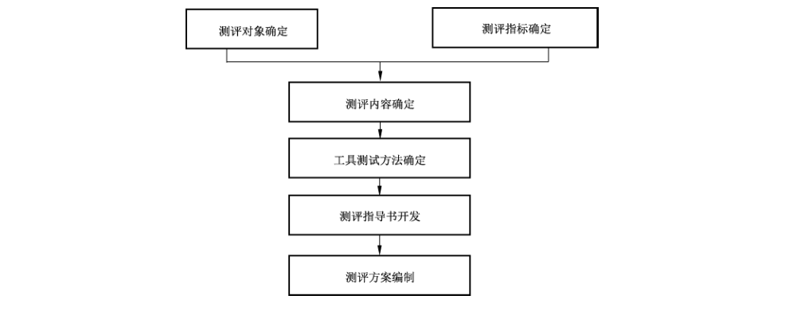
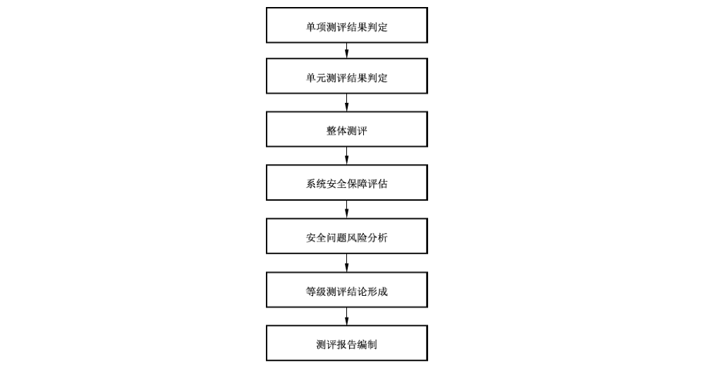
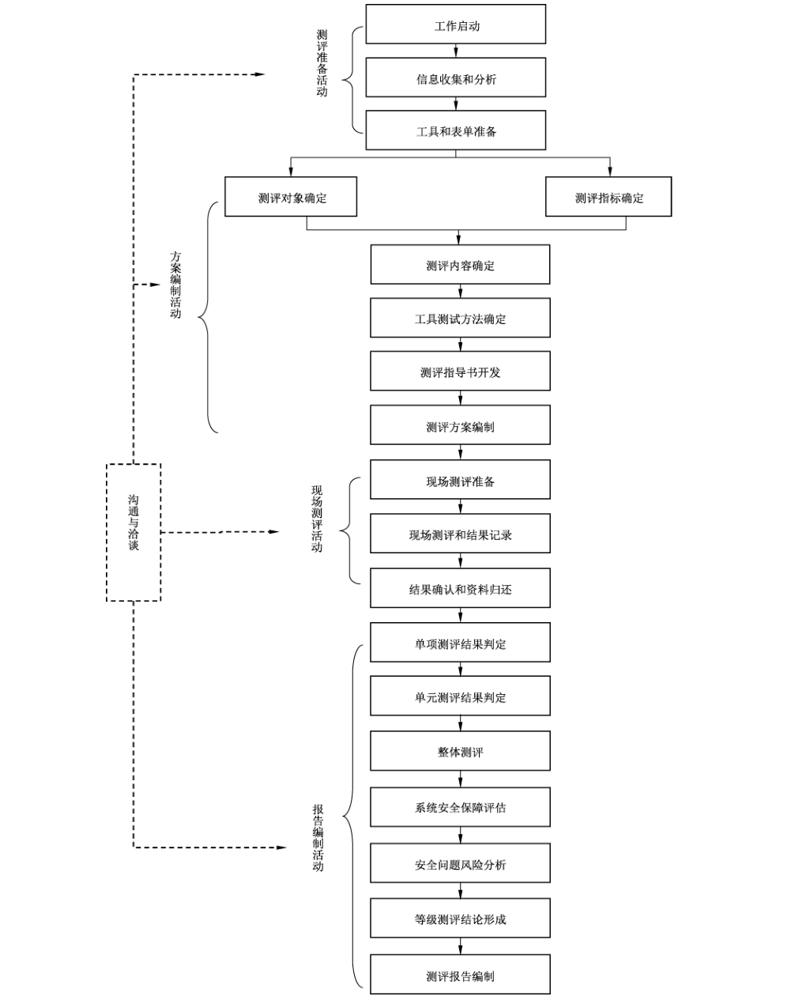

# GB/T 28449-2018 信息安全技术 网络安全等级保护测评过程指南

> 来源：[GB/T 28449-2018 国家标准详情](https://openstd.samr.gov.cn/bzgk/std/newGbInfo?hcno=CEC24F959F301862A3516CAAF117E70F)；封面发布日期：2018-12-28；实施日期：2019-07-01。
> PDF SHA-256：67d8a6c000d74fcf8123ffa2eca274ea36a3d8049cfab40cb366827241d9a4bf。
> 依据官方 PDF 全部 57 页的页面图像转写与校核；省略封面、目录、页眉、页脚和分页，合并跨页表格及印刷折行。附录 F 中报告模板的封面、说明和目录作为模板内容保留，五幅流程图保留为原页图像。

## 前言

本标准按照 GB/T 1.1—2009给出的规则起草。

本标准代替 GB/T 28449—2012《信息安全技术 信息系统安全等级保护测评过程指南》，与 GB/T 28449—2012 相比，除编辑性修改外，主要技术变化如下：

- 标准名称由“信息安全技术 信息系统安全等级保护测评过程指南”变更为“信息安全技术 网络安全等级保护测评过程指南”；
- 修改了报告编制活动中的任务，由原来的 6 个任务修改为 7 个任务（见 4.1，2012 年版的 5.4）；
- 在测评准备活动、现场测评活动的双方职责中增加了协调多方的职责，并在一些涉及到多方的工作任务中也予以明确（见 7.4，2012 年版的 8.4）；
- 在信息收集和分析工作任务中增加了信息分析方法的内容（见 5.2.2）；
- 增加了利用云计算、物联网、移动互联网、工业控制系统、IPv6 系统等构建的等级保护对象开展安全测评需要额外重点关注的特殊任务及要求（见附录 C）；
- 删除了测评方案示例（见 2012 年版的附录 D）；
- 删除了信息系统基本情况调查表模版（见 2012 年版的附录 E）。

请注意本文件的某些内容可能涉及专利。本文件的发布机构不承担识别这些专利的责任。

本标准由全国信息安全标准化技术委员会（SAC/TC 260）提出并归口。

本标准起草单位：公安部第三研究所（公安部信息安全等级保护评估中心）、中国电子科技集团公司第十五研究所（信息产业信息安全测评中心）、北京信息安全测评中心。

本标准主要起草人：袁静、任卫红、江雷、李升、张宇翔、毕马宁、李明、张益、刘凯俊、赵泰、王然、刘海峰、曲洁、刘静、朱建平、马力、陈广勇。

本标准所代替标准的历次版本发布情况为：

- GB/T 28449—2012。

## 引言

本标准中的等级测评是测评机构依据GB/T 22239以及 GB/T 28448等技术标准，检测评估定级对象安全等级保护状况是否符合相应等级基本要求的过程，是落实网络安全等级保护制度的重要环节。

在定级对象建设、整改时，定级对象运营、使用单位通过等级测评进行现状分析，确定系统的安全保护现状和存在的安全问题，并在此基础上确定系统的整改安全需求。

在定级对象运维过程中，定级对象运营、使用单位定期对定级对象安全等级保护状况进行自查或委托测评机构开展等级测评，对信息安全管控能力进行考察和评价，从而判定定级对象是否具备GB/T 22239中相应等级要求的安全保护能力。因此，等级测评活动所形成的等级测评报告是定级对象开展整改加固的重要依据，也是第三级以上定级对象备案的重要附件材料。等级测评结论为不符合或基本符合的定级对象，其运营、使用单位需根据等级测评报告，制定方案进行整改。

本标准是网络安全等级保护相关系列标准之一。

## 1 范围

本标准规范了网络安全等级保护测评（以下简称“等级测评”）的工作过程，规定了测评活动及其工作任务。

本标准适用于测评机构、定级对象的主管部门及运营使用单位开展网络安全等级保护测试评价工作。

## 2 规范性引用文件

下列文件对于本文件的应用是必不可少的。凡是注日期的引用文件，仅注日期的版本适用于本文件。凡是不注日期的引用文件，其最新版本（包括所有的修改单）适用于本文件。

- GB 17859 计算机信息系统安全保护等级划分准则

- GB/T 22239 信息安全技术 信息系统安全等级保护基本要求

- GB/T 25069 信息安全技术 术语

- GB/T 28448 信息安全技术 信息系统安全等级保护测评要求

## 3 术语和定义

GB 17859、GB/T 22239、GB/T 25069 和 GB/T 28448界定的术语和定义适用于本文件。

## 4 等级测评概述

### 4.1 等级测评过程概述

本标准中的测评工作过程及任务基于受委托测评机构对定级对象的初次等级测评给出。运营、使用单位的自查或受委托测评机构已经实施过一次以上等级测评的，测评机构和测评人员根据实际情况调整部分工作任务（见附录 A）。开展等级测评的测评机构应严格按照附录B中给出的等级测评工作要求开展相关工作。

等级测评过程包括四个基本测评活动：测评准备活动、方案编制活动、现场测评活动、报告编制活动。而测评相关方之间的沟通与洽谈应贯穿整个等级测评过程。每一测评活动有一组确定的工作任务。具体如表1所示。

**表 1 等级测评过程**

| 测评活动 | 主要工作任务 |
| --- | --- |
| 测评准备活动 | 工作启动 |
|  | 信息收集和分析 |
|  | 工具和表单准备 |
| 方案编制活动 | 测评对象确定 |
|  | 测评指标确定 |
|  | 测评内容确定 |
|  | 工具测试方法确定 |
|  | 测评指导书开发 |
|  | 测评方案编制 |
| 现场测评活动 | 现场测评准备 |
|  | 现场测评和结果记录 |
|  | 结果确认和资料归还 |
| 报告编制活动 | 单项测评结果判定 |
|  | 单元测评结果判定 |
|  | 整体测评 |
|  | 系统安全保障评估 |
|  | 安全问题风险分析 |
|  | 等级测评结论形成 |
|  | 测评报告编制 |

本标准对其中每项活动均给出相应的工作流程、主要任务、输出文档及活动中相关方的职责的规定，每项工作任务均有相应的输入、任务描述和输出产品。

### 4.2 等级测评风险

#### 4.2.1 影响系统正常运行的风险

在现场测评时，需要对设备和系统进行一定的验证测试工作，部分测试内容需要上机验证并查看一些信息，这就可能对系统运行造成一定的影响，甚至存在误操作的可能。

此外，使用测试工具进行漏洞扫描测试、性能测试及渗透测试等，可能会对网络和系统的负载造成一定的影响，渗透性攻击测试还可能影响到服务器和系统正常运行，如出现重启、服务中断、渗透过程中植入的代码未完全清理等现象。

#### 4.2.2 敏感信息泄露风险

测评人员有意或无意泄漏被测系统状态信息，如网络拓扑、IP地址、业务流程、业务数据、安全机制、安全隐患和有关文档信息等。

#### 4.2.3 木马植入风险

测评人员在渗透测试完成后，有意或无意将渗透测试过程中用到的测试工具未清理或清理不彻底，或者测试电脑中带有木马程序，带来在被测评系统中植入木马的风险。

### 4.3 等级测评风险规避

在等级测评过程中可以通过采取以下措施规避风险：

a） 签署委托测评协议

在测评工作正式开始之前，测评方和被测评单位需要以委托协议的方式明确测评工作的目标、范围、人员组成、计划安排、执行步骤和要求以及双方的责任和义务等，使得测评双方对测评过程中的基本问题达成共识。

b） 签署保密协议

测评相关方应签署合乎法律规范的保密协议，以约束测评相关方现在及将来的行为。保密协议规定了测评相关方保密方面的权利与义务。测评过程中获取的相关系统数据信息及测评工作的成果属被测评单位所有，测评方对其的引用与公开应得到相关单位的授权，否则相关单位将按照保密协议的要求追究测评单位的法律责任。

c） 现场测评工作风险的规避

现场测评之前，测评机构应与相关单位签署现场测评授权书，要求相关方对系统及数据进行备份，并对可能出现的事件制定应急处理方案。

进行验证测试和工具测试时，避开业务高峰期，在系统资源处于空闲状态时进行，或配置与生产环境一致的模拟/仿真环境，在模拟/仿真环境下开展漏洞扫描等测试工作；上机验证测试由测评人员提出需要验证的内容，系统运营、使用单位的技术人员进行实际操作。整个现场测评过程要求系统运营、使用单位全程监督。

d） 测评现场还原

测评工作完成后，测评人员应将测评过程中获取的所有特权交回，把测评过程中借阅的相关资料文档归还，并将测评环境恢复至测评前状态。

## 5 测评准备活动

### 5.1 测评准备活动工作流程

测评准备活动的目标是顺利启动测评项目，收集定级对象相关资料，准备测评所需资料，为编制测评方案打下良好的基础。

测评准备活动包括工作启动、信息收集和分析、工具和表单准备三项主要任务。这三项任务的基本工作流程见图1。

### 5.2 测评准备活动主要任务

#### 5.2.1 工作启动

在工作启动任务中，测评机构组建等级测评项目组，获取测评委托单位及定级对象的基本情况，从基本资料、人员、计划安排等方面为整个等级测评项目的实施做好充分准备。

输入：委托测评协议书。

任务描述：

a） 根据测评双方签订的委托测评协议书和系统规模，测评机构组建测评项目组，从人员方面做好准备，并编制项目计划书。

b） 测评机构要求测评委托单位提供基本资料，为全面初步了解被测定级对象准备资料。

输出/产品：项目计划书。

#### 5.2.2 信息收集和分析

测评机构通过查阅被测定级对象已有资料或使用系统调查表格的方式，了解整个系统的构成和保护情况以及责任部门相关情况，为编写测评方案、开展现场测评和安全评估工作奠定基础。

输入：项目计划书，系统调查表格，被测定级对象相关资料。

任务描述：

a） 测评机构收集等级测评需要的相关资料，包括测评委托单位的管理架构、技术体系、运行情况、建设方案、建设过程中相关测试文档等。云计算平台、物联网、移动互联、工业控制系统的补充收集内容见附录C。

b） 测评机构将系统调查表格提交给测评委托单位，督促被测定级对象相关人员准确填写调查表格。

c） 测评机构收回填写完成的调查表格，并分析调查结果，了解和熟悉被测定级对象的实际情况。

这些信息可以参考自查报告或上次等级测评报告结果。

在对收集到的信息进行分析时，可采用如下方法：

1） 采用系统分析方法对整体网络结构和系统组成进行分析，包括网络结构、对外边界、定级对象的数量和级别、不同安全保护等级定级对象的分布情况和承载应用情况等；

2） 采用分解与综合分析方法对定级对象边界和系统构成组件进行分析，包括物理与逻辑边界、硬件资源、软件资源、信息资源等；

3） 采用对比与类比分析方法对定级对象的相互关联进行分析，包括应用架构方式、应用处理流程、处理信息类型、业务数据处理流程、服务对象、用户数量等。

d） 如果调查表格信息填写存在不准确、不完善或有相互矛盾的地方，测评机构应与填表人进行沟通和确认，必要时安排一次现场调查，与相关人员进行面对面的沟通和确认，确保系统信息调查的准确性和完整性。

输出/产品：填好的调查表格，各种与被测定级对象相关的技术资料。

#### 5.2.3 工具和表单准备

测评项目组成员在进行现场测评之前，应熟悉被测定级对象、调试测评工具、准备各种表单等。

输入：填好的调查表格，各种与被测定级对象相关的技术资料。

任务描述：

a） 测评人员调试本次测评过程中将用到的测评工具，包括漏洞扫描工具、渗透性测试工具、性能测试工具和协议分析工具等。

b） 测评人员在测评环境模拟被测定级对象架构，为开发相关的网络及主机设备等测评对象测评指导书做好准备，并进行必要的工具验证。

c） 准备和打印表单，主要包括：风险告知书、文档交接单、会议记录表单、会议签到表单等。

输出/产品：选用的测评工具清单，打印的各类表单。

### 5.3 测评准备活动输出文档

测评准备活动的输出文档及其内容如表2所示。

**表2 测评准备活动的输出文档及其内容**

| 任务 | 输出文档 | 文档内容 |
| --- | --- | --- |
| 工作启动 | 项目计划书 | 项目概述、工作依据、技术思路、工作内容和项目组织等 |
| 信息收集和分析 | 填好的调查表格，各种与被测定级对象相关的技术资料 | 被测定级对象的安全保护等级、业务情况、数据情况、网络情况、软硬件情况、管理模式和相关部门及角色等 |
| 工具和表单准备 | 选用的测评工具清单；打印的各类表单：风险告知书、文档交接单、会议记录表单、会议签到表单 | 风险告知、交接的文档名称、会议记录、会议签到表 |

### 5.4 测评准备活动中双方职责

测评机构职责：

a） 组建等级测评项目组。

b） 指出测评委托单位应提供的基本资料。

c） 准备被测定级对象基本情况调查表格，并提交给测评委托单位。

d） 向测评委托单位介绍安全测评工作流程和方法。

e） 向测评委托单位说明测评工作可能带来的风险和规避方法。

f） 了解测评委托单位的信息化建设以及被测定级对象的基本情况。

g） 初步分析系统的安全状况。

h） 准备测评工具和文档。

测评委托单位职责：

a） 向测评机构介绍本单位的信息化建设及发展情况。

b） 提供测评机构需要的相关资料。

c） 为测评人员的信息收集工作提供支持和协调。

d） 准确填写调查表格。

e） 根据被测定级对象的具体情况，如业务运行高峰期、网络布置情况等，为测评时间安排提供适宜的建议。

f） 制定应急预案。

## 6 方案编制活动

### 6.1 方案编制活动工作流程

方案编制活动的目标是整理测评准备活动中获取的定级对象相关资料，为现场测评活动提供最基本的文档和指导方案。

方案编制活动包括测评对象确定、测评指标确定、测评内容确定、工具测试方法确定、测评指导书开发及测评方案编制六项主要任务，基本工作流程见图2。

### 6.2 方案编制活动主要任务

#### 6.2.1 测评对象确定

根据系统调查结果，分析整个被测定级对象业务流程、数据流程、范围、特点及各个设备及组件的主要功能，确定出本次测评的测评对象。

输入：填好的调查表格，各种与被测定级对象相关的技术资料。

任务描述：

a） 识别并描述被测定级对象的整体结构

根据调查表格获得的被测定级对象基本情况，识别出被测定级对象的整体结构并加以描述。

b） 识别并描述被测定级对象的边界

根据填好的调查表格，识别出被测定级对象边界及边界设备并加以描述。

c） 识别并描述被测定级对象的网络区域

一般定级对象都会根据业务类型及其重要程度将定级对象划分为不同的区域。根据区域划分情况描述每个区域内的主要业务应用、业务流程、区域的边界以及它们之间的连接情况等。

d） 识别并描述被测定级对象的主要设备

描述系统中的设备时以区域为线索，具体描述各个区域内部署的设备，并说明各个设备主要承载的业务、软件安装情况以及各个设备之间的主要连接情况等。

e） 确定测评对象

结合被测定级对象的安全级别和重要程度，综合分析系统中各个设备和组件的功能、特点，从被测定级对象构成组件的重要性、安全性、共享性、全面性和恰当性等几方面属性确定出技术层面的测评对象，并将与被测定级对象相关的人员及管理文档确定为测评对象。测评对象确定准则和样例见附录 D。

f） 描述测评对象

描述测评对象时，根据类别加以描述，包括机房、业务应用软件、主机操作系统、数据库管理系统、网络互联设备、安全设备、访谈人员及安全管理文档等。

输出/产品：测评方案的测评对象部分。

#### 6.2.2 测评指标确定

根据被测定级对象定级结果确定出本次测评的基本测评指标，根据测评委托单位及被测定级对象业务自身需求确定出本次测评的特殊测评指标。

输入：填好的调查表格，GB 17859,GB/T 22239，行业规范，业务需求文档。

任务描述：

a） 根据被测定级对象的定级结果，包括业务信息安全保护等级和系统服务安全保护等级，得出被测定级对象的系统服务保证类（A类）基本安全要求、业务信息安全类（S类）基本安全要求以及通用安全保护类（G类）基本安全要求的组合情况。

b） 根据被测定级对象的A类、S类及G类基本安全要求的组合情况，从 GB/T 22239、行业规范中选择相应等级的基本安全要求作为基本测评指标。

c） 根据被测定级对象实际情况，确定不适用测评指标。

d） 根据测评委托单位及被测定级对象业务自身需求，确定特殊测评指标。

e） 对确定的基本测评指标和特殊测评指标进行描述，并分析给出指标不适用的原因。

输出/产品：测评方案的测评指标部分。

#### 6.2.3 测评内容确定

本条确定现场测评的具体实施内容，即单项测评内容。

输入：填好的系统调查表格，测评方案的测评对象部分，测评方案的测评指标部分。

任务描述：依据 GB/T 22239，将前面已经得到的测评指标和测评对象结合起来，将测评指标映射到各测评对象上，然后结合测评对象的特点，说明各测评对象所采取的测评方法。由此构成可以具体实施测评的单项测评内容。测评内容是测评人员开发测评指导书的基础。

输出/产品：测评方案的测评实施部分。

#### 6.2.4 工具测试方法确定

在等级测评中，应使用测试工具进行测试，测试工具可能用到漏洞扫描器、渗透测试工具集，协议分析仪等。物联网、移动互联、工业控制系统的补充测试内容见附录C。

输入：测评方案的测评实施部分，GB/T 22239，选用的测评工具清单。

任务描述：

a） 确定工具测试环境，根据被测系统的实时性要求，可选择生产环境或与生产环境各项安全配置相同的备份环境、生产验证环境或测试环境作为工具测试环境。

b） 确定需要进行测试的测评对象。

c） 选择测试路径。测试工具的接入采取从外到内，从其他网络到本地网络的逐步逐点接入，即：测试工具从被测定级对象边界外接入、在被测定级对象内部与测评对象不同区域网络及同一网络区域内接入等几种方式。

d） 根据测试路径，确定测试工具的接入点。

从被测定级对象边界外接入时，测试工具一般接在系统边界设备（通常交换设备）上。在该点接入漏洞扫描器，扫描探测被测定级对象设备对外暴露的安全漏洞情况。在该接入点接入协议分析仪，捕获应用程序的网络数据包，查看其安全加密和完整性保护情况。在该接入点使用渗透测试工具集，试图利用被测定级对象设备的安全漏洞，跨过系统边界，侵入被测定级对象设备。

从系统内部与测评对象不同网络区域接入时，测试工具一般接在与被测对象不在同一网络区域的内部核心交换设备上。在该点接入扫描器，直接扫描测试内部各设备对本单位其他不同网络所暴露的安全漏洞情况。在该接入点接入网络拓扑发现工具，探测定级对象的网络拓扑情况。

在系统内部与测评对象同一网络区域内接入时，测试工具一般接在与被测对象在同一网络区域的交换设备上。在该点接入扫描器，在本地直接测试各被测设备对本地网络暴露的安全漏洞情况。一般来说，该点扫描探测出的漏洞数应该是最多的，它说明设备在没有网络安全保护措施下的安全状况。

e） 结合网络拓扑图，描述测试工具的接入点、测试目的、测试途径和测试对象等相关内容。

输出/产品：测评方案的工具测试方法及内容部分。

#### 6.2.5 测评指导书开发

测评指导书是具体指导测评人员如何进行测评活动的文档，应尽可能详实、充分。

输入：测评方案的单项测评实施部分、工具测试内容及方法部分。

任务描述：

a）描述单个测评对象，包括测评对象的名称、位置信息、用途、管理人员等信息。

b）根据GB/T 28448的单项测评实施确定测评活动，包括测评项、测评方法、操作步骤和预期结果等四部分。

测评项是指 GB/T 22239中对该测评对象在该用例中的要求，在GB/T 28448中对应每个单项测评中的“测评指标”。测评方法是指访谈、核查和测试三种方法，具体参见附录E。核查具体到测评对象上可细化为文档审查、实地察看和配置核查，每个测评项可能对应多个测评方法。操作步骤是指在现场测评活动中应执行的命令或步骤，涉及到测试时，应描述工具测试路径及接入点等。预期结果是指按照操作步骤在正常的情况下应得到的结果和获取的证据。

c） 单项测评一般以表格形式设计和描述测评项、测评方法、操作步骤和预期结果等内容。整体测评则一般以文字描述的方式表述，以测评用例的方式进行组织。

d） 根据测评指导书，形成测评结果记录表格。

输出/产品：测评指导书，测评结果记录表格。

#### 6.2.6 测评方案编制

测评方案是等级测评工作实施的基础，指导等级测评工作的现场实施活动。测评方案应包括但不局限于以下内容：项目概述、测评对象、测评指标、测评内容、测评方法等。

输入：委托测评协议书，填好的调研表格，各种与被测定级对象相关的技术资料，选用的测评工具清单，GB/T 22239或行业规范中相应等级的基本要求，测评方案的测评对象、测评指标、单项测评实施部分、工具测试方法及内容部分等。

任务描述：

a） 根据委托测评协议书和填好的调研表格，提取项目来源、测评委托单位整体信息化建设情况及被测定级对象与单位其他系统之间的连接情况等。

b） 根据等级保护过程中的等级测评实施要求，将测评活动所依据的标准罗列出来。

c） 参阅委托测评协议书和被测定级对象情况，估算现场测评工作量。工作量根据测评对象的数量和工具测试的接入点及测试内容等情况进行估算。

d） 根据测评项目组成员安排，编制工作安排情况。

e） 根据以往测评经验以及被测定级对象规模，编制具体测评计划，包括现场工作人员的分工和时间安排。

f） 汇总上述内容及方案编制活动的其他任务获取的内容形成测评方案文稿。

g） 评审和提交测评方案。测评方案初稿应通过测评项目组全体成员评审，修改完成后形成提交稿。然后，测评机构将测评方案提交给测评委托单位签字认可。

h）根据测评方案制定风险规避实施方案。

输出/产品：经过评审和确认的测评方案文本，风险规避实施方案文本。

### 6.3 方案编制活动输出文档

方案编制活动的输出文档及其内容如表3所示。

**表3 方案编制活动的输出文档及其内容**

| 任务 | 输出文档 | 文档内容 |
| --- | --- | --- |
| 测评对象确定 | 测评方案的测评对象部分 | 被测定级对象的整体结构、边界、网络区域、重要节点、测评对象等 |
| 测评指标确定 | 测评方案的测评指标部分 | 被测定级对象定级结果、测评指标 |
| 测评内容确定 | 测评方案的单项测评实施部分 | 单项测评实施内容 |
| 工具测试方法确定 | 测评方案的工具测试方法及内容部分 | 工具测试接入点及测试方法 |
| 测评指导书开发 | 测评指导书、测评结果记录表格 | 各测评对象的测评内容及方法；测评结果记录表格表头 |
| 测评方案编制 | 经过评审和确认的测评方案文本；风险规避实施方案文本 | 项目概述、测评对象、测评指标、测试工具接入点、单项测评实施内容等；风险规避措施等 |

### 6.4 方案编制活动中双方职责

测评机构职责：

a） 详细分析被测定级对象的整体结构、边界、网络区域、设备部署情况等。

b） 初步判断被测定级对象的安全薄弱点。

c） 分析确定测评对象、测评指标、确定测评内容和工具测试方法。

d） 编制测评方案文本，并对其进行内部评审。

e） 制定风险规避实施方案。

测评委托单位职责：

a） 为测评机构完成测评方案提供有关信息和资料。

b）评审和确认测评方案文本。

c） 评审和确认测评机构提供的风险规避实施方案。

d） 若确定不在生产环境开展测评，则部署配置与生产环境各项安全配置相同的备份环境、生产验证环境或测试环境作为测试环境。

## 7 现场测评活动

### 7.1 现场测评活动工作流程

现场测评活动通过与测评委托单位进行沟通和协调，为现场测评的顺利开展打下良好基础，依据测评方案实施现场测评工作，将测评方案和测评方法等内容具体落实到现场测评活动中。现场测评工作应取得报告编制活动所需的、足够的证据和资料。

现场测评活动包括现场测评准备、现场测评和结果记录、结果确认和资料归还三项主要任务，基本工作流程见图3。

### 7.2 现场测评活动主要任务

#### 7.2.1 现场测评准备

本任务启动现场测评，是保证测评机构能够顺利实施测评的前提。

输入：经过评审和确认的测评方案文本，风险规避实施方案文本，风险告知书，现场测评工作计划。

任务描述：

a） 测评委托单位对风险告知书签字确认，了解测评过程中存在的安全风险，做好相应的应急和备份工作。

b） 测评委托单位协助测评机构获得定级对象相关方的现场测评授权。

c） 召开测评现场首次会，测评机构介绍现场测评工作安排，相关方对测评计划和测评方案中的测评内容和方法等进行沟通。

d） 测评相关方确认现场测评需要的各种资源，包括测评配合人员和需要提供的测评环境等。

输出/产品：会议记录，测评方案，现场测评工作计划和风险告知书，现场测评授权书等。

#### 7.2.2 现场测评和结果记录

本任务主要是测评人员按照测评指导书实施测评，并将测评过程中获取的证据源进行详细、准确记录。

输入：现场测评工作计划，现场测评授权书，测评指导书，测评结果记录表格。

任务描述：

a） 测评人员与测评配合人员确认测评对象中的关键数据已经进行了备份。

b） 测评人员确认具备测评工作开展的条件，测评对象工作正常，系统处于一个相对良好的状况。

c） 测评人员根据测评指导书实施现场测评，获取相关证据和信息。现场测评一般包括访谈、核查和测试三种测评方式，具体参见附录 E。

d） 测评结束后，测评人员与测评配合人员及时确认测评工作是否对测评对象造成不良影响，测评对象及系统是否工作正常。

输出/产品：各类测评结果记录。

#### 7.2.3 结果确认和资料归还

本任务主要是将测评过程中得到的证据源记录进行确认，并将测评过程中借阅的文档归还。

输入：各类测评结果记录，工具测试完成后的电子输出记录。

任务描述：

a） 测评人员在现场测评完成之后，应首先汇总现场测评的测评记录，对漏掉和需要进一步验证的内容实施补充测评。

b）召开测评现场结束会，测评双方对测评过程中得到的证据源记录进行现场沟通和确认。

c） 测评机构归还测评过程中借阅的所有文档资料，并由测评委托单位文档资料提供者签字确认。

输出/产品：经过测评委托单位确认的测评证据和证据源记录。

### 7.3 现场测评活动输出文档

现场测评活动的输出文档及其内容如表4所示。

**表4 现场测评活动的输出文档及其内容**

| 任务 | 输出文档 | 文档内容 |
| --- | --- | --- |
| 现场测评准备 | 会议记录，确认的风险告知书、测评方案和现场测评工作计划，现场测评授权书 | 工作计划和内容安排，双方人员的协调，测评委托单位应提供的配合 |
| 访谈 | 技术和管理安全测评的测评结果记录 | 访谈记录 |
| 文档审查 | 技术和管理安全测评的测评结果记录 | 安全策略、技术文档、管理制度和管理执行过程文档的记录 |
| 实地察看 | 技术安全和管理安全测评结果记录 | 核查内容的记录 |
| 配置核查 | 技术安全测评的测评结果记录 | 核查内容的记录 |
| 工具测试 | 技术安全测评的测评结果记录，工具测试完成后的电子输出记录，备份的测试结果文件 | 漏洞扫描、渗透性测试、性能测试、入侵检测和协议分析等内容的技术测试结果 |
| 测评结果确认和资料归还 | 经过测评委托单位确认的测评证据和证据源记录 | 测评中获取的证据和证据源 |

### 7.4 现场测评活动中双方职责

测评机构职责：

a） 测评人员开展测评前确认被测定级对象具备测评工作开展的条件，测评对象工作正常。

b）测评人员利用访谈、文档审查、配置核查、工具测试和实地察看的方法开展现场测评工作，并获取相关证据。

测评委托单位职责（系统部署在公有云的测评委托单位职责还包括附录C中相关内容）：

a） 测评前备份系统和数据，并了解测评工作基本情况。

b） 协助测评机构获得现场测评授权。

c） 安排测评配合人员，配合测评工作的开展。

d） 对风险告知书进行签字确认。

e） 配合人员如实回答测评人员的问询，对某些需要验证的内容上机进行操作。

f） 配合人员协助测评人员实施工具测试并提供有效建议，降低安全测评对系统运行的影响。

g） 配合人员协助测评人员完成业务相关内容的问询、验证和测试。

h）配合人员对测评证据和证据源进行确认。

i） 配合人员确认测试后被测设备状态完好。

## 8 报告编制活动

### 8.1 报告编制活动工作流程

在现场测评工作结束后，测评机构应对现场测评获得的测评结果（或称测评证据）进行汇总分析，形成等级测评结论，并编制测评报告。

测评人员在初步判定单项测评结果后，还需进行单元测评结果判定、整体测评、系统安全保障评估，经过整体测评后，有的单项测评结果可能会有所变化，需进一步修订单项测评结果，而后针对安全问题进行风险评估，形成等级测评结论。分析与报告编制活动包括单项测评结果判定、单元测评结果判定、整体测评、系统安全保障评估、安全问题风险评估、等级测评结论形成及测评报告编制七项主要任务，基本工作流程见图4。

### 8.2 报告编制活动主要任务

#### 8.2.1 单项测评结果判定

本任务主要是针对单个测评项，结合具体测评对象，客观、准确地分析测评证据，形成初步单项测评结果，单项测评结果是形成等级测评结论的基础。

输入：经过测评委托单位确认的测评证据和证据源记录，测评指导书。

任务描述：

a） 针对每个测评项，分析该测评项所对抗的威胁在被测定级对象中是否存在，如果不存在，则该测评项应标为不适用项。

b） 分析单个测评项的测评证据，并与要求内容的预期测评结果相比较，给出单项测评结果和符合程度得分。

c） 如果测评证据表明所有要求内容与预期测评结果一致，则判定该测评项的单项测评结果符合；如果测评证据表明所有要求内容与预期测评结果不一致，判定该测评项的单项测评结果为不符合；否则判定该测评项的单项测评结果部分符合。

输出/产品：测评报告的等级测评结果记录部分。

#### 8.2.2 单元测评结果判定

本任务主要是将单项测评结果进行汇总，分别统计不同测评对象的单项测评结果，从而判定单元测评结果。

输入：测评报告的等级测评结果记录部分。

任务描述：

a） 按层面分别汇总不同测评对象对应测评指标的单项测评结果情况，包括测评多少项，符合要求的多少项等内容。

b） 分析每个控制点下所有测评项的符合情况，给出单元测评结果。单元测评结果判定规则如下：

- 控制点包含的所有适用测评项的单项测评结果均为符合，则对应该控制点的单元测评结果为符合；
- 控制点包含的所有适用测评项的单项测评结果均为不符合，则对应该控制点的单元测评结果为不符合；
- 控制点包含的所有测评项均为不适用项，则对应该控制点的单元测评结果为不适用；
- 控制点包含的所有适用测评项的单项测评结果不全为符合或不符合，则对应该控制点的单元测评结果为部分符合。

输出/产品：测评报告的单元测评小结部分。

#### 8.2.3 整体测评

针对单项测评结果的不符合项及部分符合项，采取逐条判定的方法，从安全控制点间、层面间出发考虑，给出整体测评的具体结果。

输入：测评报告的等级测评结果记录部分和单项测评结果。

任务描述：

a） 针对测评对象“部分符合”及“不符合”要求的单个测评项，分析与该测评项相关的其他测评项能否和它发生关联关系，发生什么样的关联关系，这些关联关系产生的作用是否可以“弥补”该测评项的不足或“削弱”该测评项实现的保护能力，以及该测评项的测评结果是否会影响与其有关联关系的其他测评项的测评结果。具体整体测评方法参见 GB/T 28448。

b） 针对测评对象“部分符合”及“不符合”要求的单个测评项，分析与该测评项相关的其他层面的测评对象能否和它发生关联关系，发生什么样的关联关系，这些关联关系产生的作用是否可以“弥补”该测评项的不足或“削弱”该测评项实现的保护能力，以及该测评项的测评结果是否会影响与其有关联关系的其他测评项的测评结果。

c） 根据整体测评分析情况，修正单项测评结果符合程度得分和问题严重程度值。

输出/产品：测评报告的整体测评部分。

#### 8.2.4 系统安全保障评估

综合单项测评和整体测评结果，计算修正后的安全控制点得分和层面得分，并根据得分情况对被测定级对象的安全保障情况进行总体评价。

输入：测评报告的等级测评结果记录部分和整体测评部分。

任务描述：

a） 根据整体测评结果，计算修正后的每个测评对象的单项测评结果和符合程度得分。

b） 根据各对象的单项符合程度得分，计算安全控制点得分。

c） 根据安全控制点得分，计算安全层面得分。

d） 根据安全控制点得分和安全层面得分，总体评价被测定级对象已采取的有效保护措施和存在的主要安全问题情况。

输出：测评报告的系统安全保障评估部分。

#### 8.2.5 安全问题风险分析

测评人员依据等级保护的相关规范和标准，采用风险分析的方法分析等级测评结果中存在的安全问题可能对被测定级对象安全造成的影响。

输入：填好的调查表格，测评报告的单项测评结果，整体测评部分。

任务描述：

a） 针对整体测评后的单项测评结果中部分符合项或不符合项所产生的安全问题，结合关联测评对象和威胁，分析可能对定级对象、单位、社会及国家造成的安全危害。

b）结合安全问题所影响业务的重要程度、相关系统组件的重要程度、安全问题严重程度以及安全事件影响范围等综合分析可能造成的安全危害中的最大安全危害（损失）结果。

c） 根据最大安全危害严重程度进一步确定定级对象面临的风险等级，结果为“高”“中”或“低”。

输出：测评报告的安全问题风险分析部分。

#### 8.2.6 等级测评结论形成

测评人员在系统安全保障评估、安全问题风险评估的基础上，找出系统保护现状与 GB/T 22239之间的差距，并形成等级测评结论。

输入：测评报告的系统安全保障评估部分、安全问题风险评估部分。

任务描述：根据单项测评结果和风险评估结果，计算定级对象综合得分，并得出等级测评结论。

等级测评结论分为三种情况：

a） 符合：定级对象中未发现安全问题，等级测评结果中所有测评项的单项测评结果中部分符合和不符合项的统计结果全为0，综合得分为100分。

b） 基本符合：定级对象中存在安全问题，部分符合和不符合项的统计结果不全为0，但存在的安全问题不会导致定级对象面临高等级安全风险，且综合得分不低于阈值。

c） 不符合：定级对象中存在安全问题，部分符合项和不符合项的统计结果不全为0，而且存在的安全问题会导致定级对象面临高等级安全风险，或者综合得分低于阈值。

输出/产品：测评报告的等级测评结论部分。

#### 8.2.7 测评报告编制

根据报告编制活动各分析过程形成等级测评报告。等级测评报告格式应符合公安机关发布的《信息安全等级保护测评报告模版》（模版示例参见附录 F）。

输入：测评方案，《信息系统安全等级测评报告模版》，测评结果分析内容。

任务描述：

a） 测评人员整理前面几项任务的输出/产品，按照《信息系统安全等级测评报告模版》编制测评报告相应部分。每个被测定级对象应单独出具测评报告。

b）针对被测定级对象存在的安全隐患，从系统安全角度提出相应的改进建议，编制测评报告的问题处置建议部分。

c） 测评报告编制完成后，测评机构应根据测评协议书、测评委托单位提交的相关文档、测评原始记录和其他辅助信息，对测评报告进行评审。

d） 评审通过后，由项目负责人签字确认并提交给测评委托单位。

输出/产品：经过评审和确认的被测定级对象等级测评报告。

### 8.3 报告编制活动输出文档

报告编制活动的输出文档及其内容如表5所示。

**表5 报告编制活动的输出文档及其内容**

| 任务 | 输出文档 | 文档内容 |
| --- | --- | --- |
| 单项测评结果判定 | 等级测评报告的等级测评结果记录部分 | 分析测评对象的安全现状与标准中相应等级基本要求项的符合情况，给出单项测评结果和符合程度得分 |
| 单元测评结果判定 | 等级测评报告的单元测评小结部分 | 汇总统计单项测评结果，分析计算控制点符合情况、存在的安全问题 |
| 整体测评 | 等级测评报告的整体测评部分 | 分析被测定级对象整体安全状况及对单项测评结果的影响情况，给出安全问题严重程度及对应的要求项符合程度得分修正值 |
| 系统安全保障评估 | 测评报告的系统安全保障评估部分 | 汇总被测定级对象已采取的安全保护措施情况，计算安全控制点得分及安全层面得分，并总体评价被测定级对象已采取的有效保护措施和存在的主要安全问题情况 |
| 安全问题风险分析 | 等级测评报告的安全问题风险评估部分 | 分析被测定级对象存在安全问题可能对定级对象、单位、社会及国家造成的最大安全危害（损失），并给出风险等级 |
| 等级测评结论形成 | 等级测评报告的等级测评结论部分 | 对测评结果进行分析，形成等级测评结论，并给出综合得分 |
| 测评报告编制 | 经过评审和确认的被测定级对象等级测评报告 | 等级测评结果记录，单元测评结果汇总及结果分析，整体测评过程及结果，风险分析过程及结果，等级测评结论，问题处置建议等 |

### 8.4 报告编制活动中双方职责

测评机构职责：

a） 分析并判定单项测评结果和整体测评结果。

b） 分析评价被测定级对象存在的风险情况。

c） 根据测评结果形成等级测评结论。

d） 编制等级测评报告，说明系统存在的安全隐患和缺陷，并给出改进建议。

e） 评审等级测评报告，并将评审过的等级测评报告按照分发范围进行分发。

f） 将生成的过程文档（包括电子文档）归档保存，并将测评过程中在测评用介质和测试工具中生成或存放的所有电子文档清除。

测评委托单位职责：

a） 签收测评报告。

b）向分管公安机关备案测评报告。

## 附录 A（规范性附录）等级测评工作流程

受委托测评机构实施的等级测评工作活动及流程与运营、使用单位的自查活动及流程会有所差异，初次等级测评和再次等级测评的工作活动及流程也不完全相同，而且针对不同等级定级对象实施的等级测评工作活动及流程也不相同。

受委托测评机构对定级对象的初次等级测评分为四项活动：测评准备活动、方案编制活动、现场测评活动、报告编制活动。具体如图 A.1所示。

如果被测定级对象已经实施过一次（或多次）等级测评，图 A.1中的四个活动保持不变，但具体任务内容会有所变化。测评机构和测评人员应根据上一次等级测评中存在的问题和被测定级对象的实际情况调整部分工作任务内容。例如，信息收集和分析任务中，着重收集那些自上次等级测评后有所变更的信息，其他信息可以参考上次等级测评结果；测评对象尽量选择上次等级测评中未测过或存在问题的作为测评对象；测评内容也应关注上次等级测评中发现的问题，以及自上次等级测评之后定级对象变更的内容、运维过程记录等内容。

不同等级定级对象的等级测评的基本工作活动与图A.1中定级对象的等级测评活动应完全一致，即：测评准备、方案编制、现场测评、报告编制四项活动。图A.1给出的是较为全面的工作流程和任务，较低等级定级对象的等级测评的各个活动的具体工作任务应在图A.1 基础上删除或简化部分内容。

较高等级定级对象的等级测评的工作任务则可以在此基础上增加或细化部分内容。如针对四级定级对象的等级测评，在测评对象确定任务中，不但需要确定出测评对象，还需给出选择这些测评对象的过程及理由等；整体测评需设计具体的整体测评实例等。

## 附录 B（规范性附录）等级测评工作要求

### B.1 依据标准，遵循原则

等级测评实施应依据等级保护的相关技术标准进行。相关技术标准主要包括 GB/T 22239、GB/T 28448，其中等级测评目标和内容应依据 GB/T 22239，对具体测评项的测评实施方法则依据 GB/T 28448。

在等级测评实施活动中，应遵循客观性和公正性、经济性和可重用性、可重复性和可再现性、结果完善性的原则，保证测评工作公正、科学、合理和完善。

### B.2 恰当选取，保证强度

恰当选取是指对具体测评对象的选择要恰当，既要避免重要的对象、可能存在安全隐患的对象没有被选择，也要避免过多选择，使得工作量增大。

保证强度是指对被测定级对象应实施与其等级相适应的测评强度。

### B.3 规范行为，规避风险

测评机构实施等级测评的过程应规范，包括：制定内部保密制度；制定过程控制制度；规定相关文档评审流程；指定专人负责保管等级测评的归档文件等。

测评人员的行为应规范，包括：测评人员进入现场佩戴工作牌；使用测评专用的电脑和工具；严格按照测评指导书使用规范的测评技术进行测评；准确记录测评证据；不擅自评价测评结果；不将测评结果复制给非测评人员；涉及到测评委托单位的工作秘密或敏感信息的相关资料，只在指定场所查看，查看完成后立即归还等。

规避风险，是指要充分估计测评可能给被测定级对象带来的影响，向被测定级对象运营/使用单位揭示风险，要求其提前采取预防措施进行规避。同时，测评机构也应采取与测评委托单位签署委托测评协议、保密协议、现场测评授权书、要求测评委托单位进行系统备份、规范测评活动、及时与测评委托单位沟通等措施规避风险，尽量避免给被测定级对象和单位带来影响。

## 附录 C（规范性附录）新技术新应用等级测评实施补充

### C.1 云计算等级测评实施补充

#### C.1.1 测评准备活动

##### C.1.1.1 信息收集和分析

针对云计算平台的等级测评，测评机构收集的相关资料还应包括云计算平台运营机构的管理架构、技术实现机制及架构、运行情况、云计算平台的定级情况、云计算平台的等级测评结果等。

针对云租户系统的等级测评，测评机构收集的相关资料还应包括云计算平台运营机构与租户的关系、定级对象的相关情况等。

在云租户系统的等级测评中，测评委托单位为云租户，云租户应督促被测定级对象相关人员及云计算平台运营机构相关人员准确填写调查表格。

##### C.1.1.2 测评准备活动中双方职责

作为云租户的测评委托单位职责还应包括：负责与云服务商沟通与协调，为测评人员的信息收集工作提供协助。

#### C.1.2 现场测评活动中双方职责

作为云租户的测评委托单位职责还应包括：协助测评机构获得云计算平台现场测评授权、负责协调云服务商配合测评或提供云计算平台等级测评报告等。

#### C.1.3 测评对象确定样例

在 D.3 的基础上，四个级别的测评对象确定均还需考虑以下几个方面：

- 虚拟设备，包括虚拟机、虚拟网络设备、虚拟安全设备等；
- 云操作系统、云业务管理平台、虚拟机监视器；
- 云租户网络控制器；
- 云应用开发平台等。

### C.2 物联网等级测评实施补充

#### C.2.1 信息收集和分析

测评机构收集等级测评需要的相关资料还应包括各类感知层设备的检测情况、感知层设备部署情况、感知层物理环境、感知层通信协议等。

#### C.2.2 工具测试方法确定

工具测试还应增加感知层渗透测试。即：应基于感知层应用场景，针对各类感知层设备（如智能卡、RFID 标签、读写器等）开展嵌入式软件安全测试以及旁路攻击、置乱攻击等方面的测试。

#### C.2.3 测评对象确定样例

在 D.3 的基础上，四个级别的测评对象确定均还需考虑以下几个方面：

- 感知节点工作环境（包括感知节点和网关等感知层节点工作环境）；
- 边界网络设备，认证网关、感知层网关等；
- 对整个定级对象的安全性起决定作用的网络互联设备，感知层网关等。

### C.3 移动互联等级测评实施补充

#### C.3.1 信息收集和分析

测评机构收集等级测评需要的相关资料还应包括各类无线接入设备部署情况、移动终端使用情况、移动应用程序、移动通信协议等。

#### C.3.2 工具测试方法确定

工具测试还应增加移动终端安全测试，即：应包括对移动应用程序的逆向分析测试。

#### C.3.3 测评对象确定样例

在 D.3 的基础上，四个级别的测评对象确定均还需考虑以下几个方面：

- 无线接入设备工作环境；
- 移动终端、移动应用软件、移动终端管理系统；
- 对整个定级对象的安全性起决定作用的网络互联设备，无线接入设备；
- 无线接入网关等。

### C.4 工业控制系统等级测评实施补充

#### C.4.1 工业控制系统等级测评整体要求

##### C.4.1.1 完整性原则

现代工业控制系统是一个复杂的信息物理融合系统，除了传统的 IT 系统对象外，其特有的控制设备（如 PLC、操作员工作站、DCS 控制器等）也需要仔细保护，因为它们直接负责控制过程。所以要求测评时注意测评对象选取的完整性。

##### C.4.1.2 最小影响原则

工业控制系统要求响应必须是实时的，较长延迟或大幅波动的响应都是不允许的，并且工业控制系统对于可用性的严格要求也不允许重新启动之类的响应。需要从项目管理和技术应用的层面，考虑测评对目标系统的正常运行可能产生的不利影响，将风险降到最低，保证目标系统业务正常运行。

#### C.4.2 信息收集和分析

注意收集特有的信息，如工控设备类型、系统架构、逻辑层次结构、工艺流程、功能安全需求、业务安全保护等级、通信协议、安全组织架构、历史安全事件等。

#### C.4.3 方案编制活动

##### C.4.3.1 工具测试方法确定

测试的前提是不影响生产及系统的可用性，并通过持续性的测试来发现问题，测试点的选择需要考虑针对重点工艺、重要流程的监控。

##### C.4.3.2 测评对象确定

测评对象确定方法如下：

a） 识别并描述被测系统的逻辑分层

一般工业控制系统都会根据生产业务将系统划分为不同的逻辑层次。对于没有进行逻辑层次划分的系统，应首先根据被测系统实际情况进行层次划分并加以描述。描述内容主要包括逻辑层次划分、每个层次内的主要工艺流程、安全功能、层次的边界以及层次之间的连接情况等。

b） 描述测评对象

对上述描述内容进行整理，确定测评对象并加以描述。描述测评对象，一般以被测系统的网络拓扑结构为基础，采用总分式的描述方法，先说明整体架构，然后描述系统设计目标，最后介绍被测系统的逻辑层次组成、工艺流程、安全功能及重要资产等。

#### C.4.4 测评对象确定样例

在 D.3 的基础上，四个级别的测评对象确定均还需考虑以下几个方面：

- 现场设备工作环境；
- 工程师站、操作员站、OPC 服务器、实时数据库服务器和控制器嵌入式软件等；
- 对整个定级对象的安全性起决定作用的网络互联设备，无线接入设备等。

### C.5 IPv6 系统等级测评实施补充

在 D.3 的基础上，四个级别的测评对象确定均还需考虑以下几个方面：

- IPv4/IPv6 转换设备或隧道端设备等；
- 对整个定级对象的安全性起决定作用的双栈设备等；
- 承载被测定级对象主要业务或数据的双栈服务器等。

## 附录 D（规范性附录）测评对象确定准则和样例

### D.1 测评对象确定准则

测评对象是等级测评的直接工作对象，也是在被测定级对象中实现特定测评指标所对应的安全功能的具体系统组件，因此，选择测评对象是编制测评方案的必要步骤，也是整个测评工作的重要环节。

恰当选择测评对象的种类和数量是整个等级测评工作能够获取足够证据、了解到被测定级对象的真实安全保护状况的重要保证。

测评对象的确定一般采用抽查的方法，即：抽查定级对象中具有代表性的组件作为测评对象。并且，在测评对象确定任务中应兼顾工作投入与结果产出两者的平衡关系。

在确定测评对象时，需遵循以下原则：

- 重要性，应抽查对被测定级对象来说重要的服务器、数据库和网络设备等；
- 安全性，应抽查对外暴露的网络边界；
- 共享性，应抽查共享设备和数据交换平台/设备；
- 全面性，抽查应尽量覆盖系统各种设备类型、操作系统类型、数据库系统类型和应用系统类型；
- 符合性，选择的设备、软件系统等应能符合相应等级的测评强度要求。

### D.2 测评对象确定步骤

确定测评对象时，可以将系统构成组件分类，再考虑重要性等其他属性。一般定级对象可以直接采用分层抽样方法，复杂系统建议采用多阶抽样方法。

在确定测试对象时可参考以下步骤：

a） 对系统构成组件进行分类，如可在粗粒度上分为客户端（主要考虑操作系统）、服务器（包括操作系统、数据库管理系统、应用平台和业务应用软件系统）、网络互联设备、安全设备、安全相关人员和安全管理文档，也可以在上述分类基础上继续细化；

b） 对于每一类系统构成组件，应依据调研结果进行重要性分析，选择对被测定级对象而言重要程度高的服务器操作系统、数据库系统、网络互联设备、安全设备、安全相关人员以及安全管理文档等；

c） 对于步骤b）获得的选择结果，分别进行安全性、共享性和全面性分析，进一步完善测评对象集合；

- 考虑到网络攻击技术的自动化和获取渠道的多样化，应选择部署在系统边界的网络互联或安全设备以测评暴露的系统边界的安全性，衡量定级对象被外界攻击的可能性。

- 考虑到新技术新应用的特点和安全隐患，应选择面临威胁较大的设备或组件作为测评对象，衡量这些设备被外界攻击的可能性。

- 考虑不同等级互联的安全需求，应选择共享/互联设备作为测评对象，以测评通过共享/互联设备与被测评定级对象互连的其他系统是否会增加不安全因素，衡量外界攻击以共享/互联设备为跳板攻击被测定级对象的可能性。

- 考虑不同类型对象存在的安全问题不同，选择的测评对象结果应尽量覆盖系统中具有的网络互联设备类型、安全设备类型、主机操作系统类型、数据库系统类型和应用系统类型等。

d） 依据被测评定级对象的安全保护等级对应的测评力度进行恰当性分析，综合衡量测评投入和结果产出，恰当的确定测评对象的种类和数量。

### D.3 测评对象确定样例

#### D.3.1 第一级定级对象

第一级定级对象的等级测评，测评对象的种类和数量比较少，重点抽查关键的设备、设施、人员和文档等。抽查的测评对象种类主要考虑以下几个方面：

- 主机房（包括其环境、设备和设施等），如果某一辅机房中放置了服务于整个定级对象或对定级对象的安全性起决定作用的设备、设施，那么也应该作为测评对象；
- 整个系统的网络拓扑结构；
- 安全设备，包括防火墙、入侵检测设备、防病毒网关等；
- 边界网络设备（可能会包含安全设备），包括路由器、防火墙和认证网关等；
- 对整个定级对象的安全性起决定作用的网络互联设备，如核心交换机、路由器等；
- 承载最能够代表被测定级对象使命的业务或数据的核心服务器（包括其操作系统和数据库）；
- 最能够代表被测定级对象使命的重要业务应用系统；
- 信息安全主管人员；
- 涉及到定级对象安全的主要管理制度和记录，包括进出机房的登记记录、定级对象相关设计验收文档等。

在本级定级对象测评时，定级对象中配置相同的安全设备、边界网络设备、网络互联设备以及服务器应至少抽查一台作为测评对象。云计算平台、物联网、移动互联、工业控制系统、IPv6 系统的补充选择的测评对象见附录C。

#### D.3.2 第二级定级对象

第二级定级对象的等级测评，测评对象的种类和数量都较多，重点抽查重要的设备、设施、人员和文档等。抽查的测评对象种类主要考虑以下几个方面：

- 主机房（包括其环境、设备和设施等），如果某一辅机房中放置了服务于整个定级对象或对定级对象的安全性起决定作用的设备、设施，那么也应该作为测评对象；
- 存储被测定级对象重要数据的介质的存放环境；
- 整个系统的网络拓扑结构；
- 安全设备，包括防火墙、入侵检测设备、防病毒网关等；
- 边界网络设备（可能会包含安全设备），包括路由器、防火墙和认证网关等；
- 对整个定级对象或其局部的安全性起决定作用的网络互联设备，如核心交换机、汇聚层交换机、核心路由器等；
- 承载被测定级对象核心或重要业务、数据的服务器（包括其操作系统和数据库）；
- 重要管理终端；
- 能够代表被测定级对象主要使命的业务应用系统；
- 信息安全主管人员、各方面的负责人员；
- 涉及到定级对象安全的所有管理制度和记录。

在本级定级对象测评时，定级对象中配置相同的安全设备、边界网络设备、网络互联设备以及服务器应至少抽查两台作为测评对象。

#### D.3.3 第三级定级对象

第三级定级对象的等级测评，测评对象种类上基本覆盖、数量进行抽样，重点抽查主要的设备、设施、人员和文档等。抽查的测评对象种类主要考虑以下几个方面：

- 主机房（包括其环境、设备和设施等）和部分辅机房，应将放置了服务于定级对象的局部（包括整体）或对定级对象的局部（包括整体）安全性起重要作用的设备、设施的辅机房选取作为测评对象；
- 存储被测定级对象重要数据的介质的存放环境；
- 办公场地；
- 整个系统的网络拓扑结构；
- 安全设备，包括防火墙、入侵检测设备和防病毒网关等；
- 边界网络设备（可能会包含安全设备），包括路由器、防火墙、认证网关和边界接入设备（如楼层交换机）等；
- 对整个定级对象或其局部的安全性起作用的网络互联设备，如核心交换机、汇聚层交换机、路由器等；
- 承载被测定级对象主要业务或数据的服务器（包括其操作系统和数据库）；
- 管理终端和主要业务应用系统终端；
- 能够完成被测定级对象不同业务使命的业务应用系统；
- 业务备份系统；
- 信息安全主管人员、各方面的负责人员，具体负责安全管理的当事人、业务负责人；
- 涉及到定级对象安全的所有管理制度和记录。

在本级定级对象测评时，定级对象中配置相同的安全设备、边界网络设备、网络互联设备、服务器、终端以及备份设备，每类应至少抽查两台作为测评对象。

#### D.3.4 第四级定级对象

第四级定级对象的等级测评，测评对象种类上完全覆盖、数量进行抽样，重点抽查不同种类的设备、设施、人员和文档等。抽查的测评对象种类主要考虑以下几个方面：

- 主机房和全部辅机房（包括其环境、设备和设施等）；
- 介质的存放环境；
- 办公场地；
- 整个系统的网络拓扑结构；
- 安全设备，包括防火墙、入侵检测设备和防病毒网关等；
- 边界网络设备（可能会包含安全设备），包括路由器、防火墙、认证网关和边界接入设备（如楼层交换机）等；
- 主要网络互联设备，包括核心和汇聚层交换机；
- 主要服务器（包括其操作系统和数据库）；
- 管理终端和主要业务应用系统终端；
- 全部应用系统；
- 业务备份系统；
- 信息安全主管人员、各方面的负责人员、具体负责安全管理的当事人、业务负责人；
- 涉及到定级对象安全的所有管理制度和记录。

在本级定级对象测评时，定级对象中配置相同的安全设备、边界网络设备、网络互联设备、服务器、终端以及备份设备，每类应至少抽查三台作为测评对象。

## 附录 E（资料性附录）等级测评现场测评方式及工作任务

### E.1 概述

测评人员根据测评指导书实施现场测评时一般包括访谈、核查和测试三种测评方式。

### E.2 访谈

输入：现场测评工作计划，测评指导书，技术和管理安全测评的测评结果记录表格。

任务描述：测评人员与被测定级对象有关人员（个人/群体）进行交流、讨论等活动，获取相关证据，了解有关信息。在访谈范围上，不同等级定级对象在测评时有不同的要求，一般应基本覆盖所有的安全相关人员类型，在数量上抽样。具体可参照《信息安全技术 网络安全等级保护测评》要求各部分标准中的各级要求。

输出/产品：技术和管理安全测评的测评结果记录。

### E.3 核查

#### E.3.1 概述

核查可细分为文档审查、实地察看和配置核查等几种具体方法。

#### E.3.2 文档审查

输入：现场测评工作计划，安全策略，安全方针文件，安全管理制度，安全管理的执行过程文档，系统设计方案，网络设备的技术资料，系统和产品的实际配置说明，系统的各种运行记录文档，机房建设相关资料，机房出入记录等过程记录文档，测评指导书，管理安全测评的测评结果记录表格。

任务描述：

a） 核查 GB/T 22239中规定的制度、策略、操作规程等文档是否齐备。

b） 核查是否有完整的制度执行情况记录，如机房出入登记记录，电子记录、高等级系统的关键设备的使用登记记录等。

c） 核查安全策略以及技术相关文档是否明确说明相关技术要求实现方式。

d） 对上述文档进行审核与分析，核查他们的完整性和这些文件之间的内部一致性。

下面列出对不同等级定级对象在测评实施时的不同强度要求。

一级：符合 GB/T 22239中的一级要求。

二级：符合 GB/T 22239中的二级要求，并且所有文档之间应保持一致性，要求有执行过程记录的，过程记录文档的记录内容应与相应的管理制度和文档保持一致，与实际情况保持一致。

三级：符合GB/T 22239中的三级要求，所有文档应具备且完整，并且所有文档之间应保持一致性，要求有执行过程记录的，过程记录文档的记录内容应与相应的管理制度和文档保持一致，与实际情况保持一致，安全管理过程应与系统设计方案保持一致且能够有效地对系统进行管理。

四级：符合 GB/T 22239中的四级要求，所有文档应具备且完整，并且所有文档之间应保持一致性，要求有执行过程记录的，过程记录文档的记录内容应与相应的管理制度和文档保持一致，与实际情况保持一致，安全管理过程应与系统设计方案保持一致且能够有效地对系统进行管理。

输出/产品：技术和管理安全测评的测评结果记录。

#### E.3.3 实地察看

输入：测评指导书，技术安全和管理安全测评结果记录表格。

任务描述：根据被测定级对象的实际情况，测评人员到系统运行现场通过实地的观察人员行为、技术设施和物理环境状况判断人员的安全意识、业务操作、管理程序和系统物理环境等方面的安全情况，测评其是否符合相应等级的安全要求。

下面列出对不同等级定级对象在测评实施时的不同强度要求。

一级：符合 GB/T 22239中的一级要求。

二级：符合 GB/T 22239中的二级要求。

三级：符合 GB/T 22239中的三级要求，判断实地观察到的情况与制度和文档中说明的情况是否一致，核查相关设备、设施的有效性和位置的正确性，与系统设计方案的一致性。

四级：符合 GB/T 22239中的四级要求，判断实地观察到的情况与制度和文档中说明的情况是否一致，核查相关设备、设施的有效性和位置的正确性，与系统设计方案的一致性。

输出/产品：技术安全和管理安全测评结果记录。

#### E.3.4 配置核查

输入：测评指导书，技术安全测评结果记录表格。

任务描述：

a） 根据测评结果记录表格内容，利用上机验证的方式核查应用系统、主机系统、数据库系统以及各设备的配置是否正确，是否与文档、相关设备和部件保持一致，对文档审核的内容进行核实（包括日志审计等）。

b） 如果系统在输入无效命令时不能完成其功能，应测试其是否对无效命令进行错误处理。

c） 针对网络连接，应对连接规则进行验证。

下面列出对不同等级定级对象在测评实施时的不同强度要求。

一级：符合 GB/T 22239中的一级要求。

二级：符合 GB/T 22239中的二级要求，测评其实施的正确性和有效性，核查配置的完整性，测试网络连接规则的一致性。

三级：符合 GB/T 22239中的三级要求，测评其实施的正确性和有效性，核查配置的完整性，测试网络连接规则的一致性，测试系统是否符合可用性和可靠性的要求。

四级：符合 GB/T 22239中的四级要求，测评其实施的正确性和有效性，核查配置的完整性，测试网络连接规则的一致性，测试系统是否符合可用性和可靠性的要求。

输出/产品：技术安全测评结果记录。

### E.4 测试

输入：现场测评工作计划，测评指导书，技术安全测评结果记录表格。

任务描述：

a） 根据测评指导书，利用技术工具对系统进行测试，包括基于网络探测和基于主机审计的漏洞扫描、渗透性测试、功能测试、性能测试、入侵检测和协议分析等。

b） 备份测试结果。

下面列出对不同等级定级对象在测评实施时的不同强度要求。

一级：符合 GB/T 22239中的一级要求。

二级：符合 GB/T 22239中的二级要求，针对服务器、数据库管理系统、关键网络设备、安全设备、应用系统等进行漏洞扫描等。

三级：符合 GB/T 22239中的三级要求，针对服务器、数据库管理系统、网络设备、安全设备、应用系统等进行漏洞扫描；针对应用系统完整性和保密性要求进行协议分析；渗透测试应包括基于一般脆弱性的内部和外部渗透攻击；针对物理设施进行有效性测试等。

四级：符合GB/T 22239中的四级要求，针对服务器、数据库管理系统、网络设备、安全设备、应用系统等进行漏洞扫描；针对应用系统完整性和保密性要求进行协议分析；渗透测试应包括基于一般脆弱性的内部和外部渗透攻击；针对物理设施进行有效性测试等。

输出/产品：技术安全测评结果记录，测试完成后的电子输出记录，备份的测试结果文件。

## 附录 F（资料性附录）等级测评报告模版示例

以下为 2015 年版等级测评报告模版示例，仅供参考。测评机构在开展等级测评工作出具等级测评报告时，请按照公安机关要求，依据最新发布的报告模版版本编制。

### 信息系统安全等级测评报告模版（2015年版）

报告编号：×××××××××××-×××××-××-××××-××

- 系统名称：
- 委托单位：
- 测评单位：
- 报告时间：年 月 日

### 说明

一、每个备案信息系统单独出具测评报告。

二、测评报告编号为四组数据。各组含义和编码规则如下：第一组为信息系统备案表编号，由2段16 位数字组成，可以从公安机关颁发的信息系统备案证明（或备案回执）上获得。第1段即备案证明编号的前11位（前6位为受理备案公安机关代码，后5位为受理备案的公安机关给出的备案单位的顺序编号）；第2段即备案证明编号的后5位（系统编号）。

第二组为年份，由2位数字组成。例如09代表2009年。

第三组为测评机构代码，由四位数字组成。前两位为省级行政区划数字代码的前两位或行业主管部门编号：00 为公安部，11 为北京，12 为天津，13 为河北，14 为山西，15 为内蒙古，21 为辽宁，22 为吉林，23 为黑龙江，31 为上海，32 为江苏，33 为浙江，34 为安徽，35 为福建，36 为江西，37 为山东，41 为河南，42 为湖北，43 为湖南，44 为广东，45 为广西，46 为海南，50 为重庆，51 为四川，52 为贵州，53 为云南，54 为西藏，61 为陕西，62 为甘肃，63 为青海，64 为宁夏，65 为新疆，66 为新疆兵团。90 为国防科工局，91 为电监会，92 为教育部。后两位为公安机关或行业主管部门推荐的测评机构顺序号。

第四组为本年度信息系统测评次数，由两位构成。例如02表示该信息系统本年度测评2次。

### 信息系统等级测评基本信息表

| 分类 | 字段 | 填写内容 | 字段 | 填写内容 |
| --- | --- | --- | --- | --- |
| 信息系统 | 系统名称 |  | 安全保护等级 |  |
| 信息系统 | 备案证明编号 |  | 测评结论 |  |
| 被测单位 | 单位名称 |  |  |  |
| 被测单位 | 单位地址 |  | 邮政编码 |  |
| 被测单位联系人 | 姓名 |  | 职务/职称 |  |
| 被测单位联系人 | 所属部门 |  | 办公电话 |  |
| 被测单位联系人 | 移动电话 |  | 电子邮件 |  |
| 测评单位 | 单位名称 |  | 单位代码 |  |
| 测评单位 | 通信地址 |  | 邮政编码 |  |
| 测评单位联系人 | 姓名 |  | 职务/职称 |  |
| 测评单位联系人 | 所属部门 |  | 办公电话 |  |
| 测评单位联系人 | 移动电话 |  | 电子邮件 |  |
| 审核批准 | 编制人（签名） |  | 编制日期 |  |
| 审核批准 | 审核人（签名） |  | 审核日期 |  |
| 审核批准 | 批准人（签名） |  | 批准日期 |  |

> 注：单位代码由受理测评机构备案的公安机关给出。

### 声明

（声明是测评机构对测评报告的有效性前提、测评结论的适用范围以及使用方式等有关事项的陈述。针对特殊情况下的测评工作，测评机构可在以下建议内容的基础上增加特殊声明。）

本报告是×××信息系统的等级测评报告。

本报告测评结论的有效性建立在被测评单位提供相关证据的真实性基础之上。

本报告中给出的测评结论仅对被测信息系统当时的安全状态有效。当测评工作完成后，由于信息系统发生变更而涉及到的系统构成组件（或子系统）都应重新进行等级测评，本报告不再适用。

本报告中给出的测评结论不能作为对信息系统内部署的相关系统构成组件（或产品）的测评结论。

在任何情况下，若需引用本报告中的测评结果或结论都应保持其原有的意义，不得对相关内容擅自进行增加、修改和伪造或掩盖事实。

单位名称（加盖单位公章）

年 月

### 等级测评结论

**测评结论与综合得分**

| 项目 | 内容 | 项目 | 内容 |
| --- | --- | --- | --- |
| 系统名称 |  | 保护等级 |  |
| 系统简介 | （简要描述被测信息系统承载的业务功能等基本情况。建议不超过400字） |  |  |
| 测评过程简介 | （简要描述测评范围和主要内容。建议不超过200字。） |  |  |
| 测评结论 |  | 综合得分 |  |

### 总体评价

根据被测系统测评结果和测评过程中了解的相关信息，从用户角度对被测信息系统的安全保护状况进行评价。例如可以从安全责任制、管理制度体系、基础设施与网络环境、安全控制措施、数据保护、系统规划与建设、系统运维管理、应急保障等方面分别评价描述信息系统安全保护状况。

综合上述评价结果，对信息系统的安全保护状况给出总括性结论。例如：信息系统总体安全保护状况较好。

### 主要安全问题

描述被测信息系统存在的主要安全问题及其可能导致的后果。

### 问题处置建议

针对系统存在的主要安全问题提出处置建议。

### 目录

- 等级测评结论
- 总体评价
- 主要安全问题
- 问题处置建议

- 1 测评项目概述

  - 1.1 测评目的

  - 1.2 测评依据

  - 1.3 测评过程

  - 1.4 报告分发范围

- 2 被测信息系统情况

  - 2.1 承载的业务情况

  - 2.2 网络结构

  - 2.3 系统资产

    - 2.3.1 机房

    - 2.3.2 网络设备

    - 2.3.3 安全设备

    - 2.3.4 服务器/存储设备

    - 2.3.5 终端

    - 2.3.6 业务应用软件

    - 2.3.7 关键数据类别

    - 2.3.8 安全相关人员

    - 2.3.9 安全管理文档

  - 2.4 安全服务

  - 2.5 安全环境威胁评估

  - 2.6 前次测评情况

- 3 等级测评范围与方法

  - 3.1 测评指标

    - 3.1.1 基本指标

    - 3.1.2 不适用指标

    - 3.1.3 特殊指标

  - 3.2 测评对象

    - 3.2.1 测评对象选择方法

    - 3.2.2 测评对象选择结果

  - 3.3 测评方法

- 4 单元测评

  - 4.1 物理安全

    - 4.1.1 结果汇总

    - 4.1.2 结果分析

  - 4.2 网络安全

    - 4.2.1 结果汇总

    - 4.2.2 结果分析

  - 4.3 主机安全

    - 4.3.1 结果汇总

    - 4.3.2 结果分析

  - 4.4 应用安全

    - 4.4.1 结果汇总

    - 4.4.2 结果分析

  - 4.5 数据安全及备份恢复

    - 4.5.1 结果汇总

    - 4.5.2 结果分析

  - 4.6 安全管理制度

    - 4.6.1 结果汇总

    - 4.6.2 结果分析

  - 4.7 安全管理机构

    - 4.7.1 结果汇总

    - 4.7.2 结果分析

  - 4.8 人员安全管理

    - 4.8.1 结果汇总

    - 4.8.2 结果分析

  - 4.9 系统建设管理

    - 4.9.1 结果汇总

    - 4.9.2 结果分析

  - 4.10 系统运维管理

    - 4.10.1 结果汇总

    - 4.10.2 结果分析

  - 4.11 ××××（特殊指标）

    - 4.11.1 结果汇总

    - 4.11.2 结果分析

  - 4.12 单元测评小结

    - 4.12.1 控制点符合情况汇总

    - 4.12.2 安全问题汇总

- 5 整体测评

  - 5.1 安全控制间安全测评

  - 5.2 层面间安全测评

  - 5.3 区域间安全测评

  - 5.4 验证测试

  - 5.5 整体测评结果汇总

- 6 总体安全状况分析

  - 6.1 系统安全保障评估

  - 6.2 安全问题风险评估

  - 6.3 等级测评结论

- 7 问题处置建议

- 附录 A 等级测评结果记录
  - A.1 物理安全
  - A.2 网络安全
  - A.3 主机安全
  - A.4 应用安全
  - A.5 数据安全及备份恢复
  - A.6 安全管理制度
  - A.7 安全管理机构
  - A.8 人员安全管理
  - A.9 系统建设管理
  - A.10 系统运维管理
  - A.11 ××××（特殊指标安全层面）
  - A.12 验证测试
- 附件 第三级信息系统测评项权重赋值表

### 1 测评项目概述

#### 1.1 测评目的

#### 1.2 测评依据

列出开展测评活动所依据的文件、标准和合同等。

如果有行业标准的，行业标准的指标作为基本指标。报告中的特殊指标属于用户自愿增加的要求项。

#### 1.3 测评过程

描述等级测评工作流程，包括测评工作流程图、各阶段完成的关键任务和工作的时间节点等内容。

#### 1.4 报告分发范围

说明等级测评报告正本的份数与分发范围。

### 2 被测信息系统情况

参照备案信息简要描述信息系统。

#### 2.1 承载的业务情况

描述信息系统承载的业务、应用等情况。

#### 2.2 网络结构

给出被测信息系统的拓扑结构示意图，并基于示意图说明被测信息系统的网络结构基本情况，包括功能/安全区域划分、隔离与防护情况、关键网络和主机设备的部署情况和功能简介、与其他信息系统的互联情况和边界设备以及本地备份和灾备中心的情况。

#### 2.3 系统资产

系统资产包括被测信息系统相关的所有软硬件、人员、数据及文档等。

##### 2.3.1 机房

以列表形式给出被测信息系统的部署机房。

| 序号 | 机房名称 | 物理位置 |
| --- | --- | --- |
|  |  |  |

##### 2.3.2 网络设备

以列表形式给出被测信息系统中的网络设备。

| 序号 | 设备名称 | 操作系统 | 品牌 | 型号 | 用途 | 数量（台/套） | 重要程度 |
| --- | --- | --- | --- | --- | --- | --- | --- |
| … | … | … | … | … | … | … | … |

##### 2.3.3 安全设备

以列表形式给出被测信息系统中的安全设备。

| 序号 | 设备名称 | 操作系统 | 品牌 | 型号 | 用途 | 数量（台/套） | 重要程度 |
| --- | --- | --- | --- | --- | --- | --- | --- |
| … | … | … | … | … | … | … | … |

##### 2.3.4 服务器/存储设备

以列表形式给出被测信息系统中的服务器和存储设备，描述服务器和存储设备的项目包括设备名称、操作系统、数据库管理系统以及承载的业务应用软件系统。

| 序号 | 设备名称¹⁾ | 操作系统/数据库管理系统 | 版本 | 业务应用软件 | 数量（台/套） | 重要程度 |
| --- | --- | --- | --- | --- | --- | --- |
| … | … | … | … | … | … | … |

1）设备名称在本报告中应唯一，如××业务主数据库服务器或 xx-svr-db-1。

##### 2.3.5 终端

以列表形式给出被测信息系统中的终端，包括业务管理终端、业务终端和运维终端等。

| 序号 | 设备名称 | 操作系统 | 用途 | 数量（台/套） | 重要程度 |
| --- | --- | --- | --- | --- | --- |
| … | … | … | … | … | … |

##### 2.3.6 业务应用软件

以列表的形式给出被测信息系统中的业务应用软件（包括含中间件等应用平台软件），描述项目包括软件名称、主要功能简介。

| 序号 | 软件名称 | 主要功能 | 开发厂商 | 重要程度 |
| --- | --- | --- | --- | --- |
| … | … | … | … | … |

##### 2.3.7 关键数据类别

以列表形式描述具有相近业务属性和安全需求的数据集合。

| 序号 | 数据类别²⁾ | 所属业务应用 | 安全防护需求³⁾ | 重要程度 |
| --- | --- | --- | --- | --- |
| … | … | … | … | … |

2） 如鉴别数据、管理信息和业务数据等，而业务数据可从安全防护需求（保密、完整等）的角度进一步细分。

3） 保密性、完整性等。

##### 2.3.8 安全相关人员

以列表形式给出与被测信息系统安全相关的人员情况。相关人员包括（但不限于）安全主管、系统建设负责人、系统运维负责人、网络（安全）管理员、主机（安全）管理员、数据库（安全）管理员、应用（安全）管理员、机房管理人员、资产管理员、业务操作员、安全审计人员等。

| 序号 | 姓名 | 岗位/角色 | 联系方式 |
| --- | --- | --- | --- |
| … | … | … | … |

##### 2.3.9 安全管理文档

以列表形式给出与信息系统安全相关的文档，包括管理类文档、记录类文档和其他文档。

| 序号 | 文档名称 | 主要内容 |
| --- | --- | --- |
| … | … | … |

#### 2.4 安全服务

| 序号 | 安全服务名称⁴⁾ | 安全服务商 |
| --- | --- | --- |
| … | … | … |

4） 安全服务包括系统集成、安全集成、安全运维、安全测评、应急响应、安全监测等所有相关安全服务。

#### 2.5 安全环境威胁评估

描述被测信息系统的运行环境中与安全相关的部分，并以列表形式给出被测信息系统的威胁列表。

| 序号 | 威胁分（子）类 | 描述 |
| --- | --- | --- |
| … | … | … |

#### 2.6 前次测评情况

简要描述前次等级测评发现的主要问题和测评结论。

### 3 等级测评范围与方法

#### 3.1 测评指标

测评指标包括基本指标和特殊指标两部分。

##### 3.1.1 基本指标

依据信息系统确定的业务信息安全保护等级和系统服务安全保护等级，选择《基本要求》中对应级别的安全要求作为等级测评的基本指标，以表格形式在表3-1中列出。

**表3-1 基本指标**

| 安全层面⁵⁾ | 安全控制点⁶⁾ | 测评项数 |
| --- | --- | --- |
| … | … | … |

5）安全层面对应基本要求中的物理安全、网络安全、主机安全、应用安全、数据安全与备份恢复、安全管理制度、安全管理机构、人员安全管理、系统建设管理和系统运维管理等10个安全要求类别。

6）安全控制点是对安全层面的进一步细化，在《基本要求》目录级别中对应安全层面的下一级目录。

##### 3.1.2 不适用指标

鉴于信息系统的复杂性和特性，《基本要求》的某些要求项可能不适用于整个信息系统，对于这些不适用项应在表后给出不适用原因。

**表3-2 不适用指标**

| 安全层面 | 安全控制点 | 不适用项 | 原因说明 |
| --- | --- | --- | --- |
| … | … | … |  |

##### 3.1.3 特殊指标

结合被测评单位要求、被测信息系统的实际安全需求以及安全最佳实践经验，以列表形式给出《基本要求》（或行业标准）未覆盖或者高于《基本要求》（或行业标准）的安全要求。

| 安全层面 | 安全控制点 | 特殊要求描述 | 测评项数 |
| --- | --- | --- | --- |
| … | … |  | … |

#### 3.2 测评对象

##### 3.2.1 测评对象选择方法

依据 GB/T 28449—2012信息系统安全等级保护测评过程指南的测评对象确定原则和方法，结合资产重要程度赋值结果，描述本报告中测评对象的选择规则和方法。

##### 3.2.2 测评对象选择结果

1）机房

| 序号 | 机房名称 | 物理位置 | 重要程度 |
| --- | --- | --- | --- |
|  |  |  |  |

2）网络设备

| 序号 | 设备名称 | 操作系统 | 用途 | 重要程度 |
| --- | --- | --- | --- | --- |
| … | … | … | … |  |

3）安全设备

| 序号 | 设备名称 | 操作系统 | 用途 | 重要程度 |
| --- | --- | --- | --- | --- |
| … | … | … | … |  |

4）服务器/存储设备

| 序号 | 设备名称⁷⁾ | 操作系统/数据库管理系统 | 业务应用软件 | 重要程度 |
| --- | --- | --- | --- | --- |
| … | … |  | … |  |

7）设备名称在本报告中应唯一，如××业务主数据库服务器或 xx-svr-db-1。

5）终端

| 序号 | 设备名称 | 操作系统 | 用途 | 重要程度 |
| --- | --- | --- | --- | --- |
| … | … | … | … | … |

6）数据库管理系统

| 序号 | 数据库系统名称 | 数据库管理系统类型 | 所在设备名称 | 重要程度 |
| --- | --- | --- | --- | --- |
| … | … | … | … | … |

7）业务应用软件

| 序号 | 软件名称 | 主要功能 | 开发厂商 | 重要程度 |
| --- | --- | --- | --- | --- |
| … | … | … |  |  |

8）访谈人员

| 序号 | 姓名 | 岗位/职责 |
| --- | --- | --- |
| … | … | … |

9）安全管理文档

| 序号 | 文档名称 | 主要内容 |
| --- | --- | --- |
| … | … | … |

#### 3.3 测评方法

描述等级测评工作中采用的访谈、核查、测试和风险分析等方法。

### 4 单元测评

单元测评内容包括“3.1.1 基本指标”以及“3.1.3 特殊指标”中涉及的安全层面，内容由问题分析和结果汇总等两个部分构成，详细结果记录及符合程度参见报告附录 A。

#### 4.1 物理安全

##### 4.1.1 结果汇总

针对不同安全控制点对单个测评对象在物理安全层面的单项测评结果进行汇总和统计。

| 序号 | 测评对象 | 符合情况 | 物理位置的选择 | 物理访问控制 | 防盗窃和防破坏 | 防雷击 | 防火 | 防水和防潮 | 防静电 | 温湿度控制 | 电力供应 | 电磁屏蔽 |
| --- | --- | --- | --- | --- | --- | --- | --- | --- | --- | --- | --- | --- |
| 1 | 对象 1 | 符合 |  |  |  |  |  |  |  |  |  |  |
| 1 | 对象 1 | 部分符合 |  |  |  |  |  |  |  |  |  |  |
| 1 | 对象 1 | 不符合 |  |  |  |  |  |  |  |  |  |  |
| 1 | 对象 1 | 不适用 |  |  |  |  |  |  |  |  |  |  |

##### 4.1.2 结果分析

针对物理安全测评结果中存在的符合项加以分析说明，形成被测系统具备的安全保护措施描述。

针对物理安全测评结果中存在的部分符合项或不符合项加以汇总和分析，形成安全问题描述。

#### 4.2 网络安全

##### 4.2.1 结果汇总

针对不同安全控制点对单个测评对象在网络安全层面的单项测评结果进行汇总和统计。

##### 4.2.2 结果分析

#### 4.3 主机安全

#### 4.4 应用安全

#### 4.5 数据安全及备份恢复

#### 4.6 安全管理制度

#### 4.7 安全管理机构

#### 4.8 人员安全管理

#### 4.9 系统建设管理

#### 4.10 系统运维管理

#### 4.11 ××××（特殊指标）

#### 4.12 单元测评小结

##### 4.12.1 控制点符合情况汇总

根据附录 A中测评项的符合程度得分，以算术平均法合并多个测评对象在同一测评项的得分，得到各测评项的多对象平均分。

根据测评项权重（参见附件《测评项权重赋值表》，其他情况的权重赋值另行发布），以加权平均合并同一安全控制点下的所有测评项的符合程度得分，并按照控制点得分计算公式得到各安全控制点的5分制得分。

$$
\text{控制点得分}=\frac{\sum_{k=1}^{n}\text{测评项的多对象平均分}\times\text{测评项权重}}{\sum_{k=1}^{n}\text{测评项权重}}
$$

n 为同一控制点下的测评项数，不含不适用的控制点和测评项。

以表格形式汇总测评结果，表格以不同颜色对测评结果进行区分，部分符合（安全控制点得分在0分和5分之间，不等于0分或5分）的安全控制点采用黄色标识，不符合（安全控制点得分为0分）的安全控制点采用红色标识。

| 序号 | 安全层面 | 安全控制点 | 安全控制点得分 | 符合 | 部分符合 | 不符合 | 不适用 |
| --- | --- | --- | --- | --- | --- | --- | --- |
| 1 | 物理安全 | 物理位置的选择 |  |  |  |  |  |
| 2 | 物理安全 | 物理访问控制 |  |  |  |  |  |
| 3 | 物理安全 | 防盗窃和防破坏 |  |  |  |  |  |
| 4 | 物理安全 | 防雷击 |  |  |  |  |  |
| 5 | 物理安全 | 防火 |  |  |  |  |  |
| 6 | 物理安全 | 防水和防潮 |  |  |  |  |  |
| 7 | 物理安全 | 防静电 |  |  |  |  |  |
| 8 | 物理安全 | 温湿度控制 |  |  |  |  |  |
| 9 | 物理安全 | 电力供应 |  |  |  |  |  |
| 10 | 物理安全 | 电磁防护 |  |  |  |  |  |
| … | … | … | … | … | … | … | … |
| 统计 |  |  |  |  |  |  |  |

##### 4.12.2 安全问题汇总

针对单元测评结果中存在的部分符合项或不符合项加以汇总，形成安全问题列表并计算其严重程度值。依其严重程度取值为1～5，最严重的取值为5。安全问题严重程度值是基于对应的测评项权重并结合附录 A 中对应测评项的符合程度进行的。具体计算公式如下：

安全问题严重程度值＝（5－测评项符合程度得分）× 测评项权重。

| 问题编号 | 安全问题 | 测评对象 | 安全层面 | 安全控制点 | 测评项 | 测评项权重 | 问题严重程度值 |
| --- | --- | --- | --- | --- | --- | --- | --- |
| … |  | … | … | … | … | … |  |

### 5 整体测评

从安全控制间、层面间、区域间和验证测试等方面对单元测评的结果进行验证、分析和整体评价。

具体内容参见 GB/T 28448—2012《信息安全技术 信息系统安全等级保护测评要求》。

#### 5.1 安全控制间安全测评

#### 5.2 层面间安全测评

#### 5.3 区域间安全测评

#### 5.4 验证测试

验证测试包括漏洞扫描，渗透测试等，验证测试发现的安全问题对应到相应的测评项的结果记录中。详细验证测试报告见报告附录 A。

若由于用户原因无法开展验证测试，应将用户签章的“自愿放弃验证测试声明”作为报告附件。

#### 5.5 整体测评结果汇总

根据整体测评结果，修改安全问题汇总表中的问题严重程度值及对应的修正后测评项符合程度得分，并形成修改后的安全问题汇总表（仅包括有所修正的安全问题）。可根据整体测评安全控制措施对安全问题的弥补程度将修正因子设为0.5～0.9。

修正后问题严重程度值⁸⁾＝修正前的问题严重程度值 × 修正因子。

修正后测评项符合程度＝5－修正后问题严重程度值/测评项权重。

**表5-1 修正后的安全问题汇总表⁹⁾**

| 序号 | 问题编号¹⁰⁾ | 安全问题描述 | 测评项权重 | 整体测评描述 | 修正因子 | 修正后问题严重程度值 | 修正后测评项符合程度 |
| --- | --- | --- | --- | --- | --- | --- | --- |
|  | … |  |  |  |  |  |  |

8） 问题严重程度值最高为5。

9） 该处仅列出问题严重程度有所修正的安全问题。

10） 该处编号与4.12.2安全问题汇总表中的问题编号一一对应。

### 6 总体安全状况分析

#### 6.1 系统安全保障评估

以表格形式汇总被测信息系统已采取的安全保护措施情况，并综合附录 A 中的测评项符合程度得分以及5.5中的修正后测评项符合程度得分（有修正的测评项以5.5中的修正后测评项符合程度得分代入计算），以算术平均法合并多个测评对象在同一测评项的得分，得到各测评项的多对象平均分。

根据测评项权重（见附件《测评项权重赋值表》，其他情况的权重赋值另行发布），以加权平均合并同一安全控制点下的所有测评项的符合程度得分，并按照控制点得分计算公式得到各安全控制点的5 分制得分。计算公式为：

$$
\text{控制点得分}=\frac{\sum_{k=1}^{n}\text{测评项的多对象平均分}\times\text{测评项权重}}{\sum_{k=1}^{n}\text{测评项权重}}
$$

n 为同一控制点下的测评项数，不含不适用的控制点和测评项。

以算术平均合并同一安全层面下的所有安全控制点得分，并转换为安全层面的百分制得分。根据表格内容描述被测信息系统已采取的有效保护措施和存在的主要安全问题情况。

**表6-1 系统安全保障情况得分表**

| 序号 | 安全层面 | 安全控制点 | 安全控制点得分 | 安全层面得分 |
| --- | --- | --- | --- | --- |
| 1 | 物理安全 | 物理位置的选择 |  |  |
| 2 | 物理安全 | 物理访问控制 |  |  |
| 3 | 物理安全 | 防盗窃和防破坏 |  |  |
| 4 | 物理安全 | 防雷击 |  |  |
| 5 | 物理安全 | 防火 |  |  |
| 6 | 物理安全 | 防水和防潮 |  |  |
| 7 | 物理安全 | 防静电 |  |  |
| 8 | 物理安全 | 温湿度控制 |  |  |
| 9 | 物理安全 | 电力供应 |  |  |
| 10 | 物理安全 | 电磁防护 |  |  |
| 11 | 网络安全 | 结构安全 |  |  |
| 12 | 网络安全 | 访问控制 |  |  |
| 13 | 网络安全 | 安全审计 |  |  |
| 14 | 网络安全 | 边界完整性检查 |  |  |
| 15 | 网络安全 | 入侵防范 |  |  |
| 16 | 网络安全 | 恶意代码防范 |  |  |
| 17 | 网络安全 | 网络设备防护 |  |  |
| 18 | 主机安全 | 身份鉴别 |  |  |
| 19 | 主机安全 | 安全标记 |  |  |
| 20 | 主机安全 | 访问控制 |  |  |
| 21 | 主机安全 | 可信路径 |  |  |
| 22 | 主机安全 | 安全审计 |  |  |
| 23 | 主机安全 | 剩余信息保护 |  |  |
| 24 | 主机安全 | 入侵防范 |  |  |
| 25 | 主机安全 | 恶意代码防范 |  |  |
| 26 | 主机安全 | 资源控制 |  |  |
| 27 | 应用安全 | 身份鉴别 |  |  |
| 28 | 应用安全 | 安全标记 |  |  |
| 29 | 应用安全 | 访问控制 |  |  |
| 30 | 应用安全 | 可信路径 |  |  |
| 31 | 应用安全 | 安全审计 |  |  |
| 32 | 应用安全 | 剩余信息保护 |  |  |
| 33 | 应用安全 | 通信完整性 |  |  |
| 34 | 应用安全 | 通信保密性 |  |  |
| 35 | 应用安全 | 抗抵赖 |  |  |
| 36 | 应用安全 | 软件容错 |  |  |
| 37 | 应用安全 | 资源控制 |  |  |
| 38 | 数据安全及备份恢复 | 数据完整性 |  |  |
| 39 | 数据安全及备份恢复 | 数据保密性 |  |  |
| 40 | 数据安全及备份恢复 | 备份和恢复 |  |  |
| 41 | 安全管理制度 | 管理制度 |  |  |
| 42 | 安全管理制度 | 制定和发布 |  |  |
| 43 | 安全管理制度 | 评审和修订 |  |  |
| 44 | 安全管理机构 | 岗位设置 |  |  |
| 45 | 安全管理机构 | 人员配备 |  |  |
| 46 | 安全管理机构 | 授权和审批 |  |  |
| 47 | 安全管理机构 | 沟通和合作 |  |  |
| 48 | 安全管理机构 | 审核和检查 |  |  |
| 49 | 人员安全管理 | 人员录用 |  |  |
| 50 | 人员安全管理 | 人员离岗 |  |  |
| 51 | 人员安全管理 | 人员考核 |  |  |
| 52 | 人员安全管理 | 安全意识教育和培训 |  |  |
| 53 | 人员安全管理 | 外部人员访问管理 |  |  |
| 54 | 系统建设管理 | 系统定级 |  |  |
| 55 | 系统建设管理 | 安全方案设计 |  |  |
| 56 | 系统建设管理 | 产品采购和使用 |  |  |
| 57 | 系统建设管理 | 自行软件开发 |  |  |
| 58 | 系统建设管理 | 外包软件开发 |  |  |
| 59 | 系统建设管理 | 工程实施 |  |  |
| 60 | 系统建设管理 | 测试验收 |  |  |
| 61 | 系统建设管理 | 系统交付 |  |  |
| 62 | 系统建设管理 | 系统备案 |  |  |
| 63 | 系统建设管理 | 等级测评 |  |  |
| 64 | 系统建设管理 | 安全服务商选择 |  |  |
| 65 | 系统运维管理 | 环境管理 |  |  |
| 66 | 系统运维管理 | 资产管理 |  |  |
| 67 | 系统运维管理 | 介质管理 |  |  |
| 68 | 系统运维管理 | 设备管理 |  |  |
| 69 | 系统运维管理 | 监控管理和安全管理中心 |  |  |
| 70 | 系统运维管理 | 网络安全管理 |  |  |
| 71 | 系统运维管理 | 系统安全管理 |  |  |
| 72 | 系统运维管理 | 恶意代码防范管理 |  |  |
| 73 | 系统运维管理 | 密码管理 |  |  |
| 74 | 系统运维管理 | 变更管理 |  |  |
| 75 | 系统运维管理 | 备份与恢复管理 |  |  |
| 76 | 系统运维管理 | 安全事件处置 |  |  |
| 77 | 系统运维管理 | 应急预案管理 |  |  |

#### 6.2 安全问题风险评估

依据信息安全标准规范，采用风险分析的方法进行危害分析和风险等级判定。针对等级测评结果中存在的所有安全问题，结合关联资产和威胁分别分析安全危害，找出可能对信息系统、单位、社会及国家造成的最大安全危害（损失），并根据最大安全危害严重程度进一步确定信息系统面临的风险等级，结果为“高”“中”或“低”。并以列表形式给出等级测评发现安全问题以及风险分析和评价情况，参见表6-2。

其中，最大安全危害（损失）结果应结合安全问题所影响业务的重要程度、相关系统组件的重要程度、安全问题严重程度以及安全事件影响范围等进行综合分析。

**表6-2 信息系统安全问题风险分析表**

| 问题编号 | 安全层面 | 问题描述 | 关联资产¹¹⁾ | 关联威胁¹²⁾ | 危害分析结果 | 风险等级 |
| --- | --- | --- | --- | --- | --- | --- |
|  |  |  |  |  |  |  |

11）如风险值和评价相同，可填写多个关联资产。

12）对于多个威胁关联同一个问题的情况，应分别填写。

#### 6.3 等级测评结论

综合上述几章节的测评与风险分析结果，根据符合性判别依据给出等级测评结论，并计算信息系统的综合得分。

等级测评结论应表述为“符合”“基本符合”或者“不符合”。

结论判定及综合得分计算方式见下表：

| 测评结论 | 符合性判别依据 | 综合得分计算公式 |
| --- | --- | --- |
| 符合 | 信息系统中未发现安全问题，等级测评结果中所有测评项得分均为5分 | 100分 |
| 基本符合 | 信息系统中存在安全问题，但不会导致信息系统面临高等级安全风险 | $\displaystyle\frac{\sum_{k=1}^{p}\text{测评项的多对象平均分}\times\text{测评项权重}}{\sum_{k=1}^{p}\text{测评项权重}}\times20$；p 为总测评项数，不含不适用的控制点和测评项。有修正的测评项以 5.5 中的修正后测评项符合程度得分代入计算。 |
| 不符合 | 信息系统中存在安全问题，而且会导致信息系统面临高等级安全风险 | $\displaystyle60-\frac{\sum_{j=1}^{l}\text{修正后问题严重程度值}}{\sum_{k=1}^{p}\text{测评项权重}}\times12$；l 为安全问题数，p 为总测评项数，不含不适用的控制点和测评项。 |

也可根据特殊指标重要程度为其赋予权重，并参照上述方法和综合得分计算公式，得出综合基本指标与特殊指标测评结果的综合得分。

### 7 问题处置建议

针对系统存在的安全问题提出处置建议。

### 附录 A 等级测评结果记录

#### A.1 物理安全

以表格形式给出物理安全的现场测评结果。符合程度根据被测信息系统实际保护状况进行赋值，完全符合项赋值为5，其他情况根据被测系统在该测评指标的符合程度赋值为0～4（取整数值）。

| 测评对象 | 安全控制点 | 测评指标 | 结果记录 | 符合程度 |
| --- | --- | --- | --- | --- |
| … | 物理位置的选择 | … | … | … |
| … | 物理访问控制 | … | … | … |
| … | … | … | … | … |

#### A.2 网络安全

#### A.3 主机安全

#### A.4 应用安全

#### A.5 数据安全及备份恢复

#### A.6 安全管理制度

#### A.7 安全管理机构

#### A.8 人员安全管理

#### A.9 系统建设管理

#### A.10 系统运维管理

#### A.11 ××××（特殊指标安全层面）

#### A.12 验证测试

### 附件 第三级信息系统测评项权重赋值表

（略）

## 参考文献

- ［1］ GB/T 30976.1—2014 工业控制系统信息安全 第1部分 评估规范

- ［2］ GB/T 30976.2—2014 工业控制系统信息安全 第2部分 验收规范

- ［3］ GB/T 31167 —2014 信息安全技术 云计算服务安全指南

- ［4］ GB/T 31168—2014 信息安全技术 云计算服务安全能力要求

- ［5］ YDB 101 —2012 物联网安全需求

- ［6］ YD/T 2437—2012 物联网总体框架与技术要求

- ［7］ YD/T 2694—2014 移动互联网联网应用安全防护要求

- ［8］ YD/T 2695—2014 移动互联网联网应用安全防护检测要求

- ［9］ ISA/IEC 62443 Industrial communication networks-Network and system security—2012.12

- ［10］ NIST Special Publication 800-30 Revision 1: Guide for Conducting Risk Assessments—2012.9

- ［11］ NIST Special Publication 800-37 Revision 1: Guide for Applying the Risk Management Framework to Federal Information Systems—2010.2

- ［12］ NIST Special Publication 800-53 Revision 4: Security and Privacy Controls for Federal Information Systems and Organizations—2013.4

- ［13］ NIST Special Publication 800-53A Revision 4: Assessing Security and Privacy Controls in Federal Information Systems and Organizations—2014.12

- ［14］ NIST Special Publication 800-82 Revision 2: Guide to Industrial Control Systems (ICS) Security v2.0—2015.5

- ［15］ NIST Special Publication 800-144: Guidelines on Security and Privacy in Public Cloud Computing—2011.12

- ［16］ OCTAVE Method Implementation Guide v2.0
