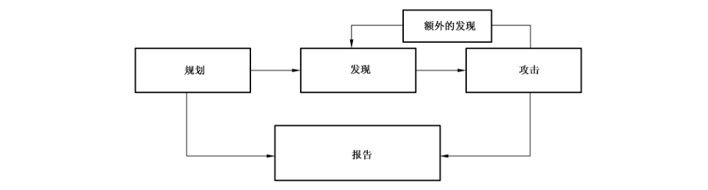

# GB/T 36627-2018 信息安全技术 网络安全等级保护测试评估技术指南

> 来源：[GB/T 36627-2018 国家标准详情](https://openstd.samr.gov.cn/bzgk/std/newGbInfo?hcno=D58BC3A7EFF62876D20514C359B13755)；发布日期：2018-09-17；实施日期：2019-04-01。
> PDF SHA-256：6e67fd468fe9ffb4aa1052be40b4433e2061f1bd2aae0eed05d1220f440b3a60。
> 转写说明：将官方 PDF 逐页渲染为图像并进行识别，对照全部 17 页原图校正文字、列表编号和附录层级；保留原图，省略封面、目录及页眉页脚。正式引用请核对原 PDF。

## 前言

本标准按照 GB/T 1.1—2009 给出的规则起草。

请注意本文件的某些内容可能涉及专利。本文件的发布机构不承担识别这些专利的责任。

本标准由全国信息安全标准化技术委员会（SAC/TC 260）提出并归口。

本标准起草单位：公安部第三研究所、中国信息安全研究院有限公司、上海市信息安全测评认证中心、中国电子技术标准化研究院、中国信息安全认证中心。

本标准主要起草人：张艳、陆臻、杨晨、顾健、徐御、沈亮、俞优、张笑笑、许玉娜、金铭彦、高志新、邹春明、陈妍、胡亚兰、赵戈、毕强、何勇亮、李晨、盛璐祎。

## 引言

网络安全等级保护测评过程包括测评准备活动、方案编制活动、现场测评活动、报告编制活动四个基本测评活动。本标准为方案编制活动、现场测评活动中涉及的测评技术选择与实施过程提供指导。

网络安全等级保护相关的测评标准主要有 GB/T 22239、GB/T 28448 和 GB/T 28449 等。其中 GB/T 22239 是网络安全等级保护测评的基础性标准，GB/T 28448 针对 GB/T 22239 中的要求，提出了不同网络安全等级的测评要求；GB/T 28449 主要规定了网络安全等级保护测评工作的测评过程。本标准与 GB/T 28448 和 GB/T 28449 的区别在于：GB/T 28448 主要描述了针对各级等级保护对象单元测评的具体测评要求和测评流程，GB/T 28449 则主要对网络安全等级保护测评的活动、工作任务以及每项任务的输入/输出产品等提出指导性建议，不涉及测评中具体的测试方法和技术。本标准对网络安全等级保护测评中的相关测评技术进行明确的分类和定义，系统地归纳并阐述测评的技术方法，概述技术性安全测试和评估的要素，重点关注具体技术的实现功能、原则等，并提出建议供使用，因此本标准在应用于网络安全等级保护测评时可作为对 GB/T 28448 和 GB/T 28449 的补充。

## 1 范围

本标准给出了网络安全等级保护测评（以下简称“等级测评”）中的相关测评技术的分类和定义，提出了技术性测试评估的要素、原则等，并对测评结果的分析和应用提出建议。

本标准适用于测评机构对网络安全等级保护对象（以下简称“等级保护对象”）开展等级测评工作，以及等级保护对象的主管部门及运营使用单位对等级保护对象安全等级保护状况开展安全评估。

## 2 规范性引用文件

下列文件对于本文件的应用是必不可少的。凡是注日期的引用文件，仅注日期的版本适用于本文件。凡是不注日期的引用文件，其最新版本（包括所有的修改单）适用于本文件。

- GB 17859—1999 计算机信息系统安全保护等级划分准则

- GB/T 25069—2010 信息安全技术 术语

## 3 术语和定义、缩略语

### 3.1 术语和定义

GB 17859—1999 及 GB/T 25069—2010 界定的以及下列术语和定义适用于本文件。

#### 3.1.1 字典式攻击 dictionary attack

在破解口令时，逐一尝试用户自定义词典中的单词或短语的攻击方式。

#### 3.1.2 文件完整性检查 file integrity checking

通过建立文件校验数据库，计算、存储每一个保留文件的校验，将已存储的校验重新计算以比较当前值和存储值，从而识别文件是否被修改。

#### 3.1.3 网络嗅探 network sniffer

一种监视网络通信、解码协议，并对关注的信息头部和有效载荷进行检查的被动技术，同时也是一种目标识别和分析技术。

#### 3.1.4 规则集 rule set

一种用于比较网络流量或系统活动以决定响应措施（如发送或拒绝一个数据包，创建一个告警，或允许一个系统事件）的规则的集合。

#### 3.1.5 测评对象 target of testing and evaluation

等级测评过程中不同测评方法作用的对象，主要涉及相关信息系统、配套制度文档、设备设施及人员等。

### 3.2 缩略语

下列缩略语适用于本文件。

- CNVD：国家信息安全漏洞共享平台（China National Vulnerability Database）
- DNS：域名系统（Domain Name System）
- DDoS：分布式拒绝服务（Distributed Denial of Service）
- ICMP：Internet 控制报文协议（Internet Control Message Protocol）
- IDS：入侵检测系统（Intrusion Detection Systems）
- IPS：入侵防御系统（Intrusion Prevention System）
- MAC：介质访问控制（Media Access Control）
- SSH：安全外壳协议（Secure Shell）
- SSID：服务集标识（Service Set Identifier）
- SQL：结构化查询语言（Structured Query Language）
- VPN：虚拟专用网络（Virtual Private Network）

## 4 概述

### 4.1 技术分类

可用于等级测评的测评技术分成以下三类：

a）检查技术：检查信息系统、配套制度文档、设备设施，并发现相关规程和策略中安全漏洞的测评技术。通常采用手动方式，主要包括文档检查、日志检查、规则集检查、系统配置检查、文件完整性检查、密码检查等。

b）识别和分析技术：识别系统、端口、服务以及潜在安全性漏洞的测评技术。这些技术可以手动执行，也可使用自动化的工具，主要包括网络嗅探、网络端口和服务识别、漏洞扫描、无线扫描等。

c）漏洞验证技术：验证漏洞存在性的测评技术。基于检查、目标识别和分析结果，针对性地采取手动执行或使用自动化的工具，主要包括口令破解、渗透测试、远程访问测试等，对可能存在的安全漏洞进行验证确认，获得证据。

### 4.2 技术选择

当选择和确定用于等级测评活动的技术方法时，考虑的因素主要包括但不限于测评对象、测评技术适用性、测评技术对测评对象可能引入的安全风险，以选择合适的技术方法。

当所选择的技术方法在实施过程中可能对测评对象产生影响时，宜优先考虑对与测评对象的生产系统相同配置的非生产系统进行测试，在非业务运营时间进行测试或在业务运营时间仅使用风险可控的技术方法进行测试，以尽量减少对测评对象业务的影响。

实施技术测评后产生的测评结果可用于对测评对象进行威胁分析、改进建议的提出及结果报告的生成等，具体参见附录 A。

## 5 等级测评要求

### 5.1 检查技术

#### 5.1.1 文档检查

文档检查的主要功能是基于等级保护对象运营单位提供的文档，评价其策略和规程的技术准确性和完整性。进行文档检查时，可考虑以下评估要素：

a）检查对象包括安全策略、体系结构和要求、标准作业程序、系统安全计划和授权许可、系统互连的技术规范、事件响应计划等，确保技术的准确性和完整性；

b）检查安全策略、体系结构和要求、标准作业程序、系统安全计划和授权许可、系统互连的技术规范、事件响应计划等文档的完整性，通过检查执行记录和相应表单，确认被测方安全措施的实施与制度文档的一致性；

c）发现可能导致遗漏或不恰当地实施安全控制措施的缺陷和弱点；

d）验证测评对象的文档是否与网络安全等级保护标准、法规相符合，查找有缺陷或已过时的策略；

e）文档检查的结果可用于调整其他的测试技术，例如，当口令管理策略规定了最小口令长度和复杂度要求的时候，该信息应可用于配置口令破解工具，以提高口令破解效率。

#### 5.1.2 日志检查

日志检查的主要功能是验证安全控制措施是否记录了测评对象的信息系统、设备设施的使用、配置和修改的历史记录等适当信息，等级保护对象的运营使用单位是否坚持了日志管理策略，并且能够发现潜在的问题和违反安全策略的情况。进行日志检查时，可考虑以下评估要素：

a）认证服务器或系统日志，包括成功或失败的认证尝试；

b）操作系统日志，包括系统和服务的启动、关闭，未授权软件的安装，文件访问，安全策略变更，账户变更（例如账户创建和删除、账户权限分配）以及权限使用等信息；

c）IDS/IPS 日志，包括恶意行为和不恰当使用；

d）防火墙、交换机和路由器日志，包括影响内部设备的出站连接（如僵尸程序、木马、间谍软件等），以及未授权连接的尝试和不恰当使用；

e）应用日志，包括未授权的连接尝试、账号变更、权限使用，以及应用程序或数据库的使用信息等；

f）防病毒日志，包括病毒查杀、感染日志，以及升级失败、软件过期等其他事件；

g）其他安全日志，如补丁管理等，应记录已知漏洞的服务和应用等信息；

h）网络运行状态、网络安全事件相关日志，留存时间不少于6 个月。

#### 5.1.3 规则集检查

规则集检查的主要功能是发现基于规则集的安全控制措施的漏洞，检查对象包括网络设备、安全设备、数据库、操作系统及应用系统的访问控制列表、策略集，三级及以上等级保护对象还应包括强制访问控制机制。进行规则集检查时，可考虑以下评估要素和评估原则：

a）路由访问控制列表：

1）每一条规则都应是有效的（例如，因临时需求而设定的规则，在不需要的时候应立刻移除）；

2）应只允许策略授权的流量通过，其他所有的流量默认禁止。

b）访问控制设备策略集：

1）应采用默认禁止策略；

2）应实施最小权限访问，例如限定可信的 IP 地址或端口；

3）特定规则应在一般规则之前被触发；

4）仅开放必要的端口，以增强周边安全；

5）防止流量绕过测评对象的安全防御措施。

c）强制访问控制机制：

1）强制访问控制策略应具有一致性，系统中各个安全子集应具有一致的主、客体安全标记和相同的访问规则；

2）以文件形式存储和操作的用户数据，在操作系统的支持下，应实现文件级粒度的强制访问控制；

3）以数据库形式存储和操作的用户数据，在数据库管理系统的支持下，应实现表/记录、字段级粒度的强制访问控制；

4）检查强制访问控制的范围，应限定在已定义的主体与客体中。

#### 5.1.4 配置检查

配置检查的主要功能是通过检查测评对象的安全策略设置和安全配置文件，评价测评对象安全策略配置的强度，以及验证测评对象安全策略配置与测评对象安全加固策略的符合程度。进行配置检查时，可考虑以下评估要素：

a）依据安全策略进行加固或配置；

b）仅开放必要的服务和应用；

c）用户账号的唯一性标识和口令复杂度设置；

d）开启必要的审计策略，设置备份策略；

e）合理设置文件访问权限；

f）三级及以上等级保护对象中敏感信息资源主、客体的安全标记：

1）由系统安全员创建主体（如用户）、客体（如数据）的安全标记；

2）实施相同强制访问控制安全策略的主、客体，应标以相同的安全标记；

3）检查标记的范围，应扩展到测评对象中的所有主体与客体。

#### 5.1.5 文件完整性检查

文件完整性检查的主要功能是识别系统文件等重要文件的未授权变更。进行文件完整性检查时，可考虑以下评估要素：

a）采用哈希或数字签名等手段，保证重要文件的完整性；

b）采用基准样本与重要文件进行比对的方式，实现重要文件的完整性校验；

c）采用部署基于主机的 IDS 设备，实现对重要文件完整性破坏的告警。

#### 5.1.6 密码检查

密码检查的主要功能是对测评对象中采用的密码技术或产品进行安全性检查。进行密码检查时，可考虑以下评估原则：

a）所提供的密码算法相关功能符合国家密码主管部门的有关规定；

b）所使用的密钥长度符合等级保护对象行业主管部门的有关规定。

### 5.2 识别和分析技术

#### 5.2.1 网络嗅探

网络嗅探的主要功能是通过捕捉和重放网络流量，收集、识别网络中活动的设备、操作系统和协议、未授权和不恰当的行为等信息。进行网络嗅探时，可考虑以下评估要素和评估原则：

a）监控网络流量，记录活动主机的 IP 地址，并报告网络中发现的操作系统信息；

b）识别主机之间的联系，包括哪些主机相互通信，其通信的频率和所产生的流量的协议类型；

c）通过自动化工具向常用的端口发送多种类型的网络数据包（如 ICMP pings），分析网络主机的响应，并与操作系统和网络服务的数据包的已知特征相比较，识别主机所运行的操作系统、端口及端口的状态。

d）在网络边界处部署网络嗅探器，用以评估进出网络的流量；

e）在防火墙后端部署网络嗅探器，用以评估准确过滤流量的规则集；

f）在 IDS/IPS 后端部署网络嗅探器，用以确定特征码是否被触发并得到适当的响应；

g）在重要操作系统和应用程序前端部署网络嗅探器，用以评估用户活动；

h）在具体网段上部署网络嗅探器，用以验证加密协议的有效性。

#### 5.2.2 网络端口和服务识别

网络端口和服务识别的主要功能是识别活动设备上开放的端口、相关服务与应用程序。进行网络端口和服务识别时，可考虑以下评估要素和评估原则：

a）对主机及存在潜在漏洞的端口进行识别，并用于确定渗透性测试的目标；

b）在从网络边界外执行扫描时，应使用含分离、复制、重叠、乱序和定时技术的工具，并利用工具改变数据包，让数据包融入正常流量中，使数据包避开 IDS/IPS 检测的同时穿越防火墙；

c）应尽量减少扫描工具对网络运行的干扰，如选择端口扫描的时间。

#### 5.2.3 漏洞扫描

漏洞扫描的主要功能是针对主机和开放端口识别已知漏洞、提供建议降低漏洞风险；同时，有助于识别过时的软件版本、缺失的补丁和错误配置，并验证其与机构安全策略的一致性。进行漏洞扫描时，可考虑以下评估要素和评估原则：

a）识别漏洞相关信息，包含漏洞名称、类型、漏洞描述、风险等级、修复建议等内容；

b）通过工具识别结合人工分析的方式，对发现的漏洞进行关联分析，从而准确判断漏洞的风险等级；

c）漏洞扫描前，扫描设备应更新升级至最新的漏洞库，以确保能识别最新的漏洞；

d）依据漏洞扫描工具的漏洞分析原理（如特征库匹配、攻击探测等），谨慎选择扫描策略，防止引起测评对象故障；

e）使用漏洞扫描设备时应对扫描线程数、流量进行限制，以降低测评对测评对象产生的风险。

#### 5.2.4 无线扫描

无线扫描的主要功能是识别被测环境中没有物理连接（如网络电缆或外围电缆）情况下使一个或多个设备实现通信的方式，帮助机构评估、分析无线技术对扫描对象所带来的安全风险。进行无线扫描时，可考虑以下评估要素和评估原则：

a）识别无线流量中无线设备的关键属性，包括SSID、设备类型、频道、MAC 地址、信号强度及传送包的数目；

b）无线扫描设备部署位置的环境要素包括：被扫描设备的位置和范围、使用无线技术进行数据传输的测评对象的安全保护等级和数据重要性，以及扫描环境中无线设备连接和断开的频繁程度以及流量规模；

c）使用安装配置无线分析软件的移动设备，如笔记本电脑、手持设备或专业设备；

d）基于无线安全配置要求，对无线扫描工具进行扫描策略配置，以实现差距分析；

e）适当配置扫描工具的扫描间隔时间，既能捕获数据包，又能有效地扫描每个频段；

f）可通过导入平面图或地图，以协助定位被发现设备的物理位置；

g）对捕获的数据包进行分析，从而识别扫描范围内发现的潜在的恶意设备和未授权的网络连接模式；

h）实施蓝牙扫描时，应覆盖测评对象中部署的支持蓝牙的所有基础设施（如蓝牙接入点）。

### 5.3 漏洞验证技术

#### 5.3.1 口令破解

口令破解的主要功能是在评估过程中通过采用暴力猜测（密码穷举）、字典攻击等技术手段验证数据库、操作系统、应用系统、设备的管理员口令复杂度。进行口令破解时，可考虑以下评估方法和评估原则：

a）使用字典式攻击方法或采用预先计算好的彩虹表（散列值查找表）进行口令破解尝试；

b）使用混合攻击或暴力破解的方式进行口令破解；混合攻击以字典攻击方法为基础，在字典中增加了数字和符号字符；

c）如测评对象采用带有盐值的加密散列函数时，不宜使用彩虹表方式进行口令破解尝试；

d）使用暴力破解时，可采用分布式执行的方式提高破解的效率。

#### 5.3.2 渗透测试

渗透测试的主要功能是通过模拟恶意黑客的攻击方法，攻击等级保护对象的应用程序、系统或者网络的安全功能，从而验证测评对象弱点、技术缺陷或漏洞的一种评估方法。进行渗透测试时，可考虑以下评估要素和评估原则：

a）通过渗透测试评估确认以下漏洞的存在：

1）系统/服务类漏洞。由于操作系统、数据库、中间件等为应用系统提供服务或支撑的环境存在缺陷，所导致的安全漏洞，如缓冲区溢出漏洞、堆/栈溢出、内存泄露等，可能造成程序运行失败、系统宕机、重新启动等后果，更为严重的，可以导致程序执行非授权指令，甚至取得系统特权，进而进行各种非法操作。

2）应用代码类漏洞。由于开发人员编写代码不规范或缺少必要的校验措施，导致应用系统存在安全漏洞，包括 SQL 注入、跨站脚本、任意上传文件等漏洞；攻击者可利用这些漏洞，对应用系统发起攻击，从而获得数据库中的敏感信息，更为严重的，可以导致服务器被控制。

3）权限旁路类漏洞。由于对数据访问、功能模块访问控制规则不严或存在缺失，导致攻击者可非授权访问这些数据及功能模块。权限旁路类漏洞通常可分为越权访问及平行权限，越权访问是指低权限用户非授权访问高权限用户的功能模块或数据信息；平行权限是指攻击者利用自身权限的功能模块，非授权访问或操作他人的数据信息。

4）配置不当类漏洞。由于未对配置文件进行安全加固，仅使用默认配置或配置不合理，所导致的安全风险。如中间件配置支持 put 方法，可能导致攻击者利用 put 方法上传木马文件，从而获得服务器控制权。

5）信息泄露类漏洞。由于系统未对重要数据及信息进行必要的保护，导致攻击者可从泄露的内容中获得有用的信息，从而为进一步攻击提供线索。如源代码泄露、默认错误信息中含有服务器信息/SQL 语句等均属于信息泄露类漏洞。

6）业务逻辑缺陷类漏洞。由于程序逻辑不严或逻辑太复杂，导致一些逻辑分支不能够正常处理或处理错误。如果出现这种情况，则用户可以根据业务功能的不同进行任意密码修改、越权访问、非正常金额交易等攻击。

b）充分考虑等级保护对象面临的安全风险，选择并模拟内部（等级保护对象所在的内部网络）攻击或外部（从互联网、第三方机构等外部网络）攻击。

c）评估者应制定详细的渗透测试方案，内容包括渗透测试对象、渗透测试风险及规避措施等内容（相关内容参见附录 B）。

#### 5.3.3 远程访问测试

远程访问测试的主要功能是评估远程访问方法中的漏洞，发现未授权的接入方式。进行远程访问测试时，可考虑以下评估要素和评估原则：

a）发现除 VPN、SSH、远程桌面应用之外是否存在其他的非授权的接入方式。

b）发现未授权的远程访问服务。通过端口扫描定位经常用于进行远程访问的公开的端口，通过查看运行的进程和安装的应用来手工检测远程访问服务。

c）检测规则集来查找非法的远程访问路径。评估者应检测远程访问规则集，如 VPN 网关的规则集，查看其是否存在漏洞或错误的配置，从而导致非授权的访问。

d）测试远程访问认证机制。可尝试默认的账户和密码或暴力攻击（使用社会工程学的方法重设密码来进行访问），或尝试通过密码找回功能机制来重设密码从而获得访问权限。

e）监视远程访问通信。可以通过网络嗅探器监视远程访问通信。如果通信未被保护，则可利用这些数据作为远程访问的认证信息，或者将这些数据作为远程访问用户发送或接收的数据。

## 附录 A（资料性附录）测评后活动

### A.1 测评结果分析

测评结果分析的主要目标是确定和排除误报，对漏洞进行分类，并确定产生漏洞的原因，此外，找出在整个测评中需要立即处理的严重漏洞。以下列举了常见的造成漏洞的根本原因，包括：

a）补丁管理不足，如未能及时应用补丁程序，或未能将补丁程序应用到所有有漏洞的系统中；

b）威胁管理不足，如未及时更新防病毒特征库，无效的垃圾邮件过滤以及不符合系统运营单位安全策略的防火墙策略等；

c）缺乏安全基准，同类的系统使用了不一致的安全配置策略；

d）在系统开发中缺乏对安全性的整合，如系统开发不满足安全要求，甚至未考虑安全要求或系统应用程序代码中存在漏洞；

e）安全体系结构存在缺陷，如安全技术未能有效地集成至系统中（例如，安全防护设施、设备放置位置不合理，覆盖面不足，或采用过时的技术）；

f）安全事件响应措施不足，如对渗透测试活动反应迟钝；

g）对最终用户（例如，对社会工程学、钓鱼攻击等缺乏防范意识，使用了非授权无线接入点）或对网络、系统管理员（例如，缺乏安全运维）的人员培训不足；

h）缺乏安全策略或未执行安全策略，如开放的端口，启动的服务，不安全的协议，非授权主机以及弱口令等。

### A.2 提出改进建议

针对每个测评结果中出现的安全问题，都提出相应的改进建议；改进建议中宜包括问题根源分析结果。改进建议通常包括技术性建议（例如，应用特定的补丁程序）和非技术性建议（例如，更新补丁管理制度）。改进措施的包括：制度修改、流程修改、策略修改、安全体系架构变更、应用新的安全技术以及部署操作系统和应用的补丁程序等。

### A.3 报告

在测评结果分析完成之后，宜生成包括系统安全问题、漏洞及其改进建议的报告。测评结果可用于以下几个方面：

a）作为实施改正措施的参考；

b）制定改进措施以修补确认的漏洞；

c）作为测评对象运营单位为使等级保护对象满足安全要求而采取改进措施的基准；

d）用以反映等级保护对象安全要求的实现状况；

e）为改进等级保护对象的安全而进行的成本效益分析；

f）用来加强其他生命周期活动，如风险评估等；

g）用来满足网络安全等级保护测评的报告要求。

## 附录 B（资料性附录）渗透测试的有关概念说明

### B.1 综述

渗透测试是一种安全性测试，在该类测试中，测试人员将模拟攻击者，利用攻击者常用的工具和技术对应用程序、信息系统或者网络的安全功能发动真实的攻击。相对于单一的漏洞，大多数渗透测试试图寻找一组安全漏洞，从而获得更多能够进入系统的机会。渗透测试也可用于确定：

a）系统对现实世界的攻击模式的容忍度如何；

b）攻击者需要成功破坏系统所面对的大体复杂程度；

c）可减少系统威胁的其他对策；

d）防御者能够检测攻击并且做出正确反应的能力。

渗透测试是一种非常重要的安全测试，测试人员需要丰富的专业知识和技能。尽管有经验的测试人员可降低这种风险，但不能完全避免风险，因此渗透测试宜经过深思熟虑和认真规划。

渗透测试通常包括非技术攻击方法。例如，一个渗透测试人员可以通过破坏物理安全控制机制的手段连接到网络，以窃取设备、捕获敏感信息（可能是通过安装键盘记录设备）或者破坏网络通信。在执行物理安全渗透测试时宜谨慎行事，明确如何验证测试人员入侵活动的有效性，如通过接入点或者文档。另一种非技术攻击手段是通过社会工程学，如伪装成客服坐席人员打电话询问用户的密码，或者伪装成用户打电话给客服坐席人员要求重置密码。更多关于物理安全测试、社会工程学技术以及其他非技术手段的渗透攻击测试，不在本标准的讨论范围。

### B.2 渗透测试阶段

#### B.2.1 概述

渗透测试通常包括规划、发现、攻击、报告四个阶段，如图 B.1所示。

#### B.2.2 规划阶段

在规划阶段，确定规则，管理层审批定稿，记录在案，并设定测试目标。规划阶段为一个成功的渗透测试奠定基础，在该阶段不发生实际的测试。

#### B.2.3 发现阶段

渗透测试的发现阶段包括两个部分：

第一部分是实际测试的开始，包括信息收集和扫描。网络端口和服务标识用于进行潜在目标的确定。除端口及服务标识外，还有以下技术也被用于收集网络信息目标：

a）通过 DNS、InterNIC（WHOIS）查询和网络监听等多种方法获取主机名和 IP 地址信息；

b）通过搜索系统 Web 服务器或目录服务器来获得系统内部用户姓名、联系方式等；

c）通过诸如 NetBIOS 枚举方法和网络信息系统获取系统名称、共享目录等系统信息；

d）通过标识提取得到应用程序和服务的相关信息，如版本号。

第二部分是脆弱性分析，其中包括将被扫描主机开放的服务、应用程序、操作系统和漏洞数据库进行比对。测试人员可以使用他们自己的数据库，或者 CNVD 等公共数据库来手动找出漏洞。

#### B.2.4 攻击阶段

执行攻击是渗透测试的核心。攻击阶段是一个通过对原先确定的漏洞进一步探查，进而核实潜在漏洞的过程。如果攻击成功，说明漏洞得到验证，确定相应的保障措施就能够减轻相关的安全风险。在大多数情况下，执行探查并不能让攻击者获得潜在的最大入口，反而会使测试人员了解更多目标网络和其潜在漏洞的内容，或诱发对目标网络的安全状态的改变。一些漏洞可能会使测试人员能够提升对于系统或网络的权限，从而获得更多的资源；若发生上述情况，则需要额外的分析和测试来确定网络安全情况和实际的风险级别。比如说，识别可从系统上被搜集、改变或删除的信息的类型。倘若利用一个特定漏洞的攻击被证明行不通，测试人员可尝试利用另一个已发现的漏洞。如果测试人员能够利用漏洞，可在目标系统或网络中安装部署更多的工具，以方便测试。这些工具用于访问网络上的其他系统或资源，并获得有关网络或组织的信息。在进行渗透测试的过程中，需要对多个系统实施测试和分析，以确定攻击者可能获得的访问级别。虽然漏洞扫描器仅对可能存在的漏洞进行检查，但渗透测试的攻击阶段会利用这些漏洞来确认其存在性。

#### B.2.5 报告阶段

渗透测试的报告阶段与其他三个阶段同时进行（见图 B.1）。在规划阶段，将编写测试计划；在发现和攻击阶段，通常是保存测试记录并定期向系统管理员和/或管理部门报告。在测试结束后，报告通常是用来描述被发现的漏洞、目前的风险等级，并就如何弥补发现的薄弱环节提供建议和指导。

### B.3 渗透测试方案

渗透测试方案宜侧重于在应用程序、系统或网络中的设计和实现中，定位和挖掘出可利用的漏洞缺陷。渗透测试重现最可能的和最具破坏性的攻击模式，包括最坏的情况，诸如管理员的恶意行为。由于渗透测试场景可以设计以模拟内部攻击、外部攻击，或两者兼而有之，因此外部和内部安全测试方法均要考虑到。如果内部和外部测试都要执行，则通常优先执行外部测试。

外部攻击是模拟从组织外部发起的攻击行为，可能来自于对组织内部信息一无所知的攻击者。模拟一个外部攻击，测试人员不知道任何关于目标环境以外的信息，特别是 IP 地址或地址范围情况的真实信息。测试人员可通过公共网页、新闻页面以及类似的网站收集目标信息，进行综合分析；使用端口扫描器和漏洞扫描器，以识别目标主机。由于测试人员的流量往往需要穿越防火墙，因此通过扫描获取的信息量远远少于内部角度测试所获得的信息。从外部控制该组织网络上的主机后，测试人员可尝试将其作跳板机，并使用此访问权限去危及那些通常不能从外部网络访问的其他主机。模拟外部攻击的渗透测试是一个迭代的过程，利用最小的访问权限取得更大的访问。

内部攻击是模拟组织内部违规操作者的行为。除了测试人员位于内部网络（即防火墙后面），并已授予对网络或特定系统一定程度的访问权限（通常是作为一个用户，但有时层次更高）之外，内部渗透测试与外部测试类似。测试人员可以通过权限提升获得更大程度的网络及系统的访问权限。

渗透测试对确定一个信息系统的脆弱性以及如果网络受到破坏所可能发生的损害程度非常重要。

由于渗透测试使用真正的资源并对生产系统和数据进行攻击，可能对网络和系统引入额外的风险，因此测试人员宜制订测试方案，明确测试策略，限制可能使用的特定工具或技术，在可能造成危害之前停止测试。测试人员宜重视渗透测试过程及结果的交流，帮助系统管理员和/或管理部门及时了解测试进度以及攻击者可能利用的攻击方法和攻击途径。

### B.4 渗透测试风险

在渗透测试过程中，测试人员通常会利用攻击者常用的工具和技术来对被测系统和数据发动真实的攻击，必然会对被测系统带来安全风险，在极端情况或应用系统存在某些特定安全漏洞时可能会产生如下安全风险：

a）在使用 Web 漏洞扫描工具进行漏洞扫描时，可能会对 Web 服务器及 Web 应用程序带来一定的负载，占用一定的资源，在极端情况下可能会造成 Web 服务器宕机或服务停止；

b）如 Web 应用程序某功能模块提供对数据库、文件写操作的功能（包括执行 Insert、 Delete、Update 等命令），且未对该功能模块实施数据有效性校验、验证码机制、访问控制等措施，则在进行 Web 漏洞扫描时有可能会对数据库、文件产生误操作，如在数据库中插入垃圾数据、删除记录/文件、修改数据/文件等；

c）在进行特定漏洞验证时，可能会根据该漏洞的特性对主机或 Web 应用程序造成宕机、服务停止等风险；

d）在对 Web 应用程序/操作系统/数据库等进行口令暴力破解时，可能触发其设置的安全机制，导致 Web 应用程序/操作系统/数据库的账号被锁定，暂时无法使用；

e）在进行主机远程漏洞扫描及进行主机/数据库溢出类攻击测试，极端情况下可能导致被测试服务器操作系统/数据库出现死机或重启现象。

### B.5 渗透测试风险规避

针对渗透测试过程中可能出现的测试风险，测评人员宜向用户详细介绍渗透测试方案中的内容，并对测试过程中可能出现的风险进行提示，并与用户就如下内容进行协商，做好渗透测试的风险管控：

a）测试时间：为减轻渗透测试造成的压力和预备风险排除时间，宜尽可能选择访问量不大、业务不繁忙的时间窗口，测试前可在应用系统上发布相应的公告；

b）测试策略：为了防范测试导致业务的中断，测试人员宜在进行带有渗透、破坏、不可控性质的高风险测试前（如主机/数据库溢出类验证测试、DDoS 等），与应用系统管理人员进行充分沟通，在应用系统管理人员确认后方可进行测试；宜优先考虑对与生产系统相同配置的非生产系统进行测试，在非业务运营时间进行测试或在业务运营时间使用非限制技术，以尽量减少对生产系统业务的影响；对于非常重要的生产系统，不建议进行拒绝服务等风险不可控的测试，以避免意外崩溃而造成不可挽回的损失；

c）备份策略：防范渗透过程中的异常问题，建议在测试前管理员对系统进行备份（包括网页文件、数据库等），以便在出现误操作时能及时恢复；如果条件允许，也可以采取对目标副本进行渗透的方式加以实施；

d）应急策略：测试过程中，如果被测系统出现无响应、中断或者崩溃等异常情况，测试人员宜立即中止渗透测试，并配合用户进行修复处理；在确认问题并恢复系统后，经用户同意方可继续进行其余的测试；

e）沟通机制：在测试前，宜确定测试人员和用户配合人员的联系方式，用户方宜在测试期间安排专人职守，与测试人员保持沟通，如发生异常情况，可及时响应；测试人员宜在测试结束后要求用户检查系统是否正常，以确保系统的正常运行。

## 参考文献

- ［1］ GB/T 20269—2006 信息安全技术 信息系统安全管理要求

- ［2］ GB/T 20270—2006 信息安全技术 网络基础安全技术要求

- ［3］ GB/T 20282—2006 信息安全技术 信息系统安全工程管理要求

- ［4］ GB/T 22239 信息安全技术 信息系统安全等级保护基本要求

- ［5］ GB/T 28448 信息安全技术 信息系统安全等级保护测评要求

- ［6］ GB/T 28449 信息安全技术 信息系统安全等级保护测评过程指南
