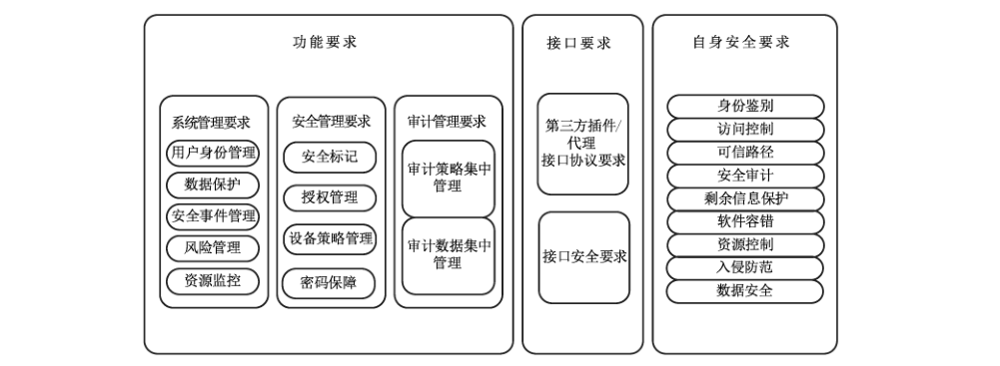
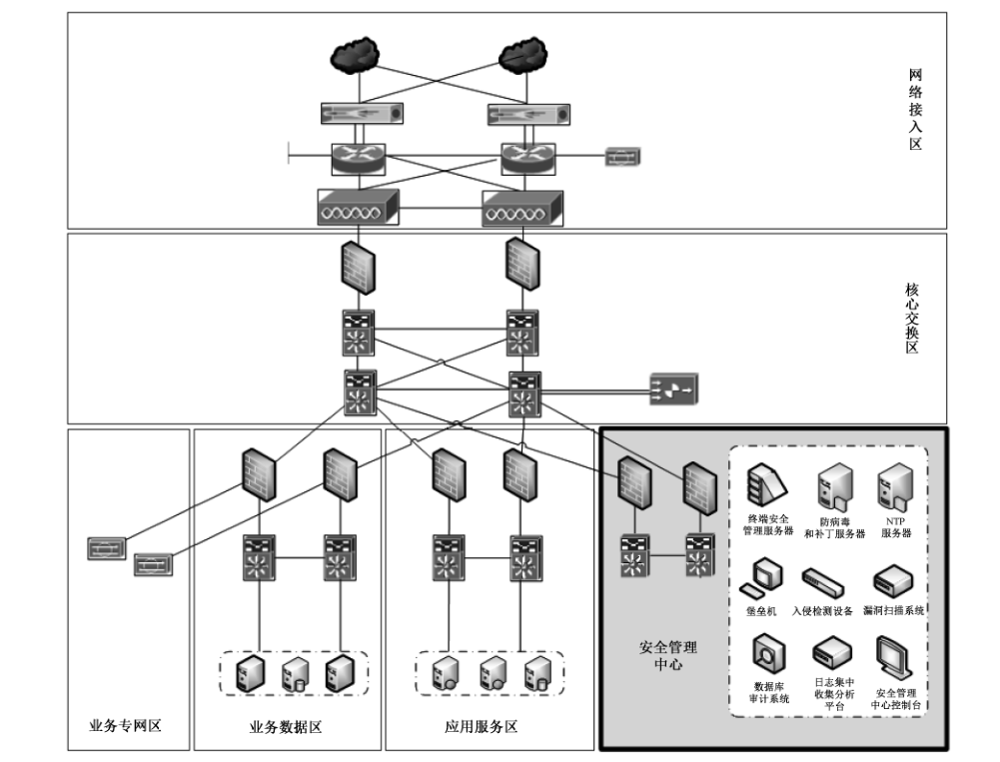

# GB/T 36958-2018 信息安全技术 网络安全等级保护安全管理中心技术要求

> 来源：[GB/T 36958-2018 国家标准详情](https://openstd.samr.gov.cn/bzgk/std/newGbInfo?hcno=081F6A31FA3A7254DB8CFC080CED167A)；发布日期：2018-12-28；实施日期：2019-07-01。
> PDF SHA-256：c392d3531533823d4bd1ab503a3c77ccf66131afbe06f28b911dbda1b1843cb8。
> 转写说明：将官方 PDF 逐页渲染为图像并进行识别，对照全部 31 页原图校正文字、列表编号和附录层级；重建跨页表格，保留原图，省略封面、目录及页眉页脚。正式引用请核对原 PDF。

## 前言

本标准按照 GB/T 1.1—2009给出的规则起草。

请注意本文件的某些内容可能涉及专利。本文件的发布机构不承担识别这些专利的责任。

本标准由全国信息安全标准化技术委员会（SAC/TC 260）提出并归口。

本标准起草单位：中国电子科技集团公司第十五研究所（信息产业信息安全测评中心）、公安部第三研究所、公安部第一研究所、网神信息技术（北京）股份有限公司。

本标准主要起草人：霍珊珊、任卫红、刘健、张益、董晶晶、刘凯明、郑国刚、陶源、陈广勇、李秋香、卢青、王刚。

## 引言

本标准从安全管理中心的功能、接口、自身安全等方面，对GB/T 25070 中提出的安全管理中心及其安全技术和机制进行了进一步规范，提出了通用的安全技术要求，指导安全厂商和用户依据本标准要求设计和建设安全管理中心。为清晰表示每一个安全级别比较低一级安全级别的安全技术要求的增加和增强，从第二级安全管理中心的技术要求开始，每一级新增部分用“黑体”表示。

安全管理中心是对网络安全等级保护对象的安全策略及安全计算环境、安全区域边界和安全通信网络上的安全机制实施统一管理的平台或区域，是网络安全等级保护对象安全防御体系的重要组成部分，涉及系统管理、安全管理、审计管理等方面。

## 1 范围

本标准规定了网络安全等级保护安全管理中心的技术要求。

本标准适用于指导安全厂商和运营使用单位依据本标准要求设计、建设和运营安全管理中心。

## 2 规范性引用文件

下列文件对于本文件的应用是必不可少的。凡是注日期的引用文件，仅注日期的版本适用于本文件。凡是不注日期的引用文件，其最新版本（包括所有的修改单）适用于本文件。

- GB/T 5271.8 信息技术 词汇 第8部分：安全

- GB 17859—1999 计算机信息系统 安全保护等级划分准则

- GB/T 25069 信息安全技术 术语

- GB/T 25070 信息安全技术 信息系统等级保护安全设计技术要求

## 3 术语和定义

GB 17859—1999、GB/T 5271.8、GB/T 25069 和 GB/T 25070 界定的以及下列术语和定义适用于本文件。

### 3.1 数据采集接口 data acquisition interface

采集网络环境中的主机操作系统、数据库系统、网络设备、安全设备等各监测对象上的安全事件、脆弱性以及相关配置及其状态信息的接口。

### 3.2 采集器 collector

从网络安全等级保护对象或其所在区域上收集网络安全源数据和事件信息的组件。

### 3.3 安全管理中心 security management center

对定级系统的安全策略及安全计算环境、安全区域边界和安全通信网络的安全机制实施统一管理的平台或区域。

> 注：修改 GB/T 25070—2010定义3.6。

## 4 缩略语

下列缩略语适用于本文件。

CPU 中央处理器（Central Processing Unit）

CVE 通用脆弱性及披露（Common Vulnerabilities & Exposures）

DDoS 分布式拒绝服务（Distributed Denial of Service）

IP 互联网协议（Internet Protocol）

IPv4 互联网协议第四版（Internet Protocol version 4）

IPv6 互联网协议第六版（Internet Protocol version 6）

SNMP 简单网络管理协议（Simple Network Management Protocol）

## 5 安全管理中心概述

### 5.1 总体说明

安全管理中心作为对网络安全等级保护对象的安全策略及安全计算环境、安全区域边界和安全通信网络的安全机制实施统一管理的系统平台，实现统一管理、统一监控、统一审计、综合分析和协同防护。本标准将安全管理中心技术要求分为功能要求、接口要求和自身安全要求三个大类（如图1所示）。

其中，功能要求从系统管理、安全管理和审计管理三个方面提出具体要求；接口要求对安全管理中心涉及到的接口协议和接口安全提出具体要求；自身安全要求对安全管理中心自身安全功能提出具体要求。

依据 GB/T 25070的定义，第二级及第二级以上的定级系统安全保护环境需要设置安全管理中心，称为第二级安全管理中心、第三级安全管理中心、第四级安全管理中心和第五级安全管理中心。安全管理中心等级与网络安全等级保护对象等级的关系见附录 A，在附录 B中，以表格形式列举了第二级、第三级、第四级的差异。

安全管理中心作为一个系统区域（如图2所示），主要负责系统的安全运行维护管理，其边界通常安全管理自身区域的网络边界访问控制设备，与被管理的网络设备区域、服务器区域进行安全配置数据交互，完成整个系统环境安全策略和安全运维的统一管理。

### 5.2 功能描述

系统管理主要通过管理员对系统的资源和运行进行配置、控制和管理，包括用户身份管理、系统资源配置、系统加载和启动、系统运行的异常处理以及支持管理本地和异地灾难备份与恢复等。

安全管理主要通过安全管理员对系统中的主体、客体进行统一标记，对主体进行授权，配置一致的安全策略，并确保标记、授权和安全策略的数据完整性。

审计管理主要通过安全审计员对分布在系统各个组成部分的安全审计机制进行集中管理，包括根据安全审计策略对审计记录进行分类，提供按时间段开启和关闭相应类型的安全审计机制，对各类审计记录进行存储、管理和查询等。安全审计员对审计记录进行分析，并根据分析结果进行及时处理。

## 6 第二级安全管理中心技术要求

### 6.1 功能要求

#### 6.1.1 系统管理要求

##### 6.1.1.1 用户身份管理

用户身份管理应满足以下要求：

a） 能够对被管理对象的系统管理员进行身份鉴别，并对身份标识及鉴别信息进行复杂度检查；

b） 在物联网系统中，应通过被管理对象的系统管理员对感知设备、感知层网关等进行统一身份标识管理。

##### 6.1.1.2 数据保护

###### 6.1.1.2.1 数据保密性

数据保密性应满足以下要求：

a） 在安全管理中心与被管理对象之间建立连接之前，可利用密码技术进行会话初始化验证；

b） 可使用密码技术对安全管理中心与被管理对象之间通信过程中的整个报文或会话过程进行机密性保护；

c） 可采用加密或其他保护措施实现被管理对象的鉴别信息、配置管理数据的存储保密性。

###### 6.1.1.2.2 数据完整性

数据完整性应满足以下要求：

a） 能够检测到被管理对象鉴别信息、配置管理数据在传输过程中完整性受到破坏；

b） 能够检测到被管理对象鉴别信息、配置管理数据在存储过程中完整性受到破坏。

###### 6.1.1.2.3 数据备份与恢复

数据备份与恢复应满足以下要求：

a） 提供数据本地备份与恢复功能，增量数据备份至少每天一次，备份介质场外存放；

b） 备份数据应至少包含安全管理中心采集的原始数据、主/客体配置管理数据、安全管理中心自身审计数据等；

c） 在云计算平台中，应提供查询云服务客户数据及备份存储位置的方式。

##### 6.1.1.3 安全事件管理

###### 6.1.1.3.1 安全事件采集

安全事件采集应满足以下要求：

a） 支持安全事件监测采集功能，及时发现和采集发生的安全事件；

b） 能够对安全事件进行归一化处理，将不同来源、不同格式、不同内容组成的原始事件转换成标准的事件格式；

c） 安全事件的内容应包括日期、时间、主体标识、客体标识、类型、结果、IP地址、端口等信息；

d） 安全事件采集的范围应涵盖主机设备、网络设备、数据库、安全设备、各类中间件、机房环境控制系统等；

e） 能够对采集的安全事件原始数据的集中存储。

> 注：安全事件的属性可参考附录C。

###### 6.1.1.3.2 安全事件告警

安全事件告警应具备告警功能，在发现异常时可根据预先设定的阈值产生告警。

###### 6.1.1.3.3 安全事件响应

安全事件响应应满足以下要求：

a） 能够提供工单管理的功能，支持基于告警响应动作创建工单的流转流程；

b）能够提供安全通告功能，可以创建或导入安全风险通告，通告中应包括通告内容、描述信息、CVE编号、影响的操作系统等；

c） 能够根据通告提示的安全风险影响的操作系统，提供受影响的被保护资产列表。

###### 6.1.1.3.4 统计分析报表

统计分析报表应满足以下要求：

a） 能够按照时间、事件类型等条件对安全事件进行查询；

b） 能够提供统计分析和报表生成功能。

##### 6.1.1.4 风险管理

###### 6.1.1.4.1 资产管理

资产管理应满足以下要求：

a） 实现对被管理对象资产的管理，提供资产的添加、修改、删除、查询与统计功能；

b） 资产管理信息应包含资产名称、资产IP地址、资产类型、资产责任人、资产业务价值以及资产的机密性、完鏊性、可用性赋值等资产属性；

c） 支持资产属性的自定义；

d） 支持手工录人资产记录或基于指定模板的批量资产导入。

###### 6.1.1.4.2 威胁管理

威胁管理应满足以下要求：

a） 具备预定义的安全威胁分类；

b） 支持自定义安全威胁分类，如将已发生的安全事件对应的威胁设置为资产面临的威胁。

###### 6.1.1.4.3 脆弱性管理

脆弱性管理应允许创建并维护资产脆弱性列表，支持脆弱性列表的合并及更新。

###### 6.1.1.4.4 风险分析

风险分析应满足以下要求：

a） 能够根据资产的业务价值、资产当前的脆弱性及资产面临的安全威胁，计算目标资产的安全风险；

b） 安全风险的计算周期和计算公式能够根据部署环境的实际需要通过修改配置的方式进行相应调整；

c） 安全管理系统能够以图形化的方式展现当前资产的风险级别、当前风险的排名统计等。

##### 6.1.1.5 资源监控

###### 6.1.1.5.1 可用性监测

可用性监测应满足以下要求：

a） 支持通过监测网络设备、安全设备、主机操作系统、数据库、中间件、应用系统等重要性能指标，实时了解其可用性状态；

b）支持对关键指标（如：CPU 使用率、内存使用率、磁盘使用率、进程占用资源、交换分区、网络流量等方面）设置阈值，触发阈值时产生告警。

###### 6.1.1.5.2 网络拓扑监测

网络拓扑监测应满足以下要求：

a） 支持对网络拓扑图进行在线编辑，允许手工添加或删除监测节点或链路；

b） 能够展现当前网络环境中关键设备（包括网络设备、安全设备、服务器主机等）和链路的运行状态，如网络流量、网络协议统计分析等指标。

#### 6.1.2 审计管理要求

##### 6.1.2.1 审计策略集中管理

审计策略集中管理应能够查看主机操作系统、数据库系统、网络设备、安全设备的审计策略配置情况，包括策略是否开启、参数设施是否符合安全策略等。

##### 6.1.2.2 审计数据集中管理

###### 6.1.2.2.1 审计数据采集

审计数据采集应满足以下要求：

a） 能够实现审计数据的归一化处理，内容应涵盖日期、时间、主体标识、客体标识、类型、结果、IP地址、端口等信息；

b） 支持设定查询条件进行审计数据查询；

c） 支持对各种审计数据按规则进行过滤处理；

d） 支持对数据采集信息按照特定规则进行合并。

###### 6.1.2.2.2 审计数据采集对象

审计数据采集对象应满足以下要求：

a） 支持对网络设备（如交换机、路由器、流量管理、负载均衡等网络基础设备）的审计数据采集；

b） 支持对主机设备（如服务器操作系统等应用支撑平台和桌面电脑、笔记本电脑、手持终端等终端用户访问信息系统所使用的设备）的审计数据采集；

c） 支持对数据库的审计数据采集；

d） 支持对安全设备（如防火墙、入侵监测系统、抗拒绝服务攻击设备、防病毒系统、应用安全审计系统、访问控制系统等与信息系统安全防护相关的各种系统和设备）的审计数据采集；

e） 支持对各类中间件的审计数据采集；

f） 支持对机房环境控制系统（如空调、温度、湿度控制、消防设备、门禁系统等）的审计数据采集；

g） 在云计算平台中，应对云服务器、云数据库、云存储等云服务的创建、删除等操作行为进行审计；

h） 在工业控制系统中，应对工业控制现场控制设备、网络安全设备、网络设备、服务器、操作站等设备的网络安全监控和报警、网络安全日志信息进行集中管理。

###### 6.1.2.2.3 审计数据采集方式

审计数据采集方式应满足以下要求：

a） 支持通过如 Syslog、SNMP等协议采集各种系统或设备上的审计数据；

b） 通过统一接口，接收被管理对象的安全审计数据。

### 6.2 接口要求

#### 6.2.1 第三方插件/代理接口协议要求

安全管理中心应支持 SNMP Trap、Syslog、Web Service 等常规接口和自定义接口以及第三方的插件或者代理的接口实现各组件之间、与第三方平台之间的数据交换。

#### 6.2.2 接口安全要求

接口安全要求应满足以下要求：

a） 采用安全的接口协议，保证接口之间交互数据的完整性；

b）采用加密技术实现接口之间交互数据的保密性。

### 6.3 自身安全要求

#### 6.3.1 身份鉴别

安全管理中心控制台的管理员身份鉴别应满足以下要求：

a） 提供专用的登录控制模块对管理员进行身份标识和鉴别；

b） 提供管理员用户身份标识唯一和鉴别信息复杂度检查功能，保证不存在重复用户身份标识，身份鉴别信息不易被冒用；

c） 提供登录失败处理功能，可采取结束会话、限制非法登录次数和自动退出等措施。

#### 6.3.2 访问控制

安全管理中心控制台的访问控制应满足以下要求：

a） 提供自主访问控制功能，依据安全策略控制管理员对各功能的访问；

b） 自主访问控制的覆盖范围应包括所有管理员、功能及它们之间的操作；

c） 由授权管理员配置访问控制策略，并禁止默认账户的访问。

#### 6.3.3 安全审计

安全管理中心控制台的安全审计应满足以下要求：

a） 提供覆盖到每个管理员的安全审计功能，记录所有管理员对重要操作和安全事件进行审计；

b） 保证无法单独中断审计进程，无法删除、修改或覆盖审计记录；

c） 审计记录的内容至少应包括事件的日期、时间、发起者信息、类型、描述和结果等；

d） 提供对审计记录数据进行统计、查询的功能。

#### 6.3.4 软件容错

安全管理中心控制台的软件容错应提供数据有效性检验功能，保证通过人机接口输入或通过接口输入的数据格式或长度符合系统设定要求。

#### 6.3.5 资源控制

安全管理中心控制台的资源控制应满足以下要求：

a） 对管理员登录地址范围进行限制；

b） 当管理员在一段时间内未作任何动作，应能够自动结束会话；

c） 能够对最大并发会话连接数进行限制；

d） 提供对自身运行状态的监测，应能够对服务水平降低到预先规定的最小值进行检测和报警。

#### 6.3.6 入侵防范

安全管理中心控制台的入侵防范应满足以下要求：

a） 能够检测到对各服务器、网络设备和安全设备进行入侵的行为；

b） 能够通过设定终端接人方式或网络地址范围对通过网络进行管理的管理终端进行限制；

c） 服务器操作系统应遵循最小安装的原则，仅安装需要的组件和应用程序，并通过设置升级服务器等方式保持各组件的补丁及时得到更新；

d） 应关闭不需要的各组件系统服务和高危端口。

#### 6.3.7 数据安全

安全管理中心控制台的数据安全应满足以下要求：

a） 能够检测到管理数据和鉴别信息在传输和存储过程中完整性受到破坏；

b） 采用密码技术或其他保护措施实现管理数据和鉴别信息的数据传输和存储保密性。

## 7 第三级安全管理中心技术要求

### 7.1 功能要求

#### 7.1.1 系统管理要求

##### 7.1.1.1 用户身份管理

用户身份管理应满足以下要求：

a） 能够对被管理对象环境中的主体进行标识；

b） 能够采用两种或两种以上组合的鉴别技术对用户进行身份鉴别；

c） 能够对被管理对象的系统管理员进行身份鉴别，并对身份标识及鉴别信息进行复杂度检查；

d） 在物联网系统中，应通过被管理对象的系统管理员对感知设备、感知层网关等进行统一身份标识管理。

##### 7.1.1.2 数据保护

###### 7.1.1.2.1 数据保密性

数据保密性应满足以下要求：

a） 在安全管理中心与被管理对象之间建立连接之前，应利用密码技术进行会话初始化验证；

b） 应使用密码技术对安全管理中心与被管理对象之间通信过程中的整个报文或会话过程进行机密性保护；

c） 应采用加密或其他保护措施实现被管理对象的鉴别信息、配置管理数据的存储保密性。

###### 7.1.1.2.2 数据完整性

数据完整性应满足以下要求：

a） 能够检测到被管理对象鉴别信息、配置管理数据在传输过程中完整性受到破坏，并在检测到完整性错误时采取必要的恢复措施；

b） 能够检测到被管理对象鉴别信息、配置管理数据在存储过程中完整性受到破坏，并在检测到完整性错误时采取必要的恢复措施。

###### 7.1.1.2.3 数据备份与恢复

数据备份与恢复应满足以下要求：

a） 提供数据本地备份与恢复功能，完全数据备份至少每天一次，备份介质场外存放；

b） 备份数据应至少包含安全管理中心采集的原始数据、主/客身份标识数据、主/客体安全标记数据、主/客体配置管理数据、安全管理中心自身审计数据等；

c） 在云计算平台中，应提供查询云服务客户数据及备份存储位置的方式，云计算平台的运维应在中华人民共和国境内，禁止从境外对境内云计算平台的运维。

###### 7.1.1.2.4 剩余信息保护

剩余信息保护应保证主体和客体的鉴别信息所在的存储空间被释放或再分配给其他主体前得到完全清除，无论这些信息是存放在硬盘上还是在内存中。

##### 7.1.1.3 安全事件管理

###### 7.1.1.3.1 安全事件采集

安全事件采集应满足以下要求：

a） 支持安全事件监测采集功能，及时发现和采集发生的安全事件；

b） 能够对安全事件进行归一化处理，将不同来源、不同格式，不同内容组成的原始事件转换成标准的事件格式；

c） 安全事件的内容应包括日期、时间、主体标识、客体标识、类型、结果、IP地址、端口等信息；

d） 安全事件采集的范围应涵盖主机设备、网络设备、数据库、安全设备、各类中间件、机房环境控制系统等；

e） 能够对采集的安全事件原始数据的集中存储。

> 注：安全事件的属性可参考附录C。

###### 7.1.1.3.2 安全事件告警

安全事件告警应满足以下要求：

a） 具备告警功能，在发现异常时可根据预先设定的阈值产生告警；

b） 在产生告警时，应能够触发预先设定的事件分析规则，执行预定义的告警响应动作，如：控制台对话框告警、控制台告警音、电子邮件告警、手机短信告警、创建工单、通过 Syslog或 SNMP Trap 发布告警事件等；

c） 具有对高频度发生的相同安全事件进行合并告警，避免出现告警风暴的能力。

###### 7.1.1.3.3 安全事件响应

安全事件响应应满足以下要求：

a） 能够提供工单管理的功能，支持基于告警响应动作创建工单的流转流程；

b） 能够提供安全通告功能，可以创建或导人安全风险通告，通告中应包括通告内容、描述信息、CVE 编号、影响的操作系统等；

c） 能够根据通告提示的安全风险影响的操作系统，提供受影响的被保护资产列表。

###### 7.1.1.3.4 事件关联分析

事件关联分析应满足以下要求：

a） 支持将来自不同事件源的事件在一个分析规则中进行分析，从而能从海量事件中过滤出有逻辑关系的事件序列，据此给出相应的告警；

b） 针对常见的攻击行为和违规访问提供相应的关联分析规则，如针对主机扫描、端口扫描、DDoS攻击、蠕虫、口令猜测、跳板攻击等的关联分析规则。

###### 7.1.1.3.5 统计分析报表

统计分析报表应满足以下要求：

a） 能够按照时间、事件类型等条件对安全事件进行查询；

b） 能够提供统计分析和报表生成功能。

##### 7.1.1.4 风险管理

###### 7.1.1.4.1 资产管理

资产管理应满足以下要求：

a） 实现对被管理对象资产的管理，提供资产的添加、修改、删除、查询与统计功能；

b） 资产管理信息应包含资产名称、资产IP地址、资产类型、资产责任人、资产业务价值以及资产的机密性、完鏊性、可用性赋值等资产属性；

c） 支持资产属性的自定义；

d） 支持手工录入资产记录或基于指定模板的批量资产导人。

###### 7.1.1.4.2 资产业务价值评估

资产业务价值评估应支持自定义资产业务价值评估模型，能够依据资产类型、资产重要性、损坏后造成的影响、涉及的范围等参数形成资产业务价值等级。

###### 7.1.1.4.3 威胁管理

威胁管理应满足以下要求：

a） 具备预定义的安全威胁分类；

b） 支持自定义安全威胁分类，如将已发生的安全事件对应的威胁设置为资产面临的威胁。

###### 7.1.1.4.4 脆弱性管理

脆弱性管理应允许创建并维护资产脆弱性列表，支持脆弱性列表的合并及更新。

###### 7.1.1.4.5 风险分析

风险分析应满足以下要求：

a） 能够根据资产的业务价值、资产当前的脆弱性及资产面临的安全威胁，计算目标资产的安全风险；

b） 安全风险的计算周期和计算公式能够根据部署环境的实际需要通过修改配置的方式进行相应调整；

c） 安全管理系统能够以图形化的方式展现当前资产的风险级别、当前风险的排名统计等。

##### 7.1.1.5 资源监控

###### 7.1.1.5.1 可用性监测

可用性监测应满足以下要求：

a） 支持通过监测网络设备、安全设备、主机操作系统、数据库、中间件、应用系统等重要性能指标，实时了解其可用性状态；

b）支持对关键指标（如：CPU使用率、内存使用率、磁盘使用率、进程占用资源、交换分区、网络流量等方面）设置阈值，触发阈值时产生告警；

c） 在物联网系统平台，应通过系统管理员对感知设备状态（电力供应情况、是否在线、位置等）进行统一监测和处理；

d） 在工业控制系统中，应能够对工业控制系统设备的可用性和安全性进行实时监控，可以对监控指标设置告警阈值，触发告警并记录。

###### 7.1.1.5.2 网络拓扑监测

网络拓扑监测应满足以下要求：

a） 支持对网络拓扑图进行在线编辑，允许手工添加或删除监测节点或链路；

b）能够展现当前网络环境中关键设备（包括网络设备、安全设备、服务器主机等）和链路的运行状态，如网络流量、网络协议统计分析等指标；

c） 在网络运行出现异常时，能够展现在当前网络拓扑图中并产生告警；

d） 能够发现并阻断非授权设备的外联及接入。

#### 7.1.2 安全管理要求

##### 7.1.2.1 安全标记

安全标记应满足以下要求：

a）能够对主/客体的安全标记统一管理，主体标记范围包括用户、代理进程、终端等，客体标记范围包括设备等；

b） 安全标记应具备唯一性，能够准确反映主/客体在定级系统中的安全属性，并且具有防止篡改和删除的能力；

c） 标记属性应包括安全级别、安全范围等信息，安全级别应可排序进行高低判断，安全范围应可进行是否包含判断；

d） 能够实现对不同安全级别的系统中安全标记与安全属性的单一映射关系。

##### 7.1.2.2 授权管理

授权管理应满足以下要求：

a） 实现对每一个标记所能访问范围的统一管理；

b） 实现主体对客体访问权限的统一管理，包括主机访问权限管理、网络访问权限管理、应用访问权限管理；

c） 实现根据主体标记和客体标记安全级别的不同，制定访问控制策略，控制主体对客体的访问。

##### 7.1.2.3 设备策略管理

###### 7.1.2.3.1 安全配置策略

设备管理应实现对主机操作系统、数据库系统、网络设备、安全设备的安全配置策略的统一查询。

###### 7.1.2.3.2 入侵防御

入侵防御应满足以下要求：

a） 提供统一接口，实现对网络入侵防御和主机入侵防御的事件采集、接收和指令下发；

b） 提供安全域内统一的操作系统、服务组件补丁更新服务；

c） 在云计算平台，云计算安全管理应具有对攻击行为回溯分析以及对网络安全事件进行预测和预警的能力；应具有对网络安全态势进行感知、预测和预判的能力。

###### 7.1.2.3.3 恶意代码防范

恶意代码防范应满足以下要求：

a） 对恶意代码防范产品统一升级进行监控和管理；

b） 对恶意代码防范情况的数据采集与上报。

##### 7.1.2.4 密码保障

密码保障应为被管理对象的密码技术、产品、服务的正确性、合规性、有效性提供保障。在物联网系统平台，应通过安全管理员对系统中所使用的密钥进行统一管理，包括密钥的生成、分发、更新、存储、备份、销毁等。

#### 7.1.3 审计管理要求

##### 7.1.3.1 审计策略集中管理

审计策略集中管理应能够查看主机操作系统、数据库系统、网络设备、安全设备的审计策略配置情况，包括策略是否开启、参数设施是否符合安全策略等。

##### 7.1.3.2 审计数据集中管理

###### 7.1.3.2.1 审计数据采集

审计数据采集应满足以下要求：

a） 能够实现审计数据的归一化处理，内容应涵盖日期、时间、主体标识、客体标识、类型、结果、IP地址、端口等信息；

b） 支持设定查询条件进行审计数据查询；

c） 严格限制审计数据的访问控制权限，限制管理用户对审计数据的访问，实现管理用户和审计用户的权限分离，避免非授权的删除、修改或覆盖；

d） 支持对各种审计数据按规则进行过滤处理；

e） 支持对数据采集信息按照特定规则进行合并。

###### 7.1.3.2.2 审计数据采集对象

审计数据采集对象应满足以下要求：

a） 支持对网络设备（如交换机、路由器、流量管理、负载均衡等网络基础设备）的审计数据采集；

b） 支持对主机设备（如服务器操作系统等应用支撑平台和桌面电脑、笔记本电脑、手持终端等终端用户访问信息系统所使用的设备）的审计数据采集；

c） 支持对数据库的审计数据采集；

d） 支持对安全设备（如防火墙、入侵监测系统、抗拒绝服务攻击设备、防病毒系统、应用安全审计系统、访问控制系统等与信息系统安全防护相关的各种系统和设备）的审计数据采集；

e） 支持对各类中间件的审计数据采集；

f） 支持对机房环境控制系统（如空调、温度、湿度控制、消防设备、门禁系统等）的审计数据采集；

g） 支持对其他应用系统或相关平台的审计数据采集；

h） 在云计算平台中，应对云服务器、云数据库、云存储等云服务的创建、删除等操作行进行审计，应通过运维审计系统对管理员的运维行为进行安全审计；应通过租户隔离机制，确保审计数据隔离的有效性；

i） 在工业控制系统中，应对工业控制现场控制设备、网络安全设备、网络设备、服务器、操作站等设备的网络安全监控和报警、网络安全日志信息进行集中管理。

###### 7.1.3.2.3 审计数据采集方式

审计数据采集方式应满足以下要求：

a） 支持通过如 Syslog、SNMP等协议采集各种系统或设备上的审计数据；

b）通过统一接口，接收被管理对象的安全审计数据。

###### 7.1.3.2.4 审计数据关联分析

审计数据关联分析应支持将来自不同采集对象的审计数据在一个分析规则中进行分析。

### 7.2 接口要求

#### 7.2.1 第三方插件/代理接口协议要求

接口协议要求应满足以下要求：

a） 安全管理中心应实现对IPV及 IPv6双协议环境的支持（包括 IPV4 环境、IPv6 环境及 IPV/ IPv6 混合环境）；

b） 安全管理中心应支持 SNMP Trap、Syslog、Web Service 等常规接口和自定义接口以及第三方的插件或者代理的接口实现各组件之间、与第三方平台之间的数据交换。

#### 7.2.2 接口安全要求

接口安全要求应满足以下要求：

a） 采用安全的接口协议，保证接口之间交互数据的完整性；

b）采用加密技术实现接口之间交互数据的保密性。

### 7.3 自身安全要求

#### 7.3.1 身份鉴别

安全管理中心控制台的管理员身份鉴别应满足以下要求：

a） 提供专用的登录控制模块对管理员进行身份标识和鉴别，对同一管理员用户采用两种或两种以上组合的鉴别技术实现用户身份鉴别；

b） 提供管理员用户身份标识唯一和鉴别信息复杂度检查功能，保证不存在重复用户身份标识，身份鉴别信息不易被冒用；

c） 提供登录失败处理功能，可采取结束会话、限制非法登录次数和自动退出等措施。

#### 7.3.2 访问控制

安全管理中心控制台的访问控制应满足以下要求：

a） 提供自主访问控制功能，依据安全策略控制管理员对各功能的访问；

b） 自主访问控制的覆盖范围应包括所有管理员、功能及它们之间的操作；

c） 由授权管理员配置访问控制策略，并禁止默认账户的访问；

d） 实现特权用户的权限分离，应授予不同账户为完成各自承担任务所需的最小权限，并在它们之间形成相互制约的关系。

#### 7.3.3 安全审计

安全管理中心控制台的安全审计应满足以下要求：

a） 提供覆盖到每个管理员的安全审计功能，记录所有管理员对重要操作和安全事件进行审计；

b）保证无法单独中断审计进程，无法删除、修改或覆盖审计记录；

c） 审计记录的内容至少应包括事件的日期、时间、发起者信息、类型、描述和结果等；

d） 提供对审计记录数据进行统计、查询、分析及生成审计报表的功能；

e） 根据统一安全策略，提供集中审计接口。

#### 7.3.4 剩余信息保护

安全管理中心控制台的剩余信息保护应保证管理员的鉴别信息所在的存储空间被释放或再分配给其他管理员用户前得到完全清除，无论这些信息是存放在硬盘上还是在内存中。

#### 7.3.5 软件容错

安全管理中心控制台的软件容错应满足以下要求：

a） 提供数据有效性检验功能，保证通过人机接口输入或通过接口输人的数据格式或长度符合系统设定要求；

b） 提供自动恢复功能，当故障发生时能够恢复工作状态。

#### 7.3.6 资源控制

安全管理中心控制台的资源控制应满足以下要求：

a） 对管理员登录地址范围进行限制；

b） 当管理员在一段时间内未作任何动作，应能够自动结束会话；

c） 能够对最大并发会话连接数进行限制；

d） 能够对单个管理员账户的多重并发会话进行限制；

e） 提供对自身运行状态的监测，应能够对服务水平降低到预先规定的最小值进行检测和报警。

#### 7.3.7 入侵防范

安全管理中心控制台的入侵防范应满足以下要求：

a） 能够检测到对各服务器、网络设备和安全设备进行入侵的行为，并在发生严重入侵事件时提供报警；

b） 能够通过设定终端接入方式或网络地址范围对通过网络进行管理的管理终端进行限制；

c） 服务器操作系统应遵循最小安装的原则，仅安装需要的组件和应用程序，并通过设置升级服务器等方式保持各组件的补丁及时得到更新；

d） 应关闭不需要的各组件系统服务和高危端口。

#### 7.3.8 数据安全

安全管理中心控制台的数据安全应满足以下要求：

a） 能够检测到管理数据和鉴别信息在传输和存储过程中完整性受到破坏，并在检测到完整性错误时采取必要的恢复措施；

b） 采用密码技术或其他保护措施实现管理数据和鉴别信息的数据传输和存储保密性。

## 8 第四级安全管理中心技术要求

### 8.1 功能要求

#### 8.1.1 系统管理要求

##### 8.1.1.1 用户身份管理

用户身份管理应满足以下要求：

a） 能够对被管理对象环境中的主体进行标识；

b） 能够采用两种或两种以上组合的鉴别技术对用户进行身份鉴别，并且身份鉴别信息至少有一种是不可伪造的并采用密码技术来实现；

c） 能够对被管理对象的系统管理员进行身份鉴别，并对身份标识及鉴别信息进行复杂度检查；

d） 在物联网系统中，应通过被管理对象的系统管理员对感知设备、感知层网关等进行统一身份标识管理。

##### 8.1.1.2 数据保护

###### 8.1.1.2.1 数据保密性

数据保密性应满足以下要求：

a） 在安全管理中心与被管理对象之间建立连接之前，应利用密码技术进行会话初始化验证；

b） 使用密码技术对安全管理中心与被管理对象之间通信过程中的整个报文或会话过程进行机密性保护；

c） 采用加密或其他保护措施实现被管理对象的鉴别信息、配置管理数据的存储保密性；

d） 应使用经国家密码管理主管部门批准的硬件密码设备进行密码运算和密钥管理；

e） 对重要通信提供专用通信协议或安全通信协议服务，避免来自基于通用协议的攻击破坏数据保密性。

###### 8.1.1.2.2 数据完整性

数据完整性应满足以下要求：

a） 能够检测到被管理对象的鉴别信息、配置管理数据在传输过程中完整性受到破坏，并在检测到完整性错误时采取必要的恢复措施；

b）能够检测到被管理对象的鉴别信息、配置管理数据在存储过程中完整性受到破坏，并在检测到完整性错误时采取必要的恢复措施；

c） 对重要通信提供专用通信协议或安全通信协议服务，避免来自基于通用通信协议的攻击破坏数据完整性。

###### 8.1.1.2.3 数据备份与恢复

数据备份与恢复应满足以下要求：

a） 提供数据本地备份与恢复功能，完全数据备份至少每天一次，备份介质场外存放；

b） 备份数据应至少包含安全管理中心采集的原始数据、主/客身份标识数据、主/客体安全标记数据、主/客体配置管理数据、安全管理中心自身审计数据等；

c） 提供异地实时备份功能，利用通信网络将数据实时备份至灾难备份中心；

d） 在云计算平台中，应提供查询云服务客户数据及备份存储位置的方式，云计算平台的运维应在中华人民共和国境内，禁止从境外对境内云计算平台的运维。

###### 8.1.1.2.4 可信路径

可信路径应满足以下要求：

a） 在对主体进行身份鉴别时，应能够建立一条安全的信息传输路径；

b） 在主体对客体进行访问时，应保证在被访问的客体与主体之间应能够建立一条安全的信息传输路径。

###### 8.1.1.2.5 剩余信息保护

剩余信息保护应保证主体和客体的鉴别信息所在的存储空间被释放或再分配给其他主体前得到完全清除，无论这些信息是存放在硬盘上还是在内存中。

##### 8.1.1.3 安全事件管理

###### 8.1.1.3.1 安全事件采集

安全事件采集应满足以下要求：

a） 支持安全事件监测采集功能，及时发现和采集发生的安全事件；

b） 能够提供与第三方系统的数据采集接口，发送或接收安全事件；

c） 能够对安全事件进行归一化处理，将不同来源、不同格式、不同内容组成的原始事件转换成标准的事件格式；

d） 安全事件的内容应包括日期、时间、主体标识、客体标识、类型、结果、IP地址、端口等信息；

e） 安全事件采集的范围应涵盖主机设备、网络设备、数据库、安全设备、各类中间件、机房环境控制系统等；

f） 能够对采集的安全事件原始数据的集中存储。

> 注：安全事件的属性可参考附录C。

###### 8.1.1.3.2 安全事件告警

安全事件告警应满足以下要求：

a） 具备告警功能，在发现异常时可根据预先设定的阈值产生告警；

b） 在产生告警时，应能够触发预先设定的事件分析规则，执行预定义的告警响应动作，如：控制台对话框告警、控制台告警音、电子邮件告警、手机短信告警、创建工单、通过 Syslog 或 SNMP Trap 向第三方系统转发告警事件等；

c） 具有对高频度发生的相同安全事件进行合并告警，避免出现告警风暴的能力。

###### 8.1.1.3.3 安全事件响应

安全事件响应应满足以下要求：

a） 能够提供工单管理的功能，支持基于告警响应动作创建工单的流转流程；

b） 能够提供安全通告功能，可以创建或导入安全风险通告，通告中应包括通告内容、描述信息、CVE 编号、影响的操作系统等；

c） 能够根据通告提示的安全风险影响的操作系统，提供受影响的被保护资产列表；

d） 支持向第三方系统发送和接收工单信息、安全告警、安全预警、综合风险、资产信息、安全通告等数据。

###### 8.1.1.3.4 事件关联分析

事件关联分析应满足以下要求：

a） 支持将来自不同事件源的事件在一个分析规则中进行分析，从而能从海量事件中过滤出有逻辑关系的事件序列，据此给出相应的告警；

b）针对常见的攻击行为和违规访问提供相应的关联分析规则，如针对主机扫描、端口扫描、DDoS攻击、蠕虫、口令猜测、跳板攻击等的关联分析规则；

c） 提供多事件源事件关联、时序关联、统计关联以及针对长时间窗口的关联分析功能，并能够提供告警；

d） 提供自定义关联规则编辑功能。

###### 8.1.1.3.5 统计分析报表

统计分析报表应满足以下要求：

a） 能够按照时间、事件类型等条件对安全事件进行查询；

b） 能够提供统计分析和报表生成功能。

##### 8.1.1.4 风险管理

###### 8.1.1.4.1 资产管理

资产管理应满足以下要求：

a） 实现对被管理对象资产的管理，以安全域等方式组织资产，提供资产的添加、修改、删除、查询与统计功能；

b）资产管理信息应包含资产名称、资产IP地址、资产类型、资产责任人、资产业务价值以及资产的机密性、完整性、可用性赋值等资产属性；

c） 支持资产属性的自定义；

d） 支持手工录人资产记录或基于指定模板的批量资产导人；

e） 支持对资产的自动发现，并能够将其自动添加到资产库中。

###### 8.1.1.4.2 资产业务价值评估

资产业务价值评估应支持自定义资产业务价值评估模型，能够依据资产类型、资产重要性、损坏后造成的影响、涉及的范围等参数形成资产业务价值等级。

###### 8.1.1.4.3 威胁管理

威胁管理应满足以下要求：

a） 具备预定义的安全威胁分类；

b） 支持自定义安全威胁分类，如将已发生的安全事件对应的威胁设置为资产面临的威胁。

###### 8.1.1.4.4 脆弱性管理

脆弱性管理应满足以下要求：

a） 允许创建并维护资产脆弱性列表，支持脆弱性列表的合并及更新；

b） 支持导入特定代理程序或扫描器获取的相关设备或系统的脆弱性信息；

c） 能够根据脆弱性信息，自动生成所涉及的信息资产清单。

###### 8.1.1.4.5 风险分析

风险分析应满足以下要求：

a） 能够根据资产的业务价值、资产当前的脆弱性及资产面临的安全威胁，计算目标资产的安全风险和资产所在整个安全域的安全风险；

b） 安全风险的计算周期和计算公式能够根据部署环境的实际需要通过修改配置的方式进行相应调整；

c） 安全管理系统能够以图形化的方式展现当前资产和安全域的风险级别、当前风险的排名统计等。

##### 8.1.1.5 资源监控

###### 8.1.1.5.1 可用性监测

可用性监测应满足以下要求：

a） 支持通过监测网络设备、安全设备、主机操作系统、数据库、中间件、应用系统等重要性能指标，实时了解其可用性状态；

b） 支持对关键指标（如：CPU使用率、内存使用率、磁盘使用率、进程占用资源、交换分区、网络流量等方面）设置阈值，触发阈值时产生告警，执行预定义的响应动作；

c） 在物联网系统平台，应通过系统管理员对感知设备状态（电力供应情况、是否在线、位置等）进行统一监测和处理；

d） 在工业控制系统中，应能够对工业控制系统设备的可用性和安全性进行实时监控，可以对监控指标设置告警阈值，触发告警并记录。

###### 8.1.1.5.2 网络拓扑监测

网络拓扑监测应满足以下要求：

a） 支持对网络拓扑图进行在线编辑，允许手工添加或删除监测节点或链路；

b） 能够展现当前网络环境中关键设备（包括网络设备、安全设备、服务器主机等）和链路的运行状态，如网络流量、网络协议统计分析等指标；

c） 在网络运行出现异常时，能够展现在当前网络拓扑图中并产生告警；

d） 能够发现并阻断非授权设备的外联及接人；

e） 支持在指定网络范围内进行拓扑发现并自动生成网络拓扑图。

#### 8.1.2 安全管理要求

##### 8.1.2.1 安全标记

安全标记应满足以下要求：

a） 能够对主/客体的安全标记统一管理，主体标记范围包括用户、代理进程、终端等，客体标记范围包括设备等；

b） 安全标记应具备唯一性，能够准确反映主/客体在定级系统中的安全属性，并且具有防止篡改和删除的能力；

c） 标记属性应包括安全级别、安全范围等信息，安全级别应可排序进行高低判断，安全范围应可进行是否包含判断；

d） 能够实现对不同安全级别的系统中安全标记与安全属性的单一映射关系；

e） 能够实现安全标记的自定义。

##### 8.1.2.2 授权管理

授权管理应满足以下要求：

a） 实现对每一个标记所能访问范围的统一管理；

b） 实现主体对客体访问权限的统一管理，包括主机访问权限管理、网络访问权限管理、应用访问权限管理；

c） 实现根据主体标记和客体标记安全级别的不同，制定访问控制策略，控制主体对客体的访问，针对不同安全层次、不同标记的主/客体间的访问策略进行统一管理；

d） 在进行物联网系统平台，应通过系统管理员对下载到感知设备上的应用软件进行授权。

##### 8.1.2.3 设备策略管理

###### 8.1.2.3.1 安全配置策略

设备管理应满足以下要求：

a） 实现对主机操作系统、数据库系统、网络设备、安全设备的安全配置策略的统一查询；

b） 实现对主机操作系统、数据库系统、网络设备、安全设备等安全配置策略的统一制定和下发。

###### 8.1.2.3.2 入侵防御

入侵防御应满足以下要求：

a） 提供统一接口，实现对网络入侵防御和主机入侵防御的事件采集、接收和指令下发；

b） 提供安全域内统一的操作系统、服务组件补丁更新服务；

c） 实现对主机操作系统、数据库、网络设备、安全设备入侵防御措施的联动和管理；

d） 在云计算平台，云计算安全管理应具有对攻击行为回溯分析以及对网络安全事件进行预测和预警的能力；应具有对网络安全态势进行感知、预测和预判的能力；

e）. 在工业控制系统中，安全管理员能够结合工业控制系统设备的资产信息、威胁信息、脆弱性信息分析工业控制设备以及工业控制系统面临的安全风险和安全态势。

###### 8.1.2.3.3 恶意代码防范

恶意代码防范应满足以下要求：

a） 对恶意代码防范产品统一升级进行监控和管理；

b） 对恶意代码防范情况的数据采集与上报。

##### 8.1.2.4 密码保障

密码保障应为被管理对象的密码技术、产品、服务的正确性、合规性、有效性提供保障。在物联网系统平台，应通过安全管理员对系统中所使用的密钥进行统一管理，包括密钥的生成、分发、更新、存储、备份、销毁等，并采取必要措施保证密钥安全。

#### 8.1.3 审计管理要求

##### 8.1.3.1 审计策略集中管理

审计策略集中管理应满足以下要求：

a） 能够查看主机操作系统、数据库系统、网络设备、安全设备的审计策略配置情况，包括策略是否开启、参数设施是否符合安全策略等；

b）能够实现对主机操作系统、数据库系统、网络设备、安全设备的审计策略的统一配置管理。

##### 8.1.3.2 审计数据集中管理

###### 8.1.3.2.1 审计数据采集

审计数据采集应满足以下要求：

a） 能够实现审计数据的归一化处理，内容应涵盖日期、时间、主体标识、客体标识、类型、结果、IP地址、端口等信息；

b） 支持设定查询条件进行审计数据查询；

c） 严格限制审计数据的访问控制权限，限制管理用户对审计数据的访问，实现管理用户和审计用户的权限分离，避免非授权的删除、修改或覆盖；

d） 支持对各种审计数据按规则进行过滤处理；

e） 支持对数据采集信息按照特定规则进行合并；

f） 能够并根据设定的报表模版生成相应的审计报告。

###### 8.1.3.2.2 审计数据采集对象

审计数据采集对象应满足以下要求：

a） 支持对网络设备（如交换机、路由器、流量管理、负载均衡等网络基础设备）的审计数据采集；

b） 支持对主机设备（如服务器操作系统等应用支撑平台和桌面电脑、笔记本电脑、手持终端等终端用户访问信息系统所使用的设备）的审计数据采集；

c） 支持对数据库的审计数据采集；

d） 支持对安全设备（如防火墙、入侵监测系统、抗拒绝服务攻击设备、防病毒系统、应用安全审计系统、访问控制系统等与信息系统安全防护相关的各种系统和设备）的审计数据采集；

e） 支持对各类中间件的审计数据采集；

f） 支持对机房环境控制系统（如空调、温度、湿度控制、消防设备、门禁系统等）的审计数据采集；

g） 支持对其他应用系统或相关平台的审计数据采集。

h）在云计算平台中，应对云服务器、云数据库、云存储等云服务的创建、删除等操作行为进行审计，应通过运维审计系统对管理员的运维行为进行安全审计；应通过租户隔离机制，确保审计数据隔离的有效性；

i） 在工业控制系统中，应对工业控制现场控制设备、网络安全设备、网络设备、服务器、操作站等设备的网络安全监控和报警、网络安全日志信息进行集中管理。

###### 8.1.3.2.3 审计数据采集方式

审计数据采集方式应满足以下要求：

a） 支持通过如 Syslog、SNMP 等协议采集各种系统或设备上的审计数据；

b） 通过统一接口，接收被管理对象的安全审计数据；

c） 支持通过部署软件代理的方式采集特定系统的审计数据。

###### 8.1.3.2.4 数据采集组件要求

数据采集组件应支持本地缓存和断点续传，在网络通信发生故障时，能够在数据采集组件对数据进行本地缓存，当网络连通恢复以后，信息采集组件重新恢复向安全管理中心上报断网期间采集的数据。

###### 8.1.3.2.5 审计数据关联分析

审计数据关联分析应满足以下要求：

a） 应支持将来自不同采集对象的审计数据在一个分析规则中进行分析；

b） 应提供审计关联规则自定义功能；

c） 在工业控制系统中，系统通过各设备安全日志信息的关联分析提取出少量的、或者是概括性的重要安全事件或发掘隐藏的攻击规律，进行重点报警和分析，并对全局存在类似风险的系统进行安全预警。

### 8.2 接口要求

#### 8.2.1 第三方插件/代理接口协议要求

接口协议要求应满足以下要求：

a） 安全管理中心应实现对 IPv4及 IPv6 双协议环境的支持（包括 IPv4 环境、IPv6 环境及IPv4/ IPv6 混合环境）；

b） 安全管理中心应支持 SNMP Trap、Syslog、Web Service 等常规接口和自定义接口以及第三方的插件或者代理的接口实现各组件之间、与第三方平台之间的数据交换；

c） 提供外部接口实现不同厂商平台之间的同步或异步的数据交互；

d） 支持通过编写并加载配置文件的方式，实现对第三方设备的接入管理。

#### 8.2.2 接口安全要求

接口安全要求应满足以下要求：

a） 采用安全的接口协议，保证接口之间交互数据的完整性；

b） 采用加密技术实现接口之间交互数据的保密性；

c） 各接口之间进行通信时，应通过身份验证机制相互验证对方的可信性，确保可信连接。

### 8.3 自身安全要求

#### 8.3.1 身份鉴别

安全管理中心控制台的管理员身份鉴别应满足以下要求：

a） 提供专用的登录控制模块对管理员进行身份标识和鉴别，对同一管理员用户采用两种或两种以上组合的鉴别技术实现用户身份鉴别，其中至少有一种是不可伪造的并采用密码技术来实现；

b） 提供管理员用户身份标识唯一和鉴别信息复杂度检查功能，保证不存在重复用户身份标识，身份鉴别信息不易被冒用；

c） 提供登录失败处理功能，可采取结束会话、限制非法登录次数和自动退出等措施。

#### 8.3.2 访问控制

安全管理中心控制台的访问控制应满足以下要求：

a） 提供自主访问控制功能，依据安全策略控制管理员对各功能的访问；

b） 自主访问控制的覆盖范围应包括所有管理员、功能及它们之间的操作；

c） 由授权管理员配置访问控制策略，并禁止默认账户的访问；

d） 实现特权用户的权限分离，应授予不同账户为完成各自承担任务所需的最小权限，并在它们之间形成相互制约的关系。

#### 8.3.3 可信路径

安全管理中心控制台的可信路径应满足以下要求：

a） 在安全管理中心控制台对管理员进行身份鉴别时，应能够建立一条安全的信息传输路径；

b） 在管理员通过安全管理中心控制台对资源进行访问时，安全管理中心控制台应保证在被访问的资源与管理员之间能够建立一条安全的信息传输路径。

#### 8.3.4 安全审计

安全管理中心控制台的安全审计应满足以下要求：

a） 提供覆盖到每个管理员的安全审计功能，记录所有管理员对重要操作和安全事件进行审计；

b）保证无法单独中断审计进程，无法删除、修改或覆盖审计记录；

c） 审计记录的内容至少应包括事件的日期、时间、发起者信息、类型、描述和结果等；

d）提供对审计记录数据进行统计、查询、分析及生成审计报表的功能；

e） 根据统一安全策略，提供集中审计接口。

#### 8.3.5 剩余信息保护

安全管理中心控制台的剩余信息保护应保证管理员的鉴别信息所在的存储空间被释放或再分配给其他管理员用户前得到完全清除，无论这些信息是存放在硬盘上还是在内存中。

#### 8.3.6 软件容错

安全管理中心控制台的软件容错应满足以下要求：

a） 提供数据有效性检验功能，保证通过人机接口输入或通过接口输入的数据格式或长度符合系统设定要求；

b） 提供自动保护功能，当故障发生时自动保护当前所有状态；

c） 提供自动恢复功能，当故障发生时能够恢复工作状态。

#### 8.3.7 资源控制

安全管理中心控制台的资源控制应满足以下要求：

a） 对管理员登录地址范围进行限制；

b） 当管理员在一段时间内未作任何动作，应能够自动结束会话；

c） 能够对最大并发会话连接数进行限制；

d） 能够对单个管理员账户的多重并发会话进行限制；

e） 提供对自身运行状态的监测，应能够对服务水平降低到预先规定的最小值进行检测和报警。

#### 8.3.8 入侵防范

安全管理中心控制台的入侵防范应满足以下要求：

a） 能够检测到对各服务器、网络设备和安全设备进行入侵的行为，并在发生严重入侵事件时提供报警；

b） 能够通过设定终端接入方式或网络地址范围对通过网络进行管理的管理终端进行限制；

c） 服务器操作系统应遵循最小安装的原则，仅安装需要的组件和应用程序，并通过设置升级服务器等方式保持各组件的补丁及时得到更新；

d） 应关闭不需要的各组件系统服务和高危端口。

#### 8.3.9 数据安全

安全管理中心控制台的数据安全应满足以下要求：

a） 能够检测到管理数据和鉴别信息在传输和存储过程中完整性受到破坏，并在检测到完整性错误时采取必要的恢复措施；

b） 采用密码技术或其他保护措施实现管理数据和鉴别信息的数据传输和存储保密性；

c） 对重要通信提供专用通信协议或安全通信协议服务，避免来自基于通用通信协议的攻击破坏数据完整性和保密性。

d） 应使用经国家密码管理主管部门批准的硬件密码设备进行密码运算和密钥管理。

## 9 第五级安全管理中心技术要求

第五级安全管理中心技术要求另行制定。

## 10 跨定级系统安全管理中心技术要求

跨定级系统安全管理中心应满足以下要求：

a） 能够实施统一的安全互联策略，通过与各定级系统安全管理中心相连，保证跨定级系统中用户身份、主/客体标记、访问控制策略等安全要素的一致性；

b）能够对跨定级系统之间的数据传输交换进行保密性与完整性保护；

c） 能够通过安全互联部件，对各定级系统中与安全互联相关的系统资源和运行进行配置和管理；

d） 能够通过安全互联部件，对各定级系统中与安全互联相关的主/客体进行标记管理，使其标记能准确反映主/客体在定级系统中的安全属性；对主体进行授权，配置统一的安全策略；

e） 能够通过安全互联部件，对各定级系统中与安全互联相关的安全审计机制、各定级系统的安全审计机制以及与跨定级系统互联有关的安全审计机制进行集中管理。包括根据安全审计策略对审计记录进行分类；提供按时间段开启和关闭相应类型的安全审计机制；对各类审计记录进行存储、管理和查询等。

## 附录 A（规范性附录）安全管理中心与网络安全等级保护对象等级对应关系

安全管理中心与网络安全等级保护对象等级对应关系见表 A.1。

**表A.1 安全管理中心与网络安全等级保护对象等级对应表**

| 安全管理中心级别 | 网络安全等级保护对象等级 |
| --- | --- |
| 第二级 | 第二级 |
| 第三级 | 第三级 |
| 第四级 | 第四级 |
| 第五级 | 第五级 |

## 附录 B（规范性附录）安全管理中心技术要求分级表

安全管理中心技术要求分级表见表 B.1。

**表B.1 安全管理中心技术要求分级表**

| 技术要求 | 第二级 | 第三级 | 第四级 |
| --- | --- | --- | --- |
| 功能要求 / 系统管理要求 / 用户身份管理 | 6.1.1.1 | 7.1.1.1+ | 8.1.1.1+ |
| 功能要求 / 系统管理要求 / 数据保护 / 数据保密性 | 6.1.1.2.1 | 7.1.1.2.1+ | 8.1.1.2.1+ |
| 功能要求 / 系统管理要求 / 数据保护 / 数据完整性 | 6.1.1.2.2 | 7.1.1.2.2+ | 8.1.1.2.2+ |
| 功能要求 / 系统管理要求 / 数据保护 / 数据备份与恢复 | 6.1.1.2.3 | 7.1.1.2.3+ | 8.1.1.2.3+ |
| 功能要求 / 系统管理要求 / 数据保护 / 可信路径 | — | — | 8.1.1.2.4 |
| 功能要求 / 系统管理要求 / 数据保护 / 剩余信息保护 | — | 7.1.1.2.4 | 8.1.1.2.5 |
| 功能要求 / 系统管理要求 / 安全事件管理 / 安全事件采集 | 6.1.1.3.1 | 7.1.1.3.1 | 8.1.1.3.1+ |
| 功能要求 / 系统管理要求 / 安全事件管理 / 安全事件告警 | 6.1.1.3.2 | 7.1.1.3.2+ | 8.1.1.3.2+ |
| 功能要求 / 系统管理要求 / 安全事件管理 / 安全事件响应 | 6.1.1.3.3 | 7.1.1.3.3 | 8.1.1.3.3+ |
| 功能要求 / 系统管理要求 / 安全事件管理 / 事件关联分析 | — | 7.1.1.3.4 | 8.1.1.3.4+ |
| 功能要求 / 系统管理要求 / 安全事件管理 / 统计分析报表 | 6.1.1.3.4 | 7.1.1.3.5 | 8.1.1.3.5 |
| 功能要求 / 系统管理要求 / 风险管理 / 资产管理 | 6.1.1.4.1 | 7.1.1.4.1 | 8.1.1.4.1+ |
| 功能要求 / 系统管理要求 / 风险管理 / 资产业务价值评估 | — | 7.1.1.4.2 | 8.1.1.4.2 |
| 功能要求 / 系统管理要求 / 风险管理 / 威胁管理 | 6.1.1.4.2 | 7.1.1.4.3 | 8.1.1.4.3 |
| 功能要求 / 系统管理要求 / 风险管理 / 脆弱性管理 | 6.1.1.4.3 | 7.1.1.4.4 | 8.1.1.4.4+ |
| 功能要求 / 系统管理要求 / 风险管理 / 风险分析 | 6.1.1.4.4 | 7.1.1.4.5 | 8.1.1.4.5+ |
| 功能要求 / 系统管理要求 / 资源监控 / 可用性监测 | 6.1.1.5.1 | 7.1.1.5.1+ | 8.1.1.5.1+ |
| 功能要求 / 系统管理要求 / 资源监控 / 网络拓扑监测 | 6.1.1.5.2 | 7.1.1.5.2+ | 8.1.1.5.2+ |
| 功能要求 / 安全管理要求 / 安全标记 | — | 7.1.2.1 | 8.1.2.1+ |
| 功能要求 / 安全管理要求 / 授权管理 | — | 7.1.2.2 | 8.1.2.2+ |
| 功能要求 / 安全管理要求 / 设备策略管理 / 安全配置策略 | — | 7.1.2.3.1 | 8.1.2.3.1+ |
| 功能要求 / 安全管理要求 / 设备策略管理 / 入侵防御 | — | 7.1.2.3.2 | 8.1.2.3.2+ |
| 功能要求 / 安全管理要求 / 设备策略管理 / 恶意代码防范 | — | 7.1.2.3.3 | 8.1.2.3.3 |
| 功能要求 / 安全管理要求 / 密码保障 | — | 7.1.2.4 | 8.1.2.4+ |
| 功能要求 / 审计管理要求 / 审计策略集中管理 | 6.1.2.1 | 7.1.3.1 | 8.1.3.1+ |
| 功能要求 / 审计管理要求 / 审计数据集中管理 / 审计数据采集 | 6.1.2.2.1 | 7.1.3.2.1+ | 8.1.3.2.1+ |
| 功能要求 / 审计管理要求 / 审计数据集中管理 / 审计数据采集对象 | 6.1.2.2.2 | 7.1.3.2.2+ | 8.1.3.2.2 |
| 功能要求 / 审计管理要求 / 审计数据集中管理 / 审计数据采集方式 | 6.1.2.2.3 | 7.1.3.2.3 | 8.1.3.2.3+ |
| 功能要求 / 审计管理要求 / 审计数据集中管理 / 数据采集组件要求 | — | — | 8.1.3.2.4 |
| 功能要求 / 审计管理要求 / 审计数据集中管理 / 审计数据关联分析 | — | 7.1.3.2.4 | 8.1.3.2.5+ |
| 接口要求 / 第三方插件/代理接口协议要求 | 6.2.1 | 7.2.1+ | 8.2.1+ |
| 接口要求 / 接口安全要求 | 6.2.2 | 7.2.2 | 8.2.2+ |
| 自身安全要求 / 身份鉴别 | 6.3.1 | 7.3.1+ | 8.3.1+ |
| 自身安全要求 / 访问控制 | 6.3.2 | 7.3.2+ | 8.3.2 |
| 自身安全要求 / 可信路径 | — | — | 8.3.3 |
| 自身安全要求 / 安全审计 | 6.3.3 | 7.3.3+ | 8.3.4 |
| 自身安全要求 / 剩余信息保护 | — | 7.3.4 | 8.3.5 |
| 自身安全要求 / 软件容错 | 6.3.4 | 7.3.5+ | 8.3.6+ |
| 自身安全要求 / 资源控制 | 6.3.5 | 7.3.6+ | 8.3.7 |
| 自身安全要求 / 入侵防范 | 6.3.6 | 7.3.7+ | 8.3.8 |
| 自身安全要求 / 数据安全 | 6.3.7 | 7.3.8+ | 8.3.9+ |

注：“—”表示不具有该项要求，“+”表示具有更高的要求。

## 附录 C（资料性附录）归一化安全事件属性

归一化安全事件属性见表 C.1。

**表C.1 归一化安全事件属性**

| 序号 | 属性 | 描述 |
| --- | --- | --- |
| 1 | 采集器 IP | 事件的采集器地址 |
| 2 | 采集器名称 | 事件的采集器名称 |
| 3 | 设备 IP | 产生该事件的设备地址 |
| 4 | 设备类型 | 该设备的设备类型 |
| 5 | 设备名称 | 设备名称 |
| 6 | 接收事件时间 | 事件采集时间 |
| 7 | 归并数量 | 归并事件的次数 |
| 8 | 事件发生时间 | 事件在安全设备的发生时间 |
| 9 | 事件类型 | 事件类别 |
| 10 | 事件名称 | 事件名 |
| 11 | 事件内容 | 事件原始信息 |
| 12 | 应用协议 | 事件相关的协议名 |
| 13 | 严重级别 | 事件的严重级别 |
| 14 | 目的IP | 事件的目的地址 |
| 15 | 目的端口 | 事件的目的端口 |
| 16 | 目的主机名 | 事件目的主机名称 |
| 17 | 源IP | 事件的源地址 |
| 18 | 源端口 | 事件的源端口 |
| 19 | 源主机名 | 事件源主机名称 |
| 20 | 自定义属性 | 用户根据需要自己定义的属性 |
