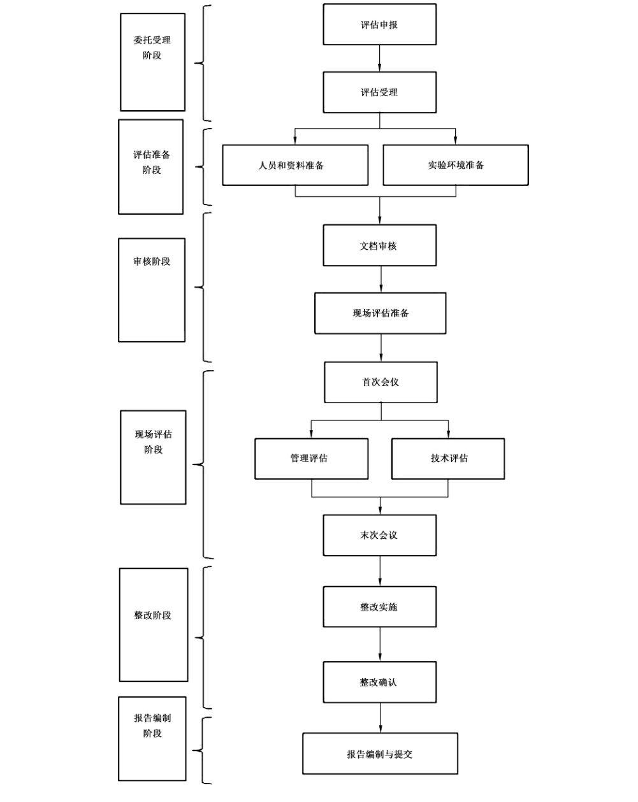

# GB/T 36959-2018 信息安全技术 网络安全等级保护测评机构能力要求和评估规范

> 来源：[GB/T 36959-2018 国家标准详情](https://openstd.samr.gov.cn/bzgk/std/newGbInfo?hcno=13CA0E1F3BB48A0B8AA68B80DF790067)；发布日期：2018-12-28；实施日期：2019-07-01。
> PDF SHA-256：5e310d52518bb3a176fc1fcd1b1af162ec3b87e01453828ac2fd8170e2624766。
> 转写说明：将官方 PDF 逐页渲染为图像并进行识别，对照全部 28 页原图校正文字、列表编号和附录层级；重建跨页表格，保留流程图，省略封面、目录及页眉页脚。正式引用请核对原 PDF。

## 前言

本标准按照 GB/T 1.1—2009给出的规则起草。

请注意本文件的某些内容可能涉及专利。本文件的发布机构不承担识别这些专利的责任。

本标准由全国信息安全标准化技术委员会（SAC/TC 260）提出并归口。

本标准起草单位：公安部第三研究所（公安部信息安全等级保护评估中心）、公安部网络安全保卫局、中关村信息安全测评联盟。

本标准主要起草人：罗峥、李升、刘静、王宁、范春玲、马俊、张宇翔、李明、刘香、江雷、朱建平、毕马宁、沙淼淼。

## 引言

《中华人民共和国网络安全法》第二十一条规定，国家实行网络安全等级保护制度。等级保护制度推进工作的一个重要内容是对等级保护对象开展安全测评，通过测评掌握其安全状况，为整改建设和监督管理提供依据。开展安全测评应选择符合规定条件和相应能力的测评机构，并规范化其测评活动，通过专业化技术队伍建设，最终构建起网络安全等级保护测评体系。在此背景下，为确保有效指导测评机构的能力建设，满足等级保护工作要求，特制定本标准。

网络安全等级保护测评机构能力要求参考国际、国内测评与检验检测机构能力建设与评定的相关内容，结合网络安全等级保护测评工作的特点，对网络安全等级保护测评机构的组织管理能力、测评实施能力、设施和设备安全与保障能力、质量管理能力、规范性保证能力等提出基本能力要求，为规范网络安全等级保护测评机构的建设和管理及其能力评估工作提供依据。

网络安全等级保护测评机构能力评估规范部分结合网络安全等级保护测评工作的特点，从委托受理、评估准备、文件审核、现场评估、整改验收，到评估报告提交等整个评估过程提出了规范性要求。

## 1 范围

本标准规定了网络安全等级保护测评机构的能力要求和评估规范。

本标准适用于拟成为或晋级为更高级网络安全等级保护测评机构的能力建设、运营管理和资格评定等活动。

## 2 规范性引用文件

下列文件对于本文件的应用是必不可少的。凡是注日期的引用文件，仅注日期的版本适用于本文件。凡是不注日期的引用文件，其最新版本（包括所有的修改单）适用于本文件。

- GB/T 28448 信息安全技术 信息系统安全等级保护测评要求

- GB/T 28449 信息安全技术 网络安全等级保护测评过程指南

## 3 术语和定义

GB/T 28448界定的以及下列术语和定义适用于本文件。

### 3.1 能力评估 capability evaluation

依据标准和（或）其他规范性文件，对测评机构申请单位的能力进行评审、验证和评价的过程。

### 3.2 评估机构 evaluation organization

对申请成为测评机构的企事业单位进行能力评估的专业技术机构。

### 3.3 初次评估 first-time evaluation

评估机构依据本规范和相关文件，首次对测评机构能力进行核查、验证和评价的过程。

### 3.4 期间评估 continuous evaluation

为已经获得推荐证书的测评机构是否持续地符合能力要求而在证书有效期内安排的定期或不定期的评估、抽查等活动。

### 3.5 能力复评 capability review

测评机构推荐证书有效期结束前，由评估机构对其实施全面评估以确认其是否持续符合能力要求，为延续到下一个推荐有效期提供依据的活动。

### 3.6 评估员 evaluator

由评估机构委派，对测评机构实施能力评估的人员。

## 4 测评机构能力要求

### 4.1 测评机构的分级

测评机构的级别代表了网络安全等级保护测评机构技术水平和业务服务能力的差异。测评机构按能力要求分为三级，级别由低到高依次是 I 级、II 级和 III 级，级差是通过增加新的能力要求条款或在原条款基础上提出增强要求来实现。各级能力增强要求的总结情况见附录 A 中表 A.1。

### 4.2 等级测评人员的分级

测评机构从事等级测评工作的人员按能力要求分为三级，级别由低到高依次是初级、中级、高级，具体要求见附录 B。

### 4.3 I级测评机构能力要求

#### 4.3.1 基本条件

测评机构应当具备以下基本条件：

a） 在中华人民共和国境内注册成立，由中国公民、法人投资或者国家投资的企事业单位；

b） 产权关系明晰，注册资金500万元以上，独立经营核算，无违法违规记录；

c） 从事网络安全服务两年以上，具备一定的网络安全检测评估能力；

d） 法定代表人、主要负责人、测评人员仅限中华人民共和国境内的中国公民，且无犯罪记录；

e） 具有网络安全相关工作经历的技术和管理人员不少于15人，专职渗透测试人员不少于2人，岗位职责清晰，且人员相对稳定；

f） 具有固定的办公场所，配备满足测评业务需要的检测评估工具、实验环境等；

g） 具有完备的安全保密管理、项目管理、质量管理、人员管理、档案管理和培训教育等规章制度；

h） 不涉及网络安全产品开发，销售或信息系统安全集成等可能影响测评结果公正性的业务（自用除外）；

i） 应具备的其他条件。

#### 4.3.2 组织管理能力

**4.3.2.1** 测评机构管理者应掌握等级保护政策文件，熟悉相关的标准规范。

**4.3.2.2** 测评机构应按一定方式组织并设立相关部门，明确其职责、权限和相互关系，保证各项工作的有序开展。

**4.3.2.3** 测评机构应具有胜任等级测评工作的专业技术人员和管理人员，大学本科（含）以上学历所占比例不低于70%。

**4.3.2.4** 测评机构应设置满足等级测评工作需要的岗位，如测评技术员、测评项目组长、技术主管、质量主管、保密安全员、设备管理员和档案管理员等，岗位职责明确，人员稳定。

**4.3.2.5** 测评机构应制定完善的规章制度，包括但不限于以下内容：

a）项目管理制度

测评机构应依据 GB/T 28449 制定完备的、符合自身特点的测评项目管理程序，主要应包括测评工作的组织形式、工作职责、测评各阶段的工作内容和管理要求等。

b）设备管理制度

应包括机构人员在仪器设备（含测评设备和工具）管理中的相关职责、仪器设备的购置、使用和运行维护的各项规定等。

c）文档管理制度

应包括机构人员在测评文档（含电子文档）管理中的相关职责、档案借阅、保管直至销毁的各项规定等。

d）人员管理制度

应包括人员录用、考核、日常管理以及离职等方面的内容和要求。

e）培训教育制度

应包括培训计划的制定、培训工作的实施、培训的考核与上岗以及人员培训档案建立等内容和要求。

f）申诉、投诉及争议处理制度

应明确包括测评机构各岗位人员在申诉、投诉和争议处理活动中相应的职责，建立从受理、确认到处置、答复等环节的完整程序。

#### 4.3.3 测评实施能力

##### 4.3.3.1 人员能力

**4.3.3.1.1** 测评机构从事等级测评工作的专业技术人员（以下简称测评人员）应具有把握国家政策，理解和掌握相关技术标准，熟悉等级测评的方法、流程和工作规范等方面的知识及能力，并有依据测评结果做出专业判断以及出具等级测评报告等任务的能力。

**4.3.3.1.2** 测评人员应参加由指定评估机构举办的专门培训、考试并取得等级测评师证书。等级测评人员需持证上岗。

**4.3.3.1.3** 测评技术员、测评项目组长和技术主管岗位人员应分别取得初、中、高级等级测评师证书，测评师数量不应少于15人。

**4.3.3.1.4** 测评人员除具备等级测评师资格外，每年应参加多种形式的测评业务和技术培训，测评师每年培训时长累计不少于 40学时。

**4.3.3.1.5** 测评机构应指定一名技术主管，全面负责等级测评方面的技术工作。

##### 4.3.3.2 测评能力

**4.3.3.2.1** 测评机构应通过提供案例、过程记录等资料，证明其具有从事网络安全检测评估相关工作 2 年以上的工作经验。

**4.3.3.2.2** 测评机构应保证在其能力范围内从事测评工作，并有足够的资源来满足测评工作要求，具体体现在以下方面：

a）安全技术测评实施能力，包括物理和环境安全、网络和通信安全、设备和计算安全、应用和数据安全等方面测评指导书的开发、使用、维护及获取相关结果的专业判断；

b） 安全管理测评实施能力，包括安全策略和管理制度、安全管理机构和人员、安全建设管理、安全运维管理等方面测评指导书的开发、使用、维护及获取相关结果的专业判断；

c） 安全测试与分析能力，指根据实际测评要求，开发与测试相关的工作指导书，借助专用测评设备和工具，实现漏洞发现与问题分析等方面的能力；

d）整体测评实施能力，指根据测评报告单元测评的结果记录部分、结果汇总部分和问题分析部分，从安全控制点间、层面间和区域间出发考虑，给出整体测评具体结果的能力；

e） 风险分析能力，指依据等级保护的相关规范和标准，采用风险分析的方法分析等级测评结果中存在的安全问题可能对被测评系统安全造成的影响的能力。

**4.3.3.2.3** 测评机构应依据测评工作流程，有计划、按步骤地开展测评工作，并保证测评活动的每个环节都得到有效的控制，具体要求如下：

a）测评准备阶段，收集被测系统的相关资料信息，填写规范的系统调查表，全面掌握被测评系统的详细情况，为测评工作的开展打下基础。

b） 方案编制阶段，正确合理地确定测评对象、测评指标及测评内容等，并依据现行有效的技术标准、规范开发测评方案、测评指导书、测评结果记录表格等。测评方案应通过技术评审并有相关记录，测评指导书应进行版本有效性维护，且满足以下要求：

1） 符合相关的等级测评标准；

2） 提供足够详细的信息以确保测评数据获取过程的规范性和可操作性。

c） 现场测评阶段，严格执行测评方案和测评指导书中的内容和要求，并依据操作规程熟练地使用测评设备和工具，规范、准确、完整地填写测评结果记录，获取足够证据，客观、真实、科学地反映出系统的安全保护状况，测评过程应予以监督并记录。

d） 报告编制阶段，客观描述等级保护对象已采取的有效保护措施和存在的主要安全问题情况，指出等级保护对象安全保护现状与相应等级的保护要求之间的差距，分析差距可能导致被测评系统面临的风险，给出等级测评结论，形成测评报告，测评报告应依据公安行政主管部门统一制定的网络安全等级保护测评报告模版的格式和内容要求编写，测评报告应通过评审并有相关记录。

#### 4.3.4 设施和设备安全与保障能力

**4.3.4.1** 测评机构应具备必要的办公环境、设备、设施和管理系统，使用的技术装备、设施原则上应当符合以下条件：

a）产品研制、生产单位是由中国公民、法人投资或者国家投资或者控股的，在中华人民共和国境内具有独立的法人资格；

b） 产品的核心技术、关键部件具有我国自主知识产权；

c） 产品研制、生产单位及其主要业务、技术人员无犯罪记录；

d） 产品研制、生产单位声明没有故意留有或者设置漏洞、后门、木马等程序和功能；

e） 对国家安全、社会秩序、公共利益不构成危害；

f） 应配备经安全认证合格或者安全检测符合要求的网络关键设备和网络安全专用产品。

**4.3.4.2** 测评机构应配备满足等级测评工作需要的测评设备和工具，如WEB 安全检测工具、恶意行为检测工具等，在测试过程中辅助发现安全问题。测评设备和工具应通过权威机构的检测并可提供检测报告。

**4.3.4.3** 测评机构应具备符合相关要求的机房以及必要的软、硬件设备，用于满足网络安全仿真、技术培训和模拟测试的需要。

**4.3.4.4** 测评机构应确保测评设备和工具运行状态良好，并通过持续更新、升级等手段保证其提供准确的测评数据。

**4.3.4.5** 测评设备和工具均应有正确的标识。

#### 4.3.5 质量管理能力

##### 4.3.5.1 管理体系建设

**4.3.5.1.1** 测评机构应建立、实施和维护符合等级测评工作需要的文件化的管理体系，并确保测评机构各级人员能够理解和执行。

**4.3.5.1.2** 测评机构应当制定相应的质量目标，不断提升自身的测评质量和管理水平。

**4.3.5.1.3** 测评机构应指定一名质量主管，明确其质量保证的职责。质量主管不应受可能有损工作质量的影响或利益冲突，并有权直接与测评机构最高管理层沟通。

##### 4.3.5.2 管理体系维护

**4.3.5.2.1** 测评机构应保证管理体系的有效运行，发现问题及时反馈并采取纠正措施，确保其有效性。

**4.3.5.2.2** 测评机构应当严格遵守申诉、投诉及争议处理制度，并应记录采取的措施。

#### 4.3.6 保证能力

##### 4.3.6.1 公正性保证能力

**4.3.6.1.1** 测评机构及其测评人员应当严格执行有关管理规范和技术标准，开展客观、公正、安全的测评服务。

**4.3.6.1.2** 测评机构的人员应不受可能影响其测评结果的来自于商业、财务和其他方面的压力。

##### 4.3.6.2 可靠与保密性保证能力

**4.3.6.2.1** 测评机构的单位法人及主要工作人员仅限于中华人民共和国境内的中国公民，且无犯罪记录。

**4.3.6.2.2** 测评机构应通过提供单位性质、股权结构、出资情况、法人及股东身份等信息的文件材料，证明其机构合规、产权关系明晰，资金注册达到要求（500万元）。

**4.3.6.2.3** 测评机构应建立并保存工作人员的人员档案，包括人员基本信息、社会背景、工作经历、培训记录、专业资格、奖惩情况等，保障人员的稳定和可靠。

**4.3.6.2.4** 测评机构使用的测试设备和工具应具备全面的功能列表，且不存在功能列表之外的隐蔽功能。

**4.3.6.2.5** 测评机构应重视安全保密工作，指派安全保密工作的责任人。

**4.3.6.2.6** 测评机构应依据保密管理制度，定期对工作人员进行保密教育，测评机构和测评人员应当保守在测评活动中知悉的国家秘密、工作秘密、商业秘密、个人隐私等。

**4.3.6.2.7** 测评机构应明确岗位保密要求，与全体人员签订《保密责任书》，规定其应当履行的安全保密义务和承担的法律责任，并负责检查落实。

**4.3.6.2.8** 测评机构应采取技术和管理措施来确保等级测评相关信息的安全、保密和可控，这些信息包括但不限于：

a） 被测评单位提供的资料；

b） 等级测评活动生成的数据和记录；

c） 依据上述信息做出的分析与专业判断。

**4.3.6.2.9** 测评机构应借助效的技术手段，确保等级测评相关信息的整个数据生命周期的安全和保密。

##### 4.3.6.3 测评方法与程序的规范性

测评机构应保证与等级测评工作有关的所有工作程序、指导书、标准规范、工作表格、核查记录表等现行有效并便于测评人员获得。

##### 4.3.6.4 测评记录的规范性

测评机构应保证测评记录内容和管理的规范性：

a） 测评记录应当清晰规范，并获得被测评方的书面确认；

b） 测评机构应具有安全保管记录的能力，所有的测评记录应保存3年以上。

##### 4.3.6.5 测评报告的规范性

测评机构应保证测评报告内容和出具过程管理的规范性：

a） 测评机构应按照公安行政主管部门统一制订的网络安全等级保护测评报告模版格式出具测评报告；

b） 测评报告应包括所有测评结果、根据这些结果傲出的专业判断以及理解和解释这些结果所需要的所有信息，以上信息均应正确、准确、清晰地表述；

c） 测评报告由测评项目组长作为第一编制人，技术主管（或质量主管）负责审核，机构管理者或其授权人员签发或批准；

d） 能力评估合格的测评机构应对出具的等级测评报告统一加盖测评机构能力合格专用标识并登记归档。

#### 4.3.7 风险控制能力

**4.3.7.1** 测评机构应充分估计测评可能给被测系统带来的风险，风险包括但不限于以下方面：

a） 测评机构由于自身能力或资源不足造成的风险；

b） 测试验证活动可能对被测系统正常运行造成影响的风险；

c） 测试设备和工具接入可能对被测系统正常运行造成影响的风险；

d） 测评过程中可能发生的被测系统重要信息（如网络拓扑、IP地址、业务流程、安全机制、安全隐患和有关文档等）泄漏的风险等。

**4.3.7.2** 测评机构应通过多种措施对上述被测系统可能面临的风险加以规避和控制。

#### 4.3.8 可持续性发展能力

**4.3.8.1** 测评机构应根据自身情况制定战略规划，通过不断的投入保证测评机构的持续建设和发展。

**4.3.8.2** 测评机构应定期对管理体系进行评审并持续改进，不断提高管理要求。设定中、远期目标，通过目标的实现，逐步提升质量管理能力。

**4.3.8.3** 测评机构应根据培训制度做好培训工作，并保存培训和考核记录。

**4.3.8.4** 测评机构应投入专门的力量从事测评实践总结和测评技术研究工作，测评机构间应进行经验交流和技术研讨，保持与测评技术发展的同步性。

### 4.4 II 级测评机构能力要求

#### 4.4.1 基本条件

测评机构应当具备以下基本条件：

a） 在中华人民共和国境内注册成立，由中国公民、法人投资或者国家投资的企事业单位；

b） 产权关系明晰，注册资金1000万元以上，独立经营核算，无违法违规记录；

c） 从事网络安全服务两年以上，具备一定的网络安全检测评估能力；

d） 法定代表人、主要负责人、测评人员仅限中华人民共和国境内的中国公民，且无犯罪记录；

e） 具有网络安全相关工作经历的技术和管理人员不少于30人，专职渗透测试人员不少于3人，岗位职责清晰，且人员相对稳定；

f） 具有固定的办公场所，配备满足测评业务需要的检测评估工具、实验环境等；

g） 具有完备的安全保密管理、项目管理、质量管理、人员管理、档案管理和培训教育等规章制度；

h） 不涉及网络安全产品开发，销售或信息系统安全集成等可能影响测评结果公正性的业务（自用除外）；

i） 应具备的其他条件。

#### 4.4.2 组织管理能力

**4.4.2.1** 测评机构管理者应掌握等级保护政策文件，熟悉相关的标准规范。

**4.4.2.2** 测评机构应明确设立开展等级测评业务的部门，确保测评活动的独立性。

**4.4.2.3** 测评机构应具有胜任等级测评工作的专业技术人员和管理人员，大学本科（含）以上学历所占比例不低于80%。

**4.4.2.4** 测评机构应设置满足等级测评工作需要的岗位，如测评技术员、测评项目组长、技术主管、质量主管、保密安全员、设备管理员和档案管理员等，岗位职责明确，人员稳定，其中技术主管、质量主管应为专职人员，不得兼任。

**4.4.2.5** 测评机构应制定完善的规章制度，包括但不限于以下内容：

a）保密管理制度

应根据国家有关保密规定制定保密管理制度，制度中应明确保密对象的范围、人员保密职责、测评过程保密管理各项措施与要求，以及违反保密制度的罚则等内容。

b）项目管理制度

测评机构应依据 GB/T 28449 制定完备的、符合自身特点的测评项目管理程序，主要应包括测评工作的组织形式、工作职责、测评各阶段的工作内容和管理要求等。

c）设备管理制度

应包括机构人员在仪器设备管理中的相关职责、仪器设备的购置、使用和维护的各项规定等。

d）文档管理制度

应包括机构人员在文件档案管理中的相关职责、文件档案借阅、保管直至销毁的各项规定等。

e）人员管理制度

应包括人员录用、考核、日常管理以及离职等方面的内容和要求。

f）培训教育制度

应包括培训计划的制定、培训工作的实施、培训的考核与上岗以及人员培训档案建立等内容和要求。

g）申诉、投诉及争议处理制度

应明确包括测评机构各岗位人员在申诉、投诉和争议处理活动中相应的职责，建立从受理、确认到处置、答复等环节的完整程序。

#### 4.4.3 测评实施能力

##### 4.4.3.1 人员能力

**4.4.3.1.1** 测评机构从事等级测评工作的专业技术人员（以下简称测评人员）应具有把握国家政策，理解和掌握相关技术标准，熟悉等级测评的方法、流程和工作规范等方面的知识及能力，并有依据测评结果做出专业判断以及出具等级测评报告等任务的能力。

**4.4.3.1.2** 测评人员应参加由指定评估机构举办的专门培训、考试并取得等级测评师证书。等级测评人员需持证上岗。

**4.4.3.1.3** 测评技术员、测评项目组长和技术主管岗位人员应分别取得初、中、高级等级测评师证书，测评师数量不应少于30人。

**4.4.3.1.4** 测评人员除具备等级测评师资格外，每年应参加多种形式的测评业务和技术培训，测评师每年培训时长累计不少于 40学时。

**4.4.3.1.5** 测评机构应指定一名技术主管，全面负责等级测评方面的技术工作。测评机构技术主管应具备大学本科（含）以上学历，应在近3年的信息安全专业刊物上发表2篇及以上论文（或申请1项专利著作权），或主持1项地方（或行业）级科研课题项目。

##### 4.4.3.2 测评能力

**4.4.3.2.1** 测评机构应具备每年开展等级测评的第三级（含）等级保护对象数量不应少于30个的实施能力。

**4.4.3.2.2** 测评机构应保证在其能力范围内从事测评工作，并有足够的资源来满足测评工作要求，具体体现在以下方面：

a）安全技术测评实施能力，包括物理和环境安全、网络和通信安全、设备和计算安全、应用和数据安全等方面测评指导书的开发、使用、维护及获取相关结果的专业判断。测评指导书应覆盖目前主流产品和相关技术；

b） 安全管理测评实施能力，包括安全策略和管理制度、安全管理机构和人员、安全建设管理、安全运维管理等方面测评指导书的开发、使用、维护及获取相关结果的专业判断；

c） 安全测试与分析能力，指根据实际测评要求，开发与测试相关的工作指导书，借助专用测评设备和工具，实现漏洞发现与问题分析等方面的能力，并具备密码分析测评能力；

d） 整体测评实施能力，指根据测评报告单元测评的结果记录部分、结果汇总部分和问题分析部分，从安全控制点间、层面间和区域间出发考虑，给出整体测评的具体结果的能力；

e） 风险分析能力，指依据等级保护的相关规范和标准，建立一套统一的风险分析方法，科学合理地分析等级测评结果中存在的安全问题可能对被测评系统安全造成的影响的能力。

**4.4.3.2.3** 测评机构应加强信息技术在测评实施中的应用，借助自动化手段，规范测评流程，优化资源配置，减少人为因素可能造成的差错，提高测评工作的效率。

**4.4.3.2.4** 测评机构应建立完善的测评方法研发、维护和更新机制，持续提高自身测评技术能力。

**4.4.3.2.5** 测评机构应结合被测系统的行业特点和业务类型，分析普遍存在的安全问题，并提出针对性的整改建议。

**4.4.3.2.6** 测评机构应依据测评工作流程，有计划、按步骤地开展测评工作，并保证测评活动的每个环节都得到有效的控制，具体要求如下：

a）测评准备阶段，收集被测系统的相关资料信息，填写规范的系统调查表，全面掌握被测评系统的详细情况，为测评工作的开展打下基础。

b）方案编制阶段，正确合理地确定测评对象、测评指标及测评内容等，并依据现行有效的技术标准、规范开发测评方案、测评指导书、测评结果记录表格等。测评方案应通过技术评审并有相关记录，测评指导书应进行版本有效性维护，且满足以下要求：

1） 符合相关的等级测评标准；

2） 提供足够详细的信息以确保测评数据获取过程的规范性和可操作性。

c）现场测评阶段，严格执行测评方案和测评指导书中的内容和要求，并依据操作规程熟练地使用测评设备和工具，规范、准确、完整地填写测评结果记录，获取足够证据，客观、真实、科学地反映出系统的安全保护状况，测评过程应予以监督并记录。

d） 报告编制阶段，客观描述等级保护对象已采取的有效保护措施和存在的主要安全问题情况，指出等级保护对象安全保护现状与相应等级的保护要求之间的差距，分析差距可能导致被测评系统面临的风险，给出等级测评结论，形成测评报告，测评报告应依据公安行政主管部门统一制定的网络安全等级保护测评报告模版的格式和内容要求编写，测评报告应通过评审并有相关记录。

#### 4.4.4 设施和设备安全与保障能力

**4.4.4.1** 测评机构应具备完善的办公环境、设备、设施和管理系统，使用的技术装备、设施原则上应当符合以下条件：

a）产品研制、生产单位是由中国公民、法人投资或者国家投资或者控股的，在中华人民共和国境内具有独立的法人资格；

b） 产品的核心技术、关键部件具有我国自主知识产权；

c） 产品研制、生产单位及其主要业务、技术人员无犯罪记录；

d） 产品研制、生产单位声明没有故意留有或者设置漏洞、后门、木马等程序和功能；

e） 对国家安全、社会秩序、公共利益不构成危害；

f） 应配备经安全认证合格或者安全检测符合要求的网络关键设备和网络安全专用产品。

**4.4.4.2** 测评机构应配备满足等级测评工作需要的测评设备和工具，如 WEB 安全检测工具、恶意行为检测工具、网络协议分析工具、源代码安全审计工具等，在测试过程中辅助分析并定位安全问题。测评设备和工具应通过权威机构的检测并可提供检测报告。

**4.4.4.3** 测评机构应具备符合相关要求的机房以及必要的软、硬件设备，应搭建由主流网络设备、安全设备、操作系统和数据库系统组成的基础环境，以满足网络仿真、技术培训和模拟测试的需要。

**4.4.4.4** 测评机构应确保测评设备和工具运行状态良好，并通过持续更新、升级等手段保证其提供准确的测评数据。

**4.4.4.5** 测评设备和工具均应有正确的标识。

**4.4.4.6** 测评机构应建立专门的制度，对用于测评数据处理的计算机进行有效的运行维护，并保证计算机中数据记录的完整性、可控性。

#### 4.4.5 质量管理能力

##### 4.4.5.1 管理体系建设

**4.4.5.1.1** 测评机构应建立、实施和维护符合等级测评工作需要的文件化的管理体系，并确保测评机构各级人员能够理解和执行。

**4.4.5.1.2** 测评机构应当制定相应的质量目标，不断提升自身的测评质量和管理水平。

**4.4.5.1.3** 测评机构应指定一名质量主管，明确其质量保证的职责。质量主管不应受可能有损工作质量的影响，并有权直接与测评机构最高管理层沟通。

##### 4.4.5.2 管理体系维护

**4.4.5.2.1** 测评机构应保证管理体系的有效运行，发现问题及时反馈并采取纠正措施，确保其有效性。

**4.4.5.2.2** 测评机构应当严格遵守申诉、投诉及争议处理制度，并应记录采取的措施。

**4.4.5.2.3** 测评机构应建立并实施内部管理审核机制，以验证管理体系的符合性及有效性，执行审核的人员应独立于被审核部门。

##### 4.4.5.3 质量监督能力

测评机构应指定监督员对测评活动实施质量监督。监督员应具备丰富的安全测评经验、精通安全测评技术，并能对测评结果做出权威判断。

#### 4.4.6 保证能力

##### 4.4.6.1 公正性保证能力

**4.4.6.1.1** 测评机构及其测评人员应当严格执行有关管理规范和技术标准，开展客观、公正、安全的测评服务。

**4.4.6.1.2** 测评机构的人员应不受可能影响其测评结果的来自于商业、财务和其他方面的压力。

**4.4.6.1.3** 测评机构应以公开方式，向社会公布其开展网络安全等级保护测评工作所依据的政策法规、标准和规范。

##### 4.4.6.2 可靠与保密性保证能力

**4.4.6.2.1** 测评机构的单位法人及主要工作人员仅限于中华人民共和国境内的中国公民，且无犯罪记录。

**4.4.6.2.2** 测评机构应通过提供单位性质、股权结构、出资情况、法人及股东身份等信息的文件材料，证明其机构合规、产权关系明晰，资金注册达到要求。

**4.4.6.2.3** 测评机构应建立并保存工作人员的人员档案，包括人员基本信息、社会背景、工作经历、培训记录、专业资格、奖惩情况等，保障人员的稳定和可靠。

**4.4.6.2.4** 测评机构使用的测试设备和工具应具备全面的功能列表，且不存在功能列表之外的隐蔽功能。

**4.4.6.2.5** 测评机构应重视安全保密工作，指派安全保密工作的责任人。

**4.4.6.2.6** 测评机构应依据保密管理制度，定期对工作人员进行保密教育，测评机构和测评人员应当保守在测评活动中知悉的国家秘密、工作秘密、商业秘密、个人隐私等。

**4.4.6.2.7** 测评机构应明确岗位保密要求，与全体人员签订《保密责任书》，规定其应当履行的安全保密义务和承担的法律责任，并负责检查落实。

**4.4.6.2.8** 测评机构应采取技术和管理措施来确保等级测评相关信息的安全、保密和可控，这些信息包括但不限于：

a） 被测评单位提供的资料；

b） 等级测评活动生成的数据和记录；

c） 依据上述信息做出的分析与专业判断。

**4.4.6.2.9** 测评机构应借助有效的技术手段，确保等级测评相关信息的整个数据生命周期的安全和保密。

**4.4.6.2.10** 测评机构应建立专门的文档存储场所和数据加密环境，严格管理测评相关数据信息。

##### 4.4.6.3 测评方法与程序的保证能力

**4.4.6.3.1** 测评机构应制定程序，保证与等级测评工作相关的所有工作程序、指导书、标准规范、工作表格、核查记录表等现行有效并便于测评人员获得。

**4.4.6.3.2** 上述文件的发布实施应履行统一的审批程序，文件的变更和修订应有授权并及时进行版本维护。

##### 4.4.6.4 测评记录的规范性

测评机构应保证测评记录内容和管理的规范性：

a） 测评记录应当清晰规范，并获得被测评方的书面确认。

b） 应对所有通过计算机记录或生成的数据的转移、复制和传送进行核查，以确保其准确性和完整性。

c） 测评机构应具有安全保管记录的能力，所有的测评记录应保存三年以上。

##### 4.4.6.5 测评报告的规范性

测评机构应保证测评报告内容和出具过程管理的规范性：

a） 测评机构应按照公安行政主管部门统一制定的网络安全等级保护测评报告模版格式出具测评报告。

b） 测评报告应包括所有测评结果、根据这些结果做出的专业判断以及理解和解释这些结果所需要的所有信息，以上信息均应正确、准确、清晰地表述。

c） 测评报告由测评项目组长作为第一编制人，技术主管（或质量主管）负责审核，机构管理者或其授权人员签发或批准。

d） 能力评估合格的测评机构应对出具的等级测评报告统一加盖测评机构能力合格专用标识并登记归档。

##### 4.4.6.6 安全管理能力

测评机构应重视自身的安全，通过部署安全措施提高安全管理能力。

#### 4.4.7 风险控制能力

**4.4.7.1** 测评机构应充分估计测评可能给被测系统带来的风险，风险包括但不限于以下方面：

a） 测评机构由于自身能力或资源不足造成的风险；

b） 测试验证活动可能对被测系统正常运行造成影响的风险；

c） 测试设备和工具接人可能对被测系统正常运行造成影响的风险；

d） 测评过程中可能发生的被测系统重要信息（如网络拓扑、IP地址、业务流程、安全机制、安全隐患和有关文档等）泄漏的风险等。

**4.4.7.2** 测评机构应通过多种措施对上述被测系统可能面临的风险加以规避和控制。

#### 4.4.8 可持续性发展能力

**4.4.8.1** 测评机构应根据自身情况制定战略规划，通过不断的投入保证测评机构的持续建设和发展。

**4.4.8.2** 测评机构应定期对管理体系进行评审并持续改进，不断提高管理要求。设定中、远期目标（如获得相应管理体系认定资质），通过目标的实现，逐步提升质量管理能力。

**4.4.8.3** 测评机构应制定并实施完善的培训制度，以确保其人员在专业技术和管理方面持续满足等级测评工作的需要。除常规培训外，应根据人员的工作岗位需求，制定详细和有针对性的培训计划，并进行岗位培训、考核和评定。

**4.4.8.4** 测评机构应投入专门的力量从事测评实践总结和测评技术研究工作，测评机构间应进行经验交流和技术研讨，保持与测评技术发展的同步性。

### 4.5 III 级测评机构能力要求

#### 4.5.1 基本条件

网络安全等级保护测评机构（以下简称测评机构）应具备以下基本条件：

a） 在中华人民共和国境内注册成立，由中国公民、法人投资或者国家投资的企事业单位；

b） 产权关系明晰，注册资金1000万元以上，独立经营核算，无违法违规记录；

c） 从事网络安全服务两年以上，具备一定的网络安全检测评估能力；

d） 法定代表人，主要负责人、测评人员仅限中华人民共和国境内的中国公民，且无犯罪记录；

e）， 具有网络安全相关工作经历的技术和管理人员不少于 50人，专职渗透测试人员不少于5人，岗位职责清晰，且人员相对稳定；

f） 具有固定的办公场所，配备满足测评业务需要的检测评估工具、实验环境等；

g） 具有完备的安全保密管理、项目管理、质量管理、人员管理、档案管理和培训教育等规章制度；

h）不涉及网络安全产品开发、销售或信息系统安全集成等可能影响测评结果公正性的业务（自用除外）；

i） 应具备的其他条件。

#### 4.5.2 组织管理能力

**4.5.2.1** 测评机构管理者应掌握等级保护政策文件，熟悉相关的标准规范。

**4.5.2.2** 测评机构应明确设立开展等级测评业务的部门，确保测评活动的独立性。

**4.5.2.3** 测评机构应具有胜任等级测评工作的专业技术人员和管理人员，大学本科（含）以上学历所占比例不低于90%。

**4.5.2.4** 测评机构应设置满足等级测评工作需要的岗位，如测评技术员、测评项目组长、技术主管、质量主管、保密安全员、设备管理员和档案管理员等，上述岗位应为专职人员，不得兼任。

**4.5.2.5** 测评机构应制定完善的规章制度，包括但不限于以下内容：

a）保密管理制度

应根据国家有关保密规定制定保密管理制度，制度中应明确保密对象的范围、人员保密职责、测评过程保密管理各项措施与要求，以及违反保密制度的罚则等内容。

b）项目管理制度

测评机构应依据 GB/T 28449 制定完备的、符合自身特点的测评项目管理程序，主要应包括测评工作的组织形式、工作职责、测评各阶段的工作内容和管理要求等。

c）设备管理制度

应包括机构人员在仪器设备（含测评设备和工具）管理中的相关职责、仪器设备的购置、使用和运行维护的各项规定等。

d）文档管理制度

应包括机构人员在测评文档（含电子文档）管理中的相关职责、档案借阅、保管直至销毁的各项规定等。

e）人员管理制度

应包括人员录用、考核、日常管理以及离职等方面的内容和要求。

f）培训教育制度

应包括培训计划的制定、培训工作的实施、培训的考核与上岗以及人员培训档案建立等内容和要求。

g）申诉、投诉及争议处理制度

应明确包括测评机构各岗位人员在申诉、投诉和争议处理活动中相应的职责，建立从受理、确认到处置、答复等环节的完整程序。

#### 4.5.3 测评实施能力

##### 4.5.3.1 人员能力

**4.5.3.1.1** 测评机构从事等级测评工作的专业技术人员（以下简称测评人员）应具有把握国家政策，理解和掌握相关技术标准，熟悉等级测评的方法、流程和工作规范等方面的知识及能力，并有依据测评结果做出专业判断以及出具等级测评报告等任务的能力。

**4.5.3.1.2** 测评人员应参加由指定评估机构举办的专门培训、考试并取得等级测评师证书。等级测评人员需持证上岗。

**4.5.3.1.3** 测评技术员、测评项目组长和技术主管岗位人员应分别取得初、中、高级等级测评师证书，测评师数量不应少于 50人。

**4.5.3.1.4** 测评人员除具备等级测评师资格外，每年应参加多种形式的测评业务和技术培训，测评师每年培训时长累计不少于60学时。

**4.5.3.1.5** 测评机构应指定一名技术主管，全面负责等级测评方面的技术工作。测评机构技术主管应具备大学本科（含）以上学历，应在近3年的信息安全专业刊物上发表5篇及以上论文（或申请1项专利著作权），或主持1项国家（或部委）级科研课题项目。

##### 4.5.3.2 测评能力

**4.5.3.2.1** 测评机构应具备每年开展等级测评的第三级（含）等级保护对象数量不应少于80个的实施能力。

**4.5.3.2.2** 测评机构应保证在其能力范围内从事测评工作，并有足够的资源来满足测评工作要求，具体体现在以下方面：

a）安全技术测评实施能力，包括物理和环境安全、网络和通信安全、设备和计算安全、应用和数据安全等方面测评指导书的开发、使用、维护及获取相关结果的专业判断。测评指导书应覆盖目前主流产品和相关技术；

b）安全管理测评实施能力，包括安全策略和管理制度、安全管理机构和人员、安全建设管理、安全运维管理等方面测评指导书的开发、使用、维护及获取相关结果的专业判断；

c） 安全测试与分析验证能力，指根据实际测评要求，开发与测试相关的工作指导书，借助专用测评设备和工具，实现漏洞发现、问题分析与验证等方面的能力，并具备密码分析测评能力；

d） 整体测评实施能力，指根据测评报告单元测评的结果记录部分、结果汇总部分和问题分析部分，从安全控制点间、层面间和区域间出发考虑，给出整体测评的具体结果的能力；

e） 风险分析能力，指依据等级保护的相关规范和标准，建立一套统一的风险分析方法，科学合理地分析等级测评结果中存在的安全问题可能对被测评系统安全造成的影响的能力。

**4.5.3.2.3** 测评机构应建立信息化平台，通过数据采集、处理和报告自动化生成等功能，提高测评工作效率和规模化实施能力。

**4.5.3.2.4** 测评机构应建立完善的测评方法研发、维护和更新机制，持续提高自身测评技术能力。

**4.5.3.2.5** 测评机构应针对被测系统的行业特点开展安全状况分析，通过对安全问题的深入分析，提出全面的建设整改解决方案。

**4.5.3.2.6** 测评机构应依据测评工作流程，有计划、按步骤地开展测评工作，并保证测评活动的每个环节都得到有效的控制，具体要求如下：

a）测评准备阶段，收集被测系统的相关资料信息，填写规范的系统调查表，全面掌握被测评系统的详细情况，为测评工作的开展打下基础；

b） 方案编制阶段，正确合理地确定测评对象、测评指标及测评内容等，并依据现行有效的技术标准、规范开发测评方案、测评指导书、测评结果记录表格等。测评方案应通过技术评审并有相关记录，测评指导书应进行版本有效性维护，且满足以下要求：

1） 符合相关的等级测评标准；

2） 提供足够详细的信息以确保测评数据获取过程的规范性和可操作性。

c）现场测评阶段，严格执行测评方案和测评指导书中的内容和要求，并依据操作规程熟练地使用测评设备和工具，规范、准确、完整地填写测评结果记录，获取足够证据，客观、真实、科学地反映出系统的安全保护状况，测评过程应予以监督并记录；

d） 报告编制阶段，客观描述等级保护对象已采取的有效保护措施和存在的主要安全问题情况，指出等级保护对象安全保护现状与相应等级的保护要求之间的差距，分析差距可能导致被测评系统面临的风险，给出等级测评结论，形成测评报告，测评报告应依据公安行政主管部门统一制定的网络安全等级保护测评报告模版的格式和内容要求编写，测评报告应通过评审并有相关记录。

#### 4.5.4 设施和设备安全与保障能力

**4.5.4.1** 测评机构应具备完善的办公环境、设备、设施和管理系统，使用的技术装备、设施原则上应当符合以下条件：

a）产品研制、生产单位是由中国公民、法人投资或者国家投资或者控股的，在中华人民共和国境内具有独立的法人资格；

b） 产品的核心技术、关键部件具有我国自主知识产权；

c） 产品研制、生产单位及其主要业务、技术人员无犯罪记录；

d） 产品研制、生产单位声明没有故意留有或者设置漏洞、后门、木马等程序和功能；

e） 对国家安全、社会秩序、公共利益不构成危害；

f） 应配备经安全认证合格或者安全检测符合要求的网络关键设备和网络安全专用产品。

**4.5.4.2** 测评机构应配备满足等级测评工作需要的测评设备和工具，如 WEB 安全检测工具、恶意行为检测工具、网络协议分析工具、源代码安全审计工具、渗透测试工具等，在测试过程中辅助验证安全问题。测评设备和工具应通过权威机构的检测并可提供检测报告。

**4.5.4.3** 测评机构应具备符合相关要求的机房以及必要的软、硬件设备，应搭建由主流网络设备、安全设备、操作系统和数据库系统组成的基础环境，并能针对新技术新应用进行实验部署，以满足网络仿真、技术培训和模拟测试的需要。

**4.5.4.4** 测评机构应确保测评设备和工具运行状态良好，并通过持续更新、升级等手段保证其提供准确的测评数据。

**4.5.4.5** 测评设备和工具均应有正确的标识。

**4.5.4.6** 测评机构应建立专门的制度，对用于测评数据处理的计算机进行有效的运行维护，并保证计算机中数据记录的完整性、可控性。

#### 4.5.5 质量管理能力

##### 4.5.5.1 管理体系建设

**4.5.5.1.1** 测评机构应建立、实施和维护符合等级测评工作需要的文件化的管理体系，并确保测评机构各级人员能够理解和执行。必要时可申请获得相关领域管理体系认定资质。

**4.5.5.1.2** 测评机构应制定相应的质量目标，不断提升自身的测评质量和管理水平。

**4.5.5.1.3** 测评机构应指定一名质量主管，明确其质量保证的职责。质量主管不应受可能有损工作质量的影响，并有权直接与测评机构最高管理层沟通。

##### 4.5.5.2 管理体系维护

**4.5.5.2.1** 测评机构应保证管理体系的有效运行，发现问题及时反馈并采取纠正措施，确保其有效性。

**4.5.5.2.2** 测评机构应当严格遵守申诉、投诉及争议处理制度，并应记录采取的措施。

**4.5.5.2.3** 测评机构应建立并实施内部管理体系审核和反馈处理机制，以验证管理体系的符合性及有效性，确保在管理体系运行过程中发现的问题及时得到解决。执行审核的人员应独立于被审核部门。

##### 4.5.5.3 质量监督能力

测评机构应指定监督员对全体测评技术人员开展监督，监督内容包括现场测评活动、测评过程规范性和测评结论的准确性等。

#### 4.5.6 规范性保证能力

##### 4.5.6.1 公正性保证能力

**4.5.6.1.1** 测评机构及其测评人员应当严格执行有关管理规范和技术标准，开展客观、公正、安全的测评服务。

**4.5.6.1.2** 测评机构的人员应不受可能影响其测评结果的来自于商业、财务和其他方面的压力。

**4.5.6.1.3** 测评机构应以公开方式，向社会公布其开展网络安全等级保护测评工作所依据的政策法规、标准和规范。

##### 4.5.6.2 可靠与保密性保证能力

**4.5.6.2.1** 测评机构的单位法人及主要工作人员仅限于中华人民共和国境内的中国公民，且无犯罪记录。

**4.5.6.2.2** 测评机构应通过提供单位性质、股权结构、出资情况、法人及股东身份等信息的文件材料，证明其机构合规、产权关系明晰，资金注册达到要求。

**4.5.6.2.3** 测评机构应建立并保存工作人员的人员档案，包括人员基本信息、社会背景、工作经历、培训记录、专业资格、奖惩情况等，保障人员的稳定和可靠。

**4.5.6.2.4** 测评机构使用的测试设备和工具应具备全面的功能列表，且不存在功能列表之外的隐蔽功能。

**4.5.6.2.5** 测评机构应重视安全保密工作，指派安全保密工作的责任人。

**4.5.6.2.6** 测评机构应依据保密管理制度，定期对工作人员进行保密教育，测评机构和测评人员应当保守在测评活动中知悉的国家秘密、工作秘密、商业秘密、个人隐私等。

**4.5.6.2.7** 测评机构应明确岗位保密要求，与全体人员签订《保密责任书》，规定其应当履行的安全保密义务和承担的法律责任，并负责检查落实。

**4.5.6.2.8** 测评机构应采取技术和管理措施来确保等级测评相关信息的安全、保密和可控，这些信息包括但不限于：

a） 被测评单位提供的资料；

b） 等级测评活动生成的数据和记录；

c） 依据上述信息做出的分析与专业判断。

**4.5.6.2.9** 测评机构应借助有效的技术手段，确保等级测评相关信息的整个数据生命周期的安全和保密。

**4.5.6.2.10** 测评机构应建立专门的文档存储场所和数据加密环境，严格管理测评相关数据信息。

##### 4.5.6.3 测评方法与程序的规范性

**4.5.6.3.1** 测评机构应制定程序，保证与等级测评工作相关的所有工作程序、指导书、标准规范、工作表格、核查记录表等现行有效并便于测评人员获得。

**4.5.6.3.2** 上述文件的发布实施应履行统一的审批程序，文件的变更和修订应有授权并及时进行版本维护。

##### 4.5.6.4 测评记录的规范性

测评机构应保证测评记录内容和管理的规范性：

a）； 测评记录应当清晰规范，并获得被测评方的书面确认。

b）应对所有通过计算机记录或生成的数据的转移、复制和传送进行核查，以确保其准确性和完整性。

c） 测评机构应具有安全保管记录的能力，所有的测评记录应保存3年以上。

##### 4.5.6.5 测评报告的规范性

测评机构应保证测评报告内容和出具过程管理的规范性：

a） 测评机构应按照公安行政主管部门统一制定的网络安全等级保护测评报告模版格式出具测评报告。

b） 测评报告应包括所有测评结果、根据这些结果做出的专业判断以及理解和解释这些结果所需要的所有信息，以上信息均应正确、准确、清晰地表述。

c） 测评报告由测评项目组长作为第一编制人，技术主管（或质量主管）负责审核，机构管理者或其授权人员签发或批准。

d） 能力评估合格的测评机构应对出具的等级测评报告统一加盖测评机构能力合格专用标识并登记归档。

##### 4.5.6.6 安全管理能力

测评机构应当制定安全方针和目标，并在其指导下建立、实施和维护符合自身等级测评工作要求的安全管理体系，并确保体系的有效运行。

#### 4.5.7 风险控制能力

**4.5.7.1** 测评机构应充分估计测评可能给被测系统带来的风险，风险包括但不限于以下方面：

a） 测评机构由于自身能力或资源不足造成的风险；

b） 测试验证活动可能对被测系统正常运行造成影响的风险；

测试设备和工具接人可能对被测系统正常运行造成影响的风险；

d） 测评过程中可能发生的被测系统重要信息（如网络拓扑、IP地址、业务流程、安全机制、安全隐患和有关文档等）泄漏的风险等。

**4.5.7.2** 测评机构应通过多种措施对上述被测系统可能面临的风险加以规避和控制。

#### 4.5.8 可持续性发展能力

**4.5.8.1** 测评机构应根据自身情况制定战略规划，通过不断的投入保证测评机构的持续建设和发展。

**4.5.8.2** 测评机构应定期对管理体系进行评审并持续改进，不断提高管理要求。设定中、远期目标（如获得相应管理体系认定资质），通过目标的实现，逐步提升质量管理能力。

**4.5.8.3** 测评机构应实施完善的培训制度，以确保其人员在专业技术和管理方面持续满足等级测评工作的需要。除常规培训外，应根据人员的工作岗位需求，制定详细和有针对性的培训计划，并进行岗位培训、考核和评定。

**4.5.8.4** 测评机构应跟踪国内外新技术、新应用的发展，通过专项课题研究和实践确保技术能力与当前的技术发展同步。

### 4.6 测评机构行为规范性要求

测评机构不得从事下列活动：

a） 影响被测评等级保护对象正常运行，危害被测评等级保护对象安全；

b） 泄露知悉的被测评单位及被测等级保护对象的国家秘密和工作秘密；

c） 故意隐瞒测评过程中发现的安全问题，或者在测评过程中弄虚作假，未如实出具等级测评报告；

d） 未按规定格式出具等级测评报告；

e） 非授权占有、使用等级测评相关资料及数据文件；

f） 分包或转包等级测评项目；

g） 信息安全产品（专用测评设备和工具以外）开发、销售和网络安全集成；

h） 限定被测评单位购买、使用其指定的信息安全产品；

i） 其他危害国家安全、社会秩序、公共利益以及被测单位利益的活动。

## 5 测评机构能力评估

### 5.1 评估流程

如图1所示，初次评估流程包括委托受理阶段、评估准备阶段、审核阶段、现场评估阶段、整改阶段和报告编制阶段。

### 5.2 初次评估

#### 5.2.1 委托受理阶段

##### 5.2.1.1 评估申报

测评机构向评估机构提交能力评估申报材料。

##### 5.2.1.2 评估受理

评估机构指定评估员受理测评机构的申请。评估员在确定能力评估申报材料齐全、内容符合要求后，评估机构给予受理确认。

#### 5.2.2 评估准备阶段

##### 5.2.2.1 人员和资料准备

测评机构根据第4章的测评机构能力要求，逐项对照，准备资料，接受现场能力评估的相关管理人员和专业技术人员做好配合准备工作。

##### 5.2.2.2 实验环境准备

测评机构应建设测评能力见证实验环境，并依据等级保护相关技术标准，选取关键测评指标搭建模拟系统，并应制定等级测评能力见证相关的技术文档，包括系统调查表、测评指导书、现场测评记录表和测评相关监督和管理记录等。

#### 5.2.3 审核阶段

##### 5.2.3.1 文档审核

测评机构将管理体系、管理制度、测评指导书、模拟环境的网络拓扑图、测评方案和测评计划提交评估机构，提出现场评估申请。评估员对照本标准第4章测评机构能力要求，查看文档是否齐全，若满足，则出具能力评估通知。

##### 5.2.3.2 现场评估准备

评估机构选择满足专业要求、数量适当的评估员组成评估组，评估组指定一名组长，总体负责评估活动。评估组根据现场评估时间和地点制定评估计划。

#### 5.2.4 现场评估阶段

##### 5.2.4.1 首次会议

评估组到达现场后，应以首次会议开始现场评估，首次会议上应明确评估目的、评估计划和注意事项，明确评估组人员分工和主要工作内容。

##### 5.2.4.2 管理评估

评估员对测评机构管理能力相关的文档进行审核，对测评机构相关岗位人员进行访谈，根据审核情况填写能力评估管理核查表，并出具管理部分的不符合项记录。

##### 5.2.4.3 技术评估

评估员对测评机构技术能力相关文档进行审核，对测评机构技术能力进行现场见证，根据审核情况填写能力评估技术核查表，并出具技术部分的不符合项记录。

##### 5.2.4.4 末次会议

评估组应以末次会议结束现场评估，末次会议应总结现场评估情况和发现的问题，如对发现的问题有异议，测评机构可以在现场进行申诉或者补充证明材料，最终审核结果应得到双方确认。

#### 5.2.5 整改阶段

##### 5.2.5.1 整改实施

测评机构根据不符合项记录实施整改工作，并向评估组提交整改报告及相应证明资料作为工作有效性的证据。

##### 5.2.5.2 整改确认

评估组应分别从管理和技术两方面对测评机构提交的整改报告进行确认，整改内容不能满足要求的，则反馈测评机构对整改报告的修改意见，如需进行现场验证时，测评机构应予以配合。

#### 5.2.6 报告编制阶段

评估组根据能力评估管理核查表、能力评估技术核查表、现场验证记录、不符合项记录和整改报告，编制完成能力评估报告。

### 5.3 期间评估

为已经获得推荐证书的测评机构是否持续地符合能力要求而在证书有效期内安排的定期或不定期的评估、抽查等活动。

### 5.4 能力复评

测评机构获得测评机构推荐证书后，应保证测评质量和技术能力始终符合测评机构能力要求。推荐满3年应对测评机构进行能力复评，能力复评的工作流程应与初次评估的评估流程一致，评估内容应该是第4章测评机构能力要求的全部内容。

## 附录 A（规范性附录）网络安全等级保护测评机构能力增强要求各级总结情况一览表

各级能力增强要求的总结情况见表 A.1。

**表 A.1 网络安全等级保护测评机构能力增强要求各级总结情况一览表**

| 序号 | 机构条件和能力 | I 级机构要求 | II 级机构要求 | III 级机构要求 |
| --- | --- | --- | --- | --- |
| 1 | 基本条件 | 4.3.1 b）产权关系明晰，注册资金 500 万元以上 | 4.4.1 b）产权关系明晰，注册资金 1 000 万元以上 | 4.5.1 b）同 II 级机构要求 |
| 2 | 基本条件 | 4.3.1 e）具有网络安全相关工作经历的技术和管理人员不少于 15 人，专职渗透测试人员不少于 2 人 | 4.4.1 e）具有网络安全相关工作经历的技术和管理人员不少于 30 人，专职渗透测试人员不少于 3 人 | 4.5.1 e）具有网络安全相关工作经历的技术和管理人员不少于 50 人，专职渗透测试人员不少于 5 人 |
| 3 | 组织管理能力 | 4.3.2.2 测评机构应按一定方式组织并设立相关部门，明确其职责、权限和相互关系，保证各项工作的有序开展 | 4.4.2.2 测评机构应明确设立开展等级测评业务的部门，确保测评活动的独立性 | 4.5.2.2 同 II 级机构要求 |
| 4 | 组织管理能力 | 4.3.2.3 测评机构应具有胜任等级测评工作的专业技术人员和管理人员，大学本科（含）以上学历所占比例不低于 70% | 4.4.2.3 测评机构应具有胜任等级测评工作的专业技术人员和管理人员，大学本科（含）以上学历所占比例不低于 80% | 4.5.2.3 测评机构应具有胜任等级测评工作的专业技术人员和管理人员，大学本科（含）以上学历所占比例不低于 90% |
| 5 | 组织管理能力 | 4.3.2.4 测评机构应设置满足等级测评工作需要的岗位，如测评技术员、测评项目组长、技术主管、质量主管、保密安全员、设备管理员和档案管理员等，岗位职责明确，人员稳定 | 4.4.2.4 测评机构应设置满足等级测评工作需要的岗位，如测评技术员、测评项目组长、技术主管、质量主管、保密安全员、设备管理员和档案管理员等，岗位职责明确，人员稳定，其中技术主管、质量主管应为专职人员，不得兼任 | 4.5.2.4 测评机构应设置满足等级测评工作需要的岗位，如测评技术员、测评项目组长、技术主管、质量主管、保密安全员、设备管理员和档案管理员等，上述岗位应为专职人员，不得兼任 |
| 6 | 测评实施能力 | 4.3.3.1.3 测评技术员、测评项目组长和技术主管岗位人员应分别取得初、中、高级等级测评师证书，测评师数量不应少于 15 人 | 4.4.3.1.3 测评技术员、测评项目组长和技术主管岗位人员应分别取得初、中、高级等级测评师证书，测评师数量不应少于 30 人 | 4.5.3.1.3 测评技术员、测评项目组长和技术主管岗位人员应分别取得初、中、高级等级测评师证书，测评师数量不应少于 50 人 |
| 7 | 测评实施能力 | 4.3.3.1.4 测评人员除具备等级测评师资格外，每年应参加多种形式的测评业务和技术培训，测评师每年培训时长累计不少于 40 学时 | 4.4.3.1.4 同 I 级机构要求 | 4.5.3.1.4 测评人员除具备等级测评师资格外，每年应参加多种形式的测评业务和技术培训，测评师每年培训时长累计不少于 60 学时 |
| 8 | 测评实施能力 | 4.3.3.1.5 测评机构应指定一名技术主管，全面负责等级测评方面的技术工作 | 4.4.3.1.5 测评机构应指定一名技术主管，全面负责等级测评方面的技术工作。测评机构技术主管应具备大学本科（含）以上学历，应在近 3 年的信息安全专业刊物上发表 2 篇以上论文（或申请 1 项专利著作权），或主持 1 项地方（或行业）级科研课题项目 | 4.5.3.1.5 测评机构应指定一名技术主管，全面负责等级测评方面的技术工作。测评机构技术主管应具备大学本科（含）以上学历，应在近 3 年的信息安全专业刊物上发表 5 篇以上论文（或申请 1 项专利著作权），或主持 1 项国家（或部委）级科研课题项目 |
| 9 | 测评实施能力 | 4.3.3.2.1 测评机构应通过提供案例、过程记录等资料，证明其具有从事网络安全检测评估相关工作 2 年以上的工作经验 | 4.4.3.2.1 测评机构应具备每年开展等级测评的第三级（含）等级保护对象数量不应少于 30 个的实施能力 | 4.5.3.2.1 测评机构应具备每年开展等级测评的第三级（含）等级保护对象数量不应少于 80 个的实施能力 |
| 10 | 测评实施能力 | 4.3.3.2.2 a）安全技术测评实施能力，包括物理和环境安全、网络和通信安全、设备和计算安全、应用和数据安全等方面测评指导书的开发、使用、维护及获取相关结果的专业判断 | 4.4.3.2.2 a）安全技术测评实施能力，包括物理和环境安全、网络和通信安全、设备和计算安全、应用和数据安全等方面测评指导书的开发、使用、维护及获取相关结果的专业判断。测评指导书应覆盖目前主流产品和相关技术 | 4.5.3.2.2 a）同 II 级机构要求 |
| 11 | 测评实施能力 | 4.3.3.2.2 c）安全测试与分析能力，指根据实际测评要求，开发与测试相关的工作指导书，借助专用测评设备和工具，实现漏洞发现与问题分析等方面能力 | 4.4.3.2.2 c）安全测试与分析能力，指根据实际测评要求，开发与测试相关的工作指导书，借助专用测评设备和工具，实现漏洞发现与问题分析等方面的能力，并具备密码分析测评能力 | 4.5.3.2.2 c）安全测试与分析验证能力，指根据实际测评要求，开发与测试相关的工作指导书，借助专用测评设备和工具，实现漏洞发现、问题分析与验证等方面的能力，并具备密码分析测评能力 |
| 11 | 测评实施能力 | 4.3.3.2.2 e）风险分析能力，指依据等级保护的相关规范和标准，采用风险分析的方法分析等级测评结果中存在的安全问题可能对被测评系统安全造成的影响的能力 | 4.4.3.2.2 e）风险分析能力，指依据等级保护的相关规范和标准，建立一套统一的风险分析方法，科学合理地分析等级测评结果中存在的安全问题可能对被测评系统安全造成的影响的能力 | 4.5.3.2.2 e）同 II 级机构要求 |
| 12 | 测评实施能力 | 无要求 | 4.4.3.2.3 测评机构应加强信息技术在测评实施中的应用，借助自动化手段，规范测评流程，优化资源配置，减少人为因素可能造成的差错，提高测评工作的效率 | 4.5.3.2.3 测评机构应建立信息化平台，通过数据采集、处理和报告自动化生成等功能，提高测评工作效率和规模化实施能力 |
| 13 | 测评实施能力 | 无要求 | 4.4.3.2.4 测评机构应建立完善的测评方法研发、维护和更新机制，持续提高自身测评技术能力 | 4.5.3.2.4 同 II 级机构要求 |
| 14 | 测评实施能力 | 无要求 | 4.4.3.2.5 测评机构应结合被测系统的行业特点和业务类型，分析普遍存在的安全问题，并提出针对性的整改建议 | 4.5.3.2.5 测评机构应针对被测系统的行业特点开展安全状况分析，通过对安全问题的深入分析，提出全面的建设整改解决方案 |
| 15 | 设施和设备安全与保障能力 | 4.3.4.2 测评机构应配备满足等级测评工作需要的测评设备和工具，如 WEB 安全检测工具、恶意行为检测工具等，在测试过程中辅助发现安全问题。测评设备和工具应通过权威机构的检测并可提供检测报告 | 4.4.4.2 测评机构应配备满足等级测评工作需要的测评设备和工具，如 WEB 安全检测工具、恶意行为检测工具、网络协议分析工具、源代码安全审计工具等，在测试过程中辅助分析并定位安全问题。测评设备和工具应通过权威机构的检测并可提供检测报告 | 4.5.4.2 测评机构应配备满足等级测评工作需要的测评设备和工具，如 WEB 安全检测工具、恶意行为检测工具、网络协议分析工具、源代码安全审计工具、渗透测试工具等，在测试过程中辅助验证安全问题。测评设备和工具应通过权威机构的检测并可提供检测报告 |
| 16 | 设施和设备安全与保障能力 | 4.3.4.3 测评机构应具备符合相关要求的机房以及必要的软、硬件设备，用于满足网络安全仿真、技术培训和模拟测试的需要 | 4.4.4.3 测评机构应具备符合相关要求的机房以及必要的软、硬件设备，应搭建由主流网络设备、安全设备、操作系统和数据库系统组成的基础环境，以满足网络安全仿真、技术培训和模拟测试的需要 | 4.5.4.3 测评机构应具备符合相关要求的机房以及必要的软、硬件设备，应搭建由主流网络设备、安全设备、操作系统和数据库系统组成的基础环境，并能针对新技术新应用进行实验部署，以满足网络仿真、技术培训和模拟测试的需要 |
| 17 | 设施和设备安全与保障能力 | 无要求 | 4.4.4.6 测评机构应建立专门的制度，对用于测评数据处理的计算机进行有效的运行维护，并保证计算机中数据记录的完整性、可控性 | 4.5.4.6 同 II 级机构要求 |
| 18 | 质量管理能力 | 4.3.5.1.1 测评机构应建立、实施和维护符合等级测评工作需要的文件化的管理体系，并确保测评机构各级人员能够理解和执行 | 4.4.5.1.1 同 I 级机构要求 | 4.5.5.1.1 测评机构应建立、实施和维护符合等级测评工作需要的文件化的管理体系，并确保测评机构各级人员能够理解和执行。必要时可申请获得相关领域管理体系认定资质 |
| 19 | 质量管理能力 | 无要求 | 4.4.5.2.3 测评机构应建立并实施内部管理审核机制，以验证管理体系的符合性及有效性，执行审核的人员应独立于被审核部门 | 4.5.5.2.3 测评机构应建立并实施内部管理体系审核和反馈处理机制，以验证管理体系的符合性及有效性，确保在管理体系运行过程中发现的问题及时得到解决。执行审核的人员应独立于被审核部门 |
| 20 | 质量管理能力 | 无要求 | 4.4.5.3 测评机构应指定监督员对测评活动实施质量监督。监督员应具备丰富的安全测评经验、精通安全测评技术、并能对测评结果做出权威判断 | 4.5.5.3 测评机构应指定监督员对全体测评技术人员开展监督，监督内容包括现场测评活动、测评过程规范性和测评结论的准确性等 |
| 21 | 规范性保证能力 | 无要求 | 4.4.6.1.3 测评机构应以公开方式，向社会公布其开展网络安全等级保护测评工作所依据的政策法规、标准和规范 | 4.5.6.1.3 同 II 级机构要求 |
| 22 | 规范性保证能力 | 无要求 | 4.4.6.2.10 测评机构应建立专门的文档存储场所和数据加密环境，严格管理测评相关数据信息 | 4.5.6.2.10 同 II 级机构要求 |
| 23 | 规范性保证能力 | 无要求 | 4.4.6.3.2 上述文件的发布实施应履行统一的审批程序，文件的变更和修订应有授权并及时进行版本维护 | 4.5.6.3.2 同 II 级机构要求 |
| 24 | 规范性保证能力 | 无要求 | 4.4.6.4 b）对所有通过计算机记录或生成的数据的转移、复制和传送进行核查，以确保其准确性和完整性 | 4.5.6.4 b）同 II 级机构要求 |
| 25 | 规范性保证能力 | 无要求 | 4.4.6.6 安全管理能力：测评机构应重视自身的安全，通过部署安全措施提高安全管理能力 | 4.5.6.6 安全管理能力：测评机构应当制定安全方针和目标，并在其指导下建立、实施和维护符合自身等级测评工作要求的安全管理体系，并确保体系的有效运行 |
| 26 | 可持续性发展能力 | 4.3.8.3 测评机构应根据培训制度做好培训工作，并保存培训和考核记录 | 4.4.8.3 测评机构应制定并实施完善的培训制度，以确保其人员在专业技术和管理方面持续满足等级测评工作的需要。除常规培训外，应根据人员的工作岗位需求，制定详细和有针对性的培训计划，并进行岗位培训、考核和评定 | 4.5.8.3 同 II 级机构要求 |
| 27 | 可持续性发展能力 | 无要求 | 无要求 | 4.5.8.4 测评机构应跟踪国内外新技术、新应用的发展，通过专项课题研究和实践确保技术能力与当前的技术发展同步 |

## 附录 B（规范性附录）网络安全等级保护测评师能力要求

### B.1 初级等级测评师

初级等级测评师应具备以下条件或能力：

a） 了解网络安全等级保护的相关政策、标准；

b） 熟悉信息安全基础知识；

c） 熟悉信息安全产品分类，了解其功能、特点和操作方法；

d） 掌握等级测评方法，能够根据测评指导书客观、准确、完整地获取各项测评证据；

e） 掌握测评工具的操作方法，能够合理设计测试用例获取所需测试数据；

f） 能够按照报告编制要求整理测评数据。

### B.2 中级等级测评师

中级等级测评师应具备以下条件或能力：

a） 熟悉网络安全等级保护相关政策、法规；

b）正确理解网络安全等级保护标准体系和主要标准内容，能够跟踪国内、国际信息安全相关标准的发展；

c） 掌握信息安全基础知识，熟悉信息安全测评方法，具有信息安全技术研究的基础和实践经验；

d） 具有较丰富的项目管理经验，熟悉测评项目的工作流程和质量管理的方法，具有较强的组织协调和沟通能力；

e） 能够独立开发测评指导书，熟悉测评指导书的开发、版本控制和评审流程；

f） 能够根据等级保护对象的特点，编制测评方案，确定测评对象、测评指标和测评方法；

g） 具有综合分析和判断的能力，能够依据测评报告模板要求编制测评报告，能够整体把握测评报告结论的客观性和准确性。具备较强的文字表达能力；

h） 了解等级保护各个工作环节的相关要求。能够针对测评中发现的问题，提出合理化的整改建议。

### B.3 高级等级测评师

高级等级测评师应具备以下条件或能力：

a） 熟悉和跟踪国内、外信息安全的相关政策、法规及标准的发展；

b） 对网络安全等级保护标准体系及主要标准有较为深入的理解；

c） 具有信息安全理论研究的基础、实践经验和研究创新能力；

d） 具有丰富的质量体系管理和项目管理经验，具有较强的组织协调和管理能力；

e） 熟悉等级保护工作的全过程，熟悉定级、等级测评、建设整改各个工作环节的要求。
