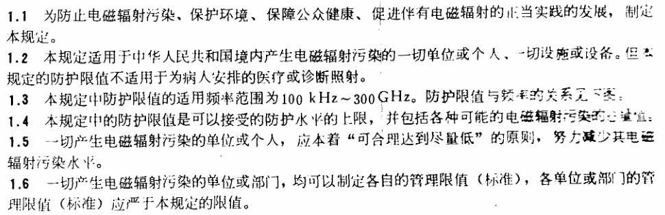
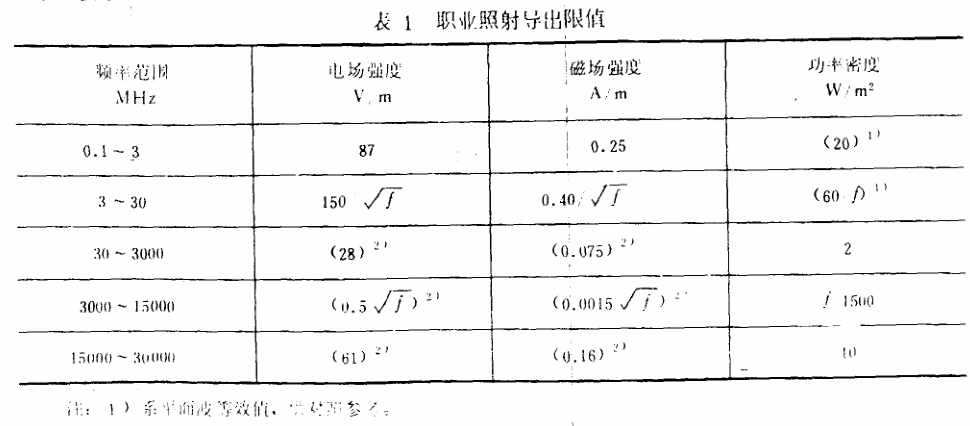
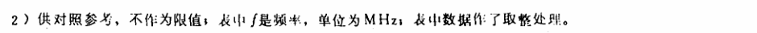
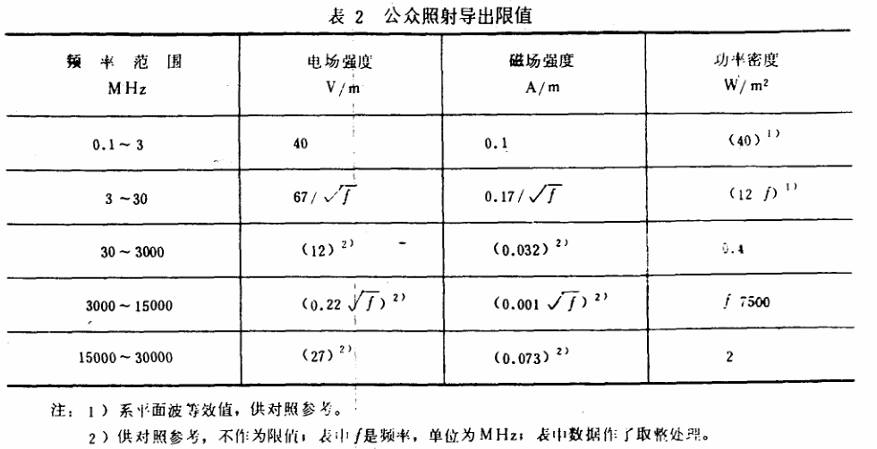
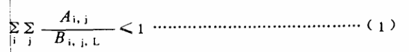
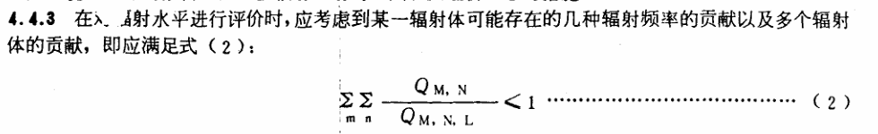
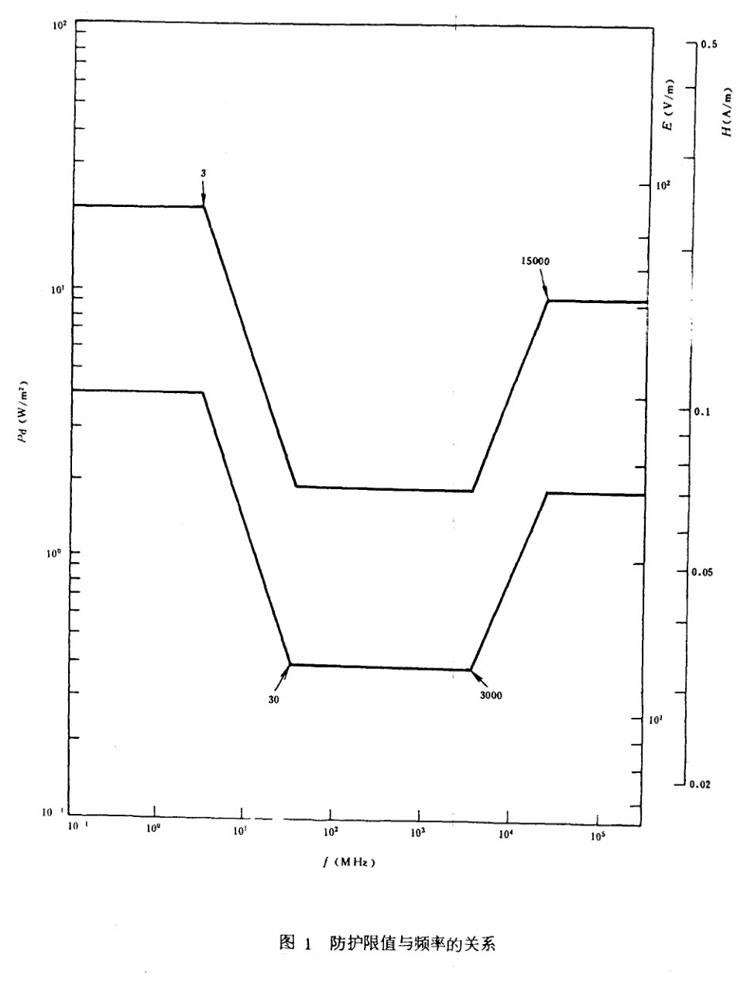

# GB 8702-1988 电磁辐射防护规定

> 来源：[生态环境部标准发布页](https://www.mee.gov.cn/ywgz/fgbz/bz/bzwb/hxxhj/dcfsbz/198806/t19880601_67681.shtml)、[官方完整 PDF](https://www.mee.gov.cn/image20010518/3975.pdf)。批准日期：1988-03-11；实施日期：1988-06-01。该标准已于 2015-01-01 废止，见[环境保护部公告2014年第63号](https://www.mee.gov.cn/gkml/hbb/bgg/201410/t20141022_290444.htm)。
> 官方 PDF 共 6 页，SHA-256：`10c3f2dbc669da92a0d6c795600bf2fa2262d46e74a68adb905c2f8c6a44636b`。
> 依据全部 6 页页面图像转写与校核，保留全部条款、3 张表、2 个公式、图1和附加说明。原扫描局部字迹残损：1.1—1.6、表1及表2、式（1）、4.4.3及式（2）直接保留原件局部图像，不猜补残字；表1跨页注释另附原图。省略页眉、页脚、留白和分页，合并印刷折行。

## 1 总则

## 2 电磁辐射防护限值

### 2.1 基本限值

2.1.1 职业照射：在每天 8 h 工作期间内，任意连续 6 min 按全身平均的比吸收率（SAR）应小于 0.1 W/kg。

2.1.2 公众照射：在一天 24 h 内，任意连续 6 min 按全身平均的比吸收率（SAR）应小于 0.02 W/kg。

### 2.2 导出限值

2.2.1 职业照射：在每天 8 h 工作期间内，电磁辐射场的场量参数在任意连续 6 min 内的平均值应满足表1要求。

2.2.2 公众照射：在一天 24 h 内，环境电磁辐射场的场量参数在任意连续 6 min 内的平均值应满足表2要求。

2.2.3 对于一个辐射体发射几种频率或存在多个辐射体时，其电磁辐射场的场量参数在任意连续 6 min 内的平均值之和，应满足式（1）：

式中：

Ai, j——第 i 个辐射体 j 频段辐射的辐射水平；

Bi, j, L——对应于 j 频段的电磁辐射所规定的照射限值。

2.2.4 对于脉冲电磁波，除满足上述要求外，其瞬时峰值不得超过表中1、2所列限值的 1000 倍。

2.2.5 在频率小于 100 MHz 的工业、科学和医学等辐射设备附近，职业工作者可以在小于 1.6 A/m 的磁场下 8 h 连续工作。

## 3 对电磁辐射源的管理

### 3.1 下列电磁辐射体可以免于管理

3.1.1 输出功率等于和小于 15 W 的移动式无线电通讯设备，如陆上、海上移动通讯设备以及步话机等。

3.1.2 向没有屏蔽空间的辐射等效功率小于表3所列数值的辐射体。

**表3 可豁免的电磁辐射体的等效辐射功率**

| 频率范围，MHz | 等效辐射功率，W |
| --- | --- |
| 0.1～3 | 300 |
| ＞3～300000 | 100 |

### 3.2 凡其功率超过3.1所列豁免水平的一切电磁辐射体的所有者，必须向所在地区的环境保护部门申报、登记，并接受监督。

3.2.1 新建或购置豁免水平以上的电磁辐射体的单位或个人，必须事先向环境保护部门提交“环境影响报告书（表）”。

3.2.2 新建或新购置的电磁辐射体运行后，必须实地测量电磁辐射场的空间分布。必要时以实测为基础划出防护带，并设立警戒符号。

### 3.3 一切拥有产生电磁辐射体的单位或个人，必须加强电磁辐射体的固有安全设计。

3.3.1 工业、科学和医学中应用的电磁辐射设备，出厂时必须具有满足“无线电干扰限值”的证明书。运行时应定期检查这些设备的漏能水平，不得在高漏能水平下使用，并避免对居民日常生活的干扰。

3.3.2 长波通讯、中波广播、短波通讯及广播的发射天线，离开人口稠密区的距离，必须满足本规定安全限值的要求。

3.4 电磁辐射水平超过2.2.1规定限值的工作场所必须配备必要的职业防护设备。

3.5 对伴有电磁辐射的设备进行操作和管理的人员，应施行电磁辐射防护训练。训练内容应包括：

a．电磁辐射的性质及其危害性；

b．常用防护措施、用具以及使用方法；

c．个人防护用具及使用方法；

d．电磁辐射防护规定。

## 4 电磁辐射监测

4.1 对超过豁免水平的电磁辐射体，其拥有者必须对辐射体所在的工作场所以及周围环境的电磁辐射水平进行监测，并将监测结果向所在地区的环境保护部门报告：

a．新建、改建、扩建后的辐射体，投入使用后的半年内提交监测报告。

b．现有的辐射体在本规定生效后半年内提交监测报告。

### 4.2 工作场所监测

4.2.1 当电磁辐射体的工作频率低于 300 MHz 时，应对工作场所的电场强度和磁场强度分别测量。当电磁辐射体的工作频率大于 300 MHz 时，可以只测电场强度。

4.2.2 测量仪器应尽量选用全向性探头的场强仪或漏能仪。使用非全向性探头时，测量期间必须不断调节探头方向，直至测到最大场强值。

仪器频率响应不均匀度和精确度应小于 ±3 dB。

4.2.3 测量仪器探头应尽量置于没有工作人员存在时工作人员的实际操作位置。

### 4.3 环境监测

4.3.1 环境中的电磁辐射大多可视为平面波，因此只需测电场强度。但在不能当成平面波的场所，需对电场强度和磁场强度分别测量。

4.3.2 测量仪器可以用干扰场强仪，频谱仪，微波接受机等。测量误差应小于 ±3 dB，频率误差应小于被测频带中心频率的 1/50。

4.3.3 针对某一辐射体的特定环境测量，应依据所测辐射体的天线类型，在距该天线 2000 m 以内最大辐射方向上选点测量或根据辐射方向图，分方位选点测量。

4.3.4 对于一般的电磁辐射环境监测布点，通常可依主要交通干线为基准，以一定的间距划分网格进行测量。

4.3.5 测点应选在开阔地段，要避开电力线、高压线、电话线、树木以及建筑物等的影响。

### 4.4 监测结果评价

4.4.1 当工作场所的电磁辐射水平超过限值时，必须对电磁辐射体的工作状态和防护措施进行检查，查明原因，并应采取有效治理措施。

4.4.2 某电磁辐射体使环境电磁辐射水平超过本规定的限值时，必须尽快采取措施降低辐射水平，同时向环境保护部门报告产生过量辐射照射的原因以及准备治理的措施。

式中：

QM, N——第 M 个辐射体 N 频段辐射的辐射水平；

QM, N, L——对应于 N 频段的电磁辐射所规定的照射限值。

## 5 监测的质量保证

5.1 电磁辐射监测事先必须制定监测方案及实施计划。

5.1.1 监测点位置的选取应考虑使监测结果具有代表性。不同的监测目的，应采取不同的监测方案。

5.1.2 监测所用仪器必须与所测对象在频率、量程、响应时间等方面相符合，以便保证获得真实的测量结果。

5.1.3 监测时要设法避免或尽量减少干扰，并对不可避免的干扰估计其对测量结果可能产生的最大误差。

5.1.4 监测时必须获得足够的数据量，以便保证测量结果的统计学精度。

5.2 监测仪器和装置（包括天线或探头）必须进行定期校准。

5.3 监测中异常数据的取舍以及监测结果的数据处理应按统计学原则办理。

5.4 电磁辐射监测应建立完整的文件资料。仪器和天线的校准证明书，监测方案，监测布点图，测量原始数据，统计处理程序等必须全部保存，以备复查。

5.5 任何存档或上报的监测结果必须经过复审，复审者应是不直接参与此项工作但又熟悉本内容的专业人员。

## 6 名词解释

6.1 电磁辐射（electromagnetic radiation）：能量以电磁波的形式通过空间传播的现象。

6.2 比吸收率（specific absorption rate SAR）：指生物体每单位质量所吸收的电磁辐射功率，即吸收剂量率。

6.3 功率密度（power density）：在空间某点上电磁波的量值用单位面积上的功率表示，单位为 W/m²。

或在空间某点上坡印廷矢量的值。

### 6.4 等效辐射功率（equivalent radiation power）

6.4.1 在 1000 MHz 以下，等效辐射功率等于机器标称功率与对半波天线而言的天线增益的乘积。

6.4.2 在 1000 MHz 以上，等效辐射功率等于机器标称功率与全向天线增益的乘积。

6.5 热效应（thermal effect）：指吸收电磁辐射能后，组织或系统产生的直接与热作用有关的变化。

6.6 非热效应（non-thermal effect）：吸收电磁辐射能后，组织或系统产生的与直接热作用没有关系的变化。

## 附加说明

本标准由国家环境保护局标准处提出。

本标准由国家环境保护局放射环境管理处组织编制。

本标准由国家环境保护局负责解释。
