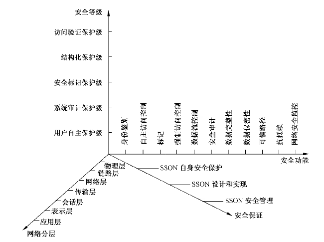

# GB/T 20270-2006 信息安全技术 网络基础安全技术要求

> 来源：[GB/T 20270-2006 国家标准详情](https://openstd.samr.gov.cn/bzgk/std/newGbInfo?hcno=B7D47C05FA963550AFB67F79AF6833E4)；发布日期：2006-05-31；实施日期：2006-12-01。
> 官方在线预览截图 SHA-256：94fef6c1eeb6d78a883e7705d740c5ec64afb86da7e16f7dd496b0a8004a4a27。
> 转写说明：对照官方在线预览全部 49 页图像逐页校正；省略封面、目录、页眉、页脚和页码，合并跨页内容。图 A.1、表 1 至表 12 已与页面图像核对。原文中的疑似笔误照录，包括 5.4.1 的“SSOIS”“BRAC”、5.7.1 的“SSF 应采取必要的 SSF 应采取必要的”、6.7 的“用户用户”、6.8 中关于保密性保护的“完整性”、6.10 的“信交换”“强制性接受证明”、7.5.1.3 的“网络层结访问验证保护级”、A.2 的“（L2TP））”、A.5 的“SSOIS 安全功能模块”“SSON 安全功能策略”及 A.6 的“不符和”。表5原文“访问控制环境”编号为 5.4.4，亦照录。正式引用请核对官方原文。

## 前言

本标准的附录 A 是资料性附录。

本标准由全国信息安全标准化技术委员会提出并归口。

本标准起草单位：北京思源新创信息安全资讯有限公司，江南计算技术研究所技术服务中心。

本标准主要起草人：吉增瑞、刘广明、王志强、陈冠直、景乾元、宋健平。

## 引言

本标准用以指导设计者如何设计和实现具有所需要的安全保护等级的网络系统，主要说明为实现GB 17859—1999中每一个安全保护等级的安全要求，网络系统应采取的安全技术措施，以及各安全技术要求在不同安全保护等级中的具体差异。

网络是一个具有复杂结构、由许多网络设备组成的系统，不同的网络环境又会有不同的系统结构。

然而，从网络系统所实现的功能来看，可以概括为“实现网上信息交换”。网上信息交换具体可以分解为信息的发送、信息的传输和信息的接收。从信息安全的角度，网络信息安全可以概括为“保障网上信息交换的安全”，具体表现为信息发送的安全、信息传输的安全和信息接收的安全，以及网上信息交换的抗抵赖等。网上信息交换是通过确定的网络协议实现的，不同的网络会有不同的协议。任何网络设备都是为实现确定的网络协议而设置的。典型的、具有代表性的网络协议是国际标准化组织的开放系统互连协议（ISO/OSI），也称七层协议。虽然很少有完全按照七层协议构建的网络系统，但是七层协议的理论价值和指导作用是任何网络协议所不可替代的。网络安全需要通过协议安全来实现。通过对七层协议每一层安全的描述，可以实现对网络安全的完整描述。网络协议的安全需要由组成网络系统的设备来保障。因此，对七层协议的安全要求自然包括对网络设备的安全要求。

信息安全是与信息系统所实现的功能密切相关的，网络安全也不例外。网络各层协议的安全与其在每一层所实现的功能密切相关。附录 A中A.2关于网络各层协议主要功能的说明，对物理层、链路层、网络层、传输层、会话层、表示层、应用层等各层的功能进行了简要描述，是确定网络各层安全功能要求的主要依据。

本标准以GB/T 20271—2006关于信息系统安全等级保护的通用技术要求为基础，围绕以访问控制为核心的思想进行编写，在对网络安全的组成与相互关系进行简要说明的基础上，第5章对网络安全功能基本技术分别进行了说明，第6章是对第5章网络安全功能的分级分层情况的描述。在此基础上，本标准的第7章对网络安全技术的分等级要求分别从安全功能技术要求和安全保证技术要求两方面进行了详细说明。在第7章的描述中除了引用以前各章的内容外，还引用了 GB/T 20271—2006 中关于安全保证技术要求的内容。由于 GB/T 20271—2006的安全保证技术要求，对网络而言没有需要特别说明的内容，所以在网络基本技术及其分级分层的描述中没有涉及这方面的内容。

## 1 范围

本标准依据GB 17859—1999的五个安全保护等级的划分，根据网络系统在信息系统中的作用，规定了各个安全等级的网络系统所需要的基础安全技术的要求。

本标准适用于按等级化的要求进行的网络系统的设计和实现，对按等级化要求进行的网络系统安全的测试和管理可参照使用。

## 2 规范性引用文件

下列文件中的条款通过本标准的引用而成为本标准的条款。凡是注明日期的引用文件，其随后的所有修改单（不包括勘误的内容）或修订版均不适用于本标准，然而，鼓励根据本标准达成协议的各方研究是否可使用这些文件的最新版本。凡是不注日期的引用文件，其最新版本适用于本标准。

- GB 17859—1999 计算机信息系统安全保护等级划分准则
- GB/T 20271—2006 信息安全技术 信息系统通用安全技术要求

## 3 术语、定义和缩略语

### 3.1 术语和定义

GB 17859—1999确立的以及下列术语和定义适用于本标准。

#### 3.1.1 网络安全 network security

网络环境下存储、传输和处理的信息的保密性、完整性和可用性的表征。

#### 3.1.2 网络安全基础技术 basis technology of network security

实现各种类型的网络系统安全需要的所有基础性安全技术。

#### 3.1.3 网络安全子系统 security subsystem of network

网络中安全保护装置的总称，包括硬件、固件、软件和负责执行安全策略的组合体。它建立了一个基本的网络安全保护环境，并提供安全网络所要求的附加用户服务。

> 注：按照 GB 17859—1999对 TCB（可信计算基）的定义，SSON（网络安全子系统）就是网络的 TCB。

#### 3.1.4 SSON 安全策略 SSON security policy

对 SSON 中的资源进行管理、保护和分配的一组规则。一个 SSON 中可以有一个或多个安全策略。

#### 3.1.5 安全功能策略 security function policy

为实现 SSON 安全要素要求的功能所采用的安全策略。

#### 3.1.6 安全要素 security element

本标准中各安全保护等级的安全技术要求所包含的安全内容的组成成份。

#### 3.1.7 SSON 安全功能 SSON security function

正确实施 SSON安全策略的全部硬件、固件、软件所提供的功能。每一个安全策略的实现，组成一个 SSON 安全功能模块。一个 SSON 的所有安全功能模块共同组成该 SSON 的安全功能。

#### 3.1.8 SSF 控制范围 SSF scope of control

SSON 的操作所涉及的主体和客体的范围。

### 3.2 缩略语

下列缩略语适用于本标准：

- SFP：安全功能策略（security function policy）；
- SSC：SSF 控制范围（SSF scope of control）；
- SSF：SSON 安全功能（SSON security function）；
- SSP：SSON 安全策略（SSON security policy）；
- SSON：网络安全子系统（security subsystem of network）。

## 4 网络安全组成与相互关系

根据OSI参考模型和 GB17859—1999所规定的安全保护等级和安全要素，网络安全的组成与相互关系如表1所示。

对于网络系统的物理层、链路层、网络层、传输层、会话层、表示层和应用层，可分别按 GB 17859—1999的各个安全等级的要求进行设计。

在各协议层中，安全要素的实现方法可有所不同。本标准基于各项安全要素对各协议层在各个安全保护等级中应采用的安全技术和机制提出要求。

**表1 安全保护等级、网络层次与安全要素的相互关系**

| 安全等级 | 网络层次 | 身份鉴别 | 自主访问控制 | 标记 | 强制访问控制 | 数据流控制 | 安全审计 | 数据完整性 | 数据保密性 | 可信路径 | 抗抵赖 | 网络安全监控 |
| --- | --- | --- | --- | --- | --- | --- | --- | --- | --- | --- | --- | --- |
| 用户自主保护级 | 物理层 |  |  |  |  |  |  | ☆ |  |  |  |  |
| 用户自主保护级 | 链路层 | ☆ | ☆ |  |  |  |  | ☆ | ☆ |  |  |  |
| 用户自主保护级 | 网络层 | ☆ | ☆ |  |  |  |  | ☆ | ☆ |  |  |  |
| 用户自主保护级 | 传输层 | ☆ | ☆ |  |  |  |  | ☆ | ☆ |  |  |  |
| 用户自主保护级 | 会话层 | ☆ | ☆ |  |  |  |  | ☆ | ☆ |  |  |  |
| 用户自主保护级 | 表示层 | ☆ | ☆ |  |  |  |  | ☆ | ☆ |  |  |  |
| 用户自主保护级 | 应用层 | ☆ | ☆ |  |  |  |  | ☆ | ☆ |  |  |  |
| 系统审计保护级 | 物理层 |  |  |  |  |  |  | ☆ | ☆ |  |  |  |
| 系统审计保护级 | 链路层 | ☆ | ☆ |  |  |  |  | ☆ | ☆ |  |  |  |
| 系统审计保护级 | 网络层 | ☆ | ☆ |  |  |  | ☆ | ☆ | ☆ |  |  |  |
| 系统审计保护级 | 传输层 | ☆ | ☆ |  |  |  | ☆ | ☆ | ☆ |  |  |  |
| 系统审计保护级 | 会话层 | ☆ | ☆ |  |  |  | ☆ | ☆ | ☆ |  |  |  |
| 系统审计保护级 | 表示层 | ☆ | ☆ |  |  |  | ☆ | ☆ | ☆ |  |  |  |
| 系统审计保护级 | 应用层 | ☆ | ☆ |  |  |  | ☆ | ☆ | ☆ |  |  |  |
| 安全标记保护级 | 物理层 |  |  |  |  |  |  | ☆ | ☆ |  |  |  |
| 安全标记保护级 | 链路层 | ☆ | ☆ | ☆ | ☆ | ☆ |  | ☆ | ☆ |  |  |  |
| 安全标记保护级 | 网络层 | ☆ | ☆ | ☆ | ☆ | ☆ | ☆ | ☆ | ☆ |  | ☆ |  |
| 安全标记保护级 | 传输层 | ☆ | ☆ | ☆ | ☆ | ☆ | ☆ | ☆ | ☆ |  | ☆ |  |
| 安全标记保护级 | 会话层 | ☆ | ☆ | ☆ | ☆ | ☆ | ☆ | ☆ | ☆ |  | ☆ | ☆ |
| 安全标记保护级 | 表示层 | ☆ | ☆ | ☆ | ☆ | ☆ | ☆ | ☆ | ☆ |  | ☆ | ☆ |
| 安全标记保护级 | 应用层 | ☆ | ☆ | ☆ | ☆ | ☆ | ☆ | ☆ | ☆ |  | ☆ | ☆ |
| 结构化保护级 | 物理层 |  |  |  |  |  |  | ☆ | ☆ |  |  |  |
| 结构化保护级 | 链路层 | ☆ | ☆ | ☆ | ☆ | ☆ |  | ☆ | ☆ |  |  |  |
| 结构化保护级 | 网络层 | ☆ | ☆ | ☆ | ☆ | ☆ | ☆ | ☆ | ☆ | ☆ | ☆ |  |
| 结构化保护级 | 传输层 | ☆ | ☆ | ☆ | ☆ | ☆ | ☆ | ☆ | ☆ | ☆ | ☆ |  |
| 结构化保护级 | 会话层 | ☆ | ☆ | ☆ | ☆ | ☆ | ☆ | ☆ | ☆ | ☆ | ☆ | ☆ |
| 结构化保护级 | 表示层 | ☆ | ☆ | ☆ | ☆ | ☆ | ☆ | ☆ | ☆ | ☆ | ☆ | ☆ |
| 结构化保护级 | 应用层 | ☆ | ☆ | ☆ | ☆ | ☆ | ☆ | ☆ | ☆ | ☆ | ☆ | ☆ |
| 访问验证保护级 | 物理层 |  |  |  |  |  |  | ☆ | ☆ |  |  |  |
| 访问验证保护级 | 链路层 | ☆ | ☆ | ☆ | ☆ | ☆ |  | ☆ | ☆ |  |  |  |
| 访问验证保护级 | 网络层 | ☆ | ☆ | ☆ | ☆ | ☆ | ☆ | ☆ | ☆ | ☆ | ☆ |  |
| 访问验证保护级 | 传输层 | ☆ | ☆ | ☆ | ☆ | ☆ | ☆ | ☆ | ☆ | ☆ | ☆ |  |
| 访问验证保护级 | 会话层 | ☆ | ☆ | ☆ | ☆ | ☆ | ☆ | ☆ | ☆ | ☆ | ☆ | ☆ |
| 访问验证保护级 | 表示层 | ☆ | ☆ | ☆ | ☆ | ☆ | ☆ | ☆ | ☆ | ☆ | ☆ | ☆ |
| 访问验证保护级 | 应用层 | ☆ | ☆ | ☆ | ☆ | ☆ | ☆ | ☆ | ☆ | ☆ | ☆ | ☆ |

注：“☆”表示具有该要素。每个安全级的各层协议所设置的安全要素可以是有选择的。选择的原则是整体上达到安全要求。

## 5 网络安全功能基本要求

### 5.1 身份鉴别

#### 5.1.1 用户标识

a） 基本标识：应在SSF实施所要求的动作之前，先对提出该动作要求的用户进行标识。

b） 唯一性标识：应确保所标识用户在信息系统生存周期内的唯一性，并将用户标识与安全审计相关联。

c） 标识信息管理：应对用户标识信息进行管理、维护，确保其不被非授权地访问、修改或删除。

#### 5.1.2 用户鉴别

a） 基本鉴别：应在SSF 实施所要求的动作之前，先对提出该动作要求的用户成功地进行鉴别。

b） 不可伪造鉴别：应检测并防止使用伪造或复制的鉴别数据。一方面，要求 SSF 应检测或防止由任何别的用户伪造的鉴别数据，另一方面，要求SSF 应检测或防止当前用户从任何其他用户处复制的鉴别数据的使用。

c） 一次性使用鉴别：应能提供一次性使用鉴别数据操作的鉴别机制，即SSF 应防止与已标识过的鉴别机制有关的鉴别数据的重用。

d） 多机制鉴别：应能提供不同的鉴别机制，用于鉴别特定事件的用户身份，并且SSF 应根据所描述的多种鉴别机制如何提供鉴别的规则，来鉴别任何用户所声称的身份。

e） 重新鉴别：应有能力规定需要重新鉴别用户的事件，即SSF 应在需要重鉴别的条件表所指示的条件下，重新鉴别用户。例如，用户终端操作超时被断开后，重新连接时需要进行重鉴别。

#### 5.1.3 用户—主体绑定

在SSON 安全功能控制范围之内，对一个已标识和鉴别的用户，为了要求 SSF 完成某个任务，需要激活另一个主体（如进程），这时，要求通过用户—主体绑定将该用户与该主体相关联，从而将用户的身份与该用户的所有可审计行为相关联。

#### 5.1.4 鉴别失败处理

要求 SSF 为不成功的鉴别尝试次数（包括尝试数目和时间的阈值）定义一个值，以及明确规定达到该值时所应采取的动作。鉴别失败的处理应包括检测出现相关的不成功鉴别尝试的次数与所规定的数目相同的情况，并进行预先定义的处理。

### 5.2 自主访问控制

#### 5.2.1 访问控制策略

SSF 应按确定的自主访问控制安全策略进行设计，实现对策略控制下的主体与客体间操作的控制。

可以有多个自主访问控制安全策略，但它们必须独立命名，且不能相互冲突。常用的自主访问控制策略包括：访问控制表访问控制、目录表访问控制、权能表访问控制等。

#### 5.2.2 访问控制功能

SSF 应明确指出采用一条命名的访问控制策略所实现的特定功能，说明策略的使用和特征，以及该策略的控制范围。

无论采用何种自主访问控制策略，SSF 应有能力提供：

- 在安全属性或命名的安全属性组的客体上，执行访问控制 SFP；
- 在基于安全属性的允许主体对客体访问的规则的基础上，允许主体对客体的访问；
- 在基于安全属性的拒绝主体对客体访问的规则的基础上，拒绝主体对客体的访问。

#### 5.2.3 访问控制范围

网络系统中自主访问控制的覆盖范围分为：

a） 子集访问控制：要求每个确定的自主访问控制，SSF 应覆盖网络系统中所定义的主体、客体及其之间的操作；

b） 完全访问控制：要求每个确定的自主访问控制，SSF 应覆盖网络系统中所有的主体、客体及其之间的操作，即要求 SSF 应确保SSC 内的任意一个主体和任意一个客体之间的所有操作将至少被一个确定的访问控制 SFP覆盖。

#### 5.2.4 访问控制粒度

网络系统中自主访问控制的粒度分为：

a） 粗粒度：主体为用户组/用户级，客体为文件、数据库表级；

b） 中粒度：主体为用户级，客体为文件、数据库表级和/或记录、字段级；

c） 细粒度：主体为用户级，客体为文件、数据库表级和/或记录、字段级或元素级。

### 5.3 标记

#### 5.3.1 主体标记

应为实施强制访问控制的主体指定敏感标记，这些敏感标记是实施强制访问控制的依据。如：等级分类和非等级类别组合的敏感标记是实施多级安全模型的基础。

#### 5.3.2 客体标记

应为实施强制访问控制的客体指定敏感标记，这些敏感标记是实施强制访问控制的依据。如：等级分类和非等级类别组合的敏感标记是实施多级安全模型的基础。

#### 5.3.3 标记完整性

敏感标记应能准确地表示特定主体或客体的访问控制属性，主体和客体应以此发生关联。当数据从SSON 输出时，根据需要，敏感标记应能准确地和明确地表示输出数据的内部标记，并与输出的数据相关联。

#### 5.3.4 有标记信息的输出

SSON应对每个通信信道和I/O设备标明单级或多级。这个标志的任何变化都应由授权用户实现，并可由 SSON审计。SSON 应维持并且能够对安全保护等级的任何变化进行审定，或对与通信信道或I/O设备有关的安全保护等级进行安全审计。

a） 向多级安全设备的输出：当SSON将一客体信息输出到一个具有多级安全的I/O设备时，与该客体有关的敏感标记也应输出，并以与输出信息相同的形式（如机器可读或人可读形式）驻留在同一物理媒体上。当 SSON 在多级通信信道上输出或输入一客体信息时，该信道使用的协议应在敏感标记和被发送或被接收的有关信息之间提供明确的配对关系。

b） 向单级安全设备的输出：单级I/O设备和单级通信信道不需要维持其处理信息的敏感标记，但 SSON 应包含一种机制，使SSON与一个授权用户能可靠地实现指定的安全级的信息通信。这种信息经由单级通信信道或I/O设备输入/输出。

c） 人可读标记的输出：SSON应标记所有人可读的、编页的、具有人可读的敏感标记的硬拷贝输出（如行打印机输出）的开始和结束，以适当地表示输出敏感性。SSON应按默认值标记人可读的、编页的、具有人可读的敏感标记的硬拷贝输出（如行打印机输出）每页的顶部和底部，以适当地表示该输出总的敏感性，或表示该页信息的敏感性。SSON应该按默认值，并以一种适当方法标记具有人可读的敏感标记的其他形式的人可读的输出（如图形），以适当地表示该输出的敏感性。这些标记默认值的任何滥用都应由 SSON 审计。

### 5.4 强制访问控制

#### 5.4.1 访问控制策略

网络强制访问控制策略应包括策略控制下的主体、客体，及由策略覆盖的被控制的主体与客体间的操作。可以有多个访问控制安全策略，但它们必须独立命名，且不能相互冲突。当前常见的强制访问控制策略有：

<ol type="a">
  <li>
    
多级安全模型：基本思想是，在对主、客体进行标记的基础上，SSOIS 控制范围内的所有主体对客体的直接或间接的访问应满足：

    <ul>
      <li>向下读原则：仅当主体标记中的等级分类高于或等于客体标记中的等级分类，且主体标记中的非等级类别包含了客体标记中的全部非等级类别，主体才能读该客体；</li>
      <li>向上写原则：仅当主体标记中的等级分类低于或等于客体标记中的等级分类，且主体标记中的非等级类别包含于客体标记中的非等级类别，主体才能写该客体。</li>
    </ul>
  </li>
  <li>
    
基于角色的访问控制（BRAC）：基本思想是，按角色进行权限的分配和管理；通过对主体进行角色授予，使主体获得相应角色的权限；通过撤消主体的角色授予，取消主体所获得的相应角色权限。在基于角色的访问控制中，标记信息是对主体的授权信息。

  </li>
  <li>
    
特权用户管理：基本思想是，针对特权用户权限过于集中所带来的安全隐患，对特权用户按最小授权原则进行管理。实现特权用户的权限分离；仅授予特权用户为完成自身任务所需要的最小权限。

  </li>
</ol>

#### 5.4.2 访问控制功能

SSF 应明确指出采用一条命名的强制访问控制策略所实现的特定功能。SSF 应有能力提供：

- 在标记或命名的标记组的客体上，执行访问控制 SFP；
- 按受控主体和受控客体之间的允许访问规则，决定允许受控主体对受控客体执行受控操作；
- 按受控主体和受控客体之间的拒绝访问规则，决定拒绝受控主体对受控客体执行受控操作。

#### 5.4.3 访问控制范围

网络强制访问控制的覆盖范围分为：

a） 子集访问控制：对每个确定的强制访问控制，SSF 应覆盖信息系统中由安全功能所定义的主体、客体及其之间的操作；

b） 完全访问控制：对每个确定的强制访问控制，SSF应覆盖信息系统中所有的主体、客体及其之间的操作，即要求 SSF 应确保SSC 内的任意一个主体和任意一个客体之间的操作将至少被一个确定的访问控制 SFP覆盖。

#### 5.4.4 访问控制粒度

网络强制访问控制的粒度分为：

a） 中粒度：主体为用户级，客体为文件、数据库表级和/或记录、字段级；

b） 细粒度：主体为用户级，客体为文件、数据库表级和/或记录、字段级和/或元素级。

#### 5.4.5 访问控制环境

a） 单一安全域环境：在单一安全域环境实施的强制访问控制应在该环境中维持统一的标记信息和访问规则。当被控客体输出到安全域以外时，应将其标记信息同时输出；

b） 多安全域环境：在多安全域环境实施统一安全策略的强制访问控制时，应在这些安全域中维持统一的标记信息和访问规则。当被控制客体在这些安全域之间移动时，应将其标记信息一起移动。

### 5.5 数据流控制

对网络中以数据流方式实现数据流动的情况，应采用数据流控制机制实现对数据流动的控制，以防止具有高等级安全的数据信息向低等级的区域流动。

### 5.6 安全审计

#### 5.6.1 安全审计的响应

安全审计 SSF 应按以下要求响应审计事件：

a） 记审计日志：当检测到可能有安全侵害事件时，将审计数据记入审计日志；

b） 实时报警生成：当检测到可能有安全侵害事件时，生成实时报警信息；

c） 违例进程终止：当检测到可能有安全侵害事件时，将违例进程终止；

d） 服务取消：当检测到可能有安全侵害事件时，取消当前的服务；

e） 用户账号断开与失效：当检测到可能有安全侵害事件时，将当前的用户账号断开，并使其失效。

#### 5.6.2 安全审计数据产生

SSF 应按以下要求产生审计数据：

<ol type="a">
  <li>
    
为下述可审计事件产生审计记录：

    <ul>
      <li>审计功能的启动和关闭；</li>
      <li>使用身份鉴别机制；</li>
      <li>将客体引入用户地址空间（例如：打开文件、程序初始化）；</li>
      <li>删除客体；</li>
      <li>系统管理员、系统安全员、审计员和一般操作员所实施的操作；</li>
      <li>其他与系统安全有关的事件或专门定义的可审计事件。</li>
    </ul>
  </li>
  <li>
    
对于每一个事件，其审计记录应包括：事件的日期和时间、用户、事件类型、事件是否成功，及其他与审计相关的信息。

  </li>
  <li>
    
对于身份鉴别事件，审计记录应包含请求的来源（例如：终端标识符）。

  </li>
  <li>
    
对于客体被引入用户地址空间的事件及删除客体事件，审计记录应包含客体名及客体的安全保护等级。

  </li>
  <li>
    
将每个可审计事件与引起该事件的用户相关联。

  </li>
</ol>

#### 5.6.3 安全审计分析

安全审计分析应包括：

<ol type="a">
  <li>
    
潜在侵害分析：应能用一系列规则去监控审计事件，并根据这些规则指出 SSP 的潜在侵害。

    
这些规则包括：

    <ul>
      <li>由已定义的可审计事件的子集所指示的潜在安全攻击的积累或组合；</li>
      <li>任何其他的规则。</li>
    </ul>
  </li>
  <li>
    
基于异常检测的描述：应维护用户所具有的质疑等级——历史使用情况，以表明该用户的现行活动与已建立的使用模式的一致性程度。当用户的质疑等级超过门限条件时，SSF 应能指出将要发生对安全性的威胁。

  </li>
  <li>
    
简单攻击探测：应能检测到对SSF 实施有重大威胁的签名事件的出现。为此，SSF 应维护指出对SSF 侵害的签名事件的内部表示，并将检测到的系统行为记录与签名事件进行比较，当发现两者匹配时，指出一个对SSF 的攻击即将到来。

  </li>
  <li>
    
复杂攻击探测：在上述简单攻击探测的基础上，要求SSF应能检测到多步入侵情况，并能根据已知的事件序列模拟出完整的入侵情况，还应指出发现对SSF 的潜在侵害的签名事件或事件序列的时间。

  </li>
</ol>

#### 5.6.4 安全审计查阅

安全审计查阅工具应具有：

a） 审计查阅：提供从审计记录中读取信息的能力，即要求 SSF 为授权用户提供获得和解释审计信息的能力。当用户是人时，必须以人类可懂的方式表示信息；当用户是外部IT 实体时，必须以电子方式无歧义地表示审计信息。

b） 有限审计查阅：在上述审计查阅的基础上，审计查阅工具应禁止具有读访问权限以外的用户读取审计信息。

c） 可选审计查阅：在上述有限审计查阅的基础上，审计查阅工具应具有根据准则来选择要查阅的审计数据的功能，并根据某种逻辑关系的标准提供对审计数据进行搜索、分类，排序的能力。

#### 5.6.5 安全审计事件选择

应根据以下属性选择可审计事件：

a） 客体身份、用户身份、主体身份、主机身份、事件类型；

b） 作为审计选择性依据的附加属性。

#### 5.6.6 安全审计事件存储

应具有以下创建并维护安全的审计踪迹记录的能力：

a） 受保护的审计踪迹存储：要求审计踪迹的存储受到应有的保护，能检测或防止对审计记录的修改；

b） 审计数据的可用性确保：要求在意外情况出现时，能检测或防止对审计记录的修改，以及在发生审计存储已满、存储失败或存储受到攻击时，确保审计记录不被破坏；

c） 审计数据可能丢失情况下的措施：要求当审计跟踪超过预定的门限时，应采取相应的措施，进行审计数据可能丢失情况的处理；

d） 防止审计数据丢失：要求在审计踪迹存储记满时，应采取相应的防止审计数据丢失的措施，可选择“忽略可审计事件”、“阻止除具有特殊权限外的其他用户产生可审计事件”、“覆盖已存储的最老的审计记录”和“一旦审计存储失败所采取的其他行动”等措施，防止审计数据丢失。

### 5.7 用户数据完整性

#### 5.7.1 存储数据的完整性

应对存储在 SSC内的用户数据进行完整性保护，包括：

a） 完整性检测：要求 SSF 应对基于用户属性的所有客体，对存储在SSC内的用户数据进行完整性检测；

b） 完整性检测和恢复：要求 SSF 应对基于用户属性的所有客体，对存储在SSC内的用户数据进行完整性检测，并且当检测到完整性错误时，SSF 应采取必要的SSF 应采取必要的恢复、审计或报警措施。

#### 5.7.2 传输数据的完整性

当用户数据在SSF 和其他可信IT 系统间传输时应提供完整性保护，包括：

a） 完整性检测：要求对被传输的用户数据进行检测，及时发现以某种方式传送或接收的用户数据被篡改、删除、插入等情况发生；

b） 数据交换恢复：由接收者 SSON 借助于源可信IT 系统提供的信息，或由接收者 SSON 自己无须来自源可信IT 系统的任何帮助，能恢复被破坏的数据为原始的用户数据。若没有可恢复条件，应向源可信IT 系统提供反馈信息。

#### 5.7.3 处理数据的完整性

回退：对信息系统中处理中的数据，应通过“回退”进行完整性保护，即要求 SSF应执行访问控制SFP，以允许对所定义的操作序列进行回退。

### 5.8 用户数据保密性

#### 5.8.1 存储数据的保密性

应对存储在 SSC 内的用户数据进行保密性保护。

#### 5.8.2 传输数据的保密性

应对在SSC 内传输的用户数据进行保密性保护。

#### 5.8.3 客体安全重用

在对资源进行动态管理的系统中，客体资源（寄存器、内存、磁盘等记录介质）中的剩余信息不应引起信息的泄露。客体安全重用分为：

a） 子集信息保护：要求对 SSON 安全控制范围之内的某个子集的客体资源，在将其分配给某一用户或代表该用户运行的进程时，应不会泄露该客体中的原有信息；

b） 完全信息保护：要求对SSON安全控制范围之内的所有客体资源，在将其分配给某一用户或代表该用户运行的进程时，应不会泄露该客体中的原有信息；

c） 特殊信息保护：对于某些需要特别保护的信息，应采用专门的方法对客体资源中的残留信息做彻底清除，如对剩磁的清除等。

### 5.9 可信路径

用户与 SSF 间的可信路径应：

a） 提供真实的端点标识，并保护通信数据免遭修改和泄露；

b） 利用可信路径的通信可以由 SSF 自身、本地用户或远程用户发起；

c） 对原发用户的鉴别或需要可信路径的其他服务均使用可信路径。

### 5.10 抗抵赖

#### 5.10.1 抗原发抵赖

应确保信息的发送者不能否认曾经发送过该信息。这就要求SSF 提供一种方法，来确保接收信息的主体在数据交换期间能获得证明信息原发的证据，而且该证据可由该主体或第三方主体验证。

抗原发抵赖分为：

a） 选择性原发证明：要求SSF 具有为主体提供请求原发证据信息的能力。即SSF 在接到原发者或接收者的请求时，能就传输的信息产生原发证据，证明该信息的发送由该原发者所为。

b） 强制性原发证明：要求 SSF 在任何时候都能对传输的信息产生原发证据。即SSF 在任何时候都能就传输的信息强制产生原发证据，证明该信息的发送由该原发者所为。

#### 5.10.2 抗接收抵赖

应确保信息的接收者不能否认接受过该信息。这就要求SSF 提供一种方法，来确保发送信息的主体在数据交换期间能获得证明该信息被接收的证据，而且该证据可由该主体或第三方主体验证。

抗接收抵赖分为：

a） 选择性接收证明：要求SSF 具有为主体提供请求信息接收证据的能力。即SSF 在接到原发者或接收者的请求时，能就接收到的信息产生接收证据，证明该信息的接收由该接收者所为。

b） 强制性接收证明：要求SSF 总是对收到的信息产生接收证据。即 SSF能在任何时候对收到的信息强制产生接收证据，证明该信息的接收由该接收者所为。

### 5.11 网络安全监控

网络安全监控应采用以下安全技术和机制：

a） 网络安全探测机制：在组成网络系统的各个重要部位，设置探测器，实时监听网络数据流，监视和记录内、外部用户出入网络的相关操作。在发现违规模式和未授权访问时，报告网络安全监控中心。

b） 网络安全监控中心：设置安全监控中心，对收到的来自探测器的信息，根据安全策略进行分析，并作审计、报告、事件记录和报警等处理。网络安全监控中心应具有必要的远程管理功能，如对探测器实现远程参数设置、远程数据下载、远程启动等操作。网络安全监控中心还应具有实时响应功能，包括攻击分析和响应、误操作分析和响应、漏洞分析和响应等。

## 6 网络安全功能分层分级要求

### 6.1 身份鉴别功能

应按照用户标识和用户鉴别的要求进行身份鉴别安全机制的设计。

一般以用户名和用户标识符来标识一个用户，应确保在一个信息系统中用户名和用户标识符的唯一性，严格的唯一性应维持在网络系统的整个生存周期都有效，即使一个用户的账户已被删除，他的用户名和标识符也不能再使用，并由此确保用户的唯一性和可区别性。

鉴别应确保用户的真实性。可以用口令进行鉴别，更严格的身份鉴别可采用智能IC 卡密码技术，指纹、虹膜等特征信息进行身份鉴别，并在每次用户登录系统之前进行鉴别。口令应是不可见的，并在存储和传输时进行保护。智能IC 卡身份鉴别应以密码技术为基础，并按用户鉴别中不可伪造鉴别所描述的要求进行设计。对于鉴别失败的情况，要求按鉴别失败所描述的要求进行处理。

用户在系统中的行为一般由进程代为执行，要求按用户—主体绑定所描述的要求，将用户与代表该用户行为的进程相关联。这种关联应体现在SSON 安全功能控制范围之内各主、客体之间的相互关系上。比如，一个用户通过键入一条命令要求访问一个指定文件，信息系统运行某一进程实现这一功能。

这时，该进程应与该用户相关联，于是该进程的行为即可看作该用户的行为。

身份鉴别应区分实体鉴别和数据起源鉴别：当身份是由参与通信连接或会话的远程实体提交时叫实体鉴别，它可以作为访问控制服务的一种必要支持；当身份信息是由数据项发送者提交时叫数据起源鉴别，它是确保部分完整性目标的直接方法，确保知道某个数据项的真正起源。

**表2给出了从用户自主保护级到访问验证保护级对身份鉴别功能的分层分级要求。**

**表2 身份鉴别功能分层分级要求**

| 安全保护等级 | 网络层次 | 5.1.1 用户标识 | 5.1.2 用户鉴别 | 5.1.3 用户—主体绑定 | 5.1.4 鉴别失败处理 |
| --- | --- | --- | --- | --- | --- |
| 用户自主保护级 | 物理层 |  |  |  |  |
| 用户自主保护级 | 链路层 | ☆ | ☆ |  | ☆ |
| 用户自主保护级 | 网络层 | ☆ | ☆ |  | ☆ |
| 用户自主保护级 | 传输层 | ☆ | ☆ |  | ☆ |
| 用户自主保护级 | 会话层 | ☆ | ☆ |  | ☆ |
| 用户自主保护级 | 表示层 | ☆ | ☆ |  | ☆ |
| 用户自主保护级 | 应用层 | ☆ | ☆ |  | ☆ |
| 系统审计保护级 | 物理层 |  |  |  |  |
| 系统审计保护级 | 链路层 | ☆ | ☆ |  | ☆ |
| 系统审计保护级 | 网络层 | ☆ | ☆ |  | ☆ |
| 系统审计保护级 | 传输层 | ☆ | ☆ |  | ☆ |
| 系统审计保护级 | 会话层 | ☆ | ☆ |  | ☆ |
| 系统审计保护级 | 表示层 | ☆ | ☆ |  | ☆ |
| 系统审计保护级 | 应用层 | ☆ | ☆ |  | ☆ |
| 安全标记保护级 | 物理层 |  |  |  |  |
| 安全标记保护级 | 链路层 | ☆ | ☆ |  | ☆ |
| 安全标记保护级 | 网络层 | ☆ | ☆ |  | ☆ |
| 安全标记保护级 | 传输层 | ☆ | ☆ |  | ☆ |
| 安全标记保护级 | 会话层 | ☆ | ☆ |  | ☆ |
| 安全标记保护级 | 表示层 | ☆ | ☆ |  | ☆ |
| 安全标记保护级 | 应用层 | ☆ | ☆ | ☆ | ☆ |
| 结构化保护级 | 物理层 |  |  |  |  |
| 结构化保护级 | 链路层 | ☆ | ☆ |  | ☆ |
| 结构化保护级 | 网络层 | ☆ | ☆ |  | ☆ |
| 结构化保护级 | 传输层 | ☆ | ☆ |  | ☆ |
| 结构化保护级 | 会话层 | ☆ | ☆ |  | ☆ |
| 结构化保护级 | 表示层 | ☆ | ☆ |  | ☆ |
| 结构化保护级 | 应用层 | ☆ | ☆ | ☆ | ☆ |
| 访问验证保护级 | 物理层 |  |  |  |  |
| 访问验证保护级 | 链路层 | ☆ | ☆ |  | ☆ |
| 访问验证保护级 | 网络层 | ☆ | ☆ |  | ☆ |
| 访问验证保护级 | 传输层 | ☆ | ☆ |  | ☆ |
| 访问验证保护级 | 会话层 | ☆ | ☆ |  | ☆ |
| 访问验证保护级 | 表示层 | ☆ | ☆ |  | ☆ |
| 访问验证保护级 | 应用层 | ☆ | ☆ | ☆ | ☆ |

注：“☆”表示具有该要求。每个安全保护等级的具体要求可能不同，详见第7章描述。

### 6.2 自主访问控制功能

应按照对访问控制策略的要求，选择所需的访问控制策略，并按照对访问控制功能的要求，设计和实现所需要的自主访问控制功能。

当使用文件、目录和网络设备时，网络管理员应给文件、目录等指定访问属性。访问控制规则应将给定的属性与网络服务器的文件、目录和网络设备相联系。网络上的资源都应预先标出一组安全属性。

用户对网络资源的访问权限对应一张访问控制表，用以表明用户对网络资源的访问能力。自主访问控制应能控制以下权限：

a） 向某个文件写数据、拷贝文件、删除目录或文件、查看目录和文件、执行文件、隐含文件、共享、系统属性等；

b） 为每个命名客体指定用户名和用户组，以及规定他们对客体的访问模式。

**表3给出了从用户自主保护级到访问验证保护级对自主访问控制功能的分层分级要求。**

**表3 自主访问控制功能分层分级要求**

| 安全保护等级 | 网络层次 | 5.2.1 访问控制策略 | 5.2.2 访问控制功能 | 5.2.3 a）子集访问控制 | 5.2.3 b）完全访问控制 | 5.2.4 a）粗粒度 | 5.2.4 b）中粒度 | 5.2.4 c）细粒度 |
| --- | --- | --- | --- | --- | --- | --- | --- | --- |
| 用户自主保护级 | 物理层 |  |  |  |  |  |  |  |
| 用户自主保护级 | 链路层 | ☆ | ☆ | ☆ |  | ☆ |  |  |
| 用户自主保护级 | 网络层 | ☆ | ☆ | ☆ |  | ☆ |  |  |
| 用户自主保护级 | 传输层 | ☆ | ☆ | ☆ |  | ☆ |  |  |
| 用户自主保护级 | 会话层 | ☆ | ☆ | ☆ |  | ☆ |  |  |
| 用户自主保护级 | 表示层 | ☆ | ☆ | ☆ |  | ☆ |  |  |
| 用户自主保护级 | 应用层 | ☆ | ☆ | ☆ |  | ☆ |  |  |
| 系统审计保护级 | 物理层 |  |  |  |  |  |  |  |
| 系统审计保护级 | 链路层 | ☆ | ☆ | ☆ |  |  | ☆ |  |
| 系统审计保护级 | 网络层 | ☆ | ☆ | ☆ |  |  | ☆ |  |
| 系统审计保护级 | 传输层 | ☆ | ☆ | ☆ |  |  | ☆ |  |
| 系统审计保护级 | 会话层 | ☆ | ☆ | ☆ |  |  | ☆ |  |
| 系统审计保护级 | 表示层 | ☆ | ☆ | ☆ |  |  | ☆ |  |
| 系统审计保护级 | 应用层 | ☆ | ☆ | ☆ |  |  | ☆ |  |
| 安全标记保护级 | 物理层 |  |  |  |  |  |  |  |
| 安全标记保护级 | 链路层 | ☆ | ☆ | ☆ |  |  | ☆ |  |
| 安全标记保护级 | 网络层 | ☆ | ☆ | ☆ |  |  | ☆ |  |
| 安全标记保护级 | 传输层 | ☆ | ☆ | ☆ |  |  | ☆ |  |
| 安全标记保护级 | 会话层 | ☆ | ☆ | ☆ |  |  | ☆ |  |
| 安全标记保护级 | 表示层 | ☆ | ☆ | ☆ |  |  | ☆ |  |
| 安全标记保护级 | 应用层 | ☆ | ☆ | ☆ |  |  | ☆ |  |
| 结构化保护级 | 物理层 |  |  |  |  |  |  |  |
| 结构化保护级 | 链路层 | ☆ | ☆ |  | ☆ |  | ☆ |  |
| 结构化保护级 | 网络层 | ☆ | ☆ |  | ☆ |  | ☆ |  |
| 结构化保护级 | 传输层 | ☆ | ☆ |  | ☆ |  | ☆ |  |
| 结构化保护级 | 会话层 | ☆ | ☆ |  | ☆ |  | ☆ |  |
| 结构化保护级 | 表示层 | ☆ | ☆ |  | ☆ |  | ☆ |  |
| 结构化保护级 | 应用层 | ☆ | ☆ |  | ☆ |  | ☆ |  |
| 访问验证保护级 | 物理层 |  |  |  |  |  |  |  |
| 访问验证保护级 | 链路层 | ☆ | ☆ |  | ☆ |  |  | ☆ |
| 访问验证保护级 | 网络层 | ☆ | ☆ |  | ☆ |  |  | ☆ |
| 访问验证保护级 | 传输层 | ☆ | ☆ |  | ☆ |  |  | ☆ |
| 访问验证保护级 | 会话层 | ☆ | ☆ |  | ☆ |  |  | ☆ |
| 访问验证保护级 | 表示层 | ☆ | ☆ |  | ☆ |  |  | ☆ |
| 访问验证保护级 | 应用层 | ☆ | ☆ |  | ☆ |  |  | ☆ |

注：“☆”表示具有该要求。

### 6.3 标记功能

应按照主体标记和客体标记所描述的要求进行标记设计。

在网络环境中，带有特定标记的数据应能被安全策略禁止通过某些子网、链路或中继。连接的发起者（或无连接数据单元的发送者）可以指定路由选择说明，请求回避某些特定的子网、链路或中继。

包含数据项的资源应具有与这些数据相关联的敏感标记。敏感标记可能是与被传送的数据相连的附加数据，也可能是隐含的信息，例如使用一个特定密钥加密数据所隐含的信息或由该数据的上下文所隐含的信息，可由数据源或路由来隐含。明显的敏感标记必须是清晰可辨认的，以便对它们作适当的验证。此外，它们还必须安全可靠地依附于与之关联的数据。

对于在通信期间要移动的数据项，发起通信的进程与实体，响应通信的进程与实体，在通信时被用到的信道和其他资源等，都可以用各自的敏感信息来标记。安全策略应指明如何使用敏感信息以提供必要的安全性。当安全策略是基于用户身份时，不论直接或通过进程访问数据，敏感标记均应包含有关用户身份的信息。用于特定标记的那些规则应该表示在安全管理信息库中的一个安全策略中，如果需要，还应与端系统协商。标记可以附带敏感信息，指明其敏感性，说明处理与分布上的隐蔽处，强制定时与定位，以及指明对该端系统特有的要求。

采用的安全策略决定了标记所携带的敏感信息及其含义，不同的网络会有差异。

**表4给出了从安全标记保护级到访问验证保护级对标记功能的分层分级要求。**

**表4 标记功能分层分级要求**

| 安全保护等级 | 网络层次 | 5.3.1 主体标记 | 5.3.2 客体标记 | 5.3.3 标记完整性 | 5.3.4 a）向多级设备的输出 | 5.3.4 b）向单级设备的输出 | 5.3.4 c）人可读标记的输出 |
| --- | --- | --- | --- | --- | --- | --- | --- |
| 安全标记保护级 | 物理层 |  |  |  |  |  |  |
| 安全标记保护级 | 链路层 | ☆ | ☆ | ☆ | ☆ | ☆ | ☆ |
| 安全标记保护级 | 网络层 | ☆ | ☆ | ☆ | ☆ | ☆ | ☆ |
| 安全标记保护级 | 传输层 | ☆ | ☆ | ☆ | ☆ | ☆ | ☆ |
| 安全标记保护级 | 会话层 | ☆ | ☆ | ☆ | ☆ | ☆ | ☆ |
| 安全标记保护级 | 表示层 | ☆ | ☆ | ☆ | ☆ | ☆ | ☆ |
| 安全标记保护级 | 应用层 | ☆ | ☆ | ☆ | ☆ | ☆ | ☆ |
| 结构化保护级 | 物理层 |  |  |  |  |  |  |
| 结构化保护级 | 链路层 | ☆ | ☆ | ☆ | ☆ | ☆ | ☆ |
| 结构化保护级 | 网络层 | ☆ | ☆ | ☆ | ☆ | ☆ | ☆ |
| 结构化保护级 | 传输层 | ☆ | ☆ | ☆ | ☆ | ☆ | ☆ |
| 结构化保护级 | 会话层 | ☆ | ☆ | ☆ | ☆ | ☆ | ☆ |
| 结构化保护级 | 表示层 | ☆ | ☆ | ☆ | ☆ | ☆ | ☆ |
| 结构化保护级 | 应用层 | ☆ | ☆ | ☆ | ☆ | ☆ | ☆ |
| 访问验证保护级 | 物理层 |  |  |  |  |  |  |
| 访问验证保护级 | 链路层 | ☆ | ☆ | ☆ | ☆ | ☆ | ☆ |
| 访问验证保护级 | 网络层 | ☆ | ☆ | ☆ | ☆ | ☆ | ☆ |
| 访问验证保护级 | 传输层 | ☆ | ☆ | ☆ | ☆ | ☆ | ☆ |
| 访问验证保护级 | 会话层 | ☆ | ☆ | ☆ | ☆ | ☆ | ☆ |
| 访问验证保护级 | 表示层 | ☆ | ☆ | ☆ | ☆ | ☆ | ☆ |
| 访问验证保护级 | 应用层 | ☆ | ☆ | ☆ | ☆ | ☆ | ☆ |

注：“☆”表示具有该要求。

### 6.4 强制访问控制功能

应按照强制访问控制功能的要求，选择所需的访问控制策略，设计和实现所需要的强制访问控制功能。

强制访问控制应由专门设置的系统安全员统一管理系统中与该访问控制有关的事件和信息。为了防止由于系统管理人员或特权用户的权限过于集中所带来的安全隐患，应将系统的常规管理、与安全有关的管理以及审计管理，由系统管理员、系统安全员和系统审计员分别承担，并在三者之间形成相互制约的关系。

采用多级安全模型的强制访问控制应将 SSON安全控制范围内的所有主、客体成分通过标记方式设置敏感标记，这些敏感标记与访问规则一起确定每一次主体对客体的访问是否被允许。

这里所要求的对客体的控制范围除涉及系统内部的存储、处理和传输过程外，还应包括将信息进行输入、输出操作的过程，即无论信息以何种形式存在，都应有一定的安全属性与其相关联，并按强制访问控制规则对其进行控制。

第三级的强制访问控制应对 SSON所定义的主体与客体实施控制。第四级以上的强制访问控制应扩展到信息系统中的所有主体与客体。表5给出了从安全标记保护级到访问验证保护级强制访问控制功能的分层分级要求。

**表5 强制访问控制功能分层分级要求**

| 安全保护等级 | 网络层次 | 5.4.1 访问控制策略 | 5.4.2 访问控制功能 | 5.4.3 a）子集访问控制 | 5.4.3 b）完全访问控制 | 5.4.4 a）中粒度 | 5.4.4 b）细粒度 | 5.4.4 访问控制环境 |
| --- | --- | --- | --- | --- | --- | --- | --- | --- |
| 安全标记保护级 | 物理层 |  |  |  |  |  |  |  |
| 安全标记保护级 | 链路层 | ☆ | ☆ | ☆ |  | ☆ |  | ☆ |
| 安全标记保护级 | 网络层 | ☆ | ☆ | ☆ |  | ☆ |  | ☆ |
| 安全标记保护级 | 传输层 | ☆ | ☆ | ☆ |  | ☆ |  | ☆ |
| 安全标记保护级 | 会话层 | ☆ | ☆ | ☆ |  | ☆ |  | ☆ |
| 安全标记保护级 | 表示层 | ☆ | ☆ | ☆ |  | ☆ |  | ☆ |
| 安全标记保护级 | 应用层 | ☆ | ☆ | ☆ |  | ☆ |  | ☆ |
| 结构化保护级 | 物理层 |  |  |  |  |  |  |  |
| 结构化保护级 | 链路层 | ☆ | ☆ |  | ☆ | ☆ |  | ☆ |
| 结构化保护级 | 网络层 | ☆ | ☆ |  | ☆ | ☆ |  | ☆ |
| 结构化保护级 | 传输层 | ☆ | ☆ |  | ☆ | ☆ |  | ☆ |
| 结构化保护级 | 会话层 | ☆ | ☆ |  | ☆ | ☆ |  | ☆ |
| 结构化保护级 | 表示层 | ☆ | ☆ |  | ☆ | ☆ |  | ☆ |
| 结构化保护级 | 应用层 | ☆ | ☆ |  | ☆ | ☆ |  | ☆ |
| 访问验证保护级 | 物理层 |  |  |  |  |  |  |  |
| 访问验证保护级 | 链路层 | ☆ | ☆ |  | ☆ |  | ☆ | ☆ |
| 访问验证保护级 | 网络层 | ☆ | ☆ |  | ☆ |  | ☆ | ☆ |
| 访问验证保护级 | 传输层 | ☆ | ☆ |  | ☆ |  | ☆ | ☆ |
| 访问验证保护级 | 会话层 | ☆ | ☆ |  | ☆ |  | ☆ | ☆ |
| 访问验证保护级 | 表示层 | ☆ | ☆ |  | ☆ |  | ☆ | ☆ |
| 访问验证保护级 | 应用层 | ☆ | ☆ |  | ☆ |  | ☆ | ☆ |

注：“☆”表示具有该要求。

### 6.5 数据流控制功能

对在网络中以数据流方式进行的数据交换，应按照数据流控制的要求进行用户数据保密性保护设计。表6 给出了从安全标记保护级到访问验证保护级对数据流控制功能的分层分级要求。

**表6 数据流控制功能分层分级要求**

| 安全保护等级 | 网络层次 | 5.5 数据流控制 |
| --- | --- | --- |
| 安全标记保护级 | 物理层 |  |
| 安全标记保护级 | 链路层 | ☆ |
| 安全标记保护级 | 网络层 | ☆ |
| 安全标记保护级 | 传输层 | ☆ |
| 安全标记保护级 | 会话层 | ☆ |
| 安全标记保护级 | 表示层 | ☆ |
| 安全标记保护级 | 应用层 | ☆ |
| 结构化保护级 | 物理层 |  |
| 结构化保护级 | 链路层 | ☆ |
| 结构化保护级 | 网络层 | ☆ |
| 结构化保护级 | 传输层 | ☆ |
| 结构化保护级 | 会话层 | ☆ |
| 结构化保护级 | 表示层 | ☆ |
| 结构化保护级 | 应用层 | ☆ |
| 访问验证保护级 | 物理层 |  |
| 访问验证保护级 | 链路层 | ☆ |
| 访问验证保护级 | 网络层 | ☆ |
| 访问验证保护级 | 传输层 | ☆ |
| 访问验证保护级 | 会话层 | ☆ |
| 访问验证保护级 | 表示层 | ☆ |
| 访问验证保护级 | 应用层 | ☆ |

注：“☆”表示具有该要求。每个安全保护等级的具体要求可能不同，详见第7章描述。

### 6.6 安全审计功能

应按照对安全审计的要求进行设计。按安全审计数据产生的描述产生审计数据；按安全审计查阅的描述提供审计查阅、有限审计查阅和可选审计查阅；按安全审计事件选择的描述提供对审计事件的选择；按安全审计事件存储中受保护的审计踪迹存储、审计数据的可用性确保、审计数据可能丢失行动和防止审计事件丢失的要求来保存审计事件；按安全审计分析中的潜在侵害分析、基于异常检测的描述以及简单攻击探测和复杂攻击探测的要求进行审计分析设计；按安全审计的自动响应的要求设计相应的功能。

网络安全审计涉及与安全有关的事件，包括事件的探测、收集、控制，进行事件责任的追查。审计中必须包含的信息的典型类型包括：标定哪些网段需要有限授权访问或数据加密，哪些设备、文件和目录需要加锁或口令保护，哪些文件应该进行存档备份，执行备份程序的频率，以及网络所使用的病毒防护措施的类型等。安全审计通过对网络上发生的各种访问情况记录日志，并对日志进行统计分析，从而对资源使用情况进行事后分析。审计也是发现和追踪安全事件的常用措施，能够自动记录攻击发起人的IP 地址及企图攻击的时间，以及攻击包数据，给系统安全管理及追查网络犯罪提供可靠的线索。安全审计应该提供有关网络所使用的紧急事件和灾难处理程序，提供准确的网络安全审计和趋向分析报告，支持安全程序的计划和评估。对于较高安全等级的安全审计数据，可通过数字签名技术进行保护，限定审计数据可由审计员处理，但不可修改。

**表7给出了从系统审计保护级到访问验证保护级对安全审计功能的分层分级要求。**

**表7 安全审计功能分层分级要求**

| 安全保护等级 | 网络层次 | 5.6 安全审计 | 5.6.1 安全审计响应 | 5.6.2 安全审计数据产生 | 5.6.3 安全审计分析 | 5.6.4 安全审计查阅 | 5.6.5 安全审计事件选择 | 5.6.6 安全审计事件存储 |
| --- | --- | --- | --- | --- | --- | --- | --- | --- |
| 系统审计保护级 | 物理层 |  |  |  |  |  |  |  |
| 系统审计保护级 | 链路层 |  |  |  |  |  |  |  |
| 系统审计保护级 | 网络层 | ☆ | ☆ | ☆ | ☆ | ☆ | ☆ | ☆ |
| 系统审计保护级 | 传输层 | ☆ | ☆ | ☆ | ☆ | ☆ | ☆ | ☆ |
| 系统审计保护级 | 会话层 | ☆ | ☆ | ☆ | ☆ | ☆ | ☆ | ☆ |
| 系统审计保护级 | 表示层 | ☆ | ☆ | ☆ | ☆ | ☆ | ☆ | ☆ |
| 系统审计保护级 | 应用层 | ☆ | ☆ | ☆ | ☆ | ☆ | ☆ | ☆ |
| 安全标记保护级 | 物理层 |  |  |  |  |  |  |  |
| 安全标记保护级 | 链路层 |  |  |  |  |  |  |  |
| 安全标记保护级 | 网络层 | ☆ |  | ☆ | ☆ | ☆ | ☆ | ☆ |
| 安全标记保护级 | 传输层 | ☆ |  | ☆ | ☆ | ☆ | ☆ | ☆ |
| 安全标记保护级 | 会话层 | ☆ |  | ☆ | ☆ | ☆ | ☆ | ☆ |
| 安全标记保护级 | 表示层 | ☆ |  | ☆ | ☆ | ☆ | ☆ | ☆ |
| 安全标记保护级 | 应用层 | ☆ |  | ☆ | ☆ | ☆ | ☆ | ☆ |
| 结构化保护级 | 物理层 |  |  |  |  |  |  |  |
| 结构化保护级 | 链路层 |  |  |  |  |  |  |  |
| 结构化保护级 | 网络层 | ☆ | ☆ | ☆ | ☆ | ☆ | ☆ | ☆ |
| 结构化保护级 | 传输层 | ☆ | ☆ | ☆ | ☆ | ☆ | ☆ | ☆ |
| 结构化保护级 | 会话层 | ☆ | ☆ | ☆ | ☆ | ☆ | ☆ | ☆ |
| 结构化保护级 | 表示层 | ☆ | ☆ | ☆ | ☆ | ☆ | ☆ | ☆ |
| 结构化保护级 | 应用层 | ☆ | ☆ | ☆ | ☆ | ☆ | ☆ | ☆ |
| 访问验证保护级 | 物理层 |  |  |  |  |  |  |  |
| 访问验证保护级 | 链路层 |  |  |  |  |  |  |  |
| 访问验证保护级 | 网络层 | ☆ | ☆ | ☆ | ☆ | ☆ | ☆ | ☆ |
| 访问验证保护级 | 传输层 | ☆ | ☆ | ☆ | ☆ | ☆ | ☆ | ☆ |
| 访问验证保护级 | 会话层 | ☆ | ☆ | ☆ | ☆ | ☆ | ☆ | ☆ |
| 访问验证保护级 | 表示层 | ☆ | ☆ | ☆ | ☆ | ☆ | ☆ | ☆ |
| 访问验证保护级 | 应用层 | ☆ | ☆ | ☆ | ☆ | ☆ | ☆ | ☆ |

注：“☆”号表示具有该要求。每个安全保护等级的具体要求可能不同，详见第7章描述。

### 6.7 用户数据完整性保护功能

应对系统中存储、传输和处理的用户数据采取有效措施，防止其遭受非授权用户的修改、破坏或删除。

对存储在系统中的用户数据的完整性保护，较低安全要求应按照存储数据的完整性保护中完整性监视的要求，设计相应的SSON 安全功能模块，对 SSON 安全控制范围内的用户数据进行完整性保护；

较高安全要求应通过密码支持系统所提供的功能，对加密存储的数据进行存储数据的完整性检验或采用其他相应的安全机制，在检测到完整性错误时采取必要的恢复措施。

对经过网络传输的用户数据完整性保护，应按照 SSON 间通信保护中用户用户数据保密性和完整性检测、以及源恢复和目的恢复的要求设计相应的 SSON 安全功能模块。

对系统中进行处理的数据的完整性保护，应按照回退的要求设计相应的SSON安全功能模块，进行异常情况的操作序列回退，以确保数据的完整性。表8给出了从用户自主保护级到访问验证保护级用户数据完整性保护功能的分层分级要求。

**表8 用户数据完整性保护功能分层分级要求**

| 安全保护等级 | 网络层次 | 5.7.1 a）完整性检测 | 5.7.1 b）完整性检测和恢复 | 5.7.2 a）完整性检测 | 5.7.2 b）数据交换恢复 | 5.7.3 处理数据完整性 |
| --- | --- | --- | --- | --- | --- | --- |
| 用户自主保护级 | 物理层 |  |  | ☆ |  |  |
| 用户自主保护级 | 链路层 |  |  | ☆ |  |  |
| 用户自主保护级 | 网络层 |  |  | ☆ |  |  |
| 用户自主保护级 | 传输层 |  |  | ☆ |  |  |
| 用户自主保护级 | 会话层 |  |  | ☆ |  |  |
| 用户自主保护级 | 表示层 |  |  | ☆ |  |  |
| 用户自主保护级 | 应用层 |  |  | ☆ |  |  |
| 系统审计保护级 | 物理层 |  |  | ☆ |  |  |
| 系统审计保护级 | 链路层 | ☆ |  | ☆ |  |  |
| 系统审计保护级 | 网络层 | ☆ |  | ☆ |  |  |
| 系统审计保护级 | 传输层 | ☆ |  | ☆ |  |  |
| 系统审计保护级 | 会话层 | ☆ |  | ☆ |  | ☆ |
| 系统审计保护级 | 表示层 | ☆ |  | ☆ |  | ☆ |
| 系统审计保护级 | 应用层 | ☆ |  | ☆ |  | ☆ |
| 安全标记保护级 | 物理层 |  |  | ☆ |  |  |
| 安全标记保护级 | 链路层 |  | ☆ | ☆ |  |  |
| 安全标记保护级 | 网络层 |  | ☆ | ☆ |  |  |
| 安全标记保护级 | 传输层 |  | ☆ | ☆ |  |  |
| 安全标记保护级 | 会话层 |  | ☆ | ☆ | ☆ | ☆ |
| 安全标记保护级 | 表示层 |  | ☆ | ☆ | ☆ | ☆ |
| 安全标记保护级 | 应用层 |  | ☆ | ☆ | ☆ | ☆ |
| 结构化保护级 | 物理层 |  | ☆ | ☆ |  |  |
| 结构化保护级 | 链路层 |  | ☆ | ☆ |  |  |
| 结构化保护级 | 网络层 |  | ☆ | ☆ |  |  |
| 结构化保护级 | 传输层 |  | ☆ | ☆ |  |  |
| 结构化保护级 | 会话层 |  | ☆ | ☆ |  | ☆ |
| 结构化保护级 | 表示层 |  | ☆ | ☆ |  | ☆ |
| 结构化保护级 | 应用层 |  | ☆ | ☆ |  | ☆ |
| 访问验证保护级 | 物理层 |  | ☆ | ☆ |  |  |
| 访问验证保护级 | 链路层 |  | ☆ | ☆ |  |  |
| 访问验证保护级 | 网络层 |  | ☆ | ☆ |  |  |
| 访问验证保护级 | 传输层 |  | ☆ | ☆ |  |  |
| 访问验证保护级 | 会话层 |  | ☆ | ☆ |  | ☆ |
| 访问验证保护级 | 表示层 |  | ☆ | ☆ |  | ☆ |
| 访问验证保护级 | 应用层 |  | ☆ | ☆ |  | ☆ |

注：“☆”表示具有该要求。

### 6.8 用户数据保密性保护功能

应对系统中存储、传输和处理的信息采取有效的保护措施，防止其遭受非授权的泄露。

对存储在系统中的数据的完整性保护，较低安全要求应按照存储数据的保密性保护的一般方法，设计相应的 SSON 安全功能模块，对 SSON 安全控制范围内的用户数据进行完整性保护；较高安全要求应通过密码支持系统所提供的功能或相应安全性的安全机制所提供的安全功能，对存储的数据进行保密性保护。

对在系统中传输的数据，较低级别应按照存储数据的保密性保护的要求，设计相应的SSON安全功能模块，对 SSON 安全控制范围内的用户数据进行保密性保护；较高安全要求的系统应通过密码支持系统所提供的功能或其他相应的安全机制所提供的安全功能，进行严格的保密性保护。

对系统运行中动态管理和分配的资源，应采用有效措施，防止其剩余信息引起的信息泄露。

**表9给出了从用户自主保护级到访问验证保护级用户数据保密性保护功能的分层分级要求。**

**表9 用户数据保密性保护功能分层分级要求**

| 安全保护等级 | 网络层次 | 5.8.1 存储数据保密性 | 5.8.2 传输数据保密性 | 5.8.3 a）子集信息保护 | 5.8.3 b）完全信息保护 | 5.8.3 c）特殊信息保护 |
| --- | --- | --- | --- | --- | --- | --- |
| 用户自主保护级 | 物理层 |  |  |  |  |  |
| 用户自主保护级 | 链路层 |  | ☆ |  |  |  |
| 用户自主保护级 | 网络层 |  | ☆ |  |  |  |
| 用户自主保护级 | 传输层 |  | ☆ |  |  |  |
| 用户自主保护级 | 会话层 |  | ☆ |  |  |  |
| 用户自主保护级 | 表示层 |  | ☆ |  |  |  |
| 用户自主保护级 | 应用层 |  | ☆ |  |  |  |
| 系统审计保护级 | 物理层 |  | ☆ |  |  |  |
| 系统审计保护级 | 链路层 | ☆ | ☆ | ☆ |  |  |
| 系统审计保护级 | 网络层 | ☆ | ☆ | ☆ |  |  |
| 系统审计保护级 | 传输层 | ☆ | ☆ | ☆ |  |  |
| 系统审计保护级 | 会话层 | ☆ | ☆ | ☆ |  |  |
| 系统审计保护级 | 表示层 | ☆ | ☆ | ☆ |  |  |
| 系统审计保护级 | 应用层 | ☆ | ☆ | ☆ |  |  |
| 安全标记保护级 | 物理层 |  | ☆ | ☆ |  |  |
| 安全标记保护级 | 链路层 | ☆ | ☆ | ☆ |  |  |
| 安全标记保护级 | 网络层 | ☆ | ☆ | ☆ |  |  |
| 安全标记保护级 | 传输层 | ☆ | ☆ | ☆ |  |  |
| 安全标记保护级 | 会话层 | ☆ | ☆ | ☆ |  |  |
| 安全标记保护级 | 表示层 | ☆ | ☆ | ☆ |  |  |
| 安全标记保护级 | 应用层 | ☆ | ☆ | ☆ |  |  |
| 结构化保护级 | 物理层 |  | ☆ |  |  |  |
| 结构化保护级 | 链路层 | ☆ | ☆ |  | ☆ |  |
| 结构化保护级 | 网络层 | ☆ | ☆ |  | ☆ |  |
| 结构化保护级 | 传输层 | ☆ | ☆ |  | ☆ |  |
| 结构化保护级 | 会话层 | ☆ | ☆ |  | ☆ |  |
| 结构化保护级 | 表示层 | ☆ | ☆ |  | ☆ |  |
| 结构化保护级 | 应用层 | ☆ | ☆ |  | ☆ |  |
| 访问验证保护级 | 物理层 |  | ☆ |  |  |  |
| 访问验证保护级 | 链路层 | ☆ | ☆ |  |  | ☆ |
| 访问验证保护级 | 网络层 | ☆ | ☆ |  |  | ☆ |
| 访问验证保护级 | 传输层 | ☆ | ☆ |  |  | ☆ |
| 访问验证保护级 | 会话层 | ☆ | ☆ |  |  | ☆ |
| 访问验证保护级 | 表示层 | ☆ | ☆ |  |  | ☆ |
| 访问验证保护级 | 应用层 | ☆ | ☆ |  |  | ☆ |

注：“☆”表示具有该要求。

### 6.9 可信路径功能

应提供用户与 SSON之间安全地进行数据传输的保证，要求按用户与 SSF 间可信路径所描述的要求进行设计。表10给出结构化保护级和访问验证保护级可信路径功能的分层分级要求。

**表10 可信路径功能分层分级要求**

| 安全保护等级 | 网络层次 | 5.9 可信路径 |
| --- | --- | --- |
| 结构化保护级 | 物理层 |  |
| 结构化保护级 | 链路层 |  |
| 结构化保护级 | 网络层 | ☆ |
| 结构化保护级 | 传输层 | ☆ |
| 结构化保护级 | 会话层 | ☆ |
| 结构化保护级 | 表示层 | ☆ |
| 结构化保护级 | 应用层 | ☆ |
| 访问验证保护级 | 物理层 |  |
| 访问验证保护级 | 链路层 |  |
| 访问验证保护级 | 网络层 | ☆ |
| 访问验证保护级 | 传输层 | ☆ |
| 访问验证保护级 | 会话层 | ☆ |
| 访问验证保护级 | 表示层 | ☆ |
| 访问验证保护级 | 应用层 | ☆ |

注：“☆”表示具有该要求。每个安全保护等级的具体要求可能不同，详见第7章描述。

### 6.10 抗抵赖功能

应提供通信双方身份的真实性和双方对信交换行为的不可抵赖性。对信息的发送方，SSON 应按抗原发抵赖中选择性原发证明/强制性原发证明的要求进行设计；对信息的接收方，SSON 应按抗接收抵赖中选择性接收证明/强制性接受证明的要求进行设计。

**表11给出了从安全标记保护级到访问验证保护级抗抵赖功能的分层分级要求。**

**表11 抗抵赖功能分层分级要求**

| 安全保护等级 | 网络层次 | 5.10.1 a）选择性原发证明 | 5.10.1 b）强制性原发证明 | 5.10.2 a）选择性接收证明 | 5.10.2 b）强制性接收证明 |
| --- | --- | --- | --- | --- | --- |
| 安全标记保护级 | 物理层 |  |  |  |  |
| 安全标记保护级 | 链路层 |  |  |  |  |
| 安全标记保护级 | 网络层 | ☆ |  | ☆ |  |
| 安全标记保护级 | 传输层 | ☆ |  | ☆ |  |
| 安全标记保护级 | 会话层 | ☆ |  | ☆ |  |
| 安全标记保护级 | 表示层 | ☆ |  | ☆ |  |
| 安全标记保护级 | 应用层 | ☆ |  | ☆ |  |
| 结构化保护级 | 物理层 |  |  |  |  |
| 结构化保护级 | 链路层 |  |  |  |  |
| 结构化保护级 | 网络层 |  | ☆ |  | ☆ |
| 结构化保护级 | 传输层 |  | ☆ |  | ☆ |
| 结构化保护级 | 会话层 |  | ☆ |  | ☆ |
| 结构化保护级 | 表示层 |  | ☆ |  | ☆ |
| 结构化保护级 | 应用层 |  | ☆ |  | ☆ |
| 访问验证保护级 | 物理层 |  |  |  |  |
| 访问验证保护级 | 链路层 |  |  |  |  |
| 访问验证保护级 | 网络层 |  | ☆ |  | ☆ |
| 访问验证保护级 | 传输层 |  | ☆ |  | ☆ |
| 访问验证保护级 | 会话层 |  | ☆ |  | ☆ |
| 访问验证保护级 | 表示层 |  | ☆ |  | ☆ |
| 访问验证保护级 | 应用层 |  | ☆ |  | ☆ |

注：“☆”表示具有该要求。

### 6.11 网络安全监控功能

应提供对网络系统运行进行安全监控的功能。网络安全监控机制通过在网络环境的各个关键部位设置分布式探测器收集与安全相关的信息，并由网络安全监控中心汇集和分析，及时发现各种违规行为。表12 给出了从安全标记保护级到访问验证保护级网络安全监控功能的分层分级要求。

**表12 网络安全监控功能分层分级要求**

| 安全保护等级 | 网络层次 | 5.11 a）网络安全探测机制 | 5.11 b）网络安全监控中心 |
| --- | --- | --- | --- |
| 安全标记保护级 | 物理层 |  |  |
| 安全标记保护级 | 链路层 |  |  |
| 安全标记保护级 | 网络层 |  |  |
| 安全标记保护级 | 传输层 |  |  |
| 安全标记保护级 | 会话层 | ☆ | ☆ |
| 安全标记保护级 | 表示层 | ☆ | ☆ |
| 安全标记保护级 | 应用层 | ☆ | ☆ |
| 结构化保护级 | 物理层 |  |  |
| 结构化保护级 | 链路层 |  |  |
| 结构化保护级 | 网络层 |  |  |
| 结构化保护级 | 传输层 |  |  |
| 结构化保护级 | 会话层 | ☆ | ☆ |
| 结构化保护级 | 表示层 | ☆ | ☆ |
| 结构化保护级 | 应用层 | ☆ | ☆ |
| 访问验证保护级 | 物理层 |  |  |
| 访问验证保护级 | 链路层 |  |  |
| 访问验证保护级 | 网络层 |  |  |
| 访问验证保护级 | 传输层 |  |  |
| 访问验证保护级 | 会话层 | ☆ | ☆ |
| 访问验证保护级 | 表示层 | ☆ | ☆ |
| 访问验证保护级 | 应用层 | ☆ | ☆ |

注：“☆”表示具有该要求。

## 7 网络安全技术分级要求

### 7.1 第一级：用户自主保护级

#### 7.1.1 第一级安全功能要求

##### 7.1.1.1 物理层

根据需要，可采用密码技术确保所传送的数据受到应有的完整性保护，防止其遭受非授权的泄露。

本安全保护等级该层所涉及的用户数据完整性保护应满足6.7 和 GB/T 20271—2006 中 6.1.3.3的要求。

##### 7.1.1.2 链路层

a）身份鉴别：可根据6.1的描述，按GB/T 20271—2006 中6.1.3.1的要求，设计和实现链路层用户自主保护级的身份鉴别功能，提供通信双方身份的真实性鉴别，即链路级实体鉴别；

b） 自主访问控制：可根据6.2的描述，按 GB/T 20271—2006中6.1.3.2的要求，设计和实现链路层用户自主保护级的自主访问控制功能，对来自网络外部的访问进行控制，允许合法操作，拒绝非法操作；

c） 用户数据完整性：可根据6.7 的描述，按GB/T 20271—2006中6.1.3.3的要求，设计和实现链路层用户自主保护级的用户数据完整性保护功能，保护传输数据的完整性。

##### 7.1.1.3 网络层

a） 身份鉴别：可根据6.1的描述，按GB/T 20271—2006中6.1.3.1的要求，设计和实现网络层用户自主保护级的身份鉴别功能，提供通信双方身份的真实性鉴别，即网络级实体鉴别；

b） 自主访问控制：可根据6.2的描述，按GB/T 20271—2006中6.1.3.2的要求，设计和实现网络层用户自主保护级的自主访问控制功能，对来自网络外部的访问进行控制，允许合法操作，拒绝非法操作；

c） 用户数据完整性：可根据6.7的描述，按 GB/T 20271—2006中6.1.3.3要求，设计和实现网络层用户自主保护级的用户数据完整性保护功能，保护传输数据的完整性。

##### 7.1.1.4 传输层

a）身份鉴别：可根据6.1的描述，按GB/T 20271—2006中6.1.3.1的要求，设计和实现传输层用户自主保护级的身份鉴别功能，在首次建立 TCP 连接时，进行（相互）身份鉴别；

b） 自主访问控制：可根据6.2的描述，按GB/T 20271—2006 中6.1.3.2的要求，设计和实现传输层用户自主保护级的自主访问控制功能，对来自网络外部的访问进行控制，允许合法操作，拒绝非法操作；

c） 用户数据完整性：可根据6.7的描述，按GB/T 20271—2006中6.1.3.3要求，设计和实现传输层用户自主保护级的用户数据完整性保护功能，保护传输数据的完整性。

##### 7.1.1.5 会话层

a） 身份鉴别：可根据6.1的描述，按 GB/T 20271—2006中 6.1.3.1的要求，设计和实现会话层用户自主保护级的身份鉴别功能，确保用户身份的唯一性和真实性；

b） 自主访问控制：可根据6.2的描述，按 GB/T 20271—2006 中6.1.3.2的要求，设计和实现会话层用户自主保护级的自主访问控制功能，对来自网络外部的访问进行控制，允许合法操作，拒绝非法操作；

c） 用户数据完整性：可根据6.7的描述，按GB/T 20271—2006中6.1.3.3要求，设计和实现会话层用户自主保护级的用户数据完整性保护功能，保护传输数据的完整性。

##### 7.1.1.6 表示层

a） 身份鉴别：可根据6.1的描述，按GB/T 20271—2006中6.1.3.1的要求，设计和实现表示层用户自主保护级的身份鉴别功能，确保用户身份的唯一性和真实性；

b） 自主访问控制：可根据6.2的描述，按GB/T 20271—2006 中6.1.3.2的要求，设计和实现表示层用户自主保护级的自主访问控制功能，对来自网络外部的访问进行控制，允许合法操作，拒绝非法操作；

c） 用户数据完整性：可根据6.7的描述，按GB/T 20271—2006中6.1.3.3要求，设计和实现表示层用户自主保护级的用户数据完整性保护功能，保护传输数据的完整性。

##### 7.1.1.7 应用层

a） 身份鉴别：可根据6.1的描述，按GB/T 20271—2006 中6.1.3.1的要求，设计和实现应用层用户自主保护级的身份鉴别功能，确保用户身份的唯一性和真实性；

b） 自主访问控制：可根据6.2的描述，按GB/T 20271—2006中6.1.3.2的要求，设计和实现应用层用户自主保护级的自主访问控制功能，对来自网络外部的访问进行控制，允许合法操作，拒绝非法操作；

c） 用户数据完整性：可根据6.7 的描述，按GB/T 20271—2006中6.1.3.3要求，设计和实现应用层用户自主保护级的用户数据完整性保护功能，保护传输数据的完整性。

#### 7.1.2 第一级安全保证要求

##### 7.1.2.1 SSON 自身安全保护

a） SSF 物理安全保护：按GB/T 20271—2006 中6.1.4.1的要求，实现网络系统用户自主保护级SSF 的物理安全保护；

b） SSF 运行安全保护：按GB/T 20271—2006中6.1.4.2的要求，实现网络系统用户自主保护级SSF 的运行安全保护；

c） SSF 数据安全保护：按GB/T 20271—2006 中6.1.4.3的要求，实现网络系统用户自主保护级SSF 的数据安全保护；

d） 资源利用：按 GB/T 20271 —2006中 6.1.4.4的要求，实现网络系统用户自主保护级的资源利用；

e） SSON访问控制：按 GB/T 20271—2006中6.1.4.5的要求，实现网络系统用户自主保护级的SSON 访问控制。

##### 7.1.2.2 SSON 设计和实现

a） 配置管理：按 GB/T 20271 —2006中6.1.5.1的要求，实现网络系统用户自主保护级的配置管理；

b） 分发和操作：按GB/T 20271—2006中6.1.5.2的要求，实现网络系统用户自主保护级的分发和操作；

c） 开发：按GB/T 20271—2006中6.1.5.3的要求，实现网络系统用户自主保护级的开发；

d） 文档要求：按GB/T 20271—2006中 6.1.5.4的要求，实现网络系统用户自主保护级的文档设计；

e） 生存周期支持：按GB/T 20271—2006中6.1.5.5的要求，实现网络系统用户自主保护级的生存周期支持；

f） 测试：按GB/T 20271—2006中6.1.5.6 的要求，实现网络系统用户自主保护级的测试。

##### 7.1.2.3 SSON 安全管理

按GB/T 20271—2006中6.1.6的要求，实现网络系统用户自主保护级的 SSON 安全管理。

### 7.2 第二级：系统审计保护级

#### 7.2.1 第二级安全功能要求

##### 7.2.1.1 物理层

采用加密数据流的方法确保所传送的数据受到应有的保密性和完整性保护，防止其遭受非授权的泄露或破坏。本安全保护等级按GB/T 20271—2006中6.2.3.6 的要求进行传输数据加密保护。该层所涉及的用户数据完整性保护应满足 6.7和 GB/T 20271—2006中 6.2.3.5的要求。

##### 7.2.1.2 链路层

a） 身份鉴别：根据6.1的描述，按GB/T 20271—2006中6.2.3.1的要求，设计和实现链路层系统审计保护级的身份鉴别功能，提供通信双方身份的真实性鉴别，即链路层实体鉴别；

b） 自主访问控制：根据6.2的描述，按GB/T 20271—2006中6.2.3.2的要求，设计和实现链路层系统审计保护级的自主访问控制功能，对来自网络外部的访问进行控制，允许合法操作，拒绝非法操作；

c） 用户数据完整性：根据6.7的描述，按GB/T 20271—2006中6.2.3.3的要求，设计和实现链路层系统审计保护级的用户数据完整性保护功能，保护存储、传输和处理数据的完整性；

d） 用户数据保密性：根据6.8的描述，按GB/T 20271—2006中6.2.3.4的要求，设计和实现链路层系统审计保护级的用户数据保密性保护功能，保护存储、传输和处理数据的保密性。

##### 7.2.1.3 网络层

a）身份鉴别：根据6.1的描述，按GB/T 20271—2006 中6.2.3.1的要求，设计和实现网络层系统审计保护级的身份鉴别功能，提供通信双方身份的真实性鉴别，即网络层实体鉴别；

b） 自主访问控制：根据6.2的描述，按GB/T 20271—2006中6.2.3.2的要求，设计和实现网络层系统审计保护级的自主访问控制功能，对来自网络外部的访问进行控制，允许合法操作，拒绝非法操作；

c） 安全审计：根据6.6的描述，按GB/T 20271—2006中6.2.2.3的要求，设计和实现网络层系统审计保护级的审计功能；

d） 用户数据完整性：根据6.7的描述，按GB/T 20271—2006 中6.2.3.3的要求，设计和实现网络层系统审计保护级的用户数据完整性保护功能，保护存储、传输和处理数据的完整性；

e） 用户数据保密性：根据6.8的描述，按 GB/T 20271—2006中6.2.3.4的要求，设计和实现网络层系统审计保护级的用户数据保密性保护功能，保护存储、传输和处理数据的保密性。

##### 7.2.1.4 传输层

a） 身份鉴别：根据6.1的描述，按GB/T 20271—2006 中6.2.3.1的要求，设计和实现传输层系统审计保护级的身份鉴别功能，提供通信双方在首次建立连接时身份的真实性鉴别，并进行相互鉴别；

b） 自主访问控制：根据6.2的描述，按GB/T 20271—2006中6.2.3.2的要求，设计和实现传输层系统审计保护级的自主访问控制功能，对来自网络外部的访问进行控制，允许合法操作，拒绝非法操作；

c） 安全审计：根据6.6的描述，按GB/T 20271—2006中6.2.2.3的要求，设计和实现传输层系统审计保护级的审计功能；

d） 用户数据完整性：根据6.7的描述，按GB/T 20271—2006中6.2.3.3的要求，设计和实现传输层系统审计保护级的用户数据完整性保护功能，保护存储、传输和处理数据的完整性；

e） 用户数据保密性：根据6.8的描述，按GB/T 20271—2006中6.2.3.4的要求，设计和实现传输层系统审计保护级的用户数据保密性保护功能，保护存储、传输和处理数据的保密性。

##### 7.2.1.5 会话层

a）身份鉴别：根据6.1的描述，按GB/T 20271—2006中6.2.3.1的要求，设计和实现会话层系统审计保护级的身份鉴别功能，确保用户身份的唯一性和真实性；

b） 自主访问控制：根据6.2的描述，按GB/T 20271—2006中6.2.3.2的要求，设计和实现会话层系统审计保护级的自主访问控制功能，对来自网络外部的访问进行控制，允许合法操作，拒绝非法操作；

c） 安全审计：根据6.6的描述，按 GB/T 20271—2006 中6.2.2.3的要求，设计和实现会话层系统审计保护级的审计功能；

d） 用户数据完整性：根据6.7的描述，按GB/T 20271—2006 中6.2.3.3的要求，设计和实现会话层系统审计保护级的用户数据完整性保护功能，保护存储、传输和处理数据的完整性；

e） 用户数据保密性：根据6.8的描述，按 GB/T 20271—2006中6.2.3.4的要求，设计和实现会话层系统审计保护级的用户数据保密性保护功能，保护存储、传输和处理数据的保密性。

##### 7.2.1.6 表示层

a） 身份鉴别：根据6.1的描述，按 GB/T 20271—2006 中6.2.3.1的要求，设计和实现表示层系统审计保护级的身份鉴别功能，确保用户身份的唯一性和真实性；

b） 自主访问控制：根据6.2的描述，按GB/T 20271—2006中6.2.3.2的要求，设计和实现表示层系统审计保护级的自主访问控制功能，对来自网络外部的访问进行控制，允许合法操作，拒绝非法操作；

c） 安全审计：根据6.6的描述，按GB/T 20271—2006中6.2.2.3的要求，设计和实现表示层系统审计保护级的审计功能；

d） 用户数据完整性：根据6.7的描述，按GB/T 20271—2006 中6.2.3.3的要求，设计和实现表示层系统审计保护级的用户数据完整性保护功能，保护存储、传输和处理数据的完整性；

e） 用户数据保密性：根据6.8的描述，按 GB/T 20271—2006中6.2.3.4的要求，设计和实现表示层系统审计保护级的用户数据保密性保护功能，保护存储、传输和处理数据的保密性。

##### 7.2.1.7 应用层

a） 身份鉴别：根据6.1的描述，按 GB/T 20271—2006 中6.2.3.1的要求，设计和实现应用层系统审计保护级的身份鉴别功能，确保用户身份的唯一性和真实性；

b） 自主访问控制：根据6.2的描述，按GB/T 20271—2006 中6.2.3.2的要求，设计和实现应用层系统审计保护级的自主访问控制功能，对来自网络外部的访问进行控制，允许合法操作，拒绝非法操作；

c） 安全审计：根据6.6 的描述，按 GB/T 20271—2006中6.2.2.3的要求，设计和实现应用层系统审计保护级的审计功能；

d） 用户数据完整性：根据6.7 的描述，按GB/T 20271—2006 中6.2.3.3的要求，设计和实现应用层系统审计保护级的用户数据完整性保护功能，保护存储、传输和处理数据的完整性；

e） 用户数据保密性：根据6.8的描述，按GB/T 20271—2006中6.2.3.4的要求，设计和实现应用层系统审计保护级的用户数据保密性保护功能，保护存储、传输和处理数据的保密性。

#### 7.2.2 第二级安全保证要求

##### 7.2.2.1 SSON 自身安全保护

a） SSF 物理安全保护：按GB/T 20271—2006中6.2.4.1 的要求，实现网络系统系统审计保护级SSF 的物理安全保护；

b） SSF 运行安全保护：按 GB/T 20271—2006 中6.2.4.2的要求，实现网络系统系统审计保护级SSF 的运行安全保护；

c） SSF 数据安全保护：按GB/T 20271—2006 中6.2.4.3的要求，实现网络系统系统审计保护级SSF 的数据安全保护；

d） 资源利用：按 GB/T 20271—2006中6.2.4.4的要求，实现网络系统系统审计保护级的资源利用；

e） SSON 访问控制：按 GB/T 20271 —2006中 6.2.4.5的要求，实现网络系统系统审计保护级的SSON 访问控制。

##### 7.2.2.2 SSON设计和实现

a） 配置管理：按GB/T 20271—2006中6.2.5.1的要求，实现网络系统系统审计保护级的配置管理；

b） 分发和操作：按GB/T 20271—2006 中6.2.5.2的要求，实现网络系统系统审计保护级的分发和操作；

c） 开发：按 GB/T 20271—2006中6.2.5.3的要求，实现网络系统系统审计保护级的开发；

d） 文档要求：按GB/T 20271—2006中 6.2.5.4的要求，实现网络系统系统审计保护级的文档设计；

e） 生存周期支持：按GB/T 20271—2006中6.2.5.5 的要求，实现网络系统系统审计保护级的生存周期支持；

f） 测试：按 GB/T 20271—2006中6.2.5.6的要求，实现网络系统系统审计保护级的测试。

##### 7.2.2.3 SSON 安全管理

按 GB/T 20271—2006中 6.2.6的要求，实现网络系统系统审计保护级的SSON 安全管理。

### 7.3 第三级：安全标记保护级

#### 7.3.1 第三级安全功能要求

##### 7.3.1.1 物理层

应采用加密数据流的方法确保所传送的数据受到应有的保密性和完整性保护，防止其遭受非授权的泄露或破坏。本安全保护等级应按GB/T 20271—2006中6.3.3.9的要求进行传输数据加密保护。

该层所涉及的用户数据完整性保护应满足6.7和 GB/T 20271—2006 中6.3.3.7的要求。

##### 7.3.1.2 链路层

a） 身份鉴别：应根据6.1的描述，按GB/T 20271—2006 中6.3.3.1的要求，设计和实现链路层安全标记保护级的身份鉴别功能，提供通信双方身份的真实性鉴别，即链路层实体鉴别；

b） 自主访问控制：应根据6.2的描述，按GB/T 20271—2006 中6.3.3.3的要求，设计和实现链路层安全标记保护级的自主访问控制功能，对来自网络外部的访问进行控制，允许合法操作，拒绝非法操作；

c） 标记：应根据6.3的描述，按 GB/T 20271—2006 中6.3.3.4的要求，设计和实现链路层安全标记保护级的标记功能，为主、客体设置所需要的敏感标记；

d） 强制访问控制：应根据6.4的描述，按GB/T 20271—2006 中6.3.3.5的要求，设计和实现链路层安全标记保护级的强制访问控制功能，对来自网络外部的访问进行强制性控制，允许合法操作，拒绝非法操作；

e） 数据流控制：应根据 6.5的描述，按 GB/T 20271—2006 中 6.3.3.6的要求，设计和实现链路层安全标记保护级数据流控制功能，防止数据流的非法流动；

f） 用户数据完整性：应根据6.7的描述，按GB/T 20271—2006 中6.3.3.7的要求，设计和实现链路层安全标记保护级的用户数据完整性保护功能，保护存储、传输和处理数据的完整性；

g） 用户数据保密性：应根据6.8的描述，按GB/T 20271—2006 中6.3.3.8的要求，设计和实现链路层安全标记保护级的用户数据保密性保护功能，保护存储、传输和处理数据的保密性。

##### 7.3.1.3 网络层

a） 身份鉴别：应根据6.1的描述，按 GB/T 20271—2006中6.3.3.1的要求，设计和实现网络层安全标记保护级的身份鉴别功能，提供通信双方身份的真实性鉴别，即网络级实体鉴别；

b） 自主访问控制：应根据6.2的描述，按GB/T 20271—2006 中6.3.3.3的要求，设计和实现网络层安全标记保护级的自主访问控制功能，对来自网络外部的访问进行控制，允许合法操作，拒绝非法操作；

c） 标记：应根据6.3的描述，按GB/T 20271—2006 中6.3.3.4的要求，设计和实现网络层安全标记保护级的标记功能，为主、客体设置所需要的敏感标记；

d） 强制访问控制：应根据6.4的描述，按 GB/T 20271—2006 中 6.3.3.5的要求，设计和实现网络层安全标记保护级的强制访问控制功能，对来自网络外部的访问进行强制性控制，允许合法操作，拒绝非法操作；

e） 数据流控制：应根据6.5的描述，按GB/T 20271—2006 中6.3.3.6的要求，设计和实现网络层安全标记保护级的数据流控制功能，防止数据流的非法流动；

f） 安全审计：应根据6.6的描述，按 GB/T 20271—2006 中6.3.2.4的要求，设计和实现网络层安全标记保护级的审计功能；

g） 用户数据完整性：应根据6.7的描述，按GB/T 20271—2006 中6.3.3.7的要求，设计和实现网络层安全标记保护级的用户数据完整性保护功能，保护存储、传输和处理数据的完整性；

h） 用户数据保密性：应根据6.8的描述，按GB/T 20271—2006中6.3.3.8的要求，设计和实现网络层安全标记保护级的用户数据保密性保护功能，保护存储、传输和处理数据的保密性；

i） 抗抵赖：应根据6.10的描述，按GB/T 20271—2006 中6.3.3.2的要求，设计和实现网络层安全标记保护级的抗抵赖功能。

##### 7.3.1.4 传输层

a） 身份鉴别：应根据6.1条的描述，按 GB/T 20271—2006 中6.3.3.1的要求，设计和实现传输层安全标记保护级的身份鉴别功能，在首次建立连接时，进行（相互）身份鉴别；

b） 自主访问控制：应根据6.2的描述，按GB/T 20271—2006 中6.3.3.3的要求，设计和实现传输层安全标记保护级的自主访问控制功能，对来自网络外部的访问进行控制，允许合法操作，拒绝非法操作；

c）标记：应根据 6.3的描述，按 GB/T 20271—2006中6.3.3.4标记的要求，设计和实现传输层安全标记保护级的标记功能，为主、客体设置所需要的敏感标记；

d） 强制访问控制：应根据 6.4的描述，按GB/T 20271—2006 中6.3.3.5的要求，设计和实现传输层安全标记保护级的强制访问控制功能，对来自网络外部的访问进行强制性控制，允许合法操作，拒绝非法操作；

e） 数据流控制：应根据6.5的描述，按 GB/T 20271—2006 中6.3.3.6的要求，设计和实现传输层安全标记保护级的数据流控制功能，防止数据流的非法流动；

f） 安全审计：应根据6.6 的描述，按 GB/T 20271—2006中6.3.2.4的要求，设计和实现传输层安全标记保护级的审计功能；

g） 用户数据完整性：应根据6.7的描述，按GB/T 20271—2006 中6.3.3.7的要求，设计和实现传输层安全标记保护级的用户数据完整性保护功能，保护存储、传输和处理数据的完整性；

h） 用户数据保密性：应根据6.8的描述，按GB/T 20271—2006 中6.3.3.8的要求，设计和实现传输层安全标记保护级的用户数据保密性保护功能，保护存储、传输和处理数据的保密性；

i）抗抵赖：应根据6.10的描述，按GB/T 20271—2006 中6.3.3.2的要求，设计和实现传输层安全标记保护级的抗抵赖功能。

##### 7.3.1.5 会话层

a） 身份鉴别：应根据6.1的描述，按GB/T 20271—2006 中6.3.3.1的要求，设计和实现会话层安全标记保护级的身份鉴别功能，确保用户身份的唯一性和真实性；

b） 自主访问控制：应根据6.2的描述，按 GB/T 20271—2006 中 6.3.3.3的要求，设计和实现会话层安全标记保护级的自主访问控制功能，对来自网络外部的访问进行控制，允许合法操作，拒绝非法操作；

c） 标记：应根据6.3的描述，按 GB/T 20271—2006中 6.3.3.4的要求，设计和实现会话层安全标记保护级的标记功能，为主、客体设置所需要的敏感标记；

d） 强制访问控制：应根据6.4的描述，按 GB/T 20271—2006 中 6.3.3.5的要求，设计和实现会话层安全标记保护级的强制访问控制功能，对来自网络外部的访问进行强制性控制，允许合法操作，拒绝非法操作；

e） 数据流控制：应根据6.5的描述，按 GB/T 20271—2006中6.3.3.6的要求，设计和实现会话层安全标记保护级的数据流控制功能，防止数据流的非法流动；

f） 安全审计：应根据6.6 的描述，按GB/T 20271—2006中6.3.2.4的要求，设计和实现会话层安全标记保护级的审计功能；

g） 用户数据完整性：应根据6.7的描述，按 GB/T 20271—2006中 6.3.3.7的要求，设计和实现会话层安全标记保护级的用户数据完整性保护功能，保护存储、传输和处理数据的完整性；

h） 用户数据保密性：应根据 6.8的描述，按GB/T 20271—2006 中6.3.3.8的要求，设计和实现会话层安全标记保护级的用户数据保密性保护功能，保护存储、传输和处理数据的保密性；

i）抗抵赖：应根据6.10的描述，按GB/T 20271—2006 中6.3.3.2的要求，设计和实现会话层安全标记保护级的抗抵赖功能；

j） 网络安全监控：应根据6.11的描述，按GB/T 20271—2006中6.3.2.3的要求，设计和实现会话层安全标记保护级的网络安全监控功能；

##### 7.3.1.6 表示层

a） 身份鉴别：应根据6.1的描述，按GB/T 20271—2006 中6.3.3.1的要求，设计和实现表示层安全标记保护级的身份鉴别功能，确保用户身份的唯一性和真实性；

b） 自主访问控制：应根据6.2的描述，按GB/T 20271—2006中6.3.3.3的要求，设计和实现表示层安全标记保护级的自主访问控制功能，对来自网络外部的访问进行控制，允许合法操作，拒绝非法操作；

c）标记：应根据6.3条的描述，按GB/T 20271—2006中6.3.3.4条的要求，设计和实现表示层安全标记保护级的标记功能，为主、客体设置所需要的敏感标记；

d） 强制访问控制：应根据 6.4的描述，按GB/T 20271—2006 中6.3.3.5的要求，设计和实现表示层安全标记保护级的强制访问控制功能，对来自网络外部的访问进行强制性控制，允许合法操作，拒绝非法操作；

e） 数据流控制：应根据6.5 的描述，按 GB/T 20271—2006 中6.3.3.6 的要求，设计和实现表示层安全标记保护级的数据流控制功能，防止数据流的非法流动；

f） 安全审计：应根据6.6 的描述，按GB/T 20271—2006中6.3.2.4的要求，设计和实现表示层安全标记保护级的审计功能；

g） 用户数据完整性：应根据6.7的描述，按GB/T 20271—2006 中6.3.3.7的要求，设计和实现表示层安全标记保护级的用户数据完整性保护功能，保护存储、传输和处理数据的完整性；

h） 用户数据保密性：应根据6.8的描述，按 GB/T 20271—2006中 6.3.3.8的要求，设计和实现表示层安全标记保护级的用户数据保密性保护功能，保护存储、传输和处理数据的保密性；

i）抗抵赖：应根据6.10的描述，按GB/T 20271—2006 中6.3.3.2的要求，设计和实现表示层安全标记保护级的抗抵赖功能；

j） 网络安全监控：应根据6.11的描述，按 GB/T 20271—2006中6.3.2.3的要求，设计和实现表示层安全标记保护级的网络安全监控功能。

##### 7.3.1.7 应用层

a） 身份鉴别：应根据6.1的描述，按GB/T 20271—2006 中6.3.3.1的要求，设计和实现应用层安全标记保护级的身份鉴别功能，确保用户身份的唯一性和真实性；

b） 自主访问控制：应根据6.2的描述，按GB/T 20271—2006中6.3.3.3的要求，设计和实现应用层安全标记保护级的自主访问控制功能，对来自网络外部的访问进行控制，允许合法操作，拒绝非法操作；

c） 标记：应根据6.3的描述，按 GB/T 20271—2006中 6.3.3.4的要求，设计和实现应用层安全标记保护级的标记功能，为主、客体设置所需要的敏感标记；

d） 强制访问控制：应根据6.4的描述，按GB/T 20271—2006 中6.3.3.5的要求，设计和实现应用层安全标记保护级的强制访问控制功能，对来自网络外部的访问进行强制性控制，允许合法操作，拒绝非法操作；

e） 数据流控制：应根据6.5 的描述，按 GB/T 20271—2006中6.3.3.6的要求，设计和实现应用层安全标记保护级的数据流控制功能，防止数据流的非法流动；

f） 安全审计：应根据6.6 的描述，按GB/T 20271—2006中6.3.2.4的要求，设计和实现应用层安全标记保护级的审计功能；

g） 用户数据完整性：应根据6.7的描述，按GB/T 20271—2006 中6.3.3.7的要求，设计和实现应用层安全标记保护级的用户数据完整性保护功能，保护存储、传输和处理数据的完整性；

h） 用户数据保密性：应根据6.8的描述，按GB/T 20271—2006中6.3.3.8的要求，设计和实现应用层安全标记保护级的用户数据保密性保护功能，保护存储、传输和处理数据的保密性；

i）抗抵赖：应根据6.10的描述，按GB/T 20271—2006 中6.3.3.2的要求，设计和实现应用层安全标记保护级的抗抵赖功能；

j） 网络安全监控：应根据6.11 的描述，按GB/T 20271—2006中6.3.2.3的要求，设计和实现应用层安全标记保护级的网络安全监控功能。

#### 7.3.2 第三级安全保证要求

##### 7.3.2.1 SSON 自身安全保护

a） SSF 物理安全保护：应按 GB/T 20271—2006中6.3.4.1的要求，实现网络系统安全标记保护级 SSF 的物理安全保护；

b） SSF 运行安全保护：应按GB/T 20271—2006中6.3.4.2的要求，实现网络系统安全标记保护级 SSF 的运行安全保护；

c） SSF 数据安全保护：应按 GB/T 20271—2006 中6.3.4.3的要求，实现网络系统安全标记保护级 SSF的数据安全保护；

d） 资源利用：应按GB/T 20271—2006中6.3.4.4的要求，实现网络系统安全标记保护级的资源利用；

e） SSON 访问控制：应按GB/T 20271 —2006中6.3.4.5的要求，实现网络系统安全标记保护级的 SSON访问控制。

##### 7.3.2.2 SSON 设计和实现

a） 配置管理：应按 GB/T 20271—2006中6.3.5.1的要求，实现网络系统安全标记保护级的配置管理；

b） 分发和操作：应按GB/T 20271—2006 中6.3.5.2的要求，实现网络系统安全标记保护级的分发和操作；

c） 开发：应按GB/T 20271—2006中6.3.5.3的要求，实现网络系统安全标记保护级的开发；

d） 文档要求：应按GB/T 20271—2006中6.3.5.4的要求，实现网络系统安全标记保护级的文档设计；

e） 生存周期支持：应按GB/T 20271—2006中6.3.5.5条的要求，实现网络系统安全标记保护级的生存周期支持；

f）测试：应按GB/T 20271—2006中6.3.5.6的要求，实现网络系统安全标记保护级的测试；

g） 脆弱性评定：应按 GB/T 20271—2006 中 6.3.5.7的要求，实现网络安全标记保护级的脆弱性评定。

##### 7.3.2.3 SSON 安全管理

应按 GB/T 20271—2006中6.3.6的要求，实现网络系统安全标记保护级的SSON 安全管理。

### 7.4 第四级：结构化保护级

#### 7.4.1 第四级安全功能要求

##### 7.4.1.1 物理层

应采用加密数据流的方法确保所传送的数据受到应有的保密性和完整性保护，防止其遭受非授权的泄露或破坏。本安全保护等级应按 GB/T 20271—2006中6.4.3.10的要求进行传输数据加密保护。

该层所涉及的用户数据完整性保护应满足 6.7和 GB/T 20271—2006 中6.4.3.7的要求。

##### 7.4.1.2 链路层

a） 身份鉴别：应根据 6.1的描述，按 GB/T 20271—2006中 6.4.3.1.1 和 GB/T 20271—2006 中6.4.3.1.2的要求，设计和实现链路层结构化保护级的身份鉴别功能，提供通信双方身份的真实性鉴别，即链路层实体鉴别；

b） 自主访问控制：应根据6.2的描述，按 GB/T 20271—2006中 6.4.3.3的要求，设计和实现链路层结构化保护级的自主访问控制功能，对来自网络外部的访问进行控制，允许合法操作，拒绝非法操作；

c） 标记：应根据6.3的描述，按GB/T 20271—2006中 6.4.3.4的要求，设计和实现链路层结构化保护级的标记功能，为主、客体设置所需要的敏感标记；

d） 强制访问控制：应根据6.4的描述，按 GB/T 20271—2006 中6.4.3.5的要求，设计和实现链路层结构化保护级的强制访问控制功能，对来自网络外部的访问进行强制性控制，允许合法操作，拒绝非法操作；

e） 数据流控制：应根据 6.5 的描述，按GB/T 20271—2006中6.4.3.6的要求，设计和实现链路层结构化保护级的数据流控制功能，防止数据流的非法流动；

f） 用户数据完整性：应根据6.7的描述，按GB/T 20271—2006中6.4.3.7的要求，设计和实现链路层结构化保护级的用户数据完整性保护功能，保护存储、传输和处理数据的完整性；

g） 用户数据保密性：应根据6.8的描述，按GB/T 20271—2006中6.4.3.8的要求，设计和实现链路层结构化保护级的用户数据保密性保护功能，保护存储、传输和处理数据的保密性。

##### 7.4.1.3 网络层

a） 身份鉴别：应根据6.1的描述，按GB/T 20271—2006 中6.4.3.1的要求，设计和实现网络层结构化保护级的身份鉴别功能，提供通信双方身份的真实性鉴别，即网络级实体鉴别；

b） 自主访问控制：应根据6.2的描述，按GB/T 20271—2006中6.4.3.3的要求，设计和实现网络层结构化保护级的自主访问控制功能，对来自网络外部的访问进行控制，允许合法操作，拒绝非法操作；

c） 标记：应根据6.3的描述，按GB/T 20271—2006 中6.4.3.4的要求，设计和实现网络层结构化保护级的标记功能，为主、客体设置所需要的敏感标记；

d） 强制访问控制：应根据6.4的描述，按GB/T 20271—2006中6.4.3.5的要求，设计和实现网络层结构化保护级的强制访问控制功能，对来自网络外部的访问进行强制性控制，允许合法操作，拒绝非法操作；

e） 数据流控制：应根据6.5的描述，按GB/T 20271—2006中6.4.3.6 的要求，设计和实现网络层结构化保护级的数据流控制功能，防止数据流的非法流动；

f）安全审计：应根据6.6 的描述，按GB/T 20271—2006中6.4.2.4的要求，设计和实现网络层结构化保护级的审计功能；

g） 用户数据完整性：应根据6.7条的描述，按GB/T 20271—2006中6.4.3.7 条的要求，设计和实现网络层结构化保护级的用户数据完整性保护功能，保护存储、传输和处理数据的完整性；

h） 用户数据保密性：应根据6.8的描述，按 GB/T 20271—2006中6.4.3.8的要求，设计和实现网络层结构化保护级的用户数据保密性保护功能，保护存储、传输和处理数据的保密性；

i） 可信路径：应根据6.9的描述，按GB/T 20271—2006 中6.4.3.9的要求，设计和实现网络层结构化保护级的可信路径；

j） 抗抵赖：应根据6.10的描述，按GB/T 20271—2006中6.4.3.2的要求，设计和实现网络层结构化保护级的抗抵赖功能。

##### 7.4.1.4 传输层

a） 身份鉴别：应根据6.1的描述，按 GB/T 20271—2006中6.4.3.1的要求，设计和实现传输层结构化保护级的身份鉴别功能，在首次建立连接时，进行（相互）身份鉴别；

b） 自主访问控制：应根据6.2的描述，按GB/T 20271—2006 中6.4.3.3的要求，设计和实现传输层结构化保护级的自主访问控制功能，对来自网络外部的访问进行控制，允许合法操作，拒绝非法操作；

c） 标记：应根据6.3的描述，按GB/T 20271—2006中6.4.3.4的要求，设计和实现传输层结构化保护级的标记功能，为主、客体设置所需要的敏感标记；

d） 强制访问控制：应根据6.4的描述，按GB/T 20271—2006中6.4.3.5的要求，设计和实现传输层结构化保护级强制访问控制功能，对来自网络外部的访问进行强制性控制，允许合法操作，拒绝非法操作；

e） 数据流控制：应根据6.5的描述，按 GB/T 20271—2006中6.4.3.6的要求，设计和实现传输层结构化保护级的数据流控制功能，防止数据流的非法流动；

f）安全审计：应根据6.6的描述，按GB/T 20271—2006中6.4.2.4的要求，设计和实现传输层结构化保护级的审计功能；

g） 用户数据完整性：应根据6.7的描述，按GB/T 20271—2006中6.4.3.7的要求，设计和实现传输层结构化保护级的用户数据完整性保护功能，保护存储、传输和处理数据的完整性；

h） 用户数据保密性：应根据6.8的描述，按GB/T 20271—2006中6.4.3.8的要求，设计和实现传输层结构化保护级的用户数据保密性保护功能，保护存储、传输和处理数据的保密性；

i） 可信路径：应根据6.9的描述，按GB/T 20271—2006中6.4.3.9的要求，设计和实现传输层结构化保护级可信路径；

j）抗抵赖：应根据6.10的描述，按GB/T 20271—2006中6.4.3.2的要求，设计和实现传输层结构化保护级的抗抵赖功能。

##### 7.4.1.5 会话层

a） 身份鉴别：应根据6. 1的描述，按GB/T 20271—2006中6.4.3.1的要求，设计和实现会话层结构化保护级的身份鉴别功能，确保用户身份的唯一性和真实性；

b） 自主访问控制：应根据6.2的描述，按 GB/T 20271—2006中 6.4.3.3的要求，设计和实现会话层结构化保护级的自主访问控制功能，对来自网络外部的访问进行控制，允许合法操作，拒绝非法操作；

c） 标记：应根据6.3的描述，按GB/T 20271—2006 中6.4.3.4的要求，设计和实现会话层结构化保护级的标记功能，为主、客体设置所需要的敏感标记；

d） 强制访问控制：应根据6.4的描述，按 GB/T 20271—2006中 6.4.3.5的要求，设计和实现会话层结构化保护级的强制访问控制功能，对来自网络外部的访问进行强制性控制，允许合法操作，拒绝非法操作；

e） 数据流控制：应根据6. 5的描述，按GB/T 20271—2006中 6.4.3.6的要求，设计和实现会话层结构化保护级的数据流控制功能，防止数据流的非法流动；

f）安全审计：应根据6.6 的描述，按GB/T 20271—2006中6.4.2.4条的要求，设计和实现会话层结构化保护级的审计功能；

g） 用户数据完整性：应根据6.7的描述，按 GB/T 20271—2006中6.4.3.7的要求，设计和实现会话层结构化保护级的用户数据完整性保护功能，保护存储、传输和处理数据的完整性；

h） 用户数据保密性：应根据6.8的描述，按GB/T 20271—2006 中6.4.3.8的要求，设计和实现会话层结构化保护级的用户数据保密性保护功能，保护存储、传输和处理数据的保密性；

i） 可信路径：应根据6.9的描述，按GB/T 20271—2006 中6.4.3.9的要求，设计和实现会话层结构化保护级可信路径；

j） 抗抵赖：应根据6.10的描述，按 GB/T 20271—2006中 6.4.3.2的要求，设计和实现会话层结构化保护级的抗抵赖功能；

k） 网络安全监控：应根据6.11的描述，按GB/T 20271—2006中6.4.2.3的要求，设计和实现会话层结构化保护级的网络安全监控功能。

##### 7.4.1.6 表示层

a） 身份鉴别：应根据6.1的描述，按 GB/T 20271—2006中 6.4.3.1的要求，设计和实现表示层结构化保护级的身份鉴别功能，确保用户身份的唯一性和真实性；

b） 自主访问控制：应根据6.2的描述，按GB/T 20271—2006 中6.4.3.3的要求，设计和实现表示层结构化保护级的自主访问控制功能，对来自网络外部的访问进行控制，允许合法操作，拒绝非法操作；

c）标记：应根据6.3的描述，按 GB/T 20271—2006中6.4.3.4的要求，设计和实现表示层结构化保护级的标记功能，为主、客体设置所需要的敏感标记；

d） 强制访问控制：应根据6.4的描述，按GB/T 20271—2006 中6.4.3.5的要求，设计和实现表示层结构化保护级的强制访问控制功能，对来自网络外部的访问进行强制性控制，允许合法操作，拒绝非法操作；

e） 数据流控制：应根据6.5的描述，按GB/T 20271—2006中6.4.3.6的要求，设计和实现表示层结构化保护级的数据流控制功能，防止数据流的非法流动；

f） 安全审计：应根据6.6 的描述，按GB/T 20271—2006中6.4.2.4的要求，设计和实现表示层结构化保护级的审计功能；

g） 用户数据完整性：应根据6.7的描述，按 GB/T 20271—2006中6.4.3.7的要求，设计和实现表示层结构化保护级的用户数据完整性保护功能，保护存储、传输和处理数据的完整性；

h） 用户数据保密性：应根据6.8的描述，按GB/T 20271—2006 中6.4.3.8的要求，设计和实现表示层结构化保护级的用户数据保密性保护功能，保护存储、传输和处理数据的保密性；

i） 可信路径：应根据6.9的描述，按GB/T 20271—2006中6.4.3.9的要求，设计和实现表示层结构化保护级可信路径；

j） 抗抵赖：应根据6.10的描述，按GB/T 20271—2006中 6.4.3.2的要求，设计和实现表示层结构化保护级的抗抵赖功能；

k） 网络安全监控：应根据6.11 的描述，按GB/T 20271—2006中6.4.2.3的要求，设计和实现表示层结构化保护级的网络安全监控功能。

##### 7.4.1.7 应用层

a） 身份鉴别：应根据6.1的描述，按GB/T 20271—2006中6.4.3.1的要求，设计和实现应用层结构化保护级的身份鉴别功能，确保用户身份的唯一性和真实性；

b） 自主访问控制：应根据6.2的描述，按GB/T 20271—2006 中6.4.3.3的要求，设计和实现应用层结构化保护级的自主访问控制功能，对来自网络外部的访问进行控制，允许合法操作，拒绝非法操作；

c） 标记：应根据6.3的描述，按GB/T 20271—2006 中6.4.3.4的要求，设计和实现应用层结构化保护级的标记功能，为主、客体设置所需要的敏感标记；

d） 强制访问控制：应根据6.4的描述，按 GB/T 20271—2006 中 6.4.3.5的要求，设计和实现应用层结构化保护级的强制访问控制功能，对来自网络外部的访问进行强制性控制，允许合法操作，拒绝非法操作；

e） 数据流控制：应根据6.5条的描述，按 GB/T 20271—2006中6.4.3.6条的要求，设计和实现应用层结构化保护级的数据流控制功能，防止数据流的非法流动；

f） 安全审计：应根据6.6的描述，按 GB/T 20271—2006 中6.4.2.4的要求，设计和实现应用层结构化保护级的审计功能；

g） 用户数据完整性：应根据6.7的描述，按GB/T 20271—2006 中6.4.3.7的要求，设计和实现应用层结构化保护级的用户数据完整性保护功能，保护存储、传输和处理数据的完整性；

h） 用户数据保密性：应根据6.8的描述，按GB/T 20271—2006 中6.4.3.8的要求，设计和实现应用层结构化保护级的用户数据保密性保护功能，保护存储、传输和处理数据的保密性；

i） 可信路径：应根据6.9的描述，按GB/T 20271—2006中6.4.3.9的要求，设计和实现应用层结构化保护级可信路径；

j）抗抵赖：应根据6.10的描述，按GB/T 20271—2006中6.4.3.2的要求，设计和实现应用层结构化保护级的抗抵赖功能；

k）网络安全监控：应根据6.11 的描述，按 GB/T 20271—2006中6.4.2.3的要求，设计和实现应用层结构化保护级的网络安全监控功能。

#### 7.4.2 第四级安全保证要求

##### 7.4.2.1 SSON 自身安全保护

a） SSF 物理安全保护：应按 GB/T 20271—2006中6.4.4.1的要求，实现网络系统结构化保护级SSF 的物理安全保护；

b） SSF 运行安全保护：应按GB/T 20271—2006中6.4.4.2的要求，实现网络系统结构化保护级SSF 的运行安全保护；

c） SSF 数据安全保护：应按 GB/T 20271—2006 中6.4.4.3的要求，实现网络系统结构化保护级SSF 的数据安全保护；

d） 资源利用：应按GB/T 20271—2006中6.4.4.4的要求，实现网络系统结构化保护级的资源利用；

e） SSON 访问控制：应按 GB/T 20271 —2006中6.4.4.5的要求，实现网络系统结构化保护级的SSON 访问控制。

##### 7.4.2.2 SSON设计和实现

a） 配置管理：应按 GB/T 20271—2006 中6.4.5.1的要求，实现网络系统结构化保护级的配置管理；

b） 分发和操作：应按GB/T 20271—2006中6.4.5.2的要求，实现网络系统结构化保护级的分发和操作；

c） 开发：应按 GB/T 20271—2006中6.4.5.3的要求，实现网络系统结构化保护级的开发；

d） 文档要求：应按GB/T 20271—2006 中6.4.5.4的要求，实现网络系统结构化保护级的文档设计；

e） 生存周期支持：应按GB/T 20271—2006中6.4.5.5的要求，实现网络系统结构化保护级的生存周期支持；

f）测试：应按GB/T 20271—2006中6.4.5.6的要求，实现网络系统结构化保护级的测试；

g） 脆弱性评定：应按 GB/T 20271 —2006 中 6.4.5.7的要求，实现网络结构化保护级的脆弱性评定。

##### 7.4.2.3 SSON 安全管理

应按 GB/T 20271—2006中6.4.6的要求，实现网络系统结构化保护级的 SSON 安全管理。

### 7.5 第五级：访问验证保护级

#### 7.5.1 第五级安全功能要求

##### 7.5.1.1 物理层

应采用加密数据流的方法确保所传送的数据受到应有的保密性和完整性保护，防止其遭受非授权的泄露或破坏。本安全保护等级应按 GB/T 20271—2006中 6.5.3.10的要求进行传输数据加密保护。

该层所涉及的用户数据完整性保护应满足 6.7和 GB/T 20271—2006 中6.5.3.7的要求。

##### 7.5.1.2 链路层

a）身份鉴别：应根据6.1的描述，按GB/T 20271—2006 中6.5.3.1的要求，设计和实现链路层访问验证保护级的身份鉴别功能，提供通信双方身份的真实性鉴别，即链路层实体鉴别；

b） 自主访问控制：应根据6.2的描述，按GB/T 20271—2006中6.5.3.3的要求，设计和实现链路层访问验证保护级的自主访问控制功能，对来自网络外部的访问进行控制，允许合法操作，拒绝非法操作；

c） 标记：应根据6.3的描述，按 GB/T 20271—2006 中6.5.3.4的要求，设计和实现链路层访问验证保护级的标记功能，为主、客体设置所需要的敏感标记；

d） 强制访问控制：应根据6.4的描述，按 GB/T 20271—2006中6.5.3.5的要求，设计和实现链路层访问验证保护级的强制访问控制功能，对来自网络外部的访问进行强制性控制，允许合法操作，拒绝非法操作；

e） 数据流控制：应根据6.5的描述，按 GB/T 20271—2006中6.5.3.6的要求，设计和实现链路层访问验证保护级的数据流控制功能，防止数据流的非法流动；

f） 用户数据完整性：应根据6.7的描述，按 GB/T 20271—2006中6.5.3.7的要求，设计和实现链路层访问验证保护级的用户数据完整性保护功能，保护存储、传输和处理数据的完整性；

g） 用户数据保密性：应根据6.8的描述，按GB/T 20271—2006 中6.5.3.8的要求，设计和实现链路层访问验证保护级的用户数据保密性保护功能，保护存储、传输和处理数据的保密性。

##### 7.5.1.3 网络层

a） 身份鉴别：应根据6.1的描述，按 GB/T 20271—2006中6.5.3.1的要求，设计和实现网络层访问验证保护级的身份鉴别功能，提供通信双方身份的真实性鉴别，即网络层实体鉴别；

b） 自主访问控制：应根据6.2的描述，按GB/T 20271—2006 中6.5.3.3的要求，设计和实现网络层访问验证保护级的自主访问控制功能，对来自网络外部的访问进行控制，允许合法操作，拒绝非法操作；

c） 标记：应根据6.3的描述，按GB/T 20271—2006中6.5.3.4的要求，设计和实现网络层结访问验证保护级的标记功能，为主、客体设置所需要的敏感标记；

d） 强制访问控制：应根据6.4的描述，按GB/T 20271—2006 中6.5.3.5的要求，设计和实现网络层访问验证保护级的强制访问控制功能，对来自网络外部的访问进行强制性控制，允许合法操作，拒绝非法操作；

e） 数据流控制：应根据6.5的描述，按GB/T 20271—2006 中6.5.3.6的要求，设计和实现网络层访问验证保护级的数据流控制功能，防止数据流的非法流动；

f） 安全审计：应根据6.6的描述，按 GB/T 20271—2006中6.5.2.4的要求，设计和实现网络层访问验证保护级的审计功能；

g） 用户数据完整性：应根据6.7的描述，按GB/T 20271—2006 中6.5.3.7的要求，设计和实现网络层访问验证保护级的用户数据完整性保护功能，保护存储、传输和处理数据的完整性；

h） 用户数据保密性：应根据 6.8的描述，按GB/T 20271—2006 中6.5.3.8的要求，设计和实现网络层访问验证保护级的用户数据保密性保护功能，保护存储、传输和处理数据的保密性；

i） 可信路径：应根据6.9的描述，按GB/T20271—2006中6.5.3.9的要求，设计和实现网络层访问验证保护级的可信路径；

j） 抗抵赖：应根据6.10的描述，按GB/T 20271—2006中6.5.3.2的要求，设计和实现网络层访问验证保护级的抗抵赖功能。

##### 7.5.1.4 传输层

a） 身份鉴别：应根据6.1的描述，按 GB/T 20271—2006 中6.5.3.1的要求，设计和实现传输层访问验证保护级的身份鉴别功能，在首次建立连接时，进行（相互）身份鉴别；

b） 自主访问控制：应根据6.2的描述，按GB/T 20271—2006 中6.5.3.3的要求，设计和实现传输层访问验证保护级的自主访问控制功能，对来自网络外部的访问进行控制，允许合法操作，拒绝非法操作；

c） 标记：应根据6.3的描述，按GB/T 20271—2006中6.5.3.4的要求，设计和实现传输层访问验证保护级的标记功能，为主、客体设置所需要的敏感标记；

d） 强制访问控制：应根据 6.4的描述，按GB/T 20271—2006 中6.5.3.5的要求，设计和实现传输层访问验证保护级强制访问控制功能，对来自网络外部的访问进行强制性控制，允许合法操作，拒绝非法操作；

e） 数据流控制：应根据6.5的描述，按 GB/T 20271—2006中6.5.3.6的要求，设计和实现传输层访问验证保护级的数据流控制功能，防止数据流的非法流动；

f） 安全审计：应根据6.6 的描述，按 GB/T 20271—2006中6.5.2.4的要求，设计和实现传输层访问验证保护级的审计功能；

g） 用户数据完整性：应根据6.7的描述，按GB/T 20271—2006 中6.5.3.7的要求，设计和实现传输层访问验证保护级的用户数据完整性保护功能，保护存储、传输和处理数据的完整性；

h） 用户数据保密性：应根据 6.8的描述，按GB/T 20271—2006 中6.5.3.8的要求，设计和实现传输层访问验证保护级的用户数据保密性保护功能，保护存储、传输和处理数据的保密性；

i）可信路径：应根据6.9的描述，按GB/T20271—2006 中6.5.3.9的要求，设计和实现传输层访问验证保护级可信路径；

j） 抗抵赖：应根据6.10的描述，按GB/T 20271—2006中6.5.3.2的要求，设计和实现传输层访问验证保护级的抗抵赖功能。

##### 7.5.1.5 会话层

a） 身份鉴别：应根据6.1的描述，按GB/T 20271—2006 中6.5.3.1的要求，设计和实现会话层访问验证保护级的身份鉴别功能，确保用户身份的唯一性和真实性；

b） 自主访问控制：应根据6.2的描述，按GB/T 20271—2006 中6.5.3.3的要求，设计和实现会话层访问验证保护级的自主访问控制功能，对来自网络外部的访问进行控制，允许合法操作，拒绝非法操作；

c）标记：应根据6.3的描述，按GB/T 20271—2006 中6.5.3.4的要求，设计和实现会话层访问验证保护级的标记功能，为主、客体设置所需要的敏感标记；

d） 强制访问控制：应根据6.4的描述，按 GB/T 20271—2006 中6.5.3.5的要求，设计和实现会话层访问验证保护级的强制访问控制功能，对来自网络外部的访问进行强制性控制，允许合法操作，拒绝非法操作；

e） 数据流控制：应根据6. 5的描述，按GB/T 20271—2006中6.5.3.6的要求，设计和实现会话层访问验证保护级的数据流控制功能，防止数据流的非法流动；

f） 安全审计：应根据6.6的描述，按GB/T 20271—2006 中6.5.2.4的要求，设计和实现会话层访问验证保护级的审计功能；

g） 用户数据完整性：应根据6.7的描述，按 GB/T 20271—2006中 6.5.3.7的要求，设计和实现会话层访问验证保护级的用户数据完整性保护功能，保护存储、传输和处理数据的完整性；

h） 用户数据保密性：应根据6.8的描述，按GB/T 20271—2006 中6.5.3.8的要求，设计和实现会话层访问验证保护级的用户数据保密性保护功能，保护存储、传输和处理数据的保密性；

i） 可信路径：应根据6.9的描述，按GB/T 20271—2006中6.5.3.9的要求，设计和实现会话层访问验证保护级可信路径；

j） 抗抵赖：应根据6.10的描述，按GB/T 20271—2006中6.5.3.2的要求，设计和实现会话层访问验证保护级的抗抵赖功能；

k） 网络安全监控：应根据6.11的描述，按GB/T 20271—2006中6.5.2.3的要求，设计和实现会话层访问验证保护级的网络安全监控功能。

##### 7.5.1.6 表示层

a） 身份鉴别：应根据6.1 的描述，按GB/T 20271-2006中6.5.3.1的要求，设计和实现表示层访问验证保护级的身份鉴别功能，确保用户身份的唯一性和真实性；

b） 自主访问控制：应根据6.2的描述，按 GB/T 20271—2006中6.5.3.3的要求，设计和实现表示层访问验证保护级的自主访问控制功能，对来自网络外部的访问进行控制，允许合法操作，拒绝非法操作；

c）标记：应根据6.3的描述，按GB/T 20271—2006 中6.5.3.4的要求，设计和实现表示层访问验证保护级的标记功能，为主、客体设置所需要的敏感标记；

d） 强制访问控制：应根据 6.4的描述，按GB/T 20271—2006 中6.5.3.5的要求，设计和实现表示层访问验证保护级的强制访问控制功能，对来自网络外部的访问进行强制性控制，允许合法操作，拒绝非法操作；

e） 数据流控制：应根据6.5的描述，按 GB/T 20271—2006 中6.5.3.6的要求，设计和实现表示层访问验证保护级的数据流控制功能，防止数据流的非法流动；

f）安全审计：应根据6.6 的描述，按GB/T 20271—2006中6.5.2.4的要求，设计和实现表示层访问验证保护级的审计功能；

g） 用户数据完整性：应根据6.7的描述，按GB/T 20271—2006 中6.5.3.7的要求，设计和实现表示层访问验证保护级的用户数据完整性保护功能，保护存储、传输和处理数据的完整性。

h） 用户数据保密性：应根据6.8的描述，按GB/T 20271—2006中6.5.3.8的要求，设计和实现表示层访问验证保护级的用户数据保密性保护功能，保护存储、传输和处理数据的保密性；

i） 可信路径：应根据6.9的描述，按GB/T20271—2006中6.5.3.9的要求，设计和实现表示层访问验证保护级可信路径；

j） 抗抵赖：应根据6.10的描述，按GB/T 20271—2006中6.5.3.2的要求，设计和实现表示层访问验证保护级的抗抵赖功能；

k）网络安全监控：应根据6.11的描述，按 GB/T 20271—2006中6.5.2.3的要求，设计和实现表示层访问验证保护级的网络安全监控功能。

##### 7.5.1.7 应用层

a） 身份鉴别：应根据6.1的描述，按GB/T 20271—2006 中6.5.3.1的要求，设计和实现应用层访问验证保护级的身份鉴别功能，确保用户身份的唯一性和真实性；

b） 自主访问控制：应根据6.2的描述，按GB/T 20271—2006 中6.5.3.3的要求，设计和实现应用层访问验证保护级的自主访问控制功能，对来自网络外部的访问进行控制，允许合法操作，拒绝非法操作；

c） 标记：应根据6.3的描述，按GB/T 20271—2006 中6.5.3.4的要求，设计和实现应用层访问验证保护级的标记功能，为主、客体设置所需要的敏感标记；

d） 强制访问控制：应根据6.4的描述，按GB/T 20271—2006 中6.5.3.5的要求，设计和实现应用层访问验证保护级的强制访问控制功能，对来自网络外部的访问进行强制性控制，允许合法操作，拒绝非法操作；

e） 数据流控制：应根据6.5 的描述，按GB/T 20271—2006 中6.5.3.6 的要求，设计和实现应用层访问验证保护级的数据流控制功能，防止数据流的非法流动；

f）安全审计：应根据6.6 的描述，按 GB/T 20271—2006中6.5.2.4的要求，设计和实现应用层访问验证保护级的审计功能；

g） 用户数据完整性：应根据6.7的描述，按 GB/T 20271—2006中 6.5.3.7的要求，设计和实现应用层访问验证保护级的用户数据完整性保护功能，保护存储、传输和处理数据的完整性；

h） 用户数据保密性：应根据6.8的描述，按GB/T 20271—2006 中6.5.3.8的要求，设计和实现应用层访问验证保护级的用户数据保密性保护功能，保护存储、传输和处理数据的保密性；

i） 可信路径：应根据6.9的描述，按GB/T 20271—2006 中6.5.3.9的要求，设计和实现应用层访问验证保护级可信路径；

j） 抗抵赖：应根据6.10的描述，按GB/T 20271—2006中6.5.3.2的要求，设计和实现应用层访问验证保护级的抗抵赖功能；

k） 网络安全监控：应根据6.11的描述，按GB/T 20271—2006 中6.5.2.3的要求，设计和实现应用层访问验证保护级的网络安全监控功能。

#### 7.5.2 第五级安全保证要求

##### 7.5.2.1 SSON 自身安全保护

a） SSF 物理安全保护：应按 GB/T 20271—2006中6.5.4.1的要求，实现网络系统访问验证保护级 SSF 的物理安全保护；

b） SSF 运行安全保护：应按 GB/T 20271—2006中6.5.4.2的要求，实现网络系统访问验证保护级 SSF 的运行安全保护；

c） SSF 数据安全保护：应按 GB/T 20271—2006 中6.5.4.3的要求，实现网络系统访问验证保护级 SSF的数据安全保护；

d） 资源利用：应按GB/T 20271—2006中6.5.4.4的要求，实现网络系统访问验证保护级的资源利用；

e） SSON 访问控制：应按 GB/T 20271 —2006中6.5.4.5的要求，实现网络系统访问验证保护级的SSON访问控制。

##### 7.5.2.2 SSON 设计和实现

a） 配置管理：应按 GB/T 20271 —2006中6.5.5.1的要求，实现网络系统访问验证保护级的配置管理；

b） 分发和操作：应按GB/T 20271—2006中6.5.5.2的要求，实现网络系统访问验证保护级的分发和操作；

c） 开发：应按 GB/T 20271—2006中6.5.5.3的要求，实现网络系统访问验证保护级的开发；

d） 文档要求：应按GB/T 20271—2006中6.5.5.4的要求，实现网络系统访问验证保护级的文档设计；

e） 生存周期支持：应按 GB/T 20271—2006中6.5.5.5的要求，实现网络系统访问验证保护级的生存周期支持；

f）测试：应按 GB/T 20271—2006 中6.5.5.6的要求，实现网络系统访问验证保护级的测试；

g） 脆弱性评定：应按 GB/T 20271 -2006 中6.5.5.7的要求，实现网络访问验证保护级的脆弱性评定。

##### 7.5.2.3 SSON 安全管理

应按 GB/T 20271—2006 中6.5.6 的要求，实现网络系统访问验证保护级的 SSON 安全管理。

## 附录 A（资料性附录）标准概念说明

### A.1 组成与相互关系

网络基础安全技术要求的组成与相互关系如图A.1所示。

**图 A.1 网络基础安全技术要求的组成与相互关系**

### A.2 关于网络各层协议主要功能的说明

物理层的主要功能是为数据链路层提供物理连接，以透明地传送位数据流，并负责物理连接的激活、维持和撤消。物理层的设计与具体的物理介质有关。除介质外，物理层的设备还有中继器和集中器等。根据物理层所完成的主要功能，物理层安全可采用加密数据流的方法来确保所传送的数据受到应有的保密性和完整性保护，防止其遭受非授权的泄露或破坏。物理层安全还应包括对物理线路和设备的安全保护。对于加密机来说，其自身安全也应有相应的要求。

链路层的主要功能是负责在两个相邻节点间的链路上无差错地传送以帧为单位的数据，将有差错的物理链路转化为无差错链路，并负责数据链路的建立、维持和释放，进行校验、重发和流量控制。实现链路层协议，需要必要的软、硬件，以及网桥和二层交换机等链路层设备。根据链路层所完成的主要功能，链路层安全应确保所传送的数据受到应有的保密性和完整性保护，防止其受到非授权的泄露或破坏。链路层安全主要应考虑链路级实体鉴别、支持链路加密、VLAN 划分、第二层转发协议（L2F）、第二层隧道协议（L2TP））等安全技术和机制，对网上传输的信息进行安全保护。链路层信息安全保护是网络系统安全保护的重要组成部分。不同等级的安全保护要求链路层具有不同的安全机制和措施。对实现链路层协议的软、硬件设备自身进行安全保护也是链路层安全应考虑的问题。

网络层的主要功能是选择合适的路由和交换节点，以透明地向目的节点交付发送节点所发送的分组或包。网络层的设备有路由器、三层（路由）交换机等。网络层的作用是将数据分成一定长度的分组，将分组穿过子网从信源传送到信宿，并负责进行路由选择，控制分组流量，解决网络互连。根据网络层所要完成的主要功能，网络层安全主要应对实现网络层协议的信息处理系统，采用身份鉴别、访问控制、加密、一致性检验等方法来确保所传送的数据受到应有的保密性和完整性保护，防止其受到非授权的泄露或破坏。实现网络层安全功能的SSON，对不同的安全保护等级有不同的安全要求，应采用不同的方法和策略来设计。网络层安全主要应通过IP 包过滤、地址转换（NAT）、虚拟专用网、虚拟IP地址（VIP）、第三层隧道协议（包括通用路由封装（GRE）、IPSec）等安全技术和机制，对网上传输的信息进行保护。网络层的主要安全设备有：安全路由器、VPN 网关、网络密码机等。

传输层的主要功能是向上一层提供一个可靠的端到端的通信服务，即在源节点与目的节点之间透明地传送报文。传输层的主要设备有传统网关、四层交换机等。传输层是第一个端-端层，为上层用户提供不依赖于具体网络的透明的端-端数据传输服务，进行差错控制和流量控制，通过分流和复用提高传输效率、降低传输费用。根据传输层所完成的主要功能，传输层安全主要应采用身份鉴别、访问控制、加密等方法，确保所传送的数据受到应有的保密性和完整性保护，防止其受到非授权的泄露或破坏。不同的安全保护等级对实现传输层安全功能的SSON 有不同的安全要求，应采用不同的安全策略。

会话层负责在两个会话用户之间建立和清除对话，并有故障恢复功能。会话层是最“薄”的一层，在有些网络中可以省略。会话层的设备有传统网关等。根据会话层所实现的功能，会话层安全应采用身份鉴别、访问控制、加密等方法，确保所传输的信息的保密性和完整性。不同的安全保护等级对实现会话层安全功能的SSON 有不同的安全要求，应采用不同的安全策略。

表示层为上层用户提供数据或信息语法的表示转换，负责系统内部的数据表示与抽象数据表示之间的转换工作，还可以进行数据加/解密和压缩/解压缩等转换。表示层的设备有传统网关等。根据表示层所实现的功能，表示层安全应通过身份鉴别、访问控制、保密性、完整性和抗抵赖等，确保所传输的信息的保密性和完整性。不同的安全保护等级对实现表示层安全功能的SSON 有不同的安全要求，应采用不同的安全策略。

应用层描述网络提供的通用服务，主要功能是提供应用进程所需要的信息交换和远程操作，并作为相互作用的应用进程的用户代理，完成信息交换所必须的功能。应用层的网络设备有传统网关、七层交换机等。应用层协议描述了某一特定领域或某一类应用的通信功能，如域名服务、文件传输、电子邮件等。应用层安全应通过身份鉴别、访问控制、保密性、完整性和抗抵赖等，确保所传输数据信息的保密性和完整性。不同的安全保护等级对实现应用层安全功能的SSON 有不同的安全要求，应采用不同的安全策略。

### A.3 关于安全保护等级划分

在进行网络的安全性设计时，应根据OSI参考模型，考虑实际构成网络的每一层协议实现的安全性，把每一层协议的处理当作一个相对独立的信息处理系统来看待，使其达到网络整体安全要求的安全保护等级。

### A.4 关于主体和客体

在一个网络系统中，每一个实体成分都必须或者是主体，或者是客体，或者既是主体又是客体。网络系统的各层协议之间的关系也应看成是主、客体关系。他们之间协同工作，共同完成两个实体之间传送数据的任务。

### A.5 关于 SSON、SSF、SSP、SFP 及其相互关系

SSON、SSF、SSP、SFP 是本标准中的重要的概念。在网络各层协议的实现中，SSON（网络安全子系统）是构成一个安全的网络系统的所有安全保护装置的组合体。一个 SSON 可以包含多个 SSF（SSOIS 安全功能模块），每个 SSF 是一个或多个 SFP（安全功能策略）的实现。SSP（SSON 安全功能策略）是这些 SFP的总称，构成一个安全域，以防止不可信主体的干扰和篡改。实现 SSF 有两种方法，一种是设置前端过滤器，另一种是设置访问监控器。两者都是在一定硬件基础上通过软件实现确定的安全策略，并提供所要求的附加服务。在网络环境下，一个SSON 可能跨网络实现，构成一个物理上分散、逻辑上统一的分布式 SSON。

### A.6 关于数据流控制

一个数据流可以看成是变量Y与变量X的因果关系。在任何含有变量X和变量Y的函数中，如果旧状态下变量Y的值的有关数据能通过新状态下变量X值的有关数据推断出来，则认为有由变量Y到变量X的数据流（写成Y→X）。数据流总是从旧状态的变量流向新状态的变量。

数据流控制是一种信息安全控制机制。数据流控制安全策略规则可以归纳为：在系统中，如果允许数据从实体A 流到实体 B，那么B的控制级别必须支配 A的控制级别。按数据流控制安全策略对数据流进行控制，可以防止数据的不安全的流动；按数据流控制安全策略规则对信息系统中的所有数据流进行分析，找出不符合安全策略规则的数据流，并对不符和安全规则的数据流进行修改，可以达到减少甚至消除隐蔽信道的目标。

### A.7 关于密码技术

网络中密码技术的主要应用领域可包括由密码系统提供的以下支持：标识与鉴别、抗抵赖、传输数据加密保护、存储数据加密保护、传输数据的完整性保护、存储数据的完整性保护等。本标准对于密码的要求不作详细描述。对于不同安全保护等级的密码配置应由国家密码主管部门来确定。

### A.8 关于安全网络的建设

建议从以下方面实现安全网络的建设：

a） 确定所要设计、实现的网络设备、网络协议、网络软件及网络环境；

b） 根据信息系统的总体安全需求，分析网络设备、网络协议、网络软件及网络环境的安全需求，分析其可能存在的薄弱环节以及这些环节可能造成的危害和由此产生的后果。

c） 确定安全策略，根据安全需求分析的结果，确定应控制哪些危害因素及控制程度、应保护的资源和保护程度。

d） 确定网络设备、网络协议、网络软件及网络环境想要达到的安全保护等级；

e） 确定网络设备、网络协议、网络软件及网络环境在OSI 参考模型中的网络层次；

f）根据所确定的安全保护等级、网络层次，确定所对应的安全要素；

g） 根据所确定的安全保护等级、网络层次、安全要素，确定所需要的安全技术；

h） 按照第7章网络安全保护等级保护技术要求中的安全功能要求和安全保证要求，综合考虑网络设备、网络协议、网络软件及网络环境，按所需要的安全功能和安全保证要求设计和实现网络系统的安全子系统。

## 参考文献

- ［1］ GB/T 9387.2—1995 信息处理系统 开放系统互连 基本参考模型 第2部分：安全体系结构（idt ISO 7498-2:1989）

- ［2］ GB/T 18336.1—2001 信息技术 安全技术 信息技术安全性评估准则 第1部分：简介和一般模型（idt ISO/IEC 15408-1:1999）

- ［3］ GB/T 18336.2—2001 信息技术 安全技术 信息技术安全性评估准则 第2部分：安全功能要求（idt ISO/IEC 15408-2:1999）

- ［4］ GB/T 18336.3—2001 信息技术 安全技术 信息技术安全性评估准则 第3部分：安全保证要求（idt ISO/IEC 15408-3:1999）
