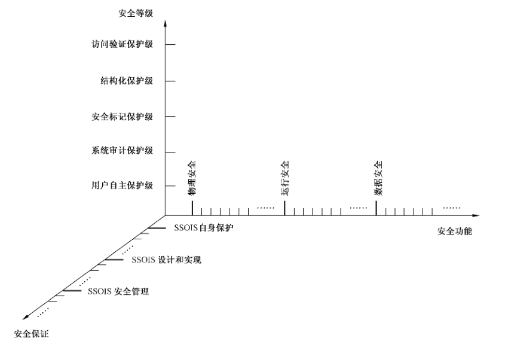
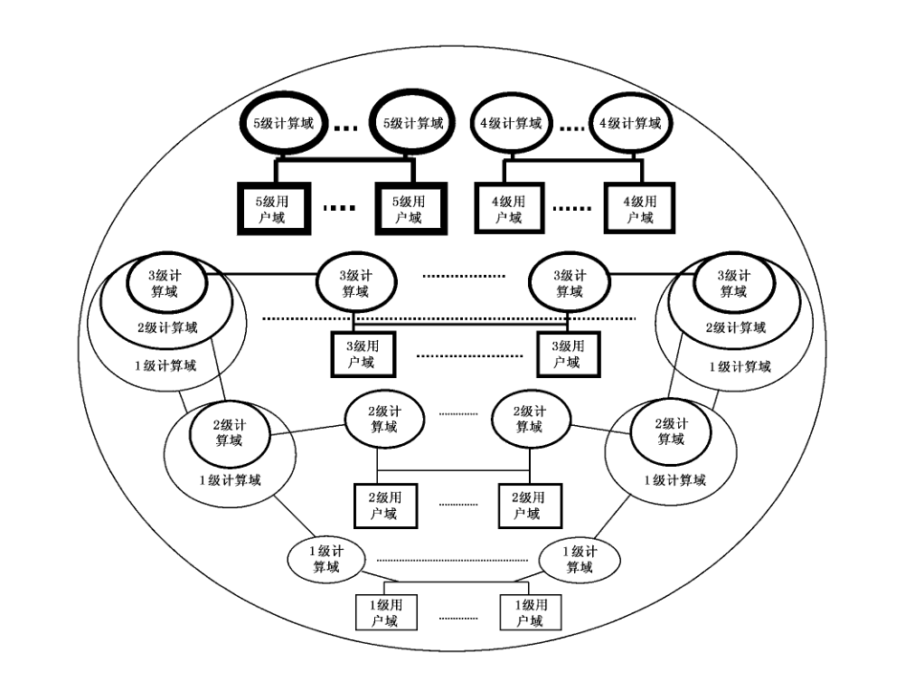
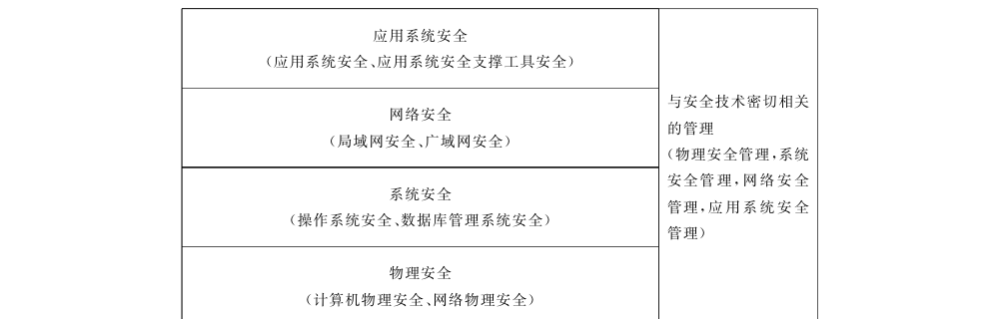
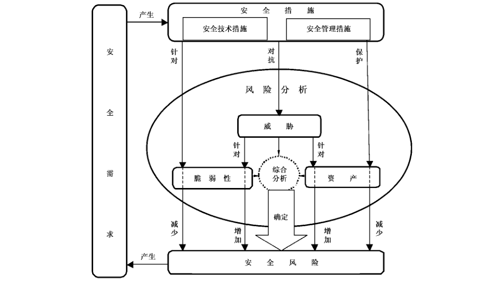
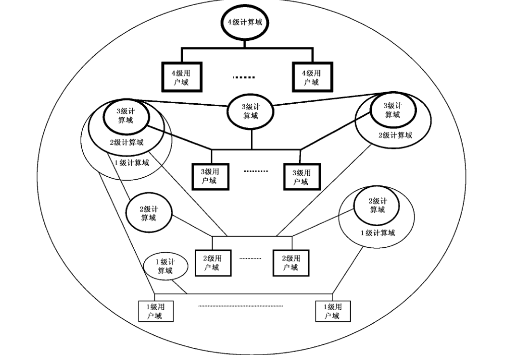

# GB/T 20271-2006 信息安全技术 信息系统通用安全技术要求

> 来源：[GB/T 20271-2006 国家标准详情](https://openstd.samr.gov.cn/bzgk/std/newGbInfo?hcno=3BE7E9CB498C46233E959968C9B694CB)；封面发布日期：2006-05-31；实施日期：2006-12-01。
> PDF SHA-256：c8022f90b22036e7bf6d18a01b970099fe77ec0d65204fbe0f555de7e82f297e。
> 转写说明：将官方 PDF 全部 88 页逐页渲染为图像并核对文字、标题、列表、图示和矩阵表；省略封面、目录、页眉页脚及封底出版信息，合并跨页续表。正式引用请核对原 PDF。

> 转写注：以下原版错漏按原文保留，不作为现行要求修订：5.2.3.5 b）的“描述加安全策略”、6.1.5.3 f）的“对可性设计”、6.3.1.1.1 i）的“设计和机房电磁防护”、6.3.4.1 b）的“物理攻击自的动报告”、A.6及引言的“国、内外”、B.2.1.2.2的“可能回降低”。
> 原版还保留有4.3.5.1 b）的“BRAC”、5.1.5 d）末尾“抹去该信息的”、5.2.6.4 c）末尾未补“相同”、6.1.4.4/6.2.4.4的“有限服务优先级”、6.1.5.6/6.2.5.6的“相符独立性测试”、6.3.3.7及6.4.3.7的“本安全保护等级级”、6.3.3.8 b）的“其他响应的安全机制”、6.4.1.3的“关键数据介质保护、的要求”、6.4.2.8的“对级信息系统”、6.4.3.1.2 a）的“进行进行设计”、6.5.5.5 b）的“系统缺陷纠正”和6.5.5.7 b）的“防止误用的设计”（未写“实现”）。6.2.3.1.2、6.2.4.3、各级自主访问控制d）、6.4.5.3 b）至g）及6.5.5.5 c）的引用条号按原版保留，未按上下文推改。表C.1机房防火“报警和灭火系统③”在第二、四、五级均有星号，也按原表照录。
> 3.1.13原版术语为“用户—主体绑定”，已据原页修正标题中的转写字形；通过显式标题 ID 保留原有锚点。

## 前言

本标准的附录 A、附录B、附录C是资料性附录。

本标准由全国信息安全标准化技术委员会提出并归口。

本标准起草单位：北京思源新创信息安全资讯有限公司，江南计算技术研究所技术服务中心。

本标准主要起草人：吉增瑞、王志强、陈冠直、景乾元、宋健平。

## 引言

本标准主要从信息系统安全保护等级划分的角度，说明为实现GB 17859—1999中每一个安全保护等级的安全功能要求应采取的安全技术措施，以及各安全保护等级的安全功能在具体实现上的差异。

一个复杂的大型/巨大型信息系统可以由若干个分系统或子系统组成。无论从全系统、分系统或子系统的角度，信息系统一般由支持软件运行的硬件系统（含计算机硬件系统和网络硬件系统）、对系统资源进行管理和为用户使用提供基本支持的系统软件（含计算机操作系统软件、数据库管理系统软件和网络协议软件和管理软件）、实现信息系统应用功能的应用系统软件等组成。这些硬件和软件共同协作运行，实现信息系统的整体功能。从安全角度，组成信息系统各个部分的硬件和软件都应有相应的安全功能，确保在其所管辖范围内的信息安全和提供确定的服务。这些安全功能分别是：确保硬件系统安全的物理安全，确保数据网上传输、交换安全的网络安全，确保操作系统和数据库管理系统安全的系统安全（含系统安全运行和数据安全保护），确保应用软件安全运行的应用系统安全（含应用系统安全运行和数据安全保护）。这四个层面的安全，再加上为保证其安全功能达到应有的安全性而必须采取的管理措施，构成了实现信息系统安全的五个层面的安全。其实，在这五个层面中，许多安全功能和实现机制都是相同的。比如，身份鉴别、审计、访问控制、保密性保护、完整性保护等，在每一层都有体现，并有相应的安全要求。本标准对这些安全功能的描述是从安全技术的角度进行的，每一个安全技术的要求（含功能要求和保证要求）具有普遍的适用性，比如，对身份鉴别的描述既适用于操作系统，也适用于网络系统、数据库管理系统和应用系统。这种按安全要素对安全技术要求进行描述的方法，具有简洁、清晰的优点。

本标准大量采用了 GB/T 18336—2001（idt ISO/IEC 15408:1999）的安全功能要求和安全保证要求的技术内容，并按 GB 17859—1999 的五个等级，对其进行了相应的等级划分。

本标准首先对信息安全等级保护所涉及的安全功能技术要求和安全保证技术要求做了比较全面的描述，然后按 GB 17859—1999的五个安全保护等级，对每一个安全保护等级的安全功能技术要求和安全保证技术要求做了详细描述。

需要特别说明的是，信息安全技术等级和信息系统安全等级是两个既有联系又不相同的概念。本标准是对不同安全等级的信息安全技术要求的描述。信息技术安全等级是根据安全功能技术和安全保证技术实现上的差异，参考国、内外已有标准并结合我国当前信息系统安全的实际情况确定的。而信息系统的安全等级是根据信息系统的安全需求、参照所采用的安全技术的等级确定的（有关概念的详细说明，见A.6关于信息安全技术等级与信息系统安全等级）。为了帮助读者运用这些安全技术设计和实现不同安全等级的信息系统，附录B给出了等级化信息系统安全设计参考。

附录C给出信息系统安全技术要素与安全技术分等级要求之间的对应关系。表C.1是安全功能技术要素与安全功能技术分等级要求的对应关系；表C.2是安全保证技术要素与安全保证技术分等级要求的对应关系。

第6章是对各个安全保护等级安全功能技术要求和安全保证技术要求的具体描述。为清晰表示每一个安全等级比较低一级安全等级的安全技术要求的增加和增强，每一级的新增部分用“宋体加粗字”表示。

> 转写注：官方公开 PDF 中第 6 章所用字体未能可靠区分上述新增内容的粗体。本转写保留全部条文，未推断或补标新增部分；比较等级差异时请逐条核对，不宜仅依赖网页字重。

## 1 范围

本标准依据GB 17859—1999的五个安全保护等级的划分，规定了信息系统安全所需要的安全技术的各个安全等级要求。

本标准适用于按等级化要求进行的安全信息系统的设计和实现，对按等级化要求进行的信息系统安全的测试和管理可参照使用。

## 2 规范性引用文件

下列文件中的条款通过本标准的引用而成为本标准的条款。凡是注日期的引用文件，其随后所有的修改单（不包括勘误的内容）或修订版均不适用于本标准，然而，鼓励根据本标准达成协议的各方研究是否可使用这些文件的最新版本。凡是不注日期的引用文件，其最新版本适用于本标准。

- GB 17859—1999 计算机信息系统安全保护等级划分准则
- GBJ 45—1982 高层民用建筑设计防火规定
- TJ 16—1974 建筑设计防火规范

## 3 术语、定义和缩略语

### 3.1 术语和定义

GB 17859—1999确立的以及下列术语和定义适用于本标准。

#### 3.1.1 信息系统安全 security of information system

信息系统及其所存储、传输和处理的信息的保密性、完整性和可用性的表征。

#### 3.1.2 信息系统通用安全技术 common security technology of information system

实现各种类型的信息系统安全所普遍适用的安全技术。

#### 3.1.3 信息系统安全子系统 security subsystem of information system

信息系统内安全保护装置的总称，包括硬件、固件、软件和负责执行安全策略的组合体。它建立了一个基本的信息系统安全保护环境，并提供安全信息系统所要求的附加用户服务。

> 注：按照 GB 17859—1999对 TCB（可信计算基）的定义，SSOIS（信息系统安全子系统）就是信息系统的 TCB。

#### 3.1.4 安全要素 security element

本标准中的安全功能技术要求和安全保证技术要求所包含的安全内容的组成成分。

#### 3.1.5 安全功能策略 security function policy

为实现 SSOIS 安全要素要求的功能所采用的安全策略。

#### 3.1.6 安全功能 security function

为实现安全要素的要求，正确实施相应安全功能策略所提供的功能。

#### 3.1.7 安全保证 security assurance

为确保安全要素的安全功能达到要求的安全性目标所采取的方法和措施。

#### 3.1.8 SSOIS 安全策略 SSOIS security policy

对 SSOIS 中的资源进行管理、保护和分配的一组规则。一个 SSOIS 中可以有一个或多个安全策略。

#### 3.1.9 SSOIS 安全功能 SSOIS security function

正确实施 SSOIS 安全策略的全部硬件、固件、软件所提供的功能。每一个安全策略的实现，组成一个 SSOIS 安全功能模块。一个 SSOIS 的所有安全功能模块共同组成该 SSOIS 的安全功能。

#### 3.1.10 SSF 控制范围 SSF scope of control

SSOIS 的操作所涉及的主体和客体的范围。

#### 3.1.11 用户标识 user identification

用来标明用户的身份，确保用户在系统中的唯一性和可辨认性。一般以用户名称和用户标识符（UID）来标明系统中的用户。用户名称和用户标识符都是公开的明码信息。

#### 3.1.12 用户鉴别 user authentication

用特定信息对用户身份的真实性进行确认。用于鉴别的信息一般是非公开的、难以仿造的。

#### 3.1.13 用户—主体绑定 user- subject binding {#3113-用户一主体绑定-user--subject-binding}

用一定方法将指定用户与为其服务的主体（如进程）相关联。

#### 3.1.14 主、客体标记 label of subject and object

为主、客体指定敏感标记。这些敏感标记是等级分类和非等级类别的组合，是实施强制访问控制的依据。

#### 3.1.15 安全属性 security attribute

用于实施安全策略，与主体、客体相关的信息。对于自主访问控制，安全属性包括确定主、客体访问关系的相关信息；对于采用多级安全策略模型的强制访问控制，安全属性包括主、客体的标识信息和安全标记信息。

#### 3.1.16 自主访问控制 discretionary access control

由客体的所有者主体自主地规定其所拥有客体的访问权限的方法。有访问权限的主体能按授权方式对指定客体实施访问，并能根据授权，对访问权限进行转移。

#### 3.1.17 强制访问控制 mandatory access control

由系统根据主、客体所包含的敏感标记，按照确定的规则，决定主体对客体访问权限的方法。有访问权限的主体能按授权方式对指定客体实施访问。敏感标记由系统安全员或系统自动地按照确定的规则进行设置和维护。

#### 3.1.18 回退 rollback

由于某种原因而撤消上一次/一系列操作，并返回到该操作以前的已知状态的过程。

#### 3.1.19 可信信道 trusted channel

为了执行关键的安全操作，在SSF与其他可信IT 产品之间建立和维护的保护通信数据免遭修改和泄漏的通信路径。

#### 3.1.20 可信路径 trusted path

为实现用户与 SSF 之间的可信通信，在SSF 与用户之间建立和维护的保护通信数据免遭修改和泄漏的通信路径。

#### 3.1.21 公开用户数据 published user data

信息系统中需要向所有用户公开的数据。该类数据需要进行完整性保护。

#### 3.1.22 内部用户数据 internal user data

信息系统中具有一般使用价值或保密程度，需要进行一定保护的用户数据。该类数据的泄漏或破坏，会带来一定的损失。

#### 3.1.23 重要用户数据 important user data

信息系统中具有重要使用价值或保密程度，需要进行重点保护的用户数据，该类数据的泄露或破坏，会带来较大的损失。

#### 3.1.24 关键用户数据 key user data

信息系统中具有很高使用价值或保密程度，需要进行特别保护的用户数据，该类数据的泄漏或破坏，会带来重大损失。

#### 3.1.25 核心用户数据 nuclear user data

信息系统中具有最高使用价值或保密程度，需要进行绝对保护的用户数据，该类数据的泄漏或破坏，会带来灾难性损失。

#### 3.1.26 容错 tolerance

通过一系列内部处理措施，将软、硬件所出现的错误消除掉，确保出错情况下 SSOIS 所提供的安全功能的有效性和可用性。

#### 3.1.27 服务优先级 priority of service

通过对资源使用的有限控制策略，确保 SSOIS 中高优先级任务的完成不受低优先级任务的干扰和延误，从而确保 SSOIS 安全功能的安全性。

#### 3.1.28 资源分配 resource allocation

通过对 SSOIS 安全功能控制范围内资源的合理管理和调度，确保 SSOIS 的安全功能不因资源使用方面的原因而受到影响。

#### 3.1.29 配置管理 configuration management

一种建立功能要求和规范的方法。该功能要求和规范是在 SSOIS 的执行中实现的。

#### 3.1.30 配置管理系统 configuration management system

通过提供追踪任何变化，以及确保所有修改都已授权的方法，确保SSOIS 各部分的完整性。

#### 3.1.31 保护轮廓 protection profile

详细说明信息系统安全保护需求的文档，即通常的安全需求，一般由用户负责编写。

#### 3.1.32 安全目标 security target

阐述信息系统安全功能及信任度的文档，即通常的安全方案，一般由开发者编写。

#### 3.1.33 SSOIS 安全管理 SSOIS security management

对与 SSOIS 安全相关方面的管理，包括对不同的管理角色和它们之间的相互作用（如能力的分离）进行规定，对分散在多个物理上分离的部件有关敏感标记的传播、SSF 数据和功能的修改等问题的处理。

#### 3.1.34 安全功能数据 security function data

安全子系统中各个安全功能模块实现其安全功能所需要的数据。如主、客体的安全属性，审计信息，鉴别信息等。

### 3.2 缩略语

下列缩略语适用于本标准：

| 缩略语 | 中文名称 | 英文名称 |
| --- | --- | --- |
| CM | 配置管理 | configuration management |
| CMS | 配置管理系统 | configuration management system |
| PP | 保护轮廓 | protection profile |
| SFP | 安全功能策略 | security function policy |
| SSC | SSF 控制范围 | SSF scope of control |
| SSF | SSOIS 安全功能 | SSOIS security function |
| SSP | SSOIS 安全策略 | SSOIS security policy |
| SSOIS | 信息系统安全子系统 | security subsystem of information system |
| ST | 安全目标 | security target |

## 4 安全功能技术要求

### 4.1 物理安全

#### 4.1.1 环境安全

##### 4.1.1.1 中心机房的安全保护

###### 4.1.1.1.1 机房场地选择

根据对机房安全保护的不同要求，机房场地选择分为：

a） 基本要求：按一般建筑物的要求进行机房场地选择；

b） 防火要求：避开易发生火灾和危险程度高的地区，如油库和其他易燃物附近的区域；

c） 防污染要求：避开尘埃、有毒气体、腐蚀性气体、盐雾腐蚀等环境污染的区域；

d） 防潮及防雷要求：避开低洼、潮湿及落雷区域；

e） 防震动和噪声要求：避开强震动源和强噪声源区域；

f） 防强电场、磁场要求：避开强电场和强磁场区域；

g） 防地震、水灾要求：避开有地震、水灾危害的区域；

h） 位置要求：避免在建筑物的高层以及用水设备的下层或隔壁；

i） 防公众干扰要求：避免靠近公共区域，如运输通道、停车场或餐厅等。

###### 4.1.1.1.2 机房内部安全防护

根据对机房安全保护的不同要求，机房内部安全防护分为：

a） 机房出入：机房应只设一个出入口，并有专人负责，未经允许的人员不准进入机房；另设若干紧急疏散出口，标明疏散线路和方向；

b） 机房物品：没有管理人员的明确准许，任何记录介质、文件材料及各种被保护品均不准带出机房，磁铁、私人电子计算机或电设备、食品及饮料、香烟、吸烟用具等均不准带入机房；

c） 机房人员：获准进入机房的来访人员，其活动范围应受到限制，并有接待人员陪同；

d） 机房分区：机房内部应分区管理，一般分为主机区、操作区、辅助区等，并根据每个工作人员的实际工作需要，确定其能进入的区域；

e） 机房门禁：设置机房电子门禁系统，进入机房的人员，通过门禁系统的鉴别，方可进入。

###### 4.1.1.1.3 机房防火

根据对机房安全保护的不同要求，机房防火分为：

a） 建筑材料防火①：机房和记录介质存放间，其建筑材料的耐火等级，应符合TJ 16—1974中规定的二级耐火等级；机房相关的其余基本工作房间和辅助房，其建筑材料的耐火等级应不低于TJ 16—1974中规定的三级耐火等级；

b） 建筑材料防火②：机房和重要的记录介质存放间，其建筑材料的耐火等级，应符合 GBJ 45—1982 中规定的二级耐火等级；机房相关的其余基本工作房间和辅助房，其建筑材料的耐火等级应不低于 TJ 16—1974 中规定的二级耐火等级；

c） 建筑材料防火③：机房和重要的记录介质存放间，其建筑材料的耐火等级，应符合 GBJ 45—1982 中规定的一级耐火等级；机房相关的其余基本工作房间和辅助房，其建筑材料的耐火等级应不低于 TJ 16—1974 中规定的二级耐火等级；

d） 报警和灭火系统①：设置火灾报警系统，由人来操作灭火设备，并对灭火设备的效率、毒性、用量和损害性有一定的要求；

e） 报警和灭火系统②：设置火灾自动报警系统，包括火灾自动探测器、区域报警器、集中报警器和控制器等，能对火灾发生的部位以声、光或电的形式发出报警信号，并启动自动灭火设备，切断电源、关闭空调设备等；

f） 报警和灭火系统③：设置火灾自动消防系统，能自动检测火情、自动报警，并自动切断电源和其他应急开关，自动启动事先固定安装好的灭火设备进行自动灭火；

g） 区域隔离防火：机房布局应将脆弱区和危险区进行隔离，防止外部火灾进入机房，特别是重要设备地区，应安装防火门、使用阻燃材料装修等。

###### 4.1.1.1.4 机房供、配电

根据对机房安全保护的不同要求，机房供、配电分为：

a） 分开供电：机房供电系统应将计算机系统供电与其他供电分开，并配备应急照明装置；

b） 紧急供电①：配置抵抗电压不足的基本设备，如 UPS；

c） 紧急供电②：配置抵抗电压不足的改进设备，如基本 UPS、改进 UPS、多级 UPS；

d） 紧急供电③：配置抵抗电压不足的更强设备，如基本 UPS、改进的UPS、多级 UPS 和应急电源（发电机组）等；

e） 备用供电：建立备用的供电系统，以备常用供电系统停电时启用，完成对运行系统必要的保留；

f） 稳压供电：采用线路稳压器，防止电压波动对计算机系统的影响；

g） 电源保护：设置电源保护装置，如金属氧化物可变电阻、硅雪崩二极管、气体放电管、滤波器、电压调整变压器和浪涌滤波器等，防止/减少电源发生故障；

h） 不间断供电：采用不间断供电电源，防止电压波动、电器干扰、断电等对计算机系统的影响；

i） 电器噪声防护：采取有效措施，减少机房中电器噪声干扰，保证计算机系统正常运行；

j） 突然事件防护：采取有效措施，防止/减少供电中断、异常状态供电（指连续电压过载或低电压）、电压瞬变、噪声（电磁干扰）以及由于雷击等引起的设备突然失效事件。

###### 4.1.1.1.5 机房空调、降温

根据对机房安全保护的不同要求，机房空调、降温分为：

a） 基本温度要求：应有必要的空调设备，使机房温度达到所需的温度要求；

b） 较完备空调系统：应有较完备的中央空调系统，保证机房温度的变化在计算机系统运行所允许的范围；

c） 完备空调系统：应有完备的中央空调系统，保证机房各个区域的温度变化能满足计算机系统运行、人员活动和其他辅助设备的要求。

###### 4.1.1.1.6 机房防水与防潮

根据对机房安全保护的不同要求，机房防水与防潮分为：

a） 水管安装要求：水管安装，不得穿过屋顶和活动地板下，穿过墙壁和楼板的水管应使用套管，并采取可靠的密封措施；

b） 水害防护：采取一定措施，防止雨水通过屋顶和墙壁渗透、室内水蒸气结露和地下积水的转移与渗透；

c） 防水检测：安装对水敏感的检测仪表或元件，对机房进行防水检测，发现水害，及时报警；

d） 排水要求：机房应设有排水口，并安装水泵，以便迅速排出积水。

###### 4.1.1.1.7 机房防静电

根据对机房安全保护的不同要求，机房防静电分为：

a） 接地与屏蔽：采用必要的措施，使计算机系统有一套合理的防静电接地与屏蔽系统；

b） 服装防静电：人员服装采用不易产生静电的衣料，工作鞋选用低阻值材料制作；

c） 温、湿度防静电：控制机房温湿度，使其保持在不易产生静电的范围内；

d） 地板防静电：机房地板从表面到接地系统的阻值，应在不易产生静电的范围；

e） 材料防静电：机房中使用的各种家具，工作台、柜等，应选择产生静电小的材料；

f）维修 MOS 电路保护：在硬件维修时，应采用金属板台面的专用维修台，以保护 MOS 电路；

g） 静电消除要求：在机房中使用静电消除剂和静电消除器等，以进一步减少静电的产生。

###### 4.1.1.1.8 机房接地与防雷击

根据对机房安全保护的不同要求，机房接地与防雷击分为：

a） 接地要求：采用地桩、水平栅网、金属板、建筑物基础钢筋构建接地系统等，确保接地体的良好接地；

b） 去耦、滤波要求：设置信号地与直流电源地，并注意不造成额外耦合，保障去耦、滤波等的良好效果；

c） 避雷要求：设置避雷地，以深埋地下、与大地良好相通的金属板作为接地点；至避雷针的引线则应采用粗大的紫铜条，或使整个建筑的钢筋自地基以下焊连成钢筋网作为“大地”与避雷针相连；

d） 防护地与屏蔽地要求：设置安全防护地与屏蔽地，采用阻抗尽可能小的良导体的粗线，以减小各种地之间的电位差；应采用焊接方法，并经常检查接地的良好，检测接地电阻，确保人身、设备和运行的安全；

e） 交流电源地线要求：设置交流电源地线；交流供电线应有规范连接位置的三芯线，即相线、中线和地线，并将该“地线”连通机房的地线网，以确保其安全保护作用。

###### 4.1.1.1.9 机房电磁防护

根据对机房安全保护的不同要求，机房电磁防护分为：

a） 接地防干扰：采用接地的方法，防止外界电磁和设备寄生耦合对计算机系统的干扰；

b） 屏蔽防干扰：采用屏蔽方法，减少外部电器设备对计算机系统的瞬间干扰；

c） 距离防干扰：采用距离防护的方法，将计算机机房的位置选在外界电磁干扰小的地方和远离可能接收辐射信号的地方；

d） 电磁泄漏发射防护：应采用必要措施，防止计算机设备产生的电磁泄漏发射造成信息泄露；

e） 介质保护：对磁带、磁盘等磁介质设备的保管存放，应注意电磁感应的影响，如使用铁制柜存放；

f） 机房屏蔽：采用屏蔽方法，对计算机机房进行电磁屏蔽，防止外部电磁场对计算机设备的干扰，防止电磁信号泄漏造成的信息泄露。

##### 4.1.1.2 通信线路的安全防护

根据对通信线路安全的不同要求，通信线路安全防护分为：

a） 确保线路畅通：采取必要措施，保证通信线路畅通；

b） 发现线路截获：采取必要措施，发现线路截获事件并报警；

c） 及时发现线路截获：采取必要措施，及时发现线路截获事件并报警；

d） 防止线路截获：采取必要措施，防止线路截获事件发生。

#### 4.1.2 设备安全

##### 4.1.2.1 设备的防盗和防毁

根据对设备安全的不同要求，设备的防盗和防毁分为：

a） 设备标记要求：计算机系统的设备和部件应有明显的无法除去的标记，以防更换和方便查找赃物；

b） 计算中心防盗①：计算中心应安装防盗报警装置，防止夜间从门窗进入的盗窃行为；

c） 计算中心防盗②：计算中心应利用光、电、无源红外等技术设置机房报警系统，并有专人值守，防止夜间从门窗进入的盗窃行为；

d） 计算中心防盗③：利用闭路电视系统对计算中心的各重要部位进行监视，并有专人值守，防止夜间从门窗进入的盗窃行为；

e） 机房外部设备防盗：机房外部的设备，应采取加固防护等措施，必要时安排专人看管，以防止盗窃和破坏。

##### 4.1.2.2 设备的安全可用

根据对设备安全的不同要求，设备的安全可用分为：

a） 基本运行支持：信息系统的所有设备应提供基本的运行支持，并有必要的容错和故障恢复能力；

b） 设备安全可用：支持信息系统运行的所有设备，包括计算机主机、外部设备、网络设备及其他辅助设备等均应安全可用；

c） 设备不间断运行：提供可靠的运行支持，并通过容错和故障恢复等措施，支持信息系统实现不间断运行。

#### 4.1.3 记录介质安全

根据对设备安全的不同要求，记录介质安全分为：

a） 公开数据介质保护：存放有用数据的各类记录介质，如纸介质、磁介质，半导体介质和光介质等，应采取一定措施防止被毁和受损；

b） 内部数据介质保护：存放内部数据的各类记录介质，如纸介质、磁介质、半导体介质和光介质等，应采取一定措施，防止被盗、被毁和受损；需要删除和销毁的内部数据，应有一定措施，防止被非法拷贝；

c） 重要数据介质保护：存放重要数据的各类记录介质，如纸介质、磁介质、半导体介质和光介质等，应采取较严格的保护措施，防止被盗、被毁和受损；应该删除和销毁的重要数据，要有有效的管理和审批手续，防止被非法拷贝；

d） 关键数据介质保护：存放关键数据的各类记录介质，如纸介质、磁介质，半导体介质和光介质等，应采取严格的保护措施，防止被盗、被毁和受损；需要删除和销毁的关键数据，要有严格的管理和审批手续，并采取有效措施，防止被非法拷贝；

e） 核心数据介质保护：存放核心数据的各类记录介质，如纸介质、磁介质、半导体介质和光介质等，应采取最严格的保护措施，防止被盗、被毁和受损；核心数据应长期保存，并采取有效措施，防止被非法拷贝。

### 4.2 运行安全

#### 4.2.1 风险分析

信息系统的风险分析应按以下要求进行：

a） 以系统安全运行和数据安全保护为出发点，全面分析由于物理的、系统的、管理的、人为的和自然的原因所造成的安全风险；

b） 通过对影响信息系统安全运行的诸多因素的了解和分析，明确系统存在的风险，找出克服这些风险的办法；

c） 对常见的风险（如：后门/陷阱门、拒绝使用、辐射、盗用、伪造、假冒、逻辑炸弹、破坏活动、偷窃行为、搭线窃听以及计算机病毒等）进行分析，确定每类风险的程度；

d） 系统设计前和运行前应进行静态风险分析，以发现系统的潜在安全隐患；

e） 系统运行过程中应进行动态风险分析，测试、跟踪并记录其活动，以发现系统运行期的安全漏洞，并提供相应的系统脆弱性分析报告；

f） 采用风险分析工具，通过收集数据、分析数据、输出数据，确定危险的严重性等级，分析危险的可能性等方法，进行风险分析，并确定安全对策。

#### 4.2.2 信息系统安全性检测分析

根据对信息系统安全运行的不同要求，信息系统安全性检测分析分为：

a） 操作系统安全性检测分析：从操作系统的角度，以管理员身份评估文件许可、文件宿主、网络服务设置、账户设置、程序真实性以及一般的与用户相关的安全点、入侵迹象等，从而检测和分析操作系统的安全性，发现存在的安全隐患；

b） 数据库管理系统安全性检测分析：对支持信息系统运行的数据库管理系统进行安全性检测分析，要求通过扫描数据库系统中与鉴别、授权、访问控制和系统完整性设置相关的数据库管理系统特定的安全脆弱性，分析其存在的缺点和漏洞，提出补救措施；

c） 网络系统安全性检测分析：采用侵袭模拟器，通过在网络设备的关键部位，用模拟侵袭的方法，自动扫描、检查并报告网络系统中（包括安全网络系统的各个组成部分，如防火墙等）存在的缺陷和漏洞，提出补救措施，达到增强网络安全性的目的；

d） 应用系统安全性检测分析：对所开发的应用系统进行系统运行的安全性检测分析，要求通过扫描应用系统中与鉴别、授权、访问控制和系统完整性有关的特定的安全脆弱性，分析其存在的缺陷和漏洞，提出补救措施；

e） 硬件系统安全性检测分析：对支持系统运行的硬件系统进行安全性检测，通过扫描硬件系统中与系统运行和数据保护有关的特定安全脆弱性（包括电磁泄漏发射和电磁干扰等），分析其存在的缺陷和漏洞，提出补救措施；

f） 攻击性检测分析：对重要的信息系统作攻击性检测，通过专业技术攻击检测检查系统存在的缺陷和漏洞，提出补救措施。

#### 4.2.3 信息系统安全监控

信息系统安全监控应采用以下方法：

a） 安全探测机制：在组成信息系统的计算机、网络的各个重要部位，设置探测器，实时监听网络数据流，监视和记录内、外部用户出入网络的相关操作。在发现违规模式和未授权访问时，报告信息系统安全监控中心。

b） 安全监控中心：设置安全监控中心，对收到的来自探测器的信息，根据安全策略进行分析，并作审计、报告、事件记录和报警等处理。监控中心应具有必要的远程管理功能，如对探测器实现远程参数设置、远程数据下载、远程启动等操作。安全监控中心还应具有实时响应功能，包括攻击分析和响应、误操作分析和响应、漏洞分析和响应以及漏洞形势分析和响应等。

#### 4.2.4 安全审计

##### 4.2.4.1 安全审计的响应

安全审计 SSF 应按以下要求响应审计事件：

a） 记审计日志：当检测到有安全侵害事件时，将审计数据记入审计日志；

b） 实时报警生成：当检测到有安全侵害事件时，生成实时报警信息，并根据报警开关的设置有选择地报警；

c） 违例进程终止：当检测到有安全侵害事件时，将违例进程终止；

d） 服务取消：当检测到有安全侵害事件时，取消当前的服务；

e） 用户账号断开与失效：当检测到有安全侵害事件时，将当前的用户账号断开，并使其失效。

##### 4.2.4.2 安全审计数据产生

安全审计 SSF 应按以下要求产生审计数据：

<ol type="a">
  <li>
    
为下述可审计事件产生审计记录：

    <ul>
      <li>审计功能的开启和关闭；</li>
      <li>使用身份鉴别机制；</li>
      <li>将客体引入用户地址空间（例如：打开文件、程序初始化）；</li>
      <li>删除客体；</li>
      <li>系统管理员、系统安全员、审计员和一般操作员所实施的操作；</li>
      <li>其他与系统安全有关的事件或专门定义的可审计事件。</li>
    </ul>
  </li>
  <li>
    
对于每一个事件，其审计记录应包括：事件的日期和时间、用户、事件类型、事件是否成功，及其他与审计相关的信息。

  </li>
  <li>
    
对于身份鉴别事件，审计记录应包含请求的来源（例如：末端标识符）。

  </li>
  <li>
    
对于客体被引入用户地址空间的事件及删除客体事件，审计记录应包含客体名及客体的安全级。

  </li>
</ol>

##### 4.2.4.3 安全审计分析

根据对安全审计的不同要求，安全审计分析分为：

<ol type="a">
  <li>
    
潜在侵害分析：用一系列规则监控审计事件，并根据这些规则指出对 SSP 的潜在侵害。这些规则包括：

    <ul>
      <li>由已定义的可审计事件的子集所指示的潜在安全攻击的积累或组合；</li>
      <li>任何其他的规则。</li>
    </ul>
  </li>
  <li>
    
基于异常检测的描述：维护用户所具有的质疑等级——历史使用情况，以表明该用户的现行活动与已建立的使用模式的一致性程度。当用户的质疑等级超过门限条件时，能指出将要发生对安全性的威胁。

  </li>
  <li>
    
简单攻击探测：能检测到对 SSF 的实施有重大威胁的签名事件的出现。为此，SSF 应维护指出对 SSF 侵害的签名事件的内部表示，并将检测到的系统行为记录与签名事件进行比较，当发现两者匹配时，指出一个对 SSF 的攻击即将到来。

  </li>
  <li>
    
复杂攻击探测：在上述简单攻击探测的基础上，能检测到多步入侵情况，并根据已知的事件序列模拟出完整的入侵情况，指出发现对SSF 的潜在侵害的签名事件或事件序列的时间。

  </li>
</ol>

##### 4.2.4.4 安全审计查阅

根据对安全审计的不同要求，安全审计查阅分为：

a） 基本审计查阅：提供从审计记录中读取信息的能力，即为授权用户提供获得和解释审计信息的能力。当用户是人时，必须以人类可懂的方式表示信息；当用户是外部IT 实体时，必须以电子方式无歧义地表示审计信息。

b） 有限审计查阅：在基本审计查阅的基础上，应禁止具有读访问权限以外的用户读取审计信息。

c） 可选审计查阅：在有限审计查阅的基础上，应具有根据准则来选择要查阅的审计数据的功能，并根据某种逻辑关系的标准提供对审计数据进行搜索、分类、排序的能力。

##### 4.2.4.5 安全审计事件选择

应根据以下属性选择可审计事件：

a） 客体身份、用户身份、主体身份、主机身份、事件类型；

b） 作为审计选择性依据的附加属性。

##### 4.2.4.6 安全审计事件存储

根据对安全审计的不同要求，安全审计事件存储分为：

a） 受保护的审计踪迹存储：审计踪迹的存储受到应有的保护，能检测或防止对审计记录的修改；

b） 审计数据的可用性确保：在意外情况出现时，能检测或防止对审计记录的修改，以及在发生审计存储已满、存储失败或存储受到攻击时，确保审计记录不被破坏；

c） 审计数据可能丢失情况下的措施：当审计跟踪超过预定的门限时，应采取相应的措施，进行审计数据可能丢失情况的处理；

d） 防止审计数据丢失：在审计踪迹存储记满时，应采取相应的防止审计数据丢失的措施，可选择“忽略可审计事件”、“阻止除具有特殊权限外的其他用户产生可审计事件”、“覆盖已存储的最老的审计记录”和“一旦审计存储失败所采取的其他行动”等措施，防止审计数据丢失。

##### 4.2.4.7 网络环境安全审计

在网络环境运行的信息系统，应采用以下措施实现网络环境信息系统安全审计：

a） 安全审计中心：在信息系统中心建立由安全审计服务器组成的审计中心，收集各安全审计代理程序的审计信息，并进行记录分析与保存；

b） 安全审计代理程序：分布在网络各个运行节点的安全审计代理程序，为安全审计服务器提供审计数据；

c） 跨平台安全审计机制：设置跨平台的安全审计机制，对安全事件快速进行评估并作出响应，向管理人员提供各种能反映系统使用情况、出现的可疑迹象、运行中发生的问题等有价值的统计和分析信息；

d） 审计评估方法和机制：运用统计方法学和审计评估机制，给出智能化审计报告及趋向报告，达到综合评估系统安全现状的目的。

#### 4.2.5 信息系统边界安全防护

根据对信息系统运行安全的不同要求，信息系统边界安全防护采用的安全机制和措施分为：

a） 基本安全防护：采用常规的信息系统边界安全防护机制，如基本的登录/连接控制等，实现基本的信息系统边界安全防护；

b） 较严格安全防护：采用较严格的安全防护机制，如较严格的登录/连接控制，普通功能的防火墙、防病毒网关、入侵防范、信息过滤、边界完整性检查等，实现较严格的信息系统边界安全防护；

c） 严格安全防护：根据当前信息安全对抗技术的发展，采用严格的安全防护机制，如严格的登录/连接控制，高安全功能的防火墙、防病毒网关、入侵防范、信息过滤、边界完整性检查等，实现严格的信息系统边界安全防护；

d） 特别安全防护：采用当前最先进的边界防护技术，必要时可以采用物理隔离安全机制，实现特别安全要求的信息系统边界安全防护。

#### 4.2.6 备份与故障恢复

为了实现确定的恢复功能，必须在信息系统正常运行时定期地或按某种条件实施备份。不同的恢复要求应有不同的备份进行支持。根据对信息系统运行安全的不同要求，实现备份与故障恢复的安全技术和机制分为：

a） 用户自我信息备份与恢复：提供用户有选择地备份重要信息的功能；当由于某种原因引起信息系统中用户信息丢失或破坏时，能提供用户按自我信息备份所保留的信息进行信息恢复的功能；

b） 增量信息备份与恢复：提供由信息系统定时对新增信息进行备份的功能；当由于某种原因引起信息系统中的某些信息丢失或破坏时，提供用户按增量信息备份所保留的信息进行信息恢复的功能；

c） 局部系统备份与恢复：提供定期对信息系统的某些重要的局部系统的运行状态进行备份的功能；当由于某种原因引起信息系统某一局部发生故障时，提供用户按局部系统备份所保留的运行状态进行局部系统恢复的功能；

d） 全系统备份与恢复：提供定期对信息系统全系统的运行状态进行备份的功能；当由于某种原因引起信息系统全系统发生故障时，提供用户按全系统备份所保留的运行状态进行全系统恢复的功能；

e） 设备备份与容错：可采用设备冷/热备份、单机逻辑备份、双机备份等，对系统的重要设备进行备份/冗余设置和容错设计，并在必要时能立即投入使用，使故障对用户透明；

f） 网络备份与容错：对于重要信息系统，采用冗余技术、路由选择技术、路由备份技术等，实现网络备份与容错，当网络正常路由不能工作时，能替代其工作，使信息系统照常运行；

g） 灾难备份与恢复：对于重要的信息系统，设置主机系统的异地备份，当主机系统发生灾难性故障中断运行时，能在较短时间内启动，替代主机系统工作，使系统不间断运行。

#### 4.2.7 恶意代码防护

对包括计算机病毒在内的恶意代码进行必要的安全防护。根据对信息系统运行安全的不同要求，实现恶意代码防护的安全机制和措施分为：

a） 严格管理：严格控制各种外来介质的使用，防止恶意代码通过介质传播；

b） 网关防护：要求在所有恶意代码可能入侵的网络连接部位设置防护网关，拦截并清除企图进入系统的恶意代码；

c） 整体防护：设置恶意代码防护管理中心，通过对全系统的服务器、工作站和客户机，进行恶意代码防护的统一管理，及时发现和清除进入系统内部的恶意代码；

d） 防管结合：将恶意代码防护与网络管理相结合，在网管所涉及的重要部位设置恶意代码防护软件，在所有恶意代码能够进入的地方都采取相应的防范措施，防止恶意代码侵袭；

e） 多层防御：采用实时扫描、完整性保护和完整性检验等不同层次的防护技术，将恶意代码检测、多层数据保护和集中式管理功能集成起来，提供全面的恶意代码防护功能，检测、发现和消除恶意代码，阻止恶意代码的扩散和传播。

#### 4.2.8 信息系统的应急处理

根据对信息系统运行安全的不同要求，实现信息系统应急处理的安全机制和措施分为：

a） 具有各种安全措施：包括在出现各种安全事件时应采取的措施，这些措施是管理手段与技术手段的结合；

b） 设置正常备份机制：在系统正常运行时就通过各种备份措施为灾害和故障做准备；

c） 健全安全管理机构：建立健全的安全事件管理机构，明确人员的分工和责任；

d） 建立处理流程图：制定安全事件响应与处理计划及事件处理过程示意图，以便迅速恢复被破坏的系统。

#### 4.2.9 可信计算和可信连接技术

a） 可信计算技术：通过在计算机的核心部位设置基于硬件支持的可信计算模块，为计算机系统的运行，建立从系统引导、加载直到应用服务的可信任链，确保各种运行程序的真实性，并对用户的身份鉴别，以及数据的保密性、完整性保护等安全功能提供支持。

b） 可信连接技术：通过在网络设备的核心部位设置基于硬件支持的可信连接模块，为网络设备的连接提供可信支持，确保网络设备的可信连接。

### 4.3 数据安全

#### 4.3.1 身份鉴别

##### 4.3.1.1 用户标识与鉴别

###### 4.3.1.1.1 用户标识

根据对用户标识与鉴别的不同要求，用户标识分为：

a） 基本标识：应在SSF 实施所要求的动作之前，先对提出该动作要求的用户进行标识；

b） 唯一性标识：应确保所标识用户在信息系统生存周期内的唯一性，并将用户标识与安全审计相关联；

c） 标识信息管理：应对用户标识信息进行管理、维护，确保其不被非授权地访问、修改或删除。

###### 4.3.1.1.2 用户鉴别

根据对用户标识与鉴别的不同要求，用户鉴别分为：

a） 基本鉴别：应在SSF 实施所要求的动作之前，先对提出该动作要求的用户成功地进行鉴别；

b） 不可伪造鉴别：应检测并防止使用伪造或复制的鉴别信息。一方面，要求 SSF 应检测或防止由任何别的用户伪造的鉴别数据；另一方面，要求SSF 应检测或防止当前用户从任何其他用户处复制的鉴别数据的使用。

c） 一次性使用鉴别：应提供一次性使用鉴别数据的鉴别机制，即 SSF 应防止与已标识过的鉴别机制有关的鉴别数据的重用。

d） 多机制鉴别：应提供不同的鉴别机制，用于鉴别特定事件的用户身份，并根据所描述的多种鉴别机制如何提供鉴别的规则，来鉴别任何用户所声称的身份。

e） 重新鉴别：应有能力规定需要重新鉴别用户的事件，即在需要重新鉴别的条件成立时，对用户进行重新鉴别。例如，终端用户操作超时被断开后，重新连接时需要进行重鉴别。

f） 鉴别信息管理：应对用户鉴别信息进行管理、维护，确保其不被非授权的访问、修改或删除。

###### 4.3.1.1.3 鉴别失败处理

SSF 应为不成功的鉴别尝试（包括尝试次数和时间的阈值）定义一个值，并明确规定达到该值时所应采取的动作。鉴别失败的处理应包括检测出现相关的不成功鉴别尝试的次数与所规定的数目相同的情况，并进行预先定义的处理。

##### 4.3.1.2 用户—主体绑定

在 SSOIS 安全功能控制范围之内，对一个已标识和鉴别的用户，应通过用户—主体绑定将该用户与为其服务的主体（如进程）相关联，从而将该用户的身份与该用户的所有可审计行为相关联，以实现用户行为的可查性。

##### 4.3.1.3 隐秘

SSOIS 应为用户提供确保其身份真实性的前提下，不被其他用户发现或滥用的保护。根据对身份鉴别的不同要求，隐秘分为：

a） 匿名：用户在其使用资源或服务时，不暴露身份，即：应确保任何用户和/或主体集，不能确定与当前主体和/或操作相关联的实际用户，并在对主体提供服务时不询问实际的用户名；

b）假名：用户在使用资源或设备时，不暴露其真实名称，但仍能对该次使用负责，即：应确保用户和/或主体集，不能确定与当前主体或操作相关联的真实的用户名，并能给一个用户提供多个假名，以及验证所使用的假名是否符合假名的度量；

c） 不可关联性：一个用户可以多次使用资源和服务，但任何人都不能将这些使用联系在一起，即：应确保任何用户和/或主体不能确定系统中的某些操作是否由同一用户引起；

d） 不可观察性：用户在使用资源和服务时，其他人，特别是第三方不能观察到该资源和服务正在被使用，即：应确保任何用户和/或主体，不能观察到由受保护的用户和/或主体对客体所进行的操作。

##### 4.3.1.4 设备标识与鉴别

###### 4.3.1.4.1 设备标识

根据对设备标识与鉴别的不同要求，设备标识分为：

a） 接入前标识：对连接到信息系统的设备，应在将其接入到系统前先进行标识；

b） 标识信息管理：应对设备标识信息进行管理、维护，确保其不被非授权的访问、修改或删除。

###### 4.3.1.4.2 设备鉴别

根据设备标识与鉴别的不同要求，设备鉴别分为：

a） 接入前鉴别：对连接到信息系统的设备，应在将其接入到系统前先进行鉴别，以防止设备的非法接入；

b） 不可伪造鉴别：鉴别信息应是不可见的，不易仿造的，应检测并防止使用伪造或复制的鉴别信息；

c） 鉴别信息管理：应对设备鉴别信息进行管理、维护，确保其不被非授权的访问、修改或删除。

###### 4.3.1.4.3 鉴别失败处理

应通过对不成功的鉴别尝试（包括尝试次数和时间的阈值）的值进行预先定义，以及明确规定达到该值时所应采取的动作来实现鉴别失败的处理。

#### 4.3.2 抗抵赖

##### 4.3.2.1 抗原发抵赖

应确保数据的发送者不能成功地否认曾经发送过该数据。要求 SSF 应提供一种方法，来确保接收数据的主体在数据交换期间能获得证明数据原发的证据，而且该证据可由该主体或第三方主体验证。

根据对抗抵赖的不同要求，抗原发抵赖分为：

a） 选择性原发证明：SSF 应具有按主体请求对传输的数据产生原发证据的能力，即SSF 在接到接收者的请求时，能就传输的数据产生原发证据，证明该数据的发送由该原发者所为；

b） 强制性原发证明：SSF 应总对传输的数据产生原发证据，即SSF 能在任何时候对传输的数据产生原发证据，证明该数据的发送由该原发者所为。

##### 4.3.2.2 抗接收抵赖

应确保数据的接收者不能否认接收过该数据。要求 SSF 应提供一种方法，来确保发送数据的主体在数据交换期间能获得证明该数据被接收的证据，而且该证据可由该主体或第三方主体验证。根据对抗抵赖的不同要求，抗接收抵赖分为：

a） 选择性接收证明：SSF 应具有按主体请求对传输的数据产生接收证据的能力，即SSF 在接到原发者的请求时，能就传输的数据产生接收证据，证明该数据的接收由该接收者所为；

b） 强制性接收证明：SSF 应总对传输的数据产生接收证据，即SSF 能在任何时候对传输的数据产生接收证据，证明该数据的接收由该接收者所为。

#### 4.3.3 自主访问控制

##### 4.3.3.1 访问控制策略

SSF 应按确定的自主访问控制安全策略进行设计，实现对策略控制下的主体对客体操作的控制。

可以有多个自主访问控制安全策略，但它们必须独立命名，且不能相互冲突。常用的自主访问控制策略包括：访问控制表访问控制、目录表访问控制、权能表访问控制等。

##### 4.3.3.2 访问控制功能

SSF 应实现采用一条命名的访问控制策略的特定功能，说明策略的使用和特征，以及该策略的控制范围。

无论采用何种自主访问控制策略，SSF 应有能力提供：

- 在安全属性或命名的安全属性组的客体上，执行访问控制 SFP；
- 在基于安全属性的允许主体对客体访问的规则的基础上，允许主体对客体的访问；
- 在基于安全属性的拒绝主体对客体访问的规则的基础上，拒绝主体对客体的访问。

##### 4.3.3.3 访问控制范围

根据对自主访问控制的不同要求，自主访问控制的覆盖范围分为：

a） 子集访问控制：要求每个确定的自主访问控制，SSF 应覆盖由安全系统所定义的主体、客体及其之间的操作；

b） 完全访问控制：要求每个确定的自主访问控制，SSF 应覆盖信息系统中所有的主体、客体及其之间的操作，即要求 SSF 应确保SSC内的任意一个主体和任意一个客体之间的所有操作将至少被一个确定的访问控制SFP覆盖。

##### 4.3.3.4 访问控制粒度

根据对访问控制的不同要求，自主访问控制的粒度分为：

a） 粗粒度：主体为用户组/用户级，客体为文件、数据库表级；

b） 中粒度：主体为用户级，客体为文件、数据库表级和/或记录、字段级；

c） 细粒度：主体为用户级，客体为文件、数据库表级和/或记录、字段和/或元素级。

#### 4.3.4 标记

##### 4.3.4.1 主体标记

应为实施强制访问控制的主体指定敏感标记，这些敏感标记是实施强制访问控制的依据。如：等级分类和非等级类别组合的敏感标记是实施多级安全模型的基础。

##### 4.3.4.2 客体标记

应为实施强制访问控制的客体指定敏感标记，这些敏感标记是实施强制访问控制的依据。如：等级分类和非等级类别组合的敏感标记是实施多级安全模型的基础。

##### 4.3.4.3 标记的输出

当数据从 SSC之内向其控制范围之外输出时，根据需要可以保留或不保留数据的敏感标记。根据对标记的不同要求，标记的输出分为：

a） 不带敏感标记的用户数据输出：在SFP 的控制下输出用户数据到SSC之外时，不带有与数据相关的敏感标记；

b） 带有敏感标记的用户数据输出：在 SFP的控制下输出用户数据到SSC之外时，应带有与数据相关的敏感标记，并确保敏感标记与所输出的数据相关联。

##### 4.3.4.4 标记的输入

当数据从 SSF 控制范围之外向其控制范围之内输入时，应有相应的敏感标记，以便输入的数据能受到保护。根据对标记的不同要求，标记的输入分为：

<ol type="a">
  <li>
    
不带敏感标记的用户数据输入：SSF 应做到：

    <ul>
      <li>在 SFP 控制下从 SSC 之外输入用户数据时，应执行访问控制 SFP；</li>
      <li>略去任何与从 SSC 之外输入的数据相关的敏感标记；</li>
      <li>执行附加的输入控制规则，为输入数据设置敏感标记。</li>
    </ul>
  </li>
  <li>
    
带有敏感标记的用户数据输入：SSF 应做到：

    <ul>
      <li>在 SFP 控制下从 SSC 之外输入用户数据时，应执行访问控制 SFP；</li>
      <li>SSF 应使用与输入的数据相关的敏感标记；</li>
      <li>SSF 应在敏感标记和接收的用户数据之间提供确切的联系；</li>
      <li>SSF 应确保对输入的用户数据的敏感标记的解释与原敏感标记的解释是一致的。</li>
    </ul>
  </li>
</ol>

#### 4.3.5 强制访问控制

##### 4.3.5.1 访问控制策略

强制访问控制策略应包括策略控制下的主体、客体，及由策略覆盖的被控制的主体与客体间的操作。可以有多个访问控制安全策略，但它们必须独立命名，且不能相互冲突。当前常见的强制访问控制策略有：

<ol type="a">
  <li>
    
多级安全模型：基本思想是，在对主、客体进行标记的基础上，SSOIS 控制范围内的所有主体对客体的直接或间接的访问应满足：

    <ul>
      <li>向下读原则：仅当主体标记中的等级分类高于或等于客体标记中的等级分类，且主体标记中的非等级类别包含了客体标记中的全部非等级类别，主体才能读该客体；</li>
      <li>向上写原则：仅当主体标记中的等级分类低于或等于客体标记中的等级分类，且主体标记中的非等级类别包含于客体标记中的非等级类别，主体才能写该客体。</li>
    </ul>
  </li>
  <li>
    
基于角色的访问控制（BRAC）：基本思想是，按角色进行权限的分配和管理；通过对主体进行角色授予，使主体获得相应角色的权限；通过撤消主体的角色授予，取消主体所获得的相应角色权限。在基于角色的访问控制中，标记信息是对主体的授权信息。

  </li>
  <li>
    
特权用户管理：基本思想是，针对特权用户权限过于集中所带来的安全隐患，对特权用户按最小授权原则进行管理。实现特权用户的权限分离；仅授予特权用户为完成自身任务所需要的最小权限。

  </li>
</ol>

##### 4.3.5.2 访问控制功能

SSF 应明确指出采用一条命名的强制访问控制策略所实现的特定功能。SSF 应有能力提供：

- 在标记或命名的标记组的客体上，执行访问控制 SFP；
- 按受控主体和受控客体之间的允许访问规则，决定允许受控主体对受控客体执行受控操作；
- 按受控主体和受控客体之间的拒绝访问规则，决定拒绝受控主体对受控客体执行受控操作。

##### 4.3.5.3 访问控制范围

根据对强制访问控制的不同要求，强制访问控制的覆盖范围分为：

a） 子集访问控制：对每个确定的强制访问控制，SSF 应覆盖信息系统中由安全功能所定义的主体、客体及其之间的操作；

b） 完全访问控制：对每个确定的强制访问控制，SSF 应覆盖信息系统中所有的主体、客体及其之间的操作，即要求 SSF 应确保 SSC内的任意一个主体和任意一个客体之间的操作将至少被一个确定的访问控制SFP覆盖。

##### 4.3.5.4 访问控制粒度

根据对强制访问控制的不同要求，强制访问控制的粒度分为：

a） 中粒度：主体为用户级，客体为文件、数据库表级和/或记录、字段级；

b） 细粒度：主体为用户级，客体为文件、数据库表级和/或记录、字段和/或元素级。

##### 4.3.5.5 访问控制环境

强制访问控制应考虑以下不同的系统运行环境：

a） 单一安全域环境：在单一安全域环境实施的强制访问控制应在该环境中维持统一的标记信息和访问规则；当被控客体输出到安全域以外时，应将其标记信息同时输出；

b） 多安全域环境：在多安全域环境实施统一安全策略的强制访问控制时，应在这些安全域中维持统一的标记信息和访问规则；当被控制客体在这些安全域之间移动时，应将其标记信息一起移动。

#### 4.3.6 用户数据完整性保护

##### 4.3.6.1 存储数据的完整性

应对存储在SSC 内的用户数据进行完整性保护。根据对用户数据完整性保护的不同要求，存储数据的完整性分为：

a） 完整性检测：SSF 应对存储在SSC内的用户数据在读取操作时进行完整性检测，以发现数据完整性被破坏的情况；

b） 完整性检测和恢复：SSF 应对存储在SSC 内的用户数据在读取操作时进行完整性检测，并在检测到完整性错误时，采取必要的恢复措施。

##### 4.3.6.2 传输数据的完整性

当用户数据在 SSF 和 SSF 间传输时应提供完整性保护。根据对用户数据完整性保护的不同要求，传输数据的完整性分为：

a） 完整性检测：SSF 应对经网络传输的用户数据在传输过程中进行完整性检测，及时发现以某种方式传送或接收的用户数据被篡改、删除、插入等情况发生；

b） 完整性检测和恢复：SSF 应对经网络传输的用户数据在传输过程中进行完整性检测，及时发现以某种方式传送或接收的用户数据被篡改、删除、插入等情况发生，并在检测到完整性错误时，采取必要的恢复措施。

##### 4.3.6.3 处理数据的完整性

对信息系统中处理中的数据，应通过“回退”进行完整性保护，即 SSF 应执行数据处理完整性 SFP，以允许对所定义的操作序列进行回退。

#### 4.3.7 用户数据保密性保护

##### 4.3.7.1 存储数据保密性保护

对存储在SSC 内的用户数据，应根据不同数据类型的不同保密性要求，进行不同程度的保密性保护，确保除具有访问权限的合法用户外，其余任何用户不能获得该数据。

##### 4.3.7.2 传输数据保密性保护

对在不同 SSF 之间或不同SSF 上的用户之间传输的用户数据，应根据不同数据类型的不同保密性要求，进行不同程度的保密性保护，确保数据在传输过程中不被泄漏和窃取。

##### 4.3.7.3 客体安全重用

在对资源进行动态管理的系统中，客体资源（寄存器、内存、磁盘等记录介质）中的剩余信息不应引起信息的泄漏。根据对用户数据保密性保护的不同要求，客体安全重用分为：

a） 子集信息保护：由 SSOIS安全控制范围之内的某个子集的客体资源，在将其释放后再分配给某一用户或代表该用户运行的进程时，应不会泄漏该客体中的原有信息；

b） 完全信息保护：由SSOIS安全控制范围之内的所有客体资源，在将其释放后再分配给某一用户或代表该用户运行的进程时，应不会泄漏该客体中的原有信息；

c） 特殊信息保护：在完全信息保护的基础上，对于某些需要特别保护的信息，应采用专门的方法对客体资源中的残留信息做彻底清除，如对剩磁的清除等。

#### 4.3.8 数据流控制

在以数据流方式实现数据流动的信息系统中，应采用数据流控制机制实现对数据流动的安全控制，以防止具有高等级安全的数据信息向低等级的区域流动。

#### 4.3.9 可信路径

用户与 SSF 间的可信路径应：

a） 提供真实的端点标识，并保护通信数据免遭修改和泄漏；

b） 利用可信路径的通信可以由 SSF 自身、本地用户或远程用户发起；

c） 对原发用户的鉴别或需要可信路径的其他服务均使用可信路径。

#### 4.3.10 密码支持

应根据密码强度与信息系统安全保护等级匹配的原则，按国家密码主管部门的规定，分级配置具有相应等级密码管理的密码支持。

## 5 安全保证技术要求

### 5.1 SSOIS 自身安全保护

#### 5.1.1 SSF 物理安全保护

##### 5.1.1.1 物理攻击检测

应对可能危及 SSF 安全的物理篡改提供明确的检测手段，由授权用户激活自动安全检测功能或用手动方式进行检查，以确定篡改是否发生。

##### 5.1.1.2 物理攻击自动报告

在上述物理攻击检测的基础上，当发现物理篡改时，应自动报告给指定用户。

##### 5.1.1.3 物理攻击抵抗

在上述物理攻击自动报告的基础上，应提供抵制对 SSF 设备或 SSF 要素的物理篡改，使 SSP 不受损害。比如，根据完整性策略的要求，对于存储在某类存储介质上的信息，使其处于不可写的状态，从而保护其上的信息不被篡改。

#### 5.1.2 SSF 运行安全保护

##### 5.1.2.1 安全运行测试

SSF 应提供在系统初始化期间、在正常运转下周期性地、应授权用户请求或在其他条件下，通过运行测试套件，进行 SSF 软件的安全运行测试，以验证 SSF 所提供的安全假定能正确执行。

##### 5.1.2.2 失败保护

当 SSF 中所确定的失败类型出现时，应保存一个保护状态。该保护状态确保 SSF 从失败恢复时安全策略的正确性。

##### 5.1.2.3 重放检测

应能检测出确定实体（如消息、服务请求、服务响应、会话等）的重放，从而实现有效地避免重放攻击，并在检测到重放要求时，执行操作列表所指示的操作。这些操作包括：忽略被重放的实体，从标识源进行实体确认，并终止重放实体原发主体的活动。

##### 5.1.2.4 参照仲裁

对一个给定的SFP，其所实现的访问监控器和/或前端过滤器应是“始终被激活的”，并正确、成功地执行，从而使SFP强制执行的所有行动都要由SSF 加以确认，即SSF 对SSP应具有不可旁路性和防篡改性。

##### 5.1.2.5 域分离

SFP 应确保至少有一个安全域，使 SSF 的执行不被不可信主体从外部进行干扰和篡改（如对 SSF 编码或数据结构的修改）。根据对 SSF 运行安全保护的不同要求，域分离分为：

<ol type="a">
  <li>
    
SSF 域分离：应为 SSF 提供不同的保护域，并提供 SSC 内的客体之间的分离。SSF 域分离的具体要求如下：

    <ul>
      <li>SSF 应为自身的执行维护一个安全域，防止不可信主体的干扰和篡改；</li>
      <li>SSF 应在 SSC 内主体的安全域之间实施分离，除了由 SSF 控制的共享部分外，每个主体应有不同的安全域；</li>
      <li>通过将 SSF 的安全域的资源与该域外的主体及不受约束的实体分离，使保护域外的实体不能观察或修改保护域内的 SSF 数据或 SSF 编码；</li>
      <li>域间的传输应是受控的，不能随意地进入或退出保护域；</li>
      <li>按地址传到保护域的用户或应用参数，应根据保护域的地址空间进行确认，而按值传到保护域的用户或应用参数则应根据保护域所期望的值进行确认。</li>
    </ul>
  </li>
  <li>
    
SFP 域分离：应按 SFP 对 SSF 的域进一步细分，作为参照监视器的 SFP 的一个确定集合是一个域，SSF 的其余部分是一个域，SSOIS 内的非 SSF 部分是一个域，并要求：

    <ul>
      <li>SSF 的未隔离部分应对自身的执行维护一个安全域，以防止不可信主体的干扰和篡改；</li>
      <li>SSF 应对 SSC 内主体的安全域之间实施分离；</li>
      <li>SSF 应对 SSOIS 中与访问控制 SFP 有关的部分维护一个自身执行的安全域，以防止被 SSOIS 内非 SSF 部分的干扰和篡改。</li>
    </ul>
  </li>
</ol>

##### 5.1.2.6 状态同步协议

在分布式系统中，应通过 SSF 采取的某些安全措施，确保分布式系统的两部分之间在完成与安全有关的活动后，状态保持同步。根据对 SSF 运行安全保护的不同要求，状态同步协议分为：

a） 简单的可信回执：要求数据接收者给出简单回执，即SSF 收到来自另一SSF 发出的传输数据时应提供确认（回执），以表明其成功地接收到了未经修改的 SSF 数据；

b） 相互的可信回执：要求交换数据的双方相互给出回执。即 SSF 收到来自另一SSF 发出的传输数据时应提供确认（回执），以表明其成功地接收到了未经修改的SSF 数据；并且另一SSF 在收到该确认（回执）后应证实其已收到这一确认。

##### 5.1.2.7 可信时间戳

应为SSF 自身的运行提供可靠的时间标记，即应有准确、可靠的时钟系统（如计时时钟、中断时钟等），并提供以数字签名支持的时间戳服务。

##### 5.1.2.8 可信恢复

应在确定不减弱保护的情况下启动 SSOIS，并在 SSF 运行中断后能在不减弱 SSP 保护的情况下以手动或自动方式恢复运行。

##### 5.1.2.9 SSF 自检

应提供对SSF 正确操作的自测试能力。这些测试可在启动时进行，或周期性地进行，或在授权用户要求时进行，或当某种条件满足时进行，同时应提供对SSF 数据和可执行代码的完整性验证的能力。

#### 5.1.3 SSF 数据安全保护

##### 5.1.3.1 输出 SSF 数据的可用性

应通过一系列规则，根据 SSF 数据类型列表的指示，在所定义的可用性度量范围内，确保 SSF 数据（如口令、密钥、审计数据或 SSF 的可执行代码）从 SSF 输出到远程信息系统的 SSF 时的可用性。

##### 5.1.3.2 输出 SSF 数据的保密性

应保护 SSF 数据（如口令、密钥、审计数据或 SSF 的可执行代码）从 SSF 输出到远程信息系统的 SSF 时，不被未经授权的泄漏。

##### 5.1.3.3 输出 SSF 数据的完整性

应保护 SSF 数据（如口令、密钥、审计数据或 SSF 的可执行代码）从 SSF 输出到远程信息系统的 SSF 时，不被未经授权的修改。根据对 SSF 数据安全保护的不同要求，输出 SSF 数据的完整性分为：

a） SSF 间修改的检测：在假定知道远程信息系统的SSF 所使用的机制的情况下，SSF 应在所定义的修改度量范围内检测 SSF 与远程信息系统的 SSF 之间传输的所有 SSF 数据被修改的情况；

b） SSF 间修改的改正：在上述 SSF 间修改的检测的基础上，当检测到修改时，能按修改类型将所有被修改的数据改正过来。

##### 5.1.3.4 SSOIS 内 SSF 数据传输保护

应对 SSOIS 内的分离部分间传输的 SSF 数据进行保护。根据对 SSF 数据安全保护的不同要求，SSOIS 内 SSF 数据传输保护分为：

a） 基本传输保护：SSF 应对 SSOIS 的分离部分间传输的SSF 数据进行基本保护，以防止其在传输过程中被泄漏或修改；

b） 数据分离传输：在 SSOIS 内部的分离部分间传输数据时，SSF 应将用户数据与 SSF 数据进行分离，以保护 SSF 数据在 SSOIS 的分离部分间传输时不被泄漏或修改；

c） 数据完整性保护：在SSOIS 的分离部分间传输 SSF 数据时，SSF 应能检测出所传输的SSF 数据被修改、替换、重排序、删除等完整性错误，并能采取规定的措施进行改正。

##### 5.1.3.5 SSF 间的 SSF 数据的一致性

在分布式或复合式系统环境下，SSF 与别的信息系统的 SSF 交换 SSF 数据（如：SFP 属性、审计信息、标识信息等）时，应提供确保 SSF 间数据一致性的能力。

##### 5.1.3.6 SSOIS 内 SSF 数据复制的一致性

应确保对 SSOIS 内部 SSF 数据复制的一致性，当出现包含复制的 SSF 数据的 SSOIS 部分断开时，SSF 应确保在重建连接后，在处理任何与 SSF 数据复制的一致性相关请求前，实现被复制的 SSF 数据的一致性。

##### 5.1.3.7 用户与 SSF 间可信路径

应在 SSF 与本地用户或远程用户之间提供一条可信的数据传输路径。该可信路径应提供真实的端点标识，保护通信数据免遭修改和泄漏；SSF 应允许由 SSF 自身、本地用户或远程用户原发的经可信路径的通信，还应对原发用户的鉴别或需要可信路径的其他服务均使用可信路径。

##### 5.1.3.8 SSF 间可信信道

应在 SSF 与远程信息系统的 SSF 之间提供一条可信的数据传输信道，保护通信数据免遭修改和泄漏，同时应允许由 SSF 或远程信息系统的 SSF 原发的经可信信道的通信，支持由可信信道功能列表所列各种功能原发的经可信信道的通信。

#### 5.1.4 SSOIS 资源利用

##### 5.1.4.1 容错

根据对 SSOIS 资源利用的不同要求，容错分为：

a） 降级容错：对确定的错误事件，SSF 能在错误发生后通过降低能力使安全子系统保持一个安全的状态；

b） 受限容错：对标识的错误事件，SSF 能通过采取有效措施进行对抗，继续正确运行原有功能。

##### 5.1.4.2 服务优先级

根据对 SSOIS 资源利用的不同要求，服务优先级分为：

a） 子集服务优先级：应通过控制用户和主体对SSC 内资源的使用，使得在SSC 内的某个资源子集，高优先级任务的完成总是不受低优先级任务的干扰和影响；

b） 全部服务优先级：应通过控制用户和主体对SSC 内资源的使用，使得在SSC 内的全部资源，高优先级任务的完成总是不受低优先级任务的干扰和影响。

##### 5.1.4.3 资源分配

根据对 SSOIS 资源利用的不同要求，资源分配分为：

a） 最大限额资源分配：应通过控制用户和主体对资源的占用，确保用户和主体不会超过某一数量或独占某种受控资源；

b） 最小和最大限额资源分配：应通过控制用户和主体对资源的占用，确保用户和主体不会超过某一数量或独占某种受控资源，并至少获得最小规定的资源。

#### 5.1.5 SSOIS 访问控制

应提供控制用户与 SSOIS 建立会话的功能。用户会话的建立包括创建一个或多个主体（如进程），这些主体在 SSOIS 中代表用户执行操作，并具有相应用户的安全属性。根据对 SSOIS 自身安全保护的不同要求，SSOIS 访问控制分为：

<ol type="a">
  <li>
    
SSOIS会话建立：根据相关的会话安全属性，SSF 应允许或拒绝用户与SSOIS建立会话。这些属性包括：访问地址或端口，用户安全属性（如用户身份、许可证等级、角色中的成员资格），时间范围（如一天中的某些时间、一周的某些天、某些特定日期），或上述属性的组合。

  </li>
  <li>
    
可选属性范围限定：在与 SSOIS建立会话时，应限制用户可选择的会话安全属性的范围，包括访问方法、访问的地址或端口及访问时间（如一日的某些时间、一周的某些天等），以及用户可能绑定到的主体（如进程）。

  </li>
  <li>
    
多重并发会话限定：应对用户在一个时间段内可能的并发会话数进行限制，包括所有多重并发会话的基本限定和每位用户多重并发会话的限定。

  </li>
  <li>
    
SSOIS访问历史：在一次会话成功建立的基础上，应显示该账户上一次会话成功建立的日期、时间、方法和位置等信息，或显示该账户上一次会话建立不成功的日期、时间、方法和位置等信息，以及从最后一次成功的会话建立以来不成功的尝试次数。用户应能够复查这些信息，也可以放弃这些信息，并且在没有给用户提供访问上述信息的情况下，不能从用户界面上抹去该信息的。

  </li>
  <li>
    
会话锁定：应提供交互式会话的 SSF 原发的和用户原发的锁定和解锁能力及 SSF 原发终止会话能力，以便在会话进入非活动周期后对终端进行锁定或结束会话。在用户的静止期超过规定的值时，通过以下方式锁定该用户的交互式会话：

    <ul>
      <li>在显示设备上清除或涂抹，使当前的内容不可读；</li>
      <li>取消会话解锁之外的所有用户数据的存取/显示的任何活动；</li>
      <li>在会话解锁之前再次进行身份鉴别。</li>
    </ul>
  </li>
</ol>

### 5.2 SSOIS 设计和实现

#### 5.2.1 配置管理

##### 5.2.1.1 配置管理能力

应确保 SSOIS在提交用户运行之前是正确和完备的，所有配置项不会缺少，并能防止对 SSOIS 配置项进行未授权的增加、删除或修改。根据对配置管理的不同要求，配置管理（CM）能力分为：

<ol type="a">
  <li>
    
版本号：开发者所使用的版本号与所应表示的 SSOIS 样本应完全对应，没有歧义。

  </li>
  <li>
    
配置项：配置项应有唯一的标识，从而对 SSOIS的组成有更清楚的描述。

  </li>
  <li>
    
授权控制：开发者用对 SSOIS 的唯一引用作为其标签，从而使 SSOIS 的使用者明确自己使用的是哪一个样本；使 SSOIS 不会受到未经授权的修改。为此，授权控制要求：

    <ul>
      <li>CM 计划应描述系统是如何使用的，并说明运行中的 CM 系统与 CM 计划的一致性；</li>
      <li>CM 文档应足以说明在 CM 系统下有效地维护了所有的配置项；</li>
      <li>CM 系统应确保对配置项只进行授权修改。</li>
    </ul>
  </li>
  <li>
    
生成支持和验收过程：确认对配置项的任何生成和修改都是由授权者进行的。为此，CM 系统应支持 SSOIS的生成，验收计划应描述用来验收修改过的或新建的配置项的过程，并作为SSOIS的一部分。

  </li>
  <li>
    
进一步的支持：集成过程应有助于确保由一组被管理的配置项生成 SSOIS 的过程是以授权的方式正确进行的，并要求 CM 系统有能力标识用于生成 SSOIS 的主拷贝的材料，这有助于通过适当的技术，以及物理的和过程的安全措施来保持这些材料的完整性。为此，CM 的进一步支持要求：

    <ul>
      <li>CM 文档除应包括配置清单、CM 计划外，还应包括一个验收计划和集成过程，集成过程应描述在 SSOIS 制作过程中如何使用 CM 系统；</li>
      <li>CM 系统应要求将一个配置项接收到 CM 中的不是该配置项的开发者；</li>
      <li>CM 系统应明确标识组成 SSF 的配置项；</li>
      <li>CM 系统应支持所有对 SSOIS 修改的审计，至少应包括操纵者、日期、时间等信息；</li>
      <li>CM 系统应有能力标明用于生成 SSOIS 主拷贝的所有材料；</li>
      <li>CM 文档应阐明 CM 系统与开发安全方法相联系的使用，并只允许对 SSOIS 作授权的修改；</li>
      <li>CM 文档应阐明集成过程的使用能够确保 SSOIS 的生成是以授权的方式正确进行的；</li>
      <li>CM 文档应阐明 CM 系统足以确保负责将某配置项接收到 CM 中的不是该配置项的开发者；</li>
      <li>CM 文档应能证明接收过程对所有配置项的修改都提供了充分而适当的复查。</li>
    </ul>
  </li>
</ol>

##### 5.2.1.2 配置管理自动化

应通过CM自动化增加CM 系统的有效性，使所设计的SSOIS不易受人为错误或疏忽的影响。这里的SSOIS是就纯软件而言的，通过引进自动化的CM 来协助SSOIS 配置项的正确生成，并确定SSOIS 与其以前版本之间的变化及将来版本的改变。根据对配置管理的不同要求，CM自动化分为：

<ol type="a">
  <li>
    
部分 CM 自动化：应确保 SSOIS 的实现表示是通过自动方式控制的，从而解决复杂实现或众多合作者合作开发，以及在开发过程中多种变化情况所出现的人工难以解决的问题，并确保这些变化是已授权的行为所产生的。部分 CM 自动化要求：

    <ul>
      <li>SSOIS 的开发者所使用的 CM 系统应通过所提供的自动方式来确保 SSOIS 的实现表示只能进行已授权的变化，并能提供自动方式来支持 SSOIS 的生成；</li>
      <li>开发者所提供的 CM 计划应描述 CM 系统中所使用的自动工具，并说明如何使用这些工具。</li>
    </ul>
  </li>
  <li>
    
完全CM自动化：除了与上述部分CM 自动化有相同的内容外，还能自动确定 SSOIS版本间的变化，并标识出哪个配置项会因其余配置项的修改而受到影响。

  </li>
</ol>

##### 5.2.1.3 配置管理范围

应通过确保 CM 系统跟踪所有必须的 SSOIS 配置项来保证这些配置项的完整性。根据对配置管理的不同要求，CM 范围分为：

<ol type="a">
  <li>
    
SSOIS 配置管理范围：将 SSOIS 的实现表示、设计文档、测试文档、用户文档、安全管理员文档、CM 文档等置于 CM 之下，从而确保它们的修改是在一个正确授权的可控方式下进行的，为此要求开发者所提供的 CM 文档应：

    <ul>
      <li>展示 CM 系统能跟踪被置于 CM 之下的内容；</li>
      <li>描述 CM 系统是如何跟踪这些配置项的；</li>
      <li>提供足够的信息证明达到所有要求。</li>
    </ul>
  </li>
  <li>
    
问题跟踪配置管理范围：除SSOIS 配置管理范围描述的内容外，特别强调对安全缺陷的跟踪。

  </li>
  <li>
    
开发工具配置管理范围：除问题跟踪配置管理范围所描述的内容外，特别强调对开发工具和相关信息的跟踪。

  </li>
</ol>

#### 5.2.2 分发和操作

##### 5.2.2.1 分发

应通过系统控制、分发工具和分发过程确保接收方所收到的SSOIS 产品正是发送者所发送的，且没有任何修改，主要目标是在分发过程中能够检测和防止对 SSOIS 的任何修改。根据对分发和操作的不同要求，分发分为：

<ol type="a">
  <li>
    
分发过程：应将 SSOIS或其部分的分发以文档形式提供给用户，分发文档应描述给用户分发SSOIS 的各版本时用以维护安全所必须的所有过程，并按该过程进行分发。

  </li>
  <li>
    
修改检测：除按分发过程的要求进行 SSOIS 的分发外，分发文档还应：

    <ul>
      <li>描述检测修改的方法和技术，并描述开发者的主拷贝与用户收到的版本之间的差异；</li>
      <li>描述用来检测试图伪装成开发者向用户发送产品的方法；</li>
    </ul>
  </li>
  <li>
    
修改防止：在修改检测的基础上，分发文档还应描述如何防止修改的方法和技术。

  </li>
</ol>

##### 5.2.2.2 操作（安装、生成和启动）

应确保在开发者所期望的安全方式下进行安装、生成和启动，将处于配置控制下的SSOIS的实现表示安全地转换为用户环境下的初始操作。安装、生成和启动过程可以以独立的文档进行描述，也可以与其他管理员文档一起描述。根据对分发和操作的不同要求，操作分为：

a） 安装、生成和启动过程：要求开发者以文档形式提供对SSOIS 安全地进行安装、生成和启动的过程进行说明，并确保最终生成了安全的配置；

b） 日志生成：要求文档应描述建立日志的过程，该日志包含了用以生成SSOIS 的生成选项，从而能够明确决定 SSOIS 是何时及如何产生的。

#### 5.2.3 开发

##### 5.2.3.1 功能设计

根据要求的形式化程度和所提供的SSF 外部接口的详细程度，根据对开发的不同要求，功能设计分为：

a） 非形式化功能设计：应使用非形式化风格来完备地描述SSF及其外部接口，功能设计应当是内部一致的，并且应描述所有外部SSF 接口的使用目的与方法，适当的时候，还要提供结果例外情况和错误信息的细节；

b） 完全定义的外部接口：除上述非形式化功能设计的要求外，功能设计还应完备地表示SSF 的基本原理；

c） 半形式化功能设计：应使用半形式化风格来完备地描述 SSF 及其外部接口，必要时可由非形式化、解释性的文字来支持。其余要求与上述相同；

d） 形式化功能设计：应使用形式化风格来描述 SSF 及其外部接口，必要时由非形式化、解释性的文字来支持。其余要求与上述相同。

##### 5.2.3.2 安全策略模型化

通过开发基于 SSP 策略的安全策略模型，并建立功能设计、安全策略模型和 SSP策略之间的对应性的方法，确保功能设计中的安全功能实施 SSF 中的策略。根据对开发的不同要求，安全策略模型化分为：

<ol type="a">
  <li>
    
非形式化 SSOIS 安全策略模型：SSP 模型应阐明功能设计与 SSP 模型之间的对应性，并满足：

    <ul>
      <li>SSP 模型应是非形式化的，并描述所有可以模型化的 SSP 策略的规则与特征；</li>
      <li>SSP 模型应包括一个基本原理，阐明该模型与所有可模型化的 SSP 策略是一致的、完备的；</li>
      <li>SSP 模型和功能设计之间的对应性阐明应说明功能设计中的安全功能与 SSP 模型是一致的、完备的。</li>
    </ul>
  </li>
  <li>
    
半形式化 SSOIS 安全策略模型：除上述非形式化 SSOIS 安全策略模型的要求外，要求所提供的SSP模型应是半形式化的。

  </li>
  <li>
    
形式化 SSOIS 安全策略模型：除上述半形式化 SSOIS 安全策略模型的要求外，要求所提供的SSP 模型应是形式化的。

  </li>
</ol>

##### 5.2.3.3 高层设计

应通过对 SSF 的每个子系统的功能及其相互关系的描述，实现SSOIS 的安全功能要求。根据对开发的不同要求，高层设计分为：

<ol type="a">
  <li>
    
描述性高层设计要求：

    <ul>
      <li>以子系统的观点、以非形式化的方法来一致性地描述 SSOIS 的体系结构；</li>
      <li>描述每一个子系统所提供的安全功能及其相互关系；</li>
      <li>标识 SSF 要求的任何基础性的硬件、固件和/或软件，并且通过这些硬件、固件和/或软件所实现的保护机制，来提供 SSF 功能；</li>
      <li>标识 SSF 子系统的所有接口，并标明 SSF 子系统的哪些接口是外部可见的。</li>
    </ul>
  </li>
  <li>
    
安全加强的高层设计：除描述性高层设计要求外，还应当描述 SSF 子系统所有接口的使用目的与方法，并提供例外情况和错误信息的细节，以及描述如何将 SSOIS 分离成 SSP加强单元和其他子系统。

  </li>
  <li>
    
半形式化高层设计：除安全加强的高层设计要求外，高层设计的表示应是半形式化的，并对SSF 子系统提供所有结果的完整细节。

  </li>
  <li>
    
形式化高层设计：除半形式化高层设计要求外，高层设计的表示应是形式化的。

  </li>
</ol>

##### 5.2.3.4 低层设计

应对SSF 的每一个模块描述它的目的、功能、接口、依赖性和所有SSP加强功能的实现。根据对开发的不同要求，低层设计分为：

<ol type="a">
  <li>
    
描述性低层设计，要求：

    <ul>
      <li>低层设计的表示应是非形式化的，内在一致的，并以模块术语描述；</li>
      <li>描述每一个模块的目的；</li>
      <li>以所提供的安全功能和对其他模块的依赖性术语定义模块间的相互关系；</li>
      <li>描述如何提供每一个 SSP 功能的实施；</li>
      <li>标识 SSF 模块的所有接口，标识 SSF 模块的哪些接口是外部可见的，以及描述 SSF 模块所有接口的目的与方法，必要时，应提供影响、例外情况和错误信息的细节；</li>
      <li>描述如何将 SSOIS 分离成 SSP 实施模块和其他模块。</li>
    </ul>
  </li>
  <li>
    
半形式化低层设计：除描述性低层设计要求外，低层设计应当是半形式化的，并在必要时提供所有结果的完备细节、例外情况和错误信息。

  </li>
  <li>
    
形式化低层设计：除半形式化低层设计要求外，低层设计的表示应当是形式化的。

  </li>
</ol>

##### 5.2.3.5 SSF 内部结构

应采用模块化、层次化、复杂度最小化进行 SSF 的内部结构设计，从而简化 SSF 的设计，达到可分析的程度。根据对开发的不同要求，SSF 内部结构分为：

<ol type="a">
  <li>
    
模块化：应以模块化方法设计和构建 SSF，并避免设计模块之间出现不必要的交互，为此要求：

    <ul>
      <li>标识 SSF 模块，并应描述每一个 SSF 模块的目的、接口、参数和影响；</li>
      <li>描述 SSF 设计是如何使独立的模块间避免不必要的交互作用。</li>
    </ul>
  </li>
  <li>
    
层次化：除模块化的要求外，还应以分层的方式设计和构建 SSF，使设计层次之间的交互作用最小化，为此要求：

    <ul>
      <li>在设计和构建 SSF 时，应使 SSF 局部的复杂度最小化，以加强访问控制策略；</li>
      <li>标识 SSF 模块，并应指明 SSF 的哪些部分是加强安全策略的；</li>
      <li>描述分层结构，并说明如何使交互作用最小化；</li>
      <li>描述加安全策略的 SSF 部分是如何被构建的，从而使其复杂性降低。</li>
    </ul>
  </li>
  <li>
    
复杂度最小化：除层次化要求外，还应使 SSF 的设计和构建使整个 SSF 的复杂度最小化，为此要求：

    <ul>
      <li>在设计和构建 SSF 时，应使实施任何安全策略的 SSF 部分“简单到足以进行分析”；</li>
      <li>应确认那些与 SSF 无关的功能都已从 SSF 中排斥出去。</li>
    </ul>
  </li>
</ol>

##### 5.2.3.6 实现表示

应以源代码、固件或硬件等来表述SSF 的具体符号表示，从而可以获得 SSF 内部的详细工作情况。

根据对开发的不同要求，实现表示分为：

a） SSF 子集实现：应无歧义地为选定的SSF 子集定义一个详细级别的SSF 实现表示，并且实现表示应当是内在一致的；

b） SSF 完全实现：应为整个 SSF 提供实现表示，并应描述各部分之间的关系。其余要求与SSF子集实现相同；

c） SSF 的结构化实现：实现表示应是构造较小的，且易于理解。其余要求与 SSF 完全实现相同。

##### 5.2.3.7 表示的对应性

各种SSF 表示，如功能设计、高层设计、低层设计、实现表示等相邻表示之间在相应严格程度上应具有对应性。根据对开发的不同要求，表示的对应性分为：

<ol type="a">
  <li>
    
非形式化对应性说明：应在所提供的 SSF 表示的所有相邻对之间提供其对应性分析，对每个相邻对，应当阐明较为抽象的SSF 表示的所有相关安全功能在较不抽象的SSF 表示中得到正确而完备地细化。

  </li>
  <li>
    
半形式化对应性说明：除非形式化对应性要求外，当 SSF 表示的两个相邻对的各部分至少都是以半形式化来描述时，其对应性说明也应是半形式化的。

  </li>
  <li>
    
形式化对应性说明：除半形式化对应性要求外，还要求：

    <ul>
      <li>对那些形式化规定的表示的相应部分，应证明其对应性；</li>
      <li>对所提供的 SSF 表示的每个相邻对，当其中一个表示是半形式化规定，而另一个表示至少是半形式化规定时，表示部分之间的对应性说明也应是半形式化的；</li>
      <li>对于所提供的 SSF 表示的每个相邻对，如果两者的各部分都是形式化规定的，表示相邻部分之间的对应性的说明也应是形式化的。</li>
    </ul>
  </li>
</ol>

#### 5.2.4 文档要求

##### 5.2.4.1 安全管理员指南

应描述设置、维护和管理SSOIS 的正确方式和方法，最大限度地保证 SSOIS 安全运行。安全管理员指南应帮助安全管理员理解SSOIS 所提供的安全功能，包括要求安全管理员应采取的紧急安全措施和应提供的紧急安全信息。安全管理员指南应包括以下内容：

a） 描述安全管理员可使用的管理功能和接口；

b） 描述如何以安全的方式管理 SSOIS；

c） 说明在安全处理环境中安全管理员可获取的功能和权限的警告；

d） 描述所有与安全操作有关的用户行为的假设；

e） 描述所有受安全管理员控制的安全参数；

f） 描述每一种与管理功能有关的安全相关事件，包括改变安全功能所控制的实体的安全特性；

g） 描述与安全管理员有关的系统环境的所有安全要求。

##### 5.2.4.2 用户指南

应描述SSF提供的安全功能，安全功能使用的命令和指导方针，包括警报信息说明等。用户指南提供关于 SSOIS 的使用和可信度的测量的假设基础，使非恶意的用户、应用提供者和其他使用 SSOIS外部接口的人员都能理解 SSOIS 安全操作并自觉执行。用户指南可对两类不同用户提供单独的文档：一类是一般的操作员用户，另一类是使用软硬件接口的应用程序员和/或硬件设计员。用户指南应包含以下内容：

a） 描述非安全管理员用户可用的功能和接口；

b） 描述用户可获取的安全功能和接口的用法；

c） 说明在安全处理环境中用户可获取的功能和权限的警告；

d） 阐明安全操作中用户应负的责任，包括在安全环境中能找到的用户行为的假设；

e） 描述与用户有关的系统环境的所有安全要求。

#### 5.2.5 生存周期支持

##### 5.2.5.1 开发安全

应采用物理上、程序上、人员上以及其他方面的安全措施，保护 SSOIS 开发环境的安全，包括开发场地的物理安全和对开发人员的选择；应采取适当的防护措施来消除或降低 SSOIS开发所面临的安全威胁。根据对生存周期支持的不同要求，开发安全分为：

<ol type="a">
  <li>
    
安全措施的说明：提供的开发安全文件应包括以下内容：

    <ul>
      <li>描述在 SSOIS 的开发环境中，为保护 SSOIS 设计和实现的安全性，在物理上、程序上、人员上以及其他方面必要的安全措施；</li>
      <li>提供在 SSOIS 的开发和维护过程中执行安全措施的证据。</li>
    </ul>
  </li>
  <li>
    
安全措施的充分性：除安全措施说明的要求外，开发安全文件中所提供的安全措施的证据应能证明安全措施对维护 SSOIS 的安全性提供了必要的保护。

  </li>
</ol>

##### 5.2.5.2 缺陷纠正

应跟踪和纠正 SSOIS 的缺陷，并提供缺陷信息和纠正缺陷所采取的策略和过程。根据对生存周期支持的不同要求，缺陷纠正分为：

<ol type="a">
  <li>
    
基本缺陷纠正：要求缺陷纠正程序文档中应：

    <ul>
      <li>描述用以跟踪所有 SSOIS 版本里已被报告的安全缺陷的过程；</li>
      <li>描述所提供的每个安全缺陷的性质和效果，以及缺陷纠正的情况；</li>
      <li>标识每个安全缺陷所采取的纠正措施；</li>
      <li>描述为 SSOIS 用户的纠正行为所提供的信息，纠正和指导的方法。</li>
    </ul>
  </li>
  <li>
    
缺陷报告：除基本缺陷纠正外，还应提供缺陷报告。缺陷报告应：

    <ul>
      <li>记录缺陷纠正的过程，并制定用户接受安全缺陷报告和纠正这些缺陷的要求的措施；</li>
      <li>描述用以跟踪所有 SSOIS 版本里已报告的安全缺陷的过程；</li>
      <li>确保已报告的安全缺陷处理过程的所有已知缺陷都已被纠正，并将纠正办法告知用户；</li>
      <li>确保已报告的安全缺陷处理过程所提供的防范机制为纠正这些安全缺陷所引进的纠正方法不会带来新的缺陷。</li>
    </ul>
  </li>
  <li>
    
有组织缺陷纠正：除缺陷报告外，还应为用户有关 SSOIS的安全问题的报告和查询指明一个或多个特别联系点，负责及时将安全缺陷报告及其相应的纠正方法自动分发给可能受到这种安全缺陷影响的注册用户。

  </li>
</ol>

##### 5.2.5.3 生存周期定义

应在SSOIS 的生存周期内建立 SSOIS开发和维护的模型。生存周期模型应包括用于开发和维护SSOIS 的过程、工具和技术。这个模型所涉及的内容包括设计方法、复查过程、项目管理控制、转换控制过程、测试方法和接收过程。根据对生存周期支持的不同要求，生存周期定义分为：

a） 开发者定义的生存周期模型：开发者应建立用于开发和维护 SSOIS的生存周期模型，对SSOIS 开发和维护提供必要的控制，并以文档形式描述用于开发和维护 SSOIS的模型。

b） 标准生存周期模型：开发者应建立标准化的、用于开发和维护 SSOIS 的生存周期模型。标准化的生存周期模型应是为某些专家组（例如学科专家、标准化实体等）所认可的模型。该模型应对 SSOIS 开发和维护提供必要的控制。开发者所提供的生存周期定义文档应描述用于开发和维护 SSOIS 的模型，解释选择该模型的原因，解释如何用该模型来开发和维护 SSOIS，以及阐明与标准化的生存周期模型的相符性。

c） 可测量的生存周期模型：开发者应建立标准化的、可测量的、用于开发和维护 SSOIS 的生存周期模型。可测量的生存周期模型应带有算术参数和/或测量 SSOIS 开发特性的度量（例如源码复杂性度量）。该模型应对SSOIS开发和维护提供必要的控制。开发者所提供的生存周期定义文档应描述用于开发和维护 SSOIS的模型，并解释选择该模型的原因，解释如何用该模型来开发和维护SSOIS，阐明与标准化的可测量的生存周期模型的相符性，以及提供利用标准化的可测量的生存周期模型来进行 SSOIS 开发的测量结果。

##### 5.2.5.4 工具和技术

应明确定义用于开发、分析和实现 SSOIS的工具，如编程语言、文档、实现标准和其他支持 SSOIS运行的程序库等，无需进一步检验就可以使用。根据对生存周期支持的不同要求，工具和技术分为：

a） 明确定义的开发工具：开发者应标识用于开发SSOIS 的工具，并且所有用于实现的开发工具都应有明确定义。开发者应文档化已选择的依赖实现的开发工具的选项，开发工具文档应明确定义实现中每个语句的含义，以及明确定义所有基于实现的选项的含义。

b） 遵照实现标准—应用部分：除明确定义的开发工具的要求外，开发者应对所应用部分的实现标准进行描述。

c） 遵照实现标准—所有部分：除明确定义的开发工具的要求外，开发者应对SSOIS 所有部分的实现标准进行描述。

#### 5.2.6 测试

##### 5.2.6.1 测试范围

应表明所标识的测试范围如何像功能设计中描述的那样与 SSF 相一致。这里不需要开发者覆盖SSF 的各个方面，但有必要考虑其不足之处。根据对测试的不同要求，测试范围分为：

<ol type="a">
  <li>
    
范围的证据：开发者应通过提供相应的证据表明 SSF已按功能要求进行了测试。开发者所提供的测试范围的证据应表明测试文档中所标识的测试与功能设计所描述的SSF 之间的对应性。

  </li>
  <li>
    
范围分析：开发者应通过提供对应性分析表明 SSF 已经以系统的方法针对功能设计进行了测试。为此要求：

    <ul>
      <li>开发者所阐明的已标识的测试应包括在功能设计描述的所有安全功能的测试；</li>
      <li>开发者所提供的范围分析应表明测试文档所标识的测试与功能设计所描述的 SSF 之间的对应性；</li>
      <li>测试范围的分析应阐明功能设计所描述的 SSF 和测试文档所标识的测试之间的对应性是完备的。</li>
    </ul>
  </li>
  <li>
    
严格的范围分析：除范围分析外，还要求测试范围的分析应严格地阐明功能设计所标识的 SSF的所有外部接口已经被完备测试过了。

  </li>
</ol>

##### 5.2.6.2 测试深度

应根据所要求的安全保护等级确定测试需要达到的深度。根据对测试的不同要求，测试的深度分为：

a） 高层设计测试：应以“单元”描述对SSF 高层设计的测试。SSF 单元提供SSF 内部工作的一个高层描述。以阐明缺陷为目的的单元级别的测试保证了该单元已正确实现。开发者所提供的测试深度分析应阐明测试文档中所标识的测试足以表明该SSF 的行为是与高层设计一致的。

b） 低层设计测试：应以“模块”描述对 SSF低层设计的测试。SSF 模块提供 SSF 内部工作的低层描述。以阐明缺陷为目的的模块级别的测试，确保 SSF 的模块已经正确实现。开发者所提供的测试深度分析应阐明测试文档中所标识的测试足以表明该 SSF 的行为是与高层设计和低层设计一致的。

c） 实现表示测试：应确保该SSF 的设计要求已正确实现。开发者所提供的测试深度分析应阐明测试文档中所标识的测试足以表明该SSF 是根据高层设计、低层设计和实现表示而运作的。

##### 5.2.6.3 功能测试

应展示 SSF 满足安全保护轮廓（PP）所要求的安全功能，并提供测试程序和测试工具的使用说明书，包括测试环境、测试条件、测试数据参数和值，还应显示如何从输入中得到测试结果。根据对测试的不同要求，功能测试分为：

<ol type="a">
  <li>
    
一般功能测试：开发者应阐明所有安全功能按规定运作。为此要求：

    <ul>
      <li>开发者所提供的测试文档应包括测试计划、测试过程描述、预期的测试结果和实际测试结果；</li>
      <li>测试计划应标识要测试的安全功能，描述要达到的测试目标；</li>
      <li>测试过程应标识要执行的测试，并描述每个安全功能的测试概况，包括测试的顺序；</li>
      <li>预期的测试结果应当表明成功的测试运行后的预期输出。</li>
    </ul>
  </li>
  <li>
    
顺序的功能测试：除一般功能测试外，测试文档还应包含测试过程中对顺序依赖性的分析。

  </li>
</ol>

##### 5.2.6.4 独立性测试

应由一个有专业知识的团体支持的独立实验室或消费者组织实施独立的测试。这种测试需要对SSOIS 的一致理解。独立性测试可以采用全部或部分重复开发者功能测试的形式，也可采用增加开发者功能测试的方式。对于每个 SSOIS功能都可制定一个适当的组合计划。这个组合计划应考虑测试结果的可用性和适用范围，以及 SSF 的功能复杂度。测试计划应考虑与安全保护等级要求的一致性，对更高的安全保护等级应包括更多样本的重复测试。根据对测试的不同要求，独立性测试分为：

a） 相符性独立测试：应表明安全功能是按规定运作的。开发者应提供与测试相适应的 SSOIS。

b） 抽样独立性测试：应通过选择和重复测试开发者测试的一个抽样，表明安全功能是按规定运作的，并提供能有效重现开发者测试的必需资料，包括可联机阅读的测试文档、测试程序等。

评估者应拥有开发者提供的有用的测试结果以补充测试过程。要求开发者所提供的用于测试的SSOIS 应与测试相适应，并提供一个与开发者的SSF 功能测试中使用的资源相等的集合。

c） 完全独立性测试：应通过重复所有开发者的测试来表明安全功能是按规定运作的。除要求执行测试文档内的所有测试，以验证开发者的测试结果外，其余要求与抽样独立性测试。

#### 5.2.7 脆弱性评定

##### 5.2.7.1 隐蔽信道分析

根据对脆弱性评定的不同要求，隐蔽信道分析分为：

<ol type="a">
  <li>
    
一般性隐蔽信道分析

    
应通过对隐蔽存储信道的非形式化搜索，标识出可识别的隐蔽存储信道，并以文档形式描述：

    <ul>
      <li>标识的隐蔽存储信道，并估算它们的带宽；</li>
      <li>用于确定隐蔽存储信道存在的过程，以及进行隐蔽存储信道分析所需要的信息；</li>
      <li>隐蔽存储信道分析期间所作的全部假设；</li>
      <li>最坏情况下对隐蔽存储信道带宽进行估算的方法；</li>
      <li>每个可标识的隐蔽存储信道的最大可利用情形；</li>
      <li>用封锁和/或限制带宽和/或审计等，对所标识的隐蔽存储信道进行处理的措施。</li>
    </ul>
  </li>
  <li>
    
严格的隐蔽信道分析

    
应通过对隐蔽信道的严格搜索，标识出可识别的隐蔽信道，以结构化、可重复的方式标识出隐蔽信道，并以文档形式描述：

    <ul>
      <li>标识的隐蔽信道，并估算它们的带宽；</li>
      <li>用于确定隐蔽信道存在的过程，以及进行隐蔽信道分析所需要的信息；</li>
      <li>隐蔽信道分析期间所作的全部假设；</li>
      <li>最坏情况下对隐蔽信道带宽进行估算的方法；</li>
      <li>每个可标识的隐蔽信道的最大可利用情形；</li>
      <li>用封锁和/或限制带宽和/或审计等，对所标识的隐蔽信道进行处理的措施。</li>
    </ul>
  </li>
</ol>

##### 5.2.7.2 防止误用

应防止对SSOIS以不安全的方式进行使用或配置而不为人们所察觉。为此，应使对SSOIS的无法检测的不安全配置和安装，操作中人为的或其他错误造成的安全功能解除、无效或者无法激活，以及导致进入无法检测的不安全状态的风险达到最小。应按要求提供必要的文档，以防止提供冲突、误导、不完备或不合理的指南。根据对脆弱性评定的不同要求，防止误用分为：

<ol type="a">
  <li>
    
文档检查：文档应：

    <ul>
      <li>提供安装、生成和启动过程及非形式化功能设计说明，安全管理员指南和用户指南等，确保用户能进行安全配置和使用；</li>
      <li>明确说明对 SSOIS 的所有可能的操作方式（包括失败和操作失误后的操作）、它们的后果，以及对于保持安全操作的意义；</li>
      <li>是完备的、清晰的、一致的、合理的，列出所有目标环境的假设，并列出所有外部安全措施（包括外部过程的、物理的或人员的控制）的要求。</li>
    </ul>
  </li>
  <li>
    
分析确认：在文档检查的基础上，应对文档实施文档化管理，并要求分析文档是完备的。

  </li>
  <li>
    
对安全状态的检测和分析：在分析确认的基础上，应进行独立验证，以确定安全管理员或用户在正确理解文档的情况下能基本判断 SSOIS 是否在不安全状态下配置或运行。

  </li>
</ol>

##### 5.2.7.3 SSOIS 安全功能强度评估

应通过对安全机制的安全行为的合格性或统计结果的分析，以及对克服脆弱性所付出努力的分析，得到 SSOIS 安全功能强度的说明。

应对安全目标中标识的每个具有 SSOIS安全功能强度声明的安全机制进行 SSOIS 安全功能强度的分析，证明该机制达到或超过安全目标要求所定义的最低强度，并证明该机制达到或超过安全目标要求所定义的特定功能强度。

##### 5.2.7.4 脆弱性分析

应能够发现由于缺陷所带来的威胁。这些缺陷会导致对资源的非授权访问、对安全功能的影响或改变，或者干扰其他授权用户的权限。根据对脆弱性评定的不同要求，脆弱性分析分为：

a） 开发者脆弱性分析：应确定明显的安全脆弱性的存在，并确认在所期望的环境中所存在的脆弱性不会被利用。为此，应通过搜索用户可能违反 SSP的明显途径，文档化明显的脆弱性分布。

对所有已标识的脆弱性，分析文档应说明在所期望的环境中无法利用这些脆弱性。

b） 独立脆弱性分析：应通过独立穿透测试，确定SSOIS可以抵御的低攻击能力攻击者发起的攻击。为此，除开发者脆弱性分析外，分析文档应表明具有已标识脆弱性的SSOIS 可以抵御明显的攻击，并通过进一步实施独立的脆弱性分析，实施独立的穿透性测试，以确定在所期望环境中额外标识的脆弱性的可利用性。

c） 中级抵抗力：在独立脆弱性分析的基础上，分析文档应说明对脆弱性的搜索是系统化的，并确定可以抵御中攻击能力攻击者发起的对SSOIS 的穿透性攻击。

d） 高级抵抗力：在中级抵抗力的基础上，分析文档应表明该分析完备地表述了SSOIS 的脆弱性，并确定可以抵御高攻击能力攻击者发起的对SSOIS的穿透性攻击。

### 5.3 SSOIS 安全管理

#### 5.3.1 SSF 功能的管理

应支持授权用户对SSF 中的安全功能进行控制管理。为此，应允许授权用户使用规则或指定的可管理条件，管理SSF 中的功能行为，有限制地提供授权用户对功能表所列功能进行行为判断、行为使能、行为不能或修改的能力，从而使授权用户能够建立和控制SSOIS 的安全操作。这些管理包括：

a） 与相应的SSOIS 的访问控制、可查性和鉴别控制相关的功能的管理；

b） 与可用性的控制相关的功能的管理；

c） 与一般的安装和配置有关的功能的管理；

d） 与路径控制和 SSOIS 资源维护有关的功能的管理。

#### 5.3.2 安全属性的管理

应允许授权用户管理标识的安全属性。在没有专门指定某个值为安全属性时，用默认值作为安全属性值。默认值在参数初始过程中获得。

PP 应列出安全属性所适用的 SFP 表，并规定对指定安全属性的操作，规定哪些用户能“创建”、查询、修改安全属性，修改默认值，删除整个安全属性，或执行其他操作。根据对安全管理的不同要求，安全属性的管理分为：

a） 管理安全属性：应通过执行 SFP，有限制地提供标识的授权用户对由安全属性表所表示的安全属性进行查询、修改、删除、修改默认值或其他操作的能力。

b） 安全的安全属性：应确保安全属性只接受安全的值，即确保分配给安全属性的值，其安全状态是有效的，从而保证任何可以接受的安全属性的组合处在一个“安全”的状态中。其“安全”的定义应在SSOIS指南和SSP模型中给出。PP应提供安全值的清晰定义和认为它们安全的理由。

c） 静态属性初始化：应为相关客体安全属性提供默认值，并确保安全属性的默认值适用于许可的或受限的情况。如果存在一种机制允许在创建时指定许可，一个新客体在创建时会有不同的安全属性。PP应列出安全属性所适用的SFP表，并选择安全属性的默认值是否是受限的、许可的还是其他。

d） 安全属性终止：应有能力对标识的授权用户按支持有效期的安全属性表的规定实施有效期，并在超过了指定的有效期后，能根据活动表的规定采取必要的动作。PP应提供支持终止的安全属性清单（如，用户的安全许可证），规定允许修改SSF 中安全属性的角色，提供在每个安全属性到达终止期时所要采取的行动的清单（例如，当用户安全许可证到期时，将它设置为SSOIS上最低级别的许可证或作“立即撤消”处理）。

e） 安全属性撤消：应对 SSC 内标识的授权角色，有限制地提供其撤消与用户、主体、客体及其他附加资源相关联的安全属性的能力，定义对 SSOIS 内各种实体安全属性的撤消，规定对撤消权限的要求，并对撤消规则有详细的说明。例如，撤消可能发生在用户下次登录时、下次试图打开该文件时或在某一固定时间段内。对具有时限授权的安全属性，SSF 应能够在超过指定的安全属性有效期后将其撤消。PP 应规定是否有从用户、主体、客体或其他任何由 SSF 提供的资源中撤消安全属性的能力。

#### 5.3.3 SSF 数据的管理

应对 SSF 数据进行管理。例如，作为SSF 数据的审计踪迹信息，应规定谁能读、删除或创建。根据对安全管理的不同要求，SSF 数据管理分为：

a） 管理 SSF数据：应允许授权用户管理SSF数据的值，当没有专门指定某个值时，使用在参数创建过程中提供的默认值。PP应规定对指定 SSF 数据的操作，规定授权用户能创建、清除、查询、修改 SSF 数据，修改默认值，或整个删除SSF 数据，规定能被授权用户操作的SSF 数据，规定可以被管理的默认值，以及规定哪个用户被允许操作 SSF 数据。

b） SSF 数据界限的管理：应规定对SSF数据界限的限制，以及当超过这些限制时所应采取的行动。PP应规定受限的SSF 数据及其限制值（如用户登录数），并应规定允许哪些用户修改SSF 数据界限及如何修改，还应规定对SSF 数据所规定的限制被超过时，所要采取的行动（如通知授权用户和生成审计记录等）。

c） 安全的 SSF 数据：应确保分配给 SSF 数据的值，其安全状态是有效的，即要求所赋值应使SSOIS 保持在“安全”的状态中。“安全”的定义由SSOIS 的开发者在有关文档中给出，并说明认为它们安全的理由。

#### 5.3.4 安全角色的定义与管理

应通过对用户给以不同的角色配置，确定这些角色的安全管理能力。根据对安全管理的不同要求，安全角色的定义与管理分为：

a） 安全角色的定义：应明确定义、识别和维护标识的授权角色，并把用户与该角色关联起来。通常系统应区分客体的拥有者、系统管理员和其他用户。具有较高安全保护等级的系统要求将安全员、审计员和系统管理员进行明确定义。PP应规定对安全而言用户可能拥有又被系统识别的角色。

b） 安全角色的限制：应确保不同的角色满足不同的条件，并规定角色详细说明及控制角色之间关系的规则。具有较高安全保护等级的系统应按“最小授权原则”明确安全员、审计员和系统管理员所受的限制。PP应规定能被系统识别的角色，并规定控制角色的条件。例如，“同一账户的用户不能同时具有审计员和管理员角色，具有助理角色的用户也必须具有拥有者角色等”。

c） 安全角色的担任：应向SSF 明确提出担任某角色的请求。PP应规定要求成为特定角色（如审计员或管理员等）的请求。

#### 5.3.5 SSOIS 安全机制的集中管理

应对 SSOIS 的安全机制提供集中管理功能。这些功能应包括：

a） 安全机制的配置和管理：对分布于信息系统各个层面、各个安全域、各个环节的安全机制和产品（包括不同厂商的安全产品），按照确定的安全策略和操作要求，实施统一的配置和管理，使信息系统的安全功能和性能达到所要求的安全目标；

b） 安全信息的汇集和分析：对信息系统运行中产生的与安全有关的信息，包括各类审计信息、检测、监控信息，以及其他与安全相关的信息进行汇集，并运用风险分析的方法，对这些信息进行分析，发现对信息系统的攻击与威胁，提出补救的方法和措施。

## 6 信息系统安全技术分等级要求

### 6.1 第一级：用户自主保护级

#### 6.1.1 物理安全

##### 6.1.1.1 环境安全

###### 6.1.1.1.1 中心机房安全

按 4.1.1.1 的要求，设计和实现中心机房安全功能。本安全保护等级要求：

a） 按 4.1.1.1.1 中基本要求的描述，进行机房场地的选择；

b） 按4.1.1.1.2中机房出入和机房物品管理的要求，设计和实现机房内部安全防护；

c） 按4.1.1.1.3中建筑材料防火①及报警和灭火系统①的要求，设计和实现机房防火；

d） 按 4.1.1.1.4 中分开供电和紧急供电①的要求，设计和实现机房供、配电；

e） 按4.1.1.1.5中基本温度要求，设计和实现机房空调降温；

f） 按4.1.1.1.6中水管安装和水害防护的要求，设计和实现机房防水与防潮；

g） 按4.1.1.1.7中接地与屏蔽、服装防静电和温、湿度防静电的要求，设计和实现机房防静电；

h）按4.1.1.1.8中接地要求，去耦、滤波要求，以及避雷要求，设计和实现机房接地与防雷；

i）按4.1.1.1.9中接地防干扰、屏蔽防干扰和距离防干扰的要求，设计和实现机房电磁防护。

###### 6.1.1.1.2 通信线路的安全

按 4.1.1.2 中确保线路畅通的要求，设计和实现通信线路的安全防护。

##### 6.1.1.2 设备安全

按 4.1.2 的要求，设计和实现设备安全功能。本安全保护等级要求：

a）按4.1.2.1中设备标记要求和计算中心防盗①的要求，设计和实现设备的安全保护；

b）按4.1.2.2中基本运行支持的要求，设计和实现设备安全功能。

##### 6.1.1.3 记录介质安全

按 4.1.3 中公开数据介质保护的要求，设计和实现记录介质安全保护功能。

#### 6.1.2 运行安全

##### 6.1.2.1 风险分析

按 4.2.1 的要求进行风险分析，确定信息系统的总体安全需求；以用户自主保护级对物理安全、运行安全和数据安全的要求为基本依据，确定为实现用户自主保护级所要求的保密性、完整性和可用性应采取的安全技术和安全管理措施。

##### 6.1.2.2 信息系统安全性检测分析

按 4.2.2 中操作系统安全性检测分析和数据库管理系统安全性检测分析的要求，运用有关工具，检测所选用或开发的操作系统和数据库系统的安全性，通过对检测结果的分析，按用户自主保护级的安全要求，对所存在的问题加以改进。

##### 6.1.2.3 信息系统边界安全防护

按 4.2.5 基本安全防护的要求，设计和实现信息系统外部边界的安全防护功能及其内部各个安全域边界的安全防护功能。

##### 6.1.2.4 备份与故障恢复

按 4.2.6 中用户自我信息备份与恢复、增量信息备份与恢复的要求，设计和实现备份与恢复功能。

##### 6.1.2.5 恶意代码防护

按 4.2.7 中严格管理的要求，设计和实现恶意代码防护功能。

##### 6.1.2.6 信息系统应急处理

按4.2.8中具有各种安全措施的要求，结合用户自主保护级对信息系统安全的具体要求，设计和制定应急计划和应急措施，明确信息系统出现各种情况时应采取的措施。

#### 6.1.3 数据安全

##### 6.1.3.1 身份鉴别

###### 6.1.3.1.1 用户标识

按 4.3.1.1.1 中基本标识和标识信息管理的要求，设计和实现用户标识功能，并按 4.3.1.2 的要求实现用户-主体绑定。一般以用户名和用户标识符（UID）来标识一个用户。

###### 6.1.3.1.2 用户鉴别

按4.3.1.1的要求，设计和实现用户鉴别功能。本安全保护等级要求：

a） 按4.3.1.1.2基本鉴别和鉴别信息管理的要求，在每次用户登录系统时进行鉴别，鉴别信息应是不可见的，并在存储时有安全保护；

b） 对跨网络的远程用户，当鉴别信息在网上传输时应有安全保护；

c） 按4.3.1.1.3的要求，设计和实现鉴别失败处理功能。

##### 6.1.3.2 自主访问控制

按 4.3.3 的要求，设计和实现自主访问控制功能。本安全保护等级要求：

a） 按 4.3.3.1 的要求，确定自主访问控制策略；

b） 按4.3.3.2的要求，设计和实现自主访问控制功能；

c） 按 4.3.3.3中子集访问控制的要求，确定自主访问控制的范围；

d） 按4.3.3.4中粗粒度的要求，确定自主访问控制的粒度；

e） 无论采用何种访问控制策略所实现的自主访问控制功能，都能够允许命名用户以用户或用户组的身份规定并控制对客体的访问，并阻止非授权用户对客体的访问。

##### 6.1.3.3 用户数据完整性

按4.3.6的要求，设计和实现用户数据完整性保护功能。本安全保护等级按 4.3.6.2中完整性检测的要求，设计和实现相应的SSOIS 安全功能模块，对经过网络在两个 SSOIS 间传输的用户数据进行完整性保护。本安全保护等级要求 SSOIS提供监视用户数据完整性的功能，即能检测出被传输的用户数据被篡改、删除、插入等情况发生。

##### 6.1.3.4 密码支持

根据需要，可按 4.3.10 所配置的密码支持，对需要传输加密保护的数据，在传输时进行加密。

#### 6.1.4 SSOIS 自身安全保护

##### 6.1.4.1 SSF 物理安全保护

按 5.1.1 的要求，实现 SSF 的物理安全保护。本安全保护等级按 5.1.1.1 的要求，实现物理攻击的被动检测。

##### 6.1.4.2 SSF 运行安全保护

按 5.1.2 的要求，实现 SSF 的运行安全保护。本安全保护等级要求：

a） 按5.1.2.1的要求，实现对 SSF安全运行的测试；

b） 按5.1.2.2的要求，实现对 SSF 的失败保护；

c） 按5.1.2.7的要求，为 SSOIS 的运行提供可靠的时间戳支持；

d） 按5.1.2.9的要求，实现SSF 在启动时的自检。

##### 6.1.4.3 SSF 数据安全保护

按 5.1.3 的要求，实现 SSF 数据的安全保护。本安全保护等级按 5.1.3.4 中基本传输保护的要求，实现 SSOIS 内 SSF 数据传输的保护。

##### 6.1.4.4 SSOIS资源利用

按5.1.4的要求，实现SSOIS 的资源利用。本安全保护等级要求：

a） 按5.1.4.1中降级容错的要求，实现 SSOIS 的容错处理；

b） 按5.1.4.2中有限服务优先级的要求，实现 SSOIS的服务优先级处理；

c） 按5.1.4.3中最大限额的要求，实现 SSOIS 的资源分配。

##### 6.1.4.5 SSOIS 访问控制

按 5.1.5 的要求，实现 SSOIS 的访问控制。本安全保护等级要求：

a） 按5.1.5中 SSOIS会话建立的要求，实现对会话建立的管理；

b） 按5.1.5中可选属性范围限定的要求，实现对会话安全属性的范围限制；

c） 按5.1.5中多重并发会话限定的要求，实现并发会话的限定。

#### 6.1.5 SSOIS设计和实现

##### 6.1.5.1 配置管理

按 5.2.1 的要求，实现 SSOIS 的配置管理。本安全保护等级按 5.2.1.1 版本号的要求，实现版本号管理。

##### 6.1.5.2 分发和操作

按 5.2.2 的要求，实现 SSOIS 的分发和操作。本安全保护等级要求：

a） 按5.2.2.1中分发过程的要求，编制分发和操作说明；

b）按5.2.2.2中安装、生成和启动过程的要求，编制安装、生成和启动说明。

##### 6.1.5.3 开发

按5.2.3的要求，进行SSOIS 的开发。本安全保护等级要求：

a） 按5.2.3.1中非形式化功能设计的要求，实现SSOIS 的功能设计；

b） 按5.2.3.3中描述性高层设计的要求，实现 SSOIS 的高层设计；

c） 按5.2.3.4中描述性低层设计的要求，实现 SSOIS 的低层设计；

d） 按5.2.3.5中模块化的要求，实现 SSOIS的内部结构设计；

e） 按 5.2.3.6 中 SSF 子集实现的要求，完成 SSOIS 的实现表示设计；

f） 按 5.2.3.7 中非形式化对应性的要求，实现 SSOIS 的对可性设计。

##### 6.1.5.4 文档要求

按 5.2.4 对安全管理员指南和用户指南的要求，根据用户自主保护级对配置管理、分发和操作、开发、生存周期支持以及测试等的要求，编写安全管理员指南和用户指南。

##### 6.1.5.5 生存周期支持

按 5.2.5 的要求，实现 SSOIS 的生存周期支持。本安全保护等级按 5.2.5.3 中开发者定义的生存周期模型的要求，实现 SSOIS 生存周期模型的设计。

##### 6.1.5.6 测试

按5.2.6的要求，进行SSOIS 的测试。本安全保护等级要求：

a） 按5.2.6.3中一般功能测试的要求，实现功能测试；

b） 按5.2.6.4中相符独立性测试的要求，实现独立性测试。

#### 6.1.6 SSOIS 安全管理

根据本安全保护等级中安全功能技术要求所涉及的物理安全、运行安全、数据安全和安全保证技术要求所涉及的 SSOIS 自身安全与 SSOIS 设计和实现等有关内容，按 5.3 所描述的要求，设计 SSOIS 安全管理。本安全保护等级按 5.3.1 实现 SSF 功能的管理的要求制定相应的操作、运行规程和行为规章制度。

### 6.2 第二级：系统审计保护级

#### 6.2.1 物理安全

##### 6.2.1.1 环境安全

###### 6.2.1.1.1 中心机房安全

按4.1.1.1的要求，设计和实现中心机房安全功能。本安全保护等级要求：

a） 按4.1.1.1.1中基本要求的描述，进行机房场地的选择；

b） 按4.1.1.1.2中机房出入和机房物品管理的要求，设计和实现机房内部安全防护；

c） 按4.1.1.1.3中建筑材料防火①、报警和灭火系统①和区域隔离防火的要求，设计和实现机房防火；

d） 按4.1.1.1.4中分开供电、紧急供电①、稳压供电和电源保护的要求，设计和实现机房供、配电；

e） 按4.1.1.1.5中基本温度的要求，设计和实现机房空调降温；

f）按4.1.1.1.6中水管安装和水害防护的要求，设计和实现机房防水与防潮；

g） 按4.1.1.1.7中接地与屏蔽、服装防静电和温、湿度防静电的要求，设计和实现机房防静电；

h）按4.1.1.1.8中接地要求，去耦、滤波要求，以及避雷要求，设计和实现机房接地与防雷；

i） 按4.1.1.1.9中接地防干扰、屏蔽防干扰和距离防干扰的要求，设计和实现机房电磁防护。

###### 6.2.1.1.2 通信线路的安全

按4.1.1.2中确保线路畅通的要求，设计和实现通信线路安全防护。

##### 6.2.1.2 设备安全

按 4.1.2 的要求，设计和实现设备安全功能。本安全保护等级要求：

a） 按 4.1.2.1 中设备标记要求和计算中心防盗①的要求，设计和实现设备的安全保护功能；

b） 按4.1.2.2中基本运行支持的要求，设计和实现设备安全功能。

##### 6.2.1.3 记录介质安全

按4.1.3中内部数据介质保护的要求，设计和实现记录介质安全保护功能。

#### 6.2.2 运行安全

##### 6.2.2.1 风险分析

按4.2.1 的要求进行风险分析，确定信息系统的总体安全需求；以系统审计保护级对物理安全、运行安全和数据安全的要求为基本依据，确定为实现系统审计保护级所要求的保密性、完整性和可用性应采取的安全技术和安全管理措施。

##### 6.2.2.2 信息系统安全性检测分析

按4.2.2中操作系统安全性检测分析、数据库管理系统安全性检测分析、网络系统安全性检测分析、应用系统安全性检测分析和硬件系统安全性检测分析的要求，运用有关工具，检测所选用或开发的操作系统、数据库管理系统、网络系统、应用系统、硬件系统的安全性，并通过对检测结果的分析，按系统审计保护级的要求，对存在的安全问题加以改进。

##### 6.2.2.3 安全审计

按 4.2.4 对安全审计的要求，设计和实现安全审计功能。系统审计保护级的安全审计功能应提供可查性，要求对安全审计功能的设计应与用户标识与鉴别、自主访问控制、数据完整性等信息系统的所有安全功能的设计紧密结合，按安全审计功能设计的总要求和各安全功能技术要求中的具体安全审计要求，设计和实现安全审计功能。本安全保护等级要求：

a） 按 4.2.4.1 中记审计日志的要求，设计和实现审计响应功能；

b） 按4.2.4.2的要求，设计和实现审计数据产生功能；

c） 按 4.2.4.3 中潜在侵害分析的要求，设计和实现审计分析功能；

d） 按4.2.4.4中基本审计查阅和有限审计查阅的要求，设计和实现审计查阅功能；

e） 按 4.2.4.5的要求，设计和实现审计事件选择功能；

f） 按 4.2.4.6 中受保护的审计踪迹存储的要求，设计和实现审计事件保存功能。

##### 6.2.2.4 信息系统边界安全防护

按4.2.5中较严格安全防护的要求，设计和实现信息系统外部边界的安全防护功能及其内部各个安全域边界的安全防护功能。

##### 6.2.2.5 备份与故障恢复

按 4.2.6 中用户自我信息备份与恢复、增量信息备份与恢复、局部系统备份与恢复、设备备份与容错的要求，设计备份与恢复功能。

##### 6.2.2.6 恶意代码防护

按4.2.7中严格管理和网关防护的要求，设计和实现恶意代码防护功能。

##### 6.2.2.7 信息系统应急处理

按4.2.8中具有各种安全措施和设置正常备份机制的要求，结合系统审计保护级对信息系统安全的具体要求，设计和制定应急计划和应急措施，明确信息系统出现各种情况时应采取的措施。

#### 6.2.3 数据安全

##### 6.2.3.1 身份鉴别

###### 6.2.3.1.1 用户标识

按4.3.1.1.1基本标识、唯一性标识和标识信息管理的要求，设计和实现用户标识功能，并按 4.3. 1.2的要求实现用户-主体绑定。一般以用户名和用户标识符（UID）来标识一个用户，确保在一个信息系统中用户名和用户标识符的唯一性。这种唯一性应在信息系统的整个生存周期内都有效，即使一个用户的帐号已被删除，他的用户标识也不能再使用，并由此确保用户的唯一性和可区别性。用户标识应与审计相关联，以提供可查性。

###### 6.2.3.1.2 用户鉴别

按4.1.1.1的要求，设计和实现用户鉴别功能。本安全保护等级要求：

a） 按4.3.1.1.2基本鉴别、不可伪造鉴别和鉴别信息管理的要求，在每次用户登录系统时进行鉴别；鉴别信息应是不可见的，并在存储时有安全保护；

b） 对跨网络的远程用户，当鉴别信息在网上传输时应有安全保护；

c） 按4.3.1.1.3的要求，设计和实现鉴别失败处理功能。

##### 6.2.3.2 自主访问控制

按4.3.3的要求，设计和实现自主访问控制功能。本安全保护等级要求：

a） 按4.3.3.1的要求，确定自主访问控制策略；

b） 按4.3.3.2的要求，设计和实现自主访问控制功能；

c） 按 4.3.3.3 中子集访问控制的要求，确定自主访问控制的范围；

d） 按4.3.3.3中中粒度访问控制的要求，确定自主访问控制的粒度；

e） 无论采用何种访问控制策略所实现的自主访问控制功能，都能够允许命名用户以用户的身份规定并控制对客体的访问，并阻止非授权用户对客体的访问。

##### 6.2.3.3 用户数据完整性

按4.3.6的要求，设计和实现用户数据完整性保护功能。本安全保护等级要求：

a） 按4.3.6.1中完整性检测的要求，采用自主完整性策略设计和实现相应的SSOIS 安全功能模块，对存储在 SSOIS安全控制范围内的用户数据进行完整性保护。本安全保护等级要求在读取的时候检测存储在SSOIS控制范围之内的用户数据是否出现完整性错误。

b） 按 4.3.6.2 中完整性检测的要求，设计和实现相应的 SSOIS 安全功能模块，对经过网络在两个 SSOIS 间传输的用户数据进行完整性保护。本安全保护等级要求 SSOIS 能检测出被传输的用户数据被篡改、删除、插入等情况发生。

c） 按 4.3.6.3 中回退的要求，设计和实现相应的 SSOIS 安全功能模块，通过在各种异常情况的操作序列的回退，确保处理数据的完整性。

##### 6.2.3.4 用户数据保密性

按4.3.7的要求，设计和实现用户数据保密性保护功能。本安全保护等级要求：

a）按4.3.7.1的要求，按4.3.10所配置的密码支持或其他相应的安全机制，对需要进行存储保密性保护的用户数据，采用存储加密或其他有效措施，设计和实现用户数据存储保密性保护功能；

b）按4.3.7.2的要求，按4.3.10所配置的密码支持或其他相应的安全机制，对需要进行传输保密性保护的用户数据，采用传输加密或其他有效措施，设计和实现用户数据传输保密性保护功能；

c） 按4.3.7.3中子集信息保护的要求，设计和实现客体安全重用功能。

##### 6.2.3.5 密码支持

按4.3.10所配置的密码支持，设计和实现由密码机制所提供的安全功能。

#### 6.2.4 SSOIS 自身安全保护

##### 6.2.4.1 SSF 物理安全保护

按 5.1.1 的要求，实现 SSF 的物理安全保护。本安全保护等级按 5.1.1.1 的要求，实现物理攻击的被动检测。

##### 6.2.4.2 SSF 运行安全保护

按 5.1.2 的要求，实现 SSF 的运行安全保护。本安全保护等级要求：

a） 按 5.1.2.1 的要求，实现对 SSF 安全运行的测试；

b） 按 5.1.2.2 的要求，实现对 SSF 的失败保护；

c） 按5.1.2.7的要求，为 SSOIS 的运行提供可靠的时间戳支持；

d） 按5.1.2.9的要求，实现SSF 在启动时的自检。

##### 6.2.4.3 SSF 数据安全保护

按5.2.3的要求，实现 SSF 数据的安全保护。本安全保护等级要求：

a） 按5.1.3.4中基本传输保护的要求，实现 SSOIS 内 SSF 数据传输的保护；

b）按5.1.3.6的要求，实现对SSOIS 内SSF数据复制的一致性保护。

##### 6.2.4.4 SSOIS 资源利用

按5.1.4 的要求，实现 SSOIS 的资源利用。本安全保护等级要求：

a） 按5.1.4.1中降级容错的要求，实现 SSOIS 的容错处理；

b） 按5.1.4.2中有限服务优先级的要求，实现 SSOIS 的服务优先级处理；

c） 按5.1.4.3中最大限额的要求，实现 SSOIS的资源分配。

##### 6.2.4.5 SSOIS访问控制

按5.1.5的要求，实现 SSOIS 的访问控制。本安全保护等级要求：

a） 按5.1.5中 SSOIS会话建立的要求，实现对会话建立的管理；

b） 按5.1.5中可选属性范围限定的要求，实现对会话安全属性的范围限制；

c） 按 5.1.5 中多重并发会话限定的要求，实现并发会话的限定；

d） 按 5.1.5 中 SSOIS 访问历史的要求，实现会话历史的管理。

#### 6.2.5 SSOIS 设计和实现

##### 6.2.5.1 配置管理

按 5.2.1 的要求，实现 SSOIS 的配置管理。本安全保护等级要求：

a） 按 5.2.1.1 版本号的要求，实现配置管理能力设计；

b） 按 5.2.1.3 SSOIS 配置管理范围的要求，实现配置管理范围设计；

c） 将 SSOIS 的实现表示、设计文档、测试文档、用户文档、安全管理员文档以及 CM 文档等置于 CM 之下。

##### 6.2.5.2 分发和操作

按 5.2.2 的要求，实现 SSOIS 的分发和操作。本安全保护等级要求：

a） 按 5.2.2.1 分发过程的要求，编制 SSOIS 分发过程说明；

b） 按 5.2.2.2 安装、生成和启动过程及日志生成的要求，编制 SSOIS 安装、生成和启动过程说明。

##### 6.2.5.3 开发

按5.2.3的要求，进行 SSOIS 的开发。本安全保护等级要求：

a） 按5.2.3.1中完全定义的外部接口的要求，实现SSOIS 的功能设计；

b） 按 5.2.3.2 中非形式化 SSOIS 安全策略模型的要求，实现 SSOIS 的安全策略模型设计；

c） 按5.2.3.3中描述性高层设计的要求，实现 SSOIS 的高层设计；

d） 按5.2.3.4中描述性低层设计的要求，实现SSOIS 的低层设计；

e） 按5.2.3.5中层次化的要求，实现 SSOIS 的内部结构设计；

f） 按 5.2.3.6 中 SSF 子集实现的要求，完成 SSOIS 的实现表示设计；

g） 按5.2.3.7中非形式化对应性的要求，实现 SSOIS 的对应性设计。

##### 6.2.5.4 文档要求

按5.2.4对安全管理员指南和用户指南的要求，根据系统审计保护级对配置管理、分发和操作、开发、生存周期支持、脆弱性评定以及测试等的要求，编写安全管理员指南和用户指南。

##### 6.2.5.5 生存周期支持

按5.2.5的要求，实现 SSOIS 的生存周期支持。本安全保护等级要求：

a） 按5.2.5.1中安全措施的说明的要求，实现安全措施的设计；

b） 按5.2.5.3中开发者定义的生存周期模型的要求，实现生存周期模型设计；

c） 按5.2.5.4中明确定义开发工具的要求，确定所采用的工具和技术。

##### 6.2.5.6 测试

按5.2.6的要求，进行SSOIS 的测试。本安全保护等级要求：

a） 按5.2.6.1中范围的证据和范围的分析的要求，确定测试范围；

b） 按 5.2.6.2 中高层设计测试的要求，实现设计测试；

c） 按5.2.6.3中一般功能测试的要求，实现功能测试；

d） 按5.2.6.4中相符独立性测试的要求，实现独立性测试。

##### 6.2.5.7 脆弱性评定

按5.2.7的要求，实现 SSOIS 的脆弱性评定。本安全保护等级要求：

a） 按5.2.7.2中文档检查的要求，实现防止误用设计；

b） 按 5.2.7.3 的要求，实现 SSOIS 安全功能强度评估设计；

c） 按5.2.7.4中开发者脆弱性分析的要求，实现脆弱性分析设计。

#### 6.2.6 SSOIS 安全管理

根据本安全保护等级中安全功能技术要求所涉及的物理安全、运行安全、数据安全和安全保证技术要求所涉及 SSOIS 自身安全与 SSOIS设计和实现的有关内容，按5.3所描述的有关要求，设计 SSOIS安全管理。本安全保护等级宜按以下要求制定相应的操作、运行规程和行为规章制度：

a） 按 5.3.1的要求，实现 SSF 功能的管理；

b） 按5.3.2中安全属性的管理的要求，实现安全属性管理；

c） 按5.3.3中管理 SSF 数据和 SSF 数据界限管理的要求，实现SSF数据的管理。

### 6.3 第三级：安全标记保护级

#### 6.3.1 物理安全

##### 6.3.1.1 环境安全

###### 6.3.1.1.1 中心机房安全

应按4.1.1.1的要求，设计和实现中心机房安全功能。本安全保护等级要求：

a） 按4.1.1.1.1中防火要求，防污染要求，防潮及防雷要求，防震动和噪声要求，防强电场和磁场要求，防地震、水灾要求，以及位置要求，进行机房场地的选择；

b） 按 4.1.1.1.2 中机房出入、机房物品、机房人员、机房分区和机房门禁的要求，设计和实现机房内部安全防护；

c） 按4.1.1.1.3中建筑材料防火②、报警和灭火系统②和区域隔离防火的要求，设计和实现机房防火；

d） 按4.1.1.1.4中分开供电、紧急供电②、备用供电、稳压供电、电源保护和不间断供电的要求，设计和实现机房供、配电；

e） 按4.1.1.1.5中较完备空调系统的要求，设计和实现机房空调降温；

f）按4.1.1.1.6中水管安装、水害防护和防水检测的要求，设计和实现机房防水与防潮；

g） 按4.1.1.1.7中接地与屏蔽、服装防静电、温、湿度防静电、地板防静电和材料防静电的要求，设计和实现机房防静电；

h）按4.1.1.1.8中接地要求，去耦、滤波要求，避雷要求，以及防护地与屏蔽地要求，设计和实现机房接地与防雷；

i） 按 4.1.1.1.9 中接地防干扰、屏蔽防干扰、距离防干扰和电磁泄漏发射防护的要求，设计和机房电磁防护。

###### 6.3.1.1.2 通信线路的安全

应按 4.1.1.2 中确保线路畅通和发现线路截获的要求，设计和实现通信线路安全防护。

##### 6.3.1.2 设备安全

应按4.1.2的要求，设计和实现设备安全功能。本安全保护等级要求：

a）按4.1.2.1中设备标记要求、计算中心防盗②和机房外部设备防盗的要求，设计和实现设备的安全保护；

b）按4.1.2.2中基本运行支持和设备可用的要求，设计和实现设备安全功能。

##### 6.3.1.3 记录介质安全

应按4.1.3中重要数据介质保护的要求，设计和实现记录介质安全保护功能。

#### 6.3.2 运行安全

##### 6.3.2.1 风险分析

应按4.2.1的要求进行风险分析，确定信息系统的总体安全需求；以安全标记保护级对物理安全、运行安全和数据安全的要求为基本依据，确定为实现安全标记保护级所要求的保密性、完整性和可用性应采取的安全技术和安全管理措施。

##### 6.3.2.2 信息系统安全性检测分析

应按 4.2.2中操作系统安全性检测分析、数据库管理系统安全性检测分析、网络系统安全性检测分析、应用系统安全性检测分析和硬件系统安全性检测分析的要求，运用有关工具，检测所选用或开发的操作系统、数据库管理系统、网络系统、应用系统、硬件系统的安全性，并通过对检测结果的分析，按安全标记保护级的要求，对存在的安全问题加以改进。

##### 6.3.2.3 信息系统安全监控

应按 4.2.3安全探测机制和安全监控中心的要求，设计和实现信息系统的安全监控功能。

##### 6.3.2.4 安全审计

应按4.2.4安全审计的要求，设计和实现安全审计功能。安全审计应提供可查性，要求对安全审计功能的设计应与用户标识与鉴别、自主访问控制、标记、强制访问控制、数据流控制、数据完整性等信息系统的所有安全功能的设计紧密结合，按安全审计功能设计的总要求和各安全功能技术要求中的具体安全审计要求来进行。本安全保护等级要求：

a） 按4.2.4.1中记审计日志和实时报警生成的要求，设计和实现审计响应功能；

b） 按 4.2.4.2的要求，设计和实现产生审计数据功能；

c） 按4.2.4.3中潜在侵害分析和基于异常检测的描述的要求，设计和实现审计分析功能；

d） 按4.2.4.4中基本审计查阅、有限审计查阅和可选审计查阅的要求，设计和实现安全审计查阅功能；

e） 按4.2.4.5的要求，设计和实现审计事件选择功能；

f） 按4.2.4.6中受保护的审计踪迹存储和审计数据的可用性确保的要求，设计和实现保存审计事件功能；

g） 按4.2.4.7的要求，设计和实现网络环境安全审计与评估功能。

##### 6.3.2.5 信息系统边界安全防护

应按4.2.5中严格安全防护的要求，设计和实现信息系统外部边界的安全防护功能及其内部各个安全域边界的安全防护功能。

##### 6.3.2.6 备份与故障恢复

应按 4.2.6 中用户自我信息备份与恢复、增量信息备份与恢复、局部系统备份与恢复、设备备份与容错、网络备份与容错、全系统备份与恢复的要求，设计和实现备份与恢复功能。

##### 6.3.2.7 恶意代码防护

应按4.2.7中严格管理、网关防护和整体防护的要求，设计和实现恶意代码防护功能。

##### 6.3.2.8 信息系统应急处理

应按4.2.8中具有各种安全措施、设置正常备份机制和健全安全管理机构的要求，结合安全标记保护级对信息系统安全的具体要求，设计和制定应急计划和应急措施，明确信息系统出现各种情况时应采取的措施。

#### 6.3.3 数据安全

##### 6.3.3.1 身份鉴别

###### 6.3.3.1.1 用户标识

应按4.3.1.1.1中基本标识、唯一性标识和标识信息管理的要求，设计和实现用户标识功能，并按4.3.1.2的要求实现用户-主体绑定。一般以用户名和用户标识符（UID）来标识一个用户，确保在一个信息系统中用户名和用户标识符的唯一性。这种唯一性应在信息系统的整个生存周期内都有效，即使一个用户的帐号已被删除，他的用户标识也不能再使用，并由此确保用户的唯一性和可区别性。用户标识应与安全审计相关联，以提供可查性。

###### 6.3.3.1.2 用户鉴别

应按 4.3.1.1的要求，设计和实现用户鉴别功能。本安全保护等级要求：

a）按4.3.1.1.2中基本鉴别、不可伪造鉴别、一次性使用鉴别和鉴别信息管理的要求，在每次用户登录系统时进行鉴别；鉴别信息应是不可见的，并在存储和传输时按4.3.10密码支持的要求进行保护；

b） 对跨网络的远程用户，当用于身份鉴别的信息在网上传输时应按4.3.10密码支持的要求进行保护；

c） 按4.3.1.1.3的要求，设计和实现鉴别失败处理功能。

##### 6.3.3.2 抗抵赖

应按 4.3.2 的要求，设计和实现抗抵赖功能。本安全等级要求：

a） 对数据的发送方，按4.3.2.1中选择性原发证明的要求，设计和实现抗原发抵赖功能；

b） 对数据的接收方，按4.3.2.2中选择性接收证明的要求，设计和实现抗接收抵赖功能。

##### 6.3.3.3 自主访问控制

应按4.3.3的要求，设计和实现自主访问控制功能。本安全等级要求：

a） 按4.3.3.1的要求，确定自主访问控制策略；

b） 按 4.3.3.2 的要求，设计和实现自主访问控制功能；

c） 按4.3.3.3中子集访问控制的要求，确定自主访问控制的范围；

d） 按 4.3.3.3中中粒度访问控制的要求，确定自主访问控制的粒度；

e） 无论采用何种访问控制策略所实现的自主访问控制功能，都能够允许命名用户以用户的身份规定并控制对客体的访问，并阻止非授权用户对客体的访问。

##### 6.3.3.4 标记

应按 4.3.4的要求，设计和实现标记功能。本安全等级要求：

a）按4.3.4.1的要求，设计和实现主体标记功能；

b） 按4.3.4.2的要求，设计和实现客体标记功能；

c） 按4.3.4.3中不带标记的用户数据输出和带有标记的用户数据输出的要求，设计和实现标记输出功能；

d） 按4.3.4.4中不带标记的用户数据输入的要求，设计和实现标记输入功能。

##### 6.3.3.5 强制访问控制

应按4.3.5的要求，设计和实现强制访问控制功能。本安全等级要求：

a） 按4.3.5.1的要求，确定强制访问控制安全策略模型；

b） 按4.3.5.2的要求，设计和实现强制访问控制功能；

c） 按 4.3.5.3中子集访问控制的要求，确定强制访问控制的范围；

d） 按 4.3.5.4中中粒度的要求，确定强制访问控制粒度；

e）按4.3.5.5的要求，设计和实现适合相应环境的强制访问控制。

##### 6.3.3.6 数据流控制

对以数据流方式进行数据交换的信息系统，应按 4.3.8的要求，设计和实现数据流控制功能。

##### 6.3.3.7 用户数据完整性

应按4.3.6的要求，设计和实现数据完整性保护功能。本安全等级要求：

a）按4.3.6.1中完整性检测和恢复的要求，采用自主完整性策略，设计和实现相应的SSOIS安全功能模块，对存储在SSOIS 安全控制范围内的用户数据进行完整性保护。本安全保护等级级要求在读取的时候检测存储在SSOIS控制范围之内的用户数据是否出现完整性错误，并在检测到完整性错误时采取必要的恢复措施，还要求通过4.3.10提供的密码支持，对加密存储的数据进行存储数据的完整性检验。

b） 按 4.3.6.2 中完整性检测和数据交换恢复的要求，设计和实现相应的 SSOIS 安全功能模块，对经过网络在两个 SSOIS 间传输的用户数据进行完整性保护。本安全保护等级要求 SSOIS 能检测出被传输的用户数据被篡改、删除、插入等情况发生，并在检测到完整性错误时采取必要的恢复措施，还要求通过 4.3.10 提供的密码支持，对加密传输的数据进行传输数据的完整性检验。

c） 按4.3.6.3中回退的要求，设计和实现相应的SSOIS 安全功能模块，通过在各种异常情况的操作序列的回退，确保处理数据的完整性。

##### 6.3.3.8 用户数据保密性

应按 4.3.7的要求，设计和实现数据保密性保护功能。本安全等级要求：

a）按4.3.7.1的要求，按4.3.10所配置的密码支持或其他相应的安全机制，对需要进行存储保密性保护的用户数据，采用存储加密或其他有效措施，设计和实现用户数据存储保密性保护功能；

b） 按4.3.7.2的要求，按4.3.10所配置的密码支持或其他响应的安全机制，对需要进行传输保密性保护的用户数据，采用传输加密或其他有效措施，设计和实现用户数据传输保密性保护功能；

c） 按4.3.7.3中子集信息保护的要求，设计和实现客体安全重用功能。

##### 6.3.3.9 密码支持

应按4.3.10所配置的密码支持，设计和实现由密码机制所提供的安全功能。

#### 6.3.4 SSOIS 自身安全保护

##### 6.3.4.1 SSF 物理安全保护

应按 5.1.1 的要求，实现 SSF 的物理安全保护。本安全保护等级要求：

a） 按5.1.1.1的要求，实现物理攻击的被动检测；

b） 按 5.1.1.2 的要求，实现物理攻击自的动报告。

##### 6.3.4.2 SSF 运行安全保护

应按5.1.2的要求，实现 SSF 的运行安全保护。本安全保护等级要求：

a） 按5.1.2.1的要求，实现对 SSF 安全运行的测试；

b） 按 5.1.2.2 的要求，实现对 SSF 的失败保护的设计；

c） 按5.1.2.3的要求，实现对SSF 的重放检测的设计；

d） 按5.1.2.4的要求，实现对SSF 参照仲裁的设计；

e） 按 5.1.2.5 中 SSF 域分离的要求，实现对 SSF 域分离的设计；

f） 按 5.1.2.6 中简单的可信回执的要求，实现对 SSF 的状态同步协议的设计；

g） 按 5.1.2.7 的要求，为 SSOIS 的运行提供可靠的时间戳支持；

h）按5.1.2.9的要求，实现SSF 在启动时的自检。

##### 6.3.4.3 SSF 数据安全保护

应按5.1.3的要求，实现SSF 数据的安全保护。本安全保护等级要求：

a） 按5.1.3.1的要求，实现对输出 SSF 数据可用性设计；

b） 按5.1.3.2的要求，实现对输出 SSF 数据保密性设计；

c） 按 5.1.3.3 中 SSF 间修改检测的要求，实现对输出 SSF 数据完整性设计；

d） 按 5.1.3.4 中基本传输保护、数据分离传输、数据完整性保护的要求，实现 SSOIS 内 SSF 数据传输的保护；

e） 按5.1.3.5的要求，实现 SSF 间的SSF 数据的一致性保护；

f） 按5.1.3.6的要求，实现 SSOIS 内 SSF数据复制的一致性保护。

##### 6.3.4.4 SSOIS 资源利用

应按5.1.4的要求，实现 SSOIS 的资源利用。本安全保护等级要求：

a） 按5.1.4.1中降级容错、受限容错的要求，实现 SSOIS的容错处理；

b） 按5.1.4.2中全部服务优先级的要求，实现SSOIS的服务优先级处理；

c） 按5.1.4.3中最小和最大限额的要求，实现 SSOIS 的资源分配。

##### 6.3.4.5 SSOIS 访问控制

应按 5.1.5 的要求，实现 SSOIS 的访问控制。本安全保护等级要求：

a） 按5.1.5中 SSOIS会话建立的要求，实现对会话建立的管理；

b） 按 5.1.5中可选属性范围限定的要求，实现对会话安全属性的范围限制；

c） 按5.1.5中多重并发会话限定的要求，实现并发会话的限定；

d） 按5.1.5中 SSOIS访问历史的要求，实现会话历史的管理；

e） 按 5.1.5 中会话锁定的要求，实现会话锁定的处理。

#### 6.3.5 SSOIS 设计和实现

##### 6.3.5.1 配置管理

应按 5.2.1 的要求，实现 SSOIS 的配置管理。本安全保护等级要求：

a） 按 5.2.1.1 中版本号、配置项和授权控制的要求，实现配置管理能力设计；

b） 按 5.2.1.2 中部分 CM 自动化的要求，实现配置管理自动化设计；

c） 按5.2.1.3中问题跟踪配置管理范围的要求，实现配置管理范围设计；

d） 将SSOIS 的实现表示、设计文档、测试文档、用户文档、安全管理员文档以及配置管理文档等置于配置管理之下。

##### 6.3.5.2 分发和操作

应按 5.2.2的要求，实现SSOIS 的分发和操作。本安全保护等级要求：

a） 按5.2.2.1中修改检测的要求，编制 SSOIS 的分发与操作说明；

b） 按5.2.2.2中安装、生成和启动过程及日志生成的要求，编制 SSOIS 的安装、生成和启动说明。

##### 6.3.5.3 开发

应按5.2.3的要求，进行 SSOIS 的开发。本安全保护等级要求：

a） 按5.2.3.1中完全定义的外部接口的要求，实现SSOIS 的功能设计；

b） 按 5.2.3.2中非形式化 SSOIS 安全策略模型的要求，实现SSOIS 的安全策略模型的设计；

c） 按 5.2.3.3 中安全加强的高层设计的要求，实现 SSOIS 的高层设计；

d） 按 5.2.3.4 中描述性低层设计的要求，实现 SSOIS 的低层设计；

e） 按5.2.3.5中层次化的要求，实现 SSOIS 的内部结构设计；

f）按5.2.3.6 中SSF 实现的要求进行，完成 SSOIS 的实现表示设计；

g） 按5.2.3.7中非形式化对应性说明的要求，实现SSOIS表示的对应性设计。

##### 6.3.5.4 文档要求

应按5.2.4对安全管理员指南和用户指南的要求，根据安全标记保护级对配置管理、分发和操作、开发、生存周期支持、脆弱性评定以及测试等的要求，编写安全管理员指南和用户指南。

##### 6.3.5.5 生存周期支持

应按5.2.5的要求，实现SSOIS 的生存周期支持。本安全保护等级要求：

a） 按5.2.5.1中安全措施的要求，实现开发安全；

b）按5.2.5.2中基本缺陷纠正的要求，实现缺陷纠正；

c） 按5.2.5.3中标准生存周期模型的要求，实现生存周期模型设计；

d） 按5.2.5.4中明确定义的开发工具的要求，确定所采用的工具和技术。

##### 6.3.5.6 测试

应按5.2.6的要求，进行 SSOIS 的测试。本安全保护等级要求：

a） 按5.2.6.1中范围的证据和范围的分析的要求，确定测试范围；

b） 按5.2.6.2中高层设计测试和低层设计测试的要求，实现设计测试；

c） 按5.2.6.3中顺序功能测试的要求，实现功能测试；

d）按5.2.6.4中相符独立性测试和抽样独立性测试的要求，实现独立性测试。

##### 6.3.5.7 脆弱性评定

应按5.2.7的要求，实现 SSOIS 的脆弱性评定。本安全保护等级要求：

a） 按5.2.7.2中文档检查和分析确认的要求，实现防止误用的设计；

b） 按 5.2.7.3 的要求，实现 SSOIS 安全功能强度评估设计；

c） 按5.2.7.4中独立脆弱性分析的要求，实现脆弱性分析设计。

#### 6.3.6 SSOIS 安全管理

应根据本安全保护等级中安全功能技术要求所涉及的物理安全、运行安全、数据安全和安全保证技术要求所涉及 SSOIS自身安全与SSOIS设计和实现的有关内容，按5.3所描述的有关要求，设计SSOIS 安全管理要求。本安全保护等级要求将系统管理员、安全员和审计员等重要安全角色分别设置专人担任，并按“最小授权原则”分别授予他们各自为完成自身任务所需的最小权限。同时，他们之间应形成相互制约的关系。本安全保护等级应按以下要求制定相应的操作、运行规程和行为规章制度：

a） 按5.3.1的要求，实现 SSF 功能的管理；

b） 按5.3.2的要求，实现安全属性的管理；

c） 按5.3.3中管理 SSF 数据、SSF 数据界限的管理和安全的SSF 数据的要求，实现SSF 数据的管理；

d） 按5.3.4的要求，实现安全角色的定义与管理；

e）按5.3.5的要求，实现 SSOIS 安全机制的集中管理。

### 6.4 第四级：结构化保护级

#### 6.4.1 物理安全

##### 6.4.1.1 环境安全

###### 6.4.1.1.1 中心机房安全

应按4.1.1.1的要求，设计和实现中心机房安全功能。本安全保护等级要求：

a） 按4.1.1.1.1中防火要求，防污染要求，防潮及防雷要求，防震动和噪声要求，防强电场和磁场要求，防地震、水灾要求，位置要求，以及防公众干扰要求，进行机房场地的选择；

b） 按 4.1.1.1.2 中机房出入、机房物品、机房人员、机房分区和机房门禁的要求，设计和实现机房内部安全防护；

c） 按4.1.1.1.3中建筑材料防火③、报警和灭火系统③和区域隔离防火的要求，设计和实现机房防火；

d） 按4.1.1.1.4中分开供电、紧急供电③、备用供电、稳压供电、电源保护、不间断供电、电器噪声防护和突然事件防护的要求，设计和实现机房供、配电；

e） 按4.1.1.1.5中完备空调系统的要求，设计和实现机房空调降温；

f）按4.1.1.1.6中水管安装、水害防护、防水检测和排水要求，设计和实现机房防水与防潮；

g） 按4.1.1.1.7中接地与屏蔽、服装防静电、温、湿度防静电、地板防静电、材料防静电、维修MOS电路保护和静电消除要求，设计和实现机房防静电；

h）按4.1.1.1.8中接地要求，去耦、滤波要求，避雷要求，防护地与屏蔽地要求，以及交流电源地线要求，设计和实现机房接地与防雷；

i） 按4.1.1.1.9中接地防干扰、屏蔽防干扰、距离防干扰、电磁泄漏发射防护和机房屏蔽的要求，设计和实现机房电磁防护。

###### 6.4.1.1.2 通信线路的安全

应按 4.1.1.2 中确保线路畅通、及时发现线路截获和防止线路截获的要求，设计和实现通信线路安全防护。

##### 6.4.1.2 设备安全

应按4.1.2的要求，设计和实现设备安全功能。本安全保护等级要求：

a） 按4.1.2.1中设备标记要求、计算中心防盗③和机房外部设备防盗的要求，设计和实现设备的安全保护功能；

b）按4.1.2.2中基本运行支持、设备可用和设备不间断运行的要求，设计和实现设备安全功能。

##### 6.4.1.3 记录介质安全

应按 4.1.3 中关键数据介质保护、的要求，设计和实现记录介质安全保护功能。

#### 6.4.2 运行安全

##### 6.4.2.1 风险分析

应按4.2.1的要求进行风险分析，确定信息系统的总体安全需求；以结构化保护级对物理安全、运行安全和数据安全的要求为基本依据，确定为实现结构化保护级所要求的保密性、完整性和可用性应采取的安全技术和安全管理措施。

##### 6.4.2.2 信息系统安全性检测分析

应按 4.2.2中操作系统安全性检测分析、数据库管理系统安全性检测分析、网络系统安全性检测分析、应用系统安全性检测分析、硬件系统安全性检测分析和攻击性检测分析的要求，运用有关工具，检测所选用或开发的操作系统、数据库管理系统、网络系统、应用系统、硬件系统的安全性，并通过对检测结果的分析，按结构化保护级的安全要求，对存在的安全问题加以改进。

##### 6.4.2.3 信息系统安全监控

应按 4.2.3安全探测机制和安全监控中心的要求，设计和实现信息系统的安全监控功能。

##### 6.4.2.4 安全审计

应按4.2.4安全审计的要求，设计和实现安全审计功能。安全审计应提供可查性，要求对安全审计功能的设计应与用户标识与鉴别、自主访问控制、标记、强制访问控制、数据流控制、数据完整性、隐蔽信道分析和可信路径等信息系统的所有安全功能的设计紧密结合，按安全审计功能设计的总要求和各安全功能技术要求中的具体安全审计要求来进行。本安全保护等级要求：

a）按4.2.4.1中记审计日志、实时报警生成和违例进程的终止的要求，设计和实现审计响应功能；

b）按4.2.4.2的要求，设计和实现审计数据产生功能；

c） 按4.2.4.3中潜在侵害分析、基于异常检测的描述和简单攻击探测的要求，设计和实现审计分析功能；

d） 按4.2.4.4中基本审计查阅、有限审计查阅和可选审计查阅的要求，设计和实现安全审计查阅功能；

e） 按4.2.4.5的要求，实现审计事件选择功能；

f） 按 4.2.4.6 中受保护的审计踪迹存储、审计数据的可用性确保和在审计数据可能丢失情况下的措施的要求，设计和实现保存审计事件功能；

g） 按4.2.4.7的要求，设计和实现网络环境安全审计与评估功能。

##### 6.4.2.5 信息系统边界安全防护

应按4.2.5中最高安全防护的要求，设计和实现信息系统外部边界的安全防护功能及其内部各个安全域边界的安全防护功能。

##### 6.4.2.6 备份与故障恢复

应按4.2.6中用户自我信息备份与恢复、增量信息备份与恢复、局部系统备份与恢复、设备备份与容错、网络备份与容错、全系统备份与恢复、灾难备份与恢复的要求，设计和实现备份与恢复功能。

##### 6.4.2.7 恶意代码防护

应按 4.2.7中严格管理、网关防护、整体防护和防管结合的要求，设计和实现恶意代码防护功能。

##### 6.4.2.8 信息系统应急处理

应按4.2.8中具有各种安全措施、设置正常备份机制、健全安全管理机构和建立处理流程图的要求，结合结构化保护级对级信息系统安全的具体要求，设计和制定应急计划和应急措施，明确信息系统出现各种情况时应采取的措施。

#### 6.4.3 数据安全

##### 6.4.3.1 身份鉴别

###### 6.4.3.1.1 用户标识

应按 4.3.1.1.1 中基本标识、唯一性标识和标识信息管理的要求，设计和实现用户标识功能，并按 4.3.1.2 的要求实现用户-主体绑定。一般以用户名和用户标识符（UID）来标识一个用户，确保在一个信息系统中用户名和用户标识符的唯一性。这种唯一性应在信息系统的整个生存周期内都有效，即使一个用户的帐号已被删除，他的用户标识也不能再使用，并由此确保用户的唯一性和可区别性。用户标识应与安全审计相关联，以提供可查性。

###### 6.4.3.1.2 用户鉴别

应按4.3.1.1的要求，设计和实现用户鉴别功能。本安全保护等级要求：

a） 按4.3.1.1.2中基本鉴别、不可伪造鉴别、一次性使用鉴别、多机制鉴别和鉴别信息管理的要求，在每次用户登录系统时和重新连接时进行鉴别；鉴别信息应是不可见的，并在存储和传输时按4.3.10密码支持的要求进行保护；智能IC卡身份鉴别应以密码技术为基础进行进行设计；

b） 对跨网络的远程用户，当用于身份鉴别的信息在网上传输时应按 4.3.10密码支持的要求进行保护；

c） 按4.3.1.1.3的要求，设计和实现鉴别失败处理功能。

###### 6.4.3.1.3 隐秘

应按4.3.1.3中匿名、假名、不可关联性、不可观察性的要求，设计和实现隐秘功能。

###### 6.4.3.1.4 设备标识

应按4.3.1.4.1接入前标识和标识信息管理的要求，设计和实现设备标识功能。一般以设备名和设备标识符来标识一个设备。

###### 6.4.3.1.5 设备鉴别

应按4.3.1.4的要求，设计和实现设备鉴别功能。本安全保护等级要求：

a） 按4.3.1.4.2中接入前鉴别、不可伪造鉴别和鉴别信息管理的要求，设计和实现标识设备的鉴别功能；

b） 按4.3.1.4.3的要求进行鉴别失败的处理；

c） 在设备接入时，采用由密码系统支持的鉴别信息，对接入设备身份的真实性进行鉴别；

d） 鉴别信息应是不可见的，并在存储和传输时按 4.3.10 密码支持的要求进行保护。

##### 6.4.3.2 抗抵赖

应按4.3.2的要求，设计和实现抗抵赖功能。本安全等级要求：

a） 对数据的发送方，按 4.3.2.1中强制性原发证明的要求，设计和实现抗原发抵赖功能；

b） 对数据的接收方，按4.3.2.2中强制性接收证明的要求，设计和实现抗接收抵赖功能。

##### 6.4.3.3 自主访问控制

应按 4.3.3的要求，设计和实现自主访问控制功能。本安全等级要求：

a） 按4.3.3.1的要求，确定自主访问控制策略；

b） 按4.3.3.2的要求，设计和实现自主访问控制功能；

c） 按4.3.3.3中完全访问控制的要求，确定自主访问控制的范围；

d） 按4.3.3.3中中粒度访问控制的要求，确定自主访问控制的粒度；

e） 无论采用何种访问控制策略所实现的自主访问控制功能，都能够允许命名用户以用户的身份规定并控制对客体的访问，并阻止非授权用户对客体的访问。

##### 6.4.3.4 标记

应按 4.3.4的要求，设计和实现标记功能。本安全等级要求：

a）按4.3.4.1的要求，设计和实现主体标记功能；

b） 按4.3.4.2的要求，设计和实现客体标记功能；

c） 按4.3.4.3中不带标记的用户数据输出和带有标记的用户数据输出的要求，设计和实现标记输出功能；

d） 按4.3.4.4中不带标记的用户数据输入和带有标记的用户数据输入的要求，设计和实现标记输入功能。

##### 6.4.3.5 强制访问控制

应按 4.3.5 的要求，设计和实现强制访问控制功能。本安全等级要求：

a） 按 4.3.5.1 的要求，确定强制访问控制安全策略模型；

b）按4.3.5.2的要求，设计和实现强制访问控制功能；

c） 按4.3.5.3中完全访问控制的要求，确定强制访问控制的范围；

d） 按4.3.5.4中中粒度访问控制的要求，确定强制访问控制粒度；

e）按4.3.5.5的要求，设计和实现适合相应环境的强制访问控制。

##### 6.4.3.6 数据流控制

对以数据流方式进行数据交换的信息系统，应按4.3.8的要求，设计和实现数据流控制功能。

##### 6.4.3.7 用户数据完整性

应按 4.3.6 的要求，设计和实现用户数据完整性保护功能。本安全等级要求：

a） 按4.3.6.1中完整性检测和恢复的要求，采用自主完整性策略设计和实现相应的SSOIS 安全功能模块，对存储在 SSOIS 安全控制范围内的用户数据进行完整性保护。本安全保护等级级要求在读取的时候检测存储在 SSOIS 控制范围之内的用户数据是否出现完整性错误，并在检测到完整性错误时采取必要的恢复措施，还要求通过4.3.10 提供的密码支持，对加密存储的数据进行存储数据的完整性检验。

b） 按 4.3.6.2 中完整性检测和数据交换恢复的要求设计和实现相应的 SSOIS 安全功能模块，对经过网络在两个 SSOIS 间传输的用户数据进行完整性保护。本安全保护等级要求 SSOIS 能检测出被传输的用户数据被篡改、删除、插入等情况发生，并在检测到完整性错误时采取必要的恢复措施，还要求通过 4.3.10 提供的密码支持，对加密传输的数据进行传输数据的完整性检验。

c） 按4.3.6.3中回退的要求设计和实现相应的SSOIS安全功能模块，通过在各种异常情况的操作序列的回退，确保处理数据的完整性。

##### 6.4.3.8 用户数据保密性

应按4.3.7的要求，设计和实现用户数据保密性保护功能。本安全等级要求：

a） 按4.3.7.1的要求，按4.3.10所配置的密码支持，对需要进行存储保密性保护的用户数据，采用存储加密或其他有效措施，设计和实现用户数据存储保密性保护功能；

b） 按4.3.7.2的要求，按4.3.10所配置的密码支持，对需要进行传输保密性保护的用户数据，采用传输加密或其他有效措施，设计和实现用户数据传输保密性保护功能；

c） 按4.3.7.3中完全信息保护的要求，设计和实现客体安全重用功能。

##### 6.4.3.9 可信路径

应按 4.3.9的要求，设计和实现可信路径功能。在对用户进行初始登录和/或鉴别时，SSOIS应在它与用户之间建立一条安全的可信路径。

##### 6.4.3.10 密码支持

应按 4.3.10 所配置的密码支持，设计和实现由密码机制所提供的安全功能。

#### 6.4.4 SSOIS 自身安全保护

##### 6.4.4.1 SSF 物理安全保护

应按5.1.1的要求，实现SSF 的物理安全保护。本安全保护等级要求：

a） 按5.1.1.1的要求，实现物理攻击的被动检测；

b） 按5.1.1.2的要求，实现物理攻击的自动报告；

c） 按5.1.1.3的要求，实现物理攻击的抵抗。

##### 6.4.4.2 SSF 运行安全保护

应按5.1.2的要求，实现SSF 的运行安全保护。本安全保护等级要求：

a） 按5.1.2.1的要求，实现对 SSF 安全运行的测试；

b） 按5.1.2.2的要求，实现对SSF 的失败保护的设计；

c） 按 5.1.2.3 的要求，实现对 SSF 的重放检测的设计；

d） 按5.1.2.4的要求，实现对SSF 参照仲裁的设计；

e） 按5.1.2.5中SSF域分离、SFP域分离的要求，实现对SSF 域分离的设计；

f） 按5.1.2.6中相互的可信回执的要求，实现对SSF 的状态同步协议的设计；

g） 按5.1.2.7的要求，为 SSOIS 的运行提供可靠的时间戳支持；

h）按5.1.2.9的要求，实现SSF 在启动时的自检。

##### 6.4.4.3 SSF 数据安全保护

应按5.1.3的要求，实现SSF 数据的安全保护。本安全保护等级要求：

a） 按5.1.3.1的要求，实现对输出 SSF 数据可用性设计；

b） 按 5.1.3.2 的要求，实现对输出 SSF 数据保密性设计；

c） 按 5.1.3.3 中 SSF 间修改检测、SSF 间修改的改正的要求，实现对输出 SSF 数据完整性设计；

d） 按5.1.3.4中基本传输保护、数据分离传输、数据完整性保护的要求，实现 SSOIS 内SSF 数据传输的保护；

e）按5.1.3.5的要求，实现 SSF 间的SSF 数据的一致性保护；

f）按5.1.3.6的要求，实现 SSOIS 内SSF 数据复制的一致性保护；

g） 按5.1.3.7的要求，实现用户与 SSF 间可信路径的设计。

##### 6.4.4.4 SSOIS资源利用

应按5.1.4的要求，实现SSOIS 的资源利用。本安全保护等级要求：

a）按5.1.4.1中降级容错、受限容错的要求，实现 SSOIS 的容错处理；

b）按5.1.4.2中全部服务优先级的要求，实现 SSOIS 的服务优先级处理；

c） 按5.1.4.3中最小和最大限额的要求，实现 SSOIS 的资源分配。

##### 6.4.4.5 SSOIS访问控制

应按5.1.5的要求，实现SSOIS 的访问控制。本安全保护等级要求：

a） 按5.1.5中会话建立的要求，实现对会话建立的管理；

b） 按5.1.5中可选属性范围限定的要求，实现对会话安全属性的范围限制；

c） 按5.1.5中多重并发会话限定的要求，实现对并发会话限定；

d） 按5.1.5中 SSOIS访问历史要求，实现会话历史的管理；

e） 按5.1.5中会话锁定的要求，实现会话锁定的处理。

#### 6.4.5 SSOIS 设计和实现

##### 6.4.5.1 配置管理

应按 5.2.1 的要求，实现 SSOIS 的配置管理。本安全保护等级要求：

a） 按 5.2.1.1 中生成支持和验收过程的要求，实现配置管理能力设计；

b） 按5.2.1.2中部分CM 自动化的要求，实现配置管理自动化设计；

c） 按5.2.1.3中开发工具配置管理范围的要求，实现配置管理范围设计；

d） 将 SSOIS 的实现表示、设计文档、测试文档、用户文档、安全管理员文档以及配置管理文档等置于配置管理之下。

##### 6.4.5.2 分发和操作

应按 5.2.2的要求，实现SSOIS 的分发和操作。本安全保护等级要求：

a） 按 5.2.2.1 中修改防止的要求，编制 SSOIS 分发说明；

b）按5.2.2.2中安装、生成和启动过程及日志生成所描述的要求，编制SSOIS 安装、生成和启动说明。

##### 6.4.5.3 开发

应按5.2.3的要求，进行SSOIS 的开发。本安全保护等级要求：

a） 按5.2.3.1中半形式化功能设计的要求，实现 SSOIS 的功能设计；

b）按5.2.3.7中半形式化 SSOIS 安全策略模型的要求，实现 SSOIS 的安全策略模型的设计；

c） 按 5.2.3.2中半形式化高层设计的要求，实现 SSOIS的高层设计；

d） 按 5.2.3.5 中半形式化低层设计的要求，实现 SSOIS 的低层设计；

e） 按5.2.3.4中复杂度最小化的要求，实现SSOIS的内部结构设计；

f） 按5.2.3.3中SSF 的结构化实现的要求，完成SSOIS的实现表示设计；

g） 按5.2.3.6中半形式化对应性说明的要求，实现 SSOIS表示的对应性设计。

##### 6.4.5.4 文档要求

应按5.2.4对安全管理员指南和用户指南的要求，根据结构化保护级对配置管理、分发和操作、开发、生存周期支持、脆弱性评定以及测试等的要求，编写安全管理员指南和用户指南。

##### 6.4.5.5 生存周期支持

应按5.2.5的要求，实现生存周期支持的设计。本安全保护等级要求：

a） 按5.2.5.1中安全措施的充分性的要求，实现安全开发；

b） 按 5.2.5.2 中基本缺陷纠正的要求，实现缺陷纠正；

c） 按5.2.5.3中标准生存周期模型的要求，实现生存周期模型设计；

d） 按 5.2.5.4中遵照实现标准-应用部分所描述的要求，确定所采用的工具和技术。

##### 6.4.5.6 测试

应按5.2.6的要求，进行SSOIS 的测试。本安全保护等级要求：

a） 按 5.2.6.1中范围的证据和严格的范围分析的要求，确定测试范围；

b） 按 5.2.6.2 中高层设计测试、低层设计测试和实现表示测试的要求，实现设计测试；

c） 按 5.2.6.3 中顺序的功能测试的要求，实现功能测试；

d） 按5.2.6.4中相符独立性测试和抽样独立性测试的要求，实现独立性测试。

##### 6.4.5.7 脆弱性评定

应按5.2.7的要求，实现SSOIS 的脆弱性评定。本安全保护等级要求：

a） 按5.2.7.1中一般性隐蔽信道分析的要求，实现隐蔽信道分析设计；

b） 按5.2.7.2的要求，实现防止误用的设计；

c） 按5.2.7.3的要求，实现 SSOIS 安全功能强度评估设计；

d） 按5.2.7.4中中级抵抗力的要求，实现开发者脆弱性分析设计。

#### 6.4.6 SSOIS安全管理

应根据本安全保护等级中安全功能技术要求所涉及的物理安全、运行安全、数据安全和安全保证技术要求所涉及 SSOIS自身安全与SSOIS设计和实现的有关内容，按5.3所描述的有关要求，设计SSOIS 安全管理要求。本安全保护等级要求将系统管理员、安全员和审计员等重要安全角色分别设置专人担任，并按“最小授权原则”分别授予他们各自为完成自身任务所需的最小权限。同时，他们之间应形成相互制约的关系。本安全保护等级应按以下要求制定相应的操作、运行规程和行为规章制度：

a） 按5.3.1的要求，实现SSF 功能的管理；

b） 按 5.3.2的要求，实现安全属性的管理；

c） 按5.3.3的要求，实现 SSF 数据的管理；

d） 按5.3.4的要求，实现安全角色的定义与管理；

e） 按 5.3.5 的要求，实现 SSOIS 安全机制的集中管理。

### 6.5 第五级：访问验证保护级

#### 6.5.1 物理安全

##### 6.5.1.1 环境安全

###### 6.5.1.1.1 中心机房安全

应按4.1.1.1的要求，设计和实现中心机房安全功能。本安全保护等级要求：

a） 按4.1.1.1.1中防火要求，防污染要求，防潮及防雷要求，防震动和噪声要求，防强电场和磁场要求，防地震、水灾要求，位置要求，以及防公众干扰要求，进行机房场地的选择；

b） 按4.1.1.1.2中机房出入、机房物品、机房人员、机房分区和机房门禁的要求，设计和实现机房内部安全防护；

c） 按 4.1.1.1.3 中建筑材料防火③、报警和灭火系统③和区域隔离防火的要求实现机房防火；

d） 按4.1.1.1.4中分开供电、紧急供电③、备用供电、稳压供电、电源保护、不间断供电、电器噪声防护和突然事件防护的要求实现机房供、配电；

e） 按4.1.1.1.5中完备空调系统的要求设计和实现机房空调降温；

f）按4.1.1.1.6中水管安装、水害防护、防水检测和排水要求实现机房防水与防潮；

g） 按4.1.1.1.7中接地与屏蔽、服装防静电、温、湿度防静电、地板防静电、材料防静电、维修MOS 电路保护和静电消除要求设计和实现机房防静电；

h）按4.1.1.1.8中接地要求，去耦、滤波要求，避雷要求，防护地与屏蔽地要求，以及交流电源地线要求，实现机房接地与防雷；

i） 按4.1.1.1.9中接地防干扰、屏蔽防干扰、距离防干扰、电磁泄漏发射防护和机房屏蔽的要求进行机房电磁防护。

###### 6.5.1.1.2 通信线路的安全

应按 4.1.1.2中确保线路畅通、及时发现线路截获和防止线路截获的要求，对通信线路进行安全防护。

##### 6.5.1.2 设备安全

应按4.1.2的要求，设计和实现设备安全功能。本安全保护等级要求：

a）按4.1.2.1中设备标记要求、计算中心防盗③和机房外部设备防盗的要求，设计和实现设备的安全保护；

b）按4.1.2.2中基本运行支持、设备可用和设备不间断运行的要求，设计和实现设备安全功能。

##### 6.5.1.3 记录介质安全

应按 4.1.3中核心数据介质保护的要求，设计和实现记录介质安全保护功能。

#### 6.5.2 运行安全

##### 6.5.2.1 风险分析

应按4.2.1的要求进行风险分析，确定信息系统的总体安全需求；以访问验证保护级对物理安全、运行安全和数据安全的要求为基本依据，确定为实现访问验证保护级所要求的保密性、完整性和可用性应采取的安全技术和安全管理措施。

##### 6.5.2.2 信息系统安全性检测分析

应按 4.2.2中操作系统安全性检测分析、数据库管理系统安全性检测分析、网络系统安全性检测分析、应用系统安全性检测分析、硬件系统安全性检测分析和攻击性检测分析的要求，运用有关工具，检测所选用或开发的操作系统、数据库管理系统、网络系统、应用系统、硬件系统的安全性，并通过对检测结果的分析，按访问验证保护级的安全要求，对存在的安全问题加以改进。

##### 6.5.2.3 信息系统安全监控

应按4.2.3中安全探测机制和安全监控中心的要求，设计和实现信息系统的安全监控功能。

##### 6.5.2.4 安全审计

应按4.2.4所描述的对安全审计的要求，设计和实现安全审计功能。安全审计主要提供可查性，这就要求对安全审计功能的设计应与用户标识与鉴别、自主访问控制、标记、强制访问控制、数据流控制、数据完整性、隐蔽信道分析、可信路径和故障恢复等信息系统的所有安全功能的设计紧密结合，按安全审计功能设计的总要求和各安全功能技术要求中的具体安全审计要求来进行。本安全保护等级要求：

a） 按4.2.4.1中记审计日志、实时报警生成、违例进程终止、服务取消和用户帐号断开与失效的要求，设计和实现审计响应功能；

b） 按4.2.4.2的要求，设计和实现审计数据产生功能；

c） 按 4.2.4.3 中潜在侵害分析、基于异常检测、简单攻击探测和复杂攻击探测的要求，设计和实现审计分析功能；

d） 按4.2.4.4中基本审计查阅、有限审计查阅和可选审计查阅的要求，设计和实现审计查阅功能；

e） 按4.2.4.5的要求，设计和实现审计事件选择功能；

f） 按 4.2.4.6 中受保护的审计踪迹存储、审计数据的可用性确保、在审计数据可能丢失情况下的措施和防止审计数据丢失的要求，设计和实现保存审计事件功能；

g） 按4.2.4.7的要求，设计和实现网络环境安全审计与评估功能。

##### 6.5.2.5 信息系统边界安全防护

应按4.2.5中最高安全防护的要求，设计和实现信息系统外部边界的安全防护功能及其内部各个安全域边界的安全防护功能。

##### 6.5.2.6 备份与故障恢复

应按4.2.6中用户自我信息备份与恢复、增量信息备份与恢复、局部系统备份与恢复、设备备份与容错、网络备份与容错、全系统备份与恢复、灾难备份与恢复的要求，设计和实现备份与恢复功能。

##### 6.5.2.7 恶意代码防护

应按 4.2.7 中严格管理、网关防护、整体防护、防管结合和多层防御的要求，设计和实现恶意代码防护功能。

##### 6.5.2.8 信息系统应急处理

应按4.2.8中具有各种安全措施、设置正常备份机制、健全安全管理机构和建立处理流程图的要求，结合访问验证保护级对信息系统安全的具体要求，设计和制定应急计划和应急措施，明确信息系统出现各种情况时应采取的措施。

##### 6.5.2.9 可信计算和可信连接技术

a） 可信计算技术支持：按 4.2.9a）的要求，在计算机系统中设置可信计算机制，为信息系统中计算机系统软、硬件的真实性验证、用户的身份鉴别及数据的保密性、完整性保护提供支持。

b） 可信连接技术支持：按4.2.9b）的要求，在网络系统中设置可信连接机制，为信息系统中网络设备的可信连接提供支持。

#### 6.5.3 数据安全

##### 6.5.3.1 身份鉴别

###### 6.5.3.1.1 用户标识

应按4.3.1.1.1中基本标识、唯一性标识和标识信息管理的要求，设计和实现用户标识功能，并按4.3.1.2的要求实现用户-主体绑定。一般以用户名和用户标识符（UID）来标识一个用户，确保在一个信息系统中用户名和用户标识符的唯一性。这种唯一性应在信息系统的整个生存周期内都有效，即使一个用户的帐号已被删除，他的用户标识也不能再使用，并由此确保用户的唯一性和可区别性。用户标识应与安全审计相关联，以提供可查性。

###### 6.5.3.1.2 用户鉴别

应按4.3.1.1的要求，设计和实现用户鉴别功能。本安全保护等级要求：

a） 按4.3.1.1.2中基本鉴别、不可伪造鉴别、一次性使用鉴别、多机制鉴别、重新鉴别和鉴别信息管理的要求，在每次用户登录系统时和重新连接时进行鉴别；鉴别信息应是不可见的，并在存储和传输时按 4.3.10密码支持的要求进行保护；智能IC卡身份鉴别应以密码技术为基础进行设计；

b） 对跨网络的远程用户，当用于身份鉴别的信息在网上传输时应按 4.3.10密码支持的要求进行保护；

c）按4.3.1.1.3的要求，设计和实现鉴别失败处理功能。

###### 6.5.3.1.3 隐秘

应按 4.3.1.3中匿名、假名、不可关联性、不可观察性的要求，设计和实现隐秘功能。

###### 6.5.3.1.4 设备标识

应按 4.3.1.4.1 中接入前标识和标识信息管理的要求，设计和实现设备标识功能。一般以设备名和设备标识符来标识一个设备。

###### 6.5.3.1.5 设备鉴别

应按4.3.1.4的要求，设计和实现设备鉴别功能。本安全保护等级要求：

a） 按4.3.1.4.2中接入前鉴别、不可伪造鉴别和鉴别信息管理的要求，设计和实现标识设备的鉴别功能；

b） 按4.3.1.4.3的要求进行鉴别失败的处理；

c） 在设备接入时，采用由密码系统支持的鉴别信息，对接入设备身份的真实性进行鉴别；

d） 鉴别信息应是不可见的，并在存储和传输时按4.3.10密码支持的要求进行保护。

##### 6.5.3.2 抗抵赖

应按4.3.2的要求，设计和实现抗抵赖功能。本安全等级要求：

a） 对数据的发送方，按4.3.2.1中强制性原发证明的要求，设计和实现抗原发抵赖功能；

b） 对数据的接收方，按4.3.2.2中强制性接收证明的要求，设计和实现抗接收抵赖功能。

##### 6.5.3.3 自主访问控制

应按4.3.3的要求，设计和实现自主访问控制功能。本安全保护等级要求：

a） 按4.3.3.1的要求，确定自主访问控制策略；

b） 按 4.3.3.2 的要求，设计和实现自主访问控制功能；

c） 按4.3.3.3中完全访问控制的要求，确定自主访问控制的范围；

d） 按 4.3.3.3中细粒度访问控制的要求，确定自主访问控制的粒度；

e） 无论采用何种访问控制策略所实现的自主访问控制功能，都能够允许命名用户以用户的身份规定并控制对客体的访问，并阻止非授权用户对客体的访问。

##### 6.5.3.4 标记

应按 4.3.4的要求，设计和实现标记功能。本安全保护等级要求：

a）按4.3.4.1的要求，设计和实现主体标记功能；

b） 按4.3.4.2的要求，设计和实现客体标记功能；

c） 按4.3.4.3中不带标记的用户数据输出和带有标记的用户数据输出的要求，设计和实现标记输出功能；

d） 按4.3.4.4中不带标记的用户数据输入和带有标记的用户数据输入的要求，设计和实现标记输入功能。

##### 6.5.3.5 强制访问控制

应按 4.3.5 的要求，设计和实现强制访问控制功能。本安全保护等级要求：

a） 按4.3.5.1的要求，确定强制访问控制安全策略模型；

b） 按 4.3.5.2 的要求，设计和实现强制访问控制功能；

c） 按 4.3.5.3 中完全访问控制的要求，确定强制访问控制的范围；

d） 按 4.3.5.4中细粒度访问控制的要求，确定强制访问控制粒度；

e） 按 4.3.5.5 的要求，设计和实现适合相应环境的强制访问控制。

##### 6.5.3.6 数据流控制

对以数据流方式进行数据交换的信息系统，应按 4.3.8的要求，设计和实现数据流控制功能。

##### 6.5.3.7 用户数据完整性

应按4.3.6的要求，设计和实现用户数据完整性保护功能。本安全保护等级要求：

a） 按4.3.6.1中完整性检测和恢复的要求，采用自主完整性策略，设计和实现相应的SSOIS 安全功能模块，对存储在 SSOIS安全控制范围内的用户数据进行完整性保护。本安全保护等级要求在读取的时候检测存储在SSOIS控制范围之内的用户数据是否出现完整性错误，并在检测到完整性错误时采取必要的恢复措施，还要求通过4.3.10提供的密码支持，对加密存储的数据进行存储数据的完整性检验；

b） 按 4.3.6.2 中完整性检测和数据交换恢复的要求，设计和实现相应的 SSOIS 安全功能模块，对经过网络在两个 SSOIS 间传输的用户数据进行完整性保护。本安全保护等级要求 SSOIS 能检测出被传输的用户数据被篡改、删除、插入等情况发生，并在检测到完整性错误时采取必要的恢复措施，还要求通过 4.3.10 提供的密码支持，对加密传输的数据进行传输数据的完整性检验；

c） 按 4.3.6.3 中回退的要求，设计和实现相应的 SSOIS 安全功能模块，通过在各种异常情况的操作序列的回退，确保处理数据的完整性。

##### 6.5.3.8 用户数据保密性

应按4.3.7的要求，设计和实现用户数据保密性保护功能。本安全保护等级要求：

a）按4.3.7.1的要求，按4.3.10所配置的密码支持或其他相应的安全机制，对需要进行存储保密性保护的用户数据，采用存储加密或其他有效措施，设计和实现用户数据存储保密性保护功能；

b）按4.3.7.2的要求，按4.3.10所配置的密码支持或其他相应的安全机制，对需要进行传输保密性保护的用户数据，采用传输加密或其他有效措施，设计和实现用户数据传输保密性保护功能；

c） 按 4.3.7.3 特殊信息保护的要求，设计和实现客体安全重用功能。

##### 6.5.3.9 可信路径

应按4.3.9的要求，设计和实现可信路径功能。在对用户进行初始登录和/或鉴别时，SSOIS 应在它与用户之间建立一条安全的数据传输通路。

##### 6.5.3.10 密码支持

应按 4.3.10 所配置的密码支持，设计和实现由密码机制所提供的安全功能。

#### 6.5.4 SSOIS 自身安全保护

##### 6.5.4.1 SSF 物理安全保护

应按5.1.1的要求，实现SSF 的物理安全保护。本安全保护等级要求：

a）按5.1.1.1的要求，实现物理攻击的被动检测；

b） 按 5.1.1.2 的要求，实现物理攻击的自动报告；

c） 按 5.1.1.3 的要求，实现物理攻击的抵抗。

##### 6.5.4.2 SSF 运行安全保护

应按5.1.2的要求，实现SSF 的运行安全保护。本安全保护等级要求：

a） 按5.1.2.1的要求，实现对 SSF 安全运行的测试；

b） 按5.1.2.2的要求，实现对 SSF 的失败保护的设计；

c） 按 5.1.2.3 的要求，实现对 SSF 的重放检测的设计；

d） 按5.1.2.4的要求，实现对SSF 参照仲裁的设计；

e） 按5.1.2.5中 SSF 域分离、SFP域分离的要求，实现对 SSF 域分离的设计；

f） 按 5.1.2.6 中相互的可信回执的要求，实现对 SSF 的状态同步协议的设计；

g） 按 5.1.2.7 的要求，为 SSOIS 的运行提供可靠的时间戳支持；

h）按5.1.2.8的要求，实现可信恢复的设计；

i） 按5.1.2.9的要求，实现 SSF 在启动时的自检。

##### 6.5.4.3 SSF 数据安全保护

应按 5.1.3的要求，实现SSF数据的安全保护。本安全保护等级要求：

a） 按5.1.3.1的要求，实现对输出 SSF 数据可用性设计；

b） 按5.1.3.2的要求，实现对输出 SSF 数据保密性设计；

c） 按5.1.3.3中SSF 间修改检测、SSF 间修改的改正的要求，实现对输出 SSF数据完整性设计；

d） 按5.1.3.4中基本传输保护、数据分离传输、数据完整性保护的要求，实现 SSOIS 内SSF 数据传输的保护；

e） 按5.1.3.5的要求，实现 SSF 间的SSF 数据的一致性保护；

f） 按5.1.3.6的要求，实现 SSOIS 内 SSF 数据复制的一致性保护；

g） 按 5.1.3.7 的要求，实现用户与 SSF 间可信路径的设计；

h）按5.1.3.8的要求，实现SSF 间可信信道的设计。

##### 6.5.4.4 SSOIS 资源利用

应按5.1.4的要求，实现SSOIS 的资源利用。本安全保护等级要求：

a） 按5.1.4.1中降级容错、受限容错的要求，实现SSOIS 的容错处理；

b） 按5.1.4.2中全部服务优先级的要求，实现SSOIS 的服务优先级处理；

c） 按5.1.4.3中最小和最大限额的要求，实现 SSOIS 的资源分配。

##### 6.5.4.5 SSOIS访问控制

应按5.1.5的要求，实现SSOIS 的访问控制。本安全保护等级要求：

a） 按5.1.5中会话建立的要求，实现对会话建立的管理；

b） 按 5.1.5 中可选属性范围限定的要求，实现对会话安全属性的范围限制；

c） 按5.1.5中多重并发会话限定的要求，实现对并发会话限定；

d） 按5.1.5中 SSOIS访问历史要求，实现对会话历史的管理；

e） 按5.1.5中会话锁定的要求，实现会话锁定的处理。

#### 6.5.5 SSOIS 设计和实现

##### 6.5.5.1 配置管理

应按 5.2.1 的要求，实现 SSOIS 的配置管理。本安全保护等级要求：

a）按5.2.1.1中进一步支持的要求，实现配置管理能力设计；

b） 按 5.2.1.2 中完全 CM 自动化的要求，实现配置管理自动化设计；

c） 按 5.2.1.3 中开发工具配置管理范围的要求，实现配置管理范围设计；

d） 将 SSOIS的实现表示、设计文档、测试文档、用户文档、安全管理员文档以及配置管理文档等置于配置管理之下。

##### 6.5.5.2 分发和操作

应按 5.2.2 的要求，实现 SSOIS 的分发和操作。本安全保护等级要求：

a） 按 5.2.2.1 中修改防止的要求，编制 SSOIS 分发和操作说明；

b） 按 5.2.2.2 中安装、生成和启动过程及日志生成所描述的要求，编制 SSOIS 安装、生成和启动说明。

##### 6.5.5.3 开发

应按5.2.3的要求，进行SSOIS 的开发。本安全保护等级要求：

a） 按5.2.3.1中形式化功能设计的要求，实现 SSOIS 的安全功能设计；

b） 按 5.2.3.2 中形式化 SSOIS 安全策略模型的要求，实现 SSOIS 的安全策略模型设计；

c） 按5.2.3.3中形式化高层设计的要求，实现 SSOIS 的高层设计；

d） 按5.2.3.4中形式化低层设计的要求，实现SSOIS 的低层设计；

e） 按5.2.3.5中复杂度最小化的要求，实现SSOIS的内部结构设计；

f）按5.2.3.6中 SSF 的结构化实现的要求，实现 SSOIS 的实现表示设计；

g） 按5.2.3.7中形式化对应性说明的要求，实现SSOIS的表示的对应性设计。

##### 6.5.5.4 文档要求

应按5.2.4对安全管理员指南和用户指南的要求，根据访问验证保护级对配置管理、分发和操作、开发、生存周期支持、脆弱性评定以及测试等的要求，编写安全管理员指南和用户指南。

##### 6.5.5.5 生存周期支持

应按5.2.5的要求，实现SSOIS的生存周期支持。本安全保护等级要求：

a） 按5.2.5.1中安全措施的充分性的要求，实现安全开发；

b） 按 5.2.5.2中系统缺陷纠正的要求，实现缺陷纠正；

c） 按 5.2.4.3 中可测量的生存周期模型的要求，实现生存周期模型设计；

d） 按5.2.5.4中遵照实现标准-所有部分的要求，确定所采用的工具和技术。

##### 6.5.5.6 测试

应按5.2.6 的要求，进行SSOIS 的测试。本安全保护等级要求：

a） 按5.2.6.1中范围的证据和严格的范围分析的要求，确定测试范围；

b） 按5.2.6.2中高层设计测试、低层设计测试和实现表示测试的要求，实现设计测试；

c） 按5.2.6.3中顺序的功能测试的要求，实现功能测试；

d） 按5.2.6.4中相符独立性测试和完全独立性测试的要求，实现独立性测试。

##### 6.5.5.7 脆弱性评定

应按 5.2.7 的要求，实现 SSOIS 的脆弱性评定。本安全保护等级要求：

a） 按5.2.7.1中严格隐蔽信道分析的要求，实现隐蔽信道分析设计；

b）按5.2.7.2的要求，防止误用的设计；

c） 按 5.2.7.3 的要求，实现 SSOIS 安全功能强度评估的设计；

d） 按5.2.7.4中高级抵抗力的要求，实现脆弱性分析设计。

#### 6.5.6 SSOIS 安全管理

应根据本安全保护等级中安全功能技术要求所涉及的物理安全、运行安全、数据安全和安全保证技术要求所涉及 SSOIS 自身安全与 SSOIS 设计和实现的有关内容，按 5.3 所描述的有关要求，设计 SSOIS 安全管理要求。本安全保护等级要求将系统管理员、安全员和审计员等重要安全角色分别设置专人担任，并按“最小授权原则”分别授予他们各自为完成自身任务所需的最小权限。同时，他们之间应形成相互制约的关系。本安全保护等级应按以下要求制定相应的操作、运行规程和行为规章制度：

a） 按5.3.1的要求，实现 SSF 功能的管理；

b） 按5.3.2的要求，实现安全属性的管理；

c） 按5.3.3的要求，实现SSF 数据的管理；

d） 按5.3.4的要求，实现安全角色的定义与管理；

e） 按5.3.5的要求，实现 SSOIS 安全机制的集中管理。

## 附录 A（资料性附录）标准概念说明

### A.1 组成与相互关系

信息安全保护是指信息的保密性、完整性和可用性（含可控性和不可否认性等）。信息系统安全保护包括信息系统的安全运行控制和对运行中的信息系统所存储、传输和处理的信息的安全保护。根据信息安全等级保护的总体要求，信息系统安全保护普遍适用的具体技术要求应从安全功能、安全保证和五个安全保护等级进行考虑。其相互关系如图 A.1 所示。

图 A.1 中安全功能包括：

a） 物理安全：支持信息系统的硬件平台及环境（含设备、设施、介质及环境等）安全的技术和机制；

b） 运行安全：控制信息系统安全运行（包括操作系统、网络系统、数据库管理系统、应用系统安全运行）的安全技术和机制；

c） 数据安全：确保信息系统中数据的保密性、完整性和可用性得到应有安全保护的安全技术和机制。

安全保证包括：

a） 安全子系统（SSOIS）的自身安全保护；

b） 安全子系统（SSOIS）的设计和实现；

c） 安全子系统（SSOIS）的安全管理。

五个等级是指 GB 17859—1999所规定的五个安全保护等级。

### A.2 关于安全保护等级的划分

一个信息系统可能由多个计算机系统及其连接的网络和在其上运行的业务应用系统组成，可以包含多个操作系统和多个数据库系统，以及多个独立的网络产品，网络系统可能十分复杂。操作系统安全、数据库系统安全、网络安全、业务应用系统安全以及独立网络产品的安全，都可以单独作为一个独立的安全成分看待，只是它们的复杂程度不同而已。在对一个复杂的信息系统的安全保护等级进行划分时，通常需要对构成这个信息系统的操作系统、数据库管理系统、业务应用系统、网络系统和独立的网络产品的安全性进行全面考虑，选用所需要的安全保护等级的安全产品，并按木桶原理综合分析，确定对该信息系统安全保护等级的划分。

### A.3 关于主体、客体

在一个信息系统中，每一个实体成分都必须或者是主体，或者是客体，或者既是主体又是客体。

主体是一个主动的实体，它包括用户、用户组、终端、主机或进程。系统中最基本的主体应该是用户。系统中的所有事件要求，几乎全是由用户激发的。进程是系统中最活跃的实体，用户的所有事件要求都要通过进程的运行来处理。在这里，进程作为用户的客体，同时又是其访问对象的主体。

客体是一个被动的实体，它可以是按一定格式存储在一定记录介质上的数据信息，也可以是运行于某一网络节点上的进程。系统中最终的客体应该是记录介质及其信息。系统中的另一类实体，如进程，有着双重身份。当一个进程运行时，它必定为某一用户服务—直接或间接地处理该用户的事件要求。

于是，该进程成为该用户的客体。系统中运行的任一进程，总是直接或间接为某一用户服务。这种服务关系可以构成一个服务链，最原始的主体是用户，最终的客体则是一定记录介质上的信息。

用户进程是固定为某一用户服务的，它在运行中代表该用户对客体资源进行访问，其权限应与所代表的用户相同（通过用户-主体绑定实现）。系统进程是动态地为所有用户提供服务的，因而它的权限是随着服务对象的变化而变化的，这就需要将用户的权限与为其服务的进程的权限动态地相关联（通过用户-主体绑定实现）。

### A.4 关于 SSOIS、SSF、SSP、SFP 及其相互关系

SSOIS、SSF、SSP、SFP 是本标准中的重要的概念。在信息系统中，SSOIS（信息系统安全子系统）是构成一个安全的信息系统的所有安全保护装置的组合体。一个 SSOIS 可以包含多个 SSF（SSOIS 安全功能模块），每个 SSF 是一个或多个 SFP（安全功能策略）的实现。SSP（SSOIS 安全功能策略）是这些 SFP 的总称，构成一个安全域，以防止不可信主体的干扰和篡改。实现 SSF 有两种方法，一种是设置前端过滤器，另一种是设置访问监控器。两者都是在一定硬件基础上通过软件实现确定的安全策略，并提供所要求的附加服务。在网络环境下，一个 SSOIS 可能跨网络实现，构成一个物理上分散、逻辑上统一的分布式 SSOIS。

### A.5 关于密码技术

密码技术已成为当今信息系统安全保护的关键技术。在不同安全保护等级中所采用的不同安全策略，应选取不同配置的密码技术作为构成数据安全保护的重要机制，或将密码技术与系统安全技术相结合，组成统一的安全机制。SSF 可以利用密码功能来满足一些特定的安全要求。这里主要是指由密码系统提供的以下支持：标识与鉴别、抗抵赖、传输数据加密保护、存储数据加密保护、传输数据的完整性保护、存储数据的完整性保护等。各个安全保护等级密码技术的具体配置由国家密码主管部门确定。

### A.6 关于信息安全技术等级和信息系统安全等级

信息安全技术泛指信息系统可以采用的所有安全技术，包括安全功能技术和安全保证技术。信息技术安全等级是根据安全功能技术和安全保证技术实现上的差异，参考国、内外已有标准并结合我国当前信息系统安全的实际情况确定的。比如，身份鉴别技术，其功能是鉴别用户身份的真实性，其安全机制可以是“口令”鉴别、“数字证书”（如 IC 卡）鉴别，也可以是“生物特征”鉴别等。不同的识别机制所实现的身份鉴别功能会有不同的安全性，这种安全性还应有与之相匹配的安全保证技术来支持。于是，可以按照所采用的安全功能技术和安全保证技术的不同来划分身份鉴别技术的安全等级，以适应不同安全保护等级的信息系统的需要。信息系统安全等级是根据信息系统的安全需求、参照所采用的安全技术的等级确定的。信息系统安全通常是以子系统的形式体现的。安全子系统需要采用哪些安全技术是根据信息系统的安全需求确定的。以定性或定量分析的方法，对信息系统进行风险分析和评估，确定其风险等级和安全需求，按照本标准关于安全技术的等级划分，选取相应安全等级的安全技术，采用系统化的设计方法，构成一个完整的具有相应安全等级的安全子系统。这个安全子系统与信息系统共同组成具有相应安全等级的信息系统。

## 附录 B（资料性附录）等级化信息系统安全设计参考

### B.1 安全需求与分等级保护

安全需求是进行信息系统安全设计的基本依据，分等级保护是实现信息系统安全保护的有效方法。

两者都是按照信息安全等级保护要求进行信息系统安全设计的基础和前提。本章对确定信息系统安全需求和分等级保护的一般方法进行简要描述，以信息系统的一般结构为模型，在做出某些假定的前提下，确定以数据保护为中心的安全需求，以数据分类保护为基础，把数据分类保护与等级保护要求相结合，形成按等级保护要求设计信息系统安全的安全需求。

实现信息系统安全所采用的安全技术和安全机制，在物理上会分布在信息系统各个部位，而在逻辑上构成一个完整的系统，通常称为信息系统安全子系统，也称信息安全系统。信息安全系统应该用系统化的方法设计和实现。

#### B.1.1 确定安全需求的基本方法

风险分析是确定信息系统安全需求的基本方法。通过对信息系统资产价值的评估、对信息系统所受到威胁的评估以及对信息系统的脆弱性评估，经综合分析，确定信息系统的风险程度。可以用定性的或定量的方法进行风险分析。应按风险分析的相关标准进行信息系统的风险分析。

#### B.1.2 分等级保护的基本思想

以信息资产安全保护为中心，按数据信息分类进行分区域分等级保护，是信息系统实施分等级保护的基本思想，贯穿于信息系统安全设计的全过程。

a） 信息资产安全保护是信息系统安全的中心内容

对信息系统中任何资产的保护，都可以归结为对数据信息的保护。信息系统资产的价值完全可以由信息的价值充分体现。信息系统在各个领域的应用，都是通过信息起作用的，这是各类信息系统的共同点。可以说，只有确保数据信息安全，信息系统的各种应用才能得到应有的保证。

b） 按数据信息分类分区域分等级保护是实现信息系统安全分等级保护的有效方法

按数据信息分类进行分区域分级保护的思想是指，对信息系统中所存储、传输和处理的数据信息，按其风险度进行分类，并在此基础上对不同类的数据信息，按照适度保护和剩余风险可接受原则，分区域进行不同安全保护等级的保护。这样，既可以解决大规模复杂系统难以实现整体高级别保护的问题，又可以以适当的投入使需要重点保护的数据信息得到应有的安全保护。

#### B.1.3 划分安全保护等级的假定

以下假定作为本附录信息系统安全设计中划分安全保护等级的基础：

<ol type="a">
  <li>
    
已经采用风险分析方法对需要进行安全设计的信息系统的安全风险进行了分析，确定了为缓解或削弱威胁和脆弱性所应采取的安全措施。

  </li>
  <li>
    
按照数据信息保护是信息系统安全保护的中心的思想，以对信息的安全保护要求，作为确定对信息系统安全保护要求。

  </li>
  <li>
    
按照数据信息分类保护的思想，根据66号文件（公安部、国家保密局、国家密码管理委员会办公室、国务院信息化工作办公室等四部委于2004年9月15 日发布，公通字［2004］66号，“关于信息安全等级保护工作的实施意见”）的要求，从国家安全考虑，将信息系统中所存储、传输和处理的数据信息分为以下五类，并将对每一类数据信息的保护对应于相应的安全保护等级。

    
各部门、各单位在确定自己的数据信息分类时，除了按66号文件要求考虑国家安全外还应考虑自身的安全问题。

    <ol>
      <li value={1}>第一类数据信息：需要进行第一级安全保护的数据信息。该类数据信息受到破坏后，会对公民、法人和其他组织的权益有一定影响，但不危害国家安全、社会秩序、经济建设和公共利益。</li>
      <li value={2}>第二类数据信息：需要进行第二级安全保护的数据信息。该类数据信息受到破坏后，会对国家安全、社会秩序、经济建设和公共利益造成一定损害。</li>
      <li value={3}>第三类数据信息：需要进行第三级安全保护的数据信息。该类数据信息受到破坏后，会对国家安全、社会秩序、经济建设和公共利益造成较大损害。</li>
      <li value={4}>第四类数据信息：需要进行第四级安全保护的数据信息。该类数据信息受到破坏后，会对国家安全、社会秩序、经济建设和公共利益造成严重损害。</li>
      <li value={5}>第五类数据信息：需要进行第五级安全保护的数据信息。该类数据信息受到破坏后，会对国家安全、社会秩序、经济建设和公共利益造成特别严重损害。</li>
    </ol>
  </li>
</ol>

需要特别说明的是，上述关于数据信息的分类，应在风险分析时就要有意识地加以考虑。风险分析要求落实到数据信息，要对不同数据信息的风险加以区别，而不是对整个信息系统进行风险分析。为了简化描述，在以后的描述中，数据信息类与安全保护等级完全对应。比如，第三类数据信息对应于第三级安全保护，其余类推。

#### B.1.4 划分和确定安全保护等级的原则和方法

##### B.1.4.1 安全域和安全保护等级划分的原则

###### B.1.4.1.1 分区域保护原则

对于一个大规模的复杂信息系统，按数据信息类分区域保护是划分安全保护等级的基本原则和方法。区域的划分应以数据信息分类为基础，并根据应用系统业务处理的需要和同类数据信息的流动范围确定。最理想的区域划分应是需要进行相同安全保护的数据信息在同一个域中实现存储、传输和处理。实际情况往往要复杂得多。

从等级划分的角度，典型信息系统的安全域可以划分为安全计算域、安全用户域和安全网络域。需要进行相同安全保护的安全计算域、安全用户域和安全网络域，共同组成该信息系统的一个具有相同安全等级的安全域。

a） 安全计算域

安全计算域是信息系统中由一个主机/服务器组成的，或多个主机/服务器经局域网连接组成的存储和处理数据信息的区域。安全计算域应有明确的边界。当一个安全计算域由多个主机/服务器组成时，其相互之间应通过局域网连接。安全计算域的划分应根据数据信息的存储和处理所涉及的范围确定。同类的数据信息应尽量集中在单一的或物理位置较近主机/服务器上进行存储和处理，以便于组成易于进行安全保护的安全计算域。

b） 安全用户域

安全用户域是信息系统中由一个或多个用户终端计算机组成的存储、处理和使用数据信息的区域。

安全用户域应有明确的边界，以便于进行保护。安全用户域的划分应以用户所能访问的计算域中的数据信息类和用户计算机所处的物理位置来确定。能访问同类数据信息，并且物理位置较近的用户，可以组成一个安全用户域，以便于进行相同级别的安全保护。

c） 安全网络域

安全网络域是信息系统中连接安全计算域与安全计算域、安全计算域与安全用户域之间的网络系统组成的区域。安全网络域分为局域网环境和广域网环境两种情况。在局域网环境组成的安全网络域可以用于单一计算机构成的安全计算域之间的连接，也可以用于多计算机构成的安全计算域之间的连接。对于后一种情况，该安全网络域实际上是安全计算域的组成部分。在广域网环境组成的安全网络域用于远地的安全计算域之间、安全计算域与安全用户域之间的连接。安全网络域是逻辑域。在一个物理的网络环境上可以组成多个不同的安全网络域。

#### B.1.4.1.2 安全域和安全保护等级划分的具体原则

以下安全域和安全保护等级划分的原则具有一定的普遍适用性：

a） 按系统网络结构和数据信息的分类分布，把一个大规模复杂系统划分为多个实施相同安全保护等级的安全域。

b） 安全域的划分可以是物理的或逻辑的，两者都应充分考虑安全保护的因素，比如，应有确定的边界。

c） 按物理的或逻辑的结构，确定可以实施相同等级保护的安全计算域、安全用户域和安全网络域。安全域的范围与数据类的流动范围应完全一致。

d） 一个安全计算域可以由一台主机或服务器组成，也可以由一个局域网环境组成。

e） 按安全域中的数据类，确定该安全域应具有的安全保护等级。

f） 安全计算域和安全用户域可以视为安全网络域的节点。

g） 高级别（四级和五级）安全域应尽量按物理结构划分，并在同一安全域中只有一类数据信息。

h） 三级以下的安全域可以是嵌套结构。比如，在一个局域网组成的二级安全计算域中，可以有一个主机或服务器构成三级安全域。

i） 需要进行较低安全保护等级保护的数据信息所涉及的范围一般大于需要进行较高安全保护等级保护的数据信息所涉及的范围。

j） 需要进行高安全保护等级（如四级和五级）保护的数据信息通常应限定在较小的范围内，就像传统的办公保密文件需要在保密室存档一样。

### B.1.4.2 安全域和安全保护等级划分的方法

a） 明确信息系统中需要进行保护的数据信息的类别。

在一个复杂的信息系统中，需要进行保护的数据信息可能涉及到各种数据信息类别。一般情况是：需要进行低级别保护的数据信息类分布比较广泛；需要进行高级别保护的数据信息类分布相对集中。

某些系统环境可以有五类数据信息中的每一类，另一些系统环境则只有其中的某几类或某一类数据信息。在进行安全域和安全保护等级划分前，首先要明确信息系统中需要进行保护的数据信息类别。

b） 按照同类数据信息相对集中的原则进行数据分布。

根据信息系统中需要进行保护的数据信息类别，按照同类数据信息相对集中的原则进行数据分布，以便组织不同安全等级的安全域。对于与新设计信息系统同步进行安全设计的情况，这种数据信息相对集中的原则比较容易实现。对于已有信息系统安全方案的设计，由于各方面原因，会出现在一个主机或服务器上有多类数据存储和处理的情况（高级别，如四级或五级应避免这种情况）。但是在可能的情况下应尽量考虑同类数据信息的存储和处理相对集中。

c） 按数据信息类的分布，设置和确定安全计算域的安全保护等级。

对于第五类数据信息，原则上应设置专门的主机或服务器，按物理结构组成安全计算域。并在该安全域中只存储和处理第五类数据信息，以便于实施最严格的安全保护。

对于第四类数据信息，应尽量设置专门的主机或服务器，避免与低安全保护等级（一级、二级、三级）数据信息共用主机或服务器，按物理结构组成安全计算域，以便于实施严格的安全保护。

对于第三类数据信息，可根据实际情况，单独设置主机或服务器组成单一安全保护等级（三级）的安全计算域，或与第一类和第二类数据信息共用主机或服务器组成具有多安全保护等级（三级及以下各安全级）的安全计算域。

对于第二类数据信息，可根据实际情况，单独设置主机或服务器组成单一安全保护等级（二级）的安全计算域，或与第一类数据信息共用主机或服务器组成具有多安全保护等级（二级和一级）的安全计算域。

对于只有第一类数据信息的信息系统，按地域相近的原则，构成一个或多个具有一级安全的安全计算域。

d） 按用户所能访问的数据信息类别，确定用户域的安全保护等级。

安全用户域的安全保护等级，完全取决于用户所能访问的数据信息的类别。并且，一个安全用户域的安全保护等级，应根据该安全用户域中的用户能访问的最高级别数据类来确定。在划分安全用户域时，就应考虑到把能访问相同数据类且地域上接近的用户终端计算机划分为一个安全用户域。

e） 按网络所连接的安全计算域和安全用户域的安全保护等级，确定安全网络域的安全保护等级。

用于连接相同安全保护等级的安全计算域和/或安全用户域的网络环境构成的安全网络域应具有与安全计算域同样的安全保护等级。作为安全计算域组成部分的局域网所构成的安全网络域应具有与该安全计算域相同的安全保护等级。

## B.2 信息系统安全设计概述

### B.2.1 信息系统安全设计总体说明

#### B.2.1.1 信息系统安全设计示意图

一个典型信息系统的安全设计如图 B.1 所示。每一个具体的信息系统安全设计只是其中的某些部分。

图B.1表示为一个可控范围的有限用户信息系统的安全设计示意图。其中，用不同粗细的圆图表示不同安全保护等级的安全计算域，不同粗细的方框表示不同安全保护等级的安全用户域，不同粗细的线条表示不同安全保护等级的安全网络域。独立的圆图表示单一等级的安全计算域；嵌套的圆图表示具有多安全等级的安全计算域。

#### B.2.1.2 信息系统安全设计示意图说明

##### B.2.1.2.1 关于安全计算域

安全计算域是需要进行相同安全保护的主机或服务器的集合。安全计算域的确定与数据的分布密切相关。不同数据类在主机或服务器上分布情况，是确定安全计算域的基本依据。根据数据分布，可以有以下安全计算域：

单一计算机单一安全等级计算域：在一个局域范围内，如果同一类数据分布在一台主机或服务器上，并且该主机或服务器上没有分布其他类数据，则该台主机或服务器就可组成一个与该类数据的安全保护等级相对应的单一计算机单一安全保护等级计算域。

单一计算机多安全等级计算域：在一个局域范围内，如果几类数据分布在一台主机或服务器上，并且该主机或服务器上没有分布其他类数据，则该主机或服务器就可组成一个与该几类数据的安全保护等级相对应的单一计算机多安全保护等级综合计算域。

多计算机单一安全等级计算域：在一个局域范围内，如果同一数据类分布在多台主机或服务器上，并且这些主机或服务器上没有分布其他类数据，则这几台主机或服务器可组成一个与该类数据的安全保护等级相对应的多计算机单一安全保护等级计算域。

多计算机多安全等级计算域：在一个局域范围内，如果几类数据分布在多台主机或服务器上，并且这些主机或服务器上没有分布其他类数据，则这几台主机或服务器就可组成一个与这些类数据的安全保护等级相对应的多计算机多安全保护等级综合计算域。

需要指出的是，某类数据在构成一种安全计算域的同时，并不排除该类数据在别的主机或服务器上组成别的安全计算域。

##### B.2.1.2.2 关于安全用户域

安全用户域是需要进行相同安全等级保护的端用户计算机系统的集合，本地端用户计算机组成本地安全用户域；远地端用户计算机组成远地安全用户域。安全用户域安全等级的确定与用户所能访问的计算域的安全等级有关。一个安全用户域可由一个端用户计算机或多个端用户计算机组成，应根据这些计算机在地域上的分布和对不同安全等级的计算域的访问能力确定。需要特别说明的是，用户域的安全等级应根据该用户域中的用户所能访问的计算域的安全等级确定。但是，有些情况下，集中存放的整体数据的部分被分散存放时，其安全性要求可能回降低。这时，用户的安全等级就可能低于其所能访问的计算域的安全等级。这一切都需要从应用系统的实际安全需求出发来确定。高级别（4、5级）安全的用户域，一般与计算域在同一个局域范围内。

##### B.2.1.2.3 关于安全网络域

安全网络域是由连接具有相同安全等级的安全计算域和/或安全用户域组成的网络域。安全网络域的安全等级的确定与其所连接的安全用户域和/或安全计算域的安全等级有关。一般情况下，当一个安全网络域所连接的安全计算域和/或安全用户域具有单一安全等级时，该安全网络域的安全等级应与该安全等级相同；当一个安全网络域所连接的安全计算域和/或安全用户域具有多安全级别时，该安全网络域的安全等级应与其中较高的安全等级相同。

##### B.2.1.2.4 关于信息系统的安全等级

对于一个大型的复杂的信息系统，一般很难确定一个统一的安全等级。实际应用中也没有必要非有一个统一的安全等级。因为我们的最终目标不是划分安全等级，而是通过划分安全等级，使不同类的数据信息得到应有的不同安全保护。一个信息系统的安全等级可以有以下情况：

a） 单一安全级别的系统：如果一个系统中的所有计算域、用户域和网络域都是具有相同的安全保护等级，则该系统为具有相应安全等级的系统。

b） 多安全级别的系统：如果一个系统中的所有计算域、用户域和网络域不具有完全相同的安全等级，则该系统为具有多安全等级的系统。

### B.2.2 信息系统安全的组成与相互关系

图 B.2 是信息系统分层安全的组成与相互关系的示意图。对于具有单一安全级别的信息系统，各个组成部分应按该级别的安全要求进行安全系统设计和实现；对于具有多安全级别的信息系统，不同安全域应按各自的安全级别的要求进行安全系统的设计和实现。

其中，物理安全包括计算机的物理安全和网络的物理安全，是支持信息系统安全运行的硬件及环境安全平台；系统安全包括操作系统安全和数据库管理系统安全，确保信息系统在计算机环境安全运行和数据安全保护提供安全支持；网络安全包括局域网安全和广域网安全，为确保信息系统在网络环境安全运行和数据安全保护提供安全支持；应用安全包括应用系统自身安全和应用系统支撑工具的安全，为确保应用系统在计算机和网络环境安全运行和数据安全保护提供安全支持；与安全技术密切相关的管理包括从物理安全、系统安全、网络安全到应用安全所需要的管理，为确保安全功能达到应有的安全性提供保证。

### B.2.3 等级化信息系统安全的设计

#### B.2.3.1 信息系统安全设计各相关因素及其相互关系

图 B.3 为信息系统安全设计各相关因素及其相互关系示意图。

按图所示，信息系统安全设计主要相关因素总体上包括安全风险、安全需求和安全措施三部分。其中，安全风险是根据风险分析确定的目标信息系统或安全域所具有的风险程度，通常用风险等级表示；

安全需求是根据安全风险产生的对目标信息系统或安全域的安全要求；安全措施是根据安全需求产生的为确保目标信息系统或安全域达到应有的安全性目标应采取的措施，包括安全技术措施和安全管理措施。

#### B.2.3.2 信息系统安全设计各相关因素相互关系的进一步说明

从信息系统安全设计过程来看，信息系统安全设计各相关因素的相互关系可以更详细描述如下：

a） 风险分析

信息系统的安全设计从风险分析开始。采用风险分析方法，对目标信息系统或安全域的资产价值的评估，对目标信息系统或安全域所面临威胁的评估，以及对目标信息系统或安全域自身安全脆弱性的评估（新建信息系统可对参照系统进行脆弱性评估）；通过对资产价值、威胁和脆弱性的综合分析，确定信息系统或安全域的安全程度的等级。其中，威胁针对资产和脆弱性对安全风险产生影响。对同样的资产价值，威胁越大安全风险就越大；对同样的威胁，资产价值越大安全风险就越大。对同样的脆弱性，威胁越大安全风险就越大；对同样的威胁，脆弱性越大安全风险就越大。一般来讲，对于一个信息系统或安全域，资产价值是确定的（通过评估确定），脆弱性是客观存在的（通过评估确定），威胁则与信息系统或安全域所处的环境和条件有关。风险分析的过程就是对资产价值、脆弱性和威胁进行综合分析和评估的过程，并由此确定目标信息系统或安全域所具有的安全风险程度。

b） 安全需求和安全目标

由安全风险产生安全需求是信息系统或安全域安全设计的一个重要环节，相当于要为目标信息系统或安全域描述一个安全轮廓（PP）。在这里需要确定，根据安全风险，目标信息系统或安全域需要从哪些层次和方面进行安全保护，包括：内部的和边界的，系统的和应用的，网络的和运算的等等。

c） 安全措施

由安全需求产生安全措施是信息系统或安全域安全设计的又一重要环节，相当于要为信息系统或安全域设计一个安全目标（ST），即安全方案。在这里需要确定，根据安全需求，目标信息系统或安全域应采取哪些具体的安全措施来达到确定的安全要求，这些安全措施包括安全技术措施和安全管理措施。

从总体上讲，这些安全措施应是对威胁的对抗。这些安全措施同时又针对脆弱性和通过对资产的保护使安全风险减少。

在增加新的安全措施以后，从整体上讲只是对信息系统或安全域的脆弱性有所改变（环境和条件方面的措施也会使威胁产生改变）。在此基础上，重新进行风险分析，确定在采取安全措施以后，目标信息系统或安全域所具有的安全风险，并根据剩余风险可接受原则，通过调整安全措施，使目标信息系统或安全域达到要求的安全设计目标。

d） 安全等级确定

到此，信息系统安全设计的工作还远没有完成。按照信息安全等级保护制度的要求，根据信息系统安全管理的需要，确定目标信息系统或安全域的安全等级成为等级化信息系统安全设计的一项重要内容。以上述过程确定的安全措施为基础，对照本标准及其他相关标准关于信息安全技术和信息安全管理的分等级要求，选择相应的安全技术（包括安全功能技术和安全保证技术）和安全管理，实现所确定的安全措施，并以此为依据，确定目标信息系统或安全域所具有的安全等级。该安全等级既是对目标信息系统或安全域进行设计、实现、测试与评估的依据，也是对目标信息系统或安全域进行运行控制和监督、检查管理的依据。

#### B.2.3.3 等级化信息系统安全设计方法和步骤

根据图 B.3 所示的信息系统安全设计各相关因素及其相互关系，按照分等级保护的要求，进行信息系统安全设计，应按以下方法和步骤进行：

第一步：数据分类。按照数据信息资产为信息系统主要资产的思想，采用风险分析方法，对信息系统中所存储、传输和处理的数据信息，按价值进行分类，并确定各类数据信息安全风险。

第二步：数据分布。根据各类数据信息的安全风险确定其各自的安全需求，按照同类数据信息尽可能相对集中的原则，对数据在信息系统中的存储、传输和处理进行合理分布。

第三步：划分安全域。根据各类数据信息在信息系统中的分布情况，划分并确定安全计算域及其安全等级；按照对安全计算域的访问情况，确定安全用户域及其安全等级；按照连接相同安全等级的安全计算域和/或安全用户域的网络应具有同样安全等级的原则，确定网络安全域及其安全等级。

第四步：确定系统安全等级。根据系统中安全域的安全等级，确定信息系统的安全等级。如果信息系统的所有安全域具有相同的安全等级，则该信息系统确定为具有该安全等级；如果信息系统中具有多个安全等级的安全域，应按安全域的最高安全等级确定该信息系统的安全等级。

第五步：信息系统安全设计。按图 B.2所示，分安全域、分层进行系统安全设计。不同安全保护等级的物理安全应有不同安全等级的要求进行设计，对于具有多个不同安全等级的混合安全域，应按所支持的最高安全等级的要求进行物理安全设计；系统安全应根据不同安全等级的不同要求提供相应安全等级的操作系统和数据库管理系统支持；网络安全应按确定的安全等级对相关的局域网和广域网分别进行相应安全等级的设计；应用安全应根据所确定的安全等级选择具有相应安全等级的开发工具，并按所要求的安全等级进行相应安全等级的应用系统的开发。应用系统的安全是信息系统安全设计的出发点和归宿。应用系统所需要的安全功能应在下层所有安全机制的支持下实现，或在应用层自身设计实现。这些不同层次的安全功能是不能互相替代的。

#### B.2.3.4 等级化信息系统安全设计示例

##### B.2.3.4.1 等级化信息系统安全设计示意图

图 B.4 为信息系统安全设计示例的示意图。

按图 B.4 所示，该示例信息系统安全逻辑上由以下安全域组成：

a）一个4级安全域：逻辑上由一个4级安全计算域、多个4级安全用户域，以及连接该安全计算域和安全用户域的4级安全网络域组成；4级安全域在物理上与其他安全域隔离；

b）一个3级安全域：逻辑上由一个3级安全计算域、一个具有1、2、3级安全的混合安全计算域中的3级安全计算域、一个具有2、3级安全的混合安全计算域中的3级安全计算域和多个3级安全用户域，以及连接这些安全计算域和安全用户域的3级安全网络域组成；

c） 一个2级安全域：逻辑上由一个2级安全计算域、一个具有1、2、3级安全的混合安全计算域中的2级安全计算域、一个具有2、3级安全的混合安全计算域中的2级安全计算域、一个具有1、2级安全的混合安全计算域中的2级安全计算域和多个2级安全用户域，以及连接这些安全计算域和安全用户域的2级安全网络域组成；

d） 一个1级安全域：逻辑上由一个1级安全计算域、一个具有1、2、3级安全的混合安全计算域中的1级安全计算域、一个具有1、2级安全的混合安全计算域中的1级安全计算域和多个1级安全用户域，以及连接这些安全计算域和安全用户域的2级安全网络域组成。

##### B.2.3.4.2 等级化信息系统安全设计示例说明

根据图 B.4 所示的等级化信息系统安全域的组成，以下对各个安全域的安全设计分别进行说明：

a） 4级安全域设计

在整个信息系统中4级安全域应是一个相对独立的分系统。从整体上讲，4级安全域应采用物理隔离和严格的管理等措施，确保其具有相对较小威胁的环境。4级安全域的安全设计包括4级安全计算域、4级安全用户域和4级安全网络域的设计，原则上要求采用本标准6.4条中关于物理安全、运行安全和数据安全的要求设计和实现各个安全域的相应安全功能，以及关于安全子系统自身安全保护、安全子系统设计和安全子系统管理等方面的要求确保其安全功能达到确定的安全性要求。具体讲，4级安全计算域和用户域，一般需要配置具有4级安全的操作系统和数据库管理系统，并按4级安全的要求设计和开发业务应用系统；4级安全的网络系统通常由专用的网络组成，也可以采用高安全的VPN在较大范围的网络环境中构成安全的专用网络系统。

b） 3级安全域设计

3级安全域逻辑上是一个具有多安全级的混合安全域。图 B.4 所示的示例3级安全域主要包括：一个具有1、2、3级安全的混合安全计算域中的3级安全计算域，一个具有2、3级安全的混合安全计算域中的3级安全计算域，一个具有3级安全的单一安全计算域和相应安全等级的安全用户域，以及具有3级安全的安全用户域和安全网络域。对于混合安全计算域的设计，应以主机或服务器为单位实现。

如果是多个独立的单一安全级别的主机或服务器共同组成的混合安全计算域，则应对每个主机或服务器进行独立的安全设计；如果是一个主机或服务器上具有多个安全级别的情况，则按高级别的要求进行安全设计。3级安全计算域的安全设计主要是计算机系统的物理安全、操作系统安全、数据库管理系统安全以及应用系统的安全设计，包括配置具有不低于3级安全的安全操作系统和数据库管理系统，开发具有不低于3级安全的应用系统等，还包括具有不低于3级安全的连接各个主机或服务器的局域网的安全设计等。对于混合安全网络域，应按高级别的要求进行设计。

c） 2级安全域设计

2级安全域逻辑上是一个具有多安全级的混合安全域。图 B.4 所示的示例的2级安全域主要包括：一个具有1、2、3级安全的混合安全计算域中的2级安全计算域，一个具有2、3级安全的混合安全计算域中的2级安全计算域，一个具有2级安全的单一安全计算域，以及具有2级安全的安全用户域和安全网络域。对于混合安全计算域的设计，应以主机或服务器为单位实现。如果是多个独立的单一安全级别的主机或服务器共同组成的混合安全计算域，则应对每个主机或服务器进行独立的安全设计；如果是一个主机或服务器上具有多个安全级别的情况，则按高级别的要求进行安全设计。2级安全计算域的安全设计主要是计算机系统的物理安全、操作系统安全、数据库管理系统安全以及应用系统的安全设计，包括配置具有不低于2级安全的安全操作系统和数据库管理系统，开发具有不低于2级安全的应用系统等，还包括具有不低于2级安全的连接各个主机或服务器的局域网的安全设计等。对于混合安全网络域，应按高级别的要求进行设计。

d） 1级安全域设计

1级安全域逻辑上可以是一个具有多安全级的混合安全域中的1级安全域部分，也可以是一个只具有1级安全的安全计算域、安全用户域和安全网络域组成的单一安全级别的安全域。图 B.4 所示的示例的1级安全域主要包括：一个具有1、2、3级安全的混合安全计算域中的1级安全计算域，一个具有1、2级安全的混合安全计算域中的1级安全计算域，一个具有1级安全的单一安全计算域，以及具有1级安全的用户域和网络域。对于混合安全计算域的设计，应以主机或服务器为单位实现。如果是多个独立的单一安全级别的主机或服务器共同组成的混合安全计算域，则应对每个主机或服务器进行独立的安全设计；如果是一个主机或服务器上具有多个安全级别的情况，则按高级别的要求进行安全设计。

1级安全计算域的安全设计主要是计算机系统的物理安全、操作系统安全、数据库管理系统安全以及应用系统的安全设计，包括配置具有不低于1级安全的安全操作系统和数据库管理系统，开发具有不低于1级安全的应用系统等，还包括具有不低于1级安全的连接各个主机或服务器的局域网的安全设计等。

对于混合安全网络域，应按高级别的要求进行设计。

## 附录 C（资料性附录）

安全技术要素与安全技术分等级要求的对应关系

表 C.1 和表 C.2 给出了安全技术要素与安全技术分等级要求的对应关系。

### 表 C.1 安全功能技术要素与安全功能技术分等级要求的对应关系

| 安全功能技术要素 | 用户自主保护级 | 系统审计保护级 | 安全标记保护级 | 结构化保护级 | 访问验证保护级 |
| --- | --- | --- | --- | --- | --- |
| 4.1 物理安全 | * | * | * | * | * |
| 4.1.1 环境安全 | * | * | * | * | * |
| 4.1.1.1 中心机房安全保护 | * | * | * | * | * |
| 4.1.1.1.1 机房场地选择 | * | * | * | * | * |
| a） 基本要求 | * | * |  |  |  |
| b） 防火要求 |  |  | * | * | * |
| c） 防污染要求 |  |  | * | * | * |
| d） 防潮及防雷要求 |  |  | * | * | * |
| e） 防震动和噪声要求 |  |  | * | * | * |
| f） 防强电场、磁场要求 |  |  | * | * | * |
| g） 防地震、水灾要求 |  |  | * | * | * |
| h） 位置要求 |  |  | * | * | * |
| i） 防公众干扰要求 |  |  |  | * | * |
| 4.1.1.1.2 机房内部安全防护 | * | * | * | * | * |
| a） 机房出入 | * | * | * | * | * |
| b） 机房物品 | * | * | * | * | * |
| c） 机房人员 |  |  | * | * | * |
| d） 机房分区 |  |  | * | * | * |
| e） 机房门禁 |  |  | * | * | * |
| 4.1.1.1.3 机房防火 | * | * | * | * | * |
| a） 建筑材料防火① | * | * |  |  |  |
| b） 建筑材料防火② |  |  | * |  |  |
| c） 建筑材料防火③ |  |  |  | * | * |
| d） 报警和灭火系统① | * | * |  |  |  |
| e） 报警和灭火系统② |  |  | * |  |  |
| f） 报警和灭火系统③ |  | * |  | * | * |
| g） 区域隔离防火 | * | * | * | * | * |
| 4.1.1.1.4 机房供、配电 | * | * | * | * | * |
| a） 分开供电 | * | * |  |  |  |
| b） 紧急供电① |  |  | * |  |  |
| c） 紧急供电② |  |  |  | * | * |
| d） 紧急供电③ |  |  | * | * | * |
| e） 备用供电 |  | * | * | * | * |
| f） 稳压供电 |  | * | * | * | * |
| g） 电源保护 |  |  | * | * | * |
| h） 不间断供电 |  |  |  | * | * |
| i） 电器噪声防护 |  |  |  | * | * |
| j） 突然事件防护 |  |  |  | * | * |
| 4.1.1.1.5 机房空调、降温 | * | * | * | * | * |
| a） 基本温度要求 | * | * |  |  |  |
| b） 较完备空调系统 |  |  | * |  |  |
| c） 完备空调系统 |  |  |  | * | * |
| 4.1.1.1.6 机房防水与防潮 | * | * | * | * | * |
| a） 水管安装要求 | * | * | * | * | * |
| b） 水害防护 | * | * | * | * | * |
| c） 防水检测 |  |  | * | * | * |
| d） 排水要求 |  |  |  | * | * |
| 4.1.1.1.7 机房防静电 | * | * | * | * | * |
| a） 接地与屏蔽 | * | * | * | * | * |
| b） 服装防静电 | * | * | * | * | * |
| c） 温、湿度防静电 | * | * | * | * | * |
| d） 地板防静电 |  |  | * | * | * |
| e） 材料防静电 |  |  | * | * | * |
| f） 维修 MOS 电路保护 |  |  |  | * | * |
| g） 静电消除要求 |  |  |  | * | * |
| 4.1.1.1.8 机房接地与防雷击 | * | * | * | * | * |
| a） 接地要求 | * | * | * | * | * |
| b） 去耦、滤波要求 | * | * | * | * | * |
| c） 避雷要求 | * | * | * | * | * |
| d） 防护地与屏蔽地要求 |  |  | * | * | * |
| e） 交流电源地线要求 |  |  |  | * | * |
| 4.1.1.1.9 机房电磁防护 | * | * | * | * | * |
| a） 接地防干扰 | * | * | * | * | * |
| b） 屏蔽防干扰 | * | * | * | * | * |
| c） 距离防干扰 | * | * | * | * | * |
| d） 电磁泄漏发射防护 |  |  | * | * | * |
| e） 介质保护 |  |  | * | * | * |
| f） 机房屏蔽 |  |  |  | * | * |
| 4.1.1.2 通信线路的安全防护 | * | * | * | * | * |
| a） 确保线路畅通 | * | * | * | * | * |
| b） 发现线路截获 |  |  | * | * | * |
| c） 及时发现线路截获 |  |  |  | * | * |
| d） 防止线路截获 |  |  |  | * | * |
| 4.1.2 设备安全 | * | * | * | * | * |
| 4.1.2.1 设备的防盗和防毁 | * | * | * | * | * |
| a） 设备标记要求 | * | * | * | * | * |
| b） 计算中心防盗① | * | * |  |  |  |
| c） 计算中心防盗② |  |  | * |  |  |
| d） 计算中心防盗③ |  |  |  | * | * |
| e） 机房外部设备防盗 |  |  | * | * | * |
| 4.1.2.2 设备的安全可用 | * | * | * | * | * |
| a） 基本运行支持 | * | * | * | * | * |
| b） 设备可用 |  |  | * | * | * |
| c） 设备不间断运行 |  |  |  | * | * |
| 4.1.3 记录介质安全 | * | * | * | * | * |
| a） 公开数据介质保护 | * |  |  |  |  |
| b） 内部数据介质保护 |  | * |  |  |  |
| c） 重要数据介质保护 |  |  | * |  |  |
| d） 关键数据介质保护 |  |  |  | * |  |
| e） 核心数据介质保护 |  |  |  |  | * |
| 4.2 运行安全 | * | * | * | * | * |
| 4.2.1 风险分析 | * | * | * | * | * |
| 4.2.2 信息系统安全性检测分析 | * | * | * | * | * |
| a） 操作系统安全性检测分析 | * | * | * | * | * |
| b） 数据库管理系统安全性检测分析 | * | * | * | * | * |
| c） 网络系统安全性检测分析 |  | * | * | * | * |
| d） 应用系统安全性检测分析 |  | * | * | * | * |
| e） 硬件系统安全性检测分析 |  | * | * | * | * |
| f） 攻击性检测分析 |  |  |  | * | * |
| 4.2.3 信息系统安全监控 |  |  | * | * | * |
| a） 安全探测机制 |  |  | * | * | * |
| b） 安全监控中心 |  |  | * | * | * |
| 4.2.4 安全审计 |  | * | * | * | * |
| 4.2.4.1 安全审计的响应 |  | * | * | * | * |
| a） 记审计日志 |  | * | * | * | * |
| b） 实时报警生成 |  |  | * | * | * |
| c） 违例进程终止 |  |  |  | * | * |
| d） 服务取消 |  |  |  |  | * |
| e） 用户帐号断开与失效 |  |  |  |  | * |
| 4.2.4.2 安全审计数据产生 |  | * | * | * | * |
| 4.2.4.3 安全审计分析 |  | * | * | * | * |
| a） 潜在侵害分析 |  | * | * | * | * |
| b） 基于异常检测的描述 |  |  | * | * | * |
| c） 简单攻击探测 |  |  |  | * | * |
| d） 复杂攻击探测 |  |  |  |  | * |
| 4.2.4.4 安全审计查阅 |  | * | * | * | * |
| a） 基本审计查阅 |  | * | * | * | * |
| b） 有限审计查阅 |  | * | * | * | * |
| c） 可选审计查阅 |  |  | * | * | * |
| 4.2.4.5 安全审计事件选择 |  | * | * | * | * |
| 4.2.4.6 安全审计事件存储 |  | * | * | * | * |
| a） 受保护的审计踪迹存储 |  | * | * | * | * |
| b） 审计数据的可用性确保 |  |  | * | * | * |
| c） 在审计数据可能丢失情况下的措施 |  |  |  | * | * |
| d） 防止审计数据丢失 |  |  |  |  | * |
| 4.2.4.7 网络环境安全审计与评估 |  |  | * | * | * |
| 4.2.5 信息系统边界安全防护 | * | * | * | * | * |
| a） 基本安全防护 | * |  |  |  |  |
| b） 较严格安全防护 |  | * |  |  |  |
| c） 严格安全防护 |  |  | * |  |  |
| d） 最高安全防护 |  |  |  | * | * |
| 4.2.6 备份与故障恢复 | * | * | * | * | * |
| a） 用户自我信息备份与恢复 | * | * | * | * | * |
| b） 增量信息备份与恢复 | * | * | * | * | * |
| c） 局部系统备份与恢复 |  | * | * | * | * |
| d） 设备备份与容错 |  | * | * | * | * |
| e） 网络备份与容错 |  |  | * | * | * |
| f） 全系统备份与恢复 |  |  | * | * | * |
| g） 灾难备份与恢复 |  |  |  | * | * |
| 4.2.7 恶意代码防护 | * | * | * | * | * |
| a） 严格管理 | * | * | * | * | * |
| b） 网关防护 |  | * | * | * | * |
| c） 整体防护 |  |  | * | * | * |
| d） 防管结合 |  |  |  | * | * |
| e） 多层防御 |  |  |  | * | * |
| 4.2.8 信息系统应急处理 | * | * | * | * | * |
| a） 具有各种安全措施 | * | * | * | * | * |
| b） 设置正常备份机制 |  | * | * | * | * |
| c） 健全安全管理机构 |  |  | * | * | * |
| d） 建立处理流程图 |  |  |  | * | * |
| 4.2.9 可信计算和可信连接技术 |  |  |  |  | * |
| a） 可信计算技术 |  |  |  |  | * |
| b） 可信连接技术 |  |  |  |  | * |
| 4.3 数据安全 | * | * | * | * | * |
| 4.3.1 身份鉴别 | * | * | * | * | * |
| 4.3.1.1 用户标识与鉴别 | * | * | * | * | * |
| 4.3.1.1.1 用户标识 | * | * | * | * | * |
| a） 基本标识 | * | * | * | * | * |
| b） 唯一标识 |  | * | * | * | * |
| c） 标识信息管理 | * | * | * | * | * |
| 4.3.1.1.2 用户鉴别 | * | * | * | * | * |
| a） 基本鉴别 | * | * | * | * | * |
| b） 不可伪造鉴别 |  | * | * | * | * |
| c） 一次性使用鉴别 |  |  | * | * | * |
| d） 多机制鉴别 |  |  |  | * | * |
| e） 重新鉴别 |  |  |  | * | * |
| f） 鉴别信息管理 | * | * | * | * | * |
| 4.3.1.1.3 鉴别失败处理 | * | * | * | * | * |
| 4.3.1.2 用户-主体绑定 | * | * | * | * | * |
| 4.3.1.3 隐秘 |  |  |  | * | * |
| 4.3.1.4 设备标识与鉴别 |  |  |  | * | * |
| 4.3.1.4.1 设备标识 |  |  |  | * | * |
| a） 接入前标识 |  |  |  | * | * |
| b） 标识信息管理 |  |  |  | * | * |
| 4.3.1.4.2 设备鉴别 |  |  |  | * | * |
| a） 接入前鉴别 |  |  |  | * | * |
| b） 不可伪造鉴别 |  |  |  | * | * |
| c） 鉴别信息管理 |  |  |  | * | * |
| 4.3.1.4.3 鉴别失败处理 |  |  |  | * | * |
| 4.3.2 抗抵赖 |  |  | * | * | * |
| 4.3.2.1 抗原发抵赖 |  |  | * | * | * |
| a） 选择性原发证明 |  |  | * |  |  |
| b） 强制性原发证明 |  |  |  | * | * |
| 4.3.2.2 抗接收抵赖 |  |  | * | * | * |
| a） 选择性接收证明 |  |  | * |  |  |
| b） 强制性接收证明 |  |  |  | * | * |
| 4.3.3 自主访问控制 | * | * | * | * | * |
| 4.3.3.1 访问控制策略 | * | * | * | * | * |
| 4.3.3.2 访问控制功能 | * | * | * | * | * |
| 4.3.3.3 访问控制范围 | * | * | * | * | * |
| a） 子集访问控制 | * | * | * |  |  |
| b） 完全访问控制 |  |  |  | * | * |
| 4.3.3.4 访问控制粒度 | * | * | * | * | * |
| a） 粗粒度 | * |  |  |  |  |
| b） 中粒度 |  | * | * | * |  |
| c） 细粒度 |  |  |  |  | * |
| 4.3.4 标记 |  |  | * | * | * |
| 4.3.4.1 主体标记 |  |  | * | * | * |
| 4.3.4.2 客体标记 |  |  | * | * | * |
| 4.3.4.3 标记的输出 |  |  | * | * | * |
| a） 不带敏感标记的用户数据输出 |  |  | * | * | * |
| b） 带有敏感标记的用户数据输出 |  |  | * | * | * |
| 4.3.4.4 标记的输入 |  |  | * | * | * |
| a） 不带敏感标记的用户数据输入 |  |  | * | * | * |
| b） 带有敏感标记的用户数据输入 |  |  |  | * | * |
| 4.3.5 强制访问控制 |  |  | * | * | * |
| 4.3.5.1 访问控制策略 |  |  | * | * | * |
| 4.3.5.2 访问控制功能 |  |  | * | * | * |
| 4.3.5.3 访问控制范围 |  |  | * | * | * |
| a） 子集访问控制 |  |  | * |  |  |
| b） 完全访问控制 |  |  |  | * | * |
| 4.3.5.4 访问控制粒度 |  |  | * | * | * |
| a） 中粒度 |  |  | * | * |  |
| b） 细粒度 |  |  |  |  | * |
| 4.3.5.5 访问控制环境 |  |  | * | * | * |
| 4.3.6 用户数据完整性保护 | * | * | * | * | * |
| 4.3.6.1 存储数据的完整性 |  | * | * | * | * |
| a） 完整性检测 |  | * |  |  |  |
| b） 完整性检测和恢复 |  |  | * | * | * |
| 4.3.6.2 传输数据的完整性 | * | * | * | * | * |
| a） 完整性检测 | * | * | * | * | * |
| b） 数据交换恢复 |  |  | * | * | * |
| 4.3.6.3 处理数据的完整性 |  | * | * | * | * |
| 4.3.7 用户数据保密性保护 |  | * | * | * | * |
| 4.3.7.1 存储数据保密性保护 |  | * | * | * | * |
| 4.3.7.2 传输数据保密性保护 |  | * | * | * | * |
| 4.3.7.3 客体安全重用 |  | * | * | * | * |
| a） 子集信息保护 |  | * | * |  |  |
| b） 完全信息保护 |  |  |  | * |  |
| c） 特殊信息保护 |  |  |  |  | * |
| 4.3.8 数据流控制 |  |  | * | * | * |
| 4.3.9 可信路径 |  |  |  | * | * |
| 4.3.10 密码支持 | * | * | * | * | * |

注：“*”号表示具有该要求。每个安全保护等级的具体要求可能不同，详见第 6 章的描述。

### 表 C.2 安全保证技术要素与安全保证技术分等级要求的对应关系

| 安全保证技术要素 | 用户自主保护级 | 系统审计保护级 | 安全标记保护级 | 结构化保护级 | 访问验证保护级 |
| --- | --- | --- | --- | --- | --- |
| 5.1 SSOIS自身安全保护 | * | * | * | * | * |
| 5.1.1 SSF 物理安全保护 | * | * | * | * | * |
| 5.1.1.1 物理攻击检测 | * | * | * | * | * |
| 5.1.1.2 物理攻击自动报告 |  |  | * | * | * |
| 5.1.1.3 物理攻击抵抗 |  |  |  | * | * |
| 5.1.2 SSF 运行安全保护 | * | * | * | * | * |
| 5.1.2.1 安全运行测试 | * | * | * | * | * |
| 5.1.2.2 失败保护 | * | * | * | * | * |
| 5.1.2.3 重放检测 |  |  | * | * | * |
| 5.1.2.4 参照仲裁 |  |  | * | * | * |
| 5.1.2.5 域分离 |  |  | * | * | * |
| a） SSF 域分离 |  |  | * | * | * |
| b） SFP 域分离 |  |  |  | * | * |
| 5.1.2.6 状态同步协议 |  |  | * | * | * |
| a） 简单的可信回执 |  |  | * |  |  |
| b） 相互的可信回执 |  |  |  | * | * |
| 5.1.2.7 可信时间戳 | * | * | * | * | * |
| 5.1.2.8 可信恢复 |  |  |  |  | * |
| 5.1.2.9 SSF 自检 | * | * | * | * | * |
| 5.1.3 SSF 数据安全保护 | * | * | * | * | * |
| 5.1.3.1 输出 SSF 数据的可用性 |  |  | * | * | * |
| 5.1.3.2 输出 SSF 数据的保密性 |  |  | * | * | * |
| 5.1.3.3 输出 SSF 数据的完整性 |  |  | * | * | * |
| a） SSF 间修改的检测 |  |  | * | * | * |
| b） SSF 间修改的改正 |  |  |  | * | * |
| 5.1.3.4 SSOIS 内 SSF 数据传输保护 | * | * | * | * | * |
| a） 基本传输保护 | * | * | * | * | * |
| b） 数据分离传输 |  |  | * | * | * |
| c） 数据完整性保护 |  |  | * | * | * |
| 5.1.3.5 SSF 间的SSF 数据的一致性 |  |  | * | * | * |
| 5.1.3.6 SSOIS 内 SSF 数据复制的一致性 |  | * | * | * | * |
| 5.1.3.7 用户与 SSF 间可信路径 |  |  |  | * | * |
| 5.1.3.8 SSF 间可信信道 |  |  |  |  | * |
| 5.1.4 SSOIS 资源利用 | * | * | * | * | * |
| 5.1.4.1 容错 | * | * | * | * | * |
| a） 降级容错 | * | * | * | * | * |
| b） 受限容错 |  |  | * | * | * |
| 5.1.4.2 服务优先级 | * | * | * | * | * |
| a） 子集服务优先级 | * | * |  |  |  |
| b） 全部服务优先级 |  |  | * | * | * |
| 5.1.4.3 资源分配 | * | * | * | * | * |
| a） 最大限额资源分配 | * | * |  |  |  |
| b） 最小和最大限额资源分配 |  |  | * | * | * |
| 5.1.5 SSOIS 访问控制 | * | * | * | * | * |
| a） SSOIS会话建立 | * | * | * | * | * |
| b） 可选属性范围限定 | * | * | * | * | * |
| c） 多重并发会话限定 | * | * | * | * | * |
| d） SSOIS 访问历史 |  | * | * | * | * |
| e） 会话锁定 |  |  | * | * | * |
| 5.2 SSOIS设计和实现 | * | * | * | * | * |
| 5.2.1 配置管理 | * | * | * | * | * |
| 5.2.1.1 配置管理能力 | * | * | * | * | * |
| a） 版本号 | * | * | * | * | * |
| b） 配置项 |  |  | * | * | * |
| c） 授权控制 |  |  | * | * | * |
| d） 生成支持和验收过程 |  |  |  | * | * |
| e） 进一步的支持 |  |  |  |  | * |
| 5.2.1.2 配置管理自动化 |  |  | * | * | * |
| a） 部分CM自动化 |  |  | * | * |  |
| b） 完全CM自动化 |  |  |  |  | * |
| 5.2.1.3 配置管理范围 |  | * | * | * | * |
| a） SSOIS 配置管理范围 |  | * |  |  |  |
| b） 问题跟踪配置管理范围 |  |  | * |  |  |
| c） 开发工具配置管理范围 |  |  |  | * | * |
| 5.2.2 分发和操作 | * | * | * | * | * |
| 5.2.2.1 分发 | * | * | * | * | * |
| a） 分发过程 | * | * |  |  |  |
| b） 修改检测 |  |  | * |  |  |
| c） 修改防止 |  |  |  | * | * |
| 5.2.2.2 操作（安装、生成和启动） | * | * | * | * | * |
| a） 安装、生成和启动过程 | * | * | * | * | * |
| b） 日志生成 |  | * | * | * | * |
| 5.2.3 开发 | * | * | * | * | * |
| 5.2.3.1 功能设计 | * | * | * | * | * |
| a） 非形式化功能设计 | * |  |  |  |  |
| b） 完全定义的外部接口 |  | * | * |  |  |
| c） 半形式化功能设计 |  |  |  | * |  |
| d） 形式化功能设计 |  |  |  |  | * |
| 5.2.3.2 安全策略模型化 |  | * | * | * | * |
| a） 非形式化 SSOIS 安全策略模型 |  | * | * |  |  |
| b） 半形式化 SSOIS 安全策略模型 |  |  |  | * |  |
| c） 形式化 SSOIS 安全策略模型 |  |  |  |  | * |
| 5.2.3.3 高层设计 | * | * | * | * | * |
| a） 描述性高层设计 | * | * |  |  |  |
| b） 安全加强的高层设计 |  |  | * |  |  |
| c） 半形式化高层设计 |  |  |  | * |  |
| d） 形式化高层设计 |  |  |  |  | * |
| 5.2.3.4 低层设计 | * | * | * | * | * |
| a） 描述性低层设计 | * | * | * |  |  |
| b） 半形式化低层设计 |  |  |  | * |  |
| c） 形式化低层设计 |  |  |  |  | * |
| 5.2.3.5 SSF 内部结构 | * | * | * | * | * |
| a） 模块化 | * |  |  |  |  |
| b） 层次化 |  | * | * |  |  |
| c） 复杂度最小化 |  |  |  | * | * |
| 5.2.3.6 实现表示 | * | * | * | * | * |
| a） SSF 子集实现 | * | * |  |  |  |
| b） SSF 完全实现 |  |  | * |  |  |
| c） SSF 的结构化实现 |  |  |  | * | * |
| 5.2.3.7 表示的对应性 | * | * | * | * | * |
| a） 非形式化对应性说明 | * | * | * |  |  |
| b） 半形式化对应性说明 |  |  |  | * |  |
| c） 形式化对应性说明 |  |  |  |  | * |
| 5.2.4 文档要求 | * | * | * | * | * |
| 5.2.4.1 安全管理员指南 | * | * | * | * | * |
| 5.2.4.2 用户指南 | * | * | * | * | * |
| 5.2.5 生存周期支持 | * | * | * | * | * |
| 5.2.5.1 开发安全 |  | * | * | * | * |
| a） 安全措施的说明 |  | * | * |  |  |
| b） 安全措施的充分性 |  |  |  | * | * |
| 5.2.5.2 缺陷纠正 |  |  | * | * | * |
| a） 基本缺陷纠正 |  |  | * |  |  |
| b） 缺陷报告 |  |  |  | * |  |
| c） 有组织的缺陷纠正 |  |  |  |  | * |
| 5.2.5.3 生存周期定义 | * | * | * | * | * |
| a） 开发者定义的生存周期模型 | * | * |  |  |  |
| b） 标准生存周期模型 |  |  | * | * |  |
| c） 可测量的生存周期模型 |  |  |  |  | * |
| 5.2.5.4 工具和技术 |  | * | * | * | * |
| a） 明确定义的开发工具 |  | * | * |  |  |
| b） 遵照实现标准-应用部分 |  |  |  | * |  |
| c） 遵照实现标准-所有部分 |  |  |  |  | * |
| 5.2.6 测试 | * | * | * | * | * |
| 5.2.6.1 测试范围 |  | * | * | * | * |
| a） 范围的证据 |  | * | * | * | * |
| b） 范围分析 |  | * | * |  |  |
| c） 严格的范围分析 |  |  |  | * | * |
| 5.2.6.2 测试深度 |  | * | * | * | * |
| a） 高层设计测试 |  | * | * | * | * |
| b） 低层设计测试 |  |  | * | * | * |
| c） 实现表示测试 |  |  |  | * | * |
| 5.2.6.3 功能测试 | * | * | * | * | * |
| a）一般功能测试 | * | * |  |  |  |
| b） 顺序的功能测试 |  |  | * | * | * |
| 5.2.6.4 独立性测试 | * | * | * | * | * |
| a） 相符性独立测试 | * | * | * | * | * |
| b） 抽样独立性测试 |  |  | * | * |  |
| c） 完全独立性测试 |  |  |  |  | * |
| 5.2.7 脆弱性评定 |  | * | * | * | * |
| 5.2.7.1 隐蔽信道分析 |  |  |  | * | * |
| a） 一般性隐蔽信道分析 |  |  |  | * |  |
| b） 严格隐蔽信道分析 |  |  |  |  | * |
| 5.2.7.2 防止误用 |  | * | * | * | * |
| a） 文档检查 |  | * | * | * | * |
| b） 分析确认 |  |  | * | * | * |
| c） 对安全状态的检测和分析 |  |  |  | * | * |
| 5.2.7.3 SSOIS 安全功能强度评估 |  | * | * | * | * |
| 5.2.7.4 脆弱性分析 |  | * | * | * | * |
| a） 开发者脆弱性分析 |  | * |  |  |  |
| b） 独立脆弱性分析 |  |  | * |  |  |
| c） 中级抵抗力 |  |  |  | * |  |
| d） 高级抵抗力 |  |  |  |  | * |
| 5.3 SSOIS 安全管理 | * | * | * | * | * |
| 5.3.1 SSF 功能的管理 | * | * | * | * | * |
| 5.3.2 安全属性的管理 |  | * | * | * | * |
| a） 管理安全属性 |  | * | * | * | * |
| b） 安全的安全属性 |  | * | * | * | * |
| c） 静态属性初始化 |  | * | * | * | * |
| d） 安全属性终止 |  | * | * | * | * |
| e） 安全属性撤消 |  | * | * | * | * |
| 5.3.3 SSF 数据的管理 |  | * | * | * | * |
| a） 管理 SSF 数据 |  | * | * | * | * |
| b） SSF 数据界限的管理 |  | * | * | * | * |
| c） 安全的SSF 数据 |  |  | * | * | * |
| 5.3.4 安全角色的定义与管理 |  |  | * | * | * |
| a） 安全角色的定义 |  |  | * | * | * |
| b） 安全角色的限制 |  |  | * | * | * |
| c） 安全角色的担任 |  |  | * | * | * |
| 5.3.5 SSOIS 安全机制集中管理 |  |  | * | * | * |

注：“*”号表示具有该要求。每个安全保护等级的具体要求可能不同，详见第 6 章的描述。
## 参考文献

- ［1］ GB 50174—1993 电子计算机机房设计规范

- ［2］ GB/T 18336.1—2001 信息技术 安全技术 信息技术安全性评估准则 第1部分：简介和一般模型（idt ISO/IEC 15408-1:1999）

- ［3］ GB/T 18336.2—2001 信息技术 安全技术 信息技术安全性评估准则 第2部分：安全功能要求（idt ISO/IEC 15408-2:1999）

- ［4］ GB/T 18336.3—2001 信息技术 安全技术 信息技术安全性评估准则 第3部分：安全保证要求（idt ISO/IEC 15408-3:1999）
