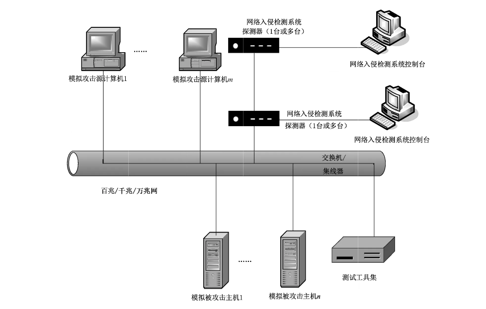

# GB/T 20275-2021 信息安全技术 网络入侵检测系统技术要求和测试评价方法

> 来源：[GB/T 20275-2021 国家标准详情](https://openstd.samr.gov.cn/bzgk/std/newGbInfo?hcno=EEE33EF3BFB492E8E23555B0D2F99148)。
> 官方在线预览截图 SHA-256：fc99a42235595b033a494fd3f03e3f5d90ae75213ed8dcf40b51c9fa76a9df9b。
> 发布日期：2021-10-11；实施日期：2022-05-01。依据官方在线预览的 74 张页面图像逐页核对，保留图 1，合并跨页续表。已去除封面、目录、分页和页眉页脚；正式引用请核对官方原文。

## 前言

本文件按照 GB/T 1.1—2020《标准化工作导则 第1部分：标准化文件的结构和起草规则》的规定起草。

本文件代替GB/T 20275—2013《信息安全技术 网络入侵检测系统技术要求和测试评价方法》，与GB/T 20275—2013相比，除结构调整和编辑性改动外，主要技术变化如下：

a） 修改了“安全事件”的定义（见3.1,2013年版的3.2）；

b）修改了“告警”的定义（见 3.2,2013年版的 3.7）；

c） 增加了“网络入侵检测系统描述”章节的内容（见第5章）；

d）调整了网络入侵检测系统的分级（见6.1.2,2013年版的5.2）；

e）修改了“攻击行为监测”的要求（见6.2.1.1.3 和 6.3.1.1.3,2013 年版的 6.1.1.1.3、6.2.1.1.3 和6.3.1.1.3）；

f） 增加了时钟同步的要求（见 6.2.1.4.9 和 6.3.1.4.9）；

g） 增加了鉴别信息的要求（见 6.2.2.1.2 和 6.3.2.1.2）；

h） 增加了管理地址限制的要求（见6.2.2.1.6 和 6.3.2.1.6）；

i） 增加了数据外发的要求（见6.2.2.4.3 和 6.3.2.4.3）；

j） 增加对“环境适应性要求”章节的内容，其中主要是明确了网络入侵检测系统对IPv6的支持能力，包括支持纯IPv6 网络环境、IPv6网络环境下自身管理能力和双协议栈（见6.2.3 和6.3.3）；

k） 删除了“双机热备”的要求（见2013年版的 6.3.1.4.11）；

l） 删除了“控制台鉴别”的要求（见2013年版的 6.3.2.1.5）；

m）增加了安全策略备份的要求（见 6.3.2.4.4）；

n）修改了各级的“安全保证要求”为“安全保障要求”（见 6.2.4 和 6.3.4，2013 年版的 6.1.3、6.2.3 和 6.3.3）。

请注意本文件的某些内容可能涉及专利。本文件的发布机构不承担识别专利的责任。

本文件由全国信息安全标准化技术委员会（SAC/TC 260）提出并归口。

本文件起草单位：公安部第三研究所、北京天融信网络安全技术有限公司、奇安信科技集团股份有限公司、北京神州绿盟科技有限公司、启明星辰信息技术集团股份有限公司、上海国际技贸联合有限公司、网神信息技术（北京）股份有限公司、中国网络安全审查技术与认证中心、中国电子科技集团公司第十五研究所（信息产业信息安全测评中心）、上海市信息安全测评认证中心、北京山石网科信息技术有限公司、西安交大捷普网络科技有限公司、新华三技术有限公司、北京安博通科技股份有限公司、北京中科网威信息技术有限公司、深信服科技股份有限公司、深圳市腾讯计算机系统有限公司、中国信息通信研究院、工业和信息化部计算机与微电子发展研究中心（中国软件评测中心）、华信咨询设计研究院有限公司、中国科学院信息工程研究所、中国电力科学研究院有限公司信息通信研究所、陕西省网络与信息安全测评中心、上海工业控制安全创新科技有限公司、国网新疆电力有限公司电力科学研究院。

本文件主要起草人：宋好好、顾建新、沈亮、陆臻、顾健、赖静、陈妍、曹宁、陈华平、刘彤、焦玉峰、刘志远、魏向杰、付海涛、申永波、刘健、刘艺翔、徐佟海、李宇、何建锋、杨洪起、曾祥禄、宋伟、杨柳、黄超、许子先、王榕、郭永振、孙小平、闫兆腾、严敏辉、赵少飞、倪华、李峰、舒斐、王少杰、张凯悦、顾欣、任帅、肖颖。

本文件及其所代替文件的历次版本发布情况为：

- 2006 年首次发布为 GB/T 20275—2006，2013 年第一次修订；
- 本次为第二次修订。

## 1 范围

本文件规定了网络入侵检测系统的安全技术要求和测试评价方法。

本文件适用于网络入侵检测系统的设计、开发与测评。

## 2 规范性引用文件

下列文件中的内容通过文中的规范性引用而构成本文件必不可少的条款。其中，注日期的引用文件，仅该日期对应的版本适用于本文件；不注日期的引用文件，其最新版本（包括所有的修改单）适用于本文件。

- GB/T 25069 信息安全技术 术语

## 3 术语和定义

GB/T 25069界定的以及下列术语和定义适用于本文件。

### 3.1 安全事件 security incident

对网络和信息系统或者其中的数据造成危害的事件。

### 3.2 告警 alert

当攻击或入侵发生时，网络入侵检测系统向授权管理员发出的信息。

### 3.3 支撑系统 supporting system

支撑网络入侵检测系统运行的操作系统。

## 4 缩略语

下列缩略语适用于本文件。

- FTP：文件传输协议（File Transfer Protocol）
- HTML：超文本置标语言（Hyper Text Markup Language）
- HTTP：超文本传输协议（Hyper Text Transfer Protocol）
- ICMP：网际控制报文协议（Internet Control Message Protocol）
- IP：网际协议（Internet Protocol）
- POP3：邮局协议的第三个版本（Post Office Protocol 3）
- SMTP：简单邮件传送协议（Simple Mail Transfer Protocol）
- SNMP：简单网络管理协议（Simple Network Management Protocol）
- TCP：传输控制协议（Transport Control Protocol）
- TELNET：远程登陆（Telecommunication Network）
- UDP：用户数据报协议（User Datagram Protocol）

## 5 网络入侵检测系统

网络入侵检测系统是以网络上的数据包作为数据源，监听所保护网络节点的所有数据包并进行分析，从而发现异常行为的产品。

## 6 安全技术要求

### 6.1 要求分类与分级

#### 6.1.1 要求分类

本文件将网络入侵检测系统安全技术要求分为安全功能、自身安全保护、环境适应性和安全保障要求四个大类。其中，安全功能要求针对网络入侵检测系统应具备的安全功能提出具体要求，主要包括数据探测功能要求、入侵分析功能要求、入侵响应功能要求、管理控制功能要求、检测结果处理要求、产品灵活性要求、性能要求等；自身安全保护要求针对网络入侵检测系统的身份鉴别、管理员管理、安全审计、数据安全、通信安全、升级安全、运行安全等提出具体要求；环境适应性要求支持纯 IPv6 网络环境、IPv6 网络环境下自身管理能力和双协议栈等；安全保障要求针对网络入侵检测系统的生命周期过程提出具体要求，包括开发、指导性文档、生命周期支持、测试和脆弱性评定等。

#### 6.1.2 安全等级

本文件将网络入侵检测系统的安全等级分为基本级和增强级，应符合表1、表2、表3和表4的要求。安全功能与自身安全保护的强弱、以及安全保障要求的高低是等级划分的具体依据，安全等级突出安全特性。

> 注：与基本级内容相比，增强级中要求有所增加或变更的内容在正文中通过“加粗”表示。

**表 1 网络入侵检测系统安全功能要求等级划分表**

| 类别 | 安全功能要求 | 基本级 | 增强级 |
| --- | --- | --- | --- |
| 数据探测功能要求 | 数据收集 | \* | \* |
|  | 协议分析 | \* | \* |
|  | 攻击行为监测 | \* | \* |
|  | 流量监测 | \* | \* |
| 入侵分析功能要求 | 数据分析 | \* | \* |
|  | 事件合并 | \* | \* |
|  | 防躲避能力 | — | \* |
|  | 事件关联 | — | \* |
| 入侵响应功能要求 | 定制响应 | \* | \* |
|  | 安全告警 | \* | \* |
|  | 告警方式 | \* | \* |
|  | 阻断能力 | — | \* |
|  | 排除响应 | — | \* |
|  | 防火墙联动 | — | \* |
|  | 全局预警 | — | \* |
|  | 其他设备联动 | — | \* |
| 管理控制功能要求 | 图形界面 | \* | \* |
|  | 安全事件库 | \* | \* |
|  | 事件分级 | \* | \* |
|  | 策略配置 | \* | \* |
|  | 事件库升级 | \* | \* |
|  | 系统升级 | \* | \* |
|  | 硬件失效处理 | \* | \* |
|  | 端口分离 | \* | \* |
|  | 时钟同步 | \* | \* |
|  | 分布式部署 | — | \* |
|  | 集中管理 | — | \* |
|  | 统一升级 | — | \* |
|  | 分级管理 | — | \* |
| 检测结果处理要求 | 事件记录 | \* | \* |
|  | 事件可视化 | \* | \* |
|  | 报告生成 | \* | \* |
|  | 报告查阅 | \* | \* |
|  | 报告输出 | \* | \* |
|  | 报告定制 | — | \* |
| 产品灵活性要求 | 事件定义 | — | \* |
|  | 协议定义 | — | \* |
| 性能要求 | 误报率 | \* | \* |
|  | 漏报率 | \* | \* |
|  | 高流量背景入侵检测能力 | \* | \* |
|  | 高并发连接背景入侵检测能力 | \* | \* |
|  | 高新建 TCP 连接速率背景入侵检测能力 | \* | \* |
|  | 还原能力 | — | \* |

注：“*”表示具有该要求，“—”表示不适用。

**表 2 网络入侵检测系统自身安全保护要求等级划分表**

| 类别 | 自身安全保护要求 | 基本级 | 增强级 |
| --- | --- | --- | --- |
| 身份鉴别 | 管理员鉴别 | \* | \* |
|  | 鉴别信息要求 | \* | \* |
|  | 鉴别失败的处理 | \* | \* |
|  | 鉴别数据保护 | \* | \* |
|  | 超时设置 | \* | \* |
|  | 管理地址限制 | \* | \* |
|  | 多重鉴别机制 | — | \* |
|  | 会话锁定 | — | \* |
| 管理员管理 | 标识唯一性 | \* | \* |
|  | 管理员属性定义 | \* | \* |
|  | 安全行为管理 | \* | \* |
|  | 管理员角色 | — | \* |
|  | 安全属性管理 | — | \* |
| 安全审计 | 审计日志生成 | \* | \* |
|  | 审计日志可理解性 | \* | \* |
|  | 审计日志查阅 | \* | \* |
|  | 受限的审计日志查阅 | \* | \* |
|  | 可选审计查阅 | \* | \* |
| 数据安全 | 安全管理 | \* | \* |
|  | 数据存储告警 | \* | \* |
|  | 数据外发 | \* | \* |
|  | 安全策略备份 | — | \* |
| 通信安全 | 通信保密性 | \* | \* |
|  | 通信完整性 | — | \* |
| 升级安全 | 升级安全 | — | \* |
| 运行安全 | 自我隐藏 | \* | \* |
|  | 自我监测 | — | \* |
| 支撑系统安全 | 支撑系统安全 | \* | \* |

注：“*”表示具有该要求，“—”表示不适用。

**表 3 网络入侵检测系统环境适应性要求等级划分表**

| 环境适应性要求 | 基本级 | 增强级 |
| --- | --- | --- |
| 支持纯 IPv6 网络环境 | \* | \* |
| IPv6 网络环境下自身管理 | \* | \* |
| 双协议栈 | \* | \* |

注：“*”表示具有该要求，“—”表示不适用。

**表 4 网络入侵检测系统安全保障要求等级划分表**

| 类别 | 安全保障要求 | 基本级 | 增强级 |
| --- | --- | --- | --- |
| 开发 | 安全架构 | \* | \* |
|  | 功能规范 | \* | \*\* |
|  | 实现表示 | — | \* |
|  | 产品设计 | \* | \*\* |
| 指导性文档 | 操作用户指南 | \* | \* |
|  | 准备程序 | \* | \* |
| 生命周期支持 | 配置管理能力 | \* | \*\* |
|  | 配置管理范围 | \* | \*\* |
|  | 交付程序 | \* | \* |
|  | 开发安全 | — | \* |
|  | 生命周期定义 | — | \* |
|  | 工具和技术 | — | \* |
| 测试 | 测试覆盖 | \* | \*\* |
|  | 测试深度 | — | \* |
|  | 功能测试 | \* | \* |
|  | 独立测试 | \* | \* |
| 脆弱性评定 | 脆弱性评定 | \* | \*\* |

注：“*”表示具有该要求，“**”表示要求有所增强，“—”表示不适用。

### 6.2 基本级安全要求

#### 6.2.1 安全功能要求

##### 6.2.1.1 数据探测功能要求

###### 6.2.1.1.1 数据收集

系统在进行检测分析时，应具有实时获取受保护网段内数据包的能力。

###### 6.2.1.1.2 协议分析

系统应对收集的数据包进行协议分析。

###### 6.2.1.1.3 攻击行为监测

系统至少应监视以下攻击行为：端口扫描、强力攻击、恶意代码攻击、拒绝服务攻击、缓冲区溢出攻击和弱性漏洞攻击等。

###### 6.2.1.1.4 流量监测

系统应监视整个网络或者某一特定协议、地址、端口的报文流量和字节流量。

##### 6.2.1.2 入侵分析功能要求

###### 6.2.1.2.1 数据分析

系统应对收集的数据包进行分析，发现安全事件。

###### 6.2.1.2.2 事件合并

系统应具有对高频度发生的相同安全事件进行合并告警，避免出现告警风暴的能力。高频度阈值应由授权管理员设置。

##### 6.2.1.3 入侵响应功能要求

###### 6.2.1.3.1 定制响应

系统应允许管理员对被检测网段中指定的目的主机定制不同的响应方式。

###### 6.2.1.3.2 安全告警

当系统检测到入侵时，应自动采取相应动作以发出安全警告。

###### 6.2.1.3.3 告警方式

告警应采取屏幕实时提示、E-mail 告警等一种或几种方式。

##### 6.2.1.4 管理控制功能要求

###### 6.2.1.4.1 图形界面

系统应提供管理员图形化界面用于管理、配置入侵检测系统。管理配置界面应包含配置和管理系统所需的所有功能。

###### 6.2.1.4.2 安全事件库

系统安全事件库中的内容应包括事件的定义和分析、详细的漏洞修补方案和可采取的对策等。

###### 6.2.1.4.3 事件分级

系统应按照事件的严重程度将事件分级，以使授权管理员能从大量的信息中捕捉到危险的事件。

###### 6.2.1.4.4 策略配置

系统应提供方便、快捷的入侵检测系统策略配置方法和手段，具备策略模板、支持策略的导入和导出。

###### 6.2.1.4.5 事件库升级

系统应具有升级事件库的能力。

###### 6.2.1.4.6 系统升级

系统应具有升级系统程序的能力。

###### 6.2.1.4.7 硬件失效处理

对于硬件产品，硬件失效时应及时向管理员报警。

###### 6.2.1.4.8 端口分离

系统的探测器应配备不同的端口分别用于系统管理和网络数据监听。

###### 6.2.1.4.9 时钟同步

系统应提供时钟同步功能，保证系统各组件与时钟服务器之间时间的一致性。

##### 6.2.1.5 检测结果处理要求

###### 6.2.1.5.1 事件记录

系统应保存检测到的安全事件并记录安全事件信息。

安全事件信息应至少包含以下内容：事件发生时间、源地址、目的地址、事件等级、事件类型、事件名称、事件定义和详细事件过程分析以及解决方案建议等。

###### 6.2.1.5.2 事件可视化

管理员应能通过管理界面实时清晰地查看安全事件。

###### 6.2.1.5.3 报告生成

系统应能生成详尽的检测结果报告。

###### 6.2.1.5.4 报告查阅

系统应具有浏览检测结果报告的功能。

###### 6.2.1.5.5 报告输出

检测结果报告应可输出成方便管理员阅读的文本格式，包括但不限于 WORD 文件、HTML 文件、PDF 文件、WPS 文件或 OFD 文件等。

##### 6.2.1.6 性能要求

###### 6.2.1.6.1 误报率

系统应将误报率控制在 15% 内，不能对正常使用系统产生较大影响。支持在 IPv6 网络环境下工作的系统的误报率应满足上述指标。

###### 6.2.1.6.2 漏报率

系统应将漏报率控制在 15% 内，不能对正常使用系统产生较大影响。支持在 IPv6 网络环境下工作的系统的漏报率应满足上述指标。

###### 6.2.1.6.3 高流量背景入侵检测能力

百兆系统单口监控流量≥90 Mbps，千兆系统单口监控流量≥0.9 Gbps，万兆系统单口监控流量≥9 Gbps。支持在 IPv6 网络环境下工作的系统的流量监控能力应满足上述指标。

###### 6.2.1.6.4 高并发连接背景入侵检测能力

百兆系统单口监控并发连接数≥10 万个，千兆系统单口监控并发连接数≥100 万个，万兆系统单口监控并发连接数≥150 万个。支持在 IPv6 网络环境下工作的系统的并发连接数监控能力应满足上述指标。

###### 6.2.1.6.5 高新建 TCP连接速率背景入侵检测能力

百兆系统单口监控每秒新建 TCP 连接数≥6 万个，千兆系统单口监控每秒新建 TCP 连接数≥10 万个，万兆系统单口监控每秒新建 TCP 连接数≥15 万个。支持在 IPv6 网络环境下工作的系统的新建 TCP 连接速率监控能力应满足上述指标。

#### 6.2.2 自身安全保护要求

##### 6.2.2.1 身份鉴别

###### 6.2.2.1.1 管理员鉴别

系统应在管理员执行任何与安全功能相关的操作之前对管理员进行鉴别。

###### 6.2.2.1.2 鉴别信息要求

在采用基于口令的鉴别信息时，系统应对管理员设置的口令进行复杂度检查，确保管理员口令满足复杂度要求。当存在默认口令时，系统应提示管理员对默认口令进行修改，以减少用户身份被冒用的风险。系统应提供鉴别信息定期更换功能，当鉴别信息使用时间达到使用期限阈值前，应提示管理员进行修改。

###### 6.2.2.1.3 鉴别失败的处理

当管理员鉴别尝试失败连续达到指定次数后，系统应阻止管理员进一步的鉴别请求，并将有关信息生成审计事件。最多失败次数仅由管理员设定。

###### 6.2.2.1.4 鉴别数据保护

系统应保护鉴别数据不被未授权查阅和修改。

###### 6.2.2.1.5 超时设置

系统应具有管理员登录超时重新鉴别功能。在设定的时间段内没有任何操作的情况下，锁定或终止会话，需要再次进行身份鉴别才能够重新管理系统。最大超时时间仅由授权管理员设定。

###### 6.2.2.1.6 管理地址限制

系统应对管理员登录的网络地址进行限制。

##### 6.2.2.2 管理员管理

###### 6.2.2.2.1 标识唯一性

系统应保证所设置的管理员标识全局唯一。

###### 6.2.2.2.2 管理员属性定义

系统应为每一个管理员保存安全属性表，属性应包括：管理员标识、鉴别数据、授权信息或管理组信息、其他安全属性等。

###### 6.2.2.2.3 安全行为管理

系统应仅限于授权管理员具有禁止、修改系统功能的能力。

##### 6.2.2.3 安全审计

###### 6.2.2.3.1 审计日志生成

系统应生成以下事件的审计日志：

a） 管理员账户的登录和注销、系统启动、系统升级、重要配置变更、增加/删除/修改管理员、保存/删除审计日志等；

b） 系统及其模块异常状态的告警。

系统应在每一个审计日志记录中记录事件发生的日期、时间、用户标识、事件描述和结果。若采用远程登录方式还应记录管理主机的IP地址。

###### 6.2.2.3.2 审计日志可理解性

审计数据的记录方式应便于管理员理解，以便对审计日志进行分析。

###### 6.2.2.3.3 审计日志查阅

系统应为授权管理员提供审计日志查阅功能，方便管理员查看审计结果。

###### 6.2.2.3.4 受限的审计日志查阅

除具有明确的访问权限的授权管理员之外，系统应禁止所有其他用户对审计日志的访问。

###### 6.2.2.3.5 可选审计查阅

应支持按照一定条件对审计日志进行检索或排序。

##### 6.2.2.4 数据安全

###### 6.2.2.4.1 安全管理

系统应仅允许授权管理员访问安全事件记录和审计日志，禁止其他用户对安全事件记录和审计日志的操作。

###### 6.2.2.4.2 数据存储告警

系统应在数据存储空间将耗尽等情况时，自动产生告警，产生告警的剩余存储空间大小应由管理员自主设定。

###### 6.2.2.4.3 数据外发

系统应支持将安全事件记录和审计日志外发，便于对安全事件记录和审计日志的进一步分析。

##### 6.2.2.5 通信安全

系统应确保各组件之间传输的数据（包括但不限于配置和控制信息、告警和事件数据等）不被泄露。

##### 6.2.2.6 运行安全

系统应采取隐藏探测器IP地址等措施使自身在网络上不可见，以降低被攻击的可能性。

##### 6.2.2.7 支撑系统安全

系统的支撑系统应：

a） 进行必要的裁剪，不提供多余的组件或网络服务；

b） 在重启过程中，安全策略和日志信息不丢失；

c） 不含已知中、高、超危安全漏洞。

#### 6.2.3 环境适应性要求（有则适用）

##### 6.2.3.1 支持纯 IPv6 网络环境

系统应支持纯 IPv6 网络环境，能够在纯 IPv6 网络环境下正常工作，实现对目标网络入侵的检测。

##### 6.2.3.2 IPv6 网络环境下自身管理

系统应支持在IPv6网络环境下自身管理，实现对产品的管理操作。

##### 6.2.3.3 双协议栈

系统应支持 IPv4/IPv6双栈网络环境，能够在IPv4/IPv6双栈网络环境下正常工作，实现对目标网络入侵的检测。

#### 6.2.4 安全保障要求

##### 6.2.4.1 开发

###### 6.2.4.1.1 安全架构

开发者应提供产品安全功能和自身安全保护的安全架构描述，安全架构描述应满足以下要求：

a） 与产品设计文档中对安全功能和自身安全保护实施抽象描述的级别一致；

b）描述与安全功能和自身安全保护要求一致的产品安全功能和自身安全保护的安全域；

c） 描述产品安全功能和自身安全保护初始化过程为何是安全的；

d） 证实产品安全功能和自身安全保护能够防止被破坏；

e） 证实产品安全功能和自身安全保护能够防止安全特性被旁路。

###### 6.2.4.1.2 功能规范

开发者应提供完备的功能规范说明，功能规范说明应满足以下要求：

a） 完全描述产品的安全功能和自身安全保护；

b） 描述所有安全功能和自身安全保护接口的目的与使用方法；

c） 标识和描述每个安全功能和自身安全保护接口相关的所有参数；

d） 描述安全功能和自身安全保护接口相关的安全功能和自身安全保护实施行为；

e） 描述由安全功能和自身安全保护实施行为处理而引起的直接错误消息；

f） 证实安全功能和自身安全保护要求到安全功能和自身安全保护接口的追溯。

###### 6.2.4.1.3 产品设计

开发者应提供产品设计文档，产品设计文档应满足以下要求：

a） 根据子系统描述产品结构；

b） 标识和描述产品安全功能和自身安全保护的所有子系统；

c） 描述安全功能和自身安全保护所有子系统间的相互作用；

d） 提供的映射关系能够证实设计中描述的所有行为能够映射到调用它的安全功能和自身安全保护接口。

##### 6.2.4.2 指导性文档

###### 6.2.4.2.1 操作用户指南

开发者应提供明确和合理的操作用户指南，操作用户指南与为评估而提供的其他所有文档保持一致，对每一种用户角色的描述应满足以下要求：

a） 描述在安全处理环境中被控制的用户可访问的功能和特权，包含适当的警示信息；

b） 描述如何以安全的方式使用产品提供的可用接口；

c） 描述可用功能和接口，尤其是受用户控制的所有安全参数；

d） 明确说明与需要执行的用户可访问功能有关的每一种安全相关事件，包括改变安全功能和自身安全保护所控制实体的安全特性；

e） 标识产品运行的所有可能状态（包括操作导致的失败或者操作性错误），以及它们与维持安全运行之间的因果关系和联系；

f） 充分实现安全目的所执行的安全策略。

###### 6.2.4.2.2 准备程序

开发者应提供产品及其准备程序，准备程序描述应满足以下要求：

a） 描述与开发者交付程序相一致的安全接收所交付产品必需的所有步骤；

b） 描述安全安装产品及其运行环境必需的所有步骤。

##### 6.2.4.3 生命周期支持

###### 6.2.4.3.1 配置管理能力

开发者的配置管理能力应满足以下要求：

a） 为产品的不同版本提供唯一的标识；

b） 使用配置管理系统对组成产品的所有配置项进行维护，并唯一标识配置项；

c） 提供配置管理文档，配置管理文档描述用于唯一标识配置项的方法。

###### 6.2.4.3.2 配置管理范围

开发者应提供产品配置项列表，并说明配置项的开发者。配置项列表至少包含产品、安全保障要求的评估证据和产品的组成部分。

###### 6.2.4.3.3 交付程序

开发者应使用一定的交付程序交付产品，并将交付过程文档化。在给用户方交付产品的各版本时，交付文档应描述为维护安全所必需的所有程序。

##### 6.2.4.4 测试

###### 6.2.4.4.1 测试覆盖

开发者应提供测试覆盖文档，测试覆盖描述应表明测试文档中所标识的测试与功能规范中所描述的产品的安全功能和自身安全保护间的对应性。

###### 6.2.4.4.2 功能测试

开发者应测试产品安全功能和自身安全保护，将结果文档化并提供测试文档。测试文档应包括以下内容：

a） 测试计划，标识要执行的测试，并描述执行每个测试的方案，这些方案包括对于其他测试结果的任何顺序依赖性；

b）预期的测试结果，表明测试成功后的预期输出；

c） 实际测试结果和预期的测试结果的对比。

###### 6.2.4.4.3 独立测试

开发者应提供一组与其自测安全功能和自身安全保护时使用的同等资源，以用于安全功能和自身安全保护的抽样测试。

##### 6.2.4.5 脆弱性评定

基于已标识的潜在脆弱性，产品能够抵抗具有基本攻击潜力的攻击者的攻击。

### 6.3 增强级安全要求

#### 6.3.1 安全功能要求

##### 6.3.1.1 数据探测功能要求

###### 6.3.1.1.1 数据收集

系统在进行检测分析时，应具有实时获取受保护网段内数据包的能力。

###### 6.3.1.1.2 协议分析

系统应对收集的数据包进行协议分析。

###### 6.3.1.1.3 攻击行为监测

系统至少应监视以下攻击行为：端口扫描、强力攻击、恶意代码攻击、拒绝服务攻击、缓冲区溢出攻击和弱性漏洞攻击等。

###### 6.3.1.1.4 流量监测

系统应监视整个网络或者某一特定协议、地址、端口的报文流量和字节流量。

##### 6.3.1.2 入侵分析功能要求

###### 6.3.1.2.1 数据分析

系统应对收集的数据包进行分析，发现安全事件。

###### 6.3.1.2.2 事件合并

系统应具有对高频度发生的相同安全事件进行合并告警，避免出现告警风暴的能力。高频度阈值应由授权管理员设置。

###### 6.3.1.2.3 防躲避能力

系统应能发现躲避或欺骗检测的行为，包括但不限于 IP 碎片分片、TCP 流分段、URI 字符串变形、shell 代码变形、协议端口重定向等。

###### 6.3.1.2.4 事件关联

系统应具有把不同的事件关联起来，发现低危害事件中隐含的高危害攻击的能力。

##### 6.3.1.3 入侵响应功能要求

###### 6.3.1.3.1 定制响应

系统应允许管理员对被检测网段中指定的目的主机定制不同的响应方式。

###### 6.3.1.3.2 安全告警

当系统检测到入侵时，应自动采取相应动作以发出安全警告。

###### 6.3.1.3.3 告警方式

告警应采取屏幕实时提示、E-mail 告警等一种或几种方式。

###### 6.3.1.3.4 阻断能力

系统在监测到网络上的非法连接时，可进行阻断。

###### 6.3.1.3.5 排除响应

系统应允许管理员定义对被检测网段中指定的目的主机不予告警。

###### 6.3.1.3.6 防火墙联动

系统应具有与防火墙进行联动的能力，可按照设定的联动策略自动调整防火墙配置。

###### 6.3.1.3.7 全局预警

系统应具有全局预警功能，控制台可在设定全局预警的策略后，将局部出现的重大安全事件通知其上级控制台或者下级控制台。

###### 6.3.1.3.8 其他设备联动

系统应具有与其他网络设备或网络安全部件（包括但不限于沙箱、漏洞扫描、交换机等）按照设定的策略进行联动的能力。

##### 6.3.1.4 管理控制功能要求

###### 6.3.1.4.1 图形界面

系统应提供管理员图形化界面用于管理、配置入侵检测系统。管理配置界面应包含配置和管理系统所需的所有功能。

###### 6.3.1.4.2 安全事件库

系统安全事件库中的内容应包括事件的定义和分析、详细的漏洞修补方案和可采取的对策等。

###### 6.3.1.4.3 事件分级

系统应按照事件的严重程度将事件分级，以使授权管理员能从大量的信息中捕捉到危险的事件。

###### 6.3.1.4.4 策略配置

系统应提供方便、快捷的入侵检测系统策略配置方法和手段，具备策略模板、支持策略的导入和导出。

###### 6.3.1.4.5 事件库升级

系统应具有升级事件库的能力。

###### 6.3.1.4.6 系统升级

系统应具有升级系统程序的能力。

###### 6.3.1.4.7 硬件失效处理

对于硬件产品，硬件失效时应及时向管理员报警。

###### 6.3.1.4.8 端口分离

系统的探测器应配备不同的端口分别用于系统管理和网络数据监听。

###### 6.3.1.4.9 时钟同步

系统应提供时钟同步功能，保证系统各组件与时钟服务器之间时间的一致性。

###### 6.3.1.4.10 分布式部署

系统应具有分布式部署的能力。

###### 6.3.1.4.11 集中管理

系统应设置集中管理中心，对分布式的入侵检测系统进行统一集中管理。

###### 6.3.1.4.12 统一升级

系统应提供由集中管理中心对各探测器及其事件库进行统一升级的功能。

###### 6.3.1.4.13 分级管理

系统应具有分级管理的能力，支持可选择、可配置多级之间需要同步的数据类型。

##### 6.3.1.5 检测结果处理要求

###### 6.3.1.5.1 事件记录

系统应保存检测到的安全事件并记录安全事件信息。

安全事件信息应至少包含以下内容：事件发生时间、源地址、目的地址、事件等级、事件类型、事件名称、事件定义和详细事件过程分析以及解决方案建议等。

###### 6.3.1.5.2 事件可视化

管理员应能通过管理界面实时清晰地查看安全事件。

###### 6.3.1.5.3 报告生成

系统应能生成详尽的检测结果报告。

###### 6.3.1.5.4 报告查阅

系统应具有浏览检测结果报告的功能。

###### 6.3.1.5.5 报告输出

检测结果报告应可输出成方便管理员阅读的文本格式，包括但不限于 WORD 文件、HTML 文件、PDF 文件、WPS 文件或 OFD 文件等。

##### 6.3.1.6 产品灵活性要求

###### 6.3.1.6.1 报告定制

系统应支持授权管理员定制报告内容。

###### 6.3.1.6.2 事件定义

系统应允许授权管理员自定义事件，并应提供方便、快捷的定义方法。

###### 6.3.1.6.3 协议定义

系统除支持默认的网络协议集外，还应允许授权管理员定义新的协议，或对协议的端口进行重新定位。

##### 6.3.1.7 性能要求

###### 6.3.1.7.1 误报率

系统应将误报率控制在15%内，不能对正常使用系统产生较大影响。支持在IPv6 网络环境下工作的系统的误报率应满足上述指标。

###### 6.3.1.7.2 漏报率

系统应将漏报率控制在15％内，不能对正常使用系统产生较大影响。支持在IPv6 网络环境下工作的系统的漏报率应满足上述指标。

###### 6.3.1.7.3 高流量背景入侵检测能力

百兆系统单口监控流量≥90 Mbps，千兆系统单口监控流量≥0.9 Gbps，万兆系统单口监控流量≥9 Gbps。支持在 IPv6 网络环境下工作的系统的流量监控能力应满足上述指标。

###### 6.3.1.7.4 高并发连接背景入侵检测能力

百兆系统单口监控并发连接数≥10万个，千兆系统单口监控并发连接数≥100万个，万兆系统单口监控并发连接数≥150万个。支持在IPv6网络环境下工作的系统的并发连接数监控能力应满足上述指标。

###### 6.3.1.7.5 高新建 TCP连接速率背景入侵检测能力

百兆系统单口监控每秒新建TCP 连接数≥6万个，千兆系统单口监控每秒新建 TCP 连接数≥10万个，万兆系统单口监控每秒新建 TCP连接数≥15万个。支持在IPv6 网络环境下工作的系统的新建 TCP连接速率监控能力应满足上述指标。

###### 6.3.1.7.6 还原能力

系统应对入侵行为进行内容恢复和还原，当背景数据流低于网络有效带宽的 80% 时，系统应保证入侵行为的获取和能够正确还原 85% 的入侵行为。支持在 IPv6 网络环境下工作的系统的还原能力应满足上述指标。

#### 6.3.2 自身安全保护要求

##### 6.3.2.1 身份鉴别

###### 6.3.2.1.1 管理员鉴别

系统应在管理员执行任何与安全功能相关的操作之前对管理员进行鉴别。

###### 6.3.2.1.2 鉴别信息要求

在采用基于口令的鉴别信息时，系统应对管理员设置的口令进行复杂度检查，确保管理员口令满足复杂度要求。当存在默认口令时，系统应提示管理员对默认口令进行修改，以减少用户身份被冒用的风险。系统应提供鉴别信息定期更换功能，当鉴别信息使用时间达到使用期限阈值前，应提示管理员进行修改。

###### 6.3.2.1.3 鉴别失败的处理

当管理员鉴别尝试失败连续达到指定次数后，系统应阻止管理员进一步的鉴别请求，并将有关信息生成审计事件。最多失败次数仅由管理员设定。

###### 6.3.2.1.4 鉴别数据保护

系统应保护鉴别数据不被未授权查阅和修改。

###### 6.3.2.1.5 超时设置

系统应具有管理员登录超时重新鉴别功能。在设定的时间段内没有任何操作的情况下，锁定或终止会话，需要再次进行身份鉴别才能够重新管理系统。最大超时时间仅由授权管理员设定。

###### 6.3.2.1.6 管理地址限制

系统应对管理员登录的网络地址进行限制。

###### 6.3.2.1.7 多重鉴别机制

系统应提供多种鉴别方式，以实现多重身份鉴别措施。

###### 6.3.2.1.8 会话锁定

系统应允许管理员锁定当前的交互会话，锁定后需要再次进行身份鉴别才能够重新管理系统。

##### 6.3.2.2 管理员管理

###### 6.3.2.2.1 标识唯一性

系统应保证所设置的管理员标识全局唯一。

###### 6.3.2.2.2 管理员属性定义

系统应为每一个管理员保存安全属性表，属性应包括：管理员标识、鉴别数据、授权信息或管理组信息、其他安全属性等。

###### 6.3.2.2.3 安全行为管理

系统应仅限于授权管理员具有禁止、修改系统功能的能力。

###### 6.3.2.2.4 管理员角色

系统应设置多个角色，并应保证每一个角色标识是全局唯一的。

###### 6.3.2.2.5 安全属性管理

系统应仅允许授权角色可以对指定的安全属性进行查询、修改、删除、改变其默认值等操作。

##### 6.3.2.3 安全审计

###### 6.3.2.3.1 审计日志生成

系统应生成以下事件的审计日志：

a） 管理员账户的登录和注销、系统启动、系统升级、重要系统参数修改、安全策略变更、增加/删除/修改管理员、保存/删除审计日志等；

b） 系统及其模块异常状态的告警。

系统应在每一个审计日志记录中记录事件发生的日期、时间、用户标识、事件描述和结果。若采用远程登录方式还应记录管理主机的IP 地址。

###### 6.3.2.3.2 审计日志可理解性

审计数据的记录方式应便于管理员理解，以便对审计日志进行分析。

###### 6.3.2.3.3 审计日志查阅

系统应为授权管理员提供审计日志查阅功能，方便管理员查看审计结果。

###### 6.3.2.3.4 受限的审计日志查阅

除具有明确的访问权限的授权管理员之外，系统应禁止所有其他用户对审计日志的访问。

###### 6.3.2.3.5 可选审计查阅

应支持按照一定条件对审计日志进行检索或排序。

##### 6.3.2.4 数据安全

###### 6.3.2.4.1 安全管理

系统应仅允许授权管理员访问安全事件记录和审计日志，禁止其他用户对安全事件记录和审计日志的操作。

###### 6.3.2.4.2 数据存储告警

系统应在数据存储空间将耗尽等情况时，自动产生告警，产生告警的剩余存储空间大小应由管理员自主设定。

###### 6.3.2.4.3 数据外发

系统应支持将安全事件记录和审计日志外发，便于对安全事件记录和审计日志的进一步分析。

###### 6.3.2.4.4 安全策略备份

系统应支持对安全策略进行备份和恢复，并在恢复时校验备份文件的完整性。

##### 6.3.2.5 通信安全

###### 6.3.2.5.1 通信保密性

系统应确保各组件之间传输的数据（包括但不限于配置和控制信息、告警和事件数据等）不被泄露。

###### 6.3.2.5.2 通信完整性

各组件之间传输的数据（包括但不限于配置和控制信息、告警和事件数据等）被篡改后，系统应确保及时发现、并通知管理员。

##### 6.3.2.6 升级安全

系统应确保事件库和系统升级时的安全，避免得到错误的或伪造的升级包。

##### 6.3.2.7 运行安全

###### 6.3.2.7.1 自我隐藏

系统应采取隐藏探测器IP地址等措施使自身在网络上不可见，以降低被攻击的可能性。

###### 6.3.2.7.2 自我监测

系统在启动和正常工作时，应周期性地、或者按照授权管理员的要求执行自检，包括硬件工作状态监测、组件连接状态监测等，以验证系统自身执行的正确性。当系统自检发现异常时，应及时通知授权管理员。

##### 6.3.2.8 支撑系统安全

系统的支撑系统应：

a） 进行必要的裁剪，不提供多余的组件或网络服务；

b） 在重启过程中，安全策略和日志信息不丢失；

c） 不含已知中、高、超危安全漏洞。

#### 6.3.3 环境适应性要求（有则适用）

##### 6.3.3.1 支持纯IPv6 网络环境

系统应支持纯 IPv6 网络环境，能够在纯 IPv6 网络环境下正常工作，实现对目标网络入侵的检测。

##### 6.3.3.2 IPv6网络环境下自身管理

系统应支持在 IPv6 网络环境下自身管理，实现对产品的管理操作。

##### 6.3.3.3 双协议栈

系统应支持IPv4/IPv6双栈网络环境，能够在IPv4/IPv6双栈网络环境下正常工作，实现对目标网络入侵的检测。

#### 6.3.4 安全保障要求

##### 6.3.4.1 开发

###### 6.3.4.1.1 安全架构

开发者应提供产品安全功能和自身安全保护的安全架构描述，安全架构描述应满足以下要求：

a） 与产品设计文档中对安全功能和自身安全保护实施抽象描述的级别一致；

b） 描述与安全功能和自身安全保护要求一致的产品安全功能和自身安全保护的安全域；

c） 描述产品安全功能和自身安全保护初始化过程为何是安全的；

d） 证实产品安全功能和自身安全保护能够防止被破坏；

e） 证实产品安全功能和自身安全保护能够防止安全特性被旁路。

###### 6.3.4.1.2 功能规范

开发者应提供完备的功能规范说明，功能规范说明应满足以下要求：

a） 完全描述产品的安全功能和自身安全保护；

b） 描述所有安全功能和自身安全保护接口的目的与使用方法；

c） 标识和描述每个安全功能和自身安全保护接口相关的所有参数；

d） 描述安全功能和自身安全保护接口相关的安全功能和自身安全保护实施行为；

e） 描述由安全功能和自身安全保护实施行为处理而引起的直接错误消息；

f）证实安全功能和自身安全保护要求到安全功能和自身安全保护接口的追溯；

g） 描述安全功能和自身安全保护实施过程中，与安全功能和自身安全保护接口相关的所有行为；

h）描述可能由安全功能和自身安全保护接口的调用而引起的所有直接错误消息。

###### 6.3.4.1.3 实现表示

开发者应提供全部安全功能和自身安全保护的实现表示，实现表示应满足以下要求：

a） 提供产品设计描述与实现表示实例之间的映射，并证明其一致性；

b） 按详细级别定义产品安全功能和自身安全保护，详细程度达到无须进一步设计就能生成安全功能和自身安全保护的程度；

c） 以开发人员使用的形式提供。

###### 6.3.4.1.4 产品设计

开发者应提供产品设计文档，产品设计文档应满足以下要求：

a） 根据子系统描述产品结构；

b） 标识和描述产品安全功能和自身安全保护的所有子系统；

c） 描述安全功能和自身安全保护所有子系统间的相互作用；

d） 提供的映射关系能够证实设计中描述的所有行为能够映射到调用它的安全功能和自身安全保护接口；

e） 根据模块描述安全功能和自身安全保护；

f）提供安全功能和自身安全保护子系统到模块间的映射关系；

g） 描述所有安全功能和自身安全保护实现模块，包括其目的及与其他模块间的相互作用；

h） 描述所有实现模块的安全功能和自身安全保护要求相关接口、其他接口的返回值、与其他模块间的相互作用及调用的接口；

i） 描述所有安全功能和自身安全保护的支撑或相关模块，包括其目的及与其他模块间的相互作用。

##### 6.3.4.2 指导性文档

###### 6.3.4.2.1 操作用户指南

开发者应提供明确和合理的操作用户指南，操作用户指南与为评估而提供的其他所有文档保持一致，对每一种用户角色的描述应满足以下要求：

a） 描述在安全处理环境中被控制的用户可访问的功能和特权，包含适当的警示信息；

b）描述如何以安全的方式使用产品提供的可用接口；

c） 描述可用功能和接口，尤其是受用户控制的所有安全参数；

d） 明确说明与需要执行的用户可访问功能有关的每一种安全相关事件，包括改变安全功能和自身安全保护所控制实体的安全特性；

e） 标识产品运行的所有可能状态（包括操作导致的失败或者操作性错误），以及它们与维持安全运行之间的因果关系和联系；

f） 充分实现安全目的所执行的安全策略。

###### 6.3.4.2.2 准备程序

开发者应提供产品及其准备程序，准备程序描述应满足以下要求：

a） 描述与开发者交付程序相一致的安全接收所交付产品必需的所有步骤；

b）描述安全安装产品及其运行环境必需的所有步骤。

##### 6.3.4.3 生命周期支持

###### 6.3.4.3.1 配置管理能力

开发者的配置管理能力应满足以下要求：

a） 为产品的不同版本提供唯一的标识；

b） 使用配置管理系统对组成产品的所有配置项进行维护，并唯一标识配置项；

c） 提供配置管理文档，配置管理文档描述用于唯一标识配置项的方法；

d） 配置管理系统提供一种自动方式来支持产品的生成，通过该方式确保只能对产品的实现表示进行已授权的改变；

e） 配置管理文档包括一个配置管理计划，配置管理计划描述如何使用配置管理系统开发产品，实施的配置管理与配置管理计划相一致；

f） 配置管理计划描述用来接受修改过的或新建的作为产品组成部分的配置项的程序。

###### 6.3.4.3.2 配置管理范围

开发者应提供产品配置项列表，并说明配置项的开发者。配置项列表应包含以下内容：

a） 产品、安全保障要求的评估证据和产品的组成部分；

b） 实现表示、安全缺陷报告及其解决状态。

###### 6.3.4.3.3 交付程序

开发者应使用一定的交付程序交付产品，并将交付过程文档化。在给用户方交付产品的各版本时，交付文档应描述为维护安全所必需的所有程序。

###### 6.3.4.3.4 开发安全

开发者应提供开发安全文档。开发安全文档应描述在产品的开发环境中，为保护产品设计和实现的保密性和完整性所必需的所有物理的、程序的、人员的和其他方面的安全措施。

###### 6.3.4.3.5 生命周期定义

开发者应建立一个生命周期模型对产品的开发和维护进行的必要控制，并提供生命周期定义文档描述用于开发和维护产品的模型。

###### 6.3.4.3.6 工具和技术

开发者应明确定义用于开发产品的工具，并提供开发工具文档无歧义地定义实现中每个语句的含义和所有依赖于实现的选项的含义。

##### 6.3.4.4 测试

###### 6.3.4.4.1 测试覆盖

开发者应提供测试覆盖文档，测试覆盖描述应满足以下要求：

a） 表明测试文档中所标识的测试与功能规范中所描述的产品的安全功能和自身安全保护间的对应性；

b） 表明上述对应性是完备的，并证实功能规范中的所有安全功能和自身安全保护接口都进行了测试。

###### 6.3.4.4.2 测试深度

开发者应提供测试深度的分析。测试深度分析描述应满足以下要求：

a） 证实测试文档中的测试与产品设计中的安全功能和自身安全保护子系统和实现模块之间的一致性；

b） 证实产品设计中的所有安全功能和自身安全保护子系统、实现模块都已经进行过测试。

###### 6.3.4.4.3 功能测试

开发者应测试产品安全功能和自身安全保护，将结果文档化并提供测试文档。测试文档应包括以下内容：

a） 测试计划，标识要执行的测试，并描述执行每个测试的方案，这些方案包括对于其他测试结果的任何顺序依赖性；

b） 预期的测试结果，表明测试成功后的预期输出；

c） 实际测试结果和预期的测试结果的对比。

###### 6.3.4.4.4 独立测试

开发者应提供一组与其自测安全功能和自身安全保护时使用的同等资源，以用于安全功能和自身安全保护的抽样测试。

##### 6.3.4.5 脆弱性评定

基于已标识的潜在脆弱性，产品能够抵抗具有中等攻击潜力的攻击者的攻击。

## 7 测试评价方法

### 7.1 测试环境

网络入侵检测系统功能测试的典型网络拓扑结构如图1所示。

测试设备包括测试所需的交换机、测试工具集、模拟攻击源计算机、模拟被攻击计算机，以及网络入侵检测系统控制台、网络入侵检测系统探测器等。其中，模拟攻击源计算机和模拟被攻击计算机可以为多台，并可安装不同的操作系统和应用软件。

### 7.2 测试工具

可用的测试工具包括但不限于：生成网络背景流量的专用网络性能分析仪；进行包回放的网络数据包获取软件；测试产品报警能力的扫描和攻击工具包。

可采取多种测试工具和测试方法对系统进行测试。

### 7.3 基本级

#### 7.3.1 安全功能测试

##### 7.3.1.1 数据探测功能测试

###### 7.3.1.1.1 数据收集

对数据收集的测试评价方法如下。

a） 测试方法：

1） 打开系统的安全策略配置，配置受保护网段；

2） 对受保护网段发起攻击；

3） 检查是否具有实时获取受保护网段内的数据包的能力。

b） 预期结果：系统应能够实时获取足够的网络数据包以分析安全事件。

c） 结果判定：上述预期结果均满足判定为符合，其他情况判定为不符合。

###### 7.3.1.1.2 协议分析

对协议分析的测试评价方法如下。

a） 测试方法：

1） 打开系统的安全策略配置，检查安全事件的描述是否具有协议类型等属性；

2） 检查产品说明书，查找关于协议分析方法的说明，按照系统所声明的协议分析类型，抽样生成协议事件，组成安全事件测试集；

3）配置系统的检测策略为最大策略集；

4） 发送安全事件测试集中的所有事件，记录系统的检测结果。

b） 预期结果：

1） 记录系统报告的攻击名称和类型；

2） 产品说明书中声称能够分析的协议事件，抽样测试应未发现矛盾之处；

3） 列举系统支持的所有协议分析方法。

c） 结果判定：上述预期结果均满足判定为符合，其他情况判定为不符合。

###### 7.3.1.1.3 攻击行为监测

对攻击行为监测的测试评价方法如下。

a） 测试方法：

1） 从已有的事件库中选择具有不同特征的多个事件，组成安全事件测试集，选取的事件应包括：端口扫描类事件（包括但不限于 TCP 端口扫描、UDP 端口扫描、ICMP 分布式主机扫描等）、强力攻击类事件（包括但不限于 SMTP、HTTP、FTP、MSSQLSERVER、FTP_弱口令、POP3_弱口令等）、恶意代码类事件（包括但不限于 BO、Netbus、Dolly、红色代码、冲击波、振荡波等）、拒绝服务类事件（包括但不限于 SYNFLOOD、UDPFLOOD、ICMP-FLOOD、IGMP 拒绝服务等）、缓冲区溢出类事件（包括但不限于 FTP_命令溢出、SMTP_HELO_缓冲区溢出、POP3_foxmail_5.0_缓冲区溢出、Telnet_Solaris_telnet_缓冲区溢出、HTTP_IIS_Unicode_漏洞、MSSQL2000_远程溢出等）、脆弱性漏洞攻击类事件（包括但不限于 MS-Office 文件脆弱性、MS-IE 浏览器脆弱性、应用层安全漏洞攻击等）以及其他具有代表性的网络安全事件，测试系统；

2）配置系统的检测策略为最大策略集；

3） 发送安全事件测试集中的所有事件，记录系统的检测结果。

b） 预期结果：

1） 对安全事件测试集的攻击，系统应报告相应的安全事件，包括事件名称、事件类型、攻击源地址、目的地址、事件发生时间、重要级别等信息；

2） 记录系统报告的攻击名称和类型。

c） 结果判定：上述预期结果均满足判定为符合，其他情况判定为不符合。

###### 7.3.1.1.4 流量监测

对流量监控的测试评价方法如下。

a） 测试方法：

1） 开启流量显示功能，定义流量事件，查看流量显示界面，显示流量变化；

2） 对某一服务器发起大流量的攻击，如 ping flood；

3） 对特定的端口（如80端口）发起拒绝服务攻击。

b） 预期结果：

1） 可以显示出各种流量信息；

2） 可以显示出正在遭受攻击（如 ping flood）的服务器；

3） 可以显示出网络中正遭受的拒绝服务攻击；

4） 列举提供的流量监测内容，包括但不限于流量事件、不同协议的流量显示曲线等。

c） 结果判定：上述预期结果均满足判定为符合，其他情况判定为不符合。

##### 7.3.1.2 入侵分析功能测试

###### 7.3.1.2.1 数据分析

对数据分析的测试评价方法如下。

a） 测试方法：

1）从已有的事件库中选择具有不同特征的多个事件，组成安全事件测试集。选取的事件应包括扫描类事件、拒绝服务类事件、后门类事件、蠕虫类事件、溢出类事件、暴力猜解和弱口令类事件以及其他具有代表性的安全事件；

2） 配置系统的检测策略为最大策略集；

3） 发送安全事件测试集中的所有事件，记录系统的检测结果。

b） 预期结果：

1） 对安全事件测试集的攻击，系统应报告相应的安全事件，包括事件名称、攻击源地址、目的地址、事件发生时间、重要级别等信息；

2） 记录系统报告的攻击名称和类型。

c） 结果判定：上述预期结果均满足判定为符合，其他情况判定为不符合。

###### 7.3.1.2.2 事件合并

对事件合并的测试评价方法如下。

a） 测试方法：

1） 连续触发同一条事件达到高频度阈值，查看报警显示的情况，是否是将同一事件进行合并显示；

2） 设置事件合并的规则，将某些内容进行合并，如只显示报警信息的事件名称、发生的次数、源IP（目的是查看某一事件在这个 IP上发生了多少次）。

b） 预期结果：

1） 可以根据需要进行同类事件的合并；

2） 可以按照设置显示报警信息的事件名称、发生的次数、源IP等信息。

c） 结果判定：上述预期结果均满足判定符合，其他情况判定为不符合。

##### 7.3.1.3 入侵响应功能测试

###### 7.3.1.3.1 定制响应

对定制响应的测试评价方法如下。

a） 测试方法：

1） 系统应允许管理员对被检测网段中指定的目的主机定制不同的响应方式，以对特定的事件突出告警；

2） 打开菜单，检查系统是否允许管理员设置仅对被检测网段中指定的目的主机进行告警。

b）预期结果：管理员可以定制仅监控符合指定条件的目的主机。

c） 结果判定：上述预期结果均满足判定为符合，其他情况判定为不符合。

###### 7.3.1.3.2 安全告警

对安全告警的测试评价方法如下。

a） 测试方法：

1） 触发一定的安全事件，查看是否有告警信息；

2） 检查报警界面的显示信息是否分级别显示；

3） 查看报警信息的详细记录；

4） 查看报警事件的详细解释和建议解决方案。

b） 预期结果：

1） 可以显示告警信息；

2） 报警信息可以显示安全事件的级别；

3） 对于每条报警信息记录详细的参数；

4） 对于每条报警事件能够给出详细解释和建议解决方案。

c） 结果判定：上述预期结果均满足判定为符合，其他情况判定为不符合。

###### 7.3.1.3.3 告警方式

对告警方式的测试评价方法如下。

a） 测试方法：

1） 打开菜单，查看告警方式的选择；

2） 依次选择各种告警方式，测试是否能够按照指定的方法告警。

b） 预期结果：可以采取屏幕实时提示、E-mail 告警等一种或几种告警方式。记录并列出所有告警方式。

c） 结果判定：上述预期结果均满足判定为符合，其他情况判定为不符合。

##### 7.3.1.4 管理控制功能测试

###### 7.3.1.4.1 图形界面

对图形界面的测试评价方法如下。

a） 测试方法：

1） 登录控制台界面；

2） 查看管理员界面的功能，包括管理配置界面、报警显示界面等；

3） 通过界面配置控制台和探测器的连接。

b） 预期结果：

1） 具备独立的控制台；

2） 具有图形化的管理界面；

3） 具备划分清晰功能区域的报警显示界面。

c） 结果判定：上述预期结果均满足判定为符合，其他情况判定为不符合。

###### 7.3.1.4.2 安全事件库

对安全事件库的测试评价方法如下。

a） 测试方法：

1） 检查系统是否把对安全事件的描述存储到相应的事件库中；

2） 检查系统支持的安全事件库格式。

b）预期结果：

1） 系统提供存储安全事件的事件库；

2） 安全事件库中的内容应包括安全事件的定义和分析内容、详细的漏洞修补方案和可采取的对策等内容；

3） 列举系统支持的安全事件库格式。

c） 结果判定：上述预期结果均满足判定为符合，其他情况判定为不符合。

###### 7.3.1.4.3 事件分级

对事件分级的测试评价方法如下。

a） 测试方法：

1） 打开系统的事件库，检查是否每个事件都有分级信息；

2） 检查界面显示的安全事件是否具备事件级别信息。

b） 预期结果：

1） 事件库的所有事件都具有分级信息；

2） 界面显示的安全事件，都以文字或色彩等形式显示事件级别。

c） 结果判定：上述预期结果均满足判定为符合，其他情况判定为不符合。

###### 7.3.1.4.4 策略配置

对策略配置的测试评价方法如下。

a）测试方法：

1）打开菜单，查看系统提供的默认策略；

2） 查看是否允许编辑或修改生成新的策略。

b） 预期结果：

1） 系统应提供默认的策略，并可以直接应用；

2） 应允许管理员编辑策略；

3） 支持策略的导入、导出；

4） 记录系统提供的策略种类和名称。

c） 结果判定：上述预期结果均满足判定为符合，其他情况判定为不符合。

###### 7.3.1.4.5 事件库升级

对事件库升级的测试评价方法如下。

a） 测试方法：

1） 检查产品说明书，查看事件特征库的升级方式；

2） 对特征库进行手动或自动的在线升级。

b） 预期结果：

1）特征库可以进行手动或自动的在线升级；

2） 升级的过程中探测器可以正常检测事件；

3） 列举事件库升级的方式、承诺的升级频率。

c） 结果判定：上述预期结果均满足判定为符合，其他情况判定为不符合。

###### 7.3.1.4.6 系统升级

对系统升级的测试评价方法如下。

a） 测试方法：

1） 检查控制台的升级方式；

2）尝试对控制台进行升级；

3） 检查探测器的升级方式；

4） 尝试通过控制台对探测器下发升级程序。

b） 预期结果：

1） 升级的过程中探测器可以正常检测事件；

2） 可以通过控制台来下发探测器的升级程序。

c） 结果判定：上述预期结果均满足判定为符合，其他情况判定为不符合。

###### 7.3.1.4.7 硬件失效处理

对硬件失效处理的测试评价方法如下。

a） 测试方法：检查系统具备何种硬件失效处理机制，如硬件失效后，系统具有相应的报警措施。

b）预期结果：系统应提供硬件失效处理机制，如硬件失效（如电源故障、风扇转速、电源电压、硬件温度等）后，系统具有相应的报警措施。

c） 结果判定：上述预期结果均满足判定为符合，其他情况判定为不符合。

###### 7.3.1.4.8 端口分离

对端口分离的测试评价方法如下。

a） 测试方法：检查系统是否配备进行系统管理和网络数据监听的端口。

b） 预期结果：系统的系统管理端口和网络数据监听端口是不同的端口，且均能正常工作。

c） 结果判定：上述预期结果均满足判定为符合，其他情况判定为不符合。

###### 7.3.1.4.9 时钟同步

对时钟同步的测试评价方法如下。

a） 测试方法：尝试修改系统各组件的时间，检查系统是否可以自动将各组件的时钟与时钟服务器同步，保持时间一致。

b） 预期结果：系统支持自动将各组件的时钟与时钟服务器同步，保持时间一致。

c） 结果判定：上述预期结果均满足判定为符合，其他情况判定为不符合。

##### 7.3.1.5 检测结果处理要求

###### 7.3.1.5.1 事件记录

对事件记录的测试评价方法如下。

a） 测试方法：

1） 检查系统是否具有记录事件的数据库，系统应保存检测到的安全事件并记录安全事件信息；

2） 检查记录的安全事件信息所包含的内容。

b） 预期结果：

1） 系统具有记录事件的数据库，列举系统支持的数据库类型；

2） 记录的安全事件信息应包含以下内容：事件发生时间、源地址、目的地址、事件等级、事件类型、事件名称、事件定义和详细事件过程分析以及解决方案建议等。

c） 结果判定：上述预期结果均满足判定为符合，其他情况判定为不符合。

###### 7.3.1.5.2 事件可视化

对事件可视化的测试评价方法如下。

a） 测试方法：

1） 登录控制台界面；

2） 检查通过界面，是否可以实时、清晰地查看到正在发生的安全事件；

3） 触发一定的安全事件，查看报警界面的显示信息是否分级别显示。

b） 预期结果：

1） 具有查看安全事件的图形化界面；

2） 显示界面具备清晰的功能区域，显示的信息包括事件名称、事件类型、事件级别、协议类型、发生时间、响应方式、相关参数，以及源和目的IP 地址、MAC地址、端口号等内容；

3） 报警信息可以分为不同级别（如高、中、低等）显示。

c） 结果判定：上述预期结果均满足判定符合，其他情况判定为不符合。

###### 7.3.1.5.3 报告生成

对报告生成的测试评价方法如下。

a） 测试方法：

1） 查看报告生成功能，查看报告的生成方式；

2） 查看生成报告的内容。

b） 预期结果：

1） 具有生成报告的功能；

2） 提供默认的模板以供快速生成报告；

3） 生成的报告包含表格形式、柱状图、饼图等，并可生成日报、周报等汇总报告。

c） 结果判定：上述预期结果均满足判定为符合，其他情况判定为不符合。

###### 7.3.1.5.4 报告查阅

对报告查阅的测试评价方法如下。

a） 测试方法：检查系统提供的查阅、浏览检测结果报告的功能。

b）预期结果：提供查阅、浏览检测结果报告的功能。

c） 结果判定：上述预期结果均满足判定为符合，其他情况判定为不符合。

###### 7.3.1.5.5 报告输出

对报告输出的测试评价方法如下。

a） 测试方法：

1） 检查报告是否可输出；

2） 检查系统支持的输出格式。

b） 预期结果：

1） 系统提供输出检测结果报告的功能；

2）报告应可输出为至少一种便于管理员阅读的格式，包括但不限于 WORD 文件、HTML 文件、PDF 文件、WPS 文件或 OFD 文件等。

c） 结果判定：上述预期结果均满足判定为符合，其他情况判定为不符合。

##### 7.3.1.6 性能要求

###### 7.3.1.6.1 误报率

对误报率的测试评价方法如下。

a） 测试方法：

1） 在指定的网络带宽（百兆网络、千兆网络、或厂商声明的其他网络带宽）测试环境下，分别以64字节、128字节、512字节、1518字节大小的TCP数据包作为背景流量数据包（不包括攻击数据包），分别以满负荷背景流量的25%、50%、75%、99%作为背景流量强度，随机选择攻击的源地址、目的地址和端口，测试系统探测器在各环境下对网络数据包的最大收集能力，可测试多次取平均值；

2） 在指定的网络带宽（百兆网络、千兆网络、或厂商声明的其他网络带宽）测试环境下，分别以64字节、128字节、512字节、1518字节大小的UDP 数据包作为背景流量数据包（不包括攻击数据包），分别以满负荷背景流量的25%、50%、75%、99%作为背景流量强度，随机选择攻击的源地址、目的地址和端口，测试系统探测器在各环境下对网络数据包的最大收集能力，可测试多次取平均值；

3） 在指定的网络带宽（百兆网络、千兆网络、或厂商声明的其他网络带宽）测试环境下，用模拟的真实网络数据包作为背景流量数据包（不包括攻击数据包），分别以满负荷背景流量的25%、50%、75%、99%作为背景流量强度，随机选择攻击的源地址、目的地址和端口，测试系统探测器在各环境下对网络数据包的最大收集能力，可测试多次取平均值；

4） 在指定的网络带宽（百兆网络、千兆网络、或厂商声明的其他网络带宽）测试环境下，测试系统分别针对TCP 和 HTTP 协议能够建立的真实会话连接数，可测试多次取平均值，以每秒能够建立的连接数为单位记录；

5） 利用误报测试工具或通过人工构造数据包的方式，生成虚假的攻击包，查看系统是否报警；

6） 依据已有的事件库，生成多个已知的安全事件，查看系统是否正确报告出事件名称。

b） 预期结果：

1） 记录在指定的网络带宽背景流量下，系统能够处理的 TCP数据包的最大值；

2） 记录在指定的网络带宽背景流量下，系统能够处理的 UDP 数据包的最大值；

3） 记录在指定的网络带宽背景流量下，系统能够处理的真实模拟的网络数据包的最大值；

4） 记录系统分别针对 TCP 和 HTTP协议能够建立的真实会话连接的最大值；

5） 对虚假的攻击包，系统不应报警，如果有报警，则该条报警就是误报；

6） 对已知的攻击，系统所报告的安全事件名称应正确无误，否则即误报；

7）记录测试的事件总数量和系统的误报数量，并计算误报率，系统能够将误报率控制在15%内。

c） 结果判定：上述预期结果均满足判定为符合，其他情况判定为不符合。

###### 7.3.1.6.2 漏报率

对漏报率的测试评价方法如下。

a） 测试方法：

1） 从已有的事件库中选择具有不同特征的多个事件，组成安全事件测试集，发送安全事件测试集中的所有事件，记录系统的检测结果；

2） 可选取部分安全事件作为测试基线；选取64字节、128字节、512字节、1 518字节大小的正常数据包作为背景流量（例如 HTTP 流量），分别以满负荷背景流量的20%、40%、60%、80%作为背景流量强度，将选取的基线攻击发送多次（如100次），记录系统的检测结果。

b） 预期结果：

1） 对安全事件测试集的所有攻击，系统应报告相应的安全事件，未报告的事件即为漏报；

2） 对测试基线的事件，系统应检测到相应的攻击次数（如100次）并报告，未报告的事件即为漏报；

3） 记录测试的事件总数量（总发送次数）和系统漏报的攻击数量，并计算漏报率，系统能够将漏报率控制在15％内。

c） 结果判定：上述预期结果均满足判定为符合，其他情况判定为不符合。

###### 7.3.1.6.3 高流量背景入侵检测能力

对监控流量的测试评价方法如下。

a） 测试方法：选取部分安全事件作为测试基线；加载相应的背景流量——百兆90 Mbps、千兆0.9 Gbps、万兆9Gbps（例如 HTTP 流量），将选取的基线攻击发送多次（如1000次），记录系统的检测结果。

b） 预期结果：

1） 对测试基线的事件，在加载相应的背景流量——百兆90 Mbps、千兆 0.9 Gbps、万兆9Gbps（例如 HTTP 流量），系统单个监听口应检测到相应的攻击次数（如1000次）并报告；

2）记录测试的事件总数量（总发送次数）和系统漏报的攻击数量，系统能够将误报率和漏报率控制在 15% 内。

c） 结果判定：上述预期结果均满足判定为符合，其他情况判定为不符合。

###### 7.3.1.6.4 高并发连接背景入侵检测能力

对监控并发连接数的测试评价方法如下。

a）测试方法：选取部分安全事件作为测试基线；加载相应的背景流量——百兆 10 万并发连接数、千兆 100 万并发连接数、万兆 150 万并发连接数（例如 HTTP 流量），将选取的基线攻击发送多次（如 1000 次），记录系统的检测结果。

b） 预期结果：

1） 对测试基线的事件，在加载相应的背景流量——百兆10万并发连接数、千兆100万并发连接数、万兆150万并发连接数（例如 HTTP 流量），系统单个监听口应检测到相应的攻击次数（如1000次）并报告；

2） 记录测试的事件总数量（总发送次数）和系统漏报的攻击数量，系统能够将误报率和漏报率控制在 15%内。

c） 结果判定：上述预期结果均满足判定为符合，其他情况判定为不符合。

###### 7.3.1.6.5 高新建TCP连接速率背景入侵检测能力

对监控新建 TCP连接速率的测试评价方法如下。

a） 测试方法：选取部分安全事件作为测试基线；加载相应的背景流量——百兆每秒新建 TCP 连接数6万个、千兆每秒新建 TCP 连接数10万个、万兆每秒新建 TCP 连接数15 万个（例如HTTP 流量），将选取的基线攻击发送多次（如1000次），记录系统的检测结果。

b） 预期结果：

1） 对测试基线的事件，在加载相应的背景流量——百兆每秒新建TCP 连接数6万个、千兆每秒新建 TCP连接数10万个、万兆每秒新建 TCP 连接数15万个（例如 HTTP 流量），系统单个监听口应检测到相应的攻击次数（如1000次）并报告；

2）记录测试的事件总数量（总发送次数）和系统漏报的攻击数量，系统能够将误报率和漏报率控制在 15% 内。

c） 结果判定：上述预期结果均满足判定为符合，其他情况判定为不符合。

#### 7.3.2 自身安全功能测试

##### 7.3.2.1 身份鉴别

###### 7.3.2.1.1 管理员鉴别

对管理员鉴别的测试评价方法如下：

a） 测试方法：登录系统，检查是否在执行所有功能之前要求首先进行身份鉴别。

b） 预期结果：

1） 在管理员执行任何与安全功能相关的操作之前都应对管理员进行鉴别；

2） 登录之前允许做的操作，应仅限于输入登录信息、查看登录帮助等操作；

3） 允许管理员在登录后执行与其安全功能相关的各类操作时，不再重复认证。

c） 结果判定：上述预期结果均满足判定为符合，其他情况判定为不符合。

###### 7.3.2.1.2 鉴别信息要求

对鉴别信息要求的测试评价方法如下。

a） 测试方法：对采用基于口令作为鉴别信息的系统，在设置或修改管理员口令时，检查系统是否对管理员设置的口令进行复杂度检查，是否满足口令复杂度要求。当系统初始化存在默认口令时，检查系统是否会提示管理员对默认口令进行修改。检查系统是否提供鉴别信息定期更换功能，当鉴别信息使用时间达到使用期限阈值前，是否提示管理员进行修改。

b） 预期结果：

1） 对采用基于口令作为鉴别信息的系统，系统支持对管理员设置的口令进行复杂度检查，确保管理员口令满足复杂度要求；

2） 当存在默认口令时，系统应提示管理员对默认口令进行修改；

3） 提供鉴别信息定期更换功能，当鉴别信息使用时间达到使用期限阈值前，应提示管理员进行修改。

c） 结果判定：上述预期结果均满足判定为符合，其他情况判定为不符合。

###### 7.3.2.1.3 鉴别失败的处理

对鉴别失败的处理的测试评价方法如下。

a） 测试方法：

1） 检查系统的安全功能是否可定义管理员鉴别尝试的最大允许失败次数；

2） 检查系统的安全功能是否可定义当管理员鉴别尝试失败连续达到指定次数后，采取相应的措施、阻止管理员进一步的鉴别请求；

3） 尝试多次失败的管理员鉴别行为，检查到达指定的鉴别失败次数后，系统是否采取相应的措施，并生成审计事件。

b） 预期结果：

1） 系统应具备定义管理员鉴别尝试的最大允许失败次数的功能；

2） 系统应定义当管理员鉴别尝试失败连续达到指定次数后，采取相应的措施（如锁定该账号）；

3） 当管理员鉴别尝试失败连续达到指定次数后，系统应锁定该账号，并将有关信息生成审计事件；

4） 最多失败次数仅由授权管理员设定。

c） 结果判定：上述预期结果均满足判定为符合，其他情况判定为不符合。

###### 7.3.2.1.4 鉴别数据保护

对鉴别数据保护的测试评价方法如下。

a） 测试方法：

1） 检查系统是否仅允许指定的角色查阅或修改身份鉴别数据；

2） 以非授权管理员的身份尝试查阅或修改身份鉴别数据。

b） 预期结果：

1） 系统应仅允许指定的角色查阅或修改身份鉴别数据；

2） 非授权管理员无法查阅或修改身份鉴别数据。

c） 结果判定：上述预期结果均满足判定为符合，其他情况判定为不符合。

###### 7.3.2.1.5 超时设置

对超时设置的测试评价方法如下。

a） 测试方法：

1） 检查系统是否具有管理员登录超时重新鉴别功能；

2） 设定管理员登录超时重新鉴别的时间段，检查登录管理员在设定的时间段内没有任何操作的情况下，系统是否锁定或终止会话，管理员是否需要再次进行身份鉴别才能够重新管理和使用系统；

3） 检查最大超时时间是否仅由授权管理员设定。

b） 预期结果：

1） 系统应具有登录超时重新鉴别功能；

2） 任何登录管理员在设定的时间段内没有任何操作的情况下，应被锁定或终止会话，管理员需要再次进行身份鉴别才能够重新管理和使用系统；

3） 最大超时时间仅由授权管理员设定。

c） 结果判定：上述预期结果均满足判定为符合，其他情况判定为不符合。

###### 7.3.2.1.6 管理地址限制

对管理地址限制的测试评价方法如下。

a） 测试方法：

1） 检查系统是否支持对管理网络地址进行限制，尝试以非授权范围内的网络地址管理系统；

2） 尝试以授权范围内的网络地址管理系统。

b） 预期结果：

1） 系统应对管理员登录的网络地址进行限制，不能够以非授权范围内的网络地址管理系统；

2） 支持以授权范围内的网络地址管理系统。

c） 结果判定：上述预期结果均满足判定为符合，其他情况判定为不符合。

##### 7.3.2.2 管理员管理

###### 7.3.2.2.1 标识唯一性

对标识唯一性的测试评价方法如下。

a） 测试方法：

1） 尝试定义多个管理员；

2） 尝试添加一个已有标识的管理员；

3） 检查系统是否提示该标识管理员已存在，拒绝具有相同标识管理员的添加。

b） 预期结果：

1） 系统应允许定义多个管理员；

2） 应保证每一个管理员标识是全局唯一的，不准许一个管理员标识用于多个管理员。

c） 结果判定：上述预期结果均满足判定为符合，其他情况判定为不符合。

###### 7.3.2.2.2 管理员属性定义

对管理员属性定义的测试评价方法如下。

a） 测试方法：定义分属于不同角色的多个管理员，检查输入的管理员信息是否都能被保存。

b）预期结果：系统应为每一个管理员保存其安全属性，包括：管理员标识、鉴别数据（如密码）、授权信息或管理员组信息、其他安全属性等。输入的管理员信息无丢失现象发生。

c） 结果判定：上述预期结果均满足判定为符合，其他情况判定为不符合。

###### 7.3.2.2.3 安全行为管理

对安全行为管理的测试评价方法如下。

a） 测试方法：

1） 检查系统的安全功能是否明确规定仅限于指定的授权角色对系统的功能具有禁止、修改的能力；

2） 检查指定的授权角色对系统的功能进行禁止、修改等操作前，是否先登录才能操作。

b） 预期结果：

1） 系统应仅限于已识别的指定的授权角色对系统的功能进行禁止、修改；

2） 指定的授权角色对系统的功能进行禁止、修改等操作前，应先登录才能操作。

c） 结果判定：上述预期结果均满足判定为符合，其他情况判定为不符合。

##### 7.3.2.3 安全审计

###### 7.3.2.3.1 审计日志生成

审计日志生成的测试评价方法如下。

a） 测试方法：

1） 尝试进行 6.2.2.3.1要求的各项操作，触发审计事件；

2） 查看审计日志是否包括事件发生的日期、时间、用户标识、事件描述和结果；

3） 若系统支持远程管理，查看审计日志是否记录管理主机的IP地址。

b） 预期结果：系统能够针对上述事件生成审计日志，日志内容包括事件发生的日期、时间、用户标识、事件描述和结果；同时系统支持远程管理时，审计日志能够记录管理主机的IP地址。

c） 结果判定：上述预期结果均满足判定为符合，其他情况判定为不符合。

###### 7.3.2.3.2 审计日志可理解性

对审计日志可理解性的测试评价方法如下。

a） 测试方法：审查系统安全功能是否使审计日志中的所有审计数据可便于理解（至少包括能便于理解的描述内容以及审计数据本身）。

b） 预期结果：系统应提供为人理解的审计日志。

c） 结果判定：上述预期结果均满足判定为符合，其他情况判定为不符合。

###### 7.3.2.3.3 审计日志查阅

对审计日志查阅的测试评价方法如下。

a） 测试方法：

1） 以授权管理员身份尝试从审计日志中读取全部审计信息；

2） 审查系统安全功能是否为授权管理员提供从审计日志中读取全部审计信息的功能。

b）预期结果：系统应为授权管理员提供从审计日志中读取全部审计信息的功能。

c） 结果判定：上述预期结果均满足判定为符合，其他情况判定为不符合。

###### 7.3.2.3.4 受限的审计日志查阅

对受限的审计日志查阅的测试评价方法如下。

a） 测试方法：模拟授权与非授权管理员访问审计日志，系统安全功能是否仅允许授权管理员访问审计日志。

b）预期结果：系统应限制审计日志的访问。除具有明确的访问权限的授权管理员之外，系统应禁止所有其他用户对审计日志的访问。

c） 结果判定：上述预期结果均满足判定为符合，其他情况判定为不符合。

###### 7.3.2.3.5 可选审计查阅

对可选审计查阅的测试评价方法如下。

a） 测试方法：审查系统是否能够支持按照一定条件，例如时间、事件级别、攻击源等对审计日志进行检索或排序。

b）预期结果：系统应支持按照一定条件对审计日志进行检索或排序。

c） 结果判定：上述预期结果均满足判定为符合，其他情况判定为不符合。

##### 7.3.2.4 数据安全

###### 7.3.2.4.1 安全管理

对安全管理的测试评价方法如下。

a） 测试方法：模拟授权与非授权管理员访问安全事件记录和审计日志，系统安全功能是否仅允许授权管理员访问安全事件记录和审计日志。

b）预期结果：系统应限制对安全事件记录和审计日志的访问。除具有明确的访问权限的授权管理员之外，系统应禁止所有其他用户对安全事件记录和审计日志的访问。

c） 结果判定：上述预期结果均满足判定为符合，其他情况判定为不符合。

###### 7.3.2.4.2 数据存储告警

对数据存储告警的测试评价方法如下。

a） 测试方法：

1） 检查系统安全功能是否具有存储剩余空间将耗尽的告警功能；

2） 检查系统安全功能是否允许管理员设定产生告警的剩余存储空间的大小；

3）人为地将存储系统的事件数据存储器空间耗至设定的告警值以下，查看系统是否告警。

b） 预期结果：

1） 系统在发生事件数据存储器空间将耗尽的情况时，自动产生告警；

2） 系统允许管理员设定产生告警的剩余存储空间的大小；

3） 在发现事件数据存储器空间将耗尽时，系统还应提醒管理员采取措施避免事件丢失，可选择例如转存已有事件数据、仅记录重要的事件数据、或者不记录新的事件数据等措施之一。

c） 结果判定：上述预期结果均满足判定为符合，其他情况判定为不符合。

###### 7.3.2.4.3 数据外发

对数据外发的测试评价方法如下。

a） 测试方法：检查系统是否支持将安全事件记录和审计日志以 syslog等协议外发出来。

b） 预期结果：系统能够将安全事件记录和审计日志以 syslog 等协议外发出来。

c） 结果判定：上述预期结果均满足判定为符合，其他情况判定为不符合。

##### 7.3.2.5 通信安全

对通信安全的测试评价方法如下。

a） 测试方法：

1） 在系统的各组件中传输配置和控制信息、告警和事件数据等信息，检查接收是否正常；

2） 检查开发者文档中对保证各组件之间通信保密性的描述。

b） 预期结果：

1） 系统在各组件之间传输数据（包括但不限于配置和控制信息、告警和事件数据等）时，信息应能够被正常传输；

2） 开发者文档中提供为保证各组件之间通信保密性所采取措施的详细描述。列举系统保证通信保密性所采取的措施。

c） 结果判定：上述预期结果均满足判定为符合，其他情况判定为不符合。

##### 7.3.2.6 运行安全

对运行安全的测试评价方法如下。

a） 测试方法：检查开发者文档中对系统自身安全的描述。

b）预期结果：系统采取隐藏探测器IP地址等措施使自身在网络上不可见。

c） 结果判定：上述预期结果均满足判定为符合，其他情况判定为不符合。

##### 7.3.2.7 支撑系统安全

对支撑系统安全的测评方法如下。

a） 测评方法：

1） 查看开发者文档，并验证产品的支撑系统是否进行必要的裁剪，是否不提供多余的组件或网络服务；

2） 重启系统，验证安全策略和日志信息是否不丢失；

3） 对系统进行安全性测试，验证是否不含已知的中、高、超危安全漏洞。

b） 预期结果：

1） 产品支撑系统进行必要的裁剪，不提供多余的组件或网络服务；

2） 重启过程中，安全策略和日志信息不丢失；

3） 系统不含已知中、高、超危安全漏洞。

c） 结果判定：实际测评结果与相关预期结果一致则判定为符合，其他情况判定为不符合。

#### 7.3.3 环境适应性测试

##### 7.3.3.1 支持纯IPv6 网络环境

对支持纯 IPv6 网络环境的测试评价方法如下。

a） 测试方法：搭建纯IPv6 网络环境，检测系统是否能够在纯IPv6 网络环境下正常工作。

b） 预期结果：系统能够在纯 IPv6 网络环境下正常工作。

c） 结果判定：上述预期结果均满足判定为符合，其他情况判定为不符合。

##### 7.3.3.2 IPv6 网络环境下自身管理

对IPv6 网络环境下自身管理的测试评价方法如下。

a） 测试方法：搭建 IPv6 网络环境，检测系统是否支持在 IPv6 网络环境下进行身份鉴别、安全审计等自身管理。

b） 预期结果：系统支持在IPv6网络环境下进行身份鉴别、安全审计等自身管理。

c） 结果判定：上述预期结果均满足判定为符合，其他情况判定为不符合。

##### 7.3.3.3 双协议栈

对双协议栈的测试评价方法如下。

a） 测试方法：搭建 IPv4/IPv6双栈网络环境，检测系统是否能够在IPv4/IPv6双栈网络环境下正常工作。

b） 预期结果：系统能够在 IPv4/IPv6双栈网络环境下正常工作。

c） 结果判定：上述预期结果均满足判定为符合，其他情况判定为不符合。

#### 7.3.4 安全保障测试

##### 7.3.4.1 开发

###### 7.3.4.1.1 安全架构

安全架构的测试评价方法如下。

a） 测试方法：检查开发者是否提供以下安全架构的证据，并检查开发者提供的信息是否满足证据的内容和形式的所有要求：

1） 与产品设计文档中对安全功能和自身安全保护实施抽象描述的级别一致；

2） 描述与安全功能和自身安全保护要求一致的产品安全功能和自身安全保护的安全域；

3） 描述产品安全功能和自身安全保护初始化过程为何是安全的；

4） 证实产品安全功能和自身安全保护能够防止被破坏；

5） 证实产品安全功能和自身安全保护能够防止安全特性被旁路。

b） 预期结果：开发者提供的信息应满足上述要求。

c） 结果判定：上述预期结果均满足判定为符合，其他情况判定为不符合。

###### 7.3.4.1.2 功能规范

功能规范的测试评价方法如下。

a） 测试方法：检查开发者是否提供以下功能规范的证据，并检查开发者提供的信息是否满足证据的内容和形式的所有要求：

1） 完全描述产品的安全功能和自身安全保护；

2） 描述所有安全功能和自身安全保护接口的目的与使用方法；

3） 标识和描述每个安全功能和自身安全保护接口相关的所有参数；

4） 描述安全功能和自身安全保护接口相关的安全功能和自身安全保护实施行为；

5） 描述由安全功能和自身安全保护实施行为处理而引起的直接错误消息；

6） 证实安全功能和自身安全保护要求到安全功能和自身安全保护接口的追溯。

b） 预期结果：开发者提供的信息应满足上述要求。

c） 结果判定：上述预期结果均满足判定为符合，其他情况判定为不符合。

###### 7.3.4.1.3 产品设计

产品设计的测试评价方法如下。

a） 测试方法：检查开发者是否提供以下产品设计的证据，并检查开发者提供的信息是否满足证据的内容和形式的所有要求：

1） 根据子系统描述产品结构；

2） 标识和描述产品安全功能和自身安全保护的所有子系统；

3） 描述安全功能和自身安全保护所有子系统间的相互作用；

4） 提供的映射关系能够证实设计中描述的所有行为能够映射到调用它的安全功能和自身安全保护接口。

b） 预期结果：开发者提供的信息应满足上述要求。

c） 结果判定：上述预期结果均满足判定为符合，其他情况判定为不符合。

##### 7.3.4.2 指导性文档

###### 7.3.4.2.1 操作用户指南

操作用户指南的测试评价方法如下。

a） 测试方法：检查开发者是否提供明确和合理的操作用户指南，并检查开发者提供的信息是否满足证据的内容和形式的所有要求：

1） 描述在安全处理环境中被控制的用户可访问的功能和特权，包含适当的警示信息；

2） 描述如何以安全的方式使用产品提供的可用接口；

3） 描述可用功能和接口，尤其是受用户控制的所有安全参数；

4） 明确说明与需要执行的用户可访问功能有关的每一种安全相关事件，包括改变安全功能和自身安全保护所控制实体的安全特性；

5） 标识产品运行的所有可能状态（包括操作导致的失败或者操作性错误），以及它们与维持安全运行之间的因果关系和联系；

6） 充分实现安全目的所执行的安全策略。

b） 预期结果：开发者提供的信息应满足上述要求。

c） 结果判定：上述预期结果均满足判定为符合，其他情况判定为不符合。

###### 7.3.4.2.2 准备程序

准备程序的测试评价方法如下。

a） 测试方法：检查开发者是否提供以下准备程序的证据，并检查开发者提供的信息是否满足证据的内容和形式的所有要求：

1） 描述与开发者交付程序相一致的安全接收所交付产品必需的所有步骤；

2） 描述安全安装产品及其运行环境必需的所有步骤。

b） 预期结果：开发者提供的信息应满足上述要求。

c） 结果判定：上述预期结果均满足判定为符合，其他情况判定为不符合。

##### 7.3.4.3 生命周期支持

###### 7.3.4.3.1 配置管理能力

配置管理能力的测试评价方法如下。

a） 测试方法：检查开发者是否提供以下配置管理能力的证据，并检查开发者提供的信息是否满足内容和形式的所有要求：

1） 检查开发者是否为不同版本的产品提供唯一的标识；

2） 现场检查配置管理系统是否对所有的配置项作出唯一的标识，且配置管理系统是否对配置项进行了维护；

3） 检查开发者提供的配置管理文档，是否描述了对配置项进行唯一标识的方法。

b） 预期结果：开发者提供的信息和现场活动证据内容应满足上述要求。

c） 结果判定：上述预期结果均满足判定为符合，其他情况判定为不符合。

###### 7.3.4.3.2 配置管理范围

配置管理范围的测试评价方法如下。

a） 测试方法：检查开发者是否提供以下配置管理范围的证据，并检查开发者提供的信息是否满足内容和形式的所有要求：

1） 检查开发者提供的配置项列表；

2） 配置项列表是否描述了组成产品的全部配置项及相应的开发者。

b） 预期结果：开发者提供的信息和现场活动证据内容应满足上述要求。

c） 结果判定：上述预期结果均满足判定为符合，其他情况判定为不符合。

###### 7.3.4.3.3 交付程序

交付程序的测试评价方法如下。

a） 测试方法：检查开发者是否提供以下交付程序的证据，并检查开发者提供的信息是否满足内容和形式的所有要求：

1） 现场检查开发者是否使用一定的交付程序交付产品；

2） 检查开发者是否使用文档描述交付过程，文档中是否包含以下内容：在给用户方交付系统的各版本时，为维护安全所必需的所有程序。

b） 预期结果：开发者提供的信息和现场活动证据内容应满足上述要求。

c） 结果判定：上述预期结果均满足判定为符合，其他情况判定为不符合。

##### 7.3.4.4 测试

###### 7.3.4.4.1 测试覆盖

测试覆盖证的测试评价方法如下。

a） 测试方法：检查开发者提供的测试覆盖文档，在测试覆盖证据中，是否表明测试文档中所标识的测试与功能规范中所描述的产品的安全功能和自身安全保护是对应的，检查开发者提供的信息是否满足内容和形式的所有要求。

b） 预期结果：开发者提供的信息应满足上述要求。

c） 结果判定：上述预期结果均满足判定为符合，其他情况判定为不符合。

###### 7.3.4.4.2 功能测试

功能测试的测试评价方法如下。

a） 测试方法：检查开发者是否提供的以下功能测试的证据，并检查开发者提供的信息是否满足内容和形式的所有要求：

1） 检查开发者提供的测试文档，是否包括测试计划、预期的测试结果和实际测试结果；

2） 检查测试计划是否标识了要测试的安全功能和自身安全保护，是否描述了每个安全功能和自身安全保护的测试方案（包括对其他测试结果的顺序依赖性）；

3） 检查期望的测试结果是否表明测试成功后的预期输出；

4） 检查实际测试结果是否表明每个被测试的安全功能和自身安全保护能按照规定进行运作。

b） 预期结果：开发者提供的信息应满足上述要求。

c） 结果判定：上述预期结果均满足判定为符合，其他情况判定为不符合。

###### 7.3.4.4.3 独立测试

独立测试的测试评价方法如下。

a） 测试方法：检查开发者提供的测试集合是否与其自测系统功能时使用的测试集合相一致，以用于安全功能和自身安全保护的抽样测试，并检查开发者提供的资源是否满足内容和形式的所有要求。

b） 预期结果：开发者提供的资源应满足上述要求。

c） 结果判定：上述预期结果均满足判定为符合，其他情况判定为不符合。

##### 7.3.4.5 脆弱性评定

脆弱性评定的测试评价方法如下。

a） 测试方法：从用户可能破坏安全策略的明显途径出发，按照安全机制定义的安全强度级别，对产品进行脆弱性分析。

b） 预期结果：测试结果应表明产品能够抵抗具有基本攻击潜力的攻击者的攻击。

c） 结果判定：上述预期结果均满足判定为符合，其他情况判定为不符合。

### 7.4 增强级

#### 7.4.1 安全功能测试

##### 7.4.1.1 数据探测功能测试

###### 7.4.1.1.1 数据收集

对数据收集的测试评价方法如下。

a） 测试方法：

1） 打开系统的安全策略配置，配置受保护网段；

2） 对受保护网段发起攻击；

3） 检查是否具有实时获取受保护网段内的数据包的能力。

b） 预期结果：系统应能够实时获取足够的网络数据包以分析安全事件。

c） 结果判定：上述预期结果均满足判定为符合，其他情况判定为不符合。

###### 7.4.1.1.2 协议分析

对协议分析的测试评价方法如下。

a） 测试方法：

1） 打开系统的安全策略配置，检查安全事件的描述是否具有协议类型等属性；

2） 检查产品说明书，查找关于协议分析方法的说明，按照系统所声明的协议分析类型，抽样生成协议事件，组成安全事件测试集；

3） 配置系统的检测策略为最大策略集；

4） 发送安全事件测试集中的所有事件，记录系统的检测结果。

b） 预期结果：

1） 记录系统报告的攻击名称和类型；

2） 产品说明书中声称能够分析的协议事件，抽样测试未发现矛盾之处；

3） 列举系统支持的所有协议分析方法。

c） 结果判定：上述预期结果均满足判定为符合，其他情况判定为不符合。

###### 7.4.1.1.3 攻击行为监测

对攻击行为监测的测试评价方法如下。

a） 测试方法：

1） 从已有的事件库中选择具有不同特征的多个事件，组成安全事件测试集，选取的事件应包括：端口扫描类事件（包括但不限于 TCP 端口扫描、UDP 端口扫描、ICMP 分布式主机扫描等）、强力攻击类事件（包括但不限于 SMTP、HTTP、FTP、MSSQLSERVER、FTP_弱口令、POP3_弱口令等）、恶意代码类事件（包括但不限于 BO、Netbus、Dolly、红色代码、冲击波、振荡波等）、拒绝服务类事件（包括但不限于 SYNFLOOD、UDPFLOOD、ICMP-FLOOD、IGMP 拒绝服务等）、缓冲区溢出类事件（包括但不限于 FTP_命令溢出、SMTP_HELO_缓冲区溢出、POP3_foxmail_5.0_缓冲区溢出、Telnet_Solaris_telnet_缓冲区溢出、HTTP_IIS_Unicode_漏洞、MSSQL2000_远程溢出等）、脆弱性漏洞攻击类事件（包括但不限于 MS-Office 文件脆弱性、MS-IE 浏览器脆弱性、应用层安全漏洞攻击等）以及其他具有代表性的网络安全事件，测试系统；

2） 配置系统的检测策略为最大策略集；

3） 发送安全事件测试集中的所有事件，记录系统的检测结果。

b） 预期结果：

1） 对安全事件测试集的攻击，系统报告相应的安全事件，包括事件名称、事件类型、攻击源地址、目的地址、事件发生时间、重要级别等信息；

2） 记录系统报告的攻击名称和类型。

c） 结果判定：上述预期结果均满足判定为符合，其他情况判定为不符合。

###### 7.4.1.1.4 流量监测

对流量监测的测试评价方法如下。

a） 测试方法：

1） 开启流量显示功能，定义流量事件，查看流量显示界面，显示流量变化；

2） 对某一服务器发起大流量的攻击，如 ping flood；

3） 对特定的端口（如80端口）发起拒绝服务攻击。

b） 预期结果：

1） 可以显示出各种流量信息；

2） 可以显示出正在遭受攻击（如 ping flood）的服务器；

3） 可以显示出网络中正遭受的拒绝服务攻击；

4） 列举提供的流量监测内容，如流量事件、不同协议的流量显示曲线等。

c） 结果判定：上述预期结果均满足判定为符合，其他情况判定为不符合。

##### 7.4.1.2 入侵分析功能测试

###### 7.4.1.2.1 数据分析

对数据分析的测试评价方法如下。

a） 测试方法：

1） 从已有的事件库中选择具有不同特征的多个事件，组成安全事件测试集，选取的事件应包括扫描类事件、拒绝服务类事件、后门类事件、蠕虫类事件、溢出类事件、暴力猜解和弱口令类事件、以及其他具有代表性的安全事件；

2） 配置系统的检测策略为最大策略集；

3） 发送安全事件测试集中的所有事件，记录系统的检测结果。

b） 预期结果：

1） 对安全事件测试集的攻击，系统报告相应的安全事件，包括事件名称、攻击源地址、目的地址、事件发生时间、重要级别等信息；

2） 记录系统报告的攻击名称和类型。

c） 结果判定：上述预期结果均满足判定为符合，其他情况判定为不符合。

###### 7.4.1.2.2 事件合并

对事件合并的测试评价方法如下。

a） 测试方法：

1） 连续触发同一条事件达到高频度阈值，查看报警显示的情况，是否是将同一事件进行合并显示；

2） 设置事件合并的规则，将某些内容进行合并，如只显示报警信息的事件名称、发生的次数、源IP（目的是查看某一事件在这个 IP 上发生了多少次）。

b） 预期结果：

1） 可以根据需要进行同类事件的合并；

2） 可以按照设置显示报警信息的事件名称、发生的次数、源IP 等信息。

c） 结果判定：上述预期结果均满足判定为符合，其他情况判定为不符合。

###### 7.4.1.2.3 防躲避能力

对防躲避能力的测试评价方法如下。

a） 测试方法：利用入侵检测躲避工具进行攻击，测试系统是否对攻击进行报警。

b） 预期结果：

1） 系统能够检测出经过分片、乱序、变形等之后的安全事件；

2） 系统能够正确地报出经过规避的扫描HTTP 事件；

3） 系统能够正确地报出经过协议端口重定向的安全事件。

c） 结果判定：上述预期结果均满足判定为符合，其他情况判定为不符合。

###### 7.4.1.2.4 事件关联

对事件关联的测试评价方法如下。

a） 测试方法：连续生成多个不同的低危害事件，查看系统是否能自动将这些同类低危害事件关联起来，生成高危害事件。

b） 预期结果：系统可以对同类但不同的事件进行关联，从低危害事件中发现隐含的高危害攻击。

c） 结果判定：上述预期结果均满足判定为符合，其他情况判定为不符合。

##### 7.4.1.3 入侵响应功能测试

###### 7.4.1.3.1 定制响应

对定制响应的测试评价方法如下。

a） 测试方法：

1） 系统应允许管理员对被检测网段中指定的目的主机定制不同的响应方式，以对特定的事件突出告警；

2） 打开菜单，检查系统是否允许管理员设置仅对被检测网段中指定的目的主机进行告警。

b） 预期结果：管理员可以定制仅监控符合指定条件的目的主机。

c） 结果判定：上述预期结果均满足判定为符合，其他情况判定为不符合。

###### 7.4.1.3.2 安全告警

对安全告警的测试评价方法如下。

a） 测试方法：

1） 触发一定的安全事件，查看是否有告警信息；

2） 检查报警界面的显示信息是否分级别显示；

3） 查看报警信息的详细记录；

4） 查看报警事件的详细解释和建议解决方案。

b） 预期结果：

1） 可以显示告警信息；

2） 报警信息可以显示安全事件的级别；

3） 对于每条报警信息记录详细的参数；

4） 对于每条报警事件能够给出详细解释和建议解决方案。

c） 结果判定：上述预期结果均满足判定为符合，其他情况判定为不符合。

###### 7.4.1.3.3 告警方式

对告警方式的测试评价方法如下。

a） 测试方法：

1） 打开菜单，查看告警方式的选择；

2） 依次选择各种告警方式，测试是否能够按照指定的方法告警。

b） 预期结果：可以采取屏幕实时提示、E-mail 告警等一种或几种告警方式。记录并列出所有告警方式。

c） 结果判定：上述预期结果均满足判定为符合，其他情况判定为不符合。

###### 7.4.1.3.4 阻断能力

对阻断能力的测试评价方法如下。

a） 测试方法：

1） 检查系统的响应策略配置界面是否具有阻断选项；

2） 选中对安全事件的阻断选项，检查系统在监测到相应攻击时是否进行阻断。

b） 预期结果：

1） 能够对监测到的攻击配置阻断选项；

2） 在检测到网络上的相应攻击时，可成功进行阻断。

c） 结果判定：上述预期结果均满足判定为符合，其他情况判定为不符合。

###### 7.4.1.3.5 排除响应

对排除响应的测试评价方法如下。

a） 测试方法：

1） 打开菜单，检查系统是否允许管理员设置对被检测网段中指定的目的主机不予告警，并设置排除响应策略；

2） 尝试对指定的目的主机发起攻击。

b） 预期结果：系统支持对被检测网段中指定的目的主机不予告警。

c） 结果判定：上述预期结果均满足判定为符合，其他情况判定为不符合。

###### 7.4.1.3.6 防火墙联动

对防火墙联动的测试评价方法如下。

a） 测试方法：

1） 检查系统的响应策略配置界面是否具有防火墙联动选项；

2） 配置防火墙联动策略；

3） 检查系统在监测到相应攻击时是否与防火墙进行联动。

b） 预期结果：

1） 能够与防火墙联动，在发生指定的安全事件时，成功地按照设定的联动策略自动调整防火墙配置；

2） 列举系统支持的防火墙联动协议；

3） 列举系统已经实现联动的防火品牌。

c） 结果判定：上述预期结果均满足判定为符合，其他情况判定为不符合。

###### 7.4.1.3.7 全局预警

对全局预警的测试评价方法如下。

a） 测试方法：

1） 打开菜单，检查系统是否具有进行全局预警的功能设置；

2） 设置全局预警功能，在某下级控制台触发一条全局预警事件，查看上级控制台及其他控制台是否可以收到预警信息。

b） 预期结果：

1） 具有全局预警功能；

2） 上级控制台可以向下级控制台发送预警信息，下级控制台可以接收到上级下发的预警信息。

c） 结果判定：上述预期结果均满足判定为符合，其他情况判定为不符合。

###### 7.4.1.3.8 其他设备联动

对其他设备联动的测试评价方法如下。

a） 测试方法：

1） 查看系统是否具有与其他网络设备或网络安全部件（包括但不限于沙箱、漏洞扫描、交换机）按照设定的策略进行联动的设置；

2） 设置联动策略；

3） 检查系统是否能够与指定的至少一种网络设备或网络安全部件进行联动。

b） 预期结果：

1） 入侵检测与漏洞扫描的联动，可以将事件与漏洞扫描结果进行关联，调整风险值，对于有效的攻击给出较高的风险值，对于无效的攻击给出较低的风险值；

2） 入侵检测与交换机的联动，可以通过重新配置交换机抵御确认的攻击；

3） 检测到系统所声明的联动功能；

4） 列举系统已经实现联动的网络设备或网络安全部件的品牌。

c） 结果判定：上述预期结果均满足判定为符合，其他情况判定为不符合。

##### 7.4.1.4 管理控制功能测试

###### 7.4.1.4.1 图形界面

对图形界面的测试评价方法如下。

a） 测试方法：

1） 登录控制台界面；

2） 查看管理员界面的功能，包括管理配置界面、报警显示界面等；

3） 通过界面配置控制台和探测器的连接。

b） 预期结果：

1） 具备独立的控制台；

2） 具有图形化的管理界面；

3） 具备划分清晰功能区域的报警显示界面。

c） 结果判定：上述预期结果均满足判定为符合，其他情况判定为不符合。

###### 7.4.1.4.2 安全事件库

对安全事件库的测试评价方法如下。

a） 测试方法：

1） 检查系统是否把对安全事件的描述存储到相应的事件库中；

2） 检查系统支持的安全事件库格式。

b） 预期结果：

1） 系统提供存储安全事件的事件库；

2） 安全事件库中的内容包括安全事件的定义和分析内容、详细的漏洞修补方案和可采取的对策等内容；

3） 列举系统支持的安全事件库格式。

c） 结果判定：上述预期结果均满足判定为符合，其他情况判定为不符合。

###### 7.4.1.4.3 事件分级

对事件分级的测试评价方法如下。

a） 测试方法：

1） 打开系统的事件库，检查是否每个事件都有分级信息；

2） 检查界面显示的安全事件是否具备事件级别信息。

b） 预期结果：

1） 事件库的所有事件都具有分级信息；

2） 界面显示的安全事件，都以文字或色彩等形式显示事件级别。

c） 结果判定：上述预期结果均满足判定为符合，其他情况判定为不符合。

###### 7.4.1.4.4 策略配置

对策略配置的测试评价方法如下。

a） 测试方法：

1） 打开菜单，查看系统提供的默认策略；

2） 查看是否允许编辑或修改生成新的策略。

b） 预期结果：

1） 系统提供默认的策略，并可以直接应用；

2） 允许管理员编辑策略；

3） 支持策略的导入、导出；

4） 记录系统提供的策略种类和名称。

c） 结果判定：上述预期结果均满足判定为符合，其他情况判定为不符合。

###### 7.4.1.4.5 事件库升级

对事件库升级的测试评价方法如下。

a） 测试方法：

1） 检查产品说明书，查看事件特征库的升级方式；

2） 对特征库进行手动或自动的在线升级。

b） 预期结果：

1） 特征库可以进行手动或自动的在线升级；

2） 升级的过程中探测器可以正常检测事件；

3） 列举事件库升级的方式、承诺的升级频率。

c） 结果判定：上述预期结果均满足判定为符合，其他情况判定为不符合。

###### 7.4.1.4.6 系统升级

对系统升级的测试评价方法如下。

a） 测试方法：

1） 检查控制台的升级方式；

2） 尝试对控制台进行升级；

3） 检查探测器的升级方式；

4） 尝试通过控制台对探测器下发升级程序。

b） 预期结果：

1） 升级的过程中探测器可以正常检测事件；

2） 可以通过控制台来下发探测器的升级程序。

c） 结果判定：上述预期结果均满足判定为符合，其他情况判定为不符合。

###### 7.4.1.4.7 硬件失效处理

对硬件失效处理的测试评价方法如下。

a） 测试方法：检查系统具备何种硬件失效处理机制，如硬件失效后，系统具有相应的报警措施。

b） 预期结果：系统提供硬件失效处理机制，如硬件失效（如电源故障、风扇转速、电源电压、硬件温度等）后，系统具有相应的报警措施。

c） 结果判定：上述预期结果均满足判定为符合，其他情况判定为不符合。

###### 7.4.1.4.8 端口分离

对端口分离的测试评价方法如下。

a） 测试方法：检查系统是否配备进行系统管理和网络数据监听的端口。

b） 预期结果：系统的系统管理端口和网络数据监听端口是不同的端口，且均能正常工作。

c） 结果判定：上述预期结果均满足判定为符合，其他情况判定为不符合。

###### 7.4.1.4.9 时钟同步

对时钟同步的测试评价方法如下。

a） 测试方法：尝试修改系统各组件的时间，检查系统是否可以自动将各组件的时钟与时钟服务器同步，保持时间一致。

b） 预期结果：系统支持自动将各组件的时钟与时钟服务器同步，保持时间一致。

c） 结果判定：上述预期结果均满足判定为符合，其他情况判定为不符合。

###### 7.4.1.4.10 分布式部署

对分布式部署的测试评价方法如下。

a） 测试方法：配置系统的分布式部署模式，测试系统是否能够部署在至少两个子网内，在网络连通的情况下是否可以统一管理探测器。

b） 预期结果：

1） 可以正常配置至少两个子网的系统部署结构；

2） 分布式部署的探测器可被控制台统一管理。

c） 结果判定：上述预期结果均满足判定为符合，其他情况判定为不符合。

###### 7.4.1.4.11 集中管理

对集中管理的测试评价方法如下。

a） 测试方法：

1） 部署至少2个控制台；

2） 选取至少一个控制台，为其部署至少2个探测器；

3） 检查集中管理中心是否可以同时管理并设置所有控制台和探测器，查看是否有可以显示部署情况的信息（如拓扑图）。

b） 预期结果：

1） 控制台可以管理所有为其部署的探测器；

2） 集中管理中心可以管理部署的控制台；

3） 可以正确显示系统部署的拓扑。

c） 结果判定：上述预期结果均满足判定为符合，其他情况判定为不符合。

###### 7.4.1.4.12 统一升级

对统一升级的测试评价方法如下。

a） 测试方法：从主控制台做各探测器及其事件库升级，来查看控制台是否可以在升级后将特征库下发给其下级控制台。

b） 预期结果：

1） 支持上级控制台将升级信息下发给下级控制台；

2） 提供由控制台对各探测器及其事件库进行统一升级的功能。

c） 结果判定：上述预期结果均满足判定为符合，其他情况判定为不符合。

###### 7.4.1.4.13 分级管理

对分级管理的测试评价方法如下。

a） 测试方法：

1） 配置多级管理模式，至少满足控制台——控制台（或探测器）——探测器的两级部署结构；

2） 上级控制台可以设置查看下级（控制台及探测器）上报哪些事件；查看是否有可以显示部署情况的信息（如拓扑图）；

3） 有选择地配置从下级控制台读取事件记录、数据类型到上级控制台的数据库中。

b） 预期结果：

1） 可以正常配置至少两级的系统部署结构；

2） 可以正确显示系统部署的拓扑；

3） 上级控制台可以设置查看下级（控制台及探测器）上报的事件、数据类型。

c） 结果判定：上述预期结果均满足判定为符合，其他情况判定为不符合。

##### 7.4.1.5 检测结果处理要求

###### 7.4.1.5.1 事件记录

对事件记录的测试评价方法如下。

a） 测试方法：

1） 检查系统是否具有记录事件的数据库，系统应保存检测到的安全事件并记录安全事件信息；

2） 检查记录的安全事件信息所包含的内容。

b） 预期结果：

1） 系统具有记录事件的数据库，列举系统支持的数据库类型；

2） 记录的安全事件信息包含以下内容：事件发生时间、源地址、目的地址、事件等级、事件类型、事件名称、事件定义和详细事件过程分析以及解决方案建议等。

c） 结果判定：上述预期结果均满足判定为符合，其他情况判定为不符合。

###### 7.4.1.5.2 事件可视化

对事件可视化的测试评价方法如下。

a） 测试方法：

1） 登录控制台界面；

2） 检查通过界面，是否可以实时、清晰地查看到正在发生的安全事件；

3） 触发一定的安全事件，查看报警界面的显示信息是否分级别显示。

b） 预期结果：

1） 具有查看安全事件的图形化界面；

2） 显示界面具备清晰的功能区域，显示的信息包括事件名称、事件类型、事件级别、协议类型、发生时间、响应方式、相关参数，以及源和目的IP 地址、MAC地址、端口号等内容；

3） 报警信息可以分为不同级别（如高、中、低等）显示。

c） 结果判定：上述预期结果均满足判定为符合，其他情况判定为不符合。

###### 7.4.1.5.3 报告生成

对报告生成的测试评价方法如下。

a） 测试方法：

1） 查看报告生成功能，查看报告的生成方式；

2） 查看生成报告的内容。

b） 预期结果：

1） 具有生成报告的功能；

2） 提供默认的模板以供快速生成报告；

3） 生成的报告包含表格形式，柱状图、饼图等，并可生成日报、周报等汇总报告。

c） 结果判定：上述预期结果均满足判定为符合，其他情况判定为不符合。

###### 7.4.1.5.4 报告查阅

对报告查阅的测试评价方法如下。

a） 测试方法：检查系统提供的查阅、浏览检测结果报告的功能。

b） 预期结果：提供查阅、浏览检测结果报告的功能。

c） 结果判定：上述预期结果均满足判定为符合，其他情况判定为不符合。

###### 7.4.1.5.5 报告输出

对报告输出的测试评价方法如下。

a） 测试方法：

1） 检查报告是否可输出；

2） 检查系统支持的输出格式。

b） 预期结果：

1） 系统提供输出检测结果报告的功能；

2） 报告可输出为至少一种便于管理员阅读的格式，包括但不限于 WORD 文件、HTML 文件、PDF 文件、WPS 文件或 OFD 文件等。

c） 结果判定：上述预期结果均满足判定为符合，其他情况判定为不符合。

##### 7.4.1.6 产品灵活性要求

###### 7.4.1.6.1 报告定制

对报告定制的测试评价方法如下。

a） 测试方法：查看系统设置，是否支持报告内容的自定义。

b） 预期结果：

1） 系统允许管理员定制报告类别、报告内容、报告风格等内容；

2） 列举系统支持的定制内容。

c） 结果判定：上述预期结果均满足判定为符合，其他情况判定为不符合。

###### 7.4.1.6.2 事件定义

对事件定义的测试评价方法如下。

a） 测试方法：

1） 查看系统设置，是否提供自定义事件界面，是否允许基于系统默认事件修改生成新的事件；

2） 自定义生成新的事件；

3） 按照新生成的事件发送相应的安全事件，检查系统能否报警。

b） 预期结果：

1） 系统允许管理员自定义事件，或者可基于系统默认事件修改生成新的事件；

2） 系统能够检测到新定义的事件并报警。

c） 结果判定：上述预期结果均满足判定为符合，其他情况判定为不符合。

###### 7.4.1.6.3 协议定义

对协议定义的测试评价方法如下。

a） 测试方法：

1） 查看系统设置，是否提供自定义协议的界面，是否允许基于已有协议修改生成新的协议，是否允许对协议的端口进行重新定位；

2） 自定义生成新的协议；

3） 按照新生成的协议类型发送相应的安全事件，检查系统能否报警。

b） 预期结果：

1） 系统允许管理员自定义协议，或者可基于系统提供的已有协议修改生成新的协议，或者允许对协议的端口进行重新定位；

2） 系统能够检测到新定义的协议事件并报警。

c） 结果判定：上述预期结果均满足判定为符合，其他情况判定为不符合。

##### 7.4.1.7 性能要求

###### 7.4.1.7.1 误报率

对误报率的测试评价方法如下。

a） 测试方法：

1） 在指定的网络带宽（百兆网络、千兆网络、或厂商声明的其他网络带宽）测试环境下，分别以64字节、128字节、512字节、1518字节大小的TCP数据包作背景流量数据包（不包括攻击数据包），分别以满负荷背景流量的25%、50%、75%、99%作为背景流量强度，随机选择攻击的源地址、目的地址和端口，测试系统探测器在各环境下对网络数据包的最大收集能力，可测试多次取平均值；

2） 在指定的网络带宽（百兆网络、千兆网络、或厂商声明的其他网络带宽）测试环境下，分别以64字节、128字节、512字节、1518字节大小的UDP数据包作为背景流量数据包（不包括攻击数据包），分别以满负荷背景流量的25%、50%、75%、99%作背景流量强度，随机选择攻击的源地址、目的地址和端口，测试系统探测器在各环境下对网络数据包的最大收集能力，可测试多次取平均值；

3） 在指定的网络带宽（百兆网络、千兆网络、或厂商声明的其他网络带宽）测试环境下，用模拟的真实网络数据包作为背景流量数据包（不包括攻击数据包），分别以满负荷背景流量的25%、50%、75%、99%作为背景流量强度，随机选择攻击的源地址、目的地址和端口，测试系统探测器在各环境下对网络数据包的最大收集能力，可测试多次取平均值；

4） 在指定的网络带宽（百兆网络、千兆网络、或厂商声明的其他网络带宽）测试环境下，测试系统分别针对 TCP 和 HTTP 协议能够建立的真实会话连接数，可测试多次取平均值，以每秒能够建立的连接数为单位记录；

5） 利用误报测试工具或通过人工构造数据包的方式，生成虚假的攻击包，查看系统是否报警；

6） 依据已有的事件库，生成多个已知的安全事件，查看系统是否正确报告出事件名称。

b） 预期结果：

1） 记录在指定的网络带宽背景流量下，系统能够处理的TCP数据包的最大值；

2） 记录在指定的网络带宽背景流量下，系统能够处理的 UDP 数据包的最大值；

3） 记录在指定的网络带宽背景流量下，系统能够处理的真实模拟的网络数据包的最大值；

4） 记录系统分别针对TCP 和HTTP协议能够建立的真实会话连接的最大值。

5） 对虚假的攻击包，系统不应该报警，如果有报警，则该条报警就是误报；

6） 对已知的攻击，系统所报告的安全事件名称正确无误，否则即为误报；

7） 记录测试的事件总数量和系统的误报数量，并计算误报率，系统能够将误报率控制在 15% 内。

c） 结果判定：上述预期结果均满足判定为符合，其他情况判定为不符合。

###### 7.4.1.7.2 漏报率

对漏报率的测试评价方法如下。

a） 测试方法：

1） 从已有的事件库中选择具有不同特征的多个事件，组成安全事件测试集，发送安全事件测试集中的所有事件，记录系统的检测结果；

2） 可选取部分安全事件作为测试基线；选取64 字节、128字节、512字节、1518字节大小的数据包作为背景流量，分别以满负荷背景流量的20%、40%、60%、80%作为背景流量强度，将选取的基线攻击发送多次（如100次），记录系统的检测结果。

b） 预期结果：

1） 对安全事件测试集的所有攻击，系统报告相应的安全事件，未报告的事件即为漏报；

2） 对测试基线的事件，系统检测到相应的攻击次数（如100次）并报告，未报告的事件即为漏报；

3） 记录测试的事件总数量（总发送次数）和系统漏报的攻击数量，并计算漏报率，系统能够将漏报率控制在15%内。

c） 结果判定：上述预期结果均满足判定为符合，其他情况判定为不符合。

###### 7.4.1.7.3 高流量背景入侵检测能力

对监控流量的测试评价方法如下。

a） 测试方法：选取部分安全事件作为测试基线；加载相应的背景流量—百兆90 Mbps、千兆0.9 Gbps、万兆9Gbps（例如HTTP 流量），将选取的基线攻击发送多次（如1000次），记录系统的检测结果。

b） 预期结果：

1） 对测试基线的事件，在加载相应的背景流量——百兆90Mbps、千兆 0.9 Gbps、万兆9Gbps（例如 HTTP 流量），系统单个监听口检测到相应的攻击次数（如1000次）并报告；

2） 记录测试的事件总数量（总发送次数）和系统漏报的攻击数量，系统能够将误报率和漏报率控制在15%内。

c） 结果判定：上述预期结果均满足判定为符合，其他情况判定为不符合。

###### 7.4.1.7.4 高并发连接背景入侵检测能力

对监控并发连接数的测试评价方法如下。

a） 测试方法：选取部分安全事件作为测试基线；加载相应的背景流量——百兆10万并发连接数、千兆100万并发连接数、万兆150万并发连接数（例如 HTTP 流量），将选取的基线攻击发送多次（如1000次），记录系统的检测结果。

b） 预期结果：

1） 对测试基线的事件，在加载相应的背景流量——百兆10万并发连接数、千兆100万并发连接数、万兆150万并发连接数（例如 HTTP 流量），系统单个监听口检测到相应的攻击次数（如1000次）并报告；

2） 记录测试的事件总数量（总发送次数）和系统漏报的攻击数量，系统能够将误报率和漏报率控制在15%内。

c） 结果判定：上述预期结果均满足判定为符合，其他情况判定为不符合。

###### 7.4.1.7.5 高新建 TCP连接速率背景入侵检测能力

对监控新建 TCP连接速率的测试评价方法如下。

a） 测试方法：选取部分安全事件作为测试基线；加载相应的背景流量——百兆每秒新建 TCP连接数6万个、千兆每秒新建 TCP连接数10万个、万兆每秒新建 TCP 连接数15 万个（例如HTTP 流量），将选取的基线攻击发送多次（如1000次），记录系统的检测结果。

b） 预期结果：

1） 对测试基线的事件，在加载相应的背景流量——百兆每秒新建 TCP 连接数6万个、千兆每秒新建 TCP连接数10万个、万兆每秒新建 TCP 连接数15 万个（例如 HTTP 流量），系统单个监听口检测到相应的攻击次数（如1000次）并报告；

2） 记录测试的事件总数量（总发送次数）和系统漏报的攻击数量，系统能够将误报率和漏报率控制在15%内。

c） 结果判定：上述预期结果均满足判定为符合，其他情况判定为不符合。

###### 7.4.1.7.6 还原能力

对还原能力的测试评价方法如下。

a） 测试方法：

1） 开启系统的内容还原功能，检查可还原的入侵行为；

2） 在指定的网络带宽（百兆网络、千兆网络、或厂商声明的其他网络带宽）测试环境下，抽样测试还原的效果。

b） 预期结果：

1） 系统具有内容回放功能；

2） 可以进行至少85%的入侵行为内容恢复和事件还原。

c） 结果判定：上述预期结果均满足判定为符合，其他情况判定为不符合。

#### 7.4.2 自身安全功能测试

##### 7.4.2.1 身份鉴别

###### 7.4.2.1.1 管理员鉴别

对管理员鉴别的测试评价方法如下。

a） 测试方法：登录系统，检查是否在执行所有功能之前要求首先进行身份鉴别。

b） 预期结果：

1） 在管理员执行任何与安全功能相关的操作之前都对管理员进行鉴别；

2） 登录之前允许做的操作，仅限于输入登录信息、查看登录帮助等操作；

3） 允许管理员在登录后执行与其安全功能相关的各类操作时，不再重复认证。

c） 结果判定：上述预期结果均满足判定为符合，其他情况判定为不符合。

###### 7.4.2.1.2 鉴别信息要求

对鉴别信息要求的测试评价方法如下。

a） 测试方法：对采用基于口令作为鉴别信息的系统，在设置或修改管理员口令时，检查系统是否对管理员设置的口令进行复杂度检查，是否满足口令复杂度要求。当系统初始化存在默认口令时，检查系统是否会提示管理员对默认口令进行修改。检查系统是否提供鉴别信息定期更换功能，当鉴别信息使用时间达到使用期限阈值前，是否提示管理员进行修改。

b） 预期结果：

1） 对采用基于口令作为鉴别信息的系统，系统支持对管理员设置的口令进行复杂度检查，确保管理员口令满足复杂度要求；

2） 当存在默认口令时，系统提示管理员对默认口令进行修改；

3） 提供鉴别信息定期更换功能，当鉴别信息使用时间达到使用期限阈值前，提示管理员进行修改。

c） 结果判定：上述预期结果均满足判定为符合，其他情况判定为不符合。

###### 7.4.2.1.3 鉴别失败的处理

对鉴别失败的处理的测试评价方法如下。

a） 测试方法：

1） 检查系统的安全功能是否可定义管理员鉴别尝试的最大允许失败次数；

2） 检查系统的安全功能是否可定义当管理员鉴别尝试失败连续达到指定次数后，采取相应的措施、阻止管理员进一步的鉴别请求；

3） 尝试多次失败的管理员鉴别行为，检查到达指定的鉴别失败次数后，系统是否采取相应的措施，并生成审计事件。

b） 预期结果：

1） 系统具备定义管理员鉴别尝试的最大允许失败次数的功能；

2） 系统定义当管理员鉴别尝试失败连续达到指定次数后，采取相应的措施（如锁定该账号）；

3） 当管理员鉴别尝试失败连续达到指定次数后，系统锁定该账号，并将有关信息生成审计事件；

4） 最多失败次数仅由授权管理员设定。

c） 结果判定：上述预期结果均满足判定符合，其他情况判定为不符合。

###### 7.4.2.1.4 鉴别数据保护

对鉴别数据保护的测试评价方法如下。

a） 测试方法：

1） 检查系统是否仅允许指定的角色查阅或修改身份鉴别数据；

2） 以非授权管理员的身份尝试查阅或修改身份鉴别数据。

b）预期结果：

1） 系统仅允许指定的角色查阅或修改身份鉴别数据；

2） 非授权管理员无法查阅或修改身份鉴别数据。

c） 结果判定：上述预期结果均满足判定为符合，其他情况判定为不符合。

###### 7.4.2.1.5 超时设置

对超时设置的测试评价方法如下。

a） 测试方法：

1） 检查系统是否具有管理员登录超时重新鉴别功能；

2） 设定管理员登录超时重新鉴别的时间段，检查登录管理员在设定的时间段内没有任何操作的情况下，系统是否锁定或终止会话，管理员是否需要再次进行身份鉴别才能够重新管理和使用系统；

3） 检查最大超时时间是否仅由授权管理员设定。

b） 预期结果：

1） 系统具有登录超时重新鉴别功能；

2） 任何登录管理员在设定的时间段内没有任何操作的情况下，被锁定或终止会话，管理员需要再次进行身份鉴别才能够重新管理和使用系统；

3） 最大超时时间仅由授权管理员设定。

c） 结果判定：上述预期结果均满足判定为符合，其他情况判定为不符合。

###### 7.4.2.1.6 管理地址限制

对管理地址限制的测试评价方法如下。

a） 测试方法：

1） 检查系统是否支持对管理网络地址进行限制，尝试以非授权范围内的网络地址管理系统；

2） 尝试以授权范围内的网络地址管理系统。

b） 预期结果：

1） 系统对管理员登录的网络地址进行限制，不能够以非授权范围内的网络地址管理系统；

2） 支持以授权范围内的网络地址管理系统。

c） 结果判定：上述预期结果均满足判定为符合，其他情况判定为不符合。

###### 7.4.2.1.7 多重鉴别机制

对多重鉴别机制的测试评价方法如下。

a） 测试方法：

1） 检查系统的安全功能是否提供多种鉴别方式；

2） 检查系统是否提供允许授权管理员执行自定义鉴别措施的功能；

3） 检查多鉴别机制是否可同时使用。

b） 预期结果：

1） 系统提供至少2种鉴别方式，列举系统提供或支持的所有鉴别方式；

2） 系统允许授权管理员执行自定义的鉴别措施，以实现多重身份鉴别措施；

3） 多鉴别机制能够同时使用。

c） 结果判定：上述预期结果均满足判定为符合，其他情况判定为不符合。

###### 7.4.2.1.8 会话锁定

对会话锁定的测试评价方法如下。

a） 测试方法：登录系统，检查是否允许管理员锁定当前的交互会话。锁定后是否需要再次进行身份鉴别才能够重新管理系统。

b） 预期结果：

1） 系统允许管理员锁定当前的交互会话；

2） 锁定后，管理员需要再次进行身份鉴别才能够重新管理系统。

c） 结果判定：上述预期结果均满足判定为符合，其他情况判定为不符合。

##### 7.4.2.2 管理员管理

###### 7.4.2.2.1 标识唯一性

对标识唯一性的测试评价方法如下。

a） 测试方法：

1） 尝试定义多个管理员；

2） 尝试添加一个已有标识的管理员；

3） 检查系统是否提示该标识管理员已存在，拒绝具有相同标识管理员的添加。

b） 预期结果：

1） 系统允许定义多个管理员；

2） 保证每一个管理员标识是全局唯一的，不准许一个管理员标识用于多个管理员。

c） 结果判定：上述预期结果均满足判定为符合，其他情况判定为不符合。

###### 7.4.2.2.2 管理员属性定义

对管理员属性定义的测试评价方法如下。

a） 测试方法：定义分属于不同角色的多个管理员，检查输入的管理员信息是否都能被保存。

b） 预期结果：系统为每一个管理员保存其安全属性，包括：管理员标识、鉴别数据（如密码）、授权信息或管理员组信息、其他安全属性等。输入的管理员信息无丢失现象发生。

c） 结果判定：上述预期结果均满足判定为符合，其他情况判定为不符合。

###### 7.4.2.2.3 安全行为管理

对安全行为管理的测试评价方法如下。

a） 测试方法：

1） 检查系统的安全功能是否明确规定仅限于指定的授权角色对系统的功能具有禁止、修改的能力；

2） 检查指定的授权角色对系统的功能进行禁止、修改等操作前，是否先登录才能操作。

b） 预期结果：

1） 系统仅限于已识别的指定的授权角色对系统的功能进行禁止、修改；

2） 指定的授权角色对系统的功能进行禁止、修改等操作前，先登录才能操作。

c） 结果判定：上述预期结果均满足判定为符合，其他情况判定为不符合。

###### 7.4.2.2.4 管理员角色

对管理员角色的测试评价方法如下。

a） 测试方法：检查系统的安全功能是否允许定义多个角色的管理员。

b） 预期结果：

1） 系统允许定义多个角色的管理员；

2） 每个角色可以具有多个管理员，每个管理员只能属于一个角色；

3） 保证每一个角色标识是全局唯一的，不准许一个角色标识用于多个角色。

c） 结果判定：上述预期结果均满足判定为符合，其他情况判定为不符合。

###### 7.4.2.2.5 安全属性管理

对安全属性管理的测试评价方法如下。

a） 测试方法：

1） 检查系统的安全功能是否明确规定仅限于授权角色对指定的安全属性进行查询、修改、删除、改变其默认值等操作；

2） 检查授权角色对指定的安全属性进行查询、修改、删除、改变其默认值等操作前，是否先登录才能操作。

b） 预期结果：

1） 系统仅允许授权角色对指定的安全属性进行查询、修改、删除、改变其默认值等操作；

2） 指定的授权角色对指定的安全属性进行查询、修改、删除、改变其默认值等操作前，先登录才能操作。

c） 结果判定：上述预期结果均满足判定为符合，其他情况判定为不符合。

##### 7.4.2.3 安全审计

###### 7.4.2.3.1 审计日志生成

审计日志生成的测试评价方法如下。

a） 测试方法：

1） 尝试进行 6.3.2.3.1 要求的各项操作，触发审计事件；

2） 查看审计日志是否包括事件发生的日期、时间、用户标识、事件描述和结果；

3） 若系统支持远程管理，查看审计日志是否记录管理主机的IP地址。

b） 预期结果：系统能够针对上述事件生成审计日志，日志内容包括事件发生的日期、时间、用户标识、事件描述和结果；同时系统支持远程管理时，审计日志能够记录管理主机的IP 地址。

c） 结果判定：上述预期结果均满足判定为符合，其他情况判定为不符合。

###### 7.4.2.3.2 审计日志可理解性

对审计日志可理解性的测试评价方法如下。

a） 测试方法：审查系统安全功能是否使审计日志中的所有审计数据可便于理解（至少包括能便于理解的描述内容以及审计数据本身）。

b） 预期结果：系统提供为人理解的审计日志。

c） 结果判定：上述预期结果均满足判定为符合，其他情况判定为不符合。

###### 7.4.2.3.3 审计日志查阅

对审计日志查阅的测试评价方法如下。

a） 测试方法：

1） 以授权管理员身份尝试从审计日志中读取全部审计信息；

2） 审查系统安全功能是否为授权管理员提供从审计日志中读取全部审计信息的功能。

b） 预期结果：系统为授权管理员提供从审计日志中读取全部审计信息的功能。

c） 结果判定：上述预期结果均满足判定为符合，其他情况判定为不符合。

###### 7.4.2.3.4 受限的审计日志查阅

对受限的审计日志查阅的测试评价方法如下。

a） 测试方法：模拟授权与非授权管理员访问审计日志，系统安全功能是否仅允许授权管理员访问审计日志。

b）预期结果：系统限制审计日志的访问。除具有明确的访问权限的授权管理员之外，系统禁止所有其他用户对审计日志的访问。

c） 结果判定：上述预期结果均满足判定为符合，其他情况判定为不符合。

###### 7.4.2.3.5 可选审计查阅

对可选审计查阅的测试评价方法如下。

a） 测试方法：审查系统是否能够支持按照一定条件，例如时间、事件级别、攻击源等对审计日志进行检索或排序。

b） 预期结果：系统支持按照一定条件对审计日志进行检索或排序。

c） 结果判定：上述预期结果均满足判定为符合，其他情况判定为不符合。

##### 7.4.2.4 数据安全

###### 7.4.2.4.1 安全管理

对安全管理的测试评价方法如下。

a） 测试方法：模拟授权与非授权管理员访问安全事件记录和审计日志，系统安全功能是否仅允许授权管理员访问安全事件记录和审计日志。

b） 预期结果：系统限制对安全事件记录和审计日志的访问。除具有明确的访问权限的授权管理员之外，系统禁止所有其他用户对安全事件记录和审计日志的访问。

###### 7.4.2.4.2 数据存储告警

对数据存储告警的测试评价方法如下。

a） 测试方法：

1） 检查系统安全功能是否具有存储剩余空间将耗尽的告警功能；

2） 检查系统安全功能是否允许管理员设定产生告警的剩余存储空间的大小；

3） 人为地将存储系统的事件数据存储器空间耗至设定的告警值以下，查看系统是否告警。

b） 预期结果：

1） 系统在发生事件数据存储器空间将耗尽的情况时，自动产生告警；

2） 系统允许管理员设定产生告警的剩余存储空间的大小；

3） 在发现事件数据存储器空间将耗尽时，系统还提醒管理员采取措施避免事件丢失，可选择例如转存已有事件数据、仅记录重要的事件数据、或者不记录新的事件数据等措施之一。

c） 结果判定：上述预期结果均满足判定为符合，其他情况判定为不符合。

###### 7.4.2.4.3 数据外发

对数据外发的测试评价方法如下。

a） 测试方法：检查系统是否支持将安全事件记录和审计日志以 syslog等协议外发出来。

b） 预期结果：系统能够将安全事件记录和审计日志以 syslog等协议外发出来。

c） 结果判定：上述预期结果均满足判定为符合，其他情况判定为不符合。

###### 7.4.2.4.4 安全策略备份

对安全策略备份的测试评价方法如下。

a） 测试方法：检查系统是否支持将安全策略进行备份和通过备份文件恢复安全策略。

b） 预期结果：系统能够将安全策略进行备份和通过备份文件恢复安全策略。

c） 结果判定：上述预期结果均满足判定符合，其他情况判定为不符合。

##### 7.4.2.5 通信安全

###### 7.4.2.5.1 通信保密性

对通信保密性的测试评价方法如下。

a） 测试方法：

1） 在系统的各组件中传输配置和控制信息、告警和事件数据等信息，检查接收是否正常；

2） 检查开发者文档中对保证各组件之间通信保密性的描述。

b） 预期结果：

1） 系统在各组件之间传输数据（如配置和控制信息、告警和事件数据等）时，信息能够被正常传输；

2） 开发者文档中提供为保证各组件之间通信保密性所采取措施的详细描述。列举系统为保证通信保密性所采取的措施。

c） 结果判定：上述预期结果均满足判定为符合，其他情况判定为不符合。

###### 7.4.2.5.2 通信完整性

对通信完整性的测试评价方法如下。

a） 测试方法：

1） 在系统的各组件中传输配置和控制信息、告警和事件数据等信息，检查接收是否正常；

2） 检查开发者文档中对保证各组件之间通信完整性的描述。

b） 预期结果：

1） 系统在各组件之间传输的数据（如配置和控制信息、告警和事件数据等）时，数据能够被正常传输；

2） 开发者文档中提供为保证各组件之间通信完整性所采取措施的详细描述。列举系统为保证通信完整性所采取的措施。

c） 结果判定：上述预期结果均满足判定为符合，其他情况判定为不符合。

##### 7.4.2.6 升级安全

对升级安全的测试评价方法如下。

a） 测试方法：

1） 尝试用系统所允许的各种方法升级事件库和系统软件版本，检查升级过程是否正常；

2） 检查升级包是否具有开发商的签名提示，证明该升级包是由开发商提供的合法升级包，防止得到错误的或伪造的升级包；

3） 检查开发者文档中对保证升级安全的描述。

b） 预期结果：

1） 系统能够利用其提供的各种方法正常升级事件库和系统软件版本；

2） 升级包具有开发商的签名提示；

3） 开发者文档中提供为事件库和系统升级安全所采取措施的详细描述；

4） 列举系统提供的事件库和系统升级手段。

c） 结果判定：上述预期结果均满足判定为符合，其他情况判定为不符合。

##### 7.4.2.7 运行安全

###### 7.4.2.7.1 自我隐藏

对自我隐藏的测试评价方法如下。

a） 测试方法：检查开发者文档中对系统自身安全的描述。

b） 预期结果：系统采取隐藏探测器IP 地址等措施使自身在网络上不可见。

c） 结果判定：上述预期结果均满足判定为符合，其他情况判定为不符合。

###### 7.4.2.7.2 自我监测

对自我监测的测试评价方法如下。

a） 测试方法：

1） 检查开发者文档中对系统自身安全的描述；

2） 检查系统探测器是否在启动和正常工作时能够周期性地、或者按照授权管理员的要求执行自检，包括硬件工作状态监测、组件连接状态监测等；

3） 当自检发现异常时，检查系统是否能够及时通知授权管理员。

b） 预期结果：系统在启动和正常工作时，周期性地、或者按照授权管理员的要求执行自检，并在发现异常时，能够及时通知授权管理员。

c） 结果判定：上述预期结果均满足判定为符合，其他情况判定为不符合。

##### 7.4.2.8 支撑系统安全

对支撑系统安全的测评方法如下。

a） 测评方法：

1） 查看开发者文档，并验证产品的支撑系统是否进行必要的裁剪，是否不提供多余的组件或网络服务；

2） 重启系统，验证安全策略和日志信息是否不丢失；

3） 对系统进行安全性测试，验证是否不含已知的中、高、超危安全漏洞。

b） 预期结果：

1） 产品支撑系统进行必要的裁剪，不提供多余的组件或网络服务；

2） 重启过程中，安全策略和日志信息不丢失；

3） 系统不含已知中、高、超危安全漏洞。

c） 结果判定：实际测评结果与相关预期结果一致则判定为符合，其他情况判定为不符合。

#### 7.4.3 环境适应性测试

##### 7.4.3.1 支持纯 IPv6 网络环境

对支持纯 IPv6 网络环境的测试评价方法如下。

a） 测试方法：搭建纯 IPv6 网络环境，检测系统是否能够在纯IPv6 网络环境下正常工作。

b） 预期结果：系统能够在纯 IPv6 网络环境下正常工作。

c） 结果判定：上述预期结果均满足判定为符合，其他情况判定为不符合。

##### 7.4.3.2 IPv6 网络环境下自身管理

对IPv6 网络环境下自身管理的测试评价方法如下。

a） 测试方法：搭建IPv6 网络环境，检测系统是否支持在IPv6 网络环境下进行身份鉴别、安全审计等自身管理。

b） 预期结果：系统支持在IPv6 网络环境下进行身份鉴别、安全审计等自身管理。

c） 结果判定：上述预期结果均满足判定为符合，其他情况判定为不符合。

##### 7.4.3.3 双协议栈

对双协议栈的测试评价方法如下。

a） 测试方法：搭建IPv4/IPv6双栈网络环境，检测系统是否能够在IPv4/IPv6双栈网络环境下正常工作。

b） 预期结果：系统能够在 IPv4/IPv6 双栈网络环境下正常工作。

c） 结果判定：上述预期结果均满足判定为符合，其他情况判定为不符合。

#### 7.4.4 安全保障测试

##### 7.4.4.1 开发

###### 7.4.4.1.1 安全架构

安全架构的测试评价方法如下。

a） 测试方法：检查开发者是否提供以下安全架构的证据，并检查开发者提供的信息是否满足证据的内容和形式的所有要求：

1） 与产品设计文档中对安全功能和自身安全保护实施抽象描述的级别一致；

2） 描述与安全功能和自身安全保护要求一致的产品安全功能和自身安全保护的安全域；

3） 描述产品安全功能和自身安全保护初始化过程为何是安全的；

4） 证实产品安全功能和自身安全保护能够防止被破坏；

5） 证实产品安全功能和自身安全保护能够防止安全特性被旁路。

b） 预期结果：开发者提供的信息满足上述要求。

c） 结果判定：上述预期结果均满足判定为符合，其他情况判定为不符合。

###### 7.4.4.1.2 功能规范

功能规范的测试评价方法如下。

a） 测试方法：检查开发者是否提供以下功能规范的证据，并检查开发者提供的信息是否满足证据的内容和形式的所有要求：

1） 完全描述产品的安全功能和自身安全保护；

2） 描述所有安全功能和自身安全保护接口的目的与使用方法；

3） 标识和描述每个安全功能和自身安全保护接口相关的所有参数；

4） 描述安全功能和自身安全保护接口相关的安全功能和自身安全保护实施行为；

5） 描述由安全功能和自身安全保护实施行为处理而引起的直接错误消息；

6） 证实安全功能和自身安全保护要求到安全功能和自身安全保护接口的追溯；

7） 描述安全功能和自身安全保护实施过程中，与安全功能和自身安全保护接口相关的所有行为；

8） 描述可能由安全功能和自身安全保护接口的调用而引起的所有直接错误消息。

b） 预期结果：开发者提供的信息满足上述要求。

c） 结果判定：上述预期结果均满足判定为符合，其他情况判定为不符合。

###### 7.4.4.1.3 实现表示

实现表示的测试评价方法如下。

a） 测试方法：检查开发者是否提供以下实现表示的证据，并检查开发者提供的信息是否满足证据的内容和形式的所有要求：

1） 以开发人员使用的形式提供产品设计描述与实现表示实例之间的映射，并证明其一致性；

2） 按详细级别定义产品安全功能和自身安全保护，详细程度达到无须进一步设计就能生成安全功能和自身安全保护的程度。

b）预期结果：开发者提供的信息满足上述要求。

c） 结果判定：上述预期结果均满足判定为符合，其他情况判定为不符合。

###### 7.4.4.1.4 产品设计

产品设计的测试评价方法如下。

a） 测试方法：检查开发者是否提供以下产品设计的证据，并检查开发者提供的信息是否满足证据的内容和形式的所有要求：

1） 根据子系统描述产品结构；

2） 标识和描述产品安全功能和自身安全保护的所有子系统；

3） 描述安全功能和自身安全保护所有子系统间的相互作用；

4） 提供的映射关系能够证实设计中描述的所有行为能够映射到调用它的安全功能和自身安全保护接口；

5） 根据模块描述安全功能和自身安全保护；

6） 提供安全功能和自身安全保护子系统到模块间的映射关系；

7） 描述所有安全功能和自身安全保护实现模块，包括其目的及与其他模块间的相互作用；

8） 描述所有实现模块的安全功能和自身安全保护要求相关接口、其他接口的返回值、与其他模块间的相互作用及调用的接口；

9） 描述所有安全功能和自身安全保护的支撑或相关模块，包括其目的及与其他模块间的相互作用。

b） 预期结果：开发者提供的信息满足上述要求。

c） 结果判定：上述预期结果均满足判定为符合，其他情况判定为不符合。

##### 7.4.4.2 指导性文档

###### 7.4.4.2.1 操作用户指南

操作用户指南的测试评价方法如下。

a） 测试方法：检查开发者是否提供明确和合理的操作用户指南，并检查开发者提供的信息是否满足证据的内容和形式的所有要求：

1） 描述在安全处理环境中被控制的用户可访问的功能和特权，包含适当的警示信息；

2） 描述如何以安全的方式使用产品提供的可用接口；

3） 描述可用功能和接口，尤其是受用户控制的所有安全参数；

4） 明确说明与需要执行的用户可访问功能有关的每一种安全相关事件，包括改变安全功能和自身安全保护所控制实体的安全特性；

5） 标识产品运行的所有可能状态（包括操作导致的失败或者操作性错误），以及它们与维持安全运行之间的因果关系和联系；

6） 充分实现安全目的所执行的安全策略。

b） 预期结果：开发者提供的信息满足上述要求。

c） 结果判定：上述预期结果均满足判定为符合，其他情况判定为不符合。

###### 7.4.4.2.2 准备程序

用准备程序的测试评价方法如下。

a） 测试方法：检查开发者是否提供以下准备程序的证据，并检查开发者提供的信息是否满足证据的内容和形式的所有要求：

1） 描述与开发者交付程序相一致的安全接收所交付产品必需的所有步骤；

2） 描述安全安装产品及其运行环境必需的所有步骤。

b） 预期结果：开发者提供的信息满足上述要求。

c） 结果判定：上述预期结果均满足判定为符合，其他情况判定为不符合。

##### 7.4.4.3 生命周期支持

###### 7.4.4.3.1 配置管理能力

配置管理能力的测试评价方法如下。

a） 测试方法：检查开发者是否提供以下配置管理能力的证据，并检查开发者提供的信息是否满足内容和形式的所有要求：

1） 检查开发者是否为不同版本的产品提供唯一的标识；

2） 现场检查配置管理系统是否对所有的配置项作出唯一的标识，且配置管理系统是否对配置项进行了维护；

3） 检查开发者提供的配置管理文档，是否描述了对配置项进行唯一标识的方法；

4） 现场检查是否能够通过自动化配置管理系统支持产品的生成，确保只能对产品的实现表示进行已授权的改变；

5） 检查配置管理计划是否描述如何使用配置管理系统开发产品，现场核查活动是否与计划一致；

6） 检查配置管理计划是否描述了用来接受修改过的或新建的作为产品组成部分的配置项的程序。

b） 预期结果：开发者提供的信息和现场活动证据内容满足上述要求。

c） 结果判定：上述预期结果均满足判定为符合，其他情况判定为不符合。

###### 7.4.4.3.2 配置管理范围

配置管理范围的测试评价方法如下。

a） 测试方法：检查开发者是否提供以下配置管理范围的证据，并检查开发者提供的信息是否满足内容和形式的所有要求：

1） 检查开发者提供的配置项列表；

2） 配置项列表是否描述了组成产品的全部配置项及相应的开发者；

3） 检查开发者是否将实现表示、安全缺陷报告及其解决状态纳入配置管理范围，是否对安全缺陷进行跟踪。

b） 预期结果：开发者提供的文档信息和现场活动证据内容满足上述要求。

c） 结果判定：上述预期结果均满足判定为符合，其他情况判定为不符合。

###### 7.4.4.3.3 交付程序

交付程序的测试评价方法如下。

a） 测试方法：检查开发者是否提供以下交付程序的证据，并检查开发者提供的信息是否满足内容和形式的所有要求：

1） 现场检查开发者是否使用一定的交付程序交付产品；

2） 检查开发者是否使用文档描述交付过程，文档中是否包含以下内容：在给用户方交付系统的各版本时，为维护安全所必需的所有程序。

b） 预期结果：开发者提供的信息和现场活动证据内容满足上述要求。

c） 结果判定：上述预期结果均满足判定为符合，其他情况判定为不符合。

###### 7.4.4.3.4 开发安全

开发安全的测试评价方法如下。

a） 测试方法：检查开发者是否提供以下开发安全的证据，并检查开发者提供的信息是否满足内容和形式的所有要求：

1） 检查开发者提供的开发安全文档，该文档是否描述了在系统的开发环境中，为保护系统设计和实现的保密性和完整性所必需的所有物理的、程序的、人员的和其他方面的安全措施；

2） 现场检查产品的开发环境，开发者是否使用了物理的、程序的、人员的和其他方面的安全措施保证产品设计和实现的保密性和完整性，这些安全措施是否得到了有效的执行。

b） 预期结果：开发者提供的信息和现场活动证据内容满足上述要求。

c） 结果判定：上述预期结果均满足判定为符合，其他情况判定为不符合。

###### 7.4.4.3.5 生命周期定义

生命周期定义的测试评价方法如下。

a） 测试方法：检查开发者是否提供以下生命周期定义的证据，并检查开发者提供的信息是否满足内容和形式的所有要求：

1） 开发者应提供证据证明使用生命周期模型对产品的开发和维护进行的必要控制，评价者应对证据的内容进行检查；

2） 评价者应检查开发者提供生命周期定义文档是否描述了用于开发和维护产品的模型。

b） 预期结果：开发者提供的信息和现场活动证据内容满足上述要求。

c） 结果判定：上述预期结果均满足判定为符合，其他情况判定为不符合。

###### 7.4.4.3.6 工具和技术

工具和技术的测试评价方法如下。

a） 测试方法：评价者应检查开发者所提供的开发安全文档是否明确定义了用于开发产品的工具，是否提供开发工具文档无歧义地定义实现中每个语句的含义和所有依赖于实现的选项的含义，并检查开发者提供的信息是否满足内容和形式的所有要求。

b） 预期结果：开发者提供的信息和现场活动证据内容满足上述要求。

c） 结果判定：上述预期结果均满足判定为符合，其他情况判定为不符合。

##### 7.4.4.4 测试

###### 7.4.4.4.1 测试覆盖

测试覆盖的测试评价方法如下。

a） 测试方法：检查开发者是否提供以下测试覆盖的证据，并检查开发者提供的信息是否满足证据的内容和形式的所有要求：

1） 检查开发者提供的测试覆盖文档，在测试覆盖证据中，是否表明测试文档中所标识的测试与功能规范中所描述的产品的安全功能和自身安全保护是对应的；

2） 检查开发者提供的测试覆盖分析结果，是否表明功能规范中的所有安全功能和自身安全保护接口都进行了测试；

b） 预期结果：开发者提供的信息满足上述要求。

c） 结果判定：上述预期结果均满足判定为符合，其他情况判定为不符合。

###### 7.4.4.4.2 测试深度

测试深度的测试评价方法如下。

a） 测试方法：检查开发者是否提供以下测试深度的证据，并检查开发者提供的信息是否满足证据的内容和形式的所有要求：

1） 检查开发者提供的测试深度分析，是否说明了测试文档中所标识的对安全功能和自身安全保护的测试，并足以表明与产品设计中的安全功能和自身安全保护子系统和实现模块之间的一致性；

2） 是否能够证实所有安全功能和自身安全保护子系统、实现模块都已经进行过测试。

b） 预期结果：开发者提供的信息满足上述要求。

c） 结果判定：上述预期结果均满足判定为符合，其他情况判定为不符合。

###### 7.4.4.4.3 功能测试

功能测试的测试评价方法如下。

a） 测试方法：检查开发者是否提供的以下功能测试的证据，并检查开发者提供的信息是否满足内容和形式的所有要求：

1） 检查开发者提供的测试文档，是否包括测试计划、预期的测试结果和实际测试结果；

2） 检查测试计划是否标识了要测试的安全功能和自身安全保护，是否描述了每个安全功能和自身安全保护的测试方案（包括对其他测试结果的顺序依赖性）；

3） 检查期望的测试结果是否表明测试成功后的预期输出；

4） 检查实际测试结果是否表明每个被测试的安全功能和自身安全保护能按照规定进行运作。

b） 预期结果：开发者提供的信息满足上述要求。

c） 结果判定：上述预期结果均满足判定为符合，其他情况判定为不符合。

###### 7.4.4.4.4 独立测试

独立测试的测试评价方法如下。

a） 测试方法：检查开发者提供的测试集合是否与其自测系统功能时使用的测试集合相一致，以用于安全功能和自身安全保护的抽样测试，并检查开发者提供的资源是否满足内容和形式的所有要求。

b） 预期结果：开发者提供的资源满足上述要求。

c） 结果判定：上述预期结果均满足判定符合，其他情况判定为不符合。

##### 7.4.4.5 脆弱性评定

脆弱性评定的测试评价方法如下。

a） 测试方法：从用户可能破坏安全策略的明显途径出发，按照安全机制定义的安全强度级别，对产品进行脆弱性分析。

b）预期结果：渗透性测试结果表明产品能够抵抗具有中等攻击潜力的攻击者的攻击。

c） 结果判定：上述预期结果均满足判定为符合，其他情况判定为不符合。

## 参考文献

- ［1］ GB/T 18336.2—2015 信息技术 安全技术 信息技术安全评估准则 第 2 部分：安全功能组件

- ［2］ GB/T 18336.3—2015 信息技术 安全技术 信息技术安全评估准则 第 3 部分：安全保障组件
