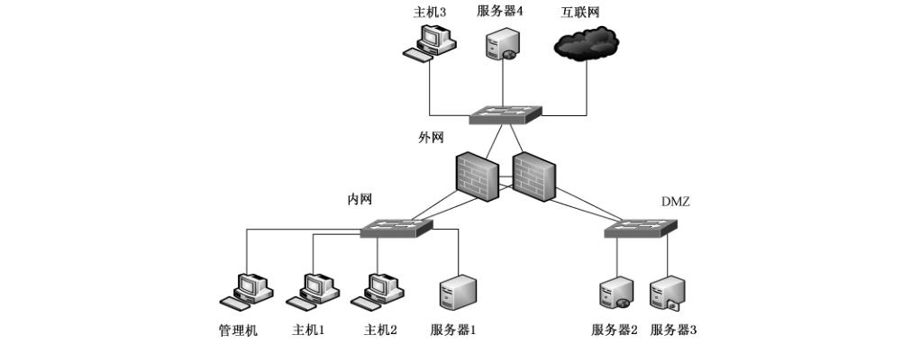
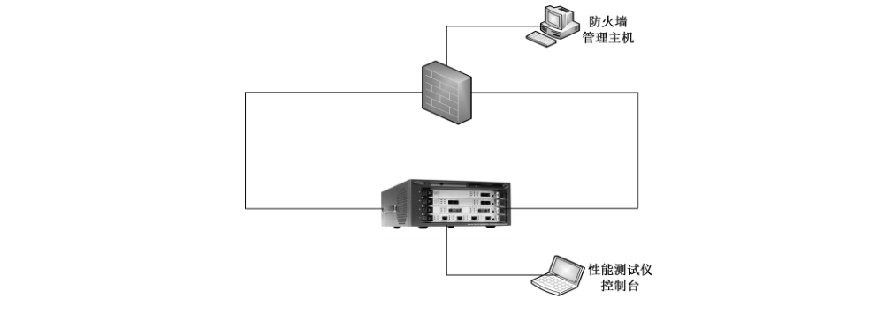

# GB/T 20281-2020 信息安全技术 防火墙安全技术要求和测试评价方法

> 来源：[GB/T 20281-2020 国家标准详情](https://openstd.samr.gov.cn/bzgk/std/newGbInfo?hcno=DC339A62C32B0B5C64F567DD5F09EDE0)；封面发布日期：2020-04-28；实施日期：2020-11-01。
> PDF SHA-256：619eec845ae2e7c34f522121f196f9c3015b8efb51ebf19a02ffdf691f9f718d。
> 依据官方 PDF 全部 58 页的页面图像转写与校核；省略封面、目录、页眉、页脚和分页，合并跨页段落及表格。保留原条款编号、表格适用标记和原文写法，两幅测评环境示意图保留为原页图像。

## 前言

本标准按照 GB/T 1.1—2009给出的规则起草。

本标准代替 GB/T 20010—2005《信息安全技术 包过滤防火墙评估准则》、GB/T 20281—2015《信息安全技术 防火墙安全技术要求和测试评价方法》、GB/T 31505—2015《信息安全技术 主机型防火墙安全技术要求和测试评价方法》、GB/T 32917—2016《信息安全技术 WEB 应用防火墙安全技术要求与测试评价方法》。本标准以 GB/T 20281—2015 为主，整合了 GB/T 20010—2005、GB/T 31505—2015 和 GB/T 32917—2016 的部分内容，与 GB/T 20281—2015 相比，除编辑性修改外主要技术变化如下：

- 增加了网络型防火墙、数据库防火墙、WEB 应用防火墙和主机型防火墙的定义（见第 3 章）；
- 修改了概述（见第 5 章，2015 年版的第 5 章）；
- 增加了“设备虚拟化”要求（见 6.1.1.4）；
- 修改了“应用内容控制”的要求（见 6.1.3.3，2015 年版的 6.2.1.2、6.3.1.2）；
- 增加了“攻击防护”的要求（见 6.1.4）；
- 增加了“安全审计与分析”的要求（见 6.1.5）；
- 增加了“混合应用层吞吐量”“HTTP 吞吐量”“HTTP 请求速率”“SQL 请求速率”“HTTP 并发连接数”“SQL 并发连接数”性能要求（见 6.3.1.2、6.3.1.3、6.3.3.2、6.3.3.3、6.3.4.2、6.3.4.3）；
- 增加了规范性附录（见附录 A、附录 B）。

请注意本文件的某些内容可能涉及专利。本文件的发布机构不承担识别这些专利的责任。

本标准由全国信息安全标准化技术委员会（SAC/TC 260）提出并归口。

本标准起草单位：公安部第三研究所、奇安信科技集团股份有限公司、北京天融信网络安全技术有限公司、网神信息技术（北京）股份有限公司、北京神州绿盟科技有限公司、杭州美创科技有限公司、北京网康科技有限公司、中国信息安全研究院有限公司、中国电子技术标准化研究院、中国网络安全审查技术与认证中心、中国信息安全测评中心、国家计算机网络与信息安全管理中心、北京安华金和科技有限公司、深信服科技股份有限公司、启明星辰信息技术集团股份有限公司、沈阳东软系统集成工程有限公司、新华三技术有限公司、蓝盾信息安全技术股份有限公司、北京中安星云软件技术有限公司、上海上讯信息技术股份有限公司。

本标准主要起草人：俞优、王志佳、邹春明、陆臻、沈亮、陆磊、顾健、吴云坤、熊瑛、雷晓锋、叶晓虎、周杰、王伟、陈华平、吴亚东、谢建业、王猛、谌德俊、潘云、申永波、杨晨、王晖。

本标准所代替标准的历次版本发布情况为：

- GB/T 20010—2005；
- GB/T 20281—2006、GB/T 20281—2015；
- GB/T 31505—2015；
- GB/T 32917—2016。

## 1 范围

本标准规定了防火墙的等级划分、安全技术要求及测评方法。

本标准适用于防火墙的设计、开发与测试。

## 2 规范性引用文件

下列文件对于本文件的应用是必不可少的。凡是注日期的引用文件，仅注日期的版本适用于本文件。凡是不注日期的引用文件，其最新版本（包括所有的修改单）适用于本文件。

- GB/T 18336.3—2015 信息技术 安全技术 信息技术安全评估准则 第3部分：安全保障组件

- GB/T 25069—2010 信息安全技术 术语

## 3 术语和定义

GB/T 25069—2010 界定的以及下列术语和定义适用于本文件。

### 3.1 防火墙 firewall

对经过的数据流进行解析，并实现访问控制及安全防护功能的网络安全产品。

> 注：根据安全目的、实现原理的不同，通常可分为网络型防火墙、WEB 应用防火墙、数据库防火墙和主机型防火墙等。

### 3.2 网络型防火墙 network-based firewall

部署于不同安全域之间，对经过的数据流进行解析，具备网络层、应用层访问控制及安全防护功能的网络安全产品。

### 3.3 WEB 应用防火墙 web application firewall

部署于 WEB 服务器前端，对流经的 HTTP/HTTPS 访问和响应数据进行解析，具备 WEB 应用的访问控制及安全防护功能的网络安全产品。

### 3.4 数据库防火墙 database firewall

部署于数据库服务器前端，对流经的数据库访问和响应数据进行解析，具备数据库的访问控制及安全防护功能的网络安全产品。

### 3.5 主机型防火墙 host-based firewall

部署于计算机（包括个人计算机和服务器）上，提供网络层访问控制、应用程序访问限制和攻击防护功能的网络安全产品。

### 3.6 反向代理 reverse proxy

作为服务器端的代理使用，代替服务器接受来自客户端的请求，然后将请求转发给内部服务器，并将从服务器上得到的结果返回给请求客户端的一种部署模式。

### 3.7 拖库攻击 drag attack

通过非授权获得数据库访问或数据库所在操作系统的权限，批量下载数据库中数据或数据库数据文件的恶意行为。

### 3.8 撞库攻击 account credential enumeration attack

批量尝试碰撞数据库数据的恶意行为。

> 注：如通过收集已泄露、已知的用户和密码信息，生成对应的字典表，并以此批量尝试登录其他的应用系统。

## 4 缩略语

下列缩略语适用于本文件。

| 缩略语 | 中文名称 | 英文名称 |
| --- | --- | --- |
| BGP | 边界网关协议 | Border Gateway Protocol |
| CSRF | 跨站请求伪造 | Cross-site request forgery |
| DMZ | 非军事化区 | Demilitarized Zone |
| DNAT | 目的网络地址转换 | Destination NAT |
| FTP | 文件传输协议 | File Transfer Protocol |
| HTTP | 超文本传输协议 | Hypertext Transfer Protocol |
| HTTPS | 安全超文本传输协议 | Hypertext Transfer Protocol over Secure Socket Layer |
| ICMP | 网间控制报文协议 | Internet Control Messages Protocol |
| IMAP | 互联网邮件访问协议 | Internet Mail Access Protocol |
| IP | 网际协议 | Internet Protocol |
| IPv6 | 互联网协议第六版 | Internet Protocol V6 |
| ISATAP | 站内自动隧道寻址协议 | Intra-Site Automatic Tunnel Addressing Protocol |
| MAC | 介质访问控制 | Media Access Control |
| NAT | 网络地址转换 | Network Address Translation |
| NTP | 网络时间协议 | Network Time Protocol |
| OSPF | 开放式最短路径优先 | Open Shortest Path First |
| P2P | 对等网络 | Peer-to-peer |
| RIP | 路由信息协议 | Routing Information Protocol |
| SNAT | 源网络地址转换 | Source NAT |
| SNMP | 简单网络管理协议 | Simple Network Management Protocol |
| SQL | 结构化查询语言 | Structured Query Language |
| SYSLOG | 系统日志 | System Log |
| URL | 统一资源定位器 | Uniform Resource Locator |
| WEB | 万维网 | World Wide WEB |
| XSS | 跨站脚本 | Cross Site Scripting |

## 5 概述

防火墙是作用于不同安全域之间，具备访问控制及安全防护功能的网络安全产品，主要分为网络型防火墙、WEB 应用防火墙、数据库防火墙、主机型防火墙或其组合。

防火墙的安全技术要求分为安全功能要求、自身安全要求、性能要求和安全保障要求四个大类。其中，安全功能要求对防火墙应具备的安全功能提出具体要求，包括组网与部署、网络层控制、应用层控制、攻击防护和安全审计与分析；自身安全要求针对防火墙的自身安全提出具体的要求，包括身份标识与鉴别、管理能力、管理审计、管理方式和安全支撑系统；性能要求则是对防火墙应达到的性能指标作出规定，包括吞吐量、延迟、连接速率和并发连接数；安全保障要求针对防火墙的生命周期过程提出具体要求，包括开发、指导性文档、生命周期支持、测试和脆弱性评定。

防火墙的等级分为基本级和增强级，安全功能与自身安全的强弱以及安全保障要求的高低是等级划分的具体依据，等级突出安全特性。其中，基本级产品的安全保障要求内容对应 GB/T 18336.3—2015 的 EAL2 级，增强级产品的安全保障要求内容对应 GB/T 18336.3—2015 的 EAL4＋级。各类防火墙（简称“产品”）的具体安全技术要求和等级划分详见附录 A，测评方法及等级划分详见附录 B。

## 6 安全技术要求

### 6.1 安全功能要求

#### 6.1.1 组网与部署

##### 6.1.1.1 部署模式

产品应支持以下部署模式：

a） 透明传输模式；

b） 路由转发模式；

c） 反向代理模式。

##### 6.1.1.2 路由

###### 6.1.1.2.1 静态路由

产品应支持静态路由功能，且能配置静态路由。

###### 6.1.1.2.2 策略路由

具有多个相同属性网络接口（多个外部网络接口、多个内部网络接口或多个 DMZ 网络接口）的产品，应支持策略路由功能，包括但不限于：

a） 基于源、目的IP策略路由；

b） 基于接口的策略路由；

c） 基于协议和端口的策略路由；

d） 基于应用类型的策略路由；

e） 基于多链路负载情况自动选择路由。

###### 6.1.1.2.3 动态路由

产品应支持动态路由功能，包括 RIP、OSPF 或BGP中一种或多种动态路由协议。

##### 6.1.1.3 高可用性

###### 6.1.1.3.1 冗余部署

产品应支持“主-备”、“主-主”或“集群”中的一种或多种冗余部署模式。

###### 6.1.1.3.2 负载均衡

产品应支持负载均衡功能，能根据安全策略将网络流量均衡到多台服务器上。

##### 6.1.1.4 设备虚拟化（可选）

###### 6.1.1.4.1 虚拟系统

若产品支持在逻辑上划分为多个虚拟子系统，虚拟子系统间应支持隔离和独立管理，包括但不限于：

a） 对虚拟子系统分别设置管理员，实现针对虚拟子系统的管理配置；

b） 虚拟子系统能分别维护路由表、安全策略和日志系统；

c） 对虚拟子系统的资源使用配额进行限制。

###### 6.1.1.4.2 虚拟化部署

若产品为虚拟化形态，应支持部署于虚拟化平台，并接受平台统一管理，包括但不限于：

a） 支持部署于一种虚拟化平台，如 VMware ESXi、KVM、Citrix Xenserver 和 Hyper-V 等；

b） 结合虚拟化平台实现产品资源弹性伸缩，根据虚拟化产品的负载情况动态调整资源；

c） 结合虚拟化平台实现故障迁移，当虚拟化产品出现故障时能实现自动更新、替换。

##### 6.1.1.5 IPv6 支持（可选）

###### 6.1.1.5.1 支持 IPv6 网络环境

若产品支持IPv6，应支持在IPv6 网络环境下正常工作，能有效运行其安全功能和自身安全功能。

###### 6.1.1.5.2 协议一致性

若产品支持IPv6，应满足 IPv6 协议一致性的要求，至少包括 IPv6 核心协议、IPv6 NDP 协议、IPv6 Autoconfig 协议和 ICMPv6 协议。

###### 6.1.1.5.3 协议健壮性

若产品支持IPv6，应满足IPv6协议健壮性的要求，抵御IPv6网络环境下畸形协议报文攻击。

###### 6.1.1.5.4 支持IPv6过渡网络环境

若产品支持 IPv6，应支持在以下一种或多种IPv6 过渡网络环境下工作：

a） 协议转换，将IPv4 和 IPv6 两种协议相互转换；

b）隧道，将IPv6 封装在IPv4 中穿越IPv4 网络，如 IPv6 over IPv4、IPv6 to IPv4、ISATAP等。

#### 6.1.2 网络层控制

##### 6.1.2.1 访问控制

###### 6.1.2.1.1 包过滤

产品的包过滤功能要求如下：

a） 安全策略应使用最小安全原则，即除非明确允许，否则就禁止；

b） 安全策略应包含基于源IP 地址、目的IP地址的访问控制；

c） 安全策略应包含基于源端口、目的端口的访问控制；

d） 安全策略应包含基于协议类型的访问控制；

e） 安全策略应包含基于 MAC地址的访问控制；

f） 安全策略应包含基于时间的访问控制；

g） 应支持用户自定义的安全策略，安全策略包括 MAC地址、IP地址、端口、协议类型和时间的部分或全部组合。

###### 6.1.2.1.2 网络地址转换

产品的网络地址转换功能要求如下：

a） 支持 SNAT 和 DNAT；

b） SNAT 应实现“多对一”地址转换，使得内部网络主机访问外部网络时，其源 IP 地址被转换；

c） DNAT应实现“一对多”地址转换，将 DMZ 的IP地址/端口映射为外部网络合法IP 地址/端口，使外部网络主机通过访问映射地址和端口实现对 DMZ服务器的访问；

d） 支持动态 SNAT 技术，实现“多对多”的SNAT。

###### 6.1.2.1.3 状态检测

产品应支持基于状态检测技术的包过滤功能，具备状态检测能力。

###### 6.1.2.1.4 动态开放端口

产品应支持协议的动态端口开放，包括但不限于：

a） FTP协议；

b） H.323等音视频协议。

###### 6.1.2.1.5 IP/MAC地址绑定

产品应支持自动或手工绑定 IP/MAC地址，当主机的IP地址、MAC地址与IP/MAC绑定表中不一致时，阻止其流量通过。

##### 6.1.2.2 流量管理

###### 6.1.2.2.1 带宽管理

产品应支持带宽管理功能，能根据策略调整客户端占用的带宽，包括但不限于：

a） 根据源IP、目的IP、应用类型和时间段的流量速率或总额进行限制；

b） 根据源IP、目的IP、应用类型和时间段设置保障带宽；

c） 在网络空闲时自动解除流量限制，并在总带宽占用率超过阈值时自动启用限制。

###### 6.1.2.2.2 连接数控制

产品应支持限制单 IP 的最大并发会话数和新建连接速率，防止大量非法连接产生时影响网络性能。

###### 6.1.2.2.3 会话管理

在会话处于非活跃状态一定时间或会话结束后，产品应终止会话。

#### 6.1.3 应用层控制

##### 6.1.3.1 用户管控

产品应支持基于用户认证的网络访问控制功能，包括但不限于：

a） 本地用户认证方式；

b） 结合第三方认证系统，如基于 Radius、LDAP服务器的认证方式。

##### 6.1.3.2 应用类型控制

产品应支持根据应用特征识别并控制各种应用类型，包括：

a） HTTP 协议；

b） 数据库协议；

c） FTP、TELNET、SMTP、POP3 和 IMAP 等常见协议；

d） 即时聊天类、P2P类、网络流媒体类、网络游戏、股票交易类等应用；

e） 逃逸或隧道加密特点的应用，如加密代理类应用；

f） 自定义应用。

##### 6.1.3.3 应用内容控制

###### 6.1.3.3.1 WEB 应用

产品应支持基于以下内容对 WEB应用的访问进行控制，包括但不限于：

a） URL 网址，并具备分类网址库；

b） HTTP 传输内容的关键字；

c） HTTP 请求方式，包括 GET、POST、PUT、HEAD 等；

d） HTTP 请求文件类型；

e） HTTP 协议头中各字段长度，包括 general-header、request-header、response-header 等；

f） HTTP上传文件类型；

g） HTTP 请求频率；

h） HTTP返回的响应内容，如服务器返回的出错信息等；

i） 支持 HTTPS流量解密。

###### 6.1.3.3.2 数据库应用

产品应支持基于以下内容对数据库的访问进行控制，包括但不限于：

a） 访问数据库的应用程序、运维工具；

b） 数据库用户名、数据库名、数据表名和数据字段名；

c） SQL 语句关键字、数据库返回内容关键字；

d）影响行数、返回行数。

###### 6.1.3.3.3 其他应用

产品应支持基于以下内容对 FTP、TELNET、SMTP、POP3 和 IMAP 等应用进行控制，包括但不限于：

a） 传输文件类型；

b）传输内容，如协议命令或关键字。

#### 6.1.4 攻击防护

##### 6.1.4.1 拒绝服务攻击防护

产品具备特征库，应支持拒绝服务攻击防护功能，包括但不限于：

a） ICMP Flood 攻击防护；

b） UDP Flood 攻击防护；

c） SYN Flood 攻击防护；

d） TearDrop 攻击防护；

e） Land 攻击防护；

f） Ping of Death 攻击防护；

g） CC攻击防护。

##### 6.1.4.2 WEB 攻击防护

产品具备特征库，应支持 WEB攻击防护功能，包括但不限于：

a） SQL 注入攻击防护；

b） XSS 攻击防护；

c） 第三方组件漏洞攻击防护；

d） 目录遍历攻击防护；

e） Cookie 注入攻击防护；

f） CSRF 攻击防护；

g） 文件包含攻击防护；

h） 盗链防护；

i） OS 命令注入攻击防护；

j） WEBshell 识别和拦截；

k） 反序列化攻击防护。

##### 6.1.4.3 数据库攻击防护

产品具备特征库，应支持数据库攻击防护功能，包括但不限于：

a） 数据库漏洞攻击防护；

b） 异常 SQL 语句阻断；

c） 数据库拖库攻击防护；

d） 数据库撞库攻击防护。

##### 6.1.4.4 恶意代码防护

产品具备特征库，应支持恶意代码防护功能，包括但不限于：

a） 能拦截典型的木马攻击行为；

b） 检测并拦截被 HTTP 网页和电子邮件等携带的恶意代码。

##### 6.1.4.5 其他应用攻击防护

产品具备特征库，应支持防护来自应用层的其他攻击，包括但不限于：

a） 操作系统类漏洞攻击防护；

b） 中间件类漏洞攻击防护；

c） 控件类漏洞攻击防护。

##### 6.1.4.6 自动化工具威胁防护

产品具备特征库，应支持防护自动化工具发起的攻击，包括但不限于：

a） 网络扫描行为防护；

b） 应用扫描行为防护；

c） 漏洞利用工具防护。

##### 6.1.4.7 攻击逃逸防护

产品应支持检测并阻断经逃逸技术处理过的攻击行为。

##### 6.1.4.8 外部系统协同防护

产品应提供联动接口，能通过接口与其他网络安全产品进行联动，如执行其他网络安全产品下发的安全策略等。

#### 6.1.5 安全审计、告警与统计

##### 6.1.5.1 安全审计

产品应支持安全审计功能，包括但不限于：

a） 记录事件类型：

1） 被产品安全策略匹配的访问请求；

2） 检测到的攻击行为。

b） 日志内容：

1） 事件发生的日期和时间；

2） 事件发生的主体、客体和描述，其中数据包日志包括协议类型、源地址、目标地址、源端口和目标端口等；

3） 攻击事件的描述。

c） 日志管理：

1） 仅允许授权管理员访问日志，并提供日志查阅、导出等功能；

2） 能对审计事件按日期、时间、主体、客体等条件查询；

3） 日志存储于掉电非易失性存储介质中；

4） 日志存储周期设定不小于六个月；

5） 存储空间达到阈值时，能通知授权管理员，并确保审计功能的正常运行；

6） 日志支持自动化备份至其他存储设备。

##### 6.1.5.2 安全告警

产品应支持对6.1.4中的攻击行为进行告警，并能对高频发生的相同告警事件进行合并告警，避免出现告警风暴。告警信息至少包括以下内容：

a） 事件主体；

b） 事件客体；

c） 事件描述；

d） 危害级别；

e） 事件发生的日期和时间。

##### 6.1.5.3 统计

###### 6.1.5.3.1 网络流量统计

产品应支持以图形化界面展示网络流量情况，包括但不限于：

a） 按照IP、时间段和协议类型等条件或以上条件组合对网络流量进行统计；

b） 实时或以报表形式输出统计结果。

###### 6.1.5.3.2 应用流量统计

产品应支持以图形化界面展示应用流量情况，包括但不限于：

a） 按照IP、时间段和应用类型等条件或以上条件组合对应用流量进行统计；

b） 以报表形式输出统计结果；

c） 对不同时间段的统计结果进行比对。

###### 6.1.5.3.3 攻击事件统计

产品应支持以图形化界面展示攻击事件情况，包括但不限于：

a） 按照攻击事件类型、IP 和时间段等条件或以上条件组合对攻击事件进行统计；

b） 以报表形式输出统计结果。

### 6.2 自身安全要求

#### 6.2.1 身份标识与鉴别

产品的身份标识与鉴别安全要求包括但不限于：

a） 对用户身份进行标识和鉴别，身份标识具有唯一性；

b） 对用户身份鉴别信息进行安全保护，保障用户鉴别信息存储和传输过程中的保密性；

c） 具有登录失败处理功能，如限制连续的非法登录尝试次数等相关措施；

d） 具有登录超时处理功能，当登录连接超时自动退出；

e） 在采用基于口令的身份鉴别时，要求对用户设置的口令进行复杂度检查，确保用户口令满足一定的复杂度要求；

f） 当产品中存在默认口令时，提示用户对默认口令进行修改，以减少用户身份被冒用的风险；

g） 应对授权管理员选择两种或两种以上组合的鉴别技术进行身份鉴别。

#### 6.2.2 管理能力

产品的管理能力安全要求包括但不限于：

a） 向授权管理员提供设置和修改安全管理相关的数据参数的功能；

b） 向授权管理员提供设置、查询和修改各种安全策略的功能；

c） 向授权管理员提供管理审计日志的功能；

d） 支持更新自身系统的能力，包括对软件系统的升级以及各种特征库的升级；

e） 能从 NTP 服务器同步系统时间；

f） 支持通过SYSLOG 协议向日志服务器同步日志、告警等信息；

g） 应区分管理员角色，能划分为系统管理员、安全操作员和安全审计员，三类管理员角色权限能相互制约；

h） 提供安全策略有效性检查功能，如安全策略匹配情况检测等。

#### 6.2.3 管理审计

产品的管理审计安全要求包括但不限于：

a） 对用户账户的登录和注销、系统启动、重要配置变更、增加/删除/修改管理员、保存/删除审计日志等操作行为进行日志记录；

b） 对产品及其模块的异常状态进行告警，并记录日志；

c） 日志记录中包括如下内容：事件发生的日期和时间，事件的类型，事件主体，事件操作结果；

d） 仅允许授权管理员访问日志。

#### 6.2.4 管理方式

产品的管理方式安全要求包括但不限于：

a） 支持通过 console 端口进行本地管理；

b） 支持通过网络接口进行远程管理，并能限定进行远程管理的IP、MAC地址；

c） 远程管理过程中，管理端与产品之间的所有通信数据应非明文传输；

d） 支持 SNMP 网管协议方式的监控和管理；

e） 支持管理接口与业务接口分离；

f） 支持集中管理，通过集中管理平台实现监控运行状态、下发安全策略、升级系统版本、升级特征库版本。

#### 6.2.5 安全支撑系统

产品的支撑系统安全要求包括但不限于：

a） 进行必要的裁剪，不提供多余的组件或网络服务；

b） 重启过程中，安全策略和日志信息不丢失；

c） 不含已知中、高风险安全漏洞。

### 6.3 性能要求

#### 6.3.1 吞吐量

##### 6.3.1.1 网络层吞吐量

硬件产品的网络层吞吐量视不同速率的产品有所不同，具体指标要求如下：

a） 一对相应速率的端口应达到的双向吞吐率指标：

1） 对于64字节短包，百兆产品不小于线速的20%，千兆和万兆产品不小于线速的35%；

2） 对于512字节中长包，百兆产品不小于线速的70%，千兆和万兆产品不小于线速的80%；

3） 对于1518字节长包，百兆产品不小于线速的90%，千兆和万兆产品不小于线速的95%；

b） 针对高性能的万兆产品，对于1 518字节长包，吞吐量至少达到80 Gbit/s。

##### 6.3.1.2 混合应用层吞吐量

硬件产品的应用层吞吐量视不同速率的产品有所不同，开启应用攻击防护功能的情况下，具体指标要求如下：

a） 百兆产品混合应用层吞吐量应不小于 60 Mbit/s；

b） 千兆产品混合应用层吞吐量应不小于 600 Mbit/s；

c） 万兆产品混合应用层吞吐量应不小于5 Gbit/s；针对高性能的万兆产品，整机混合应用层吞吐量至少达到 20 Gbit/s。

##### 6.3.1.3 HTTP 吞吐量

硬件产品的 HTTP 吞吐量视不同速率的产品有所不同，开启 WEB攻击防护功能的情况下，具体指标要求如下：

a） 百兆产品应用层吞吐量应不小于80 Mbit/s；

b）千兆产品应用层吞吐量应不小于 800 Mbit/s；

c） 万兆产品应用层吞吐量应不小于6 Gbit/s。

#### 6.3.2 延迟

硬件产品的延迟视不同速率的产品有所不同，一对相应速率端口的延迟具体指标要求如下：

a） 对于 64 字节短包、512 字节中长包、1 518 字节长包，百兆产品的平均延迟不应超过 500 μs；

b） 对于 64 字节短包、512 字节中长包、1 518 字节长包，千兆、万兆产品的平均延迟不应超过 90 μs。

#### 6.3.3 连接速率

##### 6.3.3.1 TCP 新建连接速率

硬件产品的TCP新建连接速率视不同速率的产品有所不同，具体指标要求如下：

a） 百兆产品的TCP 新建连接速率应不小于1 500个/s；

b） 千兆产品的 TCP新建连接速率应不小于5 000个/s；

c） 万兆产品的新建连接数速率应不小于50000个/s；针对高性能的万兆产品，整机新建连接数速率应不小于 250 000个/s。

##### 6.3.3.2 HTTP 请求速率

硬件产品的 HTTP 请求速率视不同速率的产品有所不同，具体指标要求如下：

a） 百兆产品的 HTTP 请求速率应不小于 800个/s；

b） 千兆产品的 HTTP 请求速率应不小于3000个/s；

c） 万兆产品的 HTTP 请求速率应不小于5 000个/s。

##### 6.3.3.3 SQL 请求速率

硬件产品的 SQL 请求速率视不同速率的产品有所不同，具体指标要求如下：

a） 百兆产品的 SQL 请求速率应不小于 2 000 个/s；

b）千兆产品的 SQL 请求速率应不小于 10 000个/s；

c） 万兆产品的 SQL 请求速率应不小于 50 000个/s。

#### 6.3.4 并发连接数

##### 6.3.4.1 TCP 并发连接数

硬件产品的 TCP并发连接数视不同速率的产品有所不同，具体指标要求如下：

a） 百兆产品的并发连接数应不小于50 000个；

b） 千兆产品的并发连接数应不小于 200 000 个；

c） 万兆产品的并发连接数应不小于 2 000 000 个；针对高性能的万兆产品，整机并发连接数至少达到 3 000 000 个。

##### 6.3.4.2 HTTP 并发连接数

硬件产品的 HTTP 并发连接数视不同速率的产品有所不同，具体指标要求如下：

a） 百兆产品的HTTP 并发连接数应不小于 50 000个；

b） 千兆产品的HTTP 并发连接数应不小于200 000个；

c） 万兆产品的 HTTP 并发连接数应不小于 2 000 000 个。

##### 6.3.4.3 SQL 并发连接数

硬件产品的 SQL 并发连接数视不同速率的产品有所不同，具体指标要求如下：

a） 百兆产品的SQL并发连接数应不小于800个；

b） 千兆产品的 SQL 并发连接数应不小于 2 000 个；

c） 万兆产品的 SQL 并发连接数应不小于4000个。

### 6.4 安全保障要求

#### 6.4.1 开发

##### 6.4.1.1 安全架构

开发者应提供产品安全功能的安全架构描述，安全架构描述应满足以下要求：

a） 与产品设计文档中对安全功能的描述范围相一致；

b） 充分描述产品采取的自我保护、不可旁路的安全机制。

##### 6.4.1.2 功能规范

开发者应提供完备的功能规范说明，功能规范说明应满足以下要求：

a） 根据产品类型清晰描述 6.1、6.2中定义的安全功能；

b） 标识和描述产品所有安全功能接口的目的、使用方法及相关参数；

c） 描述安全功能实施过程中，与安全功能接口相关的所有行为；

d） 描述可能由安全功能接口的调用而引起的所有直接错误消息。

##### 6.4.1.3 产品设计

开发者应提供产品设计文档，产品设计文档应满足以下要求：

a） 通过子系统描述产品结构，标识和描述产品安全功能的所有子系统，并描述子系统间的相互作用；

b） 提供子系统和安全功能接口间的对应关系；

c） 通过实现模块描述安全功能，标识和描述实现模块的目的、相关接口及返回值等，并描述实现模块间的相互作用及调用的接口；

d） 提供实现模块和子系统间的对应关系。

##### 6.4.1.4 实现表示

开发者应提供产品安全功能的实现表示，实现表示应满足以下要求：

a） 详细定义产品安全功能，包括软件代码、设计数据等实例；

b） 提供实现表示与产品设计描述间的对应关系。

#### 6.4.2 指导性文档

##### 6.4.2.1 操作用户指南

开发者应提供明确和合理的操作用户指南，对每一种用户角色的描述应满足以下要求：

a） 描述用户能访问的功能和特权，包含适当的警示信息；

b） 描述产品安全功能及接口的用户操作方法，包括配置参数的安全值等；

c） 标识和描述产品运行的所有可能状态，包括操作导致的失败或者操作性错误；

d） 描述实现产品安全目的必需执行的安全策略。

##### 6.4.2.2 准备程序

开发者应提供产品及其准备程序，准备程序描述应满足以下要求：

a） 描述与开发者交付程序相一致的安全接收所交付产品必需的所有步骤；

b）描述安全安装产品及其运行环境必需的所有步骤。

#### 6.4.3 生命周期支持

##### 6.4.3.1 配置管理能力

开发者的配置管理能力应满足以下要求：

a） 为产品的不同版本提供唯一的标识；

b） 使用配置管理系统对组成产品的所有配置项进行维护，并进行唯一标识；

c） 提供配置管理文档，配置管理文档描述用于唯一标识配置项的方法；

d） 配置管理系统提供自动方式来支持产品的生成，通过自动化措施确保配置项仅接受授权变更；

e） 配置管理文档包括一个配置管理计划，描述用来接受修改过的或新建的作为产品组成部分的配置项的程序。配置管理计划描述应描述如何使用配置管理系统开发产品，开发者实施的配置管理应与配置管理计划相一致。

##### 6.4.3.2 配置管理范围

开发者应提供产品配置项列表，并说明配置项的开发者。配置项列表应包含以下内容：

a） 产品及其组成部分、安全保障要求的评估证据；

b） 实现表示、安全缺陷报告及其解决状态。

##### 6.4.3.3 交付程序

开发者应使用一定的交付程序交付产品，并将交付过程文档化。在给用户方交付产品的各版本时，交付文档应描述为维护安全所必需的所有程序。

##### 6.4.3.4 开发安全

开发者应提供开发安全文档。开发安全文档应描述在产品的开发环境中，为保护产品设计和实现的保密性和完整性所必需的所有物理的、程序的、人员的和其他方面的安全措施。

##### 6.4.3.5 生命周期定义

开发者应建立一个生命周期模型对产品的开发和维护进行的必要控制，并提供生命周期定义文档描述用于开发和维护产品的模型。

##### 6.4.3.6 工具和技术

开发者应明确定义用于开发产品的工具，并提供开发工具文档无歧义地定义实现中每个语句的含义和所有依赖于实现的选项的含义。

#### 6.4.4 测试

##### 6.4.4.1 测试覆盖

开发者应提供测试覆盖文档，测试覆盖描述应满足以下要求：

a） 表明测试文档中所标识的测试与功能规范中所描述的产品的安全功能间的对应性；

b） 表明上述对应性是完备的，并证实功能规范中的所有安全功能接口都进行了测试。

##### 6.4.4.2 测试深度

开发者应提供测试深度的分析。测试深度分析描述应满足以下要求：

a） 证实测试文档中的测试与产品设计中的安全功能子系统和实现模块之间的一致性；

b） 证实产品设计中的所有安全功能子系统、实现模块都已经进行过测试。

##### 6.4.4.3 功能测试

开发者应测试产品安全功能，将结果文档化并提供测试文档。测试文档应包括以下内容：

a） 测试计划，标识要执行的测试，并描述执行每个测试的方案，这些方案包括对于其他测试结果的任何顺序依赖性；

b） 预期的测试结果，表明测试成功后的预期输出；

c） 实际测试结果和预期的测试结果的对比。

##### 6.4.4.4 独立测试

开发者应提供一组与其自测安全功能时使用的同等资源，以用于安全功能的抽样测试。

#### 6.4.5 脆弱性评定

基于已标识的潜在脆弱性，产品能抵抗以下强度的攻击：

a） 具有基本攻击潜力的攻击者的攻击；

b） 具有中等攻击潜力的攻击者的攻击。

## 7 测评方法

### 7.1 测评环境

#### 7.1.1 安全功能与自身安全测评环境

安全功能及自身安全测评典型环境见图1。

#### 7.1.2 性能测评环境

性能测评典型环境见图2，采用专用性能测试仪，测试仪接口直接通过网线连接防火墙业务接口。

### 7.2 安全功能测评

#### 7.2.1 组网与部署

##### 7.2.1.1 部署模式

部署模式的测评方法如下：

a） 测评方法：

1） 将产品配置为透明传输模式，并配置相关安全策略；

2） 将产品配置为路由转发模式，并配置相关安全策略；

3） 将产品配置为反向代理模式，并配置相关安全策略。

b） 预期结果：

1） 透明传输模式下，安全策略生效；

2） 路由转发模式下，安全策略生效；

3） 反向代理模式下，安全策略生效。

c） 结果判定：实际测评结果与相关预期结果一致则判定为符合，其他情况判定为不符合。

##### 7.2.1.2 路由

###### 7.2.1.2.1 静态路由

静态路由的测评方法如下：

a） 测评方法：

1） 在产品设置一条静态路由；

2） 向产品发送匹配上述路由策略的数据包。

b） 预期结果：

1） 产品支持设置静态路由；

2） 产品将匹配策略的数据包按照路由策略转发。

c） 结果判定：实际测评结果与相关预期结果一致则判定为符合，其他情况判定为不符合。

###### 7.2.1.2.2 策略路由

策略路由的测评方法如下：

a） 测评方法：

1） 在产品设置一条基于源、目的IP 的策略路由，向产品发送匹配上述路由策略的数据包；

2） 在产品设置一条基于接口的策略路由，向产品发送匹配上述路由策略的数据包；

3） 在产品设置一条基于协议和端口的策略路由，向产品发送匹配上述路由策略的数据包；

4） 在产品设置一条基于应用类型的策略路由，向产品发送匹配上述路由策略的数据包；

5） 针对某一目标地址在产品部署多条路由，设置一条根据多链路负载情况自动选路的策略路由，改变各链路的负载情况。

b） 预期结果：

1） 产品支持设置基于源、目的IP 的策略路由，匹配策略数据包的路由与策略设置一致；

2） 产品支持设置基于接口的策略路由，匹配策略数据包的下一跳接口与策略设置一致；

3） 产品支持设置基于协议和端口的策略路由，匹配策略数据包的路由与策略设置一致；

4） 产品支持设置基于应用类型的策略路由，匹配策略数据包的路由与策略设置一致；

5） 产品支持设置基于多链路负载情况自动选路的策略路由，匹配策略数据包的路由与策略设置一致。

c） 结果判定：实际测评结果与相关预期结果一致则判定为符合，其他情况判定为不符合。

###### 7.2.1.2.3 动态路由

动态路由的测评方法如下：

a） 测评方法：

1） 在产品尝试开启 RIP 动态路由功能；

2） 改变各链路状态，验证 RIP 动态路由是否生效；

3） 在产品尝试开启 OSPF 动态路由功能；

4） 改变各链路状态，验证 OSPF 动态路由是否生效；

5） 在产品尝试开启 BGP 动态路由功能；

6） 改变各链路状态，验证 BGP 动态路由是否生效。

b） 预期结果：

1） 产品支持设置 RIP 动态路由功能；

2） 产品支持设置 OSPF 动态路由功能；

3） 产品支持设置 BGP 动态路由功能。

c） 结果判定：实际测评结果与相关预期结果一致则判定为符合，其他情况判定为不符合。

##### 7.2.1.3 高可用性

###### 7.2.1.3.1 冗余部署

冗余部署的测评方法如下：

a） 测评方法：

1） 设置两台产品为“主-备”模式；

2） 验证是否仅主产品处于工作状态；

3） 关闭主产品或使其断开网络连接，验证备产品是否能及时接管主产品进行工作，且不影响所在网络的通信和安全策略；

4） 设置两台产品为“主-主”模式；

5） 验证是否两台产品均处于工作状态；

6） 关闭一台产品或使其断开网络连接，验证另一台产品是否仍处于工作状态，且不影响所在网络的通信和安全策略；

7） 设置多台产品为“集群”模式；

8） 验证是否所有产品均处于工作状态；

9） 关闭一台产品或使其断开网络连接，验证其他产品是否仍处于工作状态，且不影响所在网络的通信和安全策略。

b） 预期结果：

1） 产品支持“主-备”模式部署，主产品发生故障时，能继续确保所在网络的通信和安全策略；

2） 产品支持“主-主”模式部署，其中一台产品发生故障时，能继续确保所在网络的通信和安全策略；

3） 产品支持“集群”模式部署，其中一台产品发生故障时，能继续确保所在网络的通信和安全策略。

c） 结果判定：实际测评结果与相关预期结果一致则判定为符合，其他情况判定为不符合。

###### 7.2.1.3.2 负载均衡

负载均衡的测评方法如下：

a） 测评方法：

1） 在产品 DMZ区设置服务器集群，设置外网访问 DMZ区服务器的负载均衡策略；

2） 在外网主机产生大量连接访问 DMZ 区服务器；

3） 在DMZ区使用协议分析仪观察网络流量，验证流量是否均衡到 DMZ区多台服务器上。

b） 预期结果：产品支持负载均衡功能，能将网络访问均衡到多台服务器上。

c） 结果判定：实际测评结果与相关预期结果一致则判定为符合，其他情况判定为不符合。

##### 7.2.1.4 设备虚拟化

###### 7.2.1.4.1 虚拟系统

虚拟系统的测评方法如下：

a） 测评方法：

1） 在产品设置多个子系统，并为各子系统分别设置管理员，验证管理员是否仅能对各自所属的子系统进行管理，不能对其他的子系统进行管理；

2） 为各子系统设置路由表、安全策略、生成日志，验证各子系统是否独立维护各自的路由表、安全策略、日志系统；

3） 各子系统设置资源使用配额，验证子系统是否不能使用超过配额的资源。

b） 预期结果：

1） 虚拟子系统能设置各自的管理员，实现针对本子系统的管理配置，不能配置管理其他子系统；

2） 虚拟子系统独立工作，各自维护路由表、安全策略、日志系统；

3） 能对虚拟子系统分配资源使用配额。

c） 结果判定：实际测评结果与相关预期结果一致则判定为符合，其他情况判定为不符合。

###### 7.2.1.4.2 虚拟化部署

虚拟化部署的测评方法如下：

a） 测评方法：

1） 分别尝试在 VMware ESXi、KVM、Citrix XenServer、Hyper-V 等虚拟化平台部署产品；

2） 增加网络流量、网络连接数等负载，验证虚拟化平台是否能根据产品负载情况动态调整虚拟化产品数量；

3） 模拟虚拟化产品发生故障，验证其是否能自动更新、替换。

b） 预期结果：

1） 支持部署于虚拟化平台中，支持 VMware ESXi、KVM、Citrix XenServer 或 Hyper-V等虚拟化平台中的一种；

2） 能在虚拟化平台上实现弹性伸缩，根据虚拟化产品的负载情况动态调整虚拟化产品数量；

3） 能在虚拟化平台上实现故障迁移，当虚拟化产品出现故障时实现自动更新、替换。

c） 结果判定：实际测评结果与相关预期结果一致则判定为符合，其他情况判定为不符合。

##### 7.2.1.5 IPv6支持

###### 7.2.1.5.1 支持 IPv6 网络环境

支持IPv6网络环境的测评方法如下：

a） 测评方法：

1） 模拟 IPv6 网络环境，验证产品及其安全功能是否能在 IPv6 网络环境下正常工作；

2） 模拟 IPv6 网络环境，验证产品是否支持在 IPv6网络环境下实现自身管理。

b） 预期结果：

1） 产品支持在纯 IPv6 网络环境下正常工作；

2） 产品支持在IPv6 网络环境下实现自身管理。

c） 结果判定：实际测评结果与相关预期结果一致则判定为符合，其他情况判定为不符合。

###### 7.2.1.5.2 协议一致性

协议一致性的测评方法如下：

a） 测评方法：

1） 在路由模式下，使用协议一致性测试工具，测试产品IPv6核心协议一致性情况；

2） 在路由模式下，测试产品 IPv6 NDP 协议一致性情况；

3） 在路由模式下，测试产品 IPv6 Autoconfig 协议一致性情况；

4） 在路由模式下，测试产品 ICMPv6协议一致性情况。

b） 预期结果：

1） 产品通过IPv6 核心协议一致性测试；

2） 产品通过IPv6 NDP 协议一致性测试；

3） 产品通过 IPv6 Autoconfig 协议一致性测试；

4） 产品通过ICMPv6协议一致性测试。

c） 结果判定：实际测评结果与相关预期结果一致则判定为符合，其他情况判定为不符合。

###### 7.2.1.5.3 协议健壮性

协议健壮性的测评方法如下：

a） 测评方法：

1） 使用协议健壮性测试工具向产品发送IPv6 畸形报文，验证产品是否能正常运行；

2） 向产品发送ICMPv6 畸形报文，验证产品是否能正常运行；

3） 向产品发送 TCP for IPv6 Server 畸形报文，验证产品是否能正常运行。

b） 预期结果：产品能抵御 IPv6、ICMPv6、TCP for IPv6 Server 等畸形报文攻击。

c） 结果判定：实际测评结果与相关预期结果一致则判定为符合，其他情况判定为不符合。

###### 7.2.1.5.4 支持 IPv6过渡网络环境

支持IPv6 过渡网络环境的测评方法如下：

a） 测评方法：

1） 在产品内网搭建IPv6 网络，在产品外网搭建IPv4 网络，验证产品是否能通过IPv4 和IPv6 协议转换的方式，使IPv6 内网正常访问 IPv4外网；

2） 在两台产品内网搭建IPv6 网络，在两台产品外网之间搭建 IPv6 over IPv4 隧道，验证两台产品的IPv6 内网是否能通过IPv6 over IPv4 隧道正常通信；在两台产品外网之间搭建IPv6 to IPv4隧道，验证两台产品的IPv6内网是否能通过IPv6 to IPv4 隧道正常通信；在IPv6 终端与产品之间搭建ISATAP隧道，验证 IPv6终端是否能通过ISATAP 隧道与产品通信。

b） 预期结果：

1） IPv4 和IPv6 协议转换环境下通信正常；

2） IPv6 over IPv4 隧道、IPv6 to IPv4隧道、ISATAP隧道中至少一种隧道环境通信正常。

c） 结果判定：实际测评结果与相关预期结果一致则判定为符合，其他情况判定为不符合。

#### 7.2.2 网络层控制

##### 7.2.2.1 访问控制

###### 7.2.2.1.1 包过滤

包过滤的测评方法如下：

a） 测评方法：

1） 初始化产品的包过滤策略，在各区域主机之间进行互访操作，检查产品的缺省安全策略是否为禁止；

2） 设置基于源IP 地址、目的IP地址的访问控制策略，产生相应的网络会话，验证策略是否生效；

3） 设置基于源端口、目的端口的访问控制策略，产生相应的网络会话，验证策略是否生效；

4） 设置基于协议类型的访问控制策略，产生相应的网络会话，验证策略是否生效；

5） 设置基于 MAC地址的访问控制策略，产生相应的网络会话，验证策略是否生效；

6） 设置基于时间的访问控制策略，产生相应的网络会话，验证策略是否生效；

7） 尝试设置一条基于 MAC 地址、IP 地址、端口、协议类型和时间的组合策略，产生相应的网络会话，验证策略是否生效。

b） 预期结果：

1） 产品的缺省安全策略是禁止；

2） 基于源 IP 地址、目的IP 地址的访问控制策略生效；

3） 基于源端口、目的端口的访问控制策略生效；

4） 基于协议类型的访问控制策略生效；

5） 基于 MAC 地址的访问控制策略生效；

6） 基于时间的访问控制策略生效；

7） 基于 MAC 地址、IP 地址、端口、协议类型和时间的组合策略生效。

c） 结果判定：实际测评结果与相关预期结果一致则判定为符合，其他情况判定为不符合。

###### 7.2.2.1.2 网络地址转换

网络地址转换的测评方法如下：

a） 测评方法：

1） 为内部网络用户访问外部网络主机配置 SNAT策略，在外网使用协议分析仪检查内网主机访问外网主机的源IP 地址是否被转换；为外部网络用户访问 DMZ服务器设置 DNAT策略，检查外部网络的主机能否通过转换后的地址访问 DMZ 的服务器；

2） 为内部网络用户访问外部网络主机配置“多对一”SNAT策略，在外网使用协议分析仪检查内网主机访问外网主机的源 IP 地址是否被转换，检查是否是多个地址被转换；

3） 为外部网络用户访问 DMZ服务器设置“一对多”DNAT 策略，检查外部网络的主机能否通过转换后的地址访问 DMZ的服务器，检查是否是多个地址被转换；

4） 为内部网络用户访问外部网络主机设置“多对多”SNAT策略，在外网使用协议分析仪检查内网主机访问外网主机的源IP 地址是否被转换，检查是否是多对多地址转换。

b） 预期结果：

1） 产品支持 SNAT 和 DNAT 地址转换；

2） 产品支持“多对一”SNAT 地址转换；

3） 产品支持“一对多”DNAT地址转换；

4） 产品支持“多对多”SNAT 地址转换。

c） 结果判定：实际测评结果与相关预期结果一致则判定为符合，其他情况判定为不符合。

###### 7.2.2.1.3 状态检测

状态检测的测评方法如下：

a） 测评方法：

1） 启动产品状态检测模块；

2） 配置包过滤策略，允许特定条件的网络会话通过产品；

3） 产生满足该策略的一个完整的网络会话，验证该会话是否能建立成功；

4） 产生满足该策略的网络会话中的不是第一个连接请求 SYN包的一个或多个数据包，清除产品状态检测表后，验证这些数据包是否被禁止。

b） 预期结果：

1） 产品依据状态表进行访问控制；

2） 满足包过滤策略的网络会话能通过产品；

3） 满足包过滤策略的网络会话中的不是第一个连接请求 SYN包的一个或多个数据包不能通过产品。

c） 结果判定：实际测评结果与相关预期结果一致则判定为符合，其他情况判定为不符合。

###### 7.2.2.1.4 动态开放端口

动态开放端口的测评方法如下：

a） 测评方法：

1） 设置产品动态开放端口策略，访问 FTP 服务，检查产品是否能放行 FTP 数据连接所使用的动态端口，网络会话是否连接正常；

2） 设置产品动态开放端口策略，使用支持 H.323等音视频协议的工具（如 NetMeeting）在内部网络和外部网络之间发起音视频会议，检查产品是否能放行所使用的动态端口，会议是否正常进行。

b） 预期结果：

1） FTP运行正常，FTP数据连接所使用的动态端口开放；

2） 音视频会议正常，H.323等音视频协议所使用的动态端口开放。

c） 结果判定：实际测评结果与相关预期结果一致则判定为符合，其他情况判定为不符合。

###### 7.2.2.1.5 IP/MAC地址绑定

IP/MAC地址绑定的测评方法如下：

a） 测评方法：

1） 为产品设置 IP/MAC 地址绑定策略；

2） 使用自动绑定或手工绑定功能将内部网络中主机的IP 与 MAC 地址绑定；

3） 分别产生正确 IP/MAC绑定的会话和盗用IP的会话，检查绑定的有效性。

b） 预期结果：

1） IP/MAC地址能自动或手工绑定；

2） IP/MAC 地址绑定后能正确执行安全策略，发现 IP 盗用行为。

c） 结果判定：实际测评结果与相关预期结果一致则判定为符合，其他情况判定为不符合。

##### 7.2.2.2 流量管理

###### 7.2.2.2.1 带宽管理

带宽管理的测评方法如下：

a） 测评方法：

1） 在产品设置基于源IP、目的IP、应用类型和时间段的流量策略，向产品发送匹配策略的流量，并使流量逐渐增大，直到流量由策略允许范围内达到超出策略范围；

2） 在产品设置基于源 IP、目的IP、应用类型和时间段的保障带宽策略，向产品发送匹配策略的流量，并使流量保持高于保障带宽，再向产品发送其他流量，尝试抢占上述流量使用的带宽；

3） 在产品设置总流量带宽限制策略，并在其中设置一条特定流量的带宽限制，分别在产品总流量带宽占用率达到阈值前后，验证上述特定流量带宽策略是否自动启停。

b） 预期结果：

1） 基于源 IP、目的IP、应用类型和时间段的流量速率或总额策略生效；

2） 基于源 IP、目的IP、应用类型和时间段的保障带宽策略生效；

3） 在网络空闲时自动解除流量限制，在带宽占用率超过阈值时自动启用流量限制。

c） 结果判定：实际测评结果与相关预期结果一致则判定为符合，其他情况判定为不符合。

###### 7.2.2.2.2 连接数控制

连接数控制的测评方法如下：

a） 测评方法：

1） 在产品针对某个 IP 设置TCP最大并发会话数，在上述IP 发起大量 TCP连接，使得上述IP 的并发连接数超过设定值；

2） 在产品针对某个 IP 设置 TCP最大新建连接速率，在上述IP 发起大量 TCP连接，使得上述IP的新建连接速率超过设定值。

b） 预期结果：

1） 超过最大连接数的连接无法建立；

2） 超过最大新建连接速率的连接无法建立。

c） 结果判定：实际测评结果与相关预期结果一致则判定为符合，其他情况判定为不符合。

###### 7.2.2.2.3 会话管理

会话管理的测评方法如下：

a） 测评方法：

1） 在产品设置会话超时时间；

2） 经过产品建立会话连接，并不再对该会话进操作，直到达到超时时间，验证上述会话是否被关闭。

b） 预期结果：

1） 产品能配置各协议的会话超时时间（或设置了默认值）；

2） 已连接会话在非活跃时间达到超时时限后，连接被产品自动关闭。

c） 结果判定：实际测评结果与相关预期结果一致则判定为符合，其他情况判定为不符合。

#### 7.2.3 应用层控制

##### 7.2.3.1 用户管控

用户管控的测评方法如下：

a） 测评方法：

1） 在产品本地添加用户，并设置基于本地用户认证的网络访问策略，产生匹配策略的会话请求，验证是否仅在用户认证成功后，会话才能建立；

2） 在产品配置 Radius、LDAP等第三方认证服务器，并设置基于第三方用户认证的网络访问策略，产生匹配策略的会话请求，验证是否仅在用户认证成功后，会话才能建立。

b） 预期结果：

1） 产品支持基于本地用户认证的网络访问控制功能；

2） 产品支持基于第三方认证的网络访问控制功能。

c） 结果判定：实际测评结果与相关预期结果一致则判定为符合，其他情况判定为不符合。

##### 7.2.3.2 应用类型控制

应用类型控制的测评方法如下：

a） 测评方法：

1） 在产品设置基于 HTTP 协议的访问控制策略，产生相应的网络会话，验证策略是否生效；

2） 在产品设置基于数据库协议的访问控制策略，产生相应的网络会话，验证策略是否生效；

3） 在产品设置基于 FTP、TELNET、SMTP、POP3 和 IMAP 等常见协议的访问控制策略，产生相应的网络会话，验证策略是否生效；

4） 在产品设置基于即时聊天类、P2P 类、网络流媒体类、网络游戏、股票交易类等应用的访问控制策略，产生相应的网络会话，验证策略是否生效；

5） 在产品设置基于逃逸或隧道加密特点的应用的访问控制策略，产生相应的网络会话，验证策略是否生效；

6） 在产品自定义应用，并设置基于自定义应用的访问控制策略，产生相应的网络会话，验证策略是否生效。

b） 预期结果：

1） 基于 HTTP 协议的访问控制策略生效；

2） 基于数据库协议的访问控制策略生效；

3） 基于 FTP、TELNET、SMTP、POP3和 IMAP 等常见协议的访问控制策略生效；

4） 基于即时聊天类、P2P 类、网络流媒体类、网络游戏、股票交易类等应用的访问控制策略生效；

5） 基于逃逸或隧道加密特点的应用的访问控制策略生效；

6） 支持自定义应用，基于自定义应用的访问控制策略生效。

c） 结果判定：实际测评结果与相关预期结果一致则判定为符合，其他情况判定为不符合。

##### 7.2.3.3 应用内容控制

###### 7.2.3.3.1 WEB 应用

WEB应用的测评方法如下：

a） 测评方法：

1） 在产品设置基于 URL 网址访问控制策略，经过产品访问相应 URL，验证策略是否生效，并验证是否具备分类网址库；

2） 在产品设置基于 HTTP 传输内容关键字的访问控制策略，经过产品访问包含相应关键字的网页，验证策略是否生效；

3） 在产品设置基于 HTTP GET、POST、PUT、HEAD 等请求方式的访问控制策略，经过产品发送 HTTP GET、POST、PUT、HEAD 等请求，验证策略是否生效；

4） 在产品设置基于 HTTP 请求文件类型的访问控制策略，经过产品使用 HTTP 协议请求相应类型文件，验证策略是否生效；

5） 在产品设置基于 HTTP 协议中 general-header、request-header、response-header 等字段长度的访问控制策略，经过产品发送超出相应长度 HTTP协议头的数据包，验证策略是否生效；

6） 在产品设置基于 HTTP上传文件类型的访问控制策略，经过产品使用 HTTP 协议上传相应类型文件，验证策略是否生效；

7） 在产品设置基于 HTTP 请求频率的访问控制策略，经过产品发送超过阈值的HTTP 请求频率，验证策略是否生效；

8） 在产品设置基于 HTTP返回内容的访问控制策略，经过产品访问相应内容的HTTP服务，验证策略是否生效；

9） 在产品设置基于 HTTPS的访问控制策略，经过产品访问上述内容，验证策略是否生效。

b） 预期结果：

1） 基于 URL 网址访问控制策略生效；

2） 基于 HTTP 传输内容关键字的访问控制策略生效；

3） 基于 HTTP GET、POST、PUT、HEAD 等请求方式的访问控制策略生效；

4） 设置基于 HTTP 请求文件类型的访问控制策略生效；

5） 基于 HTTP 协议中 general-header、request-header、response-header 等字段长度的访问控制策略生效；

6） 基于 HTTP上传文件类型的访问控制策略生效；

7） 基于 HTTP 请求频率的访问控制策略生效；

8） 基于 HTTP返回内容的访问控制策略生效；

9） 基于 HTTPS的访问控制策略生效。

c） 结果判定：实际测评结果与相关预期结果一致则判定为符合，其他情况判定为不符合。

###### 7.2.3.3.2 数据库应用

数据库应用的测评方法如下：

a） 测评方法：

1） 在产品设置基于访问数据库应用程序、运维工具的访问控制策略，经过产品使用上述程序、运维工具访问数据库，验证策略是否生效；

2） 在产品设置基于数据库用户名、数据库名、数据库表名和数据库字段名的访问控制策略，经过产品访问上述数据库用户、数据库、数据库表和数据库字段，验证策略是否生效；

3） 在产品设置基于 SQL 语句关键字、数据库返回内容关键字的访问控制策略，经过产品执行包含上述 SQL 语句关键字、数据库返回内容关键字的操作，验证策略是否生效；

4） 在产品设置基于影响行数、返回行数的访问控制策略，经过产品执行包含上述影响行数、返回行数的操作，验证策略是否生效。

b） 预期结果：

1） 基于访问数据库应用程序、运维工具的访问控制策略生效；

2） 基于数据库用户名、数据库名、数据库表名和数据库字段名的访问控制策略生效；

3） 基于 SQL 语句关键字、数据库返回内容关键字的访问控制策略生效；

4） 基于影响行数、返回行数的访问控制策略生效。

c） 结果判定：实际测评结果与相关预期结果一致则判定为符合，其他情况判定为不符合。

###### 7.2.3.3.3 其他应用

其他应用的测评方法如下：

a） 测评方法：

1） 在产品设置基于 FTP、TELNET、SMTP、POP3 和 IMAP 等应用传输文件类型的访问控制策略，经过产品通过上述协议传输上述类型文件，验证策略是否生效；

2） 在产品设置基于 FTP、TELNET、SMTP、POP3和IMAP 等应用传输内容（协议命令或关键字）的访问控制策略，经过产品通过上述协议传输相应内容，验证策略是否生效。

b） 预期结果：

1） 基于 FTP、TELNET、SMTP、POP3 和 IMAP 等应用传输文件类型的访问控制策略生效；

2） 基于 FTP、TELNET、SMTP、POP3 和 IMAP 等应用传输内容的访问控制策略生效。

c） 结果判定：实际测评结果与相关预期结果一致则判定为符合，其他情况判定为不符合。

#### 7.2.4 攻击防护

##### 7.2.4.1 拒绝服务攻击防护

拒绝服务攻击防护的测评方法如下：

a） 测评方法：

1） 在产品开启拒绝服务攻击防护策略，使用网络攻击仿真器，经产品发送ICMP Flood 攻击流量（流量为产品接口速率的10%），同时经产品建立正常的 HTTP 连接（新建连接速率为100个/s，持续时间 60s），检查拒绝服务攻击包通过的比例，以及正常HTTP连接成功建立的比例；

2） 经产品发送 UDP Flood 攻击流量（流量为产品接口速率的10%），同时经产品建立正常的HTTP 连接（新建连接速率为100个/s，持续时间60s），检查拒绝服务攻击包通过的比例，以及正常 HTTP连接成功建立的比例；

3） 经产品发送 SYN Flood 攻击流量（流量为产品接口速率的10%），同时经产品建立正常的HTTP连接（新建连接速率为100个/s，持续时间60s），检查拒绝服务攻击包通过的比例，以及正常 HTTP连接成功建立的比例；

4） 经产品发送 TearDrop 攻击流量（流量为产品接口速率的10%），同时经产品建立正常的HTTP连接（新建连接速率为100个/s，持续时间60s），检查拒绝服务攻击包通过的比例，以及正常 HTTP连接成功建立的比例；

5） 经产品发送 Land 攻击流量（流量为产品接口速率的10%），同时经产品建立正常的HTTP连接（新建连接速率为100个/s，持续时间60s），检查拒绝服务攻击包通过的比例，以及正常 HTTP 连接成功建立的比例；

6） 经产品发送 Ping of Death 攻击流量（流量为产品接口速率的10%），同时经产品建立正常的HTTP连接（新建连接速率为100个/s，持续时间60s），检查拒绝服务攻击包通过的比例，以及正常 HTTP连接成功建立的比例；

7）经产品发送CC攻击流量，验证产品是否支持识别并防御CC攻击。

b） 预期结果：

1） 支持识别并防御 ICMP Flood攻击，且攻击包通过的比例不大于5%、正常连接建立成功率不低于 90%；

2） 支持识别并防御 UDP Flood攻击，且攻击包通过的比例不大于5%、正常连接建立成功率不低于 90%；

3） 支持识别并防御 SYN Flood 攻击，且攻击通过的比例不大于5%、正常连接建立成功率不低于 90%；

4） 支持识别并防御 TearDrop 攻击，且攻击包通过的比例不大于5%、正常连接建立成功率不低于 90%；

5） 支持识别并防御Land 攻击，且攻击包通过的比例不大于5%、正常连接建立成功率不低于 90%；

6） 支持识别并防御 Ping of Death 攻击，且攻击包通过的比例不大于5%、正常连接建立成功率不低于 90%；

7） 支持识别并防御CC攻击。

c） 结果判定：实际测评结果与相关预期结果一致则判定为符合，其他情况判定为不符合。

##### 7.2.4.2 WEB 攻击防护

WEB攻击防护的测评方法如下：

a） 测评方法：

1） 在产品针对目标 WEB 应用设置攻击防护策略，使用 WEB攻击仿真器，经产品向目标WEB 应用发起SQL 注入攻击，验证产品是否能识别并防御该类攻击；

2） 经产品向目标 WEB应用发起XSS攻击，验证产品是否能识别并防御该类攻击；

3） 经产品向目标 WEB 应用发起第三方组件漏洞攻击，验证产品是否能识别并防御该类攻击；

4） 经产品向目标 WEB应用发起目录遍历攻击，验证产品是否能识别并防御该类攻击；

5） 经产品向目标 WEB应用发起Cookie 注入攻击，验证产品是否能识别并防御该类攻击；

6） 经产品向目标 WEB应用发起CSRF攻击，验证产品是否能识别并防御该类攻击；

7） 经产品向目标 WEB 应用发起文件包含攻击，验证产品是否能识别并防御该类攻击；

8） 经产品向目标 WEB应用发起盗链攻击，验证产品是否能识别并防御该类攻击；

9） 经产品向目标 WEB应用发起OS 命令注入攻击，验证产品是否能识别并防御该类攻击；

10） 经产品向目标 WEB应用发起 WEBshell 攻击，验证产品是否能识别并防御该类攻击；

11） 经产品向目标Web 应用发起反序列化攻击，验证产品是否能识别并防御该类攻击。

b） 预期结果：

1） 产品能识别并防御 SQL 注入攻击；

2） 产品能识别并防御XSS 攻击；

3） 产品能识别并防御第三方组件漏洞攻击；

4） 产品能识别并防御目录遍历攻击；

5） 产品能识别并防御 Cookie 注入攻击；

6） 产品能识别并防御 CSRF 攻击；

7） 产品能识别并防御文件包含攻击；

8） 产品能识别并防御盗链攻击；

9） 产品能识别并防御 OS 命令注入攻击；

10） 产品能识别并防御 WEBshell 攻击；

11） 产品能识别并防御反序列化攻击。

c） 结果判定：实际测评结果与相关预期结果一致则判定为符合，其他情况判定为不符合。

##### 7.2.4.3 数据库攻击防护

数据库攻击防护的测评方法如下：

a） 测评方法：

1） 在产品针对目标数据库设置攻击防护策略，使用数据库攻击仿真器，经产品向目标数据库发起数据库漏洞攻击，验证产品是否能识别并防御该类攻击；

2） 经产品向目标数据库发起异常 SQL 语句攻击，验证产品是否能识别并防御该类攻击；

3） 经产品向目标数据库发起数据库拖库攻击，验证产品是否能识别并防御该类攻击；

4） 经产品向目标数据库发起数据库撞库攻击，验证产品是否能识别并防御该类攻击。

b） 预期结果：

1） 产品能识别并防御数据库漏洞攻击；

2） 产品能识别并防御异常 SQL 语句攻击；

3） 产品能识别并防御数据库拖库攻击；

4） 产品能识别并防御数据库撞库攻击。

c） 结果判定：实际测评结果与相关预期结果一致则判定为符合，其他情况判定为不符合。

##### 7.2.4.4 恶意代码防护

恶意代码防护的测评方法如下：

a） 测评方法：

1） 在产品开启恶意代码防护策略，经产品向目标网络或对象发起木马攻击，验证产品是否能检测并拦截恶意代码；

2） 在产品开启恶意代码防护策略，使用 HTTP 网页下载、电子邮件收发等方式经产品传播恶意代码，验证产品是否能检测并拦截恶意代码。

b） 预期结果：

1） 产品能检测并拦截木马行为；

2） 产品能检测并拦截 HTTP 网页和电子邮件中携带的恶意代码。

c） 结果判定：实际测评结果与相关预期结果一致则判定为符合，其他情况判定为不符合。

##### 7.2.4.5 其他应用攻击防护

其他应用攻击防护的测评方法如下：

a） 测评方法：

1） 在产品开启相应的应用攻击防护策略，使用应用攻击仿真器，经产品向目标网络或对象发起操作系统类常见CVE漏洞攻击，验证产品是否能识别并防御该类应用攻击；

2） 经产品向目标网络或对象发起中间件类常见CVE 漏洞攻击，验证产品是否能识别并防御该类应用攻击；

3） 经产品向目标网络或对象发起控件类常见CVE 漏洞攻击，验证产品是否能识别并防御该类应用攻击。

b） 预期结果：

1） 产品能识别并防御操作系统类漏洞攻击；

2） 产品能识别并防御中间件类漏洞攻击；

3） 产品能识别并防御控件类漏洞攻击。

c） 结果判定：实际测评结果与相关预期结果一致则判定为符合，其他情况判定为不符合。

##### 7.2.4.6 自动化工具威胁防护

自动化工具威胁防护的测评方法如下：

a） 测评方法：

1） 在产品开启自动化工具威胁防护策略，使用网络扫描测试仪，经产品发起网络扫描自动化攻击，验证产品是否能识别并防御该类自动化工具威胁；

2） 使用应用扫描测试仪，经产品发起应用扫描自动化攻击，验证产品是否能识别并防御该类自动化工具威胁；

3） 使用漏洞利用攻击仿真器，经产品发起漏洞利用自动化攻击，验证产品是否能识别并防御该类自动化工具威胁。

b） 预期结果：

1） 产品能识别并防御网络扫描行为；

2） 产品能识别并防御应用扫描行为；

3） 产品能识别并防御漏洞利用攻击。

c） 结果判定：实际测评结果与相关预期结果一致则判定为符合，其他情况判定为不符合。

##### 7.2.4.7 攻击逃逸防护

攻击逃逸防护的测评方法如下：

a） 测评方法：

1） 在产品开启攻击防护策略；

2） 使用攻击仿真器，经产品发起经混淆、编码转换等逃逸技术处理过的攻击；

3） 验证产品是否能检测并阻断以上攻击行为。

b） 预期结果：产品能检测并阻断经逃逸技术处理过的攻击行为。

c） 结果判定：实际测评结果与相关预期结果一致则判定为符合，其他情况判定为不符合。

##### 7.2.4.8 外部系统协同防护

外部系统协同防护的测评方法如下：

a） 测评方法：查看产品是否提供接口说明，验证是否支持与其他网络安全产品进行联动。

b） 预期结果：提供接口，支持与其他网络安全产品进行联动。

c） 结果判定：实际测评结果与相关预期结果一致则判定为符合，其他情况判定为不符合。

#### 7.2.5 安全审计、告警与统计

##### 7.2.5.1 安全审计

安全审计的测评方法如下：

a） 测评方法：

1） 验证产品是否记录以下事件类型的日志：

——被产品安全策略匹配的访问请求；

——检测到的攻击行为。

2） 验证日志内容是否包括：

——事件发生的日期和时间；

——事件发生的主体、客体和描述，其中数据包日志包括协议类型、源地址、目标地址、源端口和目标端口等；

——攻击事件的描述。

3） 验证产品是否支持日志管理功能：

——验证日志是否仅允许授权管理员访问，并提供日志查阅、导出等功能；

——验证产品是否能按日期、时间、主体、客体等条件查询审计事件；

——验证日志是否存储于掉电非易失性存储介质中；

——验证日志存储周期是否设定为不小于六个月；

——验证日志存储空间达到阈值时，是否能通知授权管理员，并确保审计功能的正常运行；

——验证日志是否支持自动化备份至其他存储设备。

b） 预期结果：

1） 产品能记录被产品安全策略匹配的访问请求和检测到的攻击行为；

2） 日志记录包含：事件发生的日期和时间，事件发生的主体、客体和描述，数据包日志的协议类型、源地址、目标地址、源端口和目标端口，攻击事件的描述；

3） 产品仅允许授权管理员访问，提供日志查阅、导出等功能；提供按日期、时间、主体、客体等条件进行查询审计事件的功能；日志存储于掉电非易失性存储介质中，日志存储周期设定为不小于六个月；存储空间达到阈值时，能通知授权管理员；日志支持自动化备份至其他存储设备。

c） 结果判定：实际测评结果与相关预期结果一致则判定为符合，其他情况判定为不符合。

##### 7.2.5.2 安全告警

安全告警的测评方法如下：

a） 测评方法：

1） 使用各类攻击仿真器分别产生6.1.4中的攻击事件；

2） 验证产品是否能对攻击告警，是否能对高频发生的相同事件合并告警；

3） 验证告警信息是否包含事件主体、事件客体、事件描述、危害级别、事件发生的日期和时间。

b） 预期结果：

1） 产品能对攻击事件产生告警，并能将高频攻击事件合并告警；

2） 产品告警信息内容包含事件主体、事件客体、事件描述、危害级别、事件发生的日期和时间。

c） 结果判定：实际测评结果与相关预期结果一致则判定为符合，其他情况判定为不符合。

##### 7.2.5.3 统计

###### 7.2.5.3.1 网络流量统计

网络流量统计的测评方法如下：

a） 测评方法：

1） 在不同时间段向产品发送包含多个 IP 地址、多种协议的混合流量，尝试按IP 地址、时间段和协议类型等条件或以上条件组合对网络流量进行统计；

2） 验证是否能实时或者以报表形式输出统计结果。

b） 预期结果：

1） 产品能按IP地址、时间段和协议类型等条件或以上条件组合对网络流量进行统计；

2） 产品能实时或者以报表形式输出统计结果。

c） 结果判定：实际测评结果与相关预期结果一致则判定为符合，其他情况判定为不符合。

###### 7.2.5.3.2 应用流量统计

应用流量统计的测评方法如下：

a） 测评方法：

1） 在不同时间段向产品发送包含多个 IP 地址、多种应用的混合流量，尝试按IP地址、时间段和协议类型等条件或以上条件组合对应用流量进行统计；

2） 验证是否能以报表形式输出统计结果；

3） 验证是否支持不同时间段统计结果对比。

b） 预期结果：

1） 产品能按IP地址、时间段和应用类型等条件或以上条件组合对应用流量进行统计；

2） 产品能以报表形式输出统计结果；

3） 支持不同时间段统计结果的比对。

c） 结果判定：实际测评结果与相关预期结果一致则判定为符合，其他情况判定为不符合。

###### 7.2.5.3.3 攻击事件统计

攻击事件统计的测评方法如下：

a） 测评方法：

1） 在不同时间段向产品发送包含多个 IP 地址、多种攻击的混合流量，尝试按攻击事件类型、IP 地址和时间段等条件或以上条件组合对攻击事件进行统计；

2） 验证是否能以报表形式输出统计结果。

b） 预期结果：

1） 产品能按照攻击事件类型、IP地址和时间段等条件或以上条件组合对攻击事件进行统计；

2） 产品能以报表形式输出统计结果。

c） 结果判定：实际测评结果与相关预期结果一致则判定为符合，其他情况判定为不符合。

### 7.3 自身安全测评

#### 7.3.1 身份识别与鉴别

身份识别与鉴别的测评方法如下：

a） 测评方法：

1） 测试产品是否对其用户进行唯一性标识，如不允许创建重名用户；

2） 测试产品对于用户鉴别信息的存储和传输过程中，采取何种措施对其保密性和完整性进行保护；

3） 尝试连续多次失败登录产品，触发产品的登录失败处理功能，检查产品采用何种机制防止用户进一步进行尝试；

4） 产品登录后，在超时时间内无任何操作，查看产品是否自动退出；

5） 若产品采用口令鉴别机制，测试产品是否提供了口令复杂度校验机制，是否不允许用户设置弱口令，如空口令、纯数字等；

6） 产品存在默认口令时，检查产品是否提示用户对默认口令进行修改；

7） 查看产品本地和远程管理是否支持双因子身份鉴别。

b） 预期结果：

1） 产品确保在管理员进行操作之前，对管理员、主机和用户等进行唯一的身份识别；

2） 产品支持非明文的远程管理会话，明文的远程管理方式能关闭；

3） 输入错误口令达到设定的最大失败次数后，产品终止可信主机或用户建立会话的过程，并对该失败用户做禁止访问处理；

4） 产品登录后，在超时时间内无任何操作，产品自动退出；

5） 管理员需通过口令验证等身份鉴别措施，并对口令强度具有要求；

6） 产品存在默认口令时，产品能提示用户对默认口令进行修改；

7） 产品支持双因子鉴别。

c） 结果判定：实际测评结果与相关预期结果一致则判定为符合，其他情况判定为不符合。

#### 7.3.2 管理能力

管理能力的测评方法如下：

a） 测评方法：

1） 验证产品是否向授权管理员提供设置和修改安全管理参数的功能；

2） 验证产品是否向授权管理员提供设置、查询和修改各种安全策略的功能；

3） 验证产品是否向授权管理员提供管理审计日志的功能；

4） 验证产品是否支持自身系统以及各种特征库的升级；

5） 验证产品是否支持从 NTP 服务器上同步系统时间；

6） 验证产品是否支持将日志、告警等信息以 SYSYLOG 协议发送至日志服务器；

7）验证产品是否区分管理员角色，是否能划分为系统管理员、安全操作员和安全审计员，且三类管理员角色权限相互制约；

8） 验证产品是否向授权管理员提供策略有效性检测功能。

b） 预期结果：

1） 产品能向授权管理员提供设置和修改安全管理参数的功能；

2） 产品能向授权管理员提供设置、查询和修改各种安全策略的功能；

3） 产品能向授权管理员提供管理审计日志的功能；

4） 产品能支持自身系统以及各种特征库的升级；

5） 产品能支持从 NTP服务器同步系统时间；

6） 产品能支持将日志、告警等信息以 SYSYLOG协议发送至日志服务器；

7） 产品能区分管理员角色，能划分为系统管理员、安全操作员和安全审计员，且三类管理员角色权限相互制约；

8） 产品能向授权管理员提供策略有效性检查功能。

c） 结果判定：实际测评结果与相关预期结果一致则判定为符合，其他情况判定为不符合。

#### 7.3.3 管理审计

管理审计的测评方法如下：

a） 测评方法：

1） 针对产品尝试进行用户登录和注销、系统启动、重要配置变更、增加/删除/修改管理员、保存/删除审计日志等操作行为，检查产品是否针对上述操作生成审计日志；

2） 模拟对产品及其模块的异常状态，检查产品是否针对上述异常进行告警并记录日志；

3） 检查产品的审计日志是否包括事件发生的日期和时间、事件的类型、主体身份、事件操作结果等内容；

4） 检查产品是否仅允许授权管理员访问日志。

b） 预期结果：

1） 产品能对用户登录和注销、系统启动、重要配置变更、增加/删除/修改管理员、保存/删除审计日志等操作行为生成审计日志；

2） 产品的审计日志中包括事件发生的日期和时间、事件的类型、主体身份、事件操作结果等内容；

3） 产品仅允许授权管理员访问日志。

c） 结果判定：实际测评结果与相关预期结果一致则判定为符合，其他情况判定为不符合。

#### 7.3.4 管理方式

管理方式的测评方法如下：

a） 测评方法：

1） 验证产品是否支持通过 console 端口进行本地管理；

2） 验证产品是否支持通过网络接口进行远程管理；

3） 验证产品在远程管理过程中，管理端与产品之间的所有通信数据是否为非明文传输；

4） 验证产品是否支持通过SNMP 协议进行监控和管理；

5） 验证产品是否具备独立的管理接口，是否与业务接口分离；

6） 验证产品是否支持集中管理，是否能通过集中管理平台实现监控运行状态、下发安全策略、升级系统版本、升级特征库版本。

b） 预期结果：

1） 产品支持通过 console 端口进行本地管理；

2） 产品支持通过网络接口进行远程管理，并能限定进行远程管理的IP、MAC 地址；

3） 产品在远程管理过程中，管理端与产品之间的所有通信数据为非明文传输；

4） 产品支持通过SNMP 协议进行监控和管理；

5） 产品具备独立的管理接口，并能与业务接口分离，同时能关闭业务接口上的管理服务；

6） 产品支持集中管理，并通过集中管理平台实现统一监控运行状态、统一下发安全策略、统一升级系统版本、统一升级特征库版本。

c） 结果判定：实际测评结果与相关预期结果一致则判定为符合，其他情况判定为不符合。

#### 7.3.5 安全支撑系统

安全支撑系统的测评方法如下：

a） 测评方法：

1） 查看产品文档，并验证产品的支撑系统是否进行了必要的裁剪，是否不提供多余的组件或网络服务；

2） 重启产品，验证安全策略和日志信息是否不丢失；

3） 对产品进行安全性测试，验证是否不含已知的中、高风险安全漏洞。

b） 预期结果：

1） 产品支撑系统进行了必要的裁剪，不提供多余的组件或网络服务；

2） 重启过程中，安全策略和日志信息不丢失；

3） 产品不含已知中、高风险安全漏洞。

c） 结果判定：实际测评结果与相关预期结果一致则判定为符合，其他情况判定为不符合。

### 7.4 性能测评

#### 7.4.1 吞吐量

##### 7.4.1.1 网络层吞吐量

网络层吞吐量的测评方法如下：

a） 测评方法：

1） 使用性能测试仪连接产品的接口，测试产品一对相应速率的端口在不丢包情况下，双向UDP 协议（分别在64字节、512字节和1518字节条件下）的吞吐量；

2） 测试高性能的万兆产品在不丢包情况下，整机双向 UDP 协议（1 518字节）的吞吐量。

b） 预期结果：网络层吞吐量不低于 6.3.1.1 的相应要求。

c） 结果判定：实际测评结果与相关预期结果一致则判定为符合，其他情况判定为不符合。

##### 7.4.1.2 混合应用层吞吐量

混合应用层吞吐量的测评方法如下：

a） 测评方法：

1） 开启产品应用攻击防护功能，使用性能测试仪构造混合应用层流量（流量参考模型如下：HTTP Text，20%；HTTP Audio，10%；HTTP Video，11%；P2P，12%；SMB，8%；SMTP，12%；POP3，12%；FTP，10%；SQL92，5%），连接产品的接口，测试产品在不丢包且无误拦截情况下，混合应用层数据的吞吐量；

2） 测试高性能的万兆产品在不丢包且无误拦截情况下，整机混合应用层吞吐量。

b） 预期结果：混合应用层吞吐量不低于6.3.1.2 的相应要求。

c） 结果判定：实际测评结果与相关预期结果一致则判定为符合，其他情况判定为不符合。

##### 7.4.1.3 HTTP 吞吐量

HTTP 吞吐量的测评方法如下：

a） 测评方法：

1） 开启产品 WEB 攻击防护功能，使用性能测试仪连接产品的接口；

2） 测试产品在不丢包且无误拦截情况下，双向 HTTP数据的吞吐量。

b） 预期结果：HTTP 吞吐量不低于6.3.1.3 的相应要求。

c） 结果判定：实际测评结果与相关预期结果一致则判定为符合，其他情况判定为不符合。

#### 7.4.2 延迟

延迟的测评方法如下：

a） 测评方法：

1） 使用性能测试仪连接产品的接口；

2） 测试产品一对相应速率的端口分别在64字节、512字节、1518字节最大网络吞吐量90%条件下的延迟。

b） 预期结果：延迟不低于6.3.2 的相应要求。

c） 结果判定：实际测评结果与相关预期结果一致则判定为符合，其他情况判定为不符合。

#### 7.4.3 连接速率

##### 7.4.3.1 TCP 新建连接速率

TCP 新建连接速率的测评方法如下：

a） 测评方法：

1） 使用性能测试仪连接产品的接口，测试产品的 TCP 新建连接速率；

2） 测试高性能的万兆产品整机 TCP 新建连接速率。

b） 预期结果：TCP新建连接速率不低于 6.3.3.1 的相应要求。

c） 结果判定：实际测评结果与相关预期结果一致则判定为符合，其他情况判定为不符合。

##### 7.4.3.2 HTTP 请求速率

HTTP 请求速率的测评方法如下：

a） 测评方法：

1） 使用性能测试仪连接产品的接口；

2） 测试产品的 HTTP 请求速率。

b） 预期结果：HTTP 请求速率不低于 6.3.3.2的相应要求。

c） 结果判定：实际测评结果与相关预期结果一致则判定为符合，其他情况判定为不符合。

##### 7.4.3.3 SQL 请求速率

数据库请求速率的测评方法如下：

a） 测评方法：

1） 使用性能测试仪连接产品的接口；

2） 测试产品的 SQL 请求速率。

b） 预期结果：SQL 请求速率不低于 6.3.3.3 的相应要求。

c） 结果判定：实际测评结果与相关预期结果一致则判定为符合，其他情况判定为不符合。

#### 7.4.4 并发连接数

##### 7.4.4.1 TCP 并发连接数

TCP 并发连接数的测评方法如下：

a） 测评方法：

1） 使用性能测试仪连接产品的接口，测试产品的TCP 并发连接数；

2） 测试高性能的万兆产品整机 TCP 并发连接数。

b） 预期结果：TCP 并发连接数不低于6.3.4.1 的相应要求。

c） 结果判定：实际测评结果与相关预期结果一致则判定为符合，其他情况判定为不符合。

##### 7.4.4.2 HTTP 并发连接数

HTTP 并发连接数的测评方法如下：

a） 测评方法：

1） 使用性能测试仪连接产品的接口；

2） 测试产品的HTTP并发连接数。

b） 预期结果：HTTP 并发连接数不低于 6.3.4.2的相应要求。

c） 结果判定：实际测评结果与相关预期结果一致则判定为符合，其他情况判定为不符合。

##### 7.4.4.3 SQL 并发连接数

SQL 并发连接数的测评方法如下：

a） 测评方法：

1） 使用性能测试仪连接产品的接口；

2） 测试产品的 SQL并发连接数。

b） 预期结果：SQL 并发连接数不低于6.3.4.3的相应要求。

c） 结果判定：实际测评结果与相关预期结果一致则判定为符合，其他情况判定为不符合。

### 7.5 安全保障测评

#### 7.5.1 开发

##### 7.5.1.1 安全架构

安全架构的测评方法如下：

a） 测评方法：检查开发者提供的安全架构证据，并检查开发者提供的信息是否满足证据的内容和形式的所有要求：

1） 与产品设计文档中对安全功能的描述范围是否相一致；

2） 是否充分描述产品采取的自我保护、不可旁路的安全机制。

b） 预期结果：开发者提供的信息应满足 6.4.1.1中所述的要求。

c） 结果判定：实际测评结果与相关预期结果一致则判定为符合，其他情况判定为不符合。

##### 7.5.1.2 功能规范

功能规范的测评方法如下：

a） 测评方法：检查开发者提供的功能规范证据，并检查开发者提供的信息是否满足证据的内容和形式的所有要求：

1） 是否清晰描述6.1、6.2 中定义的产品安全功能；

2） 是否描述产品所有安全功能接口的目的、使用方法及相关参数；

3） 描述安全功能实施过程中，是否描述与安全功能接口相关的所有行为；

4） 是否描述可能由安全功能接口的调用而引起的所有直接错误消息。

b） 预期结果：开发者提供的信息应满足 6.4.1.2中所述的要求。

c） 结果判定：实际测评结果与相关预期结果一致则判定为符合，其他情况判定为不符合。

##### 7.5.1.3 产品设计

产品设计的测评方法如下：

a） 测评方法：检查开发者提供的产品设计证据，并检查开发者提供的信息是否满足证据的内容和形式的所有要求：

1） 是否根据子系统描述产品结构，是否标识和描述产品安全功能的所有子系统，是否描述安全功能所有子系统间的相互作用；

2） 提供的对应关系是否能证实设计中描述的所有行为映射到调用的安全功能接口；

3） 是否根据实现模块描述安全功能，是否描述所有实现模块的安全功能要求相关接口、接口的返回值、与其他模块间的相互作用及调用的接口；

4） 是否提供实现模块和子系统间的对应关系。

b） 预期结果：开发者提供的信息应满足 6.4.1.3中所述的要求。

c） 结果判定：实际测评结果与相关预期结果一致则判定为符合，其他情况判定为不符合。

##### 7.5.1.4 实现表示

实现表示的测评方法如下：

a） 测评方法：检查开发者提供的实现表示证据，并检查开发者提供的信息是否满足证据的内容和形式的所有要求：

1） 是否通过软件代码、设计数据等实例详细定义产品安全功能；

2） 是否提供实现表示与产品设计描述间的对应关系。

b） 预期结果：开发者提供的信息应满足 6.4.1.4中所述的要求。

c） 结果判定：实际测评结果与相关预期结果一致则判定为符合，其他情况判定为不符合。

#### 7.5.2 指导性文档

##### 7.5.2.1 操作用户指南

操作用户指南的测评方法如下：

a） 测评方法：检查开发者提供的操作用户指南证据，并检查开发者提供的信息是否满足证据的内容和形式的所有要求：

1） 是否描述用户能访问的功能和特权（包含适当的警示信息）；

2） 是否描述如何以安全的方式使用产品提供的可用接口，是否描述产品安全功能及接口的用户操作方法（包括配置参数的安全值）；

3） 是否标识和描述产品运行的所有可能状态，包括操作导致的失败或者操作性错误；

4） 是否描述实现产品安全目的必需执行的安全策略。

b） 预期结果：开发者提供的信息应满足 6.4.2.1中所述的要求。

c） 结果判定：实际测评结果与相关预期结果一致则判定为符合，其他情况判定为不符合。

##### 7.5.2.2 准备程序

用准备程序的测评方法如下：

a） 测评方法：检查开发者提供的准备程序证据，并检查开发者提供的信息是否满足证据的内容和形式的所有要求：

1） 是否描述与开发者交付程序相一致的安全接收所交付产品必需的所有步骤；

2） 是否描述安全安装产品及其运行环境必需的所有步骤。

b） 预期结果：开发者提供的信息应满足 6.4.2.2中所述的要求。

c） 结果判定：实际测评结果与相关预期结果一致则判定为符合，其他情况判定为不符合。

#### 7.5.3 生命周期支持

##### 7.5.3.1 配置管理能力

配置管理能力的测评方法如下：

a） 测评方法：检查开发者提供的配置管理能力证据，并检查开发者提供的信息是否满足内容和形式的所有要求：

1） 检查开发者是否为不同版本的产品提供唯一的标识；

2） 现场检查配置管理系统是否对所有的配置项作出唯一的标识，且是否对配置项进行了维护；

3） 检查开发者提供的配置管理文档，是否描述了对配置项进行唯一标识的方法；

4） 现场检查是否能通过自动化配置管理系统支持产品的生成，是否仅通过自动化措施对配置项进行授权变更；

5） 检查配置管理计划是否描述了用来接受修改过的或新建的作为产品组成部分的配置项的程序；检查配置管理计划是否描述如何使用配置管理系统开发产品，现场核查活动是否与计划一致。

b） 预期结果：开发者提供的信息和现场活动证据内容应满足 6.4.3.1 中所述的要求。

c） 结果判定：实际测评结果与相关预期结果一致则判定为符合，其他情况判定为不符合。

##### 7.5.3.2 配置管理范围

配置管理范围的测评方法如下：

a） 测评方法：检查开发者提供的配置管理范围证据，并检查开发者提供的信息是否满足内容和形式的所有要求：

1） 检查开发者提供的配置项列表是否包含产品、安全保障要求的评估证据和产品的组成部分及相应的开发者；

2） 检查开发者提供的配置项列表是否包含实现表示、安全缺陷报告、解决状态及相应的开发者。

b） 预期结果：开发者提供的信息和现场活动证据内容应满足 6.4.3.2中所述的要求。

c） 结果判定：实际测评结果与相关预期结果一致则判定为符合，其他情况判定为不符合。

##### 7.5.3.3 交付程序

交付程序的测评方法如下：

a） 测评方法：检查开发者提供的交付程序证据，并检查开发者提供的信息是否满足内容和形式的所有要求：

1） 现场检查开发者是否使用一定的交付程序交付产品；

2） 检查开发者是否使用文档描述交付过程，文档中是否包含以下内容：在给用户方交付系统的各版本时，为维护安全所必需的所有程序。

b） 预期结果：开发者提供的信息和现场活动证据内容应满足 6.4.3.3中所述的要求。

c） 结果判定：实际测评结果与相关预期结果一致则判定为符合，其他情况判定为不符合。

##### 7.5.3.4 开发安全

开发安全的测评方法如下：

a） 测评方法：检查开发者提供的开发安全证据，并检查开发者提供的信息是否满足内容和形式的所有要求：

1） 检查开发者提供的开发安全文档，该文档是否描述在系统的开发环境中，为保护系统设计和实现的保密性和完整性所必需的所有物理的、程序的、人员的和其他方面的安全措施；

2） 现场检查产品的开发环境，开发者是否使用了物理的、程序的、人员的和其他方面的安全措施保证产品设计和实现的保密性和完整性，这些安全措施是否得到了有效地执行。

b） 预期结果：开发者提供的信息和现场活动证据内容应满足 6.4.3.4中所述的要求。

c） 结果判定：实际测评结果与相关预期结果一致则判定为符合，其他情况判定为不符合。

##### 7.5.3.5 生命周期定义

生命周期定义的测评方法如下：

a） 测评方法：检查开发者提供的生命周期定义证据，并检查开发者提供的信息是否满足内容和形式的所有要求：

1） 现场检查开发者是否使用生命周期模型对产品的开发和维护进行的必要控制；

2） 检查开发者提供生命周期定义文档是否描述了用于开发和维护产品的模型。

b） 预期结果：开发者提供的信息和现场活动证据内容应满足 6.4.3.5中所述的要求。

c） 结果判定：实际测评结果与相关预期结果一致则判定为符合，其他情况判定为不符合。

##### 7.5.3.6 工具和技术

工具和技术的测评方法如下：

a） 测评方法：检查开发者提供的工具和技术证据，并检查开发者提供的信息是否满足内容和形式的所有要求：

1） 现场检查开发者是否明确定义用于开发产品的工具；

2） 是否提供开发工具文档无歧义地定义实现中每个语句的含义和所有依赖于实现的选项的含义。

b） 预期结果：开发者提供的信息和现场活动证据内容应满足6.4.3.6中所述的要求。

c） 结果判定：实际测评结果与相关预期结果一致则判定为符合，其他情况判定为不符合。

#### 7.5.4 测试

##### 7.5.4.1 测试覆盖

测试覆盖的测评方法如下：

a） 测评方法：检查开发提供的测试覆盖证据，并检查开发者提供的信息是否满足证据的内容和形式的所有要求：

1） 检查开发者提供的测试覆盖文档，在测试覆盖证据中，是否表明测试文档中所标识的测试与功能规范中所描述的产品的安全功能是对应的；

2） 检查开发者提供的测试覆盖分析结果，是否表明功能规范中的所有安全功能接口都进行了测试。

b） 预期结果：开发者提供的信息应满足 6.4.4.1中所述的要求。

c） 结果判定：实际测评结果与相关预期结果一致则判定为符合，其他情况判定为不符合。

##### 7.5.4.2 测试深度

测试深度的测评方法如下：

a） 测评方法：检查开发者提供的测试深度证据，并检查开发者提供的信息是否满足证据的内容和形式的所有要求：

1） 检查开发者提供的测试深度分析，是否说明了测试文档中所标识的对安全功能的测试，并足以表明与产品设计中的安全功能子系统和实现模块之间的一致性；

2） 是否能证实所有安全功能子系统、实现模块都已经进行过测试。

b） 预期结果：开发者提供的信息应满足6.4.4.2中所述的要求。

c） 结果判定：实际测评结果与相关预期结果一致则判定为符合，其他情况判定为不符合。

##### 7.5.4.3 功能测试

功能测试的测评方法如下：

a） 测评方法：检查开发者提供的功能测试证据，并检查开发者提供的信息是否满足内容和形式的所有要求：

1） 检查开发者提供的测试文档，是否包括测试计划、预期的测试结果和实际测试结果，检查测试计划是否标识了要测试的安全功能，是否描述了每个安全功能的测试方案；

2） 检查期望的测试结果是否表明测试成功后的预期输出；

3） 检查实际测试结果是否表明每个被测试的安全功能能按照规定进行运作。

b） 预期结果：开发者提供的信息应满足6.4.4.3中所述的要求。

c） 结果判定：实际测评结果与相关预期结果一致则判定为符合，其他情况判定为不符合。

##### 7.5.4.4 独立测试

独立测试的测评方法如下：

a） 测评方法：检查开发者提供的测试集合是否与其自测系统功能时使用的测试集合相一致，以用于安全功能的抽样测试，并检查开发者提供的资源是否满足内容和形式的所有要求。

b） 预期结果：开发者提供的信息应满足 6.4.4.4中所述的要求。

c） 结果判定：实际测评结果与相关预期结果一致则判定为符合，其他情况判定为不符合。

#### 7.5.5 脆弱性评定

脆弱性评定的测评方法如下：

a） 测评方法：

1） 从用户可能破坏安全策略的明显途径出发，按照安全机制定义的安全强度级别，对产品进行脆弱性分析；

2） 判断产品是否能抵抗基本型攻击；

3） 判断产品是否能抵抗中等型型攻击。

b） 预期结果：

1） 渗透性测试结果应表明产品能抵抗基本型攻击；

2） 渗透性测试结果应表明产品能抵抗中等型攻击。

c） 结果判定：实际测评结果与相关预期结果一致则判定为符合，其他情况判定为不符合。

## 附录 A（规范性附录）防火墙分类及安全技术要求等级划分

### A.1 概述

根据防火墙分类分别列出了网络型防火墙、WEB 应用防火墙、数据库防火墙、主机型防火墙安全技术要求的条款，并明确了各类防火墙基本级和增强级安全技术要求的最小集合。

### A.2 网络型防火墙

表 A.1 列出了网络型防火墙安全技术要求的等级划分。

**表 A.1 网络型防火墙安全技术要求等级划分表**

| 类别 | 分项 | 安全技术要求 | 基本级对应章条号 | 增强级对应章条号 |
| --- | --- | --- | --- | --- |
| 安全功能要求 | 组网与部署 | 部署模式 | 6.1.1.1 a）、b） | 6.1.1.1 a）、b） |
| 安全功能要求 | 组网与部署 / 路由 | 静态路由 | 6.1.1.2.1 | 6.1.1.2.1 |
| 安全功能要求 | 组网与部署 / 路由 | 策略路由 | 6.1.1.2.2 a）～c） | 6.1.1.2.2 |
| 安全功能要求 | 组网与部署 / 路由 | 动态路由 | — | 6.1.1.2.3 |
| 安全功能要求 | 组网与部署 / 高可用性 | 冗余部署 | — | 6.1.1.3.1 |
| 安全功能要求 | 组网与部署 / 高可用性 | 负载均衡 | — | 6.1.1.3.2 |
| 安全功能要求 | 组网与部署 / 设备虚拟化（可选） | 虚拟系统 | 6.1.1.4.1 | 6.1.1.4.1 |
| 安全功能要求 | 组网与部署 / 设备虚拟化（可选） | 虚拟化部署 | 6.1.1.4.2 | 6.1.1.4.2 |
| 安全功能要求 | 组网与部署 / IPv6 支持（可选） | 支持 IPv6 网络环境 | 6.1.1.5.1 | 6.1.1.5.1 |
| 安全功能要求 | 组网与部署 / IPv6 支持（可选） | 协议一致性 | 6.1.1.5.2 | 6.1.1.5.2 |
| 安全功能要求 | 组网与部署 / IPv6 支持（可选） | 协议健壮性 | 6.1.1.5.3 | 6.1.1.5.3 |
| 安全功能要求 | 组网与部署 / IPv6 支持（可选） | 支持 IPv6 过渡网络环境 | 6.1.1.5.4 | 6.1.1.5.4 |
| 安全功能要求 | 网络层控制 / 访问控制 | 包过滤 | 6.1.2.1.1 a）～d）、f）～g） | 6.1.2.1.1 |
| 安全功能要求 | 网络层控制 / 访问控制 | 网络地址转换 | 6.1.2.1.2 a）～c） | 6.1.2.1.2 |
| 安全功能要求 | 网络层控制 / 访问控制 | 状态检测 | 6.1.2.1.3 | 6.1.2.1.3 |
| 安全功能要求 | 网络层控制 / 访问控制 | 动态开放端口 | 6.1.2.1.4 a） | 6.1.2.1.4 |
| 安全功能要求 | 网络层控制 / 访问控制 | IP/MAC 地址绑定 | 6.1.2.1.5 | 6.1.2.1.5 |
| 安全功能要求 | 网络层控制 / 流量管理 | 带宽管理 | 6.1.2.2.1 a） | 6.1.2.2.1 |
| 安全功能要求 | 网络层控制 / 流量管理 | 连接数控制 | 6.1.2.2.2 | 6.1.2.2.2 |
| 安全功能要求 | 网络层控制 / 流量管理 | 会话管理 | 6.1.2.2.3 | 6.1.2.2.3 |
| 安全功能要求 | 应用层控制 | 用户管控 | — | 6.1.3.1 |
| 安全功能要求 | 应用层控制 | 应用类型控制 | — | 6.1.3.2 |
| 安全功能要求 | 应用层控制 / 应用内容控制 | WEB 应用 | — | 6.1.3.3.1 a）～d） |
| 安全功能要求 | 应用层控制 / 应用内容控制 | 其他应用 | — | 6.1.3.3.3 |
| 安全功能要求 | 攻击防护 | 拒绝服务攻击防护 | 6.1.4.1 a）～f） | 6.1.4.1 a）～f） |
| 安全功能要求 | 攻击防护 | WEB 攻击防护 | — | 6.1.4.2 a）～c） |
| 安全功能要求 | 攻击防护 | 数据库攻击防护 | — | 6.1.4.3 a） |
| 安全功能要求 | 攻击防护 | 恶意代码防护 | — | 6.1.4.4 |
| 安全功能要求 | 攻击防护 | 其他应用攻击防护 | — | 6.1.4.5 |
| 安全功能要求 | 攻击防护 | 自动化工具威胁防护 | — | 6.1.4.6 a）、b） |
| 安全功能要求 | 攻击防护 | 攻击逃逸防护 | — | 6.1.4.7 |
| 安全功能要求 | 攻击防护 | 外部系统协同防护 | — | 6.1.4.8 |
| 安全功能要求 | 安全审计、告警与统计 | 安全审计 | 6.1.5.1 | 6.1.5.1 |
| 安全功能要求 | 安全审计、告警与统计 | 安全告警 | — | 6.1.5.2 |
| 安全功能要求 | 安全审计、告警与统计 / 统计 | 网络流量统计 | 6.1.5.3.1 | 6.1.5.3.1 |
| 安全功能要求 | 安全审计、告警与统计 / 统计 | 应用流量统计 | — | 6.1.5.3.2 |
| 安全功能要求 | 安全审计、告警与统计 / 统计 | 攻击事件统计 | 6.1.5.3.3 | 6.1.5.3.3 |
| 自身安全要求 |  | 身份标识与鉴别 | 6.2.1 a）～e） | 6.2.1 |
| 自身安全要求 |  | 管理能力 | 6.2.2 a）～f） | 6.2.2 |
| 自身安全要求 |  | 管理审计 | 6.2.3 | 6.2.3 |
| 自身安全要求 |  | 管理方式 | 6.2.4 a）～d） | 6.2.4 |
| 自身安全要求 |  | 安全支撑系统 | 6.2.5 | 6.2.5 |
| 性能要求 | 吞吐量 | 网络层吞吐量 | 6.3.1.1 | 6.3.1.1 |
| 性能要求 | 吞吐量 | 混合应用层吞吐量 | — | 6.3.1.2 |
| 性能要求 |  | 延迟 | 6.3.2 | 6.3.2 |
| 性能要求 | 连接速率 | TCP 新建连接速率 | 6.3.3.1 | 6.3.3.1 |
| 性能要求 | 并发连接数 | TCP 并发连接数 | 6.3.4.1 | 6.3.4.1 |
| 安全保障要求 | 开发 | 安全架构 | 6.4.1.1 | 6.4.1.1 |
| 安全保障要求 | 开发 | 功能规范 | 6.4.1.2 | 6.4.1.2 |
| 安全保障要求 | 开发 | 产品设计 | 6.4.1.3 a）、b） | 6.4.1.3 |
| 安全保障要求 | 开发 | 实现表示 | — | 6.4.1.4 |
| 安全保障要求 | 指导性文档 | 操作用户指南 | 6.4.2.1 | 6.4.2.1 |
| 安全保障要求 | 指导性文档 | 准备程序 | 6.4.2.2 | 6.4.2.2 |
| 安全保障要求 | 生命周期支持 | 配置管理能力 | 6.4.3.1 a）～c） | 6.4.3.1 |
| 安全保障要求 | 生命周期支持 | 配置管理范围 | 6.4.3.2 a） | 6.4.3.2 |
| 安全保障要求 | 生命周期支持 | 交付程序 | 6.4.3.3 | 6.4.3.3 |
| 安全保障要求 | 生命周期支持 | 开发安全 | — | 6.4.3.4 |
| 安全保障要求 | 生命周期支持 | 生命周期定义 | — | 6.4.3.5 |
| 安全保障要求 | 生命周期支持 | 工具和技术 | — | 6.4.3.6 |
| 安全保障要求 | 测试 | 测试覆盖 | 6.4.4.1 a） | 6.4.4.1 |
| 安全保障要求 | 测试 | 测试深度 | — | 6.4.4.2 |
| 安全保障要求 | 测试 | 功能测试 | 6.4.4.3 | 6.4.4.3 |
| 安全保障要求 | 测试 | 独立测试 | 6.4.4.4 | 6.4.4.4 |
| 安全保障要求 |  | 脆弱性评定 | 6.4.5 a） | 6.4.5 b） |

注：“—”表示不适用。

### A.3 WEB 应用防火墙

表 A.2 列出了WEB 应用防火墙安全技术要求的等级划分。

**表 A.2 WEB 应用防火墙安全技术要求等级划分表**

| 类别 | 分项 | 安全技术要求 | 基本级对应章条号 | 增强级对应章条号 |
| --- | --- | --- | --- | --- |
| 安全功能要求 | 组网与部署 | 部署模式 | 6.1.1.1 a）、c） | 6.1.1.1 a）、c） |
| 安全功能要求 | 组网与部署 / 高可用性 | 冗余部署 | — | 6.1.1.3.1 |
| 安全功能要求 | 组网与部署 / 高可用性 | 负载均衡 | — | 6.1.1.3.2 |
| 安全功能要求 | 组网与部署 / 设备虚拟化（可选） | 虚拟化部署 | 6.1.1.4.2 | 6.1.1.4.2 |
| 安全功能要求 | 组网与部署 / IPv6 支持（可选） | 支持 IPv6 网络环境 | 6.1.1.5.1 | 6.1.1.5.1 |
| 安全功能要求 | 组网与部署 / IPv6 支持（可选） | 协议一致性 | 6.1.1.5.2 | 6.1.1.5.2 |
| 安全功能要求 | 组网与部署 / IPv6 支持（可选） | 协议健壮性 | 6.1.1.5.3 | 6.1.1.5.3 |
| 安全功能要求 | 组网与部署 / IPv6 支持（可选） | 支持 IPv6 过渡网络环境 | 6.1.1.5.4 | 6.1.1.5.4 |
| 安全功能要求 | 网络层控制 / 访问控制 | 包过滤 | — | 6.1.2.1.1 b）、c） |
| 安全功能要求 | 应用层控制 | 应用类型控制 | 6.1.3.2 a） | 6.1.3.2 a） |
| 安全功能要求 | 应用层控制 / 应用内容控制 | WEB 应用 | 6.1.3.3.1 b）～h） | 6.1.3.3.1 b）～i） |
| 安全功能要求 | 攻击防护 | 拒绝服务攻击防护 | 6.1.4.1 g） | 6.1.4.1 g） |
| 安全功能要求 | 攻击防护 | WEB 攻击防护 | 6.1.4.2 a）～g） | 6.1.4.2 |
| 安全功能要求 | 攻击防护 | 自动化工具威胁防护 | — | 6.1.4.6 b）、c） |
| 安全功能要求 | 攻击防护 | 攻击逃逸防护 | — | 6.1.4.7 |
| 安全功能要求 | 攻击防护 | 外部系统协同防护 | — | 6.1.4.8 |
| 安全功能要求 | 安全审计、告警与统计 | 安全审计 | 6.1.5.1 | 6.1.5.1 |
| 安全功能要求 | 安全审计、告警与统计 | 安全告警 | 6.1.5.2 | 6.1.5.2 |
| 安全功能要求 | 安全审计、告警与统计 / 统计分析 | 应用流量统计 | 6.1.5.3.2 a）、b） | 6.1.5.3.2 |
| 安全功能要求 | 安全审计、告警与统计 / 统计分析 | 攻击事件统计 | 6.1.5.3.3 | 6.1.5.3.3 |
| 自身安全要求 |  | 身份标识与鉴别 | 6.2.1 a）～e） | 6.2.1 |
| 自身安全要求 |  | 管理能力 | 6.2.2 a）～f） | 6.2.2 |
| 自身安全要求 |  | 管理审计 | 6.2.3 | 6.2.3 |
| 自身安全要求 |  | 管理方式 | 6.2.4 a）～d） | 6.2.4 |
| 自身安全要求 |  | 安全支撑系统 | 6.2.5 | 6.2.5 |
| 性能要求 | 吞吐量 | HTTP 吞吐量 | 6.3.1.3 | 6.3.1.3 |
| 性能要求 | 连接速率 | HTTP 请求速率 | 6.3.3.2 | 6.3.3.2 |
| 性能要求 | 并发连接数 | HTTP 并发连接数 | 6.3.4.2 | 6.3.4.2 |
| 安全保障要求 | 开发 | 安全架构 | 6.4.1.1 | 6.4.1.1 |
| 安全保障要求 | 开发 | 功能规范 | 6.4.1.2 | 6.4.1.2 |
| 安全保障要求 | 开发 | 产品设计 | 6.4.1.3 a）、b） | 6.4.1.3 |
| 安全保障要求 | 开发 | 实现表示 | — | 6.4.1.4 |
| 安全保障要求 | 指导性文档 | 操作用户指南 | 6.4.2.1 | 6.4.2.1 |
| 安全保障要求 | 指导性文档 | 准备程序 | 6.4.2.2 | 6.4.2.2 |
| 安全保障要求 | 生命周期支持 | 配置管理能力 | 6.4.3.1 a）～c） | 6.4.3.1 |
| 安全保障要求 | 生命周期支持 | 配置管理范围 | 6.4.3.2 a） | 6.4.3.2 |
| 安全保障要求 | 生命周期支持 | 交付程序 | 6.4.3.3 | 6.4.3.3 |
| 安全保障要求 | 生命周期支持 | 开发安全 | — | 6.4.3.4 |
| 安全保障要求 | 生命周期支持 | 生命周期定义 | — | 6.4.3.5 |
| 安全保障要求 | 生命周期支持 | 工具和技术 | — | 6.4.3.6 |
| 安全保障要求 | 测试 | 测试覆盖 | 6.4.4.1 a） | 6.4.4.1 |
| 安全保障要求 | 测试 | 测试深度 | — | 6.4.4.2 |
| 安全保障要求 | 测试 | 功能测试 | 6.4.4.3 | 6.4.4.3 |
| 安全保障要求 | 测试 | 独立测试 | 6.4.4.4 | 6.4.4.4 |
| 安全保障要求 |  | 脆弱性评定 | 6.4.5 a） | 6.4.5 b） |

注：“—”表示不适用。

### A.4 数据库防火墙

表 A.3 列出了数据库防火墙安全技术要求的等级划分。

**表 A.3 数据库防火墙安全技术要求等级划分表**

| 类别 | 分项 | 安全技术要求 | 基本级对应章条号 | 增强级对应章条号 |
| --- | --- | --- | --- | --- |
| 安全功能要求 | 组网与部署 | 部署模式 | 6.1.1.1 a）、c） | 6.1.1.1 a）、c） |
| 安全功能要求 | 组网与部署 / 高可用性 | 冗余部署 | — | 6.1.1.3.1 |
| 安全功能要求 | 组网与部署 / 设备虚拟化（可选） | 虚拟化部署 | 6.1.1.4.2 | 6.1.1.4.2 |
| 安全功能要求 | 组网与部署 / IPv6 支持（可选） | 支持 IPv6 网络环境 | 6.1.1.5.1 | 6.1.1.5.1 |
| 安全功能要求 | 组网与部署 / IPv6 支持（可选） | 协议一致性 | 6.1.1.5.2 | 6.1.1.5.2 |
| 安全功能要求 | 组网与部署 / IPv6 支持（可选） | 协议健壮性 | 6.1.1.5.3 | 6.1.1.5.3 |
| 安全功能要求 | 组网与部署 / IPv6 支持（可选） | 支持 IPv6 过渡网络环境 | 6.1.1.5.4 | 6.1.1.5.4 |
| 安全功能要求 | 网络层控制 / 访问控制 | 包过滤 | — | 6.1.2.1.1 b）、c） |
| 安全功能要求 | 应用层控制 | 应用类型控制 | 6.1.3.2 b） | 6.1.3.2 b） |
| 安全功能要求 | 应用层控制 / 应用内容控制 | 数据库应用 | 6.1.3.3.2 a）～c） | 6.1.3.3.2 |
| 安全功能要求 | 攻击防护 | 数据库攻击防护 | 6.1.4.3 a）、b） | 6.1.4.3 |
| 安全功能要求 | 攻击防护 | 外部系统协同防护 | — | 6.1.4.8 |
| 安全功能要求 | 安全审计、告警与统计 | 安全审计 | 6.1.5.1 | 6.1.5.1 |
| 安全功能要求 | 安全审计、告警与统计 | 安全告警 | 6.1.5.2 | 6.1.5.2 |
| 安全功能要求 | 安全审计、告警与统计 / 统计 | 应用流量统计 | 6.1.5.3.2 a）、b） | 6.1.5.3.2 |
| 安全功能要求 | 安全审计、告警与统计 / 统计 | 攻击事件统计 | 6.1.5.3.3 | 6.1.5.3.3 |
| 自身安全要求 |  | 身份标识与鉴别 | 6.2.1 a）～e） | 6.2.1 |
| 自身安全要求 |  | 管理能力 | 6.2.2 a）～f） | 6.2.2 |
| 自身安全要求 |  | 管理审计 | 6.2.3 | 6.2.3 |
| 自身安全要求 |  | 管理方式 | 6.2.4 a）～d） | 6.2.4 |
| 自身安全要求 |  | 安全支撑系统 | 6.2.5 | 6.2.5 |
| 性能要求 | 连接速率 | SQL 请求速率 | 6.3.3.3 | 6.3.3.3 |
| 性能要求 | 并发连接数 | SQL 并发连接数 | 6.3.4.3 | 6.3.4.3 |
| 安全保障要求 | 开发 | 安全架构 | 6.4.1.1 | 6.4.1.1 |
| 安全保障要求 | 开发 | 功能规范 | 6.4.1.2 | 6.4.1.2 |
| 安全保障要求 | 开发 | 产品设计 | 6.4.1.3 a）、b） | 6.4.1.3 |
| 安全保障要求 | 开发 | 实现表示 | — | 6.4.1.4 |
| 安全保障要求 | 指导性文档 | 操作用户指南 | 6.4.2.1 | 6.4.2.1 |
| 安全保障要求 | 指导性文档 | 准备程序 | 6.4.2.2 | 6.4.2.2 |
| 安全保障要求 | 生命周期支持 | 配置管理能力 | 6.4.3.1 a）～c） | 6.4.3.1 |
| 安全保障要求 | 生命周期支持 | 配置管理范围 | 6.4.3.2 a） | 6.4.3.2 |
| 安全保障要求 | 生命周期支持 | 交付程序 | 6.4.3.3 | 6.4.3.3 |
| 安全保障要求 | 生命周期支持 | 开发安全 | — | 6.4.3.4 |
| 安全保障要求 | 生命周期支持 | 生命周期定义 | — | 6.4.3.5 |
| 安全保障要求 | 生命周期支持 | 工具和技术 | — | 6.4.3.6 |
| 安全保障要求 | 测试 | 测试覆盖 | 6.4.4.1 a） | 6.4.4.1 |
| 安全保障要求 | 测试 | 测试深度 | — | 6.4.4.2 |
| 安全保障要求 | 测试 | 功能测试 | 6.4.4.3 | 6.4.4.3 |
| 安全保障要求 | 测试 | 独立测试 | 6.4.4.4 | 6.4.4.4 |
| 安全保障要求 |  | 脆弱性评定 | 6.4.5 a） | 6.4.5 b） |

注：“—”表示不适用。

### A.5 主机型防火墙

表 A.4 列出了主机型防火墙安全技术要求的等级划分。

**表 A.4 主机型防火墙安全技术要求等级划分表**

| 类别 | 分项 | 安全技术要求 | 基本级对应章条号 | 增强级对应章条号 |
| --- | --- | --- | --- | --- |
| 安全功能要求 | 组网与部署 / 设备虚拟化（可选） | 虚拟化部署 | 6.1.1.4.2 | 6.1.1.4.2 |
| 安全功能要求 | 组网与部署 / IPv6 支持（可选） | 支持 IPv6 网络环境 | 6.1.1.5.1 | 6.1.1.5.1 |
| 安全功能要求 | 网络层控制 / 访问控制 | 包过滤 | 6.1.2.1.1 b）～d） | 6.1.2.1.1 b）～g） |
| 安全功能要求 | 网络层控制 / 访问控制 | IP/MAC 地址绑定 | — | 6.1.2.1.5 |
| 安全功能要求 | 网络层控制 / 流量管理 | 带宽管理 | 6.1.2.2.1 a） | 6.1.2.2.1 a）、b） |
| 安全功能要求 | 网络层控制 / 流量管理 | 连接数控制 | — | 6.1.2.2.2 |
| 安全功能要求 | 网络层控制 / 流量管理 | 会话管理 | — | 6.1.2.2.3 |
| 安全功能要求 | 应用层控制 | 应用类型控制 | 6.1.3.2 a）～d） | 6.1.3.2 |
| 安全功能要求 | 攻击防护 | 拒绝服务攻击防护 | 6.1.4.1 a）～f） | 6.1.4.1 a）～f） |
| 安全功能要求 | 攻击防护 | 恶意代码防护 | 6.1.4.4 | 6.1.4.4 |
| 安全功能要求 | 攻击防护 | 其他应用攻击防护 | — | 6.1.4.5 |
| 安全功能要求 | 攻击防护 | 自动化工具威胁防护 | 6.1.4.6 a） | 6.1.4.6 a） |
| 安全功能要求 | 攻击防护 | 外部系统协同防护 | — | 6.1.4.8 |
| 安全功能要求 | 安全审计、告警与统计 | 安全审计 | 6.1.5.1 | 6.1.5.1 |
| 安全功能要求 | 安全审计、告警与统计 | 安全告警 | 6.1.5.2 | 6.1.5.2 |
| 安全功能要求 | 安全审计、告警与统计 / 统计 | 网络流量统计 | 6.1.5.3.1 | 6.1.5.3.1 |
| 安全功能要求 | 安全审计、告警与统计 / 统计 | 应用流量统计 | — | 6.1.5.3.2 a）、b） |
| 安全功能要求 | 安全审计、告警与统计 / 统计 | 攻击事件统计 | 6.1.5.3.3 | 6.1.5.3.3 |
| 自身安全要求 |  | 身份标识与鉴别 | 6.2.1 a）～e） | 6.2.1 |
| 自身安全要求 |  | 管理能力 | 6.2.2 a）～d） | 6.2.2 a）～g） |
| 自身安全要求 |  | 管理审计 | 6.2.3 | 6.2.3 |
| 自身安全要求 |  | 管理方式 | 6.2.4 c） | 6.2.4 c） |
| 自身安全要求 |  | 安全支撑系统 | 6.2.5 | 6.2.5 |
| 安全保障要求 | 开发 | 安全架构 | 6.4.1.1 | 6.4.1.1 |
| 安全保障要求 | 开发 | 功能规范 | 6.4.1.2 | 6.4.1.2 |
| 安全保障要求 | 开发 | 产品设计 | 6.4.1.3 a）、b） | 6.4.1.3 |
| 安全保障要求 | 开发 | 实现表示 | — | 6.4.1.4 |
| 安全保障要求 | 指导性文档 | 操作用户指南 | 6.4.2.1 | 6.4.2.1 |
| 安全保障要求 | 指导性文档 | 准备程序 | 6.4.2.2 | 6.4.2.2 |
| 安全保障要求 | 生命周期支持 | 配置管理能力 | 6.4.3.1 a）～c） | 6.4.3.1 |
| 安全保障要求 | 生命周期支持 | 配置管理范围 | 6.4.3.2 a） | 6.4.3.2 |
| 安全保障要求 | 生命周期支持 | 交付程序 | 6.4.3.3 | 6.4.3.3 |
| 安全保障要求 | 生命周期支持 | 开发安全 | — | 6.4.3.4 |
| 安全保障要求 | 生命周期支持 | 生命周期定义 | — | 6.4.3.5 |
| 安全保障要求 | 生命周期支持 | 工具和技术 | — | 6.4.3.6 |
| 安全保障要求 | 测试 | 测试覆盖 | 6.4.4.1 a） | 6.4.4.1 |
| 安全保障要求 | 测试 | 测试深度 | — | 6.4.4.2 |
| 安全保障要求 | 测试 | 功能测试 | 6.4.4.3 | 6.4.4.3 |
| 安全保障要求 | 测试 | 独立测试 | 6.4.4.4 | 6.4.4.4 |
| 安全保障要求 |  | 脆弱性评定 | 6.4.5 a） | 6.4.5 b） |

注：“—”表示不适用。

## 附录 B（规范性附录）防火墙分类及测评方法等级划分

### B.1 概述

按照附录 A 中网络型防火墙、WEB 应用防火墙、数据库防火墙、主机型防火墙的安全技术要求，分别列出了对应测评方法的条款。

### B.2 网络型防火墙

表 B.1 列出了网络型防火墙测评方法的等级划分。

**表 B.1 网络型防火墙测评方法等级划分表**

| 类别 | 分项 | 测评方法 | 基本级对应章条号 | 增强级对应章条号 |
| --- | --- | --- | --- | --- |
| 安全功能测评 | 组网与部署 | 部署模式 | 7.2.1.1 a）1）、2） | 7.2.1.1 a）1）、2） |
| 安全功能测评 | 组网与部署 / 路由 | 静态路由 | 7.2.1.2.1 a） | 7.2.1.2.1 a） |
| 安全功能测评 | 组网与部署 / 路由 | 策略路由 | 7.2.1.2.2 a）1）～3） | 7.2.1.2.2 a） |
| 安全功能测评 | 组网与部署 / 路由 | 动态路由 | — | 7.2.1.2.3 a） |
| 安全功能测评 | 组网与部署 / 高可用性 | 冗余部署 | — | 7.2.1.3.1 a） |
| 安全功能测评 | 组网与部署 / 高可用性 | 负载均衡 | — | 7.2.1.3.2 a） |
| 安全功能测评 | 组网与部署 / 设备虚拟化 | 虚拟系统 | 7.2.1.4.1 a） | 7.2.1.4.1 a） |
| 安全功能测评 | 组网与部署 / 设备虚拟化 | 虚拟化部署 | 7.2.1.4.2 a） | 7.2.1.4.2 a） |
| 安全功能测评 | 组网与部署 / IPv6 支持 | 支持 IPv6 网络环境 | 7.2.1.5.1 a） | 7.2.1.5.1 a） |
| 安全功能测评 | 组网与部署 / IPv6 支持 | 协议一致性 | 7.2.1.5.2 a） | 7.2.1.5.2 a） |
| 安全功能测评 | 组网与部署 / IPv6 支持 | 协议健壮性 | 7.2.1.5.3 a） | 7.2.1.5.3 a） |
| 安全功能测评 | 组网与部署 / IPv6 支持 | 支持 IPv6 过渡网络环境 | 7.2.1.5.4 a） | 7.2.1.5.4 a） |
| 安全功能测评 | 网络层控制 / 访问控制 | 包过滤 | 7.2.2.1.1 a）1）～4）、6）、7） | 7.2.2.1.1 a） |
| 安全功能测评 | 网络层控制 / 访问控制 | 网络地址转换 | 7.2.2.1.2 a）1）～3） | 7.2.2.1.2 a） |
| 安全功能测评 | 网络层控制 / 访问控制 | 状态检测 | 7.2.2.1.3 a） | 7.2.2.1.3 a） |
| 安全功能测评 | 网络层控制 / 访问控制 | 动态开放端口 | 7.2.2.1.4 a）1） | 7.2.2.1.4 a） |
| 安全功能测评 | 网络层控制 / 访问控制 | IP/MAC 地址绑定 | 7.2.2.1.5 a） | 7.2.2.1.5 a） |
| 安全功能测评 | 网络层控制 / 流量管理 | 带宽管理 | 7.2.2.2.1 a）1） | 7.2.2.2.1 a） |
| 安全功能测评 | 网络层控制 / 流量管理 | 连接数控制 | 7.2.2.2.2 a） | 7.2.2.2.2 a） |
| 安全功能测评 | 网络层控制 / 流量管理 | 会话管理 | 7.2.2.2.3 a） | 7.2.2.2.3 a） |
| 安全功能测评 | 应用层控制 | 用户管控 | — | 7.2.3.1 a） |
| 安全功能测评 | 应用层控制 | 应用类型控制 | — | 7.2.3.2 a） |
| 安全功能测评 | 应用层控制 / 应用内容控制 | WEB 应用 | — | 7.2.3.3.1 a）1）～4）、7） |
| 安全功能测评 | 应用层控制 / 应用内容控制 | 其他应用 | — | 7.2.3.3.3 a） |
| 安全功能测评 | 攻击防护 | 拒绝服务攻击防护 | 7.2.4.1 a）1）～6） | 7.2.4.1 a）1）～6） |
| 安全功能测评 | 攻击防护 | WEB 攻击防护 | — | 7.2.4.2 a）1）～3） |
| 安全功能测评 | 攻击防护 | 数据库攻击防护 | — | 7.2.4.3 a）1） |
| 安全功能测评 | 攻击防护 | 恶意代码防护 | — | 7.2.4.4 a） |
| 安全功能测评 | 攻击防护 | 其他应用攻击防护 | — | 7.2.4.5 a） |
| 安全功能测评 | 攻击防护 | 自动化工具威胁防护 | — | 7.2.4.6 a）1）、2） |
| 安全功能测评 | 攻击防护 | 攻击逃逸防护 | — | 7.2.4.7 a） |
| 安全功能测评 | 攻击防护 | 外部系统协同防护 | — | 7.2.4.8 a） |
| 安全功能测评 | 安全审计、告警与统计 | 安全审计 | 7.2.5.1 a） | 7.2.5.1 a） |
| 安全功能测评 | 安全审计、告警与统计 | 安全告警 | — | 7.2.5.2 a） |
| 安全功能测评 | 安全审计、告警与统计 / 统计 | 网络流量统计 | 7.2.5.3.1 a） | 7.2.5.3.1 a） |
| 安全功能测评 | 安全审计、告警与统计 / 统计 | 应用流量统计 | — | 7.2.5.3.2 a） |
| 安全功能测评 | 安全审计、告警与统计 / 统计 | 攻击事件统计 | 7.2.5.3.3 a） | 7.2.5.3.3 a） |
| 自身安全测评 |  | 身份标识与鉴别 | 7.3.1 a）1）～5） | 7.3.1 a） |
| 自身安全测评 |  | 管理能力 | 7.3.2 a）1）～6） | 7.3.2 a） |
| 自身安全测评 |  | 管理审计 | 7.3.3 a） | 7.3.3 a） |
| 自身安全测评 |  | 管理方式 | 7.3.4 a）1）～4） | 7.3.4 a） |
| 自身安全测评 |  | 安全支撑系统 | 7.3.5 a） | 7.3.5 a） |
| 性能测评 | 吞吐量 | 网络层吞吐量 | 7.4.1.1 a） | 7.4.1.1 a） |
| 性能测评 | 吞吐量 | 混合应用层吞吐量 | — | 7.4.1.2 a） |
| 性能测评 |  | 延迟 | 7.4.2 a） | 7.4.2 a） |
| 性能测评 | 连接速率 | TCP 新建连接速率 | 7.4.3.1 a） | 7.4.3.1 a） |
| 性能测评 | 并发连接数 | TCP 并发连接数 | 7.4.4.1 a） | 7.4.4.1 a） |
| 安全保障测评 | 开发 | 安全架构 | 7.5.1.1 a） | 7.5.1.1 a） |
| 安全保障测评 | 开发 | 功能规范 | 7.5.1.2 a） | 7.5.1.2 a） |
| 安全保障测评 | 开发 | 产品设计 | 7.5.1.3 a）1）、2） | 7.5.1.3 a） |
| 安全保障测评 | 开发 | 实现表示 | — | 7.5.1.4 a） |
| 安全保障测评 | 指导性文档 | 操作用户指南 | 7.5.2.1 a） | 7.5.2.1 a） |
| 安全保障测评 | 指导性文档 | 准备程序 | 7.5.2.2 a） | 7.5.2.2 a） |
| 安全保障测评 | 生命周期支持 | 配置管理能力 | 7.5.3.1 a）1）～3） | 7.5.3.1 a） |
| 安全保障测评 | 生命周期支持 | 配置管理范围 | 7.5.3.2 a）1） | 7.5.3.2 a） |
| 安全保障测评 | 生命周期支持 | 交付程序 | 7.5.3.3 a） | 7.5.3.3 a） |
| 安全保障测评 | 生命周期支持 | 开发安全 | — | 7.5.3.4 a） |
| 安全保障测评 | 生命周期支持 | 生命周期定义 | — | 7.5.3.5 a） |
| 安全保障测评 | 生命周期支持 | 工具和技术 | — | 7.5.3.6 a） |
| 安全保障测评 | 测试 | 测试覆盖 | 7.5.4.1 a）1） | 7.5.4.1 a） |
| 安全保障测评 | 测试 | 测试深度 | — | 7.5.4.2 a） |
| 安全保障测评 | 测试 | 功能测试 | 7.5.4.3 a） | 7.5.4.3 a） |
| 安全保障测评 | 测试 | 独立测试 | 7.5.4.4 a） | 7.5.4.4 a） |
| 安全保障测评 |  | 脆弱性评定 | 7.5.5 a）1）、2） | 7.5.5 a）1）、3） |

注：“—”表示不适用。

### B.3 WEB 应用防火墙

表 B.2 列出了WEB 应用防火墙测评方法的等级划分。

**表 B.2 WEB 应用防火墙测评方法等级划分表**

| 类别 | 分项 | 测评方法 | 基本级对应章条号 | 增强级对应章条号 |
| --- | --- | --- | --- | --- |
| 安全功能测评 | 组网与部署 | 部署模式 | 7.2.1.1 a）1）、3） | 7.2.1.1 a）1）、3） |
| 安全功能测评 | 组网与部署 / 高可用性 | 冗余部署 | — | 7.2.1.3.1 a） |
| 安全功能测评 | 组网与部署 / 高可用性 | 负载均衡 | — | 7.2.1.3.2 a） |
| 安全功能测评 | 组网与部署 / 设备虚拟化 | 虚拟化部署 | 7.2.1.4.2 a） | 7.2.1.4.2 a） |
| 安全功能测评 | 组网与部署 / IPv6 支持 | 支持 IPv6 网络环境 | 7.2.1.5.1 a） | 7.2.1.5.1 a） |
| 安全功能测评 | 组网与部署 / IPv6 支持 | 协议一致性 | 7.2.1.5.2 a） | 7.2.1.5.2 a） |
| 安全功能测评 | 组网与部署 / IPv6 支持 | 协议健壮性 | 7.2.1.5.3 a） | 7.2.1.5.3 a） |
| 安全功能测评 | 组网与部署 / IPv6 支持 | 支持 IPv6 过渡网络环境 | 7.2.1.5.4 a） | 7.2.1.5.4 a） |
| 安全功能测评 | 网络层控制 / 访问控制 | 包过滤 | — | 7.2.2.1.1 a）2）～3） |
| 安全功能测评 | 应用层控制 | 应用类型控制 | 7.2.3.2 a）1） | 7.2.3.2 a）1） |
| 安全功能测评 | 应用层控制 / 应用内容控制 | WEB 应用 | 7.2.3.3.1 a）2）～8） | 7.2.3.3.1 a）2）～9） |
| 安全功能测评 | 攻击防护 | 拒绝服务攻击防护 | 7.2.4.1 a）7） | 7.2.4.1 a）7） |
| 安全功能测评 | 攻击防护 | WEB 攻击防护 | 7.2.4.2 a）1）～7） | 7.2.4.2 a） |
| 安全功能测评 | 攻击防护 | 自动化工具威胁防护 | — | 7.2.4.6 a）2）、3） |
| 安全功能测评 | 攻击防护 | 攻击逃逸防护 | — | 7.2.4.7 a） |
| 安全功能测评 | 攻击防护 | 外部系统协同防护 | — | 7.2.4.8 a） |
| 安全功能测评 | 安全审计、告警与统计 | 安全审计 | 7.2.5.1 a） | 7.2.5.1 a） |
| 安全功能测评 | 安全审计、告警与统计 | 安全告警 | 7.2.5.2 a） | 7.2.5.2 a） |
| 安全功能测评 | 安全审计、告警与统计 / 统计 | 应用流量统计 | 7.2.5.3.2 a）1）、2） | 7.2.5.3.2 a） |
| 安全功能测评 | 安全审计、告警与统计 / 统计 | 攻击事件统计 | 7.2.5.3.3 a） | 7.2.5.3.3 a） |
| 自身安全测评 |  | 身份标识与鉴别 | 7.3.1 a）1）～5） | 7.3.1 a） |
| 自身安全测评 |  | 管理能力 | 7.3.2 a）1）～6） | 7.3.2 a） |
| 自身安全测评 |  | 管理审计 | 7.3.3 a） | 7.3.3 a） |
| 自身安全测评 |  | 管理方式 | 7.3.4 a）1）～4） | 7.3.4 a） |
| 自身安全测评 |  | 安全支撑系统 | 7.3.5 a） | 7.3.5 a） |
| 性能测评 | 吞吐量 | HTTP 吞吐量 | 7.4.1.3 a） | 7.4.1.3 a） |
| 性能测评 | 连接速率 | HTTP 请求速率 | 7.4.3.2 a） | 7.4.3.2 a） |
| 性能测评 | 并发连接数 | HTTP 并发连接数 | 7.4.4.2 a） | 7.4.4.2 a） |
| 安全保障测评 | 开发 | 安全架构 | 7.5.1.1 a） | 7.5.1.1 a） |
| 安全保障测评 | 开发 | 功能规范 | 7.5.1.2 a） | 7.5.1.2 a） |
| 安全保障测评 | 开发 | 产品设计 | 7.5.1.3 a）1）、2） | 7.5.1.3 a） |
| 安全保障测评 | 开发 | 实现表示 | — | 7.5.1.4 a） |
| 安全保障测评 | 指导性文档 | 操作用户指南 | 7.5.2.1 a） | 7.5.2.1 a） |
| 安全保障测评 | 指导性文档 | 准备程序 | 7.5.2.2 a） | 7.5.2.2 a） |
| 安全保障测评 | 生命周期支持 | 配置管理能力 | 7.5.3.1 a）1）～3） | 7.5.3.1 a） |
| 安全保障测评 | 生命周期支持 | 配置管理范围 | 7.5.3.2 a）1） | 7.5.3.2 a） |
| 安全保障测评 | 生命周期支持 | 交付程序 | 7.5.3.3 a） | 7.5.3.3 a） |
| 安全保障测评 | 生命周期支持 | 开发安全 | — | 7.5.3.4 a） |
| 安全保障测评 | 生命周期支持 | 生命周期定义 | — | 7.5.3.5 a） |
| 安全保障测评 | 生命周期支持 | 工具和技术 | — | 7.5.3.6 a） |
| 安全保障测评 | 测试 | 测试覆盖 | 7.5.4.1 a）1） | 7.5.4.1 a） |
| 安全保障测评 | 测试 | 测试深度 | — | 7.5.4.2 a） |
| 安全保障测评 | 测试 | 功能测试 | 7.5.4.3 a） | 7.5.4.3 a） |
| 安全保障测评 | 测试 | 独立测试 | 7.5.4.4 a） | 7.5.4.4 a） |
| 安全保障测评 |  | 脆弱性评定 | 7.5.5 a）1）、2） | 7.5.5 a）1）、3） |

注：“—”表示不适用。

### B.4 数据库防火墙

表 B.3 列出了数据库防火墙测评方法的等级划分。

**表 B.3 数据库防火墙测评方法等级划分表**

| 类别 | 分项 | 安全技术要求 | 基本级对应章条号 | 增强级对应章条号 |
| --- | --- | --- | --- | --- |
| 安全功能测评 | 组网与部署 | 部署模式 | 7.2.1.1 a）1）、3） | 7.2.1.1 a）1）、3） |
| 安全功能测评 | 组网与部署 / 高可用性 | 冗余部署 | — | 7.2.1.3.1 a） |
| 安全功能测评 | 组网与部署 / 设备虚拟化 | 虚拟化部署 | 7.2.1.4.2 a） | 7.2.1.4.2 a） |
| 安全功能测评 | 组网与部署 / IPv6 支持 | 支持 IPv6 网络环境 | 7.2.1.5.1 a） | 7.2.1.5.1 a） |
| 安全功能测评 | 组网与部署 / IPv6 支持 | 协议一致性 | 7.2.1.5.2 a） | 7.2.1.5.2 a） |
| 安全功能测评 | 组网与部署 / IPv6 支持 | 协议健壮性 | 7.2.1.5.3 a） | 7.2.1.5.3 a） |
| 安全功能测评 | 组网与部署 / IPv6 支持 | 支持 IPv6 过渡网络环境 | 7.2.1.5.4 a） | 7.2.1.5.4 a） |
| 安全功能测评 | 网络层控制 / 访问控制 | 包过滤 | — | 7.2.2.1.1 a）2）、3） |
| 安全功能测评 | 应用层控制 | 应用类型控制 | 7.2.3.2 a）2） | 7.2.3.2 a）2） |
| 安全功能测评 | 应用层控制 / 应用内容控制 | 数据库应用 | 7.2.3.3.2 a）1）～3） | 7.2.3.3.2 a） |
| 安全功能测评 | 攻击防护 | 数据库攻击防护 | 7.2.4.3 a）1）、2） | 7.2.4.3 a） |
| 安全功能测评 | 攻击防护 | 外部系统协同防护 | — | 7.2.4.8 a） |
| 安全功能测评 | 安全审计、告警与统计 | 安全审计 | 7.2.5.1 a） | 7.2.5.1 a） |
| 安全功能测评 | 安全审计、告警与统计 | 安全告警 | 7.2.5.2 a） | 7.2.5.2 a） |
| 安全功能测评 | 安全审计、告警与统计 / 统计 | 应用流量统计 | 7.2.5.3.2 a）1）、2） | 7.2.5.3.2 a） |
| 安全功能测评 | 安全审计、告警与统计 / 统计 | 攻击事件统计 | 7.2.5.3.3 a） | 7.2.5.3.3 a） |
| 自身安全测评 |  | 身份标识与鉴别 | 7.3.1 a）1）～5） | 7.3.1 a） |
| 自身安全测评 |  | 管理能力 | 7.3.2 a）1）～6） | 7.3.2 a） |
| 自身安全测评 |  | 管理审计 | 7.3.3 a） | 7.3.3 a） |
| 自身安全测评 |  | 管理方式 | 7.3.4 a）1）～4） | 7.3.4 a） |
| 自身安全测评 |  | 安全支撑系统 | 7.3.5 a） | 7.3.5 a） |
| 性能测评 | 连接速率 | SQL 请求速率 | 7.4.3.3 a） | 7.4.3.3 a） |
| 性能测评 | 并发连接数 | SQL 并发连接数 | 7.4.4.3 a） | 7.4.4.3 a） |
| 安全保障测评 | 开发 | 安全架构 | 7.5.1.1 a） | 7.5.1.1 a） |
| 安全保障测评 | 开发 | 功能规范 | 7.5.1.2 a） | 7.5.1.2 a） |
| 安全保障测评 | 开发 | 产品设计 | 7.5.1.3 a）1）、2） | 7.5.1.3 a） |
| 安全保障测评 | 开发 | 实现表示 | — | 7.5.1.4 a） |
| 安全保障测评 | 指导性文档 | 操作用户指南 | 7.5.2.1 a） | 7.5.2.1 a） |
| 安全保障测评 | 指导性文档 | 准备程序 | 7.5.2.2 a） | 7.5.2.2 a） |
| 安全保障测评 | 生命周期支持 | 配置管理能力 | 7.5.3.1 a）1）～3） | 7.5.3.1 a） |
| 安全保障测评 | 生命周期支持 | 配置管理范围 | 7.5.3.2 a）1） | 7.5.3.2 a） |
| 安全保障测评 | 生命周期支持 | 交付程序 | 7.5.3.3 a） | 7.5.3.3 a） |
| 安全保障测评 | 生命周期支持 | 开发安全 | — | 7.5.3.4 a） |
| 安全保障测评 | 生命周期支持 | 生命周期定义 | — | 7.5.3.5 a） |
| 安全保障测评 | 生命周期支持 | 工具和技术 | — | 7.5.3.6 a） |
| 安全保障测评 | 测试 | 测试覆盖 | 7.5.4.1 a）1） | 7.5.4.1 a） |
| 安全保障测评 | 测试 | 测试深度 | — | 7.5.4.2 a） |
| 安全保障测评 | 测试 | 功能测试 | 7.5.4.3 a） | 7.5.4.3 a） |
| 安全保障测评 | 测试 | 独立测试 | 7.5.4.4 a） | 7.5.4.4 a） |
| 安全保障测评 |  | 脆弱性评定 | 7.5.5 a）1）、2） | 7.5.5 a）1）、3） |

注：“—”表示不适用。

### B.5 主机型防火墙

表 B.4 列出了主机型防火墙测评方法的等级划分。

**表 B.4 主机型防火墙测评方法等级划分表**

| 类别 | 分项 | 安全技术要求 | 基本级对应章条号 | 增强级对应章条号 |
| --- | --- | --- | --- | --- |
| 安全功能测评 | 组网与部署 / 设备虚拟化 | 虚拟化部署 | 7.2.1.4.2 a） | 7.2.1.4.2 a） |
| 安全功能测评 | 组网与部署 / IPv6 支持 | 支持 IPv6 网络环境 | 7.2.1.5.1 a） | 7.2.1.5.1 a） |
| 安全功能测评 | 网络层控制 / 访问控制 | 包过滤 | 7.2.2.1.1 a）2）～4） | 7.2.2.1.1 a）2）～7） |
| 安全功能测评 | 网络层控制 / 访问控制 | IP/MAC 地址绑定 | — | 7.2.2.1.5 a） |
| 安全功能测评 | 网络层控制 / 流量管理 | 带宽管理 | 7.2.2.2.1 a）1） | 7.2.2.2.1 a）1）、2） |
| 安全功能测评 | 网络层控制 / 流量管理 | 连接数控制 | — | 7.2.2.2.2 a） |
| 安全功能测评 | 网络层控制 / 流量管理 | 会话管理 | — | 7.2.2.2.3 a） |
| 安全功能测评 | 应用层控制 | 应用类型控制 | 7.2.3.2 a）1）～4） | 7.2.3.2 a） |
| 安全功能测评 | 攻击防护 | 拒绝服务攻击防护 | 7.2.4.1 a）1）～6） | 7.2.4.1 a）1）～6） |
| 安全功能测评 | 攻击防护 | 恶意代码防护 | 7.2.4.4 a） | 7.2.4.4 a） |
| 安全功能测评 | 攻击防护 | 其他应用攻击防护 | — | 7.2.4.5 a） |
| 安全功能测评 | 攻击防护 | 自动化工具威胁防护 | 7.2.4.6 a）1） | 7.2.4.6 a）1） |
| 安全功能测评 | 攻击防护 | 外部系统协同防护 | — | 7.2.4.8 a） |
| 安全功能测评 | 安全审计、告警与统计 | 安全审计 | 7.2.5.1 a） | 7.2.5.1 a） |
| 安全功能测评 | 安全审计、告警与统计 | 安全告警 | 7.2.5.2 a） | 7.2.5.2 a） |
| 安全功能测评 | 安全审计、告警与统计 / 统计 | 网络流量统计 | 7.2.5.3.1 a） | 7.2.5.3.1 a） |
| 安全功能测评 | 安全审计、告警与统计 / 统计 | 应用流量统计 | — | 7.2.5.3.2 a）1）、2） |
| 安全功能测评 | 安全审计、告警与统计 / 统计 | 攻击事件统计 | 7.2.5.3.3 a） | 7.2.5.3.3 a） |
| 自身安全测评 |  | 身份标识与鉴别 | 7.3.1 a）1）～5） | 7.3.1 a） |
| 自身安全测评 |  | 管理能力 | 7.3.2 a）1）～4） | 7.3.2 a）1）～7） |
| 自身安全测评 |  | 管理审计 | 7.3.3 a） | 7.3.3 a） |
| 自身安全测评 |  | 管理方式 | 7.3.4 a）3） | 7.3.4 a）3） |
| 自身安全测评 |  | 安全支撑系统 | 7.3.5 a） | 7.3.5 a） |
| 安全保障测评 | 开发 | 安全架构 | 7.5.1.1 a） | 7.5.1.1 a） |
| 安全保障测评 | 开发 | 功能规范 | 7.5.1.2 a） | 7.5.1.2 a） |
| 安全保障测评 | 开发 | 产品设计 | 7.5.1.3 a）1）、2） | 7.5.1.3 a） |
| 安全保障测评 | 开发 | 实现表示 | — | 7.5.1.4 a） |
| 安全保障测评 | 指导性文档 | 操作用户指南 | 7.5.2.1 a） | 7.5.2.1 a） |
| 安全保障测评 | 指导性文档 | 准备程序 | 7.5.2.2 a） | 7.5.2.2 a） |
| 安全保障测评 | 生命周期支持 | 配置管理能力 | 7.5.3.1 a）1）～3） | 7.5.3.1 a） |
| 安全保障测评 | 生命周期支持 | 配置管理范围 | 7.5.3.2 a）1） | 7.5.3.2 a） |
| 安全保障测评 | 生命周期支持 | 交付程序 | 7.5.3.3 a） | 7.5.3.3 a） |
| 安全保障测评 | 生命周期支持 | 开发安全 | — | 7.5.3.4 a） |
| 安全保障测评 | 生命周期支持 | 生命周期定义 | — | 7.5.3.5 a） |
| 安全保障测评 | 生命周期支持 | 工具和技术 | — | 7.5.3.6 a） |
| 安全保障测评 | 测试 | 测试覆盖 | 7.5.4.1 a）1） | 7.5.4.1 a） |
| 安全保障测评 | 测试 | 测试深度 | — | 7.5.4.2 a） |
| 安全保障测评 | 测试 | 功能测试 | 7.5.4.3 a） | 7.5.4.3 a） |
| 安全保障测评 | 测试 | 独立测试 | 7.5.4.4 a） | 7.5.4.4 a） |
| 安全保障测评 |  | 脆弱性评定 | 7.5.5 a）1）、2） | 7.5.5 a）1）、3） |

注：“—”表示不适用。
