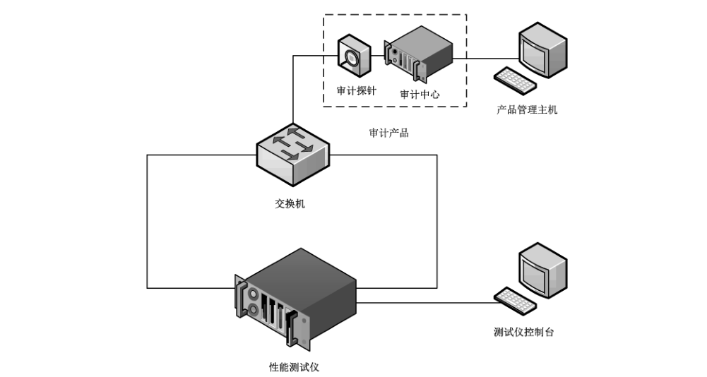
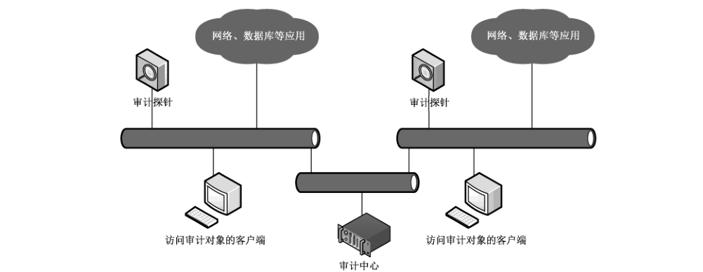
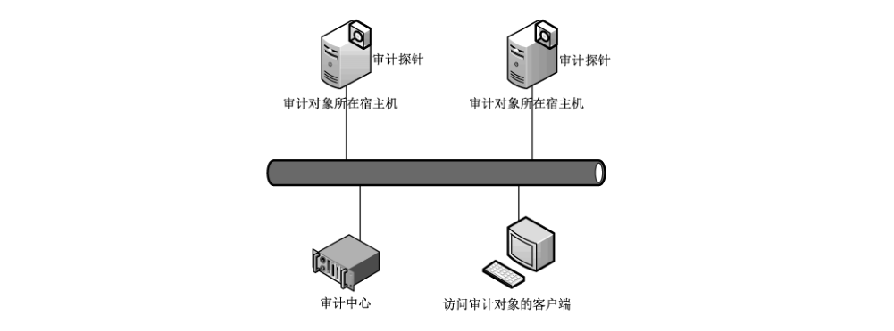

# GB/T 20945-2023 信息安全技术 网络安全审计产品技术规范

> 来源：[GB/T 20945-2023 国家标准详情](https://openstd.samr.gov.cn/bzgk/std/newGbInfo?hcno=B9F03E493B41FB1ECCA4DE5BEB6887BE)；发布日期：2023-05-23；实施日期：2023-12-01。
> PDF SHA-256：669f5556df7519ff95ac1fca178d74d1d8090fe9cfb638927ee1f499b2c9ddb1。
> 转写说明：对照官方 PDF 全部 48 页图像逐页校正；省略封面、目录、页眉、页脚和页码，合并跨页内容。附录 B 的表 B.1 至表 B.4 已逐行重建，合并单元格的类别信息逐行展开；图 1 和图 A.1 至图 A.3 保留原图。原文中“正常自身管理”“启过程中”等疑似笔误照录。正式引用请核对官方原文。

> 转写注：对照原版保留以下疑点：6.3.1.2及7.4.1.2的“正常自身管理”；7.2.2.1 b）3）及7.3.8 b）1）仅写“用户登出”；7.3.1 a）3）写“设置口令复杂度”；7.3.9 b）2）写“启过程中”；7.6.2.2引导句写“用准备程序”；7.6.4.1 a）写“检查开发提供”。这些表述均见官方原页，未按语意擅改。

## 前言

本文件按照 GB/T 1.1—2020《标准化工作导则 第1部分：标准化文件的结构和起草规则》的规定起草。

本文件代替 GB/T 20945—2013《信息安全技术 信息系统安全审计产品技术要求和测试评价方法》，与GB/T 20945—2013相比，除结构调整和编辑性改动外，主要技术变化如下：

— 更改了术语和定义“事件”“安全审计”“审计记录”“产品日志”“审计中心”“审计探针”（见3.3、3.4、3.6、3.7、3.8、3.9,2013年版的3.1、3.2、3.4、3.5、3.6、3.7）；

— 更改了概述（见第5章，2013年版的第5章）；

— 更改了“审计内容”（见6.1.2,2013年版的 6.1.1.2.1、6.2.1.2.1）；

— 删除了“扩展分析接口”（见2013年版的6.2.1.2.2.5）；

— 增加了“自定义事件”（见6.1.6.4）；

— 增加了“产品升级”（见 6.1.6.5）；

— 更改了“身份标识与鉴别”（见6.2.1,2013年版的6.1.2.1、6.2.2.1）；

— 增加了“用户信息安全”（见 6.2.5）；

— 增加了“支撑系统安全”（见 6.2.9）；

— 增加了“环境适应性要求”（见6.3）；

— 增加了“性能要求”（见 6.4）；

— 更改了“安全保障要求”（见6.5,2013年版的6.1.3、6.2.3）；

— 增加了规范性附录“审计产品基本级和增强级技术要求和测评方法最小集合”（见附录 B）。

请注意本文件的某些内容可能涉及专利。本文件的发布机构不承担识别专利的责任。

本文件由全国信息安全标准化技术委员会（SAC/TC 260）提出并归口。

本文件起草单位：公安部第三研究所、北京神州绿盟科技有限公司、北京天融信网络安全技术有限公司、奇安信网神信息技术（北京）股份有限公司、启明星辰信息技术集团股份有限公司、西安交大捷普网络科技有限公司、中国科学院信息工程研究所、杭州美创科技有限公司、深信服科技股份有限公司、上海市信息安全测评认证中心、蓝盾信息安全技术股份有限公司、华信咨询设计研究院有限公司、长春吉大正元信息技术股份有限公司、中国网络安全审查技术与认证中心、公安部第一研究所、中国电力科学研究院有限公司、北京山石网科信息技术有限公司、北京市政务信息安全保障中心（北京信息安全测评中心）、北京百度网讯科技有限公司、长扬科技（北京）股份有限公司、远江盛邦（北京）网络安全科技股份有限公司。

本文件主要起草人：王志佳、沈亮、陆臻、宋好好、顾健、俞优、胡维娜、邓琦、肖颖、白霜、刘岩、张伟锋、何建锋、安高峰、韩冬旭、周杰、叶润国、徐佟海、孙小平、刘强、邹毅、申永波、赵华、杨骋昊、姚盛颖、周兆栋、贾玲、李俊佐、董平。

本文件及其所代替文件的历次版本发布情况为：

— 2007年首次发布为GB/T 20945—2007,2013年第一次修订；

— 本次为第二次修订。

## 1 范围

本文件规定了网络安全审计产品的技术要求并描述了测评方法。

本文件适用于网络安全审计产品的设计、开发、测试和评价。

## 2 规范性引用文件

下列文件中的内容通过文中的规范性引用而构成本文件必不可少的条款。其中，注日期的引用文件，仅该日期对应的版本适用于本文件；不注日期的引用文件，其最新版本（包括所有的修改单）适用于本文件。

- GB/T 18336.1—2015 信息技术 安全技术 信息技术安全评估准则 第1部分：简介和一般模型

- GB/T 18336.3—2015 信息技术 安全技术 信息技术安全评估准则 第3部分：安全保障组件

- GB/T 25069—2022 信息安全技术 术语

- GB/T 35273—2020 信息安全技术 个人信息安全规范

## 3 术语和定义

GB/T 18336.1—2015、GB/T 18336.3—2015 和 GB/T 25069—2022界定的以及下列术语和定义适用于本文件。

### 3.1 网络安全 network security

对网络环境下存储、传输和处理的信息的保密性、完整性和可用性的保持。

［来源：GB/T 25069—2022,3.616］

### 3.2 异常 abnormal

从文档、操作或监测观察到偏离以前验证过的条件、状态或行为。

> 注：通常异常涉及的主体可能是人、设备、应用程序、服务/进程、数据等，因识别到的异常指向的主体不同，又分为用户行为异常、设备运行异常、程序执行异常、服务运行异常、数据异常等多种。

［来源：GB/T 32422—2015,3.1，有修改］

### 3.3 事件 incident

试图改变目标状态，并造成或可能造成异常或损害行为的发生。

［来源：GB/T 25069—2022,3.552，有修改］

### 3.4 安全审计 security audit

对网络、信息系统及其组件的记录与活动的独立评审和考察，以测试系统控制的充分程度，确保对于既定安全策略和运行规程的符合性，发现安全违规，并在控制、安全策略和过程三方面提出改进建议。

［来源：GB/T 25069—2022,3.24，有修改］

### 3.5 网络安全审计产品 network security audit product

采集网络、信息系统及其组件的记录与活动数据，并对这些数据进行存储和分析，以实现事件追溯、发现安全违规或异常的产品。

> 注：网络安全审计产品是一类产品，根据审计目标和内容的不同，可分为主机审计产品、网络审计产品、数据库审计产品、应用审计产品和综合审计产品。

### 3.6 审计记录 audit recordation

审计产品采集审计目标的记录与活动数据所生成的信息。

### 3.7 产品日志 product log

审计产品记录自身的操作和安全事件所生成的信息。

### 3.8 审计中心 audit center

审计产品中集中存储、分析、处理审计数据的功能部件。

### 3.9 审计探针 audit probe

审计产品中通过感知、监测等方式采集审计数据的功能部件。

### 3.10 用户信息 user information

个人、法人或其他组织在安装、使用网络安全审计产品过程中收集、存储、传输、处理和产生的电子方式记录的信息。

> 注：用户信息包括鉴别信息、网络流量信息、安全状态信息、安全配置数据、生成的审计记录等信息，也包括个人信息。

［来源：GB/T 25069—2022,3.737，有修改］

### 3.11 个人信息 personal information

以电子或者其他方式记录的能够单独或者与其他信息结合来识别特定自然人身份或者反映其活动情况的各种信息。

注1：个人信息包括姓名、出生日期、公民身份证号码、个人生物特征信息、住址、联系方式、通信记录和内容、账号密码、财产信息、征信信息、行踪轨迹、住宿信息、健康生理信息、交易信息等。

注2：个人信息控制者通过个人信息或其他加工处理后形成的信息，例如，用户画像特征标签，能够单独或者与其他信息结合识别特定自然人身份或者反映特定自然人活动情况的，也属于个人信息。

［来源：GB/T 25069—2022,3.196］

### 3.12 网络安全漏洞 cybersecurity vulnerability

网络产品和服务在需求分析、设计、实现、配置、测试、运行、维护等过程中，无意或有意产生的、有可能被利用的缺陷或薄弱点。

［来源：GB/T 28458—2020,3.1］

### 3.13 攻击潜力 attack potential

当攻击发起时感知到的，以攻击者的专业水平、资源和动机来体现成功攻击的潜力。

［来源：GB/T 25069—2022,3.219］

## 4 缩略语

下列缩略语适用于本文件。

DNS：域名系统（domain name system）

FTP：文件传输协议 （file transfer protocol）

HTTP：超文本传输协议（hypertext transfer protocol）

IMAP：交互邮件访问协议（internet mail access protocol）

IP：互联网协议（internet protocol）

IPv6：互联网协议第6版（internet protocol version 6）

MAC：介质访问控制（media access control）

NETBIOS： 网上基本输入输出系统（network basic input/output system）

NTP：网络时间协议 （network time protocol）

POP3：邮局协议第三版（post office protocol 3）

SMTP：简单邮件传输协议（simple mail transfer protocol）

SNMP：简单网络管理协议（simple network management protocol）

SYSLOG：系统日志（system log）

TELNET：远程登录（telecommunication network）

URL：统一资源定位符（universal resource locator）

USB：通用串行总线（universal serial bus）

## 5 概述

网络安全审计产品（以下简称：审计产品）根据审计目标和内容的不同，可分为主机审计产品、网络审计产品、数据库审计产品、应用审计产品和综合审计产品。其中主机审计产品部署于主机上，针对主机操作系统的启动/关闭、用户登录/登出、进程启/停、文件操作等进行审计；网络审计产品部署于网络边界处，针对网络通信中协议和应用访问、网络流量等进行审计；数据库审计产品部署于数据库服务器或网络边界处，针对数据库的用户授权、数据的增加/删除/修改/查询等进行审计；应用审计产品部署于特定应用的运行环境中，针对应用的用户登录/登出、重要操作等进行审计；综合审计产品是具备主机审计、网络审计、数据库审计、应用审计中两种或两种以上功能的审计产品。各类审计产品的部署方式见附录A。

技术要求分为安全功能要求、自身安全保护要求、环境适应性要求、性能要求和安全保障要求五个部分。其中，安全功能要求包括数据采集、审计内容、审计记录生成、审计数据分析统计、审计数据展示和管理控制要求；自身安全保护要求包括身份标识与鉴别、管理权限安全、管理方式安全、审计探针安全、用户信息安全、传输安全、存储安全、自身管理审计和支撑系统安全要求；环境适应性要求包括IPv6支持和虚拟化支持要求；性能要求包括数据采集速度和事件记录速度要求；安全保障要求包括开发、指导性文档、生命周期支持、测试和脆弱性评定要求。测评方法对测试环境，以及技术要求的测试方法、预期结果和判定方法进行了说明。等级划分对审计产品基本级、增强级的划分做出了说明。

## 6 技术要求

### 6.1 安全功能要求

#### 6.1.1 数据采集

审计产品应具备数据采集功能，并能够根据审计目标、审计内容等设置采集策略。

#### 6.1.2 审计内容

##### 6.1.2.1 主机审计内容

主机审计产品应能够对主机事件进行审计，内容包括但不限于：

a） 启动和关闭；

b） 用户鉴别成功和失败；

c） 用户登录和登出；

d） 重要配置文件变更；

e） 用户增加、删除和修改；

f） 文件新建、修改、权限变更和删除；

g） 进程或服务的启停；

h） 软件安装和卸载；

i） 操作系统更新；

j） 系统时间变更；

k） 硬件配置变更；

l） 外设及接口使用；

m）网络连接。

##### 6.1.2.2 网络审计内容

网络审计产品应能够对网络事件进行审计，内容包括但不限于：

<ol style="list-style-type: none">
  <li>
    a） 通信协议审计：
  <ol style="list-style-type: none">
    <li>
      1） HTTP通信；
    </li>
    <li>
      2） FTP通信；
    </li>
    <li>
      3） TELNET 通信；
    </li>
    <li>
      4） NETBIOS 通信；
    </li>
    <li>
      5） SMTP通信；
    </li>
    <li>
      6） POP3 通信；
    </li>
    <li>
      7） IMAP通信；
    </li>
    <li>
      8） SYSLOG 通信；
    </li>
    <li>
      9） DNS通信；
    </li>
    <li>
      10） SSH通信；
    </li>
    <li>
      11） HTTPS通信。
    </li>
  </ol>
  </li>
  <li>
    b） 用户行为审计：
  <ol style="list-style-type: none">
    <li>
      1） 访问网站；
    </li>
    <li>
      2） 使用搜索引擎；
    </li>
    <li>
      3） 论坛发帖；
    </li>
    <li>
      4） 上传和下载文件；
    </li>
    <li>
      5） 即时通信软件登录和登出；
    </li>
    <li>
      6） 网络应用联网。
    </li>
  </ol>
  </li>
</ol>

##### 6.1.2.3 数据库审计内容

数据库审计产品应能够对数据库事件进行审计，内容包括但不限于：

a） 数据库用户操作，包括用户登录和登出、切换用户、用户的增加/删除/修改；

b） 数据库数据操作，包括数据的增加、删除、修改、查询；

c） 数据库结构操作，包括数据库或数据表的增加、删除、修改、查询；

d） 非关系型数据库的以上操作。

##### 6.1.2.4 应用审计内容

应用审计产品应能够对应用事件进行审计，内容包括但不限于：

a） 用户鉴别成功和失败；

b） 用户登录和登出；

c） 用户及权限的变更；

d） 与应用业务相关的其他重要操作。

#### 6.1.3 审计记录生成

##### 6.1.3.1 主机审计记录

主机审计产品应具备主机审计记录生成功能，记录内容包括但不限于：时间、主机标识、事件主体、事件客体、事件描述、事件结果。

##### 6.1.3.2 网络审计记录

网络审计产品应具备网络审计记录生成功能，记录内容包括但不限于：

<ol style="list-style-type: none">
  <li>
    a） 事件发生的时间、源IP、目的IP、协议类型；
  </li>
  <li>
    b） 通信协议审计：
  <ol style="list-style-type: none">
    <li>
      1） HTTP通信的目标 URL；
    </li>
    <li>
      2） FTP 通信的用户名、操作命令；
    </li>
    <li>
      3） TELNET 通信的用户名、操作命令；
    </li>
    <li>
      4） NETBIOS 通信的用户名、操作命令；
    </li>
    <li>
      5） SMTP 通信的发件邮箱、收件邮箱、邮件主题、附件名；
    </li>
    <li>
      6） POP3通信的发件邮箱、收件邮箱、邮件主题、附件名；
    </li>
    <li>
      7） IMAP通信的发件邮箱、收件邮箱、邮件主题、附件名；
    </li>
    <li>
      8） SYSLOG 通信传输的内容；
    </li>
    <li>
      9） DNS 通信的域名、IP 地址；
    </li>
    <li>
      10） SSH通信的协议版本；
    </li>
    <li>
      11） HTTPS通信的协议版本。
    </li>
  </ol>
  </li>
  <li>
    c） 用户行为审计：
  <ol style="list-style-type: none">
    <li>
      1） 网站 URL；
    </li>
    <li>
      2） 搜索引擎名、搜索关键字；
    </li>
    <li>
      3） 论坛名称、发帖标题；
    </li>
    <li>
      4） 网络上传和下载使用的工具名称及文件名；
    </li>
    <li>
      5） 即时通信工具名及账户名；
    </li>
    <li>
      6） 网络应用名称。
    </li>
  </ol>
  </li>
</ol>

##### 6.1.3.3 数据库审计记录

数据库审计产品应具备数据库审计记录生成功能，记录内容包括但不限于：

a） 时间、客户端标识、客户端IP地址、用户名、数据库标识、数据库类型、数据库端口、操作命令；

b） 操作结果，包括操作成功或失败，影响行数；

c） 操作返回内容，包括查询结果。

##### 6.1.3.4 应用审计记录

应用审计产品应具备应用审计记录生成功能，记录内容包括但不限于：时间、应用系统标识、事件主体、事件客体、事件描述、事件结果。

#### 6.1.4 审计数据分析统计

##### 6.1.4.1 事件分类分级

审计产品应具备事件分类分级功能，包括但不限于：

a） 根据一定的特征对记录的事件进行分类；

b） 区分记录事件的安全级别，且可自定义安全级别。

##### 6.1.4.2 关联分析

审计产品应具备关联分析功能，包括但不限于：

a） 对相同事件发生的次数或频率达到一定阈值进行关联分析；

b） 对相互关联的不同事件进行关联分析；

c） 通过以上条件组合自定义分析策略。

##### 6.1.4.3 异常事件分析

审计产品应具备异常事件分析功能，包括但不限于：

a） 用户行为异常；

b） 系统资源滥用或耗尽；

c） 网络流量异常；

d） 网络连接异常；

e） 应用服务异常。

##### 6.1.4.4 统计

审计产品应具备统计功能，包括但不限于：

a） 按照时间、审计目标标识、事件类型等条件进行事件统计；

b） 按照时间、事件安全级别等条件进行风险统计；

c） 按照时间、协议类型、应用类型等条件进行网络流量统计；

d） 按照时间、审计目标标识等条件进行网络连接数统计。

#### 6.1.5 审计数据展示

##### 6.1.5.1 审计记录查阅

审计产品应具备审计记录查阅功能，包括但不限于：

a） 仅授权用户能够访问审计结果；

b） 提供审计记录查阅工具；

c） 能够按时间、事件主体、事件客体、事件类别、事件级别、事件内容等条件查询审计记录。

##### 6.1.5.2 统计报表

审计产品应具备统计报表功能，包括但不限于：

a） 能够将统计结果生成报表；

b） 报表支持流式和版式格式导出；

c） 能够自定义报表模板。

##### 6.1.5.3 告警

审计产品应具备告警功能，包括但不限于：

a） 能够自定义告警事件；

b） 能够将高频发生的相同告警事件合并告警；

c） 告警方式包括但不限于：界面提醒、邮件、即时通信、短信、SNMP Trap 消息、声光电信号等方式中的一种；

d） 记录告警事件，内容包括：时间、事件主体、事件描述、事件级别、发生次数。

#### 6.1.6 管理控制

##### 6.1.6.1 管理界面

审计产品应提供管理界面，管理界面应包含审计功能启/停、审计策略配置、审计数据分析/统计/展示、自身安全管理所需的所有功能。

##### 6.1.6.2 配置备份和恢复

审计产品应具备配置备份恢复功能，能够备份和恢复自身配置。

##### 6.1.6.3 数据外发

审计产品应能够通过标准接口或协议将审计数据外发至其他安全产品或系统进行进一步分析处理。

##### 6.1.6.4 自定义事件

审计产品应具备自定义事件功能，能够对自定义的事件进行审计。

##### 6.1.6.5 产品升级

审计产品应具备升级功能，能够升级产品的版本和事件识别库。

##### 6.1.6.6 时间同步

审计产品应具备时间同步功能，能够从 NTP 服务器同步系统时间。

### 6.2 自身安全保护要求

#### 6.2.1 身份标识与鉴别

审计产品应具备用户身份标识与鉴别功能，包括但不限于：

a） 对用户身份进行标识和鉴别，身份标识具有唯一性；

b） 支持静态口令鉴别的审计产品，能够对用户设置口令的长度、复杂度进行检查；

c） 支持静态口令鉴别的审计产品，能够设置口令的使用期限，并在口令到达使用期限时提示用户更换；

d） 支持静态口令鉴别的审计产品，当存在默认口令时，能够提示用户对默认口令进行修改；

e） 采取安全措施对鉴别信息的存储和传输进行安全保护；

f） 具备鉴别失败处理功能，能够限制连续鉴别失败尝试的次数；

g） 具备登录超时处理功能，登录连接超时后能够自动断开；

h） 支持采用两种或两种以上组合的鉴别技术进行身份鉴别。

#### 6.2.2 管理权限安全

审计产品应具有安全的管理权限，包括但不限于：

a） 授权用户能够查看、修改相关安全属性和安全策略；

b） 能够区分用户角色和权限；

c） 支持用户权限分离。

#### 6.2.3 管理方式安全

审计产品应具有安全的管理方式，包括但不限于：

a） 支持远程管理的审计产品，能够限制允许远程管理的IP 或 MAC 地址范围；

b） 支持管理接口与业务接口分离。

#### 6.2.4 审计探针安全

##### 6.2.4.1 探针识别

分布式部署的审计产品，审计中心应能够对审计探针进行识别，防止审计探针仿冒。

> 注：分布式部署指审计中心和审计探针分开部署，详见附录 A。

##### 6.2.4.2 探针状态监测

分布式部署的审计产品，审计中心应能够监测审计探针的运行状态。

##### 6.2.4.3 集中管理

分布式部署的审计产品，应具备集中管理功能，包括但不限于：

a） 审计中心能够将数据采集策略下发到审计探针；

b） 审计中心能够集中收集审计探针上传的审计记录；

c） 具备审计探针的分组管理功能。

##### 6.2.4.4 探针程序和进程安全

包含软件审计探针的审计产品，应保护审计探针程序和进程的安全，包括但不限于：

a） 进程在审计目标启动时能够自动加载；

b） 进程能够防止被强制终止；

c） 程序具备卸载保护措施；

d）程序具备完整性检查措施。

#### 6.2.5 用户信息安全

审计产品应对用户信息进行保护，包括但不限于：

a） 保障用户信息在传输和存储过程中的保密性和完整性；

b）收集个人信息的审计产品，个人信息的收集、存储、使用应符合 GB/T 35273—2020 的相关规定。

#### 6.2.6 传输安全

审计产品应对数据的传输进行保护，包括但不限于：

a） 支持远程管理的审计产品，应采取措施确保管理数据在传输过程中不被泄露或篡改；

b） 由多个组件组成的审计产品，应采取措施确保组件间传输的控制命令、采集的数据等在传输过程中不被泄露或篡改。

#### 6.2.7 存储安全

审计产品应对数据的存储进行保护，包括但不限于：

a） 将审计记录和产品日志存储于掉电非易失性存储介质中；

b） 能够保护审计数据完整性，防止审计数据被破坏、删除或篡改；

c） 具备存储空间不足告警功能；

d） 具备审计数据保存时限设置功能，且保存时限不小于六个月；

e） 具备审计数据备份和恢复功能。

#### 6.2.8 自身管理审计

审计产品应具备自身管理审计功能，包括但不限于：

a） 能够对用户身份鉴别成功和失败、用户登录和登出、审计策略修改、用户和权限变更、时间同步、审计记录备份和恢复等事件进行记录；

b） 产品日志包含：事件发生的时间、事件主体、事件描述、事件结果等；

c） 仅允许授权用户访问产品日志。

#### 6.2.9 支撑系统安全

审计产品的支撑系统安全要求包括但不限于：

a） 不提供多余的组件或网络服务；

b） 重启过程中策略不失效、数据不丢失；

c） 不含已知中危及以上网络安全漏洞。

### 6.3 环境适应性要求

#### 6.3.1 IPv6 支持

##### 6.3.1.1 IPv6 应用环境

支持IPv6的审计产品，应能够在IPv6网络环境下正常工作，实现审计功能。

##### 6.3.1.2 IPv6 管理环境

支持IPv6 的审计产品，应能够在IPv6 网络环境下正常自身管理，实现对审计产品的管理操作。

##### 6.3.1.3 双协议栈

支持 IPv6 的审计产品，应能够同时处理 IPv4 和 IPv6 网络协议。

#### 6.3.2 虚拟化支持

虚拟化形态的审计产品，应支持虚拟化部署，包括但不限于：

a） 支持部署于虚拟化平台；

b） 能够以审计探针或结合虚拟化平台引流等方式对平台上的审计目标进行审计；

c） 能够结合虚拟化平台实现自身资源的弹性伸缩和故障的迁移。

### 6.4 性能要求

#### 6.4.1 数据采集速度

通过流量采集方式获取审计数据的硬件审计产品，数据采集速度应能够满足以下要求：

a） 在流量采集接口速率 30%的背景流量下不漏审；

b） 在流量采集接口速率50%的背景流量下不漏审。

#### 6.4.2 事件记录速度

通过流量采集方式获取审计数据的硬件审计产品，事件记录速度应达到：

a） 每秒5000条；

b） 每秒10 000条。

### 6.5 安全保障要求

#### 6.5.1 开发

##### 6.5.1.1 安全架构

开发者应提供审计产品安全功能的安全架构描述。安全架构描述应满足以下要求：

a） 与审计产品设计文档中对安全功能的描述范围相一致；

b） 充分描述审计产品采取的自我保护、不可旁路的安全机制。

##### 6.5.1.2 功能规范

开发者应提供完备的功能规范说明。功能规范说明应满足以下要求：

a） 清晰描述6.1、6.2中定义的安全功能；

b） 标识和描述审计产品所有安全功能接口的目的、使用方法及相关参数；

c） 描述安全功能实施过程中，与安全功能接口相关的所有行为；

d） 描述可能由安全功能接口的调用而引起的所有直接错误消息。

##### 6.5.1.3 产品设计

开发者应提供审计产品设计文档。设计文档应满足以下要求：

a） 通过子系统描述审计产品结构，标识和描述审计产品安全功能的所有子系统，并描述子系统间的相互作用；

b） 提供子系统和安全功能接口间的对应关系；

c） 通过实现模块描述安全功能，标识和描述实现模块的目的、相关接口及返回值等，并描述实现模块间的相互作用及调用的接口；

d） 提供实现模块和子系统间的对应关系。

##### 6.5.1.4 实现表示

开发者应提供审计产品安全功能的实现表示。实现表示应满足以下要求：

a） 详细定义审计产品安全功能，包括软件代码、设计数据等实例；

b）提供实现表示与审计产品设计描述间的对应关系。

#### 6.5.2 指导性文档

##### 6.5.2.1 操作用户指南

开发者应提供明确和合理的操作用户指南，对每一种用户角色的描述应满足以下要求：

a） 描述用户能访问的功能和特权，包含适当的警示信息；

b） 描述审计产品安全功能及接口的用户操作方法，包括配置参数的安全值等；

c） 标识和描述审计产品运行的所有可能状态，包括操作导致的失败或者操作性错误；

d） 描述实现审计产品安全目的必需执行的安全策略。

##### 6.5.2.2 准备程序

开发者应提供审计产品及其准备程序。准备程序描述应满足以下要求：

a） 描述与开发者交付程序相一致的安全接收所交付审计产品必需的所有步骤；

b） 描述安全安装审计产品及其运行环境必需的所有步骤。

#### 6.5.3 生命周期支持

##### 6.5.3.1 配置管理

###### 6.5.3.1.1 配置管理要求

开发者的配置管理要求应满足以下要求：

a） 为审计产品的不同版本提供唯一的标识；

b） 使用配置管理系统对组成审计产品的所有配置项进行维护，并进行唯一标识；

c） 提供配置管理文档，配置管理文档描述用于唯一标识配置项的方法；

d） 配置管理系统提供自动方式来支持审计产品的生成，通过自动化措施确保配置项仅接受授权变更；

e） 配置管理文档包括配置管理计划，描述用来接受修改过的或新建的作为审计产品组成部分的配置项的程序。配置管理计划应描述如何使用配置管理系统开发审计产品，开发者实施的配置管理应与配置管理计划相一致。

###### 6.5.3.1.2 配置管理范围

开发者应提供审计产品配置项列表，并说明配置项的开发者。配置项列表应包含以下内容：

a） 审计产品及其组成部分、安全保障要求的评估证据；

b） 实现表示、安全缺陷报告及其解决状态。

##### 6.5.3.2 交付程序

开发者应使用一定的交付程序交付审计产品，并将交付过程文档化。在给用户方交付审计产品的各版本时，交付文档应描述为维护安全所必需的所有程序。

##### 6.5.3.3 开发安全

开发者应提供开发安全文档。开发安全文档应描述在审计产品的开发环境中，为保护审计产品设计和实现的保密性和完整性所必需的所有物理的、程序的、人员的和其他方面的安全措施。

##### 6.5.3.4 生命周期定义

开发者应建立一个生命周期模型对审计产品的开发和维护进行必要控制，并提供生命周期定义文档描述用于开发和维护审计产品的模型。

##### 6.5.3.5 工具和技术

开发者应明确定义用于开发审计产品的工具，并提供开发工具文档无歧义地定义实现中每个语句的含义和所有依赖于实现的选项的含义。

#### 6.5.4 测试

##### 6.5.4.1 测试覆盖

开发者应提供测试覆盖文档，测试覆盖描述应满足以下要求：

a） 表明测试文档中所标识的测试与功能规范中所描述的审计产品的安全功能间的对应性；

b） 表明上述对应性是完备的，并证实功能规范中的所有安全功能接口都进行了测试。

##### 6.5.4.2 测试深度

开发者应提供测试深度的分析，测试深度分析描述应满足以下要求：

a） 证实测试文档中的测试与审计产品设计中的安全功能子系统和实现模块之间的一致性；

b） 证实审计产品设计中的所有安全功能子系统、实现模块都已经进行过测试。

##### 6.5.4.3 功能测试

开发者应测试审计产品的安全功能，将结果文档化并提供测试文档。测试文档应包括以下内容：

a） 测试计划，标识要执行的测试，并描述执行每个测试的方案，这些方案包括对于其他测试结果的任何顺序依赖性；

b） 预期的测试结果，表明测试成功后的预期输出；

c） 实际测试结果和预期的测试结果的对比。

##### 6.5.4.4 独立测试

开发者应提供一组与其自测安全功能时使用的同等资源，以用于安全功能的抽样测试。

#### 6.5.5 脆弱性评定

基于已标识的潜在脆弱性，审计产品能抵抗以下强度的攻击：

a） 具有基本攻击潜力的攻击者的攻击；

b） 具有中等攻击潜力的攻击者的攻击。

## 7 测评方法

### 7.1 测试环境

审计产品功能（包括安全功能要求、自身安全保护要求和环境适应性要求）测试的典型环境参考附录A中审计产品部署方式，测试设备主要包括：终端、服务器、交换机或引流设备/平台等。性能测试的典型环境参考图1，测试设备主要包括：性能测试仪、交换机、测试仪控制台、产品管理主机等。

### 7.2 安全功能测试

#### 7.2.1 数据采集

数据采集的测试方法、预期结果和结果判定如下。

<ol style="list-style-type: none">
  <li>
    a） 测试方法：
  <ol style="list-style-type: none">
    <li>
      1） 根据审计目标、审计内容设置采集策略；
    </li>
    <li>
      2） 分别在审计目标和非审计目标生成审计内容和非审计内容数据；
    </li>
    <li>
      3） 查看审计产品对以上事件的审计记录。
    </li>
  </ol>
  </li>
  <li>
    b） 预期结果：具备数据采集功能，并能够根据审计目标、审计内容等设置采集策略。
  </li>
  <li>
    c） 结果判定：实际结果与相关预期结果一致则判定为符合，其他情况判定为不符合。
  </li>
</ol>

#### 7.2.2 审计内容

##### 7.2.2.1 主机审计内容

主机审计内容的测试方法、预期结果和结果判定如下。

<ol style="list-style-type: none">
  <li>
    a） 测试方法：
  <ol style="list-style-type: none">
    <li>
      1） 在目标主机进行启动和关闭操作，查看审计记录；
    </li>
    <li>
      2） 在目标主机进行用户身份鉴别成功和失败操作，查看审计记录；
    </li>
    <li>
      3） 在目标主机进行用户登录和登出操作，查看审计记录；
    </li>
    <li>
      4） 在目标主机进行重要配置文件变更操作，查看审计记录；
    </li>
    <li>
      5） 在目标主机进行用户增加、删除和修改操作，查看审计记录；
    </li>
    <li>
      6） 在目标主机进行文件新建、修改、权限变更和删除操作，查看审计记录；
    </li>
    <li>
      7） 在目标主机进行进程或服务的启停操作，查看审计记录；
    </li>
    <li>
      8） 在目标主机进行软件安装和卸载操作，查看审计记录；
    </li>
    <li>
      9） 在目标主机进行更新操作系统操作，查看审计记录；
    </li>
    <li>
      10） 在目标主机进行系统时间变更操作，查看审计记录；
    </li>
    <li>
      11） 在目标主机进行硬件配置变更操作，查看审计记录；
    </li>
    <li>
      12） 在目标主机进行外设及接口使用操作，例如：光驱、打印机、USB 接口、串口使用等，查看审计记录；
    </li>
    <li>
      13） 在目标主机进行网络连接操作，查看审计记录。
    </li>
  </ol>
  </li>
  <li>
    b） 预期结果：
  <ol style="list-style-type: none">
    <li>
      1） 能够审计启动和关闭；
    </li>
    <li>
      2） 能够审计用户身份鉴别成功和失败；
    </li>
    <li>
      3） 能够审计用户登出；
    </li>
    <li>
      4） 能够审计重要配置文件变更；
    </li>
    <li>
      5） 能够审计用户增加、删除和修改；
    </li>
    <li>
      6） 能够审计文件新建、修改、权限变更和删除；
    </li>
    <li>
      7） 能够审计进程或服务的启停；
    </li>
    <li>
      8） 能够审计软件安装和卸载；
    </li>
    <li>
      9） 能够审计操作系统更新；
    </li>
    <li>
      10） 能够审计系统时间变更；
    </li>
    <li>
      11） 能够审计硬件配置变更；
    </li>
    <li>
      12） 能够审计外设及接口使用；
    </li>
    <li>
      13） 能够审计网络连接。
    </li>
  </ol>
  </li>
  <li>
    c） 结果判定：实际结果与相关预期结果一致则判定为符合，其他情况判定为不符合。
  </li>
</ol>

##### 7.2.2.2 网络审计内容

网络审计内容的测试方法、预期结果和结果判定如下。

<ol style="list-style-type: none">
  <li>
    a） 测试方法：
  <ol style="list-style-type: none">
    <li>
      1） 通信协议审计：
    <ul style="list-style-type: none">
      <li>
        — 在目标网络或主机产生 HTTP通信，查看审计记录；
      </li>
      <li>
        — 在目标网络或主机产生FTP通信，查看审计记录；
      </li>
      <li>
        — 在目标网络或主机产生 TELNET通信，查看审计记录；
      </li>
      <li>
        — 在目标网络或主机产生 NETBIOS 通信，查看审计记录；
      </li>
      <li>
        — 在目标网络或主机产生 SMTP通信，查看审计记录；
      </li>
      <li>
        — 在目标网络或主机产生 POP3通信，查看审计记录；
      </li>
      <li>
        — 在目标网络或主机产生 IMAP通信，查看审计记录；
      </li>
      <li>
        — 在目标网络或主机产生 SYSLOG 通信，查看审计记录；
      </li>
      <li>
        — 在目标网络或主机产生 DNS通信，查看审计记录；
      </li>
      <li>
        — 在目标网络或主机产生 SSH 通信，查看审计记录；
      </li>
      <li>
        — 在目标网络或主机产生 HTTPS通信，查看审计记录。
      </li>
    </ul>
    </li>
    <li>
      2） 用户行为审计：
    <ul style="list-style-type: none">
      <li>
        — 在目标网络或主机访问网站，查看审计记录；
      </li>
      <li>
        — 在目标网络或主机使用搜索引擎，查看审计记录；
      </li>
      <li>
        — 在目标网络或主机进行论坛发帖操作，查看审计记录；
      </li>
      <li>
        — 在目标网络或主机进行文件上传和下载操作，查看审计记录；
      </li>
      <li>
        — 在目标网络或主机登录和登出即时通信软件，查看审计记录；
      </li>
      <li>
        — 在目标网络或主机使用网络应用联网，查看审计记录。
      </li>
    </ul>
    </li>
  </ol>
  </li>
  <li>
    b） 预期结果：
  <ol style="list-style-type: none">
    <li>
      1） 通信协议审计：
    <ul style="list-style-type: none">
      <li>
        — 能够审计 HTTP通信；
      </li>
      <li>
        — 能够审计 FTP通信；
      </li>
      <li>
        — 能够审计 TELNET 通信；
      </li>
      <li>
        — 能够审计 NETBIOS 通信；
      </li>
      <li>
        — 能够审计 SMTP通信；
      </li>
      <li>
        — 能够审计 POP3通信；
      </li>
      <li>
        — 能够审计 IMAP通信；
      </li>
      <li>
        — 能够审计 SYSLOG通信；
      </li>
      <li>
        — 能够审计 DNS通信；
      </li>
      <li>
        — 能够审计 SSH通信；
      </li>
      <li>
        — 能够审计 HTTPS通信。
      </li>
    </ul>
    </li>
    <li>
      2） 用户行为审计：
    <ul style="list-style-type: none">
      <li>
        — 能够审计访问网站行为；
      </li>
      <li>
        — 能够审计使用搜索引擎行为；
      </li>
      <li>
        — 能够审计论坛发帖行为；
      </li>
      <li>
        — 能够审计上传和下载文件行为；
      </li>
      <li>
        — 能够审计即时通信软件登录和登出行为；
      </li>
      <li>
        — 能够审计网络应用联网行为。
      </li>
    </ul>
    </li>
  </ol>
  </li>
  <li>
    c） 结果判定：实际结果与相关预期结果一致则判定为符合，其他情况判定为不符合。
  </li>
</ol>

##### 7.2.2.3 数据库审计内容

数据库审计内容的测试方法、预期结果和结果判定如下。

<ol style="list-style-type: none">
  <li>
    a） 测试方法：
  <ol style="list-style-type: none">
    <li>
      1） 通过客户端对目标数据库进行用户操作，包括用户登录和登出、切换用户、用户的增加/删除/修改，查看审计记录；
    </li>
    <li>
      2） 通过客户端对目标数据库进行数据操作，包括数据的增加、删除、修改、查询，查看审计记录；
    </li>
    <li>
      3） 通过客户端对目标数据库进行结构操作，包括数据库或数据表的增加、删除、修改、查询，查看审计记录；
    </li>
    <li>
      4） 通过客户端对目标非关系型数据库执行以上操作，查看审计记录。
    </li>
  </ol>
  </li>
  <li>
    b） 预期结果：
  <ol style="list-style-type: none">
    <li>
      1） 能够审计数据库用户操作，包括用户登录和登出、切换用户、用户的增加/删除/修改；
    </li>
    <li>
      2） 能够审计数据库数据操作，包括数据的增加、删除、修改、查询；
    </li>
    <li>
      3） 能够审计数据库结构操作，包括数据库或数据表的增加、删除、修改、查询；
    </li>
    <li>
      4） 能够审计非关系型数据库的以上操作。
    </li>
  </ol>
  </li>
  <li>
    c） 结果判定：实际结果与相关预期结果一致则判定为符合，其他情况判定为不符合。
  </li>
</ol>

##### 7.2.2.4 应用审计内容

应用审计内容的测试方法、预期结果和结果判定如下。

<ol style="list-style-type: none">
  <li>
    a） 测试方法：
  <ol style="list-style-type: none">
    <li>
      1） 在目标应用进行用户身份鉴别成功和失败操作，查看审计记录；
    </li>
    <li>
      2） 在目标应用进行用户登录和登出操作，查看审计记录；
    </li>
    <li>
      3） 在目标应用进行用户及权限的变更操作，查看审计记录；
    </li>
    <li>
      4） 在目标应用进行与业务相关的其他重要操作，查看审计记录。
    </li>
  </ol>
  </li>
  <li>
    b） 预期结果：
  <ol style="list-style-type: none">
    <li>
      1） 能够审计用户身份鉴别，包括成功和失败；
    </li>
    <li>
      2） 能够审计用户登录和登出；
    </li>
    <li>
      3） 能够审计用户及权限的变更；
    </li>
    <li>
      4） 能够审计与应用业务相关的其他重要操作。
    </li>
  </ol>
  </li>
  <li>
    c） 结果判定：实际结果与相关预期结果一致则判定为符合，其他情况判定为不符合。
  </li>
</ol>

#### 7.2.3 审计记录生成

##### 7.2.3.1 主机审计记录

主机审计记录的测试方法、预期结果和结果判定如下。

a） 测试方法：检测主机审计记录内容是否包括时间、主机标识、事件主体、事件客体、事件描述、事件结果。

b） 预期结果：主机审计记录内容包括时间、主机标识、事件主体、事件客体、事件描述、事件结果。

c） 结果判定：实际结果与相关预期结果一致则判定为符合，其他情况判定为不符合。

##### 7.2.3.2 网络审计记录

网络审计记录的测试方法、预期结果和结果判定如下。

<ol style="list-style-type: none">
  <li>
    a） 测试方法：
  <ol style="list-style-type: none">
    <li>
      1） 检测网络审计记录是否包含时间、源IP、目的IP、协议类型；
    </li>
    <li>
      2） 通信协议审计：
    <ul style="list-style-type: none">
      <li>
        — 检测网络审计记录是否包含 HTTP 通信的目标 URL；
      </li>
      <li>
        — 检测网络审计记录是否包含 FTP 通信的用户名、操作命令；
      </li>
      <li>
        — 检测网络审计记录是否包含 TELNET 通信的用户名、操作命令；
      </li>
      <li>
        — 检测网络审计记录是否包含 NETBIOS 通信的用户名、操作命令；
      </li>
      <li>
        — 检测网络审计记录是否包含 SMTP通信的发件邮箱、收件邮箱、邮件主题、附件名；
      </li>
      <li>
        — 检测网络审计记录是否包含 POP3通信的发件邮箱、收件邮箱、邮件主题、附件名；
      </li>
      <li>
        — 检测网络审计记录是否包含 IMAP通信的发件邮箱、收件邮箱、邮件主题、附件名；
      </li>
      <li>
        — 检测网络审计记录是否包含 SYSLOG 通信传输的内容；
      </li>
      <li>
        — 检测网络审计记录是否包含 DNS 通信的域名、IP地址；
      </li>
      <li>
        — 检测网络审计记录是否包含 SSH通信的协议版本；
      </li>
      <li>
        — 检测网络审计记录是否包含 HTTPS通信的协议版本。
      </li>
    </ul>
    </li>
    <li>
      3） 用户行为审计：
    <ul style="list-style-type: none">
      <li>
        — 检测网络审计记录是否包含网站 URL；
      </li>
      <li>
        — 检测网络审计记录是否包含搜索引擎名、搜索关键字；
      </li>
      <li>
        — 检测网络审计记录是否包含论坛名称、发帖标题；
      </li>
      <li>
        — 检测网络审计记录是否包含网络上传和下载使用的工具名称及文件名；
      </li>
      <li>
        — 检测网络审计记录是否包含即时通信工具名及账户名；
      </li>
      <li>
        — 检测网络审计记录是否包含网络应用名称。
      </li>
    </ul>
    </li>
  </ol>
  </li>
  <li>
    b） 预期结果：
  <ol style="list-style-type: none">
    <li>
      1） 网络审计记录内容包括时间、源IP、目的IP、协议类型；
    </li>
    <li>
      2） 通信协议审计：
    <ul style="list-style-type: none">
      <li>
        — 审计记录内容包括 HTTP通信的目标 URL；
      </li>
      <li>
        — 审计记录内容包括 FTP通信的用户名、操作命令；
      </li>
      <li>
        — 审计记录内容包括 TELNET 通信的用户名、操作命令；
      </li>
      <li>
        — 审计记录内容包括 NETBIOS 通信的用户名、操作命令；
      </li>
      <li>
        — 审计记录内容包括 SMTP通信的发件邮箱、收件邮箱、邮件主题、附件名；
      </li>
      <li>
        — 审计记录内容包括 POP3通信的发件邮箱、收件邮箱、邮件主题、附件名；
      </li>
      <li>
        — 审计记录内容包括 IMAP通信的发件邮箱、收件邮箱、邮件主题、附件名；
      </li>
      <li>
        — 审计记录内容包括 SYSLOG 通信传输的内容；
      </li>
      <li>
        — 审计记录内容包括 DNS 通信的域名、IP地址；
      </li>
      <li>
        — 审计记录内容包括 SSH 通信的协议版本；
      </li>
      <li>
        — 审计记录内容包括 HTTPS通信的协议版本。
      </li>
    </ul>
    </li>
    <li>
      3） 用户行为审计：
    <ul style="list-style-type: none">
      <li>
        — 审计记录内容包括网站 URL；
      </li>
      <li>
        — 审计记录内容包括搜索引擎名、搜索关键字；
      </li>
      <li>
        — 审计记录内容包括论坛名称、发帖标题；
      </li>
      <li>
        — 审计记录内容包括网络上传和下载使用的工具名称及文件名；
      </li>
      <li>
        — 审计记录内容包括即时通信工具名及账户名；
      </li>
      <li>
        — 审计记录内容包括网络应用名称。
      </li>
    </ul>
    </li>
  </ol>
  </li>
  <li>
    c） 结果判定：实际结果与相关预期结果一致则判定为符合，其他情况判定为不符合。
  </li>
</ol>

##### 7.2.3.3 数据库审计记录

数据库审计记录的测试方法、预期结果和结果判定如下。

<ol style="list-style-type: none">
  <li>
    a） 测试方法：
  <ol style="list-style-type: none">
    <li>
      1） 检测数据库审计记录是否包含时间、客户端标识、客户端IP地址、用户名、数据库标识、数据库类型、数据库端口、操作命令；
    </li>
    <li>
      2） 检测数据库审计记录是否包含操作结果，包括操作成功或失败，影响行数；
    </li>
    <li>
      3） 检测数据库审计记录是否包含操作返回内容，包括查询结果。
    </li>
  </ol>
  </li>
  <li>
    b） 预期结果：
  <ol style="list-style-type: none">
    <li>
      1） 数据库审计记录内容包括时间、客户端标识、客户端IP地址、用户名、数据库标识、数据库类型、数据库端口、操作命令；
    </li>
    <li>
      2） 审计记录内容包括操作结果，包括操作成功或失败，影响行数；
    </li>
    <li>
      3）审计记录内容包括操作返回内容，包括查询结果。
    </li>
  </ol>
  </li>
  <li>
    c） 结果判定：实际结果与相关预期结果一致则判定为符合，其他情况判定为不符合。
  </li>
</ol>

##### 7.2.3.4 应用审计记录

应用审计记录的测试方法、预期结果和结果判定如下。

a） 测试方法：检测应用审计记录内容是否包括时间、应用系统标识、事件主体、事件客体、事件描述、事件结果。

b） 预期结果：应用审计记录内容包括时间、应用系统标识、事件主体、事件客体、事件描述、事件结果。

c） 结果判定：实际结果与相关预期结果一致则判定为符合，其他情况判定为不符合。

#### 7.2.4 审计数据分析统计

##### 7.2.4.1 事件分类分级

事件分类分级的测试方法、预期结果和结果判定如下。

<ol style="list-style-type: none">
  <li>
    a） 测试方法：
  <ol style="list-style-type: none">
    <li>
      1） 生成不同类别审计数据，检测记录的事件是否分类；
    </li>
    <li>
      2） 设置事件的安全级别，生成不同级别审计数据，检测记录的事件是否区分安全级别。
    </li>
  </ol>
  </li>
  <li>
    b） 预期结果：
  <ol style="list-style-type: none">
    <li>
      1） 能够根据一定的特征对记录的事件进行分类；
    </li>
    <li>
      2） 能够区分记录事件的安全级别，且可自定义安全级别。
    </li>
  </ol>
  </li>
  <li>
    c） 结果判定：实际结果与相关预期结果一致则判定为符合，其他情况判定为不符合。
  </li>
</ol>

##### 7.2.4.2 关联分析

关联分析的测试方法、预期结果和结果判定如下。

<ol style="list-style-type: none">
  <li>
    a） 测试方法：
  <ol style="list-style-type: none">
    <li>
      1） 生成大量相同的事件，检测审计产品是否能对相同事件发生的次数或频率达到一定阈值进行关联分析；
    </li>
    <li>
      2） 生成相互关联的不同事件，检测审计产品是否能对相互关联的不同事件进行分析；
    </li>
    <li>
      3） 设置以上条件组合的自定义分析策略，生成相应事件，检测审计产品是否能够进行分析。
    </li>
  </ol>
  </li>
  <li>
    b） 预期结果：
  <ol style="list-style-type: none">
    <li>
      1） 能够对相同事件发生的次数或频率达到一定阈值进行关联分析；
    </li>
    <li>
      2） 能够对相互关联的不同事件进行关联分析；
    </li>
    <li>
      3） 能够通过以上条件组合自定义分析策略。
    </li>
  </ol>
  </li>
  <li>
    c） 结果判定：实际结果与相关预期结果一致则判定为符合，其他情况判定为不符合。
  </li>
</ol>

##### 7.2.4.3 异常事件分析

异常事件分析的测试方法、预期结果和结果判定如下。

<ol style="list-style-type: none">
  <li>
    a） 测试方法：
  <ol style="list-style-type: none">
    <li>
      1） 进行用户异常行为操作，例如：尝试读取或修改未授权文件，检测审计产品是否能对用户异常行为进行分析；
    </li>
    <li>
      2） 进行导致系统资源滥用或耗尽的操作，例如：频繁进行大文件拷贝或下载，检测审计产品是否能对系统资源滥用或耗尽进行分析；
    </li>
    <li>
      3） 生成异常网络流量，例如：模拟产生大流量网络攻击，检测审计产品是否能对网络流量异常进行分析；
    </li>
    <li>
      4） 生成异常网络连接，例如：模拟产生高并发网络连接，检测审计产品是否能对连接数异常进行分析；
    </li>
    <li>
      5） 进行导致应用服务异常的操作，例如：连续多次鉴别失败，检测审计产品是否能对应用服务异常进行分析。
    </li>
  </ol>
  </li>
  <li>
    b） 预期结果：
  <ol style="list-style-type: none">
    <li>
      1） 能够对用户行为异常进行分析；
    </li>
    <li>
      2） 能够对系统资源滥用或耗尽进行分析；
    </li>
    <li>
      3） 能够对网络流量异常进行分析；
    </li>
    <li>
      4） 能够对网络连接异常进行分析；
    </li>
    <li>
      5） 能够对应用服务故障进行分析。
    </li>
  </ol>
  </li>
  <li>
    c） 结果判定：实际结果与相关预期结果一致则判定为符合，其他情况判定为不符合。
  </li>
</ol>

##### 7.2.4.4 统计

统计的测试方法、预期结果和结果判定如下。

<ol style="list-style-type: none">
  <li>
    a） 测试方法：
  <ol style="list-style-type: none">
    <li>
      1） 按照时间、审计目标标识、事件类型等条件统计事件，检测统计结果是否正确；
    </li>
    <li>
      2） 按照时间、事件安全级别等条件统计风险，检测统计结果是否正确；
    </li>
    <li>
      3） 按照时间、协议类型、应用类型等条件统计网络流量，检测统计结果是否正确；
    </li>
    <li>
      4） 按照时间、审计目标标识等条件进行统计网络连接，检测统计结果是否正确。
    </li>
  </ol>
  </li>
  <li>
    b） 预期结果：
  <ol style="list-style-type: none">
    <li>
      1） 能够按照时间、审计目标标识、事件类型等条件进行事件统计；
    </li>
    <li>
      2） 能够按照时间、事件安全级别等条件进行风险统计；
    </li>
    <li>
      3） 能够按照时间、协议类型、应用类型等条件进行网络流量统计；
    </li>
    <li>
      4） 能够按照时间、审计目标标识等条件进行网络连接数统计。
    </li>
  </ol>
  </li>
  <li>
    c） 结果判定：实际结果与相关预期结果一致则判定为符合，其他情况判定为不符合。
  </li>
</ol>

#### 7.2.5 审计数据展示

##### 7.2.5.1 审计记录查阅

审计记录查阅的测试方法、预期结果和结果判定如下。

<ol style="list-style-type: none">
  <li>
    a） 测试方法：
  <ol style="list-style-type: none">
    <li>
      1） 分别尝试以非授权用户和授权用户查看审计产品的审计结果，检测审计记录是否仅授权用户能够访问；
    </li>
    <li>
      2） 检测审计产品是否提供审计记录查阅工具；
    </li>
    <li>
      3） 检测审计产品是否能够按时间、事件主体、事件客体、事件类别、事件级别、事件内容等条件查询审计记录。
    </li>
  </ol>
  </li>
  <li>
    b） 预期结果：
  <ol style="list-style-type: none">
    <li>
      1） 仅授权用户能够访问审计结果；
    </li>
    <li>
      2） 提供审计结果查阅工具；
    </li>
    <li>
      3） 能够按时间、事件主体、事件客体、事件类别、事件级别、事件内容等条件查询审计记录。
    </li>
  </ol>
  </li>
  <li>
    c） 结果判定：实际结果与相关预期结果一致则判定为符合，其他情况判定为不符合。
  </li>
</ol>

##### 7.2.5.2 统计报表

统计报表的测试方法、预期结果和结果判定如下。

<ol style="list-style-type: none">
  <li>
    a） 测试方法：
  <ol style="list-style-type: none">
    <li>
      1） 检测审计产品是否能够将统计结果生成报表；
    </li>
    <li>
      2） 检测报表是否能够以流式和版式格式导出；
    </li>
    <li>
      3） 自定义报表模板，检测是否能够生成报表。
    </li>
  </ol>
  </li>
  <li>
    b） 预期结果：
  <ol style="list-style-type: none">
    <li>
      1） 能够把统计结果生成报表；
    </li>
    <li>
      2） 报表支持流式和版式格式导出；
    </li>
    <li>
      3） 能够自定义报表模板。
    </li>
  </ol>
  </li>
  <li>
    c） 结果判定：实际结果与相关预期结果一致则判定为符合，其他情况判定为不符合。
  </li>
</ol>

##### 7.2.5.3 告警

告警的测试方法、预期结果和结果判定如下。

<ol style="list-style-type: none">
  <li>
    a） 测试方法：
  <ol style="list-style-type: none">
    <li>
      1） 自定义告警策略，生成相应审计记录，检测是否能够告警；
    </li>
    <li>
      2） 生成大量相同的告警事件，检测高频发生的相同告警事件是否合并告警；
    </li>
    <li>
      3） 设置界面提醒、邮件、即时通信、短信、SNMP Trap 消息、声光电信号等方式告警，检测是否产生告警；
    </li>
    <li>
      4） 检测告警记录是否包含时间、事件主体、事件描述、事件级别、发生次数信息。
    </li>
  </ol>
  </li>
  <li>
    b） 预期结果：
  <ol style="list-style-type: none">
    <li>
      1） 能够自定义告警事件；
    </li>
    <li>
      2） 能够将高频发生的相同告警事件合并告警；
    </li>
    <li>
      3） 告警方式包括但不限于：界面、邮件、即时通信、短信、SNMP Trap 消息、声光电信号等方式中的一种；
    </li>
    <li>
      4） 能够记录告警事件，内容包括：时间、事件主体、事件描述、事件级别、发生次数。
    </li>
  </ol>
  </li>
  <li>
    c） 结果判定：实际结果与相关预期结果一致则判定为符合，其他情况判定为不符合。
  </li>
</ol>

#### 7.2.6 管理控制

##### 7.2.6.1 管理界面

管理界面的测试方法、预期结果和结果判定如下。

<ol style="list-style-type: none">
  <li>
    a） 测试方法：
  <ol style="list-style-type: none">
    <li>
      1） 以授权用户登录管理界面，检测是否能在管理界面配置审计功能启/停、审计策略配置、审计数据分析/统计/展示、自身安全管理所需的所有功能；
    </li>
    <li>
      2） 检测配置和管理的功能是否生效。
    </li>
  </ol>
  </li>
  <li>
    b） 预期结果：审计产品提供管理界面，管理界面包含审计功能启/停、审计策略配置、审计数据分析/统计/展示、自身安全管理所需的所有功能。
  </li>
  <li>
    c） 结果判定：实际结果与相关预期结果一致则判定为符合，其他情况判定为不符合。
  </li>
</ol>

##### 7.2.6.2 配置备份和恢复

配置备份和恢复的测试方法、预期结果和结果判定如下。

<ol style="list-style-type: none">
  <li>
    a） 测试方法：
  <ol style="list-style-type: none">
    <li>
      1） 以授权用户登录，检测审计产品是否能够备份自身配置；
    </li>
    <li>
      2） 修改配置，检测审计产品是否能够从备份文件恢复自身配置。
    </li>
  </ol>
  </li>
  <li>
    b） 预期结果：具备配置备份恢复功能，能够备份和恢复自身配置。
  </li>
  <li>
    c） 结果判定：实际结果与相关预期结果一致则判定为符合，其他情况判定为不符合。
  </li>
</ol>

##### 7.2.6.3 数据外发

数据外发的测试方法、预期结果和结果判定如下。

<ol style="list-style-type: none">
  <li>
    a） 测试方法：
  <ol style="list-style-type: none">
    <li>
      1） 检测审计产品是否能够通过标准接口或协议（例如：SYSLOG 协议）将审计数据外发至其他安全产品或系统；
    </li>
    <li>
      2） 检测目标安全产品或系统是否能够对审计产品发送的审计数据进行进一步分析处理。
    </li>
  </ol>
  </li>
  <li>
    b） 预期结果：能够通过标准接口或协议将审计数据外发至其他安全产品或系统进行进一步分析处理。
  </li>
  <li>
    c） 结果判定：实际结果与相关预期结果一致则判定为符合，其他情况判定为不符合。
  </li>
</ol>

##### 7.2.6.4 自定义事件

自定义事件的测试方法、预期结果和结果判定如下。

<ol style="list-style-type: none">
  <li>
    a） 测试方法：
  <ol style="list-style-type: none">
    <li>
      1） 根据事件特征自定义事件；
    </li>
    <li>
      2） 在审计目标产生相应的自定义事件，检测审计产品是否能够审计该事件。
    </li>
  </ol>
  </li>
  <li>
    b） 预期结果：具备自定义事件功能，能够对自定义的事件进行审计。
  </li>
  <li>
    c） 结果判定：实际结果与相关预期结果一致则判定为符合，其他情况判定为不符合。
  </li>
</ol>

##### 7.2.6.5 产品升级

产品升级的测试方法、预期结果和结果判定如下。

<ol style="list-style-type: none">
  <li>
    a） 测试方法：
  <ol style="list-style-type: none">
    <li>
      1） 升级审计产品版本，检测产品版本是否变更；
    </li>
    <li>
      2） 升级审计产品事件识别库，生成相应审计数据，检测事件识别库是否升级。
    </li>
  </ol>
  </li>
  <li>
    b） 预期结果：具备升级功能，能够升级产品的版本和事件识别库。
  </li>
  <li>
    c） 结果判定：实际结果与相关预期结果一致则判定为符合，其他情况判定为不符合。
  </li>
</ol>

##### 7.2.6.6 时间同步

时间同步的测试方法、预期结果和结果判定如下。

<ol style="list-style-type: none">
  <li>
    a） 测试方法：
  <ol style="list-style-type: none">
    <li>
      1） 配置 NTP 服务器；
    </li>
    <li>
      2） 修改审计产品系统时间，检测时间是否与 NTP 服务器同步。
    </li>
  </ol>
  </li>
  <li>
    b） 预期结果：具备时间同步功能，能够从 NTP服务器同步系统时间。
  </li>
  <li>
    c） 结果判定：实际结果与相关预期结果一致则判定为符合，其他情况判定为不符合。
  </li>
</ol>

### 7.3 自身安全保护测试

#### 7.3.1 身份识别与鉴别

身份识别与鉴别的测试方法、预期结果和结果判定如下。

<ol style="list-style-type: none">
  <li>
    a） 测试方法：
  <ol style="list-style-type: none">
    <li>
      1） 检测审计产品的用户是否仅在身份鉴别成功后才能使用安全功能，检测用户身份标识是否唯一；
    </li>
    <li>
      2） 检测审计产品是否能够对用户设置口令的长度和复杂度进行检查，是否不允许设置弱口令，例如：空口令、纯数字等；
    </li>
    <li>
      3） 检测审计产品是否能够设置口令复杂度，口令到达使用期限时是否提示用户更换；
    </li>
    <li>
      4） 审计产品存在默认口令时，检测是否提示用户对默认口令进行修改；
    </li>
    <li>
      5） 检测审计产品是否采取措施对鉴别信息的存储和传输进行安全保护；
    </li>
    <li>
      6） 连续多次鉴别失败，检测是否触发审计产品的鉴别失败处理功能，检测是否采取一定措施防止用户进一步鉴别的尝试；
    </li>
    <li>
      7） 用户登录后，在预置的超时时间内不做任何操作，检测登录连接是否自动断开；
    </li>
    <li>
      8） 检测审计产品是否支持采用两种或两种以上组合的鉴别技术进行身份鉴别，例如：除静态口令外，还具备动态口令、USB 智能密码钥匙或指纹等鉴别方式。
    </li>
  </ol>
  </li>
  <li>
    b） 预期结果：
  <ol style="list-style-type: none">
    <li>
      1） 对用户身份进行标识和鉴别，身份标识具有唯一性；
    </li>
    <li>
      2） 支持静态口令鉴别的审计产品，能够对用户设置的口令的长度、复杂度进行检查；
    </li>
    <li>
      3） 支持静态口令鉴别的审计产品，能够设置口令的使用期限，并在口令到达使用期限时提示用户更换；
    </li>
    <li>
      4） 支持静态口令鉴别的审计产品，当存在默认口令时，能够提示用户对默认口令进行修改；
    </li>
    <li>
      5） 采取安全措施对鉴别信息的存储和传输进行安全保护；
    </li>
    <li>
      6） 具备鉴别失败处理功能，能够限制连续鉴别失败尝试的次数；
    </li>
    <li>
      7） 具备登录超时处理功能，登录连接超时后能够自动断开；
    </li>
    <li>
      8） 支持采用两种或两种以上组合的鉴别技术进行身份鉴别。
    </li>
  </ol>
  </li>
  <li>
    c） 结果判定：实际结果与相关预期结果一致则判定为符合，其他情况判定为不符合。
  </li>
</ol>

#### 7.3.2 管理权限安全

管理权限安全的测试方法、预期结果和结果判定如下。

<ol style="list-style-type: none">
  <li>
    a） 测试方法：
  <ol style="list-style-type: none">
    <li>
      1） 检测授权用户是否能够查看、修改相关安全属性和安全策略；
    </li>
    <li>
      2） 设置不同角色用户，检测审计产品不同角色是否具备不同权限；
    </li>
    <li>
      3） 检测审计产品是否支持用户权限分离，是否能够实现权限的相互制约。
    </li>
  </ol>
  </li>
  <li>
    b） 预期结果：
  <ol style="list-style-type: none">
    <li>
      1） 授权用户能够查看、修改相关安全属性和安全策略；
    </li>
    <li>
      2） 能够区分用户角色和权限；
    </li>
    <li>
      3） 支持用户权限分离。
    </li>
  </ol>
  </li>
  <li>
    c） 结果判定：实际结果与相关预期结果一致则判定为符合，其他情况判定为不符合。
  </li>
</ol>

#### 7.3.3 管理方式安全

管理方式安全的测试方法、预期结果和结果判定如下。

<ol style="list-style-type: none">
  <li>
    a） 测试方法：
  <ol style="list-style-type: none">
    <li>
      1） 分别以指定范围内、外的IP 或MAC地址尝试进行远程管理，检测审计产品是否能够限制远程管理的IP 或 MAC 地址范围；
    </li>
    <li>
      2） 检测是否支持管理接口与业务接口分离，例如：具备独立的管理口，或限制业务口的管理功能。
    </li>
  </ol>
  </li>
  <li>
    b） 预期结果：
  <ol style="list-style-type: none">
    <li>
      1） 支持远程管理的审计产品，能够限制允许远程管理的IP 或 MAC 地址范围；
    </li>
    <li>
      2） 支持管理接口与业务接口分离。
    </li>
  </ol>
  </li>
  <li>
    c） 结果判定：实际结果与相关预期结果一致则判定为符合，其他情况判定为不符合。
  </li>
</ol>

#### 7.3.4 审计探针安全

##### 7.3.4.1 探针识别

探针识别的测试方法、预期结果和结果判定如下。

a） 测试方法：分别尝试添加真实和仿冒的探针，检测审计中心是否能够对审计探针进行识别。

b） 预期结果：分布式部署的审计产品，审计中心能够对审计探针进行识别，防止审计探针仿冒。

c） 结果判定：实际结果与相关预期结果一致则判定为符合，其他情况判定为不符合。

##### 7.3.4.2 探针状态监测

探针状态监测的测试方法、预期结果和结果判定如下。

<ol style="list-style-type: none">
  <li>
    a） 测试方法：
  <ol style="list-style-type: none">
    <li>
      1） 检测通过审计中心是否能够监测正常运行审计探针的状态；
    </li>
    <li>
      2） 改变探针运行状态，例如：离线，检测通过审计中心是否能够监测其状态改变。
    </li>
  </ol>
  </li>
  <li>
    b） 预期结果：分布式部署的审计产品，审计中心应能够监测审计探针的运行状态。
  </li>
  <li>
    c） 结果判定：实际结果与相关预期结果一致则判定为符合，其他情况判定为不符合。
  </li>
</ol>

##### 7.3.4.3 集中管理

集中管理的测试方法、预期结果和结果判定如下。

<ol style="list-style-type: none">
  <li>
    a） 测试方法：
  <ol style="list-style-type: none">
    <li>
      1） 检测是否能够通过审计中心下发策略至指定的审计探针；
    </li>
    <li>
      2） 检测是否能够通过审计中心集中收集审计探针上传的审计记录；
    </li>
    <li>
      3） 检测是否能够将审计探针分组管理，例如：对分组下发数据采集策略。
    </li>
  </ol>
  </li>
  <li>
    b） 预期结果：
  <ol style="list-style-type: none">
    <li>
      1） 审计中心能够将数据采集策略下发到审计探针；
    </li>
    <li>
      2） 审计中心能够集中收集审计探针上传的审计记录；
    </li>
    <li>
      3） 具备审计探针的分组管理功能。
    </li>
  </ol>
  </li>
  <li>
    c） 结果判定：实际结果与相关预期结果一致则判定为符合，其他情况判定为不符合。
  </li>
</ol>

##### 7.3.4.4 探针程序和进程安全

探针程序和进程安全的测试方法、预期结果和结果判定如下。

<ol style="list-style-type: none">
  <li>
    a） 测试方法：
  <ol style="list-style-type: none">
    <li>
      1） 启动审计目标，检测探针进程是否自动加载；
    </li>
    <li>
      2） 尝试强制终止审计探针进程，检测进程是否能够防止被强制终止；
    </li>
    <li>
      3） 尝试卸载审计探针程序，检测程序是否具备卸载保护措施；
    </li>
    <li>
      4） 尝试篡改审计探针的程序文件，检测程序是否具备完整性检查措施。
    </li>
  </ol>
  </li>
  <li>
    b） 预期结果：
  <ol style="list-style-type: none">
    <li>
      1） 进程在审计目标启动时能够自动加载；
    </li>
    <li>
      2） 进程能够防止被强制终止；
    </li>
    <li>
      3） 程序具备卸载保护措施；
    </li>
    <li>
      4） 程序具备完整性检查措施。
    </li>
  </ol>
  </li>
  <li>
    c） 结果判定：实际结果与相关预期结果一致则判定为符合，其他情况判定为不符合。
  </li>
</ol>

#### 7.3.5 用户信息安全

用户信息安全的测试方法、预期结果和结果判定如下。

<ol style="list-style-type: none">
  <li>
    a） 测试方法：
  <ol style="list-style-type: none">
    <li>
      1） 检测审计产品是否采取措施保障用户信息，例如用户鉴别信息、配置数据、审计记录等，在传输和存储过程中的保密性和完整性；
    </li>
    <li>
      2） 对于收集个人信息的审计产品，检测个人信息的收集、存储、使用是否符合GB/T 35273—2020 的相关规定。
    </li>
  </ol>
  </li>
  <li>
    b） 预期结果：
  <ol style="list-style-type: none">
    <li>
      1） 能够保障用户信息在传输和存储过程中的保密性和完整性；
    </li>
    <li>
      2） 收集个人信息的审计产品，个人信息的收集、存储、使用符合 GB/T 35273—2020的相关规定。
    </li>
  </ol>
  </li>
  <li>
    c） 结果判定：实际结果与相关预期结果一致则判定为符合，其他情况判定为不符合。
  </li>
</ol>

#### 7.3.6 传输安全

传输安全的测试方法、预期结果和结果判定如下。

<ol style="list-style-type: none">
  <li>
    a） 测试方法：
  <ol style="list-style-type: none">
    <li>
      1） 检测审计产品是否采取措施确保管理数据在传输过程中不被泄露或篡改；
    </li>
    <li>
      2） 检测审计产品是否采取措施确保组件间传输的控制命令、采集的数据等在传输过程中不被泄露或篡改。
    </li>
  </ol>
  </li>
  <li>
    b） 预期结果：
  <ol style="list-style-type: none">
    <li>
      1） 支持远程管理的审计产品，能够采取措施确保管理数据在传输过程中不被泄露或篡改；
    </li>
    <li>
      2） 由多个组件组成的审计产品，能够采取措施确保组件间传输的控制命令、采集的数据等在传输过程中不被泄露或篡改。
    </li>
  </ol>
  </li>
  <li>
    c） 结果判定：实际结果与相关预期结果一致则判定为符合，其他情况判定为不符合。
  </li>
</ol>

#### 7.3.7 存储安全

存储安全的测试方法、预期结果和结果判定如下。

<ol style="list-style-type: none">
  <li>
    a） 测试方法：
  <ol style="list-style-type: none">
    <li>
      1） 关机后重启审计产品，检测审计记录和产品日志是否丢失；
    </li>
    <li>
      2） 尝试破坏、篡改审计记录和产品日志；
    </li>
    <li>
      3） 持续占用审计产品存储空间达到阈值，检测是否能够报警。
    </li>
    <li>
      4） 检测审计产品是否具备数据保存时限设置功能，检测保存时限值是否可设置小于六个月；
    </li>
    <li>
      5） 检测审计产品是否具备数据备份功能，删除现有审计数据，检测是否能够将备份数据恢复。
    </li>
  </ol>
  </li>
  <li>
    b） 预期结果：
  <ol style="list-style-type: none">
    <li>
      1） 将审计记录和产品日志存储于掉电非易失性存储介质中；
    </li>
    <li>
      2） 具备存储空间不足告警功能；
    </li>
    <li>
      3） 具备审计数据保存时限设置功能，且保存时限不小于六个月；
    </li>
    <li>
      4） 具备审计数据备份和恢复功能；
    </li>
    <li>
      5） 能够保护审计数据完整性，防止审计数据被破坏、删除或篡改。
    </li>
  </ol>
  </li>
  <li>
    c） 结果判定：实际结果与相关预期结果一致则判定为符合，其他情况判定为不符合。
  </li>
</ol>

#### 7.3.8 自身管理审计

自身管理审计的测试方法、预期结果和结果判定如下。

<ol style="list-style-type: none">
  <li>
    a） 测试方法：
  <ol style="list-style-type: none">
    <li>
      1） 在审计产品产生鉴别成功和失败、用户登录和登出、审计策略修改、用户和权限变更、时间同步、审计记录备份和恢复等事件，检测是否能够对上述操作生成产品日志；
    </li>
    <li>
      2） 检测审计产品的产品日志是否包含事件发生的时间、事件主体、事件描述、事件结果等内容；
    </li>
    <li>
      3） 分别尝试以授权、非授权用户访问产品日志，检测审计产品是否仅允许授权用户访问产品日志。
    </li>
  </ol>
  </li>
  <li>
    b） 预期结果：
  <ol style="list-style-type: none">
    <li>
      1） 能够对用户身份鉴别成功和失败、用户登出、审计策略修改、用户和权限变更、时间同步、审计记录备份和恢复等事件进行记录；
    </li>
    <li>
      2） 产品日志记录包含：事件发生的时间、事件主体、事件描述、事件结果等；
    </li>
    <li>
      3） 仅允许授权用户访问产品日志。
    </li>
  </ol>
  </li>
  <li>
    c） 结果判定：实际结果与相关预期结果一致则判定为符合，其他情况判定为不符合。
  </li>
</ol>

#### 7.3.9 支撑系统安全

支撑系统安全的测试方法、预期结果和结果判定如下。

<ol style="list-style-type: none">
  <li>
    a） 测试方法：
  <ol style="list-style-type: none">
    <li>
      1） 查看审计产品文档，并对审计产品进行端口扫描，检测是否不提供多余的组件或网络服务；
    </li>
    <li>
      2） 重启审计产品，检测策略是否不失效、数据是否不丢失；
    </li>
    <li>
      3） 对审计产品进行漏洞扫描等安全性测试，检测是否不含已知中危及以上网络安全漏洞。
    </li>
  </ol>
  </li>
  <li>
    b） 预期结果：
  <ol style="list-style-type: none">
    <li>
      1） 不提供多余的组件或网络服务；
    </li>
    <li>
      2） 启过程中策略不失效、数据不丢失；
    </li>
    <li>
      3） 不含已知中、高风险网络安全漏洞。
    </li>
  </ol>
  </li>
  <li>
    c） 结果判定：实际结果与相关预期结果一致则判定为符合，其他情况判定为不符合。
  </li>
</ol>

### 7.4 环境适应性测试

#### 7.4.1 IPv6 支持

##### 7.4.1.1 IPv6 应用环境

IPv6 应用环境的测试方法、预期结果和结果判定如下。

<ol style="list-style-type: none">
  <li>
    a） 测试方法：
  <ol style="list-style-type: none">
    <li>
      1） 搭建 IPv6 网络环境；
    </li>
    <li>
      2） 检测审计产品安全功能是否能够在IPv6网络环境下正常工作。
    </li>
  </ol>
  </li>
  <li>
    b） 预期结果：支持IPv6 的审计产品，能够在IPv6网络环境下正常工作，实现审计功能。
  </li>
  <li>
    c） 结果判定：实际结果与相关预期结果一致则判定为符合，其他情况判定为不符合。
  </li>
</ol>

##### 7.4.1.2 IPv6 管理环境

IPv6管理环境的测试方法、预期结果和结果判定如下。

<ol style="list-style-type: none">
  <li>
    a） 测试方法：
  <ol style="list-style-type: none">
    <li>
      1） 搭建IPv6 网络环境；
    </li>
    <li>
      2） 检测审计产品是否支持在IPv6 网络环境下自身管理。
    </li>
  </ol>
  </li>
  <li>
    b） 预期结果：支持 IPv6 的审计产品，能够在IPv6 网络环境下正常自身管理，实现对审计产品的管理操作。
  </li>
  <li>
    c） 结果判定：实际结果与相关预期结果一致则判定为符合，其他情况判定为不符合。
  </li>
</ol>

##### 7.4.1.3 双协议栈

双协议栈的测试方法、预期结果和结果判定如下。

<ol style="list-style-type: none">
  <li>
    a） 测试方法：
  <ol style="list-style-type: none">
    <li>
      1） 搭建IPv4 和 IPv6混合网络环境；
    </li>
    <li>
      2） 检测审计产品是否能够同时在IPv4 和IPv6协议下应用和管理。
    </li>
  </ol>
  </li>
  <li>
    b） 预期结果：支持IPv6 的审计产品，能够同时处理IPv4 和IPv6 网络协议。
  </li>
  <li>
    c） 结果判定：实际结果与相关预期结果一致则判定为符合，其他情况判定为不符合。
  </li>
</ol>

#### 7.4.2 虚拟化支持

虚拟化支持的测试方法、预期结果和结果判定如下。

<ol style="list-style-type: none">
  <li>
    a） 测试方法：
  <ol style="list-style-type: none">
    <li>
      1） 检测审计产品是否能够在虚拟化平台部署，例如：部署于 VMware ESXi、Citrix Xenserver或 Hyper-V等；
    </li>
    <li>
      2） 检测审计产品是否能够以审计探针或结合虚拟化平台引流等方式对平台上的审计目标进行审计；
    </li>
    <li>
      3） 检测审计产品是否能够结合虚拟化平台实现自身资源的弹性伸缩和故障的迁移。
    </li>
  </ol>
  </li>
  <li>
    b） 预期结果：
  <ol style="list-style-type: none">
    <li>
      1） 支持部署于虚拟化平台；
    </li>
    <li>
      2） 能够以审计探针或结合虚拟化平台引流等方式对平台上的审计目标进行审计；
    </li>
    <li>
      3） 能够结合虚拟化平台实现自身资源的弹性伸缩和故障的迁移。
    </li>
  </ol>
  </li>
  <li>
    c） 结果判定：实际结果与相关预期结果一致则判定为符合，其他情况判定为不符合。
  </li>
</ol>

### 7.5 性能测试

#### 7.5.1 数据采集速度

数据采集速度的测试方法、预期结果和结果判定如下。

<ol style="list-style-type: none">
  <li>
    a） 测试方法：
  <ol style="list-style-type: none">
    <li>
      1） 使用仪器产生包含流量采集接口速率30%大小的背景流量和少量特定可审计事件的混合流量，检测审计产品是否能够审计所有特定可审计事件；
    </li>
    <li>
      2） 使用仪器产生包含流量采集接口速率50%大小的背景流量和少量特定可审计事件的混合流量，检测审计产品是否能够审计所有特定可审计事件。
    </li>
  </ol>
  </li>
  <li>
    b） 预期结果：
  <ol style="list-style-type: none">
    <li>
      1） 审计产品在流量采集接口速率30%的背景流量下不漏审；
    </li>
    <li>
      2） 审计产品在流量采集接口速率50%的背景流量下不漏审。
    </li>
  </ol>
  </li>
  <li>
    c） 结果判定：实际结果与相关预期结果一致则判定为符合，其他情况判定为不符合。
  </li>
</ol>

#### 7.5.2 事件记录速度

事件记录速率的测试方法、预期结果和结果判定如下。

<ol style="list-style-type: none">
  <li>
    a） 测试方法：
  <ol style="list-style-type: none">
    <li>
      1） 使用仪器产生每秒5000条的特定可审计事件流量，检测审计产品是否能够审计所有特定可审计事件；
    </li>
    <li>
      2） 使用仪器产生每秒10 000条的特定可审计事件流量，检测审计产品是否能够审计所有特定可审计事件。
    </li>
  </ol>
  </li>
  <li>
    b） 预期结果：
  <ol style="list-style-type: none">
    <li>
      1） 事件记录速度达到5000条；
    </li>
    <li>
      2） 事件记录速度达到10000条。
    </li>
  </ol>
  </li>
  <li>
    c） 结果判定：实际结果与相关预期结果一致则判定为符合，其他情况判定为不符合。
  </li>
</ol>

### 7.6 安全保障测评

#### 7.6.1 开发

##### 7.6.1.1 安全架构

安全架构的测评方法、预期结果和结果判定如下。

<ol style="list-style-type: none">
  <li>
    a） 测评方法：检查开发者提供的安全架构证据，并检查开发者提供的信息是否满足证据的内容和形式的所有要求：
  <ol style="list-style-type: none">
    <li>
      1） 与审计产品设计文档中对安全功能的描述范围是否相一致；
    </li>
    <li>
      2） 是否充分描述审计产品采取的自我保护、不可旁路的安全机制。
    </li>
  </ol>
  </li>
  <li>
    b） 预期结果：开发者提供的信息应满足 6.5.1.1中所述的要求。
  </li>
  <li>
    c） 结果判定：实际测评结果与相关预期结果一致则判定为符合，其他情况判定为不符合。
  </li>
</ol>

##### 7.6.1.2 功能规范

功能规范的测评方法、预期结果和结果判定如下。

<ol style="list-style-type: none">
  <li>
    a） 测评方法：检查开发者提供的功能规范证据，并检查开发者提供的信息是否满足证据的内容和形式的所有要求。
  <ol style="list-style-type: none">
    <li>
      1） 是否清晰描述 6.1、6.2 中定义的安全功能。
    </li>
    <li>
      2） 是否描述审计产品所有安全功能接口的目的、使用方法及相关参数。
    </li>
    <li>
      3） 描述安全功能实施过程中，是否描述与安全功能接口相关的所有行为。
    </li>
    <li>
      4） 是否描述可能由安全功能接口的调用而引起的所有直接错误消息。
    </li>
  </ol>
  </li>
  <li>
    b） 预期结果：开发者提供的信息应满足 6.5.1.2中所述的要求。
  </li>
  <li>
    c） 结果判定：实际测评结果与相关预期结果一致则判定为符合，其他情况判定为不符合。
  </li>
</ol>

##### 7.6.1.3 产品设计

产品设计的测评方法、预期结果和结果判定如下。

<ol style="list-style-type: none">
  <li>
    a） 测评方法：检查开发者提供的审计产品设计证据，并检查开发者提供的信息是否满足证据的内容和形式的所有要求。
  <ol style="list-style-type: none">
    <li>
      1） 是否根据子系统描述审计产品结构，是否标识和描述审计产品安全功能的所有子系统，是否描述安全功能所有子系统间的相互作用。
    </li>
    <li>
      2） 提供的对应关系是否能证实设计中描述的所有行为映射到调用的安全功能接口。
    </li>
    <li>
      3） 是否根据实现模块描述安全功能，是否描述所有实现模块的安全功能要求相关接口、接口的返回值、与其他模块间的相互作用及调用的接口。
    </li>
    <li>
      4） 是否提供实现模块和子系统间的对应关系。
    </li>
  </ol>
  </li>
  <li>
    b） 预期结果：开发者提供的信息应满足 6.5.1.3中所述的要求。
  </li>
  <li>
    c） 结果判定：实际测评结果与相关预期结果一致则判定为符合，其他情况判定为不符合。
  </li>
</ol>

##### 7.6.1.4 实现表示

实现表示的测评方法、预期结果和结果判定如下。

<ol style="list-style-type: none">
  <li>
    a） 测评方法：检查开发者提供的实现表示证据，并检查开发者提供的信息是否满足证据的内容和形式的所有要求。
  <ol style="list-style-type: none">
    <li>
      1） 是否通过软件代码、设计数据等实例详细定义审计产品安全功能。
    </li>
    <li>
      2） 是否提供实现表示与审计产品设计描述间的对应关系。
    </li>
  </ol>
  </li>
  <li>
    b） 预期结果：开发者提供的信息应满足 6.5.1.4中所述的要求。
  </li>
  <li>
    c） 结果判定：实际测评结果与相关预期结果一致则判定为符合，其他情况判定为不符合。
  </li>
</ol>

#### 7.6.2 指导性文档

##### 7.6.2.1 操作用户指南

操作用户指南的测评方法、预期结果和结果判定如下。

<ol style="list-style-type: none">
  <li>
    a） 测评方法：检查开发者提供的操作用户指南证据，并检查开发者提供的信息是否满足证据的内容和形式的所有要求。
  <ol style="list-style-type: none">
    <li>
      1） 是否描述用户能访问的功能和特权（包含适当的警示信息）。
    </li>
    <li>
      2） 是否描述如何以安全的方式使用审计产品提供的可用接口，是否描述审计产品安全功能及接口的用户操作方法（包括配置参数的安全值）。
    </li>
    <li>
      3） 是否标识和描述审计产品运行的所有可能状态，包括操作导致的失败或者操作性错误。
    </li>
    <li>
      4） 是否描述实现审计产品安全目的必需执行的安全策略。
    </li>
  </ol>
  </li>
  <li>
    b） 预期结果：开发者提供的信息应满足 6.5.2.1中所述的要求。
  </li>
  <li>
    c） 结果判定：实际测评结果与相关预期结果一致则判定为符合，其他情况判定为不符合。
  </li>
</ol>

##### 7.6.2.2 准备程序

用准备程序的测评方法、预期结果和结果判定如下。

<ol style="list-style-type: none">
  <li>
    a） 测评方法：检查开发者提供的准备程序证据，并检查开发者提供的信息是否满足证据的内容和形式的所有要求。
  <ol style="list-style-type: none">
    <li>
      1） 是否描述与开发者交付程序相一致的安全接收所交付审计产品必需的所有步骤。
    </li>
    <li>
      2） 是否描述安全安装审计产品及其运行环境必需的所有步骤。
    </li>
  </ol>
  </li>
  <li>
    b） 预期结果：开发者提供的信息应满足 6.5.2.2中所述的要求。
  </li>
  <li>
    c） 结果判定：实际测评结果与相关预期结果一致则判定为符合，其他情况判定为不符合。
  </li>
</ol>

#### 7.6.3 生命周期支持

##### 7.6.3.1 配置管理

###### 7.6.3.1.1 配置管理要求

配置管理要求的测评方法、预期结果和结果判定如下。

<ol style="list-style-type: none">
  <li>
    a） 测评方法：检查开发者提供的配置管理功能证据，并检查开发者提供的信息是否满足内容和形式的所有要求。
  <ol style="list-style-type: none">
    <li>
      1） 检查开发者是否为不同版本的审计产品提供唯一的标识。
    </li>
    <li>
      2） 现场检查配置管理系统是否对所有的配置项作出唯一的标识，且是否对配置项进行了维护。
    </li>
    <li>
      3） 检查开发者提供的配置管理文档，是否描述了对配置项进行唯一标识的方法。
    </li>
    <li>
      4） 现场检查是否能通过自动化配置管理系统支持审计产品的生成，是否仅通过自动化措施对配置项进行授权变更。
    </li>
    <li>
      5） 检查配置管理计划是否描述了用来接受修改过的或新建的作为审计产品组成部分的配置项的程序；检查配置管理计划是否描述如何使用配置管理系统开发审计产品，现场核查活动是否与计划一致。
    </li>
  </ol>
  </li>
  <li>
    b） 预期结果：开发者提供的信息和现场活动证据内容应满足 6.5.3.1.1 中所述的要求。
  </li>
  <li>
    c） 结果判定：实际测评结果与相关预期结果一致则判定为符合，其他情况判定为不符合。
  </li>
</ol>

###### 7.6.3.1.2 配置管理范围

配置管理范围的测评方法、预期结果和结果判定如下。

<ol style="list-style-type: none">
  <li>
    a） 测评方法：检查开发者提供的配置管理范围证据，并检查开发者提供的信息是否满足内容和形式的所有要求。
  <ol style="list-style-type: none">
    <li>
      1） 检查开发者提供的配置项列表是否包含审计产品及其组成部分、安全保障要求的评估证据及相应的开发者。
    </li>
    <li>
      2） 检查开发者提供的配置项列表是否包含实现表示、安全缺陷报告、解决状态及相应的开发者。
    </li>
  </ol>
  </li>
  <li>
    b） 预期结果：开发者提供的信息和现场活动证据内容应满足 6.5.3.1.2中所述的要求。
  </li>
  <li>
    c） 结果判定：实际测评结果与相关预期结果一致则判定为符合，其他情况判定为不符合。
  </li>
</ol>

##### 7.6.3.2 交付程序

交付程序的测评方法、预期结果和结果判定如下。

<ol style="list-style-type: none">
  <li>
    a） 测评方法：检查开发者提供的交付程序证据，并检查开发者提供的信息是否满足内容和形式的所有要求。
  <ol style="list-style-type: none">
    <li>
      1） 现场检查开发者是否使用一定的交付程序交付审计产品。
    </li>
    <li>
      2） 检查开发者是否使用文档描述交付过程，文档中是否包含以下内容：在给用户方交付系统的各版本时，为维护安全所必需的所有程序。
    </li>
  </ol>
  </li>
  <li>
    b） 预期结果：开发者提供的信息和现场活动证据内容应满足 6.5.3.2中所述的要求。
  </li>
  <li>
    c） 结果判定：实际测评结果与相关预期结果一致则判定为符合，其他情况判定为不符合。
  </li>
</ol>

##### 7.6.3.3 开发安全

开发安全的测评方法、预期结果和结果判定如下。

<ol style="list-style-type: none">
  <li>
    a） 测评方法：检查开发者提供的开发安全证据，并检查开发者提供的信息是否满足内容和形式的所有要求。
  <ol style="list-style-type: none">
    <li>
      1） 检查开发者提供的开发安全文档，该文档是否描述在系统的开发环境中，为保护系统设计和实现的保密性和完整性所必需的所有物理的、程序的、人员的和其他方面的安全措施。
    </li>
    <li>
      2） 现场检查审计产品的开发环境，开发者是否使用了物理的、程序的、人员的和其他方面的安全措施保证审计产品设计和实现的保密性和完整性，这些安全措施是否得到了有效的执行。
    </li>
  </ol>
  </li>
  <li>
    b） 预期结果：开发者提供的信息和现场活动证据内容应满足 6.5.3.3中所述的要求。
  </li>
  <li>
    c） 结果判定：实际测评结果与相关预期结果一致则判定为符合，其他情况判定为不符合。
  </li>
</ol>

##### 7.6.3.4 生命周期定义

生命周期定义的测评方法、预期结果和结果判定如下。

<ol style="list-style-type: none">
  <li>
    a） 测评方法：检查开发者提供的生命周期定义证据，并检查开发者提供的信息是否满足内容和形式的所有要求。
  <ol style="list-style-type: none">
    <li>
      1） 现场检查开发者是否使用生命周期模型对审计产品的开发和维护进行的必要控制。
    </li>
    <li>
      2） 检查开发者提供生命周期定义文档是否描述了用于开发和维护审计产品的模型。
    </li>
  </ol>
  </li>
  <li>
    b） 预期结果：开发者提供的信息和现场活动证据内容应满足 6.5.3.4中所述的要求。
  </li>
  <li>
    c） 结果判定：实际测评结果与相关预期结果一致则判定为符合，其他情况判定为不符合。
  </li>
</ol>

##### 7.6.3.5 工具和技术

工具和技术的测评方法、预期结果和结果判定如下。

<ol style="list-style-type: none">
  <li>
    a） 测评方法：检查开发者提供的工具和技术证据，并检查开发者提供的信息是否满足内容和形式的所有要求。
  <ol style="list-style-type: none">
    <li>
      1） 现场检查开发者是否明确定义用于开发审计产品的工具。
    </li>
    <li>
      2） 是否提供开发工具文档无歧义地定义实现中每个语句的含义和所有依赖于实现的选项的含义。
    </li>
  </ol>
  </li>
  <li>
    b） 预期结果：开发者提供的信息和现场活动证据内容应满足 6.5.3.5中所述的要求。
  </li>
  <li>
    c） 结果判定：实际测评结果与相关预期结果一致则判定为符合，其他情况判定为不符合。
  </li>
</ol>

#### 7.6.4 测试

##### 7.6.4.1 测试覆盖

测试覆盖的测评方法、预期结果和结果判定如下。

<ol style="list-style-type: none">
  <li>
    a） 测评方法：检查开发提供的测试覆盖证据，并检查开发者提供的信息是否满足证据的内容和形式的所有要求。
  <ol style="list-style-type: none">
    <li>
      1） 检查开发者提供的测试覆盖文档，在测试覆盖证据中，是否表明测试文档中所标识的测试与功能规范中所描述的审计产品的安全功能是对应的。
    </li>
    <li>
      2） 检查开发者提供的测试覆盖分析结果，是否表明功能规范中的所有安全功能接口都进行了测试。
    </li>
  </ol>
  </li>
  <li>
    b） 预期结果：开发者提供的信息应满足 6.5.4.1中所述的要求。
  </li>
  <li>
    c） 结果判定：实际测评结果与相关预期结果一致则判定为符合，其他情况判定为不符合。
  </li>
</ol>

##### 7.6.4.2 测试深度

测试深度的测评方法、预期结果和结果判定如下。

<ol style="list-style-type: none">
  <li>
    a） 测评方法：检查开发者提供的测试深度证据，并检查开发者提供的信息是否满足证据的内容和形式的所有要求。
  <ol style="list-style-type: none">
    <li>
      1） 检查开发者提供的测试深度分析，是否说明了测试文档中所标识的对安全功能的测试，并足以表明与审计产品设计中的安全功能子系统和实现模块之间的一致性。
    </li>
    <li>
      2） 是否能证实审计产品设计中的所有安全功能子系统、实现模块都已经进行过测试。
    </li>
  </ol>
  </li>
  <li>
    b） 预期结果：开发者提供的信息应满足 6.5.4.2中所述的要求。
  </li>
  <li>
    c） 结果判定：实际测评结果与相关预期结果一致则判定符合，其他情况判定为不符合。
  </li>
</ol>

##### 7.6.4.3 功能测试

功能测试的测评方法、预期结果和结果判定如下。

<ol style="list-style-type: none">
  <li>
    a） 测评方法：检查开发者提供的功能测试证据，并检查开发者提供的信息是否满足内容和形式的所有要求。
  <ol style="list-style-type: none">
    <li>
      1） 检查开发者提供的测试文档，是否包括测试计划、预期的测试结果和实际测试结果，检查测试计划是否标识了要测试的安全功能，是否描述了每个安全功能的测试方案。
    </li>
    <li>
      2） 检查期望的测试结果是否表明测试成功后的预期输出。
    </li>
    <li>
      3） 检查实际测试结果是否表明每个被测试的安全功能能按照规定进行运作。
    </li>
  </ol>
  </li>
  <li>
    b） 预期结果：开发者提供的信息应满足 6.5.4.3中所述的要求。
  </li>
  <li>
    c） 结果判定：实际测评结果与相关预期结果一致则判定为符合，其他情况判定为不符合。
  </li>
</ol>

##### 7.6.4.4 独立测试

独立测试的测评方法、预期结果和结果判定如下。

a） 测评方法：检查开发者提供的测试集合是否与其自测系统功能时使用的测试集合相一致，以用于安全功能的抽样测试，并检查开发者提供的资源是否满足内容和形式的所有要求。

b） 预期结果：开发者提供的信息应满足 6.5.4.4中所述的要求。

c） 结果判定：实际测评结果与相关预期结果一致则判定为符合，其他情况判定为不符合。

#### 7.6.5 脆弱性评定

脆弱性评定的测评方法、预期结果和结果判定如下。

<ol style="list-style-type: none">
  <li>
    a） 测评方法：
  <ol style="list-style-type: none">
    <li>
      1） 从审计产品安全策略可能被破坏的途径出发，按照安全机制定义的安全强度级别，对审计产品进行脆弱性分析；
    </li>
    <li>
      2） 判断审计产品是否能抵抗基本型攻击；
    </li>
    <li>
      3） 判断审计产品是否能抵抗中等型攻击。
    </li>
  </ol>
  </li>
  <li>
    b） 预期结果：
  <ol style="list-style-type: none">
    <li>
      1） 渗透性测试结果应表明审计产品能抵抗基本型攻击；
    </li>
    <li>
      2） 渗透性测试结果应表明审计产品能抵抗中等型攻击。
    </li>
  </ol>
  </li>
  <li>
    c） 结果判定：实际测评结果与相关预期结果一致则判定为符合，其他情况判定为不符合。
  </li>
</ol>

## 8 等级划分

根据审计产品安全功能、自身安全性的强弱以及安全保障要求的高低，将其安全等级划分为基本级和增强级。各类、各安全等级审计产品的技术要求和测评方法最小集合按附录B执行。

## 附录A（资料性）审计产品部署方式

审计产品的部署方式可分为一体式和分布式两种。一体式审计产品的审计中心和审计探针集成在一起；分布式审计产品的审计中心和审计探针分开部署，这种部署方式下，一个审计中心可连接多个审计探针。

一体式审计产品，一般通过流量采集方式获取审计数据，常见于网络审计和数据库审计。审计产品可通过交换机镜像流量、设备/平台引流等的方式获取审计数据，一般以旁路部署方式接入网络，如图A.1所示。

> 注：部分一体式审计产品支持以串接到链路中的方式部署，以实现某些流量控制的功能；但审计产品一般仅用于网络安全事件的记录和分析，故较少采用。

分布式审计产品，通过流量采集方式获取审计数据的，审计探针分布在不同的网络中，常见于网络审计，部署方式如图 A.2所示；通过安装在审计目标宿主机上的软件探针获取审计数据的，常见于主机审计、数据库审计和应用审计，部署方式如图A.3所示。

## 附录B（规范性）审计产品基本级和增强级技术要求和测评方法最小集合

### B.1 主机审计产品基本级和增强级技术要求和测评方法最小集合

表B.1列出了主机审计产品基本级和增强级技术要求和测评方法的最小集合。

**表B.1 主机审计产品基本级和增强级技术要求和测评方法最小集合**

| 类别 | 技术要求 | 项目 | 基本级要求对应章条号 | 增强级要求对应章条号 | 基本级测评方法对应章条号 | 增强级测评方法对应章条号 |
| --- | --- | --- | --- | --- | --- | --- |
| 安全功能要求 | 数据采集 | 数据采集 | 6.1.1 | 6.1.1 | 7.2.1 a） | 7.2.1 a） |
| 安全功能要求 | 审计内容 | 主机审计内容 | 6.1.2.1 | 6.1.2.1 | 7.2.2.1a） | 7.2.2.1 a） |
| 安全功能要求 | 审计内容 | 网络审计内容 | — | — | — | — |
| 安全功能要求 | 审计内容 | 数据库审计内容 | — | — | — | — |
| 安全功能要求 | 审计内容 | 应用审计内容 | — | — | — | — |
| 安全功能要求 | 审计记录生成 | 主机审计记录 | 6.1.3.1 | 6.1.3.1 | 7.2.3.1 a） | 7.2.3.1 a） |
| 安全功能要求 | 审计记录生成 | 网络审计记录 | — | — | — | — |
| 安全功能要求 | 审计记录生成 | 数据库审计记录 | — | — | — | — |
| 安全功能要求 | 审计记录生成 | 应用审计记录 | — | — | — | — |
| 安全功能要求 | 审计数据分析统计 | 事件分类分级 | 6.1.4.1 | 6.1.4.1 | 7.2.4.1a） | 7.2.4.1a） |
| 安全功能要求 | 审计数据分析统计 | 关联分析 | — | 6.1.4.2 | — | 7.2.4.2a） |
| 安全功能要求 | 审计数据分析统计 | 异常事件分析 | — | 6.1.4.3 a）、b） | — | 7.2.4.3 a） 1）、2） |
| 安全功能要求 | 审计数据分析统计 | 统计 | 6.1.4.4 a）、b） | 6.1.4.4 a）、b） | 7.2.4.4 a）1）、2） | 7.2.4.4 a）1）、2） |
| 安全功能要求 | 审计数据展示 | 审计记录查阅 | 6.1.5.1 | 6.1.5.1 | 7.2.5.1a） | 7.2.5.1 a） |
| 安全功能要求 | 审计数据展示 | 统计报表 | 6.1.5.2 a） | 6.1.5.2 | 7.2.5.2 a） 1） | 7.2.5.2 a） |
| 安全功能要求 | 审计数据展示 | 告警 | — | 6.1.5.3 | — | 7.2.5.3 a） |
| 安全功能要求 | 管理控制 | 管理界面 | 6.1.6.1 | 6.1.6.1 | 7.2.6.1a） | 7.2.6.1 a） |
| 安全功能要求 | 管理控制 | 配置备份和恢复 | 6.1.6.2 | 6.1.6.2 | 7.2.6.2a） | 7.2.6.2a） |
| 安全功能要求 | 管理控制 | 数据外发 | — | 6.1.6.3 | — | 7.2.6.3a） |
| 安全功能要求 | 管理控制 | 自定义事件 | — | 6.1.6.4 | — | 7.2.6.4a） |
| 安全功能要求 | 管理控制 | 产品升级 | — | 6.1.6.5 | — | 7.2.6.5 a） |
| 安全功能要求 | 管理控制 | 时间同步 | 6.1.6.6 | 6.1.6.6 | 7.2.6.6 a） | 7.2.6.6 a） |
| 自身安全保护要求 |  | 身份标识与鉴别 | 6.2.1 a）～g） | 6.2.1 | 7.3.1 a） 1）〜7） | 7.3.1 a） |
| 自身安全保护要求 |  | 管理权限安全 | 6.2.2 a） | 6.2.2 | 7.3.2 a） 1） | 7.3.2 a） |
| 自身安全保护要求 |  | 管理方式安全 | 6.2.3 a） | 6.2.3 | 7.3.3 a） 1） | 7.3.3 a） |
| 自身安全保护要求 | 审计探针安全 | 探针识别 | 6.2.4.1 | 6.2.4.1 | 7.3.4.1 a） | 7.3.4.1 a） |
| 自身安全保护要求 | 审计探针安全 | 探针状态监测 | 6.2.4.2 | 6.2.4.2 | 7.3.4.2a） | 7.3.4.2a） |
| 自身安全保护要求 | 审计探针安全 | 集中管理 | 6.2.4.3 a）、b） | 6.2.4.3 | 7.3.4.3 a） 1）、2） | 7.3.4.3 a） |
| 自身安全保护要求 | 审计探针安全 | 探针程序和进程安全 | — | 6.2.4.4 | — | 7.3.4.4 a） |
| 自身安全保护要求 |  | 用户信息安全 | 6.2.5 | 6.2.5 | 7.3.5 a） | 7.3.5 a） |
| 自身安全保护要求 |  | 传输安全 | 6.2.6 | 6.2.6 | 7.3.6 a） | 7.3.6 a） |
| 自身安全保护要求 |  | 存储安全 | 6.2.7a）、b） | 6.2.7 | 7.3.7 a） 1）、2） | 7.3.7 a） |
| 自身安全保护要求 |  | 自身管理审计 | 6.2.8 | 6.2.8 | 7.3.8 a） | 7.3.8 a） |
| 自身安全保护要求 |  | 支撑系统安全 | 6.2.9 | 6.2.9 | 7.3.9 a） | 7.3.9 a） |
| 环境适应性要求 | IPv6 支持 | IPv6 应用环境 | 6.3.1.1 | 6.3.1.1 | 7.4.1.1 a） | 7.4.1.1 a） |
| 环境适应性要求 | IPv6 支持 | IPv6 管理环境 | 6.3.1.2 | 6.3.1.2 | 7.4.1.2 a） | 7.4.1.2 a） |
| 环境适应性要求 | IPv6 支持 | 双协议栈 | 6.3.1.3 | 6.3.1.3 | 7.4.1.3 a） | 7.4.1.3 a） |
| 环境适应性要求 |  | 虚拟化支持 | 6.3.2 | 6.3.2 | 7.4.2 a） | 7.4.2 a） |
| 性能要求 |  | 数据采集速度 | — | — | — | — |
| 性能要求 |  | 事件记录速度 | — | — | — | — |
| 安全保障要求 | 开发 | 安全架构 | 6.5.1.1 | 6.5.1.1 | 7.6.1.1 a） | 7.6.1.1 a） |
| 安全保障要求 | 开发 | 功能规范 | 6.5.1.2 | 6.5.1.2 | 7.6.1.2 a） | 7.6.1.2 a） |
| 安全保障要求 | 开发 | 产品设计 | 6.5.1.3 a）、b） | 6.5.1.3 | 7.6.1.3 a） 1）、2） | 7.6.1.3 a） |
| 安全保障要求 | 开发 | 实现表示 | — | 6.5.1.4 | — | 7.6.1.4 a） |
| 安全保障要求 | 指导性文档 | 操作用户指南 | 6.5.2.1 | 6.5.2.1 | 7.6.2.1a） | 7.6.2.1 a） |
| 安全保障要求 | 指导性文档 | 准备程序 | 6.5.2.2 | 6.5.2.2 | 7.6.2.2 a） | 7.6.2.2 a） |
| 安全保障要求 | 生命周期支持 | 配置管理要求 | 6.5.3.1.1 a）～c） | 6.5.3.1.1 | 7.6.3.1.1a）1）～3） | 7.6.3.1.1a） |
| 安全保障要求 | 生命周期支持 | 配置管理范围 | 6.5.3.1.2a） | 6.5.3.1.2 | 7.6.3.1.2 a） 1） | 7.6.3.1.2a） |
| 安全保障要求 | 生命周期支持 | 交付程序 | 6.5.3.2 | 6.5.3.2 | 7.6.3.2a） | 7.6.3.2a） |
| 安全保障要求 | 生命周期支持 | 开发安全 | — | 6.5.3.3 | — | 7.6.3.3a） |
| 安全保障要求 | 生命周期支持 | 生命周期定义 | — | 6.5.3.4 | — | 7.6.3.4a） |
| 安全保障要求 | 生命周期支持 | 工具和技术 | — | 6.5.3.5 | — | 7.6.3.5 a） |
| 安全保障要求 | 测试 | 测试覆盖 | 6.5.4.1 a） | 6.5.4.1 | 7.6.4.1 a） 1） | 7.6.4.1 a） |
| 安全保障要求 | 测试 | 测试深度 | — | 6.5.4.2 | — | 7.6.4.2a） |
| 安全保障要求 | 测试 | 功能测试 | 6.5.4.3 | 6.5.4.3 | 7.6.4.3 a） | 7.6.4.3 a） |
| 安全保障要求 | 测试 | 独立测试 | 6.5.4.4 | 6.5.4.4 | 7.6.4.4 a） | 7.6.4.4 a） |
| 安全保障要求 |  | 脆弱性评定 | 6.5.5 a） | 6.5.5 b） | 7.6.5 a） 1）、2） | 7.6.5 a） 1）、3） |

> 注：“—”表示不适用。

### B.2 网络审计产品基本级和增强级技术要求和测评方法最小集合

表B.2列出了网络审计产品基本级和增强级技术要求和测评方法的最小集合。

**表B.2 网络审计产品基本级和增强级技术要求和测评方法最小集合**

| 类别 | 技术要求 | 项目 | 基本级要求对应章条号 | 增强级要求对应章条号 | 基本级测评方法对应章条号 | 增强级测评方法对应章条号 |
| --- | --- | --- | --- | --- | --- | --- |
| 安全功能要求 | 数据采集 | 数据采集 | 6.1.1 | 6.1.1 | 7.2.1a） | 7.2.1a） |
| 安全功能要求 | 审计内容 | 主机审计内容 | — | — | — | — |
| 安全功能要求 | 审计内容 | 网络审计内容 | 6.1.2.2 a） | 6.1.2.2 | 7.2.2.2 a）1） | 7.2.2.2 a） |
| 安全功能要求 | 审计内容 | 数据库审计内容 | — | — | — | — |
| 安全功能要求 | 审计内容 | 应用审计内容 | — | — | — | — |
| 安全功能要求 | 审计记录生成 | 主机审计记录 | — | — | — | — |
| 安全功能要求 | 审计记录生成 | 网络审计记录 | 6.1.3.2 a）、b） | 6.1.3.2 | 7.2.3.2 a）1）、2） | 7.2.3.2 a） |
| 安全功能要求 | 审计记录生成 | 数据库审计记录 | — | — | — | — |
| 安全功能要求 | 审计记录生成 | 应用审计记录 | — | — | — | — |
| 安全功能要求 | 审计数据分析统计 | 事件分类分级 | 6.1.4.1 | 6.1.4.1 | 7.2.4.1 a） | 7.2.4.1 a） |
| 安全功能要求 | 审计数据分析统计 | 关联分析 | — | 6.1.4.2 | — | 7.2.4.2 a） |
| 安全功能要求 | 审计数据分析统计 | 异常事件分析 | — | 6.1.4.3 c）、d） | — | 7.2.4.3 a）3）、4） |
| 安全功能要求 | 审计数据分析统计 | 统计 | 6.1.4.4 a）、b） | 6.1.4.4 | 7.2.4.4 a） 1）、2） | 7.2.4.4 a） |
| 安全功能要求 | 审计数据展示 | 审计记录查阅 | 6.1.5.1 | 6.1.5.1 | 7.2.5.1 a） | 7.2.5.1 a） |
| 安全功能要求 | 审计数据展示 | 统计报表 | 6.1.5.2a） | 6.1.5.2 | 7.2.5.2 a） 1） | 7.2.5.2 a） |
| 安全功能要求 | 审计数据展示 | 告警 | — | 6.1.5.3 | — | 7.2.5.3 a） |
| 安全功能要求 | 管理控制 | 管理界面 | 6.1.6.1 | 6.1.6.1 | 7.2.6.1 a） | 7.2.6.1 a） |
| 安全功能要求 | 管理控制 | 配置备份和恢复 | 6.1.6.2 | 6.1.6.2 | 7.2.6.2 a） | 7.2.6.2 a） |
| 安全功能要求 | 管理控制 | 数据外发 | — | 6.1.6.3 | — | 7.2.6.3 a） |
| 安全功能要求 | 管理控制 | 自定义事件 | — | 6.1.6.4 | — | 7.2.6.4 a） |
| 安全功能要求 | 管理控制 | 产品升级 | — | 6.1.6.5 | — | 7.2.6.5 a） |
| 安全功能要求 | 管理控制 | 时间同步 | 6.1.6.6 | 6.1.6.6 | 7.2.6.6 a） | 7.2.6.6 a） |
| 自身安全保护要求 |  | 身份标识与鉴别 | 6.2.1a）～g） | 6.2.1 | 7.3.1 a） 1）～7） | 7.3.1 a） |
| 自身安全保护要求 |  | 管理权限安全 | 6.2.2 a） | 6.2.2 | 7.3.2 a） 1） | 7.3.2 a） |
| 自身安全保护要求 |  | 管理方式安全 | 6.2.3 a） | 6.2.3 | 7.3.3 a） 1） | 7.3.3 a） |
| 自身安全保护要求 | 审计探针安全 | 探针识别 | 6.2.4.1 | 6.2.4.1 | 7.3.4.1a） | 7.3.4.1 a） |
| 自身安全保护要求 | 审计探针安全 | 探针状态监测 | 6.2.4.2 | 6.2.4.2 | 7.3.4.2a） | 7.3.4.2a） |
| 自身安全保护要求 | 审计探针安全 | 集中管理 | 6.2.4.3a）、b） | 6.2.4.3 | 7.3.4.3 a） 1）、2） | 7.3.4.3a） |
| 自身安全保护要求 | 审计探针安全 | 探针程序和进程安全 | — | 6.2.4.4 | — | 7.3.4.4 a） |
| 自身安全保护要求 |  | 用户信息安全 | 6.2.5 | 6.2.5 | 7.3.5 a） | 7.3.5 a） |
| 自身安全保护要求 |  | 传输安全 | 6.2.6 | 6.2.6 | 7.3.6 a） | 7.3.6 a） |
| 自身安全保护要求 |  | 存储安全 | 6.2.7 a）、b） | 6.2.7 | 7.3.7 a）1）、2） | 7.3.7 a） |
| 自身安全保护要求 |  | 自身管理审计 | 6.2.8 | 6.2.8 | 7.3.8 a） | 7.3.8 a） |
| 自身安全保护要求 |  | 支撑系统安全 | 6.2.9 | 6.2.9 | 7.3.9 a） | 7.3.9a） |
| 环境适应性要求 | IPv6 支持 | IPv6 应用环境 | 6.3.1.1 | 6.3.1.1 | 7.4.1.1 a） | 7.4.1.1 a） |
| 环境适应性要求 | IPv6 支持 | IPv6 管理环境 | 6.3.1.2 | 6.3.1.2 | 7.4.1.2 a） | 7.4.1.2 a） |
| 环境适应性要求 | IPv6 支持 | 双协议栈 | 6.3.1.3 | 6.3.1.3 | 7.4.1.3 a） | 7.4.1.3 a） |
| 环境适应性要求 |  | 虚拟化支持 | 6.3.2 | 6.3.2 | 7.4.2 a） | 7.4.2 a） |
| 性能要求 |  | 数据采集速度 | 6.4.1 a） | 6.4.1 b） | 7.5.1 a） 1） | 7.5.1 a） 2） |
| 性能要求 |  | 事件记录速度 | 6.4.2 a） | 6.4.2 b） | 7.5.2a） 1） | 7.5.2 a） 2） |
| 安全保障要求 | 开发 | 安全架构 | 6.5.1.1 | 6.5.1.1 | 7.6.1.1 a） | 7.6.1.1a） |
| 安全保障要求 | 开发 | 功能规范 | 6.5.1.2 | 6.5.1.2 | 7.6.1.2a） | 7.6.1.2a） |
| 安全保障要求 | 开发 | 产品设计 | 6.5.1.3 a）、b） | 6.5.1.3 | 7.6.1.3 a） 1）、2） | 7.6.1.3 a） |
| 安全保障要求 | 开发 | 实现表示 | — | 6.5.1.4 | — | 7.6.1.4 a） |
| 安全保障要求 | 指导性文档 | 操作用户指南 | 6.5.2.1 | 6.5.2.1 | 7.6.2.1 a） | 7.6.2.1 a） |
| 安全保障要求 | 指导性文档 | 准备程序 | 6.5.2.2 | 6.5.2.2 | 7.6.2.2a） | 7.6.2.2 a） |
| 安全保障要求 | 生命周期支持 | 配置管理要求 | 6.5.3.1.1 a）～c） | 6.5.3.1.1 | 7.6.3.1.1 a）1）～3） | 7.6.3.1.1 a） |
| 安全保障要求 | 生命周期支持 | 配置管理范围 | 6.5.3.1.2a） | 6.5.3.1.2 | 7.6.3.1.2 a） 1） | 7.6.3.1.2a） |
| 安全保障要求 | 生命周期支持 | 交付程序 | 6.5.3.2 | 6.5.3.2 | 7.6.3.2 a） | 7.6.3.2 a） |
| 安全保障要求 | 生命周期支持 | 开发安全 | — | 6.5.3.3 | — | 7.6.3.3 a） |
| 安全保障要求 | 生命周期支持 | 生命周期定义 | — | 6.5.3.4 | — | 7.6.3.4a） |
| 安全保障要求 | 生命周期支持 | 工具和技术 | — | 6.5.3.5 | — | 7.6.3.5a） |
| 安全保障要求 | 测试 | 测试覆盖 | 6.5.4.1 a） | 6.5.4.1 | 7.6.4.1a） 1） | 7.6.4.1 a） |
| 安全保障要求 | 测试 | 测试深度 | — | 6.5.4.2 | — | 7.6.4.2 a） |
| 安全保障要求 | 测试 | 功能测试 | 6.5.4.3 | 6.5.4.3 | 7.6.4.3a） | 7.6.4.3 a） |
| 安全保障要求 | 测试 | 独立测试 | 6.5.4.4 | 6.5.4.4 | 7.6.4.4 a） | 7.6.4.4 a） |
| 安全保障要求 |  | 脆弱性评定 | 6.5.5a） | 6.5.5 b） | 7.6.5 a） 1）、2） | 7.6.5a） 1）、3） |

> 注：“—”表示不适用。

### B.3 数据库审计产品基本级和增强级技术要求和测评方法最小集合

表B.3列出了数据库审计产品基本级和增强级技术要求和测评方法的最小集合。

**表B.3 数据库审计产品基本级和增强级技术要求和测评方法最小集合**

| 类别 | 技术要求 | 项目 | 基本级要求对应章条号 | 增强级要求对应章条号 | 基本级测评方法对应章条号 | 增强级测评方法对应章条号 |
| --- | --- | --- | --- | --- | --- | --- |
| 安全功能要求 | 数据采集 | 数据采集 | 6.1.1 | 6.1.1 | 7.2.1 a） | 7.2.1 a） |
| 安全功能要求 | 审计内容 | 主机审计内容 | — | — | — | — |
| 安全功能要求 | 审计内容 | 网络审计内容 | — | — | — | — |
| 安全功能要求 | 审计内容 | 数据库审计内容 | 6.1.2.3 a）～c） | 6.1.2.3 | 7.2.2.3 a）1）～3） | 7.2.2.3 a） |
| 安全功能要求 | 审计内容 | 应用审计内容 | — | — | — | — |
| 安全功能要求 | 审计记录生成 | 主机审计记录 | — | — | — | — |
| 安全功能要求 | 审计记录生成 | 网络审计记录 | — | — | — | — |
| 安全功能要求 | 审计记录生成 | 数据库审计记录 | 6.1.3.3 a）、b） | 6.1.3.3 | 7.2.3.3 a）1）、2） | 7.2.3.3 a） |
| 安全功能要求 | 审计记录生成 | 应用审计记录 | — | — | — | — |
| 安全功能要求 | 审计数据分析统计 | 事件分类分级 | 6.1.4.1 | 6.1.4.1 | 7.2.4.1 a） | 7.2.4.1 a） |
| 安全功能要求 | 审计数据分析统计 | 关联分析 | — | 6.1.4.2 | — | 7.2.4.2 a） |
| 安全功能要求 | 审计数据分析统计 | 异常事件分析 | — | 6.1.4.3 d） | — | 7.2.4.3 a） 4） |
| 安全功能要求 | 审计数据分析统计 | 统计 | 6.1.4.4 a）、b） | 6.1.4.4 a）、b）、d） | 7.2.4.4 a）1）、2） | 7.2.4.4 a）1）、2）、4） |
| 安全功能要求 | 审计数据展示 | 审计记录查阅 | 6.1.5.1 | 6.1.5.1 | 7.2.5.1 a） | 7.2.5.1 a） |
| 安全功能要求 | 审计数据展示 | 统计报表 | 6.1.5.2 a） | 6.1.5.2 | 7.2.5.2 a） 1） | 7.2.5.2 a） |
| 安全功能要求 | 审计数据展示 | 告警 | — | 6.1.5.3 | — | 7.2.5.3 a） |
| 安全功能要求 | 管理控制 | 管理界面 | 6.1.6.1 | 6.1.6.1 | 7.2.6.1 a） | 7.2.6.1 a） |
| 安全功能要求 | 管理控制 | 配置备份和恢复 | 6.1.6.2 | 6.1.6.2 | 7.2.6.2 a） | 7.2.6.2 a） |
| 安全功能要求 | 管理控制 | 数据外发 | — | 6.1.6.3 | — | 7.2.6.3 a） |
| 安全功能要求 | 管理控制 | 自定义事件 | — | 6.1.6.4 | — | 7.2.6.4 a） |
| 安全功能要求 | 管理控制 | 产品升级 | — | 6.1.6.5 | — | 7.2.6.5 a） |
| 安全功能要求 | 管理控制 | 时间同步 | 6.1.6.6 | 6.1.6.6 | 7.2.6.6 a） | 7.2.6.6 a） |
| 自身安全保护要求 |  | 身份标识与鉴别 | 6.2.1a）～g） | 6.2.1 | 7.3.1 a） 1）～7） | 7.3.1 a） |
| 自身安全保护要求 |  | 管理权限安全 | 6.2.2 a） | 6.2.2 | 7.3.2 a） 1） | 7.3.2 a） |
| 自身安全保护要求 |  | 管理方式安全 | 6.2.3a） | 6.2.3 | 7.3.3 a） 1） | 7.3.3 a） |
| 自身安全保护要求 | 审计探针安全 | 探针识别 | 6.2.4.1 | 6.2.4.1 | 7.3.4.1 a） | 7.3.4.1 a） |
| 自身安全保护要求 | 审计探针安全 | 探针状态监测 | 6.2.4.2 | 6.2.4.2 | 7.3.4.2 a） | 7.3.4.2a） |
| 自身安全保护要求 | 审计探针安全 | 集中管理 | 6.2.4.3a）、b） | 6.2.4.3 | 7.3.4.3 a） 1）、2） | 7.3.4.3 a） |
| 自身安全保护要求 | 审计探针安全 | 探针程序和进程安全 | — | 6.2.4.4 | — | 7.3.4.4 a） |
| 自身安全保护要求 |  | 用户信息安全 | 6.2.5 | 6.2.5 | 7.3.5 a） | 7.3.5 a） |
| 自身安全保护要求 |  | 传输安全 | 6.2.6 | 6.2.6 | 7.3.6 a） | 7.3.6 a） |
| 自身安全保护要求 |  | 存储安全 | 6.2.7 a）、b） | 6.2.7 | 7.3.7 a）1）、2） | 7.3.7 a） |
| 自身安全保护要求 |  | 自身管理审计 | 6.2.8 | 6.2.8 | 7.3.8 a） | 7.3.8 a） |
| 自身安全保护要求 |  | 支撑系统安全 | 6.2.9 | 6.2.9 | 7.3.9 a） | 7.3.9 a） |
| 环境适应性要求 | IPv6 支持 | IPv6 应用环境 | 6.3.1.1 | 6.3.1.1 | 7.4.1.1 a） | 7.4.1.1a） |
| 环境适应性要求 | IPv6 支持 | IPv6 管理环境 | 6.3.1.2 | 6.3.1.2 | 7.4.1.2 a） | 7.4.1.2 a） |
| 环境适应性要求 | IPv6 支持 | 双协议栈 | 6.3.1.3 | 6.3.1.3 | 7.4.1.3 a） | 7.4.1.3 a） |
| 环境适应性要求 |  | 虚拟化支持 | 6.3.2 | 6.3.2 | 7.4.2a） | 7.4.2 a） |
| 性能要求 |  | 数据采集速度 | 6.4.1a） | 6.4.1 b） | 7.5.1a） 1） | 7.5.1 a） 2） |
| 性能要求 |  | 事件记录速度 | 6.4.2a） | 6.4.2 b） | 7.5.2a） 1） | 7.5.2 a） 2） |
| 安全保障要求 | 开发 | 安全架构 | 6.5.1.1 | 6.5.1.1 | 7.6.1.1 a） | 7.6.1.1 a） |
| 安全保障要求 | 开发 | 功能规范 | 6.5.1.2 | 6.5.1.2 | 7.6.1.2a） | 7.6.1.2 a） |
| 安全保障要求 | 开发 | 产品设计 | 6.5.1.3a）、b） | 6.5.1.3 | 7.6.1.3 a） 1）、2） | 7.6.1.3 a） |
| 安全保障要求 | 开发 | 实现表示 | — | 6.5.1.4 | — | 7.6.1.4a） |
| 安全保障要求 | 指导性文档 | 操作用户指南 | 6.5.2.1 | 6.5.2.1 | 7.6.2.1 a） | 7.6.2.1 a） |
| 安全保障要求 | 指导性文档 | 准备程序 | 6.5.2.2 | 6.5.2.2 | 7.6.2.2 a） | 7.6.2.2a） |
| 安全保障要求 | 生命周期支持 | 配置管理要求 | 6.5.3.1.1 a）～c） | 6.5.3.1.1 | 7.6.3.1.1 a）1）～3） | 7.6.3.1.1 a） |
| 安全保障要求 | 生命周期支持 | 配置管理范围 | 6.5.3.1.2a） | 6.5.3.1.2 | 7.6.3.1.2 a） 1） | 7.6.3.1.2a） |
| 安全保障要求 | 生命周期支持 | 交付程序 | 6.5.3.2 | 6.5.3.2 | 7.6.3.2a） | 7.6.3.2a） |
| 安全保障要求 | 生命周期支持 | 开发安全 | — | 6.5.3.3 | — | 7.6.3.3a） |
| 安全保障要求 | 生命周期支持 | 生命周期定义 | — | 6.5.3.4 | — | 7.6.3.4 a） |
| 安全保障要求 | 生命周期支持 | 工具和技术 | — | 6.5.3.5 | — | 7.6.3.5a） |
| 安全保障要求 | 测试 | 测试覆盖 | 6.5.4.1 a） | 6.5.4.1 | 7.6.4.1 a） 1） | 7.6.4.1 a） |
| 安全保障要求 | 测试 | 测试深度 | — | 6.5.4.2 | — | 7.6.4.2 a） |
| 安全保障要求 | 测试 | 功能测试 | 6.5.4.3 | 6.5.4.3 | 7.6.4.3 a） | 7.6.4.3 a） |
| 安全保障要求 | 测试 | 独立测试 | 6.5.4.4 | 6.5.4.4 | 7.6.4.4 a） | 7.6.4.4 a） |
| 安全保障要求 |  | 脆弱性评定 | 6.5.5 a） | 6.5.5 b） | 7.6.5a）1）、2） | 7.6.5a） 1）、3） |

> 注：“—”表示不适用。

### B.4 应用审计产品基本级和增强级技术要求和测评方法最小集合

表B.4列出了应用审计产品基本级和增强级技术要求和测评方法的最小集合。

**表B.4 应用审计产品基本级和增强级技术要求和测评方法最小集合**

| 类别 | 技术要求 | 项目 | 基本级要求对应章条号 | 增强级要求对应章条号 | 基本级测评方法对应章条号 | 增强级测评方法对应章条号 |
| --- | --- | --- | --- | --- | --- | --- |
| 安全功能要求 | 数据采集 | 数据采集 | 6.1.1 | 6.1.1 | 7.2.1 a） | 7.2.1 a） |
| 安全功能要求 | 审计内容 | 主机审计内容 | — | — | — | — |
| 安全功能要求 | 审计内容 | 网络审计内容 | — | — | — | — |
| 安全功能要求 | 审计内容 | 数据库审计内容 | — | — | — | — |
| 安全功能要求 | 审计内容 | 应用审计内容 | 6.1.2.4 | 6.1.2.4 | 7.2.2.4 a） | 7.2.2.4 a） |
| 安全功能要求 | 审计记录生成 | 主机审计记录 | — | — | — | — |
| 安全功能要求 | 审计记录生成 | 网络审计记录 | — | — | — | — |
| 安全功能要求 | 审计记录生成 | 数据库审计记录 | — | — | — | — |
| 安全功能要求 | 审计记录生成 | 应用审计记录 | 6.1.3.4 | 6.1.3.4 | 7.2.3.4 a） | 7.2.3.4 a） |
| 安全功能要求 | 审计数据分析统计 | 事件分类分级 | 6.1.4.1 | 6.1.4.1 | 7.2.4.1 a） | 7.2.4.1 a） |
| 安全功能要求 | 审计数据分析统计 | 关联分析 | — | 6.1.4.2 | — | 7.2.4.2 a） |
| 安全功能要求 | 审计数据分析统计 | 异常事件分析 | — | 6.1.4.3 a）、e） | — | 7.2.4.3 a）1）、5） |
| 安全功能要求 | 审计数据分析统计 | 统计 | 6.1.4.4a）、b） | 6.1.4.4 a）、b） | 7.2.4.4 a） 1）、2） | 7.2.4.4 a） 1）、2） |
| 安全功能要求 | 审计数据展示 | 审计记录查阅 | 6.1.5.1 | 6.1.5.1 | 7.2.5.1 a） | 7.2.5.1 a） |
| 安全功能要求 | 审计数据展示 | 统计报表 | 6.1.5.2a） | 6.1.5.2 | 7.2.5.2 a） 1） | 7.2.5.2 a） |
| 安全功能要求 | 审计数据展示 | 告警 | — | 6.1.5.3 | — | 7.2.5.3 a） |
| 安全功能要求 | 管理控制 | 管理界面 | 6.1.6.1 | 6.1.6.1 | 7.2.6.1 a） | 7.2.6.1 a） |
| 安全功能要求 | 管理控制 | 配置备份和恢复 | 6.1.6.2 | 6.1.6.2 | 7.2.6.2 a） | 7.2.6.2 a） |
| 安全功能要求 | 管理控制 | 数据外发 | — | 6.1.6.3 | — | 7.2.6.3 a） |
| 安全功能要求 | 管理控制 | 自定义事件 | — | 6.1.6.4 | — | 7.2.6.4 a） |
| 安全功能要求 | 管理控制 | 产品升级 | — | 6.1.6.5 | — | 7.2.6.5 a） |
| 安全功能要求 | 管理控制 | 时间同步 | 6.1.6.6 | 6.1.6.6 | 7.2.6.6 a） | 7.2.6.6 a） |
| 自身安全保护要求 |  | 身份标识与鉴别 | 6.2.1a）～g） | 6.2.1 | 7.3.1 a） 1）〜7） | 7.3.1 a） |
| 自身安全保护要求 |  | 管理权限安全 | 6.2.2 a） | 6.2.2 | 7.3.2 a） 1） | 7.3.2 a） |
| 自身安全保护要求 |  | 管理方式安全 | 6.2.3a） | 6.2.3 | 7.3.3 a） 1） | 7.3.3 a） |
| 自身安全保护要求 | 审计探针安全 | 探针识别 | 6.2.4.1 | 6.2.4.1 | 7.3.4.1 a） | 7.3.4.1 a） |
| 自身安全保护要求 | 审计探针安全 | 探针状态监测 | 6.2.4.2 | 6.2.4.2 | 7.3.4.2 a） | 7.3.4.2 a） |
| 自身安全保护要求 | 审计探针安全 | 集中管理 | 6.2.4.3a）、b） | 6.2.4.3 | 7.3.4.3 a） 1）、2） | 7.3.4.3 a） |
| 自身安全保护要求 | 审计探针安全 | 探针程序和进程安全 | — | 6.2.4.4 | — | 7.3.4.4 a） |
| 自身安全保护要求 |  | 用户信息安全 | 6.2.5 | 6.2.5 | 7.3.5 a） | 7.3.5 a） |
| 自身安全保护要求 |  | 传输安全 | 6.2.6 | 6.2.6 | 7.3.6 a） | 7.3.6 a） |
| 自身安全保护要求 |  | 存储安全 | 6.2.7 a）、b） | 6.2.7 | 7.3.7 a）1）、2） | 7.3.7 a） |
| 自身安全保护要求 |  | 自身管理审计 | 6.2.8 | 6.2.8 | 7.3.8 a） | 7.3.8 a） |
| 自身安全保护要求 |  | 支撑系统安全 | 6.2.9 | 6.2.9 | 7.3.9 a） | 7.3.9 a） |
| 环境适应性要求 | IPv6 支持 | IPv6 应用环境 | 6.3.1.1 | 6.3.1.1 | 7.4.1.1 a） | 7.4.1.1 a） |
| 环境适应性要求 | IPv6 支持 | IPv6 管理环境 | 6.3.1.2 | 6.3.1.2 | 7.4.1.2a） | 7.4.1.2a） |
| 环境适应性要求 | IPv6 支持 | 双协议栈 | 6.3.1.3 | 6.3.1.3 | 7.4.1.3 a） | 7.4.1.3a） |
| 环境适应性要求 |  | 虚拟化支持 | 6.3.2 | 6.3.2 | 7.4.2 a） | 7.4.2 a） |
| 性能要求 |  | 数据采集速度 | — | — | — | — |
| 性能要求 |  | 事件记录速度 | — | — | — | — |
| 安全保障要求 | 开发 | 安全架构 | 6.5.1.1 | 6.5.1.1 | 7.6.1.1 a） | 7.6.1.1 a） |
| 安全保障要求 | 开发 | 功能规范 | 6.5.1.2 | 6.5.1.2 | 7.6.1.2a） | 7.6.1.2a） |
| 安全保障要求 | 开发 | 产品设计 | 6.5.1.3 a）、b） | 6.5.1.3 | 7.6.1.3 a） 1）、2） | 7.6.1.3a） |
| 安全保障要求 | 开发 | 实现表示 | — | 6.5.1.4 | — | 7.6.1.4 a） |
| 安全保障要求 | 指导性文档 | 操作用户指南 | 6.5.2.1 | 6.5.2.1 | 7.6.2.1 a） | 7.6.2.1a） |
| 安全保障要求 | 指导性文档 | 准备程序 | 6.5.2.2 | 6.5.2.2 | 7.6.2.2a） | 7.6.2.2a） |
| 安全保障要求 | 生命周期支持 | 配置管理要求 | 6.5.3.1.1 a）～c） | 6.5.3.1.1 | 7.6.3.1.1 a）1）～3） | 7.6.3.1.1 a） |
| 安全保障要求 | 生命周期支持 | 配置管理范围 | 6.5.3.1.2a） | 6.5.3.1.2 | 7.6.3.1.2 a） 1） | 7.6.3.1.2a） |
| 安全保障要求 | 生命周期支持 | 交付程序 | 6.5.3.2 | 6.5.3.2 | 7.6.3.2a） | 7.6.3.2 a） |
| 安全保障要求 | 生命周期支持 | 开发安全 | — | 6.5.3.3 | — | 7.6.3.3 a） |
| 安全保障要求 | 生命周期支持 | 生命周期定义 | — | 6.5.3.4 | — | 7.6.3.4a） |
| 安全保障要求 | 生命周期支持 | 工具和技术 | — | 6.5.3.5 | — | 7.6.3.5 a） |
| 安全保障要求 | 测试 | 测试覆盖 | 6.5.4.1 a） | 6.5.4.1 | 7.6.4.1 a） 1） | 7.6.4.1a） |
| 安全保障要求 | 测试 | 测试深度 | — | 6.5.4.2 | — | 7.6.4.2a） |
| 安全保障要求 | 测试 | 功能测试 | 6.5.4.3 | 6.5.4.3 | 7.6.4.3 a） | 7.6.4.3 a） |
| 安全保障要求 | 测试 | 独立测试 | 6.5.4.4 | 6.5.4.4 | 7.6.4.4 a） | 7.6.4.4 a） |
| 安全保障要求 |  | 脆弱性评定 | 6.5.5 a） | 6.5.5 b） | 7.6.5 a） 1）、2） | 7.6.5 a） 1）、3） |

> 注：“—”表示不适用。

### B.5 综合审计产品基本级和增强级技术要求和测评方法最小集合

综合审计产品基本级和增强级技术要求和测评方法的最小集合，根据其支持的审计类型，应符合表B.1、表B.2、表B.3和表B.4中两个或两个以上。

## 参考文献

[1] GB 17859—1999 计算机信息系统安全保护等级划分准则

[2] GB/T 28458—2020 信息安全技术 网络安全漏洞标识与描述规范

[3] GB/T 30279—2020 信息安全技术 网络安全漏洞分类分级指南

[4] GB/T 32422—2015 软件工程 软件异常分类指南
