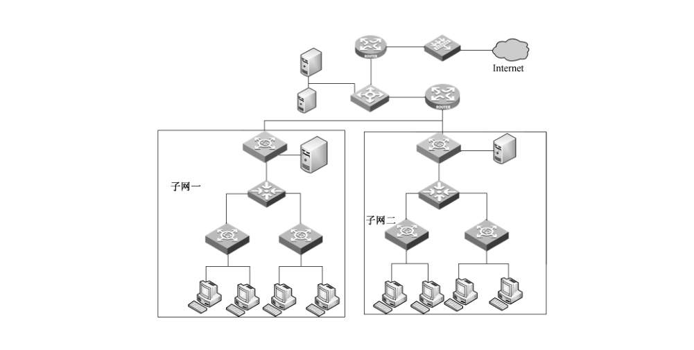

# GB/T 21050-2019 信息安全技术 网络交换机安全技术要求

> 来源：[GB/T 21050-2019 国家标准详情](https://openstd.samr.gov.cn/bzgk/std/newGbInfo?hcno=BEF55138FEC8BCA2DB7EC22F424A5CBC)；封面发布日期：2019-08-30；实施日期：2020-03-01。
> 官方 PDF SHA-256：2a4c980c8336d75bb425958ccbb0887e8119fcb48e7007c81a0b4e9ce76abe42。
> 依据官方 PDF 全部 55 页页面图像转写与校核；省略封面、目录、页眉、页脚和分页，合并跨页表格及印刷折行。正式引用请核对官方原文。

## 前言

本标准按照 GB/T 1.1—2009给出的规则起草。

本标准代替 GB/T 21050—2007《信息安全技术 网络交换机安全技术要求（评估保证级3）》。与 GB/T 21050—2007 相比，除编辑性修改外主要技术变化如下：

- 对使用范围进行了修改，并增加了关于密码算法的约定（见第1章，2007年版的第1章）；
- 增加了对术语标准的引用（见第2章，2007年版的第2章）；
- 增加了“可信 IT 产品”术语，删掉了“网络交换机”术语（见第3章，2007年版的第3章）；
- 修改了网络交换机的描述（见第4章，2007年版的第4章）；
- 将安全环境修改为安全问题定义，且归并和修改了假设、威胁、组织安全策略（见第5章，2007年版的第5章）；
- 修改和删减了安全目的（见第6章，2007年版的第6章）；
- 增加了扩展组件，根据 GB/T 18336—2015 增删了安全要求（见第7章）；
- 增加了基本原理一章（见第8章）。

请注意本文件的某些内容可能涉及专利。本文件的发布机构不承担识别这些专利的责任。

本标准由全国信息安全标准化技术委员会（SAC/TC 260）提出并归口。

本标准起草单位：中国信息安全测评中心、吉林信息安全测评中心、华为技术有限公司、清华大学、锐捷网络股份有限公司、网神信息技术（北京）股份有限公司。

本标准主要起草人：李凤娟、张宝峰、刘晖、张翀斌、贾炜、张骁、庞博、刘昱函、唐喜庆、蒋显岚、刘玭娉、钟建伟、刘海利、叶晓俊、李玲、徐涛。

本标准所代替标准的历次版本发布情况为：GB/T 21050—2007。

## 1 范围

本标准规定了网络交换机达到 EAL2 和 EAL3 的安全功能要求及安全保障要求，涵盖了安全问题定义、安全目的、安全要求等内容。

本标准适用于网络交换机的测试、评估和采购，也可用于指导该类产品的研制和开发。

## 2 规范性引用文件

下列文件对于本文件的应用是必不可少的。凡是注日期的引用文件，仅注日期的版本适用于本文件。凡是不注日期的引用文件，其最新版本（包括所有的修改单）适用于本文件。

- GB/T 18336.1—2015 信息技术 安全技术 信息技术安全评估准则 第1部分：简介和一般模型
- GB/T 18336.2—2015 信息技术 安全技术 信息技术安全评估准则 第2部分：安全功能组件
- GB/T 18336.3—2015 信息技术 安全技术 信息技术安全评估准则 第3部分：安全保障组件
- GB/T 25069—2010 信息安全技术 术语

## 3 术语和定义、缩略语

### 3.1 术语和定义

GB/T 25069—2010和 GB/T 18336.1—2015 界定的以及下列术语和定义适用于本文件。

#### 3.1.1 可信 IT 产品 trusted IT product

有与TOE 协调管理的安全功能要求，但不属于TOE的其他IT 产品，且假定可正确执行自身的安全功能要求。

#### 3.1.2 可信信道 trusted channel

TSF 和远程可信IT 产品间在必要的信任基础上进行通信的一种通信手段。

#### 3.1.3 可信路径 trusted path

用户与TSF 间在必要的信任基础上进行通信的一种通信手段。

#### 3.1.4 可信源 trusted source

能够被标识和鉴别的源或节点，从该源或节点发出信息的完整性能够被核实和确认。

#### 3.1.5 客户 client

向另一方请求服务的一方。

［GB/T 11457—2006，定义2.214］

#### 3.1.6 网络审计管理员 network audit management operator

仅具有查看权限，是负责收集、分析和查看网络行为数据的网络管理角色。

> 注：网络审计管理员可查看网络交换机配置、信息流策略等。

#### 3.1.7 网络配置管理员 network management administrator

受到严格限制的具有部分网络管理能力的管理角色，可以执行网络交换机管理功能的子集，但不具备网络审计管理员的能力。

> 注：网络配置管理员可配置管理网络系统，利用权限解决网络故障等。

#### 3.1.8 网络安全管理员 network security administrator

具有所有管理级别的访问权限，可以访问网络交换机的各个区域，同时具备网络配置管理员和网络审计管理员的能力的管理角色。

> 注：网络安全管理员可创建、修改和存取访问控制列表、加载密钥、限制应用程序的执行，以及维护网络管理审计日志等能力的网络管理角色。

#### 3.1.9 节点 node

计算机网络系统中可以对信息进行存储和（或）转发的设备。

### 3.2 缩略语

下列缩略语适用于本文件。

- BGP：边界网关协议（Border Gateway Protocol）
- EAL：评估保障级（Evaluation Assurance Level）
- HTTP：超文本传输协议（Hyper Text Transfer Protocol）
- IP：互联网协议（Internet Protocol）
- IT：信息技术（Information Technology）
- LDP：标签分发协议（Label Distribution Protocol）
- MD5：报文摘要算法（Message Digest 5）
- OSI：开放系统互联参考模型（Open System Interconnect）
- OSPF：开放式最短路径优先（Open Shortest Path First）
- RSVP：资源预留协议（Resource ReserVation Protocol）
- RMON：远距离监控（Remote MONitoring）
- SNMP：简单网络管理协议（Simple Network Management Protocol）
- ST：安全目标（Security Target）
- TOE：评估对象（Target Of Evaluation）
- TSF：TOE 安全功能（TOE Security Function）

## 4 网络交换机描述

网络交换机是一种连接网络的设备，用于连接各个节点或其他网络设备，能够在通信系统中完成信息交换功能的设备。从技术角度看，网络交换机运行在 OSI 模型的数据链路层、网络层甚至传输层。

虽然IP、光交换有各自不同的特性，但是它们的处理和控制方式是相似的。可信路径建立在网络交换机和管理系统之间，可信信道建立在网络交换机与可信IT 实体之间，通过可信路径可进行管理信息的交换，通过可信信道可进行网络控制信息（如，许可动态连接建立和包路由选择信息）的交换。网络控制信息由特定的请求和指令组成，如目的地址、路由选择控制和信令信息等。在IP环境下，控制信息可以包括 OSPF、BGP、RSVP 和 LDP。

网络交换机一般包括接口卡、端口、软件，以及驻留在其上的数据等。与网络交换机相关的所有电路都属于网络交换机的一部分，其中包括管理链路。虽然网络管理系统是必需的部件，但是它不属于本标准的规范范围，而且连接到网络交换机的其他网络部件也不属于本标准的规范范围。例如，交叉连接的数字传送系统、光传送系统、加密装置等。然而，网络交换机可以支持加密或具有连接加密装置的接口，用于加密用户数据、管理和控制信息。网络交换机具有保护网络管理和进行网络控制的功能，允许通过网络可靠传递用户信息，并具有可靠的质量和及时性。

网络交换机的主要安全特性包括安全审计、安全管理、用户数据保护、用户鉴别和认证、加密支持、数据传输和存储安全等。图1为网络交换机典型应用环境。

## 5 安全问题定义

### 5.1 资产

本标准中保护的资产包括以下方面：

- 审计数据（审计数据由网络交换机执行安全审计功能时产生）；
- 认证数据（用于用户和外部实体访问交互时的鉴别和认证）；
- 配置数据（网络交换机的配置信息、网络连接信息、固件更新数据等）；
- 密码数据（用于交换机实施数字签名或加解密的数据，如密钥等）；
- 表数据（用于网络转发和路由相关的列表，如网络层路由表、链路层地址解析表、链路层 MAC 地址表、BGP/OSPF 数据库等数据）。

应用说明：ST编写者应根据具体的应用情况细化对资产的描述。

### 5.2 威胁

#### 5.2.1 通信分析（T.Analysis）

攻击者可能通过收集大量数据以及数据的源、目的地址和发送数据的日期、时间进行分析。

#### 5.2.2 审计机制失效（T.Audit_Compromise）

恶意用户或进程可能修改 TOE 审计策略，使TOE审计功能停用或失效、审计记录丢失或被篡改，也有可能通过审计数据存储失效来阻止未来审计记录被存储，从而掩盖用户的操作。

#### 5.2.3 未授权网络访问并获取数据（T.Capture）

攻击者可能通过窃听、接入传输线或用其他方式获取通信信道上传输的数据。

#### 5.2.4 节点泄露（T.Compromised_Node）

修改网络交换机配置文件或路由表使得节点变得不安全，导致网络交换机运行异常、网络交换机安全功能失效，或流量可能被重路由经过未授权的节点。

#### 5.2.5 隐通道（T.Covert）

隐通道是隐藏在系统内部，允许以违背系统安全策略的形式传送信息的通信通道，其目的是用于不被监控地传送信息。

#### 5.2.6 密码分析（T.Cryptanalytic）

攻击者为了复原信息内容而去尝试进行对已加密数据的密码分析。

#### 5.2.7 拒绝服务（T.Denial）

攻击者通过执行指令、发送超限额的高优先级流量数据，或执行其他操作，在网络上造成不合理的负载，造成授权客户得不到应有的系统资源，即导致拒绝服务。

#### 5.2.8 部件或电源失效（T.Fail）

一个或多个系统部件或电源失效可能造成重要系统功能破坏和重要系统数据的丢失。

#### 5.2.9 硬件、软件或固件的缺陷（T.Flaw）

硬件、软件或固件的缺陷导致网络交换机及其安全功能的脆弱性。

#### 5.2.10 管理员网络授权的滥用（T.Hostile_Admin）

网络配置管理员或网络安全管理员有意滥用授予的权限，进行不适当地存取或修改数据信息，例如，配置数据、审计数据、口令文件，或误处理其他的敏感数据文件。

#### 5.2.11 管理错误（T.Mgmt_Error）

拥有网络配置管理员角色的人员可能无意地不恰当存取、修改了数据信息，或误用资源。

#### 5.2.12 修改协议（T.Modify）

攻击者未经授权的修改或控制协议（例如，路由选择、信号等协议）。

#### 5.2.13 网络探测（T.NtwkMap）

攻击者可能进行网络探测来获得节点地址、路由表信息和物理位置。

#### 5.2.14 重放攻击（T.Replay_Attack）

攻击者通过记录通信会话，并重放它们伪装成已验证的客户非法获取网络交换机的访问权。管理信息也可能被记录和重放，从而用于伪装成已验证的网络配置管理员或网络安全管理员来得到对网络管理资源的访问权。

#### 5.2.15 配置数据泄露（T.Sel_Pro）

攻击者可能读、修改或破坏网络交换机的安全配置数据。

#### 5.2.16 欺骗攻击（T.Spoof）

未授权节点可能使用有效的网络地址来尝试访问网络，即客户通过获得的网络地址来伪装成已授权的用户，企图得到网络交换机资源。

#### 5.2.17 对管理端口的非授权访问（T.Unauth_Mgmt_Access）

攻击者或滥用特权的网络配置管理员可能通过Telnet、RMON 或其他方式访问管理端口，从而重新配置网络、引起拒绝服务、监视流量、执行流量分析等。

### 5.3 组织安全策略

#### 5.3.1 可核查性（P.Accountability）

使用网络交换机传送信息的组织，拥有网络配置管理员角色的人员和开发者应对他们的行为活动负责。

#### 5.3.2 审计管理行为（P.Audit_Admin）

网络管理系统应能产生和传送审计记录，审计记录应提供和包括充足的信息，用来确定在事件发生时的管理员、管理时间和管理行为；组织应周期性地审核审计记录。

#### 5.3.3 操作员和节点的鉴别（P.Authentication）

网络交换机应能支持对网络审计管理员、网络配置管理员和网络安全管理员的鉴别，并且网络交换机也应支持对等节点的鉴别。

#### 5.3.4 网络可用性（P.Availability）

应能保证网络资源对许可客户的任务需求和传送信息需求能够持续满足。

#### 5.3.5 信息的保密性（P.Confidentiality）

统计数据、配置信息和连接信息应保持实时和存储状态下的保密性。为了保持其保密性，网络交换机应能够支持加密装置的加解密能力或接口支持能力。

#### 5.3.6 默认配置（P.Default_Config）

网络交换机的默认设置应能防止网络交换机安全性功能的削弱或失效。鉴别机制、鉴别失败、超时锁定、管理口的访问控制等安全功能应是默认生效的。

#### 5.3.7 内容的完整性（P.Integrity）

管理和控制信息在传输期间应保持其内容的完整性，同时，所有信息要保持其储存状态下的完整性。

#### 5.3.8 互操作性（P.Interoperability）

网络交换机应能与其他厂商的网络交换机互连互通。在网络交换机中要实现标准化的、非专有的协议（如路由选择、信令协议等）。厂商可以选择性地实现一些专有协议，但为了互通的目的厂商也应在网络交换机中实现标准协议。

#### 5.3.9 故障通告（P.Notify）

网络交换机及其安全环境应具备（或在其他设备配合下具备）提醒和报警能力，例如，通过 SNMP第3版的陷门（trap）机制发送部件、固件、硬件或软件的失效通知。

#### 5.3.10 对等节点（P.Peer）

安全的节点应有接受来自信任和不信任节点流量的能力。为了保护信息，流量将会在信任和不信任的节点之间被过滤。

#### 5.3.11 可靠传输（P.Reliable_Transport）

网络管理和控制应实现特定的可靠传送和检错机制。

#### 5.3.12 网络可生存性与恢复（P.Survive）

网络资源应能够从恶意的破坏尝试中恢复，同时应具有从传输错误中恢复的能力。网络应能抵御硬件或软件失效，或具有在合理时间内复原的能力。用于恢复的任何环境都应被记录下来。

#### 5.3.13 硬件、软件和固件的完整性（P.SysAssur）

应提供在初始化、软硬固件升级时保持其完整性的功能和规程，确认已接收的网络交换机信息文件、异常通知、补丁程序、升级文件等的完整性，上述文件或信息应有实时的分发基础。应在初始安装和软件升级和固件交换时确保其完整性。

### 5.4 假设

#### 5.4.1 物理保护（A.Physical）

网络交换机应放置于受控访问的物理环境内，以避免被未经授权者物理访问。该环境应提供不间断电源、温湿度控制等措施确保交换机能可靠运行。

#### 5.4.2 可信人员（A.Noevil & Train）

网络交换机授权管理员应是认真细心、负责任的，是可以信赖的，能够遵循所有管理员指南的规定，但是不可避免工作中可能会出错。管理员应受到合格的培训，具有正确使用、安装、配置和维护网络交换机、网络交换机安全功能和网络组件的能力。

#### 5.4.3 无通用性（A.No_General_Purpose）

除用于运行、管理和支持TOE 所需的服务外，假定在 TOE上无法获得通用的计算能力（如编译器或用户应用）。

## 6 安全目的

### 6.1 TOE 安全目的

#### 6.1.1 网络访问控制（O.Access_Control）

网络交换机应实现访问控制策略，访问控制策略基于但不限于网络交换机的任务（只处理可信任的或不可信任的，或者处理混合流量）、网络交换机的标识（由一个机构、网络提供者所有，同时也可由许多机构或客户所有）、源和目标地址、端口层次的过滤（如 Telnet、SNMP）等。

#### 6.1.2 带标识的审计记录（O.Admin_Audit）

网络配置管理员和网络安全管理员的活动应被审计，审计记录的存储和维护应符合安全策略。

#### 6.1.3 安全风险告警通知（O.Alarm）

网络交换机应有发现元件、软件或固件失败或错误的能力。网络交换机应提供安全相关事件和失败或错误提示的告警能力。

#### 6.1.4 管理属性（O.Attr_Mgt）

授权管理员应管理控制策略，只赋予授权网络配置管理员必需的权利。管理人员应在通过标识与鉴别后承担其特权角色。

#### 6.1.5 审计数据保护（O.Audit_Protection）

网络交换机应安全存储审计数据，并具有对存储的审计事件进行保护能力。

#### 6.1.6 审计记录查阅（O.Audit_Review）

所有的审计记录都应定期地被查阅，授权管理员应定期地查阅网络流量审计记录。

#### 6.1.7 网络配置保密性（O.Cfg_Confidentiality）

网络交换机应保证统计数据、配置和连接信息在实时和存储状态下不会泄露。

#### 6.1.8 配置完整性（O.Cfg_Integrity）

网络交换机应保证审计文件、配置、连接信息和属于网络交换机的其他信息的完整性。

#### 6.1.9 管理配置数据（O.Cfg_Manage）

应有获取和保存网络交换机的配置和连接信息的能力，应保证存储的完整性，能进行系统部件的鉴别与系统连接的鉴别。

#### 6.1.10 加密机制支持（O.Cryptography）

为了支持保密性，网络交换机应支持加密机制，该加密机制要支持客户注册、密钥管理和信道隔离在内的服务，其使用的密码算法应符合国家、行业或组织要求的密码管理相关标准或规范。

> 注：如果 TOE所使用的密码算法不是由TOE 自身实现，则可将此安全目的移至ST 的环境安全目的中。

#### 6.1.11 控制数据的可信通道（O.Ctrl_Channel）

提供对等网络交换机之间传输控制数据的完整性和保密性；提供独立的可信信道。

#### 6.1.12 受控标识和鉴别（O.Ctrl_I&A）

只有在请求连接的目标地址、标识、鉴别和权限与控制策略一致时，才能连接到网络交换机。

#### 6.1.13 检测非授权连接（O.Detect_Connection）

网络交换机应能检测并告警未经授权的连接。

#### 6.1.14 故障发生时安全状态的保存（O.Fail_Secure）

网络交换机应能保存部件失效或停电事件时的系统安全状态。

#### 6.1.15 管理标识和鉴别（O.Mgmt_I&A）

管理人员应在通过标识和鉴别后才能承担其特权角色。

#### 6.1.16 管理数据的可信路径（O.Mgmt_Path）

应保证网络交换机和网络管理站之间传输信息的完整性和保密性，应提供独立的可信信道。

#### 6.1.17 安全修复和补丁（O.Patches）

网络交换机应安装最新的补丁及时进行安全修复。

#### 6.1.18 业务优先级（O.Priority_Of_Service）

网络交换机应支持对所有的流量分配优先级，控制资源访问方式，以防止低级别服务干扰或延迟高级别的服务。

#### 6.1.19 地址保护（O.Protect_Addresses）

网络交换机应保护已授权组织内部地址的保密性和完整性。在网络交换机收到数据后，应能正确地解析出经过授权的源地址和目的地址。

#### 6.1.20 协议（O.Protocols）

在网络交换机中应实现能与其他厂商的网络交换机互操作的标准协议，并在网络交换机中实现可靠交付和错误检测的协议。

#### 6.1.21 避免重放攻击（O.Replay_Prevent）

网络交换机应具有防止未经授权的代理伪装成经过授权的代理能力，保护其自身免受重放攻击。

#### 6.1.22 网络交换机的自身防护（O.Sel_Pro）

网络交换机应做好自身防护，以对抗非授权用户对网络交换机安全功能的旁路、抑制或篡改的尝试。

#### 6.1.23 自检（O.Self_Test）

网络交换机应具备对自身的检测能力，以确保网络交换机的安全功能能够正确运行。

#### 6.1.24 带标识的审计流量记录（O.Traf_Audit）

审计记录应包括日期、时间、流量异常现象、节点标识符和负责传输数据的组织。网络交换机应保证所有的审计记录的完整性。

#### 6.1.25 系统数据备份的完整性和保密性（O.Trust_Backup）

应确保网络交换机的网络文件和配置参数有冗余备份。备份文件应以符合网络安全策略的方式存储，以便保证文件的完整性和保密性，另外，应能由备份文件充分地复现网络交换机的配置，以用于在出现失败事件或安全泄密的情况下恢复网络交换机的功能；网络文件可自动地复制备份到另外的管理站。

#### 6.1.26 可信的恢复（O.Trusted_Recovery）

应确保网络交换机在失效或错误后恢复到没有安全泄密的安全状态，应确保失效部件更替后，系统的状态恢复，并且保证不会引发错误或造成其他安全缺陷。

#### 6.1.27 未用区域（O.Unused_Fields）

网络交换机应保证协议头内所有未被使用域的数值都被恰当地设定。

#### 6.1.28 更新验证（O.Update_Validation）

网络交换机应具备对更新数据的验证能力，以确保更新数据是可信任的。

### 6.2 环境安全目的

#### 6.2.1 物理保护（OE.Physical）

网络交换机及其连接的外围设备（如接入的控制台和存储卡等）应放置在于受控访问的物理环境内，以避免被未经授权者物理访问和破坏，同时运行环境提供稳定的电源防止掉电发生。

#### 6.2.2 可信人员（OE.Personnel）

应雇佣和使用可信赖和有能力的员工。操作和管理人员应经过相应的技能培训。

#### 6.2.3 无通用性（OE.No_General_Purpose）

除用于运行、管理和支持TOE所需的必要服务外，确保在TOE上无法获得其他通用的计算能力。

## 7 安全要求

### 7.1 扩展组件定义

#### 7.1.1 扩展组件原理

表1列出了本标准中基于 GB/T 18336.2—2015 安全功能组件扩展要求的基本原理，扩展组件在组件名称后加上“_EXT”表示。

**表1 扩展要求的基本原理**

| 标识符 | 组件名称 | 基本原理 |
| --- | --- | --- |
| FPT_TDP_EXT.1 | TSF 数据保护 | 网络交换机的管理员口令、加解密密钥、其他敏感数据等 TSF 数据如果明文存放，可能被非授权用户读取、修改和删除，应采用合适的安全机制保护存储的 TSF 数据。FPT_TDP_EXT.1 明确了这些敏感 TSF 数据在存储时避免被非授权访问要求。 |

#### 7.1.2 扩展功能组件

##### 7.1.2.1 类别

FPT：TSF 保护。

##### 7.1.2.2 族

FPT_TDP：用于网络交换机 TSF 数据存储的安全性。

##### 7.1.2.3 族行为

这个族提供网络交换机对敏感 TSF 数据的存储安全及避免非授权访问的安全要求定义。

##### 7.1.2.4 管理

无。

##### 7.1.2.5 审计

无。

##### 7.1.2.6 定义

TSF 数据保护（FPT_TDP_EXT.1）

FPT_TDP_EXT.1.1 网络交换机应采用非明文方式存储【管理员口令、加解密密钥，其他敏感数据】。

FPT_TDP_EXT.1.2 网络交换机的安全功能应能防止【明文存储数据】被非授权用户读取。

FPT_TDP_EXT.1.3 网络交换机的安全功能应能防止【管理员口令、加解密密钥，其他数据】被非授权用户【读取、修改、删除】。

依赖关系：FCS_COP.1 密码运算。

应用说明：方括号【】中的黑斜体字的内容表示还需在安全目标（ST）中确定的赋值及选择项，此约定也适用于后续章条。

### 7.2 安全功能要求

#### 7.2.1 概述

表2列出了网络交换机信息技术安全功能要求组件，这些要求由 GB/T 18336.2—2015 中的安全功能要求组件和扩展组件组成，以下对各组件给出了详细的说明。

**表2 安全功能要求组件**

| 安全功能要求类 | 序号 | 安全功能要求组件 | 组件名称 |
| --- | --- | --- | --- |
| 安全审计（FAU 类） | 1 | FAU_GEN.1 | 审计数据产生 |
|  | 2 | FAU_GEN.2 | 用户身份关联 |
|  | 3 | FAU_SAR.1 | 审计查阅 |
|  | 4 | FAU_SEL.1 | 选择性审计 |
|  | 5 | FAU_STG.1 | 受保护的审计迹存储 |
|  | 6 | FAU_STG.4 | 防止审计数据丢失 |
| 密码支持（FCS 类） | 7 | FCS_COP.1 | 密码运算 |
|  | 8 | FCS_CKM.1 | 密钥生成 |
|  | 9 | FCS_CKM.4 | 密钥销毁 |
| 用户数据保护（FDP 类） | 10 | FDP_ACC.1 | 子集访问控制 |
|  | 11 | FDP_ACF.1 | 基于安全属性的访问控制 |
|  | 12 | FDP_ETC.2 | 带有安全属性的用户数据输出 |
|  | 13 | FDP_IFC.1 | 子集信息流控制 |
|  | 14 | FDP_IFF.1 | 简单安全属性 |
|  | 15 | FDP_ITC.2 | 带有安全属性的用户数据输入 |
|  | 16 | FDP_UIT.1 | 数据交换完整性 |
|  | 17 | FDP_UIT.2 | 原发端数据交换恢复 |
| 标识和鉴别（FIA 类） | 18 | FIA_UAU.2 | 任何行动前的用户鉴别 |
|  | 19 | FIA_UID.2 | 任何行动前的用户标识 |
|  | 20 | FIA_AFL.1 | 鉴别失败处理 |
|  | 21 | FIA_SOS.1 | 秘密的验证 |
| 安全管理（FMT 类） | 22 | FMT_MOF.1 | 安全功能行为的管理 |
|  | 23 | FMT_MSA.1 | 安全属性的管理 |
|  | 24 | FMT_MSA.3 | 静态属性初始化 |
|  | 25 | FMT_MTD.1 | 安全功能数据的管理 |
|  | 26 | FMT_SMF.1 | 管理功能规范 |
|  | 27 | FMT_SMR.2 | 安全角色限制 |
| TSF 保护（FPT） | 28 | FPT_FLS.1 | 失效即保持安全状态 |
|  | 29 | FPT_ITC.1 | 传送过程中 TSF 间的保密性 |
|  | 30 | FPT_ITI.1 | TSF 间篡改的检测 |
|  | 31 | FPT_RCV.3 | 无过度损失的自动恢复 |
|  | 32 | FPT_RCV.4 | 功能恢复 |
|  | 33 | FPT_RPL.1 | 重放检测 |
|  | 34 | FPT_STM.1 | 可靠的时间戳 |
|  | 35 | FPT_TDC.1 | TSF 间基本的 TSF 数据一致性 |
|  | 36 | FPT_TST.1 | TSF 测试 |
|  | 37 | FPT_TDP_EXT.1 | TSF 数据保护 |
| 资源利用（FRU 类） | 38 | FRU_FLT.1 | 降低容错 |
|  | 39 | FRU_PRS.2 | 全部服务优先级 |
|  | 40 | FRU_RSA.1 | 最高配额 |
| 网络交换机访问（FTA 类） | 41 | FTA_TSE.1 | 会话建立 |
|  | 42 | FTA_SSL.3 | TSF 原发会话终止 |
| 可信路径/信道（FTP 类） | 43 | FTP_ITC.1 | TSF 间可信信道 |
|  | 44 | FTP_TRP.1 | 可信路径 |

#### 7.2.2 安全审计（FAU类）

##### 7.2.2.1 审计数据产生（FAU_GEN.1）

FAU_GEN.1.1 网络交换机的安全功能应能为下列可审计事件产生审计记录：

a） 审计功能的启动和关闭；

b）【基本级】审计的所有可审计事件；

c）【对网络审计管理员、网络配置管理员和网络安全管理员的审计：访问权限和能力的分配或撤消、任何由网络管理人员所做出的更改、进程运行期间的时间和日期、和网络管理人员执行活动的时间和日期。对于终结于网络交换机的流量的审计：能够记录异常流量的源和目的节点】。

FAU_GEN.1.2 网络交换机的安全功能应在每个审计记录中至少记录如下信息：

a） 事件的日期和时间、事件类型、主体身份、事件的结果（成功或失败）；

b） 对每种审计事件类型是基于保护轮廓或安全目标文档中安全功能要求组件的可审计事件进行定义的，其他相关审计事件包括：【收到不可信源的流量、接受来自不可信源的流量、恢复安全性相关事件的响应行动、恢复一个与安全性相关事件花费的时间、被安全性相关事件影响的所有组件】。

##### 7.2.2.2 用户身份关联（FAU_GEN.2）

FAU_GEN.2.1 网络交换机的安全功能应能将每个可审计事件与引起该事件的用户身份相关联。

用户的网络管理审计数据将关注网络管理角色涉及的人员，而用户的流量统计数据将关注网络交换机的标识。

##### 7.2.2.3 审计查阅（FAU_SAR.1）

FAU_SAR.1.1 网络交换机的安全功能应为【指定的网络安全管理员】提供从审计记录中读取【所有审计数据】的能力。

FAU_SAR.1.2 网络交换机的安全功能应以便于用户理解的方式提供审计记录。

##### 7.2.2.4 选择性审计（FAU_SEL.1）

FAU_SEL.1.1 网络交换机的安全功能根据以下属性包括或排除审计事件集中的可审计事件：【客体标识、用户标识、主体标识、主机标识、事件类型】。

##### 7.2.2.5 受保护的审计迹存储（FAU_STG.1）

FAU_STG.1.1 网络交换机的安全功能应保护审计迹中存储的审计记录。以避免未授权的删除。

FAU_STG.1.2 网络交换机的安全功能应能【防止】对审计迹中所存审计记录的未授权修改。

##### 7.2.2.6 防止审计数据丢失（FAU_STG.4）

FAU_STG.4.1 如果审计迹已满，网络交换机的安全功能应【覆盖所存储的最早的审计记录】。

#### 7.2.3 密码支持（FCS类）

##### 7.2.3.1 密码运算（FCS_COP.1）

FCS_COP.1.1 网络交换机的安全功能应根据符合下列标准【赋值：标准列表（国家、行业或组织要求的密码管理相关标准或规范）】的特定的密码算法【赋值：密码算法】和密钥长度【赋值：密钥长度】来执行【赋值：密码运算列表】。

> 注：ST 作者可根据密码算法的具体情况赋值国家、行业或组织主管部门认可的相关标准及参数。

##### 7.2.3.2 密钥生成（FCS_CKM.1）

FCS_CKM.1.1 网络交换机的安全功能应根据符合下列标准【赋值：标准列表（国家、行业或组织要求的密码管理相关标准或规范）】的一个特定的密钥生成算法【赋值：密钥生成算法】和规定的密钥长度【赋值：密钥长度】来生成密钥。

> 注：该组件仅适用于密钥生成功能由 TOE 本身完成的情况，此时ST 编写者可根据密码算法的具体情况，赋值国家主管部门认可的相关标准及参数；若密钥由外部环境生成，则可以不选择此组件。

##### 7.2.3.3 密钥销毁（FCS_CKM.4）

FCS_CKM.4.1 网络交换机的安全功能应根据符合下列标准【赋值：标准列表】的一个特定的密钥销毁方法【赋值：密钥销毁方法】来销毁密钥。

> 注：ST编写者可根据密码算法的具体情况赋值国家主管部门认可的相关标准及密钥销毁方法，若密钥由外部环境生成，则可以不选择此组件。

#### 7.2.4 用户数据保护（FDP 类）

##### 7.2.4.1 子集访问控制（FDP_ACC.1）

FDP_ACC.1.1 网络交换机的安全功能应对【通信请求】执行【访问控制策略】。

依赖关系：FDP_ACF.1 基于安全属性的访问控制。

##### 7.2.4.2 基于安全性属性的访问控制（FDP_ACF.1）

FDP_ACF.1.1 网络交换机的安全功能应基于【标识、鉴别和连接通信会话中另一个成员的节点的授权】对客体强制执行【访问控制策略】。

FDP_ACF.1.2 网络交换机的安全功能应执行以下规则，以决定受控主体与受控客体间的操作是否被允许：【源网络交换机的地址应在目的网络交换机的访问控制列表中标识出来，授权应发生在接收消息之前】。

FDP_ACF.1.3 网络交换机的安全功能应基于以下附加规则决定主体对客体的访问授权：【合法键值的拥有者、网络交换机的角色（处理仅从可信源来的流量，或配置成也可从不可信源接收流量）、时间和流量特征（如控制信息）】。

FDP_ACF.1.4 网络交换机的安全功能应基于【发送者的地址】明确拒绝主体对客体的访问。

##### 7.2.4.3 带有安全属性的用户数据输出（FDP_ETC.2）

FDP_ETC.2.1 网络交换机的安全功能在安全功能策略的控制下输出用户数据到安全功能的控制范围之外时，应执行【访问控制策略】。

FDP_ETC.2.2 网络交换机的安全功能应输出带有相关安全属性的用户数据。

FDP_ETC.2.3 网络交换机的安全功能在安全属性输出到安全功能的控制范围之外时，应确保其与输出的数据确切关联。

FDP_ETC.2.4 网络交换机的安全功能在用户数据从安全功能的控制范围输出时，【传输数据的网络交换机应保证具有完整性保护】。

##### 7.2.4.4 子集信息流控制（FDP_IFC.1）

FDP_IFC.1.1 网络交换机的安全功能应对【从不可信源接收到的控制信息（信令和路由信息）】执行【信息流控制策略】。

##### 7.2.4.5 简单安全属性（FDP_IFF.1）

FDP_IFF.1.1 网络交换机的安全功能应基于下列类型的主体和信息安全属性：【最小化的信息流控制策略，功能与访问控制策略相关联；可以识别控制信息的源，无论它是可信任的或不可信任的（可信源是可标识和可鉴别的，而且控制信息的完整性是可校验的）；生成消息源的鉴别】，执行【信息流控制策略】。

FDP_IFF.1.2 如果有下面的规则【消息的源头可以被接收方标识和鉴别，并且消息的完整性是可校验的】，网络交换机的安全功能应允许受控主体和受控信息之间存在经由受控操作的信息流，即网络交换机的安全功能应允许在受控主体之间存在一个信息流。

FDP_IFF.1.3 网络交换机的安全功能应执行【信息流控制策略：当发生网络通信失败的事件时，在需做出路由和重路由的决定时，来自可信源的控制信息的优先级要高于从不可信源接收的控制信息】。

FDP_IFF.1.4 网络交换机的安全功能应提供下列功能【1.从不可信源接收数据；2.审计接收到的来自不可信源的数据；3.配置网络交换机的安全功能以实现对来自不可信源数据接收的策略】。

FDP_IFF.1.5 网络交换机的安全功能应根据下列规则：【1.预先建立的可信任（静态）路由；2.网络管理端通过可信路径的管理信息】，明确批准信息流。

FDP_IFF.1.6 网络交换机的安全功能应基于下列规则：【配置安全策略以拒绝接收来自不可信源的数据】，明确拒绝信息流。

##### 7.2.4.6 带有安全属性的用户数据输入（FDP_ITC.2）

FDP_ITC.2.1 网络交换机的安全功能在安全功能策略的控制下从安全功能的控制范围之外输入用户数据时，应执行【基于访问控制列表的标识的使用、拥有合法密钥证据的校验、完整性检查的校验、或源地址的识别】。

FDP_ITC.2.2 网络交换机的安全功能应使用与输入的数据相关的安全属性。

FDP_ITC.2.3 网络交换机的安全功能应确保使用的协议在安全属性和接收的用户数据之间提供了明确的联系。

FDP_ITC.2.4 网络交换机的安全功能应确保对输入的用户数据安全属性的解释与用户数据源的解释是一致的。

FDP_ITC.2.5 网络交换机的安全功能在安全功能策略的控制下从安全功能的控制范围之外输入用户数据时，应执行【赋值：】。

##### 7.2.4.7 数据交换完整性（FDP_UIT.1）

FDP_UIT.1.1 网络交换机的安全功能应执行【信息控制策略】，使得能以某种方式【传送、接收】用户数据，保护数据避免出现【篡改、删除、插入、重用】错误。

FDP_UIT.1.2 网络交换机的安全功能应能根据收到的用户数据，判断是否出现了【篡改、删除、插入、重用】。

##### 7.2.4.8 原发端数据交换恢复（FDP_UIT.2）

FDP_UIT.2.1 网络交换机的安全功能应执行【帧序列检查、循环冗余码校验、流量整形、抗重放、和完整复制所有网络管理数据文件给某一分离的备份源】，以便能在原发端可信IT 产品的帮助下，从【包的序列变化、重放包、不完整的数据传输、丢掉的包、网络拥塞和主要网络管理系统中的失败】中恢复。

#### 7.2.5 标识和鉴别（FIA类）

##### 7.2.5.1 任何行动前的用户鉴别（FIA_UAU.2）

FIA_UAU.2.1 在允许执行任何代表用户的其他安全功能促成的行动执行前，网络交换机的安全功能应要求该用户已被成功鉴别。

##### 7.2.5.2 任何行动前的用户标识（FIA_UID.2）

FIA_UID.2.1 在允许执行任何代表用户的其他安全功能促成的行动之前，网络交换机的安全功能应要求用户标识自己。

##### 7.2.5.3 鉴别失败处理（FIA_AFL.1）

FIA_AFL.1.1 当与【鉴别事件列表】相关的【数目】次不成功鉴别尝试出现时，网络交换机的安全功能应加以检测。

FIA_AFL.1.2 当达到或超过所定义的不成功鉴别尝试的次数时，网络交换机的安全功能应【行为列表】。

##### 7.2.5.4 秘密的验证（FIA_SOS.1）

FIA_SOS.1.1 网络交换机的安全功能应提供一种机制以验证秘密满足【

1. 密码的长度；
2. 密码的复杂度；
3. 密码的更改周期；
4. ……

】。

#### 7.2.6 安全管理（FMT类）

##### 7.2.6.1 安全功能行为的管理（FMT_MOF.1）

FMT_MOF.1.1 网络交换机的安全功能应仅限于【网络安全管理员角色】对【网络交换机在安装时和贯穿整个生命周期的安全修复/补丁、选择可审计事件、管理用户账户、管理审计日志、管理访问控制策略、管理信息流控制策略、到可信任时间源的网络交换机连接、包括网络交换机数据文件的备份和恢复的网络交换机资源的维护】功能具有【确定其行为、激活、终止、修改其行为】的能力。

网络交换机的安全功能应仅限于【网络配置管理员负责建立和配置连接】对【网络交换机的配置和网络交换机资源的维护】功能具有【确定其行为、禁止、允许、修改其行为】的能力。

##### 7.2.6.2 安全属性的管理（FMT_MSA.1）

FMT_MSA.1.1 网络交换机的安全功能应执行【访问控制列表】，以仅限于【网络安全管理员角色】能够对【选择可审计事件、管理审计日志、网络管理系统访问控制列表和账户、网络用户访问控制列表和账户】安全属性【改变默认值、查询、修改、删除】。

网络交换机的安全功能应执行【访问控制列表】，以仅限于【网络配置管理员角色】能够对安全属性【网络用户访问控制列表和账户】进行【改变默认值、查询、修改、删除】。

网络交换机应执行【访问控制列表】，以仅限于【网络审计管理员、网络配置管理员、网络安全管理员角色】，能够执行【监控和收集网络行为属性】以及【监控和分析流量行为】安全属性的能力。

##### 7.2.6.3 静态属性初始化（FMT_MSA.3）

FMT_MSA.3.1 网络交换机的安全功能应执行【访问控制策略】，以便为用于执行安全功能策略的安全属性提供【受限的】默认值。

FMT_MSA.3.2 网络交换机的安全功能应允许【负责建立和配置连接的网络配置管理员或网络安全管理员角色】为生成的客体或信息指定替换性的初始值以代替原来的默认值。

##### 7.2.6.4 安全功能数据的管理（FMT_MTD.1）

FMT_MTD.1.1 网络交换机的安全功能应仅限于【网络安全管理员】能够对【当前网络管理审计数据的指定区域，和网络流量数据】进行【改变默认值、查询】的操作。

网络交换机的安全功能应仅限于【网络安全管理员】能够对【TSF（如共享密钥、证书）数据】进行【添加、修改、删除、查询】的操作。

网络交换机的安全功能应仅限于【网络配置管理员】能够对【当前网络流量审计数据的指定区域】进行【改变默认值、查询】的操作。

网络交换机的安全功能应仅限于【网络审计管理员】能够对【当前网络流量审计数据的指定区域】进行【查询】的操作。

##### 7.2.6.5 管理功能规范（FMT_SMF.1）

FMT_SMF.1.1 TSF 应能够执行如下管理功能【TSF 提供的安全管理功能列表】。

##### 7.2.6.6 安全角色限制（FMT_SMR.2）

FMT_SMR.2.1 网络交换机的安全功能应维护【网络安全管理员】角色。

FMT_SMR.2.2 网络交换机的安全功能应能够把管理员用户和角色关联起来。

FMT_SMR.2.3 网络交换机的安全功能应确保条件【网络审计管理员或网络配置管理员不能假定为网络安全管理员角色】得到满足。

#### 7.2.7 TSF 保护（FPT类）

##### 7.2.7.1 失效即保持安全状态（FPT_FLS.1）

FPT_FLS.1.1 网络交换机的安全功能在【硬件组件失败、短期电源中断】失败发生时应保存一个安全状态。

##### 7.2.7.2 传送过程中 TSF 间的保密性（FPT_ITC.1）

FPT_ITC.1.1 在网络交换机的安全功能数据从安全功能到远程可信 IT 产品的传送过程中，网络交换机的安全功能应保护所有的安全功能数据不被未授权泄露。

##### 7.2.7.3 TSF 间篡改的检测（FPT_ITI.1）

FPT_ITI.1.1 网络交换机的安全功能应提供在下列量度范围内：【强度应等同于或超过由MD5提供的完整性保护算法的强度】，检测网络交换机安全功能与远程可信IT 产品间传送的所有安全功能数据是否被修改的能力。

FPT_ITI.1.2 网络交换机的安全功能应提供能力，以验证安全功能与远程可信IT 产品间传送的所有安全功能数据的完整性，以及如果检测到修改应执行【数据的再次传输和产生审计记录】。

##### 7.2.7.4 无过度损失的自动恢复（FPT_RCV.3）

FPT_RCV.3.1 当不能从失败或服务中断自动恢复时，网络交换机的安全功能应进入维护方式，该方式提供将网络交换机返回到一个安全状态的能力。

FPT_RCV.3.2 对【备份电源供应、冗余处理器、网络管理系统错误或失败、组件（卡，端口）失败】，网络交换机的安全功能应确保通过自动化过程使网络交换机返回到一个安全状态。

FPT_RCV.3.3 网络交换机的安全功能提供的从失败或服务中断状态恢复的功能，应确保安全功能控制范围内的安全功能数据或客体的损失在不超过【赋值：】的情况下恢复到初始状态。

FPT_RCV.3.4 网络交换机的安全功能应提供决定客体能否被恢复的能力。

##### 7.2.7.5 功能恢复（FPT_RCV.4）

FPT_RCV.4.1 网络交换机的安全功能应确保【包括但不限于如下安全功能和故障情况：自动保护切换、冗余处理器的切换，备份电源供应的切换、信息传输连接的保存、循环冗余校验、帧序列检查、抗重放等安全功能、和如硬件组件故障、停电、软件错误/故障、系统处理器故障、网络管理系统故障、电路失效或组件故障等故障情况】有如下特性，即安全功能或者已成功完成，或者对指明的故障情况恢复到一致的安全状态。

##### 7.2.7.6 重放检测（FPT_RPL.1）

FPT_RPL.1.1 网络交换机的安全功能应检测以下实体的重放【消息（如管理和控制）、安全协商消息、被封装为信元或包传输的特定的特征（时间戳、哈希值、密钥等）】。

FPT_RPL.1.2 检测到重放时，网络交换机的安全功能应执行【审计、确认对于重放中来自合法的源的请求、阻挡来自源头的通信、发送陷阱以测试线路和扫描非授权的连接】。

##### 7.2.7.7 可靠的时间戳（FPT_STM.1）

FPT_STM.1.1 网络交换机的安全功能应能为自身的应用提供可靠的时间戳。

##### 7.2.7.8 TSF 间基本的 TSF 数据一致性（FPT_TDC.1）

FPT_TDC.1.1 当网络交换机的安全功能与其他可信IT产品共享其安全功能的数据时，网络交换机的安全功能应提供对【网络审计信息、控制信息和安全参数】一致性解释的能力。

FPT_TDC.1.2 当解释来自其他可信IT 产品的安全功能数据时，网络交换机的安全功能应使用【开发者（在安全目标文档中）指定的已鉴别的协议】。

##### 7.2.7.9 TSF 测试（FPT_TST.1）

FPT_TST.1.1 网络交换机的安全功能应在【初始化启动期间】和【网络安全管理员或网络配置管理员提出请求时】运行一组自检，以表明网络交换机安全功能操作的正确性。

FPT_TST.1.2 网络交换机的安全功能应为授权用户提供对网络交换机安全功能的数据完整性的验证能力。

FPT_TST.1.3 网络交换机的安全功能应为授权用户提供对存储的网络交换机安全功能的可执行代码完整性的验证能力。

#### 7.2.8 资源利用（FRU类）

##### 7.2.8.1 降低容错（FRU_FLT.1）

FRU_FLT.1.1 网络交换机的安全功能应确保当以下故障【硬件故障、软件错误、线路故障、路由控制和管理信息的恶意修改、缓冲区溢出、极端的网络拥塞、短暂的电源中断】发生时，能够执行【自动切换到备份组件或电源供应、安全信息传送、信息传送连接的保存、流量的正确路由、正确的信元/包的内部处理、流量整形、签署的服务质量/优先级的保存、当持续发生带有预攻击控制信息的特定网络操作时丢掉已被破坏的数据并对事件进行审计】操作。

##### 7.2.8.2 全部服务优先级（FRU_PRS.2）

FRU_PRS.2.1 网络交换机的安全功能应给在安全功能中的每个主体分配一种优先级。

FRU_PRS.2.2 网络交换机的安全功能应确保对所有可共享资源的每次访问都应基于分配给主体的优先级进行协调分配。

##### 7.2.8.3 最高配额（FRU_RSA.1）

FRU_RSA.1.1 TSF 应对以下资源：【单个端口或 VLAN 允许学习的 MAC 地址数目】分配最高配额，以便【其他端口或 VLAN】能【同时、在规定的时间间隔内】使用。

#### 7.2.9 网络交换机访问（FTA类）

##### 7.2.9.1 会话建立（FTA_TSE.1）

FTA_TSE.1.1 网络交换机的安全功能应能拒绝基于【节点标识、接收到的鉴别数据、标识为不可信的数据源、角色、地址、时间（维护窗口，或当适当的监控程序没有就位时）、或基于安全状态】的会话建立。

##### 7.2.9.2 TSF 原发会话终止（FTA_SSL.3）

FTA_SSL.3.1 网络交换机的安全功能应在达到【赋值：安全管理员可配置的用户不活动的时间间隔】之后终止一个交互式会话。

#### 7.2.10 可信路径/信道（FTP类）

##### 7.2.10.1 TSF 间可信信道（FTP_ITC.1）

FTP_ITC.1.1 网络交换机的安全功能应使用【选择：IPsec、SSH、SSL、TLS/HTTPS】在其自身和远程可信IT产品之间提供一条通信信道，此信道在逻辑上与其他通信信道截然不同，并且能够对其对端节点提供确定的标识，以及保护信道中数据免遭修改和泄露。

FTP_ITC.1.2 网络交换机的安全功能应允许【安全功能，远程的可信 IT 产品】经可信信道发起通信。

FTP_ITC.1.3 对于【控制信息的传输和安全属性的改变】，网络交换机的安全功能应经可信信道发起通信。

##### 7.2.10.2 可信路径（FTP_TRP.1）

FTP_TRP.1.1 网络交换机的安全功能应使用【选择：IPsec、SSH、TLS、TLS/HTTPS 中至少一种】在它自身和【远程、本地】用户之间提供一条通信路径，此路径在逻辑上与其他通信路径截然不同，并且能够对其对端节点提供确定的标识，以及保护通信数据免遭修改或泄露。

FTP_TRP.1.2 网络交换机的安全功能应允许【远程、本地】用户经可信路径发起通信。

FTP_TRP.1.3 对于【启动用户鉴别】和【网络管理信息的传输】，网络交换机的安全功能应要求使用可信路径。

### 7.3 安全保障要求

#### 7.3.1 安全保障级别

表3分别列出了网络交换机 EAL2 和 EAL3 级安全保障要求组件，这些要求由 GB/T 18336.3—2015 的安全保障要求组件组成，以下对各组件给出了详细的说明。

**表3 安全保障要求组件**

| 保障类 | 保障组件 | 序号 | EAL2 | EAL3 |
| --- | --- | --- | --- | --- |
| ADV：开发 | ADV_ARC.1 安全架构描述 | 1 | ✓ | ✓ |
|  | ADV_FSP.2 安全执行功能规范 | 2 | ✓ | N/A |
|  | ADV_FSP.3 带完整摘要的功能规范 | 3 | N/A | ✓ |
|  | ADV_TDS.1 基础设计 | 4 | ✓ | N/A |
|  | ADV_TDS.2 结构化设计 | 5 | N/A | ✓ |
| AGD：指导性文档 | AGD_OPE.1 操作用户指南 | 6 | ✓ | ✓ |
|  | AGD_PRE.1 准备程序 | 7 | ✓ | ✓ |
| ALC：生命周期支持 | ALC_CMC.2 CM 系统的使用 | 8 | ✓ | N/A |
|  | ALC_CMC.3 授权控制 | 9 | N/A | ✓ |
|  | ALC_CMS.2 部分 TOE CM 覆盖 | 10 | ✓ | N/A |
|  | ALC_CMS.3 实现表示 CM 覆盖 | 11 | N/A | ✓ |
|  | ALC_DEL.1 交付程序 | 12 | ✓ | ✓ |
|  | ALC_DVS.1 安全措施标识 | 13 | N/A | ✓ |
|  | ALC_LCD.1 开发者定义的生命周期模型 | 14 | N/A | ✓ |
| ASE：ST 评估 | ASE_CCL.1 符合性声明 | 15 | ✓ | ✓ |
|  | ASE_ECD.1 扩展组件定义 | 16 | ✓ | ✓ |
|  | ASE_INT.1 ST 引言 | 17 | ✓ | ✓ |
|  | ASE_OBJ.2 安全目的 | 18 | ✓ | ✓ |
|  | ASE_REQ.1 陈述性的安全要求 | 19 | ✓ | N/A |
|  | ASE_REQ.2 推导出的安全要求 | 20 | N/A | ✓ |
|  | ASE_SPD.1 安全问题定义 | 21 | ✓ | ✓ |
|  | ASE_TSS.1 TOE 概要规范 | 22 | ✓ | ✓ |
| ATE：测试 | ATE_COV.1 覆盖证据 | 23 | ✓ | ✓ |
|  | ATE_COV.2 覆盖分析 | 24 | N/A | ✓ |
|  | ATE_DPT.1 测试：基本设计 | 25 | N/A | ✓ |
|  | ATE_FUN.1 功能测试 | 26 | ✓ | ✓ |
|  | ATE_IND.2 独立测试—抽样 | 27 | ✓ | ✓ |
| AVA：脆弱性评定 | AVA_VAN.2 脆弱性分析 | 28 | ✓ | ✓ |

注：“✓”代表在该保障级下，选择该组件。“N/A”代表在该保障级下，该组件不适用。

#### 7.3.2 开发（ADV 类）

##### 7.3.2.1 安全架构描述（ADV_ARC.1）

开发者行为元素：

ADV_ARC.1.1D 开发者应设计并实现 TOE，确保 TSF 的安全特性不可旁路。

ADV_ARC.1.2D 开发者应设计并实现 TSF，以防止不可信任主体的破坏。

ADV_ARC.1.3D 开发者应提供 TSF 安全架构的描述。

内容和形式元素：

ADV_ARC.1.1C 安全架构的描述应与在 TOE设计文档中对SFR-执行的抽象描述的级别一致。

ADV_ARC.1.2C 安全架构的描述应描述与安全功能要求一致的TSF 安全域。

ADV_ARC.1.3C 安全架构的描述应描述 TSF 初始化过程为何是安全的。

ADV_ARC.1.4C 安全架构的描述应证实 TSF 可防止被破坏。

ADV_ARC.1.5C 安全架构的描述应证实 TSF 可防止 SFR-执行的功能被旁路。

评估者行为元素：

ADV_ARC.1.1E 评估者应确认提供的信息符合证据的内容和形式要求。

##### 7.3.2.2 安全执行功能规范（ADV_FSP.2）

开发者行为元素：

ADV_FSP.2.1D 开发者应提供一个功能规范。

ADV_FSP.2.2D 开发者应提供功能规范到安全功能要求的追溯关系。

内容和形式元素：

ADV_FSP.2.1C 功能规范应完整描述 TSF。

ADV_FSP.2.2C 功能规范应描述所有的 TSFI的目的和使用方法。

ADV_FSP.2.3C 功能规范应识别和描述每个 TSFI 相关的所有参数。

ADV_FSP.2.4C 对于每个 SFR-执行TSFI，功能规范应描述 TSFI 相关的SFR-执行行为。

ADV_FSP.2.5C 对于 SFR-执行 TSFI，功能规范应描述由 SFR-执行行为相关处理而引起的直接错误消息。

ADV_FSP.2.6C 功能规范应证实安全功能要求到 TSFI 的追溯。

评估者行为元素：

ADV_FSP.2.1E 评估者应确认所提供的信息满足证据的内容和形式的所有要求。

ADV_FSP.2.2E 评估者应决定功能规范是 TOE 安全功能要求的一个准确且完备的实例化。

##### 7.3.2.3 带完整摘要的功能规范（ADV_FSP.3）

开发者行为元素：

ADV_FSP.3.1D 开发者应提供一个功能规范。

ADV_FSP.3.2D 开发者应提供功能规范到安全功能要求的追溯。

内容和形式元素：

ADV_FSP.3.1C 功能规范应完全描述 TSF。

ADV_FSP.3.2C 功能规范应描述所有的TSFI 的目的和使用方法。

ADV_FSP.3.3C 功能规范应识别和描述每个 TSFI 相关的所有参数。

ADV_FSP.3.4C 对于每个 SFR-执行 TSFI，功能规范应描述TSFI 相关的SFR-执行行为。

ADV_FSP.3.5C 对于每个 SFR-执行 TSFI，功能规范应描述与 TSFI 的调用相关的安全实施行为和异常而引起的直接错误消息。

ADV_FSP.3.6C 功能规范需总结与每个 TSFI 相关的 SFR-支撑和 SFR-无关的行为。

ADV_FSP.3.7C 功能规范应证实安全功能要求到 TSFI 的追溯。

评估者行为元素：

ADV_FSP.3.1E 评估者应确认所提供的信息满足证据的内容和形式的所有要求。

ADV_FSP.3.2E 评估者应决定功能规范是 TOE 安全功能要求的一个准确且完备的实例化。

##### 7.3.2.4 基础设计（ADV_TDS.1）

开发者行为元素：

ADV_TDS.1.1D 开发者应提供TOE的设计。

ADV_TDS.1.2D 开发者应提供从功能规范的TSFI 到TOE设计中获取到的最低层分解的映射。

内容和形式元素：

ADV_TDS.1.1C 设计应根据子系统描述 TOE 的结构。

ADV_TDS.1.2C 设计应标识 TSF 的所有子系统。

ADV_TDS.1.3C 设计应对每一个 SFR-支撑或 SFR-无关的子系统的行为进行足够详细的描述，以确定它不是SFR-执行。

ADV_TDS.1.4C 设计应概括 SFR-执行子系统的SFR-执行行为。

ADV_TDS.1.5C 设计应描述 TSF 的 SFR-执行子系统间的相互作用和 TSF 的SFR-执行子系统与其他 TSF 子系统间的相互作用。

ADV_TDS.1.6C 映射关系应证实 TOE设计中描述的所有行为能够映射到调用它的 TSFI。

评估者行为元素：

ADV_TDS.1.1E 评估者应确认提供的信息满足证据的内容与形式的所有要求。

ADV_TDS.1.2E 评估者应确定设计是所有安全功能要求的正确且完备的实例。

##### 7.3.2.5 结构化设计（ADV_TDS.2）

开发者行为元素：

ADV_TDS.2.1D 开发者应提供TOE的设计。

ADV_TDS.2.2D 开发者应提供从功能规范的TSFI 到TOE设计中获取到的最低层分解的映射。

内容和形式元素：

ADV_TDS.2.1C 设计应根据子系统描述 TOE 的结构。

ADV_TDS.2.2C 设计应标识 TSF 的所有子系统。

ADV_TDS.2.3C 设计应对每一个 TSF 的SFR-无关子系统的行为进行足够详细的描述，以确定它是与SFR-无关。

ADV_TDS.2.4C 设计应描述 SFR-执行子系统的SFR-执行行为。

ADV_TDS.2.5C 设计应概括 SFR-执行子系统的SFR-支撑和SFR-无关行为。

ADV_TDS.2.6C 设计应概括 SFR-支撑子系统的行为。

ADV_TDS.2.7C 设计应描述 TSF 所有子系统间的相互作用。

ADV_TDS.2.8C 映射关系应证明 TOE设计中描述的所有行为能够映射到调用它的 TSFI。

评估者行为元素：

ADV_TDS.2.1E 评估者应确认提供的信息满足证据的内容与形式的所有要求。

ADV_TDS.2.2E 评估者应确定设计是所有安全功能要求的正确且完全的实例。

#### 7.3.3 指导性文件（AGD类）

##### 7.3.3.1 操作用户指南（AGD_OPE.1）

开发者行为元素：

AGD_OPE.1.1D 开发者应提供操作用户指南。

内容和形式元素：

AGD_OPE.1.1C 操作用户指南应对每一种用户角色进行描述，在安全处理环境中应被控制的用户可访问的功能和特权，包含适当的警示信息。

AGD_OPE.1.2C 操作用户指南应对每一种用户角色进行描述，怎样以安全的方式使用TOE提供的可用接口。

AGD_OPE.1.3C 操作用户指南应对每一种用户角色进行描述，可用功能和接口，尤其是受用户控制的所有安全参数，适当时应指明安全值。

AGD_OPE.1.4C 操作用户指南应对每一种用户角色明确说明，与需要执行的用户可访问功能有关的每一种安全相关事件，包括改变 TSF 所控制实体的安全特性。

AGD_OPE.1.5C 操作用户指南应标识 TOE运行的所有可能状态（包括操作导致的失败或者操作性错误），它们与维持安全运行之间的因果关系和联系。

AGD_OPE.1.6C 操作用户指南应对每一种用户角色进行描述，为了充分实现ST 中描述的运行环境安全目的所应执行的安全策略。

AGD_OPE.1.7C 操作用户指南应是明确和合理的。

评估者行为元素：

AGD_OPE.1.1E 评估者应确认所提供的信息满足证据的内容和形式的所有要求。

##### 7.3.3.2 准备程序（AGD_PRE.1）

开发者行为元素：

AGD_PRE.1.1D 开发者应提供 TOE，包括它的准备程序。

内容和形式元素：

AGD_PRE.1.1C 准备程序应描述与开发者交付程序相一致的安全接收所交付TOE 必需的所有步骤。

AGD_PRE.1.2C 准备程序应描述安全安装 TOE 以及安全准备与ST 中描述的运行环境安全目的一致的运行环境必需的所有步骤。

评估者行为元素：

AGD_PRE.1.1E 评估者应确认所提供的信息满足证据的内容和形式的所有要求。

AGD_PRE.1.2E 评估者应运用准备程序确认 TOE 运行能被安全的准备。

#### 7.3.4 生命周期支持（ALC类）

##### 7.3.4.1 CM 系统的使用（ALC_CMC.2）

开发者行为元素：

ALC_CMC.2.1D 开发者应提供TOE 及其参照号。

ALC_CMC.2.2D 开发者应提供CM文档。

ALC_CMC.2.3D 开发者应提供CM系统。

内容和形式元素：

ALC_CMC.2.1C 应给 TOE 标注唯一参照号。

ALC_CMC.2.2C CM 文档应描述用于唯一标识配置项的方法。

ALC_CMC.2.3C CM 系统应唯一标识所有配置项。

评估者行为元素：

ALC_CMC.2.1E 评估者应确认所提供的信息满足证据的内容和形式的所有要求。

##### 7.3.4.2 授权控制（ALC_CMC.3）

开发者行为元素：

ALC_CMC.3.1D 开发者应提供 TOE 及其参照号。

ALC_CMC.3.2D 开发者应提供CM文档。

ALC_CMC.3.3D 开发者应使用CM系统。

内容和形式元素：

ALC_CMC.3.1C 应给 TOE 标注唯一参照号。

ALC_CMC.3.2C CM文档应描述用于唯一标识配置项的方法。

ALC_CMC.3.3C CM系统应唯一标识所有配置项。

ALC_CMC.3.4C CM 系统应提供措施使得只能对配置项进行授权变更。

ALC_CMC.3.5C CM文档应包括一个CM 计划。

ALC_CMC.3.6C CM 计划应描述 CM 系统是如何应用于 TOE的开发过程。

ALC_CMC.3.7C 证据应证实所有配置项都正在CM 系统下进行维护。

ALC_CMC.3.8C 证据应证实CM系统的运行与CM 计划是一致的。

评估者行为元素：

ALC_CMC.3.1E 评估者应确认所提供的信息满足证据的内容和形式的所有要求。

##### 7.3.4.3 部分 TOE CM 覆盖（ALC_CMS.2）

开发者行为元素：

ALC_CMS.2.1D 开发者应提供 TOE 配置项列表。

内容和形式元素：

ALC_CMS.2.1C 配置项列表应包括：TOE 本身、安全保障要求的评估证据、TOE 的组成部分。

ALC_CMS.2.2C 配置项列表应唯一标识配置项。

ALC_CMS.2.3C 对于每一个 TSF 相关的配置项，配置项列表应简要说明该配置项的开发者。

评估者行为元素：

ALC_CMS.2.1E 评估者应确认所提供的信息满足证据的内容和形式的所有要求。

##### 7.3.4.4 实现表示 CM 覆盖（ALC_CMS.3）

开发者行为元素：

ALC_CMS.3.1D 开发者应提供TOE 配置项列表。

内容和形式元素：

ALC_CMS.3.1C 配置项列表应包括：TOE 本身、安全保障要求的评估证据、TOE 的组成部分和实现表示。

ALC_CMS.3.2C 配置项列表应唯一标识配置项。

ALC_CMS.3.3C 对于每一个 TSF 相关的配置项，配置项列表应简要说明该配置项的开发者。

评估者行为元素：

ALC_CMS.3.1E 评估者应确认所提供的信息满足证据的内容和形式的所有要求。

##### 7.3.4.5 交付程序（ALC_DEL.1）

开发者行为元素：

ALC_DEL.1.1D 开发者应将 TOE 或其部分交付给消费者的程序文档化。

ALC_DEL.1.2D 开发者应使用交付程序。

内容和形式元素：

ALC_DEL.1.1C 交付文档应描述，在向消费者分发 TOE 版本时，用以维护安全性所必需的所有程序。

评估者行为元素：

ALC_DEL.1.1E 评估者应确认所提供的信息满足证据的内容和形式的所有要求。

##### 7.3.4.6 安全措施标识（ALC_DVS.1）

开发者行为元素：

ALC_DVS.1.1D 开发者应提供开发安全文档。

内容和形式元素：

ALC_DVS.1.1C 开发安全文档应描述在 TOE 的开发环境中，保护 TOE设计和实现的保密性和完整性所必需的所有物理的、程序的、人员的及其他方面的安全措施。

评估者行为元素：

ALC_DVS.1.1E 评估者应确认所提供的信息满足证据的内容和形式的所有要求。

ALC_DVS.1.2E 评估者应确认安全措施正在被使用。

##### 7.3.4.7 开发者定义的生命周期模型（ALC_LCD.1）

开发者行为元素：

ALC_LCD.1.1D 开发者应建立一个生命周期模型，用于 TOE 的开发和维护。

ALC_LCD.1.2D 开发者应提供生命周期定义文档。

内容和形式元素：

ALC_LCD.1.1C 生命周期定义文档应描述用于开发和维护TOE的模型。

ALC_LCD.1.2C 生命周期模型应为TOE 的开发和维护提供必要的控制。

评估者行为元素：

ALC_LCD.1.1E 评估者应确认所提供的信息满足证据的内容和形式的所有要求。

#### 7.3.5 ST 评估（ASE类）

##### 7.3.5.1 符合性声明（ASE_CCL.1）

开发者行为元素：

ASE_CCL.1.1D 开发者应提供符合性声明。

ASE_CCL.1.2D 开发者应提供符合性声明的基本原理。

内容和形式元素：

ASE_CCL.1.1C ST 应声明其与 GB/T 18336 符合性，标识出 ST 和 TOE 的符合性遵从的GB/T 18336 的版本。

ASE_CCL.1.2C 符合性声明应描述 ST 与 GB/T 18336.2—2015 的符合性，无论是与 GB/T 18336.2—2015 相符还是对 GB/T 18336.2—2015 的扩展。

ASE_CCL.1.3C 符合性声明应描述 ST 与 GB/T 18336.3—2015 的符合性，无论是与GB/T 18336.3—2015 相符还是对 GB/T 18336.3—2015的扩展。

ASE_CCL.1.4C 符合性声明应与扩展组件定义是相符的。

ASE_CCL.1.5C 符合性声明应标识 ST 声明遵从的所有 PP 和安全要求包。

ASE_CCL.1.6C 符合性声明应描述ST 和包的符合性，无论是与包相符或是与扩展包相符。

ASE_CCL.1.7C 符合性声明的基本原理应证实 TOE 类型与符合性声明所遵从的PP中的TOE类型是相符的。

ASE_CCL.1.8C 符合性声明的基本原理应证实安全问题定义的陈述与符合性声明所遵从的PP中的安全问题定义陈述是相符的。

ASE_CCL.1.9C 符合性声明的基本原理应证实安全目的陈述与符合性声明所遵从的PP中的安全目的陈述是相符的。

ASE_CCL.1.10C 符合性声明的基本原理应证实安全要求的陈述与符合性声明所遵从的PP中的安全要求的陈述是相符的。

评估者行为元素：

ASE_CCL.1.1E 评估者应确认所提供的信息满足证据的内容和形式的所有要求。

##### 7.3.5.2 扩展组件定义（ASE_ECD.1）

开发者行为元素：

ASE_ECD.1.1D 开发者应提供安全要求的陈述。

ASE_ECD.1.2D 开发者应提供扩展组件的定义。

内容和形式元素：

ASE_ECD.1.1C 安全要求陈述应标识所有扩展的安全要求。

ASE_ECD.1.2C 扩展组件定义应为每一个扩展的安全要求定义一个扩展的组件。

ASE_ECD.1.3C 扩展组件定义应描述每个扩展的组件与已有组件、族和类的关联性。

ASE_ECD.1.4C 扩展组件定义应使用已有的组件、族、类和方法学作为陈述的模型。

ASE_ECD.1.5C 扩展组件应由可测量的和客观的元素组成，以便于证实这些元素之间的符合性或不符合性。

评估者行为元素：

ASE_ECD.1.1E 评估者应确认所提供的信息满足证据的内容和形式的所有要求。

ASE_ECD.1.2E 评估者应确认扩展组件不能利用已经存在的组件明确的表达。

##### 7.3.5.3 ST 引言（ASE_INT.1）

开发者行为元素：

ASE_INT.1.1D 开发者应提供 ST 引言。

内容和形式元素：

ASE_INT.1.1C ST 引言应包含 ST 参照号、TOE 参照号、TOE 概述和 TOE 描述。

ASE_INT.1.2C ST 参照号应唯一标识 ST。

ASE_INT.1.3C TOE 参照号应标识 TOE。

ASE_INT.1.4C TOE 概述应概括TOE 的用法及其主要安全特性。

ASE_INT.1.5C TOE 概述应标识 TOE类型。

ASE_INT.1.6C TOE 概述应标识任何 TOE 要求的非TOE 范围内的硬件/软件/固件。

ASE_INT.1.7C TOE 描述应描述 TOE 的物理范围。

ASE_INT.1.8C TOE 描述应描述 TOE 的逻辑范围。

评估者行为元素：

ASE_INT.1.1E 评估者应确认所提供的信息满足证据的内容和形式的所有要求。

ASE_INT.1.2E 评估者应确认 TOE 参考、TOE 概述和 TOE 描述是相互一致的。

##### 7.3.5.4 安全目的（ASE_OBJ.2）

开发者行为元素：

ASE_OBJ.2.1D 开发者应提供安全目的的陈述。

ASE_OBJ.2.2D 开发者应提供安全目的的基本原理。

内容和形式元素：

ASE_OBJ.2.1C 安全目的的陈述应描述TOE的安全目的和运行环境安全目的。

ASE_OBJ.2.2C 安全目的基本原理应追溯到 TOE 的每一个安全目的，以便于能追溯到安全目的所对抗的威胁及安全目的实施的组织安全策略。

ASE_OBJ.2.3C 安全目的基本原理应追溯到运行环境的每一个安全目的，以便于能追溯到安全目的所对抗的威胁、安全目的实施的组织安全策略和安全目的支持的假设。

ASE_OBJ.2.4C 安全目的基本原理应证实安全目的能抵抗所有威胁。

ASE_OBJ.2.5C 安全目的基本原理应证实安全目的执行所有组织安全策略。

ASE_OBJ.2.6C 安全目的基本原理应证实运行环境安全目的支持所有的假设。

评估者行为元素：

ASE_OBJ.2.1E 评估者应确认所提供的信息满足证据的内容和形式的所有要求。

##### 7.3.5.5 陈述性的安全要求（ASE_REQ.1）

开发者行为元素：

ASE_REQ.1.1D 开发者应提供安全要求的陈述。

ASE_REQ.1.2D 开发者应提供安全要求的基本原理。

内容和形式元素：

ASE_REQ.1.1C 安全要求的陈述应描述安全功能要求和安全保障要求。

ASE_REQ.1.2C 应对安全功能要求和安全保障要求中使用的所有主体、客体、操作、安全属性、外部实体及其他术语进行定义。

ASE_REQ.1.3C 安全要求的陈述应对安全要求的所有操作进行标识。

ASE_REQ.1.4C 所有操作应被正确地执行。

ASE_REQ.1.5C 应满足安全要求间的依赖关系，或者安全要求基本原理应证明不需要满足某个依赖关系。

ASE_REQ.1.6C 安全要求的陈述应是内在一致的。

评估者行为元素：

ASE_REQ.1.1E 评估者应确认所提供的信息满足证据的内容和形式的所有要求。

##### 7.3.5.6 推导出的安全要求（ASE_REQ.2）

开发者行为元素：

ASE_REQ.2.1D 开发者应提供安全要求的陈述。

ASE_REQ.2.2D 开发者应提供安全要求的基本原理。

内容和形式元素：

ASE_REQ.2.1C 安全要求的陈述应描述安全功能要求和安全保障要求。

ASE_REQ.2.2C 应对安全功能要求和安全保障要求中使用的所有主体、客体、操作、安全属性、外部实体及其他术语进行定义。

ASE_REQ.2.3C 安全要求的陈述应对安全要求的所有操作进行标识。

ASE_REQ.2.4C 所有操作应被正确地执行。

ASE_REQ.2.5C 应满足安全要求间的依赖关系，或者安全要求基本原理应证明不需要满足某个依赖关系。

ASE_REQ.2.6C 安全要求基本原理应描述每一个安全功能要求可追溯至对应的TOE安全目的。

ASE_REQ.2.7C 安全要求基本原理应证实安全功能要求可满足所有的TOE 安全目的。

ASE_REQ.2.8C 安全要求基本原理应说明选择安全保障要求的理由。

ASE_REQ.2.9C 安全要求的陈述应是内在一致的。

评估者行为元素：

ASE_REQ.2.1E 评估者应确认所提供的信息满足证据的内容和形式的所有要求。

##### 7.3.5.7 安全问题定义（ASE_SPD.1）

开发者行为元素：

ASE_SPD.1.1D 开发者应提供安全问题定义。

内容和形式元素：

ASE_SPD.1.1C 安全问题定义应描述威胁。

ASE_SPD.1.2C 所有威胁应按照威胁主体、资产及攻击行为进行描述。

ASE_SPD.1.3C 安全问题定义应描述组织安全策略。

ASE_SPD.1.4C 安全问题定义应描述有关TOE 操作环境的假设。

评估者行为元素：

评估者应确认所提供的信息满足证据的内容和形式的所有要求。

##### 7.3.5.8 TOE 概要规范（ASE_TSS.1）

开发者行为元素：

ASE_TSS.1.1D 开发者应提供 TOE 概要规范。

内容和形式元素：

ASE_TSS.1.1C TOE 概要规范应描述 TOE 是如何满足每一项安全功能要求的。

评估者行为元素：

ASE_TSS.1.1E 评估者应确认所提供的信息满足证据的内容和形式的所有要求。

ASE_TSS.1.2E 评估者应确认 TOE 概要规范与 TOE 概述、TOE 描述是一致的。

#### 7.3.6 测试（ATE类）

##### 7.3.6.1 覆盖证据（ATE_COV.1）

开发者行为元素：

ATE_COV.1.1D 开发者应提供测试覆盖的证据。

内容和形式元素：

ATE_COV.1.1C 测试覆盖的证据应表明测试文档中的测试与功能规范中的TSF 接口之间的对应性。

评估者行为元素：

ATE_COV.1.1E 评估者应确认提供的信息满足证据的内容和形式的要求。

##### 7.3.6.2 覆盖分析（ATE_COV.2）

开发者行为元素：

ATE_COV.2.1D 开发者应提供对测试覆盖的分析。

内容和形式元素：

ATE_COV.2.1C 测试覆盖分析应论证测试文档中的测试和功能规范中描述的网络交换机安全功能间的对应性。

ATE_COV.2.2C 测试覆盖分析应论证已经对功能规范中所有安全功能接口都进行了测试。

评估者行为元素：

ATE_COV.2.1E 评估者应确认提供的信息满足证据的内容和形式的要求。

##### 7.3.6.3 测试：基本设计（ATE_DPT.1）

开发者行为元素：

ATE_DPT.1.1D 开发者应提供测试深度分析。

内容和形式元素：

ATE_DPT.1.1C 测试深度分析应证实测试文档中的测试与 TOE设计中 TSF 子系统之间的对应性。

ATE_DPT.1.2C 测试深度分析应证实 TOE 设计中所有 TSF 子系统都已经进行过测试。

评估者行为元素：

ATE_DPT.1.1E 评估者应当确认提供的信息满足证据的内容和形式的要求。

##### 7.3.6.4 功能测试 （ATE_FUN.1）

开发者行为元素：

ATE_FUN.1.1D 开发者应测试 TSF，并文档化测试结果。

ATE_FUN.1.2D 开发者应提供测试文档。

内容和形式元素：

ATE_FUN.1.1C 测试文档应包括测试计划、预期的测试结果和实际的测试结果。

ATE_FUN.1.2C 测试计划应标识要执行的测试并描述执行每个测试的方案，这些方案应包括对于其他测试结果的任何顺序依赖性。

ATE_FUN.1.3C 预期的测试结果应指出测试成功执行后的预期输出。

ATE_FUN.1.4C 实际的测试结果应和预期的测试结果一致。

评估者行为元素：

ATE_FUN.1.1E 评估者应确认所提供的信息满足证据的内容和形式的所有要求。

##### 7.3.6.5 独立测试—抽样（ATE_IND.2）

开发者行为元素：

ATE_IND.2.1D 开发者应提供用于测试的 TOE。

内容和形式元素：

ATE_IND.2.1C TOE 应适合测试。

ATE_IND.2.2C 开发者应提供一组与开发者TSF 功能测试中同等的一系列资源。

评估者行为元素：

ATE_IND.2.1E 评估者应确认所提供的信息满足证据的内容和形式的所有要求。

ATE_IND.2.2E 评估者应执行测试文档里的测试样本，以验证开发者测试的结果。

ATE_IND.2.3E 评估者应测试 TSF 的一个子集以确认 TSF 按照规范运行。

#### 7.3.7 脆弱性评定（AVA类）

脆弱性分析（AVA_VAN.2）的安全保障要求如下：

开发者行为元素：

AVA_VAN.2.1D 开发者应提供用于测试的TOE。

内容和形式元素：

AVA_VAN.2.1C TOE应适合测试。

评估者行为元素：

AVA_VAN.2.1E 评估者应确认所提供的信息满足证据的内容和形式的所有要求。

AVA_VAN.2.2E 评估者应执行公共领域的调查以标识 TOE 的潜在脆弱性。

AVA_VAN.2.3E 评估者应执行独立的TOE 脆弱性分析去标识 TOE 潜在的脆弱性，在分析过程中使用指导性文档、功能规范、TOE 设计和安全结构描述。

AVA_VAN.2.4E 评估者应基于已标识的潜在脆弱性实施渗透性测试，判定 TOE 能抵抗具有基本攻击潜力的攻击者的攻击。

## 8 基本原理

### 8.1 安全目的基本原理

#### 8.1.1 威胁对应安全目的

##### 8.1.1.1 概述

表4说明了网络交换机的安全目的能应对所有可能的威胁。

**表4 威胁与 TOE 安全目的的对应关系**

| 序号 | 威胁 | 安全目的 |
| --- | --- | --- |
| 1 | T.Analysis | O.Ctrl_Channel、O.Detect_Connection、O.Mgmt_Path、O.Protect_Addresses |
| 2 | T.Audit_Compromise | O.Audit_Protection |
| 3 | T.Capture | O.Ctrl_Channel、O.Detect_Connection、O.Mgmt_Path |
| 4 | T.Compromised_Node | O.Audit_Review、O.Priority_of_Service、O.Protect_Addresses、O.Traf_Audit、O.Trusted_Recovery |
| 5 | T.Covert | O.Unused_Fields |
| 6 | T.Cryptanalytic | O.Ctrl_Channel、O.Mgmt_Path |
| 7 | T.Denial | O.Ctrl_Channel、O.Priority_of_Service、O.Replay_Prevent、O.Traf_Audit |
| 8 | T.Fail | O.Alarm、O.Fail_Secure、O.Trust_Backup、O.Trusted_Recovery、O.Update_Validation |
| 9 | T.Flaw | O.Lifecycle、O.Patches、O.Update_Validation、O.Self_Test |
| 10 | T.Hostile_Admin | O.Admin_Audit、O.Audit_Review、O.Mgmt_I&A、O.Trust_Backup、O.Trusted_Recovery |
| 11 | T.Mgmt_Error | O.Admin_Audit、O.Cfg_Manage、O.Trust_Backup、O.Trusted_Recovery |
| 12 | T.Modify | O.Attr_Mgt、O.Ctrl_Channel、O.Trusted_Recovery、O.Update_Validation |
| 13 | T.NtwkMap | O.Ctrl_Channel、O.Detect_Connection、O.Protect_Addresses、O.Mgmt_Path |
| 14 | T.Replay_Attack | O.Access_Control、O.Ctrl_Channel、O.Ctrl_I&A、O.Detect_Connection、O.Mgmt_I&A、O.Replay_Prevent |
| 15 | T.Sel_Pro | O.Sel_Pro |
| 16 | T.Spoof | O.Ctrl_I&A、O.Detect_Connection、O.Mgmt_I&A、O.Protect_Addresses |
| 17 | T.Unauth_Mgmt_Access | O.Access_Control、O.Admin_Audit、O.Audit_Review、O.Detect_Connection、O.Mgmt_I&A、O.Trust_Backup、O.Trusted_Recovery |

##### 8.1.1.2 通信分析（T.Analysis）

攻击者可能收集源和目标地址、大量数据和发送数据的日期、时间。

O.Ctrl_Channel：控制数据的可信通道

O.Ctrl_Channel 减轻 T.Analysis 的威胁，是通过保持控制信息的保密性以及支持加密机制来实现。

O.Detect_Connection：检测非授权连接

O.Detect_Connection 抵抗 T.Analysis 的威胁，是通过网络交换机所具备的检测和警报未授权连接的能力来实现。

O.Mgmt_Path：管理数据的可信路径

O.Mgmt_Path 抵抗 T.Analysis 的威胁，是通过保证所有管理数据的完整性和保密性来实现。

O.Protect_Addresses：地址保护

O.Protect_Addresse 抵抗 T.Analysis 的威胁，是通过保护资源和接受的授权地址的保密性和完整性，从而防止攻击者发现真实地址来实现。

##### 8.1.1.3 审计机制失效（T.Audit_Compromise）

恶意用户或进程可能修改TOE 审计策略，使TOE 审计功能停用或失效、审计记录丢失或被篡改，也有可能通过审计数据存储失效来阻止未来审计记录被存储，从而掩盖用户的操作。

O.Audit_Protection：审计数据保护

O.Audit_Protection 抵抗 T.Audit_Compromise 的威胁，是通过对审计数据的保护防止审计机制失效来实现。

##### 8.1.1.4 未授权网络访问并获取数据（T.Capture）

攻击者可能偷听、接入传输线或用其他方式获取通信信道上传输的数据。

O.Ctrl_Channel：控制数据的可信通道

O.Ctrl_Channel 抵抗 T.Capture 的威胁，是通过保证控制信息的保密性和完整的持续力来实现。

O.Detect_Connection：检测非授权连接

O.Detect_Connection 抵抗 T.Capture 的威胁，是通过具备对任何未授权连接的检测能力来实现。

O.Mgmt_Path：管理数据的可信路径

O.Mgmt_Path 抵抗 T.Capture 的威胁，是通过为管理数据通信提供一个可信路径，以便阻碍攻击者试图获得网络管理数据。

##### 8.1.1.5 节点泄露（T.Compromised_Node）

修改网络交换机配置文件或路由表使得节点变得不安全，导致网络交换机运行异常、网络交换机安全功能失效或流量可能被重路由经过未授权的节点。

O.Audit_Review：审计记录查阅

O.Audit_Review 抵抗 T.Compromised_Node 的威胁，是通过审阅和分析流量的审计记录，从而发现异常的网络流量模式。

O.Priority_Of_Service：提供服务优先级

O.Priority_Of_Service 抵抗 T.Compromised_Node 的威胁，是通过提供服务优先级的控制和执行，从而避免仅对一个指定的优先级的传输流量的节点进行操作的尝试。

O.Protect_Addresses：地址保护

O.Protect_Addresse 抵抗 T.Compromised_Node 的威胁，是通过保证地址的保密性和完整性。

O.Traf_Audit：带标识的审计流量记录

O.Traf_Audit 与 O.Audit_Review 联合抵抗 T.Compromised_Node 的威胁，是通过流量记录的产生来获取持续的异常行为的能力。

O.Trusted_Recovery：可信的恢复

O.Trusted_Recovery 减轻 T.Compromised_Node 的威胁，是通过保证在除了危及到网络交换机安全的情况下，并且在破坏或中断操作之后，网络交换机能够恢复到一个安全状态。

##### 8.1.1.6 隐通道（T.Covert）

隐通道通常在隐蔽区域中隐藏信息，其目的是用于传送信息不被监控。

O.Unused_Fields：未用区域

O.Unused_Fields 对 T.Covert 威胁的直接抵抗，在于任何未用区域被阻塞或适当地调整，以便它们不能被用于隐藏和传输信息。

##### 8.1.1.7 密码分析（T.Cryptanalytic）

攻击者为了复原信息内容而去尝试进行已加密数据的密码分析。

O.Ctrl_Channel：控制数据的可信通道

O.Ctrl_Channel 抵抗 T.Cryptanalytic 的威胁，是通过加密机制的支持和控制信息完整性的持续力，从而保证控制信息的保密性。

O.Mgmt_Path：管理数据的可信路径

O.Mgmt_Path 抵抗 T.Cryptanalytic 的威胁，是通过加密机制的支持和管理数据完整性的持续力，从而保证管理数据的保密性。

##### 8.1.1.8 拒绝服务（T.Denial）

攻击者通过执行指令、发送超限额的高优先级流量数据或执行其他操作，在网络上造成不合理的负载，造成授权客户得不到应有的系统资源，即导致拒绝服务。

O.Ctrl_Channel：控制数据的可信通道

O.Ctrl_Channel 抵抗T.Denial的威胁，是通过保证控制信息的完整性，从而使其他客户无法通过执行其他操作而获得资源。

O.Priority_Of_Service：提供服务优先级

O.Priority_Of_Service 抵抗 T.Denial 的威胁，是通过控制和加强服务预设的优先级，从而确保一个流量的优先级将不会过度干涉或延迟服务提供的不同优先级的流量。

O.Replay_Prevent：避免重放攻击

O.Replay_Prevent 抵抗 T.Denial 的威胁，是通过阻碍消耗网络资源的重放信息。网络交换机阻碍重放信息的能力，将有助于保证网络资源对于授权客户是有效的。

O.Traf_Audit：带标识的审计流量记录

O.Traf_Audit 减少 T.Denial 的威胁，是通过获取流量统计表，来帮助识别独占网络资源的网络交换机。

##### 8.1.1.9 部件或电源失效（T.Fail）

一个或多个系统部件或电源失效可能造成重要系统功能破坏和重要系统数据的丢失。

O.Alarm：安全风险报警通知

O.Alarm 减少T.Fail 的威胁，是通过允许纠正错误或失败行为产生迅速响应实现。

O.Fail_Secure：故障发生时安全状态的保存

O.Fail_Secure 有助于抵抗 T.Fail 的威胁，是通过保证网络交换机和网络交换机安全功能能够恢复到安全状态实现。

O.Trust_Backup：系统数据备份的完整性和保密性

O.Trust_Backup 减少 T.Fail 的威胁，是通过确保产生网络数据的复制版本，这样能够快速地使网络交换机和网络交换机的安全功能恢复到正确的操作。

O.Trusted_Recovery：可信的恢复

O.Trusted_Recovery 减少 T.Fail 的威胁，是通过保证除了在危及网络交换机安全的情况下，并且在操作被中断之后，网络交换机能够恢复到一个安全状态。O.Trusted_Recovery 也保证在使系统重新一体化的时候，取代失败的组件，这样将恢复为不会引起错误或造成对网络的其他部分的安全破坏。

O.Update_Validation：更新验证

O.Update_Validation 抵抗T.Fail 的威胁，是通过对更新数据验证以确保更新数据是可信任的。

##### 8.1.1.10 硬件、软件或固件的缺陷（T.Flaw）

硬件、软件或固件的缺陷导致网络交换机及其安全功能的脆弱性。

O.Lifecycle：生命周期安全

O.Lifecycle 减少 T.Flaw 的威胁，是通过保存贯穿网络交换机整个可操作的生命周期中的网络交换机安全功能的正确操作。

O.Patches：安全修复和补丁

O.Patches 减少 T.Flaw 的威胁，是通过保证大多数最新的修复和补丁被安装，从而确保能够抵抗网络交换机和网络交换机安全功能的缺陷。

O.Self_Test：网络交换机及其安全功能的测试

O.Self_Test 减少 T.Flaw 的威胁，是通过发现那些隐藏操作或危及网络交换机和网络交换机安全功能脆弱性的缺陷。

O.Update_Validation：更新验证

O.Update_Validation 减少 T.Flaw 的威胁，是通过对更新数据验证确认完整性、正确的安装和所有软硬固件的作用，从而有助于识别出那些可以引起网络交换和网络交换机安全功能脆弱性的缺陷。

##### 8.1.1.11 管理员网络授权的滥用（T.Hostile_Admin）

网络配置管理员或网络安全管理员有意滥用授权，进行不适当地存取或修改数据信息，例如，配置数据、审计数据、口令文件或误处理其他的敏感数据文件。

O.Admin_Audit：带标识的审计记录

O.Admin_Audit 抵抗 T.Hostile_Admin 的威胁，当知晓行为和身份会被监控和记录，那么被滥用特权的威胁就会减少。

O.Audit_Review：审计记录查阅

O.Audit_Review 减少 T.Hostile_Admin 的威胁，通过行为被周期性地监控和审阅。

O.Mgmt_I&A：管理标识和鉴别

O.Mgmt_I&A 减少 T.Hostile_Admin 的威胁，是通过在审计记录中获取对网络管理人员的标识。

O.Trust_Backup：系统数据备份的完整性和保密性

O.Trust_Backup 减少 T.Hostile_Admin 的威胁，是通过保证网络文件的复制。如果主要系统失效，那么被复制的系统能够迅速地进入操作中，从而保证操作的连续性。或者，如果网络文件没有储存在次要的管理站，而是另一个存储设备，那么网络参数仍然被保存着。

O.Trusted_Recovery：可信的恢复

O.Trusted_Recovery 减少 T.Hostile_Admin 的威胁，是通过保证除了在危及网络交换机安全的情况下，并且在操作被中断之后，网络能够恢复到一个安全状态。

##### 8.1.1.12 管理错误（T.Mgmt_Error）

拥有网络配置管理员角色的人员可能无意地不恰当存取或修改了数据信息，或误用资源。

O.Admin_Audit：带标识的审计记录

O.Admin_Audit通过对错误的确认使得各种行为及其影响能够得到纠正，从而降低了T.Mgmt_Error 的威胁。

O.Cfg_Manage：管理配置数据

O.Cfg_Manage 通过获取和保持与网络交换机及网络信息的恢复有关的配置和连接信息，降低了 T.Mgmt_Error 的威胁。

O.Trust_Backup：系统数据备份的完整性和保密性

当有严重错误发生时，O.Trust_Backup 能够在首选系统恢复过程时通过第二系统继续操作，从而降低 T.Mgmt_Error 的威胁。

O.Trusted_Recovery：可信的恢复

O.Trusted_Recovery 通过确保在一系列中断操作发生时，在没有安全泄露的情况下恢复到安全状态，从而降低了 T.Mgmt_Error 的威胁。

##### 8.1.1.13 修改协议（T.Modify）

攻击者未经授权的修改或巧妙地操纵协议（例如，路由选择、信号等协议）。

O.Attr_Mgt：管理属性

O.Attr_Mgt 减轻了 T.Modify 的威胁。因为网络操作管理者和网络安全管理者有特权，那么恶意的网络操作人员就有机会相对容易地进行恶意修改。然而，当网络操作人员知晓其行为会被捕获和审计后，此种威胁可以有效的降低。

O.Ctrl_Channel：控制数据的可信通道

O.Ctrl_Channel 通过确保控制信息保持保密性和完整性从而减弱了 T.Modify 的威胁。

O.Trusted_Recovery：可信的恢复

当T.Modify 威胁引起了操作中的不连续，O.Trusted_Recovery 能确保网络交换机和网络能够返回到安全状态，从而减轻了 T.Modify 的威胁。

O.Update_Validation：更新验证

O.Update_Validation 通过在运行中的网络交换机和网络中使用各种软件、硬件、固件之前对他们进行升级验证，确保了他们的完整性和操作的正确，从而减弱了 T.Modify 的威胁。

##### 8.1.1.14 网络探测（T.NtwkMap）

攻击者可能进行网络探测来获得节点地址、路由表信息和物理位置。

O.Ctrl_Channel：控制数据的可信通道

通过确保控制信息的保密性及完整性，O.Ctrl_Channel 减弱了 T.NtwkMap 的威胁。

O.Detect_Connection：检测非授权连接

通过对未授权连接的检测，O.Detect_Connection 减弱了 T.NtwkMap 的威胁。

O.Protect_Addresses：地址保护

O.Protect_Addresses 通过确保传送和接收地址的保密性和完整性减弱了T.NtwkMap 的威胁。

O.Mgmt_Path：管理数据的可信路径

通过为所有管理数据确保可信路径，O.Mgmt_Path 减弱了 T.NtwkMap 的威胁。这种可信路径保护了数据，同时让攻击者为分析和发现网络信息，获得管理数据增加了困难。

##### 8.1.1.15 重放攻击（T.Replay_Attack）

攻击者通过记录通信会话，并重放它们伪装成已验证的客户，非法获取网络交换机的访问权。管理信息也可能被记录和重放，从而用于伪装成已验证的网络配置管理员或网络安全管理员来得到对网络管理资源的访问权。

O.Access_Control：访问控制机制

通过强制执行访问控制机制，让攻击者获得网络交换机和网络的访问权增加了难度，从而降低了T.Replay_Attack 的威胁。

O.Ctrl_Channel：控制数据的可信通道

由于网络交换机支持加密机制，因此它能确保控制信息的完整性和保密性，从而降低了 T.Replay_Attack 的威胁。

O.Ctrl_I&A：受控标识和鉴别

O.Ctrl_I&A 通过要求标识和鉴别，增加了攻击者获得网络交换机访问权的难度，从而降低了 T.Replay_Attack 的威胁。

O.Detect_Connection：检测非授权连接

O.Detect_Connection 确保了对非授权连接的检测，消除了通过记录和重放信息以获得网络交换机和网络资源访问权的可能，从而降低了 T.Replay_Attack 的威胁。

O.Mgmt_I&A：管理标识和鉴别

O.Mgmt_I&A 通过要求标识和鉴别，增加了攻击者获得网络管理资源的难度，从而降低了 T.Replay_Attack 的威胁。

O.Replay_Prevent：避免重放攻击

O.Replay_Prevent 直接对抗了 T.Replay_Attack 的威胁。

O.Replay_Prevent 确保了网络交换机能够拒绝旧的和复制的信息包，以保证其自身免受重放攻击的威胁。

##### 8.1.1.16 配置数据泄露（T.Sel_Pro）

攻击者可能读、修改或破坏重要的网络交换机的安全配置数据。

O.Sel_Pro：自身安全配置泄露直接对抗了 T.Sel_Pro。

##### 8.1.1.17 欺骗攻击（T.Spoof）

未授权节点可能使用有效的网络地址来尝试访问网络，即客户通过获得的网络地址来伪装成已授权的用户，企图得到网络交换机资源。

O.Ctrl_I&A：受控标识和鉴别

O.Ctrl_I&A 通过强制执行标识和鉴别增加了攻击者获取网络交换机访问权的困难，从而相应增加了设法执行欺骗功能的困难，因此对抗了欺骗攻击的威胁。

O.Detect_Connection：检测非授权连接

O.Detect_Connection 通过对未授权连接的检测阻止了攻击者企图获取网络地址的可能，从而对抗了欺骗攻击的威胁。

O.Mgmt_I&A：管理标识和鉴别

O.Mgmt_I&A 通过强制执行标识和鉴别增加了攻击者获取网络交换机访问权的困难，从而相应增加了设法执行欺骗功能的困难，因此反击了欺骗攻击的威胁。

O.Protect_Addresses：地址保护

O.Protect_Addresses 通过确保传输和接收地址的保密性和完整性，阻止了攻击者企图获得合法的网络地址的可能，从而对抗了欺骗攻击的威胁。

##### 8.1.1.18 对管理端口的非授权访问（T.Unauth_Mgmt_Access）

攻击者或滥用特权的网络配置管理员可能通过Telnet、RMON 或其他方式访问管理端口，从而重新配置网络、引起拒绝服务、监视流量、执行流量分析等。

O.Access_Control：网络访问控制

O.Access_Control 通过执行网络访问控制机制对特权进行了限制从而对抗了T.Unauth_Mgmt_Access 的威胁。

O.Admin_Audit：带标识的审计记录

O.Admin_Audit 通过对负有责任的网络管理人员的行为的审计减弱了 T.Unauth_Mgmt_Access 滥用特权的威胁。

O.Audit_Review：审计记录查阅

O.Audit_Review 通过使所有的行为都被定期的审计和查阅从而减弱了T.Unauth_Mgmt_Access的威胁。

O.Detect_Connection：检测非授权连接

O.Detect_Connection 确保对非授权连接的检测，有助于发现对管理数据的非授权的访问，从而减弱了 T.Unauth_Mgmt_Access 的威胁。

O.Mgmt_I&A：管理标识和鉴别

O.Mgmt_I&A 通过要求对网络管理人员进行标识和鉴别，这些人员被审计并且与他们的行为相联系，减弱了 T.Unauth_Mgmt_Access 的威胁。

O.Trust_Backup：系统数据备份的完整性和保密性

O.Trust_Backup 通过确保网络交换机数据文件存储的保密性和完整性，降低了 T.Unauth_Mgmt_Access 的威胁。当有对管理数据的未授权访问发生或者网络参数被伪造时，O.Trust_Backup 要求能较快的恢复。

O.Trusted_Recovery：可信的恢复

O.Trusted_Recovery 确保当出现中断操作时网络交换机能够返回安全状态从而减弱了 T.Unauth_Mgmt_Access 的威胁。

#### 8.1.2 组织安全策略对应安全目的

##### 8.1.2.1 概述

表5说明了网络交换机的安全目的能应对所有可能的组织安全策略。

**表5 组织安全策略与安全目的的对应关系**

| 序号 | 组织安全策略 | 安全目的 |
| --- | --- | --- |
| 1 | P.Accountability | O.Admin_Audit、O.Ctrl_I&A、O.Lifecycle、O.Mgmt_I&A、O.Traf_Audit |
| 2 | P.Audit_Admin | O.Admin_Audit、O.Mgmt_I&A、O.Audit_Review |
| 3 | P.Authentication | O.Admin_Audit、O.Access_Control、O.Ctrl_I&A、O.Mgmt_I&A |
| 4 | P.Availability | O.Access_Control、O.Alarm、O.Fail_Secure、O.Priority_of_Service、O.Replay_Prevent |
| 5 | P.Confidentiality | O.Cfg_Confidentiality、O.Ctrl_Channel、O.Mgmt_Path、O.Trust_Backup |
| 6 | P.Default_Config | O.Trusted_Recovery |
| 7 | P.Integrity | O.Cfg_Integrity、O.Cfg_Manage、O.Ctrl_Channel、O.Mgmt_Path |
| 8 | P.Interoperability | O.Protocols |
| 9 | P.Notify | O.Alarm |
| 10 | P.Peer | O.Access_Control、O.Ctrl_Channel、O.Ctrl_I&A、O.Protect_Addresses |
| 11 | P.Reliable_Transport | O.Ctrl_Channel、O.Mgmt_Path、O.Priority_Of_Service、O.Protocols、O.Replay_Prevent、O.Traf_Audit |
| 12 | P.Survive | O.Alarm、O.Cfg_Manage、O.Fail_Secure、O.Trust_Backup、O.Trusted_Recovery、O.Self_Test、O.Update_Validation、O.Lifecycle |
| 13 | P.SysAssur | O.Update_Validation、O.Self_Test、O.Lifecycle |

##### 8.1.2.2 可核查性（P.Accountability）

使用网络交换机传送信息的组织、拥有网络配置管理员角色的人员和开发者应对他们的行为活动负责。

O.Admin_Audit：带标识的审计记录

O.Admin_Audit 对 P.Accountability 的支持，是通过确认那些在网络管理系统中对他们行为负责的网络配置管理员角色。审计记录将报告最小范围内的网络管理人员的身份，网络管理人员在系统中执行的行为，行为产生的时间和日期。

O.Ctrl_I&A：受控标识和鉴别

O.Ctrl_I&A 对 P.Accountability 的支持，是通过与访问控制策略保持一致的标识和鉴别，来保证组织对他们的行为负责。

O.Lifecycle：生命周期安全

O.Lifecycle 对 P.Accountability 的支持，是通过确保在硬件、软件或固件版本升级时，开发者负责保持或增加安全特征。

O.Mgmt_I&A：管理标识和鉴别

O.Mgmt_I&A 对 P.Accountability 的支持，是通过对管理人员的标识和鉴别，来保证他们能够对他们的行为负责。

O.Traf_Audit：带标识的审计流量记录

O.Traf_Audit 对 P.Accountability 的支持，是依据流量记录的产生和分析，保证客户能够对他们的行为负责。流量记录将最小范围的标识节点，这些节点与数据传输、传输的流量大小、传输的时间和日期有关。例如，当发送大于允许值更多的流量因而超过带宽，从而导致拒绝对其他客户服务的时候，审计流量记录便能体现这种组织责任。

##### 8.1.2.3 审计管理行为（P.Audit_Admin）

网络管理系统应能产生和传送审计记录，审计记录应提供和包括充足的信息，用来决定在会话发生时，可识别出网络配置管理员或网络安全管理员的人员、管理日期、管理时间和管理行动等信息，审计记录应被周期性的审阅。

O.Admin_Audit：带标识的审计记录

O.Admin_Audit 对 P.Audit_Admin 的支持，是通过保证那些在网络管理系统中对他们行为负责的网络管理角色。审计记录将最小范围的报告网络管理人员的标识，网络管理人员在系统中的行为，行为产生的时间和日期。

O.Audit_Review：审计记录查阅

O.Audit_Review 对 P.Audit_Admin 的支持，是通过保证审计记录的周期性审阅。

O.Mgmt_I&A：管理标识和鉴别

O.Mgmt_I&A 对 P.Audit_Admin 的支持，是通过保证在进入系统预先被建立之前，那些网络管理人员的角色被标识和鉴别。

##### 8.1.2.4 操作员和节点的鉴别（P.Authentication）

网络交换机应能支持对网络审计管理员、网络配置管理员和网络安全管理员的鉴别，并且网络交换机也应支持对等节点的鉴别。

O.Access_Control：网络访问控制

O.Access_Control 对 P.Authentication 的支持，在于鉴别动作应在访问控制策略有效的情况下进行。

O.Admin_Audit：带标识的审计记录

O.Admin_Audit 对 P.Authentication 的支持，在于设定角色之前，网络配置管理员或者网络管理安全管理员提供审计记录。

O.Ctrl_I&A：受控标识和鉴别

O.Ctrl_I&A 对 P.Authentication 的直接支持，是通过只有在标识和鉴别之后才允许连通性。

O.Mgmt_I&A：管理标识和鉴别

O.Mgmt_I&A 对 P.Authentication 的支持，在于设定一个角色之前就应进行鉴别。

##### 8.1.2.5 网络可用性（P.Availability）

应能保证网络资源对许可客户的任务需求和传送信息需求的有效性。

O.Access_Control：网络访问控制

O.Access_Control 对 P.Availability 的支持，是通过只允许对网络的授权使用。所有那些未授权的访问被阻止从而预防对网络交换机和网络过度的负担。

O.Alarm：安全风险报警通知

O.Alarm 对 P.Availability 的支持，是通过检测和报警失败、错误或与安全相关的事件，来保证网络对客户是有效的。警告准许对纠正问题具有迅速的响应，并且让网络被正确地操作从而再次对客户有效。

O.Fail_Secure：故障发生时安全状态的保存

O.Fail_Secure 对 P.Availability 的支持，是通过保存系统在停止期间的安全状态，来保证网络的有效性。

O.Priority_Of_Service：提供服务优先级

O.Priority_Of_Service 对 P.Availability 的支持，是通过保证一个客户不能消耗多于对他们处理时间和宽带的分配，从而引起网络资源对其他客户的无效。

O.Replay_Prevent：避免重放攻击

O.Replay_Prevent 对 P.Availability 的支持，是通过保证那些以前的或者被复制的信息包可以被拒绝，以便网络资源不会被过度地利用。

##### 8.1.2.6 信息的保密性（P.Confidentiality）

应保持统计数据、配置信息和连接信息等在实时和存储状态下的保密性。为了保持其保密性，网络交换机应能够支持加密装置加解密能力或接口支持能力。

O.Cfg_Confidentiality：网络配置保密性

O.Cfg_Confidentiality 对 P.Confidentiality 的支持，是通过保证配置和连接信息是机密的。

O.Ctrl_Channel：控制数据的可信通道

O.Ctrl_Channel 对 P.Confidentiality 的直接支持，是通过保证对传输必需的控制信息的保密性。

O.Mgmt_Path：管理数据的可信路径

O.Mgmt_Path 对 P.Confidentiality 的直接支持，是通过保证网络管理数据的保密性。

O.Trust_Backup：系统数据备份的完整性和保密性

O.Trust_Backup 对 P.Confidentiality 的直接支持，是通过保证被存储的网络文件和配置参数的保密性。

##### 8.1.2.7 默认配置（P.Default_Config）

网络交换机的默认设置应能防止网络交换机安全性功能的削弱或失效。所有有助于网络交换机安全性的功能应是默认生效的。

O.Trusted_Recovery：可信的恢复

O.Trusted_Recovery 对 P.Default_Config 的支持，是通过保证失败时对安全状态的恢复。如果恢复为默认的设置，那么网络的安全性将被保存。

##### 8.1.2.8 内容的完整性（P.Integrity）

管理和控制信息在传输期间应保持其内容的完整性，同时，所有信息要保持其储存状态下的完整性。

O.Cfg_Integrity：配置完整性

O.Cfg_Integrity 对 P.Integrity 的支持，是通过保证与网络交换机保持内容完整性，储存状态下的信息也同样保持完整性。

O.Cfg_Manage：管理配置数据

O.Cfg_Manage 对 P.Integrity 的支持，是通过保证在储存状态下的网络管理信息的完整性。

O.Ctrl_Channel：控制数据的可信通道

O.Ctrl_Channel 对 P.Integrity 的支持，是通过保证那些控制信息保持它的完整性，以便保证它对等网络交换机之间的传递。

O.Mgmt_Path：管理数据的可信路径

O.Mgmt_Path 对 P.Integrity 的支持，是通过保证网络管理信息保持其完整性，以便保证它在网络交换机和网络管理站之间传递。

##### 8.1.2.9 互操作性（P.Interoperability）

网络交换机应能与其他厂商的网络交换机互连互通。在网络交换机中要实现标准化的，非专有的协议（如路由选择、信令协议等）。厂商可以选择性地实现一些专有协议，但为了互通的目的厂商也应在网络交换机中实现标准协议。

O.Protocols：协议

O.Protocols 对 P.Interoperability 的支持，是通过保证在网络交换机中协议被执行，以达到互操作性的目的。

##### 8.1.2.10 故障通告（P.Notify）

网络交换机及其安全环境应具备（或在其他设备配合下具备）提醒和报警能力，例如，通过 SNMP第3版的陷门机制发送部件、固件、硬件或软件的失效通知。

O.Alarm：安全风险报警通知

O.Alarm 对P.Notify 的支持，是通过保证对于任何组件的失败或错误，都具备检测和报警的能力。

##### 8.1.2.11 对等节点（P.Peer）

安全的节点应有接受来自信任和不信任节点流量的能力。为了保护信息，流量将会在信任和不信任的节点之间被过滤。

O.Access_Control：网络访问控制

O.Access_Control 对 P.Peer 的支持，是通过保证那些仅被授权的人员能够获取对安全节点的访问。

O.Ctrl_Channel：控制数据的可信通道

O.Ctrl_Channel 对 P.Peer 的支持，是通过保证在对等网络交换机之间传递的所有控制数据的完整性和保密性。

O.Ctrl_I&A：受控标识和鉴别

O.Ctrl_I&A 与 O.Access_Control 联合支持 P.Peer。O.Ctrl_I&A 保证只有对于被授权的实体才提供连通性，并且与访问控制策略保持一致，要求实体已经被正确地标识和授权。

O.Protect_Addresses：地址保护

假定传送和接受经授权的实体地址具备其保密性和完整性，O.Protect_Addresses 保证流量将会在信任和不信任的网络交换机之间传递。

##### 8.1.2.12 可靠传输（P.Reliable_Transport）

网络管理和控制应实现特定的可靠传送和检错机制协议。

O.Ctrl_Channel：控制数据的可信通道

O.Ctrl_Channel 对 P.Reliable_Transport 的支持，是通过保证有能力对收到的信息进行校验的控制数据的完整性。

O.Mgmt_Path：管理数据的可信路径

O.Mgmt_Path 对P.Reliable_Transport 的支持，提供独立的可信信道，以保证网络交换机和网络管理站之间传输信息的完整性和保密性。

O.Priority_Of_Service：提供服务优先级

O.Priority_Of_Service 对 P.Reliable_Transport 的支持，是通过按照设备提供服务优先级的规定，保证信息的可靠传输。

O.Protocols：协议

O.Protocols 对 P.Reliable_Transport 的支持，是通过保证在网络交换机中标准协议被正确执行，以便保证流量的可靠传输。

O.Replay_Prevent：避免重放攻击

O.Replay_Prevent 对 P.Reliable_Transport 的支持，是通过保证以前的和复制的信息包能够被检测和拒绝，因而这些信息包不能够干涉到其他的通信。

O.Traf_Audit：带标识的审计流量记录

O.Traf_Audit 对 P.Reliable_Transport 的支持，是通过记录和分析网络流量的统计表，来保证流量通信的可靠性。

##### 8.1.2.13 网络可生存性与恢复（P.Survive）

网络资源应能够从恶意的破坏尝试中恢复，同时应具有从传输错误中恢复的能力。网络应能抵御硬件或软件失效，或具有在合理时间内复原的能力。用于恢复的任何环境都应被记录下来。

O.Alarm：安全风险报警通知

O.Alarm 对 P.Survive 的支持，是通过网络交换机对安全相关事件如失败或错误提供的报警能力，并且要求对纠正问题、恢复网络交换机以及将网络交换机的安全功能恢复到操作的正常状态，从而保证网络交换机和网络交换机安全功能的可生存性。

O.Cfg_Manage：管理配置数据

O.Cfg_Manage 对 P.Survive 的支持，是通过保证配置和连接信息的持续性和信息的存储完整性。

在这种方式下，任何必需的网络配置都能够被迅速地重建，来帮助提高其可生存性。

O.Fail_Secure：故障发生时安全状态的保存

O.Fail_Secure 对 P.Survive 的支持，是通过在组件或行动失败的事件中保持系统的安全状态，来提供弹性和可生存性。

O.Lifecycle：生命周期安全

O.Lifecycle 对 P.Survive 的支持，是通过保证贯穿网络交换机整个生命周期的安全功能被保护，以便资源能够保持从抵抗错误或阻碍安全的尝试进行恢复的能力。

O.Self_Test：网络交换机及其安全功能的测试

O.Self_Test 对 P.Survive的支持，是通过保证网络将有能力生存或从失败中恢复。

O.Trust_Backup：系统数据备份的完整性和保密性

O.Trust_Backup 对 P.Survive 的支持，是通过所有网络交换机和网络文件的复制，包括配置参数的复制，将确保从带有恶意尝试的事件中或者与网络交换机、主要管理系统相关的失败操作得到迅速恢复。

O.Trusted_Recovery：可信的恢复

O.Trusted_Recovery 对 P.Survive的支持，是通过保证网络交换机有能力从失败状态中恢复。

O.Update_Validation：更新验证

O.Update_Validation 对 P.Survive 的支持，是通过保证更新后所有的硬件、软件和固件被正确地安装和适当地使用，从而确保网络将有能力抵抗、恢复或幸免于失败、错误或危及安全的尝试。

##### 8.1.2.14 硬件、软件和固件的完整性（P.SysAssur）

应提供使完整性生效、初始化、软硬固件升级的功能和规程。应在初始安装和软件升级和固件交换时确保其完整性。

O.Lifecycle：生命周期安全

O.Lifecycle 对 P.SysAssur 的支持，是通过保证特征和程序的完整性，以及维护网络交换机和网络交换机的安全功能被正确执行。

O.Self_Test：网络交换机及其安全功能的测试

O.Self_Test 对 P.SysAssur 的支持，是通过保证网络交换机和网络交换机的安全功能被正确地使用和执行。

O.Update_Validation：更新验证

O.Update_Validation 对 P.SysAssur 的支持，是通过保证升级后全部的特征和程序被正确的执行，从而保证所有硬件、软件和固件的完整性。

#### 8.1.3 假设对应安全目的

##### 8.1.3.1 概述

表6说明了网络交换机的安全目的能够应对的假设。

**表6 假设与安全目的的对应关系**

| 序号 | 假设 | 安全目的 |
| --- | --- | --- |
| 1 | A.Physical | OE.Physical |
| 2 | A.Noevil & Train | OE.Personnel |
| 3 | A.No_General_Purpose | OE.No_General_Purpose |

##### 8.1.3.2 物理保护（A.Physical）

网络交换机应放置在于受控访问的物理环境内，以避免被未经授权者物理访问。该环境应提供不间断电源、温湿度控制等措施确保交换机能可靠运行。

OE.Physical 对 A.Physical 支持，通过网络交换机运行时的物理环境，确保网络交换机的物理安全。

##### 8.1.3.3 可信人员（A.Noevil & Train）

网络交换机授权管理员不应是粗心大意、不负责任或者是怀有敌意的，能够遵循所有管理员指南的规定。但是允许其有出错的可能。管理员应受到了正确的运用、安装、配置和维护网络交换机、网络交换机安全功能和网络组件的合格培训。

OE.Personnel 对 A.Noevil & Train 支持，通过对人员进行足够的技术培训使其技能满足工作职责要求，并通过制定相应的管理制度对授权管理员的行为进行约束。

##### 8.1.3.4 无通用性（A.No_General_Purpose）

除用于运行、管理和支持TOE 所需的服务外，假定在TOE上无法获得通用的计算能力（如编译器或用户应用）。

OE.No_General_Purpose 对 A.No_General_Purpose 支持，除了提供网络交换机运行、管理和支持的必要服务外，不存在与 TOE运行无关的计算功能。

### 8.2 安全要求基本原理

#### 8.2.1 概述

表7说明了安全功能要求与安全目的的对应关系。

**表7 安全功能要求与安全目的对应关系**

| 序号 | 安全功能要求 | 安全目的 |
| --- | --- | --- |
| 1 | FAU_GEN.1 | O.Admin_Audit、O.Traf_Audit |
| 2 | FAU_GEN.2 | O.Admin_Audit、O.Traf_Audit |
| 3 | FAU_SAR.1 | O.Admin_Audit、O.Attr_Mgt、O.Traf_Audit、O.Audit_Review |
| 4 | FAU_SEL.1 | O.Admin_Audit、O.Traf_Audit |
| 5 | FAU_STG.1 | O.Audit_Protection |
| 6 | FAU_STG.4 | O.Audit_Protection |
| 7 | FCS_COP.1 | O.Cryptography |
| 8 | FCS_CKM.1 | O.Cryptography |
| 9 | FCS_CKM.4 | O.Cryptography |
| 10 | FDP_ACC.1 | O.Access_Control、O.Ctrl_I&A |
| 11 | FDP_ACF.1 | O.Access_Control、O.Ctrl_I&A |
| 12 | FDP_ETC.2 | O.Mgmt_Path、O.Protect_Addresses、O.Protocols、O.Replay_Prevent |
| 13 | FDP_IFC.1 | O.Access_Control、O.Ctrl_I&A |
| 14 | FDP_IFF.1 | O.Access_Control、O.Ctrl_I&A、O.Ctrl_Channel、O.Mgmt_Path、O.Priority_Of_Service、O.Traf_Audit |
| 15 | FDP_ITC.2 | O.Mgmt_Path、O.Protect_Addresses、O.Protocols、O.Replay_Prevent |
| 16 | FDP_UIT.1 | O.Ctrl_Channel、O.Mgmt_Path、O.Protocols |
| 17 | FDP_UIT.2 | O.Replay_Prevent、O.Trust_Backup |
| 18 | FIA_UAU.2 | O.Access_Control、O.Mgmt_I&A、O.Ctrl_I&A |
| 19 | FIA_UID.2 | O.Access_Control、O.Mgmt_I&A、O.Ctrl_I&A |
| 20 | FIA_AFL.1 | O.Sel_Pro |
| 21 | FIA_SOS.1 | O.Access_Control |
| 22 | FMT_MOF.1 | O.Patches、O.Attr_Mgt |
| 23 | FMT_MSA.1 | O.Admin_Audit、O.Attr_Mgt |
| 24 | FMT_MSA.3 | O.Admin_Audit |
| 25 | FMT_MTD.1 | O.Admin_Audit、O.Attr_Mgt |
| 26 | FMT_SMF.1 | O.Attr_Mgt |
| 27 | FMT_SMR.2 | O.Attr_Mgt |
| 28 | FPT_FLS.1 | O.Fail_Secure、O.Protocols、O.Trusted_Recovery |
| 29 | FPT_ITC.1 | O.Ctrl_Channel、O.Cryptography、O.Protect_Addresses |
| 30 | FPT_ITI.1 | O.Protect_Addresses、O.Cfg_Integrity、O.Ctrl_Channel、O.Detect_Connection、O.Mgmt_Path、O.Protocols、O.Replay_Prevent、O.Unused_Fields |
| 31 | FPT_RCV.3 | O.Fail_Secure、O.Trusted_Recovery |
| 32 | FPT_RCV.4 | O.Fail_Secure、O.Trusted_Recovery |
| 33 | FPT_RPL.1 | O.Detect_Connection、O.Replay_Prevent |
| 34 | FPT_STM.1 | O.Admin_Audit、O.Traf_Audit |
| 35 | FPT_TDC.1 | O.Admin_Audit、O.Audit_Review、O.Lifecycle、O.Traf_Audit |
| 36 | FPT_TST.1 | O.Alarm、O.Cfg_Integrity、O.Lifecycle、O.Self_Test、O.Update_Validation |
| 37 | FPT_TDP_EXT.1 | O.Cfg_Confidentiality |
| 38 | FRU_FLT.1 | O.Fail_Secure、O.Priority_Of_Service |
| 39 | FRU_PRS.2 | O.Priority_Of_Service |
| 40 | FRU_RSA.1 | O.Priority_Of_Service |
| 41 | FTA_TSE.1 | O.Access_Control、O.Ctrl_I&A |
| 42 | FTA_SSL.3 | O.Access_Control |
| 43 | FTP_ITC.1 | O.Cfg_Confidentiality、O.Cfg_Integrity、O.Ctrl_Channel、O.Cryptography、O.Protect_Addresses |
| 44 | FTP_TRP.1 | O.Cryptography、O.Protect_Addresses、O.Cfg_Confidentiality、O.Cfg_Integrity、O.Cfg_Manage、O.Mgmt_Path |

#### 8.2.2 网络访问控制（O.Access_Control）

网络交换机应实现访问控制策略，访问控制策略基于但不限于网络交换机的任务（只处理可信任的或不可信任的，或者处理混合流量）、网络交换机的标识（由一个机构、网络提供者所有，同时也支持许多机构或客户所有）、源和目标地址、端口层次的过滤（如 Telnet、SNMP）等。

O.Access_Control 在网络交换机中的实现是依靠 FDP_ACC.1：子集访问控制；FDP_ACF.1：基于安全属性的访问控制，对期望通信的网络交换机强制执行访问控制机制；FIA_UAU.2：任何行动前的用户鉴别；FIA_UID.2：任何行动前的用户标识，要求与访问控制机制相关联的标识和鉴别；FIA_SOS.1：秘密的验证，确保可以验证由用户生成的秘密满足某个质量度量（秘密强度）。此外，O.Access_Control也是以下 4个安全功能要求组件所实现：FTA_TSE.1：会话建立，此功能可拒绝与网络交换机的会话建立；FTA_SSL.3:TSF 原发会话终止，该功能要求当 TSF 在用户一段时间不活动后终止一个交互式用户会话；FDP_IFF.1：简单安全属性；FDP_IFC.1：子集信息流控制，该功能要求针对接收到的信息执行与访问控制机制相关的信息流控制机制。

#### 8.2.3 带标识的审计记录（O.Admin_Audit）

网络配置管理员和网络安全管理员的活动应被审计，审计记录的存储和维护应符合安全策略。

O.Admin_Audit 的实现通过以下几个安全功能要求组件。在网络交换机的环境方面是 FPT_TDC.1：TSF 间基本的 TSF 数据一致性，它确保审计记录能够被解释；FMT_MTD.1：安全功能数据的管理；FAU_SEL.1：选择性审计；FMT_MSA.1：安全属性的管理；FMT_MSA.3：静态属性初始化，该功能赋予网络安全管理员配置审计日志的特权；FAU_GEN.1：审计数据产生；FAU_GEN.2：用户身份关联，通过生成审计日志和与引起该事件的网络管理角色相关联的审计数据可直接实现此安全目标。生成审计日志的一个重要的方面是获取行为的时间，因此 FPT_STM.1：可靠的时间戳，它是用来支持 O.Admin_Audit 的一个适当的要求。

#### 8.2.4 安全风险报警通知（O.Alarm）

网络交换机应有发现元件、硬件、软件或固件失败或错误的能力。网络交换机应提供安全相关事件和失败或错误提示的告警能力。

O.Alarm 在网络安全机中的实现通过 FPT_TST.1：TSF 测试，它要求对安全功能侦错的测试。

#### 8.2.5 管理属性（O.Attr_Mgt）

网络安全管理员应管理控制策略，只赋予经授权的网络管理人员所必需的权利。管理人员应在通过标识与鉴别后承担其特权角色。

O.Attr_Mgt 的实现通过FAU_SAR.1：审计查阅，它使得网络安全管理员有权查阅所有的审计记录；FMT_MSA.1：安全属性的管理；FMT_MTD.1:TSF 数据的管理；FMT_SMR.2：安全角色限制，FMT_MOF.1：安全功能行为的管理；FMT_SMF.1：管理功能规范，它通过不同的角色限制网络管理系统的某些特权来实现 O.Attr_Mgt。

#### 8.2.6 审计记录查阅（O.Audit_Review）

所有的审计记录都应定期地被查阅，网络审计管理员应定期地查阅网络流量审计记录。

O.Audit_Review 的实现通过FPT_TDC.1:TSF 间基本的TSF 数据一致性，它确保了审计记录能够被解释；FAU_SAR.1：审计查阅，它通过要求对审计记录的回顾实现了 O.Audit_Review。

#### 8.2.7 审计数据保护（O.Audit_Protection）

审计数据应安全存储，采取措施对存储的审计事件进行保护。

O.Audit_Protection 的实现通过FAU_STG.1：受保护的审计迹存储；FAU_STG.4：防止审计数据丢失，确保审计记录的存储方式有效且所存储的审计记录避免未授权的删除或修改。

#### 8.2.8 网络配置保密性（O.Cfg_Confidentiality）

网络交换机应保证配置和连接信息在传输和存储状态下不会泄露。

O.Cfg_Confidentiality 的实现通过 FPT_ITC.1：传送过程中 TSF 间的保密性；FTP_TRP.1：可信路径，它要求一条可以保护控制信息免遭泄露的可信信道和针对管理信息的可信路径；FPT_TDP_EXT.1：TSF 数据保护，要求 TSF 数据在存储状态下非明文存放，防止泄露。

#### 8.2.9 配置完整性（O.Cfg_Integrity）

网络交换机应保证审计文件、配置、连接信息和属于网络交换机的其他信息的完整性。

O.Cfg_Integrity 在网络交换机中的实现是通过 FPT_ITI.1:TSF 间篡改的检测；FPT_TST.1:TSF测试；FTP_TRP.1：可信路径；FTP_ITC.1:TSF 间可信信道，它要求安全功能数据在传输中受到保护免遭修改，对修改行为进行检测和对安全功能数据完整性的验证。

#### 8.2.10 管理配置数据（O.Cfg_Manage）

应有获取和保存每个网络交换机的配置和连接信息的计划，该计划应保证存储的完整性，能进行系统部件的鉴别与系统连接的鉴别。

O.Cfg_Manage 的实现依靠 FTP_TRP.1：可信路径，为网络交换机的配置和连接信息提供可靠的传输路径。

#### 8.2.11 加密机制支持（O.Cryptography）

为了支持保密性，网络交换机应支持加密机制。该加密机制要支持包括客户注册、密钥管理和信道隔离在内的服务。

O.Cryptography 的实现依靠FCS_COP.1：密码算法、FCS_CKM.1：密钥生成、FCS_CKM.4：密钥销毁实现加密支持；而FTP_ITC.1:TSF 间可信信道和FTP_TRP.1：可信路径，它考虑了保护数据免遭泄露的选项。

#### 8.2.12 控制数据的可信通道（O.Ctrl_Channel）

提供对等网络交换机之间传输控制数据的完整性和保密性；提供独立的可信信道。为了支持保密性，网络交换机应支持加密基础设施。该加密基础设施要支持包括客户注册、密钥管理和信道隔离在内的服务。

O.Ctrl_Channel 是通过可信信道的实现来实现的，FTP_ITC.1：TSF 间可信信道；FDP_UIT.1：数据交换完整性；FPT_ITC.1：传送过程中 TSF 间的保密性；FPT_ITI.1：TSF 间篡改的检测，以保护信息免受泄露和修改。O.Ctrl_Channel 的实现也依靠 FDP_IFF.1：简单安全属性，它要求为信息流提供一个可信信道。

#### 8.2.13 受控标识和鉴别（O.Ctrl_I&A）

只有在请求连接的目标地址、标识、鉴别和权限与控制策略一致时，才能连接到网络交换机。

O.Ctrl_I&A 在网络交换机中的实现依靠 FDP_ACC.1：子集访问控制；FDP_IFF.1：简单安全属性；FDP_ACF.1：基于安全性属性的访问控制，用于强制执行访问控制机制、认证和鉴权。O.Ctrl_I&A 的实现也依靠于 FTA_TSE.1：会话建立；FDP_IFC.1：子集信息流控制；FIA_UAU.2：任何行动前的用户鉴别；FIA_UID.2：任何行动前的用户标识。该安全功能要求组件用于通信会话的确立和确认信息是否来自可信源。

#### 8.2.14 检测非授权连接（O.Detect_Connection）

网络交换机应能检测并告警未经授权的连接。

O.Detect_Connection 在网络交换机中的实现依靠 FPT_ITI.1:TSF 间篡改的检测；FPT_RPL.1：重放检测。这些要求扫描端口，旨在发现未经授权的连接。

#### 8.2.15 故障发生时安全状态的保存（O.Fail_Secure）

网络交换机应能保存部件失效或停电事件时的系统安全状态。

O.Fail_Secure 在网络交换机中的实现依靠 FPT_FLS.1：失效即保持安全状态；FPT_RCV.3：无过度损失的自动恢复；FPT_RCV.4：功能恢复；FRU_FLT.1：降低容错。这些保证了网络交换机能够返回安全状态。

#### 8.2.16 生命周期安全（O.Lifecycle）

对网络交换机实行管理和维护，保证其安全功能在其生命周期中被正确的实现和受到保护。对硬件、软件或固件的升级应保证其不影响任何其他的安全功能。

O.Lifecycle 在网络交换机中的实现是依靠 FPT_TST.1:TSF 测试，它要求自测以确保对安全功能的正确操作。O.Lifecycle 的实现也依靠 FPT_TDC.1:TSF 间基本的TSF 数据一致性，它要求解释安全功能数据一致性的能力。

#### 8.2.17 管理数据的可信路径（O.Mgmt_Path）

应保证网络交换机和网络管理站之间传输信息的完整性和保密性，应提供独立的可信信道。网络交换机应支持加密机制。该加密机制要支持包括客户注册、密钥管理和信道隔离在内的服务。

O.Mgmt_Path 在网络交换机中的实现是依靠 FTP_TRP.1：可信路径；FPT_ITI.1:TSF 间篡改的检测；FDP_ITC.2：带有安全属性的用户数据输入；FDP_UIT.1：数据交换完整性；FDP_ETC.2：带有安全属性的用户数据输出，它为管理数据在传输过程中提供了完整性和保密性。O.Mgmt_Path 的实现也依靠 FDP_IFF.1：简单安全属性，它为管理信息提供一条可信路径。

#### 8.2.18 安全修复和补丁（O.Patches）

网络交换机应安装最新的补丁和安全修复。

O.Patches 在网络交换机中的实现是依靠 FMT_MOF.1：安全功能行为的管理，它要求网络安全管理员对网络交换机安装补丁和安全修复负责。

#### 8.2.19 提供服务优先级（O.Priority_Of_Service）

网络交换机应对所有的流量分配优先级。控制资源访问方式，防止低级别服务干扰或延迟高级别的服务。

O.Priority_Of_Service 在网络交换机中的实现依靠 FRU_PRS.2：全部服务优先级，它要求对优先级进行分配；FRU_FLT.1：降低容错，它确保在错误发生时保存服务的优先级；FRU_RSA.1：最高配额，对可共享资源的配额机制提出了要求。O.Priority_Of_Service 的实现也依靠 FDP_IFF.1：简单安全属性，它要求优先级只能分配给接收到的来自可信任服务的信息。

#### 8.2.20 地址保护（O.Protect_Addresses）

网络交换机应保护已授权组织内部地址的保密性和完整性。在网络交换机收到数据后，应能正确地解析出经过授权的源地址和目的地址。

O.Protect_Addresses 在网络交换机中的实现依靠 FTP_TRP.1：可信路径；FTP_ITC.1：TSF 间可信信道；FPT_ITI.1：TSF 间篡改的检测；FDP_ITC.2：带有安全属性的用户数据输入；FDP_ETC.2：带有安全属性的用户数据输出；FPT_ITC.1：传送过程中 TSF 间的保密性，它强制执行网络交换机安全功能，通过防止数据的泄露、修改、重新获得和丢失来保护地址。

#### 8.2.21 协议（O.Protocols）

在网络交换机中应实现能与其他厂商的网络交换机互操作的标准协议，并在网络交换机中实现可靠交付和错误检测的协议。

O.Protocols 在网络交换机中的实现依靠 FDP_ETC.2：带有安全属性的用户数据输出，它要求网络交换机确保完整性；FDP_ITC.2：带有安全属性的用户数据输入，用于确保数据的完整性和协议能够清晰的把数据与安全属性联系在一起。O.Protocols 的实现也依靠 FDP_UIT.1：数据交换完整性；FPT_FLS.1：失效即保持安全状态；FPT_ITI.1：TSF 间篡改的检测，用于检测在数据传输过程中的错误和修改。

#### 8.2.22 避免重放攻击（O.Replay_Prevent）

网络交换机应具有防止未经授权的代理伪装成经过授权的代理能力，保护其自身免受重放攻击。

O.Replay_Prevent 在网络交换机中的实现依靠 FDP_ITC.2：带有安全属性的用户数据输入；FDP_ETC.2：带有安全属性的用户数据输出；FPT_ITI.1：TSF 间篡改的检测；FDP_UIT.2：原发端数据交换恢复；FPT_RPL.1：重放检测，它要求对重放的信息进行检测同时强制执行反重放。

#### 8.2.23 网络交换机的自身防护（O.Sel_Pro）

网络交换机应做好自身防护，以对抗非授权用户对网络交换机安全功能的旁路、抑制或篡改的尝试。

O.Sel_Pro 的实现依靠 FIA_AFL.1：鉴别失败处理，它要求设置在一定次数失败尝试后锁定登录机制，以抵抗旁路或篡改的尝试。

#### 8.2.24 带标识的审计流量记录（O.Traf_Audit）

审计记录应包括日期、时间、发送速度、接受速度，节点标识符和负责传输数据的组织。网络交换机应保证所有的审计记录的完整性。

O.Traf_Audit 的实现依靠 FAU_GEN.1：审计数据产生；FPT_TDC.1：TSF 间基本的 TSF 数据一致性；FAU_SAR.1：审计查阅；FAU_SEL.1：选择性审计，它要求生成的数据有容易解析的格式和可自定义可审计事件的能力。O.Traf_Audit 的实现也依靠 FAU_GEN.2：用户身份关联，它要求把审计事件与引起该事件的人员相联系的能力和洞察力；FPT_STM.1：可靠的时间戳，它要求捕捉到与审计事件相关联的准确时间；FDP_IFF.1：简单安全属性，它要求对来自于不可信源的接收进行审计的能力。

#### 8.2.25 系统数据备份的完整性和保密性（O.Trust_Backup）

应确保网络交换机的网络文件和配置参数有冗余备份。备份文件应以符合网络安全策略的方式存储，以便保证文件的完整性和保密性，另外，应能由备份文件充分地再生网络交换机的配置，以用于在出现失败事件或安全泄密的情况下恢复网络交换机的功能；网络文件可自动地复制备份到另外的管理站。

O.Trust_Backup 的实现依靠 FDP_UIT.2：原发端数据交换恢复，它要求备份管理数据以确保对网络交换机的连续操作。

#### 8.2.26 可信的恢复（O.Trusted_Recovery）

应确保网络交换机在失效或错误后恢复到没有安全泄密的安全状态，应确保失效部件更替后，系统的状态恢复，并且保证不会引发错误或造成其他安全缺陷。

O.Trusted_Recovery 在网络交换机中的实现依靠 FPT_RCV.3：无过度损失的自动恢复；FPT_RCV.4：功能恢复，它要求在中断操作之后能够恢复到安全状态；FPT_FLS.1：失效即保持安全状态。

此外，该安全目标也可通过在错误发生时对安全状态的保存以达到恢复到安全状态的目的。

#### 8.2.27 未用区域（O.Unused_Fields）

网络交换机应保证协议头内所有未被使用域的数值都被恰当地设定。

O.Unused_Fields 在网络交换机中的实现依靠 FPT_ITI.1：TSF 间篡改的检测，要求安全功能可以检测到传输过程中安全功能数据的任何修改。在协议头中的数据应被作安全功能数据的一部分。

#### 8.2.28 管理标识和鉴别（O.Mgmt_I&A）

管理人员应在通过标识与鉴别后才能承担其特权角色。

O.Mgmt_I&A 的实现依靠 FIA_UAU.2：任何行动前的用户鉴别；FIA_UID.2：任何行动前的用户标识，它要求任何网络交换机安全功能执行前用户应首先标识自己的身份并提供正确的鉴别数据。

#### 8.2.29 更新验证（O.Update_Validation）

网络交换机应具备对更新数据的验证能力，以确保更新数据是可信任的。

O.Update_Validation 的实现依靠 FPT_TST.1:TSF 测试，通过测试有助于验证网络交换机及其各个部分在更新后能正确操作和实现功能。

#### 8.2.30 自检（O.Self_Test）

网络交换机应具备对自身的检测能力，以确保网络交换机的安全功能能够正确运行。

O.Self_Test 的实现依靠 FPT_TST.1:TSF 测试，通过测试有助于验证网络交换机及其各个部分的正确操作和功能。

### 8.3 组件依赖关系

在选取安全功能要求组件和安全保障要求组件时，应满足所选组件之间的相互依赖关系，表8列出了所选安全功能要求组件的依赖关系，表9列出了所选安全保障要求组件的依赖关系。

**表8 安全功能要求组件依赖关系**

| 序号 | 安全功能要求 | 依赖关系 |
| --- | --- | --- |
| 1 | FAU_GEN.1 | FPT_STM.1 |
| 2 | FAU_GEN.2 | FAU_GEN.1、FIA_UID.1 |
| 3 | FAU_SAR.1 | FAU_GEN.1 |
| 4 | FAU_SEL.1 | FAU_GEN.1、FMT_MTD.1 |
| 5 | FAU_STG.1 | FAU_GEN.1 |
| 6 | FAU_STG.4 | FAU_STG.1 |
| 7 | FCS_CKM.1 | FCS_COP.1、FCS_CKM.4 |
| 8 | FCS_CKM.4 | FCS_CKM.1 |
| 9 | FCS_COP.1 | FCS_CKM.1、FCS_CKM.4 |
| 10 | FDP_ACC.1 | FDP_ACF.1 |
| 11 | FDP_ACF.1 | FDP_ACC.1、FMT_MSA.3 |
| 12 | FDP_ETC.2 | FDP_ACC.1 或 FDP_IFC.1 |
| 13 | FDP_IFC.1 | FDP_IFF.1 |
| 14 | FDP_IFF.1 | FDP_IFC.1、FMT_MSA.3 |
| 15 | FDP_ITC.2 | FDP_ACC.1 或 FDP_IFC.1、FTP_ITC.1 或 FTP_TRP.1、FPT_TDC.1 |
| 16 | FDP_UIT.1 | FDP_ACC.1 或 FDP_IFC.1、FTP_ITC.1 或 FTP_TRP.1 |
| 17 | FDP_UIT.2 | FDP_ACC.1 或 FDP_IFC.1、FDP_UIT.1 或 FTP_ITC.1 |
| 18 | FIA_UAU.2 | FIA_UID.1 |
| 19 | FIA_UID.2 | 无 |
| 20 | FIA_AFL.1 | FIA_UAU.1 |
| 21 | FIA_SOS.1 | 无 |
| 22 | FMT_MOF.1 | FMT_SMR.1、FMT_SMF.1 |
| 23 | FMT_MSA.1 | FDP_ACC.1 或 FDP_IFC.1、FMT_SMR.1、FMT_SMF.1 |
| 24 | FMT_MSA.3 | FMT_MSA.1、FMT_SMR.1 |
| 25 | FMT_MTD.1 | FMT_SMR.1、FMT_SMF.1 |
| 26 | FMT_SMR.2 | FIA_UID.1 |
| 27 | FMT_SMF.1 | 无 |
| 28 | FPT_FLS.1 | 无 |
| 29 | FPT_ITC.1 | 无 |
| 30 | FPT_ITI.1 | 无 |
| 31 | FPT_RCV.3 | AGD_OPE.1 |
| 32 | FPT_RCV.4 | 无 |
| 33 | FPT_RPL.1 | 无 |
| 34 | FPT_STM.1 | 无 |
| 35 | FPT_TDC.1 | 无 |
| 36 | FPT_TDP_EXT.1 | FCS_COP.1 |
| 37 | FPT_TST.1 | 无 |
| 38 | FRU_FLT.1 | FPT_FLS.1 |
| 39 | FRU_PRS.2 | 无 |
| 40 | FRU_RSA.1 | 无 |
| 41 | FTA_TSE.1 | 无 |
| 42 | FTA_SSL.3 | 无 |
| 43 | FTP_ITC.1 | 无 |
| 44 | FTP_TRP.1 | 无 |

**表9 安全保障要求组件依赖关系**

| 序号 | 安全功能要求 | 依赖关系 |
| --- | --- | --- |
| 1 | ADV_ARC.1 | ADV_FSP.1、ADV_TDS.1 |
| 2 | ADV_FSP.2 | ADV_TDS.1 |
| 3 | ADV_FSP.3 | ADV_TDS.1 |
| 4 | ADV_TDS.1 | ADV_FSP.2 |
| 5 | ADV_TDS.2 | ADV_FSP.3 |
| 6 | AGD_OPE.1 | ADV_FSP.1 |
| 7 | AGD_PRE.1 | 无 |
| 8 | ALC_CMC.2 | ALC_CMS.1 |
| 9 | ALC_CMC.3 | ALC_CMS.1、ALC_DVS.1、ALC_LCD.1 |
| 10 | ALC_CMS.2 | 无 |
| 11 | ALC_CMS.3 | 无 |
| 12 | ALC_DEL.1 | 无 |
| 13 | ALC_DVS.1 | 无 |
| 14 | ALC_LCD.1 | 无 |
| 15 | ASE_CCL.1 | ASE_INT.1、ASE_ECD.1、ASE_REQ.1 |
| 16 | ASE_ECD.1 | 无 |
| 17 | ASE_INT.1 | 无 |
| 18 | ASE_OBJ.2 | ASE_SPD.1 |
| 19 | ASE_REQ.1 | ASE_ECD.1 |
| 20 | ASE_REQ.2 | ASE_OBJ.2、ASE_ECD.1 |
| 21 | ASE_SPD.1 | 无 |
| 22 | ASE_TSS.1 | ASE_INT.1、ASE_REQ.1、ADV_FSP.1 |
| 23 | ATE_COV.1 | ADV_FSP.2、ATE_FUN.1 |
| 24 | ATE_COV.2 | ADV_FSP.2、ATE_FUN.1 |
| 25 | ATE_DPT.1 | ADV_ARC.1、ADV_TDS.2、ATE_FUN.1 |
| 26 | ATE_FUN.1 | ATE_COV.1 |
| 27 | ATE_IND.2 | ADV_FSP.2、AGD_OPE.1、AGD_PRE.1、ATE_COV.1、ATE_FUN.1 |
| 28 | AVA_VAN.2 | ADV_ARC.1、ADV_FSP.2、ADV_TDS.1、AGD_OPE.1、AGD_PRE.1 |

## 参考文献

- ［1］ GB/T 18018—2007 信息安全技术 路由器安全技术要求

- ［2］ GB/Z 20283—2006 信息安全技术 保护轮廓和安全目标的产生指南

- ［3］ Protection Profile for Switches and Routers, Draft Version 2.1, February 22,2001.

- ［4］ Telecommunications Switch Protection Profile, Draft Version,NIST.

- ［5］ A Goal VPN Protection Profile For Protecting Sensitive Information, 10 July,2000.

- ［6］ Protection Profile for Network Devices, 08 June, 2012.

- ［7］ U.S. Government Protection Profile for Traffic Filter Firewall In Basic Robustness Environments, July 25, 2007.
