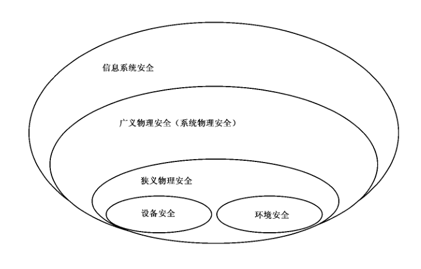

# GB/T 21052-2007 信息安全技术 信息系统物理安全技术要求

> 来源：[国家标准全文公开系统](https://openstd.samr.gov.cn/bzgk/std/newGbInfo?hcno=A6CDBD276CF5FBDDCCC3B35F0A3DECE5)。发布日期：2007-08-23；实施日期：2008-01-01。
> 官方 PDF SHA-256：`4801b4fbba4c93a7ab0aa5034efc700975e2d93820bb26e93dd1a9e78b127627`。
> 依据官方 PDF 全部 44 页页面图像转写与校核；省略封面、目录、页眉、页脚、留白和分页，合并印刷折行。原文以宋体加粗标出的较低级新增要求，在本转写中不逐项复刻字重。

## 前言

本标准的附录 A 是资料性附录。

本标准由全国信息安全标准化技术委员会提出并归口。

本标准起草单位：公安部第一研究所、公安部安全与警用电子产品质量检测中心。

本标准主要起草人：严明、滕旭、郭立、卢玉华、胡志昂、任常青、郑征、刘军。

## 引言

信息系统的物理安全涉及到整个系统的配套部件、设备和设施的安全性能、所处的环境安全以及整个系统可靠运行等方面，是信息系统安全运行的基本保障。

本标准提出的技术要求包括三方面：1）信息系统的配套部件、设备安全技术要求；2）信息系统所处物理环境的安全技术要求；3）保障信息系统可靠运行的物理安全技术要求。设备物理安全、环境物理安全及系统物理安全的安全等级技术要求，确定了为保护信息系统安全运行所必须满足的基本的物理技术要求。

本标准以 GB 17859—1999 对于五个安全等级的划分为基础，依据 GB/T 20271—2006 五个安全等级中对于物理安全技术的不同要求，结合当前我国计算机、网络和信息安全技术发展的具体情况，根据适度保护的原则，将物理安全技术等级分为五个不同级别，并对信息系统安全提出了物理安全技术方面的要求。不同安全等级的物理安全平台为相对应安全等级的信息系统提供应有的物理安全保护能力。

第一级物理安全平台为第一级用户自主保护级提供基本的物理安全保护，第二级物理安全平台为第二级系统审计保护级提供适当的物理安全保护，第三级物理安全平台为第三级安全标记保护级提供较高程度的物理安全保护，第四级物理安全平台为第四级结构化保护级提供更高程度的物理安全保护，第五级物理安全平台为第五级访问验证保护级提供最高程度的物理安全保护。随着物理安全等级的依次提高，信息系统物理安全的可信度也随之增加，信息系统所面对的物理安全风险也逐渐减少。

本标准按照 GB 17859—1999 的五个安全等级的划分，对每一级物理安全技术要求做详细的描述。

因第五级物理安全技术要求涉及最高程度物理安全技术，本标准略去相关内容。附录 A 对物理安全相关概念进行了描述，并对物理安全技术等级划分进行了说明。为清晰表示每一个安全等级比较低一级安全等级的物理安全技术要求的增加和增强，每一级的新增部分用“宋体加粗字”表示。

## 1 范围

本标准规定了信息系统物理安全的分等级技术要求。

本标准适用于按 GB 17859—1999 的安全保护等级要求所进行的等级化的信息系统物理安全的设计和实现，对按 GB 17859—1999 的安全保护等级的要求对信息系统物理安全进行的测试、管理可参照使用。

## 2 规范性引用文件

下列文件中的条款通过本标准的引用而成为本标准的条款。凡是注日期的引用文件，其随后所有的修改单（不包括勘误的内容）或修订版均不适用于本标准，然而，鼓励根据本标准达成协议的各方研究是否可使用这些文件的最新版本。凡是不注日期的引用文件，其最新版本适用于本标准。

- GB/T 2887—2000 电子计算机场地通用规范
- GB 4943—2001 信息技术设备的安全（idt IEC 60950:1999）
- GB 8702—1988 电磁辐射防护规定
- GB 9175—1988 环境电磁波卫生标准
- GB 9254—1998 信息技术设备的无线电骚扰限值和测量方法（idt CISPR 22:1997）
- GB/T 9361—1988 计算机场地安全要求
- GB/T 17626.2—2006 电磁兼容 试验和测量技术 静电放电抗扰度试验（IEC 61000-4-2:2001，IDT）
- GB/T 17626.3—2006 电磁兼容 试验和测量技术 射频电磁场辐射抗扰度试验（IEC 61000-4-3:2002，IDT）
- GB/T 17626.4—1998 电磁兼容 试验和测量技术 电快速瞬变脉冲群抗扰度试验（idt IEC 61000-4-4:1995）
- GB/T 17626.5—1998 电磁兼容 试验和测量技术 浪涌（冲击）抗扰度试验（idt IEC 61000-4-5:1995）
- GB/T 17626.6—1998 电磁兼容 试验和测量技术 射频场感应的传导骚扰抗扰度（idt IEC 61000-4-6:1995）
- GB/T 17626.8—2006 电磁兼容 试验和测量技术 工频磁场抗扰度试验（IEC 61000-4-8:2001，IDT）
- GB/T 17626.9—1998 电磁兼容 试验和测量技术 脉冲磁场抗扰度试验（idt IEC 61000-4-9:1995）
- GB/T 17626.11—1998 电磁兼容 试验和测量技术 电压暂降、短时中断和电压变化的抗扰度试验（idt IEC 61000-4-11:1995）
- GB 17859—1999 计算机信息系统 安全保护等级划分准则
- GB/T 20271—2006 信息安全技术 信息系统通用安全技术要求
- GB 50057—1994 建筑物防雷设计规范（2000 年版）
- GB 50174—1993 电子计算机机房设计规范
- GB 50311—2000 建筑与建筑群综合布线系统工程设计规范
- GBJ 16—1987 建筑设计防火规范（2001 年版）
- GA 267—2000 计算机信息系统雷电电磁脉冲安全防护规范
- SJ/T 16796—2001 静电活动地板通用规范

## 3 术语和定义

下列术语和标准适用于本标准。

### 3.1 信息系统 information system

信息系统由计算机及其相关的配套部件、设备和设施构成，按照一定的应用目的和规则对信息进行采集、加工、存储、传输、检索等的人机系统。

### 3.2 信息系统物理安全 physical security for information system

为了保证信息系统安全可靠运行，确保信息系统在对信息进行采集、处理、传输、存储过程中，不致受到人为或自然因素的危害，而使信息丢失、泄露或破坏，对计算机设备、设施（包括机房建筑、供电、空调等）、环境人员、系统等采取适当的安全措施。

### 3.3 设备物理安全 facility physical security

为保证信息系统的安全可靠运行，降低或阻止人为或自然因素对硬件设备安全可靠运行带来的安全风险，对硬件设备及部件所采取的适当安全措施。

### 3.4 环境物理安全 environment physical security

为保证信息系统的安全可靠运行所提供的安全运行环境，使信息系统得到物理上的严密保护，从而降低或避免各种安全风险。

### 3.5 系统物理安全 system physical security

为保证信息系统的安全可靠运行，降低或阻止人为或自然因素从物理层面对信息系统保密性、完整性、可用性带来的安全威胁，从系统的角度采取的适当安全措施。

### 3.6 完整性 integrity

保证信息与信息系统不会被有意地或无意地更改或破坏的特性。

### 3.7 可用性 availability

保证信息与信息系统可被授权者所正常使用。

### 3.8 保密性 confidentiality

保证信息与信息系统的不可被非授权者利用。

### 3.9 浪涌保护器 surge protective devices; SPD

用于对雷电电流、操作过电压等进行保护的器件。

### 3.10 电磁骚扰 electromagnetic disturbance

任何可能引起装置、设备或系统性能降低或对有生命或无生命物质产生损害作用的电磁现象。

### 3.11 电磁干扰 electromagnetic interference

电磁骚扰引起的设备、传输通道或系统性能的下降。

### 3.12 抗扰度 immunity

装置、设备或系统面临电磁骚扰不降低运行性能的能力。

### 3.13 不间断供电系统 uninterruptible power supply; UPS

确保计算机不停止工作的供电系统。

### 3.14 安全隔离设备 security isolation components

包括安全隔离计算机、安全隔离卡和安全隔离线路选择器等设备。

### 3.15 抗扰度限值 immunity limit

规定的最小抗扰度电平。

### 3.16 非燃材料 no-burning material

材料在受燃烧或高温作用时，不起火、不微燃、难炭化的材料。

### 3.17 难燃材料 hard-burning material

材料在受到燃烧或高温作用时，难起火、难微燃、难炭化的材料。

### 3.18 标志 sign

用来表明设备或部件的生产信息。

### 3.19 标记 marker

用来识别、区分设备、部件或人员等级的表示符号。

## 4 第一级物理安全技术要求

### 4.1 设备物理安全技术要求

#### 4.1.1 标志

组成此保护级的系统设备和部件应有明显清晰的标志，应包括：型号或规定的代号、制造厂商的名称或商标，或国家规定的 3C 认证标志。

#### 4.1.2 标记和外观

系统设备和部件应有明显的无法擦去的标记。

#### 4.1.3 静电放电抗扰度

系统中所应用的设备和部件对来自静电放电的电磁干扰应有一定的抗扰度。试验方法应按照 GB/T 17626.2—2006 中给出的试验方法，试验等级采用 2 级，试验评判结果至少应满足 GB/T 17626.2—2006 中的性能判据分类 C 的要求。

#### 4.1.4 电磁辐射抗扰度

系统中所应用的设备和部件对来自电磁辐射的电磁干扰应有一定的抗扰度。试验方法应按照 GB/T 17626.3—2006 中给出的试验方法，试验等级采用 1 级，试验评判结果至少应满足 GB/T 17626.3—2006 中的性能判据分类 C 的要求。

#### 4.1.5 电快速瞬变脉冲群抗扰度

系统中所应用的设备和部件对来自电源端口的电快速瞬变脉冲群的电磁干扰应有一定的抗扰度。试验方法应按照 GB/T 17626.4—1998 中给出的试验方法，试验等级采用 2 级，试验评判结果至少应满足 GB/T 17626.4—1998 中的性能判据分类 C 的要求。

#### 4.1.6 抗电强度

系统设备的电源插头或电源引入端与设备外壳裸露金属部件之间应能承受幅度 1.5 kV、频率 45 Hz～65 Hz 的抗电强度试验，历时 1 min 应无击穿和飞弧现象。

#### 4.1.7 泄漏电流

系统设备工作时对保护接地端的漏泄电流值不应超过 5 mA。

#### 4.1.8 绝缘电阻

系统设备的电源插头或电源引入端与设备外壳裸露金属部件之间的绝缘电阻应不小于 5 MΩ。

### 4.2 环境物理安全技术要求

#### 4.2.1 场地选择

应按照能够保障本级信息系统正常运行的条件选择场地。

#### 4.2.2 防火要求

**4.2.2.1** 设置必备的灭火设备，并对灭火设备的效率、毒性、用量和损害性有一定的要求。

**4.2.2.2** 房间内的装修材料应符合 GB/T 9361—1988 中规定的难燃材料和非燃材料的要求。

#### 4.2.3 防雷电

**4.2.3.1** 设置必备的雷电保护器，所用的信息设备应在雷电保护器的保护范围之内。

**4.2.3.2** 其余的防雷技术应符合 GB 50057—1994（2000 年版）中“第三类防雷建筑物的防雷措施”要求。

### 4.3 系统物理安全技术要求

#### 4.3.1 灾难备份与恢复

##### 4.3.1.1 备份介质

将业务应用所需要的所有相关数据进行完整的备份，并将备份介质存放在中心机房以外的专门场所。

##### 4.3.1.2 系统手工恢复

在灾难故障发生时，针对故障发生原因，利用备份介质中的业务相关数据，采取各种措施恢复应用系统运行。

#### 4.3.2 设备管理

##### 4.3.2.1 配置管理

**4.3.2.1.1 资源管理** 应对信息系统网络环境中的下列资源信息进行管理：

- 设备信息：包括终端、服务器、交换机、路由器等；
- 软件信息：系统软件和应用软件。

## 5 第二级物理安全技术要求

### 5.1 设备物理安全技术要求

#### 5.1.1 标志

组成此保护级的系统设备和部件应有明显清晰的标志，应包括：产品名称、型号或规定的代号、制造厂商的名称或商标，或国家规定的 3C 认证标志。

#### 5.1.2 标记和外观

**5.1.2.1** 系统设备和部件应有明显的无法擦去的标记。

**5.1.2.2** 系统设备表面不应有明显的凹痕、裂缝、变形和污染等。表面涂度层应均匀、不应起泡、龟裂、脱落和磨损。金属部件不应有锈蚀及其他机械损伤。

**5.1.2.3** 系统设备的各部件应紧固无松动，安装可抽换部件的接插件应能可靠连接，键盘、开关按钮和其他控制部件的控制应灵活可靠，布局应方便使用。

#### 5.1.3 静电放电抗扰度

系统中应用的设备和部件对来自静电放电的电磁干扰应有一定的抗扰度。试验方法应按照 GB/T 17626.2—2006 中给出的试验方法，试验等级采用 3 级，试验评判结果至少应满足 GB/T 17626.2—2006 中的性能判据分类 C 的要求。

#### 5.1.4 电磁辐射骚扰

对系统中应用的设备和部件产生的电磁辐射骚扰应有一定的限制。试验方法应按照 GB 9254—1998 中给出的试验方法，试验评判结果至少应满足 GB 9254—1998 中 ITE 分级的 A 级骚扰限值要求。

#### 5.1.5 电磁辐射抗扰度

系统中所应用的设备和部件对来自电磁辐射的电磁干扰应有一定的抗扰度。试验方法应按照 GB/T 17626.3—2006 中给出的试验方法，试验等级采用 2 级，试验评判结果至少应满足 GB/T 17626.3—2006 中的性能判据分类 C 的要求。

#### 5.1.6 浪涌（冲击）抗扰度

系统中所应用的设备和部件对来自电源端口的浪涌（冲击）的电磁干扰应有一定的抗扰度。试验方法应按照 GB/T 17626.5—1998 中给出的试验方法，试验等级采用 2 级，试验评判结果至少应满足 GB/T 17626.5—1998 中的性能判据分类 C 的要求。

#### 5.1.7 电快速瞬变脉冲群抗扰度

系统中所应用的设备和部件对来自电源端口的电快速瞬变脉冲群的电磁干扰应有一定的抗扰度。试验方法应按照 GB/T 17626.4—1998 中给出的试验方法，试验等级采用 2 级，试验评判结果至少应满足 GB/T 17626.4—1998 中的性能判据分类 C 的要求。

#### 5.1.8 电源适应能力

**5.1.8.1** 对于交流供电的系统设备，应能在额定电压 ±10% 的范围内正常工作。

**5.1.8.2** 对于直流供电的系统设备，应能在直流电压标称值 ±10% 的范围内正常工作。标称值在产品标准中规定。对电源有特殊要求的单元，应在产品标准中加以说明。

#### 5.1.9 抗电强度

应符合 GB 4943—2001 中 5.2 的要求。

#### 5.1.10 泄漏电流

系统设备工作时对保护接地端的漏泄电流值不应超过 5 mA。

#### 5.1.11 电源线

对于交流供电的系统设备的电源线，应使用三芯电源线，其中地线应与设备的保护接地端连接牢固。

#### 5.1.12 绝缘电阻

系统设备的电源插头或电源引入端与设备外壳裸露金属部件之间的绝缘电阻应不小于 5 MΩ。

### 5.2 环境物理安全技术要求

#### 5.2.1 场地选择

按一般建筑物要求进行机房场地选址。应避开强电场、强磁场、易发生火灾、潮湿、易遭受雷击和重度环境污染的地区。

#### 5.2.2 机房防火

**5.2.2.1** 机房和记录介质存放间，其建筑材料的耐火等级，应符合 GBJ 16—1987（2001 年版）中规定的二级耐火等级；机房相关的其余基本工作房间和辅助房，其建筑材料的耐火等级应不低于 GBJ 16—1987（2001 年版）中规定的三级耐火等级。

**5.2.2.2** 要求配备适宜的灭火设备，除纸介质等易燃物质外，禁止使用水、干粉或泡沫等容易产生二次破坏的灭火剂。

#### 5.2.3 供电系统

**5.2.3.1** 机房供电电源设备的容量应具有一定的余量。

**5.2.3.2** 机房供电系统应将信息系统设备供电线路与其他供电线路分开，应配备应急照明装置。

**5.2.3.3** 应配置线路稳压滤波装置，保证机房供电电源质量符合 GB 50174—1993 中规定的 C 级要求。

**5.2.3.4** 应配置电源保护装置，加装浪涌保护器。

**5.2.3.5** 应配置抵抗供电电压不足的设备。当供电电压不足或中断时，应保证系统至少正常工作 30 分钟。

**5.2.3.6** 机房内活动地板下部的低压配电线路宜采用铜芯屏蔽导线或铜芯屏蔽电缆。

**5.2.3.7** 活动地板下部的电源线应尽可能远离系统信号线路，并避免并排敷设。当不能避免时，应采取相应的屏蔽措施。

**5.2.3.8** 机房电源系统的所有接点均应镀锡处理，并且冷压连接。

#### 5.2.4 静电防护

防静电地线不得接在电源零线上，应单独接在地线汇集点。

#### 5.2.5 防雷电

**5.2.5.1** 系统电源线应设置电源浪涌保护器（SPD），其冲击通流容量及限制电压应按 GA 267—2000 中表 5 选取。

**5.2.5.2** 不得在建筑物屋顶上敷设电源或信号线路。必须敷设时，应穿金属管进行屏蔽防护，金属管应进行等电位连接。

#### 5.2.6 接地

**5.2.6.1** 机房应设等电位连接网络。机房内设备的金属外壳、机柜、机架、金属管、槽、屏蔽线缆外层、防静电接地、安全保护接地、浪涌保护器接地端等均应以最短的距离与等电位连接网络的接地端子连接，连接线应采用多股铜质金属线，其截面积不小于 16 mm²。

**5.2.6.2** 等电位连接网络宜采用铜排或铜带，其截面积不应小于 35 mm²。

**5.2.6.3** 接地电阻不应大于 4 Ω。当土壤电阻率大于 2 000 Ω·m 时，系统接地电阻不得大于 20 Ω。直流工作接地，接地电阻应按计算机系统具体要求确定。

#### 5.2.7 温湿度控制

应有必要的空调设备，使机房温度达到所需的要求。

#### 5.2.8 防水

**5.2.8.1** 水管安装不得穿过屋顶和活动地板，穿过墙壁和楼板的水管应使用套管，并采取可靠的密封措施。

**5.2.8.2** 应有有效的防止给水、排水、雨水通过屋顶和墙壁漫溢和渗漏的措施。

#### 5.2.9 防虫鼠害

**5.2.9.1** 在易受虫鼠害的场所，机房内的线缆上应涂敷驱虫、鼠药剂。

**5.2.9.2** 在易受鼠害的场所，机房内应设置捕鼠和驱鼠装置。

#### 5.2.10 防盗防毁

机房应装防护窗、防盗门或有人 24 小时职守，以防物品被盗被毁。

#### 5.2.11 出入口控制

**5.2.11.1** 机房应设单独出入口，另设多个紧急疏散出口，标明疏散线路和方向，应设置疏散照明和安全出口标志灯。机房出入口应有专人负责，未经允许的人员不准进入机房。

**5.2.11.2** 危险物品及可燃物品不准带入机房。

#### 5.2.12 记录介质安全

**5.2.12.1** 对有用数据的记录介质应采取一定措施防止被盗、被毁和受损，对于磁性介质应有防止介质被磁化措施。

**5.2.12.2** 对于应该删除和销毁的有用数据，在没有被删除和销毁之前应该有一定的防止被非法拷贝的措施。

#### 5.2.13 人员要求

应建立正式的安全管理组织机构，委任并授权安全管理机构负责人负责安全管理的权力，负责安全管理工作的组织和实施。

#### 5.2.14 机房综合布线要求

机房内部综合布线的配置应满足实际的需要。综合布线区内的电磁干扰场强值大于 3 V/m 时，应采取防护措施。若采用屏蔽线缆时，布线电缆的屏蔽层应保持连续性，并且与地进行可靠的连接。综合布线电缆与附近可能产生电磁泄漏设备（包括电缆线路）的最小平行距离应大于 1 m 以上。电气防护与防火应符合 GB 50311—2000 中的要求。

#### 5.2.15 通信线路安全

通信线路应远离强电磁场辐射源。

### 5.3 系统物理安全技术要求

#### 5.3.1 灾难备份与恢复

##### 5.3.1.1 备份介质

将业务应用所需要的所有相关数据进行完整的备份，并将备份介质按照 5.2.12 的要求存放在中心机房以外符合介质存放要求的专门场所。

##### 5.3.1.2 设备备份

对于灾难故障发生时易受到损坏的计算机和网络设备应有一定的备份，确保发生灾难性故障时，能在规定的时间间隔内，通过替换计算机和网络设备恢复系统运行。

##### 5.3.1.3 系统手工恢复

在灾难故障发生时，通过备用设备及备用介质，在规定的时间范围内根据预先定义的流程，恢复业务应用系统运行。

#### 5.3.2 设备管理

##### 5.3.2.1 配置管理

**5.3.2.1.1 资源管理** 应对信息系统网络环境中的下列资源信息进行管理：

- 设备信息：包括终端、服务器、交换机、路由器等；
- 网络信息：包括局域网、城域网、广域网等；
- 软件信息：系统软件和应用软件；
- 地址信息：设备所在地址信息。

##### 5.3.2.2 性能管理

**5.3.2.2.1 网络性能监测** 应提供对接收字节数、发送字节数等网络性能数据的连续采集，实现吞吐率、利用率等面向网络效率的指标的网络性能监测功能。

**5.3.2.2.2 设备运行状态监视** 应提供设备管理接口，通过该接口及相关协议收集设备的运行状态，如 CPU 利用率、内存利用率等，支持设备运行状态的远程监视，当所监测数值超过预先设定的故障阈值时，提供报警。

##### 5.3.2.3 故障管理

**5.3.2.3.1 告警监测功能** 应设置告警策略，定义告警事件指标，并收集设备、网络运行过程中的告警信息，生成告警日志。

##### 5.3.2.4 管理信息保护

应采取措施保障管理信息的存储、传输安全。对于远程管理，应通过加密来保护远程管理对话。

## 6 第三级物理安全技术要求

### 6.1 设备物理安全技术要求

#### 6.1.1 标志

组成此保护级的系统设备和部件应有明显清晰的标志，应包括：产品名称、型号或规定的代号、制造厂商的名称或商标、安全符号，或国家规定的 3C 认证标志。

#### 6.1.2 标记和外观

**6.1.2.1** 系统设备和部件应有明显的无法擦去的标记。

**6.1.2.2** 系统设备表面不应有明显的凹痕、裂缝、变形和污染等。表面涂度层应均匀、不应起泡、龟裂、脱落和磨损。金属部件不应有锈蚀及其他机械损伤。

**6.1.2.3** 系统设备的各部件应紧固无松动，安装可抽换部件的接插件应能可靠连接，键盘、开关按钮和其他控制部件的控制应灵活可靠，布局应方便使用。

#### 6.1.3 静电放电抗扰度

系统中应用的设备和部件对来自静电放电的电磁干扰应有一定的抗扰度。试验方法应按照 GB/T 17626.2—2006 中给出的试验方法，试验等级采用 4 级，试验评判结果至少应满足 GB/T 17626.2—2006 中的性能判据分类 B 的要求。

#### 6.1.4 电磁辐射骚扰

对系统中应用的设备和部件产生的电磁辐射骚扰应有一定的限制，系统中应尽可能地应用低电磁辐射发射的设备和部件。试验方法应按照 GB 9254—1998 中给出的试验方法，试验评判结果至少应满足 GB 9254—1998 中 ITE 分级的 B 级骚扰限值要求。

#### 6.1.5 电磁传导骚扰

**6.1.5.1** 对系统中应用的设备和部件在电源端口产生的电磁传导骚扰应有一定的限制，系统中应尽可能地应用低电磁传导发射的设备和部件。试验方法应按照 GB 9254—1998 中给出的试验方法，试验评判结果至少应满足 GB 9254—1998 中 ITE 分级的 B 级骚扰限值要求。

**6.1.5.2** 对系统中应用的设备和部件在信号端口产生的电磁传导骚扰应有一定的限制，系统中应尽可能地应用低电磁传导发射的设备和部件。试验方法应按照 GB 9254—1998 中给出的试验方法，试验评判结果至少应满足 GB 9254—1998 中 ITE 分级的 B 级骚扰限值要求。

#### 6.1.6 电磁辐射抗扰度

系统中所应用的设备和部件对来自电磁辐射的电磁干扰应有一定的抗扰度。试验方法应按照 GB/T 17626.3—2006 中给出的试验方法，试验等级采用 3 级，试验评判结果至少应满足 GB/T 17626.3—2006 中的性能判据分类 B 的要求。

#### 6.1.7 电磁传导抗扰度

**6.1.7.1** 系统中所应用的设备和部件对来自电源端口的感应传导的电磁干扰应有一定的抗扰度。试验方法应按照 GB/T 17626.6—1998 中给出的试验方法，试验等级采用 2 级，试验评判结果至少应满足 GB/T 17626.6—1998 中的性能判据分类 B 的要求。

**6.1.7.2** 系统中所应用的设备和部件之间的互连信号线超过 1.5 m 时，对来自感应传导的电磁干扰应有一定的抗扰度。试验方法应按照 GB/T 17626.6—1998 中给出的试验方法，试验等级采用 2 级，试验评判结果至少应满足 GB/T 17626.6—1998 中的性能判据分类 B 的要求。

#### 6.1.8 浪涌（冲击）抗扰度

**6.1.8.1** 系统中所应用的设备和部件对来自电源端口的浪涌（冲击）的电磁干扰应有一定的抗扰度。试验方法应按照 GB/T 17626.5—1998 中给出的试验方法，试验等级采用 3 级，试验评判结果至少应满足 GB/T 17626.5—1998 中的性能判据分类 B 的要求。

**6.1.8.2** 系统中所应用的设备和部件之间的互连信号线超过 1.5 m 时，对来自浪涌（冲击）的电磁干扰应有一定的抗扰度。试验方法应按照 GB/T 17626.5—1998 中给出的试验方法，试验等级采用 3 级，试验评判结果至少应满足 GB/T 17626.5—1998 中的性能判据分类 B 的要求。

#### 6.1.9 电源电快速瞬变脉冲群抗扰度

**6.1.9.1** 系统中所应用的设备和部件对来自电源端口的电快速瞬变脉冲群的电磁干扰应有一定的抗扰度。试验方法应按照 GB/T 17626.4—1998 中给出的试验方法，试验等级采用 3 级，试验评判结果至少应满足 GB/T 17626.4—1998 中的性能判据分类 B 的要求。

**6.1.9.2** 系统中所应用的设备和部件之间的互连信号线超过 1.5 m 时，对来自电快速瞬变脉冲群的电磁干扰应有一定的抗扰度。试验方法应按照 GB/T 17626.4—1998 中给出的试验方法，试验等级采用 3 级，试验评判结果至少应满足 GB/T 17626.4—1998 中的性能判据分类 B 的要求。

#### 6.1.10 电压暂降、短时中断、电压变化抗扰度

**6.1.10.1** 系统中所使用的设备和部件对来自电源端口的电源电压暂降和短时中断产生的干扰应有一定的抗扰度。试验方法应按照 GB/T 17626.11—1998 中给出的试验方法，试验等级采用 70% Uₜ，试验评判结果至少应满足 GB/T 17626.11—1998 中的性能判据分类 B 的要求。

**6.1.10.2** 系统中所使用的设备和部件对来自电源端口的电源电压变化产生的干扰应有一定的抗扰度，试验方法应按照 GB/T 17626.11—1998 中给出的试验方法，试验等级采用 60% Uₜ，试验评判结果至少应满足 GB/T 17626.11—1998 中的性能判据分类 B 的要求。

#### 6.1.11 电源适应能力

**6.1.11.1** 对于交流供电的系统设备，应能在 220（+10%/-15%）条件下正常工作。

**6.1.11.2** 对于直流供电的系统设备，应能在直流电压标称值变化 ±10% 的条件下正常工作。标称值在产品标准中规定。对电源有特殊要求的单元，应在产品标准中加以说明。

#### 6.1.12 抗电强度

应符合 GB 4943—2001 中 5.2 的要求。

#### 6.1.13 泄漏电流

系统设备工作时对保护接地端的漏泄电流值不应超过 5 mA。

#### 6.1.14 电源线

对于交流供电的系统设备的电源线，应使用三芯电源线，其中地线应与设备的保护接地端连接牢固。

#### 6.1.15 绝缘电阻

系统设备的电源插头或电源引入端与设备外壳裸露金属部件之间的绝缘电阻应不小于 5 MΩ。

#### 6.1.16 防过热

操作人员接触区的零部件应符合 GB 4943—2001 中 4.5.1 条表 4A 温升限值第 2 部分的要求。

#### 6.1.17 温度、湿度适应性

对于工作中的系统设备，应能在温度 +10 ℃～+35 ℃、湿度 35%～80% 的条件下正常工作。对于结构一体化产品中装入的某些设备，当其环境适应性达不到本标准要求时，应在产品标准中作特殊说明。

#### 6.1.18 振动适应性

系统设备振动适应性，应符合表 1 的要求。对于结构一体化产品中装入的某些设备，当其环境适应性达不到本标准要求时，应在产品标准中作特殊说明。

**表 1 振动适应性**

| 试验 | 内容 | 要求 |
| --- | --- | --- |
| 初始和最后振动试验 | 频率范围 | 10～55 Hz |
| 初始和最后振动试验 | 扫频速度 | ≤1 oct/min |
| 初始和最后振动试验 | 振幅 | 0.15 mm |
| 定频耐久试验 | 振幅 | 0.75 mm（10 Hz～25 Hz）；0.15 mm（25 Hz～58 Hz） |
| 定频耐久试验 | 持续时间 | 30±1.0 min |
| 扫频耐久试验 | 频率范围 | 10～55～10 Hz |
| 扫频耐久试验 | 振幅 | 0.15 mm |
| 扫频耐久试验 | 扫频速度 | ≤1 oct/min |
| 扫频耐久试验 | 循环次数 | 5 |

#### 6.1.19 冲击适应性

系统设备冲击适应性，应符合表 2 的要求。对于结构一体化产品中装入的某些设备，当其环境适应性达不到本标准要求时，应在产品标准中作特殊说明。

**表 2 冲击适应性**

| 峰值加速度 | 脉冲持续时间 | 冲击波形 |
| --- | --- | --- |
| 150 m/s² | 11 ms | 正弦波或后峰锯齿或梯形波 |

#### 6.1.20 碰撞适应性

系统设备碰撞适应性，应符合表 3 的要求。对于结构一体化产品中装入的某些设备，当其环境适应性达不到本标准要求时，应在产品标准中作特殊说明。

**表 3 碰撞适应性**

| 峰值加速度 | 脉冲持续时间 | 碰撞次数 | 碰撞波形 |
| --- | --- | --- | --- |
| 100 m/s² | 16 ms | 1000 | 半正弦波 |

#### 6.1.21 可靠性

采用平均无故障时间衡量系统设备的可靠性水平。系统中硬件设备的平均无故障时间不得低于 4 000 h。

### 6.2 环境物理安全技术要求

#### 6.2.1 场地选择

**6.2.1.1** 应避开易发生火灾危险程度高的区域。

**6.2.1.2** 应避开有害气体来源以及存放腐蚀、易燃、易爆物品的地方。

**6.2.1.3** 应避开强振动源和强噪声源。

**6.2.1.4** 应避开强电磁场的干扰。

**6.2.1.5** 当上面各条款无法满足时，应采取相应措施。

**6.2.1.6** 机房所在的建筑物防雷措施应符合 GB 50057—1994（2000 年版）中的“第二类防雷建筑物的防雷措施”的技术要求。

#### 6.2.2 机房防火

**6.2.2.1** 机房和重要的记录介质存放间，其建筑材料的耐火等级，应符合 GBJ 16—1987（2001 年版）中规定的二级耐火等级；机房相关的其余基本工作房间和辅助房，其建筑材料的耐火等级应不低于 GBJ 16—1987（2001 年版）中规定的二级耐火等级。

**6.2.2.2** 设置火灾自动报警系统，包括火灾自动探测器、区域报警器、集中报警器和控制器等，能对火灾发生的部位以声、光或电的形式发出报警信号，并启动自动灭火设备，切断电源，关闭空调设备等。

**6.2.2.3** 要求机房布局要将脆弱区和危险区进行隔离，防止外部火灾进入机房，特别是重要设备地区，安装防火门、使用阻燃材料装修等。

**6.2.2.4** 机房装修材料应符合 GB/T 9361—1988 中规定的难燃材料和非燃材料，应能防潮、吸音、不起尘、抗静电等。

**6.2.2.5** 机房的活动地板应是难燃材料或非燃材料，活动地板应有稳定的抗静电性能和承载能力，同时耐油、耐腐蚀、柔光、不起尘等。具体要求应符合 SJ/T 16796—2001。

#### 6.2.3 电磁辐射卫生防护

机房内的电磁辐射防护限值应达到 GB 8702—1988 和 GB 9175—1988 中的要求。在工作期间，机房内工作人员经常出入的部位（工作室、值班室、休息室），电磁辐射电场强度在任意连续 6 min 内的平均值不应超出表 4 的给出的参考值。

**表 4 职业照射导出限值**

| 频率范围/MHz | 0.1～3.0 | 3.0～30 | 30～3 000 | 3 000～15 000 | 15 000～30 000 |
| --- | --- | --- | --- | --- | --- |
| 电场强度/（V/m） | 87 | 150/√f | 28 | 0.5√f | 61 |

#### 6.2.4 机房屏蔽

**6.2.4.1** 机房采取屏蔽措施，防止外部电磁场对计算机及设备的干扰，同时也抑制电磁信息的泄漏。

**6.2.4.2** 应采用屏蔽效能良好的屏蔽电缆作为机房的引入线（包括电源线、信号线）。屏蔽电缆应经过质量确认后方可使用。

**6.2.4.3** 机房的信号电缆线（输入/输出）端口和电源线的进、出端口应适当加装滤波器。电缆连接处应采取屏蔽措施，抑制电磁噪声干扰与电磁信息泄漏。

**6.2.4.4** 机房内无线电干扰场强，应满足 GB/T 2887—2000 中 4.3.5.1 的要求。

**6.2.4.5** 机房内磁场干扰场强，应满足 GB/T 2887—2000 中 4.3.5.2 的要求。

#### 6.2.5 供电系统

**6.2.5.1** 机房供电电源设备的容量应具有一定的余量。

**6.2.5.2** 机房供电系统应将信息系统设备供电线路与其他供电线路分开，应配备应急照明装置。

**6.2.5.3** 应配置线路稳压滤波装置，保证机房供电电源质量符合 GB 50174—1993 中规定的 B 级要求。

**6.2.5.4** 应配置电源保护装置，加装浪涌保护器。

**6.2.5.5** 机房应建立交流不间断供电系统，保证机房内信息系统设备 24 小时运行。

**6.2.5.6** 机房内活动地板下部的低压配电线路宜采用铜芯屏蔽导线或铜芯屏蔽电缆。

**6.2.5.7** 活动地板下部的电源线应尽可能远离系统信号线路，并避免并排敷设。当不能避免时，应采取相应的屏蔽措施。

**6.2.5.8** 机房电源系统的所有接点均应镀锡处理，并且冷压连接。

#### 6.2.6 静电防护

**6.2.6.1** 主机房内绝缘体的静电电位不应大于 1 kV。

**6.2.6.2** 主机房内的导体应与大地作可靠的连接，不应有对地绝缘的孤立导体。

**6.2.6.3** 当铺设防静电地面时，防静电地面可用导电橡胶与建筑物地面粘牢，防静电地面的体积电阻率均匀，应为（1.0×10⁷～1.0×10¹⁰）Ω·cm，其导电性能应长期稳定，且不易发尘。

**6.2.6.4** 主机房内的工作台面及座椅垫套材料应是防静电的，其体积电阻率应为（1.0×10⁷～1.0×10¹⁰）Ω·cm。

#### 6.2.7 防雷电

**6.2.7.1** 系统所在建筑物的防雷技术要求应符合 GB 50057—1994（2000 年版）中“第二类防雷建筑物的防雷措施”要求。

**6.2.7.2** 系统中所有的设备和部件应安装在有防雷保护的范围内。

**6.2.7.3** 系统电源线应设置电源浪涌保护器（SPD），其冲击通流容量及限制电压应按 GA 267—2000 中表 3 选取。

**6.2.7.4** 系统信号输入/输出线应设置信号浪涌保护器（SPD），其冲击通流容量和限制电压应按 GA 267—2000 中表 4 选取。

**6.2.7.5** 不得在建筑物屋顶上敷设电源或信号线路。必须敷设时，应穿金属管进行屏蔽防护，金属管应进行等电位连接。

**6.2.7.6** 系统电源及系统输入/输出信号线，应分不同层次，采用多级雷电防护措施，涉及的内容包括：系统电源线和信号线引入处、前端供电设备和信号线分线箱、计算机电源接口和信号线接口。

#### 6.2.8 接地

**6.2.8.1** 机房应采用四种接地方式：

- a）交流工作接地，接地电阻不应大于 4 Ω；
- b）安全保护接地，接地电阻不应大于 4 Ω；
- c）直流工作接地，接地电阻应按计算机系统具体要求确定；
- d）防雷接地，应按 GB 50057—1994（2000 年版）执行。

**6.2.8.2** 交流工作接地、安全保护接地、直流工作接地和防雷接地四种接地宜共用一组接地装置，其接地电阻按其中最小值确定。若防雷接地单独设置接地装置时，其余三种接地应共用一组接地装置，其接地电阻不应大于其中最小值，并应按 GB 50057—1994（2000 年版）的要求采取防止反击措施。

**6.2.8.3** 机房内设备的金属外壳、机柜、机架、金属管、槽、屏蔽线缆外层、防静电接地、浪涌保护器接地端等均应以最短的距离与等电位连接网络的接地端子连接，连接线应采用多股铜质金属线，其截面积不小于 16 mm²。

**6.2.8.4** 等电位连接网络宜采用铜排或铜带，其截面积不应小于 50 mm²。

**6.2.8.5** 对直流工作接地有特殊要求需单独设置接地装置的系统，接地电阻值及其他接地体之间的距离，应按照计算机系统及有关规范的要求确定。

#### 6.2.9 温湿度控制

**6.2.9.1** 应有较完备的空调系统，保证机房温度的变化在计算机运行所允许的范围。

**6.2.9.2** 对设备布置密度大、设备发热量大的主机房宜采用活动地板下送上回方式。

**6.2.9.3** 当机房采用专用空调设备并与其他系统共享时，应保证空调效果和采取防火措施。

**6.2.9.4** 机房空气调节控制装置应满足计算机系统对温度、湿度以及防尘的要求。

**6.2.9.5** 空调系统应向安全防范中心提供接口，反映系统工作状况。

#### 6.2.10 防水

**6.2.10.1** 水管安装不得穿过屋顶和活动地板，穿过墙壁和楼板的水管应使用套管，并采取可靠的密封措施；

**6.2.10.2** 应有有效的防止给水、排水、雨水通过屋顶和墙壁漫溢和渗漏的措施；

**6.2.10.3** 机房应安装漏水检测系统，并有报警装置。

#### 6.2.11 防虫鼠害

**6.2.11.1** 在易受虫鼠害的场所，机房内的线缆上应涂敷驱虫、鼠药剂。

**6.2.11.2** 在易受鼠害的场所，机房内应设置捕鼠和驱鼠装置。

#### 6.2.12 防盗防毁

**6.2.12.1** 机房应装防护窗、防盗门，门窗及重要部位应装防盗报警装置，进行本地和异地报警。

**6.2.12.2** 机房应装设视频监控系统或有人 24 小时职守，对通道等重要部位进行监视。

**6.2.12.3** 报警设备应能与视频监控系统及出入口控制设备联动，实现对监控点进行有效的监视。

#### 6.2.13 出入口控制

**6.2.13.1** 机房应设单独出入口，另设多个紧急疏散出口，标明疏散线路和方向，应设置疏散照明和安全出口标志灯。机房出入口应有专人负责，未经允许的人员不准进入机房。

**6.2.13.2** 携带物品进出机房时，应持有携物证。对可疑人员应检查其携带物品的内容，危险物品及可燃物品不准带入机房。

**6.2.13.3** 应对出入口通道进行视频监控。

**6.2.13.4** 机房出入口配置电子门禁系统，鉴别进入的人员身份并登记在案。

#### 6.2.14 安全防范中心

**6.2.14.1** 应设置安全防范中心，建立安全防范管理系统。通过安全防范管理系统实现监控中心对视频监控系统、出入口控制系统等各子系统的联动管理与控制。

**6.2.14.2** 应能对视频监控系统、出入口控制系统等各子系统的运行状态进行监测，应能对系统运行状况和报警信息数据等进行记录和显示。

**6.2.14.3** 安全防范管理系统的故障应不影响各子系统的运行；某一子系统的故障应不影响其他子系统的运行。

#### 6.2.15 记录介质安全

**6.2.15.1** 设置记录介质库，对出入介质库的人员实施登记。

**6.2.15.2** 对有用数据、重要数据、使用价值高的数据和秘密程度很高的数据以及对系统运行和应用起关键作用的数据记录介质实施分类标记、登记并保存。

**6.2.15.3** 记录介质库应具备防盗、防火功能，对于磁性介质应该有防止介质被磁化措施。

**6.2.15.4** 记录介质的借用应规定审批权限，对于系统中有很高使用价值或很高秘密程度的数据，应采用加密等方法进行保护。

**6.2.15.5** 对于应该删除和销毁的重要数据，要有严格的管理和审批手续，并采取有效措施，防止被非法拷贝。

#### 6.2.16 人员与职责要求

在满足第二级要求的基础上，要求对信息系统物理安全风险控制、管理过程的安全事务明确分工责任。对系统物理安全风险分析与评估、安全策略的制定、安全技术和管理的实施、安全意识培养与教育、安全事件和事故响应等工作应制定管理负责人，制定明确的职责和权力范围。编制工作岗位和职责的正式文件，明确各个岗位的职责和技能要求。对不同岗位制定和实施不同的安全培训计划，并对安全培训计划进行定期修改。

对信息系统的工作人员、资源实施等级标记管理制度。对安全区域实施分级标记管理，对出入安全区域的工作人员应验证标记，安全标记不相符的人员不得入内。对安全区域内的活动进行监视和记录，所有物理设施应设置安全标记。

#### 6.2.17 机房综合布线要求

机房内部综合布线的配置应满足实际的需要，若采用屏蔽线缆时，布线电缆的屏蔽层应保持连续性，并且与地进行可靠的连接。综合布线区内的电磁干扰场强值大于 3 V/m 时，建筑物内、建筑物群之间或机房对外界的信息传输信道应采用光纤信道。机房内综合布线电缆与附近可能产生电磁泄漏设备（包括电缆线路）的最小平行距离应大于 1.5 m，若不能满足最小平行距离要求时，宜采用金属管线进行屏蔽。电气防护与防火应符合 GB 50311—2000 中的要求。

#### 6.2.18 通信线路安全

**6.2.18.1** 通信线路应远离强电磁场辐射源。

**6.2.18.2** 系统应具有防止通信线路被截获及外界对系统通信线路的干扰功能，至少应提供以下一种功能。

- a）预防线路截获，使线路截获设备无法正常工作；
- b）探测线路截获，发现线路截获并报警；
- c）定位线路截获，发现线路截获设备工作的位置；
- d）对抗线路截获，阻止线路截获设备的有效使用。

#### 6.2.19 信息传输、交换与共享范围要求

**6.2.19.1** 计算机信息系统联网应当采取系统访问控制、数据保护和系统安全保密监控管理等技术措施。

**6.2.19.2** 计算机信息系统的访问应当按照权限控制，不得进行越权操作。未采取技术安全保密措施的系统不得联网。

**6.2.19.3** 信息传输、信息交换与信息共享仅应在采取保护措施的系统内网进行，系统若与外网留有接口，需使用安全隔离设备。

### 6.3 系统物理安全技术要求

#### 6.3.1 灾难备份与恢复

##### 6.3.1.1 灾难备份中心

在独立的建筑物内建立数据处理系统的备份中心，以便在灾难故障发生时能在规定的时间范围内通过将数据处理系统转移到备份中心，使业务系统继续运行。

##### 6.3.1.2 网络设备备份

对于灾难故障发生时易受到损坏的网络设备应有充分的备份，确保网络的某些部位发生灾难性故障时，能在规定的时间间隔内，通过替换网络设备恢复网络的通信功能。

##### 6.3.1.3 完全数据备份

将业务应用所需要的所有相关数据进行完整的备份，并将备份数据通过专用网络传送到备份中心保存；备份数据的间隔时间确定，应确保在系统恢复后，在允许的数据丢失范围内，支持业务应用系统继续运行。

##### 6.3.1.4 系统手工转移

在灾难故障发生时，在规定的时间范围内根据预先定义的流程，将业务应用系统手工转移至备份中心。

#### 6.3.2 物理设备访问

##### 6.3.2.1 设备标识与鉴别

**6.3.2.1.1 设备标识** 应按 GB/T 20271—2006 中 4.3.1.4.1 接入前标识和标识信息管理的要求，设计和实现设备标识功能。一般以设备名和设备标识符来标识一个设备。

**6.3.2.1.2 设备鉴别** 应按 GB/T 20271—2006 中 4.3.1.4.2 接入前鉴别、不可伪造鉴别和鉴别信息管理要求，设计和实现标识设备的鉴别功能，并按 GB/T 20271—2006 中 4.3.1.4.3 的要求进行鉴别失败的处理。鉴别应确保设备身份的真实性。本安全保护等级要求在设备接入时，采用由密码系统支持的鉴别信息，对接入设备身份的真实性进行鉴别。鉴别信息应是不可见的，并在存储和传输时按 GB/T 20271—2006 中 4.3.10 密码支持的要求进行保护。

##### 6.3.2.2 访问控制策略

物理设备访问控制范围，包括策略控制下的主体、客体，及由策略覆盖的被控制的主体与客体间的操作。客体应包括物理设备。应控制的操作包括：物理设备的配置、启动、关机、故障恢复（重启、冗余切换）等。访问控制功能举例见表 5。

**表 5 访问控制功能举例**

| 客体 | 系统操作员 | 系统管理员 | 系统安全员 | 普通用户 | … |
| --- | --- | --- | --- | --- | --- |
| 物理设备 | 配置 | 启动、关机 | 故障恢复 | 登录 |  |
| … | … | … | … | … | … |

#### 6.3.3 边界保护

##### 6.3.3.1 防止非法设备接入

**6.3.3.1.1 非法接入探测** 设备接入网络前应按 6.3.2.1 的要求，对物理设备进行鉴别。发现非法接入事件应进行报警。

##### 6.3.3.2 防止设备非法外联

**6.3.3.2.1 非法外联探测** 应对设备联网状态进行探测，发现非法外联事件应进行报警。

#### 6.3.4 设备管理

##### 6.3.4.1 配置管理

**6.3.4.1.1 资源管理** 应对信息系统网络环境中的下列资源信息进行管理：

- 设备信息：包括终端、服务器、交换机、路由器、边界设备、安全设备等；
- 器材信息：设备之间的直达物理连接线路，包括中继线、用户线等；
- 电路信息：端点设备之间的逻辑连接线路，可能包含多条物理线路；
- 网络信息：包括局域网、城域网、广域网等；
- 软件信息：系统软件和应用软件；
- 地址信息：设备所在地址信息。

**6.3.4.1.2 网络拓扑服务管理** 应支持网络拓扑发现技术，提供网络拓扑结构显示功能，实现网络的物理布局、逻辑布局及电气布局的网络布局显示。

##### 6.3.4.2 性能管理

**6.3.4.2.1 网络性能监测** 应提供对接收字节数、发送字节数等网络性能数据的连续采集，实现对有效性、响应时间、差错率等面向服务质量的指标和吞吐率、利用率等面向网络效率的指标的网络性能监测功能。

**6.3.4.2.2 设备运行状态监视** 应提供设备管理接口，通过该接口及相关协议收集设备的运行状态，如 CPU 利用率、内存利用率等，支持设备运行状态的远程监视，当所监测数值超过预先设定的故障阈值时，提供报警。

**6.3.4.2.3 设备部件状态监视** 核心设备的关键硬件，包括电源、风扇、机箱、磁盘控制等应具备可管理接口，通过该接口及相关协议收集硬件的运行状态，如处理器工作温度、风扇转速、系统核心电压等，并对其进行实时监控，当所监测数值超过预先设定的故障阈值时，提供报警。

##### 6.3.4.3 故障管理

**6.3.4.3.1 告警监测功能** 应设置告警策略，定义告警事件指标，并收集设备、部件及网络运行过程中的告警信息，生成告警日志，定期产生告警报告。

**6.3.4.3.2 故障定位功能** 应设置故障定位策略，明确故障定位范围，并结合来自性能监控、告警监控等各方面产生的相关故障信息，对线路故障、设备故障进行自动定位。

##### 6.3.4.4 管理信息保护

应采取措施保障管理信息的存储、传输安全。对于远程管理，应通过加密来保护远程管理对话。

##### 6.3.4.5 安全管理角色

通过设置安全管理角色减少因用户超越职责滥用授权而导致破坏的可能性。应只允许授权管理员和可信主机承担安全管理职责。应能把授权执行管理功能的授权管理员和可信主机与使用物理设备的所有其他个人或系统分开。

##### 6.3.4.6 设备监控中心

结合安全监控中心的建设，设置设备监控中心，对收集到的各类配置数据、性能数据、故障告警数据，根据安全策略进行分析，并做报告、事件记录和报警等处理。设备监控中心应具备必要的远程管理能力，如配置参数远程设置、远程软件升级、远程启动等。

#### 6.3.5 设备保护

##### 6.3.5.1 设备物理保护

**6.3.5.1.1 物理攻击的被动检测** 应按 GB/T 20271—2006 中 5.1.1.1 中物理攻击被动检测的要求，实现对信息系统的物理安全保护。

##### 6.3.5.2 可信时间戳

应按 GB/T 20271—2006 中 5.1.2.7 的要求，提供可靠的时间戳支持。

##### 6.3.5.3 设备自检

应提供对物理设备正确操作的自测试能力。这些测试可在启动时进行，或周期性地进行，或在授权用户要求时进行，或当某种条件满足时进行。

#### 6.3.6 资源利用

##### 6.3.6.1 故障容错

应通过一定措施防止由于物理设备失效引起的资源能力的不可用，确保即使出现故障情况，系统也能正常运行。故障容错机制有主动和被动两种。主动机制下，特定的功能在故障发生时将会被激活；在被动机制下，物理设备被设计为能自动处理故障。

本级采用降级故障容错，要求在确定的故障情况下，设备能继续正确运行指定的功能。这是一种强制性的安全功能策略，要求在出错情况下设备能继续规定的正确操作，因而要求信息系统必须在故障发生后通过降低能力保持一个安全的状态。

##### 6.3.6.2 服务优先级

应通过控制用户和主体对控制范围内资源的使用，使得高优先级任务的完成总是不受低优先级任务的干扰和影响，这些资源包括处理类资源和通信类资源。

本级应实现有限服务优先级，将服务优先级的控制范围限定在控制范围内的某个资源子集，要求设备安全功能对与该资源子集有关的主体定义优先级，并指出对何种资源使用该优先级。

##### 6.3.6.3 资源分配

应通过控制用户和客体对资源的占用，使得不因不恰当地占有资源而出现拒绝服务情况。资源分配规则允许通过建立配额或其他方式，来定义代表某个特定用户或主体进行分配的资源空间大小或时间长短的限制。

本级资源分配采用最大限额的控制方法，应确保用户和主体不会超过某一数量或独占某种受控资源。

## 7 第四级物理安全技术要求

### 7.1 设备物理安全技术要求

#### 7.1.1 标志

组成此保护级的系统设备和部件应有明显清晰的标志，应包括：产品名称、型号或规定的代号、制造厂商的名称或商标、安全符号，或国家规定的 3C 认证标志。

#### 7.1.2 标记和外观

**7.1.2.1** 系统设备和部件应有明显的无法擦去的标记。

**7.1.2.2** 系统设备表面不应有明显的凹痕、裂缝、变形和污染等。表面涂度层应均匀、不应起泡、龟裂、脱落和磨损。金属部件不应有锈蚀及其他机械损伤。

**7.1.2.3** 系统设备的各部件应紧固无松动，安装可抽换部件的接插件应能可靠连接，键盘、开关按钮和其他控制部件的控制应灵活可靠，布局应方便使用。

#### 7.1.3 静电放电抗扰度

系统中应用的设备和部件对来自静电放电的电磁干扰应有一定的抗扰度。试验方法应按照 GB/T 17626.2—2006 中给出的试验方法，试验等级采用 4 级，试验评判结果至少应满足 GB/T 17626.2—2006 中的性能判据分类 A 的要求。

#### 7.1.4 电磁辐射骚扰

对系统中应用的设备和部件产生的电磁辐射骚扰应有一定的限制，系统中应尽可能的应用低电磁辐射发射的设备和部件。试验方法应按照 GB 9254—1998 中给出的试验方法，试验评判结果至少应满足 GB 9254—1998 中 ITE 分级的 B 级骚扰限值要求。

#### 7.1.5 电磁传导骚扰

**7.1.5.1** 对系统中应用的设备和部件在电源端口产生的电磁传导骚扰应有一定的限制，系统中应尽可能的应用低电磁传导发射的设备和部件。试验方法应按照 GB 9254—1998 中给出的试验方法，试验评判结果至少应满足 GB 9254—1998 中 ITE 分级的 B 级骚扰限值要求。

**7.1.5.2** 对系统中应用的设备和部件在信号端口产生的电磁传导骚扰应有一定的限制，系统中应尽可能的应用低电磁传导发射的设备和部件。试验方法应按照 GB 9254—1998 中给出的试验方法，试验评判结果至少应满足 GB 9254—1998 中 ITE 分级的 B 级骚扰限值要求。

#### 7.1.6 电磁辐射抗扰度

系统中所应用的设备和部件对来自电磁辐射的电磁干扰应有一定的抗扰度。试验方法应按照 GB/T 17626.3—2006 中给出的试验方法，试验等级采用 3 级，试验评判结果至少应满足 GB/T 17626.3—2006 中的性能判据分类 A 的要求。

#### 7.1.7 电磁传导抗扰度

**7.1.7.1** 系统中所应用的设备和部件对来自电源端口的感应传导的电磁干扰应有一定的抗扰度。试验方法应按照 GB/T 17626.6—1998 中给出的试验方法，试验等级采用 3 级，试验评判结果至少应满足 GB/T 17626.3—2006 中的性能判据分类 A 的要求。

**7.1.7.2** 系统中所应用的设备和部件之间的互连信号线超过 1.5 m 时，对来自感应传导的电磁干扰应有一定的抗扰度。试验方法应按照 GB/T 17626.6—1998 中给出的试验方法，试验等级采用 3 级，试验评判结果至少应满足 GB/T 17626.3—2006 中的性能判据分类 A 的要求。

#### 7.1.8 浪涌（冲击）抗扰度

**7.1.8.1** 系统中所应用的设备和部件对来自电源端口的浪涌（冲击）的电磁干扰应有一定的抗扰度。试验方法应按照 GB/T 17626.5—1998 中给出的试验方法，试验等级采用 4 级，试验评判结果至少应满足 GB/T 17626.5—1998 中的性能判据分类 A 的要求。

**7.1.8.2** 系统中所应用的设备和部件之间的互连信号线超过 1.5 m 时，对来自浪涌（冲击）的电磁干扰应有一定的抗扰度。试验方法应按照 GB/T 17626.5—1998 中给出的试验方法，试验等级采用 4 级，试验评判结果至少应满足 GB/T 17626.5—1998 中的性能判据分类 A 的要求。

#### 7.1.9 电源电快速瞬变脉冲群抗扰度

**7.1.9.1** 系统中所应用的设备和部件对来自电源端口的电快速瞬变脉冲群的电磁干扰应有一定的抗扰度。试验方法应按照 GB/T 17626.4—1998 中给出的试验方法，试验等级采用 4 级，试验评判结果至少应满足 GB/T 17626.4—1998 中的性能判据分类 A 的要求。

**7.1.9.2** 系统中所应用的设备和部件之间的互连信号线超过 1.5 m 时，对来自电快速瞬变脉冲群的电磁干扰应有一定的抗扰度。试验方法应按照 GB/T 17626.4—1998 中给出的试验方法，试验等级采用 4 级，试验评判结果至少应满足 GB/T 17626.4—1998 中的性能判据分类 A 的要求。

#### 7.1.10 电压暂降、短时中断、电压变化抗扰度

**7.1.10.1** 系统中所使用的设备和部件对来自电源端口的电源电压暂降和短时中断产生的干扰应有一定的抗扰度。试验方法应按照 GB/T 17626.11—1998 中给出的试验方法，试验等级采用 70% Uₜ，试验评判结果至少应满足 GB/T 17626.11—1998 中的性能判据分类 A 的要求。

**7.1.10.2** 系统中所使用的设备和部件对来自电源端口的电源电压变化产生的干扰应有一定的抗扰度，试验方法应按照 GB/T 17626.11—1998 中给出的试验方法，试验等级采用 60% Uₜ，试验评判结果至少应满足 GB/T 17626.11—1998 中的性能判据分类 A 的要求。

#### 7.1.11 工频磁场抗扰度

系统中所使用的设备和部件（电子射束敏感装置）对来自工频磁场的电磁干扰应有一定的抗扰度。试验方法应按照 GB/T 17626.8—2006 中给出的试验方法，试验等级采用 2 级，试验评判结果至少应满足 GB/T 17626.8—2006 中的性能判据分类 A 的要求。

#### 7.1.12 脉冲磁场抗扰度

系统中所使用的设备和部件（电子射束敏感装置）对来自脉冲磁场的电磁干扰应有一定的抗扰度。试验方法应按照 GB/T 17626.9—1998 中给出的试验方法，试验等级采用 3 级，试验评判结果至少应满足 GB/T 17626.9—1998 中的性能判据分类 A 的要求。

#### 7.1.13 电源适应能力

**7.1.13.1** 对于交流供电的系统设备，应能在 220（+10%/-15%）条件下正常工作。

**7.1.13.2** 对于直流供电的系统设备，应能在直流电压标称值变化 ±10% 的条件下正常工作。标称值在产品标准中规定。

#### 7.1.14 抗电强度

应符合 GB 4943—2001 中 5.2 的要求。

#### 7.1.15 泄漏电流

系统设备工作时对保护接地端的漏泄电流值不应超过 5 mA。

#### 7.1.16 电源线

对于交流供电的系统设备的电源线，应使用三芯电源线，其中地线应与设备的保护接地端连接牢固。

#### 7.1.17 绝缘电阻

系统设备的电源插头或电源引入端与设备外壳裸露金属部件之间的绝缘电阻应不小于 5 MΩ。

#### 7.1.18 防过热

操作人员接触区的零部件应符合 GB 4943—2001 中 4.5.1 条表 4A 温升限值第 2 部分的要求。

#### 7.1.19 防火

应符合 GB 4943—2001 中 4.7 条的要求。

#### 7.1.20 防爆裂

因过热或过负荷容易引起内爆或爆裂的部件（如监视器等），本身应有防止内爆和抗机械冲击的安全措施。

#### 7.1.21 温度、湿度适应性

对于工作中的系统设备，应能在温度 0 ℃～40 ℃、湿度 30%～90% 的条件下正常工作。对于结构一体化产品中装入的某些设备，当其环境适应性达不到本标准要求时，应在产品标准中作特殊说明。

#### 7.1.22 振动适应性

系统设备振动适应性，应符合表 6 的要求。

**表 6 振动适应性**

| 试验 | 内容 | 要求 |
| --- | --- | --- |
| 初始和最后振动试验 | 频率范围 | 10～55 Hz |
| 初始和最后振动试验 | 扫频速度 | ≤1 oct/min |
| 初始和最后振动试验 | 振幅 | 0.15 mm |
| 定频耐久试验 | 振幅 | 0.75 mm（10 Hz～25 Hz）；0.15 mm（25 Hz～58 Hz） |
| 定频耐久试验 | 持续时间 | 30±1.0 min |
| 扫频耐久试验 | 频率范围 | 10～58～10 Hz |
| 扫频耐久试验 | 振幅 | 0.15 mm |
| 扫频耐久试验 | 扫频速度 | ≤1 oct/min |
| 扫频耐久试验 | 循环次数 | 5 |

#### 7.1.23 冲击适应性

系统设备冲击适应性，应符合表 7 的要求。

**表 7 冲击适应性**

| 峰值加速度 | 脉冲持续时间 | 冲击波形 |
| --- | --- | --- |
| 300 m/s² | 11 ms | 正弦波或后峰锯齿或梯形波 |

#### 7.1.24 碰撞适应性

系统设备碰撞适应性，应符合表 8 的要求。

**表 8 碰撞适应性**

| 峰值加速度 | 脉冲持续时间 | 碰撞次数 | 碰撞波形 |
| --- | --- | --- | --- |
| 150 m/s² | 16 ms | 1 000 | 半正弦波 |

#### 7.1.25 可靠性

采用平均无故障时间衡量系统设备的可靠性水平。系统中硬件设备的平均无故障时间不得低于 4 000 h。

### 7.2 环境物理安全技术要求

#### 7.2.1 场地选择

**7.2.1.1** 避开易发生火灾危险程度高的区域。

**7.2.1.2** 应避开有害气体来源以及存放腐蚀、易燃、易爆物品的地方。

**7.2.1.3** 应避开低洼、潮湿、落雷区域和地震频繁的地方。

**7.2.1.4** 应避开强振动源和强噪声源。

**7.2.1.5** 应避开强电磁场的干扰。

**7.2.1.6** 应避免设在建筑物的高层或地下室，以及用水设备的下层或隔壁。

**7.2.1.7** 机房所在的建筑物防雷措施应符合 GB 50057—2000 中的“第二类防雷建筑物的防雷措施”的技术要求。

#### 7.2.2 机房防火

**7.2.2.1** 机房和重要的记录介质存放间，其建筑材料的耐火等级，应符合 GBJ 16—1987（2001 年版）中规定的一级耐火等级；机房相关的其余基本工作房间和辅助房，其建筑材料的耐火等级应不低于 GBJ 16—1987（2001 年版）中规定的二级耐火等级。

**7.2.2.2** 设置火灾自动消防系统，能自动检测火情、自动报警，并自动切断电源和其他应急开关，自动启动事先固定安装好的灭火设备进行自动灭火。

**7.2.2.3** 机房布局要将脆弱区和危险区进行隔离，防止外部火灾进入机房，特别是重要设备地区，安装防火门、使用阻燃材料装修等。

**7.2.2.4** 机房装修材料应符合 GB 9361—1988 中规定的难燃材料和非燃材料，应能防潮、吸音、不起尘、抗静电等。

**7.2.2.5** 机房的活动地板应是难燃材料或非燃材料，活动地板应有稳定的抗静电性能和承载能力，同时耐油、耐腐蚀、柔光、不起尘等。具体要求应符合 SJ/T 16796—2001。

#### 7.2.3 电磁辐射卫生防护

机房内的电磁辐射防护限值应达到 GB 8702—1988 和 GB 9175—1988 中的要求。在工作期间，机房内工作人员经常出入的部位（工作室、值班室、休息室），电磁辐射电场强度和磁场强度，在任意连续 6 分钟内的平均值不应超出表 9 的给出的限值。

**表 9 职业照射导出限值**

| 频率范围/MHz | 0.1～3.0 | 3.0～30 | 30～3 000 | 3 000～15 000 | 15 000～30 000 |
| --- | --- | --- | --- | --- | --- |
| 电场强度/（V/m） | 87 | 150/√f | 28 | 0.5√f | 61 |
| 磁场强度/（A/m） | 0.25 | 0.4/√f | 0.075 | 0.0015√f | 0.16 |

#### 7.2.4 机房屏蔽

**7.2.4.1** 机房采取屏蔽措施，防止外部电磁场对计算机及设备的干扰，同时也抑制电磁信息的泄漏。

**7.2.4.2** 应采用屏蔽效能良好的屏蔽电缆作为机房的引入线（包括电源线、信号线）。屏蔽电缆应经过质量确认后方可使用。

**7.2.4.3** 机房的信号电缆线（输入/输出）端口和电源线的进、出端口应加装滤波器。电缆连接处应采取屏蔽措施，抑制电磁噪声干扰与电磁信息泄漏。

**7.2.4.4** 机房内无线电干扰场强，应满足 GB/T 2887—2000 中 4.3.5.1 的要求。

**7.2.4.5** 机房内磁场干扰场强，应满足 GB/T 2887—2000 中 4.3.5.2 的要求。

#### 7.2.5 供电系统

**7.2.5.1** 机房供电电源设备的容量应具有一定的余量。

**7.2.5.2** 机房供电系统应将信息系统设备供电线路与其他供电线路分开，应配备应急照明装置。

**7.2.5.3** 应配置线路稳压滤波装置，保证机房供电电源质量符合 GB 50174—1993 中规定的 A 级要求。

**7.2.5.4** 应配置电源保护装置，加装浪涌保护器。

**7.2.5.5** 机房应建立交流不间断供电系统，保证机房内信息系统设备 24 小时运行。

**7.2.5.6** 机房内活动地板下部的低压配电线路宜采用铜芯屏蔽导线或铜芯屏蔽电缆。

**7.2.5.7** 活动地板下部的电源线应尽可能远离系统信号线路，并避免并排敷设。当不能避免时，应采取相应的屏蔽措施。

**7.2.5.8** 机房电源系统的所有接点均应镀锡处理，并且冷压连接。

#### 7.2.6 静电防护

**7.2.6.1** 电接地的连接线应有足够的机械强度和化学稳定性。防静电地面应采用导电橡胶与接地导体粘接，接触面积不应小于 10 cm²。

**7.2.6.2** 防静电地线不得接在电源零线上，应单独接在地线汇集点。

**7.2.6.3** 防静电工作区的环境相对湿度应控制在于 40%～70% 范围内为宜。

**7.2.6.4** 人员服装采用不易产生静电的衣料，工作鞋选用低阻值材料制作。

**7.2.6.5** 静电接地的连接线应有足够的机械强度和化学稳定性。接地母线截面积应不小于 25 mm²；支线截面积应不小于 16 mm²；设备和工作台的接地线应采用截面积不小于 10 mm² 的多股铜质导线。

**7.2.6.6** 主机房内绝缘体的静电电位不应大于 1 kV。

**7.2.6.7** 主机房内的导体应与大地作可靠的连接，不应有对地绝缘的孤立导体。

**7.2.6.8** 当铺设防静电地面时，防静电地面可用导电橡胶与建筑物地面粘牢，防静电地面的体积电阻率均匀，应为（1.0×10⁷～1.0×10¹⁰）Ω·cm，其导电性能应长期稳定，且不易发尘。

**7.2.6.9** 主机房内的工作台面及座椅垫套材料应是防静电的，其体积电阻率应为（1.0×10⁷～1.0×10¹⁰）Ω·cm。

**7.2.6.10** 机房内的防静电地面、活动地板、工作台面和座椅垫套应进行静电接地。

#### 7.2.7 防雷电

**7.2.7.1** 系统所在建筑物的防雷技术要求应符合 GB 50057—1994（2000 年版）中“第二类防雷建筑物的防雷措施”要求。

**7.2.7.2** 系统中所有的设备和部件应安装在有防雷保护的范围内。

**7.2.7.3** 系统电源线应设置电源浪涌保护器（SPD），其冲击通流容量及限制电压应按 GA 267—2000 中表 1 选取。

**7.2.7.4** 系统信号输入/输出线应设置信号浪涌保护器（SPD），其冲击通流容量和限制电压应按 GA 267—2000 中表 2 选取。

**7.2.7.5** 防雷保护地的接地电阻不应大于 1.5 Ω。当土壤电阻率大于 2 000 MΩ 时，系统接地电阻不得大于 8 Ω。

**7.2.7.6** 不得在建筑物屋顶上敷设电源或信号线路。必须敷设时，应穿金属管进行屏蔽防护，金属管应进行等电位连接。

**7.2.7.7** 系统电源及系统输入/输出信号线，应分不同层次，采用多级雷电防护措施，涉及的内容包括：系统电源线和信号线引入处、前端供电设备和信号线分线箱、计算机电源接口和信号线接口。

**7.2.7.8** 机房内应装设等电位汇集环，室内的金属装置（包括金属门窗、机柜箱金属外壳等）就近进行等电位连接。

#### 7.2.8 接地

**7.2.8.1** 主机房应采用四种接地方式：

- a）交流工作接地，接地电阻不应大于 4 Ω；
- b）安全保护接地，接地电阻不应大于 4 Ω；
- c）直流工作接地，接地电阻应按计算机系统具体要求确定；
- d）防雷接地，应按 GB 50057—1994（2000 年版）执行。

**7.2.8.2** 交流工作接地、安全保护接地、直流工作接地和防雷接地四种接地应共用一组接地装置，其接地电阻按其中最小值确定。若防雷接地单独设置接地装置时，其余三种接地应共用一组接地装置，其接地电阻不应大于其中最小值，并应按 GB 50057—1994（2000 年版）要求采取防止反击措施。

**7.2.8.3** 机房内设备的金属外壳、机柜、机架、金属管、槽、屏蔽线缆外层、防静电接地、浪涌保护器接地端等均应以最短的距离与等电位连接网络的接地端子连接，连接线应采用多股铜质金属线，其截面积不小于 16 mm²。

**7.2.8.4** 等电位连接网络宜采用铜排或铜带，其截面积不应小于 50 mm²。

**7.2.8.5** 对直流工作接地有特殊要求需单独设置接地装置的系统，接地电阻值及其他接地体之间的距离，应按照计算机系统及有关规范的要求确定。

#### 7.2.9 温湿度控制

**7.2.9.1** 应有完备的中央空调系统，保证机房各个区域的温度变化能满足计算机运行、人员活动和其他辅助设备的要求。

**7.2.9.2** 对设备布置密度大、设备发热量大的主机房宜采用活动地板下送上回方式。

**7.2.9.3** 机房空气调节控制装置应满足计算机系统对温度、湿度以及防尘的要求。

**7.2.9.4** 空调系统的制冷能力，应留有 15%～20% 的余量。

**7.2.9.5** 空调系统应向安全防范中心提供接口，反映系统工作状况，并支持远程控制。

#### 7.2.10 防水

**7.2.10.1** 水管安装不得穿过屋顶和活动地板，穿过墙壁和楼板的水管应使用套管，并采取可靠的密封措施。

**7.2.10.2** 应有有效的防止给水、排水、雨水通过屋顶和墙壁漫溢和渗漏的措施。

**7.2.10.3** 机房应安装漏水检测装置，并有报警装置。

**7.2.10.4** 漏水检测系统应向安全防范中心提供接口，反映系统工作、报警状况。

#### 7.2.11 防虫鼠害

**7.2.11.1** 在易受虫鼠害的场所，机房内的线缆上应涂敷驱虫、鼠药剂。

**7.2.11.2** 在易受鼠害的场所，机房内应设置捕鼠和驱鼠装置。

#### 7.2.12 防盗防毁

**7.2.12.1** 机房应装防护窗、防盗门，门窗及重要部位应装防盗报警装置，进行本地和异地报警。

**7.2.12.2** 机房应装设视频监控系统，对通道、核心设备等重要部位进行监视。

**7.2.12.3** 报警设备应能与视频监控系统及出入口控制设备联动，实现对机房出入人员、重要部位进行有效的监视并记录。

#### 7.2.13 出入口控制

**7.2.13.1** 机房应设单独出入口，另设多个紧急疏散出口，标明疏散线路和方向，应设置疏散照明和安全出口标志灯。机房出入口应有专人负责，未经允许的人员不准进入机房。

**7.2.13.2** 携带物品进出机房时，应持有携物证。对可疑人员应检查其携带物品的内容，危险物品及可燃物品不准带入机房。

**7.2.13.3** 应对出入口通道进行视频监控。

**7.2.13.4** 机房出入口配置电子门禁系统，鉴别进入的人员身份并登记在案。

**7.2.13.5** 应对重要区域配置第二道电子门禁系统，控制、鉴别和记录进入的人员身份并监控其活动。

#### 7.2.14 安全防范中心

**7.2.14.1** 应设置安全防范中心，建立完善的安全防范管理系统。通过安全防范管理系统实现监控中心对视频监控系统、出入口控制系统等各子系统的自动化管理与监控。

**7.2.14.2** 应能对视频监控系统、出入口控制系统等各子系统的运行状态进行监测和控制，应能对系统运行状况和报警信息数据等进行记录和显示。

**7.2.14.3** 安全管理系统的故障应不影响各子系统的运行；某一子系统的故障应不影响其他子系统的运行。

#### 7.2.15 记录介质安全

**7.2.15.1** 设置记录介质库，对出入介质库的人员实施记录，无关人员不得入内。

**7.2.15.2** 对有用数据、重要数据、使用价值高的数据和秘密程度很高的数据以及对系统运行和应用起关键作用的数据记录介质实施分类标记、登记并保存。

**7.2.15.3** 记录介质库应具备防盗、防火功能，对于磁性介质应该有防止介质被磁化措施。

**7.2.15.4** 记录介质的借用应规定审批权限，对于系统中有很高使用价值或很高秘密程度的数据，应采用加密等方法进行保护。

**7.2.15.5** 对于应该删除和销毁的重要数据，要有严格的管理和审批手续，并采取有效措施，防止被非法拷贝。

#### 7.2.16 人员与职责要求

在满足第三级要求的基础上，要求安全管理渗透到计算机信息系统各级应用部门，对物理安全管理活动实施质量控制，建立质量管理体系文件。要求独立的评估机构对使用的安全管理职责体系、计算机信息系统物理安全风险控制、管理过程的有效性进行评审，保证安全管理工作的有效性。

对不同安全区域实施隔离，建立出入审查、登记管理制度，保证出入的人员得到明确授权。对标记安全区域内的活动进行不间断实时监视记录。建立出入安全检查制度，保证出入人员没有携带危及信息系统物理安全的物品。

#### 7.2.17 机房综合布线要求

机房内部综合布线的配置应满足实际的需要，若采用屏蔽线缆时，布线电缆的屏蔽层应保持连续性，并且与地进行可靠的连接。综合布线区内的电磁干扰场强值大于 1 V/m 时，建筑物内、建筑物群之间或机房对外界的信息传输信道应采用光纤信道。机房内综合布线电缆与附近可能产生电磁泄漏设备（包括电缆线路）的最小平行距离应大于 2 m 以上。若最小平行距离不能满足要求时，应采用金属管线进行屏蔽。电气防护与防火应符合 GB 50311—2000 中的要求。

#### 7.2.18 通信线路安全

**7.2.18.1** 通信线路应远离强电磁场辐射源，应埋于地下或采用金属套管。

**7.2.18.2** 通信线路应铺设或租用专线。

**7.2.18.3** 系统应具有防止通信线路被截获及外界对系统通信线路的干扰功能，至少应提供以下一种功能：

- a）预防线路截获，使线路截获设备无法正常工作；
- b）探测线路截获，发现线路截获并报警；
- c）定位线路截获，发现线路截获设备工作的位置；
- d）对抗线路截获，阻止线路截获设备的有效使用。

#### 7.2.19 信息传输、交换与共享范围要求

**7.2.19.1** 计算机信息系统联网应当采取系统访问控制、数据保护和系统安全保密监控管理等技术措施。

**7.2.19.2** 计算机信息系统的访问应当按照权限控制，不得进行越权操作。未采取技术安全保密措施的系统不得联网。

**7.2.19.3** 信息传输、信息交换与信息共享仅应在采取保护措施的系统内网进行，不得留有与外界传输信息的通道与接口，当信息安全受到威胁时，应暂停系统的运行。

### 7.3 系统物理安全技术要求

#### 7.3.1 灾难备份与恢复

##### 7.3.1.1 灾难备份中心

建立数据处理系统的异地备份中心，以便在灾难故障发生时能在规定的时间范围内通过将数据处理系统转移到异地备份中心，使业务系统继续运行。

##### 7.3.1.2 网络路径备份

通过对网络路径的备份，确保网络的某些部位发生灾难性故障时，能在规定的时间间隔内，恢复网络的通信功能。

##### 7.3.1.3 完全数据备份

将业务应用所需要的所有相关数据进行完整的备份，并将备份数据通过专用网络传送到异地备份中心保存；备份数据的间隔时间确定，应确保在系统恢复后，在允许的数据丢失范围内，支持业务应用系统继续运行。

##### 7.3.1.4 系统手工转移

在灾难故障发生时，在规定的时间范围内根据预先定义的流程，将业务应用系统手工转移至异地备份中心。

#### 7.3.2 物理设备访问

##### 7.3.2.1 设备标识与鉴别

**7.3.2.1.1 设备标识** 应按 GB/T 20271—2006 中 4.3.1.4.1 接入前标识和标识信息管理的要求，设计和实现设备标识功能。一般以设备名和设备标识符来标识一个设备。

**7.3.2.1.2 设备鉴别** 应按 GB/T 20271—2006 中 4.3.1.4.2 接入前鉴别、不可伪造鉴别和鉴别信息管理的要求，设计和实现标识设备的鉴别功能，并按 GB/T 20271—2006 中 4.3.1.4.3 的要求进行鉴别失败的处理。鉴别应确保设备身份的真实性。本安全保护等级要求在设备接入时，采用由密码系统支持的鉴别信息，对接入设备身份的真实性进行鉴别。鉴别信息应是不可见的，并在存储和传输时按 GB/T 20271—2006 中 4.3.10 密码支持的要求进行保护。

##### 7.3.2.2 访问控制策略

物理设备访问控制范围，包括策略控制下的主体、客体，及由策略覆盖的被控制的主体与客体间的操作。客体应包括物理设备及设备物理端口。应控制的操作包括：物理设备的配置、启动、关机、故障恢复（重启、冗余切换）等。访问控制功能举例见表 10。

**表 10 访问控制功能举例**

| 客体 | 系统操作员 | 系统管理员 | 系统安全员 | 普通用户 | … |
| --- | --- | --- | --- | --- | --- |
| 物理设备 | 配置 | 启动、关机 | 故障恢复（重启、冗余切换） | 登录 |  |
| 设备物理端口 | 配置 | 读、写 | 读、写 | 读、写 |  |
| … | … | … | … | … | … |

#### 7.3.3 边界保护

##### 7.3.3.1 防止非法设备接入

**7.3.3.1.1 非法接入探测** 设备接入网络前应按 7.3.2.1 的要求，对物理设备进行鉴别。发现非法接入事件应进行报警。

**7.3.3.1.2 非法接入阻断** 发现非法接入事件后应阻断非法接入端口，并进行报警。

##### 7.3.3.2 防止设备非法外联

**7.3.3.2.1 非法外联探测** 应对设备联网状态进行探测，发现非法外联事件应进行报警。

**7.3.3.2.2 非法外联阻断** 发现非法外联事件后应阻断非法外联端口，并进行报警。

#### 7.3.4 设备管理

##### 7.3.4.1 配置管理

**7.3.4.1.1 资源管理** 应对信息系统网络环境中的下列资源信息进行管理：

- 设备信息：包括终端、服务器、交换机、路由器、边界设备、安全设备等；
- 器材信息：设备之间的直达物理连接线路。包括中继线、用户线等；
- 电路信息：端点设备之间的逻辑连接线路，可能包含多条物理线路；
- 网络信息：包括局域网、城域网、广域网等；
- 软件信息：系统软件和应用软件；
- 地址信息：设备所在地址信息。

**7.3.4.1.2 网络拓扑服务管理** 应支持网络拓扑发现技术，提供网络拓扑结构显示功能，实现网络的物理布局、逻辑布局及电气布局的网络布局显示。

##### 7.3.4.2 性能管理

**7.3.4.2.1 网络性能监测** 应提供对网络性能数据的连续采集，实现对有效性、响应时间、差错率等面向服务质量的指标和吞吐率、利用率等面向网络效率的指标的网络性能监测功能。

**7.3.4.2.2 设备运行状态监视** 应提供设备管理接口，通过该接口及相关协议收集设备的运行状态，如 CPU 利用率、内存利用率等，支持设备运行状态的远程监视，当所监测数值超过预先设定的故障阈值时，提供报警。

**7.3.4.2.3 设备部件状态监视** 核心设备的关键硬件，包括电源、风扇、机箱、磁盘控制等应具备可管理接口，通过该接口及相关协议收集硬件的运行状态，如处理器工作温度、风扇转速、系统核心电压等，并对其进行实时监控，当所监测数值超过预先设定的故障阈值时，提供报警。

**7.3.4.2.4 性能分析** 应设置性能分析策略，对收集到的性能数据进行分析，形成网络、设备、部件性能特征报告，系统运行异常报告。

##### 7.3.4.3 故障管理

**7.3.4.3.1 告警监测功能** 应设置告警策略，定义告警事件指标、优先级，并收集设备、部件及网络运行过程中的告警信息，生成告警日志，定期产生告警报告。

**7.3.4.3.2 故障定位功能** 应设置故障定位策略，明确故障定位范围，并结合来自性能监控、告警监控等各方面产生的相关故障信息，对系统故障进行自动定位。

**7.3.4.3.3 故障自动恢复** 在故障发生时，按照预先设定的故障恢复方案，用热备份单元自动替代故障单元，实现故障的自动恢复。

##### 7.3.4.4 管理信息保护

应采取措施保障管理信息的存储、传输安全。对于远程管理，应通过加密来保护远程管理对话。

##### 7.3.4.5 安全管理角色

通过设置安全管理角色减少因用户超越职责滥用授权而导致破坏的可能性。

应只允许授权管理员和可信主机承担安全管理职责。应能把授权执行管理功能的授权管理员和可信主机与使用物理设备的所有其他个人或系统分开。

##### 7.3.4.6 设备监控中心

宜根据实际网络环境，结合安全监控中心的建设，建立多层次的分级设备监控中心。在网络中建立集中设备监控中心及多个区域设备监控中心，通过区域监控中心对区域内的设备进行管理，全网性的集中监控中心通过各个区域监控中心对全网实施管理。

#### 7.3.5 设备保护

##### 7.3.5.1 设备物理保护

**7.3.5.1.1 物理攻击的被动检测** 应按 GB/T 20271—2006 中 5.1.1.1 中物理攻击被动检测的要求，实现对信息系统的物理安全保护。

**7.3.5.1.2 物理攻击的自动报告** 应按 GB/T 20271—2006 中 5.1.1.2 中物理攻击自动报告的要求，实现对信息系统的物理安全保护。

##### 7.3.5.2 可信时间戳

按 GB/T 20271—2006 中 5.1.2.7 的要求，提供可靠的时间戳支持。

##### 7.3.5.3 设备自检

应提供对物理设备正确操作的自测试能力。这些测试可在启动时进行，或周期性地进行，或在授权用户要求时进行，或当某种条件满足时进行。

#### 7.3.6 资源利用

##### 7.3.6.1 故障容错

本级采用受限故障容错。对标识的故障事件，设备能继续正确运行原有功能。要求系统采取有效措施来对抗指定的故障。

##### 7.3.6.2 服务优先级

本级应实现全部服务优先级，服务优先级的控制范围应包括控制范围内的全部资源，要求控制范围内的所有资源都服从服务优先机制，并对相关的主体定义优先级。

##### 7.3.6.3 资源分配

本级资源分配采用最小和最大限额的控制方法，应确保用户和主体不会超过某一数量或独占某种受控资源，还应确保用户和主体至少获得最小规定的资源。

## 8 第五级物理安全技术要求

本标准不对第五级信息系统物理安全技术进行描述，相关技术要求另行制定标准。

## 9 技术要求各等级项目表

设备安全技术要求各级别项目见表 11，环境安全技术要求各级别项目见表 12，系统物理安全技术要求各级别项目见表 13。

**表 11 设备安全技术要求各级别项目**

| 内容 | 第一级 | 第二级 | 第三级 | 第四级 |
| --- | --- | --- | --- | --- |
| 标志 | 标志明显清晰 | 同第一级 | 同第二级 | 同第三级 |
| 标记和外观 | 标记明显，无法擦去 | 增加对表面外观的要求 | 同第二级 | 同第三级 |
| 静电放电抗扰度 | 2 级，判据分类 C | 3 级，判据分类 C | 4 级，判据分类 B | 4 级，判据分类 A |
| 电磁辐射骚扰 |  | A 级 | B 级 | 同第三级 |
| 电源端口电磁传导骚扰 |  |  | B 级 | 同第三级 |
| 信号端口电磁传导骚扰 |  |  | B 级 | 同第三级 |
| 电磁辐射抗扰度 | 1 级，判据分类 C | 2 级，判据分类 C | 3 级，判据分类 B | 3 级，判据分类 A |
| 电源端口电磁传导抗扰度 |  |  | 2 级，判据分类 B | 3 级，判据分类 A |
| 信号端口电磁传导抗扰度 |  |  | 2 级，判据分类 B | 3 级，判据分类 A |
| 电源线浪涌（冲击）抗扰度 |  | 2 级，判据分类 C | 3 级，判据分类 B | 4 级，判据分类 A |
| 信号线浪涌（冲击）抗扰度 |  |  | 3 级，判据分类 B | 4 级，判据分类 A |
| 电源端口电快速瞬变脉冲群抗扰度 | 2 级，判据分类 C | 2 级，判据分类 C | 3 级，判据分类 B | 4 级，判据分类 A |
| 信号端口电快速瞬变脉冲群抗扰度 |  |  | 3 级，判据分类 B | 4 级，判据分类 A |
| 电压暂降抗扰度 |  |  | 70% Uₜ，判据分类 B | 70% Uₜ，判据分类 A |
| 电压短时中断抗扰度 |  |  | 60% Uₜ，判据分类 B | 70% Uₜ，判据分类 A |
| 工频磁场抗扰度 |  |  |  | 2 级，判据分类 A |
| 脉冲磁场抗扰度 |  |  |  | 3 级，判据分类 A |
| 电源适应能力 |  | ±10%（AC、DC） | +10%/-15%（AC） | 同第三级 |
| 抗电强度 | GB 4943 中 5.2 | 同第一级 | 同第二级 | 同第三级 |
| 泄漏电流 | 不超过 5 mA | 同第一级 | 同第二级 | 同第三级 |
| 电源线 |  | 三芯电源 | 同第二级 | 同第三级 |
| 绝缘电阻 | 不小于 5 MΩ | 同第一级 | 同第二级 | 同第三级 |
| 防过热 |  |  | 操作人员接触区的零部件 | 操作人员接触区的零部件 |
| 阻燃 |  |  |  | 对设备的防火提出要求 |
| 防爆裂 |  |  |  | 对设备的防爆裂提出要求 |
| 温度、湿度适应性 |  |  | 温、湿度范围：温度 10 ℃～35 ℃、湿度 35%～80%（40 ℃） | 温、湿度范围：温度 0 ℃～40 ℃、湿度 30%～90%（40 ℃） |
| 振动适应性 |  |  | 对设备的振动适应性提出要求 | 在三级的基础上增大振动的频率范围和振幅 |
| 冲击适应性 |  |  | 对设备的冲击适应性提出要求 | 在三级的基础上增大冲击的峰值加速度 |
| 碰撞适应性 |  |  | 对设备的碰撞适应性提出要求 | 在三级的基础上增大碰撞的峰值加速度 |
| 可靠性 |  |  | 对设备的可靠性提出要求 | 同第三级 |

**表 12 环境安全技术要求各级别项目**

| 内容 | 第一级 | 第二级 | 第三级 | 第四级 |
| --- | --- | --- | --- | --- |
| 场地选择 | 保障系统正常运行 | 按一般建筑物要求选址 | 第二类建筑物防雷 | 避免设在建筑物的高层或地下室，其他同第三级 |
| 机房防火 | 灭火设备，装修材料 | 1）机房二级耐火、辅助间三级耐火；2）灭火设备 | 1）机房、辅助间二级耐火；2）火灾自动报警系统 | 自动火灾消防系统，其他同第三级 |
| 电磁辐射卫生防护 |  |  | 电磁辐射电场强度达到要求 | 同第三级 |
| 机房屏蔽 |  |  | 机房采取屏蔽措施 | 同第三级 |
| 供电系统 |  | 机房电源质量 C 级，备电 30 min | 机房电源质量 B 级，备电 24 h | 机房电源质量 A 级，备电 24 h |
| 静电防护 |  | 单独接地线汇集点 | 静电电位≤1 kV | 接地母线截面积 |
| 防雷电 | 三类防雷 | 电源浪涌保护器表 5 | 二类防雷，电源浪涌保护器表 3、I/O 线浪涌保护器表 4 | 二类防雷，电源浪涌保护器表 1、I/O 线浪涌保护器表 2 |
| 接地 |  | 等电位连接网，截面积≥35 mm² | 等电位连接网，截面积≥50 mm² | 同第三级 |
| 温湿度控制 |  | 空调设备 | 完备空调系统 | 完备中央空调系统 |
| 防水 |  | 水管安装、防渗漏措施 | 应有漏水检测报警装置 | 同第三级 |
| 防虫鼠害 |  | 机房设捕鼠或驱鼠装置，线缆敷驱虫、鼠药 | 同第二级 | 同第二级 |
| 防盗防毁 |  | 机房门窗装防护窗、防盗门或 24 小时值守 | 增加防盗报警、监控装置 | 增加对机房出入人员、重要部位监视 |
| 出入口控制 |  | 设单独出入口专人负责 | 增加电子门禁系统 | 增加第二道电子门禁 |
| 安全防范中心 |  |  | 建立安全防范管理系统 | 建立完善的安全防范管理系统 |
| 记录介质安全 |  | 防止盗、毁、损和非法拷贝 | 增加出入登记、防火、借用审批 | 增加无关人员不得入内 |
| 人员与职责要求 |  | 建安全管理机构，授权并管理 | 增加岗位责任制，定期培训，限制不同区域人员进入 | 建立质量管理体系，非本区人员进入登记 |
| 机房综合布线要求 |  | 最小平行距离大于 1 m 以上 | 最小平行距离大于 1.5 m 以上 | 最小平行距离大于 1.5 m 以上 |
| 通信线路安全 |  | 远离强电磁场辐射源 | 具有防止被截获及抗干扰功能 | 应埋于地下或采用金属套管；应铺设或租用专线 |
| 信息传输、交换与共享范围要求 |  |  | 系统访问控制；数据保护和系统安全保密监控管理；访问权限控制；系统与外网需使用物理隔离部件 | 不得留有与外界传输的通道与接口，当信息安全受到威胁时，暂停系统运行。 |

**表 13 系统物理安全技术要求各级别项目**

| 内容 | 第一级 | 第二级 | 第三级 | 第四级 |
| --- | --- | --- | --- | --- |
| 灾难备份与恢复 | 备份介质、系统手工恢复 | 增加设备备份 | 增加灾难备份中心、网络设备备份 | 增加异地灾备中心、网络路径备份 |
| 物理设备访问 |  |  | 增加设备标识与鉴别、访问控制策略 | 增加端口访问控制 |
| 边界保护 |  |  | 非法接入探测、非法外联探测 | 增加非法接入阻断、非法外联阻断离 |
| 设备管理：资源管理 | 设备信息、软件信息 | 增加网络信息、地址信息 | 增加器材信息、电路信息，增加网络拓扑服务管理 | 同第三级 |
| 设备管理：性能管理 |  | 网络性能监控、设备运行状态监视 | 增加设备部件状态监视 | 增加性能分析 |
| 设备管理：故障管理 |  | 故障告警监测 | 增加故障定位 | 增加故障自动恢复 |
| 设备管理：管理信息保护 |  | 采取措施保障管理信息的存储、传输安全 | 同第二级 | 同第三级 |
| 设备管理：安全管理角色 |  |  | 设置安全管理角色 | 同第三级 |
| 设备管理：设备监控中心 |  |  | 设置设备监控中心 | 多层次的分级设备监控中心 |
| 设备保护 |  |  | 物理攻击被动检测、可信时间戳、设备自检 | 增加物理攻击自动报告 |
| 资源利用 |  |  | 降级故障容错、有限服务优先级、最大限额资源分配 | 受限故障容错、全部服务优先级、最小和最大限额资源分配 |

## 附录 A（资料性附录）物理安全说明

### A.1 信息系统与信息系统物理安全

信息系统是指基于计算机和计算机网络，按照一定的应用目标和规则对信息进行采集、加工、存储、传输、检索等处理的人机系统。

信息系统可以看作是承载信息的各种硬件设备、信息系统所处的物理环境以及由软件、硬件构建而成的信息系统这三者相互作用形成的有机结合体。由此，信息系统的物理安全涉及到整个系统的配套部件、设备和设施的安全性能、所处的环境安全以及整个系统可靠运行等三方面，是信息系统安全运行的基本保障。

硬件设备的安全性能直接决定了信息系统的保密性、完整性、可用性，如设备的抗电磁干扰能力、防电磁信息泄露能力、电源保护能力以及设备振动、碰撞、冲击适应性等。信息系统所处物理环境的优劣直接影响了信息系统的可靠性，如机房防火、防水、防雷、防静电、防盗防毁能力，供电能力，通信线路安全等。系统自身的物理安全问题也会对信息系统的保密性、完整性、可用性带来安全威胁，如灾难备份与恢复能力、物理访问控制能力、边界保护能力、设备管理能力等。

信息系统物理安全（简称物理安全）是指为了保证信息系统安全可靠运行，确保信息系统在对信息进行采集、处理、传输、存储过程中，不致受到人为或自然因素的危害，而使信息丢失、泄露或破坏，对计算机设备、设施（包括机房建筑、供电、空调等）、环境人员、系统等采取适当的安全措施。

### A.2 信息系统物理资产要素

物理资产：指信息系统中的各种硬件、软件和物理设施。例如：系统的各种网络设备和软件资产。下面仅列出在信息系统中所包含的部分物理资产示例，作为参考：

a）物理设施

物理设施包括场地、机房、电力供给（负荷量及冗余、备份、净化）、灾难应急（防水、防火、地震、雷击等）、文档及介质存储。

b）硬件资产

硬件资产包括：

1）计算机：包括大、中、小型计算机和个人计算机；

2）网络设备：包括交换机、集线器、网关设备或路由器、中继器、桥接设备、调制解调器/Modem 池、配线架；

3）中间件设备：作为交易中间件使用的后台转换机、柜台处理机、委托成交转换机、单向卫星接受机、双向卫星接收机、报盘机以及行情处理等专用微机或工作站；

4）传输介质及转换器：包括同轴电缆（粗/细）、双绞线、光缆、光端机、卫星信道（收/发转换装置）、微波信道（收/发转换装置）；

5）输入/输出设备：包括键盘、电话机、传真机、扫描仪、打印机（激光、针式、喷墨）、显示器、终端（数据/图像）；

6）存储介质：包括纸介质、磁盘、磁光盘、光盘（只读、一次写入、多次擦写……）、磁带、录音/录像带；

7）监控设备：包括摄像机、监视器、电视机、报警装置。

c）软件资产

软件资产包括：

1）计算机操作系统：包括 Unix、Windows NT/2000、HP-UX、其他计算机操作系统；

2）网络操作系统：包括 IOS、Novell Netware、SNA、其他专用网络操作系统；

3）通用应用软件：包括 Notes/MS Word、E-mail、Web 服务/发布与浏览软件、其他服务软件；

4）网络管理软件：包括 SNMP、HP Openview、Netview、其他网络管理软件；

5）数据库管理软件：包括 Oracle、Sybase、SQL Server、其他数据库管理软件；

6）业务应用软件。

### A.3 物理安全威胁

信息系统物理安全面临多种威胁，可能面临自然、环境和技术故障等非人为因素的威胁，也可能面临人员失误和恶意攻击等人为因素的威胁，这些威胁通过破坏信息系统的保密性（如电磁泄露类威胁）、完整性（如各种自然灾难类威胁）、可用性（如技术故障类威胁）进而威胁信息的安全。造成威胁的因素可分为人为因素和环境因素。根据威胁的动机，人为因素又可分为恶意和非恶意两种。环境因素包括自然界不可抗的因素和其他物理因素。

表 A.1 对物理安全威胁种类进行了描述。

**表 A.1 物理安全威胁分类表**

| 种类 | 描述 |
| --- | --- |
| 自然灾害 | 鼠蚁虫害、洪灾、火灾、地震等。 |
| 电、磁环境影响 | 断电、电压波动、静电、电磁干扰等。 |
| 物理环境影响 | 灰尘、潮湿、温度等。 |
| 软硬件故障 | 由于设备硬件故障、通讯链路中断、系统本身或软件缺陷造成对信息系统安全可用的影响。 |
| 物理攻击 | 物理接触、物理破坏、盗窃。 |
| 无作为或操作失误 | 由于应该执行而没有执行相应的操作，或无意地执行了错误的操作，对信息系统造成的影响。 |
| 管理不到位 | 物理安全管理无法落实，不到位，造成物理安全管理不规范，或者管理混乱，从而破坏信息系统正常有序运行。 |
| 恶意代码和病毒 | 改变物理设备的配置，甚至破坏设备硬件电路，致使物理设备失效或损坏。 |
| 网络攻击 | 利用工具和技术，如拒绝服务等手段，非法占用系统资源，降低信息系统可用性。 |
| 越权或滥用 | 通过采用一些措施，超越自己的权限访问了本来无权访问的资源，或者滥用自己的职权，做出破坏信息系统的行为。如：非法设备接入、设备非法外联。 |
| 设计、配置缺陷 | 设计阶段存在明显的系统可用性漏洞，系统未能正确有效配置。系统扩容和调整引起的错误。 |

### A.4 物理安全脆弱性

脆弱性是信息系统本身存在的，威胁总是要利用信息系统的脆弱性造成危害。物理设备安全的脆弱性可以从以下方面进行识别：防电磁信息泄露、抗电磁干扰、电源保护以及设备振动、碰撞、冲击适应性等；物理环境安全的脆弱性可以从以下方面进行识别：机房场地选择、机房屏蔽、防火、防水、防雷、防鼠、防盗防毁、供配电系统、空调系统、综合布线、区域防护等；系统自身物理安全的脆弱性可以从以下方面进行识别：灾难备份与恢复、边界保护、设备管理、资源利用等。

### A.5 物理安全概念示图

传统意义的物理安全包括设备安全、环境安全/设施安全以及介质安全。

设备安全的安全技术要素包括设备的标志和标记、防止电磁信息泄露、抗电磁干扰、电源保护以及设备振动、碰撞、冲击适应性等方面。

环境安全的安全技术要素包括机房场地选择、机房屏蔽、防火、防水、防雷、防鼠、防盗防毁、供配电系统、空调系统、综合布线、区域防护等方面。

介质安全的安全技术要素包括介质自身安全以及介质数据的安全。

上述物理安全涉及到的安全技术解决了由于设备/设施/介质的硬件条件所引发的信息系统物理安全威胁问题，从系统的角度看，这一层面的物理安全是狭义的物理安全，是物理安全的最基本内容。

广义的物理安全还应包括由软件、硬件、操作人员组成的整体信息系统的物理安全，即包括系统物理安全。信息系统安全体现在信息系统的保密性、完整性、可用性三方面，从物理层面出发，系统物理安全技术应确保信息系统的保密性、可用性、完整性，如：通过边界保护、配置管理、设备管理等措施保护信息系统的保密性，通过容错、故障恢复、系统灾难备份等措施确保信息系统可用性，通过设备访问控制、边界保护、设备及网络资源管理等措施确保信息系统的完整性。

图 A.1 说明了物理安全的概念示图。

### A.6 关于物理安全保证功能

本标准涉及的物理安全保证功能包括以设备保护、资源利用为主的 SSOIS（信息系统的安全子系统）自身安全保护功能以及以设备管理为主的 SSOIS 安全管理功能。

设备保护包括物理攻击的主动检测、被动检测及物理攻击的抵抗为内容的设备物理保护功能，可信时间戳，设备可信恢复功能，设备自检功能等方面。

资源利用包括故障容错功能、服务优先级功能、资源分配功能等方面。

设备管理包括资源管理、性能管理、故障管理、管理信息保护功能、安全管理角色功能等方面。

SSOIS 设计和实现保证功能应按照 GB/T 20271—2006 相关章条对信息系统的配置管理、分发和操作、开发、指导性文档、生命周期支持、测试、脆弱性评定等保证要素的要求进行实现，以降低与 SSOIS 设计和实现保证功能相关的物理安全威胁带来的风险，此方面内容本标准不提出要求。

### A.7 物理安全等级划分说明

信息系统物理安全是信息系统安全的基础。本标准以 GB 17859—1999 对于五个安全等级的划分为基础，依据 GB/T 20271—2006 五个安全等级中对于物理安全技术的不同要求，结合当前我国计算机、网络和信息安全技术发展的具体情况，根据适度保护的原则，将物理安全技术等级分为五个不同级别，并对信息系统安全提出了物理安全技术方面的要求。每一级别中又分为设备物理安全、环境物理安全和系统物理安全。不同安全等级的物理安全平台为相对应安全等级的信息系统提供应有的物理安全保护能力。随着物理安全等级的依次提高，信息系统物理安全的可信度也随之增加，信息系统所面对的物理安全风险也逐渐减少。

第一级物理安全平台为第一级用户自主保护级提供基本的物理安全保护。在设备物理安全方面，为保证设备的基本运行，对设备提出了抗电强度、泄露电流、绝缘电阻等要求，并要求对来自静电放电、电磁辐射、电快速瞬变脉冲群等的初级强度电磁干扰有基本的抗扰能力。在环境物理安全方面，为保证信息系统支撑环境的基本运行，提出了对场地选择、防火、防雷电的基本要求。在系统物理安全方面，为保证系统整体的基本运行，对灾难备份与恢复、设备管理提出了基本要求，系统应利用备份介质以降低灾难带来的安全威胁，对设备信息、软件信息等资源信息进行管理。

第二级物理安全平台为第二级系统审计保护级提供适当的物理安全保护。在设备物理安全方面，为支持设备的正常运行，本级在第一级物理安全技术要求的基础上，增加了设备对电源适应能力要求，增加了对来自电磁辐射、浪涌（冲击）的电磁干扰具有基本的抗扰能力要求，以及对设备及部件产生的电磁辐射骚扰具有基本的限制能力要求。在环境物理安全方面，为保证信息系统支撑环境的正常运行，本级在第一级物理安全技术要求的基础上，增加了机房建设、记录介质、人员要求、机房综合布线、通信线路的适当要求，机房应具备一定的防火、防雷、防水、防盗防毁、防静电、电磁防护能力、温湿度控制能力、一定的应急供配电能力。在系统物理安全方面，为保证系统整体的正常运行，本级在第一级物理安全技术要求的基础上，增加了设备备份、网络性能监测、设备运行状态监测、告警监测的要求，系统应对易受到损坏的计算机和网络设备应有一定的备份，对网络环境进行监测以具备网络、设备告警的能力。

第三级物理安全平台为第三级安全标记保护级提供较高程度的物理安全保护。在设备物理安全方面，为支持设备的稳定运行，本级在第二级物理安全技术要求的基础上，增加了对来自感应传导、电压变化产生的电磁干扰具有一定的抗扰能力要求，以及对设备及部件产生的电磁传导骚扰具有一定的限制能力要求，并增加了设备防过热能力、温湿度、振动、冲击、碰撞适应性能力的要求。在环境物理安全方面，为保证信息系统支撑环境的稳定运行，本级在第二级物理安全技术要求的基础上，增加了出入口电子门禁、机房屏蔽、监控报警的要求，机房应具备较高的防火、防雷、防水、防盗防毁、防静电、电磁防护能力、温湿度控制能力、较强的应急供配电能力，提出了对安全防范中心的要求。在系统物理安全方面，为保证系统整体的稳定运行，本级在第二级物理安全技术要求的基础上，对灾难备份与恢复增加了灾难备份中心、网络设备备份的要求，对设备管理增加了网络拓扑、设备部件状态、故障定位、设备监控中心的要求，并对设备物理访问、网络边界保护、设备保护、资源利用提出了基本要求。

第四级物理安全平台为第四级结构化保护级提供更高程度的物理安全保护。在设备物理安全方面，为支持设备的可靠运行，本级在第三级物理安全技术要求的基础上，增加了对来自工频磁场、脉冲磁场的电磁干扰具有一定的抗扰能力要求，并要求应对各种电磁干扰具有较强的抗扰能力，增加了设备对防爆裂的能力要求。在环境物理安全方面，为保证信息系统支撑环境的可靠运行，本级在第三级物理安全技术要求的基础上，要求机房应具备更高的防火、防雷、防水、防盗防毁、防静电、电磁防护能力、温湿度控制能力、更强的应急供配电能力，并建立完善的安全防范管理系统。在系统物理安全方面，为保证系统整体的可靠运行，本级在第三级物理安全技术要求的基础上，对灾难备份与恢复增加了异地灾难备份中心、网络路径备份的要求，对设备管理增加了性能分析、故障自动恢复以及建立多层次分级设备监控中心的要求，并对设备物理访问、网络边界保护、设备保护、资源利用提出了较高要求。

## 参考文献

- [1] GB/T 20279—2006 信息安全技术 网络和终端设备隔离部件安全技术要求
- [2] GB/T 18336—2000 信息技术 安全技术 信息技术安全性评估准则（idt ISO/IEC 15408:1999）
- [3] GB/T 9813—2000 微型计算机通用规范
- [4] GB/T 4365—2003 电工术语 电磁兼容（IEC 60050(161):1990，IDT）
- [5] YD/T 5098—2001 通信局（站）雷电过电压保护工程设计规范
- [6] GA 163—1997 计算机信息系统安全专用产品分类原则
- [7] 电磁兼容标准实施指南.北京：中国标准出版社，1999 年 1 月
