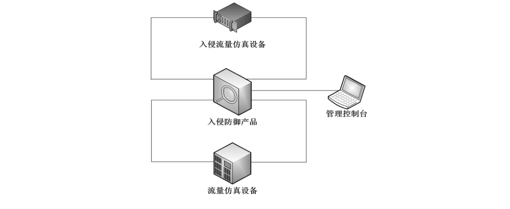

# GB/T 28451-2023 信息安全技术 网络入侵防御产品技术规范

> 来源：[GB/T 28451-2023 国家标准详情](https://openstd.samr.gov.cn/bzgk/std/newGbInfo?hcno=D26F98FDD39E3058E0579A7BD8F15481)；封面发布日期：2023-05-23；实施日期：2023-12-01。
> PDF SHA-256：e45d8f84fb6e2003cf565a069e368105b3f3699c2b34d22eab58dfb01d63e68c。
> 转写说明：依据官方 PDF 全部 39 页图像校核文字、章节、图示和附录表格；省略封面、目录、页眉、页脚及页码，跨页表格合并为连续表格。原文用黑体表示增强级增加或加严的内容，具体等级划分以附录 A 为准。正式引用请核对官方原文。
> 原文疑点：6.3.5、6.3.6 分别规定误拦截率和漏拦截率“应不超过”，7.5.5、7.5.6 的预期结果却写作“应不低于”；此处依原文保留。

## 前言

本文件按照 GB/T 1.1—2020《标准化工作导则 第1部分：标准化文件的结构和起草规则》的规定起草。

本文件代替 GB/T 28451—2012《信息安全技术 网络型入侵防御产品技术要求和测试评价方法》，与GB/T 28451—2012 相比，除结构调整和编辑性改动外，主要技术变化如下：

a） 增加了“流量控制”要求（见 6.1.1.5）；

b） 增加了“攻击数据留存”要求（见 6.1.3.5）；

c） 增加了“配置备份恢复”要求（见 6.1.4.6）；

d） 增加了“日志外发”要求（见 6.1.4.12）；

e） 增加了“网络层吞吐量”“混合应用层吞吐量”“TCP 新建连接速率”“TCP 并发连接数”等性能要求的具体内容（见 6.3.1、6.3.2、6.3.3 和 6.3.4）；

f） 增加了产品误拦截率和漏拦截率的具体要求（见 6.3.5、6.3.6，2012 年版的 7.4）；

g） 增加了“环境适应性要求”章节的内容，其中主要是明确了产品对IPv6 的支持能力，包括IPv6应用环境适应性、IPv6 管理环境适应性、双协议栈，以及虚拟化支持能力（见6.4）；

h） 删除了“负载均衡”要求（见2012年版的7.3.1.4.9）；

i） 将“入侵防御产品技术要求”更改为“安全功能要求”，“产品自身安全要求”更改为“自身安全要求”，“产品保证要求”更改为“安全保障要求”（见第 6 章，2012 年版的 7 和 8）；

j） 更改了入侵防御产品的等级划分，由“一级、二级和三级”修改为“基本级和增强级”（见附录 A，2012 年版的 7.1、7.2 和 7.3）。

请注意本文件的某些内容可能涉及专利。本文件的发布机构不承担识别专利的责任。

本文件由全国信息安全标准化技术委员会（SAC/TC 260）提出并归口。

本文件起草单位：公安部第三研究所、西安交大捷普网络科技有限公司、北京神州绿盟科技有限公司、深信服科技股份有限公司、启明星辰信息技术集团股份有限公司、蓝盾信息安全技术股份有限公司、北京天融信网络安全技术有限公司、中国网络安全审查技术与认证中心、上海市信息安全测评认证中心、中国电力科学研究院有限公司、新华三技术有限公司、奇安信网神信息技术（北京）股份有限公司。

本文件主要起草人：顾建新、武腾、邓雨、赖静、章倩、李谦、何建锋、陈宏伟、叶建伟、叶润国、王庆会、杨辰钟、雷晓峰、申永波、徐佟海、方帅、万晓兰、周飞虎。

本文件及其所代替文件的历次版本发布情况为：

- 2012 年首次发布为 GB/T 28451—2012；
- 本次为第一次修订。

## 1 范围

本文件规定了网络入侵防御产品的安全技术要求和测评方法，并进行了等级划分。

本文件适用于网络入侵防御产品的设计、开发、测试和评价。

## 2 规范性引用文件

下列文件中的内容通过文中的规范化引用而构成本文件必不可少的条款。其中，注日期的引用文件，仅该日期对应的版本适用于本文件；不注日期的引用文件，其最新版本（包括所有的修改单）适用于本文件。

- GB/T 18336.3—2015 信息技术 安全技术 信息技术安全评估准则 第3部分：安全保障组件

- GB/T 25069 信息安全技术 术语

- GB/T 30279—2020 信息安全技术 网络安全漏洞分类分级指南

## 3 术语和定义

GB/T 18336.3—2015 和 GB/T 25069界定的以及下列术语和定义适用于本文件。

### 3.1 网络入侵防御产品 network intrusion prevention system

以网桥或网关形式部署在网络通路上，通过分析网络流量发现具有入侵特征的网络行为，在其传入被保护网络前进行拦截的产品。

### 3.2 报文碎片 message fragmentation

攻击者将攻击数据隐藏在经过分段或者分片的 TCP 报文或者IP 报文中发出，用于躲避检测的行为。

### 3.3 代码变形 code deformation

攻击者重写已知攻击数据、代码，或者用其他代码替代原有攻击数据中的部分内容，用于躲避检测的行为。

### 3.4 管理员 administrator

具备管理、配置、操作网络入侵防御产品以及查看审计记录等权限的人员。

### 3.5 告警 alert

当网络入侵防御产品发现有入侵行为时，通过一定的技术手段主动向管理员发出的警示类通知。

### 3.6 误拦截 false blocking

网络入侵防御产品误将正常流量识别为攻击行为并进行错误拦截的行为。

### 3.7 漏拦截 skipped blocking

网络入侵防御产品无法正确识别出隐藏在网络流量中的网络攻击行为从而无法对其进行有效拦截的行为。

## 4 缩略语

下列缩略语适用于本文件。

- FTP：文件传输协议（File Transfer Protocol）
- HTTP：超文本传输协议（HyperText Transfer Protocol）
- IP：网际协议（Internet Protocol）
- POP3：邮局协议 3（Post Office Protocol 3）
- P2P：点对点（Peer to Peer）
- SMB：服务器信息块（Server Message Block）
- SMTP：简单邮件传输协议（Simple Mail Transfer Protocol）
- SNMP：简单网络管理协议（Simple Network Management Protocol）
- TCP：传输控制协议（Transmission Control Protocol）
- UDP：用户数据报协议（User Datagram Protocol）

## 5 概述

网络入侵防御产品（以下简称“产品”）一般以硬件形式呈现，采用网桥或网关形式部署在网络通路上，通过浏览器方式实现配置管理；有些产品是以分布式方式部署，通过特定的客户端程序或者集中管理平台进行配置管理。该产品作用于受保护网络边界，是一款具备应用安全防护功能的网络安全产品。

产品的安全技术要求分为安全功能要求、自身安全要求、性能要求、环境适应性要求和安全保障要求五个大类。其中，安全功能要求对产品应具备的基本安全功能提出了具体要求，包括入侵事件分析、入侵事件处理、入侵事件审计和管理控制四部分；自身安全要求针对产品的自身安全保护提出了具体的要求，包括身份标识与鉴别、管理功能、管理方式、管理审计、存储安全、传输安全和支撑系统安全等要求；性能要求针对产品应具备的性能提出了具体要求，包括网络层吞吐量、混合应用层吞吐量、TCP 新建连接速率、TCP并发连接数、误拦截率和漏拦截率六个方面；环境适应性要求提出产品支持在IPv6网络环境下正常工作和管理的要求，以及虚拟化环境下的部署要求；安全保障要求针对产品的生命周期过程提出了具体要求，包括开发、指导性文档、生命周期支持、测试和脆弱性评定。根据产品的安全技术要求，制定了对应项目的测试评价方法。产品的等级分为基本级和增强级，安全功能与自身安全的强弱，以及安全保障要求的高低是等级划分的依据，等级突出安全特性。

> 注：文中“黑色加粗”字体表示增强级较基本级有所增加的内容；对于不支持 IPv6 网络环境或者虚拟化环境部署的产品，“6.4.1 IPv6 支持”或者“6.4.2 虚拟化支持”不适用；对于不提供硬件形态的产品，“6.2.7 支撑系统安全、6.3.1 网络层吞吐量、6.3.2 混合应用层吞吐量、6.3.3 TCP 新建连接速率、6.3.4 TCP 并发连接数”不适用。

## 6 安全技术要求

### 6.1 安全功能要求

#### 6.1.1 入侵事件分析

##### 6.1.1.1 数据收集

产品应具有实时收集进出目标网络内所有数据包的能力。

##### 6.1.1.2 流量分析

产品应具有对收集的数据包按不同协议进行流量分析的能力。这里的流量分析包括网络协议解析和网络流量统计。

##### 6.1.1.3 入侵发现

产品应能识别网络流量中的入侵行为。这里的入侵行为应包括流量监听与劫持攻击、错误及弱配置攻击、脆弱性利用攻击、木马攻击、拒绝服务攻击等类型。

##### 6.1.1.4 流量监测

产品应对目标网络的全部流量或者某一特定协议、地址、端口中的流量进行监测。

##### 6.1.1.5 流量控制

**产品应具备对异常流量进行限流的功能。**

#### 6.1.2 入侵事件处理

##### 6.1.2.1 拦截能力

产品应对识别的入侵行为进行拦截，防止入侵行为危害目标网络。

##### 6.1.2.2 入侵躲避拦截

产品应能发现并拦截经躲避处理的攻击行为，如IP报文碎片、TCP 报文碎片、协议端口重定位、代码变形等。

##### 6.1.2.3 安全告警

产品应在发现并拦截入侵行为时，采取指定的方式向管理员发出安全警告。

##### 6.1.2.4 告警方式

产品的告警方式应支持屏幕实时提示、电子邮件、声音、短信、即时通信、SNMP Trap 告警等其中的一种或多种。

##### 6.1.2.5 事件合并

**产品应具有对高频度发生的相同或相似入侵事件进行合并告警，避免出现告警风暴。**

##### 6.1.2.6 拦截能力调整

**产品应支持人工调整或者自学习调整的方式，能对产品的拦截能力进行合理调整。**

#### 6.1.3 入侵事件审计

##### 6.1.3.1 事件生成

产品应能对拦截的入侵行为生成入侵事件。

##### 6.1.3.2 事件记录

产品应能以审计日志方式记录并保存拦截到的入侵事件。入侵事件日志的信息应至少包含以下内容：攻击种类描述、事件名称、事件发生日期时间、源IP 地址、源端口、目的IP 地址、目的端口、事件级别等。

##### 6.1.3.3 报表生成

**产品应能生成入侵事件审计结果报表。**

##### 6.1.3.4 报表输出

**产品应支持按照管理员需求修改和定制报表内容，并能按照 DOC、PDF、XLS、WPS、UOF 等中的一种或者多种文件格式输出。**

##### 6.1.3.5 攻击数据留存

**产品在检测到入侵行为时，应能捕获该入侵行为所对应的原始攻击报文并且以通用格式留存，便于对入侵行为进行取证和溯源。**

#### 6.1.4 管理控制

##### 6.1.4.1 管理接口独立

产品应具备独立的管理网络接口，以实现与业务网络的隔离。

##### 6.1.4.2 管理界面

产品应提供产品管理配置界面。管理配置界面应包含配置和管理产品所需的所有功能。

##### 6.1.4.3 入侵事件特征库

产品应提供入侵事件特征库，事件特征库应包括事件名称、通用漏洞编号、详细描述定义、处置建议等。

##### 6.1.4.4 事件级别

产品应按照入侵事件的严重程度对事件进行分级，以使授权管理员能从大量的告警信息中捕捉到不同危险级别的事件。

##### 6.1.4.5 策略配置

产品应提供对入侵防御策略、响应措施进行配置的功能。

##### 6.1.4.6 配置备份恢复

产品应具备对配置文件的备份恢复功能。

##### 6.1.4.7 产品升级

产品应具备更新、升级产品版本和事件特征库的能力，并能通过完整性校验机制保证升级包的安全性。

##### 6.1.4.8 硬件失效处理

产品应提供硬件失效处理机制，当设备硬件无法正常工作的时候，能保证网络连通。

##### 6.1.4.9 事件规则自定义

**产品授权管理员能自定义攻击事件防御规则，包括行为特征、协议或端口等。**

##### 6.1.4.10 第三方接口

**产品应提供对外的第三方接口，以便与其他安全设备共享信息或规范化管理。**

##### 6.1.4.11 双机热备

**产品应支持主主或者主备等双机冗余模式部署，以保障入侵防御功能的可靠性。**

##### 6.1.4.12 日志外发

**产品应至少采用一个标准的、开放的接口，能将自身日志信息或者攻击事件记录信息外发至指定系统，供其他系统进一步进行分析使用。**

### 6.2 自身安全要求

#### 6.2.1 身份标识与鉴别

产品的身份标识与鉴别安全要求包括但不限于：

a） 对管理员身份进行标识和鉴别，身份标识具有唯一性；

b） 在采用基于口令的身份鉴别时，能对用户设置的口令进行复杂度检查，确保用户口令满足复杂度要求，如口令数字、字母和特殊字符组合，口令长度不低于8位；

c） 采取安全措施对鉴别信息的存储和传输进行安全保护；

d） 具有登录失败处理功能，如限制连续非法登录尝试的次数等相关措施；

e） 具有登录超时处理功能，当登录连接超时自动退出；

f） 当产品存在默认口令时，提示用户对默认口令进行修改；

g） **支持采用口令、密码技术、生物技术等两种或两种以上组合的鉴别技术对用户进行身份鉴别，且其中一种鉴别技术至少应使用密码技术来实现。**

#### 6.2.2 管理功能

产品的管理功能包括但不限于：

a） 区分管理员角色，能设置不同管理员权限；

b） 授权管理员能实现对入侵防御策略的设置、配置的备份恢复、产品升级等运维操作；

c） 授权管理员能查阅入侵防御事件记录、审计日志等；

d） 能设置 NTP服务器，实现产品系统时间的同步。

#### 6.2.3 管理方式

产品的管理方式安全要求包括但不限于：

a） 支持远程管理，并能限定进行远程管理的IP地址；

b） 产品若支持分布式部署，应提供集中管理功能，能通过管理中心实现对下属设备运行状态的集中监测、下发入侵防御策略、收集审计日志等。

#### 6.2.4 管理审计

产品的管理审计安全要求包括但不限于：

a） 能对管理员身份鉴别成功和失败、注销、策略变更、用户和权限管理、时间同步、入侵事件记录的操作、存储空间达到阈值告警等事件进行记录；

b） 审计日志包含：主体用户所在主机 IP 地址、事件发生的日期时间、事件主体、事件描述、事件结果等；

c） 仅授权管理员能访问审计日志。

#### 6.2.5 存储安全

产品的存储安全要求包括但不限于：

a） 将入侵事件记录和自身审计日志存储于掉电非易失性存储介质中；

b） 若提供入侵事件记录和自身审计日志保存时限设置功能，设定值应不小于6个月；

c） 能对自身审计日志进行备份；

d） 非授权用户不能删除入侵事件记录和自身审计日志；

e） **当存储空间不足时进行告警，并能确保审计功能的正常运行。**

#### 6.2.6 传输安全

产品若支持远程管理，应对管理数据的远程传输进行安全保护。

#### 6.2.7 支撑系统安全

产品的支撑系统安全要求包括但不限于：

a） 不提供多余的组件或网络服务；

b） 重启过程中，安全策略和日志信息不丢失；

c） 不含已知中危及以上风险漏洞。

### 6.3 性能要求

#### 6.3.1 网络层吞吐量

产品的网络层吞吐量视不同速率的产品有所不同，在开启入侵防御功能满足攻击拦截能力的前提下，具体指标要求如下：

a） 一对相应速率的接口应达到的双向吞吐率指标：对于1518 byte 长包，百兆产品不低于线速的85%，千兆和万兆产品不小于线速的90%；

b） 针对高性能的万兆产品，对于1 518 byte 长包，整机吞吐量至少达到 80 Gbit/s。

#### 6.3.2 混合应用层吞吐量

产品的应用层吞吐量视不同速率的产品有所不同，在开启入侵防御功能满足攻击拦截能力的前提下，具体指标要求如下：

a） 百兆产品一对口混合应用层吞吐量应不小于 80 Mbit/s；

b） 千兆产品一对口混合应用层吞吐量应不小于 800 Mbit/s；

c） 万兆产品一对口混合应用层吞吐量应不小于7 500 Mbit/s；

d） 针对高性能的万兆产品，整机混合应用层吞吐量至少达到20 Gbit/s。

#### 6.3.3 TCP 新建连接速率

产品的TCP 新建连接速率视不同速率的产品有所不同，在开启入侵防御功能满足攻击拦截能力的前提下，具体指标要求如下：

a） 百兆产品一对口的 TCP 新建连接速率应不小于1 500个/s；

b） 千兆产品一对口的 TCP 新建连接速率应不小于5000 个/s；

c） 万兆产品一对口的 TCP 新建连接速率应不小于 50 000个/s；

d） 针对高性能的万兆产品，整机 TCP 新建连接速率应不小于 250 000个/s。

#### 6.3.4 TCP 并发连接数

产品的TCP并发连接数视不同速率的产品有所不同，在开启入侵防御功能满足攻击拦截能力的前提下，具体指标要求如下：

a） 百兆产品一对口的并发连接数应不小于50 000个；

b） 千兆产品一对口的并发连接数应不小于 200 000个；

c） 万兆产品一对口的并发连接数应不小于2 000 000个；

d） 针对高性能的万兆产品，整机并发连接数不小于5 000 000个。

#### 6.3.5 误拦截率

在开启入侵防御功能满足攻击拦截能力的前提下，产品对于正常流量的误拦截率应不超过5%。

#### 6.3.6 漏拦截率

产品在不同比例的正常背景流量下，对于能拦截的入侵行为所出现的漏拦截率应不超过15%。

### 6.4 环境适应性要求

#### 6.4.1 IPv6 支持

##### 6.4.1.1 IPv6 应用环境适应性

产品若支持 IPv6网络环境，应能在纯IPv6 网络环境下正常工作，实现在IPv6 网络环境下的入侵攻击识别和拦截。

##### 6.4.1.2 IPv6 管理环境适应性

产品若支持 IPv6，应支持在IPv6网络环境下正常自身管理，实现对产品的管理操作。

##### 6.4.1.3 双协议栈

产品若支持 IPv4/IPv6 双栈网络环境，应能在IPv4/IPv6双栈网络环境下正常工作，实现在IPv4/IPv6双栈网络环境下的入侵攻击识别和拦截。

#### 6.4.2 虚拟化支持

对于虚拟化形态的产品，应支持部署于虚拟化平台并接受平台统一管理，包括但不限于：

a） 支持部署于一种虚拟化平台；

b） **结合虚拟化平台实现产品资源弹性伸缩，根据虚拟化产品的负载情况动态调整资源。**

### 6.5 安全保障要求

#### 6.5.1 开发

##### 6.5.1.1 安全架构

开发者应提供产品安全功能的安全架构描述，安全架构描述应满足以下要求：

a） 与产品设计文档中对安全功能的描述范围相一致；

b） 充分描述产品采取的自我保护、不可旁路的安全机制。

##### 6.5.1.2 功能规范

开发者应提供完备的功能规范说明，功能规范说明应满足以下要求：

a） 清晰描述 6.1、6.2中定义的安全功能；

b） 标识和描述产品所有安全功能接口的目的、使用方法及相关参数；

c） 描述安全功能实施过程中，与安全功能接口相关的所有行为；

d） 描述可能由安全功能接口的调用而引起的所有直接错误消息。

##### 6.5.1.3 产品设计

开发者应提供产品设计文档，产品设计文档应满足以下要求：

a） 通过子系统描述产品结构，标识和描述产品安全功能的所有子系统，并描述子系统间的相互作用；

b） 提供子系统和安全功能接口间的对应关系；

c） **通过实现模块描述安全功能，标识和描述实现模块的目的、相关接口及返回值等，并描述实现模块间的相互作用及调用的接口；**

d） **提供实现模块和子系统间的对应关系。**

##### 6.5.1.4 实现表示

**开发者应提供产品安全功能的实现表示，实现表示应满足以下要求：**

a） **详细定义产品安全功能，包括软件代码、设计数据等实例；**

b） **提供实现表示与产品设计描述间的对应关系。**

#### 6.5.2 指导性文档

##### 6.5.2.1 操作用户指南

开发者应提供明确和合理的操作用户指南，对每一种用户角色的描述应满足以下要求：

a） 描述用户能访问的功能和特权，包含适当的警示信息；

b） 描述产品安全功能及接口的用户操作方法，包括配置参数的安全值等；

c） 标识和描述产品运行的所有可能状态，包括操作导致的失败或者操作性错误；

d） 描述实现产品安全目的必需执行的安全策略。

##### 6.5.2.2 准备程序

开发者应提供产品及其准备程序，准备程序描述应满足以下要求：

a） 描述与开发者交付程序相一致的安全接收所交付产品必需的所有步骤；

b）描述安全安装产品及其运行环境必需的所有步骤。

#### 6.5.3 生命周期支持

##### 6.5.3.1 配置管理能力

开发者的配置管理能力应满足以下要求：

a） 为产品的不同版本提供唯一的标识；

b） 使用配置管理系统对组成产品的所有配置项进行维护，并进行唯一标识；

c） 提供配置管理文档，配置管理文档描述用于唯一标识配置项的方法；

d） **配置管理系统提供自动方式来支持产品的生成，通过自动化措施确保配置项仅接受授权变更；**

e） **配置管理文档包括配置管理计划，描述用来接受修改过的或新建的作为产品组成部分的配置项的程序。配置管理计划应描述如何使用配置管理系统开发产品，开发者实施的配置管理应与配置管理计划相一致。**

##### 6.5.3.2 配置管理范围

开发者应提供产品配置项列表，并说明配置项的开发者。配置项列表应包含以下内容：

a） 产品及其组成部分、安全保障要求的评估证据；

b） **实现表示、安全缺陷报告及其解决状态。**

##### 6.5.3.3 交付程序

开发者应使用一定的交付程序交付产品，并将交付过程文档化。在向用户方交付产品的各版本时，交付文档应描述为维护安全所必需的所有程序。

##### 6.5.3.4 开发安全

**开发者应提供开发安全文档。开发安全文档应描述在产品的开发环境中，为保护产品设计和实现的保密性和完整性所必需的所有物理的、程序的、人员的和其他方面的安全措施。**

##### 6.5.3.5 生命周期定义

**开发者应建立一个生命周期模型对产品的开发和维护进行必要控制，并提供生命周期定义文档描述用于开发和维护产品的模型。**

##### 6.5.3.6 工具和技术

**开发者应明确定义用于开发产品的工具，并提供开发工具文档无歧义地定义实现中每个语句的含义和所有依赖于实现的选项的含义。**

#### 6.5.4 测试

##### 6.5.4.1 测试覆盖

开发者应提供测试覆盖文档，测试覆盖描述应满足以下要求：

a） 表明测试文档中所标识的测试与功能规范中所描述的产品的安全功能间的对应性；

b） **表明上述对应性是完备的，并证实功能规范中的所有安全功能接口都进行了测试。**

##### 6.5.4.2 测试深度

**开发者应提供测试深度的分析，测试深度分析描述应满足以下要求：**

a） **证实测试文档中的测试与产品设计中的安全功能子系统和实现模块之间的一致性；**

**b）证实产品设计中的所有安全功能子系统、实现模块都已经进行过测试。**

##### 6.5.4.3 功能测试

开发者应测试产品安全功能，将结果文档化并提供测试文档。测试文档应包括以下内容：

a） 测试计划，标识要执行的测试，并描述执行每个测试的方案，这些方案包括对于其他测试结果的任何顺序依赖性；

b） 预期的测试结果，表明测试成功后的预期输出；

c） 实际测试结果和预期的测试结果的对比。

##### 6.5.4.4 独立测试

开发者应提供一组与其自测安全功能时使用的同等资源，以用于安全功能的抽样测试。

#### 6.5.5 脆弱性评定

基于已标识的潜在脆弱性，产品能抵抗以下强度的攻击：

a） 具有基本攻击潜力的攻击者的攻击；

b） **具有中等攻击潜力的攻击者的攻击。**

## 7 测评方法

### 7.1 测评环境

产品测评的典型网络环境示意图见图1。

测试设备包括测试所需的入侵流量仿真设备、流量仿真设备以及产品管理控制台等。其中，入侵流量仿真设备、流量仿真设备可为多台模拟正常流量计算机、模拟攻击源计算机和被攻击计算机，也可以是专用测试设备。

### 7.2 测评工具

可用的测评工具包括但不限于：专用的网络性能分析仪、网络数据包获取软件、扫描工具和攻击工具等。

### 7.3 安全功能测评

#### 7.3.1 入侵事件分析

##### 7.3.1.1 数据收集

数据收集的测评方法如下。

a） 测试方法：根据产品说明文档，将产品部署在测试网络环境，检查其是否能实时收集流入受保护网段内的数据包。

b） 预期结果：

1） 产品能以网桥或网关方式接入网络；

2） 产品能获取足够的网络数据包以分析入侵事件。

c） 结果判定：上述预期结果均满足判定为符合，其他情况判定为不符合。

##### 7.3.1.2 流量分析

流量分析的测评方法如下。

a） 测试方法：

1） 使用流量仿真设备，准备包括 ARP、ICMP、HTTP、FTP、SNMP、TELNET、SMTP、POP3、NETBIOS、NFS、SMB、P2P 等多种不同协议的流量作测试流量；

2） 若产品声明能支持IPv6 协议的分析，则增加 IPv6 基础协议，例如：ND等组成测试流量；

3） 发送测试流量，检查产品是否能分析识别出具体的流量类型，并能对网络流量进行统计。

b） 预期结果：

1） 产品能分析识别流量中包括的具体协议类型，并能对网络流量进行统计。

2） 若产品声明能支持IPv6协议的分析，则还能支持IPv6 基础协议的识别，例如：ND等。

c） 结果判定：上述预期结果均满足判定为符合，其他情况判定为不符合。

##### 7.3.1.3 入侵发现

入侵发现的测评方法如下。

a） 测试方法：

1） 配置产品的入侵防御策略为最大策略集；

2） 模拟发送覆盖流量监听与劫持攻击、错误及弱配置攻击、脆弱性利用攻击、木马攻击、拒绝服务攻击等多种不同类型的攻击事件，检查是否能发现攻击事件。

b） 预期结果：产品能发现所发送的各种类型入侵行为。

c） 结果判定：上述预期结果均满足判定为符合，其他情况判定为不符合。

##### 7.3.1.4 流量监测

流量监测的测评方法如下。

a） 测试方法：

1） 开启产品的流量监测功能，定义流量事件，查看流量显示界面；

2） 对某一服务发起大流量的访问，如 FTP 方式下载文件；

3） 对特定的端口（如80端口）发起大流量访问。

b） 预期结果：

1） 能显示出各种流量信息，包括具体的协议、地址、端口等；

2） 能显示出大流量的网络访问（如FTP 流量、HTTP 流量）；

3） 列举提供的流量监测内容。

c） 结果判定：上述预期结果均满足判定为符合，其他情况判定为不符合。

##### 7.3.1.5 流量控制

**流量控制的测评方法如下。**

a） **测试方法：**

1） **开启产品的异常流量控制功能，例如限制 FTP 下载流量；**

2） **对某 FTP 服务发起大流量的访问，如上传或者下载文件。**

b） **预期结果：针对指定异常流量，产品能实现流量限制。**

c） **结果判定：上述预期结果均满足判定为符合，其他情况判定为不符合。**

#### 7.3.2 入侵事件处理

##### 7.3.2.1 拦截能力

拦截能力的测评方法如下。

a） 测试方法：

1） 选择具有不同特征的多个事件组成攻击事件测试集，测试产品的防御能力。选取的事件应包括：流量监听与劫持攻击、错误及弱配置攻击、脆弱性利用攻击、木马攻击、拒绝服务攻击等多种不同类型的攻击事件，以及其他具有代表性的网络攻击事件，模拟入侵攻击行为；

2） 配置产品的入侵防御策略为最大策略集；

3） 发送攻击事件测试集中的所有事件，记录测试结果。

b） 预期结果：

1） 能对入侵行为进行成功拦截，拦截率不低于攻击事件测试集的30%；

2） 应能记录所拦截入侵的相应攻击行为。

c） 结果判定：上述预期结果均满足判定为符合，其他情况判定为不符合。

##### 7.3.2.2 入侵躲避拦截

入侵躲避发现的测评方法如下。

a） 测试方法：

1） 配置产品的入侵防御策略为最大策略集；

2） 选取产品能正常拦截的多个网络入侵行为（例如：不同类型的且较为常见的攻击事件不少于100个）组成入侵事件测试集；

3） 将所选定的入侵事件测试集进行多种躲避变形（包括IP 分片、TCP 分段、协议端口重定位、代码变形等）后再次发送，检查并记录产品的拦截情况。

b） 预期结果：

1） 记录产品能正常拦截的常规攻击事件M个；

2） 分别记录产品能拦截的经过不同躲避方式变形后的攻击事件为 N₁、N₂、N₃、N₄ 个；

3） 分别计算产品的入侵躲避下降率 `[M−Nₓ（x=1,2,3,4）]/M×100%`。

c） 结果判定：若产品的入侵躲避下降率小于25%，则本项判为符合，否则判为不符合。

##### 7.3.2.3 安全告警

安全告警的测评方法如下。

a） 测试方法：

1） 从已有的事件库中选择具有不同特征的多个事件，组成攻击事件测试集；

2） 模拟入侵攻击行为，触发产品的安全事件，检查产品是否能采取指定的方式向管理员发送拦截告警信息；

3） 查看告警事件的信息。

b） 预期结果：

1） 产品能按照指定方式向管理员发送并显示告警信息；

2） 事件的详细告警信息便于管理员理解。

c） 结果判定：上述预期结果均满足判定为符合，其他情况判定为不符合。

##### 7.3.2.4 告警方式

告警方式的测评方法如下。

a） 测试方法：

1） 根据产品说明文档，检查产品所支持的告警方式；

2） 依次选择各种告警方式，检查产品是否能按照指定的方法进行告警；

3） 记录并列出所支持的告警方式。

b） 预期结果：能采取屏幕实时提示、电子邮件、声音、短信、即时通信、SNMP Trap 告警等方式中的一种或多种。

c） 结果判定：上述预期结果均满足判定为符合，其他情况判定为不符合。

##### 7.3.2.5 事件合并

**事件合并的测评方法如下。**

a） **测试方法：**

1） **设置事件合并的规则，将某些内容进行合并，如只显示告警信息的事件名称、发生的次数、源IP（目的是查看某一事件在这个 IP 上发生了多少次）；**

2） **连续触发同一攻击事件，查看事件记录和告警信息的显示情况，是否能将同一事件进行合并显示。**

b） **预期结果：产品能根据需要对同类攻击事件和告警信息进行合并。**

c） **结果判定：上述预期结果均满足判定为符合，其他情况判定为不符合。**

##### 7.3.2.6 拦截能力调整

**拦截能力调整的测评方法如下。**

a） **测试方法：**

1） **选择具有不同特征的多个事件组成攻击事件测试集，测试产品的拦截能力；**

2） **人工调整产品的拦截精度，尝试选择更加严格或者宽松的策略，或者选择某一个明确的误报行为进行拦截动作的调整，例如：针对指定IP 地址设置黑白名单的方式对策略进行调整；**

3） **若产品支持自学习功能，尝试产品运行一段时间；**

4） **再次测试产品的拦截能力；**

5） **检查产品是否能根据调整结果增加或者减少攻击事件的拦截数量。**

b） **预期结果：产品能根据人工调整或者自学习调整的方式，对产品的拦截能力和精度进行合理调整。**

c） **结果判定：上述预期结果均满足判定为符合，其他情况判定为不符合。**

#### 7.3.3 入侵事件审计

##### 7.3.3.1 事件生成

事件生成的测评方法如下。

a） 测试方法：

1） 登录产品管理界面；

2） 在管理界面上检查是否能清楚地展示产品的入侵拦截情况。

b） 预期结果：

1） 具有查看入侵拦截事件的显示界面；

2） 界面具备明确的功能区域，能显示产品所拦截事件的详细信息。

c） 结果判定：上述预期结果均满足判定为符合，其他情况判定为不符合。

##### 7.3.3.2 事件记录

事件记录的测评方法如下。

a） 测试方法：

1） 登录产品管理界面；

2） 在管理界面上查看所记录的拦截事件的详细信息。

b） 预期结果：产品管理界面上显示的拦截事件详细信息包括攻击种类描述、事件名称、事件发生日期时间、源 IP 地址、源端口、目的IP地址、目的端口、危害等级等。

c） 结果判定：上述预期结果均满足判定为符合，其他情况判定为不符合。

##### 7.3.3.3 报表生成

**报表生成的测评方法如下。**

a） **测试方法：**

1） **查看报表生成功能，查看报表的生成方式；**

2） **查看生成报表的内容。**

b） **预期结果：**

1） **具有生成报表的功能；**

2） **提供默认的模板以供快速生成报表；**

3） **生成的报表宜包含表格形式、柱状图、饼图等，并宜生成日报、周报等汇总报表。**

c） **结果判定：上述预期结果均满足判定为符合，其他情况判定为不符合。**

##### 7.3.3.4 报表输出

**报表输出的测评方法如下。**

a） **测试方法：**

1） **检查管理员是否能按照用户的要求修改和定制报表内容；**

2） **检查产品支持的报表输出格式。**

b） **预期结果：**

1） **产品支持按照管理员的要求修改和定制报表内容；**

2） **报表能输出成方便用户阅读的格式，如 DOC、PDF、XLS、WPS、UOF 等。**

c） **结果判定：上述预期结果均满足判定为符合，其他情况判定为不符合。**

##### 7.3.3.5 攻击数据留存

**攻击数据留存的测评方法如下。**

a） **测试方法：开启产品攻击数据留存功能，当发生入侵行为时，检查产品是否能将入侵行为的相关报文以一定的通用格式（例如 PCAP 包），存储在设备本地或者指定位置。**

b） **预期结果：产品在识别攻击行为的同时，能将攻击报文以 PCAP 包或者其他通用格式保存在设备本地或者指定位置。**

c） **结果判定：上述预期结果均满足判定为符合，其他情况判定为不符合。**

#### 7.3.4 管理控制

##### 7.3.4.1 管理接口独立

管理接口独立的测评方法如下。

a） 测试方法：检查产品是否配备了能进行产品管理和网络数据分析处理的不同物理接口。

b） 预期结果：产品的管理接口和网络数据分析处理接口是不同的物理接口，且均能正常工作。

c） 结果判定：上述预期结果均满足判定为符合，其他情况判定为不符合。

##### 7.3.4.2 管理界面

管理界面的测评方法如下。

a） 测试方法：

1） 登录控制台管理界面；

2） 查看用户界面的功能，包括管理配置、告警显示等。

b） 预期结果：

1） 具备独立的控制台；

2） 具有配置和管理产品所有功能的管理界面和告警显示界面，以及其他功能划分清晰的不同区域。

c） 结果判定：上述预期结果均满足判定为符合，其他情况判定为不符合。

##### 7.3.4.3 入侵事件特征库

入侵事件特征库的测评方法如下。

a） 测试方法：检查产品是否具备入侵事件特征库，其中对不同的入侵事件特征进行了定义和描述。

b） 预期结果：

1） 产品对所有支持的入侵事件特征进行命名，在详细的定义中对入侵事件特征进行了明确的特征定义和触发机制的说明，并给出了合理的处置建议；

2） 能通过通用漏洞披露（CVE,CommonVulnerabilities &. Exposures）、常见缺陷列表（CWE, Common Weakness Enumeration）、中国国家信息安全漏洞库（CNNVD, China National Vulnerability Database of Information Security）等漏洞体系关联不同事件所对应的漏洞编号；

3） 详细描述为人理解，不产生歧义。

c） 结果判定：上述预期结果均满足判定为符合，其他情况判定为不符合。

##### 7.3.4.4 事件级别

事件级别的测评方法如下。

a） 测试方法：检查入侵事件特征库中是否对每个事件特征都有分级信息。

b） 预期结果：事件库的所有事件特征都具有分级信息。

c） 结果判定：上述预期结果均满足判定为符合，其他情况判定为不符合。

##### 7.3.4.5 策略配置

策略配置的测评方法如下。

a） 测试方法：

1） 打开菜单，查看产品提供的默认策略；

2） 查看是否能编辑或修改生成新的策略；

3） 查看是否能编辑或修改各策略的响应措施。

b） 预期结果：

1） 产品提供默认策略，并能直接应用；

2） 授权用户能编辑策略；

3） 授权用户能编辑策略的不同响应措施。

c） 结果判定：上述预期结果均满足判定为符合，其他情况判定为不符合。

##### 7.3.4.6 配置备份恢复

配置备份恢复的测评方法如下。

a） 测试方法：

1） 尝试对产品的配置文件进行备份导出，再修改产品的任意配置参数；

2） 将备份导出的配置文件再次导入产品，检查之前所修改的参数是否能恢复，验证产品的恢复功能是否正常。

b） 预期结果：产品能实现对自身配置文件的备份和恢复。

c） 结果判定：上述预期结果均满足判定为符合，其他情况判定为不符合。

##### 7.3.4.7 产品升级

产品升级的测评方法如下。

a） 测试方法：

1） 检查产品的软件版本和入侵事件特征库的升级方式；

2） 尝试对产品软件版本和入侵事件特征库进行升级，并验证升级效果；

3） 在执行产品升级的过程中，抓包检查是否采用了完整性校验措施来保证升级包的安全性。

b） 预期结果：

1） 产品程序版本和入侵事件特征库能进行手动或自动的在线升级；

2） 升级的过程中产品仍能正常拦截入侵事件；

3） 升级后，产品功能正常生效；

4） 产品在升级过程中，能通过完整性校验机制保证升级包的安全性。

c） 结果判定：上述预期结果均满足判定为符合，其他情况判定为不符合。

##### 7.3.4.8 硬件失效处理

硬件失效处理的测评方法如下。

a） 测试方法：检查产品具备何种硬件失效处理机制。

b） 预期结果：当产品硬件失效时，不影响网络的正常连通。

c） 结果判定：上述预期结果均满足判定为符合，其他情况判定为不符合。

##### 7.3.4.9 事件规则自定义

**事件自定义的测评方法如下。**

a） **测试方法：**

1） **查看产品设置，是否提供自定义事件功能，是否能基于产品默认事件修改其特征信息、协议或者端口等信息，生成新的事件；**

2） **尝试自定义攻击事件的特征信息、协议或者端口信息等内容，生成新的入侵事件特征；**

3） **按照新生成的入侵特征发送相应的入侵事件，检查产品能否拦截。**

b） **预期结果：**

1） **产品授权用户能自定义事件，或者能基于产品默认事件修改生成新的入侵事件；**

2） **产品能检测到新定义的事件并进行拦截。**

c） **结果判定：上述预期结果均满足判定为符合，其他情况判定为不符合。**

##### 7.3.4.10 第三方接口

**第三方接口的测评方法如下。**

a） **测试方法：**

1） **检查产品是否支持与其他安全设备的信息共享或者规范化管理；**

2） **通过产品自己定义的对外开放接口，尝试与其他安全设备进行信息共享或规范化管理操作。**

b） **预期结果：**

1） **产品支持一个或多个信息共享或规范化管理接口协议，包括产品自定义的对外接口；**

2） **产品支持与其他安全设备的共享信息或规范化管理。**

c） **结果判定：上述预期结果均满足判定为符合，其他情况判定为不符合。**

##### 7.3.4.11 双机热备

**双机热备的测评方法如下。**

a） **测试方法：**

1） **检查产品是否具备双机冗余部署的能力；**

2） **部署双机热备的环境，关闭其中一台设备，查看另一设备在网络环境中是否能及时正常工作。**

b） **预期结果：产品支持主主或者主备的方式部署，当一台设备出现宕机时，不影响网络的连通和防御能力。**

c） **结果判定：上述预期结果均满足判定为符合，其他情况判定为不符合。**

##### 7.3.4.12 日志外发

**日志外发的测评方法如下。**

a） **测试方法：**

1） **检查产品是否具备日志外发功能；**

2） **通过抓包工具获取外发日志，检查其数据格式是否属于标准的开放格式，例如 syslog；**

3） **检查其外发内容是否包括产品日志信息或者攻击事件记录信息。**

b） **预期结果：产品具备日志外发功能，能将产品日志信息或者攻击事件记录信息，按照标准的开放格式外发至其他系统。**

c） **结果判定：上述预期结果均满足判定为符合，其他情况判定为不符合。**

### 7.4 自身安全测评

#### 7.4.1 身份标识与鉴别

身份识别与鉴别的测评方法如下。

a） 测试方法：

1） 测试产品是否对用户身份进行标识和鉴别，身份标识是否唯一，如不能创建重名用户；

2） 若产品采用口令鉴别机制，测试产品是否能对用户设置的口令进行复杂度检查，是否能设置弱口令，如空口令、纯数字等；

3） 测试产品是否采取措施对鉴别信息的存储和传输进行安全保护；

4） 连续多次失败登录产品，触发产品的登录失败处理功能，检查产品采用何种机制防止用户进一步鉴别的尝试；

5） 产品登录后，在超时时间内不做任何操作，查看产品是否自动退出；

6） 产品存在默认口令时，检查产品是否提示用户对默认口令进行修改；

7） **在对用户进行身份鉴别时，检查产品是否采用口令、密码技术、生物技术等两种或两种以上组合的鉴别技术，检查其中一种是否使用密码技术来实现。**

b） 预期结果：

1） 产品对用户身份进行标识和鉴别，身份标识具有唯一性；

2） 在采用基于口令的身份鉴别时，能对用户设置的口令进行复杂度检查；

3） 采取安全措施对鉴别信息的存储和传输进行安全保护；

4） 具有登录失败处理功能，能防止用户进一步鉴别的尝试；

5） 具有登录超时处理功能，当登录连接超时自动退出；

6） 当产品存在默认口令时，提示用户对默认口令进行修改；

7） **支持采用口令、密码技术、生物技术等两种或两种以上组合的鉴别技术对用户进行身份鉴别，且其中一种鉴别技术使用密码技术。**

c） 结果判定：上述预期结果均满足判定为符合，其他情况判定为不符合。

#### 7.4.2 管理功能

管理功能的测评方法如下。

a） 测试方法：

1） 检测产品是否区分管理员角色，是否能设置用户权限；

2） 以不同权限的授权管理员登录产品管理界面，检查相关管理员是否能实现对入侵防御策略的设置、配置的备份恢复、产品升级等运维操作；

3） 检查相关管理员是否能查阅入侵防御事件记录、审计日志等；

4） 检测产品是否能设置 NTP服务器地址，并与之实现系统时间的同步。

b） 预期结果：

1） 产品区分用户角色，能设置用户权限；

2） 授权管理员能实现对入侵防御策略的设置、配置的备份恢复、产品升级等运维操作；

3） 授权管理员能查阅入侵防御事件记录、审计日志等；

4） 能与 NTP服务器实现系统时间的同步。

c） 结果判定：上述预期结果均满足判定为符合，其他情况判定为不符合。

#### 7.4.3 管理方式

管理方式的测评方法如下。

a） 测试方法：

1） 检测产品是否支持通过网络接口进行远程管理，是否能限定进行远程管理的IP 地址；

2） 产品若支持分布式部署，检测是否支持集中管理，能通过审计中心实现对不同设备运行状态的监测、向不同设备下发审计策略、收集不同设备生成的审计日志。

b） 预期结果：

1） 支持通过网络接口进行远程管理，并能限定进行远程管理的IP地址；

2） 支持集中管理，能通过审计中心实现对不同设备运行状态的监测、下发审计策略、收集审计日志。

c） 结果判定：上述预期结果均满足判定为符合，其他情况判定为不符合。

#### 7.4.4 管理审计

管理审计的测评方法如下。

a） 测试方法：

1） 在产品上产生鉴别成功和失败、管理员注销、审计策略变更、用户和权限管理、时间同步、对入侵事件记录进行查询删除等操作、存储空间达到阈值告警等事件，检查是否能对上述操作行为生成对应的审计日志；

2） 检查产品的审计日志是否包含主体用户所在主机IP 地址、事件发生的日期时间、事件主体、事件描述、事件结果等内容；

3） 检查产品是否仅授权管理员能访问审计日志。

b） 预期结果：

1） 能对用户身份鉴别成功和失败、用户注销、审计策略变更、用户和权限管理、时间同步、入侵事件记录的操作、存储空间达到阈值告警等事件进行记录；

2） 审计日志记录包含：主体用户所在主机 IP 地址、事件发生的日期时间、事件主体、事件描述、事件结果等；

3） 仅授权管理员能访问审计日志。

c） 结果判定：上述预期结果均满足判定为符合，其他情况判定为不符合。

#### 7.4.5 存储安全

存储安全的测评方法如下。

a） 测试方法：

1） 关机后重启产品，检测审计记录和自身审计日志是否未丢失；

2） 若提供审计记录和自身审计日志保存时限设置功能，尝试设定保存时限不小于6个月；

3） 尝试将产品自身审计记录进行备份导出；

4） 以非授权用户登录产品，尝试删除审计记录和自身审计日志；

5） **占用存储空间达到阈值，检测是否能告警，检测存储耗尽前审计功能是否正常运行。**

b） 预期结果：

1） 产品将审计记录和自身审计日志存储于掉电非易失性存储介质中；

2） 若提供审计记录和自身审计日志保存时限设置功能，设定值应不小于6个月；

3） 能将产品自身审计记录备份导出；

4） 非授权用户不支持删除审计记录和自身审计日志；

5） **当存储空间不足时进行告警，能确保审计功能的正常运行。**

c） 结果判定：上述预期结果均满足判定为符合，其他情况判定为不符合。

#### 7.4.6 传输安全

传输安全的测评方法如下。

a） 测试方法：产品若支持远程管理，通过使用抓包分析工具进行抓包并分析远程管理数据包，检查产品是否采取措施对管理数据的传输进行安全保护。

b） 预期结果：产品若支持远程管理，能采取措施对管理数据的传输进行安全保护。

c） 结果判定：上述预期结果均满足判定为符合，其他情况判定为不符合。

#### 7.4.7 支撑系统安全

安全支撑系统的测评方法如下。

a） 测试方法：

1） 扫描产品开放的服务端口，查看产品文档，检查是否提供了多余的组件或网络服务；

2） 重启产品，检查策略和数据是否丢失；

3） 对产品进行安全性测试，检查是否含有已知的中危及以上风险漏洞，漏洞级别分类方法按照 GB/T 30279—2020中的规定。

b） 预期结果：

1） 产品支撑系统不提供多余的组件或网络服务；

2） 重启过程中，安全策略和日志信息不丢失；

3） 不含已知中危及以上风险安全漏洞。

c） 结果判定：上述预期结果均满足判定为符合，其他情况判定为不符合。

### 7.5 性能测评

#### 7.5.1 网络层吞吐量

网络层吞吐量的测评方法如下。

a） 测评方法：

1） 配置产品的入侵防御策略为最大策略集，在开启产品入侵防御功能并确保其满足攻击拦截能力的前提下；

2） 使用性能测试仪连接产品的一对接口，测试产品一对相应速率接口在不丢包情况下的双向 UDP 协议（1518byte）数据的吞吐量；

3） 测试高性能万兆产品在不丢包情况下，整机双向 UDP 协议（1518byte）的吞吐量。

b） 预期结果：对于不同速率的产品，网络层吞吐量应不低于 6.3.1 的相应要求。

c） 结果判定：实际测评结果与相关预期结果一致则判定为符合，其他情况判定为不符合。

#### 7.5.2 混合应用层吞吐量

混合应用层吞吐量的测评方法如下。

a） 测试方法：

1） 配置产品的入侵防御策略为最大策略集，在开启产品入侵防御功能并确保其满足攻击拦截能力的前提下；

2） 使用性能测试仪构造混合应用层流量（流量参考模型如下：HTTP Text, 20%；HTTP Audio, 10%；HTTP Video, 11%；P2P, 12%；SMB, 8%；SMTP, 12%；POP3, 12%；FTP, 10%；SQL, 5%），连接产品的一对接口，测试产品在误拦截率不超过 5% 的情况下，双向混合应用层数据的吞吐量；

3） 测试高性能万兆产品在误拦截率不超过5%的情况下，整机双向混合应用层吞吐量。

b） 预期结果：对于不同速率的产品，混合应用层吞吐量应不低于6.3.2的相应要求。

c） 结果判定：实际测评结果与相关预期结果一致则判定符合，其他情况判定为不符合。

#### 7.5.3 TCP 新建连接速率

TCP新建连接速率的测评方法如下。

a） 测试方法：

1） 配置产品的入侵防御策略为最大策略集，在开启产品入侵防御功能并确保其满足攻击拦截能力的前提下；

2） 使用性能测试仪连接产品的一对接口，测试产品的 TCP新建连接速率；

3） 测试高性能万兆产品的整机 TCP新建连接速率。

b） 预期结果：对于不同速率的产品，TCP 新建连接速率应不低于6.3.3的相应要求。

c） 结果判定：实际测评结果与相关预期结果一致则判定为符合，其他情况判定为不符合。

#### 7.5.4 TCP 并发连接数

TCP 并发连接数的测评方法如下。

a） 测试方法：

1） 配置产品的入侵防御策略为最大策略集，在开启产品入侵防御功能并确保其满足攻击拦截能力的前提下；

2） 使用性能测试仪连接产品的一对接口，测试产品的 TCP 并发连接数；

3） 测试高性能万兆产品的整机 TCP 并发连接数。

b） 预期结果：对于不同速率的产品，TCP 并发连接数应不低于6.3.4的相应要求。

c） 结果判定：实际测评结果与相关预期结果一致则判定为符合，其他情况判定为不符合。

#### 7.5.5 误拦截率

误拦截率的测评方法如下。

a） 测评方法：

1） 配置产品的入侵防御策略为最大策略集，在开启产品入侵防御功能并确保其满足攻击拦截能力的前提下；

2） 按照混合应用层吞吐量测试值的80%作为正常流量，保持入侵防御产品持续运行一段时间（例如：2h），记录产品的误截情况。

b） 预期结果：对于每一种协议的误拦截率应不低于6.3.5的相应要求。

c） 结果判定：实际测评结果与相关预期结果一致则判定为符合，其他情况判定为不符合。

#### 7.5.6 漏拦截率

漏拦截率的测评方法如下。

a） 测试方法：

1） 配置产品的入侵防御策略为最大策略集，在开启产品入侵防御功能并确保其满足攻击拦截能力的前提下；

2） 选取产品能正常拦截的多个网络入侵行为（例如：不同类型的且较为常见的攻击事件不少于100个）组成入侵事件测试集；

3） 按照混合应用层吞吐量测试值的80%、60%、40%和20%作为背景流量，混合选定的攻击事件流量，测试入侵防御产品的漏截情况，计算在不同比例背景流量下的漏拦截率。

b） 预期结果：漏拦截率应不低于 6.3.6 的相应要求。

c） 结果判定：实际测评结果与相关预期结果一致则判定为符合，其他情况判定为不符合。

### 7.6 环境适应性测评

#### 7.6.1 IPv6 支持

##### 7.6.1.1 IPv6 应用环境适应性

对支持纯IPv6 网络环境的测评方法如下。

a） 测试方法：搭建纯 IPv6 网络环境，检测产品是否能在纯IPv6网络环境下正常工作。

b） 预期结果：产品能在纯IPv6 网络环境下正常工作，实现目标网络环境下的攻击行为识别和拦截。

c） 结果判定：上述预期结果均满足判定为符合，其他情况判定为不符合。

##### 7.6.1.2 IPv6 管理环境适应性

对IPv6网络环境下自身管理的测评方法如下。

a） 测试方法：搭建IPv6 网络环境，检测产品是否支持在IPv6网络环境下进行身份鉴别、安全审计、任务管理、策略配置等管理操作。

b） 预期结果：产品能在IPv6 网络环境下进行身份鉴别、安全审计、任务管理、策略配置等管理操作。

c） 结果判定：上述预期结果均满足判定为符合，其他情况判定为不符合。

##### 7.6.1.3 双协议栈

对双协议栈的测评方法如下。

a） 测试方法：搭建 IPv4/IPv6 双栈网络环境，检测产品是否能在IPv4/IPv6 双栈网络环境下正常工作。

b） 预期结果：产品能在IPv4/IPv6双栈网络环境下正常工作，实现目标网络环境下的攻击行为识别和拦截。

c） 结果判定：上述预期结果均满足判定为符合，其他情况判定为不符合。

#### 7.6.2 虚拟化支持

虚拟化支持的测评方法如下。

a） 测试方法：

1） 分别尝试在 VMware ESXi、KVM、Citrix XenServer、Hyper-V 等虚拟化平台部署产品；

2） **增加网络流量、网络连接数等负载，验证虚拟化平台是否能根据产品负载情况动态调整虚拟化产品数量。**

b） 预期结果：

1） 支持部署于虚拟化平台中，支持 VMware ESXi、 KVM、Citrix XenServer 或 Hyper-V 等虚拟化平台中的一种；

2） **能在虚拟化平台上实现弹性伸缩，根据虚拟化产品的负载情况动态调整虚拟化产品数量。**

c） 结果判定：实际结果与相关预期结果一致则判定为符合，其他情况判定为不符合。

### 7.7 安全保障评估

#### 7.7.1 开发

##### 7.7.1.1 安全架构

安全架构的评估方法如下。

a） 评估方法：检查开发者提供的安全架构证据，并检查开发者提供的信息是否满足证据的内容和形式的所有要求：

1） 与产品设计文档中对安全功能的描述范围是否相一致；

2） 是否充分描述产品采取的自我保护、不可旁路的安全机制。

b） 预期结果：开发者提供的信息应满足 6.5.1.1 中所述的要求。

c） 结果判定：实际测评结果与相关预期结果一致则判定为符合，其他情况判定为不符合。

##### 7.7.1.2 功能规范

功能规范的评估方法如下。

a） 评估方法：检查开发者提供的功能规范证据，并检查开发者提供的信息是否满足证据的内容和形式的所有要求：

1） 是否清晰描述 6.1、6.2中定义的产品安全功能；

2） 是否描述产品所有安全功能接口的目的、使用方法及相关参数；

3） 描述安全功能实施过程中，是否描述与安全功能接口相关的所有行为；

4） 是否描述可能由安全功能接口的调用而引起的所有直接错误消息。

b） 预期结果：开发者提供的信息应满足 6.5.1.2中所述的要求。

c） 结果判定：实际测评结果与相关预期结果一致则判定为符合，其他情况判定为不符合。

##### 7.7.1.3 产品设计

产品设计的评估方法如下。

a） 评估方法：检查开发者提供的产品设计证据，并检查开发者提供的信息是否满足证据的内容和形式的所有要求：

1） 是否根据子系统描述产品结构，是否标识和描述产品安全功能的所有子系统，是否描述安全功能所有子系统间的相互作用；

2） 提供的对应关系是否能证实设计中描述的所有行为映射到调用的安全功能接口；

3） **是否根据实现模块描述安全功能，是否描述所有实现模块的安全功能要求相关接口、接口的返回值、与其他模块间的相互作用及调用的接口；**

4） **是否提供实现模块和子系统间的对应关系。**

b）预期结果：开发者提供的信息应满足 6.5.1.3中所述的要求。

c） 结果判定：实际测评结果与相关预期结果一致则判定为符合，其他情况判定为不符合。

##### 7.7.1.4 实现表示

**实现表示的评估方法如下。**

a） **评估方法：检查开发者提供的实现表示证据，并检查开发者提供的信息是否满足证据的内容和形式的所有要求：**

1） **是否通过软件代码、设计数据等实例详细定义产品安全功能；**

2） **是否提供实现表示与产品设计描述间的对应关系。**

b） **预期结果：开发者提供的信息应满足 6.5.1.4中所述的要求。**

c） **结果判定：实际测评结果与相关预期结果一致则判定为符合，其他情况判定为不符合。**

#### 7.7.2 指导性文档

##### 7.7.2.1 操作用户指南

操作用户指南的评估方法如下。

a） 评估方法：检查开发者提供的操作用户指南证据，并检查开发者提供的信息是否满足证据的内容和形式的所有要求：

1） 是否描述用户能访问的功能和特权（包含适当的警示信息）；

2） 是否描述如何以安全的方式使用产品提供的可用接口，是否描述产品安全功能及接口的用户操作方法（包括配置参数的安全值）；

3） 是否标识和描述产品运行的所有可能状态，包括操作导致的失败或者操作性错误；

4） 是否描述实现产品安全目的必需执行的安全策略。

b） 预期结果：开发者提供的信息应满足 6.5.2.1中所述的要求。

c） 结果判定：实际测评结果与相关预期结果一致则判定符合，其他情况判定为不符合。

##### 7.7.2.2 准备程序

用准备程序的评估方法如下。

a） 评估方法：检查开发者提供的准备程序证据，并检查开发者提供的信息是否满足证据的内容和形式的所有要求：

1） 是否描述与开发者交付程序相一致的安全接收所交付产品必需的所有步骤；

2） 是否描述安全安装产品及其运行环境必需的所有步骤。

b） 预期结果：开发者提供的信息应满足 6.5.2.2中所述的要求。

c） 结果判定：实际测评结果与相关预期结果一致则判定为符合，其他情况判定为不符合。

#### 7.7.3 生命周期支持

##### 7.7.3.1 配置管理能力

配置管理能力的评估方法如下。

a） 评估方法：检查开发者提供的配置管理能力证据，并检查开发者提供的信息是否满足内容和形式的所有要求：

1） 检查开发者是否为不同版本的产品提供唯一的标识；

2） 现场检查配置管理系统是否对所有的配置项作出唯一的标识，且是否对配置项进行了维护；

3） 检查开发者提供的配置管理文档，是否描述了对配置项进行唯一标识的方法；

4） **现场检查是否能通过自动化配置管理系统支持产品的生成，是否仅通过自动化措施对配置项进行授权变更；**

5） **检查配置管理计划是否描述了用来接受修改过的或新建的作为产品组成部分的配置项的程序；检查配置管理计划是否描述如何使用配置管理系统开发产品，现场核查活动是否与计划一致。**

b） 预期结果：开发者提供的信息和现场活动证据内容应满足 6.5.3.1中所述的要求。

c） 结果判定：实际测评结果与相关预期结果一致则判定为符合，其他情况判定为不符合。

##### 7.7.3.2 配置管理范围

配置管理范围的评估方法如下。

a） 评估方法：检查开发者提供的配置管理范围证据，并检查开发者提供的信息是否满足内容和形式的所有要求：

1） 检查开发者提供的配置项列表是否包含产品、安全保障要求的评估证据和产品的组成部分及相应的开发者；

2） **检查开发者提供的配置项列表是否包含实现表示、安全缺陷报告、解决状态及相应的开发者。**

b） 预期结果：开发者提供的信息和现场活动证据内容应满足6.5.3.2中所述的要求。

c） 结果判定：实际测评结果与相关预期结果一致则判定为符合，其他情况判定为不符合。

##### 7.7.3.3 交付程序

交付程序的评估方法如下。

a） 评估方法：检查开发者提供的交付程序证据，并检查开发者提供的信息是否满足内容和形式的所有要求：

1） 现场检查开发者是否使用一定的交付程序交付产品；

2） 检查开发者是否使用文档描述交付过程，文档中是否包含以下内容：在向用户方交付系统的各版本时，为维护安全所必需的所有程序。

b） 预期结果：开发者提供的信息和现场活动证据内容应满足 6.5.3.3中所述的要求。

c） 结果判定：实际测评结果与相关预期结果一致则判定为符合，其他情况判定为不符合。

##### 7.7.3.4 开发安全

开发安全的评估方法如下。

a） **评估方法：检查开发者提供的开发安全证据，并检查开发者提供的信息是否满足内容和形式的所有要求：**

1） **检查开发者提供的开发安全文档，该文档是否描述在系统的开发环境中，为保护系统设计和实现的保密性和完整性所必需的所有物理的、程序的、人员的和其他方面的安全措施；**

2） **现场检查产品的开发环境，开发者是否使用了物理的、程序的、人员的和其他方面的安全措施保证产品设计和实现的保密性和完整性，这些安全措施是否得到了有效的执行。**

b） **预期结果：开发者提供的信息和现场活动证据内容应满足 6.5.3.4中所述的要求。**

c） **结果判定：实际测评结果与相关预期结果一致则判定为符合，其他情况判定为不符合。**

##### 7.7.3.5 生命周期定义

生命周期定义的评估方法如下。

a） **评估方法：检查开发者提供的生命周期定义证据，并检查开发者提供的信息是否满足内容和形式的所有要求：**

1） **现场检查开发者是否使用生命周期模型对产品的开发和维护进行的必要控制；**

2） **检查开发者提供生命周期定义文档是否描述了用于开发和维护产品的模型。**

b） **预期结果：开发者提供的信息和现场活动证据内容应满足 6.5.3.5中所述的要求。**

c） **结果判定：实际测评结果与相关预期结果一致则判定为符合，其他情况判定为不符合。**

##### 7.7.3.6 工具和技术

工具和技术的评估方法如下。

a） **评估方法：检查开发者提供的工具和技术证据，并检查开发者提供的信息是否满足内容和形式的所有要求：**

1） **现场检查开发者是否明确定义用于开发产品的工具；**

2） **是否提供开发工具文档无歧义地定义实现中每个语句的含义和所有依赖于实现的选项的含义。**

b） **预期结果：开发者提供的信息和现场活动证据内容应满足 6.5.3.6中所述的要求。**

c） **结果判定：实际测评结果与相关预期结果一致则判定为符合，其他情况判定为不符合。**

#### 7.7.4 测试

##### 7.7.4.1 测试覆盖

测试覆盖的评估方法如下。

a） 评估方法：检查开发者提供的测试覆盖证据，并检查开发者提供的信息是否满足证据的内容和形式的所有要求：

1） 检查开发者提供的测试覆盖文档，在测试覆盖证据中，是否表明测试文档中所标识的测试与功能规范中所描述的产品的安全功能是对应的；

2） **检查开发者提供的测试覆盖分析结果，是否表明功能规范中的所有安全功能接口都进行了测试。**

b） 预期结果：开发者提供的信息应满足 6.5.4.1中所述的要求。

c） 结果判定：实际测评结果与相关预期结果一致则判定为符合，其他情况判定为不符合。

##### 7.7.4.2 测试深度

测试深度的评估方法如下。

a） **评估方法：检查开发者提供的测试深度证据，并检查开发者提供的信息是否满足证据的内容和形式的所有要求：**

1） **检查开发者提供的测试深度分析，是否说明了测试文档中所标识的对安全功能的测试，并足以表明与产品设计中的安全功能子系统和实现模块之间的一致性；**

2） **是否能证实所有安全功能子系统、实现模块都已经进行过测试。**

b） **预期结果：开发者提供的信息应满足 6.5.4.2中所述的要求。**

c） **结果判定：实际测评结果与相关预期结果一致则判定为符合，其他情况判定为不符合。**

##### 7.7.4.3 功能测试

功能测试的评估方法如下。

a） 评估方法：检查开发者提供的功能测试证据，并检查开发者提供的信息是否满足内容和形式的所有要求：

1） 检查开发者提供的测试文档，是否包括测试计划、预期的测试结果和实际测试结果，检查测试计划是否标识了要测试的安全功能，是否描述了每个安全功能的测试方案；

2） 检查期望的测试结果是否表明测试成功后的预期输出；

3） 检查实际测试结果是否表明每个被测试的安全功能能按照规定进行运作。

b） 预期结果：开发者提供的信息应满足 6.5.4.3中所述的要求。

c） 结果判定：实际测评结果与相关预期结果一致则判定为符合，其他情况判定为不符合。

##### 7.7.4.4 独立测试

独立测试的评估方法如下。

a） 测评方法：检查开发者提供的测试集合是否与其自测系统功能时使用的测试集合相一致，以用于安全功能的抽样测试，并检查开发者提供的资源是否满足内容和形式的所有要求。

b） 预期结果：开发者提供的信息应满足 6.5.4.4中所述的要求。

c） 结果判定：实际测评结果与相关预期结果一致则判定为符合，其他情况判定为不符合。

#### 7.7.5 脆弱性评定

脆弱性评定的评估方法如下。

a） 评估方法：

1） 从用户可能破坏安全策略的明显途径出发，按照安全机制定义的安全强度级别，对产品进行脆弱性分析；

2） 判断产品是否能抵抗基本型攻击；

3） **判断产品是否能抵抗中等型攻击。**

b） 预期结果：

1） 渗透性测试结果应表明产品能抵抗基本型攻击；

2） 渗透性测试结果应表明产品能抵抗中等型攻击。

c） 结果判定：实际测评结果与相关预期结果一致则判定为符合，其他情况判定为不符合。

## 8 等级划分要求

根据产品安全功能要求、自身安全要求的强弱以及安全保障要求的高低，将其安全等级划分为基本级和增强级，性能要求和环境适应性要求两个等级全覆盖，不做区分。不同级别产品的安全技术要求和测试评价方法的等级划分应符合附录 A 的规定。

## 附录 A（规范性）网络入侵防御产品等级划分

### A.1 概述

根据网络入侵防御产品安全技术要求和测评方法的条款，明确了基本级和增强级产品安全技术要求和测评方法的最小集合。

### A.2 安全技术要求等级划分

表 A.1 列出了网络入侵防御产品安全技术要求的等级划分。

**表 A.1 网络入侵防御产品安全技术要求等级划分表**

| 类别 | 分项 | 要求 | 基本级对应章条号 | 增强级对应章条号 |
| --- | --- | --- | --- | --- |
| 安全功能要求 | 入侵事件分析 | 数据收集 | 6.1.1.1 | 6.1.1.1 |
| 安全功能要求 | 入侵事件分析 | 流量分析 | 6.1.1.2 | 6.1.1.2 |
| 安全功能要求 | 入侵事件分析 | 入侵发现 | 6.1.1.3 | 6.1.1.3 |
| 安全功能要求 | 入侵事件分析 | 流量监测 | 6.1.1.4 | 6.1.1.4 |
| 安全功能要求 | 入侵事件分析 | 流量控制 | — | 6.1.1.5 |
| 安全功能要求 | 入侵事件处理 | 拦截能力 | 6.1.2.1 | 6.1.2.1 |
| 安全功能要求 | 入侵事件处理 | 入侵躲避拦截 | 6.1.2.2 | 6.1.2.2 |
| 安全功能要求 | 入侵事件处理 | 安全告警 | 6.1.2.3 | 6.1.2.3 |
| 安全功能要求 | 入侵事件处理 | 告警方式 | 6.1.2.4 | 6.1.2.4 |
| 安全功能要求 | 入侵事件处理 | 事件合并 | — | 6.1.2.5 |
| 安全功能要求 | 入侵事件处理 | 拦截能力调整 | — | 6.1.2.6 |
| 安全功能要求 | 入侵事件审计 | 事件生成 | 6.1.3.1 | 6.1.3.1 |
| 安全功能要求 | 入侵事件审计 | 事件记录 | 6.1.3.2 | 6.1.3.2 |
| 安全功能要求 | 入侵事件审计 | 报表生成 | — | 6.1.3.3 |
| 安全功能要求 | 入侵事件审计 | 报表输出 | — | 6.1.3.4 |
| 安全功能要求 | 入侵事件审计 | 攻击数据留存 | — | 6.1.3.5 |
| 安全功能要求 | 管理控制 | 管理接口独立 | 6.1.4.1 | 6.1.4.1 |
| 安全功能要求 | 管理控制 | 管理界面 | 6.1.4.2 | 6.1.4.2 |
| 安全功能要求 | 管理控制 | 入侵事件特征库 | 6.1.4.3 | 6.1.4.3 |
| 安全功能要求 | 管理控制 | 事件级别 | 6.1.4.4 | 6.1.4.4 |
| 安全功能要求 | 管理控制 | 策略配置 | 6.1.4.5 | 6.1.4.5 |
| 安全功能要求 | 管理控制 | 配置备份恢复 | 6.1.4.6 | 6.1.4.6 |
| 安全功能要求 | 管理控制 | 产品升级 | 6.1.4.7 | 6.1.4.7 |
| 安全功能要求 | 管理控制 | 硬件失效处理 | 6.1.4.8 | 6.1.4.8 |
| 安全功能要求 | 管理控制 | 事件规则自定义 | — | 6.1.4.9 |
| 安全功能要求 | 管理控制 | 第三方接口 | — | 6.1.4.10 |
| 安全功能要求 | 管理控制 | 双机热备 | — | 6.1.4.11 |
| 安全功能要求 | 管理控制 | 日志外发 | — | 6.1.4.12 |
| 自身安全要求 | | 身份标识与鉴别 | 6.2.1 a）～f） | 6.2.1 |
| 自身安全要求 | | 管理功能 | 6.2.2 | 6.2.2 |
| 自身安全要求 | | 管理方式 | 6.2.3 | 6.2.3 |
| 自身安全要求 | | 管理审计 | 6.2.4 | 6.2.4 |
| 自身安全要求 | | 存储安全 | 6.2.5 a）～d） | 6.2.5 |
| 自身安全要求 | | 传输安全 | 6.2.6 | 6.2.6 |
| 自身安全要求 | | 支撑系统安全 | 6.2.7 | 6.2.7 |
| 性能要求 | | 网络层吞吐量 | 6.3.1 | 6.3.1 |
| 性能要求 | | 混合应用层吞吐量 | 6.3.2 | 6.3.2 |
| 性能要求 | | TCP 新建连接速率 | 6.3.3 | 6.3.3 |
| 性能要求 | | TCP 并发连接数 | 6.3.4 | 6.3.4 |
| 性能要求 | | 误拦截率 | 6.3.5 | 6.3.5 |
| 性能要求 | | 漏拦截率 | 6.3.6 | 6.3.6 |
| 环境适应性要求 | IPv6 支持 | IPv6 应用环境适用性 | 6.4.1.1 | 6.4.1.1 |
| 环境适应性要求 | IPv6 支持 | IPv6 管理环境适用性 | 6.4.1.2 | 6.4.1.2 |
| 环境适应性要求 | IPv6 支持 | 双协议栈 | 6.4.1.3 | 6.4.1.3 |
| 环境适应性要求 | | 虚拟化支持 | 6.4.2 | 6.4.2 |
| 安全保障要求 | 开发 | 安全架构 | 6.5.1.1 | 6.5.1.1 |
| 安全保障要求 | 开发 | 功能规范 | 6.5.1.2 | 6.5.1.2 |
| 安全保障要求 | 开发 | 产品设计 | 6.5.1.3 a）、b） | 6.5.1.3 |
| 安全保障要求 | 开发 | 实现表示 | — | 6.5.1.4 |
| 安全保障要求 | 指导性文档 | 操作用户指南 | 6.5.2.1 | 6.5.2.1 |
| 安全保障要求 | 指导性文档 | 准备程序 | 6.5.2.2 | 6.5.2.2 |
| 安全保障要求 | 生命周期支持 | 配置管理能力 | 6.5.3.1 a）～c） | 6.5.3.1 |
| 安全保障要求 | 生命周期支持 | 配置管理范围 | 6.5.3.2 a） | 6.5.3.2 |
| 安全保障要求 | 生命周期支持 | 交付程序 | 6.5.3.3 | 6.5.3.3 |
| 安全保障要求 | 生命周期支持 | 开发安全 | — | 6.5.3.4 |
| 安全保障要求 | 生命周期支持 | 生命周期定义 | — | 6.5.3.5 |
| 安全保障要求 | 生命周期支持 | 工具和技术 | — | 6.5.3.6 |
| 安全保障要求 | 测试 | 测试覆盖 | 6.5.4.1 a） | 6.5.4.1 |
| 安全保障要求 | 测试 | 测试深度 | — | 6.5.4.2 |
| 安全保障要求 | 测试 | 功能测试 | 6.5.4.3 | 6.5.4.3 |
| 安全保障要求 | 测试 | 独立测试 | 6.5.4.4 | 6.5.4.4 |
| 安全保障要求 | | 脆弱性评定 | 6.5.5 a） | 6.5.5 b） |

注：“—”表示不适用。

### A.3 测评方法等级划分

表 2 列出了网络入侵防御产品测试评价方法的等级划分。

**表 A.2 网络入侵防御产品测评方法等级划分表**

| 类别 | 分项 | 测试评价方法 | 基本级对应章条号 | 增强级对应章条号 |
| --- | --- | --- | --- | --- |
| 安全功能测评 | 入侵事件分析 | 数据收集 | 7.3.1.1 | 7.3.1.1 |
| 安全功能测评 | 入侵事件分析 | 流量分析 | 7.3.1.2 | 7.3.1.2 |
| 安全功能测评 | 入侵事件分析 | 入侵发现 | 7.3.1.3 | 7.3.1.3 |
| 安全功能测评 | 入侵事件分析 | 流量监测 | 7.3.1.4 | 7.3.1.4 |
| 安全功能测评 | 入侵事件分析 | 流量控制 | — | 7.3.1.5 |
| 安全功能测评 | 入侵事件处理 | 拦截能力 | 7.3.2.1 | 7.3.2.1 |
| 安全功能测评 | 入侵事件处理 | 入侵躲避拦截 | 7.3.2.2 | 7.3.2.2 |
| 安全功能测评 | 入侵事件处理 | 安全告警 | 7.3.2.3 | 7.3.2.3 |
| 安全功能测评 | 入侵事件处理 | 告警方式 | 7.3.2.4 | 7.3.2.4 |
| 安全功能测评 | 入侵事件处理 | 事件合并 | — | 7.3.2.5 |
| 安全功能测评 | 入侵事件处理 | 拦截能力调整 | — | 7.3.2.6 |
| 安全功能测评 | 入侵事件审计 | 事件生成 | 7.3.3.1 | 7.3.3.1 |
| 安全功能测评 | 入侵事件审计 | 事件记录 | 7.3.3.2 | 7.3.3.2 |
| 安全功能测评 | 入侵事件审计 | 报表生成 | — | 7.3.3.3 |
| 安全功能测评 | 入侵事件审计 | 报表输出 | — | 7.3.3.4 |
| 安全功能测评 | 入侵事件审计 | 攻击数据留存 | — | 7.3.3.5 |
| 安全功能测评 | 管理控制 | 管理接口独立 | 7.3.4.1 | 7.3.4.1 |
| 安全功能测评 | 管理控制 | 管理界面 | 7.3.4.2 | 7.3.4.2 |
| 安全功能测评 | 管理控制 | 入侵事件特征库 | 7.3.4.3 | 7.3.4.3 |
| 安全功能测评 | 管理控制 | 事件级别 | 7.3.4.4 | 7.3.4.4 |
| 安全功能测评 | 管理控制 | 策略配置 | 7.3.4.5 | 7.3.4.5 |
| 安全功能测评 | 管理控制 | 配置备份恢复 | 7.3.4.6 | 7.3.4.6 |
| 安全功能测评 | 管理控制 | 产品升级 | 7.3.4.7 | 7.3.4.7 |
| 安全功能测评 | 管理控制 | 硬件失效处理 | 7.3.4.8 | 7.3.4.8 |
| 安全功能测评 | 管理控制 | 事件规则自定义 | — | 7.3.4.9 |
| 安全功能测评 | 管理控制 | 第三方接口 | — | 7.3.4.10 |
| 安全功能测评 | 管理控制 | 双机热备 | — | 7.3.4.11 |
| 安全功能测评 | 管理控制 | 日志外发 | — | 7.3.4.12 |
| 自身安全测评 | | 身份标识与鉴别 | 7.4.1 a）1）～6） | 7.4.1 |
| 自身安全测评 | | 管理功能 | 7.4.2 | 7.4.2 |
| 自身安全测评 | | 管理方式 | 7.4.3 | 7.4.3 |
| 自身安全测评 | | 管理审计 | 7.4.4 | 7.4.4 |
| 自身安全测评 | | 存储安全 | 7.4.5 a）1）～4） | 7.4.5 |
| 自身安全测评 | | 传输安全 | 7.4.6 | 7.4.6 |
| 自身安全测评 | | 支撑系统安全 | 7.4.7 | 7.4.7 |
| 性能测评 | | 网络层吞吐量 | 7.5.1 | 7.5.1 |
| 性能测评 | | 混合应用层吞吐量 | 7.5.2 | 7.5.2 |
| 性能测评 | | TCP 新建连接速率 | 7.5.3 | 7.5.3 |
| 性能测评 | | TCP 并发连接数 | 7.5.4 | 7.5.4 |
| 性能测评 | | 误拦截率 | 7.5.5 | 7.5.5 |
| 性能测评 | | 漏拦截率 | 7.5.6 | 7.5.6 |
| 环境适应性测评 | IPv6 支持 | IPv6 应用环境适用性 | 7.6.1.1 | 7.6.1.1 |
| 环境适应性测评 | IPv6 支持 | IPv6 管理环境适用性 | 7.6.1.2 | 7.6.1.2 |
| 环境适应性测评 | IPv6 支持 | 双协议栈 | 7.6.1.3 | 7.6.1.3 |
| 环境适应性测评 | | 虚拟化支持 | 7.6.2 | 7.6.2 |
| 安全保障要求评估 | 开发 | 安全架构 | 7.7.1.1 | 7.7.1.1 |
| 安全保障要求评估 | 开发 | 功能规范 | 7.7.1.2 | 7.7.1.2 |
| 安全保障要求评估 | 开发 | 产品设计 | 7.7.1.3 a）1）、2） | 7.7.1.3 |
| 安全保障要求评估 | 开发 | 实现表示 | — | 7.7.1.4 |
| 安全保障要求评估 | 指导性文档 | 操作用户指南 | 7.7.2.1 | 7.7.2.1 |
| 安全保障要求评估 | 指导性文档 | 准备程序 | 7.7.2.2 | 7.7.2.2 |
| 安全保障要求评估 | 生命周期支持 | 配置管理能力 | 7.7.3.1 a）1）～3） | 7.7.3.1 |
| 安全保障要求评估 | 生命周期支持 | 配置管理范围 | 7.7.3.2 1） | 7.7.3.2 |
| 安全保障要求评估 | 生命周期支持 | 交付程序 | 7.7.3.3 | 7.7.3.3 |
| 安全保障要求评估 | 生命周期支持 | 开发安全 | — | 7.7.3.4 |
| 安全保障要求评估 | 生命周期支持 | 生命周期定义 | — | 7.7.3.5 |
| 安全保障要求评估 | 生命周期支持 | 工具和技术 | — | 7.7.3.6 |
| 安全保障要求评估 | 测试 | 测试覆盖 | 7.7.4.1 a）1） | 7.7.4.1 |
| 安全保障要求评估 | 测试 | 测试深度 | — | 7.7.4.2 |
| 安全保障要求评估 | 测试 | 功能测试 | 7.7.4.3 | 7.7.4.3 |
| 安全保障要求评估 | 测试 | 独立测试 | 7.7.4.4 | 7.7.4.4 |
| 安全保障要求评估 | | 脆弱性评定 | 7.7.5 a）1）、2） | 7.7.5 1）、3） |

注：“—”表示不适用。
