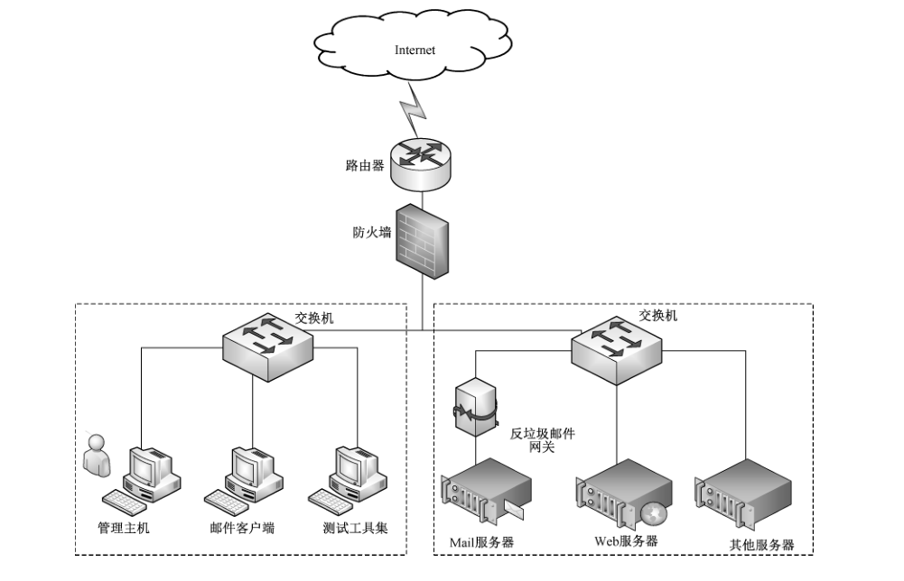

# GB/T 30282-2023 信息安全技术 反垃圾邮件产品技术规范

> 来源：[GB/T 30282-2023 国家标准详情](https://openstd.samr.gov.cn/bzgk/std/newGbInfo?hcno=976C7CCB492984B6978613768E6A5C33)；封面发布日期：2023-05-23；实施日期：2023-12-01。
> PDF SHA-256：96528326d5bdbc3dd75dbefbd79d041f2a0697a2c8e3e3745a6a76b28992e719。
> 转写说明：逐页对照官方 PDF 的全部 27 页图像，校正正文、列表、图示和附录表格；省略封面、目录、页眉、页脚和页码，合并跨页段落。正式引用请核对官方原件。

## 前言

本文件按照 GB/T 1.1—2020《标准化工作导则 第1部分：标准化文件的结构和起草规则》的规定起草。

本文件代替 GB/T 30282—2013《信息安全技术 反垃圾邮件产品技术要求和测试评价方法》，与 GB/T 30282—2013 相比，除结构调整和编辑性改动外，主要技术变化如下：

- 更改了“术语与定义”一章（见第 3 章，2013 版的第 3 章）；
- 增加了“产品概述”一章（见第 5 章）；
- 更改了“基于邮件发送方地址的垃圾邮件识别”（见 6.1.1.1，2013 年版的 5.1.1.1）；
- 更改了“基于邮件内容特征的垃圾邮件识别”（见 6.1.1.2，2013 年版的 5.1.1.2）；
- 更改了“基于邮件连接特征的垃圾邮件识别”（见 6.1.1.3，2013 年版的 5.1.1.3）；
- 更改了“垃圾邮件处理”（见 6.1.2，2013 年版的 5.1.2）；
- 更改了“部署方式”（见 6.1.4.2，2013 年版的 5.1.3.2）；
- 更改了“产品升级”（见 6.1.4.3，2013 年版的 5.1.3.3）；
- 增加了“审计数据保护”（见 6.2.1.4）；
- 更改了“身份鉴别”要求（见 6.2.2，2013 年版的 5.2.2）；
- 增加了“访问控制”要求（见 6.2.3）；
- 增加了“安全管理”要求（见 6.2.4）；
- 更改了“数据安全”要求（见 6.2.5，2013 年版的 5.2.4）；
- 更改了“安全保障要求”要求（见 6.3，2013 年版的 5.3）。

请注意本文件的某些内容可能涉及专利。本文件的发布机构不承担识别专利的责任。

本文件由全国信息安全标准化技术委员会（SAC/TC 260）提出并归口。

本文件起草单位：中认信安（北京）技术服务有限公司、中国网络安全审查技术与认证中心、上海市信息安全测评认证中心、中国电子科技集团公司第十五研究所、公安部第三研究所、北京信息安全测评中心、北京天融信网络安全技术有限公司、北京神州绿盟科技有限公司、启明星辰信息技术集团股份有限公司、深信服科技股份有限公司、西安交大捷普网络科技有限公司、北京山石网科信息技术有限公司、北京安宁创新网络科技股份有限公司、上海腾桥信息技术有限公司、奇安信网神信息技术（北京）股份有限公司。

本文件主要起草人：布宁、陈清明、申永波、甘杰夫、张俊彦、徐佟海、王峰、张玉朋、董晶晶、田晓鹏、贺海、安高峰、白霜、吴杨、李宇、叶润国、何建锋、郝炜、刘思蓉、薛路刚、吴云坤。

本文件及其所代替文件的历次版本发布情况为：

- 2013 年首次发布为 GB/T 30282—2013；
- 本次为第一次修订。

## 1 范围

本文件规定了反垃圾邮件产品的技术要求，并描述了对应的测试评价方法。

本文件适用于对反垃圾邮件产品的研制、测试和评价，以及用于指导产品的使用和管理。

## 2 规范性引用文件

下列文件中的内容通过文中的规范性引用而构成本文件必不可少的条款。其中，注日期的引用文件，仅该日期对应的版本适用于本文件；不注日期的引用文件，其最新版本（包括所有的修改单）适用于本文件。

- GB/T 18336.1—2015 信息技术 安全技术 信息技术安全评估准则 第1部分：简介和一般模型

- GB/T 25069 信息安全技术 术语

## 3 术语和定义

GB/T 18336.1 —2015和 GB/T 25069 界定的以及下列术语和定义适用于本文件。

### 3.1 垃圾邮件 spam

用户事先未提出请求或不同意接收的电子邮件。

> 注：垃圾邮件一般具有如下特征：
> - 含有用户不愿意接收的广告、宣传材料等内容；
> - 同时发送给大量用户；
> - 含有虚假的信息源、发件人、路由等信息；
> - 含有恶意代码。

### 3.2 邮件黑名单 mail blacklist

被识别为垃圾邮件的邮件地址列表。

### 3.3 邮件白名单 mail whitelist

不会被识别为垃圾邮件的邮件地址列表。

### 3.4 投递 send

反垃圾邮件产品不对邮件进行识别和处理，直接发送给收件人的过程。

### 3.5 标记投递 label and send

反垃圾邮件产品将邮件标记为垃圾邮件后发送给收件人的过程。

### 3.6 隔离 isolate

反垃圾邮件产品将识别的垃圾邮件或不应发送至收件人的邮件放置到专用的存储区域的过程。

### 3.7 拒绝 reject

反垃圾邮件产品不接收邮件，并通知发件人该邮件被拒收的过程。

### 3.8 丢弃 discard

反垃圾邮件产品将邮件直接拦截并删除，而不通知发件人的过程。

## 4 缩略语

下列缩略语适用于本文件。

DNS：域名系统（Domain Name System）

IP：网际互联协议（Internet Protocol）

## 5 通则

反垃圾邮件产品是对垃圾邮件进行识别和处理的软件或软硬件组合，包括但不限于反垃圾邮件网关、反垃圾邮件系统、安装于邮件服务器的反垃圾邮件软件，以及与邮件服务器集成的反垃圾邮件产品等。反垃圾邮件产品安全功能逻辑图见图1。

反垃圾邮件产品的技术要求分为安全功能要求、自身安全要求和安全保障要求。其中，安全功能要求包括垃圾邮件识别、垃圾邮件处理、统计报表、管理策略控制；自身安全要求包括安全审计、身份鉴别、访问控制、安全管理；安全保障要求包括开发、指导性文档、生命周期支持、测试和脆弱性评定。

反垃圾邮件产品的安全等级可分为基本级和增强级。安全功能与自身安全功能的强弱，以及安全保障要求的高低是反垃圾邮件产品等级划分的依据，其中“加粗宋体字”所描述的安全要求仅适用于增强级产品。安全技术要求的等级划分应符合附录 A 要求。

## 6 技术要求

### 6.1 安全功能要求

#### 6.1.1 垃圾邮件识别

##### 6.1.1.1 基于邮件发送方地址的垃圾邮件识别

反垃圾邮件产品应支持基于邮件发送方地址识别垃圾邮件，要求包括：

a） 提供邮件黑名单功能，支持邮件黑名单编辑、添加、删除、导入和导出等操作；

b） 支持实时邮件黑名单列表功能，包括但不限于 DNS查询方式进行列表查询等；

c） 提供邮件白名单功能，支持邮件白名单的编辑、添加、删除、导入和导出等操作；

d） 支持地址正确性检查功能；

e） **支持与邮件客户端联动，反垃圾邮件产品在邮件客户端用户手动阻止发件人后，将被阻止的发件人邮件地址同步至邮件黑名单。**

##### 6.1.1.2 基于邮件内容特征的垃圾邮件识别

反垃圾邮件产品应支持基于邮件内容特征来识别垃圾邮件，要求包括：

a） 支持关键字匹配识别，通过设定关键字，对邮件的信头、信体、附件、主题、发件人、收件人、抄送人、正文中包含的文字进行匹配，识别垃圾邮件；

b） 支持数值特征匹配识别，通过设定邮件或附件的大小、附件的数量、收件人总数等数量值，识别垃圾邮件；

c） 支持附件特征匹配识别，通过设定附件文件名和附件文件类型等特征，识别垃圾邮件；

d） 支持恶意代码的识别，通过设定包括但不限于带病毒特征的邮件附件、具有钓鱼邮件特征或诈骗邮件特征的邮件等，识别垃圾邮件；

e） **支持图像垃圾邮件的识别，通过设定带有图像信息的垃圾邮件，识别垃圾邮件；**

f） **支持自定义的匹配功能，识别垃圾邮件。**

##### 6.1.1.3 基于邮件连接特征的垃圾邮件识别

反垃圾邮件产品应支持基于邮件连接特征来识别垃圾邮件，要求包括：

a） 支持通过一段时间内具有同一邮件来源IP 地址且主题相同邮件的最大发送数，识别垃圾邮件；

b） 支持通过同一邮件来源 IP 地址对邮件服务端口的最大并发连接数量，识别垃圾邮件；

c） 支持通过一段时间内同一邮件来源IP 地址对邮件服务端口的最大连接数，识别垃圾邮件；

d） 对识别为垃圾邮件的连接进行自动阻断。

#### 6.1.2 垃圾邮件处理

反垃圾邮件产品应提供以下可供选择的垃圾邮件处理方式：

a） 通知；

b） 投递；

c） 标记投递；

d） 隔离，并允许邮件用户登录到隔离区，恢复该用户的邮件；

e） 拒绝；

f） 丢弃。

#### 6.1.3 统计报表

反垃圾邮件产品应提供查询统计功能，并将结果生成统计报表。

#### 6.1.4 管理策略控制

##### 6.1.4.1 策略配置

反垃圾邮件产品应提供垃圾邮件识别、处理和统计报表的配置方法。

##### 6.1.4.2 部署方式

反垃圾邮件产品应支持透明方式、路由方式或服务器方式的部署。

##### 6.1.4.3 产品升级

反垃圾邮件产品应：

a） 通过手动或在线自动方式及时更新垃圾邮件规则库；

b） 对升级包进行校验，防止升级包被篡改或替换。

### 6.2 自身安全要求

#### 6.2.1 安全审计

##### 6.2.1.1 审计数据生成

反垃圾邮件产品应对以下自身安全事件生成审计记录：

a） 对安全策略的操作，包括但不限于垃圾邮件识别规则、安全功能配置参数等进行更改；

b） 授权管理员的登录和退出；

c） 鉴别不成功的次数超出了设定值导致会话连接终止；

d） 对用户角色进行增加，删除和属性修改的操作；

e） 读取、修改、破坏审计数据的操作；

f） 记录垃圾邮件的识别和处理行为，包括但不限于发件人地址、邮件地址、收件人地址、邮件主题、发信时间、结果等。

##### 6.2.1.2 审计数据查阅

反垃圾邮件产品的审计数据查阅功能应：

a） 仅支持授权用户访问审计数据；

b） 提供对审计数据的查询功能，支持按照条件或条件组合进行查询；

c） 提供相应的统计分析功能，方便用户掌握垃圾邮件状况，以便及时采取防护措施。

##### 6.2.1.3 审计数据存储

**反垃圾邮件产品的审计数据存储功能应：**

a） **提供审计数据的导出和转存功能，保证产品有足够的审计数据存储空间；**

b） **设置存储空间的阈值，当达到存储空间阈值时进行报警；在审计存储空间耗尽等异常情况下，应能采取相应措施保证（如覆盖以前数据、忽略新产生数据等）已存储审计数据的可用性。**

##### 6.2.1.4 审计数据保护

反垃圾邮件产品应提供审计数据的保护功能，防止审计数据被删除或修改。

#### 6.2.2 身份鉴别

反垃圾邮件产品的身份鉴别功能应：

a） 对用户身份进行标识和鉴别，用户标识具有唯一性；

b） 对用户身份鉴别信息进行安全保护，保障用户鉴别信息的保密性和完整性；

c） 提供登录失败处理功能，采取限制连续登录失败的次数等措施；

d） 提供登录超时处理功能，当登录连接超过设定时限时自动退出；

e） 在采用基于口令的身份鉴别时，要求对用户设置的口令进行复杂度检查，确保用户口令满足一定的复杂度要求，如数字、字母大小写、特殊字符等两种及以上的组合；

f） 当反垃圾邮件产品中存在默认口令时，在用户首次登录时要求用户对默认口令进行修改。

#### 6.2.3 访问控制

反垃圾邮件产品应支持基于用户角色或IP 地址等安全属性实现访问控制。

#### 6.2.4 安全管理

##### 6.2.4.1 安全角色管理

**反垃圾邮件产品的安全角色管理功能应：**

a） **区分系统管理员、安全管理员和审计管理员等角色；**

b） **对安全角色进行维护，并将用户和角色相关联。**

##### 6.2.4.2 安全属性管理

反垃圾邮件产品应仅支持授权用户对安全属性执行查询、创建、修改、删除等操作。

#### 6.2.5 数据安全

反垃圾邮件产品的数据安全功能应：

a） 对提供本地存储的产品，采取安全措施保证邮件的安全性，如加密技术等；

b）对支持远程管理的产品，采取安全措施来保证数据传输的安全性。

### 6.3 安全保障要求

#### 6.3.1 开发

##### 6.3.1.1 安全架构

开发者应提供反垃圾邮件产品安全功能的安全架构文档，安全架构文档应：

a） 与反垃圾邮件产品设计文档中对安全功能的描述范围一致；

b） 充分描述反垃圾邮件产品采取的自我保护、不可旁路的安全机制。

##### 6.3.1.2 功能规范

开发者应提供完备的功能规范文档，功能规范文档应：

a） 根据反垃圾邮件产品类型清晰描述定义的安全功能；

b） 标识和描述反垃圾邮件产品所有安全功能接口的目的、使用方法及相关参数；

c） 描述安全功能实施过程中，与安全功能接口相关的所有行为；

d） 描述可能由安全功能接口调用而引起的所有直接错误消息。

##### 6.3.1.3 产品设计

开发者应提供反垃圾邮件产品的设计文档，设计文档应：

a） 通过子系统描述反垃圾邮件产品结构，标识和描述反垃圾邮件产品安全功能的所有子系统，并描述子系统间的相互作用；

b） 提供子系统和安全功能接口间的对应关系；

c） **通过实现模块描述安全功能，标识和描述实现模块的目的、相关接口及返回值等，并描述实现模块间的相互作用及调用的接口；**

d） **提供实现模块和子系统间的对应关系。**

##### 6.3.1.4 实现表示

**开发者应提供反垃圾邮件产品安全功能的实现表示，实现表示应：**

a） **详细定义反垃圾邮件产品安全功能，包括软件代码、设计数据等实例；**

b） **提供实现表示与反垃圾邮件产品设计描述间的对应关系。**

#### 6.3.2 指导性文档

##### 6.3.2.1 操作用户指南

开发者应提供明确和合理的操作用户指南，对每一种用户角色的描述应：

a） 描述用户能够访问的功能和特权，包含适当的警示信息；

b） 描述反垃圾邮件产品安全功能及接口的用户操作方法，包括配置参数的安全值等；

c） 标识和描述反垃圾邮件产品运行的所有可能状态，包括操作导致的失败或者操作性错误；

d） 描述实现反垃圾邮件产品安全目的所需执行的安全策略。

##### 6.3.2.2 准备程序

开发者应提供反垃圾邮件产品及其准备程序，准备程序描述应：

a） 描述与开发者交付程序相一致的安全接收所交付反垃圾邮件产品所需的所有步骤；

b） 描述安全安装反垃圾邮件产品及其运行环境所需的所有步骤。

#### 6.3.3 生命周期支持

##### 6.3.3.1 配置管理能力

开发者的配置管理能力应：

a） 为反垃圾邮件产品的不同版本提供唯一标识；

b） 使用配置管理系统对组成反垃圾邮件产品的所有配置项进行维护，并进行唯一标识；

c） 提供配置管理文档，配置管理文档描述用于唯一标识配置项的方法；

d） **配置管理系统提供自动方式来支持反垃圾邮件产品的生成，通过自动化措施确保配置项仅接受授权变更；**

e） **配置管理文档包括一个配置管理计划，描述用来接受修改过的或新建的作为反垃圾邮件产品组成部分的配置项的程序。配置管理计划应描述如何使用配置管理系统开发反垃圾邮件产品，开发者实施的配置管理应与配置管理计划相一致。**

##### 6.3.3.2 配置管理范围

开发者应提供反垃圾邮件产品配置项列表，并说明配置项的开发者。配置项列表应包括以下内容：

a） 反垃圾邮件产品、安全保障要求的评估证据和反垃圾邮件产品的组成部分；

b） **实现表示、安全缺陷报告及其解决状态。**

##### 6.3.3.3 交付程序

**开发者应使用一定的交付程序交付反垃圾邮件产品，并将交付过程文档化。在给用户方交付反垃圾邮件产品的各版本时，交付文档应描述为维护安全所需的所有程序。**

##### 6.3.3.4 开发安全

**开发者应提供开发安全文档。开发安全文档应描述在反垃圾邮件产品的开发环境中，为保护反垃圾邮件产品设计和实现的保密性和完整性所需的所有物理的、程序的、人员的和其他方面的安全措施。**

##### 6.3.3.5 生命周期定义

**开发者应建立一个生命周期模型对反垃圾邮件产品的开发和维护进行控制，并提供生命周期定义文档描述用于开发和维护反垃圾邮件产品的模型。**

##### 6.3.3.6 工具和技术

**开发者应明确定义用于开发反垃圾邮件产品的工具，并提供开发工具文档无歧义地定义实现中每个语句的含义和所有依赖于实现的选项的含义。**

#### 6.3.4 测试

##### 6.3.4.1 测试覆盖

开发者应提供测试覆盖文档，测试覆盖文档应：

a） 表明测试文档中所标识的测试与功能规范中所描述的反垃圾邮件产品的安全功能间的对应性；

b） **表明上述对应性是完备的，并证实功能规范中的所有安全功能接口都进行了测试。**

##### 6.3.4.2 测试深度

**开发者应提供测试深度的分析文档，测试深度分析文档应：**

a） **证实测试文档中的测试与反垃圾邮件产品设计中的安全功能子系统和实现模块之间的一致性；**

b） **证实反垃圾邮件产品设计中的所有安全功能子系统、实现模块都已经进行过测试。**

##### 6.3.4.3 功能测试

开发者应测试反垃圾邮件产品安全功能，将结果文档化并提供功能测试文档。功能测试文档应包括：

a） 测试计划，标识要执行的测试，并描述执行每个测试的方案，这些方案包括对于其他测试结果的任何顺序依赖性；

b） 预期的测试结果，表明测试成功后的预期输出；

c） 实际测试结果和预期的测试结果的对比。

##### 6.3.4.4 独立测试

开发者应提供一组与其自测安全功能时使用的同等资源，以用于安全功能的抽样测试。

#### 6.3.5 脆弱性评定

基于已标识的潜在脆弱性，反垃圾邮件产品应能抵抗以下强度的攻击：

a） 具有基本攻击潜力的攻击者的攻击；

b） **具有中等攻击潜力的攻击者的攻击。**

## 7 测试评价方法

### 7.1 测试环境

本文件给出了反垃圾邮件网关产品的典型测试环境，见图2。其他反垃圾邮件产品测试环境参考执行。有关性能指标和测试方法见附录 B。

测试设备包括测试所需的交换机、路由器、Web服务器、Mail 服务器、反垃圾邮件产品管理主机等。

可用的测试工具集包括但不限于：能够制作和发送垃圾邮件的测试工具等。

### 7.2 安全功能要求测评

#### 7.2.1 垃圾邮件识别

##### 7.2.1.1 基于邮件发送方地址的垃圾邮件识别

基于邮件发送方地址的垃圾邮件识别功能的测试评价方法如下。

a） 测试评价方法：

1） 查验是否提供邮件黑名单功能，并且提供邮件黑名单的编辑、添加、删除、导入和导出等操作；

2） 查验是否提供实时邮件黑名单列表功能，通过DNS服务器查询方式来查询列表；

3） 查验是否提供白名单功能，且提供邮件白名单的编辑、添加、删除、导入和导出等操作；

4） 查验是否支持地址正确性检查功能，如 DNS反查、虚假路由识别、虚假邮件地址识别等检查功能；

5） **查验是否支持和邮件客户端之间的联动，邮件客户端的用户在手动阻止发件人之后能够将被阻止的发件人邮件地址同步至邮件黑名单中。**

b） 预期结果：

1） 提供邮件黑名单功能，并且能够对邮件黑名单进行编辑、添加、删除、导入和导出等功能；

2） 提供实时邮件黑名单列表功能，可通过DNS服务器查询方式来查询列表；

3） 提供邮件白名单功能，并且能够对邮件白名单进行编辑、添加、删除、导入和导出等功能；

4） 支持地址正确性检查功能，如 DNS反查、虚假路由识别、虚假邮件地址识别等检查功能；

5） **支持和邮件客户端之间的联动，邮件客户端的用户在手动阻止发件人之后能够将被阻止的发件人邮件地址同步至邮件黑名单中。**

c） 结果判定：实际测试结果与相关预期结果一致则判定为符合，其他情况判定为不符合。

##### 7.2.1.2 基于邮件内容特征的垃圾邮件识别

基于邮件内容特征的垃圾邮件识别功能的测试评价方法如下。

a） 测试评价方法：

1） 分别针对邮件信头、信体、附件、主题、发件人、收件人、抄送人、暗送人（只针对外发邮件）、邮件正文设定不同的关键字，自邮件客户端向邮件服务器发送含有设定关键字的邮件；

2） 分别设置限制邮件大小、附件的尺寸、附件的数量、收件人总数等特征阈值，自邮件客户端向邮件服务器发送超过设定阈值的邮件；

3） 设定可限制的附件文件名和附件类型（如.doc），自邮件客户端向邮件服务器发送带有所限制附件文件名或附件类型的邮件；

4） 自邮件客户端分别向邮件服务器发送带有病毒特征附件的邮件、发送具有钓鱼邮件特征（如带有超链接、文字链接/按钮）的邮件、发送诈骗邮件特征（如索要通讯录、冒充身份邮件）的邮件等；

5） 按“与”“或”“非”的逻辑关系组合上述设定限制条件，自邮件客户端向邮件服务器发送具有所设定组合条件的邮件；

6） 分别判断产品是否能对上述邮件进行识别；

7） 查验是否能支持恶意代码的识别包括但不限于带病毒特征的邮件附件、具有钓鱼邮件或诈骗邮件特征的邮件等；

8） **自邮件客户端向邮件服务器发送带有垃圾图像的邮件，查验产品是否支持图像垃圾邮件的识别；**

9） **查验是否通过其他技术或自定义的识别功能（如采用 HASH 技术、指纹识别技术、数据建模聚类分析、贝叶斯算法、基于机器学习算法等），实现对垃圾邮件的识别。**

b） 预期结果：

1） 反垃圾邮件产品能根据所设定的邮件关键字、邮件数值特征和附件特征及其组合条件分别对邮件进行识别，且识别结果正确；

2） 反垃圾邮件产品能支持带病毒特征的邮件附件、具有钓鱼邮件或诈骗邮件的特征邮件的识别，且识别结果正确；

3） **反垃圾邮件产品能支持图像垃圾邮件的识别；**

4） **反垃圾邮件产品具备其他技术或自定义的识别功能实现对垃圾邮件的识别。**

c） 结果判定：实际测试结果与相关预期结果一致则判定为符合，其他情况判定为不符合。

##### 7.2.1.3 基于邮件连接特征的垃圾邮件识别

基于邮件链接特征的垃圾邮件识别功能的测试评价方法如下。

a） 测试评价方法：

1） 设定反垃圾邮件产品允许同一邮件来源 IP 地址的最大并发连接数，执行邮件发送（如采用手工方式、邮件群发程序等），向邮件服务器并发超过设定连接数的邮件；

2） 设定反垃圾邮件产品可允许的一段时间内同一邮件来源IP 地址的最大连接数，执行邮件发送（如采用手工方式、邮件群发程序等），向邮件服务器发送超过设定次数的邮件，直至达到设定时间；

3） 设定一段时间内某一主题邮件的接收次数，自邮件客户端在限定时间段内向邮件服务器发送带有限定主题的邮件，直至达到限定次数；

4） 观察以上过程中产品是否能进行垃圾邮件连接识别并自动阻断新的连接；

5） 检查产品说明书，分析产品是否具有以上限制功能以外的邮件识别机制，并采取相应的验证措施，证明产品对垃圾邮件的识别。

b） 预期结果：反垃圾邮件产品在达到设定的限定条件时能够进行识别垃圾邮件地址链接，并自动阻断邮件客户端所发送的邮件。

c） 结果判定：实际测试结果与相关预期结果一致则判定为符合，其他情况判定为不符合。

#### 7.2.2 垃圾邮件处理

垃圾邮件处理的测试评价方法如下。

a） 测试评价方法：

1） 检查产品说明书是否具有对垃圾邮件处理方式的描述，并在产品中选取不同的处理方式。

2） 由邮件客户端向邮件服务器发送一定数量不同种类垃圾邮件，分别验证产品对垃圾邮件的不同处理方式和处理结果；

3） 邮件客户端收件人尝试登录邮件服务器隔离区恢复被隔离的邮件。

b） 预期结果：

1） 产品对垃圾邮件的处理能够包括通知、投递、标记投递、隔离、拒绝、丢弃等方式；

2） 邮件客户端收件人能够登录隔离区恢复被隔离的邮件。

c） 结果判定：实际测试结果与相关预期结果一致则判定为符合，其他情况判定为不符合。

#### 7.2.3 统计报表

统计报表的测试评价方法如下。

a） 测试评价方法：

1） 查验产品对垃圾邮件处理结果的报告生成功能，并查看所生成报告的内容；

2） 查验报告结果的查询统计功能。

b） 预期结果：

1） 反垃圾邮件产品具有垃圾邮件处理结果报告生成功能；

2） 可以对生成的报告结果按照表格、柱状图、饼图等形式进行展现；

3） 可以对邮件发送时间、发件人地址、收件人地址等进行查询统计。

c） 结果判定：实际测试结果与相关预期结果一致则判定为符合，其他情况判定为不符合。

#### 7.2.4 管理策略控制

##### 7.2.4.1 策略配置

策略配置的测试评价方法如下。

a） 测试评价方法：

1） 按照产品说明书，查看产品使用的默认策略；

2） 验证是否可以编辑或修改生成新的策略。

b） 预期结果：

1） 产品提供了默认的垃圾邮件识别、处理和统计报表策略；

2） 产品仅允许授权用户编辑策略；

3） 具有供用户编辑策略的向导功能；

4） 支持策略的导入和导出。

c） 结果判定：实际测试结果与相关预期结果一致则判定为符合，其他情况判定为不符合。

##### 7.2.4.2 部署方式

部署方式的测试评价方法如下。

a） 测试评价方法：检查产品说明书和测试配置环境，判断产品所支持的网络接入方式，并在测试环境中调试其网络接入的有效性。

b） 预期结果：网关类反垃圾邮件产品支持透明方式或路由方式，其他产品形态支持服务器方式的部署。

c） 结果判定：实际测试结果与相关预期结果一致则判定为符合，其他情况判定为不符合。

##### 7.2.4.3 产品升级

产品升级的测试评价方法如下。

a） 测试评价方法：

1） 检查垃圾邮件规则库的升级方式；

2） 检查恶意代码库的升级方式；

3） 检查是否采取校验机制；

4） 检查升级后的有效性。

b） 预期结果：垃圾邮件规则库和恶意代码库可以通过手动或者在线自动方式升级；能采取签名等校验机制，避免得到错误或伪造的升级包。

c） 结果判定：实际测试结果与相关预期结果一致则判定为符合，其他情况判定为不符合。

### 7.3 自身安全要求测评

#### 7.3.1 安全审计

##### 7.3.1.1 审计数据生成

审计数据生成的测试评价方法如下。

a） 测试评价方法：

1） 更改内容特征识别规则、修改安全功能配置参数等策略，检查审计记录；

2） 授权管理员登录并退出，检查审计记录；

3） 多次尝试不成功的登录操作，检查审计记录；

4） 进行用户管理操作，添加、删除用户，修改用户口令等，检查审计记录；

5） 读取并尝试修改审计记录，检查审计记录；

6） 自邮件客户端向邮件服务器分别发送一定数量的基于内容特征识别垃圾邮件，检查产品是否记录相应识别和处理结果。并查阅记录内容是否包括网络地址和邮件地址、收件人地址、邮件主题、发信时间、结果等信息。

b） 预期结果：

1） 对每一个测试都产生正确的审计记录；

2） 产生的审计记录与其发生的事件相对应。

c） 结果判定：实际测试结果与相关预期结果一致则判定为符合，其他情况判定为不符合。

##### 7.3.1.2 审计数据查阅

审计数据查阅的测试评价方法如下。

a） 测试评价方法：

1） 查验审计数据是否仅支持授权用户进行访问；

2） 验证产品是否可根据事件发生时间、主体身份标识、操作内容等条件或条件组合对审计数据进行查阅；

3） 验证产品是否提供相应的统计分析功能。

b） 预期结果：

1） 仅支持授权用户才能访问审计记录；

2） 产品可根据事件发生时间、主体身份标识、操作内容等条件或条件组合对审计数据进行查阅；

3） 产品是否提供相应的统计分析功能。

c） 结果判定：实际测试结果与相关预期结果一致则判定为符合，其他情况判定为不符合。

##### 7.3.1.3 审计数据存储

**审计数据存储的测试评价方法如下。**

a） **测试评价方法：**

1） **查验产品对审计数据可用性的保护机制，并验证保护机制的有效性；**

2） **查验产品对存储空间阈值设置功能和超出阈值后的报警方式；**

3） **验证产品是否提供将审计数据导出和转存。**

b） 预期结果：

1） **产品提供相应的操作以处理审计数据存储空间满的问题，如覆盖以前记录等；**

2） **当产品存储空间达到阈值时，产品能向管理员进行报警；**

3） **产品提供授权用户将审计数据以文件方式导出的功能。**

c） 结果判定：实际测试结果与相关预期结果一致则判定为符合，其他情况判定为不符合。

##### 7.3.1.4 审计数据保护

审计数据保护的测试评价方法如下。

a） 测试评价方法：

1） 以审计管理员身份尝试执行删除、修改审计记录的操作，验证系统是否不允许执行删除、修改审计记录的操作；

2） 以其他用户角色身份尝试执行删除、修改审计记录的操作，验证系统是否能够防止删除、修改审计记录的操作。

b） 预期结果：产品能够保护存储的审计记录免遭任意的删除、修改，但不包括归档的审计日志。

c） 结果判定：实际测试结果与相关预期结果一致则判定为符合，其他情况判定为不符合。

#### 7.3.2 身份鉴别

身份鉴别的测试评价方法如下。

a） 测试方法：

1） 测试产品是否对其用户进行唯一性标识，如不允许创建重名用户；

2） 测试产品对于用户鉴别信息的存储和传输过程中，采取何种措施对其保密性和完整性进行保护；

3） 尝试连续多次失败登录产品，触发产品的登录失败处理功能，检查产品采用何种机制防止用户进一步进行尝试；

4） 登录后，在超时时间内无任何操作，查看产品是否自动退出；

5） 若产品采用口令鉴别机制，测试产品是否提供了口令复杂度校验机制，是否不允许用户设置弱口令，如空口令、纯数字等；

6） 产品存在默认口令时，检查产品是否提示用户对默认口令进行修改。

b） 预期结果：

1） 产品确保在管理员进行操作之前，对管理员、主机和用户等进行唯一的身份识别；

2） 产品支持非明文的远程管理会话，明文的远程管理方式能够关闭；

3） 输入错误口令达到设定的最大失败次数后，产品终止可信主机或用户建立会话的过程，并对该失败用户做禁止访问处理；

4） 产品登录后，在超时时间内无任何操作，产品自动退出；

5） 管理员需通过口令验证等身份鉴别措施；并对口令强度具有要求；

6） 产品存在默认口令时，产品能够提示用户对默认口令进行修改。

c） 结果判定：实际测试结果与相关预期结果一致则判定为符合，其他情况判定为不符合。

#### 7.3.3 访问控制

访问控制的测试评价方法如下：

a） 测试评价方法：

1） 查看产品说明文档有关访问控制的相关描述，检查是否支持基于用户角色、IP地址等安全属性对管理功能的访问控制；

2） 以授权用户身份登录系统，验证设置的基于用户角色、IP地址等安全属性对管理功能的访问控制功能是否有效。

b） 预期结果：产品仅支持基于用户角色、IP地址等安全属性实现对管理功能的访问控制。

c） 结果判定：实际测试结果与相关预期结果一致则判定为符合，其他情况判定为不符合。

#### 7.3.4 安全管理

##### 7.3.4.1 安全角色管理

**安全角色管理的测试评价方法如下。**

a） 测试评价方法：

1） **检查产品是否允许对安全角色进行维护；**

2） **查验产品是否区分产品管理员、安全管理员和审计管理员；**

3） **验证用户可执行的操作是否符合其角色。**

b） 预期结果：

1） **能够提供区分产品管理员、安全管理和审计管理员角色；**

2） **产品能够对安全角色进行维护，并可将用户和角色相关联。**

c） 结果判定：实际测试结果与相关预期结果一致则判定为符合，其他情况判定为不符合。

##### 7.3.4.2 安全属性管理

安全属性管理的测试评价方法如下。

a） 测试评价方法：

1） 以授权管理员身份登录产品的管理界面，验证其是否可对指定的安全属性（如用户角色、管理IP地址等）执行查询、创建、修改、删除等操作；

2） 尝试以非授权管理员身份登录产品的管理界面，验证其是否不可对指定的安全属性执行查询、创建、修改、删除等操作。

b） 预期结果：

1） 仅支持授权管理员能够对安全属性进行管理；

2） 非授权用户不能对安全属性进行管理。

c） 结果判定：实际测试结果与相关预期结果一致则判定为符合，其他情况判定为不符合。

#### 7.3.5 数据安全

数据安全的测试评价方法如下。

a） 测试评价方法：

1） 检查产品说明手册并测试，当邮件数据提供本地存储时，是否进行了安全保护，如使用密码技术进行加密等；

2） 检查产品说明手册并测试，当产品需要通过网络进行远程管理时，是否能提供对安全功能数据进行安全传输的功能，如使用密码技术保证传输的完整性等。

b） 预期结果：

1） 邮件数据进行安全储存保护；

2） 当反垃圾邮件产品需要通过网络进行远程管理时，产品能对数据进行保密传输。

c） 结果判定：实际测试结果与相关预期结果一致则判定为符合，其他情况判定为不符合。

### 7.4 安全保障要求测评

#### 7.4.1 开发

##### 7.4.1.1 安全架构

安全架构的测试评价方法如下。

a） 测试评价方法：检查开发者提供的安全架构证据，并检查开发者提供的信息是否满足证据的内容和形式的所有要求。

1） 与反垃圾邮件产品设计文档中对安全功能的描述范围是否相一致。

2） 是否充分描述反垃圾邮件产品采取的自我保护、不可旁路的安全机制。

b） 预期结果：开发者提供的信息应满足 6.3.1.1中所述的要求。

c） 结果判定：实际测试结果与相关预期结果一致则判定为符合，其他情况判定为不符合。

##### 7.4.1.2 功能规范

功能规范的测试评价方法如下。

a） 测试评价方法：检查开发者提供的功能规范证据，并检查开发者提供的信息是否满足证据的内容和形式的所有要求。

1） 是否清晰描述定义的反垃圾邮件产品安全功能。

2） 是否描述反垃圾邮件产品所有安全功能接口的目的、使用方法及相关参数。

3） 描述安全功能实施过程中，是否描述与安全功能接口相关的所有行为。

4） 是否描述可能由安全功能接口的调用而引起的所有直接错误消息。

b） 预期结果：开发者提供的信息应满足 6.3.1.2中所述的要求。

c） 结果判定：实际测试结果与相关预期结果一致则判定为符合，其他情况判定为不符合。

##### 7.4.1.3 产品设计

产品设计的测试评价方法如下。

a） 测试评价方法：检查开发者提供的反垃圾邮件产品设计证据，并检查开发者提供的信息是否满足证据的内容和形式的所有要求。

1） 是否根据子系统描述反垃圾邮件产品结构。

2） 是否标识和描述反垃圾邮件产品安全功能的所有子系统。

3） 是否描述安全功能所有子系统间的相互作用。

4） 提供的对应关系是否能够证实设计中描述的所有行为映射到调用的安全功能接口。

5） 是否根据实现模块描述安全功能。

6） 是否描述所有实现模块的安全功能要求相关接口、接口的返回值、与其他模块间的相互作用及调用的接口。

7） 是否提供实现模块和子系统间的对应关系。

b） 预期结果：开发者提供的信息应满足 6.3.1.3中所述的要求。

c） 结果判定：实际测试结果与相关预期结果一致则判定为符合，其他情况判定为不符合。

##### 7.4.1.4 实现表示

实现表示的测试评价方法如下。

a） 测试评价方法：检查开发者提供的实现表示证据，并检查开发者提供的信息是否满足证据的内容和形式的所有要求。

1） 是否通过软件代码、设计数据等实例详细定义反垃圾邮件产品安全功能。

2） 是否提供实现表示与反垃圾邮件产品设计描述间的对应关系。

b） 预期结果：开发者提供的信息应满足 6.3.1.4中所述的要求。

c） 结果判定：实际测试结果与相关预期结果一致则判定为符合，其他情况判定为不符合。

#### 7.4.2 指导性文档

##### 7.4.2.1 操作用户指南

操作用户指南的测试评价方法如下：

a） 测试评价方法：检查开发者提供的操作用户指南证据，并检查开发者提供的信息是否满足证据的内容和形式的所有要求。

1） 是否描述用户能够访问的功能和特权，包含适当的警示信息。

2） 是否描述如何以安全的方式使用反垃圾邮件产品提供的可用接口。

3） 是否描述反垃圾邮件产品安全功能及接口的用户操作方法，包括配置参数的安全值。

4） 是否标识和描述反垃圾邮件产品运行的所有可能状态，包括操作导致的失败或者操作性错误。

5） 是否描述实现反垃圾邮件产品安全目的必需执行的安全策略。

b） 预期结果：开发者提供的信息应满足 6.3.2.1中所述的要求。

c） 结果判定：实际测试结果与相关预期结果一致则判定为符合，其他情况判定为不符合。

##### 7.4.2.2 准备程序

用准备程序的测试评价方法如下。

a） 测试评价方法：检查开发者提供的准备程序证据，并检查开发者提供的信息是否满足证据的内容和形式的所有要求。

1） 是否描述与开发者交付程序相一致的安全接收所交付反垃圾邮件产品必需的所有步骤。

2） 是否描述安全安装反垃圾邮件产品及其运行环境必需的所有步骤。

b） 预期结果：开发者提供的信息应满足 6.3.2.2中所述的要求。

c） 结果判定：实际测试结果与相关预期结果一致则判定为符合，其他情况判定为不符合。

#### 7.4.3 生命周期支持

##### 7.4.3.1 配置管理能力

配置管理能力的测试评价方法如下。

a） 测试评价方法：检查开发者提供的配置管理能力证据，并检查开发者提供的信息是否满足内容和形式的所有要求。

1） 检查开发者是否为不同版本的反垃圾邮件产品提供唯一的标识。

2） 现场检查配置管理系统是否对所有的配置项作出唯一的标识，且对配置项进行了维护。

3） 检查开发者提供的配置管理文档，是否描述了对配置项进行唯一标识的方法。

4） 现场检查是否能够通过自动化配置管理系统支持反垃圾邮件产品的生成，是否仅通过自动化措施对配置项进行授权变更。

5） 检查配置管理计划是否描述了用来接受修改过的或新建的作为反垃圾邮件产品组成部分的配置项的程序。

6） 检查配置管理计划是否描述如何使用配置管理系统开发反垃圾邮件产品，现场核查活动是否与计划一致。

b） 预期结果：开发者提供的信息和现场活动证据内容应满足 6.3.3.1 中所述的要求。

c） 结果判定：实际测试结果与相关预期结果一致则判定为符合，其他情况判定为不符合。

##### 7.4.3.2 配置管理范围

配置管理范围的测试评价方法如下。

a） 测试评价方法：检查开发者提供的配置管理范围证据，并检查开发者提供的信息是否满足内容和形式的所有要求。

1） 检查开发者提供的配置项列表。

2） 配置项列表是否描述了组成反垃圾邮件产品的全部配置项及相应的开发者。

3） 检查开发者是否将实现表示、安全缺陷报告及其解决状态纳入配置管理范围，是否对安全缺陷进行跟踪。

b） 预期结果：开发者提供的信息和现场活动证据内容应满足 6.3.3.2中所述的要求。

c） 结果判定：实际测试结果与相关预期结果一致则判定为符合，其他情况判定为不符合。

##### 7.4.3.3 交付程序

交付程序的测试评价方法如下。

a） 测试评价方法：检查开发者提供的交付程序证据，并检查开发者提供的信息是否满足内容和形式的所有要求。

1） 现场检查开发者是否使用一定的交付程序交付反垃圾邮件产品。

2） 检查开发者是否使用文档描述交付过程，文档中是否包含以下内容：在向用户方交付系统的各版本时，为维护安全所必需的所有程序。

b） 预期结果：开发者提供的信息和现场活动证据内容应满足 6.3.3.3中所述的要求。

c） 结果判定：实际测试结果与相关预期结果一致则判定为符合，其他情况判定为不符合。

##### 7.4.3.4 开发安全

开发安全的测试评价方法如下。

a） 测试评价方法：检查开发者提供的开发安全证据，并检查开发者提供的信息是否满足内容和形式的所有要求。

1） 检查开发者提供的开发安全文档，该文档是否描述在系统的开发环境中，为保护系统设计和实现的保密性和完整性所必需的所有物理的、程序的、人员的和其他方面的安全措施。

2） 现场检查反垃圾邮件产品的开发环境，开发者是否使用了物理的、程序的、人员的和其他方面的安全措施保证反垃圾邮件产品设计和实现的保密性和完整性，这些安全措施是否得到了有效的执行。

b） 预期结果：开发者提供的信息和现场活动证据内容应满足 6.3.3.4中所述的要求。

c） 结果判定：实际测试结果与相关预期结果一致则判定为符合，其他情况判定为不符合。

##### 7.4.3.5 生命周期定义

生命周期定义的测试评价方法如下。

a） 测试评价方法：检查开发者提供的生命周期定义证据，并检查开发者提供的信息是否满足内容和形式的所有要求。

1） 现场检查开发者是否使用生命周期模型对反垃圾邮件产品的开发和维护进行的必要控制。

2） 检查开发者提供生命周期定义文档是否描述了用于开发和维护反垃圾邮件产品的模型。

b） 预期结果：开发者提供的信息和现场活动证据内容应满足 6.3.3.5中所述的要求。

c） 结果判定：实际测试结果与相关预期结果一致则判定为符合，其他情况判定为不符合。

##### 7.4.3.6 工具和技术

工具和技术的测试评价方法如下。

a） 测试评价方法：检查开发者提供的工具和技术证据，并检查开发者提供的信息是否满足内容和形式的所有要求。

1） 现场检查开发者是否明确定义用于开发反垃圾邮件产品的工具。

2） 是否提供开发工具文档无歧义地定义实现中每个语句的含义和所有依赖于实现的选项的含义。

b） 预期结果：开发者提供的信息和现场活动证据内容应满足 6.3.3.6中所述的要求。

c） 结果判定：实际测试结果与相关预期结果一致则判定为符合，其他情况判定为不符合。

#### 7.4.4 测试

##### 7.4.4.1 测试覆盖

测试覆盖的测试评价方法如下。

a） 测试评价方法：检查开发提供的测试覆盖证据，并检查开发者提供的信息是否满足证据的内容和形式的所有要求。

1） 检查开发者提供的测试覆盖文档，在测试覆盖证据中，是否表明测试文档中所标识的测试与功能规范中所描述的反垃圾邮件产品的安全功能是对应的。

2） 检查开发者提供的测试覆盖分析结果，是否表明功能规范中的所有安全功能接口都进行了测试。

b） 预期结果：开发者提供的信息应满足 6.3.4.1中所述的要求。

c） 结果判定：实际测试结果与相关预期结果一致则判定为符合，其他情况判定为不符合。

##### 7.4.4.2 测试深度

测试深度的测试评价方法如下。

a） 测试评价方法：检查开发者提供的测试深度证据，并检查开发者提供的信息是否满足证据的内容和形式的所有要求。

1） 检查开发者提供的测试深度分析，是否说明了测试文档中所标识的对安全功能的测试，并足以表明与反垃圾邮件产品设计中的安全功能子系统和实现模块之间的一致性。

2） 是否能够证实所有安全功能子系统、实现模块都已经进行过测试。

b） 预期结果：开发者提供的信息应满足 6.3.4.2中所述的要求。

c） 结果判定：实际测试结果与相关预期结果一致则判定为符合，其他情况判定为不符合。

##### 7.4.4.3 功能测试

功能测试的测试评价方法如下。

a） 测试评价方法：检查开发者提供的功能测试证据，并检查开发者提供的信息是否满足内容和形式的所有要求。

1） 检查开发者提供的测试文档，是否包括测试计划、预期的测试结果和实际测试结果。

2） 检查测试计划是否标识了要测试的安全功能，是否描述了每个安全功能的测试方案。

3） 检查期望的测试结果是否表明测试成功后的预期输出。

4） 检查实际测试结果是否表明每个被测试的安全功能能按照规定进行运作。

b） 预期结果：开发者提供的信息应满足 6.3.4.3中所述的要求。

c） 结果判定：实际测试结果与相关预期结果一致则判定为符合，其他情况判定为不符合。

##### 7.4.4.4 独立测试

独立测试的测试评价方法如下。

a） 测试评价方法：检查开发者提供的测试集合是否与其自测系统功能时使用的测试集合相一致，以用于安全功能的抽样测试，并检查开发者提供的资源是否满足内容和形式的所有要求。

b） 预期结果：开发者提供的信息应满足 6.3.4.4中所述的要求。

c） 结果判定：实际测试结果与相关预期结果一致则判定为符合，其他情况判定为不符合。

#### 7.4.5 脆弱性评定

脆弱性评定的测试评价方法如下。

a） 测试评价方法：

1） 从用户可能破坏安全策略的明显途径出发，按照安全机制定义的安全强度级别，对反垃圾邮件产品进行脆弱性分析；攻击潜力的计算主要依赖以下几个因素，包括不限于标识和利用脆弱性所需耗费的时间、攻击者的专业技术能力、对攻击对象所需的了解程度、可访问攻击对象的窗口值、攻击所需的设备，结合这些因素综合判断；

2） 判断产品是否能抵抗基本型攻击；

3） 判断产品是否能抵抗中等型攻击。

b） 预期结果：渗透性测试结果应表明反垃圾邮件产品能够满足 6.3.5中所述的要求。

c） 结果判定：实际测试结果与相关预期结果一致则判定为符合，其他情况判定为不符合。

## 附录 A（规范性）反垃圾邮件产品技术要求等级划分

表 A.1 列出了反垃圾邮件产品技术要求的等级划分。

**表 A.1 反垃圾邮件产品技术要求等级划分表**

| 安全技术要求 | 分类 | 项目 | 基本级 | 增强级 |
| --- | --- | --- | --- | --- |
| 安全功能要求 | 垃圾邮件识别 | 基于邮件发送方地址的垃圾邮件识别 | 6.1.1.1a）～d） | 6.1.1.1 |
|  |  | 基于邮件内容特征的垃圾邮件识别 | 6.1.1.2a）～d） | 6.1.1.2 |
|  |  | 基于邮件连接特征的垃圾邮件识别 | 6.1.1.3 | 6.1.1.3 |
|  | 垃圾邮件处理 |  | 6.1.2 | 6.1.2 |
|  | 管理策略控制 | 策略配置 | 6.1.3.1 | 6.1.3.1 |
|  |  | 部署方式 | 6.1.3.2 | 6.1.3.2 |
|  |  | 产品升级 | 6.1.3.3 | 6.1.3.3 |
|  | 统计报表 |  | 6.1.4 | 6.1.4 |
| 自身安全要求 | 安全审计 | 审计数据生成 | 6.2.1.1 | 6.2.1.1 |
|  |  | 审计数据查阅 | 6.2.1.2 | 6.2.1.2 |
|  |  | 审计数据存储 | — | 6.2.1.3 |
|  |  | 审计数据保护 | 6.2.1.4 | 6.2.1.4 |
|  | 身份鉴别 |  | 6.2.2 | 6.2.2 |
|  | 访问控制 |  | 6.2.3 | 6.2.3 |
|  | 安全管理 | 安全角色管理 | — | 6.2.4.1 |
|  |  | 安全属性管理 | 6.2.4.2 | 6.2.4.2 |
|  | 数据安全 |  | 6.2.5 | 6.2.5 |
| 安全保障要求 | 开发 | 安全架构 | 6.3.1.1 | 6.3.1.1 |
|  |  | 功能规范 | 6.3.1.2 | 6.3.1.2 |
|  |  | 产品设计 | 6.3.1.3a）～b） | 6.3.1.3 |
|  |  | 实现表示 | — | 6.3.1.4 |
|  | 指导性文档 | 操作用户指南 | 6.3.2.1 | 6.3.2.1 |
|  |  | 准备程序 | 6.3.2.2 | 6.3.2.2 |
|  | 生命周期支持 | 配置管理能力 | 6.3.3.1a）～c） | 6.3.3.1 |
|  |  | 配置管理范围 | 6.3.3.2a） | 6.3.3.2 |
|  |  | 交付程序 | 6.3.3.3 | 6.3.3.3 |
|  |  | 开发安全 | — | 6.3.3.4 |
|  |  | 生命周期定义 | — | 6.3.3.5 |
|  |  | 工具和技术 | — | 6.3.3.6 |
|  | 测试 | 测试覆盖 | 6.3.4.1a） | 6.3.4.1 |
|  |  | 测试深度 | — | 6.3.4.2 |
|  |  | 功能测试 | 6.3.4.3 | 6.3.4.3 |
|  |  | 独立测试 | 6.3.4.4 | 6.3.4.4 |
|  | 脆弱性评定 |  | 6.3.5a） | 6.3.5 |

> 注：“—”表示不作要求。

## 附录 B（资料性）性能指标与测试

### B.1 性能指标

#### B.1.1 识别率

反垃圾邮件产品对垃圾邮件能够予以正确识别的比率。

识别率＝（正确识别出的垃圾邮件数量／垃圾邮件的总数量）×100%。

本文件建议产品的识别率大于 95%。

#### B.1.2 误判率

反垃圾邮件产品把正常邮件判断为垃圾邮件的比率。

误判率＝（错误报警为垃圾邮件的正常邮件数量／正常邮件的总数量）×100%。

本文件建议产品的误判率不大于 2%。

#### B.1.3 连接处理速率

反垃圾邮件产品每秒所能处理的新建连接数。

#### B.1.4 平均延迟时间

反垃圾邮件产品从接收到连接请求开始，到产品处理完成邮件发出处理结果的时间间隔。

### B.2 性能测试

#### B.2.1 识别率

识别率的测试方法如下。

a） 测试评价方法：

1） 在测试工具集中编辑测试邮件样本库，包括垃圾邮件和非垃圾邮件；

2） 在邮件服务器端配置若干接收邮件的账户，由邮件客户端随机选取垃圾样本邮件发送，每次选取的样本数不少于 100 份；

3） 记录反垃圾邮件产品对垃圾邮件的识别数量；

4） 重复以上过程 3 次。

b） 测试评价结果：反垃圾邮件产品能够报告检测到相应的垃圾邮件，计算产品所正确识别到的垃圾邮件数量和所发送垃圾邮件数量的比值，并取 3 次测试结果的平均值。

#### B.2.2 误判率

误判率的测试方法如下。

a） 测试评价方法：

1） 在测试工具集中准备测试邮件样本库，包括垃圾邮件和非垃圾邮件；

2） 在邮件服务器端配置若干接收邮件的账户，由邮件客户端随机选取非垃圾样本邮件发送，每次选取的样本数不少于 100 份；

3） 记录产品将非垃圾邮件识别为垃圾邮件的数量；

4） 重复以上过程 3 次。

b） 测试评价结果：反垃圾邮件产品对非垃圾邮件直接放行通过，计算产品误判为垃圾邮件的数量和所发送正常邮件数量的比值，并取 3 次测试结果的平均值。

#### B.2.3 连接处理速率

连接处理速率的测试方法如下。

a） 测试评价方法：

1） 使用邮件收发测试工具进行测试；

2） 记录连接处理速率的数值。

b） 测试评价结果：达到所声称的连接处理速率指标为符合，其他情况判定为不符合。

#### B.2.4 平均延迟时间

平均延迟时间的测试方法如下。

a） 测试评价方法：

1） 使用邮件收发测试工具进行测试；

2） 记录平均延迟时间的数值。

b） 测试评价结果：达到所声称的平均延迟时间指标为符合，其他情况判定为不符合。
